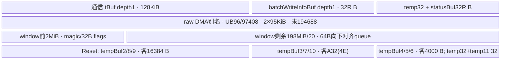
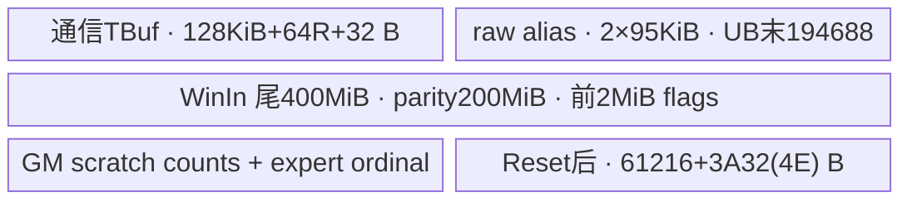

# SGL DeepEP NotifyDispatchA2 A2 ACLNN 算子知识

## 算子速览

| 项目 | 内容 |
|---|---|
| 实际入口 | `aclnnNotifyDispatchA2GetWorkspaceSize` / `aclnnNotifyDispatchA2`，公开两段式 ACLNN。 |
| 计算语义 | 交换每源 rank 的打包计数及路由序号，生成按全局 expert/source 排列的计数、当前 rank 的接收容量、server 内/外展开索引。该算子不搬运模型 hidden 向量。 |
| 输入输出 | 3 输入、12 输出；可执行模板为 INT32 ND，`localEpTokenCnt` 为 INT64。输入 `tmpData` 实际为可写 scratch。 |
| 执行类型 | 单个 AIV_VECTOR + 非 Cube 通信 Hybrid kernel；A2 AICPU 服务线程生成 RDMA_WRITE WR。所有可达节点均未调用 Cube/AIC/MIX_CV。 |
| Kernel 路线 | R-001：`key=123 && serverNum>1`；R-002：`key=123 && serverNum<=1`。R-002 保留 Host 可达但未安全闭合的单 server 语义边界。 |
| 核心资源 | 33 MiB workspace；每 rank 两个 200 MiB 通信区；IPC queue、raw UB 双片、阶段性 TBuf、`tmpData` 两个 GM slice。 |
| 来源闭包 | `source_closed`：ACLNN→Host→POD→key123→完整 1458 行 body/helper→CANN 9.1.0 客户端、AICPU BatchWrite、RDMA WR 构造→driver verbs/SQ primitive 边界；不宣称驱动或网络硬件内部已展开。 |
| 验证状态 | 已完成源码闭包检查；本次知识提取未执行编译、真机、数值或性能测试。`draft` 保留已见静态缺陷与未检查前提。 |

正文的 SGL 文件前缀 `P` 为 `csrc/deepep/ops2/`；SDK 前缀 `H` 为 `impl/adv_api/detail/hccl/`。它们仅缩短源码证据表，不表示额外来源。公开使用背景复用[DeepEP Normal Dispatch/Combine API](../../../../apis/deepep/deepep_normal_dispatch_combine.md)与[A2 通信集成](../../../../guides/integration/sgl_kernel_npu/deepep_a2_communication.md)。普通 `NotifyDispatch` 的三元组协议见[对应实现卡](sgl_deepep_notify_dispatch.md)，不能与本卡的打包记录协议混用。

## 接口与语义

### 计算语义

定义 `R=rankSize,r=rankId,Hr=localRankSize,lr=localRankId,S=ceil(R/Hr),E=numExperts,K=topkNum,B=4096,L=floor(E/R),A=blockDim`。正常调用端使用 `Hr=8,S=R/8`。有效双 server 路线的配对 rank 为 `peer=(1-floor(r/Hr))*Hr+lr`，不是一般多 server 路由。

每源 `s` 的 `sendData[D]` 是 DispatchLayoutA2 产生的 INT32 记录。`D=E*(B+1)+S+B*(1+2*S+2*K)`，每段 offset 的单位均为 INT32 元素：

| offset | extent | 段 |
|---|---|---|
| 0 | E | `c[s,e]`，源 rank 发往 expert 的数量 |
| E | S | 发往每个 server 的去重 token 数 |
| E+S | B*S | 发往每 server 的未去重 token 数 |
| E+S+B*S | B | 每 token 目的 server 数 |
| E+S+B*(S+1) | B*S | token 在每 server 的一基序号；本 kernel 按 `[S,B]` 物理布局消费 |
| E+S+B*(1+2*S) | B*K | token 在各 expert 的一基出现序号 |
| 上段末尾 | B*K | token 的 expert ID；负值无效 |
| 上段末尾 | E*B | expert 收到的 token 在源 server 去重流中的一基序号 |

通信完成后，`recvData[s*D:(s+1)*D]` 为所有源记录。主要输出为：

- `epRankTokenCnt[e,s]=c[s,e]`；`localEpTokenCnt[l]=sum_s c[s,r*L+l]`，不是前缀和；`totalRecvTokens=sum_l localEpTokenCnt[l]`。
- 对当前拥有的全局 expert `e∈[rL,(r+1)L)` 和 `0<=k<c[s,e]<=4096`（每源、每专家出现次数容量），`srcOffsetRankTokenIdx[e,s,k]=packedExpertServerOrdinal[s,e,k]-1`；`dstOffsetRankTokenIdx[e,s,k]=sum_{j=rL}^{e-1}sum_a c[a,j]+sum_{a<s}c[a,e]+k`。其他 expert 和无效尾部未写，不承诺初始化为 -1。
每源每expert的出现次数必须满足`0<=c[s,e]<=B=4096`。DispatchLayoutA2按每expert 4096槽写入，重复top-k ID仍逐次计数；Notify按c循环且不裁剪，所以仅N<=4096不足以保证容量。c超4096时会跨越声明的expert或source-rank行；这是源码静态边界，未做真机复现。

- `expandIdx[t,e]` 为当前 rank 的一基 expert 出现序号减 1，未选 expert 为 -1。`countOuter[t]` 直接取每 token server 数。循环覆盖 B 个 padded token，不以实际 N 截断。
- `tokenServerIdx[q,t]=packedOrdinal[q,t]-1`，物理 `[S,B]`；C++ 分配 shape 为 `[B,S]`，消费时必须保留物理协议，不能据 shape 注释自行转置。
- `tokensUniquePerServer[q]` 为当前源的去重数。令 `x_a[t,e]` 为源 a 对该 expert 的一基出现序号，未选为 0；令 `P_a[e]` 为该源发往同一目的 server 内较小 expert 的数量前缀，则 `offsetInner[i,t,e]=(x_a[t,e]-1)+P_a[e]*min(x_a[t,e],1)`，其中 a 是按 rank 升序排列的 `{r,peer}` 中第 i 个。
- `sendDataOffset` 仅绑定，body 未写；`tokenPerExpertData` 仅绑定，活跃计算从打包记录头取计数。

### 输入、输出与属性

| 参数 | shape/layout | dtype | 约束、默认值与语义 |
|---|---|---|---|
| sendData | `[D]` ND | INT32 活跃模板 | 必须包含完整 B=4096 padded 记录；Host 不验证各段长度。 |
| tokenPerExpertData | 调用端 `[round,E]` | INT32 | 接口必需；body 未读取其数据。 |
| tmpData | 调用端 `[R*D]` | INT32 | 可写中间 GM；容量至少 `A32(4RE)+A32(4REB)` bytes。 |
| sendDataOffset | `[E]` | INT32 | 本 body 不写，调用端标记 A2 not use。 |
| recvData | `[R*D]` | INT32 | 各源完整记录。 |
| tokenServerIdx | 分配 `[B,S]`，物理 `[S,B]` | INT32 | server-major，减一后未参与为 -1。 |
| tokenUniquePerServer | `[S]` | INT32 | 该 rank 到每 server 的去重数。 |
| epRankTokenCnt | `[E,R]` | INT32 | 全局 expert × 源 rank 原始计数。 |
| localEpTokenCnt | `[L]` | INT64 | 当前 rank 每 expert 的总接收数量。 |
| srcOffsetRankTokenIdx | `[E,R,B]` | INT32 | 仅本地 expert 和实际 count 内有效。 |
| dstOffsetRankTokenIdx | `[E,R,B]` | INT32 | 同一有效域；跨本地 expert/source 连续目标序号。 |
| offsetInner | `[2,B,E]` | INT32 | 当前 rank 和跨机同号 peer 的 server 内偏移。 |
| countOuter | `[B]` | INT32 | 每 token 发送 server 数。 |
| expandIdx | `[B,E]` | INT32 | expert 展开位置，未选为 -1。 |
| totalRecvTokens | `[1]` | INT32 | 总接收条数，C++ `.item<int>()` 后决定后续 dispatch 输出容量，0 时为后续容量分配 1。 |
| sendCount | int64 attribute | 窄化 uint32 | `>0`；应等于 D，Host 未核对公式。 |
| num_tokens | int64 attribute | 窄化 uint32 | `>=0`；body 元数据循环仍处理 B。 |
| topk_num | int64 attribute | 窄化 uint32 | 指针非空，未检查数值域；应满足打包及 UB 容量。 |
| num_experts | int64 attribute | 窄化 uint32 | 指针非空，未检查 E/R 整除或 E 上界。 |
| comm_group | string attribute | char* | 非空，长度 `<128`，MC2 通信组。 |
| rank_size | int64 attribute | 窄化 uint32 | `1<=R<=64`。 |
| rank_id | int64 attribute | 窄化 uint32 | `0<=r<R`。 |
| local_rank_size | int64 attribute | 窄化 uint32 | `1<=Hr<=8`。 |
| local_rank_id | int64 attribute | 窄化 uint32 | `0<=lr<Hr`，未验证与 `r%Hr` 一致。 |

OpDef 还声明 FLOAT16/FLOAT；Host dtype 检查还接受 BF16。但 Device 只有 INT32 key123 body；这些非 INT32 入口不能作为已实现的数值变体使用。

### 入口与版本

公开 wrapper 直接转交 `aclnnInnerNotifyDispatchA2GetWorkspaceSize`；执行时 weak symbol 存在则先将 server type 设为 AICPU，再调用 inner。自动生成 inner/executor/stream launch 为明确框架边界，不补造其私有实现。`A2_DEEPEP.md` 的双机 Normal 使用限制与 `ascend910b` OpDef、ops2 活动构建共同界定本卡 A2。README 与 DeepEP README 给出 CANN 9.1.0 使用依据，SDK `version.cmake` 给出固定 9.1.0；不扩展到 A3 或 950。

## Host/Launcher 执行流程

### 参数校验与前处理

`NotifyDispatchA2TilingFunc→NotifyDispatchA2TilingImpl` 获取 9 个属性；按 pointer、comm group、rank/local rank、sendCount、N 检查，失败返回 `GRAPH_FAILED`。检查 3 输入和 12 输出 descriptor/dtype；其中 localEp INT64，其余允许 FP16/BF16/FP32/INT32，未证明所有组合一致、shape/extent 足够。没有 Contiguous/ViewCopy 本地前处理。

环境必须严格满足 `HCCL_INTRA_PCIE_ENABLE="1"`、`HCCL_INTRA_ROCE_ENABLE="0"`，缺失或不等值返回失败。`CheckWindowSize` 使用 `DEEPEP_HCCL_BUFFSIZE` 优先，否则 `HCCL_BUFFSIZE`，缺失默认 200 MiB；本文件局部 helper 用 uint32 接收 `stoi` 结果。校验 `2*dataSize*sendCount+2MiB<=envWindow`，未校验 Device 的尾部 400 MiB 切片或每 rank queue。负值转 unsigned、超 uint32 属性窄化等未另行拒绝。

### 参数、Workspace 与生命周期

`SetWorkSpace` 申请 `16MiB SYSTEM + 1MiB KERNEL + 16MiB A2_ARG = 33MiB`，只有一个框架 workspace 项。entry 将收到的 workspace 原地址传给 body，描述符直接置于 offset0，申请 view 为 `32R` bytes，只提交首个 32B item；不能自行加 16MiB 偏移。系统 slice 的私有实际安排由 inner bridge/runtime 管理，固定源码未给出更多子 slice。用户须按 GetWorkspaceSize 返回值分配并保持到 stream 完成。

C++ 的 `EXEC_NPU_CMD` helper 获取 executor/workspace、在当前 NPU stream 调用两段接口，wrapper 返回 inner status；失败经 helper 检查。模型数据、输出、scratch 与 HCCL window 不得在通信完成前释放或复用。调用端先等前序 layout 的 stream 依赖，再执行本算子，读取 `totalRecvTokens.item<int>()` 后安排后续 DispatchNormalA2。后续 payload 算子不属于本卡。

`SetHcommCfg` 构造 `Mc2CcTilingConfig(group,18,"BatchWrite=level1:hierarchy")`，依次 GetTiling(init)、GetTiling(cc)。SDK 生成 init version100/单个 offset、Cc version1/type18、engine0；SGL 未检查两次 GetTiling 返回值。Device `InitV2(context,&stackTiling)` 后 `SetCcTilingV2(offsetof(...,mc2CcTiling1))`；context 由通信组框架持有，Finalize 在全核输出同步后调用。

### 启动图与失败传播

| 节点/边 | producer→consumer | 介质与字节 | ordering | owner/lifetime/失败 |
|---|---|---|---|---|
| K0 | inner launch→`notify_dispatch_a2`→`NotifyDispatchA2<int>::Init/Process` | 17 个 GM 参数，POD，blockDim=AIV 核数 | 当前 ACL stream | ACLNN/Host 失败返回；未知 key 无 body，无本地 fallback。 |
| K0→AICPU 服务 | core0 `ConstructBatchWriteInfo→BatchWrite<true>`→`HandleBatchWriteOperation` | workspace0 首 32B descriptor；SDK message queue handle/commit | UB scalar→S_MTE3→DMA→PIPE_ALL；跨核 SyncAll 后提交；SDK flush/valid/commit | descriptor 在服务取走前保持；SGL 未检查 handle 或 SetCc 返回码。 |
| AICPU→远端窗口 | `ConcurrentPostSendWqe→PostSend→HnsPostSend` | `4D+64` bytes RDMA_WRITE，localOut→peerIn | verbs WR→SQ/doorbell；远端 AIV 轮询前后 flag | queue/window 为通信组所有；SGL 等远端 payload flag，不以 posted WR 数代替 payload 可见。 |
| server 内复制 | 各源拥有者→本 server 所有 rank | share window 中原始 D INT32→recvData[source,D] | `SetInnerFlag`/`WaitInnerFlag`，再 MTE drain | raw ping/pong 归每 AIV；输出在最后 SyncAll 后完整。 |
| 计数拆包 | recvData→tmpData→epRankTokenCnt→索引输出 | GM 两 slice 与输出有效域见后文 | 两次 SyncAll 隔离 count/scratch producer→consumer | tmpData 为输入传入但实际写，持续到 kernel 结束。 |

AICPU 服务是 SDK 协作执行节点，不是另一个由该 Host 发起的 AscendC kernel；没有 Cube 节点。SDK `RunRpcServerApi` 在 910B 与 multiServerFlag 路线识别 op18；BatchWrite master 按 remoteRank 映射最多两个工作线程，构建 send work request，`WaitForSlaveCompletion` 等的是提交数。SGL 不使用 HCCL Wait 获取远端完成，而是读接收窗口的 trailer。

## Route 与参数设计

### 分核与资源计算

Host 设置 `A=platform.GetCoreNumAiv()`，UB 大小记入 POD，不用它裁剪 buffer。`coreNumWithin=coreNumBetween=min(R,20)`；初始 target list 按 `ceil(R/20)` 分 rank，固定数组4项。跨机 payload 搬运 core1，descriptor/send/wait core0。机内 `Hr*S` 个记录按 quotient/remainder 分给前 `min(R,20)` 核。

拆包先将 R 源按 `floor(R/A)+(core<R%A)` 分段，再按 expert/本地expert 和 token 使用同一 former/tail 公式。`C=ceil(A/2)`：core0 unique+total，core1 serverIdx，core2 countOuter，core3 expandIdx，core `[4,C)` 负责 offsetInner 的 B token；core `[C,A)` 负责本地 expert 的 src/dst 索引。没有 runtime SIMT、dynamic UB 或 TQue，全部是静态 TBuf 和 MTE/Vector。

### Route 选择

| 顺序 | Route | Key/模板 | 精确选择条件与优先级 | 不适用去向 |
|---:|---|---|---|---|
| 1 | R-001 双层交换 | 123 / `NotifyDispatchA2<int>` | Host 全部检查通过，sendData INT32，ShortSocVersion=Ascend910B；body `serverNum>1` | `serverNum<=1`→R-002；非 INT32→无 body 终点。 |
| 2 | R-002 机内分支 | 同123 | 同 entry，body `serverNum<=1` | 跳过 RDMA，但后续 offsetInner 仍计算 opposite peer；没有修正 fallback。 |

```text
attrs/dtypes/env/window fail -> GRAPH_FAILED
otherwise key=20/21/22/23 by sendData dtype
  if ShortSocVersion==Ascend910B: key+=100
entry only key123:
  S=ceil(R/Hr)
  if S>1 -> BetweenServer -> WithinServer -> Split -> Finalize  [R-001]
  else   -> WithinServer -> Split -> Finalize                 [R-002]
other keys -> no matching body; no outputs guaranteed
```

### 模板/实现执行矩阵

| Route | key/selector | dtype/shape/platform 完整命中条件 | 执行拓扑与 Kernel 节点 | 实际模板/body | 内存与同步特征 | tail/fallback |
|---|---|---|---|---|---|---|
| R-001 双层交换 | 123,S>1 | A2 INT32；Host R1..64/Hr1..8，形状未严检；实现可复用边界 S=2、R=2Hr、lr=r%Hr | K0 Hybrid AIV+SDK AICPU/RDMA；随后同 kernel 拆包 | `NotifyDispatchA2<int>`，Between/Within/Split | 2×200MiB，queue、descriptor0，flag+SyncAll，Reset后UB | former/tail 覆盖R/E/B；S>2仍命中但 peer公式失效。 |
| R-002 机内分支 | 123,S<=1 | 同 Host；1<=R<=Hr | K0 AIV机内复制+Vector；SDK Init/Finalize仍存在 | 同模板，略过Between | 不提交 BatchWrite；相同GM/拆包UB | offsetInner仍读peer，固定仓无单server安全修正。 |
| 无 body 终点 | 120/122；Host亦可算121 | OpDef FP16/FP32；BF16只在Host检查中出现 | entry不实例化 | 无 | 不能借用INT32解释浮点元数据 | 无 fallback、无有效结果保证。 |

### 隐藏性能 Guard

| Guard | Host/Tiling 条件 | Device/资源原因 | 影响 Route | 不满足时去向 | 源码符号 |
|---|---|---|---|---|---|
| 两server | 仅R<=64,Hr<=8，无S==2检查 | `(1-serverId)*Hr+lr` 与offsetInner固定2份 | R-001/R-002 | 仍进body；不是可靠fallback | `InputToWindowOut/BuildOffsetInnerData` |
| W>=400MiB | Host仅检查 `2*dataSize*D+2MiB<=envW` | `uint32 notifyMemoryOffset=W-400MiB` | 两Route | 仍执行，存在减法/窄化风险 | `InitAll2AllLayeredRdma` |
| queue空间 | Host不检查 | `q=floor(((200MiB-2MiB)/20)/64)*64`，须`4D+64<=q`且R个q留在半区 | R-001；机内payload也受q限制 | 无资源fallback | `InitShare` |
| 拆包UB | Host只记录UB | `61216+3*A32(4E)<=UB`；K<=E，E<=B，prefix计数<=1000float等 | 两Route | 无裁剪或fallback | `SplitAndCalcData/BuildSrcDstOffsetData` |
| core职责 | Host用全部AIV，未设最低A | offsetInner须C>4，srcdst须A-C>0，跨机copy须core1 | 两Route | 缺core时输出不全 | `SplitAndCalcData` |
| padded B | 未校验N<=4096 | 多数循环固定4096，打包段必须够长且无效ID已初始化 | 两Route | 没有N-tail路径 | `BuildExpandIdxData` |
| E/R布局 | 未校验整除、正E/K | owning expert使用floor(E/R)，server expert前缀边界同此 | 两Route | 遗漏/不合法域没有补救 | `GetEpRankSumCnt` |

### POD/ABI

`NotifyDispatchInfoA2` 为9个uint32加uint64；按普通C++自然8字节对齐推导 size48、align8（未编译测量），前9字段 offset0..32，padding36..39，totalUb40。外层 init64、cc512 来自 SDK；info 推导 offset576，总624，实际序列化由 tiling宏/SDK ABI决定，不宣称实测。

| 结构 | 字段 | 类型/位宽 | ABI 布局 | 单位 | Host/launcher producer | Device consumer | 边界 |
|---|---|---|---|---|---|---|---|
| NotifyDispatchInfoA2 | rankSize | uint32 | 0 | rank | cast rank_size | 构造/数组/计数 | Host1..64 |
| 同上 | rankId | uint32 | 4 | rank | cast rank_id | 构造/ownexpert/window | <R |
| 同上 | localRankSize | uint32 | 8 | rank | cast local_rank_size | server数/peer | 1..8 |
| 同上 | localRankId | uint32 | 12 | rank | cast local_rank_id | peer | <Hr，不校验r%Hr |
| 同上 | sendCount | uint32 | 16 | INT32元素 | cast sendCount | len与所有记录stride | >0，但未核D |
| 同上 | numTokens | uint32 | 20 | token | cast num_tokens | Init成员 | B循环未用它裁尾 |
| 同上 | topkNum | uint32 | 24 | expert/token | cast topk_num | packed K段与循环 | Host无值域 |
| 同上 | numExperts | uint32 | 28 | expert | cast num_experts | E/L/UB/索引 | Host无整除/上界 |
| 同上 | aivNum | uint32 | 32 | core | 平台AIV数 | entry实际用GetBlockNum | 与blockDim对应 |
| 同上 | totalUbSize | uint64 | 40 | byte | 平台UB size | 未据此限制分配 | 不能当capability guard |
| NotifyDispatchA2TilingData | mc2InitTiling | SDK64B | 0 | 序列化 | GetTiling(init) | InitV2 | 首次生成后再生成cc |
| 同上 | mc2CcTiling1 | SDK512B | 64 | 序列化 | GetTiling(cc) | SetCcTilingV2 | offset64 |
| 同上 | notifyDispatchInfoA2 | Info48B | 推导576 | 字节 | GetAttrAndSetTilingData等 | entry | 自然布局推导 |

SDK Host `Mc2InitTiling.reserved[64]` 与 `Mc2CcTiling.reserved[512]` 是公开外壳；实际 inner 字段如下，每个 offset 相对所属 inner，全部来自固定SDK定义和producer：

| 结构 | 字段 | 类型/位宽 | ABI 布局 | 单位 | Host/launcher producer | Device consumer | 边界 |
|---|---|---|---|---|---|---|---|
| Mc2InitTilingInner | version | uint32 | 0 | 版本 | GetTiling=100 | InitV2 | SDK版本契约 |
| 同上 | mc2HcommCnt | uint32 | 4 | group数 | 0→Update=1 | InitV2 | 最大8 |
| 同上 | offset | uint32[8] | 8..39 | byte | [0]=cc-init=64，其余0 | SetCc/在线消息 | 不用相对info偏移 |
| 同上 | debugMode | uint8 | 40 | enum | 默认0 | InitV2/server | SGL未设置 |
| 同上 | preparePosition | uint8 | 41 | enum | 0 | InitV2 | 在线tiling |
| 同上 | queueNum | uint16 | 42 | queue | 默认0 | CommonPrepare/working core | 单queue协议 |
| 同上 | commBlockNum | uint16 | 44 | core | 默认0 | SDK通信调度 | 不等于AIV blockDim |
| 同上 | devType | uint8 | 46 | enum | rtGetSocVersion→910B | GetWindowsIn/Out | 动态runtime符号边界 |
| 同上 | reserved | char[17] | 47..63 | byte | producer未显式清全区 | 未作算子数据使用 | 不得依赖值 |
| Mc2CcTilingInner | skipLocalRankCopy | uint8 | 0 | flag | 默认0 | SDKserver | SGL未改 |
| 同上 | skipBufferWindowCopy | uint8 | 1 | flag | 默认0 | SDKserver | SGL未改 |
| 同上 | stepSize | uint8 | 2 | 步数 | 默认0 | SDKserver | SGL未改 |
| 同上 | version | uint8 | 3 | 版本 | GetTiling=1 | SDKserver | 固定ABI |
| 同上 | reserved | char[9] | 4..12 | byte | memset0 | inactive | 不作payload |
| 同上 | commEngine | uint8 | 13 | enum | 构造默认0 | AICPUserver | 非AIVengine配置 |
| 同上 | srcDataType | uint8 | 14 | enum | 构造默认0 | SDKserver | 实际BW dtype另在item |
| 同上 | dstDataType | uint8 | 15 | enum | 构造默认0 | SDKserver | 不代表INT32payload解析 |
| 同上 | groupName | char[128] | 16..143 | 字符 | strcpy(group) | 组资源关联 | SGL先限<128 |
| 同上 | algConfig | char[128] | 144..271 | 字符 | hierarchy字符串 | AICPU算法 | 固定BatchWrite |
| 同上 | opType | uint32 | 272 | enum | 18 | RunRpcServerApi | BatchWrite |
| 同上 | reduceType | uint32 | 276 | enum | 默认0 | SDK参数 | 不执行reduce |
| 同上 | reserved2 | char[232] | 280..511 | byte | GetTiling未显式初始化 | inactive | 不依赖值 |
| BatchWriteItem | localBuf | uint64 | 0 | GM地址 | windowOut+2MiB+peer*q | PostSend/Getkey | 已注册local窗口 |
| 同上 | remoteBuf | uint64 | 8 | GM地址 | share[peer]+2MiB+r*q | PostSend/Getkey | peer输入窗口 |
| 同上 | count | uint64 | 16 | INT8元素=byte | 4D+64 | count*DataUnitSize | 不可再乘4 |
| 同上 | dataType | uint32 | 24 | enum | HCCL_DATA_TYPE_INT8 | AICPU BW | 原始INT32记录作为字节 |
| 同上 | remoteRank | uint32 | 28 | rank | peer | thread映射/transport | 2server同号配对 |
| RDMA前缀 | flag | int32 | 8 | flag | 0xffffffff | WaitRdma | 前缀32B，其余padding不是有效数据 |
| 同上 | source | int32 | 16 | rank | r | 传输元数据 | Wait不校验该值 |
| 同上 | target | int32 | 20 | rank | peer | 传输元数据 | Wait不校验该值 |
| 同上 | datalen | int32 | 24 | INT32元素 | D | WaitRdma定位trailer | 输入长度须匹配 |
| RDMA尾缀 | flag | int32 | 0，相对payload末尾 | flag | 0xffffffff | WaitRdma轮询/清0 | tail总32B |

Context为SDK/runtime所有，不由算子Host序列化。body额外将context转为本地 `HcclOpResParam`，只用 `winSize`（普通布局推导offset24）；前部workspace16B+localUsrRankId4B+rankSize4B构成这个前缀。其余context字段由SDK自身解析；不把未消费的完整context当作本算子的POD。活动CMake还从安装包复制Moe公共头，复用时需核对该安装包的相同前缀ABI。

### Route 源码闭包

| Route | Key/selector | Host/Tiling producer | POD/参数 | Kernel entry/router 节点 | Kernel body/直接依赖 | 构建接线 |
|---|---|---|---|---|---|---|
| R-001 双层交换 | 123,S>1 | P/op_host/notify_dispatch_tiling_a2.cc `NotifyDispatchA2TilingImpl/SetHcommCfg` | NotifyDispatchA2TilingData+item32 | P/op_kernel/notify_dispatch_a2.cpp `notify_dispatch_a2` | P/op_kernel/notify_dispatch_a2.h 全body；data_copy.h/comm_args.h/moe_distribute_base.h；SDK客户端→AICPU→RDMA | ops2 OpDef ascend910b，Host/kernel CMake，compile_ascend_proj.sh选择ops2 |
| R-002 机内分支 | 123,S<=1 | 同Host完整可达 | 同POD；item不提交 | 同entry | 同body跳过ProcessBetweenServer；完整Split仍可达 | 同配置；并非单server专用fallback |

## Kernel 实现

### 公共执行流程

`Init` 先读HCCL context、InitV2/SetCc，递增每core自己的magic槽，再建立所有rank的shareAddrs；然后绑定输入、输出和scratch，分配通信阶段TBuf。magic更新是读+1+DMA，注释称atomic但没有atomic指令；依赖每core独占槽和调用序列。`InitTensorLen` 在 `serverNum=ceil(R/Hr)` 赋值前调用，读取未初始化成员；当前活跃两个GM scratch长度不依赖serverNum，不能据此断言哪一输出必然损坏，但该静态问题不可省略。

共同机内阶段与拆包阶段、Finalize顺序见每Route。GM2GM helper使用 `data_copy.h` 的 raw UB指针（96和97408）及事件0/1，分块≤95KiB，COPYONLY不执行算术；最后drain两个MTE3→MTE2事件。不能把它的UB当作TBuf申请之外另加一份，也不能忽略它与TPipe区的地址别名。

### Route R-001：双 server 分层交换与展开元数据

#### 适用条件

##### 选择证据

| 层级 | 文件 | 符号 | 源码谓词/参数 | 结果/下一跳 |
|---|---|---|---|---|
| ACLNN | P/op_host/op_api/aclnn_notify_dispatch_a2.cpp | 两段wrapper | weak server type存在→AICPU | inner launch |
| Host | P/op_host/notify_dispatch_tiling_a2.cc | NotifyDispatchA2TilingImpl | INT32→23；910B→+100；所有检查通过 | key123,A=平台AIV |
| Router | P/op_kernel/notify_dispatch_a2.cpp | notify_dispatch_a2 | TILING_KEY_IS(123) | NotifyDispatchA2<int> |
| Body | P/op_kernel/notify_dispatch_a2.h | Process | ASCEND_IS_AIV && serverNum>1 | Between→Within→Split；意图S=2 |

#### Device 数据流

##### 函数级调用链

```text
inner launch notify_dispatch_a2(...,workspace,tiling), blockDim=A
 -> NotifyDispatchA2<int>::Init
    -> InitAll2AllLayeredRdma -> Hccl::InitV2/SetCcTilingV2/GetWindowsInAddr/OutAddr
    -> InitTensorLen -> InitShare -> InitCoreGroup/TargetRank/DataSlice -> bindGM/InitBuffer
 -> Process
    -> ProcessBetweenServer
       -> InputToWindowOut(core1) + ConstructBatchWriteInfo(core0) -> SyncAll
       -> SendRdma(core0) -> Hccl::BatchWrite<true>(workspace,1)
          -> 2201 CommonPrepareImpl<true>/SendMsgToServer/SetCommitTurnCntGm
          -> AICPU RunRpcServerApi -> HandleBatchWriteOperation
          -> ConcurrentPostSendWqe -> PostSend/Getkey
          -> Transport::HcclBatchWrite -> TransportDeviceIbverbs::HnsPostSend
          -> linked SGE/WR, opcode RDMA_WRITE -> HrtHnsIbvExpPostSend [driver boundary]
          -> non-NORMAL QP: AicpuDispatcher::RdmaSend/LaunchTask [driver SQE primitive]
       -> WaitRdma(core0,prefix then trailer) -> SyncAll -> WindowInToOutput(core0)
    -> ProcessWithinServer -> InputToShareSlice(core0) -> ShareToShareSlice(front min(R,20) cores)
    -> SyncAll -> SplitAndCalcData
       -> pipe.Reset/InitBuffer -> GetRankEpTokenCntData/GetExpertMaxBsSrcData -> SyncAll
       -> BuildEpRankTokenCntData -> SyncAll -> BuildLocalEpRankTokenCntData
       -> core0 Unique+Total/core1 ServerIdx/core2 CountOuter/core3 ExpandIdx
          /cores4..C-1 OffsetInner /coresC..A-1 SrcDstOffset
    -> SyncAll -> Hccl::Finalize()
```

##### 源码等价伪码

```text
# 伪码；除标注外均为元素offset
W=context.winSize; notify=(uint32)(W-400MiB)
magic=load64(WinIn(r)+notify+2MiB-32*A+32*core)+1
store32B(magicSlot(core),magic); share[s]=WinIn(s)+notify+(magic%2)*200MiB
q=floor(((200MiB-2MiB)/20)/64)*64
peer=(1-r/Hr)*Hr+lr
if core==1:
  copyGM2GM(sendData,Out+2MiB+peer*q+32,4D)
  write prefix{flag=-1,src=r,dst=peer,len=D},trailer{flag=-1}; DCCI prefix/trailer
if core==0: write item{Out+2MiB+peer*q,share[peer]+2MiB+r*q,4D+64,INT8,peer} -> workspace0
SyncAll
if core==0:
  BatchWrite<true>(workspace0,1)
  poll In+2MiB+peer*q prefix.flag==-1; len=prefix.datalen
  poll In+2MiB+peer*q+32+4len trailer.flag==-1; clear trailer flag
SyncAll
if core==0: copy received peer's D INT32 -> recvData[peer*D]
if core==0:
  copy own D -> share[r]+2MiB+r*q+32; drain
  for local dest and j in [0,S): SetInnerFlag(dest,r+j*R,2*magic+1)
for i in quotient/remainder partition of Hr*S over min(R,20) cores:
  owner=(r/Hr)*Hr+i/S; source=(i%S)*Hr+i/S
  wait local flag owner+(i%S)*R; copy share[owner]+2MiB+source*q+32 -> recvData[source*D]
SyncAll
partition source ranks over A: copy firstE -> scratchCounts[source,E]; copy finalE*B -> scratchExpert[source,E,B]
SyncAll; partition source ranks: transpose counts -> epRankTokenCnt[E,R]; SyncAll
partition local experts: Cast<int32,float>(R),ReduceSum -> localEp INT64
C=ceil(A/2)
core0: copy uniques[S]; reduce owned expert counts -> total INT32
core1: for q<S: copy B ordinal,Sub(one[B]),store tokenServerIdx[q*B]
core2: copy packed server-count[B] -> countOuter
core3: for t<B: scatter K occurrences by valid expertID to zero E-vector; subtract1 -> expandIdx[t,E]
4<=core<C: partition B tokens; for source in sorted(r,peer):
  build per-source expert prefix reset at each server; scatter validK; min(occ,1),Sub1,Mul(prefix,mask),Add -> offsetInner
core>=C: partition owned experts; FP32Reduce prior local-expert counts -> destination start
  for source<R, k<count[source,expert]: write scratchExpert-1 -> srcOffset; write destination++ -> dstOffset
SyncAll; Finalize waits last HCCL handle/server finished then resets message lifecycle
```

#### 内存与数据搬运

##### 资源与搬运表

| 层级/缓冲区 | offset/地址公式 | extent/容量公式 | dtype/layout | producer | consumer | owner/lifetime | 对齐/复用 |
|---|---|---|---|---|---|---|---|
| input/recv GM | source*D | 4D /4RD | INT32打包记录 | Layout/各源 | 通信与拆包 | 调用端，整kernel | packed不逐段A32 |
| window半区 | WinIn/Out+notify+parity*200MiB | 每半200MiB | raw bytes | HCCL资源+本kernel | 同/跨机peer | comm组，跨调用magic轮转 | notify=W-400MiB，uint32 |
| flags | share+32*slot | 32B/slot，前2MiB | uint64首lane | SetInnerFlag | WaitInnerFlag | window生命周期 | slot=r+jR；magic*2+1，高32相同且值>= |
| rank queue | share/Out+2MiB+rank*q | q，payload4D+64 | 前32+INT32 payload+后32 | 本地core1/RDMA | Wait/IPC copy | window半区 | q按64下取整，首末flag不计入D |
| workspace descriptor | workspace+0 | view32R，活跃32 | A2 BatchWriteItem | core0 MTE3 | AICPU服务 | stream结束前 | 32B item |
| scratchCounts | tmpData+0 | A32(4RE) | `[R,E]` INT32 | GetRankEpTokenCntData | transpose | 输入scratch可写 | global SyncAll |
| scratchExpert | tmpData+A32(4RE) bytes | A32(4REB) | `[R,E,B]` INT32 | GetExpertMaxBsSrcData | SrcDst | 同上 | GM_ADDR byte加法 |
| raw UB ping/pong | 96 /97408 | 97280 each，末194688 | bytes/INT32 | MTE2 | MTE3 | 当前核每次helper调用 | 32B间隔、两event，末尾drain |
| 通信TBuf | tBuf0/后续bwInfo/temp/status | 131072+32R+32+32R | magic/flags/item/status | Init/CPU scalar | DMA/SDK | Reset前 | raw UB覆盖其后部；按阶段复用 |
| 拆包TBuf | Reset后重新申请 | 61216+3A32(4E) | 见布局 | MTE2/Vector/scalar | 输出MTE3 | Reset到末SyncAll | depth1，无Queue |
| 寄存器/SIMT/NDDMA | N/A | N/A | 无这些执行族 | — | — | 普通scalar局部 | 不推断编译器寄存器字节 |

##### 分层内存布局



##### 字节账与复用顺序

```text
A32(x)=ceil(x/32)*32
communication TPipe requested = 131072 +64R+32 bytes
status requested=32R bytes, but Duplicate<int32>(...,32R) writes128R bytes: 4× nominal region
raw helper physically touches [96,97376) and [97408,194688); not an extra allocation
required physical UB >=194688, and TPipe layouts/access spans must coexist by phase
split requested =32 +3*16384 +3*A32(4E)+3*4000+32 =61216+3*A32(4E)
Host totalUbSize recorded, no sum<=UB selector; requested sum alone does not prove accesses fit
dynamic_ub=N/A
workspace_total=16MiB+1MiB+16MiB=34603008 bytes
GM scratch=A32(4RE)+A32(4REB); caller allocates4RD
queue extent needed=4D+64<=q; R queues fit nominal half only while R<=20
```

| 复用子区 | 写入者 | 读取者/消费点 | 下一次覆盖 | 同步或释放依据 | 安全条件 |
|---|---|---|---|---|---|
| raw UB双片 | 每个GM2GM MTE2 | MTE3 | 下一tile/另一个copy | event0/1 MTE3_MTE2轮转，helper末drain | 尾拷贝用剩余byte；禁止提前发起重用 |
| raw与TPipe后部 | payload raw copy | 立即MTE3到window/recv | core0 descriptor/status、flag scratch | core内copy drain；跨核SyncAll；descriptor先复制GM再发RDMA | 存在物理alias，应依阶段证明，不能把重叠本身断言必然错 |
| workspace item | ConstructBatchWriteInfo | AICPU取描述符 | kernel之后复用 | 提交前PIPE_ALL，末Finalize | 不能以BatchWrite返回当作可立即覆写的证据 |
| temp2/B向量 | 各Build的输入 | Vector/scalar或输出DMA | 下一token/expert | MTE3_MTE2 event0和局部SyncFunc | 数据已消费再覆盖 |
| temp10 | expertID[K] | scalar scatter完成 | Sub1结果/E输出 | MTE2_S/V_S/S_V/PIPE_V | K<=其E容量；ID消费后才能覆盖 |
| 通信所有TBuf | Init/Between/Within | 当前phase DMA/flag | pipe.Reset分配拆包TBuf | 机内copy末drain+SyncAll | SDK已读workspace的item，最终wait/finalize仍保留window |

#### 同步、精度与尾块

##### 同步与数值边界表

| 阶段 | primitive/机制 | producer | consumer/等待点 | 保护对象 | 精度/尾块 |
|---|---|---|---|---|---|
| 初始化 | S_MTE3/MTE3_S event0 | magic读+1 | loadback/share地址 | 每core32B magic槽 | 非atomic；须跨rank同次调用magic一致 |
| 跨机准备 | DCCI CACHELINE_OUT；SyncAll | core1payload/core0item | BatchWrite | prefix/trailer/payload/item | 4D字节，前后64附加 |
| SDK客户端 | flush消息/commit valid；queue0默认workingcore0 | BatchWrite prepare | AICPU RPC | message/item句柄 | handle上限63，SDK错误SGL未显式处理 |
| RDMA | linked SGE/WR RDMA_WRITE，末WR SIGNALED | AICPU transport | verbs/doorbell | 已注册local/remote范围 | SGL按INT8传字节，不做浮点转换 |
| 远端就绪 | prefix/trailer轮询MTE2_S；SyncAll | peer RDMA | WaitRdma→copy | 完整payload | trailer清0未见紧随DCCI；没有本地timeout |
| 机内就绪 | MTE3_S/MTE2_S/S_MTE3；32B flag | 本rankcopy和对端ready | 各localrank WaitInnerFlag | 相应source记录 | 检查高32相同、值>=2magic+1；不是普通布尔flag |
| 拆包 | source→scratch SyncAll；transpose后SyncAll | 全核copy/transpose | 后续Reduce/索引 | GM count/expert slices | former/tail精确分配，B=4096固定 |
| Vector索引 | Duplicate零/一，Mins,Sub,Mul,Add | UB scatterK/前缀 | MTE3输出 | E个INT32 | length=E，整型-1无效；非法expertID跳过 |
| 计数Reduce | Cast INT32→FP32 CAST_NONE→ReduceSum→scalar INT32/INT64 | R或priorLocalExp*R计数 | local/total/dst起点 | 3×1000float临时 | 大于2^24整数不能默认FP32精确，未写整数专用fallback |
| 收尾 | 最后SyncAll→Finalize | 全核输出 | SDK服务finish/reset | 输出、window、message | Finalize等待最后handle和server完成，不修复先前无效输出 |

SDK `PostSend/Getkey` 将单个本地/远端区间转换为 lkey/rkey。`Transport::HcclBatchWrite` 的 CCL_KERNEL 路线进入 `HnsPostSend`：每个MemDetails构造一个SGE（本地addr/lkey、length为remote size）、WR远端addr/rkey，链末SIGNALED，opcode RDMA_WRITE；最多8项，本算子每次1项。`HrtHnsIbvExpPostSend` 动态装载 hns verbs，返回 AGAIN 等状态由SDK转换；不把动态驱动函数内部想象成源码。非NORMAL QP另以 `RdmaSend` 生成doorbell SQE，经 `LaunchTask` 复制到SQ环、更新SQ_TAIL；SQE编码函数指针与驱动完成队列为框架/驱动primitive边界。

#### 关键实现

##### 符号证据表

| 阶段 | 文件 | 符号/模板实例 | 实现事实 |
|---|---|---|---|
| Host/Tiling producer | P/op_host/notify_dispatch_tiling_a2.cc | SetHcommCfg/SetWorkSpace/NotifyDispatchA2TilingImpl | op18、33MiB、key123和AIV数 |
| Kernel entry/router | P/op_kernel/notify_dispatch_a2.cpp | notify_dispatch_a2/NotifyDispatchA2<int> | 仅123实际实例 |
| Device body/helper | P/op_kernel/notify_dispatch_a2.h | InputToWindowOut/ConstructBatchWriteInfo/WaitRdma/ShareToShareSlice | 双机配对、前后flag、机内复制 |
| Device body/helper | P/op_kernel/notify_dispatch_a2.h | SplitAndCalcData/BuildOffsetInnerForRank/BuildSrcDstOffsetData | 全部12输出的写域/未写域、Vector与FP32reduce |
| raw DMA helper | P/op_kernel/data_copy.h | CpGM2GMPingPong相关底层copy | raw UB ping/pong、COPYONLY、MTE事件 |
| SDK通信核心 | H/cc/src/aicpu_kfc/framework/device/aicpu_kfc/framework/aicpu_kfc_batchwrite_process.cc | HandleBatchWriteOperation/ConcurrentPostSendWqe | 910B AICPU主从线程与PostSend |
| SDK WR核心 | H/cc/src/aicpu_kfc/platform/resource/transport/device/transport_device_ibverbs.cc | HnsPostSend | SGE/linkedWR/RDMA_WRITE，非未展开调用名 |

### Route R-002：Host 可达的单 server 分支

#### 适用条件

##### 选择证据

| 层级 | 文件 | 符号 | 源码谓词/参数 | 结果/下一跳 |
|---|---|---|---|---|
| Host | P/op_host/notify_dispatch_tiling_a2.cc | GetAttrAndSetTilingData | 接受1<=R<=64、1<=Hr<=8，没有R>Hr限制 | 可到S<=1 |
| Router | P/op_kernel/notify_dispatch_a2.cpp | notify_dispatch_a2 | key123 | 同int模板 |
| Body | P/op_kernel/notify_dispatch_a2.h | Process | `serverNum>1`为假 | 直接Within→Split |

#### Device 数据流

##### 函数级调用链

```text
inner launch notify_dispatch_a2 -> NotifyDispatchA2<int>::Init [同POD/context/magic/缓冲区]
 -> Process -> ProcessWithinServer -> InputToShareSlice / ShareToShareSlice
 -> SyncAll -> SplitAndCalcData [全部Build与R-001相同]
 -> SyncAll -> Hccl::Finalize()
# 不调用InputToWindowOut/ConstructBatchWriteInfo/BatchWrite/WaitRdma
# BuildOffsetInnerData仍无条件按双server peer生成第二份索引
```

##### 源码等价伪码

```text
# 伪码，初始化与R-001相同；S=1
if core0: copy sendData -> localshare+2MiB+r*q+32; 向本server各rank写slot=r的magicflag
partition Hr*S records over min(R,20) cores:
 owner=(r/Hr)*Hr+i; source=i
 wait owner flag; copy owner队列source -> recvData[source*D]
SyncAll; 拆包scratch/transpose/localcounts；两次SyncAll
core0/1/2/3与srcdst分工照常
cores4..C-1:
 peer=(1-serverId)*Hr+lr  # 仍为另一server同号rank，S=1时可能>=R
 for a in sorted(r,peer): read recvData[a*D]并构造offsetInner
SyncAll; Finalize  # 无BatchWrite handle时只执行SDK规定的收尾
```

#### 内存与数据搬运

##### 资源与搬运表

| 层级/缓冲区 | offset/地址公式 | extent/容量公式 | dtype/layout | producer | consumer | owner/lifetime | 对齐/复用 |
|---|---|---|---|---|---|---|---|
| GM input/recv | 与R-001相同 | 4D/4RD | packedINT32 | 本server各rank | Split | 调用端全kernel | R<Hr时copy目标域本身还须核对 |
| window | share=WinIn+W-400MiB+parity200MiB | 相同2×200MiB切片 | flag/queue | InputToShareSlice | ShareToShareSlice | 通信组 | Host仍未检查W |
| workspace/通信TBuf | 与R-001同Init分配 | 33MiB；131072+64R+32 | item未提交 | Init | flags/scratch | Reset前 | status Duplicate风险仍存在 |
| raw UB | 96/97408 | 两97280，末194688 | byte | GM2GM | MTE3 | helper内 | 机内拷贝仍用rawpingpong |
| tmpData/拆包UB | 与R-001同offset | A32(4RE)+A32(4REB)；61216+3A32(4E) | counts/序号/floatreduce | Split | Build输出 | kernel末 | 第二个offsetInner源不因S1减少 |

##### 分层内存布局



##### 字节账与复用顺序

```text
communication_requested=131072+64R+32; raw最高地址194688
split_requested=61216+3*A32(4E); status初始化实际写128R而申请32R
workspace=33MiB; descriptor未提交不等于Host减少workspace
GM scratch=A32(4RE)+A32(4REB); dynamic_ub=N/A
```

| 复用子区 | 写入者 | 读取者/消费点 | 下一次覆盖 | 同步或释放依据 | 安全条件 |
|---|---|---|---|---|---|
| rawpingpong | InputToShare/ShareToShare MTE2 | MTE3 | 下一copy | helper末drain | rawspan与TPipe按phase复用 |
| tBuf flags | Set/WaitInnerFlag | 本serverpeer | 下一次flag等待 | SetWaitEvent | 每slot32Bmagic协议 |
| 拆包temp2/3/7/8/9/10 | scatter/prefix/输入 | Vector/输出 | 下一token | event0+PIPE_V等 | 与R-001一致；不会因为S1消除offsetInner |

#### 同步、精度与尾块

##### 同步与数值边界表

| 阶段 | primitive/机制 | producer | consumer/等待点 | 保护对象 | 精度/尾块 |
|---|---|---|---|---|---|
| 机内复制 | SetInnerFlag/WaitInnerFlag+rawMTE事件 | 源owner | recvData copier | D元素记录 | 无RDMA前后flag |
| scratch与输出 | SyncAll、MTE2_V/V_S/V_MTE3等 | 各拆包核 | reduce/索引输出 | 相同GM/UB | B=4096不裁N；计数仍FP32reduce |
| offsetInner | 无serverCount guard | 两个rank读者 | 第二份输出 | recvData[peer*D] | peer可能超R，无有效fallback |
| 收尾 | SyncAll+Finalize | K0 | SDK | context生命周期 | 不把无通信handle误当跳过Init |

#### 关键实现

##### 符号证据表

| 阶段 | 文件 | 符号/模板实例 | 实现事实 |
|---|---|---|---|
| Host/Tiling producer | P/op_host/notify_dispatch_tiling_a2.cc | GetAttrAndSetTilingData | 无跨server下限检查 |
| Kernel entry/router | P/op_kernel/notify_dispatch_a2.cpp | key123/NotifyDispatchA2<int> | 共用模板 |
| Device body/helper | P/op_kernel/notify_dispatch_a2.h | Process/ProcessWithinServer/BuildOffsetInnerData | 跳RDMA但仍生成双源offsetInner，静态限制可定位 |

## 算子特定优化

### Trick T-001：跨机同号卡传一次，再在本 server 复制完整元数据

#### 触发与源码依据

- 适用 Route：R-001。
- 触发条件：key123，S>1；可复用逻辑要求S=2、所有server同Hr且lr一致。
- Golden 来源：[固定 body 连续行436–448](https://github.com/sgl-project/sgl-kernel-npu/blob/dda6d36b0cdb4081e102d14c0a2fb276fc416e69/csrc/deepep/ops2/op_kernel/notify_dispatch_a2.h#L436-L448)。

**官方源码（固定 Commit 连续逐字摘录）**：

```cpp
            int32_t targetRankId = serverId * localRankSize + (i / serverNum);  // 表示从当前server第rankId去读
            // 对应为targetRankId的其他server同号卡 id: 0-15
            int32_t serverTarRankId = (i % serverNum) * localRankSize + (i / serverNum);

            // server0: 0-7,16-23   server1: 8-15,24-31
            int32_t offset = (i / serverNum + serverId * localRankSize) + (i % serverNum) * rankSize;
            WaitInnerFlag(magic, 1, rank, offset);

            remoteGt.SetGlobalBuffer((__gm__ T *)(shareAddrs[targetRankId] + IPC_DATA_OFFSET +
                                                  serverTarRankId * queSize +
                                                  STATUS_ENTRY_SIZE));  // 该rank上的第server块
            CpGM2GMPingPong<T>(recvCount * sizeof(T), remoteGt, recvDataOutputGt[serverTarRankId * this->len],
                               COPYONLY);
```

#### 机制与设计原因

RDMA每rank只向对端同号卡发送一份D记录。本server的所有rank再从Hr个owner读取来自两个server的原始记录，实现本地全局元数据视图；server维i%S与本机owner维i/S分开映射，所有rank的目标recvData仍按全局source连续排列。Wait先保护owner收到并发布的对应source，COPYONLY按4D字节使用raw双片拷贝，不做数值转换。该机制改变跨机复制次数，但本次未测带宽或收益。

#### 迁移边界

- 适用：双server、同号卡配对的少量控制元数据汇集。
- 前提：两server相同Hr、注册window可直接访问、4D+64<=queue、magic一致。
- 失效：一般S>2不能只扩大数组；必须重写peer交换、flag发布及offsetInner双份语义。
- 未验证：本次知识提取未执行编译、真机、数值或性能测试。

#### 错误做法

Host允许S>2，但实际peer固定`(1-serverId)*Hr+lr`，serverId>=2会产生负peer；这是可定位的未防御边界，不能将R<=64当作任意多server正确性保证。

### Trick T-002：用一基 occurrence 与按 server 的专家前缀直接构造稠密展开偏移

#### 触发与源码依据

- 适用 Route：R-001；R-002也执行同body但有peer边界。
- 触发条件：`BuildOffsetInnerForRank`每个有效padded token，E向量由K路有效expert scatter得到。
- Golden 来源：[固定 body 连续行828–837](https://github.com/sgl-project/sgl-kernel-npu/blob/dda6d36b0cdb4081e102d14c0a2fb276fc416e69/csrc/deepep/ops2/op_kernel/notify_dispatch_a2.h#L828-L837)。

**官方源码（固定 Commit 连续逐字摘录）**：

```cpp
            Mins(maskLt, tmpLt, 1, numExperts);
            // 所有偏移值-1，为-1的表示不发给该专家
            Sub(tmp2Lt, tmpLt, fullOneLt, numExperts);
            PipeBarrier<PIPE_V>();

            Mul(tmpLt, epTokenCntLt, maskLt, numExperts);  // 相乘后掩盖掉不发送的专家
            PipeBarrier<PIPE_V>();

            Add(tmpSumLt, tmp2Lt, tmpLt, numExperts);
            PipeBarrier<PIPE_V>();
```

#### 机制与设计原因

tmpLt从零向量按K个expert填一基occurrence；因此`min(occ,1)`精确生成0/1mask，不需要单独比较输出。`Sub(...,one,E)`把未发送位置变成-1，`Mul(prefix,mask,E)`只给有效位置叠加server内专家前缀，`Add`直接生成输出。三个API的count都来自E；tmp2与expertID共用temp10，在scalar读取全部ID之后才覆盖。这里不采用浮点近似，索引运算全INT32，仍须保证整数不溢出。

#### 迁移边界

- 适用：一基正序号加零无效编码的分段scatter索引。
- 前提：每token有效expertID在[0,E)，K/E/B容量充足；重复ID语义与layout生产者一致。
- 失效：负数有效编码、零基有效编码或超INT32前缀不能沿用该mask公式。
- 未验证：本次知识提取未执行编译、真机、数值或性能测试。

#### 错误做法

固定仓未提供可验证反例；不得将一基occurrence直接当零基后仍再减1，或未经来源说明改变无效值协议。

## 模板与实现对比

| 对比维度 | R-001 双层交换 | R-002 机内分支 | 设计选择依据 |
|---|---|---|---|
| 命中条件/优先级 | S>1 | S<=1 | body单个if |
| 模板与 dtype | NotifyDispatchA2<int>/123 | 相同 | 非INT32 key无body |
| 循环与分核 | RDMAcore0/1；机内Hr*S；拆包各类分工 | 机内/拆包相同，无RDMA | AIV核数和R/Hr/S |
| Queue/TBuf/寄存器/dynamic UB/通信 window | item32与前后flag；两200MiB半区 | 同Init分配，item不提交 | 没有动态UB/Queue |
| 内存总占用与复用 | raw末194688；Reset后61216+3A32(4E) | 相同请求 | phase alias必须保持顺序 |
| 搬运/Vector/SIMT/NDDMA/通信 API | BatchWrite→RDMA_WRITE+IPC+Vector | IPC+Vector | 所有节点非Cube |
| 同步、精度与 tail | RDMA前后flag、机内magic、两次scratch SyncAll；FP32计数reduce | 同机内/拆包同步精度 | B固定4096，source/expert former-tail |
| fallback/失败边界 | S>2、W/q/UB不满足无fallback | 第二份offsetInner仍跨机peer | 两路线均需保留draft边界 |

## 平台差异

| 项目 | A2 | A3 | Ascend 950 |
|---|---|---|---|
| 支持状态 | A2公开文档与ascend910b OpDef/活动ops2接线 | 本入口无A3公开/OpDef闭包 | 本入口无950公开/OpDef闭包 |
| Host/Launcher | key123，AICPU server type，PCIe1/ROCE0 | 不沿用 | 不沿用 |
| Kernel/资源 | 2201客户端识别910B context，AICPU RDMA BatchWrite | 不能用同名SDK A3 SDMA路径替代A2实例 | 不用CCU ABI替代 |

## 限制与失败边界

- 该卡是源码闭包draft。Host缺少S==2、E整除R、N<=4096、K/E/UB容量、每queue容量和实际W>=400MiB检查；不能因来源齐全宣称这些条件已被保证。
- SGL公开A2说明的双机Normal限制（无量化、bs<=4096等）不能用本元数据kernel的INT32实现去扩展模型payload量化支持。不同logical dispatch量化语义独立处理。
- InitTensorLen读取尚未赋值的serverNum，相关server长度字段存在未初始化读取；实际使用的gRankEpTokenCnt/gExpertMaxBsSrc长度独立于serverNum，不能推测具体数值故障。
- `statusBuf_`申请32R字节却以INT32计数写32R元素，即128R字节。它越过声明子区；是否越过物理UB或覆盖仍活跃对象取决于布局/时序，本次未运行证明。
- raw DMA物理跨度到194688并覆盖128KiB TBuf之后的声明区；descriptor先复制GM、拷贝末drain、之后状态轮询/Reset提供phase复用证据，但无Host UB能力裁剪。记录别名和依赖，不把所有重叠都判为运行错误。
- `sendDataOffset`未写、tokenPerExpertData未读；src/dst只写ownedexpert/count域，不能消费未写区域。`tokenServerIdx`分配shape与实际server-major存储不同。
- 计数先转换FP32再reduce，最终转INT64并不恢复已损失的整数精度；prefix累加与D/offset均有INT32或uint32边界。`totalRecvTokens`溢出和大值资源未专门guard。
- WaitRdma对prefix/trailer无本地timeout，trailer清0后未见紧随DCCI；不能用SDK的posted-WQE计数解释为远端payload完成。SDK返回错误/handle，SGL没有完整显式传播。
- 活动build从安装包复制Moe公共头，其准确ABI须与已固定SDK及本地消费前缀一致。自动生成inner、硬件DMA/Vector指令、runtime组/window分配、hns driver verbs与SQE编码是明确框架/驱动primitive边界，不虚构内部实现。
- 本次知识提取未执行编译、真机、数值或性能测试；未设置`verified`。

## 源码索引

### 链路索引

| 链路阶段 | 文件 | 关键符号 | 支撑内容 |
|---|---|---|---|
| 公开约束 | `python/deep_ep/doc/A2_DEEPEP.md` | `A2双机Normal说明` | 公开平台和集成前提 |
| 版本 | `README.md` | `CANN9.1.0` | 固定SGL版本依据 |
| 版本 | `python/deep_ep/README.md` | `环境要求` | DeepEP环境依据 |
| 调用端 | `csrc/deepep/deep_ep.cpp` | `Buffer::internode_dispatch` | packed producer/shape和后续消费 |
| 调用helper | `csrc/deepep/pytorch_npu_helper.hpp` | `EXEC_NPU_CMD` | executor/workspace/stream |
| 活动构建 | `build.sh` | `deepep构建` | 平台选择 |
| 活动构建 | `csrc/deepep/compile_ascend_proj.sh` | `ops2` | A2源码选择 |
| 入口声明 | `csrc/deepep/ops2/op_host/op_api/aclnn_notify_dispatch_a2.h` | `ACLNN两段接口` | 参数顺序 |
| 入口实现 | `csrc/deepep/ops2/op_host/op_api/aclnn_notify_dispatch_a2.cpp` | `GetWorkspaceSize/Execute` | inner和AICPU server type |
| 注册 | `csrc/deepep/ops2/op_host/notify_dispatch_a2.cpp` | `NotifyDispatchA2` | OpDef/ascend910b |
| Host/Tiling | `csrc/deepep/ops2/op_host/notify_dispatch_tiling_a2.cc` | `NotifyDispatchA2TilingImpl` | 校验/字段/33MiB/key |
| 构建 | `csrc/deepep/ops2/op_host/CMakeLists.txt` | `cust_optiling/cust_opapi` | codegen/wrapper |
| POD | `csrc/deepep/ops2/op_kernel/notify_dispatch_tiling_a2.h` | `NotifyDispatchInfoA2` | 字段ABI |
| entry | `csrc/deepep/ops2/op_kernel/notify_dispatch_a2.cpp` | `notify_dispatch_a2` | 只实例化123 |
| body | `csrc/deepep/ops2/op_kernel/notify_dispatch_a2.h` | `NotifyDispatchA2<int>` | 两Route及全部方法 |
| helper | `csrc/deepep/ops2/op_kernel/data_copy.h` | `GM2GM/raw copy` | 双片与事件 |
| 常量 | `csrc/deepep/ops2/op_kernel/comm_args.h` | `IPC_BUFF_MAX_SIZE等` | 200MiB/2MiB/raw地址 |
| context | `csrc/deepep/ops2/op_kernel/moe_distribute_base.h` | `HcclOpResParam` | winSize前缀ABI |
| 输入producer | `csrc/deepep/ops2/op_kernel/dispatch_layout_a2.h` | `DispatchLayoutA2` | packed一基序号 |
| 构建 | `csrc/deepep/ops2/op_kernel/CMakeLists.txt` | `ascendc_kernels` | kernel/公共头/auto-sync关闭 |
| SDKprimary | `docs/api/SIMD-API/高阶API/HCCL通信类/HCCL-Kernel侧接口/BatchWrite.md` | `BatchWrite.md` | 公开契约/调用wrapper |
| SDKsupporting | `docs/api/SIMD-API/高阶API/HCCL通信类/HCCL-Kernel侧接口/InitV2.md` | `InitV2.md` | 公开契约/调用wrapper |
| SDKsupporting | `docs/api/SIMD-API/高阶API/HCCL通信类/HCCL-Kernel侧接口/SetCcTilingV2.md` | `SetCcTilingV2.md` | 公开契约/调用wrapper |
| SDKsupporting | `docs/api/SIMD-API/高阶API/HCCL通信类/HCCL-Kernel侧接口/Finalize.md` | `Finalize.md` | 公开契约/调用wrapper |
| SDKheader | `include/adv_api/hccl/hccl.h` | `hccl.h` | 公开契约/调用wrapper |
| SDKheader | `include/adv_api/hccl/hccl_tiling.h` | `hccl_tiling.h` | 公开契约/调用wrapper |
| SDKheader | `include/adv_api/hccl/hccl_tilingdata.h` | `hccl_tilingdata.h` | 公开reserved外壳 |
| SDKheader | `include/adv_api/hccl/internal/hccl_tiling_msg.h` | `hccl_tiling_msg.h` | 64B/512B inner实际ABI |
| SDKheader | `impl/adv_api/tiling/hccl/hccl_tiling_impl_def.h` | `hccl_tiling_impl_def.h` | 默认值 |
| SDKimplementation | `impl/adv_api/tiling/hccl/hccl_tiling.cpp` | `hccl_tiling.cpp` | Mc2CcTilingConfig逐字段生成、返回码与runtime devType |
| SDKimplementation | `impl/adv_api/detail/hccl/impl/hccl_impl.h` | `hccl_impl.h` | 公开契约/调用wrapper |
| SDKimplementation | `impl/adv_api/detail/hccl/impl/platform_v220/hccl_aicpu.h` | `hccl_aicpu.h` | 2201/910B client/窗口映射 |
| SDKimplementation | `impl/adv_api/detail/hccl/common/hccl_aicpu_impl.h` | `hccl_aicpu_impl.h` | prepare/message/commit/finalize |
| SDKimplementation | `impl/adv_api/detail/hccl/cc/src/aicpu_kfc/framework/device/aicpu_kfc/framework/aicpu_kfc_process.cc` | `aicpu_kfc_process.cc` | 910B RPC cmd18路由 |
| SDKimplementation | `impl/adv_api/detail/hccl/cc/src/aicpu_kfc/framework/device/aicpu_kfc/framework/aicpu_kfc_batchwrite_process.cc` | `aicpu_kfc_batchwrite_process.cc` | A2主从线程/ConcurrentPostSendWqe |
| SDKimplementation | `impl/adv_api/detail/hccl/cc/src/aicpu_kfc/framework/device/utils/hccl_aicpu_utils.cc` | `hccl_aicpu_utils.cc` | PostSend/Getkey与doorbell |
| SDKimplementation | `impl/adv_api/detail/hccl/cc/src/aicpu_kfc/platform/resource/transport/transport.cc` | `transport.cc` | HcclBatchWrite选择device verbs |
| SDKimplementation | `impl/adv_api/detail/hccl/cc/src/aicpu_kfc/platform/resource/transport/device/transport_device_ibverbs.cc` | `transport_device_ibverbs.cc` | HnsPostSend构造SGE/linkedWR |
| SDKimplementation | `impl/adv_api/detail/hccl/cc/src/aicpu_kfc/platform/common/adapter/adapter_verbs.cc` | `adapter_verbs.cc` | HrtHnsIbvExpPostSend动态driver边界 |
| SDKimplementation | `impl/adv_api/detail/hccl/cc/src/aicpu_kfc/framework/device/aicpu_kfc/algorithm/aicpu_dispatcher.cc` | `aicpu_dispatcher.cc` | RdmaSend/LaunchTask与SQ环 |
| SDKsupporting | `version.cmake` | `version.cmake` | SDK9.1.0 |

每行单个文件均已列入Frontmatter；SDK路径属于其固定仓，不与SGL的P前缀拼接。

### 实现复用检查

| 检查项 | 可复用事实 | 不得改变的约束 | 源码符号 |
|---|---|---|---|
| ABI/POD | info48B推导，init64/cc512，item32 | 字段顺序/INT32元素与INT8字节count/offset单位 | NotifyDispatchInfoA2/ConstructBatchWriteInfo |
| 调用顺序 | RDMA→IPC→scratch→transpose→计数/索引→Finalize | core1payload与core0descriptor准备后SyncAll；不能省两次scratch同步 | Process/ProcessBetweenServer/SplitAndCalcData |
| workspace/内存 | 33MiB，item偏移0，tmp两个slice，双200MiB window | owner、W-400MiB、queue64B对齐、rawUB别名/Reset | Init/InitShare |
| 同步 | magic32B槽、MTE事件、prefix/trailer、SDK message commit | 不能以提交数代替remote data ready | WaitRdma/WaitInnerFlag/CommonPrepareImpl |
| 精度与尾块 | expert/source former-tail；B固定4096；FP32计数reduce | padded input、ownedexpert有效域和无效-1；大整数精度边界 | BuildLocalEpRankTokenCntData/BuildSrcDstOffsetData |
| 失败边界 | Host检查失败返回，无shape资源fallback | 非INT32无body、单server/多server实际peer、未初始化/越声明子区风险 | NotifyDispatchA2TilingImpl/notify_dispatch_a2/InitTensorLen |
