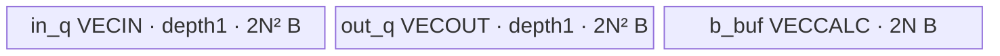
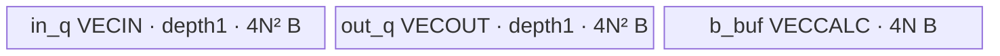

# 单位三角矩阵求逆 A3 Direct Invoke 算子知识

## 算子速览

| 项目 | 内容 |
|---|---|
| 实际入口 | `torch.ops.npu.triangular_inverse` → `sglang::npu_kernel::tri_inv_col_sweep`；独立 Direct Invoke |
| 计算语义 | 单位对角物理三角矩阵的列扫逆；不执行对角除法 |
| 输入输出 | 最后两轴 N×N，前缀合并为 B 个矩阵；FP16/FP32，新 `empty_like` 输出；Device 使用平坦地址 |
| 执行类型 | 单 AIV_VECTOR；`run_tri_inv_col_sweep` 仅在 ASCEND_IS_AIV 执行，无 Cube |
| Kernel 路线 | R-001 half，R-002 float；各自单 Kernel，无跨节点边 |
| 核心资源 | 两个 depth1 矩阵 Queue 与一个 N 元素 b TBuf；每核 `(2N²+N)*sizeof(T)` UB，32B GM tiling，无算法 workspace |
| 来源闭包 | direct_implementation_closed：Torch schema、Host、POD、typed entry、完整 body、launcher 及活动构建接线 |
| 验证状态 | draft；本次知识提取未执行编译、真机、数值或性能测试；活动脚本明确过滤专属 flaky/broken 测试 |

## 接口与语义

### 计算语义

以实际物理行 `P[k,i]=input_flat[k*N+i]` 定义矩阵，不把 Torch stride 自动解释为 Device stride。每输出列扫 j 先置 b=e_j，再按 k=N−1…0 执行 `x[k]=b[k]`，及 `b[i]←b[i]−P[k,i]*x[k]`（0≤i<k）；结果写在 `output_flat[j*N+k]`。

由该地址与递推可推导：物理 P 为行主序单位下三角时，物理行主序输出为 P 的逆；等价地，把输入解释为列主序单位上三角 U=Pᵀ，输出列主序 U 的逆。源码注释的 upper triangular 使用后一种视角。只有严格下三角物理元素参与 Axpy，输入对角不被除或校验，另一三角也不参与。它不是任意对角三角矩阵求逆；例如物理2I被递推当作I处理，这是源码推导，非本次数值实验。

Host 使用原 `data_ptr`，不传 strides、不执行 contiguous。`empty_like` 和 `.npu()` 如何保留转置 view 的物理布局属于未固定的框架边界，不能由测试中 transpose 语句推断任意非连续 Tensor 都满足数学合同。

### 输入、输出与属性

| 参数 | shape/layout | dtype | 约束、默认值与语义 |
|---|---|---|---|
| tensor/x | [...,N,N] | FP16或FP32 | rank≥2，Host检查末两轴相等；README限定N=16/32/64/128，物理布局/单位对角由caller保证 |
| 返回Tensor | empty_like(x) | 与x一致 | 无caller输出参数；Device平坦写B*N²元素，不使用输出stride |
| 属性 | 无 | 无 | 无scale/transpose/一般对角模式，无fallback |

### 入口与版本

固定dda6源码的公开Torch入口，不是ACLNN pair。schema绑定手写Host，A3_ONLY集合将Host、Device与PrivateUse1注册接线；本卡冻结A3。CANN9.1来自实际CI容器→prepare脚本→legacy整体构建配置，并非本次编译成功。950默认A3集合不编入，不能凭通用模板存在外推950。既有[旧版GDN分块与mega集成](../../../../guides/integration/sgl_kernel_npu/sgl_legacy_gdn_chunk_mega.md)保留调用侧上下文，本卡闭合独立求逆实现。

## Host/Launcher 执行流程

### 参数校验与前处理

顺序为：取dtype；rank<2抛错；将末轴先窄化uint32得到N，再与倒数第二轴比较，不等抛错；numel窄化uint32得到E；B=E/(N*N)；分配empty_like输出；生成tiling并复制到current NPU；最后half/float分发，其他dtype此时才抛错。没有N非零、README尺寸白名单、积/窄化溢出、正batch、连续性、device类型/一致性、单位对角或三角值检查。N=0在Host除法前没有保护；大shape也不能从rank检查推出安全可表示。

### 参数、Workspace 与生命周期

`TriInvColumnSweepTiling{B,E,N}`普通ABI为12B，calc_tiling分配32B CPU byte Tensor，只写三个u32，20B尾部不初始化；pin_memory后异步 `.to(current NPU, non_blocking=true, copy=true)`。entry只标量读取12B，未初始化尾部不参与算法。无GetLibApiWorkSpaceSize或额外算法workspace。

EXEC_KERNEL_CMD取得current stream，把Tensor转换为裸data_ptr并捕获转换后的tuple，交给OpCommand；此Host没有DeviceGuard、显式record_stream或Tensor对象捕获。输入、输出和tiling必须满足匹配Torch NPU异步分配/流生命周期；固定源码不能证明allocator内部实现，也不据此断言必然提前释放。current设备须与张量/tiling一致，CPU输入不会被Host自动迁移。

### 启动图与失败传播


| 节点/边 | producer/entry | 参数与extent | ordering/owner | 失败传播 |
|---|---|---|---|---|
| tiling复制→单Kernel | calc_tiling→typed entry | 32B GM，仅头12B读取 | Torch current-device复制与OpCommand流契约，tiling本地Tensor owner | 框架异常向外传播，非独立核心算子节点 |
| 主节点 | ACLRT_LAUNCH_KERNEL(tri_inv_col_sweep_fp16/fp32) | B blocks，三个GM地址x/y/tiling | caller x、返回y、Host局部tiling；每block独占矩阵 | helper固定返回0，未检查ACLRT返回值；不等于设备完成/成功 |
| 输出 | 单Kernel→caller | E*sizeof(T) | 返回Tensor，读回须遵循外部流同步 | 无后续Kernel、无跨核reduce、无额外cleanup协议 |

## Route 与参数设计

### 分核与资源计算

B=uint32(numel)/(uint32(N)*N)，一block对应一矩阵，不查询或限制为平台AIV核数；Runtime负责实际block调度。Device偏移 `GetBlockIdx()*N²` 与tile_len均uint32。README合法N使所有矩阵和b容量自然32B对齐，不采用tail-core/分块流水。超出白名单的Host可达输入仍走相同body，不能将其称为已支持fallback。

UB半精度分别为N16:1056、32:4160、64:16512、128:65792B；单精度分别2112、8320、33024、131584B。Host没有按可用UB验证或自适应tile；这些容量≤实际平台可用UB是必要条件，不写成源码已经比较的guard。

### Route 选择

| 顺序 | Route | Key/模板 | 精确选择条件与优先级 | 不适用去向 |
|---:|---|---|---|---|
| 1 | R-001 FP16列扫 | dtype==at::kHalf；half | rank/square检查与分配/tiling之后，A3 | 检查float |
| 2 | R-002 FP32列扫 | dtype==at::kFloat；float | 前项不命中且float | Unsupported data type抛错 |

```text
rank不足→throw；N窄化后与倒数第二轴不等→throw
E/B计算→empty_like→32B tiling复制
half→fp16单节点；否则float→fp32单节点；否则throw
Device：仅AIV执行Init→Process，无其他router/key/fallback
```

### 模板/实现执行矩阵

| Route | key/selector | dtype/shape/platform 完整命中条件 | 执行拓扑与 Kernel 节点 | 实际模板/body | 内存与同步特征 | tail/fallback |
|---|---|---|---|---|---|---|
| R-001 | half | A3；Host rank/square通过、E/B计算可完成、dtype half | 单tri_inv_col_sweep_fp16 AIV | run_tri_inv_col_sweep<half>→KernelTriInvColumnSweep<half> | depth1 in/out矩阵+half b；Queue依赖 | README N16/32/64/128；无任意N修复 |
| R-002 | float | 同前，前项不命中且dtype float | 单tri_inv_col_sweep_fp32 AIV | run_tri_inv_col_sweep<float>→KernelTriInvColumnSweep<float> | 相同拓扑但容量翻倍，FP32 b | 无BF16/FP64路径，unsupported抛错 |

### 隐藏性能 Guard

| Guard | Host/Tiling 条件 | Device/资源原因 | 影响 Route | 不满足时去向 | 源码符号 |
|---|---|---|---|---|---|
| 文档N白名单 | Host未执行 | 整矩阵驻UB，DataCopy/向量原语约束 | 两者 | 同body，无fallback保证 | README/Init |
| 单位对角与物理布局 | Host无检查 | x[k]直接取b[k]，A_k为flat row | 两者 | 结果不具一般求逆语义 | InvertMatrix |
| uint32范围/N>0 | Host无显式guard | E/N²/block偏移窄化、除法 | 两者 | 未定义合法域，不保证安全拒绝 | tri_inv_col_sweep |
| 可用UB | 未查询/比较 | (2N²+N)*e容量 | 两者 | 无较小tile重试 | Init |
| dtype | Half/Float分支 | typed entry与local dtype | 各自 | 其他dtype抛错 | Host |

### POD/ABI

| 结构 | 字段 | 类型/位宽 | ABI 布局 | 单位 | Host/launcher producer | Device consumer | 边界 |
|---|---|---|---|---|---|---|---|
| TriInvColumnSweepTiling | num_blocks | uint32/32 | offset0；结构sizeof12/align4 | blocks | E/(N*N)，写tiling.num_blocks | entry复制但body不读该字段；launch直接用Host B | inactive，不能当Device限界保护 |
| 同上 | num_elems | uint32/32 | offset4 | T元素 | uint32(tensor.numel()) | entry→vec_len_→GM SetGlobalBuffer | 窄化前无范围检查 |
| 同上 | matrix_size | uint32/32 | offset8 | 边长元素 | uint32(tensor.size(-1)) | entry→matrix_size_/tile_len_/j,k循环 | N²可溢出，Device转int32循环 |

该布局由三个连续u32按普通C++ ABI推导，非本次编译测量；Host与Device引用同一header，32B运输不改变12B结构。生成ACLRT三地址的封送ABI属于外部stub，不虚构offset。

### Route 源码闭包

| Route | Key/selector | Host/Tiling producer | POD/参数 | Kernel entry/router 节点 | Kernel body/直接依赖 | 构建接线 |
|---|---|---|---|---|---|---|
| R-001 | Half | tri_inv.cpp::tri_inv_col_sweep/calc_tiling | 三u32+三GM地址 | tri_inv_kernel.cpp::tri_inv_col_sweep_fp16 | kernel_tri_inv.h::<half>::Init/Process/InvertMatrix/GetTilingData | legacy_kernels.cmake A3_ONLY；pytorch_extensions PrivateUse1 |
| R-002 | Float | 同一Host实际else-if | 同布局 | tri_inv_col_sweep_fp32 | 同文件完整<float>实例 | 同target中的第二entry |

## Kernel 实现

### 公共执行流程

两typed entry复制POD三个u32，run函数仅AIV实例化TPipe与类。Init绑定两GM全E长度并分配三个UB区。Process整矩阵CopyIn→输入Queue EnQue；InvertMatrix DeQue输入、Alloc输出、输出全零；逐j重用b并倒序k求解；输出EnQue、输入Free；Process输出DeQue→整矩阵CopyOut→Free。无跨核/跨Kernel共享临时状态或workspace；不添加源码不存在的显式event号，Queue与AscendC原语编译同步是明确primitive边界。

### Route R-001：half单位三角列扫

#### 适用条件

##### 选择证据

| 层级 | 文件 | 符号 | 源码谓词/参数 | 结果/下一跳 |
|---|---|---|---|---|
| Host | csrc/tri_inv/op_host/tri_inv.cpp | tri_inv_col_sweep | dtype==at::kHalf | tri_inv_col_sweep_fp16，blockDim=B |
| entry | csrc/tri_inv/op_kernel/tri_inv_kernel.cpp | tri_inv_col_sweep_fp16 | 读取E,N | run_tri_inv_col_sweep<half> |
| body | csrc/tri_inv/op_kernel/kernel_tri_inv.h | run_tri_inv_col_sweep | ASCEND_IS_AIV | Init→Process；非AIV无计算 |

#### Device 数据流

##### 函数级调用链

```text
Host tri_inv_col_sweep→EXEC_KERNEL_CMD(tri_inv_col_sweep_fp16, B, x,y,tiling)
 →entry→GetTilingData(3*u32)→run_tri_inv_col_sweep<half>
 →KernelTriInvColumnSweep<half>::Init
 →Process: Alloc input→DataCopy→EnQue
   →InvertMatrix: DeQue input→Alloc output→Duplicate output
     →j loop: Duplicate b→SetValue(j,1)→k descending: SetValue x / Axpy prefix
     →EnQue output→Free input
 →DeQue output→DataCopy GM→Free output
```

##### 源码等价伪码

```text
伪码；每个block c独占完整矩阵；T=half，e=2B
N=tiling.matrix_size；off=uint32(c*N*N)
in=Alloc(inQ)；DataCopy(in,x[off],N*N)；EnQue(inQ,in)
in=DeQue(inQ)；out=Alloc(outQ)；Duplicate<T>(out,0,N*N)
b=Get(b_buf)
for j=0..int32(N)-1:
    Duplicate<T>(b,0,N)；b[j]=T(1)
    xcol=out[j*N:]
    for k=int32(N)-1 downto0:
        A_k=in[k*N:]
        xcol[k]=b[k]                         # 不读取/除对角
        if k>0:
            neg=float(-float(xcol[k]))
            Axpy<T>(b,A_k,T(neg),k)          # 只更新b[0:k]，count是元素数
EnQue(outQ,out)；Free(inQ,in)
out=DeQue(outQ)；DataCopy(y[off],out,N*N)；Free(outQ,out)
```

#### 内存与数据搬运

##### 资源与搬运表

| 层级/缓冲区 | offset/地址公式 | extent/容量公式 | dtype/layout | producer | consumer | owner/lifetime | 对齐/复用 |
|---|---|---|---|---|---|---|---|
| GM x/y | c*N² | 每block N²元素；全局E | half flat物理矩阵 | caller/Kernel | CopyIn/caller | 输入/返回Tensor，异步流保活 | 不用Torch stride，无输入输出alias |
| GM tiling | 0 | 分配32B、实际读12B | 3*u32 | calc_tiling | GetTilingData | Host局部Device Tensor | 后20B不读 |
| in_q VECIN | local0 | depth1*N²*2B | half | MTE2 | 全j的Axpy source | Alloc→EnQue→DeQue→Free | 每矩阵仅载一次 |
| out_q VECOUT | local0；j*N+k | depth1*N²*2B | half | Duplicate/SetValue | MTE3 | Alloc→EnQue→DeQue→Free | xcol直接alias输出行 |
| b_buf VECCALC | local0 | N*2B | half | 每j Duplicate/SetValue/Axpy | 倒序k标量读与下一Axpy | 此Kernel所有j复用 | 不与in/out物理alias |
| 临时scalar | k,j,x_k | 源码不能给寄存器精确容量 | int32/float/half | loop/GetValue | SetValue/Axpy | 单迭代 | 不是GMworkspace |

DataCopy采用(count=N²)元素接口，无strided DMA或DataCopyPad；文档尺寸使两端整32B，不据此宣称任意N尾块也有效。

##### 分层内存布局



##### 字节账与复用顺序

```text
UB_total = 2N² + 2N² + 2N = 2*(2N²+N) bytes
N=128 → 65792B
dynamic_ub=N/A；算法workspace_total=0；GM tiling=32B（不当额外UB）
必要条件 UB_total<=实际可用UB；Host未查询该上限
```

| 复用子区 | 写入者 | 读取者/消费点 | 下一次覆盖 | 同步或释放依据 | 安全条件 |
|---|---|---|---|---|---|
| 整矩阵in_q | CopyIn | 全部j/k Axpy | 本block不再CopyIn | DeQue后直到InvertMatrix末Free | 不能按每j提前Free |
| b_buf整N元素 | j初始化及当前Axpy | 当前/后续k | 下一j Duplicate | 同Vector/scalar原语依赖由匹配编译器处理 | 同j必须保持倒序k与prefix更新 |
| out_q[j*N:] | x.SetValue | 本列后续scalar读及最终MTE3 | 不再覆盖已完成j | EnQue/DeQue后MTE3，完成再Free | 不加一般stride，所有列共用同一矩阵分配 |

#### 同步、精度与尾块

##### 同步与数值边界表

| 阶段 | primitive/机制 | producer | consumer/等待点 | 保护对象 | 精度/尾块 |
|---|---|---|---|---|---|
| CopyIn→compute | in_q EnQue/DeQue | MTE2 | InvertMatrix | 整输入矩阵 | 原half，无Cast |
| 每j初始化 | Duplicate + SetValue | Vector/scalar | 倒序k | b与out | 0/1按half存储 |
| 前缀消元 | Axpy<half>(b,A_k,T(x_k),k) | 本次b/x[k] | 下一k读取b[k−1] | b[0:k] | x先转float取负再转half；b本身仍half，不宣称FP32内部累加或具体FMA舍入 |
| k=0 | if(k>0)跳过Axpy | 最后标量写 | 列完成 | x[0] | 无零count Axpy |
| Compute→CopyOut | out_q EnQue/DeQue | 全部j | MTE3 | 整输出矩阵 | 无输出尾tile/降精度步骤 |
| copy完成复用 | out_q FreeTensor | MTE3 | TPipe结束 | out_q | 无人为跨核barrier |

#### 关键实现

##### 符号证据表

| 阶段 | 文件 | 符号/模板实例 | 实现事实 |
|---|---|---|---|
| Host/Tiling producer | csrc/tri_inv/op_host/tri_inv.cpp | tri_inv_col_sweep/calc_tiling | dtype、B/E/N、32B参数运输 |
| Kernel entry/router | csrc/tri_inv/op_kernel/tri_inv_kernel.cpp | tri_inv_col_sweep_fp16 | 三地址、三u32→half实例 |
| Device body/helper | csrc/tri_inv/op_kernel/kernel_tri_inv.h | KernelTriInvColumnSweep<half>::Init/Process/InvertMatrix | 三UB、整矩阵Copy、j/k/Axpy前缀 |

### Route R-002：float单位三角列扫

#### 适用条件

##### 选择证据

| 层级 | 文件 | 符号 | 源码谓词/参数 | 结果/下一跳 |
|---|---|---|---|---|
| Host | csrc/tri_inv/op_host/tri_inv.cpp | tri_inv_col_sweep | dtype==at::kFloat（Half分支之后） | tri_inv_col_sweep_fp32，blockDim=B |
| entry | csrc/tri_inv/op_kernel/tri_inv_kernel.cpp | tri_inv_col_sweep_fp32 | 读取E,N | run_tri_inv_col_sweep<float> |
| body | csrc/tri_inv/op_kernel/kernel_tri_inv.h | run_tri_inv_col_sweep | ASCEND_IS_AIV | Init→Process；非AIV无计算 |

#### Device 数据流

##### 函数级调用链

```text
Host tri_inv_col_sweep→EXEC_KERNEL_CMD(tri_inv_col_sweep_fp32, B, x,y,tiling)
 →entry→GetTilingData(3*u32)→run_tri_inv_col_sweep<float>
 →KernelTriInvColumnSweep<float>::Init
 →Process: Alloc input→DataCopy→EnQue
   →InvertMatrix: DeQue input→Alloc output→Duplicate output
     →j loop: Duplicate b→SetValue(j,1)→k descending: SetValue x / Axpy prefix
     →EnQue output→Free input
 →DeQue output→DataCopy GM→Free output
```

##### 源码等价伪码

```text
伪码；每个block c独占完整矩阵；T=float，e=4B
N=tiling.matrix_size；off=uint32(c*N*N)
in=Alloc(inQ)；DataCopy(in,x[off],N*N)；EnQue(inQ,in)
in=DeQue(inQ)；out=Alloc(outQ)；Duplicate<T>(out,0,N*N)
b=Get(b_buf)
for j=0..int32(N)-1:
    Duplicate<T>(b,0,N)；b[j]=T(1)
    xcol=out[j*N:]
    for k=int32(N)-1 downto0:
        A_k=in[k*N:]
        xcol[k]=b[k]                         # 不读取/除对角
        if k>0:
            neg=float(-float(xcol[k]))
            Axpy<T>(b,A_k,T(neg),k)          # 只更新b[0:k]，count是元素数
EnQue(outQ,out)；Free(inQ,in)
out=DeQue(outQ)；DataCopy(y[off],out,N*N)；Free(outQ,out)
```

#### 内存与数据搬运

##### 资源与搬运表

| 层级/缓冲区 | offset/地址公式 | extent/容量公式 | dtype/layout | producer | consumer | owner/lifetime | 对齐/复用 |
|---|---|---|---|---|---|---|---|
| GM x/y | c*N² | 每block N²元素；全局E | float flat物理矩阵 | caller/Kernel | CopyIn/caller | 输入/返回Tensor，异步流保活 | 不用Torch stride，无输入输出alias |
| GM tiling | 0 | 分配32B、实际读12B | 3*u32 | calc_tiling | GetTilingData | Host局部Device Tensor | 后20B不读 |
| in_q VECIN | local0 | depth1*N²*4B | float | MTE2 | 全j的Axpy source | Alloc→EnQue→DeQue→Free | 每矩阵仅载一次 |
| out_q VECOUT | local0；j*N+k | depth1*N²*4B | float | Duplicate/SetValue | MTE3 | Alloc→EnQue→DeQue→Free | xcol直接alias输出行 |
| b_buf VECCALC | local0 | N*4B | float | 每j Duplicate/SetValue/Axpy | 倒序k标量读与下一Axpy | 此Kernel所有j复用 | 不与in/out物理alias |
| 临时scalar | k,j,x_k | 源码不能给寄存器精确容量 | int32/float/float | loop/GetValue | SetValue/Axpy | 单迭代 | 不是GMworkspace |

DataCopy采用(count=N²)元素接口，无strided DMA或DataCopyPad；文档尺寸使两端整32B，不据此宣称任意N尾块也有效。

##### 分层内存布局



##### 字节账与复用顺序

```text
UB_total = 4N² + 4N² + 4N = 4*(2N²+N) bytes
N=128 → 131584B
dynamic_ub=N/A；算法workspace_total=0；GM tiling=32B（不当额外UB）
必要条件 UB_total<=实际可用UB；Host未查询该上限
```

| 复用子区 | 写入者 | 读取者/消费点 | 下一次覆盖 | 同步或释放依据 | 安全条件 |
|---|---|---|---|---|---|
| 整矩阵in_q | CopyIn | 全部j/k Axpy | 本block不再CopyIn | DeQue后直到InvertMatrix末Free | 不能按每j提前Free |
| b_buf整N元素 | j初始化及当前Axpy | 当前/后续k | 下一j Duplicate | 同Vector/scalar原语依赖由匹配编译器处理 | 同j必须保持倒序k与prefix更新 |
| out_q[j*N:] | x.SetValue | 本列后续scalar读及最终MTE3 | 不再覆盖已完成j | EnQue/DeQue后MTE3，完成再Free | 不加一般stride，所有列共用同一矩阵分配 |

#### 同步、精度与尾块

##### 同步与数值边界表

| 阶段 | primitive/机制 | producer | consumer/等待点 | 保护对象 | 精度/尾块 |
|---|---|---|---|---|---|
| CopyIn→compute | in_q EnQue/DeQue | MTE2 | InvertMatrix | 整输入矩阵 | 原float，无Cast |
| 每j初始化 | Duplicate + SetValue | Vector/scalar | 倒序k | b与out | 0/1按float存储 |
| 前缀消元 | Axpy<float>(b,A_k,T(x_k),k) | 本次b/x[k] | 下一k读取b[k−1] | b[0:k] | x先转float取负再转float；b本身仍float，不宣称FP32内部累加或具体FMA舍入 |
| k=0 | if(k>0)跳过Axpy | 最后标量写 | 列完成 | x[0] | 无零count Axpy |
| Compute→CopyOut | out_q EnQue/DeQue | 全部j | MTE3 | 整输出矩阵 | 无输出尾tile/降精度步骤 |
| copy完成复用 | out_q FreeTensor | MTE3 | TPipe结束 | out_q | 无人为跨核barrier |

#### 关键实现

##### 符号证据表

| 阶段 | 文件 | 符号/模板实例 | 实现事实 |
|---|---|---|---|
| Host/Tiling producer | csrc/tri_inv/op_host/tri_inv.cpp | tri_inv_col_sweep/calc_tiling | dtype、B/E/N、32B参数运输 |
| Kernel entry/router | csrc/tri_inv/op_kernel/tri_inv_kernel.cpp | tri_inv_col_sweep_fp32 | 三地址、三u32→float实例 |
| Device body/helper | csrc/tri_inv/op_kernel/kernel_tri_inv.h | KernelTriInvColumnSweep<float>::Init/Process/InvertMatrix | 三UB、整矩阵Copy、j/k/Axpy前缀 |

## 算子特定优化

### Trick T-001：单位对角省除法与前缀Axpy消元

#### 触发与源码依据

- 适用R-001/R-002，物理单位三角合同，k从N−1递减。
- Golden来源：[直接写x与count=k的Axpy](https://github.com/sgl-project/sgl-kernel-npu/blob/dda6d36b0cdb4081e102d14c0a2fb276fc416e69/csrc/tri_inv/op_kernel/kernel_tri_inv.h#L110-L123)。

**官方源码（固定Commit连续逐字摘录）**：

```cpp
            // Ax=b
            LocalTensor<T> x = vec_out_lt[j * n_rows];
            for (int32_t k = n_rows - 1; k >= 0; k--) {
                const LocalTensor<T> A_k = vec_in_lt[k * n_rows];

                // x[k] = b[k] / A[k, k]
                x.SetValue(k, b.GetValue(k));

                if (k > 0) {
                    // b[:k] -= A[:k, k] * x[k]
                    const float x_k = -static_cast<float>(x.GetValue(k));
                    AscendC::Axpy<T>(b, A_k, static_cast<T>(x_k), k);
                }
            }
```

#### 机制与设计原因

单位对角令x[k]直接取b[k]，无需Div；只对仍待求解的前缀0..k−1做Axpy，count=k不是固定整N。A_k固定指向物理输入第k行，b为同一TBuf原地更新，x直接落在输出Queue。float临时负号并没有将half b升格为全程FP32。不同k的数据依赖决定倒序，不能并行改写为无依赖独立行运算。

#### 迁移边界

- 适用：同物理布局的单位三角系统，N处于文档合法域。
- 前提：匹配AscendC Axpy count、dtype和Vector/scalar依赖语义。
- 失效：一般对角必须新增除法/校验和相应数值边界，当前实现无此Route。
- 未验证：本次知识提取未执行编译、真机、数值或性能测试。

#### 错误做法

固定仓未提供可验证运行反例；源码直接忽略输入对角，不能将注释中的`/ A[k,k]`当作真实执行。物理2I静态推导表明一般求逆合同不成立，不冒称已测失败。

### Trick T-002：整矩阵驻留与b跨列复用

#### 触发与源码依据

- 适用两Route，整矩阵和N元素b可以同时容纳于UB。
- Golden来源：[三个真实缓冲分配](https://github.com/sgl-project/sgl-kernel-npu/blob/dda6d36b0cdb4081e102d14c0a2fb276fc416e69/csrc/tri_inv/op_kernel/kernel_tri_inv.h#L62-L64)。

**官方源码（固定Commit连续逐字摘录）**：

```cpp
        pipe_.InitBuffer(in_q_, BUFFER_NUM, tile_len_ * sizeof(T));
        pipe_.InitBuffer(out_q_, BUFFER_NUM, tile_len_ * sizeof(T));
        pipe_.InitBuffer(b_buf_, matrix_size_ * sizeof(T));
```

#### 机制与设计原因

每block整矩阵只CopyIn一次，所有j复用同输入；输出直接分配在out_q，b只用N元素并在每j清零重建e_j，不物化N×N RHS或逐列GM中间结果。depth1意味着没有双缓冲搬运交叠保证；减少物化与同步结构由源码可见，吞吐收益未测。

#### 迁移边界

- 适用：小矩阵列扫，一block一矩阵。
- 前提：完整UB `(2N²+N)*e` 与32B搬运条件，不能只算输入矩阵。
- 失效：更大N须重新分块/算法设计，Host无UB不足fallback。
- 未验证：本次知识提取未执行编译、真机、数值或性能测试。

#### 错误做法

固定仓未提供可验证反例；不能把depth1记为双缓冲，也不能因b跨列复用就扣掉其真实N*e占用。

## 模板与实现对比

| 对比维度 | R-001 half | R-002 float | 设计选择依据 |
|---|---|---|---|
| 命中条件/优先级 | dtype Half先检查 | Float后检查 | 其他dtype分配后抛错 |
| 模板与 dtype | KernelTriInvColumnSweep<half> | <float> | 同一算法的两typed entry |
| 循环与分核 | B blocks；每核j×倒序k | 相同 | 无平台核数selector |
| Queue/TBuf/寄存器/dynamic UB/通信 window | 两depth1 Queue+b TBuf | 相同三分配 | 无dynamic UB/通信 |
| 内存总占用与复用 | 2*(2N²+N)B | 4*(2N²+N)B | float预算两倍 |
| 搬运/Vector/SIMT/NDDMA/通信 API | DataCopy/Duplicate/half Axpy | float同族 | 无SIMT/NDDMA/Cube |
| 同步、精度与 tail | half b/标量回cast | float b | 不指定primitive内部舍入 |
| fallback/失败边界 | 无一般N/对角fallback | 相同 | Host实际弱guard须保留 |

## 平台差异

| 项目 | A2 | A3 | Ascend 950 |
|---|---|---|---|
| 支持状态 | 默认arch22接线信号，本卡未冻结产品范围 | A3_ONLY活动构建的draft源码范围 | 默认A3集合不编入，不建卡 |
| Host/Launcher | 不外推独立验收 | 两typed entry/当前流 | 不以源文件存在证明支持 |
| Kernel/资源 | 未单独确认 | AIV分支、整矩阵UB | 无950资源/公开支持确认 |

## 限制与失败边界

- N白名单16/32/64/128来自README，Host不检查；非零、32位范围、UB、contiguous、单位对角与物理布局均不能由Host返回推断已经验证。
- input/output不传stride；test先构造lower再NumPy转置、Torch搬运与输出再转置的两个参考路径不能独立证明框架物理布局，不能泛化为自动layout转换功能。
- 专属test定义部分用列扫参考、部分对lower做np.linalg.inv，容差比较未在本次运行；CANN9.1活动run_kernel_tests.sh脚本过滤test_triangular_inverse.py的flaky/broken条目，不写成通过记录。
- `num_blocks`只写入/复制而Device不消费，不能用它保护过量block；Host launch B与E/N²的一致性是唯一实际分核生产。
- 原语内部实现、生成stub、OpCommand/allocator以及Runtime行为是框架边界；没有真实错误码、真机数值/性能证据，不追加verified。

## 源码索引

### 链路索引

| 链路阶段 | 文件 | 关键符号 | 支撑内容 |
|---|---|---|---|
| Host | csrc/tri_inv/op_host/tri_inv.cpp | tri_inv_col_sweep / calc_tiling | dtype分发与12B参数生产 |
| POD | csrc/tri_inv/op_host/tiling_tri_inv.h | TriInvColumnSweepTiling | 三个u32 |
| entry | csrc/tri_inv/op_kernel/tri_inv_kernel.cpp | tri_inv_col_sweep_fp16/fp32 | 两typed启动节点 |
| body | csrc/tri_inv/op_kernel/kernel_tri_inv.h | KernelTriInvColumnSweep | 列扫、UB、同步与实际地址 |
| 约束 | csrc/tri_inv/README.md | matrix sizes | 16/32/64/128与FP16/FP32 |
| 测试定义 | tests/python/sgl_kernel_npu/test_triangular_inverse.py | unit triangular tests | 参考与存储布局边界 |
| Torch注册 | csrc/pytorch_extensions.cpp | triangular_inverse | schema及A3注册 |
| launcher | csrc/utils/torch_helper.h | EXEC_KERNEL_CMD / CopyTensorHostToDevice | current stream与参数owner边界 |
| 声明 | csrc/utils/defines.h | HOST_API | Host可见性 |
| 构建 | cmake/legacy_kernels.cmake | A3_ONLY sources | Host与Device target |
| CI矩阵 | .github/workflows/pr-test-kernels.yml | GDN group | CANN9.1容器与测试筛选定义 |
| CI调用 | .github/workflows/pr-test-kernel-group.yml | prepare step | 活动构建接线 |
| 构建调用 | scripts/prepare_kernel_tests.sh | legacy kernels | 依赖、整体构建与兼容修补，不承担测试过滤 |
| 测试执行 | scripts/run_kernel_tests.sh | CANN9.1过滤分支（186–210行） | flaky/broken清单及test_triangular_inverse.py过滤；本次未执行 |

### 实现复用检查

| 检查项 | 可复用事实 | 不得改变的约束 | 源码符号 |
|---|---|---|---|
| ABI/POD | 12B三u32、32B运输 | offsets0/4/8，num_blocks inactive，尾20B不读 | calc_tiling/GetTilingData |
| 调用顺序 | 校验→E/B→输出/tiling→dtype分发 | current device/stream与异步owner | tri_inv_col_sweep/helper |
| workspace/内存 | 无算法workspace，三UB缓冲 | 完整矩阵双份+b，不能少计Queue深度 | Init |
| 同步 | Queue输入/输出交接 | b跨k依赖与Free时点 | Process/InvertMatrix |
| 精度与尾块 | 单位对角、T类型前缀Axpy | 物理flat layout、倒序k、合法N | InvertMatrix |
| 失败边界 | rank/square/dtype抛错 | 不补造N/stride/device/值域保护或真机通过 | Host/CI |
