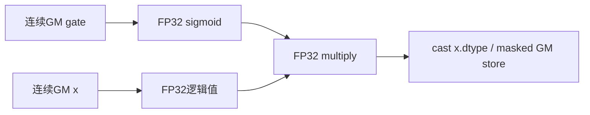

# SGL逐行广播sigmoid门控 A2/A3 Direct Invoke 算子知识

## 算子速览

| 项目 | 内容 |
|---|---|
| 实际入口 | `implementation.triton.activation.fused_sigmoid_mul_broadcast.fused_sigmoid_mul_broadcast`，Direct Invoke |
| 计算语义 | `Y[r,c]=cast_xdtype(float32(X[r,c])*sigmoid(float32(gate[r])))` |
| 输入输出 | x为[N,D]、gate为[N]或[N,1]，N/D为正；输入和gate同dtype；新输出shape/device/dtype同x，不修改输入 |
| 执行类型 | 单Triton Vector节点，无tl.dot、Cube或MIX_CV |
| Kernel 路线 | R-001，_fused_sigmoid_mul_broadcast_kernel；Host无空域提前返回，N/D>0为公开前提，空域提交/零grid行为未承诺 |
| 核心资源 | 连续输入/输出GM，FP32逻辑向量/标量；Triton编译器分配物理UB/寄存器 |
| 来源闭包 | direct_implementation_closed：独立launcher、设备属性helper与完整JIT body；contiguous、分配、JIT lowering/stream为框架边界 |
| 验证状态 | 已完成源码闭包检查；本次知识提取未执行编译、真机、数值或性能测试。 |

## 接口与语义

### 计算语义

`Y[r,c]=cast_xdtype(float32(X[r,c])*sigmoid(float32(gate[r])))`。gate是未过sigmoid的logit；gate=0在有限输入上应得到x/2。显式先把load值转FP32，完成sigmoid和乘法后转回x指针元素类型。源码没有承诺FP32下溢/上溢、NaN/Inf和不同编译器的逐位一致性。

### 输入、输出与属性

| 参数 | shape/layout | dtype | 约束、默认值与语义 |
|---|---|---|---|
| x | x为[N,D]、gate为[N]或[N,1]，N/D为正；输入和gate同dtype；可非连续strided输入 | FP16/BF16/FP32 | 输入所在NPU应为当前设备；不自行切换设备 |
| gate | 见x行约束 | 浮点 | 同NPU；与x同dtype是公开合同 |
| output | 同x shape，新连续分配 | x.dtype | 连续化后empty_like，输入不被覆盖 |

### 入口与版本

只冻结显式Triton实现，公共`auto`与`triton`均调此入口，torch_native是外部Torch复合参考，不在该Direct入口可达图中。旧`activation/fused_sigmoid_mul.py`保留同算法，旧入口自己检查shape，新实现把该检查放在公共wrapper；不能因body复用就把两者检查边界合并。

完整公共合同见[sigmoid门控API](/model/inference/apis/sgl_kernel_npu/sgl_sigmoid_mul.md)。CANN9.1.0是固定快照CI配置背景，文档arch22/arch35经README与architectures映射到A2/A3和950；本卡Frontmatter只覆盖A2/A3，不表示实际运行过CI。

## Host/Launcher 执行流程

### 参数校验与前处理

独立Direct实现先解包x.shape为N/D，因此维数错误会在Python解包失败；它不自行检查gate shape。公共wrapper的_check_inputs另外要求x.ndim==2且gate为[N]或[N,1]，以ValueError拒绝其它形状。

取N/D后连续化x和gate，再empty_like(x)分配连续输出；计算T、查询C和P，提交一个JIT节点。没有空域提前返回，N/D>0是公开前提，不承诺零grid或D=0的行为。

### 参数、Workspace 与生命周期

`get_device_properties`查询torch.npu.current_device的AIC/Vector核数，断言两者>0并用无参cache缓存；本算子只使用Vector核数。跨设备后不会以device index重新缓存，因此调用方应核对当前设备/输入设备。contiguous返回原存储或新连续副本；这些Tensor及新out由Torch/Triton runtime管理异步存活，业务代码没有workspace、executor或手写stream/event。

### 启动图与失败传播

```text
Direct launcher -> contiguous(x/gate) -> empty_like -> shape/grid producer
  -> _fused_sigmoid_mul_broadcast_kernel[(P,)] -> masked load -> FP32 sigmoid/mul -> cast -> masked store
```

N/D正数为前提；没有显式空域旁路。 唯一Device节点无前后kernel交接边、无临时GM分母/门控结果。Python/JIT异常直接传播，无自动后端fallback。Host返回只表示提交返回，不能推导Device完成；真实stream选择及异步allocator协议是外部运行时边界。

## Route 与参数设计

### 分核与资源计算

C为当前设备Vector核数；T=next_power_of_2(D)，P=min(N,C)，grid=(P,)。每program处理r=pid+kP < N，每行一次标量gate load和sigmoid，再处理T列，列mask为c<D。

### Route 选择

| 顺序 | Route | Key/模板 | 精确选择条件与优先级 | 不适用去向 |
|---:|---|---|---|---|
| 1 | R-001 Vector门控 | _fused_sigmoid_mul_broadcast_kernel，constexpr块长 | N>0,D>0且输入符合契约；唯一Device实现 | 非法输入无保底路线，框架可能报错 |

```text
前处理与分核 -> R-001；空域未特判
```

### 模板/实现执行矩阵

| Route | key/selector | dtype/shape/platform 完整命中条件 | 执行拓扑与 Kernel 节点 | 实际模板/body | 内存与同步特征 | tail/fallback |
|---|---|---|---|---|---|---|
| R-001 | 单JIT实例族 | A2/A3；上述输入契约；C>0 | 单Vector节点 | _fused_sigmoid_mul_broadcast_kernel | FP32逻辑中间值；不同program输出域互斥 | mask保护尾部；无fallback |

### 隐藏性能 Guard

| Guard | Host/Tiling 条件 | Device/资源原因 | 影响 Route | 不满足时去向 | 源码符号 |
|---|---|---|---|---|---|
| 连续化 | 两输入.contiguous() | kernel使用线性地址，不读取stride | R-001 | 额外拷贝或框架分配失败 | fused_sigmoid_mul_broadcast |
| 核数 | AIC和Vector核数均>0 | grid的Vector核数来源 | R-001 | helper断言失败 | get_device_properties |
| 分核与尾部 | C为当前设备Vector核数；T=next_power_of_2(D)，P=min(N,C)，grid=(P,)。每program处理r=pid+kP < N，每行一次标量gate load和sigmoid，再处理T列，列mask为c<D。 | 不让program写重叠域或尾部越界 | R-001 | 没有其它调度路线 | launcher/JIT body |
| 资源上界 | 无显式UB检查/selector | 物理资源由JIT分配，源码没有容量公式 | R-001 | 不能给出未证的最大维度或fallback | JIT body |

### POD/ABI

没有自定义C++ POD；以下逐字段列出JIT参数。运行时指针/整数封送的sizeof/alignof/offsetof不在固定仓，constexpr是编译期特化常量；不虚构CANN Tiling结构。

| 结构 | 字段 | 类型/位宽 | ABI 布局 | 单位 | Host/launcher producer | Device consumer | 边界 |
|---|---|---|---|---|---|---|---|
| JIT调用/特化 | out_ptr | 新output数据指针 | 外部JIT ABI，无自定义POD offset | 指针为元素地址，维度/块长为元素数 | empty_like(x) | store(out+rD+c) | 符合公开shape和值域；constexpr不作为运行时POD字段 |
| JIT调用/特化 | gate_ptr | gate数据指针 | 外部JIT ABI，无自定义POD offset | 指针为元素地址，维度/块长为元素数 | gate.contiguous() | 每行load(gate+r) | 符合公开shape和值域；constexpr不作为运行时POD字段 |
| JIT调用/特化 | x_ptr | x数据指针 | 外部JIT ABI，无自定义POD offset | 指针为元素地址，维度/块长为元素数 | x.contiguous() | load(x+rD+c) | 符合公开shape和值域；constexpr不作为运行时POD字段 |
| JIT调用/特化 | num_rows | 运行时Python整数，实际封送位宽由JIT决定 | 外部JIT ABI，无自定义POD offset | 指针为元素地址，维度/块长为元素数 | x.shape[0] | 行循环上界 | 符合公开shape和值域；constexpr不作为运行时POD字段 |
| JIT调用/特化 | hidden_dim | tl.constexpr | 外部JIT ABI，无自定义POD offset | 指针为元素地址，维度/块长为元素数 | x.shape[1] | 行stride和列mask | 符合公开shape和值域；constexpr不作为运行时POD字段 |
| JIT调用/特化 | BLOCK_SIZE | tl.constexpr | 外部JIT ABI，无自定义POD offset | 指针为元素地址，维度/块长为元素数 | next_power_of_2(D) | arange(0,T) | 符合公开shape和值域；constexpr不作为运行时POD字段 |

### Route 源码闭包

| Route | Key/selector | Host/Tiling producer | POD/参数 | Kernel entry/router 节点 | Kernel body/直接依赖 | 构建接线 |
|---|---|---|---|---|---|---|
| R-001 | 唯一JIT族 | python/sgl_kernel_npu/sgl_kernel_npu/implementation/triton/activation/fused_sigmoid_mul_broadcast.py::fused_sigmoid_mul_broadcast；设备helper | 上表字段 | _fused_sigmoid_mul_broadcast_kernel[(P,)] | 同文件完整body，外部tl sigmoid/load/store primitive | Python setup find_namespace_packages打包implementation；运行时JIT，不存在独立离线CANN kernel target |

## Kernel 实现

### 公共执行流程

仅R-001，连续化是普通框架前处理。业务算子没有自有TQue/TBuf、跨核atomic、NDDMA或通信节点，不能把Triton逻辑向量改写为虚构的AscendC buffer。

### Route R-001：融合FP32 sigmoid与乘法

#### 适用条件

##### 选择证据

| 层级 | 文件 | 符号 | 源码谓词/参数 | 结果/下一跳 |
|---|---|---|---|---|
| 公共wrapper | python/sgl_kernel_npu/sgl_kernel_npu/operators/activation/fused_sigmoid_mul_broadcast.py | _check_inputs/_triton_impl | 形状检查与显式impl分发 | 选择同名Direct实现 |
| launcher | python/sgl_kernel_npu/sgl_kernel_npu/implementation/triton/activation/fused_sigmoid_mul_broadcast.py | fused_sigmoid_mul_broadcast | P=min(N,C),T=next_power_of_2(D) | 唯一JIT节点 |
| body | python/sgl_kernel_npu/sgl_kernel_npu/implementation/triton/activation/fused_sigmoid_mul_broadcast.py | _fused_sigmoid_mul_broadcast_kernel | r<N且列c<D | 保护有效输出域 |

#### Device 数据流

##### 函数级调用链

```text
fused_sigmoid_mul_broadcast -> get_device_properties -> _fused_sigmoid_mul_broadcast_kernel[(P,)]
  -> grid-stride row loop
    -> tl.load -> to(float32) -> sigmoid -> multiply -> cast(x.dtype) -> tl.store
```

##### 源码等价伪码

```text
for r=pid; r<N; r+=num_programs(0):
  g=fp32(load(gate+r)); s=sigmoid(g)
  cols=arange(0,T); mask=cols<D
  x=fp32(load(x+r*D+cols,mask))
  store(out+r*D+cols,cast_xdtype(x*s),mask)
```

#### 内存与数据搬运

##### 资源与搬运表

| 层级/缓冲区 | offset/地址公式 | extent/容量公式 | dtype/layout | producer | consumer | owner/lifetime | 对齐/复用 |
|---|---|---|---|---|---|---|---|
| GM x/gate | x/out按rD+c线性寻址，gate按r寻址；连续[N,1]与[N]在该地址式下等价。 | 有效输入x=N*D*s_x，gate=N*s_g，输出=N*D*s_x字节；每个逻辑行只显式读取一个gate元素。 | 连续元素；独立输入dtype | 调用者或contiguous副本 | tl.load | Torch Tensor，执行期间有效 | 无显式DMA blockLen/stride |
| GM out | 同x有效域 | x.numel()*s_x字节 | x.dtype连续 | masked store | 调用方 | 新Tensor | 各program写域互斥 |
| FP32逻辑值 | 当前tile/行向量及gate | 逻辑lane按T计，物理UB/寄存器由JIT生成 | FP32，最后cast | load/sigmoid/mul | store | 当前迭代SSA依赖 | 不是显式物理别名证明 |
| workspace | N/A | 0自有临时GM字节 | N/A | N/A | N/A | 不分配 | 不虚构double buffer |

##### 分层内存布局



AIV物理UB布局N/A，实际替代路径为Triton编译器lowering；源码没有InitBuffer/depth/寄存器分配或dynamic UB参数，不伪画block-beta。

##### 字节账与复用顺序

```text
有效输入x=N*D*s_x，gate=N*s_g，输出=N*D*s_x字节；每个逻辑行只显式读取一个gate元素。
自有workspace_total=0 bytes
输入非连续时contiguous可能另外分配各自全量有效字节，连续输入则复用原存储
FP32中间值逻辑计算在当前tile/行内完成，不独立分配GM Tensor
UB_total/dynamic_ub=外部JIT物理资源，不能用T*4逻辑字节冒充实际物理占用
```

| 复用子区 | 写入者 | 读取者/消费点 | 下一次覆盖 | 同步或释放依据 | 安全条件 |
|---|---|---|---|---|---|
| 逻辑局部值 | load/FP32计算 | cast/store | 下一tile/行的新SSA值 | 编译器数据依赖 | 不据此假定具体UB地址别名 |
| 输出有效区 | 本program | 后续调用方 | 本kernel不重复写同一有效元素 | program映射互斥；运行时stream顺序 | grid及mask按源码 |

#### 同步、精度与尾块

##### 同步与数值边界表

| 阶段 | primitive/机制 | producer | consumer/等待点 | 保护对象 | 精度/尾块 |
|---|---|---|---|---|---|
| load/计算/store | SSA依赖，无手写队列/event | tl.load | FP32 sigmoid/mul及store | 当前program逻辑值 | 显式FP32cast后计算，再转x.dtype |
| 跨program | 不相交输出域，无barrier/atomic | 各program | 各自store | 独立tile/行 | 行r<N，列c<D的mask用于x load和store；gate按有效行读取 |
| Host/Device | 外部Torch/Triton stream/runtime | 提交 | 后续消费者 | 输入副本及新输出 | 本文件没有显式完成等待 |

#### 关键实现

##### 符号证据表

| 阶段 | 文件 | 符号/模板实例 | 实现事实 |
|---|---|---|---|
| Host/Tiling producer | python/sgl_kernel_npu/sgl_kernel_npu/implementation/triton/activation/fused_sigmoid_mul_broadcast.py | fused_sigmoid_mul_broadcast | 连续化、输出、grid和constexpr |
| Kernel entry/router | 同文件 | _fused_sigmoid_mul_broadcast_kernel | 唯一Vector JIT body |
| Device body/helper | 同文件及设备helper | load/cast/sigmoid/mul/store；get_device_properties | 实际精度、尾块、program域和属性缓存 |

## 算子特定优化

### Trick T-001：每行一次gate sigmoid并广播到D列

#### 触发与源码依据

- 适用 Route：R-001。
- 触发条件：上述平台/shape/dtype契约与合法C/grid。
- Golden 来源：[固定body连续22至29行](https://github.com/sgl-project/sgl-kernel-npu/blob/dda6d36b0cdb4081e102d14c0a2fb276fc416e69/python/sgl_kernel_npu/sgl_kernel_npu/implementation/triton/activation/fused_sigmoid_mul_broadcast.py#L22-L29)。

**官方源码（固定 Commit 连续逐字摘录）**：

```python
    for row in tl.range(pid, num_rows, num_programs):
        g = tl.load(gate_ptr + row).to(tl.float32)
        g = tl.sigmoid(g)

        offs = tl.arange(0, BLOCK_SIZE)
        mask = offs < hidden_dim
        x = tl.load(x_ptr + row * hidden_dim + offs, mask=mask).to(tl.float32)
        out = x * g
```

#### 机制与设计原因

gate的load和sigmoid在列向量构造前以标量形式执行，D列复用该标量，避免源码中为每个列lane独立读取gate。直接读取gate+r同时接受连续[N]与[N,1]，不需要squeeze或物化N×D gate。T向上补为二次幂，load/store均用c<D保护非二次幂尾列。实际指令与物理搬运仍由编译器决定，不能把逻辑load数直接当总线事务或承诺性能收益。

#### 迁移边界

- 适用：相同门控公式和地址域的推理前向。
- 前提：输入/设备契约、连续化所有权、编译资源和目标平台支持成立。
- 失效：任意广播、其它gate定义、未满足dtype/shape或资源约束时需要其它实现；当前Direct入口不自动改选Torch参考。
- 未验证：本次知识提取未执行编译、真机、数值或性能测试。

#### 错误做法

固定仓未提供可验证反例。不能省略实际连续化后仍使用同一线性地址式，或把gate当已过sigmoid的权重；不能把CPU/框架参考的成本当该融合Device节点的性能。

## 模板与实现对比

| 对比维度 | R-001 | 设计选择依据 |
|---|---|---|
| 命中条件/优先级 | 唯一显式Triton实现 | auto不提供失败回退 |
| 模板与 dtype | constexpr块长，FP32中间计算 | 输出cast到x.dtype |
| 循环与分核 | C为当前设备Vector核数；T=next_power_of_2(D)，P=min(N,C)，grid=(P,)。每program处理r=pid+kP < N，每行一次标量gate load和sigmoid，再处理T列，列mask为c<D。 | 按Vector核数限制program数 |
| Queue/TBuf/寄存器/dynamic UB/通信 window | 物理资源由JIT安排 | 无源码可证明的显式buffer/depth |
| 内存总占用与复用 | 新输出+可能的连续副本，自有workspace0 | 不物化独立门控结果 |
| 搬运/Vector/SIMT/NDDMA/通信 API | masked load、sigmoid、multiply、masked store | 无Cube/SIMT/通信节点 |
| 同步、精度与 tail | SSA、FP32、有效域mask | 不需要跨program归约 |
| fallback/失败边界 | 公开要求N/D>0；其余异常直接传播 | 不把参考分发当自动fallback |

## 平台差异

| 项目 | A2 | A3 | Ascend 950 |
|---|---|---|---|
| 支持状态 | 文档arch22支持 | 文档arch22支持 | 文档arch35支持 |
| Host/Launcher | 同Python body | 同Python body | 同Python body |
| Kernel/资源 | C来自设备查询 | C来自设备查询 | C来自设备查询；物理分配仍由对应编译器生成 |

本卡只覆盖A2/A3；另一个平台分组见[950源码卡](sgl_fused_sigmoid_mul_broadcast_950.md)。不以CI配置替代实测。

## 限制与失败边界

- 独立实现与公共wrapper的校验边界不同；独立Direct实现先解包x.shape为N/D，因此维数错误会在Python解包失败；它不自行检查gate shape。公共wrapper的_check_inputs另外要求x.ndim==2且gate为[N]或[N,1]，以ValueError拒绝其它形状。
- N/D必须为正；D向上补二次幂不意味着已证明任意大D可编译或容纳资源。
- 当前设备须与输入一致，设备helper为无参缓存；源码未逐次检查dtype/layout/device，不将前提误写为Host已验证。
- sigmoid的具体指令、物理UB/寄存器、JIT封送ABI与异步提交细节是未展开的编译器/runtime边界；没有物理容量或性能保证。
- 本次知识提取未执行编译、真机、数值或性能测试；不提供推测的收益百分比或verified事件。

## 源码索引

### 链路索引

| 链路阶段 | 文件 | 关键符号 | 支撑内容 |
|---|---|---|---|
| 入口声明/约束 | docs/api/en/operators/activation/fused_sigmoid_mul_broadcast.md | Hardware support/参数 | 产品/输入契约 |
| 入口实现 | python/sgl_kernel_npu/sgl_kernel_npu/operators/activation/fused_sigmoid_mul_broadcast.py | _check_inputs/_triton_impl/fused_sigmoid_mul_broadcast | 公共分发与校验边界 |
| Host/Tiling/Launcher | python/sgl_kernel_npu/sgl_kernel_npu/implementation/triton/activation/fused_sigmoid_mul_broadcast.py | fused_sigmoid_mul_broadcast | 分配、连续化和参数生产 |
| Kernel entry/body | python/sgl_kernel_npu/sgl_kernel_npu/implementation/triton/activation/fused_sigmoid_mul_broadcast.py | _fused_sigmoid_mul_broadcast_kernel | 完整JIT循环、精度和mask |
| 公共helper | python/sgl_kernel_npu/sgl_kernel_npu/implementation/triton/utils/triton_utils.py | get_device_properties | 当前设备属性与缓存 |
| 旧入口对照 | python/sgl_kernel_npu/sgl_kernel_npu/activation/fused_sigmoid_mul.py | fused_sigmoid_mul_broadcast/_fused_sigmoid_mul_broadcast_kernel | 同算法旧入口检查位置不同 |
| 构建接线 | python/sgl_kernel_npu/setup.py | find_namespace_packages | Python包随wheel提供，运行时JIT |
| 平台映射 | python/sgl_kernel_npu/README.md | architecture mapping | A2/A3/950与arch代际 |
| 架构表 | csrc/cmake/architectures.json | 2201/3510 | compute unit映射 |
| 版本背景 | .github/workflows/pr-test-kernels.yml | test-fused-ops | CANN9.1.0配置，未称实际CI结果 |

### 实现复用检查

| 检查项 | 可复用事实 | 不得改变的约束 | 源码符号 |
|---|---|---|---|
| ABI/POD | JIT参数逐字段如上，无自定义POD | 真实指针次序及constexpr参数 | _fused_sigmoid_mul_broadcast_kernel |
| 调用顺序 | 连续化后分配和提交 | 不把Host返回当执行完成 | fused_sigmoid_mul_broadcast |
| workspace/内存 | 无自有临时GM workspace | 输入副本/输出存活到异步完成 | contiguous/empty_like |
| 同步 | program间输出不相交，计算用SSA依赖 | 改域划分后需重新证明互斥 | tl.program_id/num_programs |
| 精度与尾块 | 两输入先FP32，结果回x.dtype | 相同mask/实际门控公式 | load/to/sigmoid/store |
| 失败边界 | 形状检查在wrapper，runtime异常不回退 | 显式Direct调用自行满足前提 | _check_inputs/JIT launcher |
