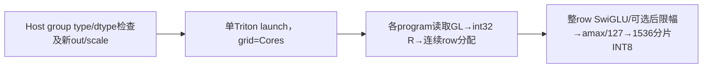
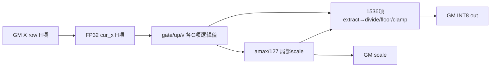

# 旧SwiGLU逐行INT8 A3 Direct Invoke 算子知识

## 算子速览

| 项目 | 内容 |
|---|---|
| 实际入口 | Direct Invoke `sgl_kernel_npu.activation.swiglu_quant.swiglu_quant(...,need_quant=True)`，旧模块无impl分发。 |
| 计算语义 | [gate半区\|up半区]的SwiGLU，do_limit可在SiLU后限幅；每有效row以maxabs/127动态量化INT8，另返回FP32 scale。 |
| 输入输出 | X[S,H]，group_list名义[E] int32/int64；新Q[S,H//2] int8、新scale[S] FP32，仅有效前缀有定义。活动用例X BF16。 |
| 执行类型 | 单Kernel AIV_VECTOR/Triton逐元素+归约，没有tl.dot/Cube/AIC/MIX节点。 |
| Kernel 路线 | R-001/R-002为count分组两限幅实例；R-003/R-004保留cumulative的已知名义越界读取终点及条件化body。 |
| 核心资源 | 输入整row升FP32、两个half的SwiGLU/amax、1536元素量化slice；GM无workspace，物理UB/寄存器分配由Triton编译器决定。 |
| 来源闭包 | direct_implementation_closed：固定旧Host、全部JIT/constexpr/metadata/helper、Python包与活动CI接线已闭合。 |
| 验证状态 | draft：cumulative GL[E]越视图、1536固定slice尾、scale0/非finite和metadata值域未保护；本次未执行编译、真机、数值或性能测试。 |

## 接口与语义

### 计算语义

记C=floor(H/2)，a=X[row,0:C]、u=X[row,C:2C]，全部加载后转FP32。need_quant=True时：
```text
g = a * sigmoid(a)
v = do_limit ? min(g,limit) * max(min(u,limit),−limit) : g*u
s = max(abs(v)) / 127
q = int8(clamp(floor(v/s + 0.5),−128,127))
return q, s
```

限幅在SiLU之后，非对raw gate先clip；与旧MXFP8模块的pre-SiLU clip、SiTU的tanh限幅、OAI的up+1都不是同一数学。floor(x+0.5)在半整数处朝正方向取整，不能用任意round/rint/nearbyint替代。scale为反量化因子s而非127/maxabs；没有epsilon下限，整row v全0时s=0并继续0/0，NaN/Inf转int8结果由primitive/工具链决定，不能补造零输出保证。Host不验finite或limit正值。奇H会只使用前2*C项，最后一项被读入cur_x但不参与结果；公开使用仍应明确偶数拼接布局，不能默默丢特征。

### 输入、输出与属性

| 参数 | shape/layout | dtype | 约束、默认值与语义 |
|---|---|---|---|
| x | Host解包两个shape值[S,H]；Device按连续row-major | 活动用例BF16；源码load后转FP32 | Host无浮点dtype/同设备/连续/偶H/正尺寸断言；不能据缺检查承诺任意dtype/stride可用。 |
| group_list | 名义1D[E]，实际Host只读shape0与dtype | int32/int64，其他ValueError | 必传，None无可用路径；type1值转int32后求和R，不夹到S。 |
| group_list_type | scalar | 0/1 | 非0/1在任何launch前ValueError；0当前读取GL[E]不在名义视图中。 |
| need_quant | 默认True | Python开关 | 本卡仅True；False独立浮点数学不混入本Operator。 |
| do_limit/limit | 默认False/7.0 | Python specialization值 | True对SiLU(gate)做单边上限、up做±limit；无finite/positive检查。 |
| out | 新[S,C] | int8 | 只写0≤row<R的前缀；R>S越分配，R<S后缀empty未初始化。 |
| scale | 新[S] | FP32 | 同有效row写maxabs/127，不与输入别名。 |

### 入口与版本

固定kernel commit dda6d36b0cdb4081e102d14c0a2fb276fc416e69，入口直接导入旧activation.swiglu_quant，未经过新operators.activation或注册后端。相同的swiglu_quant函数名还用于另一旧MXFP8模块，必须保留完整模块名。新[原生分组FP8/MXFP8 API](/model/inference/apis/sgl_kernel_npu/sgl_swiglu_group_quant.md)使用不同输出dtype、scale布局和clamp位置；[通用SwigluQuant手册](/ops/triton/guides/operator_playbooks/quantization__swigluquant.md)覆盖另一来源的static/dynamic、INT4、smooth/offset/group_index等，不替代当前源码的INT8/post-SiLU实现，也不覆盖其已知风险。

固定test_swiglu_quant.py:5确实导入本旧module，两个__main__调用都沿need_quant默认True，分别定义do_limit=False/True、BF16 X[4096,3072]、int64 count group_list的比较。FUSED列表/CI矩阵覆盖A3与950、CANN9.1.0且950不滤此文件；只证明固定配置与测试定义接线，未执行。need_quant=False没有这两用例的覆盖证据，不能借同函数名合并平台/数学范围。准备脚本在TRITON_ASCEND_WHL未覆盖时为CANN9.1选择triton-ascend3.2.2；此处没有下载或执行它。

## Host/Launcher 执行流程

### 参数校验与前处理

先检查group_list_type∈{0,1}，否则ValueError；随后Python解包S,H=x.shape，分配out[S,H//2] int8、scale[S] FP32；num_experts=group_list.shape[0]。group_list.dtype为int64时A=ceil(E/8)*8，int32时A=ceil(E/16)*16，其他ValueError。注释写32-byte alignment，但实际两者取整单元均64B；不复制/填充group_list，count load使用mask，不能把A当实际metadata容量。没有对x或group_list做contiguous/reshape、设备值读取或R的Host同步，所有真实row计数在Device产生。

get_device_properties用无参数functools.cache读取torch.npu.current_device，经Triton driver获取num_aicore/num_vectorcore，二者必须>0；虽然只使用Vector核数，AIC核数断言仍会执行。grid固定为Cores而非min(S,Cores)，调用的真实符号为`_swiglu_quant_kernel`，传全部constexpr与multibuffer=True。无显式num_warps/num_stages，不能凭其他算子默认值补造配置。

### 参数、Workspace 与生命周期

out/scale是Torch新empty，输入只读；R<S的后缀未初始化，R=0全部program可直接return，无Host空输入短路，仍需包与设备属性可用。R>S不被clamp，会读写X/out/scale分配外。每program冗余读取count metadata并转int32，int64计数窄化/求和溢出、负数和维度都没有完整检查。无workspace/executor/跨Kernel临时，仅当前输入和两个新输出，调用方需保持对象至当前流消费结束；跨stream或别名竞争无自有同步。

设备属性cache key不含device，首次成功读取后切换设备不自动刷新；旧helper与新implementation helper的独立cache也不共享。multibuffer=True是Triton编译/调度选项，不是源码声明的两个物理UB buffer，不能从该开关推定字节峰值或复制owner。Python/Triton launcher、allocator、primitive和编译器pipeline是明确框架边界，无外部核心数学算子节点。

### 启动图与失败传播



| 节点/边 | Host/entry | 参数与数据 | ordering、owner与失败 |
|---|---|---|---|
| 唯一K | swiglu_quant→_swiglu_quant_kernel[(Cores,)] | 四指针、11个constexpr，multibuffer=True | 当前Triton调用流；Host ValueError/shape错误/属性assert阻止launch；编译/runtime错误由框架传播，无自有fallback。 |
| row内scale→q | 同program先tl.store scale，再用局部s除v | 新scale[row]4B、Q[row,C] C字节 | s保持局部值，不在第二kernel从GM重读；不需要跨programbarrier。 |
| 累积分组终点 | tl.load(group_list_ptr+E) | 名义1D容量E之外 | 在row范围guard之前读取；无法由R=0或S=0保护，conditional body不代表安全可用路线。 |

Python打包find_namespace_packages包含公共旧activation文件；TargetBuildPy只staging目标provider，并拒绝覆盖已存在common模块，本入口不是target provider重新定义。activation/__init__只默认导出fused_sigmoid，但直接子模块导入仍可定位此文件；包__init__仍导入torch/torch_npu并load本地libsgl_kernel_npu.so，不能宣称它是无需native库的CPU独立reference。此包导入/共享库加载为框架边界，不执行其任何无关算子。

## Route 与参数设计

### 分核与资源计算

Count路线每program取int32 R=sum(GL[0:E])，load tile长A且mask< E；cumulative路线直接读GL[E]。对合法R>0，rows_per_program=(R−1)//Cores+1=ceil(R/Cores)，start=pid*rows_per_program，若start≥R即return，end=min((pid+1)*rows_per_program,R)，for row=start..end−1顺序处理。不同pid写不重叠row；没有grid-stride或row/stride形参，X按row*H，Q按row*C，scale按row，GL按线性指针。R=0退出无写，负/溢出R不构成合法合同。

每row先完整加载H项并转FP32，提取两个C项half，整rowSwiGLU与maxabs之后才按1536量化slice。每个al.extract_slice请求完整1536项；store的col<C mask仅约束GM写回，不缩小slice。C不是1536倍数或C<1536时最后slice在逻辑out向量之外，Host无guard/fallback；具体工具链接受与结果未验证，不能把mask当作安全证明。活动C=1536正好满足完整slice域。整rowtl.arange与非标准slice形状的工具链准入同样按实际固定source/编译器判断，不套用其他后端约束或假称任意H已可编译。

### Route 选择

| 顺序 | Route | Key/模板 | 精确选择条件与优先级 | 不适用去向 |
|---:|---|---|---|---|
| 1 | R-001 Count分组，无限幅 | GROUP_LIST_TYPE=1,DO_LIMIT=false,SCALE=True | need_quant=True；group_list_type=1；do_limit=false；GL dtype int32/int64 | 其他type Host ValueError；限幅开关进入相邻实例 |
| 2 | R-002 Count分组，SiLU后限幅 | GROUP_LIST_TYPE=1,DO_LIMIT=true,SCALE=True | need_quant=True；group_list_type=1；do_limit=true；GL dtype int32/int64 | 其他type Host ValueError；限幅开关进入相邻实例 |
| 3 | R-003 Cumulative越界读取终点，无限幅body | GROUP_LIST_TYPE=0,DO_LIMIT=false,SCALE=True | need_quant=True；group_list_type=0；do_limit=false；GL dtype int32/int64 | 其他type Host ValueError；当前名义GL[E]读取越视图，作为已知失败终点 |
| 4 | R-004 Cumulative越界读取终点，SiLU后限幅body | GROUP_LIST_TYPE=0,DO_LIMIT=true,SCALE=True | need_quant=True；group_list_type=0；do_limit=true；GL dtype int32/int64 | 其他type Host ValueError；当前名义GL[E]读取越视图，作为已知失败终点 |

```text
group_list_type不是0/1 → ValueError
X.shape解包 → empty out/scale → GL首轴E与dtype→A
NPU属性cache/assert → 一次launch
  GROUP_LIST_TYPE1 → masked count sum→R
  GROUP_LIST_TYPE0 → load GL[E]：名义视图越界终点
  条件化：若实际load返回且R合法→row连续分核
    DO_LIMIT false → silu(g)*up
    DO_LIMIT true → min(silu(g),L)*clip(up,±L)
    SCALE true → row maxabs/127→floor(v/s+.5)→clamp INT8
```

### 模板/实现执行矩阵

| Route | key/selector | dtype/shape/platform 完整命中条件 | 执行拓扑与 Kernel 节点 | 实际模板/body | 内存与同步特征 | tail/fallback |
|---|---|---|---|---|---|---|
| R-001 | GL1,DO_LIMIT0,SCALE1 | 本平台CI定义；need_quantTrue；GL1计数R须0..S；x row-major、primitive形状有效 | 单Vector逻辑Triton launch | _swiglu_quant_kernel constexpr specialization | A项masked int32计数tile；FP32整row；局部s；无workspace/barrier | 1536末slice不由store mask保护；无自动fallback |
| R-002 | GL1,DO_LIMIT1,SCALE1 | 本平台CI定义；need_quantTrue；GL1计数R须0..S；x row-major、primitive形状有效 | 单Vector逻辑Triton launch | _swiglu_quant_kernel constexpr specialization | A项masked int32计数tile；FP32整row后限幅；局部s；无workspace/barrier | 1536末slice不由store mask保护；无自动fallback |
| R-003 | GL0,DO_LIMIT0,SCALE1 | 本平台CI定义；need_quantTrue；名义GL0有确定超视图load，后续仅条件化；x row-major、primitive形状有效 | 单Vector逻辑Triton launch | _swiglu_quant_kernel constexpr specialization | GL[E]标量load；FP32整row；局部s；无workspace/barrier | 1536末slice不由store mask保护；无自动fallback |
| R-004 | GL0,DO_LIMIT1,SCALE1 | 本平台CI定义；need_quantTrue；名义GL0有确定超视图load，后续仅条件化；x row-major、primitive形状有效 | 单Vector逻辑Triton launch | _swiglu_quant_kernel constexpr specialization | GL[E]标量load；FP32整row后限幅；局部s；无workspace/barrier | 1536末slice不由store mask保护；无自动fallback |

### 隐藏性能 Guard

| Guard | Host/Tiling 条件 | Device/资源原因 | 影响 Route | 不满足时去向 | 源码符号 |
|---|---|---|---|---|---|
| group type/dtype | type0/1、GL int32/int64 | 编译期读取分支与load宽度 | 全部 | Host ValueError | swiglu_quant |
| count有效域 | Host无R≤S/非负/求和溢出guard | program按R读写前缀 | count | R>S越分配，无fallback | _swiglu_quant_kernel |
| cumulative容量 | Host E=shape0，但body读[E] | 名义E项之外 | cumulative | 已知失败终点；不得当正常支持 | GROUP_LIST_TYPE0 |
| quant slice | C每1536一片，未检查C%1536 | extract先发生，mask仅store | 全部 | 逻辑slice越域，无fallback | al.extract_slice |
| scale0/finite | 没有epsilon/NaN/Inf guard | 除s及int8转换 | 全部 | primitive/工具链边界，不保证零结果 | scale/quant block |
| clip位置 | DO_LIMIT specialization | SiLU后gate单边clip | 限幅Route | 无clip路线；不等于pre-SiLU clip | DO_LIMIT block |
| Device属性 | AIC/AIV>0 assert | grid取Vector核数 | 全部 | assert/异常，cache可能保留首设备值 | get_device_properties |

### POD/ABI

这里没有C++ POD/sizeof/offsetof或手写序列化；四GM指针和以下11个tl.constexpr由Python直接传给Triton，实际指针/标量ABI lowering在编译器边界，不能伪造字节offset。每个字段单独列出。

| 结构 | 字段 | 类型/位宽 | ABI 布局 | 单位 | Host/launcher producer | Device consumer | 边界 |
|---|---|---|---|---|---|---|---|
| Triton launch | x_ptr | GM指针，源Tensor实际dtype | N/A：无C++结构 | [S,H]连续线性行，row*H+col | x | cur_x load后FP32；无Host dtype/device/stride检查 | 以源码参数顺序/constexpr为准，不推造固定sizeof |
| Triton launch | group_list_ptr | GM指针int32/int64 | N/A：无C++结构 | 名义[E]；count或cumulative | group_list | type1 masked sum；type0读取[E]在名义1D视图之外 | 以源码参数顺序/constexpr为准，不推造固定sizeof |
| Triton launch | out_ptr | GM指针int8 | N/A：无C++结构 | row*C+col | empty([S,H//2],int8,x.device) | 有效前缀新输出，未写后缀未初始化 | 以源码参数顺序/constexpr为准，不推造固定sizeof |
| Triton launch | scale_ptr | GM指针FP32 | N/A：无C++结构 | 每row一项 | empty([S],float32,x.device) | amax/127写出；无零scale guard | 以源码参数顺序/constexpr为准，不推造固定sizeof |
| Triton launch | TOTAL_COLS | tl.constexpr Python int | N/A：无C++结构 | 输入元素/row | H=x.shape[1] | tl.arange(0,H)，没有nextPOT或尾mask | 以源码参数顺序/constexpr为准，不推造固定sizeof |
| Triton launch | HALF_COLS | tl.constexpr Python int | N/A：无C++结构 | 输出元素/row | C=H//2 | extract两个半区；奇H最后一项不参与输出 | 以源码参数顺序/constexpr为准，不推造固定sizeof |
| Triton launch | COL_BLOCK_SIZE | tl.constexpr Python int | N/A：无C++结构 | quant slice元素 | 1536 | 完整extract1536；store mask不保护slice范围 | 以源码参数顺序/constexpr为准，不推造固定sizeof |
| Triton launch | NUM_EXPERTS | tl.constexpr Python int | N/A：无C++结构 | 名义首轴E | group_list.shape[0] | type0作为直接索引E；type1 mask< E | 以源码参数顺序/constexpr为准，不推造固定sizeof |
| Triton launch | NUM_EXPERTS_ALGIN | tl.constexpr Python int | N/A：无C++结构 | GL读取tile元素 | int64:ceil(E/8)*8；int32:ceil(E/16)*16 | type1 masked load；两种dtype都按64字节组取整，不是仅32字节 | 以源码参数顺序/constexpr为准，不推造固定sizeof |
| Triton launch | GROUP_LIST_TYPE | tl.constexpr Python值 | N/A：无C++结构 | 枚举 | group_list_type，经0/1 ValueError检查 | 不同Device metadata读取分支 | 以源码参数顺序/constexpr为准，不推造固定sizeof |
| Triton launch | NUM_CORES | tl.constexpr Python int | N/A：无C++结构 | program数 | get_device_properties()[1] | grid=(Cores,)，block_size=(R−1)//Cores+1 | 以源码参数顺序/constexpr为准，不推造固定sizeof |
| Triton launch | DTYPE_MAX | tl.constexpr int | N/A：无C++结构 | INT8正范围 | 127 | scale=maxabs/127 | 以源码参数顺序/constexpr为准，不推造固定sizeof |
| Triton launch | SCALE | tl.constexpr bool | N/A：无C++结构 | 量化开关 | need_quant=True，本数学冻结True | 只提取True；False为另一独立数学 | 以源码参数顺序/constexpr为准，不推造固定sizeof |
| Triton launch | DO_LIMIT | tl.constexpr Python值 | N/A：无C++结构 | 限幅开关 | do_limit，默认False | if DO_LIMIT specialization | 以源码参数顺序/constexpr为准，不推造固定sizeof |
| Triton launch | LIMIT | tl.constexpr Python标量 | N/A：无C++结构 | 激活值 | limit，默认7.0 | SiLU(gate)上限、up双边限幅；Host不验finite/正值 | 以源码参数顺序/constexpr为准，不推造固定sizeof |

### Route 源码闭包

| Route | Key/selector | Host/Tiling producer | POD/参数 | Kernel entry/router 节点 | Kernel body/直接依赖 | 构建接线 |
|---|---|---|---|---|---|---|
| R-001 | GL1,DO_LIMIT0,SCALE1 | activation/swiglu_quant.py::swiglu_quant | 四指针+11constexpr；utils/triton_utils.py属性 | _swiglu_quant_kernel[(Cores,)] | 同文件完整metadata/row/SwiGLU/maxabs/1536片body；al/tl primitives | setup公共Python包；test_swiglu_quant→FUSED→CANN9.1 A3/950 CI |
| R-002 | GL1,DO_LIMIT1,SCALE1 | activation/swiglu_quant.py::swiglu_quant | 四指针+11constexpr；utils/triton_utils.py属性 | _swiglu_quant_kernel[(Cores,)] | 同文件完整metadata/row/SwiGLU/maxabs/1536片body；al/tl primitives | setup公共Python包；test_swiglu_quant→FUSED→CANN9.1 A3/950 CI |
| R-003 | GL0,DO_LIMIT0,SCALE1 | activation/swiglu_quant.py::swiglu_quant | 四指针+11constexpr；utils/triton_utils.py属性 | _swiglu_quant_kernel[(Cores,)] | 同文件完整metadata/row/SwiGLU/maxabs/1536片body；al/tl primitives | setup公共Python包；test_swiglu_quant→FUSED→CANN9.1 A3/950 CI |
| R-004 | GL0,DO_LIMIT1,SCALE1 | activation/swiglu_quant.py::swiglu_quant | 四指针+11constexpr；utils/triton_utils.py属性 | _swiglu_quant_kernel[(Cores,)] | 同文件完整metadata/row/SwiGLU/maxabs/1536片body；al/tl primitives | setup公共Python包；test_swiglu_quant→FUSED→CANN9.1 A3/950 CI |

## Kernel 实现

### 公共执行流程

不存在额外router文件：Python将GROUP_LIST_TYPE/SCALE/DO_LIMIT等constexpr专门化进同一JIT。所有Route共享计数或超视图load→program连续row区间→整rowFP32→两个half→SwiGLU→行amax与scale→1536片除法/floor/clamp/int8 store。scale局部FP32贯穿量化，不依赖刚写GM的可见性；不同program写不重叠row，不用atomic或跨核barrier。输入和group_list不改，out/scale单独owner。没有显式InitBuffer/TQue/HardEvent、dynamic UB或workspace，Triton compiler负责实际Vector/SIMD与pipe资源。

### Route R-001：Count分组，无限幅

#### 适用条件

need_quant=True、group_list_type=1、do_limit=false，group_list dtype int32或int64；原名义输入为row-major X[S,H]与一维GL[E]。R=sum(int32(GL))须0..S，行拼接/1536 slice及有限正scale前提成立；Host不会代为检查这些条件。

##### 选择证据

| 层级 | 文件 | 符号 | 源码谓词/参数 | 结果/下一跳 |
|---|---|---|---|---|
| Host | python/sgl_kernel_npu/sgl_kernel_npu/activation/swiglu_quant.py | swiglu_quant | type=1，need_quant=True，do_limit=false；GL dtype32/64 | 四GM指针与11constexpr，grid=Cores |
| Entry/router | 同文件 | _swiglu_quant_kernel | GROUP_LIST_TYPE=1,SCALE=True,DO_LIMIT=false | Triton specialization，无自有C++ router |
| Body | 同文件 | GROUP_LIST_TYPE/DO_LIMIT/SCALE branches | mask< E求sum后，不clip | 进入SwiGLU→maxabs/127→INT8 |

#### Device 数据流

##### 函数级调用链

```text
sgl_kernel_npu.activation.swiglu_quant.swiglu_quant
  → group type/dtype检查 → empty out/scale → get_device_properties
  → _swiglu_quant_kernel[(Cores,)] (GL1,DO_LIMIT0,SCALE1,multibuffer=True)
    → masked GL load→int32 tl.sum
    → program连续row区间/空program return
    → 完整X row→FP32→extract gate/up
    → SiLU(gate)*up
    → tl.max(abs(v))/127→store scale
    → for col in 0..C step1536:extract→divide→floor→clamp→int8 masked store
```

##### 源码等价伪码

```text
# 伪码；无自动contiguous、无C++POD、SCALE固定True
gl=load(GL[0:A],mask=index<E,other=0).to(int32);R=sum(gl)
rows=(R−1)//Cores+1
begin=pid*rows
if begin>=R:return
end=min((pid+1)*rows,R)
for row=begin..end−1:
  cur=load X[row*H + arange(0,H)].to(float32)
  gate=extract(cur,0,C);up=extract(cur,C,C)
  v=gate*sigmoid(gate)*up
  s=max(abs(v))/127
  store scale[row]=s
  for c0=0;c0<C;c0+=1536:
    v1536=extract(v,c0,1536)        # 先完整slice，不受store mask保护
    q=floor(v1536/s+0.5)
    q=clamp(q,−128,127).to(int8)
    store out[row*C+c0+arange(1536)] where c0+lane<C
```

无clip分支保持完整FP32激活乘积再做行maxabs，不能在分片中分别求scale或擅自加limit。

#### 内存与数据搬运

##### 资源与搬运表

| 层级/缓冲区 | offset/地址公式 | extent/容量公式 | dtype/layout | producer | consumer | owner/lifetime | 对齐/复用 |
|---|---|---|---|---|---|---|---|
| GM X | row*H+col | 总S*H*e(X) B，每有效row读H项 | row-major实际dtype | caller | tl.load→FP32 | caller保持至流消费结束 | 无stride参数/尾feature mask；不自动连续化 |
| GM GL | 0..A−1，mask< E | 名义E*e(GL) B | int32/int64→int32 | caller | R sum | 只读，无内容cache | A取整不代表分配扩容，masked尾不读 |
| GM Q | row*C+col | S*C B；实际前R行写 | int8 contiguous | quant pipeline | caller | Host新empty | 末slice store mask，后缀未初始化 |
| GM scale | row | S*4 B，前R行写 | FP32 | local maxabs/127 | caller | Host新empty | 当前quant只用局部s，不从GM再load |
| program逻辑row | cur_x[H]、gate/up/v[C] | cur_x4H B，各half4C B | FP32 SSA | tl.load/extract/sigmoid/mul | row maxabs与quant片 | 当前row；切片/融合别名由compiler决定 | 非已证独立物理UB分配 |
| program逻辑quant片 | c0:c0+1536 | FP32片6144B、INT8片1536B等逻辑值 | FP32→int8 | extract/div/floor/clamp | GM Q | 每col片复用 | 不把multibuffer=True直接乘入物理峰值 |
| metadata逻辑tile | A项int32转换与sum | 4A B逻辑转换tile | int32 | GL load | 行区间 | 每program冗余产生 | 求和/窄化无溢出保护 |

##### 分层内存布局

N/A：固定Triton源码没有InitBuffer/TQue/TBuf、手工UB地址或动态UB launch值；不能绘造物理block-beta布局。实际替代路径是下图的**逻辑**SSA数据流，物理UB/寄存器与Vector搬运由编译器lowering决定。



##### 字节账与复用顺序

```text
GM_X_capacity = S*H*e(X)
GM_GL_capacity = E*e(GL)
GM_Q_capacity = S*C
GM_scale_capacity = 4*S
valid_traffic: R*H*e(X)读 + R*C写 + 4*R scale写
metadata 每program读E项，总逻辑load约Cores*E*e(GL)
row logical: FP32 cur_x4H；half/v每个4C；quant片6144B FP32/1536B int8
UB_total = 固定源码不可见；不得相加SSA当物理峰值
dynamic_ub = N/A，无SIMT参数；workspace_total=0，无中间GM交接
```

| 复用子区 | 写入者 | 读取者/消费点 | 下一次覆盖 | 同步或释放依据 | 安全条件 |
|---|---|---|---|---|---|
| 局部cur_x/half/v | 本row load/计算 | maxabs与全部quant片 | 下一row | 当前program顺序/编译器依赖 | maxabs完成后仍保留v直到最后片消费 |
| 局部s | row maxabs | scale store与所有片除法 | 下一row | 同program SSA | s>0且finite才具普通有限量化意义，source未guard |
| 1536量化逻辑片 | extract/div/floor | store Q | 下一c0片 | 同program/compiler | c0+1536≤C的slice域；store mask不能替代 |
| GM out/scale | 各pid row独占写 | caller | 调用方后续阶段 | 当前Triton流 | 不同stream/alias无自有排他机制 |

#### 同步、精度与尾块

##### 同步与数值边界表

| 阶段 | primitive/机制 | producer | consumer/等待点 | 保护对象 | 精度/尾块 |
|---|---|---|---|---|---|
| metadata | masked load+int32 sum | GL | rows/start/end | R | A尾mask，int64值会窄int32 |
| 行覆盖 | if begin>=R return，end=min | R/Cores | row循环 | 输入/输出row域 | R>S无保护，R<S后缀未写；没有Host empty短路 |
| 激活 | FP32 sigmoid/mul | X升精度 | v/amax | 逻辑row | 无clip；NaN不scrub |
| scale | tl.max(abs(v))/127 | 整row v | GM scale与局部除法 | 每row单scale | 无epsilon；s0/Inf边界未保护 |
| INT8 | extract1536→div→floor(+0.5)→clamp−128/127→cast | v/s | GM Q | 当前片 | 固定片越域风险；store mask只控制GM写 |
| 跨program/launch | 无atomic/barrier/手写event | 独占row | caller后续同流 | Q/scale | 编译器pipeline与框架stream/owner边界，无运行验证 |

#### 关键实现

##### 符号证据表

| 阶段 | 文件 | 符号/模板实例 | 实现事实 |
|---|---|---|---|
| Host/Tiling producer | python/sgl_kernel_npu/sgl_kernel_npu/activation/swiglu_quant.py | swiglu_quant | type/dtype guard、分配、E/A/Cores与constexpr |
| Kernel entry/router | 同文件 | _swiglu_quant_kernel(GL1,DO_LIMIT0,SCALE1) | count分组specialization |
| Device body/helper | 同文件 | row循环/DO_LIMIT/SCALE | 完整FP32激活、amax/127、1536片、INT8转换 |
| Device body/helper | python/sgl_kernel_npu/sgl_kernel_npu/utils/triton_utils.py | get_device_properties | Cores来源与无参数设备缓存 |


### Route R-002：Count分组，SiLU后限幅

#### 适用条件

need_quant=True、group_list_type=1、do_limit=true，group_list dtype int32或int64；原名义输入为row-major X[S,H]与一维GL[E]。R=sum(int32(GL))须0..S，行拼接/1536 slice及有限正scale前提成立；Host不会代为检查这些条件。

##### 选择证据

| 层级 | 文件 | 符号 | 源码谓词/参数 | 结果/下一跳 |
|---|---|---|---|---|
| Host | python/sgl_kernel_npu/sgl_kernel_npu/activation/swiglu_quant.py | swiglu_quant | type=1，need_quant=True，do_limit=true；GL dtype32/64 | 四GM指针与11constexpr，grid=Cores |
| Entry/router | 同文件 | _swiglu_quant_kernel | GROUP_LIST_TYPE=1,SCALE=True,DO_LIMIT=true | Triton specialization，无自有C++ router |
| Body | 同文件 | GROUP_LIST_TYPE/DO_LIMIT/SCALE branches | mask< E求sum后，SiLU后clip | 进入SwiGLU→maxabs/127→INT8 |

#### Device 数据流

##### 函数级调用链

```text
sgl_kernel_npu.activation.swiglu_quant.swiglu_quant
  → group type/dtype检查 → empty out/scale → get_device_properties
  → _swiglu_quant_kernel[(Cores,)] (GL1,DO_LIMIT1,SCALE1,multibuffer=True)
    → masked GL load→int32 tl.sum
    → program连续row区间/空program return
    → 完整X row→FP32→extract gate/up
    → SiLU(gate)后min limit，up ±limit
    → tl.max(abs(v))/127→store scale
    → for col in 0..C step1536:extract→divide→floor→clamp→int8 masked store
```

##### 源码等价伪码

```text
# 伪码；无自动contiguous、无C++POD、SCALE固定True
gl=load(GL[0:A],mask=index<E,other=0).to(int32);R=sum(gl)
rows=(R−1)//Cores+1
begin=pid*rows
if begin>=R:return
end=min((pid+1)*rows,R)
for row=begin..end−1:
  cur=load X[row*H + arange(0,H)].to(float32)
  gate=extract(cur,0,C);up=extract(cur,C,C)
  v=min(gate*sigmoid(gate),LIMIT)*max(min(up,LIMIT),−LIMIT)
  s=max(abs(v))/127
  store scale[row]=s
  for c0=0;c0<C;c0+=1536:
    v1536=extract(v,c0,1536)        # 先完整slice，不受store mask保护
    q=floor(v1536/s+0.5)
    q=clamp(q,−128,127).to(int8)
    store out[row*C+c0+arange(1536)] where c0+lane<C
```

限幅前已经执行FP32 gate*sigmoid(gate)，上限只作用在这个SiLU值；up按±LIMIT夹值。负limit/NaN等未guard，不能把它当通用数值稳定性保证。

#### 内存与数据搬运

##### 资源与搬运表

| 层级/缓冲区 | offset/地址公式 | extent/容量公式 | dtype/layout | producer | consumer | owner/lifetime | 对齐/复用 |
|---|---|---|---|---|---|---|---|
| GM X | row*H+col | 总S*H*e(X) B，每有效row读H项 | row-major实际dtype | caller | tl.load→FP32 | caller保持至流消费结束 | 无stride参数/尾feature mask；不自动连续化 |
| GM GL | 0..A−1，mask< E | 名义E*e(GL) B | int32/int64→int32 | caller | R sum | 只读，无内容cache | A取整不代表分配扩容，masked尾不读 |
| GM Q | row*C+col | S*C B；实际前R行写 | int8 contiguous | quant pipeline | caller | Host新empty | 末slice store mask，后缀未初始化 |
| GM scale | row | S*4 B，前R行写 | FP32 | local maxabs/127 | caller | Host新empty | 当前quant只用局部s，不从GM再load |
| program逻辑row | cur_x[H]、gate/up/v[C] | cur_x4H B，各half4C B | FP32 SSA | tl.load/extract/sigmoid/mul/clip | row maxabs与quant片 | 当前row；切片/融合别名由compiler决定 | 非已证独立物理UB分配 |
| program逻辑quant片 | c0:c0+1536 | FP32片6144B、INT8片1536B等逻辑值 | FP32→int8 | extract/div/floor/clamp | GM Q | 每col片复用 | 不把multibuffer=True直接乘入物理峰值 |
| metadata逻辑tile | A项int32转换与sum | 4A B逻辑转换tile | int32 | GL load | 行区间 | 每program冗余产生 | 求和/窄化无溢出保护 |

##### 分层内存布局

N/A：固定Triton源码没有InitBuffer/TQue/TBuf、手工UB地址或动态UB launch值；不能绘造物理block-beta布局。实际替代路径是下图的**逻辑**SSA数据流，物理UB/寄存器与Vector搬运由编译器lowering决定。


##### 字节账与复用顺序

```text
GM_X_capacity = S*H*e(X)
GM_GL_capacity = E*e(GL)
GM_Q_capacity = S*C
GM_scale_capacity = 4*S
valid_traffic: R*H*e(X)读 + R*C写 + 4*R scale写
metadata 每program读E项，总逻辑load约Cores*E*e(GL)
row logical: FP32 cur_x4H；half/v每个4C；quant片6144B FP32/1536B int8
UB_total = 固定源码不可见；不得相加SSA当物理峰值
dynamic_ub = N/A，无SIMT参数；workspace_total=0，无中间GM交接
```

| 复用子区 | 写入者 | 读取者/消费点 | 下一次覆盖 | 同步或释放依据 | 安全条件 |
|---|---|---|---|---|---|
| 局部cur_x/half/v | 本row load/计算 | maxabs与全部quant片 | 下一row | 当前program顺序/编译器依赖 | maxabs完成后仍保留v直到最后片消费 |
| 局部s | row maxabs | scale store与所有片除法 | 下一row | 同program SSA | s>0且finite才具普通有限量化意义，source未guard |
| 1536量化逻辑片 | extract/div/floor | store Q | 下一c0片 | 同program/compiler | c0+1536≤C的slice域；store mask不能替代 |
| GM out/scale | 各pid row独占写 | caller | 调用方后续阶段 | 当前Triton流 | 不同stream/alias无自有排他机制 |

#### 同步、精度与尾块

##### 同步与数值边界表

| 阶段 | primitive/机制 | producer | consumer/等待点 | 保护对象 | 精度/尾块 |
|---|---|---|---|---|---|
| metadata | masked load+int32 sum | GL | rows/start/end | R | A尾mask，int64值会窄int32 |
| 行覆盖 | if begin>=R return，end=min | R/Cores | row循环 | 输入/输出row域 | R>S无保护，R<S后缀未写；没有Host empty短路 |
| 激活 | FP32 sigmoid/mul/min/max | X升精度 | v/amax | 逻辑row | post-SiLU单边gate clip、up双边；NaN不scrub |
| scale | tl.max(abs(v))/127 | 整row v | GM scale与局部除法 | 每row单scale | 无epsilon；s0/Inf边界未保护 |
| INT8 | extract1536→div→floor(+0.5)→clamp−128/127→cast | v/s | GM Q | 当前片 | 固定片越域风险；store mask只控制GM写 |
| 跨program/launch | 无atomic/barrier/手写event | 独占row | caller后续同流 | Q/scale | 编译器pipeline与框架stream/owner边界，无运行验证 |

#### 关键实现

##### 符号证据表

| 阶段 | 文件 | 符号/模板实例 | 实现事实 |
|---|---|---|---|
| Host/Tiling producer | python/sgl_kernel_npu/sgl_kernel_npu/activation/swiglu_quant.py | swiglu_quant | type/dtype guard、分配、E/A/Cores与constexpr |
| Kernel entry/router | 同文件 | _swiglu_quant_kernel(GL1,DO_LIMIT1,SCALE1) | count分组specialization |
| Device body/helper | 同文件 | row循环/DO_LIMIT/SCALE | 完整FP32激活、amax/127、1536片、INT8转换 |
| Device body/helper | python/sgl_kernel_npu/sgl_kernel_npu/utils/triton_utils.py | get_device_properties | Cores来源与无参数设备缓存 |


### Route R-003：Cumulative越界读取终点，无限幅body

#### 适用条件

need_quant=True、group_list_type=0、do_limit=false，group_list dtype int32或int64；原名义输入为row-major X[S,H]与一维GL[E]。本Route在合法名义GL容量下先发生GL[E]超视图load，是已知失败终点；下述分核/计算仅描述该load实际返回且R在0..S、primitive形状有效时的条件化body，不是推荐支持域。

##### 选择证据

| 层级 | 文件 | 符号 | 源码谓词/参数 | 结果/下一跳 |
|---|---|---|---|---|
| Host | python/sgl_kernel_npu/sgl_kernel_npu/activation/swiglu_quant.py | swiglu_quant | type=0，need_quant=True，do_limit=false；GL dtype32/64 | 四GM指针与11constexpr，grid=Cores |
| Entry/router | 同文件 | _swiglu_quant_kernel | GROUP_LIST_TYPE=0,SCALE=True,DO_LIMIT=false | Triton specialization，无自有C++ router |
| Body | 同文件 | GROUP_LIST_TYPE/DO_LIMIT/SCALE branches | load GL[E]后，不clip | 先记录失败终点；条件化进入SwiGLU→maxabs/127→INT8 |

#### Device 数据流

##### 函数级调用链

```text
sgl_kernel_npu.activation.swiglu_quant.swiglu_quant
  → group type/dtype检查 → empty out/scale → get_device_properties
  → _swiglu_quant_kernel[(Cores,)] (GL0,DO_LIMIT0,SCALE1,multibuffer=True)
    → tl.load(group_list_ptr+E) [名义越视图终点]
    → program连续row区间/空program return
    → 完整X row→FP32→extract gate/up
    → SiLU(gate)*up
    → tl.max(abs(v))/127→store scale
    → for col in 0..C step1536:extract→divide→floor→clamp→int8 masked store
```

##### 源码等价伪码

```text
# 伪码；无自动contiguous、无C++POD、SCALE固定True
R=int32(load GL[E])     # 一维E项名义容量之外；此前没有row范围guard
rows=(R−1)//Cores+1
begin=pid*rows
if begin>=R:return
end=min((pid+1)*rows,R)
for row=begin..end−1:
  cur=load X[row*H + arange(0,H)].to(float32)
  gate=extract(cur,0,C);up=extract(cur,C,C)
  v=gate*sigmoid(gate)*up
  s=max(abs(v))/127
  store scale[row]=s
  for c0=0;c0<C;c0+=1536:
    v1536=extract(v,c0,1536)        # 先完整slice，不受store mask保护
    q=floor(v1536/s+0.5)
    q=clamp(q,−128,127).to(int8)
    store out[row*C+c0+arange(1536)] where c0+lane<C
```

无clip分支保持完整FP32激活乘积再做行maxabs，不能在分片中分别求scale或擅自加limit。 任何S/R的期望都不能先保护名义GL[E]load；源可见失败与源缺失不同，保留全body但不推定读取到的R。

#### 内存与数据搬运

##### 资源与搬运表

| 层级/缓冲区 | offset/地址公式 | extent/容量公式 | dtype/layout | producer | consumer | owner/lifetime | 对齐/复用 |
|---|---|---|---|---|---|---|---|
| GM X | row*H+col | 总S*H*e(X) B，每有效row读H项 | row-major实际dtype | caller | tl.load→FP32 | caller保持至流消费结束 | 无stride参数/尾feature mask；不自动连续化 |
| GM GL | E | 名义E*e(GL) B | int32/int64→int32 | caller | R 标量 | 只读，无内容cache | 固定名义超视图读取 |
| GM Q | row*C+col | S*C B；实际前R行写 | int8 contiguous | quant pipeline | caller | Host新empty | 末slice store mask，后缀未初始化 |
| GM scale | row | S*4 B，前R行写 | FP32 | local maxabs/127 | caller | Host新empty | 当前quant只用局部s，不从GM再load |
| program逻辑row | cur_x[H]、gate/up/v[C] | cur_x4H B，各half4C B | FP32 SSA | tl.load/extract/sigmoid/mul | row maxabs与quant片 | 当前row；切片/融合别名由compiler决定 | 非已证独立物理UB分配 |
| program逻辑quant片 | c0:c0+1536 | FP32片6144B、INT8片1536B等逻辑值 | FP32→int8 | extract/div/floor/clamp | GM Q | 每col片复用 | 不把multibuffer=True直接乘入物理峰值 |
| metadata逻辑tile | 标量R | 4B逻辑R；原load宽e(GL) | int32 | GL load | 行区间 | 每program冗余产生 | 求和/窄化无溢出保护 |

##### 分层内存布局

N/A：固定Triton源码没有InitBuffer/TQue/TBuf、手工UB地址或动态UB launch值；不能绘造物理block-beta布局。实际替代路径是下图的**逻辑**SSA数据流，物理UB/寄存器与Vector搬运由编译器lowering决定。


##### 字节账与复用顺序

```text
GM_X_capacity = S*H*e(X)
GM_GL_capacity = E*e(GL)
GM_Q_capacity = S*C
GM_scale_capacity = 4*S
valid_traffic: R*H*e(X)读 + R*C写 + 4*R scale写
metadata 每program读取GL[E]名义越域
row logical: FP32 cur_x4H；half/v每个4C；quant片6144B FP32/1536B int8
UB_total = 固定源码不可见；不得相加SSA当物理峰值
dynamic_ub = N/A，无SIMT参数；workspace_total=0，无中间GM交接
```

| 复用子区 | 写入者 | 读取者/消费点 | 下一次覆盖 | 同步或释放依据 | 安全条件 |
|---|---|---|---|---|---|
| 局部cur_x/half/v | 本row load/计算 | maxabs与全部quant片 | 下一row | 当前program顺序/编译器依赖 | maxabs完成后仍保留v直到最后片消费 |
| 局部s | row maxabs | scale store与所有片除法 | 下一row | 同program SSA | s>0且finite才具普通有限量化意义，source未guard |
| 1536量化逻辑片 | extract/div/floor | store Q | 下一c0片 | 同program/compiler | c0+1536≤C的slice域；store mask不能替代 |
| GM out/scale | 各pid row独占写 | caller | 调用方后续阶段 | 当前Triton流 | 不同stream/alias无自有排他机制 |

#### 同步、精度与尾块

##### 同步与数值边界表

| 阶段 | primitive/机制 | producer | consumer/等待点 | 保护对象 | 精度/尾块 |
|---|---|---|---|---|---|
| metadata | 无mask GL[E]load | GL | rows/start/end | R | 名义越视图失败终点 |
| 行覆盖 | if begin>=R return，end=min | R/Cores | row循环 | 输入/输出row域 | R>S无保护，R<S后缀未写；没有Host empty短路 |
| 激活 | FP32 sigmoid/mul | X升精度 | v/amax | 逻辑row | 无clip；NaN不scrub |
| scale | tl.max(abs(v))/127 | 整row v | GM scale与局部除法 | 每row单scale | 无epsilon；s0/Inf边界未保护 |
| INT8 | extract1536→div→floor(+0.5)→clamp−128/127→cast | v/s | GM Q | 当前片 | 固定片越域风险；store mask只控制GM写 |
| 跨program/launch | 无atomic/barrier/手写event | 独占row | caller后续同流 | Q/scale | 编译器pipeline与框架stream/owner边界，无运行验证 |

#### 关键实现

##### 符号证据表

| 阶段 | 文件 | 符号/模板实例 | 实现事实 |
|---|---|---|---|
| Host/Tiling producer | python/sgl_kernel_npu/sgl_kernel_npu/activation/swiglu_quant.py | swiglu_quant | type/dtype guard、分配、E/A/Cores与constexpr |
| Kernel entry/router | 同文件 | _swiglu_quant_kernel(GL0,DO_LIMIT0,SCALE1) | GL[E]读取终点及条件body |
| Device body/helper | 同文件 | row循环/DO_LIMIT/SCALE | 完整FP32激活、amax/127、1536片、INT8转换 |
| Device body/helper | python/sgl_kernel_npu/sgl_kernel_npu/utils/triton_utils.py | get_device_properties | Cores来源与无参数设备缓存 |


### Route R-004：Cumulative越界读取终点，SiLU后限幅body

#### 适用条件

need_quant=True、group_list_type=0、do_limit=true，group_list dtype int32或int64；原名义输入为row-major X[S,H]与一维GL[E]。本Route在合法名义GL容量下先发生GL[E]超视图load，是已知失败终点；下述分核/计算仅描述该load实际返回且R在0..S、primitive形状有效时的条件化body，不是推荐支持域。

##### 选择证据

| 层级 | 文件 | 符号 | 源码谓词/参数 | 结果/下一跳 |
|---|---|---|---|---|
| Host | python/sgl_kernel_npu/sgl_kernel_npu/activation/swiglu_quant.py | swiglu_quant | type=0，need_quant=True，do_limit=true；GL dtype32/64 | 四GM指针与11constexpr，grid=Cores |
| Entry/router | 同文件 | _swiglu_quant_kernel | GROUP_LIST_TYPE=0,SCALE=True,DO_LIMIT=true | Triton specialization，无自有C++ router |
| Body | 同文件 | GROUP_LIST_TYPE/DO_LIMIT/SCALE branches | load GL[E]后，SiLU后clip | 先记录失败终点；条件化进入SwiGLU→maxabs/127→INT8 |

#### Device 数据流

##### 函数级调用链

```text
sgl_kernel_npu.activation.swiglu_quant.swiglu_quant
  → group type/dtype检查 → empty out/scale → get_device_properties
  → _swiglu_quant_kernel[(Cores,)] (GL0,DO_LIMIT1,SCALE1,multibuffer=True)
    → tl.load(group_list_ptr+E) [名义越视图终点]
    → program连续row区间/空program return
    → 完整X row→FP32→extract gate/up
    → SiLU(gate)后min limit，up ±limit
    → tl.max(abs(v))/127→store scale
    → for col in 0..C step1536:extract→divide→floor→clamp→int8 masked store
```

##### 源码等价伪码

```text
# 伪码；无自动contiguous、无C++POD、SCALE固定True
R=int32(load GL[E])     # 一维E项名义容量之外；此前没有row范围guard
rows=(R−1)//Cores+1
begin=pid*rows
if begin>=R:return
end=min((pid+1)*rows,R)
for row=begin..end−1:
  cur=load X[row*H + arange(0,H)].to(float32)
  gate=extract(cur,0,C);up=extract(cur,C,C)
  v=min(gate*sigmoid(gate),LIMIT)*max(min(up,LIMIT),−LIMIT)
  s=max(abs(v))/127
  store scale[row]=s
  for c0=0;c0<C;c0+=1536:
    v1536=extract(v,c0,1536)        # 先完整slice，不受store mask保护
    q=floor(v1536/s+0.5)
    q=clamp(q,−128,127).to(int8)
    store out[row*C+c0+arange(1536)] where c0+lane<C
```

限幅前已经执行FP32 gate*sigmoid(gate)，上限只作用在这个SiLU值；up按±LIMIT夹值。负limit/NaN等未guard，不能把它当通用数值稳定性保证。 任何S/R的期望都不能先保护名义GL[E]load；源可见失败与源缺失不同，保留全body但不推定读取到的R。

#### 内存与数据搬运

##### 资源与搬运表

| 层级/缓冲区 | offset/地址公式 | extent/容量公式 | dtype/layout | producer | consumer | owner/lifetime | 对齐/复用 |
|---|---|---|---|---|---|---|---|
| GM X | row*H+col | 总S*H*e(X) B，每有效row读H项 | row-major实际dtype | caller | tl.load→FP32 | caller保持至流消费结束 | 无stride参数/尾feature mask；不自动连续化 |
| GM GL | E | 名义E*e(GL) B | int32/int64→int32 | caller | R 标量 | 只读，无内容cache | 固定名义超视图读取 |
| GM Q | row*C+col | S*C B；实际前R行写 | int8 contiguous | quant pipeline | caller | Host新empty | 末slice store mask，后缀未初始化 |
| GM scale | row | S*4 B，前R行写 | FP32 | local maxabs/127 | caller | Host新empty | 当前quant只用局部s，不从GM再load |
| program逻辑row | cur_x[H]、gate/up/v[C] | cur_x4H B，各half4C B | FP32 SSA | tl.load/extract/sigmoid/mul/clip | row maxabs与quant片 | 当前row；切片/融合别名由compiler决定 | 非已证独立物理UB分配 |
| program逻辑quant片 | c0:c0+1536 | FP32片6144B、INT8片1536B等逻辑值 | FP32→int8 | extract/div/floor/clamp | GM Q | 每col片复用 | 不把multibuffer=True直接乘入物理峰值 |
| metadata逻辑tile | 标量R | 4B逻辑R；原load宽e(GL) | int32 | GL load | 行区间 | 每program冗余产生 | 求和/窄化无溢出保护 |

##### 分层内存布局

N/A：固定Triton源码没有InitBuffer/TQue/TBuf、手工UB地址或动态UB launch值；不能绘造物理block-beta布局。实际替代路径是下图的**逻辑**SSA数据流，物理UB/寄存器与Vector搬运由编译器lowering决定。


##### 字节账与复用顺序

```text
GM_X_capacity = S*H*e(X)
GM_GL_capacity = E*e(GL)
GM_Q_capacity = S*C
GM_scale_capacity = 4*S
valid_traffic: R*H*e(X)读 + R*C写 + 4*R scale写
metadata 每program读取GL[E]名义越域
row logical: FP32 cur_x4H；half/v每个4C；quant片6144B FP32/1536B int8
UB_total = 固定源码不可见；不得相加SSA当物理峰值
dynamic_ub = N/A，无SIMT参数；workspace_total=0，无中间GM交接
```

| 复用子区 | 写入者 | 读取者/消费点 | 下一次覆盖 | 同步或释放依据 | 安全条件 |
|---|---|---|---|---|---|
| 局部cur_x/half/v | 本row load/计算 | maxabs与全部quant片 | 下一row | 当前program顺序/编译器依赖 | maxabs完成后仍保留v直到最后片消费 |
| 局部s | row maxabs | scale store与所有片除法 | 下一row | 同program SSA | s>0且finite才具普通有限量化意义，source未guard |
| 1536量化逻辑片 | extract/div/floor | store Q | 下一c0片 | 同program/compiler | c0+1536≤C的slice域；store mask不能替代 |
| GM out/scale | 各pid row独占写 | caller | 调用方后续阶段 | 当前Triton流 | 不同stream/alias无自有排他机制 |

#### 同步、精度与尾块

##### 同步与数值边界表

| 阶段 | primitive/机制 | producer | consumer/等待点 | 保护对象 | 精度/尾块 |
|---|---|---|---|---|---|
| metadata | 无mask GL[E]load | GL | rows/start/end | R | 名义越视图失败终点 |
| 行覆盖 | if begin>=R return，end=min | R/Cores | row循环 | 输入/输出row域 | R>S无保护，R<S后缀未写；没有Host empty短路 |
| 激活 | FP32 sigmoid/mul/min/max | X升精度 | v/amax | 逻辑row | post-SiLU单边gate clip、up双边；NaN不scrub |
| scale | tl.max(abs(v))/127 | 整row v | GM scale与局部除法 | 每row单scale | 无epsilon；s0/Inf边界未保护 |
| INT8 | extract1536→div→floor(+0.5)→clamp−128/127→cast | v/s | GM Q | 当前片 | 固定片越域风险；store mask只控制GM写 |
| 跨program/launch | 无atomic/barrier/手写event | 独占row | caller后续同流 | Q/scale | 编译器pipeline与框架stream/owner边界，无运行验证 |

#### 关键实现

##### 符号证据表

| 阶段 | 文件 | 符号/模板实例 | 实现事实 |
|---|---|---|---|
| Host/Tiling producer | python/sgl_kernel_npu/sgl_kernel_npu/activation/swiglu_quant.py | swiglu_quant | type/dtype guard、分配、E/A/Cores与constexpr |
| Kernel entry/router | 同文件 | _swiglu_quant_kernel(GL0,DO_LIMIT1,SCALE1) | GL[E]读取终点及条件body |
| Device body/helper | 同文件 | row循环/DO_LIMIT/SCALE | 完整FP32激活、amax/127、1536片、INT8转换 |
| Device body/helper | python/sgl_kernel_npu/sgl_kernel_npu/utils/triton_utils.py | get_device_properties | Cores来源与无参数设备缓存 |

## 算子特定优化

### Trick T-001：Device计数决定连续row区间，无Host值同步

#### 触发与源码依据

- 适用 Route：R-001/R-002；cumulative行仅作为失败边界对照。
- 触发条件：GROUP_LIST_TYPE=1，int32转换后的计数和R在0..S，Cores来自当前缓存属性。
- Golden 来源：[activation/swiglu_quant.py:27-41](https://github.com/sgl-project/sgl-kernel-npu/blob/dda6d36b0cdb4081e102d14c0a2fb276fc416e69/python/sgl_kernel_npu/sgl_kernel_npu/activation/swiglu_quant.py#L27-L40)。

**官方源码（固定 Commit 连续逐字摘录）**：

```python
    if GROUP_LIST_TYPE == 0:  # cusum
        total_rows = tl.load(group_list_ptr + NUM_EXPERTS).to(tl.int32)
    else:
        gl_offsets = tl.arange(0, NUM_EXPERTS_ALGIN)
        gl_mask = gl_offsets < NUM_EXPERTS
        group_list = tl.load(group_list_ptr + gl_offsets, gl_mask, other=0).to(tl.int32)
        total_rows = tl.sum(group_list)

    block_size = (total_rows - 1) // NUM_CORES + 1
    pid = tl.program_id(0)
    row_begin = pid * block_size
    if row_begin >= total_rows:
        return
    row_end = tl.minimum((pid + 1) * block_size, total_rows)
```

#### 机制与设计原因

Host不对group_list调用.item()或把有效行数同步回CPU；每program在Device对masked count做int32 sum，按ceil(R/Cores)得到连续row段，空program直接返回。GL只是有效前缀长度生产者，不参与expert重排/逐expert权重选择；不同program的row写域天然互斥，不用atomic或跨核同步。代价是每program都重复读E项并sum，不能虚构一次全局求和广播或动态grid收缩。

#### 迁移边界

- 适用：计数确定紧凑有效row前缀、caller已将token按所需顺序排好。
- 前提：group_list线性存储、值转int32合法且总R不超过X/输出容量，属性cache对应实际设备。
- 失效：负/溢出/R>S无fallback；cumulative当前GL[E]不是可安全替换的“快速总数读取”。
- 未验证：本次知识提取未执行编译、真机、数值或性能测试。

#### 错误做法

把NUM_EXPERTS当最后有效下标会读取名义[E]之外；源码cumulative分支正是这个静态问题，不能作为可推荐的优化。不能把group_list当作逐row expert id或按其顺序重排。

### Trick T-002：整row共用scale，量化临时按1536分片

#### 触发与源码依据

- 适用 Route：全部INT8条件化body；可复用正常count域为R-001/R-002。
- 触发条件：SCALE=True，整row FP32 SwiGLU完成，C的固定slice范围合法且s正有限。
- Golden 来源：[activation/swiglu_quant.py:66-79](https://github.com/sgl-project/sgl-kernel-npu/blob/dda6d36b0cdb4081e102d14c0a2fb276fc416e69/python/sgl_kernel_npu/sgl_kernel_npu/activation/swiglu_quant.py#L66-L79)。

**官方源码（固定 Commit 连续逐字摘录）**：

```python
            for col_blk_idx in range(0, HALF_COLS, COL_BLOCK_SIZE):
                tmp_out = al.extract_slice(
                    out, offsets=(col_blk_idx,), sizes=(COL_BLOCK_SIZE,), strides=(1,)
                )
                tmp_out = tmp_out.to(tl.float32) / scale
                tmp_out = tl.floor(tmp_out + 0.5)
                tmp_out = tl.clamp(tmp_out, -128, 127).to(tl.int8)

                o_offsets = (
                    row_idx * HALF_COLS + col_blk_idx + tl.arange(0, COL_BLOCK_SIZE)
                )
                mask = (col_blk_idx + tl.arange(0, COL_BLOCK_SIZE)) < HALF_COLS
                tl.store(
                    out_ptr + o_offsets, tmp_out.to(out_ptr.dtype.element_ty), mask=mask
```

#### 机制与设计原因

v在当前program内生成，行amax一次决定s，s写GM作为返回值但当前量化直接用局部值，不需另一个kernel或从GM reload。除法/floor/clamp的逻辑临时只有1536项一片，避免把这些转换都表达为另一个全row临时；完整v仍要在所有片消费完前存活，不能说UB仅1536项或已证物理收益。out只写INT8，不将完整FP32激活物化为外部GM中间结果；need_quant=False是另一独立数学，不作为当前fallback。

#### 迁移边界

- 适用：整row动态对称INT8、统一反量化scale、无smooth/offset/逐块scale。
- 前提：先全C项求maxabs，后对全部片用相同s；固定1536 extract范围满足，C或工具链形状可接受。
- 失效：C非1536倍数时源码最后extract仍满片，store mask不能修复；s=0时缺少guard，不推断零结果。
- 未验证：本次知识提取未执行编译、真机、数值或性能测试。

#### 错误做法

每1536片分别求scale会变成分块量化，改变当前逐row合同。将floor(+0.5)换成默认rint也改变半整数规则；不能从源码注释“ub overflow”补造本次实测数字。

## 模板与实现对比

| 对比维度 | R-001 Count无clip | R-002 Count后clip | R-003 Cum无clip | R-004 Cum后clip | 设计选择依据 |
|---|---|---|---|---|---|
| 命中条件/优先级 | type1,DO_LIMIT0 | type1,DO_LIMIT1 | type0,DO_LIMIT0 | type0,DO_LIMIT1 | Host type检查后constexpr specialization |
| 模板与 dtype | GL32/64 load→int32；X→FP32；outint8 | 同 | GL[E]标量→int32 | 同 | need_quant固定True，dtype无Host白名单 |
| 循环与分核 | count sum R，连续row段 | 同 | 名义越视图终点；后续仅条件化R | 同 | 不是任何E项cumulative合法支持 |
| Queue/TBuf/寄存器/dynamic UB/通信 window | 无显式buffer，逻辑SSA | 同，加FP32min/max临时 | 计数tile改为标量load | 同 | 物理布局在compiler边界 |
| 内存总占用与复用 | 逻辑4H、各4C、1536片及4A metadata；不可相加当物理峰值 | 同，clip阶段差异 | metadata标量但读取非法名义地址 | 同 | multibuffer不是已证double-UB |
| 搬运/Vector/SIMT/NDDMA/通信 API | load→sigmoid/mul→amax/div/floor/clamp/store | SiLU后gate clip/up双边clip | 条件body同左 | 条件body同clip | 无dot/通信/atomic |
| 同步、精度与 tail | 局部s、row独占，1536尾边界 | 同 | 同conditional约束 | 同 | FP32中间，INT8存储；无零scale保护 |
| fallback/失败边界 | R值/切片/scale未guard | 再需limit有效 | GL[E]已知失败 | 同 | Host无数学安全fallback |

## 平台差异

| 项目 | A2 | A3 | Ascend 950 |
|---|---|---|---|
| 支持状态 | 本次没有独立固定活动证据，不纳入 | 固定FUSED矩阵/旧module测试定义/CANN9.1.0 | 同矩阵，950过滤未移除此test |
| Host/Launcher | 不扩展 | 共同旧Python Host，grid从设备属性取 | 同；无参数cache切设备不会自动刷新 |
| Kernel/资源 | 不声明 | 同自有Vector Triton body | 同源码；物理lowering和资源由本平台compiler决定，不能照搬实测峰值 |

硬件CI仅定义BF16 X[4096,3072]、count类型1、do_limit两分支；它不等于cumulative故障路径通过，也不证明所有dtype/H/metadata值或need_quant=False被验收。平台卡所用CANN版本9.1.0有固定CI依据，本次没有执行任何脚本或上游测试。Triton arange/slice/sigmoid/reduce/cast内部为primitive/编译器边界，不是外部核心算子缺源。

## 限制与失败边界

- 本卡只摄入need_quant=True的独立INT8数学；False浮点、旧MXFP8、OAI interleaved与新native groupFP8分别处理，不能因函数同名合卡或推断布局/scale等价。
- group_list_type0名义1D[E]读取GL[E]，发生在row guard前；源已可见的失败终点不等同缺源。保留条件化body不表示推荐越界读取或推定其返回R。
- count类型只用计数总和定义有效前缀，不夹R≤S，int64→int32/求和、负值及metadata shape/连续/设备无完整检查。None也没有可用wrapper路径。
- 固定1536元素extract可在最后片越逻辑v范围，store mask只控制输出。活动half1536不证明任意H安全或编译器一定报某错误；禁止伪造工具链错误码或真机故障。
- scale0/NaN/Inf、负/nonfinite limit、奇H、非连续x/group_list均无完整保护；X实际按连续row寻址，最后奇特征未参与输出。没有dtype支持白名单，活动BF16定义不自动证明所有torch dtype。
- 输出与scale由empty分配，R<S后缀和R0全体没有初始化保证；只比较前R项的用例不能赋予尾部语义。
- 无参数设备属性cache保存首次设备核数，包含AIC>0断言但实际无AIC算子节点；跨设备/跨stream/alias生命周期没有自有扩展保证。
- multibuffer、默认warp/stage、物理UB/寄存器与同步lowering不可从名称推造；包import依赖torch_npu/native库，不是独立CPU数学包。
- 已完成自有源码闭包而保持draft，不能推荐安全复用或声称运行验收。本次未执行编译、真机、单测、数值、graph或性能测试，无verified。

## 源码索引

### 链路索引

| 链路阶段 | 文件 | 关键符号 | 支撑内容 |
|---|---|---|---|
| primary | [python/sgl_kernel_npu/sgl_kernel_npu/activation/swiglu_quant.py](https://github.com/sgl-project/sgl-kernel-npu/blob/dda6d36b0cdb4081e102d14c0a2fb276fc416e69/python/sgl_kernel_npu/sgl_kernel_npu/activation/swiglu_quant.py) | swiglu_quant/_swiglu_quant_kernel | 唯一旧Host与全部INT8 JIT body |
| implementation | [python/sgl_kernel_npu/sgl_kernel_npu/utils/triton_utils.py](https://github.com/sgl-project/sgl-kernel-npu/blob/dda6d36b0cdb4081e102d14c0a2fb276fc416e69/python/sgl_kernel_npu/sgl_kernel_npu/utils/triton_utils.py) | get_device_properties | 无参数设备属性cache与AIC/AIV查询 |
| supporting | [tests/python/sgl_kernel_npu/test_swiglu_quant.py](https://github.com/sgl-project/sgl-kernel-npu/blob/dda6d36b0cdb4081e102d14c0a2fb276fc416e69/tests/python/sgl_kernel_npu/test_swiglu_quant.py) | test_swiglu_quant/test_swiglu_quant_with_limit/__main__ | 两默认need_quant=True用例，未运行 |
| supporting | [scripts/run_kernel_tests.sh](https://github.com/sgl-project/sgl-kernel-npu/blob/dda6d36b0cdb4081e102d14c0a2fb276fc416e69/scripts/run_kernel_tests.sh) | 正文所列包/CI/script入口 | FUSED活动接线与950过滤 |
| supporting | [.github/workflows/pr-test-kernels.yml](https://github.com/sgl-project/sgl-kernel-npu/blob/dda6d36b0cdb4081e102d14c0a2fb276fc416e69/.github/workflows/pr-test-kernels.yml) | 正文所列包/CI/script入口 | CANN9.1.0 A3/950矩阵与触发 |
| supporting | [.github/workflows/pr-test-kernel-group.yml](https://github.com/sgl-project/sgl-kernel-npu/blob/dda6d36b0cdb4081e102d14c0a2fb276fc416e69/.github/workflows/pr-test-kernel-group.yml) | 正文所列包/CI/script入口 | 匹配硬件runner/container与脚本入口 |
| supporting | [scripts/prepare_kernel_tests.sh](https://github.com/sgl-project/sgl-kernel-npu/blob/dda6d36b0cdb4081e102d14c0a2fb276fc416e69/scripts/prepare_kernel_tests.sh) | 正文所列包/CI/script入口 | 默认CANN9.1→Triton-Ascend3.2.2安装定义，未执行 |
| supporting | [python/sgl_kernel_npu/setup.py](https://github.com/sgl-project/sgl-kernel-npu/blob/dda6d36b0cdb4081e102d14c0a2fb276fc416e69/python/sgl_kernel_npu/setup.py) | TargetBuildPy/setuptools.setup | 公共Python模块打包与provider staging |
| implementation | [python/sgl_kernel_npu/build_tools/target_provider.py](https://github.com/sgl-project/sgl-kernel-npu/blob/dda6d36b0cdb4081e102d14c0a2fb276fc416e69/python/sgl_kernel_npu/build_tools/target_provider.py) | stage_target_providers/_validate_destination | target provider冲突拒绝与公共模块保留 |
| header | [python/sgl_kernel_npu/sgl_kernel_npu/__init__.py](https://github.com/sgl-project/sgl-kernel-npu/blob/dda6d36b0cdb4081e102d14c0a2fb276fc416e69/python/sgl_kernel_npu/sgl_kernel_npu/__init__.py) | 正文所列包/CI/script入口 | 包导入torch_npu及原生库边界 |
| header | [python/sgl_kernel_npu/sgl_kernel_npu/activation/__init__.py](https://github.com/sgl-project/sgl-kernel-npu/blob/dda6d36b0cdb4081e102d14c0a2fb276fc416e69/python/sgl_kernel_npu/sgl_kernel_npu/activation/__init__.py) | 正文所列包/CI/script入口 | 旧activation仅默认导出fused_sigmoid，不重导出此函数 |

### 实现复用检查

| 检查项 | 可复用事实 | 不得改变的约束 | 源码符号 |
|---|---|---|---|
| ABI/POD | 四GM指针+11constexpr，非C++POD | GL dtype/名义容量、row-major、完整模块名与SCALE=True | swiglu_quant/_swiglu_quant_kernel |
| 调用顺序 | Device count→完整row激活→amax/127→分片INT8 | clip在SiLU之后，先全row scale再slice量化 | DO_LIMIT/SCALE |
| workspace/内存 | 新Q/scale，无GM workspace；逻辑SSA数据流 | 不能将multibuffer当确定2倍物理分配，不能忽略1536尾 | col_blk_idx循环 |
| 同步 | row独占、局部scale，无atomic/barrier | 输入/输出寿命与同stream消费；无跨stream保证 | row_begin/row_end/tl.store |
| 精度与尾块 | FP32激活/归约/除法，floor(+0.5)、clamp−128127 | s0/finite、slice域、count R合法 | quant block |
| 失败边界 | cumulative越视图、metadata/形状/cache风险 | draft闭包不替代数值/内存安全，平台不扩A2 | GROUP_LIST_TYPE0/get_device_properties |
