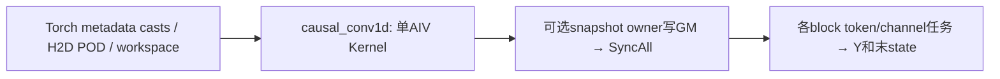
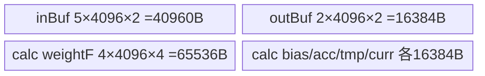

# 原生因果卷积 Prefill 950 Direct Invoke 算子知识

## 算子速览

| 项目 | 内容 |
|---|---|
| 实际入口 | Direct Invoke `torch.ops.npu.causal_conv1d`，本卡仅fn/prefill数学；标准run_mode=0。 |
| 计算语义 | 连续或packed序列的逐通道宽K因果卷积，可加bias与SiLU；返回新Y并把每request末K−1项写入可变state。 |
| 输入输出 | X:[B,S,D]或[L,D]，weight:[K,D]，state:[pool,W,D]；FP16/BF16同dtype，K=2/3/4。 |
| 执行类型 | 单Kernel，AIV_VECTOR；`KERNEL_TYPE_MIX_AIV_1_0`不含可达Cube/AIC计算。950快速路径使用MicroAPI/VF。 |
| Kernel 路线 | R-001…R-012，完整plan×宽度×rolling/generic；每条保留BF16/FP16两dtype实例。 |
| 核心资源 | 固定188416B UB；5slot输入ring、2slot输出、8×4096 FP32计算区；条件初态snapshot与系统workspace。 |
| 来源闭包 | direct_implementation_closed：Torch注册→自有Host/POD→runtime router→全部fn body/helper与legacy构建闭合。 |
| 验证状态 | draft：源码存在dtype缓存key遗漏、run_mode窄化与极宽通道覆盖风险。闭包不证明数值或内存安全；本次知识提取未执行编译、真机、数值或性能测试。 |

## 接口与语义

### 计算语义

令某request的当前输入为X[t,d]，历史H[-K+1:0,d]在has_initial_state该项非零时取state槽前K−1行，否则为0。数学意图为：

```text
Z[t,d] = bias[d] + Σ(j=0..K−1) weight[j,d] * H[t−K+1+j,d]
H[t,d] = X[t,d] for t≥0
Y[t,d] = Z[t,d] or Z[t,d]/(1+exp(−Z[t,d]))
state[slot,0:K−1,d] = final K−1 rows of [initial_history, X]
```

K权重按最旧到当前排列；activation_mode任意非零均启用SiLU。state只更新前K−1行，其余W−K+1行没有完整滚动保证。零长request或pad_slot_id命中的request跳过，Y由empty_like分配，跳过区域不能解释为零。没有接受数值驱动的fn状态选择：该Tensor在fn Init被丢弃，其存在仅关闭rolling快路。实际FP32计算关联顺序随rolling/generic、950 VF改变，不承诺逐位相同。

### 输入、输出与属性

| 参数 | shape/layout | dtype | 约束、默认值与语义 |
|---|---|---|---|
| x | 连续[B,S,D]或[L,D] | BF16/FP16 | Host检查rank2/3；packed必须给query_start_loc，L为总token数。 |
| weight | 连续[K,D] | 与x相同 | K检查2..4，通道检查相等。 |
| conv_states | 连续[pool,W,D]，schema Tensor(a!) | 与x相同 | 同通道；调用方须保证W≥K−1、索引容量、无并发重复写槽。 |
| bias | 可选[D] | 应与x相同 | 仅defined且numel>0选中；Host未完整检查shape/dtype/device/连续性。 |
| query_start_loc | packed [B+1] | Host转int64 | 至少2元素；边界单调、首末值、容量和同设备不全检。dense不使用。 |
| cache_indices | 可选[B] | Host转int64 | 无则slot=seq；值==pad_slot_id跳过；其他负值/过大值没有完整保护。 |
| has_initial_state | 可选[B] | Host转int64 | 非零读旧state；无则零初态；存在即分配完整snapshot。 |
| num_accepted_tokens | 可选[B] | Host转int32 | fn不读其值，非空使hasNumAcceptedTokens=1并关闭rolling。 |
| y | 新empty_like(x) | x.dtype | 非原地；未覆盖/跳过区未初始化。 |
| activation_mode | 标量默认0 | int64 | 非零SiLU，非仅1。 |
| pad_slot_id | 标量默认−1 | int64 | 只在cache_indices存在时比对。 |
| run_mode | 标量默认0 | int64 | Host原值1选update；本卡fn域需同时排除uint32(run_mode)==1。 |

### 入口与版本

固定SGL kernel commit为dda6d36b0cdb4081e102d14c0a2fb276fc416e69。入口在csrc/pytorch_extensions.cpp注册，绑定sglang::npu_kernel::causal_conv1d_impl；没有为它构造ACLNN pair。旧独立torch.ops.npu.causal_conv1d_update、Python v2与其他仓的FusedCausalConv1d不是相同ABI或相同Device算法。所选CANN版本9.1.0由固定CI MAMBA矩阵支撑，不表示已实际运行。平台证据为MAMBA A3/950 CI、活动prefill测试、两架构始终构建本entry及950真实RegBase；不由A2同族目录推定本卡A2支持。

[旧卷积与recurrent接入指南](/model/inference/guides/integration/sgl_kernel_npu/sgl_legacy_causal_conv_recurrent.md)保存Python布局与历史调用差异；该Reference不能代替本卡的fn闭包。

## Host/Launcher 执行流程

### 参数校验与前处理

Torch schema把None选项转同x设备空Tensor；Host依次检查X/weight/state存在、rank、三者dtype均为BF16/FP16且一致、三者连续、D一致、K2..4。二维X给inputMode0、seqLen0、cuSeqlen=L，batch=qsl.size(0)−1并检查qsl长度≥2；三维给inputMode1、batch=B、seqLen=S、cuSeqlen=B*S。创建新Y；可选flag用defined&&numel>0，qsl/cache/initial转int64、accepted转int32，不自动补齐长度/值域或统一contiguous。可变state不复制；别用临时contiguous替代调用者的可变存储。

### 参数、Workspace 与生命周期

ComputeTilingData先memset整个POD为0，再填字段。无初态flag Tensor时自有用户workspace为0；有时总需求为16MiB+32*blockDim+2*B*(K−1)*D字节。Host取max(GetLibApiWorkSpaceSize(),该需求)，用byte Tensor分配。SDK9.1对2201/3510的RESERVED_WORKSPACE均16MiB，GetUserWorkspace返回系统workspace后16MiB；fn用户区先保留32*实际GetBlockNum字节，再绑定snapshot[B,K−1,D]。initStateSyncGm_虽绑定该前区，实际无参数SyncAll使用硬件同步，不消费这块软件旗标区；不得编造软件flag producer或初始化协议。

POD按32B向上对齐后复制；普通8B对齐推导sizeof2248B，tilingSize2272B，globalTilingBuffer为2272*1024=2326528B的byte Tensor。Host以15项形状/flag/run_mode字段hash值作为map键，最多1024槽；命中直接from_blob取持久buffer内地址，满后逐调用复制新POD。**key不含dtype、device、AIV核数，且只按hash无完整key相等比较**。因此相同shape/flags的FP16/BF16交替可复用旧dtypeKey；跨设备/核数缓存也不隔离。静态全局buffer绑定首次调用x设备；globals没有显式锁。这些是源码级风险，不是已观测崩溃或已测故障率。

CopyTensorHostToDevice会pin_memory后以当前NPU device执行non_blocking=true、copy=true的to。EXEC_KERNEL_CMD先把Tensor转裸data_ptr，捕获stream/blockdim/pointer tuple，经OpCommand::RunOpApi调用aclrtlaunch_causal_conv1d；lambda忽略launch返回值且返回0，没有显式保留Tensor owner/record_stream。global buffer持久但每调用workspace、选项转换、满缓存POD临时依赖PyTorch/torch_npu调度和allocator生命周期；本固定仓未展开框架内部，不能声称OpCommand因捕获Tensor而自动延寿。调用方须维护所有输入/输出和state有效到同stream消费结束。

### 启动图与失败传播



| 节点/边 | Host启动与entry | block/POD/数据 | ordering、owner与失败 |
|---|---|---|---|
| K | EXEC_KERNEL_CMD→aclrtlaunch_causal_conv1d→causal_conv1d | blockDim=max(1,min(A,int32(tokenBlockCnt*baseDimCnt)))；完整POD；11个GM指针 | 当前NPU stream；Torch检查失败抛异常；launcher返回值未向lambda传播。 |
| snapshot→计算，同一K内部 | PrefetchInitStatesToWorkspace→SyncAll→InitRingSeqSplit | user+32*blocks，2*B*(K−1)*D字节T；按request×history×D | owner是tokenTileId0的各channel block；MTE2_MTE3、MTE3_MTE2完成copy后，全部launch block参加硬件AIV SyncAll；workspace owner为Host byte Tensor。 |
| Y/state提交 | RunSeq*/MaybeWriteBackSeqSplitTailChunk | Y独立token/channel；state仅request最后chunk | 输出pipe事件/DrainTaskMte3；request并发重复cache slot没有额外仲裁。 |

没有核心外部算子节点；Torch类型转换、分配、H2D及raw runtime launch是明确框架边界。Conv计算、snapshot、路由和自有同步均已追到body。

## Route 与参数设计

### 分核与资源计算

记A为Host读到的AIV核数。CUTBS在D≤4096且A>0时取baseDim=D、C=baseDimCnt=1、tokenCoreBudget=A。否则CUTBSD取baseDim4096、C=ceil(D/4096)、tokenCoreBudget=max(floor(A/C),1)，A≤0时预算1。两者Q=tokenBlockSize=max(ceil(L/budget),1)，N=tokenBlockCnt=ceil(L/Q)，grid目标N*C，实际blocks=max(1,min(A,int32(N*C)))。每block只取**一个**task，非grid-stride：tokenTile=block/C，channelTile=block%C，token范围[tokenTile*Q,min(L,(tokenTile+1)*Q))，channelStart=channelTile*baseDim，d=min(baseDim,D−channelStart)。Host总grid窄为int32，Device L/B/D/W/任务值也多窄为int32，均无溢出校验。

若C>A且L>0，CUTBSD预算1而实际仅A个block；缺失C−A个通道任务，没有补跑，snapshot亦少对应channel owner。因此极宽D不能从“有CUTBSD”推定全覆盖；一般应直接核对N*C≤实际blocks。每核固定UB188416B，Host没读取UB容量或按UB选分支。调用前仍需保证目标可用UB与DMA对齐；D或尾d不是16元素倍数时直接DataCopy无显式DataCopyPad，不能假定任意尾长安全。

### Route 选择

| 顺序 | Route | Key/模板 | 精确选择条件与优先级 | 不适用去向 |
|---:|---|---|---|---|
| 1 | R-001 CUTBS K2 rolling | (dtype,width,plan)=(0或1,1,1) | 先run_mode选择fn；再D≤4096 且 A=GetCoreNumAiv()>0；K=2；hasBias=0 且 hasNumAcceptedTokens=0 | 依原决策树下一条件；输入检查失败抛Torch异常 |
| 2 | R-002 CUTBS K3 rolling | (dtype,width,plan)=(0或1,2,1) | 先run_mode选择fn；再D≤4096 且 A=GetCoreNumAiv()>0；K=3；hasBias=0 且 hasNumAcceptedTokens=0 | 依原决策树下一条件；输入检查失败抛Torch异常 |
| 3 | R-003 CUTBS K4 rolling | (dtype,width,plan)=(0或1,3,1) | 先run_mode选择fn；再D≤4096 且 A=GetCoreNumAiv()>0；K=4；hasBias=0 且 hasNumAcceptedTokens=0 | 依原决策树下一条件；输入检查失败抛Torch异常 |
| 4 | R-004 CUTBS K2 generic | (dtype,width,plan)=(0或1,1,1) | 先run_mode选择fn；再D≤4096 且 A=GetCoreNumAiv()>0；K=2；hasBias≠0 或 hasNumAcceptedTokens≠0 | 依原决策树下一条件；输入检查失败抛Torch异常 |
| 5 | R-005 CUTBS K3 generic | (dtype,width,plan)=(0或1,2,1) | 先run_mode选择fn；再D≤4096 且 A=GetCoreNumAiv()>0；K=3；hasBias≠0 或 hasNumAcceptedTokens≠0 | 依原决策树下一条件；输入检查失败抛Torch异常 |
| 6 | R-006 CUTBS K4 generic | (dtype,width,plan)=(0或1,3,1) | 先run_mode选择fn；再D≤4096 且 A=GetCoreNumAiv()>0；K=4；hasBias≠0 或 hasNumAcceptedTokens≠0 | 依原决策树下一条件；输入检查失败抛Torch异常 |
| 7 | R-007 CUTBSD K2 rolling | (dtype,width,plan)=(0或1,1,2) | 先run_mode选择fn；再前一条件不成立；K=2；hasBias=0 且 hasNumAcceptedTokens=0 | 依原决策树下一条件；输入检查失败抛Torch异常 |
| 8 | R-008 CUTBSD K3 rolling | (dtype,width,plan)=(0或1,2,2) | 先run_mode选择fn；再前一条件不成立；K=3；hasBias=0 且 hasNumAcceptedTokens=0 | 依原决策树下一条件；输入检查失败抛Torch异常 |
| 9 | R-009 CUTBSD K4 rolling | (dtype,width,plan)=(0或1,3,2) | 先run_mode选择fn；再前一条件不成立；K=4；hasBias=0 且 hasNumAcceptedTokens=0 | 依原决策树下一条件；输入检查失败抛Torch异常 |
| 10 | R-010 CUTBSD K2 generic | (dtype,width,plan)=(0或1,1,2) | 先run_mode选择fn；再前一条件不成立；K=2；hasBias≠0 或 hasNumAcceptedTokens≠0 | 依原决策树下一条件；输入检查失败抛Torch异常 |
| 11 | R-011 CUTBSD K3 generic | (dtype,width,plan)=(0或1,2,2) | 先run_mode选择fn；再前一条件不成立；K=3；hasBias≠0 或 hasNumAcceptedTokens≠0 | 依原决策树下一条件；输入检查失败抛Torch异常 |
| 12 | R-012 CUTBSD K4 generic | (dtype,width,plan)=(0或1,3,2) | 先run_mode选择fn；再前一条件不成立；K=4；hasBias≠0 或 hasNumAcceptedTokens≠0 | 依原决策树下一条件；输入检查失败抛Torch异常 |

```text
校验X/weight/state/K
  Host run_mode==1 → 独立update数学
  否则计算fn tiling；dtypeKey=BF16?0:1，widthKey=K−1
  D≤4096 && A>0 ? CUTBS(plan1) : CUTBSD(plan2)
  launch后entry以uint32(runModeKey)==1判断update
  fn → widthKey1/2/3、plan1/2模板
      hasBias==0 && hasNumAcceptedTokens==0 ? rolling : generic
```

run_mode非1但低32位1产生Host/Device不一致，不属于可保证prefill的输入域。POD缓存命中还可能绕过本次新计算的dtype/切块信息；下列Route描述以实际消费POD与本次输入一致为前提。

### 模板/实现执行矩阵

| Route | key/selector | dtype/shape/platform 完整命中条件 | 执行拓扑与 Kernel 节点 | 实际模板/body | 内存与同步特征 | tail/fallback |
|---|---|---|---|---|---|---|
| R-001 CUTBS K2 rolling | dtypeKey=0/1，widthKey=1，fnPlanKey=1 | run_mode≠1 且 uint32(run_mode)≠1；D≤4096 且 A=GetCoreNumAiv()>0；K=2；hasBias=0 且 hasNumAcceptedTokens=0 | 单AIV causal_conv1d | CausalConv1dFn<T,1,1>::Process → ProcessFnChunk → RunSeqFnRolling | 188416B UB；初态存在时snapshot+SyncAll | 有效d=min(baseDim,D−channelStart)；request末chunk写state |
| R-002 CUTBS K3 rolling | dtypeKey=0/1，widthKey=2，fnPlanKey=1 | run_mode≠1 且 uint32(run_mode)≠1；D≤4096 且 A=GetCoreNumAiv()>0；K=3；hasBias=0 且 hasNumAcceptedTokens=0 | 单AIV causal_conv1d | CausalConv1dFn<T,2,1>::Process → ProcessFnChunk → RunSeqFnRolling | 188416B UB；初态存在时snapshot+SyncAll | 有效d=min(baseDim,D−channelStart)；request末chunk写state |
| R-003 CUTBS K4 rolling | dtypeKey=0/1，widthKey=3，fnPlanKey=1 | run_mode≠1 且 uint32(run_mode)≠1；D≤4096 且 A=GetCoreNumAiv()>0；K=4；hasBias=0 且 hasNumAcceptedTokens=0 | 单AIV causal_conv1d | CausalConv1dFn<T,3,1>::Process → ProcessFnChunk → RunSeqFnRolling | 188416B UB；初态存在时snapshot+SyncAll | 有效d=min(baseDim,D−channelStart)；request末chunk写state |
| R-004 CUTBS K2 generic | dtypeKey=0/1，widthKey=1，fnPlanKey=1 | run_mode≠1 且 uint32(run_mode)≠1；D≤4096 且 A=GetCoreNumAiv()>0；K=2；hasBias≠0 或 hasNumAcceptedTokens≠0 | 单AIV causal_conv1d | CausalConv1dFn<T,1,1>::Process → ProcessFnChunk → RunSeq通用分支 | 188416B UB；初态存在时snapshot+SyncAll | 有效d=min(baseDim,D−channelStart)；request末chunk写state |
| R-005 CUTBS K3 generic | dtypeKey=0/1，widthKey=2，fnPlanKey=1 | run_mode≠1 且 uint32(run_mode)≠1；D≤4096 且 A=GetCoreNumAiv()>0；K=3；hasBias≠0 或 hasNumAcceptedTokens≠0 | 单AIV causal_conv1d | CausalConv1dFn<T,2,1>::Process → ProcessFnChunk → RunSeq通用分支 | 188416B UB；初态存在时snapshot+SyncAll | 有效d=min(baseDim,D−channelStart)；request末chunk写state |
| R-006 CUTBS K4 generic | dtypeKey=0/1，widthKey=3，fnPlanKey=1 | run_mode≠1 且 uint32(run_mode)≠1；D≤4096 且 A=GetCoreNumAiv()>0；K=4；hasBias≠0 或 hasNumAcceptedTokens≠0 | 单AIV causal_conv1d | CausalConv1dFn<T,3,1>::Process → ProcessFnChunk → RunSeq通用分支 | 188416B UB；初态存在时snapshot+SyncAll | 有效d=min(baseDim,D−channelStart)；request末chunk写state |
| R-007 CUTBSD K2 rolling | dtypeKey=0/1，widthKey=1，fnPlanKey=2 | run_mode≠1 且 uint32(run_mode)≠1；前一条件不成立；K=2；hasBias=0 且 hasNumAcceptedTokens=0 | 单AIV causal_conv1d | CausalConv1dFn<T,1,2>::Process → ProcessFnChunk → RunSeqFnRolling | 188416B UB；初态存在时snapshot+SyncAll | 有效d=min(baseDim,D−channelStart)；request末chunk写state |
| R-008 CUTBSD K3 rolling | dtypeKey=0/1，widthKey=2，fnPlanKey=2 | run_mode≠1 且 uint32(run_mode)≠1；前一条件不成立；K=3；hasBias=0 且 hasNumAcceptedTokens=0 | 单AIV causal_conv1d | CausalConv1dFn<T,2,2>::Process → ProcessFnChunk → RunSeqFnRolling | 188416B UB；初态存在时snapshot+SyncAll | 有效d=min(baseDim,D−channelStart)；request末chunk写state |
| R-009 CUTBSD K4 rolling | dtypeKey=0/1，widthKey=3，fnPlanKey=2 | run_mode≠1 且 uint32(run_mode)≠1；前一条件不成立；K=4；hasBias=0 且 hasNumAcceptedTokens=0 | 单AIV causal_conv1d | CausalConv1dFn<T,3,2>::Process → ProcessFnChunk → RunSeqFnRolling | 188416B UB；初态存在时snapshot+SyncAll | 有效d=min(baseDim,D−channelStart)；request末chunk写state |
| R-010 CUTBSD K2 generic | dtypeKey=0/1，widthKey=1，fnPlanKey=2 | run_mode≠1 且 uint32(run_mode)≠1；前一条件不成立；K=2；hasBias≠0 或 hasNumAcceptedTokens≠0 | 单AIV causal_conv1d | CausalConv1dFn<T,1,2>::Process → ProcessFnChunk → RunSeq通用分支 | 188416B UB；初态存在时snapshot+SyncAll | 有效d=min(baseDim,D−channelStart)；request末chunk写state |
| R-011 CUTBSD K3 generic | dtypeKey=0/1，widthKey=2，fnPlanKey=2 | run_mode≠1 且 uint32(run_mode)≠1；前一条件不成立；K=3；hasBias≠0 或 hasNumAcceptedTokens≠0 | 单AIV causal_conv1d | CausalConv1dFn<T,2,2>::Process → ProcessFnChunk → RunSeq通用分支 | 188416B UB；初态存在时snapshot+SyncAll | 有效d=min(baseDim,D−channelStart)；request末chunk写state |
| R-012 CUTBSD K4 generic | dtypeKey=0/1，widthKey=3，fnPlanKey=2 | run_mode≠1 且 uint32(run_mode)≠1；前一条件不成立；K=4；hasBias≠0 或 hasNumAcceptedTokens≠0 | 单AIV causal_conv1d | CausalConv1dFn<T,3,2>::Process → ProcessFnChunk → RunSeq通用分支 | 188416B UB；初态存在时snapshot+SyncAll | 有效d=min(baseDim,D−channelStart)；request末chunk写state |

T=bfloat16_t对应dtypeKey0、half对应1；两者元素均2B，地址/资源/同步相同，但转入FP32与CAST_RINT写回依各自类型，不能互换数据位型。rolling的K2/3/4具体partial递推在每条Route独立列出，未以文件数替代逻辑路线。

### 隐藏性能 Guard

| Guard | Host/Tiling 条件 | Device/资源原因 | 影响 Route | 不满足时去向 | 源码符号 |
|---|---|---|---|---|---|
| token/channel计划 | D≤4096 && A>0 | 小D不切channel；大D保持每块≤4096 | 所有 | CUTBSD；不是任意D安全承诺 | ComputeTilingData |
| rolling开关 | !update && plan!=0 && !hasNumAcceptedTokens && !hasBias | biasF/accF/tmpF被复用为三个partial | rolling | generic，不使用partial别名 | IsFnRollingFastPathEnabled |
| 初态快照 | hasInitialState Tensor存在 | token并行计算期间尾块可写persistent；先保存不变量 | 所有 | 无初态则零历史，无snapshot/SyncAll | CausalConv1dFn::Init/ProcessVarlenTokenTiled |
| 状态owner | chunkStart+chunkLen==seqStart+seqLen | 只允许request尾chunk提交K−1历史 | 所有 | 中间chunk只写Y | MaybeWriteBackSeqSplitTailChunk |
| pad/空域 | cacheIdx64==padSlotId；len<=0；task无效 | 避免选中任务读写；Y为empty | 所有 | 跳过且不补零 | ResolveSeqCacheIndex/ResolveFnDirectBlockTask |
| UB/DMA | 固定188416B；没有UB query/对齐guard | TBuf容量与DataCopy规则独立于有效d | 所有 | 无自有fallback | InitSharedBuffersAndEvents |
| 极宽grid | 实际blocks被min(A,grid)封顶 | fn没有task+=blocks循环 | CUTBSD | 未覆盖任务，非安全fallback | ResolveFnDirectBlockTask |
| selector窄化/缓存 | uint32(run_mode)；hash无dtype/device/core | Host计划与Device入口/类型可不同 | 所有 | 已知静态失效边界，无修复回退 | ComputeTilingData/CausalConv1dTilingKey |

### POD/ABI

结构直接在Host和Device共用头文件，没有序列化宏变换。以下为int64_t按8B自然对齐的静态布局推导：sizeof2248B、alignof8B；源码没有sizeof/offsetof静态断言，本次未编译测量。数组每元素8B，字段逐一列出。

| 结构 | 字段 | 类型/位宽 | ABI 布局 | 单位 | Host/launcher producer | Device consumer | 边界 |
|---|---|---|---|---|---|---|---|
| CausalConv1dTilingData | dim | int64_t；元素64位 | offset=0B | D | X最后轴 | 所有GM token/weight/state跨行步长；Device窄为int32 | D>0/32字节搬运前提未由Host完整约束 |
| CausalConv1dTilingData | cuSeqlen | int64_t；元素64位 | offset=8B | token | packed:X.size(0)；dense:B*S | ResolveFnDirectBlockTask总token上界 | 乘法/Device int32窄化未检查 |
| CausalConv1dTilingData | seqLen | int64_t；元素64位 | offset=16B | token/request | dense:S；packed:0 | dense窗口start=seq*S | packed不读取为长度 |
| CausalConv1dTilingData | inputMode | int64_t；元素64位 | offset=24B | 枚举 | X二维0；三维1 | 0读queryStartLoc；1按dense窗口 | Host不产生2 |
| CausalConv1dTilingData | width | int64_t；元素64位 | offset=32B | tap | weight.size(0),检查2..4 | historyCount=K−1；weight/最终state循环 | 须stateLen≥K−1，Host未断言 |
| CausalConv1dTilingData | stateLen | int64_t；元素64位 | offset=40B | token/cache | conv_states.size(1) | cacheIdx*W*D状态池步长 | pool内容量/accepted偏移调用方负责 |
| CausalConv1dTilingData | numCacheLines | int64_t；元素64位 | offset=48B | cache slot | conv_states.size(0) | 本fn body不用于cacheIdx上界检查 | 不是实际索引保护 |
| CausalConv1dTilingData | batch | int64_t；元素64位 | offset=56B | request | dense:X.size(0)；packed:qsl.size(0)−1 | seq查找、snapshot B域 | 元数据长度和值域未全查 |
| CausalConv1dTilingData | activationMode | int64_t；元素64位 | offset=64B | 枚举 | activation_mode原值 | HasActivation:!=0则Silu | 任何非零均启用，不限1 |
| CausalConv1dTilingData | padSlotId | int64_t；元素64位 | offset=72B | cache slot | pad_slot_id原值 | cacheIndices值相等时跳过该request | 仅有cacheIndices才检查 |
| CausalConv1dTilingData | hasBias | int64_t；元素64位 | offset=80B | bool/int64 | defined &&numel>0 | LoadWeightAndBias与generic/rolling selector | bias shape/dtype/device未完整检查 |
| CausalConv1dTilingData | baseDim | int64_t；元素64位 | offset=88B | channel | CUTBS:D；CUTBSD:4096 | 每个通道tile的最大有效元素 | 分配容量固定4096，尾tile取min |
| CausalConv1dTilingData | baseDimCnt | int64_t；元素64位 | offset=96B | tile | CUTBS:1；CUTBSD:ceil(D/4096) | blockId除余、channelStart | 实际launch核数不足时没有grid-stride补偿 |
| CausalConv1dTilingData | hasNumAcceptedTokens | int64_t；元素64位 | offset=104B | bool/int64 | num_accepted_tokens非空 | 只影响IsFnRollingFastPathEnabled | fn Init丢弃该Tensor；不按值选接受步 |
| CausalConv1dTilingData | hasCacheIndices | int64_t；元素64位 | offset=112B | bool/int64 | cache_indices非空 | ResolveSeqCacheIndex | 缺省slot=seq |
| CausalConv1dTilingData | hasInitialStateMode | int64_t；元素64位 | offset=120B | bool/int64 | has_initial_state非空 | 每seq flag!=0选初态；否则零初态 | 不是update hasInit合同 |
| CausalConv1dTilingData | tokenBlockSize | int64_t；元素64位 | offset=128B | token | max(ceil(cuSeqlen/tokenCoreBudget),1) | blockId/baseDimCnt→tokenStart/end | int64 producer→int32 consumer |
| CausalConv1dTilingData | tokenBlockCnt | int64_t；元素64位 | offset=136B | tile | ceil(cuSeqlen/tokenBlockSize) | 任务有效性及totalBlocks | 空cuSeqlen产生0tile但仍launch1 |
| CausalConv1dTilingData | hasExplicitTokenSeqRanges | int64_t；元素64位 | offset=144B | bool/int64 | memset0后显式0 | HasExplicitFnTokenSeqRanges先判0 | 本入口无活动显式表Route |
| CausalConv1dTilingData | explicitTokenSeqRangeCount | int64_t；元素64位 | offset=152B | tile | 显式0 | 显式表guard短路 | 无活动读取 |
| CausalConv1dTilingData | tokenTileStartSeq[128] | int64_t[128]；元素64位 | offset=160B，extent=1024B | request | memset全0 | 显式表分支无producer而不读取 | 容量1024B；不是合法raw扩展入口 |
| CausalConv1dTilingData | tokenTileEndSeq[128] | int64_t[128]；元素64位 | offset=1184B，extent=1024B | request | memset全0 | 同上 | 容量1024B |
| CausalConv1dTilingData | hasInitStateWorkspace | int64_t；元素64位 | offset=2208B | bool/int64 | hasInitialState ?1:0 | snapshot owner、workspace绑定、SyncAll与读取 | 按flag Tensor存在分配，非实际true项数 |
| CausalConv1dTilingData | dtypeKey | int64_t；元素64位 | offset=2216B | 枚举 | BF16=0；FP16=1 | router T=bfloat16_t/half | 缓存hash遗漏dtype，可读到旧POD |
| CausalConv1dTilingData | runModeKey | int64_t；元素64位 | offset=2224B | 枚举 | static_cast<uint32_t>(run_mode)后存int64 | router再次uint32；1→update，其余fn | Host用原int64，低32位1的非1值选择不一致 |
| CausalConv1dTilingData | widthKey | int64_t；元素64位 | offset=2232B | 枚举 | K2→1,K3→2,K4→3 | DispatchFn完整宽度实例 | Host已检查K |
| CausalConv1dTilingData | fnPlanKey | int64_t；元素64位 | offset=2240B | 枚举 | CUTBS=1；CUTBSD=2 | DispatchFn模板plan，非2归一1 | body主任务相同，POD切块不同 |

### Route 源码闭包

路径以csrc/causal_conv1d为共同前缀，表内没有把未实例化的update或Decode2D当成本卡支持路线。

| Route | Key/selector | Host/Tiling producer | POD/参数 | Kernel entry/router 节点 | Kernel body/直接依赖 | 构建接线 |
|---|---|---|---|---|---|---|
| R-001 | width=1,plan=1,dtype=0/1 | op_host/causal_conv1d.cpp::causal_conv1d_impl/ComputeTilingData | CausalConv1dTilingData，逐字段见上表 | op_kernel/causal_conv1d.cpp::DispatchFn<T> | causal_conv1d_fn.h::CausalConv1dFn + causal_conv1d_fn_tasks.h::ProcessVarlenTokenTiled/ProcessFnChunk；causal_conv1d.h::RunSeqFnRolling；950命中arch35实际VF | cmake/legacy_kernels.cmake::workspace_kernel→sgl_kernel_npu |
| R-002 | width=2,plan=1,dtype=0/1 | op_host/causal_conv1d.cpp::causal_conv1d_impl/ComputeTilingData | CausalConv1dTilingData，逐字段见上表 | op_kernel/causal_conv1d.cpp::DispatchFn<T> | causal_conv1d_fn.h::CausalConv1dFn + causal_conv1d_fn_tasks.h::ProcessVarlenTokenTiled/ProcessFnChunk；causal_conv1d.h::RunSeqFnRolling；950命中arch35实际VF | cmake/legacy_kernels.cmake::workspace_kernel→sgl_kernel_npu |
| R-003 | width=3,plan=1,dtype=0/1 | op_host/causal_conv1d.cpp::causal_conv1d_impl/ComputeTilingData | CausalConv1dTilingData，逐字段见上表 | op_kernel/causal_conv1d.cpp::DispatchFn<T> | causal_conv1d_fn.h::CausalConv1dFn + causal_conv1d_fn_tasks.h::ProcessVarlenTokenTiled/ProcessFnChunk；causal_conv1d.h::RunSeqFnRolling；950命中arch35实际VF | cmake/legacy_kernels.cmake::workspace_kernel→sgl_kernel_npu |
| R-004 | width=1,plan=1,dtype=0/1 | op_host/causal_conv1d.cpp::causal_conv1d_impl/ComputeTilingData | CausalConv1dTilingData，逐字段见上表 | op_kernel/causal_conv1d.cpp::DispatchFn<T> | causal_conv1d_fn.h::CausalConv1dFn + causal_conv1d_fn_tasks.h::ProcessVarlenTokenTiled/ProcessFnChunk；causal_conv1d.h::RunSeq | cmake/legacy_kernels.cmake::workspace_kernel→sgl_kernel_npu |
| R-005 | width=2,plan=1,dtype=0/1 | op_host/causal_conv1d.cpp::causal_conv1d_impl/ComputeTilingData | CausalConv1dTilingData，逐字段见上表 | op_kernel/causal_conv1d.cpp::DispatchFn<T> | causal_conv1d_fn.h::CausalConv1dFn + causal_conv1d_fn_tasks.h::ProcessVarlenTokenTiled/ProcessFnChunk；causal_conv1d.h::RunSeq | cmake/legacy_kernels.cmake::workspace_kernel→sgl_kernel_npu |
| R-006 | width=3,plan=1,dtype=0/1 | op_host/causal_conv1d.cpp::causal_conv1d_impl/ComputeTilingData | CausalConv1dTilingData，逐字段见上表 | op_kernel/causal_conv1d.cpp::DispatchFn<T> | causal_conv1d_fn.h::CausalConv1dFn + causal_conv1d_fn_tasks.h::ProcessVarlenTokenTiled/ProcessFnChunk；causal_conv1d.h::RunSeq | cmake/legacy_kernels.cmake::workspace_kernel→sgl_kernel_npu |
| R-007 | width=1,plan=2,dtype=0/1 | op_host/causal_conv1d.cpp::causal_conv1d_impl/ComputeTilingData | CausalConv1dTilingData，逐字段见上表 | op_kernel/causal_conv1d.cpp::DispatchFn<T> | causal_conv1d_fn.h::CausalConv1dFn + causal_conv1d_fn_tasks.h::ProcessVarlenTokenTiled/ProcessFnChunk；causal_conv1d.h::RunSeqFnRolling；950命中arch35实际VF | cmake/legacy_kernels.cmake::workspace_kernel→sgl_kernel_npu |
| R-008 | width=2,plan=2,dtype=0/1 | op_host/causal_conv1d.cpp::causal_conv1d_impl/ComputeTilingData | CausalConv1dTilingData，逐字段见上表 | op_kernel/causal_conv1d.cpp::DispatchFn<T> | causal_conv1d_fn.h::CausalConv1dFn + causal_conv1d_fn_tasks.h::ProcessVarlenTokenTiled/ProcessFnChunk；causal_conv1d.h::RunSeqFnRolling；950命中arch35实际VF | cmake/legacy_kernels.cmake::workspace_kernel→sgl_kernel_npu |
| R-009 | width=3,plan=2,dtype=0/1 | op_host/causal_conv1d.cpp::causal_conv1d_impl/ComputeTilingData | CausalConv1dTilingData，逐字段见上表 | op_kernel/causal_conv1d.cpp::DispatchFn<T> | causal_conv1d_fn.h::CausalConv1dFn + causal_conv1d_fn_tasks.h::ProcessVarlenTokenTiled/ProcessFnChunk；causal_conv1d.h::RunSeqFnRolling；950命中arch35实际VF | cmake/legacy_kernels.cmake::workspace_kernel→sgl_kernel_npu |
| R-010 | width=1,plan=2,dtype=0/1 | op_host/causal_conv1d.cpp::causal_conv1d_impl/ComputeTilingData | CausalConv1dTilingData，逐字段见上表 | op_kernel/causal_conv1d.cpp::DispatchFn<T> | causal_conv1d_fn.h::CausalConv1dFn + causal_conv1d_fn_tasks.h::ProcessVarlenTokenTiled/ProcessFnChunk；causal_conv1d.h::RunSeq | cmake/legacy_kernels.cmake::workspace_kernel→sgl_kernel_npu |
| R-011 | width=2,plan=2,dtype=0/1 | op_host/causal_conv1d.cpp::causal_conv1d_impl/ComputeTilingData | CausalConv1dTilingData，逐字段见上表 | op_kernel/causal_conv1d.cpp::DispatchFn<T> | causal_conv1d_fn.h::CausalConv1dFn + causal_conv1d_fn_tasks.h::ProcessVarlenTokenTiled/ProcessFnChunk；causal_conv1d.h::RunSeq | cmake/legacy_kernels.cmake::workspace_kernel→sgl_kernel_npu |
| R-012 | width=3,plan=2,dtype=0/1 | op_host/causal_conv1d.cpp::causal_conv1d_impl/ComputeTilingData | CausalConv1dTilingData，逐字段见上表 | op_kernel/causal_conv1d.cpp::DispatchFn<T> | causal_conv1d_fn.h::CausalConv1dFn + causal_conv1d_fn_tasks.h::ProcessVarlenTokenTiled/ProcessFnChunk；causal_conv1d.h::RunSeq | cmake/legacy_kernels.cmake::workspace_kernel→sgl_kernel_npu |

## Kernel 实现

### 公共执行流程

entry注册POD并选择AIV-only任务类型，取userWorkspace，依dtype/width/plan构造CausalConv1dFn。Init绑定GM、分配3个TBuf并分配所有HardEvent；ProcessVarlenTokenTiled解析blockTask，有初态时先snapshot+SyncAll，即使task无效也先参加同步，然后无效task退出。packed通过queryStartLoc二分查找首request，dense取tokenStart/S；每次把本token tile与request区间求交，解析cacheIndex/hasInit，调用ProcessFnChunk并前进到下一request。没有跨Kernel中间结果或Cube节点。

LoadWeightAndBias把K权重右对齐到4行FP32 weightF、空tap补零；FP16/BF16先DMA到对应FP32行的高半区（T视图offset=(2*j+1)*4096，行容量16384B），MTE2_V后Cast到行首、PIPE_V保证转换完成。bias同样在biasF高半暂存后升精度；无bias置0，rolling随后复用该区。每次d取当前channel有效元素，实际UB容量始终4096，不能按d缩减字节账。

InitRingSeqSplit逐个history token：在本request内从X读；在request开始前且hasInit时读snapshot；否则Duplicate0。当前token预取至SlotCurr(0)=3，后续token到SlotPrefetch(t)=(t+4)%5，历史为(t+3−tap)%5。输入每slot MTE2_V就绪、V_MTE2防止重用；outBuf两slot以t&1切换，重用前MTE3_V、写出前V_MTE3。每request尾chunk先drain，再从最后ring取末K−1行写state，最后drain才复用本任务资源；所有分配event在Process结束释放。

### Route R-001：CUTBS K2 滚动partial

#### 适用条件

K=2，D≤4096且A>0，bias与accepted Tensor均空，实际POD与本次metadata一致。 模板为CausalConv1dFn<T,1,1>，T为BF16或FP16，元素宽2B；不是按名称认定两dtype位型等价。

##### 选择证据

| 层级 | 文件 | 符号 | 源码谓词/参数 | 结果/下一跳 |
|---|---|---|---|---|
| Host | csrc/causal_conv1d/op_host/causal_conv1d.cpp | ComputeTilingData | 原run_mode≠1，width=2，plan=1 | dtypeKey0/1、widthKey1、token/channel参数 |
| Router | csrc/causal_conv1d/op_kernel/causal_conv1d.cpp | causal_conv1d/DispatchFn<T> | uint32(runModeKey)≠1，widthKey=1，plan=1 | CausalConv1dFn<T,1,1> |
| Body | csrc/causal_conv1d/op_kernel/causal_conv1d.h | IsFnRollingFastPathEnabled/RunSeq | !hasBias && !hasNumAcceptedTokens | RunSeqFnRolling |

#### Device 数据流

##### 函数级调用链

```text
causal_conv1d_impl → EXEC_KERNEL_CMD → aclrtlaunch_causal_conv1d
  → causal_conv1d → DispatchFn<T> → RunCausalConv1dFn<T,1,1>
    → CausalConv1dFn::Init → InitSharedBuffersAndEvents
    → Process → ProcessVarlenTokenTiled
      → [tokenTile0 snapshot owner → SyncAll]
      → ResolveSeqTaskWindow/ResolveSeqCacheIndex/ResolveSeqHasInit
      → ProcessFnChunk → LoadWeightAndBias → InitRingSeqSplit
        → RunSeqFnRolling → RestoreFnLocalPartials → ComputeFnRollingOutput → AdvanceFnLocalPartials
        → MaybeWriteBackSeqSplitTailChunk → WriteBackState → DrainTaskMte3
    → ReleaseEvents
```

##### 源码等价伪码

```text
# 伪码；本Route plan=1,K=2；dtypes分别按BF16/FP16读写
task = blockId // C, blockId % C
tokenRange=[task.token*Q,min(L,(task.token+1)*Q))
channel=task.channel*baseDim; d=min(baseDim,D-channel)
if hasInitStateWorkspace:
  if task.valid and task.token==0:
    for seq in [0,B):
      if initialFlag[seq]!=0 and slot[seq]!=pad:
        for h in [0,1): state[slot,h,channel:channel+d] → snapshot[seq,h,...]
  SyncAll()                       # 所有launch block，非软件flag数组
if invalidTask:return
seq = packed?binarySearch(queryStartLoc,tokenStart):tokenStart/S
while cursor<tokenEnd and seq<B:
  [s,e)=packed?qsl[seq:seq+2]:[seq*S,(seq+1)*S)
  a=max(cursor,s); b=min(tokenEnd,e)
  if b>a and slot合法于pad约定:
    load 2 weight rows(channel,d) → right-aligned weightF
    ring历史分别取X(a−1:a)、snapshot或0
    prefetch X[a] to ringSlot3
    restore partials; for t=0..b−a−1:
      wait current MTE2_V; if next exists: wait V_MTE2, prefetch next ringSlot
      compute rolling output into FP32 scratch
      wait previous out-slot MTE3_V when t≥2
      cast to out[t&1]; advance partials
      V_MTE3; DataCopy Y[(a+t)*D+channel] count=d
    if b==e: drain MTE3; last 1 ring rows→state[slot,0:1,channel:channel+d]
    drain MTE3
  cursor=b; seq++
release all allocated events
```

初态p0=h0*w0；每步z=p0+x*w1；下一步p0=x*w0。 RestoreFnLocalPartials仍用经典Cast/Mul/MulAddDst/PIPE_V。每步ComputeFnRollingOutputRegbase<T,hasActivation>以VL=VECTOR_REG_WIDTH/4、ceil(d/VL)遍历：UpdateMask<float>(dataCount)处理尾register，DIST_UNPACK_B16装载ring，castTraitB16ToB32={ZERO,UNKNOWN,ZEROING,UNKNOWN}升FP32，Mul再Add partial；激活时Exp/Adds/Div写currF，否则写state0F。AdvanceFnLocalPartialsRegbase<T,2>调用实际WidthTwo VF，不读取旧p1/p2，仅按mask写p0=x*w0；weightStep=4096。不是给scalar RegTensor数目推造物理寄存器峰值。 输出BF16/FP16转换为CAST_RINT，输出slot前先等待前次MTE3完成；开启SiLU时用激活结果，否则用acc/partial。

#### 内存与数据搬运

##### 资源与搬运表

| 层级/缓冲区 | offset/地址公式 | extent/容量公式 | dtype/layout | producer | consumer | owner/lifetime | 对齐/复用 |
|---|---|---|---|---|---|---|---|
| GM X/Y | token*D+channel | 每copy d项；总2*L*D字节各一份 | T token-major | 调用方/Vector | ring/调用方 | Y新分配、X只读至消费完成 | DataCopy无Pad；d非16倍数边界未guard |
| GM weight/bias | j*D+channel/bias+channel | 2*d权重、可选d bias | T | 调用方 | FP32 calc | 每request交集重新加载 | 转换临时与FP32同物理行高半区 |
| UB inBuf | slot*4096*2B，slot0..4 | 40960B | T 5行 | MTE2/zero | Vector、state写回 | 核私有，request间复用 | MTE2_V/V_MTE2；slot步长8192B |
| UB outBuf | (t&1)*4096*2B | 16384B | T 2行 | Vector CAST_RINT | MTE3→Y | 同核双slot，不是额外深度TQue | V_MTE3/MTE3_V |
| UB calcBuf | weight0..3 0..65535B；bias65536；acc81920；tmp98304；curr114688 | 131072B | FP32 8×4096 | weight Cast与Vector | p2=bias,p1=acc,p0=tmp,current=curr | 核私有；每request重建 | 无bias条件使bias区可复用partial |
| GM snapshot | userBase+32*blocks + 2*((seq*1+h)*D+channel) | 2*B*1*D | T contiguous | tokenTile0 owner | 本request历史初始化 | 当前launch workspace寿命 | snapshot后硬件SyncAll；无flag Tensor时不读 |
| GM state | ((slot*W+h)*D+channel)*2B | 持久2*pool*W*D；提交1*d项 | T | 调用方初态/尾chunk | snapshot/下一调用 | 调用方可变池 | 无重复slot竞争仲裁 |

##### 分层内存布局



##### 字节账与复用顺序

```text
UB_total = 40960 + 16384 + 131072 = 188416 B
UB_total <= 可用UB 是调用/工具链前提；Host无UB容量选择或拒绝
dynamic_ub = N/A；AIV TBuf，无SIMT launch
workspace_total = max(libWorkspace,
  hasInitialStateTensor ? 16777216 + 32*blocks + 2*B*1*D : 0)
snapshot有效域 = B×1×D项；不是按真实initialFlag=1项压缩
```

| 复用子区 | 写入者 | 读取者/消费点 | 下一次覆盖 | 同步或释放依据 | 安全条件 |
|---|---|---|---|---|---|
| ring 5slot | history初始化/next预取 | current/tap或state回写 | 下一token/下一request | slot MTE2_V、V_MTE2；尾drain | 不能在state MTE3完成前覆盖 |
| out[t&1] | 本token Vector | GM Y的MTE3 | t+2 | MTE3_V后写，V_MTE3后读 | 两slot各维护event |
| weightF行高半→整行 | MTE2→Cast | 本request全部token | 下request权重加载 | MTE2_V与PIPE_V | d≤4096、primitive Cast别名规则；无额外权重缓存 |
| bias/acc/tmp partial | restore/advance | 本token输出/下一partial | 下一tokenadvance | PIPE_V；输出slot已独立存值 | hasBias必须0；K固定2 |
| snapshot→persistent | owner先复制旧state | 所有token tile初始化history | launch完成后可释放 | SyncAll后才推进；末chunk才写state | slot无并发别名且全部channel task覆盖 |

#### 同步、精度与尾块

##### 同步与数值边界表

| 阶段 | primitive/机制 | producer | consumer/等待点 | 保护对象 | 精度/尾块 |
|---|---|---|---|---|---|
| 初态snapshot | MTE2_MTE3→MTE3_MTE2；SyncAll() | tokenTile0 owner | 全AIV后续history load | snapshot旧state | 固定SDK9.1 AIV硬件barrier；软件旗标区未用 |
| weight/history | MTE2_V/PIPE_V | DMA或Duplicate | Cast/计算 | calc/ring | T→FP32 CAST_NONE；实际d，不修复非法DMA尾 |
| current预取 | slot MTE2_V；V_MTE2 | MTE2 | Vector/下一次ring覆盖 | 5slot ring | token尾仅prefetch存在的下一token |
| 计算 | MicroAPI mask/VF及经典restore | partial/current | output cast | FP32 calc | K2递推见上文；SiLU可选；T写回CAST_RINT |
| 输出复用 | V_MTE3/MTE3_V | Vector | MTE3/后续t+2 | out2slot | 每次d项；Y空/pad未写 |
| state收尾 | DrainTaskMte3的MTE3_V/MTE3_MTE2 | 最后chunk | 同核下request、返回 | state/ring | 仅chunk末端等于request末端提交1行；重复slot不安全 |

#### 关键实现

##### 符号证据表

| 阶段 | 文件 | 符号/模板实例 | 实现事实 |
|---|---|---|---|
| Host/Tiling producer | csrc/causal_conv1d/op_host/causal_conv1d.cpp | ComputeTilingData/causal_conv1d_impl | plan1、K2、dtype和资源producer |
| Kernel entry/router | csrc/causal_conv1d/op_kernel/causal_conv1d.cpp | DispatchFn<T>/RunCausalConv1dFn<T,1,1> | 实际模板映射，无Cube |
| Device body/helper | csrc/causal_conv1d/op_kernel/causal_conv1d_fn_tasks.h | ProcessVarlenTokenTiled/InitRingSeqSplit/ProcessFnChunk | token/channel地址、snapshot、尾owner |
| Device body/helper | csrc/causal_conv1d/op_kernel/causal_conv1d.h | RestoreFnLocalPartials/RunSeqFnRolling/AdvanceFnLocalPartials | 上述运算与生命周期 |
| Device body/helper | csrc/causal_conv1d/op_kernel/arch35/causal_conv1d_regbase.h | ComputeFnRollingOutputRegbase<T,hasActivation>/AdvanceFnLocalPartialsRegbase<T,2> | DIST_UNPACK_B16、FP32寄存器计算、masked写回及width专属VF |


### Route R-002：CUTBS K3 滚动partial

#### 适用条件

K=3，D≤4096且A>0，bias与accepted Tensor均空，实际POD与本次metadata一致。 模板为CausalConv1dFn<T,2,1>，T为BF16或FP16，元素宽2B；不是按名称认定两dtype位型等价。

##### 选择证据

| 层级 | 文件 | 符号 | 源码谓词/参数 | 结果/下一跳 |
|---|---|---|---|---|
| Host | csrc/causal_conv1d/op_host/causal_conv1d.cpp | ComputeTilingData | 原run_mode≠1，width=3，plan=1 | dtypeKey0/1、widthKey2、token/channel参数 |
| Router | csrc/causal_conv1d/op_kernel/causal_conv1d.cpp | causal_conv1d/DispatchFn<T> | uint32(runModeKey)≠1，widthKey=2，plan=1 | CausalConv1dFn<T,2,1> |
| Body | csrc/causal_conv1d/op_kernel/causal_conv1d.h | IsFnRollingFastPathEnabled/RunSeq | !hasBias && !hasNumAcceptedTokens | RunSeqFnRolling |

#### Device 数据流

##### 函数级调用链

```text
causal_conv1d_impl → EXEC_KERNEL_CMD → aclrtlaunch_causal_conv1d
  → causal_conv1d → DispatchFn<T> → RunCausalConv1dFn<T,2,1>
    → CausalConv1dFn::Init → InitSharedBuffersAndEvents
    → Process → ProcessVarlenTokenTiled
      → [tokenTile0 snapshot owner → SyncAll]
      → ResolveSeqTaskWindow/ResolveSeqCacheIndex/ResolveSeqHasInit
      → ProcessFnChunk → LoadWeightAndBias → InitRingSeqSplit
        → RunSeqFnRolling → RestoreFnLocalPartials → ComputeFnRollingOutput → AdvanceFnLocalPartials
        → MaybeWriteBackSeqSplitTailChunk → WriteBackState → DrainTaskMte3
    → ReleaseEvents
```

##### 源码等价伪码

```text
# 伪码；本Route plan=1,K=3；dtypes分别按BF16/FP16读写
task = blockId // C, blockId % C
tokenRange=[task.token*Q,min(L,(task.token+1)*Q))
channel=task.channel*baseDim; d=min(baseDim,D-channel)
if hasInitStateWorkspace:
  if task.valid and task.token==0:
    for seq in [0,B):
      if initialFlag[seq]!=0 and slot[seq]!=pad:
        for h in [0,2): state[slot,h,channel:channel+d] → snapshot[seq,h,...]
  SyncAll()                       # 所有launch block，非软件flag数组
if invalidTask:return
seq = packed?binarySearch(queryStartLoc,tokenStart):tokenStart/S
while cursor<tokenEnd and seq<B:
  [s,e)=packed?qsl[seq:seq+2]:[seq*S,(seq+1)*S)
  a=max(cursor,s); b=min(tokenEnd,e)
  if b>a and slot合法于pad约定:
    load 3 weight rows(channel,d) → right-aligned weightF
    ring历史分别取X(a−2:a)、snapshot或0
    prefetch X[a] to ringSlot3
    restore partials; for t=0..b−a−1:
      wait current MTE2_V; if next exists: wait V_MTE2, prefetch next ringSlot
      compute rolling output into FP32 scratch
      wait previous out-slot MTE3_V when t≥2
      cast to out[t&1]; advance partials
      V_MTE3; DataCopy Y[(a+t)*D+channel] count=d
    if b==e: drain MTE3; last 2 ring rows→state[slot,0:2,channel:channel+d]
    drain MTE3
  cursor=b; seq++
release all allocated events
```

初态p0=h0*w0+h1*w1,p1=h1*w0；每步z=p0+x*w2；下一步p0=x*w1+p1,p1=x*w0。 RestoreFnLocalPartials仍用经典Cast/Mul/MulAddDst/PIPE_V。每步ComputeFnRollingOutputRegbase<T,hasActivation>以VL=VECTOR_REG_WIDTH/4、ceil(d/VL)遍历：UpdateMask<float>(dataCount)处理尾register，DIST_UNPACK_B16装载ring，castTraitB16ToB32={ZERO,UNKNOWN,ZEROING,UNKNOWN}升FP32，Mul再Add partial；激活时Exp/Adds/Div写currF，否则写state0F。AdvanceFnLocalPartialsRegbase<T,3>调用实际WidthThree VF，仅读取旧p1，按mask写p0=x*w1+旧p1及p1=x*w0，不读写p2；weightStep=4096。不是给scalar RegTensor数目推造物理寄存器峰值。 输出BF16/FP16转换为CAST_RINT，输出slot前先等待前次MTE3完成；开启SiLU时用激活结果，否则用acc/partial。

#### 内存与数据搬运

##### 资源与搬运表

| 层级/缓冲区 | offset/地址公式 | extent/容量公式 | dtype/layout | producer | consumer | owner/lifetime | 对齐/复用 |
|---|---|---|---|---|---|---|---|
| GM X/Y | token*D+channel | 每copy d项；总2*L*D字节各一份 | T token-major | 调用方/Vector | ring/调用方 | Y新分配、X只读至消费完成 | DataCopy无Pad；d非16倍数边界未guard |
| GM weight/bias | j*D+channel/bias+channel | 3*d权重、可选d bias | T | 调用方 | FP32 calc | 每request交集重新加载 | 转换临时与FP32同物理行高半区 |
| UB inBuf | slot*4096*2B，slot0..4 | 40960B | T 5行 | MTE2/zero | Vector、state写回 | 核私有，request间复用 | MTE2_V/V_MTE2；slot步长8192B |
| UB outBuf | (t&1)*4096*2B | 16384B | T 2行 | Vector CAST_RINT | MTE3→Y | 同核双slot，不是额外深度TQue | V_MTE3/MTE3_V |
| UB calcBuf | weight0..3 0..65535B；bias65536；acc81920；tmp98304；curr114688 | 131072B | FP32 8×4096 | weight Cast与Vector | p2=bias,p1=acc,p0=tmp,current=curr | 核私有；每request重建 | 无bias条件使bias区可复用partial |
| GM snapshot | userBase+32*blocks + 2*((seq*2+h)*D+channel) | 2*B*2*D | T contiguous | tokenTile0 owner | 本request历史初始化 | 当前launch workspace寿命 | snapshot后硬件SyncAll；无flag Tensor时不读 |
| GM state | ((slot*W+h)*D+channel)*2B | 持久2*pool*W*D；提交2*d项 | T | 调用方初态/尾chunk | snapshot/下一调用 | 调用方可变池 | 无重复slot竞争仲裁 |

##### 分层内存布局


##### 字节账与复用顺序

```text
UB_total = 40960 + 16384 + 131072 = 188416 B
UB_total <= 可用UB 是调用/工具链前提；Host无UB容量选择或拒绝
dynamic_ub = N/A；AIV TBuf，无SIMT launch
workspace_total = max(libWorkspace,
  hasInitialStateTensor ? 16777216 + 32*blocks + 2*B*2*D : 0)
snapshot有效域 = B×2×D项；不是按真实initialFlag=1项压缩
```

| 复用子区 | 写入者 | 读取者/消费点 | 下一次覆盖 | 同步或释放依据 | 安全条件 |
|---|---|---|---|---|---|
| ring 5slot | history初始化/next预取 | current/tap或state回写 | 下一token/下一request | slot MTE2_V、V_MTE2；尾drain | 不能在state MTE3完成前覆盖 |
| out[t&1] | 本token Vector | GM Y的MTE3 | t+2 | MTE3_V后写，V_MTE3后读 | 两slot各维护event |
| weightF行高半→整行 | MTE2→Cast | 本request全部token | 下request权重加载 | MTE2_V与PIPE_V | d≤4096、primitive Cast别名规则；无额外权重缓存 |
| bias/acc/tmp partial | restore/advance | 本token输出/下一partial | 下一tokenadvance | PIPE_V；输出slot已独立存值 | hasBias必须0；K固定3 |
| snapshot→persistent | owner先复制旧state | 所有token tile初始化history | launch完成后可释放 | SyncAll后才推进；末chunk才写state | slot无并发别名且全部channel task覆盖 |

#### 同步、精度与尾块

##### 同步与数值边界表

| 阶段 | primitive/机制 | producer | consumer/等待点 | 保护对象 | 精度/尾块 |
|---|---|---|---|---|---|
| 初态snapshot | MTE2_MTE3→MTE3_MTE2；SyncAll() | tokenTile0 owner | 全AIV后续history load | snapshot旧state | 固定SDK9.1 AIV硬件barrier；软件旗标区未用 |
| weight/history | MTE2_V/PIPE_V | DMA或Duplicate | Cast/计算 | calc/ring | T→FP32 CAST_NONE；实际d，不修复非法DMA尾 |
| current预取 | slot MTE2_V；V_MTE2 | MTE2 | Vector/下一次ring覆盖 | 5slot ring | token尾仅prefetch存在的下一token |
| 计算 | MicroAPI mask/VF及经典restore | partial/current | output cast | FP32 calc | K3递推见上文；SiLU可选；T写回CAST_RINT |
| 输出复用 | V_MTE3/MTE3_V | Vector | MTE3/后续t+2 | out2slot | 每次d项；Y空/pad未写 |
| state收尾 | DrainTaskMte3的MTE3_V/MTE3_MTE2 | 最后chunk | 同核下request、返回 | state/ring | 仅chunk末端等于request末端提交2行；重复slot不安全 |

#### 关键实现

##### 符号证据表

| 阶段 | 文件 | 符号/模板实例 | 实现事实 |
|---|---|---|---|
| Host/Tiling producer | csrc/causal_conv1d/op_host/causal_conv1d.cpp | ComputeTilingData/causal_conv1d_impl | plan1、K3、dtype和资源producer |
| Kernel entry/router | csrc/causal_conv1d/op_kernel/causal_conv1d.cpp | DispatchFn<T>/RunCausalConv1dFn<T,2,1> | 实际模板映射，无Cube |
| Device body/helper | csrc/causal_conv1d/op_kernel/causal_conv1d_fn_tasks.h | ProcessVarlenTokenTiled/InitRingSeqSplit/ProcessFnChunk | token/channel地址、snapshot、尾owner |
| Device body/helper | csrc/causal_conv1d/op_kernel/causal_conv1d.h | RestoreFnLocalPartials/RunSeqFnRolling/AdvanceFnLocalPartials | 上述运算与生命周期 |
| Device body/helper | csrc/causal_conv1d/op_kernel/arch35/causal_conv1d_regbase.h | ComputeFnRollingOutputRegbase<T,hasActivation>/AdvanceFnLocalPartialsRegbase<T,3> | DIST_UNPACK_B16、FP32寄存器计算、masked写回及width专属VF |


### Route R-003：CUTBS K4 滚动partial

#### 适用条件

K=4，D≤4096且A>0，bias与accepted Tensor均空，实际POD与本次metadata一致。 模板为CausalConv1dFn<T,3,1>，T为BF16或FP16，元素宽2B；不是按名称认定两dtype位型等价。

##### 选择证据

| 层级 | 文件 | 符号 | 源码谓词/参数 | 结果/下一跳 |
|---|---|---|---|---|
| Host | csrc/causal_conv1d/op_host/causal_conv1d.cpp | ComputeTilingData | 原run_mode≠1，width=4，plan=1 | dtypeKey0/1、widthKey3、token/channel参数 |
| Router | csrc/causal_conv1d/op_kernel/causal_conv1d.cpp | causal_conv1d/DispatchFn<T> | uint32(runModeKey)≠1，widthKey=3，plan=1 | CausalConv1dFn<T,3,1> |
| Body | csrc/causal_conv1d/op_kernel/causal_conv1d.h | IsFnRollingFastPathEnabled/RunSeq | !hasBias && !hasNumAcceptedTokens | RunSeqFnRolling |

#### Device 数据流

##### 函数级调用链

```text
causal_conv1d_impl → EXEC_KERNEL_CMD → aclrtlaunch_causal_conv1d
  → causal_conv1d → DispatchFn<T> → RunCausalConv1dFn<T,3,1>
    → CausalConv1dFn::Init → InitSharedBuffersAndEvents
    → Process → ProcessVarlenTokenTiled
      → [tokenTile0 snapshot owner → SyncAll]
      → ResolveSeqTaskWindow/ResolveSeqCacheIndex/ResolveSeqHasInit
      → ProcessFnChunk → LoadWeightAndBias → InitRingSeqSplit
        → RunSeqFnRolling → RestoreFnLocalPartials → ComputeFnRollingOutput → AdvanceFnLocalPartials
        → MaybeWriteBackSeqSplitTailChunk → WriteBackState → DrainTaskMte3
    → ReleaseEvents
```

##### 源码等价伪码

```text
# 伪码；本Route plan=1,K=4；dtypes分别按BF16/FP16读写
task = blockId // C, blockId % C
tokenRange=[task.token*Q,min(L,(task.token+1)*Q))
channel=task.channel*baseDim; d=min(baseDim,D-channel)
if hasInitStateWorkspace:
  if task.valid and task.token==0:
    for seq in [0,B):
      if initialFlag[seq]!=0 and slot[seq]!=pad:
        for h in [0,3): state[slot,h,channel:channel+d] → snapshot[seq,h,...]
  SyncAll()                       # 所有launch block，非软件flag数组
if invalidTask:return
seq = packed?binarySearch(queryStartLoc,tokenStart):tokenStart/S
while cursor<tokenEnd and seq<B:
  [s,e)=packed?qsl[seq:seq+2]:[seq*S,(seq+1)*S)
  a=max(cursor,s); b=min(tokenEnd,e)
  if b>a and slot合法于pad约定:
    load 4 weight rows(channel,d) → right-aligned weightF
    ring历史分别取X(a−3:a)、snapshot或0
    prefetch X[a] to ringSlot3
    restore partials; for t=0..b−a−1:
      wait current MTE2_V; if next exists: wait V_MTE2, prefetch next ringSlot
      compute rolling output into FP32 scratch
      wait previous out-slot MTE3_V when t≥2
      cast to out[t&1]; advance partials
      V_MTE3; DataCopy Y[(a+t)*D+channel] count=d
    if b==e: drain MTE3; last 3 ring rows→state[slot,0:3,channel:channel+d]
    drain MTE3
  cursor=b; seq++
release all allocated events
```

初态p0=h0*w0+h1*w1+h2*w2,p1=h1*w0+h2*w1,p2=h2*w0；每步z=p0+x*w3；下一步p0=x*w2+p1,p1=x*w1+p2,p2=x*w0。 RestoreFnLocalPartials仍用经典Cast/Mul/MulAddDst/PIPE_V。每步ComputeFnRollingOutputRegbase<T,hasActivation>以VL=VECTOR_REG_WIDTH/4、ceil(d/VL)遍历：UpdateMask<float>(dataCount)处理尾register，DIST_UNPACK_B16装载ring，castTraitB16ToB32={ZERO,UNKNOWN,ZEROING,UNKNOWN}升FP32，Mul再Add partial；激活时Exp/Adds/Div写currF，否则写state0F。AdvanceFnLocalPartialsRegbase<T,4>调用实际WidthFour VF，按上式读取旧p1/p2后再逐mask写p0/p1/p2；weightStep=4096。不是给scalar RegTensor数目推造物理寄存器峰值。 输出BF16/FP16转换为CAST_RINT，输出slot前先等待前次MTE3完成；开启SiLU时用激活结果，否则用acc/partial。

#### 内存与数据搬运

##### 资源与搬运表

| 层级/缓冲区 | offset/地址公式 | extent/容量公式 | dtype/layout | producer | consumer | owner/lifetime | 对齐/复用 |
|---|---|---|---|---|---|---|---|
| GM X/Y | token*D+channel | 每copy d项；总2*L*D字节各一份 | T token-major | 调用方/Vector | ring/调用方 | Y新分配、X只读至消费完成 | DataCopy无Pad；d非16倍数边界未guard |
| GM weight/bias | j*D+channel/bias+channel | 4*d权重、可选d bias | T | 调用方 | FP32 calc | 每request交集重新加载 | 转换临时与FP32同物理行高半区 |
| UB inBuf | slot*4096*2B，slot0..4 | 40960B | T 5行 | MTE2/zero | Vector、state写回 | 核私有，request间复用 | MTE2_V/V_MTE2；slot步长8192B |
| UB outBuf | (t&1)*4096*2B | 16384B | T 2行 | Vector CAST_RINT | MTE3→Y | 同核双slot，不是额外深度TQue | V_MTE3/MTE3_V |
| UB calcBuf | weight0..3 0..65535B；bias65536；acc81920；tmp98304；curr114688 | 131072B | FP32 8×4096 | weight Cast与Vector | p2=bias,p1=acc,p0=tmp,current=curr | 核私有；每request重建 | 无bias条件使bias区可复用partial |
| GM snapshot | userBase+32*blocks + 2*((seq*3+h)*D+channel) | 2*B*3*D | T contiguous | tokenTile0 owner | 本request历史初始化 | 当前launch workspace寿命 | snapshot后硬件SyncAll；无flag Tensor时不读 |
| GM state | ((slot*W+h)*D+channel)*2B | 持久2*pool*W*D；提交3*d项 | T | 调用方初态/尾chunk | snapshot/下一调用 | 调用方可变池 | 无重复slot竞争仲裁 |

##### 分层内存布局


##### 字节账与复用顺序

```text
UB_total = 40960 + 16384 + 131072 = 188416 B
UB_total <= 可用UB 是调用/工具链前提；Host无UB容量选择或拒绝
dynamic_ub = N/A；AIV TBuf，无SIMT launch
workspace_total = max(libWorkspace,
  hasInitialStateTensor ? 16777216 + 32*blocks + 2*B*3*D : 0)
snapshot有效域 = B×3×D项；不是按真实initialFlag=1项压缩
```

| 复用子区 | 写入者 | 读取者/消费点 | 下一次覆盖 | 同步或释放依据 | 安全条件 |
|---|---|---|---|---|---|
| ring 5slot | history初始化/next预取 | current/tap或state回写 | 下一token/下一request | slot MTE2_V、V_MTE2；尾drain | 不能在state MTE3完成前覆盖 |
| out[t&1] | 本token Vector | GM Y的MTE3 | t+2 | MTE3_V后写，V_MTE3后读 | 两slot各维护event |
| weightF行高半→整行 | MTE2→Cast | 本request全部token | 下request权重加载 | MTE2_V与PIPE_V | d≤4096、primitive Cast别名规则；无额外权重缓存 |
| bias/acc/tmp partial | restore/advance | 本token输出/下一partial | 下一tokenadvance | PIPE_V；输出slot已独立存值 | hasBias必须0；K固定4 |
| snapshot→persistent | owner先复制旧state | 所有token tile初始化history | launch完成后可释放 | SyncAll后才推进；末chunk才写state | slot无并发别名且全部channel task覆盖 |

#### 同步、精度与尾块

##### 同步与数值边界表

| 阶段 | primitive/机制 | producer | consumer/等待点 | 保护对象 | 精度/尾块 |
|---|---|---|---|---|---|
| 初态snapshot | MTE2_MTE3→MTE3_MTE2；SyncAll() | tokenTile0 owner | 全AIV后续history load | snapshot旧state | 固定SDK9.1 AIV硬件barrier；软件旗标区未用 |
| weight/history | MTE2_V/PIPE_V | DMA或Duplicate | Cast/计算 | calc/ring | T→FP32 CAST_NONE；实际d，不修复非法DMA尾 |
| current预取 | slot MTE2_V；V_MTE2 | MTE2 | Vector/下一次ring覆盖 | 5slot ring | token尾仅prefetch存在的下一token |
| 计算 | MicroAPI mask/VF及经典restore | partial/current | output cast | FP32 calc | K4递推见上文；SiLU可选；T写回CAST_RINT |
| 输出复用 | V_MTE3/MTE3_V | Vector | MTE3/后续t+2 | out2slot | 每次d项；Y空/pad未写 |
| state收尾 | DrainTaskMte3的MTE3_V/MTE3_MTE2 | 最后chunk | 同核下request、返回 | state/ring | 仅chunk末端等于request末端提交3行；重复slot不安全 |

#### 关键实现

##### 符号证据表

| 阶段 | 文件 | 符号/模板实例 | 实现事实 |
|---|---|---|---|
| Host/Tiling producer | csrc/causal_conv1d/op_host/causal_conv1d.cpp | ComputeTilingData/causal_conv1d_impl | plan1、K4、dtype和资源producer |
| Kernel entry/router | csrc/causal_conv1d/op_kernel/causal_conv1d.cpp | DispatchFn<T>/RunCausalConv1dFn<T,3,1> | 实际模板映射，无Cube |
| Device body/helper | csrc/causal_conv1d/op_kernel/causal_conv1d_fn_tasks.h | ProcessVarlenTokenTiled/InitRingSeqSplit/ProcessFnChunk | token/channel地址、snapshot、尾owner |
| Device body/helper | csrc/causal_conv1d/op_kernel/causal_conv1d.h | RestoreFnLocalPartials/RunSeqFnRolling/AdvanceFnLocalPartials | 上述运算与生命周期 |
| Device body/helper | csrc/causal_conv1d/op_kernel/arch35/causal_conv1d_regbase.h | ComputeFnRollingOutputRegbase<T,hasActivation>/AdvanceFnLocalPartialsRegbase<T,4> | DIST_UNPACK_B16、FP32寄存器计算、masked写回及width专属VF |


### Route R-004：CUTBS K2 通用tap循环

#### 适用条件

K=2，D≤4096且A>0，bias或accepted Tensor至少一个非空，实际POD与本次metadata一致。 模板为CausalConv1dFn<T,1,1>，T为BF16或FP16，元素宽2B；不是按名称认定两dtype位型等价。

##### 选择证据

| 层级 | 文件 | 符号 | 源码谓词/参数 | 结果/下一跳 |
|---|---|---|---|---|
| Host | csrc/causal_conv1d/op_host/causal_conv1d.cpp | ComputeTilingData | 原run_mode≠1，width=2，plan=1 | dtypeKey0/1、widthKey1、token/channel参数 |
| Router | csrc/causal_conv1d/op_kernel/causal_conv1d.cpp | causal_conv1d/DispatchFn<T> | uint32(runModeKey)≠1，widthKey=1，plan=1 | CausalConv1dFn<T,1,1> |
| Body | csrc/causal_conv1d/op_kernel/causal_conv1d.h | IsFnRollingFastPathEnabled/RunSeq | hasBias || hasNumAcceptedTokens | RunSeq通用循环 |

#### Device 数据流

##### 函数级调用链

```text
causal_conv1d_impl → EXEC_KERNEL_CMD → aclrtlaunch_causal_conv1d
  → causal_conv1d → DispatchFn<T> → RunCausalConv1dFn<T,1,1>
    → CausalConv1dFn::Init → InitSharedBuffersAndEvents
    → Process → ProcessVarlenTokenTiled
      → [tokenTile0 snapshot owner → SyncAll]
      → ResolveSeqTaskWindow/ResolveSeqCacheIndex/ResolveSeqHasInit
      → ProcessFnChunk → LoadWeightAndBias → InitRingSeqSplit
        → RunSeq → Cast各tap → Mul/MulAddDst → 可选Silu
        → MaybeWriteBackSeqSplitTailChunk → WriteBackState → DrainTaskMte3
    → ReleaseEvents
```

##### 源码等价伪码

```text
# 伪码；本Route plan=1,K=2；dtypes分别按BF16/FP16读写
task = blockId // C, blockId % C
tokenRange=[task.token*Q,min(L,(task.token+1)*Q))
channel=task.channel*baseDim; d=min(baseDim,D-channel)
if hasInitStateWorkspace:
  if task.valid and task.token==0:
    for seq in [0,B):
      if initialFlag[seq]!=0 and slot[seq]!=pad:
        for h in [0,1): state[slot,h,channel:channel+d] → snapshot[seq,h,...]
  SyncAll()                       # 所有launch block，非软件flag数组
if invalidTask:return
seq = packed?binarySearch(queryStartLoc,tokenStart):tokenStart/S
while cursor<tokenEnd and seq<B:
  [s,e)=packed?qsl[seq:seq+2]:[seq*S,(seq+1)*S)
  a=max(cursor,s); b=min(tokenEnd,e)
  if b>a and slot合法于pad约定:
    load 2 weight rows(channel,d) → right-aligned weightF
    ring历史分别取X(a−1:a)、snapshot或0
    prefetch X[a] to ringSlot3
    for t=0..b−a−1:
      wait current MTE2_V; if next exists: wait V_MTE2, prefetch next ringSlot
      z=bias或0; for each oldest→current tap:castFP32 and accumulate; optionalSiLU in scratch
      wait previous out-slot MTE3_V when t≥2
      cast out[t&1]
      V_MTE3; DataCopy Y[(a+t)*D+channel] count=d
    if b==e: drain MTE3; last 1 ring rows→state[slot,0:1,channel:channel+d]
    drain MTE3
  cursor=b; seq++
release all allocated events
```

j从2至3，tap=3−j；history/current ring逐tap Cast到tmpF。若hasBias先Adds(accF,biasF,0)初始化，否则第一个tap Mul，后续MulAddDst；每次Cast后PIPE_V，tap完成后PIPE_V。accepted非空但bias空同样走本通用body，accepted数值仍不读取。activation_mode非零调用Silu(tmpF,accF,d)。此body的宽度来自POD循环，T按dtypeKey解释。 输出BF16/FP16转换为CAST_RINT，输出slot前先等待前次MTE3完成；开启SiLU时用激活结果，否则用acc/partial。950该通用Route仍为经典Vector body，不命中RegBase快路。

#### 内存与数据搬运

##### 资源与搬运表

| 层级/缓冲区 | offset/地址公式 | extent/容量公式 | dtype/layout | producer | consumer | owner/lifetime | 对齐/复用 |
|---|---|---|---|---|---|---|---|
| GM X/Y | token*D+channel | 每copy d项；总2*L*D字节各一份 | T token-major | 调用方/Vector | ring/调用方 | Y新分配、X只读至消费完成 | DataCopy无Pad；d非16倍数边界未guard |
| GM weight/bias | j*D+channel/bias+channel | 2*d权重、可选d bias | T | 调用方 | FP32 calc | 每request交集重新加载 | 转换临时与FP32同物理行高半区 |
| UB inBuf | slot*4096*2B，slot0..4 | 40960B | T 5行 | MTE2/zero | Vector、state写回 | 核私有，request间复用 | MTE2_V/V_MTE2；slot步长8192B |
| UB outBuf | (t&1)*4096*2B | 16384B | T 2行 | Vector CAST_RINT | MTE3→Y | 同核双slot，不是额外深度TQue | V_MTE3/MTE3_V |
| UB calcBuf | weight0..3 0..65535B；bias65536；acc81920；tmp98304；curr114688 | 131072B | FP32 8×4096 | weight Cast与Vector | bias/acc/tmp；curr未参与通用tap计算 | 核私有；每request重建 | bias保留，不能以partial覆盖 |
| GM snapshot | userBase+32*blocks + 2*((seq*1+h)*D+channel) | 2*B*1*D | T contiguous | tokenTile0 owner | 本request历史初始化 | 当前launch workspace寿命 | snapshot后硬件SyncAll；无flag Tensor时不读 |
| GM state | ((slot*W+h)*D+channel)*2B | 持久2*pool*W*D；提交1*d项 | T | 调用方初态/尾chunk | snapshot/下一调用 | 调用方可变池 | 无重复slot竞争仲裁 |

##### 分层内存布局


##### 字节账与复用顺序

```text
UB_total = 40960 + 16384 + 131072 = 188416 B
UB_total <= 可用UB 是调用/工具链前提；Host无UB容量选择或拒绝
dynamic_ub = N/A；AIV TBuf，无SIMT launch
workspace_total = max(libWorkspace,
  hasInitialStateTensor ? 16777216 + 32*blocks + 2*B*1*D : 0)
snapshot有效域 = B×1×D项；不是按真实initialFlag=1项压缩
```

| 复用子区 | 写入者 | 读取者/消费点 | 下一次覆盖 | 同步或释放依据 | 安全条件 |
|---|---|---|---|---|---|
| ring 5slot | history初始化/next预取 | current/tap或state回写 | 下一token/下一request | slot MTE2_V、V_MTE2；尾drain | 不能在state MTE3完成前覆盖 |
| out[t&1] | 本token Vector | GM Y的MTE3 | t+2 | MTE3_V后写，V_MTE3后读 | 两slot各维护event |
| weightF行高半→整行 | MTE2→Cast | 本request全部token | 下request权重加载 | MTE2_V与PIPE_V | d≤4096、primitive Cast别名规则；无额外权重缓存 |
| acc/tmp | bias初始化/逐tap | Silu/CAST_RINT | 下一token计算 | PIPE_V；输出slot已独立存值 | 不可把bias区当free partial |
| snapshot→persistent | owner先复制旧state | 所有token tile初始化history | launch完成后可释放 | SyncAll后才推进；末chunk才写state | slot无并发别名且全部channel task覆盖 |

#### 同步、精度与尾块

##### 同步与数值边界表

| 阶段 | primitive/机制 | producer | consumer/等待点 | 保护对象 | 精度/尾块 |
|---|---|---|---|---|---|
| 初态snapshot | MTE2_MTE3→MTE3_MTE2；SyncAll() | tokenTile0 owner | 全AIV后续history load | snapshot旧state | 固定SDK9.1 AIV硬件barrier；软件旗标区未用 |
| weight/history | MTE2_V/PIPE_V | DMA或Duplicate | Cast/计算 | calc/ring | T→FP32 CAST_NONE；实际d，不修复非法DMA尾 |
| current预取 | slot MTE2_V；V_MTE2 | MTE2 | Vector/下一次ring覆盖 | 5slot ring | token尾仅prefetch存在的下一token |
| 计算 | 经典Vector PIPE_V | 各tap+bias | output cast | FP32 calc | tap顺序最旧到当前；SiLU可选；T写回CAST_RINT |
| 输出复用 | V_MTE3/MTE3_V | Vector | MTE3/后续t+2 | out2slot | 每次d项；Y空/pad未写 |
| state收尾 | DrainTaskMte3的MTE3_V/MTE3_MTE2 | 最后chunk | 同核下request、返回 | state/ring | 仅chunk末端等于request末端提交1行；重复slot不安全 |

#### 关键实现

##### 符号证据表

| 阶段 | 文件 | 符号/模板实例 | 实现事实 |
|---|---|---|---|
| Host/Tiling producer | csrc/causal_conv1d/op_host/causal_conv1d.cpp | ComputeTilingData/causal_conv1d_impl | plan1、K2、dtype和资源producer |
| Kernel entry/router | csrc/causal_conv1d/op_kernel/causal_conv1d.cpp | DispatchFn<T>/RunCausalConv1dFn<T,1,1> | 实际模板映射，无Cube |
| Device body/helper | csrc/causal_conv1d/op_kernel/causal_conv1d_fn_tasks.h | ProcessVarlenTokenTiled/InitRingSeqSplit/ProcessFnChunk | token/channel地址、snapshot、尾owner |
| Device body/helper | csrc/causal_conv1d/op_kernel/causal_conv1d.h | RunSeq/LoadWeightAndBias/WriteBackState | 上述运算与生命周期 |


### Route R-005：CUTBS K3 通用tap循环

#### 适用条件

K=3，D≤4096且A>0，bias或accepted Tensor至少一个非空，实际POD与本次metadata一致。 模板为CausalConv1dFn<T,2,1>，T为BF16或FP16，元素宽2B；不是按名称认定两dtype位型等价。

##### 选择证据

| 层级 | 文件 | 符号 | 源码谓词/参数 | 结果/下一跳 |
|---|---|---|---|---|
| Host | csrc/causal_conv1d/op_host/causal_conv1d.cpp | ComputeTilingData | 原run_mode≠1，width=3，plan=1 | dtypeKey0/1、widthKey2、token/channel参数 |
| Router | csrc/causal_conv1d/op_kernel/causal_conv1d.cpp | causal_conv1d/DispatchFn<T> | uint32(runModeKey)≠1，widthKey=2，plan=1 | CausalConv1dFn<T,2,1> |
| Body | csrc/causal_conv1d/op_kernel/causal_conv1d.h | IsFnRollingFastPathEnabled/RunSeq | hasBias || hasNumAcceptedTokens | RunSeq通用循环 |

#### Device 数据流

##### 函数级调用链

```text
causal_conv1d_impl → EXEC_KERNEL_CMD → aclrtlaunch_causal_conv1d
  → causal_conv1d → DispatchFn<T> → RunCausalConv1dFn<T,2,1>
    → CausalConv1dFn::Init → InitSharedBuffersAndEvents
    → Process → ProcessVarlenTokenTiled
      → [tokenTile0 snapshot owner → SyncAll]
      → ResolveSeqTaskWindow/ResolveSeqCacheIndex/ResolveSeqHasInit
      → ProcessFnChunk → LoadWeightAndBias → InitRingSeqSplit
        → RunSeq → Cast各tap → Mul/MulAddDst → 可选Silu
        → MaybeWriteBackSeqSplitTailChunk → WriteBackState → DrainTaskMte3
    → ReleaseEvents
```

##### 源码等价伪码

```text
# 伪码；本Route plan=1,K=3；dtypes分别按BF16/FP16读写
task = blockId // C, blockId % C
tokenRange=[task.token*Q,min(L,(task.token+1)*Q))
channel=task.channel*baseDim; d=min(baseDim,D-channel)
if hasInitStateWorkspace:
  if task.valid and task.token==0:
    for seq in [0,B):
      if initialFlag[seq]!=0 and slot[seq]!=pad:
        for h in [0,2): state[slot,h,channel:channel+d] → snapshot[seq,h,...]
  SyncAll()                       # 所有launch block，非软件flag数组
if invalidTask:return
seq = packed?binarySearch(queryStartLoc,tokenStart):tokenStart/S
while cursor<tokenEnd and seq<B:
  [s,e)=packed?qsl[seq:seq+2]:[seq*S,(seq+1)*S)
  a=max(cursor,s); b=min(tokenEnd,e)
  if b>a and slot合法于pad约定:
    load 3 weight rows(channel,d) → right-aligned weightF
    ring历史分别取X(a−2:a)、snapshot或0
    prefetch X[a] to ringSlot3
    for t=0..b−a−1:
      wait current MTE2_V; if next exists: wait V_MTE2, prefetch next ringSlot
      z=bias或0; for each oldest→current tap:castFP32 and accumulate; optionalSiLU in scratch
      wait previous out-slot MTE3_V when t≥2
      cast out[t&1]
      V_MTE3; DataCopy Y[(a+t)*D+channel] count=d
    if b==e: drain MTE3; last 2 ring rows→state[slot,0:2,channel:channel+d]
    drain MTE3
  cursor=b; seq++
release all allocated events
```

j从1至3，tap=3−j；history/current ring逐tap Cast到tmpF。若hasBias先Adds(accF,biasF,0)初始化，否则第一个tap Mul，后续MulAddDst；每次Cast后PIPE_V，tap完成后PIPE_V。accepted非空但bias空同样走本通用body，accepted数值仍不读取。activation_mode非零调用Silu(tmpF,accF,d)。此body的宽度来自POD循环，T按dtypeKey解释。 输出BF16/FP16转换为CAST_RINT，输出slot前先等待前次MTE3完成；开启SiLU时用激活结果，否则用acc/partial。950该通用Route仍为经典Vector body，不命中RegBase快路。

#### 内存与数据搬运

##### 资源与搬运表

| 层级/缓冲区 | offset/地址公式 | extent/容量公式 | dtype/layout | producer | consumer | owner/lifetime | 对齐/复用 |
|---|---|---|---|---|---|---|---|
| GM X/Y | token*D+channel | 每copy d项；总2*L*D字节各一份 | T token-major | 调用方/Vector | ring/调用方 | Y新分配、X只读至消费完成 | DataCopy无Pad；d非16倍数边界未guard |
| GM weight/bias | j*D+channel/bias+channel | 3*d权重、可选d bias | T | 调用方 | FP32 calc | 每request交集重新加载 | 转换临时与FP32同物理行高半区 |
| UB inBuf | slot*4096*2B，slot0..4 | 40960B | T 5行 | MTE2/zero | Vector、state写回 | 核私有，request间复用 | MTE2_V/V_MTE2；slot步长8192B |
| UB outBuf | (t&1)*4096*2B | 16384B | T 2行 | Vector CAST_RINT | MTE3→Y | 同核双slot，不是额外深度TQue | V_MTE3/MTE3_V |
| UB calcBuf | weight0..3 0..65535B；bias65536；acc81920；tmp98304；curr114688 | 131072B | FP32 8×4096 | weight Cast与Vector | bias/acc/tmp；curr未参与通用tap计算 | 核私有；每request重建 | bias保留，不能以partial覆盖 |
| GM snapshot | userBase+32*blocks + 2*((seq*2+h)*D+channel) | 2*B*2*D | T contiguous | tokenTile0 owner | 本request历史初始化 | 当前launch workspace寿命 | snapshot后硬件SyncAll；无flag Tensor时不读 |
| GM state | ((slot*W+h)*D+channel)*2B | 持久2*pool*W*D；提交2*d项 | T | 调用方初态/尾chunk | snapshot/下一调用 | 调用方可变池 | 无重复slot竞争仲裁 |

##### 分层内存布局


##### 字节账与复用顺序

```text
UB_total = 40960 + 16384 + 131072 = 188416 B
UB_total <= 可用UB 是调用/工具链前提；Host无UB容量选择或拒绝
dynamic_ub = N/A；AIV TBuf，无SIMT launch
workspace_total = max(libWorkspace,
  hasInitialStateTensor ? 16777216 + 32*blocks + 2*B*2*D : 0)
snapshot有效域 = B×2×D项；不是按真实initialFlag=1项压缩
```

| 复用子区 | 写入者 | 读取者/消费点 | 下一次覆盖 | 同步或释放依据 | 安全条件 |
|---|---|---|---|---|---|
| ring 5slot | history初始化/next预取 | current/tap或state回写 | 下一token/下一request | slot MTE2_V、V_MTE2；尾drain | 不能在state MTE3完成前覆盖 |
| out[t&1] | 本token Vector | GM Y的MTE3 | t+2 | MTE3_V后写，V_MTE3后读 | 两slot各维护event |
| weightF行高半→整行 | MTE2→Cast | 本request全部token | 下request权重加载 | MTE2_V与PIPE_V | d≤4096、primitive Cast别名规则；无额外权重缓存 |
| acc/tmp | bias初始化/逐tap | Silu/CAST_RINT | 下一token计算 | PIPE_V；输出slot已独立存值 | 不可把bias区当free partial |
| snapshot→persistent | owner先复制旧state | 所有token tile初始化history | launch完成后可释放 | SyncAll后才推进；末chunk才写state | slot无并发别名且全部channel task覆盖 |

#### 同步、精度与尾块

##### 同步与数值边界表

| 阶段 | primitive/机制 | producer | consumer/等待点 | 保护对象 | 精度/尾块 |
|---|---|---|---|---|---|
| 初态snapshot | MTE2_MTE3→MTE3_MTE2；SyncAll() | tokenTile0 owner | 全AIV后续history load | snapshot旧state | 固定SDK9.1 AIV硬件barrier；软件旗标区未用 |
| weight/history | MTE2_V/PIPE_V | DMA或Duplicate | Cast/计算 | calc/ring | T→FP32 CAST_NONE；实际d，不修复非法DMA尾 |
| current预取 | slot MTE2_V；V_MTE2 | MTE2 | Vector/下一次ring覆盖 | 5slot ring | token尾仅prefetch存在的下一token |
| 计算 | 经典Vector PIPE_V | 各tap+bias | output cast | FP32 calc | tap顺序最旧到当前；SiLU可选；T写回CAST_RINT |
| 输出复用 | V_MTE3/MTE3_V | Vector | MTE3/后续t+2 | out2slot | 每次d项；Y空/pad未写 |
| state收尾 | DrainTaskMte3的MTE3_V/MTE3_MTE2 | 最后chunk | 同核下request、返回 | state/ring | 仅chunk末端等于request末端提交2行；重复slot不安全 |

#### 关键实现

##### 符号证据表

| 阶段 | 文件 | 符号/模板实例 | 实现事实 |
|---|---|---|---|
| Host/Tiling producer | csrc/causal_conv1d/op_host/causal_conv1d.cpp | ComputeTilingData/causal_conv1d_impl | plan1、K3、dtype和资源producer |
| Kernel entry/router | csrc/causal_conv1d/op_kernel/causal_conv1d.cpp | DispatchFn<T>/RunCausalConv1dFn<T,2,1> | 实际模板映射，无Cube |
| Device body/helper | csrc/causal_conv1d/op_kernel/causal_conv1d_fn_tasks.h | ProcessVarlenTokenTiled/InitRingSeqSplit/ProcessFnChunk | token/channel地址、snapshot、尾owner |
| Device body/helper | csrc/causal_conv1d/op_kernel/causal_conv1d.h | RunSeq/LoadWeightAndBias/WriteBackState | 上述运算与生命周期 |


### Route R-006：CUTBS K4 通用tap循环

#### 适用条件

K=4，D≤4096且A>0，bias或accepted Tensor至少一个非空，实际POD与本次metadata一致。 模板为CausalConv1dFn<T,3,1>，T为BF16或FP16，元素宽2B；不是按名称认定两dtype位型等价。

##### 选择证据

| 层级 | 文件 | 符号 | 源码谓词/参数 | 结果/下一跳 |
|---|---|---|---|---|
| Host | csrc/causal_conv1d/op_host/causal_conv1d.cpp | ComputeTilingData | 原run_mode≠1，width=4，plan=1 | dtypeKey0/1、widthKey3、token/channel参数 |
| Router | csrc/causal_conv1d/op_kernel/causal_conv1d.cpp | causal_conv1d/DispatchFn<T> | uint32(runModeKey)≠1，widthKey=3，plan=1 | CausalConv1dFn<T,3,1> |
| Body | csrc/causal_conv1d/op_kernel/causal_conv1d.h | IsFnRollingFastPathEnabled/RunSeq | hasBias || hasNumAcceptedTokens | RunSeq通用循环 |

#### Device 数据流

##### 函数级调用链

```text
causal_conv1d_impl → EXEC_KERNEL_CMD → aclrtlaunch_causal_conv1d
  → causal_conv1d → DispatchFn<T> → RunCausalConv1dFn<T,3,1>
    → CausalConv1dFn::Init → InitSharedBuffersAndEvents
    → Process → ProcessVarlenTokenTiled
      → [tokenTile0 snapshot owner → SyncAll]
      → ResolveSeqTaskWindow/ResolveSeqCacheIndex/ResolveSeqHasInit
      → ProcessFnChunk → LoadWeightAndBias → InitRingSeqSplit
        → RunSeq → Cast各tap → Mul/MulAddDst → 可选Silu
        → MaybeWriteBackSeqSplitTailChunk → WriteBackState → DrainTaskMte3
    → ReleaseEvents
```

##### 源码等价伪码

```text
# 伪码；本Route plan=1,K=4；dtypes分别按BF16/FP16读写
task = blockId // C, blockId % C
tokenRange=[task.token*Q,min(L,(task.token+1)*Q))
channel=task.channel*baseDim; d=min(baseDim,D-channel)
if hasInitStateWorkspace:
  if task.valid and task.token==0:
    for seq in [0,B):
      if initialFlag[seq]!=0 and slot[seq]!=pad:
        for h in [0,3): state[slot,h,channel:channel+d] → snapshot[seq,h,...]
  SyncAll()                       # 所有launch block，非软件flag数组
if invalidTask:return
seq = packed?binarySearch(queryStartLoc,tokenStart):tokenStart/S
while cursor<tokenEnd and seq<B:
  [s,e)=packed?qsl[seq:seq+2]:[seq*S,(seq+1)*S)
  a=max(cursor,s); b=min(tokenEnd,e)
  if b>a and slot合法于pad约定:
    load 4 weight rows(channel,d) → right-aligned weightF
    ring历史分别取X(a−3:a)、snapshot或0
    prefetch X[a] to ringSlot3
    for t=0..b−a−1:
      wait current MTE2_V; if next exists: wait V_MTE2, prefetch next ringSlot
      z=bias或0; for each oldest→current tap:castFP32 and accumulate; optionalSiLU in scratch
      wait previous out-slot MTE3_V when t≥2
      cast out[t&1]
      V_MTE3; DataCopy Y[(a+t)*D+channel] count=d
    if b==e: drain MTE3; last 3 ring rows→state[slot,0:3,channel:channel+d]
    drain MTE3
  cursor=b; seq++
release all allocated events
```

j从0至3，tap=3−j；history/current ring逐tap Cast到tmpF。若hasBias先Adds(accF,biasF,0)初始化，否则第一个tap Mul，后续MulAddDst；每次Cast后PIPE_V，tap完成后PIPE_V。accepted非空但bias空同样走本通用body，accepted数值仍不读取。activation_mode非零调用Silu(tmpF,accF,d)。此body的宽度来自POD循环，T按dtypeKey解释。 输出BF16/FP16转换为CAST_RINT，输出slot前先等待前次MTE3完成；开启SiLU时用激活结果，否则用acc/partial。950该通用Route仍为经典Vector body，不命中RegBase快路。

#### 内存与数据搬运

##### 资源与搬运表

| 层级/缓冲区 | offset/地址公式 | extent/容量公式 | dtype/layout | producer | consumer | owner/lifetime | 对齐/复用 |
|---|---|---|---|---|---|---|---|
| GM X/Y | token*D+channel | 每copy d项；总2*L*D字节各一份 | T token-major | 调用方/Vector | ring/调用方 | Y新分配、X只读至消费完成 | DataCopy无Pad；d非16倍数边界未guard |
| GM weight/bias | j*D+channel/bias+channel | 4*d权重、可选d bias | T | 调用方 | FP32 calc | 每request交集重新加载 | 转换临时与FP32同物理行高半区 |
| UB inBuf | slot*4096*2B，slot0..4 | 40960B | T 5行 | MTE2/zero | Vector、state写回 | 核私有，request间复用 | MTE2_V/V_MTE2；slot步长8192B |
| UB outBuf | (t&1)*4096*2B | 16384B | T 2行 | Vector CAST_RINT | MTE3→Y | 同核双slot，不是额外深度TQue | V_MTE3/MTE3_V |
| UB calcBuf | weight0..3 0..65535B；bias65536；acc81920；tmp98304；curr114688 | 131072B | FP32 8×4096 | weight Cast与Vector | bias/acc/tmp；curr未参与通用tap计算 | 核私有；每request重建 | bias保留，不能以partial覆盖 |
| GM snapshot | userBase+32*blocks + 2*((seq*3+h)*D+channel) | 2*B*3*D | T contiguous | tokenTile0 owner | 本request历史初始化 | 当前launch workspace寿命 | snapshot后硬件SyncAll；无flag Tensor时不读 |
| GM state | ((slot*W+h)*D+channel)*2B | 持久2*pool*W*D；提交3*d项 | T | 调用方初态/尾chunk | snapshot/下一调用 | 调用方可变池 | 无重复slot竞争仲裁 |

##### 分层内存布局


##### 字节账与复用顺序

```text
UB_total = 40960 + 16384 + 131072 = 188416 B
UB_total <= 可用UB 是调用/工具链前提；Host无UB容量选择或拒绝
dynamic_ub = N/A；AIV TBuf，无SIMT launch
workspace_total = max(libWorkspace,
  hasInitialStateTensor ? 16777216 + 32*blocks + 2*B*3*D : 0)
snapshot有效域 = B×3×D项；不是按真实initialFlag=1项压缩
```

| 复用子区 | 写入者 | 读取者/消费点 | 下一次覆盖 | 同步或释放依据 | 安全条件 |
|---|---|---|---|---|---|
| ring 5slot | history初始化/next预取 | current/tap或state回写 | 下一token/下一request | slot MTE2_V、V_MTE2；尾drain | 不能在state MTE3完成前覆盖 |
| out[t&1] | 本token Vector | GM Y的MTE3 | t+2 | MTE3_V后写，V_MTE3后读 | 两slot各维护event |
| weightF行高半→整行 | MTE2→Cast | 本request全部token | 下request权重加载 | MTE2_V与PIPE_V | d≤4096、primitive Cast别名规则；无额外权重缓存 |
| acc/tmp | bias初始化/逐tap | Silu/CAST_RINT | 下一token计算 | PIPE_V；输出slot已独立存值 | 不可把bias区当free partial |
| snapshot→persistent | owner先复制旧state | 所有token tile初始化history | launch完成后可释放 | SyncAll后才推进；末chunk才写state | slot无并发别名且全部channel task覆盖 |

#### 同步、精度与尾块

##### 同步与数值边界表

| 阶段 | primitive/机制 | producer | consumer/等待点 | 保护对象 | 精度/尾块 |
|---|---|---|---|---|---|
| 初态snapshot | MTE2_MTE3→MTE3_MTE2；SyncAll() | tokenTile0 owner | 全AIV后续history load | snapshot旧state | 固定SDK9.1 AIV硬件barrier；软件旗标区未用 |
| weight/history | MTE2_V/PIPE_V | DMA或Duplicate | Cast/计算 | calc/ring | T→FP32 CAST_NONE；实际d，不修复非法DMA尾 |
| current预取 | slot MTE2_V；V_MTE2 | MTE2 | Vector/下一次ring覆盖 | 5slot ring | token尾仅prefetch存在的下一token |
| 计算 | 经典Vector PIPE_V | 各tap+bias | output cast | FP32 calc | tap顺序最旧到当前；SiLU可选；T写回CAST_RINT |
| 输出复用 | V_MTE3/MTE3_V | Vector | MTE3/后续t+2 | out2slot | 每次d项；Y空/pad未写 |
| state收尾 | DrainTaskMte3的MTE3_V/MTE3_MTE2 | 最后chunk | 同核下request、返回 | state/ring | 仅chunk末端等于request末端提交3行；重复slot不安全 |

#### 关键实现

##### 符号证据表

| 阶段 | 文件 | 符号/模板实例 | 实现事实 |
|---|---|---|---|
| Host/Tiling producer | csrc/causal_conv1d/op_host/causal_conv1d.cpp | ComputeTilingData/causal_conv1d_impl | plan1、K4、dtype和资源producer |
| Kernel entry/router | csrc/causal_conv1d/op_kernel/causal_conv1d.cpp | DispatchFn<T>/RunCausalConv1dFn<T,3,1> | 实际模板映射，无Cube |
| Device body/helper | csrc/causal_conv1d/op_kernel/causal_conv1d_fn_tasks.h | ProcessVarlenTokenTiled/InitRingSeqSplit/ProcessFnChunk | token/channel地址、snapshot、尾owner |
| Device body/helper | csrc/causal_conv1d/op_kernel/causal_conv1d.h | RunSeq/LoadWeightAndBias/WriteBackState | 上述运算与生命周期 |


### Route R-007：CUTBSD K2 滚动partial

#### 适用条件

K=2，不满足D≤4096且A>0，bias与accepted Tensor均空，实际POD与本次metadata一致。 模板为CausalConv1dFn<T,1,2>，T为BF16或FP16，元素宽2B；不是按名称认定两dtype位型等价。

##### 选择证据

| 层级 | 文件 | 符号 | 源码谓词/参数 | 结果/下一跳 |
|---|---|---|---|---|
| Host | csrc/causal_conv1d/op_host/causal_conv1d.cpp | ComputeTilingData | 原run_mode≠1，width=2，plan=2 | dtypeKey0/1、widthKey1、token/channel参数 |
| Router | csrc/causal_conv1d/op_kernel/causal_conv1d.cpp | causal_conv1d/DispatchFn<T> | uint32(runModeKey)≠1，widthKey=1，plan=2 | CausalConv1dFn<T,1,2> |
| Body | csrc/causal_conv1d/op_kernel/causal_conv1d.h | IsFnRollingFastPathEnabled/RunSeq | !hasBias && !hasNumAcceptedTokens | RunSeqFnRolling |

#### Device 数据流

##### 函数级调用链

```text
causal_conv1d_impl → EXEC_KERNEL_CMD → aclrtlaunch_causal_conv1d
  → causal_conv1d → DispatchFn<T> → RunCausalConv1dFn<T,1,2>
    → CausalConv1dFn::Init → InitSharedBuffersAndEvents
    → Process → ProcessVarlenTokenTiled
      → [tokenTile0 snapshot owner → SyncAll]
      → ResolveSeqTaskWindow/ResolveSeqCacheIndex/ResolveSeqHasInit
      → ProcessFnChunk → LoadWeightAndBias → InitRingSeqSplit
        → RunSeqFnRolling → RestoreFnLocalPartials → ComputeFnRollingOutput → AdvanceFnLocalPartials
        → MaybeWriteBackSeqSplitTailChunk → WriteBackState → DrainTaskMte3
    → ReleaseEvents
```

##### 源码等价伪码

```text
# 伪码；本Route plan=2,K=2；dtypes分别按BF16/FP16读写
task = blockId // C, blockId % C
tokenRange=[task.token*Q,min(L,(task.token+1)*Q))
channel=task.channel*baseDim; d=min(baseDim,D-channel)
if hasInitStateWorkspace:
  if task.valid and task.token==0:
    for seq in [0,B):
      if initialFlag[seq]!=0 and slot[seq]!=pad:
        for h in [0,1): state[slot,h,channel:channel+d] → snapshot[seq,h,...]
  SyncAll()                       # 所有launch block，非软件flag数组
if invalidTask:return
seq = packed?binarySearch(queryStartLoc,tokenStart):tokenStart/S
while cursor<tokenEnd and seq<B:
  [s,e)=packed?qsl[seq:seq+2]:[seq*S,(seq+1)*S)
  a=max(cursor,s); b=min(tokenEnd,e)
  if b>a and slot合法于pad约定:
    load 2 weight rows(channel,d) → right-aligned weightF
    ring历史分别取X(a−1:a)、snapshot或0
    prefetch X[a] to ringSlot3
    restore partials; for t=0..b−a−1:
      wait current MTE2_V; if next exists: wait V_MTE2, prefetch next ringSlot
      compute rolling output into FP32 scratch
      wait previous out-slot MTE3_V when t≥2
      cast to out[t&1]; advance partials
      V_MTE3; DataCopy Y[(a+t)*D+channel] count=d
    if b==e: drain MTE3; last 1 ring rows→state[slot,0:1,channel:channel+d]
    drain MTE3
  cursor=b; seq++
release all allocated events
```

初态p0=h0*w0；每步z=p0+x*w1；下一步p0=x*w0。 RestoreFnLocalPartials仍用经典Cast/Mul/MulAddDst/PIPE_V。每步ComputeFnRollingOutputRegbase<T,hasActivation>以VL=VECTOR_REG_WIDTH/4、ceil(d/VL)遍历：UpdateMask<float>(dataCount)处理尾register，DIST_UNPACK_B16装载ring，castTraitB16ToB32={ZERO,UNKNOWN,ZEROING,UNKNOWN}升FP32，Mul再Add partial；激活时Exp/Adds/Div写currF，否则写state0F。AdvanceFnLocalPartialsRegbase<T,2>调用实际WidthTwo VF，不读取旧p1/p2，仅按mask写p0=x*w0；weightStep=4096。不是给scalar RegTensor数目推造物理寄存器峰值。 输出BF16/FP16转换为CAST_RINT，输出slot前先等待前次MTE3完成；开启SiLU时用激活结果，否则用acc/partial。

#### 内存与数据搬运

##### 资源与搬运表

| 层级/缓冲区 | offset/地址公式 | extent/容量公式 | dtype/layout | producer | consumer | owner/lifetime | 对齐/复用 |
|---|---|---|---|---|---|---|---|
| GM X/Y | token*D+channel | 每copy d项；总2*L*D字节各一份 | T token-major | 调用方/Vector | ring/调用方 | Y新分配、X只读至消费完成 | DataCopy无Pad；d非16倍数边界未guard |
| GM weight/bias | j*D+channel/bias+channel | 2*d权重、可选d bias | T | 调用方 | FP32 calc | 每request交集重新加载 | 转换临时与FP32同物理行高半区 |
| UB inBuf | slot*4096*2B，slot0..4 | 40960B | T 5行 | MTE2/zero | Vector、state写回 | 核私有，request间复用 | MTE2_V/V_MTE2；slot步长8192B |
| UB outBuf | (t&1)*4096*2B | 16384B | T 2行 | Vector CAST_RINT | MTE3→Y | 同核双slot，不是额外深度TQue | V_MTE3/MTE3_V |
| UB calcBuf | weight0..3 0..65535B；bias65536；acc81920；tmp98304；curr114688 | 131072B | FP32 8×4096 | weight Cast与Vector | p2=bias,p1=acc,p0=tmp,current=curr | 核私有；每request重建 | 无bias条件使bias区可复用partial |
| GM snapshot | userBase+32*blocks + 2*((seq*1+h)*D+channel) | 2*B*1*D | T contiguous | tokenTile0 owner | 本request历史初始化 | 当前launch workspace寿命 | snapshot后硬件SyncAll；无flag Tensor时不读 |
| GM state | ((slot*W+h)*D+channel)*2B | 持久2*pool*W*D；提交1*d项 | T | 调用方初态/尾chunk | snapshot/下一调用 | 调用方可变池 | 无重复slot竞争仲裁 |

##### 分层内存布局


##### 字节账与复用顺序

```text
UB_total = 40960 + 16384 + 131072 = 188416 B
UB_total <= 可用UB 是调用/工具链前提；Host无UB容量选择或拒绝
dynamic_ub = N/A；AIV TBuf，无SIMT launch
workspace_total = max(libWorkspace,
  hasInitialStateTensor ? 16777216 + 32*blocks + 2*B*1*D : 0)
snapshot有效域 = B×1×D项；不是按真实initialFlag=1项压缩
```

| 复用子区 | 写入者 | 读取者/消费点 | 下一次覆盖 | 同步或释放依据 | 安全条件 |
|---|---|---|---|---|---|
| ring 5slot | history初始化/next预取 | current/tap或state回写 | 下一token/下一request | slot MTE2_V、V_MTE2；尾drain | 不能在state MTE3完成前覆盖 |
| out[t&1] | 本token Vector | GM Y的MTE3 | t+2 | MTE3_V后写，V_MTE3后读 | 两slot各维护event |
| weightF行高半→整行 | MTE2→Cast | 本request全部token | 下request权重加载 | MTE2_V与PIPE_V | d≤4096、primitive Cast别名规则；无额外权重缓存 |
| bias/acc/tmp partial | restore/advance | 本token输出/下一partial | 下一tokenadvance | PIPE_V；输出slot已独立存值 | hasBias必须0；K固定2 |
| snapshot→persistent | owner先复制旧state | 所有token tile初始化history | launch完成后可释放 | SyncAll后才推进；末chunk才写state | slot无并发别名且全部channel task覆盖 |

#### 同步、精度与尾块

##### 同步与数值边界表

| 阶段 | primitive/机制 | producer | consumer/等待点 | 保护对象 | 精度/尾块 |
|---|---|---|---|---|---|
| 初态snapshot | MTE2_MTE3→MTE3_MTE2；SyncAll() | tokenTile0 owner | 全AIV后续history load | snapshot旧state | 固定SDK9.1 AIV硬件barrier；软件旗标区未用 |
| weight/history | MTE2_V/PIPE_V | DMA或Duplicate | Cast/计算 | calc/ring | T→FP32 CAST_NONE；实际d，不修复非法DMA尾 |
| current预取 | slot MTE2_V；V_MTE2 | MTE2 | Vector/下一次ring覆盖 | 5slot ring | token尾仅prefetch存在的下一token |
| 计算 | MicroAPI mask/VF及经典restore | partial/current | output cast | FP32 calc | K2递推见上文；SiLU可选；T写回CAST_RINT |
| 输出复用 | V_MTE3/MTE3_V | Vector | MTE3/后续t+2 | out2slot | 每次d项；Y空/pad未写 |
| state收尾 | DrainTaskMte3的MTE3_V/MTE3_MTE2 | 最后chunk | 同核下request、返回 | state/ring | 仅chunk末端等于request末端提交1行；重复slot不安全 |

#### 关键实现

##### 符号证据表

| 阶段 | 文件 | 符号/模板实例 | 实现事实 |
|---|---|---|---|
| Host/Tiling producer | csrc/causal_conv1d/op_host/causal_conv1d.cpp | ComputeTilingData/causal_conv1d_impl | plan2、K2、dtype和资源producer |
| Kernel entry/router | csrc/causal_conv1d/op_kernel/causal_conv1d.cpp | DispatchFn<T>/RunCausalConv1dFn<T,1,2> | 实际模板映射，无Cube |
| Device body/helper | csrc/causal_conv1d/op_kernel/causal_conv1d_fn_tasks.h | ProcessVarlenTokenTiled/InitRingSeqSplit/ProcessFnChunk | token/channel地址、snapshot、尾owner |
| Device body/helper | csrc/causal_conv1d/op_kernel/causal_conv1d.h | RestoreFnLocalPartials/RunSeqFnRolling/AdvanceFnLocalPartials | 上述运算与生命周期 |
| Device body/helper | csrc/causal_conv1d/op_kernel/arch35/causal_conv1d_regbase.h | ComputeFnRollingOutputRegbase<T,hasActivation>/AdvanceFnLocalPartialsRegbase<T,2> | DIST_UNPACK_B16、FP32寄存器计算、masked写回及width专属VF |


### Route R-008：CUTBSD K3 滚动partial

#### 适用条件

K=3，不满足D≤4096且A>0，bias与accepted Tensor均空，实际POD与本次metadata一致。 模板为CausalConv1dFn<T,2,2>，T为BF16或FP16，元素宽2B；不是按名称认定两dtype位型等价。

##### 选择证据

| 层级 | 文件 | 符号 | 源码谓词/参数 | 结果/下一跳 |
|---|---|---|---|---|
| Host | csrc/causal_conv1d/op_host/causal_conv1d.cpp | ComputeTilingData | 原run_mode≠1，width=3，plan=2 | dtypeKey0/1、widthKey2、token/channel参数 |
| Router | csrc/causal_conv1d/op_kernel/causal_conv1d.cpp | causal_conv1d/DispatchFn<T> | uint32(runModeKey)≠1，widthKey=2，plan=2 | CausalConv1dFn<T,2,2> |
| Body | csrc/causal_conv1d/op_kernel/causal_conv1d.h | IsFnRollingFastPathEnabled/RunSeq | !hasBias && !hasNumAcceptedTokens | RunSeqFnRolling |

#### Device 数据流

##### 函数级调用链

```text
causal_conv1d_impl → EXEC_KERNEL_CMD → aclrtlaunch_causal_conv1d
  → causal_conv1d → DispatchFn<T> → RunCausalConv1dFn<T,2,2>
    → CausalConv1dFn::Init → InitSharedBuffersAndEvents
    → Process → ProcessVarlenTokenTiled
      → [tokenTile0 snapshot owner → SyncAll]
      → ResolveSeqTaskWindow/ResolveSeqCacheIndex/ResolveSeqHasInit
      → ProcessFnChunk → LoadWeightAndBias → InitRingSeqSplit
        → RunSeqFnRolling → RestoreFnLocalPartials → ComputeFnRollingOutput → AdvanceFnLocalPartials
        → MaybeWriteBackSeqSplitTailChunk → WriteBackState → DrainTaskMte3
    → ReleaseEvents
```

##### 源码等价伪码

```text
# 伪码；本Route plan=2,K=3；dtypes分别按BF16/FP16读写
task = blockId // C, blockId % C
tokenRange=[task.token*Q,min(L,(task.token+1)*Q))
channel=task.channel*baseDim; d=min(baseDim,D-channel)
if hasInitStateWorkspace:
  if task.valid and task.token==0:
    for seq in [0,B):
      if initialFlag[seq]!=0 and slot[seq]!=pad:
        for h in [0,2): state[slot,h,channel:channel+d] → snapshot[seq,h,...]
  SyncAll()                       # 所有launch block，非软件flag数组
if invalidTask:return
seq = packed?binarySearch(queryStartLoc,tokenStart):tokenStart/S
while cursor<tokenEnd and seq<B:
  [s,e)=packed?qsl[seq:seq+2]:[seq*S,(seq+1)*S)
  a=max(cursor,s); b=min(tokenEnd,e)
  if b>a and slot合法于pad约定:
    load 3 weight rows(channel,d) → right-aligned weightF
    ring历史分别取X(a−2:a)、snapshot或0
    prefetch X[a] to ringSlot3
    restore partials; for t=0..b−a−1:
      wait current MTE2_V; if next exists: wait V_MTE2, prefetch next ringSlot
      compute rolling output into FP32 scratch
      wait previous out-slot MTE3_V when t≥2
      cast to out[t&1]; advance partials
      V_MTE3; DataCopy Y[(a+t)*D+channel] count=d
    if b==e: drain MTE3; last 2 ring rows→state[slot,0:2,channel:channel+d]
    drain MTE3
  cursor=b; seq++
release all allocated events
```

初态p0=h0*w0+h1*w1,p1=h1*w0；每步z=p0+x*w2；下一步p0=x*w1+p1,p1=x*w0。 RestoreFnLocalPartials仍用经典Cast/Mul/MulAddDst/PIPE_V。每步ComputeFnRollingOutputRegbase<T,hasActivation>以VL=VECTOR_REG_WIDTH/4、ceil(d/VL)遍历：UpdateMask<float>(dataCount)处理尾register，DIST_UNPACK_B16装载ring，castTraitB16ToB32={ZERO,UNKNOWN,ZEROING,UNKNOWN}升FP32，Mul再Add partial；激活时Exp/Adds/Div写currF，否则写state0F。AdvanceFnLocalPartialsRegbase<T,3>调用实际WidthThree VF，仅读取旧p1，按mask写p0=x*w1+旧p1及p1=x*w0，不读写p2；weightStep=4096。不是给scalar RegTensor数目推造物理寄存器峰值。 输出BF16/FP16转换为CAST_RINT，输出slot前先等待前次MTE3完成；开启SiLU时用激活结果，否则用acc/partial。

#### 内存与数据搬运

##### 资源与搬运表

| 层级/缓冲区 | offset/地址公式 | extent/容量公式 | dtype/layout | producer | consumer | owner/lifetime | 对齐/复用 |
|---|---|---|---|---|---|---|---|
| GM X/Y | token*D+channel | 每copy d项；总2*L*D字节各一份 | T token-major | 调用方/Vector | ring/调用方 | Y新分配、X只读至消费完成 | DataCopy无Pad；d非16倍数边界未guard |
| GM weight/bias | j*D+channel/bias+channel | 3*d权重、可选d bias | T | 调用方 | FP32 calc | 每request交集重新加载 | 转换临时与FP32同物理行高半区 |
| UB inBuf | slot*4096*2B，slot0..4 | 40960B | T 5行 | MTE2/zero | Vector、state写回 | 核私有，request间复用 | MTE2_V/V_MTE2；slot步长8192B |
| UB outBuf | (t&1)*4096*2B | 16384B | T 2行 | Vector CAST_RINT | MTE3→Y | 同核双slot，不是额外深度TQue | V_MTE3/MTE3_V |
| UB calcBuf | weight0..3 0..65535B；bias65536；acc81920；tmp98304；curr114688 | 131072B | FP32 8×4096 | weight Cast与Vector | p2=bias,p1=acc,p0=tmp,current=curr | 核私有；每request重建 | 无bias条件使bias区可复用partial |
| GM snapshot | userBase+32*blocks + 2*((seq*2+h)*D+channel) | 2*B*2*D | T contiguous | tokenTile0 owner | 本request历史初始化 | 当前launch workspace寿命 | snapshot后硬件SyncAll；无flag Tensor时不读 |
| GM state | ((slot*W+h)*D+channel)*2B | 持久2*pool*W*D；提交2*d项 | T | 调用方初态/尾chunk | snapshot/下一调用 | 调用方可变池 | 无重复slot竞争仲裁 |

##### 分层内存布局


##### 字节账与复用顺序

```text
UB_total = 40960 + 16384 + 131072 = 188416 B
UB_total <= 可用UB 是调用/工具链前提；Host无UB容量选择或拒绝
dynamic_ub = N/A；AIV TBuf，无SIMT launch
workspace_total = max(libWorkspace,
  hasInitialStateTensor ? 16777216 + 32*blocks + 2*B*2*D : 0)
snapshot有效域 = B×2×D项；不是按真实initialFlag=1项压缩
```

| 复用子区 | 写入者 | 读取者/消费点 | 下一次覆盖 | 同步或释放依据 | 安全条件 |
|---|---|---|---|---|---|
| ring 5slot | history初始化/next预取 | current/tap或state回写 | 下一token/下一request | slot MTE2_V、V_MTE2；尾drain | 不能在state MTE3完成前覆盖 |
| out[t&1] | 本token Vector | GM Y的MTE3 | t+2 | MTE3_V后写，V_MTE3后读 | 两slot各维护event |
| weightF行高半→整行 | MTE2→Cast | 本request全部token | 下request权重加载 | MTE2_V与PIPE_V | d≤4096、primitive Cast别名规则；无额外权重缓存 |
| bias/acc/tmp partial | restore/advance | 本token输出/下一partial | 下一tokenadvance | PIPE_V；输出slot已独立存值 | hasBias必须0；K固定3 |
| snapshot→persistent | owner先复制旧state | 所有token tile初始化history | launch完成后可释放 | SyncAll后才推进；末chunk才写state | slot无并发别名且全部channel task覆盖 |

#### 同步、精度与尾块

##### 同步与数值边界表

| 阶段 | primitive/机制 | producer | consumer/等待点 | 保护对象 | 精度/尾块 |
|---|---|---|---|---|---|
| 初态snapshot | MTE2_MTE3→MTE3_MTE2；SyncAll() | tokenTile0 owner | 全AIV后续history load | snapshot旧state | 固定SDK9.1 AIV硬件barrier；软件旗标区未用 |
| weight/history | MTE2_V/PIPE_V | DMA或Duplicate | Cast/计算 | calc/ring | T→FP32 CAST_NONE；实际d，不修复非法DMA尾 |
| current预取 | slot MTE2_V；V_MTE2 | MTE2 | Vector/下一次ring覆盖 | 5slot ring | token尾仅prefetch存在的下一token |
| 计算 | MicroAPI mask/VF及经典restore | partial/current | output cast | FP32 calc | K3递推见上文；SiLU可选；T写回CAST_RINT |
| 输出复用 | V_MTE3/MTE3_V | Vector | MTE3/后续t+2 | out2slot | 每次d项；Y空/pad未写 |
| state收尾 | DrainTaskMte3的MTE3_V/MTE3_MTE2 | 最后chunk | 同核下request、返回 | state/ring | 仅chunk末端等于request末端提交2行；重复slot不安全 |

#### 关键实现

##### 符号证据表

| 阶段 | 文件 | 符号/模板实例 | 实现事实 |
|---|---|---|---|
| Host/Tiling producer | csrc/causal_conv1d/op_host/causal_conv1d.cpp | ComputeTilingData/causal_conv1d_impl | plan2、K3、dtype和资源producer |
| Kernel entry/router | csrc/causal_conv1d/op_kernel/causal_conv1d.cpp | DispatchFn<T>/RunCausalConv1dFn<T,2,2> | 实际模板映射，无Cube |
| Device body/helper | csrc/causal_conv1d/op_kernel/causal_conv1d_fn_tasks.h | ProcessVarlenTokenTiled/InitRingSeqSplit/ProcessFnChunk | token/channel地址、snapshot、尾owner |
| Device body/helper | csrc/causal_conv1d/op_kernel/causal_conv1d.h | RestoreFnLocalPartials/RunSeqFnRolling/AdvanceFnLocalPartials | 上述运算与生命周期 |
| Device body/helper | csrc/causal_conv1d/op_kernel/arch35/causal_conv1d_regbase.h | ComputeFnRollingOutputRegbase<T,hasActivation>/AdvanceFnLocalPartialsRegbase<T,3> | DIST_UNPACK_B16、FP32寄存器计算、masked写回及width专属VF |


### Route R-009：CUTBSD K4 滚动partial

#### 适用条件

K=4，不满足D≤4096且A>0，bias与accepted Tensor均空，实际POD与本次metadata一致。 模板为CausalConv1dFn<T,3,2>，T为BF16或FP16，元素宽2B；不是按名称认定两dtype位型等价。

##### 选择证据

| 层级 | 文件 | 符号 | 源码谓词/参数 | 结果/下一跳 |
|---|---|---|---|---|
| Host | csrc/causal_conv1d/op_host/causal_conv1d.cpp | ComputeTilingData | 原run_mode≠1，width=4，plan=2 | dtypeKey0/1、widthKey3、token/channel参数 |
| Router | csrc/causal_conv1d/op_kernel/causal_conv1d.cpp | causal_conv1d/DispatchFn<T> | uint32(runModeKey)≠1，widthKey=3，plan=2 | CausalConv1dFn<T,3,2> |
| Body | csrc/causal_conv1d/op_kernel/causal_conv1d.h | IsFnRollingFastPathEnabled/RunSeq | !hasBias && !hasNumAcceptedTokens | RunSeqFnRolling |

#### Device 数据流

##### 函数级调用链

```text
causal_conv1d_impl → EXEC_KERNEL_CMD → aclrtlaunch_causal_conv1d
  → causal_conv1d → DispatchFn<T> → RunCausalConv1dFn<T,3,2>
    → CausalConv1dFn::Init → InitSharedBuffersAndEvents
    → Process → ProcessVarlenTokenTiled
      → [tokenTile0 snapshot owner → SyncAll]
      → ResolveSeqTaskWindow/ResolveSeqCacheIndex/ResolveSeqHasInit
      → ProcessFnChunk → LoadWeightAndBias → InitRingSeqSplit
        → RunSeqFnRolling → RestoreFnLocalPartials → ComputeFnRollingOutput → AdvanceFnLocalPartials
        → MaybeWriteBackSeqSplitTailChunk → WriteBackState → DrainTaskMte3
    → ReleaseEvents
```

##### 源码等价伪码

```text
# 伪码；本Route plan=2,K=4；dtypes分别按BF16/FP16读写
task = blockId // C, blockId % C
tokenRange=[task.token*Q,min(L,(task.token+1)*Q))
channel=task.channel*baseDim; d=min(baseDim,D-channel)
if hasInitStateWorkspace:
  if task.valid and task.token==0:
    for seq in [0,B):
      if initialFlag[seq]!=0 and slot[seq]!=pad:
        for h in [0,3): state[slot,h,channel:channel+d] → snapshot[seq,h,...]
  SyncAll()                       # 所有launch block，非软件flag数组
if invalidTask:return
seq = packed?binarySearch(queryStartLoc,tokenStart):tokenStart/S
while cursor<tokenEnd and seq<B:
  [s,e)=packed?qsl[seq:seq+2]:[seq*S,(seq+1)*S)
  a=max(cursor,s); b=min(tokenEnd,e)
  if b>a and slot合法于pad约定:
    load 4 weight rows(channel,d) → right-aligned weightF
    ring历史分别取X(a−3:a)、snapshot或0
    prefetch X[a] to ringSlot3
    restore partials; for t=0..b−a−1:
      wait current MTE2_V; if next exists: wait V_MTE2, prefetch next ringSlot
      compute rolling output into FP32 scratch
      wait previous out-slot MTE3_V when t≥2
      cast to out[t&1]; advance partials
      V_MTE3; DataCopy Y[(a+t)*D+channel] count=d
    if b==e: drain MTE3; last 3 ring rows→state[slot,0:3,channel:channel+d]
    drain MTE3
  cursor=b; seq++
release all allocated events
```

初态p0=h0*w0+h1*w1+h2*w2,p1=h1*w0+h2*w1,p2=h2*w0；每步z=p0+x*w3；下一步p0=x*w2+p1,p1=x*w1+p2,p2=x*w0。 RestoreFnLocalPartials仍用经典Cast/Mul/MulAddDst/PIPE_V。每步ComputeFnRollingOutputRegbase<T,hasActivation>以VL=VECTOR_REG_WIDTH/4、ceil(d/VL)遍历：UpdateMask<float>(dataCount)处理尾register，DIST_UNPACK_B16装载ring，castTraitB16ToB32={ZERO,UNKNOWN,ZEROING,UNKNOWN}升FP32，Mul再Add partial；激活时Exp/Adds/Div写currF，否则写state0F。AdvanceFnLocalPartialsRegbase<T,4>调用实际WidthFour VF，按上式读取旧p1/p2后再逐mask写p0/p1/p2；weightStep=4096。不是给scalar RegTensor数目推造物理寄存器峰值。 输出BF16/FP16转换为CAST_RINT，输出slot前先等待前次MTE3完成；开启SiLU时用激活结果，否则用acc/partial。

#### 内存与数据搬运

##### 资源与搬运表

| 层级/缓冲区 | offset/地址公式 | extent/容量公式 | dtype/layout | producer | consumer | owner/lifetime | 对齐/复用 |
|---|---|---|---|---|---|---|---|
| GM X/Y | token*D+channel | 每copy d项；总2*L*D字节各一份 | T token-major | 调用方/Vector | ring/调用方 | Y新分配、X只读至消费完成 | DataCopy无Pad；d非16倍数边界未guard |
| GM weight/bias | j*D+channel/bias+channel | 4*d权重、可选d bias | T | 调用方 | FP32 calc | 每request交集重新加载 | 转换临时与FP32同物理行高半区 |
| UB inBuf | slot*4096*2B，slot0..4 | 40960B | T 5行 | MTE2/zero | Vector、state写回 | 核私有，request间复用 | MTE2_V/V_MTE2；slot步长8192B |
| UB outBuf | (t&1)*4096*2B | 16384B | T 2行 | Vector CAST_RINT | MTE3→Y | 同核双slot，不是额外深度TQue | V_MTE3/MTE3_V |
| UB calcBuf | weight0..3 0..65535B；bias65536；acc81920；tmp98304；curr114688 | 131072B | FP32 8×4096 | weight Cast与Vector | p2=bias,p1=acc,p0=tmp,current=curr | 核私有；每request重建 | 无bias条件使bias区可复用partial |
| GM snapshot | userBase+32*blocks + 2*((seq*3+h)*D+channel) | 2*B*3*D | T contiguous | tokenTile0 owner | 本request历史初始化 | 当前launch workspace寿命 | snapshot后硬件SyncAll；无flag Tensor时不读 |
| GM state | ((slot*W+h)*D+channel)*2B | 持久2*pool*W*D；提交3*d项 | T | 调用方初态/尾chunk | snapshot/下一调用 | 调用方可变池 | 无重复slot竞争仲裁 |

##### 分层内存布局


##### 字节账与复用顺序

```text
UB_total = 40960 + 16384 + 131072 = 188416 B
UB_total <= 可用UB 是调用/工具链前提；Host无UB容量选择或拒绝
dynamic_ub = N/A；AIV TBuf，无SIMT launch
workspace_total = max(libWorkspace,
  hasInitialStateTensor ? 16777216 + 32*blocks + 2*B*3*D : 0)
snapshot有效域 = B×3×D项；不是按真实initialFlag=1项压缩
```

| 复用子区 | 写入者 | 读取者/消费点 | 下一次覆盖 | 同步或释放依据 | 安全条件 |
|---|---|---|---|---|---|
| ring 5slot | history初始化/next预取 | current/tap或state回写 | 下一token/下一request | slot MTE2_V、V_MTE2；尾drain | 不能在state MTE3完成前覆盖 |
| out[t&1] | 本token Vector | GM Y的MTE3 | t+2 | MTE3_V后写，V_MTE3后读 | 两slot各维护event |
| weightF行高半→整行 | MTE2→Cast | 本request全部token | 下request权重加载 | MTE2_V与PIPE_V | d≤4096、primitive Cast别名规则；无额外权重缓存 |
| bias/acc/tmp partial | restore/advance | 本token输出/下一partial | 下一tokenadvance | PIPE_V；输出slot已独立存值 | hasBias必须0；K固定4 |
| snapshot→persistent | owner先复制旧state | 所有token tile初始化history | launch完成后可释放 | SyncAll后才推进；末chunk才写state | slot无并发别名且全部channel task覆盖 |

#### 同步、精度与尾块

##### 同步与数值边界表

| 阶段 | primitive/机制 | producer | consumer/等待点 | 保护对象 | 精度/尾块 |
|---|---|---|---|---|---|
| 初态snapshot | MTE2_MTE3→MTE3_MTE2；SyncAll() | tokenTile0 owner | 全AIV后续history load | snapshot旧state | 固定SDK9.1 AIV硬件barrier；软件旗标区未用 |
| weight/history | MTE2_V/PIPE_V | DMA或Duplicate | Cast/计算 | calc/ring | T→FP32 CAST_NONE；实际d，不修复非法DMA尾 |
| current预取 | slot MTE2_V；V_MTE2 | MTE2 | Vector/下一次ring覆盖 | 5slot ring | token尾仅prefetch存在的下一token |
| 计算 | MicroAPI mask/VF及经典restore | partial/current | output cast | FP32 calc | K4递推见上文；SiLU可选；T写回CAST_RINT |
| 输出复用 | V_MTE3/MTE3_V | Vector | MTE3/后续t+2 | out2slot | 每次d项；Y空/pad未写 |
| state收尾 | DrainTaskMte3的MTE3_V/MTE3_MTE2 | 最后chunk | 同核下request、返回 | state/ring | 仅chunk末端等于request末端提交3行；重复slot不安全 |

#### 关键实现

##### 符号证据表

| 阶段 | 文件 | 符号/模板实例 | 实现事实 |
|---|---|---|---|
| Host/Tiling producer | csrc/causal_conv1d/op_host/causal_conv1d.cpp | ComputeTilingData/causal_conv1d_impl | plan2、K4、dtype和资源producer |
| Kernel entry/router | csrc/causal_conv1d/op_kernel/causal_conv1d.cpp | DispatchFn<T>/RunCausalConv1dFn<T,3,2> | 实际模板映射，无Cube |
| Device body/helper | csrc/causal_conv1d/op_kernel/causal_conv1d_fn_tasks.h | ProcessVarlenTokenTiled/InitRingSeqSplit/ProcessFnChunk | token/channel地址、snapshot、尾owner |
| Device body/helper | csrc/causal_conv1d/op_kernel/causal_conv1d.h | RestoreFnLocalPartials/RunSeqFnRolling/AdvanceFnLocalPartials | 上述运算与生命周期 |
| Device body/helper | csrc/causal_conv1d/op_kernel/arch35/causal_conv1d_regbase.h | ComputeFnRollingOutputRegbase<T,hasActivation>/AdvanceFnLocalPartialsRegbase<T,4> | DIST_UNPACK_B16、FP32寄存器计算、masked写回及width专属VF |


### Route R-010：CUTBSD K2 通用tap循环

#### 适用条件

K=2，不满足D≤4096且A>0，bias或accepted Tensor至少一个非空，实际POD与本次metadata一致。 模板为CausalConv1dFn<T,1,2>，T为BF16或FP16，元素宽2B；不是按名称认定两dtype位型等价。

##### 选择证据

| 层级 | 文件 | 符号 | 源码谓词/参数 | 结果/下一跳 |
|---|---|---|---|---|
| Host | csrc/causal_conv1d/op_host/causal_conv1d.cpp | ComputeTilingData | 原run_mode≠1，width=2，plan=2 | dtypeKey0/1、widthKey1、token/channel参数 |
| Router | csrc/causal_conv1d/op_kernel/causal_conv1d.cpp | causal_conv1d/DispatchFn<T> | uint32(runModeKey)≠1，widthKey=1，plan=2 | CausalConv1dFn<T,1,2> |
| Body | csrc/causal_conv1d/op_kernel/causal_conv1d.h | IsFnRollingFastPathEnabled/RunSeq | hasBias || hasNumAcceptedTokens | RunSeq通用循环 |

#### Device 数据流

##### 函数级调用链

```text
causal_conv1d_impl → EXEC_KERNEL_CMD → aclrtlaunch_causal_conv1d
  → causal_conv1d → DispatchFn<T> → RunCausalConv1dFn<T,1,2>
    → CausalConv1dFn::Init → InitSharedBuffersAndEvents
    → Process → ProcessVarlenTokenTiled
      → [tokenTile0 snapshot owner → SyncAll]
      → ResolveSeqTaskWindow/ResolveSeqCacheIndex/ResolveSeqHasInit
      → ProcessFnChunk → LoadWeightAndBias → InitRingSeqSplit
        → RunSeq → Cast各tap → Mul/MulAddDst → 可选Silu
        → MaybeWriteBackSeqSplitTailChunk → WriteBackState → DrainTaskMte3
    → ReleaseEvents
```

##### 源码等价伪码

```text
# 伪码；本Route plan=2,K=2；dtypes分别按BF16/FP16读写
task = blockId // C, blockId % C
tokenRange=[task.token*Q,min(L,(task.token+1)*Q))
channel=task.channel*baseDim; d=min(baseDim,D-channel)
if hasInitStateWorkspace:
  if task.valid and task.token==0:
    for seq in [0,B):
      if initialFlag[seq]!=0 and slot[seq]!=pad:
        for h in [0,1): state[slot,h,channel:channel+d] → snapshot[seq,h,...]
  SyncAll()                       # 所有launch block，非软件flag数组
if invalidTask:return
seq = packed?binarySearch(queryStartLoc,tokenStart):tokenStart/S
while cursor<tokenEnd and seq<B:
  [s,e)=packed?qsl[seq:seq+2]:[seq*S,(seq+1)*S)
  a=max(cursor,s); b=min(tokenEnd,e)
  if b>a and slot合法于pad约定:
    load 2 weight rows(channel,d) → right-aligned weightF
    ring历史分别取X(a−1:a)、snapshot或0
    prefetch X[a] to ringSlot3
    for t=0..b−a−1:
      wait current MTE2_V; if next exists: wait V_MTE2, prefetch next ringSlot
      z=bias或0; for each oldest→current tap:castFP32 and accumulate; optionalSiLU in scratch
      wait previous out-slot MTE3_V when t≥2
      cast out[t&1]
      V_MTE3; DataCopy Y[(a+t)*D+channel] count=d
    if b==e: drain MTE3; last 1 ring rows→state[slot,0:1,channel:channel+d]
    drain MTE3
  cursor=b; seq++
release all allocated events
```

j从2至3，tap=3−j；history/current ring逐tap Cast到tmpF。若hasBias先Adds(accF,biasF,0)初始化，否则第一个tap Mul，后续MulAddDst；每次Cast后PIPE_V，tap完成后PIPE_V。accepted非空但bias空同样走本通用body，accepted数值仍不读取。activation_mode非零调用Silu(tmpF,accF,d)。此body的宽度来自POD循环，T按dtypeKey解释。 输出BF16/FP16转换为CAST_RINT，输出slot前先等待前次MTE3完成；开启SiLU时用激活结果，否则用acc/partial。950该通用Route仍为经典Vector body，不命中RegBase快路。

#### 内存与数据搬运

##### 资源与搬运表

| 层级/缓冲区 | offset/地址公式 | extent/容量公式 | dtype/layout | producer | consumer | owner/lifetime | 对齐/复用 |
|---|---|---|---|---|---|---|---|
| GM X/Y | token*D+channel | 每copy d项；总2*L*D字节各一份 | T token-major | 调用方/Vector | ring/调用方 | Y新分配、X只读至消费完成 | DataCopy无Pad；d非16倍数边界未guard |
| GM weight/bias | j*D+channel/bias+channel | 2*d权重、可选d bias | T | 调用方 | FP32 calc | 每request交集重新加载 | 转换临时与FP32同物理行高半区 |
| UB inBuf | slot*4096*2B，slot0..4 | 40960B | T 5行 | MTE2/zero | Vector、state写回 | 核私有，request间复用 | MTE2_V/V_MTE2；slot步长8192B |
| UB outBuf | (t&1)*4096*2B | 16384B | T 2行 | Vector CAST_RINT | MTE3→Y | 同核双slot，不是额外深度TQue | V_MTE3/MTE3_V |
| UB calcBuf | weight0..3 0..65535B；bias65536；acc81920；tmp98304；curr114688 | 131072B | FP32 8×4096 | weight Cast与Vector | bias/acc/tmp；curr未参与通用tap计算 | 核私有；每request重建 | bias保留，不能以partial覆盖 |
| GM snapshot | userBase+32*blocks + 2*((seq*1+h)*D+channel) | 2*B*1*D | T contiguous | tokenTile0 owner | 本request历史初始化 | 当前launch workspace寿命 | snapshot后硬件SyncAll；无flag Tensor时不读 |
| GM state | ((slot*W+h)*D+channel)*2B | 持久2*pool*W*D；提交1*d项 | T | 调用方初态/尾chunk | snapshot/下一调用 | 调用方可变池 | 无重复slot竞争仲裁 |

##### 分层内存布局


##### 字节账与复用顺序

```text
UB_total = 40960 + 16384 + 131072 = 188416 B
UB_total <= 可用UB 是调用/工具链前提；Host无UB容量选择或拒绝
dynamic_ub = N/A；AIV TBuf，无SIMT launch
workspace_total = max(libWorkspace,
  hasInitialStateTensor ? 16777216 + 32*blocks + 2*B*1*D : 0)
snapshot有效域 = B×1×D项；不是按真实initialFlag=1项压缩
```

| 复用子区 | 写入者 | 读取者/消费点 | 下一次覆盖 | 同步或释放依据 | 安全条件 |
|---|---|---|---|---|---|
| ring 5slot | history初始化/next预取 | current/tap或state回写 | 下一token/下一request | slot MTE2_V、V_MTE2；尾drain | 不能在state MTE3完成前覆盖 |
| out[t&1] | 本token Vector | GM Y的MTE3 | t+2 | MTE3_V后写，V_MTE3后读 | 两slot各维护event |
| weightF行高半→整行 | MTE2→Cast | 本request全部token | 下request权重加载 | MTE2_V与PIPE_V | d≤4096、primitive Cast别名规则；无额外权重缓存 |
| acc/tmp | bias初始化/逐tap | Silu/CAST_RINT | 下一token计算 | PIPE_V；输出slot已独立存值 | 不可把bias区当free partial |
| snapshot→persistent | owner先复制旧state | 所有token tile初始化history | launch完成后可释放 | SyncAll后才推进；末chunk才写state | slot无并发别名且全部channel task覆盖 |

#### 同步、精度与尾块

##### 同步与数值边界表

| 阶段 | primitive/机制 | producer | consumer/等待点 | 保护对象 | 精度/尾块 |
|---|---|---|---|---|---|
| 初态snapshot | MTE2_MTE3→MTE3_MTE2；SyncAll() | tokenTile0 owner | 全AIV后续history load | snapshot旧state | 固定SDK9.1 AIV硬件barrier；软件旗标区未用 |
| weight/history | MTE2_V/PIPE_V | DMA或Duplicate | Cast/计算 | calc/ring | T→FP32 CAST_NONE；实际d，不修复非法DMA尾 |
| current预取 | slot MTE2_V；V_MTE2 | MTE2 | Vector/下一次ring覆盖 | 5slot ring | token尾仅prefetch存在的下一token |
| 计算 | 经典Vector PIPE_V | 各tap+bias | output cast | FP32 calc | tap顺序最旧到当前；SiLU可选；T写回CAST_RINT |
| 输出复用 | V_MTE3/MTE3_V | Vector | MTE3/后续t+2 | out2slot | 每次d项；Y空/pad未写 |
| state收尾 | DrainTaskMte3的MTE3_V/MTE3_MTE2 | 最后chunk | 同核下request、返回 | state/ring | 仅chunk末端等于request末端提交1行；重复slot不安全 |

#### 关键实现

##### 符号证据表

| 阶段 | 文件 | 符号/模板实例 | 实现事实 |
|---|---|---|---|
| Host/Tiling producer | csrc/causal_conv1d/op_host/causal_conv1d.cpp | ComputeTilingData/causal_conv1d_impl | plan2、K2、dtype和资源producer |
| Kernel entry/router | csrc/causal_conv1d/op_kernel/causal_conv1d.cpp | DispatchFn<T>/RunCausalConv1dFn<T,1,2> | 实际模板映射，无Cube |
| Device body/helper | csrc/causal_conv1d/op_kernel/causal_conv1d_fn_tasks.h | ProcessVarlenTokenTiled/InitRingSeqSplit/ProcessFnChunk | token/channel地址、snapshot、尾owner |
| Device body/helper | csrc/causal_conv1d/op_kernel/causal_conv1d.h | RunSeq/LoadWeightAndBias/WriteBackState | 上述运算与生命周期 |


### Route R-011：CUTBSD K3 通用tap循环

#### 适用条件

K=3，不满足D≤4096且A>0，bias或accepted Tensor至少一个非空，实际POD与本次metadata一致。 模板为CausalConv1dFn<T,2,2>，T为BF16或FP16，元素宽2B；不是按名称认定两dtype位型等价。

##### 选择证据

| 层级 | 文件 | 符号 | 源码谓词/参数 | 结果/下一跳 |
|---|---|---|---|---|
| Host | csrc/causal_conv1d/op_host/causal_conv1d.cpp | ComputeTilingData | 原run_mode≠1，width=3，plan=2 | dtypeKey0/1、widthKey2、token/channel参数 |
| Router | csrc/causal_conv1d/op_kernel/causal_conv1d.cpp | causal_conv1d/DispatchFn<T> | uint32(runModeKey)≠1，widthKey=2，plan=2 | CausalConv1dFn<T,2,2> |
| Body | csrc/causal_conv1d/op_kernel/causal_conv1d.h | IsFnRollingFastPathEnabled/RunSeq | hasBias || hasNumAcceptedTokens | RunSeq通用循环 |

#### Device 数据流

##### 函数级调用链

```text
causal_conv1d_impl → EXEC_KERNEL_CMD → aclrtlaunch_causal_conv1d
  → causal_conv1d → DispatchFn<T> → RunCausalConv1dFn<T,2,2>
    → CausalConv1dFn::Init → InitSharedBuffersAndEvents
    → Process → ProcessVarlenTokenTiled
      → [tokenTile0 snapshot owner → SyncAll]
      → ResolveSeqTaskWindow/ResolveSeqCacheIndex/ResolveSeqHasInit
      → ProcessFnChunk → LoadWeightAndBias → InitRingSeqSplit
        → RunSeq → Cast各tap → Mul/MulAddDst → 可选Silu
        → MaybeWriteBackSeqSplitTailChunk → WriteBackState → DrainTaskMte3
    → ReleaseEvents
```

##### 源码等价伪码

```text
# 伪码；本Route plan=2,K=3；dtypes分别按BF16/FP16读写
task = blockId // C, blockId % C
tokenRange=[task.token*Q,min(L,(task.token+1)*Q))
channel=task.channel*baseDim; d=min(baseDim,D-channel)
if hasInitStateWorkspace:
  if task.valid and task.token==0:
    for seq in [0,B):
      if initialFlag[seq]!=0 and slot[seq]!=pad:
        for h in [0,2): state[slot,h,channel:channel+d] → snapshot[seq,h,...]
  SyncAll()                       # 所有launch block，非软件flag数组
if invalidTask:return
seq = packed?binarySearch(queryStartLoc,tokenStart):tokenStart/S
while cursor<tokenEnd and seq<B:
  [s,e)=packed?qsl[seq:seq+2]:[seq*S,(seq+1)*S)
  a=max(cursor,s); b=min(tokenEnd,e)
  if b>a and slot合法于pad约定:
    load 3 weight rows(channel,d) → right-aligned weightF
    ring历史分别取X(a−2:a)、snapshot或0
    prefetch X[a] to ringSlot3
    for t=0..b−a−1:
      wait current MTE2_V; if next exists: wait V_MTE2, prefetch next ringSlot
      z=bias或0; for each oldest→current tap:castFP32 and accumulate; optionalSiLU in scratch
      wait previous out-slot MTE3_V when t≥2
      cast out[t&1]
      V_MTE3; DataCopy Y[(a+t)*D+channel] count=d
    if b==e: drain MTE3; last 2 ring rows→state[slot,0:2,channel:channel+d]
    drain MTE3
  cursor=b; seq++
release all allocated events
```

j从1至3，tap=3−j；history/current ring逐tap Cast到tmpF。若hasBias先Adds(accF,biasF,0)初始化，否则第一个tap Mul，后续MulAddDst；每次Cast后PIPE_V，tap完成后PIPE_V。accepted非空但bias空同样走本通用body，accepted数值仍不读取。activation_mode非零调用Silu(tmpF,accF,d)。此body的宽度来自POD循环，T按dtypeKey解释。 输出BF16/FP16转换为CAST_RINT，输出slot前先等待前次MTE3完成；开启SiLU时用激活结果，否则用acc/partial。950该通用Route仍为经典Vector body，不命中RegBase快路。

#### 内存与数据搬运

##### 资源与搬运表

| 层级/缓冲区 | offset/地址公式 | extent/容量公式 | dtype/layout | producer | consumer | owner/lifetime | 对齐/复用 |
|---|---|---|---|---|---|---|---|
| GM X/Y | token*D+channel | 每copy d项；总2*L*D字节各一份 | T token-major | 调用方/Vector | ring/调用方 | Y新分配、X只读至消费完成 | DataCopy无Pad；d非16倍数边界未guard |
| GM weight/bias | j*D+channel/bias+channel | 3*d权重、可选d bias | T | 调用方 | FP32 calc | 每request交集重新加载 | 转换临时与FP32同物理行高半区 |
| UB inBuf | slot*4096*2B，slot0..4 | 40960B | T 5行 | MTE2/zero | Vector、state写回 | 核私有，request间复用 | MTE2_V/V_MTE2；slot步长8192B |
| UB outBuf | (t&1)*4096*2B | 16384B | T 2行 | Vector CAST_RINT | MTE3→Y | 同核双slot，不是额外深度TQue | V_MTE3/MTE3_V |
| UB calcBuf | weight0..3 0..65535B；bias65536；acc81920；tmp98304；curr114688 | 131072B | FP32 8×4096 | weight Cast与Vector | bias/acc/tmp；curr未参与通用tap计算 | 核私有；每request重建 | bias保留，不能以partial覆盖 |
| GM snapshot | userBase+32*blocks + 2*((seq*2+h)*D+channel) | 2*B*2*D | T contiguous | tokenTile0 owner | 本request历史初始化 | 当前launch workspace寿命 | snapshot后硬件SyncAll；无flag Tensor时不读 |
| GM state | ((slot*W+h)*D+channel)*2B | 持久2*pool*W*D；提交2*d项 | T | 调用方初态/尾chunk | snapshot/下一调用 | 调用方可变池 | 无重复slot竞争仲裁 |

##### 分层内存布局


##### 字节账与复用顺序

```text
UB_total = 40960 + 16384 + 131072 = 188416 B
UB_total <= 可用UB 是调用/工具链前提；Host无UB容量选择或拒绝
dynamic_ub = N/A；AIV TBuf，无SIMT launch
workspace_total = max(libWorkspace,
  hasInitialStateTensor ? 16777216 + 32*blocks + 2*B*2*D : 0)
snapshot有效域 = B×2×D项；不是按真实initialFlag=1项压缩
```

| 复用子区 | 写入者 | 读取者/消费点 | 下一次覆盖 | 同步或释放依据 | 安全条件 |
|---|---|---|---|---|---|
| ring 5slot | history初始化/next预取 | current/tap或state回写 | 下一token/下一request | slot MTE2_V、V_MTE2；尾drain | 不能在state MTE3完成前覆盖 |
| out[t&1] | 本token Vector | GM Y的MTE3 | t+2 | MTE3_V后写，V_MTE3后读 | 两slot各维护event |
| weightF行高半→整行 | MTE2→Cast | 本request全部token | 下request权重加载 | MTE2_V与PIPE_V | d≤4096、primitive Cast别名规则；无额外权重缓存 |
| acc/tmp | bias初始化/逐tap | Silu/CAST_RINT | 下一token计算 | PIPE_V；输出slot已独立存值 | 不可把bias区当free partial |
| snapshot→persistent | owner先复制旧state | 所有token tile初始化history | launch完成后可释放 | SyncAll后才推进；末chunk才写state | slot无并发别名且全部channel task覆盖 |

#### 同步、精度与尾块

##### 同步与数值边界表

| 阶段 | primitive/机制 | producer | consumer/等待点 | 保护对象 | 精度/尾块 |
|---|---|---|---|---|---|
| 初态snapshot | MTE2_MTE3→MTE3_MTE2；SyncAll() | tokenTile0 owner | 全AIV后续history load | snapshot旧state | 固定SDK9.1 AIV硬件barrier；软件旗标区未用 |
| weight/history | MTE2_V/PIPE_V | DMA或Duplicate | Cast/计算 | calc/ring | T→FP32 CAST_NONE；实际d，不修复非法DMA尾 |
| current预取 | slot MTE2_V；V_MTE2 | MTE2 | Vector/下一次ring覆盖 | 5slot ring | token尾仅prefetch存在的下一token |
| 计算 | 经典Vector PIPE_V | 各tap+bias | output cast | FP32 calc | tap顺序最旧到当前；SiLU可选；T写回CAST_RINT |
| 输出复用 | V_MTE3/MTE3_V | Vector | MTE3/后续t+2 | out2slot | 每次d项；Y空/pad未写 |
| state收尾 | DrainTaskMte3的MTE3_V/MTE3_MTE2 | 最后chunk | 同核下request、返回 | state/ring | 仅chunk末端等于request末端提交2行；重复slot不安全 |

#### 关键实现

##### 符号证据表

| 阶段 | 文件 | 符号/模板实例 | 实现事实 |
|---|---|---|---|
| Host/Tiling producer | csrc/causal_conv1d/op_host/causal_conv1d.cpp | ComputeTilingData/causal_conv1d_impl | plan2、K3、dtype和资源producer |
| Kernel entry/router | csrc/causal_conv1d/op_kernel/causal_conv1d.cpp | DispatchFn<T>/RunCausalConv1dFn<T,2,2> | 实际模板映射，无Cube |
| Device body/helper | csrc/causal_conv1d/op_kernel/causal_conv1d_fn_tasks.h | ProcessVarlenTokenTiled/InitRingSeqSplit/ProcessFnChunk | token/channel地址、snapshot、尾owner |
| Device body/helper | csrc/causal_conv1d/op_kernel/causal_conv1d.h | RunSeq/LoadWeightAndBias/WriteBackState | 上述运算与生命周期 |


### Route R-012：CUTBSD K4 通用tap循环

#### 适用条件

K=4，不满足D≤4096且A>0，bias或accepted Tensor至少一个非空，实际POD与本次metadata一致。 模板为CausalConv1dFn<T,3,2>，T为BF16或FP16，元素宽2B；不是按名称认定两dtype位型等价。

##### 选择证据

| 层级 | 文件 | 符号 | 源码谓词/参数 | 结果/下一跳 |
|---|---|---|---|---|
| Host | csrc/causal_conv1d/op_host/causal_conv1d.cpp | ComputeTilingData | 原run_mode≠1，width=4，plan=2 | dtypeKey0/1、widthKey3、token/channel参数 |
| Router | csrc/causal_conv1d/op_kernel/causal_conv1d.cpp | causal_conv1d/DispatchFn<T> | uint32(runModeKey)≠1，widthKey=3，plan=2 | CausalConv1dFn<T,3,2> |
| Body | csrc/causal_conv1d/op_kernel/causal_conv1d.h | IsFnRollingFastPathEnabled/RunSeq | hasBias || hasNumAcceptedTokens | RunSeq通用循环 |

#### Device 数据流

##### 函数级调用链

```text
causal_conv1d_impl → EXEC_KERNEL_CMD → aclrtlaunch_causal_conv1d
  → causal_conv1d → DispatchFn<T> → RunCausalConv1dFn<T,3,2>
    → CausalConv1dFn::Init → InitSharedBuffersAndEvents
    → Process → ProcessVarlenTokenTiled
      → [tokenTile0 snapshot owner → SyncAll]
      → ResolveSeqTaskWindow/ResolveSeqCacheIndex/ResolveSeqHasInit
      → ProcessFnChunk → LoadWeightAndBias → InitRingSeqSplit
        → RunSeq → Cast各tap → Mul/MulAddDst → 可选Silu
        → MaybeWriteBackSeqSplitTailChunk → WriteBackState → DrainTaskMte3
    → ReleaseEvents
```

##### 源码等价伪码

```text
# 伪码；本Route plan=2,K=4；dtypes分别按BF16/FP16读写
task = blockId // C, blockId % C
tokenRange=[task.token*Q,min(L,(task.token+1)*Q))
channel=task.channel*baseDim; d=min(baseDim,D-channel)
if hasInitStateWorkspace:
  if task.valid and task.token==0:
    for seq in [0,B):
      if initialFlag[seq]!=0 and slot[seq]!=pad:
        for h in [0,3): state[slot,h,channel:channel+d] → snapshot[seq,h,...]
  SyncAll()                       # 所有launch block，非软件flag数组
if invalidTask:return
seq = packed?binarySearch(queryStartLoc,tokenStart):tokenStart/S
while cursor<tokenEnd and seq<B:
  [s,e)=packed?qsl[seq:seq+2]:[seq*S,(seq+1)*S)
  a=max(cursor,s); b=min(tokenEnd,e)
  if b>a and slot合法于pad约定:
    load 4 weight rows(channel,d) → right-aligned weightF
    ring历史分别取X(a−3:a)、snapshot或0
    prefetch X[a] to ringSlot3
    for t=0..b−a−1:
      wait current MTE2_V; if next exists: wait V_MTE2, prefetch next ringSlot
      z=bias或0; for each oldest→current tap:castFP32 and accumulate; optionalSiLU in scratch
      wait previous out-slot MTE3_V when t≥2
      cast out[t&1]
      V_MTE3; DataCopy Y[(a+t)*D+channel] count=d
    if b==e: drain MTE3; last 3 ring rows→state[slot,0:3,channel:channel+d]
    drain MTE3
  cursor=b; seq++
release all allocated events
```

j从0至3，tap=3−j；history/current ring逐tap Cast到tmpF。若hasBias先Adds(accF,biasF,0)初始化，否则第一个tap Mul，后续MulAddDst；每次Cast后PIPE_V，tap完成后PIPE_V。accepted非空但bias空同样走本通用body，accepted数值仍不读取。activation_mode非零调用Silu(tmpF,accF,d)。此body的宽度来自POD循环，T按dtypeKey解释。 输出BF16/FP16转换为CAST_RINT，输出slot前先等待前次MTE3完成；开启SiLU时用激活结果，否则用acc/partial。950该通用Route仍为经典Vector body，不命中RegBase快路。

#### 内存与数据搬运

##### 资源与搬运表

| 层级/缓冲区 | offset/地址公式 | extent/容量公式 | dtype/layout | producer | consumer | owner/lifetime | 对齐/复用 |
|---|---|---|---|---|---|---|---|
| GM X/Y | token*D+channel | 每copy d项；总2*L*D字节各一份 | T token-major | 调用方/Vector | ring/调用方 | Y新分配、X只读至消费完成 | DataCopy无Pad；d非16倍数边界未guard |
| GM weight/bias | j*D+channel/bias+channel | 4*d权重、可选d bias | T | 调用方 | FP32 calc | 每request交集重新加载 | 转换临时与FP32同物理行高半区 |
| UB inBuf | slot*4096*2B，slot0..4 | 40960B | T 5行 | MTE2/zero | Vector、state写回 | 核私有，request间复用 | MTE2_V/V_MTE2；slot步长8192B |
| UB outBuf | (t&1)*4096*2B | 16384B | T 2行 | Vector CAST_RINT | MTE3→Y | 同核双slot，不是额外深度TQue | V_MTE3/MTE3_V |
| UB calcBuf | weight0..3 0..65535B；bias65536；acc81920；tmp98304；curr114688 | 131072B | FP32 8×4096 | weight Cast与Vector | bias/acc/tmp；curr未参与通用tap计算 | 核私有；每request重建 | bias保留，不能以partial覆盖 |
| GM snapshot | userBase+32*blocks + 2*((seq*3+h)*D+channel) | 2*B*3*D | T contiguous | tokenTile0 owner | 本request历史初始化 | 当前launch workspace寿命 | snapshot后硬件SyncAll；无flag Tensor时不读 |
| GM state | ((slot*W+h)*D+channel)*2B | 持久2*pool*W*D；提交3*d项 | T | 调用方初态/尾chunk | snapshot/下一调用 | 调用方可变池 | 无重复slot竞争仲裁 |

##### 分层内存布局


##### 字节账与复用顺序

```text
UB_total = 40960 + 16384 + 131072 = 188416 B
UB_total <= 可用UB 是调用/工具链前提；Host无UB容量选择或拒绝
dynamic_ub = N/A；AIV TBuf，无SIMT launch
workspace_total = max(libWorkspace,
  hasInitialStateTensor ? 16777216 + 32*blocks + 2*B*3*D : 0)
snapshot有效域 = B×3×D项；不是按真实initialFlag=1项压缩
```

| 复用子区 | 写入者 | 读取者/消费点 | 下一次覆盖 | 同步或释放依据 | 安全条件 |
|---|---|---|---|---|---|
| ring 5slot | history初始化/next预取 | current/tap或state回写 | 下一token/下一request | slot MTE2_V、V_MTE2；尾drain | 不能在state MTE3完成前覆盖 |
| out[t&1] | 本token Vector | GM Y的MTE3 | t+2 | MTE3_V后写，V_MTE3后读 | 两slot各维护event |
| weightF行高半→整行 | MTE2→Cast | 本request全部token | 下request权重加载 | MTE2_V与PIPE_V | d≤4096、primitive Cast别名规则；无额外权重缓存 |
| acc/tmp | bias初始化/逐tap | Silu/CAST_RINT | 下一token计算 | PIPE_V；输出slot已独立存值 | 不可把bias区当free partial |
| snapshot→persistent | owner先复制旧state | 所有token tile初始化history | launch完成后可释放 | SyncAll后才推进；末chunk才写state | slot无并发别名且全部channel task覆盖 |

#### 同步、精度与尾块

##### 同步与数值边界表

| 阶段 | primitive/机制 | producer | consumer/等待点 | 保护对象 | 精度/尾块 |
|---|---|---|---|---|---|
| 初态snapshot | MTE2_MTE3→MTE3_MTE2；SyncAll() | tokenTile0 owner | 全AIV后续history load | snapshot旧state | 固定SDK9.1 AIV硬件barrier；软件旗标区未用 |
| weight/history | MTE2_V/PIPE_V | DMA或Duplicate | Cast/计算 | calc/ring | T→FP32 CAST_NONE；实际d，不修复非法DMA尾 |
| current预取 | slot MTE2_V；V_MTE2 | MTE2 | Vector/下一次ring覆盖 | 5slot ring | token尾仅prefetch存在的下一token |
| 计算 | 经典Vector PIPE_V | 各tap+bias | output cast | FP32 calc | tap顺序最旧到当前；SiLU可选；T写回CAST_RINT |
| 输出复用 | V_MTE3/MTE3_V | Vector | MTE3/后续t+2 | out2slot | 每次d项；Y空/pad未写 |
| state收尾 | DrainTaskMte3的MTE3_V/MTE3_MTE2 | 最后chunk | 同核下request、返回 | state/ring | 仅chunk末端等于request末端提交3行；重复slot不安全 |

#### 关键实现

##### 符号证据表

| 阶段 | 文件 | 符号/模板实例 | 实现事实 |
|---|---|---|---|
| Host/Tiling producer | csrc/causal_conv1d/op_host/causal_conv1d.cpp | ComputeTilingData/causal_conv1d_impl | plan2、K4、dtype和资源producer |
| Kernel entry/router | csrc/causal_conv1d/op_kernel/causal_conv1d.cpp | DispatchFn<T>/RunCausalConv1dFn<T,3,2> | 实际模板映射，无Cube |
| Device body/helper | csrc/causal_conv1d/op_kernel/causal_conv1d_fn_tasks.h | ProcessVarlenTokenTiled/InitRingSeqSplit/ProcessFnChunk | token/channel地址、snapshot、尾owner |
| Device body/helper | csrc/causal_conv1d/op_kernel/causal_conv1d.h | RunSeq/LoadWeightAndBias/WriteBackState | 上述运算与生命周期 |

## 算子特定优化

### Trick T-001：无bias时用已有calc子区维护滚动partial

#### 触发与源码依据

- 适用 Route：R-001…R-003、R-007…R-009
- 触发条件：fn且plan有效，bias空、accepted Tensor空
- Golden 来源：[csrc/causal_conv1d/op_kernel/causal_conv1d.h:996-1000](https://github.com/sgl-project/sgl-kernel-npu/blob/dda6d36b0cdb4081e102d14c0a2fb276fc416e69/csrc/causal_conv1d/op_kernel/causal_conv1d.h#L996-L1000)。

**官方源码（固定 Commit 连续逐字摘录）**：

```cpp
{
    return !kIsUpdateMode && (tilingData_ != nullptr) && (kFnExecutionPlan != FN_EXECUTION_PLAN_INVALID) &&
           (tilingData_->hasNumAcceptedTokens == 0) && !HasBias();
}

```

#### 机制与设计原因

biasF/accF/tmpF被分别命名p2/p1/p0；按K2/3/4建立历史加权partial，每步输出后只推进current贡献。与generic逐tap重新Cast ring不同；仍保留T ring供prefetch与最终state。hasNumAcceptedTokens虽不在fn读值，存在就禁用该优化。

#### 迁移边界

- 适用：固定K2..4且无bias的因果逐通道卷积；需保留FP32运算关联和最后状态回写。
- 前提：AIV固定资源、dtype与调用所有权满足正文。
- 失效：按原selector回到generic或报告实际资源/覆盖边界，不能凭名称绕过。
- 未验证：本次知识提取未执行编译、真机、数值或性能测试。

#### 错误做法

在bias非空时复用biasF会破坏bias。源码通过!HasBias禁止该分支，正确去向是generic。

### Trick T-002：token并行前保存初态，尾chunk单独提交持久state

#### 触发与源码依据

- 适用 Route：全部Route
- 触发条件：has_initial_state Tensor非空
- Golden 来源：[csrc/causal_conv1d/op_kernel/causal_conv1d_fn_tasks.h:244-252](https://github.com/sgl-project/sgl-kernel-npu/blob/dda6d36b0cdb4081e102d14c0a2fb276fc416e69/csrc/causal_conv1d/op_kernel/causal_conv1d_fn_tasks.h#L244-L252)。

**官方源码（固定 Commit 连续逐字摘录）**：

```cpp
    const auto blockTask =
        ResolveFnDirectBlockTask(blockIdx, tokenBlockCnt, tokenBlockSize, cuSeqlen, baseDimCnt, baseDim, dim);
    if (tilingData_->hasInitStateWorkspace != 0) {
        if (IsFnInitStateSnapshotOwnerBlock(blockTask)) {
            PrefetchInitStatesToWorkspace(blockTask.channelStart, blockTask.baseDimSize);
        }
        SyncAll();
    }
    if (!blockTask.valid) {
```

#### 机制与设计原因

仅tokenTile0的各channel owner为所有request复制K−1初态到独立GM snapshot；无参数SyncAll是SDK硬件AIV barrier，全体核参加后才处理各token tile。这样后续tile读snapshot而非可能已被尾tile更新的state。保留32B/core前区但不虚构其软件旗标协议。

#### 迁移边界

- 适用：需要并行分token且末tile原地更新状态的场景；快照字节、完整owner覆盖及调用者slot排他性均不可省略。
- 前提：AIV固定资源、dtype与调用所有权满足正文。
- 失效：按原selector回到generic或报告实际资源/覆盖边界，不能凭名称绕过。
- 未验证：本次知识提取未执行编译、真机、数值或性能测试。

#### 错误做法

若只让有效task参加SyncAll，参与核集合改变；源码先barrier后invalid return。若C>A导致owner通道缺失，snapshot也不完整，不能据barrier宣称全域有效。

### Trick T-003：固定ring与输出双slot复用同一UB布局

#### 触发与源码依据

- 适用 Route：全部Route
- 触发条件：每个已构造CausalConv1dFn实例，无条件分配
- Golden 来源：[csrc/causal_conv1d/op_kernel/causal_conv1d.h:217-219](https://github.com/sgl-project/sgl-kernel-npu/blob/dda6d36b0cdb4081e102d14c0a2fb276fc416e69/csrc/causal_conv1d/op_kernel/causal_conv1d.h#L217-L219)。

**官方源码（固定 Commit 连续逐字摘录）**：

```cpp
    pipe.InitBuffer(inBuf, RING_SLOTS * MAX_BLOCK_DIM * sizeof(T));
    pipe.InitBuffer(outBuf, 2 * MAX_BLOCK_DIM * sizeof(T));
    pipe.InitBuffer(calcBuf, (MAX_WIDTH + 4) * MAX_BLOCK_DIM * sizeof(float));
```

#### 机制与设计原因

5slot中K−1历史、current和next预取按模5旋转；2slot输出允许MTE3消费上一slot时Vector准备另一slot。所有容量是4096而非当前d；calc高半暂存和FP32展开占同一物理行，不能重复计入独立分配。源码分配25个HardEvent ID（含当前Route未用的update/snapshot辅助ID），事件资源不是UB字节。

#### 迁移边界

- 适用：同一最大channel tile和显式MTE2/V/MTE3生命周期；Host没有UB容量检查，移植须重新确认188416B及事件资源。
- 前提：AIV固定资源、dtype与调用所有权满足正文。
- 失效：按原selector回到generic或报告实际资源/覆盖边界，不能凭名称绕过。
- 未验证：本次知识提取未执行编译、真机、数值或性能测试。

#### 错误做法

不能把有效d代入容量把UB总量缩小，或漏算两个out slot。固定仓未提供可验证性能反例。

### Trick T-004：950快速输出在寄存器内完成乘加与SiLU

#### 触发与源码依据

- 适用 Route：rolling六Route
- 触发条件：__CCE_AICORE__==310，IsFnRollingFastPathEnabled成立
- Golden 来源：[csrc/causal_conv1d/op_kernel/arch35/causal_conv1d_regbase.h:44-62](https://github.com/sgl-project/sgl-kernel-npu/blob/dda6d36b0cdb4081e102d14c0a2fb276fc416e69/csrc/causal_conv1d/op_kernel/arch35/causal_conv1d_regbase.h#L44-L62)。

**官方源码（固定 Commit 连续逐字摘录）**：

```cpp
        RegTensor<float> tmp;
        MaskReg pregLoop;
        for (uint16_t j = 0; j < colLoopTimes; j++) {
            pregLoop = UpdateMask<float>(dataCount);
            DataCopy<T, LoadDist::DIST_UNPACK_B16>(ring, ringAddr + j * V_LENGTH);
            DataCopy(state0F, state0FAddr + j * V_LENGTH);
            DataCopy(weightF, weightFAddr + j * V_LENGTH);
            Cast<float, T, castTraitB16ToB32>(currF, ring, pregLoop);
            Mul(currF, currF, weightF, pregLoop);
            Add(state0F, state0F, currF, pregLoop);
            if constexpr (hasActivation) {
                Muls(tmp, state0F, -1.0f, pregLoop);
                Exp(tmp, tmp, pregLoop);
                Adds(tmp, tmp, 1.0f, pregLoop);
                Div(currF, state0F, tmp, pregLoop);
                DataCopy(currFAddr + j * V_LENGTH, currF, pregLoop);
            } else {
                DataCopy(state0FAddr + j * V_LENGTH, state0F, pregLoop);
            }
```

#### 机制与设计原因

DIST_UNPACK_B16以每FP32向量长度取输入，masked Cast后Mul/Add在RegTensor内完成；激活Exp/Adds/Div后只写currF，非激活写state0F。dataCount由当前d产生，UpdateMask逐轮减去已处理lane，colLoopTimes=ceil(d/VL)。partial推进另调用K专属VF，避免将多个经典Vector中间值反复物化为UB。VF/寄存器物理分配由固定SDK和编译器负责，源码未给总寄存器字节。

#### 迁移边界

- 适用：950编译guard及BF16/FP16，generic Route仍用经典Vector；保留mask、load distribution和数据类型。
- 前提：AIV固定资源、dtype与调用所有权满足正文。
- 失效：按原selector回到generic或报告实际资源/覆盖边界，不能凭名称绕过。
- 未验证：本次知识提取未执行编译、真机、数值或性能测试。

#### 错误做法

不能把这段VF套到A3、带bias路径或宣称与MulAddDst逐位相同。固定仓未提供可验证数值反例。

## 模板与实现对比

| 对比维度 | CUTBS rolling R-001…003 | CUTBS generic R-004…006 | CUTBSD rolling R-007…009 | CUTBSD generic R-010…012 | 设计选择依据 |
|---|---|---|---|---|---|
| 命中条件/优先级 | D≤4096,A>0，无bias/accepted | 同plan，bias或accepted存在 | 其余D/core条件，无bias/accepted | 同CUTBSD，bias或accepted存在 | Host先plan、router宽度、body快路条件 |
| 模板与 dtype | widthKey1/2/3，plan1；T0/1 | 同左但RunSeq通用body | widthKey1/2/3，plan2 | 同左generic | 12Route逐宽度保留，BF16/FP16解释不同 |
| 循环与分核 | token tile，channelCnt1 | 相同任务；逐tap | token×ceil(D/4096) | 相同任务；逐tap | fn无grid-stride，极宽grid风险 |
| Queue/TBuf/寄存器/dynamic UB/通信 window | 3个TBuf，partial别名 | 3个TBuf，bias/acc/tmp | 同CUTBS资源 | 同CUTBS资源 | 无TQue/atomic/通信/SIMT |
| 内存总占用与复用 | 188416B；snapshot条件分配 | 相同 | 相同 | 相同 | 不以有效tile缩小分配 |
| 搬运/Vector/SIMT/NDDMA/通信 API | ring预取、partial推进，实际VF/MicroAPI | ring预取、各tap Cast/MulAddDst | 同本平台rolling | 同generic | 只改变计算/tiling，无NDDMA节点 |
| 同步、精度与 tail | event+可选硬件SyncAll；FP32partial | 同event；FP32逐tap | 同，channel尾d受DMA边界 | 同 | CAST_RINT；request尾state owner |
| fallback/失败边界 | bias/accepted转generic | 无额外回退 | C>A未覆盖 | 同 | hash/POD错配没有修正fallback |

## 平台差异

| 项目 | A2 | A3 | Ascend 950 |
|---|---|---|---|
| 支持状态 | 本次未冻结产品证据，不纳入平台 | 固定MAMBA CI9.1.0＋活动prefill＋legacy构建 | 同CI矩阵/活动prefill；不是本次运行结果 |
| Host/Launcher | 未扩展 | 同一native Host与hash/POD/OpCommand | 共用Host；缓存也不按device分隔 |
| Kernel/资源 | 未声明支持 | rolling/generic均经典Vector | rolling compute/advance选__CCE_AICORE__310 RegBase；restore/generic仍经典Vector；UB同188416B |

本卡仅覆盖950。SDK来源固定v9.1.0对应e5451c7feba11f9e259f4fbc19c4bf82f8c0496c，未以9.2替代；SyncAll默认isAIVOnly=true，950默认triggerPipe/waitPipe均PIPE_ALL；A3实现先PIPE_ALL再ffts_cross_core_sync(MTE3)/wait_flag_dev。TBuf与Cast/DataCopy/Silu等primitive的内部指令/寄存器分配是SDK/编译器边界，不是自有body缺失。

## 限制与失败边界

- draft保存源码级风险：dtype未入hash、只有hash而无完整key相等、首次设备静态tiling buffer及核数未隔离、globals无显式锁；不能推荐跨dtype/跨device并发安全复用该缓存。
- run_mode Host按int64==1判断，POD/entry按uint32；非1且低32位1的raw值发生fn tiling/update body错配。常用0/1不会触发该窄化特例；不要泛化所有非1值都保证fn数学。
- Host没有完整验证同设备、bias元信息、metadata长度/连续性和值域、stateLen≥K−1、正shape、整数窄化/乘法上界、DMA16元素边界或UB可用量。已读body中的缺陷不等同源码缺失，也不表示已实测必然某错误码。
- CUTBSD极宽C>A且L>0时launch封顶，fn无任务补跑；必须按实际任务覆盖域判断，不能称任意宽D完整。空/pad跳过区域由empty输出保留未初始化值。
- snapshot保护单次launch内部历史读取，不解决不同调用/重复cache slot/输入输出别名的竞态；state与X/weight/Y/snapshot应满足排他所有权。
- OpCommand/raw launch与Tensor allocator是框架边界；自有lambda未捕获Tensor owner，忽略launcher返回值，不能由源码书写顺序杜撰异常传播与异步延寿。
- 本次未执行上游源码、编译、单元测试、真机、图捕获、数值或性能验证；没有verified事件，没有性能百分比或数值安全承诺。

## 源码索引

### 链路索引

| 链路阶段 | 文件 | 关键符号 | 支撑内容 |
|---|---|---|---|
| primary | [csrc/pytorch_extensions.cpp](https://github.com/sgl-project/sgl-kernel-npu/blob/dda6d36b0cdb4081e102d14c0a2fb276fc416e69/csrc/pytorch_extensions.cpp) | TORCH_LIBRARY/TORCH_LIBRARY_IMPL | Torch schema及PrivateUse1注册 |
| header | [csrc/causal_conv1d/op_host/causal_conv1d.h](https://github.com/sgl-project/sgl-kernel-npu/blob/dda6d36b0cdb4081e102d14c0a2fb276fc416e69/csrc/causal_conv1d/op_host/causal_conv1d.h) | 正文所列声明/函数/target | 原生Host声明 |
| implementation | [csrc/causal_conv1d/op_host/causal_conv1d.cpp](https://github.com/sgl-project/sgl-kernel-npu/blob/dda6d36b0cdb4081e102d14c0a2fb276fc416e69/csrc/causal_conv1d/op_host/causal_conv1d.cpp) | causal_conv1d_impl/ComputeTilingData | 校验、tiling、hash缓存、workspace与launch |
| header | [csrc/causal_conv1d/op_host/stub/aclrtlaunch_causal_conv1d.h](https://github.com/sgl-project/sgl-kernel-npu/blob/dda6d36b0cdb4081e102d14c0a2fb276fc416e69/csrc/causal_conv1d/op_host/stub/aclrtlaunch_causal_conv1d.h) | 正文所列声明/函数/target | 11路GM参数及blockDim/stream启动ABI |
| header | [csrc/causal_conv1d/op_kernel/causal_conv1d_tiling_data.h](https://github.com/sgl-project/sgl-kernel-npu/blob/dda6d36b0cdb4081e102d14c0a2fb276fc416e69/csrc/causal_conv1d/op_kernel/causal_conv1d_tiling_data.h) | 正文所列声明/函数/target | 27个命名POD字段及数组 |
| header | [csrc/causal_conv1d/op_kernel/causal_conv1d_tiling_key.h](https://github.com/sgl-project/sgl-kernel-npu/blob/dda6d36b0cdb4081e102d14c0a2fb276fc416e69/csrc/causal_conv1d/op_kernel/causal_conv1d_tiling_key.h) | 正文所列声明/函数/target | runtime/width/plan常量 |
| implementation | [csrc/causal_conv1d/op_kernel/causal_conv1d.cpp](https://github.com/sgl-project/sgl-kernel-npu/blob/dda6d36b0cdb4081e102d14c0a2fb276fc416e69/csrc/causal_conv1d/op_kernel/causal_conv1d.cpp) | 正文所列声明/函数/target | AIV router及模板实例 |
| implementation | [csrc/causal_conv1d/op_kernel/causal_conv1d_fn.h](https://github.com/sgl-project/sgl-kernel-npu/blob/dda6d36b0cdb4081e102d14c0a2fb276fc416e69/csrc/causal_conv1d/op_kernel/causal_conv1d_fn.h) | 正文所列声明/函数/target | fn GM绑定、snapshot workspace及Process |
| implementation | [csrc/causal_conv1d/op_kernel/causal_conv1d_update.h](https://github.com/sgl-project/sgl-kernel-npu/blob/dda6d36b0cdb4081e102d14c0a2fb276fc416e69/csrc/causal_conv1d/op_kernel/causal_conv1d_update.h) | 正文所列声明/函数/target | 共享入口的update边界对照 |
| implementation | [csrc/causal_conv1d/op_kernel/causal_conv1d.h](https://github.com/sgl-project/sgl-kernel-npu/blob/dda6d36b0cdb4081e102d14c0a2fb276fc416e69/csrc/causal_conv1d/op_kernel/causal_conv1d.h) | RunSeq/RunSeqFnRolling/WriteBackState | UB、事件、权重、ring、两种计算与状态回写 |
| implementation | [csrc/causal_conv1d/op_kernel/causal_conv1d_fn_tasks.h](https://github.com/sgl-project/sgl-kernel-npu/blob/dda6d36b0cdb4081e102d14c0a2fb276fc416e69/csrc/causal_conv1d/op_kernel/causal_conv1d_fn_tasks.h) | ProcessVarlenTokenTiled/ProcessFnChunk | token/channel任务、snapshot与尾tile状态owner |
| implementation | [csrc/causal_conv1d/op_kernel/causal_conv1d_common.h](https://github.com/sgl-project/sgl-kernel-npu/blob/dda6d36b0cdb4081e102d14c0a2fb276fc416e69/csrc/causal_conv1d/op_kernel/causal_conv1d_common.h) | 正文所列声明/函数/target | 5slot与calc物理子区 |
| implementation | [csrc/causal_conv1d/op_kernel/arch35/causal_conv1d_regbase.h](https://github.com/sgl-project/sgl-kernel-npu/blob/dda6d36b0cdb4081e102d14c0a2fb276fc416e69/csrc/causal_conv1d/op_kernel/arch35/causal_conv1d_regbase.h) | ComputeFnRollingOutputRegbase/AdvanceFnLocalPartialsRegbase | 950实际MicroAPI/VF及K2/3/4分支 |
| implementation | [csrc/utils/torch_helper.h](https://github.com/sgl-project/sgl-kernel-npu/blob/dda6d36b0cdb4081e102d14c0a2fb276fc416e69/csrc/utils/torch_helper.h) | 正文所列声明/函数/target | H2D pinned临时与raw pointer OpCommand |
| header | [csrc/utils/common.h](https://github.com/sgl-project/sgl-kernel-npu/blob/dda6d36b0cdb4081e102d14c0a2fb276fc416e69/csrc/utils/common.h) | 正文所列声明/函数/target | 公共类型/对齐工具 |
| header | [csrc/utils/defines.h](https://github.com/sgl-project/sgl-kernel-npu/blob/dda6d36b0cdb4081e102d14c0a2fb276fc416e69/csrc/utils/defines.h) | 正文所列声明/函数/target | Host符号可见性 |
| supporting | [csrc/CMakeLists.txt](https://github.com/sgl-project/sgl-kernel-npu/blob/dda6d36b0cdb4081e102d14c0a2fb276fc416e69/csrc/CMakeLists.txt) | 正文所列声明/函数/target | 根Torch构建进入legacy |
| implementation | [cmake/legacy_kernels.cmake](https://github.com/sgl-project/sgl-kernel-npu/blob/dda6d36b0cdb4081e102d14c0a2fb276fc416e69/cmake/legacy_kernels.cmake) | 正文所列声明/函数/target | Host+workspace_kernel及950选择 |
| supporting | [.github/workflows/pr-test-kernels.yml](https://github.com/sgl-project/sgl-kernel-npu/blob/dda6d36b0cdb4081e102d14c0a2fb276fc416e69/.github/workflows/pr-test-kernels.yml) | 正文所列声明/函数/target | MAMBA A3/950 CANN9.1.0 CI接线 |
| supporting | [scripts/run_kernel_tests.sh](https://github.com/sgl-project/sgl-kernel-npu/blob/dda6d36b0cdb4081e102d14c0a2fb276fc416e69/scripts/run_kernel_tests.sh) | 正文所列声明/函数/target | 活动prefill用例与950过滤 |
| supporting | [tests/python/sgl_kernel_npu/test_conv1d_prefill.py](https://github.com/sgl-project/sgl-kernel-npu/blob/dda6d36b0cdb4081e102d14c0a2fb276fc416e69/tests/python/sgl_kernel_npu/test_conv1d_prefill.py) | 正文所列声明/函数/target | dense/packed等用例定义，未运行 |
| supporting | [tests/python/sgl_kernel_npu/test_conv1d_update.py](https://github.com/sgl-project/sgl-kernel-npu/blob/dda6d36b0cdb4081e102d14c0a2fb276fc416e69/tests/python/sgl_kernel_npu/test_conv1d_update.py) | 正文所列声明/函数/target | 更新对照和旧950排除边界，未运行 |
| SDK primary | [include/basic_api/kernel_operator_block_sync_intf.h](https://gitcode.com/cann/asc-devkit/blob/e5451c7feba11f9e259f4fbc19c4bf82f8c0496c/include/basic_api/kernel_operator_block_sync_intf.h) | SyncAll/SyncAllImpl | SyncAll默认AIV与950默认配置入口 |
| SDK implementation | [impl/basic_api/kernel_operator_block_sync_intf_impl.h](https://gitcode.com/cann/asc-devkit/blob/e5451c7feba11f9e259f4fbc19c4bf82f8c0496c/impl/basic_api/kernel_operator_block_sync_intf_impl.h) | SyncAll/SyncAllImpl | 实际SyncAll分发 |
| SDK implementation | [impl/basic_api/dav_c220/kernel_operator_sync_impl.h](https://gitcode.com/cann/asc-devkit/blob/e5451c7feba11f9e259f4fbc19c4bf82f8c0496c/impl/basic_api/dav_c220/kernel_operator_sync_impl.h) | SyncAll/SyncAllImpl | A3硬件跨AIV同步 |
| SDK implementation | [impl/basic_api/dav_3510/kernel_operator_sync_impl.h](https://gitcode.com/cann/asc-devkit/blob/e5451c7feba11f9e259f4fbc19c4bf82f8c0496c/impl/basic_api/dav_3510/kernel_operator_sync_impl.h) | SyncAll/SyncAllImpl | 950触发/等待管线 |
| SDK implementation | [impl/basic_api/dav_c220/kernel_operator_common_impl.h](https://gitcode.com/cann/asc-devkit/blob/e5451c7feba11f9e259f4fbc19c4bf82f8c0496c/impl/basic_api/dav_c220/kernel_operator_common_impl.h) | GetUserWorkspace | A3 GetUserWorkspace |
| SDK implementation | [impl/basic_api/dav_3510/kernel_operator_common_impl.h](https://gitcode.com/cann/asc-devkit/blob/e5451c7feba11f9e259f4fbc19c4bf82f8c0496c/impl/basic_api/dav_3510/kernel_operator_common_impl.h) | GetUserWorkspace | 950 GetUserWorkspace |
| SDK header | [impl/basic_api/utils/kernel_utils_constants.h](https://gitcode.com/cann/asc-devkit/blob/e5451c7feba11f9e259f4fbc19c4bf82f8c0496c/impl/basic_api/utils/kernel_utils_constants.h) | RESERVED_WORKSPACE | 2201/3510系统workspace16MiB |
| SDK header | [impl/basic_api/utils/kernel_utils_mode.h](https://gitcode.com/cann/asc-devkit/blob/e5451c7feba11f9e259f4fbc19c4bf82f8c0496c/impl/basic_api/utils/kernel_utils_mode.h) | SyncAllConfig/DEFAULT_SYNC_ALL_CONFIG | 950 SyncAllConfig PIPE_ALL/PIPE_ALL |

### 实现复用检查

| 检查项 | 可复用事实 | 不得改变的约束 | 源码符号 |
|---|---|---|---|
| ABI/POD | Host/Device共用27字段，推导2248B | 数组offset、int64宽、32B tiling复制；不能忽略缓存旧POD | CausalConv1dTilingData |
| 调用顺序 | metadata/POD→单launch→snapshot→barrier→chunks | 只尾chunk写state，全部核参加barrier | ProcessVarlenTokenTiled |
| workspace/内存 | 系统16MiB＋32B/core预留＋snapshot；UB188416B | owner覆盖和异步Tensor寿命，不能造软件flag消费 | CausalConv1dFn::Init/ComputeWorkspaceSize |
| 同步 | ring/out事件与硬件SyncAll | output slot等待、state drain及request间复用 | AllocEvents/RunSeq*/DrainTaskMte3 |
| 精度与尾块 | FP32计算、T存储、CAST_RINT；950有独立VF | rolling/generic关联、K实例、DMA尾前提 | RestoreFnLocalPartials/RunSeq/RegBase |
| 失败边界 | 原生检查和静态不一致完整保留 | 不把draft闭包当安全保证或真机验收 | CausalConv1dTilingKey/ComputeTilingData |
