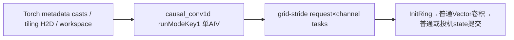
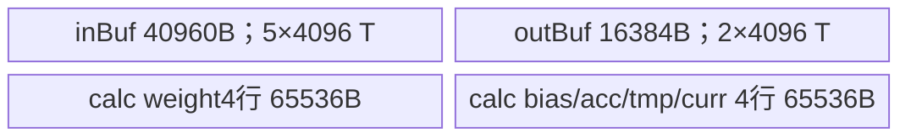

# 原生统一因果卷积 Update A3 Direct Invoke 算子知识

## 算子速览

| 项目 | 内容 |
|---|---|
| 实际入口 | Direct Invoke `torch.ops.npu.causal_conv1d`，本卡独立数学为run_mode=1的原地状态更新。 |
| 计算语义 | 从state历史开始按token递推因果逐通道卷积；普通模式提交末K−1历史，K4+accepted模式可写候选窗口。 |
| 输入输出 | BF16/FP16同dtype；X dense[B,S,D]或packed[L,D]、weight[K,D]、state[pool,W,D]、新Y；K2/3/4。 |
| 执行类型 | 单AIV_VECTOR Kernel，KERNEL_TYPE_MIX_AIV_1_0，无Cube；update恒禁用fn rolling/VF。 |
| Kernel 路线 | R-001/R-002普通dense/packed；R-003/R-004 K4接受数dense/packed；每条BF16/FP16实例明确。 |
| 核心资源 | 固定188416B UB；5slot ring、2slot输出、FP32权重/计算；update无自有workspace交接。 |
| 来源闭包 | direct_implementation_closed：Torch→Host/POD→runtime entry→Update body与legacy构建全部闭合。 |
| 验证状态 | draft：dtype/device/core缓存key遗漏、raw selector窄化、metadata/状态容量边界；本次知识提取未执行编译、真机、数值或性能测试。 |

## 接口与语义

### 计算语义

对每request，取K−1旧history，顺序计算每token `z=Σj weight[j]*history_or_X+bias`，可选SiLU，新Y写回x.dtype。普通路径从state[slot,0:K−1]开始，最终仅把末K−1历史写回前K−1行。K4且accepted Tensor非空时，先令offset=accepted−1，经源码分支夹到0与W−3之间，读state[offset:offset+3]作为初态；计算整个request长度len，并非只算accepted项。若W≥2+len，写state前两行为旧state[offset+1:offset+3]、后len行为全部新X，即候选窗口；否则fallback仅提交最后3行，不能当作等价完整候选scratch。

update中hasInit恒true，**has_initial_state=False/None不能令初态归零**；K2/K3不读取accepted数值。X本身只读，state原地可变，Y新empty_like。pad命中、空request或invalid任务跳过，Y对应区域未初始化。此独立数学与fn零初态/尾chunk提交、Python v2及旧独立causal_conv1d_update分别保存，不共用未证明ABI。

### 输入、输出与属性

| 参数 | shape/layout | dtype | 约束、默认值与语义 |
|---|---|---|---|
| x | 连续[B,S,D]或[L,D] | BF16/FP16 | rank3为dense、rank2为packed；packed给qsl。 |
| weight | 连续[K,D] | x.dtype | K2..4且同D；权重从最旧到当前tap。 |
| conv_states | 连续[pool,W,D]，Tensor(a!) | x.dtype | 必须W≥K−1；slot容量与独占由调用方保证。K4完整scratch还需W≥2+实际len。 |
| bias | 可选[D] | 应为x.dtype | 仅defined&&numel>0判存在，其他元信息未全查。 |
| query_start_loc | packed[B+1] | 转int64 | Host只先检查size0≥2；Device读取后窄int32，边界单调/容量未全查。dense不使用。 |
| cache_indices | 可选[B] | 转int64 | 无则slot=seq；等pad_slot_id跳过；其余索引没有完整容量guard。 |
| has_initial_state | 可选[B] | 转int64 | Host保留flag/分配workspace，但Update Init忽略这个GM指针。 |
| num_accepted_tokens | 可选[B] | 转int32 | 仅K4读取；offset取accepted−1并按源码if/else夹值。 |
| activation_mode | 默认0 | int64 | 非零SiLU；没有只接受0/1的断言。 |
| pad_slot_id/run_mode | 默认−1/0 | int64 | 本数学标准run_mode=1；raw其他值可能窄化错配，不扩展支持域。 |
| y | 新empty_like(x) | x.dtype | 不覆写x，空/pad区域不补零。 |

### 入口与版本

固定kernel commit dda6d36b0cdb4081e102d14c0a2fb276fc416e69，所选SDK/CANN9.1.0固定e5451c7feba11f9e259f4fbc19c4bf82f8c0496c。本入口是legacy Torch注册Direct Invoke，不能补造成ACLNN。MAMBA固定CI矩阵列A3/950、CANN9.1.0，legacy构建始终编入统一causal_conv1d Host/Device；prefill活动测试及同entry完整update接线可定位。本卡没有声称任何本次运行结果。旧独立update的专属测试被950过滤，其A3only范围不能反过来充当统一entry在950的否定或测试证明。

[旧卷积/recurrent接入](/model/inference/guides/integration/sgl_kernel_npu/sgl_legacy_causal_conv_recurrent.md)与[Python v2 A3源码卡](/model/inference/operators/direct/nn/conv/sgl_causal_conv1d_update_v2.md)提供布局与所有权对照，均不是本Device body的别名。

## Host/Launcher 执行流程

### 参数校验与前处理

schema将None转同x设备空Tensor；Host检查X/weight/state存在、rank2/3、2、3；BF16/FP16同dtype，三者连续，weight/state D相等，K2..4。dense得到B,S,D,L=B*S，packed得到L,D并从qsl.size0−1推B。创建empty_like Y，bias/indices/initial/accepted以defined&&numel>0判存在；qsl/cache/initial转int64，accepted转int32。没有统一验证所有可选Tensor同设备、连续、长度及值域，也没有检查stateLen与window容量。metadata.to不保证原布局任意strided视图都变成线性连续；caller应给符合Device线性读取的缓冲。

### 参数、Workspace 与生命周期

POD memset0后写字段；Update参数producer先按candidate选择baseDim，再baseDimCnt，fnPlanKey=0、tokenBlockSize/tokenBlockCnt=0。Host仍根据initial Tensor存在计算 `16MiB+32*blocks+2*B*(K−1)*D`，并取max(libWorkspace,该值)分配byte Tensor，但Update::Init忽略workspace，因此该多余内存不应绘成实际snapshot边；无软件/硬件跨核SyncAll。GetUserWorkspace仍在共同entry调用，固定SDK系统区16MiB，update下游不使用返回地址。

POD自然8B对齐推导2248B，复制按32B向上2272B；首调设备的静态globalTilingBuffer保存1024槽，2326528B。hash key包含D/L/S/B/inputMode/K/W/pool/activation/pad/runMode与四个presence flag，**遗漏dtype、device与AIV核数**，仅hash数值作map键，没有原key相等比较。缓存命中可能返回旧dtypeKey或旧tiling；同shape/flags的BF16/FP16交替有静态类型解释风险，跨设备/核数和并发globals也没有隔离。新计算的tilingData不保证就是实际消费POD。

H2D helper用pinned CPU Tensor、当前NPU、non_blocking/copy=true；raw EXEC_KERNEL_CMD转data_ptr并只捕获stream/blockdim/pointer tuple，OpCommand lambda调用aclrtlaunch后无条件返回0。没有显式Tensor owner捕获或record_stream，临时metadata/workspace/满缓存POD的异步延寿依框架边界，不能虚构已证安全延寿；launcher返回码也不传播。state持续存活且槽位由caller独占，直到当前stream消费完成。

### 启动图与失败传播



| 节点/边 | Host启动函数/entry | block/POD/数据 | ordering与owner/lifetime/失败 |
|---|---|---|---|
| 单K | causal_conv1d_impl/EXEC_KERNEL_CMD→aclrtlaunch_causal_conv1d→causal_conv1d | blocks=max(1,min(A,int32(B*C)))；CausalConv1dTilingData；X/weight/state/options/Y | 当前NPU stream；检查异常阻止launch；launcher结果未向lambda返回。 |
| task内GM↔UB | InitRing→RunSeq→WriteBackState或WriteBackStateSpec | 每task一request一channel slice；无跨Kernelworkspace | explicit HardEvent和drain，核私有ring；state与output由caller/Host持有。 |
| state→下一调用 | 本K普通/投机state提交 | 2*pool*W*D字节池，实际只写正文列出行 | 同stream ordering由runtime；跨stream、重复slot没有自有同步。 |

Torch分配、metadata cast、H2D、OpCommand/runtime/allocator为框架边界。核心卷积、accepted偏移、所有state搬运与分核在固定自有body可见；没有核心外部算子闭包缺口。

## Route 与参数设计

### 分核与资源计算

ChooseUpdateBaseDimChoice按候选顺序4096,2048,1024,512,384,192扫描，coreNum=A>0?A:1。先只接受D%candidate==0，C=D/candidate；若这一轮没有任何grid=B*C>0的候选，才再扫描ceil(D/candidate)。每轮先选grid≥coreNum且gap最小者，相同gap保留先遇到的候选；没有over则选最大under-grid，grid相同选较小baseDim。不是无条件取最小tile，也不会因精确整除轮未满核就自动尝试ceil轮。均无结果时baseDim=(0<D≤4096)?D:4096，C=ceil(D/baseDim)并至少1。

目标grid=B*C，实际blocks=max(1,min(A,int32(grid)))；Device按task=blockId;task<B*C;task+=GetBlockNum()执行，因此与fn每block仅一task不同，普通宽D不会因C>A自动丢任务。seq=task/C，channelTile=task%C，channelStart=tile*baseDim，d=min(baseDim,D−channelStart)。packed从qsl[seq:seq+2]，dense从seq*S取长度S；空窗口跳过。Device大量int64 POD窄为int32，无值域/乘法检查；每核固定188416B UB，未query可用UB或对DMA尾d作16元素对齐，非对齐尾不能保证安全。

### Route 选择

| 顺序 | Route | Key/模板 | 精确选择条件与优先级 | 不适用去向 |
|---:|---|---|---|---|
| 1 | R-001 Dense 普通更新 | dtypeKey0/1；Update<T,1,0,0> | 标准run_mode=1；X.rank=3；K=2或3（accepted可有可无），或K=4且accepted Tensor为空 | 元信息检查失败抛异常；具体空/invalid窗口跳过 |
| 2 | R-002 Packed 普通更新 | dtypeKey0/1；Update<T,1,0,0> | 标准run_mode=1；X.rank=2且qsl≥2；K=2或3（accepted可有可无），或K=4且accepted Tensor为空 | 元信息检查失败抛异常；具体空/invalid窗口跳过 |
| 3 | R-003 Dense K4 投机窗口更新 | dtypeKey0/1；Update<T,1,0,0> | 标准run_mode=1；X.rank=3，K=4且accepted Tensor非空 | 元信息检查失败抛异常；具体空/invalid窗口跳过 |
| 4 | R-004 Packed K4 投机窗口更新 | dtypeKey0/1；Update<T,1,0,0> | 标准run_mode=1；X.rank=2且qsl≥2，K=4且accepted Tensor非空 | 元信息检查失败抛异常；具体空/invalid窗口跳过 |

```text
标准run_mode=1 → Host update tiling → entry runModeKey1
  dtypeKey0→bfloat16_t，非0→half
  RunCausalConv1dUpdate<T>，width为POD运行时值
  inputMode0→packed窗口；inputMode1→dense窗口
  hasNumAcceptedTokens && width==4 ?
     true：offset夹值→InitRing→RunSeq→WriteBackStateSpec
       width4且2+len<=W：prefix2+全部X候选窗口
       否则：WriteBackState最后3历史fallback
     false：offset0→InitRing→RunSeq→WriteBackState末K−1历史
```

### 模板/实现执行矩阵

| Route | key/selector | dtype/shape/platform 完整命中条件 | 执行拓扑与 Kernel 节点 | 实际模板/body | 内存与同步特征 | tail/fallback |
|---|---|---|---|---|---|---|
| R-001 Dense 普通更新 | runModeKey1,dtype0/1,inputMode1；K2/3或K4无accepted | run_mode=1；X.rank=3；K=2或3（accepted可有可无），或K=4且accepted Tensor为空；本平台构建且缓存POD一致 | 单AIV launch，request×channel grid-stride | CausalConv1dUpdate<T>继承CausalConv1d<T,1,0,0>；ProcessDefaultByWindowMode<BATCH>→RunSeq | UB188416B，ring/event；末K−1行写回；无workspace edge | 空/pad跳过Y未写 |
| R-002 Packed 普通更新 | runModeKey1,dtype0/1,inputMode0；K2/3或K4无accepted | run_mode=1；X.rank=2且qsl≥2；K=2或3（accepted可有可无），或K=4且accepted Tensor为空；本平台构建且缓存POD一致 | 单AIV launch，request×channel grid-stride | CausalConv1dUpdate<T>继承CausalConv1d<T,1,0,0>；ProcessDefaultByWindowMode<VARLEN>→RunSeq | UB188416B，ring/event；末K−1行写回；无workspace edge | 空/pad跳过Y未写 |
| R-003 Dense K4 投机窗口更新 | runModeKey1,dtype0/1,inputMode1；K4+accepted | run_mode=1；X.rank=3，K=4且accepted Tensor非空；本平台构建且缓存POD一致 | 单AIV launch，request×channel grid-stride | CausalConv1dUpdate<T>继承CausalConv1d<T,1,0,0>；ProcessDefaultByWindowMode<BATCH>→RunSeq | UB188416B，ring/event；prefix2复制及X双buffer MTE2_MTE3/MTE3_MTE2；无workspace edge | 2+len>W只写最后3行；accepted边界需合法 |
| R-004 Packed K4 投机窗口更新 | runModeKey1,dtype0/1,inputMode0；K4+accepted | run_mode=1；X.rank=2且qsl≥2，K=4且accepted Tensor非空；本平台构建且缓存POD一致 | 单AIV launch，request×channel grid-stride | CausalConv1dUpdate<T>继承CausalConv1d<T,1,0,0>；ProcessDefaultByWindowMode<VARLEN>→RunSeq | UB188416B，ring/event；prefix2复制及X双buffer MTE2_MTE3/MTE3_MTE2；无workspace edge | 2+len>W只写最后3行；accepted边界需合法 |

### 隐藏性能 Guard

| Guard | Host/Tiling 条件 | Device/资源原因 | 影响 Route | 不满足时去向 | 源码符号 |
|---|---|---|---|---|---|
| candidate整除优先 | exact轮有任意grid>0则不进ceil轮 | 减少channel尾部并接近AIV核数 | 全部 | 无候选才ceil或fallback | ChooseUpdateBaseDimChoice |
| tile资源 | baseDim1..4096、C>0、D/B>0、K2..4 | 固定ring/calc容量 | 全部 | Update::Process释放event并返回，Y无补零 | CausalConv1dUpdate::Process |
| rolling禁用 | kIsUpdateMode=true | 不使用fn partial/VF且运行时width | 全部 | 恒RunSeq通用计算 | IsFnRollingFastPathEnabled |
| 投机开关 | accepted Tensor非空 && K==4 | 仅K4有keep2+X候选窗口body | R003/R004 | K2/3与K4无accepted走ordinary | IsUpdateSpecDecodingEnabled |
| 状态容量 | 2+len<=W | 候选prefix2+len必须能容纳 | spec | WriteBackState最后3行，非完整scratch | WriteBackStateSpec |
| offset夹值 | accepted−1<0则0，否则>W−3则W−3 | 初态窗口跨度3 | spec | 无外部报错；W<3不被正确合法化 | ProcessDefaultByWindowMode |
| pad/空request | slot==pad；window len<=0 | 不读写该task | 全部 | 跳过；Y empty未初始化 | ResolveSeqCacheIndex/ResolveSeqTaskWindow |
| DMA/UB | 无显式Host guard | 188416B、DataCopy d长度 | 全部 | 无专用fallback | InitSharedBuffersAndEvents |
| cache/selector | hash漏dtype/device/core；run_mode uint32 | 实际POD可与新producer不同 | 全部 | 已知静态风险，无修复回退 | CausalConv1dTilingKey/ComputeTilingData |

### POD/ABI

Host/Device共用结构；以下按int64_t 8B自然对齐推导sizeof2248B、alignof8、字段offset，非本次编译测量或源码static_assert。数组字段各128项、1024B，未用字段仍完整列出。

| 结构 | 字段 | 类型/位宽 | ABI 布局 | 单位 | Host/launcher producer | Device consumer | 边界 |
|---|---|---|---|---|---|---|---|
| CausalConv1dTilingData | dim | int64_t，元素64位 | offset=0B | D | X最后轴 | 所有GM token/weight/state跨行步长；Device窄为int32 | D>0/32字节搬运前提未由Host完整约束 |
| CausalConv1dTilingData | cuSeqlen | int64_t，元素64位 | offset=8B | token | packed:X.size(0)；dense:B*S | update body不按总token切核；dense/packed窗口另算 | int64乘法/metadata值域未全检 |
| CausalConv1dTilingData | seqLen | int64_t，元素64位 | offset=16B | token/request | dense:S；packed:0 | dense起点seq*S、长度S；packed用qsl | window长度窄为int32 |
| CausalConv1dTilingData | inputMode | int64_t，元素64位 | offset=24B | 枚举 | X二维0；三维1 | 0读queryStartLoc；1按dense窗口 | Host不产生2 |
| CausalConv1dTilingData | width | int64_t，元素64位 | offset=32B | tap | weight.size(0),检查2..4 | historyCount=K−1；weight/最终state循环 | 须stateLen≥K−1，Host未断言 |
| CausalConv1dTilingData | stateLen | int64_t，元素64位 | offset=40B | token/cache | conv_states.size(1) | cacheIdx*W*D状态池步长 | pool内容量/accepted偏移调用方负责 |
| CausalConv1dTilingData | numCacheLines | int64_t，元素64位 | offset=48B | cache slot | conv_states.size(0) | update body不用于cacheIdx上界检查 | 不是实际索引保护 |
| CausalConv1dTilingData | batch | int64_t，元素64位 | offset=56B | request | dense:X.size(0)；packed:qsl.size(0)−1 | ProcessDefault任务总数=B*C | metadata形状/同设备不全检 |
| CausalConv1dTilingData | activationMode | int64_t，元素64位 | offset=64B | 枚举 | activation_mode原值 | HasActivation:!=0则Silu | 任何非零均启用，不限1 |
| CausalConv1dTilingData | padSlotId | int64_t，元素64位 | offset=72B | cache slot | pad_slot_id原值 | cacheIndices值相等时跳过该request | 仅有cacheIndices才检查 |
| CausalConv1dTilingData | hasBias | int64_t，元素64位 | offset=80B | bool/int64 | defined &&numel>0 | LoadWeightAndBias与RunSeq的bias初始化 | 不参与rolling，因为update恒禁用rolling |
| CausalConv1dTilingData | baseDim | int64_t，元素64位 | offset=88B | channel | chooseExactThenCeil候选4096/2048/1024/512/384/192；无选择则D≤4096?D:4096 | ProcessDefault每task channel tile，尾取min | 合法baseDim1..4096；无UB query |
| CausalConv1dTilingData | baseDimCnt | int64_t，元素64位 | offset=96B | tile | 按candidate精确整除或ceil(D/baseDim)，fallback至少1 | grid=B*C并按实际blocks跨步 | 支持多task/grid-stride |
| CausalConv1dTilingData | hasNumAcceptedTokens | int64_t，元素64位 | offset=104B | bool/int64 | accepted非空 | 仅width==4启用spec；其他宽不读值 | int32 accepted−1及state容量需合法 |
| CausalConv1dTilingData | hasCacheIndices | int64_t，元素64位 | offset=112B | bool/int64 | cache_indices非空 | ResolveSeqCacheIndex | 缺省slot=seq |
| CausalConv1dTilingData | hasInitialStateMode | int64_t，元素64位 | offset=120B | bool/int64 | initial Tensor非空 | update Init忽略initialStateMode，ProcessDefault hasInit恒true | flag不能清零初态 |
| CausalConv1dTilingData | tokenBlockSize | int64_t，元素64位 | offset=128B | token | 显式0 | update body不读取 | 无token切分 |
| CausalConv1dTilingData | tokenBlockCnt | int64_t，元素64位 | offset=136B | tile | 显式0 | update body不读取 | 仅fn使用 |
| CausalConv1dTilingData | hasExplicitTokenSeqRanges | int64_t，元素64位 | offset=144B | bool/int64 | memset0后显式0 | update body不读取 | 本入口无活动consumer |
| CausalConv1dTilingData | explicitTokenSeqRangeCount | int64_t，元素64位 | offset=152B | tile | 显式0 | update body不读取 | 本入口无活动consumer |
| CausalConv1dTilingData | tokenTileStartSeq[128] | int64_t[128]，元素64位 | offset=160B，extent1024B | request | memset全0 | update body不读取 | 本入口无活动consumer |
| CausalConv1dTilingData | tokenTileEndSeq[128] | int64_t[128]，元素64位 | offset=1184B，extent1024B | request | memset全0 | update body不读取 | 本入口无活动consumer |
| CausalConv1dTilingData | hasInitStateWorkspace | int64_t，元素64位 | offset=2208B | bool/int64 | 仍按initial Tensor存在写1 | update Init忽略workspace，不snapshot/SyncAll | Host可多分配但不是update交接边 |
| CausalConv1dTilingData | dtypeKey | int64_t，元素64位 | offset=2216B | 枚举 | BF16=0；FP16=1 | router T=bfloat16_t/half | 缓存hash遗漏dtype，可读到旧POD |
| CausalConv1dTilingData | runModeKey | int64_t，元素64位 | offset=2224B | 枚举 | 标准run_mode=1，经uint32写1 | router runModeKey==1→RunCausalConv1dUpdate<T> | 非1但低32位1的raw错配另列失败边界，不扩展支持域 |
| CausalConv1dTilingData | widthKey | int64_t，元素64位 | offset=2232B | 枚举 | K2→1,K3→2,K4→3 | update entry不按此选实例，width运行时读取 | K=2..4检查保留 |
| CausalConv1dTilingData | fnPlanKey | int64_t，元素64位 | offset=2240B | 枚举 | INVALID=0 | Update<T,UPDATE,RUNTIME,INVALID>固定模板 | rolling恒禁用 |

### Route 源码闭包

| Route | Key/selector | Host/Tiling producer | POD/参数 | Kernel entry/router 节点 | Kernel body/直接依赖 | 构建接线 |
|---|---|---|---|---|---|---|
| R-001 | run1,inputMode1,spec0,dtype0/1 | csrc/causal_conv1d/op_host/causal_conv1d.cpp::ComputeTilingData/ChooseUpdateBaseDimChoice | CausalConv1dTilingData | op_kernel/causal_conv1d.cpp::RunCausalConv1dUpdate<T> | causal_conv1d_update.h::Process；causal_conv1d.h::ProcessDefaultByWindowMode<BATCH>/InitRing/RunSeq/WriteBackState；common.h布局 | cmake/legacy_kernels.cmake::workspace_kernel→sgl_kernel_npu |
| R-002 | run1,inputMode0,spec0,dtype0/1 | csrc/causal_conv1d/op_host/causal_conv1d.cpp::ComputeTilingData/ChooseUpdateBaseDimChoice | CausalConv1dTilingData | op_kernel/causal_conv1d.cpp::RunCausalConv1dUpdate<T> | causal_conv1d_update.h::Process；causal_conv1d.h::ProcessDefaultByWindowMode<VARLEN>/InitRing/RunSeq/WriteBackState；common.h布局 | cmake/legacy_kernels.cmake::workspace_kernel→sgl_kernel_npu |
| R-003 | run1,inputMode1,spec1,dtype0/1 | csrc/causal_conv1d/op_host/causal_conv1d.cpp::ComputeTilingData/ChooseUpdateBaseDimChoice | CausalConv1dTilingData | op_kernel/causal_conv1d.cpp::RunCausalConv1dUpdate<T> | causal_conv1d_update.h::Process；causal_conv1d.h::ProcessDefaultByWindowMode<BATCH>/InitRing/RunSeq/WriteBackStateSpec；common.h布局 | cmake/legacy_kernels.cmake::workspace_kernel→sgl_kernel_npu |
| R-004 | run1,inputMode0,spec1,dtype0/1 | csrc/causal_conv1d/op_host/causal_conv1d.cpp::ComputeTilingData/ChooseUpdateBaseDimChoice | CausalConv1dTilingData | op_kernel/causal_conv1d.cpp::RunCausalConv1dUpdate<T> | causal_conv1d_update.h::Process；causal_conv1d.h::ProcessDefaultByWindowMode<VARLEN>/InitRing/RunSeq/WriteBackStateSpec；common.h布局 | cmake/legacy_kernels.cmake::workspace_kernel→sgl_kernel_npu |

## Kernel 实现

### 公共执行流程

entry读runModeKey1后选dtype T，调用Update Init。initialStateMode参数不绑定，workspace参数显式unused，numAcceptedTokens按int32绑定；分配in/out/calc三个TBuf与25个HardEvent ID。Update::Process先检查baseDim/C/D/B/K，非法则释放event退出；否则ProcessDefault依inputMode选择模板window，所有task做grid-stride。hasInit常量true。每task加载右对齐4行FP32权重与可选bias，T临时放在对应FP32行高半区，再Cast升FP32、PIPE_V，空weight tap补0。InitRing取W步长的旧K−1行（普通offset0、spec夹值offset）；当前X预取slot3，5slot ring保证history/current/next轮换。RunSeq恒通用：逐token逐tap Cast到FP32、Mul首项或bias初始化后MulAddDst，activation非零Silu，CAST_RINT到双slot输出，再MTE3写Y。所有API的count是当前有效d，slot间隔固定4096元素。

普通WriteBackState从最后ring取末K−1项写state前缀；spec在RunSeq后drain，若容量允许，从GM旧state offset+1/+2经ring前两slot拷到state0/1，再双buffer重读X逐步写state[2+t]，最后等待两个MTE3_MTE2事件。每task结束DrainTaskMte3后才能下一task重用UB；Process最终释放event。state写与Y写不同owner域，没有跨核atomic/SyncAll或重复slot仲裁。950与A3 update均使用此经典Vector body，RegBase只在fn rolling里可达。

### Route R-001：Dense 普通更新

#### 适用条件

标准run_mode=1，X.rank=3；K=2或3（accepted可有可无），或K=4且accepted Tensor为空；T=bfloat16_t/half按dtypeKey0/1。实际缓存POD须与当前输入一致；metadata、状态容量和DMA/UB前提成立，才可按本节复用。

##### 选择证据

| 层级 | 文件 | 符号 | 源码谓词/参数 | 结果/下一跳 |
|---|---|---|---|---|
| Host | csrc/causal_conv1d/op_host/causal_conv1d.cpp | ComputeTilingData | 原run_mode==1，inputMode=1，K2..4 | update baseDim/C，runModeKey1，fnPlan0 |
| Router | csrc/causal_conv1d/op_kernel/causal_conv1d.cpp | causal_conv1d | runModeKey1，dtypeKey0/1 | RunCausalConv1dUpdate<T> |
| Body | csrc/causal_conv1d/op_kernel/causal_conv1d.h | ProcessDefault/IsUpdateSpecDecodingEnabled | inputMode1，!(K4 && accepted存在) | ProcessDefaultByWindowMode<BATCH>，普通分支 |

#### Device 数据流

##### 函数级调用链

```text
causal_conv1d_impl → EXEC_KERNEL_CMD → aclrtlaunch_causal_conv1d
  → causal_conv1d → RunCausalConv1dUpdate<T>
  → CausalConv1dUpdate<T>::Init/Process
  → ProcessDefault → ProcessDefaultByWindowMode<BATCH>
    → ResolveSeqTaskWindowByMode/ResolveSeqCacheIndex
    → LoadWeightAndBias → InitRing(off)
    → RunSeq通用tap循环（rolling恒false）
    → WriteBackState
    → DrainTaskMte3 → 下一grid-stride任务
  → ReleaseEvents
```

##### 源码等价伪码

```text
# 伪码；K为运行时2/3/4，T由dtype0/1解释
for task=blockId;task<B*C;task+=GetBlockNum():
  seq=task/C;channel=(task%C)*baseDim;d=min(baseDim,D-channel)
  if channel>=D:continue
  s=seq*S;len=S
  if len<=0:continue
  slot=hasCacheIndices?int32(cache[seq]):seq
  if hasCacheIndices and cache[seq]==padSlotId:continue
  load weight[j*D+channel:...d] to FP32 weightF right-aligned4rows
  load/cast bias if present, otherwise zero
  off=0
  # hasInit=true，不读initialStateMode
  history = state[slot,off:off+K−1,channel:channel+d]
  ring K−1 history；current X[s] to slot3；可能next预取
  for t=0..len−1:
    wait current slot MTE2_V
    if t+1<len:wait V_MTE2; prefetch X[s+t+1] into (t+4)%5
    z = bias if present
    for j=4−K..3:
      tmp=CastFP32(ring[(t+3−(3−j))%5])
      z=first_uninitialized ? tmp*weightF[j] : MulAddDst(z,tmp,weightF[j])
    z=activation!=0?Silu(z):z
    if t>=2:wait out[t&1] previous MTE3_V
    out[t&1]=Cast_T(z,CAST_RINT)
    V_MTE3; DataCopy Y[(s+t)*D+channel] count=d
    signal output/free ring when next reuse exists
  last K−1 ring rows→state[slot,0:K−1,channel:channel+d]
  drain MTE3 before next task overwrites ring/calc
release events
```

普通模式始终从state前K−1行读取；K2/3即使accepted Tensor非空也不读其值。最终state前K−1行取末历史，W剩余行保持原值，不能宣传整个W滚动。

#### 内存与数据搬运

##### 资源与搬运表

| 层级/缓冲区 | offset/地址公式 | extent/容量公式 | dtype/layout | producer | consumer | owner/lifetime | 对齐/复用 |
|---|---|---|---|---|---|---|---|
| GM X/Y | (s+t)*D+channel | d项每copy；各2*L*D B | T contiguous | 调用方/Vector | ring/调用方 | Y新Tensor，X消费结束前只读 | 无DataCopyPad；d尾需满足primitive前提 |
| GM state seed | ((slot*W+off+h)*D+channel)*2B | K−1行×d；池容量2*pool*W*D | T | 调用方旧态 | InitRing；spec前缀复制 | caller可变持久池 | 无槽上界/重复槽仲裁 |
| UB inBuf | slot0..4，各8192B | 40960B | 5×4096 T | MTE2 | Vector | 核私有TBuf | history/current/next模5；尾state消费完成前不可覆盖 |
| UB outBuf | (t&1)*8192B | 16384B | 2×4096 T | CAST_RINT | MTE3 Y | 核私有 | V_MTE3/MTE3_V保护 |
| UB calcBuf | weight0..3 0..65535B；bias65536；acc81920；tmp98304；curr114688 | 131072B | 8×4096 FP32 | weight/bias Cast与计算 | RunSeq；curr未参与generic计算 | 每task重载 | T临时在对应行高半；不额外加总分配 |
| metadata | qsl/cache/initial int64、accepted int32 | caller合法B/B+1项 | 线性GM | Host.to/调用方 | 窗口/slot/presence选择 | 临时owner依框架异步生命周期 | initial不消费；accepted仅spec读 |
| workspace | Host byte Tensor | max(lib,initial存在?16MiB+32*blocks+2*B*(K−1)*D:0) | byte | Host | update Init忽略 | 同调用临时 | 无snapshot边、无SyncAll |


##### 分层内存布局



##### 字节账与复用顺序

```text
UB_total = 5*4096*2 + 2*4096*2 + 8*4096*4 = 188416 B
UB_total <= 实际可用UB 为前提，Host未据其选tile或拒绝
dynamic_ub = N/A，AIV TBuf，无SIMT
workspace_total = Host按上一表分配；update自身实际消费0 B
state有效写量/任务 = (K−1)*d*2 B
Y写量/任务 = len*d*2 B
```

| 复用子区 | 写入者 | 读取者/消费点 | 下一次覆盖 | 同步或释放依据 | 安全条件 |
|---|---|---|---|---|---|
| ring modulo5 | history/current/next MTE2 | RunSeq Cast与最终历史提交 | 下一token或task | MTE2_V/V_MTE2；task末drain | slot保留到最后state消费 |
| out2slot | Vector cast | MTE3写Y | t+2 | MTE3_V后覆盖，V_MTE3后读取 | count=d，非逻辑新分配 |
| calc weight/bias | MTE2高半暂存→Cast行首 | 全task tokens | 下一task | MTE2_V与PIPE_V | d≤4096；Cast primitive别名规则 |
| acc/tmp | tap Cast/MulAddDst/Silu | output CAST_RINT | 下一tap/token | PIPE_V | no rolling partial，bias保持 |


#### 同步、精度与尾块

##### 同步与数值边界表

| 阶段 | primitive/机制 | producer | consumer/等待点 | 保护对象 | 精度/尾块 |
|---|---|---|---|---|---|
| load weight/history | MTE2_V；PIPE_V | DMA | FP32 Cast及卷积 | weight/bias/ring | BF16/FP16→FP32 CAST_NONE |
| prefetch | 每ring slot MTE2_V及V_MTE2 | MTE2/Vector | current/next覆盖 | input5slot | 仅t+1<len预取 |
| 计算 | Cast、Mul/MulAddDst、Silu、PIPE_V | 每tap最旧到当前 | output CAST_RINT | FP32 acc/tmp | 全部count=d；无fast RegBase；primitive内部指令边界 |
| Y输出 | V_MTE3/MTE3_V | Vector | MTE3/下次outslot | output2slot | T类型CAST_RINT；pad/空无补零 |
| state提交 | ring DataCopy→state；task末DrainTaskMte3 | 尾ring | 同核下一task | state/ring | K−1项；只写d有效通道 |
| task结束 | DrainTaskMte3: MTE3_V与MTE3_MTE2 set/wait | 本task全部写出 | 下一grid-stride task | 共享TBuf | 无跨核SyncAll/atomic，重复slot调用者负责 |

#### 关键实现

##### 符号证据表

| 阶段 | 文件 | 符号/模板实例 | 实现事实 |
|---|---|---|---|
| Host/Tiling producer | csrc/causal_conv1d/op_host/causal_conv1d.cpp | ChooseUpdateBaseDimChoice/ComputeTilingData | baseDim与C、dtype、run1与POD |
| Kernel entry/router | csrc/causal_conv1d/op_kernel/causal_conv1d.cpp | RunCausalConv1dUpdate<T> | dtype0/1对应BF16/FP16 |
| Device body/helper | csrc/causal_conv1d/op_kernel/causal_conv1d_update.h | CausalConv1dUpdate<T>::Init/Process | initial与workspace忽略、资源/非法guard |
| Device body/helper | csrc/causal_conv1d/op_kernel/causal_conv1d.h | ProcessDefaultByWindowMode<BATCH>/InitRing/RunSeq/WriteBackState | 上述task/window/address/同步/精度/state分支 |


### Route R-002：Packed 普通更新

#### 适用条件

标准run_mode=1，X.rank=2且qsl≥2；K=2或3（accepted可有可无），或K=4且accepted Tensor为空；T=bfloat16_t/half按dtypeKey0/1。实际缓存POD须与当前输入一致；metadata、状态容量和DMA/UB前提成立，才可按本节复用。

##### 选择证据

| 层级 | 文件 | 符号 | 源码谓词/参数 | 结果/下一跳 |
|---|---|---|---|---|
| Host | csrc/causal_conv1d/op_host/causal_conv1d.cpp | ComputeTilingData | 原run_mode==1，inputMode=0，K2..4 | update baseDim/C，runModeKey1，fnPlan0 |
| Router | csrc/causal_conv1d/op_kernel/causal_conv1d.cpp | causal_conv1d | runModeKey1，dtypeKey0/1 | RunCausalConv1dUpdate<T> |
| Body | csrc/causal_conv1d/op_kernel/causal_conv1d.h | ProcessDefault/IsUpdateSpecDecodingEnabled | inputMode0，!(K4 && accepted存在) | ProcessDefaultByWindowMode<VARLEN>，普通分支 |

#### Device 数据流

##### 函数级调用链

```text
causal_conv1d_impl → EXEC_KERNEL_CMD → aclrtlaunch_causal_conv1d
  → causal_conv1d → RunCausalConv1dUpdate<T>
  → CausalConv1dUpdate<T>::Init/Process
  → ProcessDefault → ProcessDefaultByWindowMode<VARLEN>
    → ResolveSeqTaskWindowByMode/ResolveSeqCacheIndex
    → LoadWeightAndBias → InitRing(off)
    → RunSeq通用tap循环（rolling恒false）
    → WriteBackState
    → DrainTaskMte3 → 下一grid-stride任务
  → ReleaseEvents
```

##### 源码等价伪码

```text
# 伪码；K为运行时2/3/4，T由dtype0/1解释
for task=blockId;task<B*C;task+=GetBlockNum():
  seq=task/C;channel=(task%C)*baseDim;d=min(baseDim,D-channel)
  if channel>=D:continue
  s=int32(qsl[seq]);len=int32(qsl[seq+1])−s
  if len<=0:continue
  slot=hasCacheIndices?int32(cache[seq]):seq
  if hasCacheIndices and cache[seq]==padSlotId:continue
  load weight[j*D+channel:...d] to FP32 weightF right-aligned4rows
  load/cast bias if present, otherwise zero
  off=0
  # hasInit=true，不读initialStateMode
  history = state[slot,off:off+K−1,channel:channel+d]
  ring K−1 history；current X[s] to slot3；可能next预取
  for t=0..len−1:
    wait current slot MTE2_V
    if t+1<len:wait V_MTE2; prefetch X[s+t+1] into (t+4)%5
    z = bias if present
    for j=4−K..3:
      tmp=CastFP32(ring[(t+3−(3−j))%5])
      z=first_uninitialized ? tmp*weightF[j] : MulAddDst(z,tmp,weightF[j])
    z=activation!=0?Silu(z):z
    if t>=2:wait out[t&1] previous MTE3_V
    out[t&1]=Cast_T(z,CAST_RINT)
    V_MTE3; DataCopy Y[(s+t)*D+channel] count=d
    signal output/free ring when next reuse exists
  last K−1 ring rows→state[slot,0:K−1,channel:channel+d]
  drain MTE3 before next task overwrites ring/calc
release events
```

普通模式始终从state前K−1行读取；K2/3即使accepted Tensor非空也不读其值。最终state前K−1行取末历史，W剩余行保持原值，不能宣传整个W滚动。

#### 内存与数据搬运

##### 资源与搬运表

| 层级/缓冲区 | offset/地址公式 | extent/容量公式 | dtype/layout | producer | consumer | owner/lifetime | 对齐/复用 |
|---|---|---|---|---|---|---|---|
| GM X/Y | (s+t)*D+channel | d项每copy；各2*L*D B | T contiguous | 调用方/Vector | ring/调用方 | Y新Tensor，X消费结束前只读 | 无DataCopyPad；d尾需满足primitive前提 |
| GM state seed | ((slot*W+off+h)*D+channel)*2B | K−1行×d；池容量2*pool*W*D | T | 调用方旧态 | InitRing；spec前缀复制 | caller可变持久池 | 无槽上界/重复槽仲裁 |
| UB inBuf | slot0..4，各8192B | 40960B | 5×4096 T | MTE2 | Vector | 核私有TBuf | history/current/next模5；尾state消费完成前不可覆盖 |
| UB outBuf | (t&1)*8192B | 16384B | 2×4096 T | CAST_RINT | MTE3 Y | 核私有 | V_MTE3/MTE3_V保护 |
| UB calcBuf | weight0..3 0..65535B；bias65536；acc81920；tmp98304；curr114688 | 131072B | 8×4096 FP32 | weight/bias Cast与计算 | RunSeq；curr未参与generic计算 | 每task重载 | T临时在对应行高半；不额外加总分配 |
| metadata | qsl/cache/initial int64、accepted int32 | caller合法B/B+1项 | 线性GM | Host.to/调用方 | 窗口/slot/presence选择 | 临时owner依框架异步生命周期 | initial不消费；accepted仅spec读 |
| workspace | Host byte Tensor | max(lib,initial存在?16MiB+32*blocks+2*B*(K−1)*D:0) | byte | Host | update Init忽略 | 同调用临时 | 无snapshot边、无SyncAll |


##### 分层内存布局


##### 字节账与复用顺序

```text
UB_total = 5*4096*2 + 2*4096*2 + 8*4096*4 = 188416 B
UB_total <= 实际可用UB 为前提，Host未据其选tile或拒绝
dynamic_ub = N/A，AIV TBuf，无SIMT
workspace_total = Host按上一表分配；update自身实际消费0 B
state有效写量/任务 = (K−1)*d*2 B
Y写量/任务 = len*d*2 B
```

| 复用子区 | 写入者 | 读取者/消费点 | 下一次覆盖 | 同步或释放依据 | 安全条件 |
|---|---|---|---|---|---|
| ring modulo5 | history/current/next MTE2 | RunSeq Cast与最终历史提交 | 下一token或task | MTE2_V/V_MTE2；task末drain | slot保留到最后state消费 |
| out2slot | Vector cast | MTE3写Y | t+2 | MTE3_V后覆盖，V_MTE3后读取 | count=d，非逻辑新分配 |
| calc weight/bias | MTE2高半暂存→Cast行首 | 全task tokens | 下一task | MTE2_V与PIPE_V | d≤4096；Cast primitive别名规则 |
| acc/tmp | tap Cast/MulAddDst/Silu | output CAST_RINT | 下一tap/token | PIPE_V | no rolling partial，bias保持 |


#### 同步、精度与尾块

##### 同步与数值边界表

| 阶段 | primitive/机制 | producer | consumer/等待点 | 保护对象 | 精度/尾块 |
|---|---|---|---|---|---|
| load weight/history | MTE2_V；PIPE_V | DMA | FP32 Cast及卷积 | weight/bias/ring | BF16/FP16→FP32 CAST_NONE |
| prefetch | 每ring slot MTE2_V及V_MTE2 | MTE2/Vector | current/next覆盖 | input5slot | 仅t+1<len预取 |
| 计算 | Cast、Mul/MulAddDst、Silu、PIPE_V | 每tap最旧到当前 | output CAST_RINT | FP32 acc/tmp | 全部count=d；无fast RegBase；primitive内部指令边界 |
| Y输出 | V_MTE3/MTE3_V | Vector | MTE3/下次outslot | output2slot | T类型CAST_RINT；pad/空无补零 |
| state提交 | ring DataCopy→state；task末DrainTaskMte3 | 尾ring | 同核下一task | state/ring | K−1项；只写d有效通道 |
| task结束 | DrainTaskMte3: MTE3_V与MTE3_MTE2 set/wait | 本task全部写出 | 下一grid-stride task | 共享TBuf | 无跨核SyncAll/atomic，重复slot调用者负责 |

#### 关键实现

##### 符号证据表

| 阶段 | 文件 | 符号/模板实例 | 实现事实 |
|---|---|---|---|
| Host/Tiling producer | csrc/causal_conv1d/op_host/causal_conv1d.cpp | ChooseUpdateBaseDimChoice/ComputeTilingData | baseDim与C、dtype、run1与POD |
| Kernel entry/router | csrc/causal_conv1d/op_kernel/causal_conv1d.cpp | RunCausalConv1dUpdate<T> | dtype0/1对应BF16/FP16 |
| Device body/helper | csrc/causal_conv1d/op_kernel/causal_conv1d_update.h | CausalConv1dUpdate<T>::Init/Process | initial与workspace忽略、资源/非法guard |
| Device body/helper | csrc/causal_conv1d/op_kernel/causal_conv1d.h | ProcessDefaultByWindowMode<VARLEN>/InitRing/RunSeq/WriteBackState | 上述task/window/address/同步/精度/state分支 |


### Route R-003：Dense K4 投机窗口更新

#### 适用条件

标准run_mode=1，X.rank=3，K=4且accepted Tensor非空；T=bfloat16_t/half按dtypeKey0/1。实际缓存POD须与当前输入一致；metadata、状态容量和DMA/UB前提成立，才可按本节复用。

##### 选择证据

| 层级 | 文件 | 符号 | 源码谓词/参数 | 结果/下一跳 |
|---|---|---|---|---|
| Host | csrc/causal_conv1d/op_host/causal_conv1d.cpp | ComputeTilingData | 原run_mode==1，inputMode=1，K2..4 | update baseDim/C，runModeKey1，fnPlan0 |
| Router | csrc/causal_conv1d/op_kernel/causal_conv1d.cpp | causal_conv1d | runModeKey1，dtypeKey0/1 | RunCausalConv1dUpdate<T> |
| Body | csrc/causal_conv1d/op_kernel/causal_conv1d.h | ProcessDefault/IsUpdateSpecDecodingEnabled | inputMode1，K4 && accepted存在 | ProcessDefaultByWindowMode<BATCH>，spec分支 |

#### Device 数据流

##### 函数级调用链

```text
causal_conv1d_impl → EXEC_KERNEL_CMD → aclrtlaunch_causal_conv1d
  → causal_conv1d → RunCausalConv1dUpdate<T>
  → CausalConv1dUpdate<T>::Init/Process
  → ProcessDefault → ProcessDefaultByWindowMode<BATCH>
    → ResolveSeqTaskWindowByMode/ResolveSeqCacheIndex
    → LoadWeightAndBias → InitRing(off)
    → RunSeq通用tap循环（rolling恒false）
    → DrainTaskMte3 → WriteBackStateSpec → [prefix2+X流水，或WriteBackState fallback]
    → DrainTaskMte3 → 下一grid-stride任务
  → ReleaseEvents
```

##### 源码等价伪码

```text
# 伪码；K固定4，T由dtype0/1解释
for task=blockId;task<B*C;task+=GetBlockNum():
  seq=task/C;channel=(task%C)*baseDim;d=min(baseDim,D-channel)
  if channel>=D:continue
  s=seq*S;len=S
  if len<=0:continue
  slot=hasCacheIndices?int32(cache[seq]):seq
  if hasCacheIndices and cache[seq]==padSlotId:continue
  load weight[j*D+channel:...d] to FP32 weightF right-aligned4rows
  load/cast bias if present, otherwise zero
  a=int32(accepted[seq]); off=a−1; if off<0:off=0; else if off>W−3:off=W−3
  # hasInit=true，不读initialStateMode
  history = state[slot,off:off+K−1,channel:channel+d]
  ring K−1 history；current X[s] to slot3；可能next预取
  for t=0..len−1:
    wait current slot MTE2_V
    if t+1<len:wait V_MTE2; prefetch X[s+t+1] into (t+4)%5
    z = bias if present
    for j=4−K..3:
      tmp=CastFP32(ring[(t+3−(3−j))%5])
      z=first_uninitialized ? tmp*weightF[j] : MulAddDst(z,tmp,weightF[j])
    z=activation!=0?Silu(z):z
    if t>=2:wait out[t&1] previous MTE3_V
    out[t&1]=Cast_T(z,CAST_RINT)
    V_MTE3; DataCopy Y[(s+t)*D+channel] count=d
    signal output/free ring when next reuse exists
  drain MTE3
  if 2+len>W:
    last3 ring→state[slot,0:3,channel:channel+d]
  else:
    copy old state[slot,off+1/off+2] to ring slot0/1
    MTE2_MTE3; copy those two rows→state[slot,0:2]
    MTE3_MTE2
    prefetch X[s] into ring slot0
    for t=0..len−1:
      curr=t&1; next=curr^1
      wait current MTE2_MTE3
      if t+1<len:
        if t>0:wait next slot previous MTE3_MTE2
        prefetch X[s+t+1] into next; set MTE2_MTE3[next]
      copy ring[curr]→state[slot,2+t]; set MTE3_MTE2[curr]
    wait slot0 and (len>1?slot1) copy completion
  drain MTE3 before next task overwrites ring/calc
release events
```

accepted控制读取旧窗口的位置，整个len仍进入卷积及候选状态写；不能把accepted当本次只算多少token。off夹值使用if/else if，需先有W≥3，否则maxOffset为负并不构成有效保护；int32极值的accepted−1也未做溢出检查。WriteBackStateSpec的hasInit=false分支从本Host不可达，因为ProcessDefault将hasInit写成常量true，不纳入支持Route。

#### 内存与数据搬运

##### 资源与搬运表

| 层级/缓冲区 | offset/地址公式 | extent/容量公式 | dtype/layout | producer | consumer | owner/lifetime | 对齐/复用 |
|---|---|---|---|---|---|---|---|
| GM X/Y | (s+t)*D+channel | d项每copy；各2*L*D B | T contiguous | 调用方/Vector | ring/调用方 | Y新Tensor，X消费结束前只读 | 无DataCopyPad；d尾需满足primitive前提 |
| GM state seed | ((slot*W+off+h)*D+channel)*2B | K−1行×d；池容量2*pool*W*D | T | 调用方旧态 | InitRing；spec前缀复制 | caller可变持久池 | 无槽上界/重复槽仲裁 |
| UB inBuf | slot0..4，各8192B | 40960B | 5×4096 T | MTE2 | Vector，及state候选MTE3 | 核私有TBuf | history/current/next模5；输出drain后前2slot改为X复制双buffer |
| UB outBuf | (t&1)*8192B | 16384B | 2×4096 T | CAST_RINT | MTE3 Y | 核私有 | V_MTE3/MTE3_V保护 |
| UB calcBuf | weight0..3 0..65535B；bias65536；acc81920；tmp98304；curr114688 | 131072B | 8×4096 FP32 | weight/bias Cast与计算 | RunSeq；curr未参与generic计算 | 每task重载 | T临时在对应行高半；不额外加总分配 |
| metadata | qsl/cache/initial int64、accepted int32 | caller合法B/B+1项 | 线性GM | Host.to/调用方 | 窗口/slot/accepted offset | 临时owner依框架异步生命周期 | initial不消费；accepted仅spec读 |
| workspace | Host byte Tensor | max(lib,initial存在?16MiB+32*blocks+2*B*(K−1)*D:0) | byte | Host | update Init忽略 | 同调用临时 | 无snapshot边、无SyncAll |
| GM state候选输出 | ((slot*W+2+t)*D+channel)*2B；prefix行0/1 | full分支(2+len)*d项，fallback3*d项 | T | GM旧prefix与X经ring | 下一调用/上层提交 | caller持有池；同taskdrain | full仅2+len≤W；无别名/并发保护 |


##### 分层内存布局


##### 字节账与复用顺序

```text
UB_total = 5*4096*2 + 2*4096*2 + 8*4096*4 = 188416 B
UB_total <= 实际可用UB 为前提，Host未据其选tile或拒绝
dynamic_ub = N/A，AIV TBuf，无SIMT
workspace_total = Host按上一表分配；update自身实际消费0 B
state有效写量/任务 = full:(2+len)*d*2 B；fallback:3*d*2 B
Y写量/任务 = len*d*2 B
```

| 复用子区 | 写入者 | 读取者/消费点 | 下一次覆盖 | 同步或释放依据 | 安全条件 |
|---|---|---|---|---|---|
| ring modulo5 | history/current/next MTE2 | RunSeq Cast与最终历史提交 | 下一token或task | MTE2_V/V_MTE2；task末drain | slot保留到最后state消费 |
| out2slot | Vector cast | MTE3写Y | t+2 | MTE3_V后覆盖，V_MTE3后读取 | count=d，非逻辑新分配 |
| calc weight/bias | MTE2高半暂存→Cast行首 | 全task tokens | 下一task | MTE2_V与PIPE_V | d≤4096；Cast primitive别名规则 |
| acc/tmp | tap Cast/MulAddDst/Silu | output CAST_RINT | 下一tap/token | PIPE_V | no rolling partial，bias保持 |
| ring slot0/1候选拷贝 | prefix及X MTE2 | state MTE3 | 下一X预取 | MTE2_MTE3/MTE3_MTE2双slot；最终wait | RunSeq/Y先drain；2+len≤W；caller无别名竞争 |


#### 同步、精度与尾块

##### 同步与数值边界表

| 阶段 | primitive/机制 | producer | consumer/等待点 | 保护对象 | 精度/尾块 |
|---|---|---|---|---|---|
| load weight/history | MTE2_V；PIPE_V | DMA | FP32 Cast及卷积 | weight/bias/ring | BF16/FP16→FP32 CAST_NONE |
| prefetch | 每ring slot MTE2_V及V_MTE2 | MTE2/Vector | current/next覆盖 | input5slot | 仅t+1<len预取 |
| 计算 | Cast、Mul/MulAddDst、Silu、PIPE_V | 每tap最旧到当前 | output CAST_RINT | FP32 acc/tmp | 全部count=d；无fast RegBase；primitive内部指令边界 |
| Y输出 | V_MTE3/MTE3_V | Vector | MTE3/下次outslot | output2slot | T类型CAST_RINT；pad/空无补零 |
| state提交 | prefix MTE2_MTE3/MTE3_MTE2，X双slot同事件；不足容量普通fallback | GM旧prefix/X或尾ring | 同核下一task | state/ring | full2+len项或fallback3项；只写d有效通道 |
| task结束 | DrainTaskMte3: MTE3_V与MTE3_MTE2 set/wait | 本task全部写出 | 下一grid-stride task | 共享TBuf | 无跨核SyncAll/atomic，重复slot调用者负责 |

#### 关键实现

##### 符号证据表

| 阶段 | 文件 | 符号/模板实例 | 实现事实 |
|---|---|---|---|
| Host/Tiling producer | csrc/causal_conv1d/op_host/causal_conv1d.cpp | ChooseUpdateBaseDimChoice/ComputeTilingData | baseDim与C、dtype、run1与POD |
| Kernel entry/router | csrc/causal_conv1d/op_kernel/causal_conv1d.cpp | RunCausalConv1dUpdate<T> | dtype0/1对应BF16/FP16 |
| Device body/helper | csrc/causal_conv1d/op_kernel/causal_conv1d_update.h | CausalConv1dUpdate<T>::Init/Process | initial与workspace忽略、资源/非法guard |
| Device body/helper | csrc/causal_conv1d/op_kernel/causal_conv1d.h | ProcessDefaultByWindowMode<BATCH>/InitRing/RunSeq/WriteBackStateSpec | 上述task/window/address/同步/精度/state分支 |


### Route R-004：Packed K4 投机窗口更新

#### 适用条件

标准run_mode=1，X.rank=2且qsl≥2，K=4且accepted Tensor非空；T=bfloat16_t/half按dtypeKey0/1。实际缓存POD须与当前输入一致；metadata、状态容量和DMA/UB前提成立，才可按本节复用。

##### 选择证据

| 层级 | 文件 | 符号 | 源码谓词/参数 | 结果/下一跳 |
|---|---|---|---|---|
| Host | csrc/causal_conv1d/op_host/causal_conv1d.cpp | ComputeTilingData | 原run_mode==1，inputMode=0，K2..4 | update baseDim/C，runModeKey1，fnPlan0 |
| Router | csrc/causal_conv1d/op_kernel/causal_conv1d.cpp | causal_conv1d | runModeKey1，dtypeKey0/1 | RunCausalConv1dUpdate<T> |
| Body | csrc/causal_conv1d/op_kernel/causal_conv1d.h | ProcessDefault/IsUpdateSpecDecodingEnabled | inputMode0，K4 && accepted存在 | ProcessDefaultByWindowMode<VARLEN>，spec分支 |

#### Device 数据流

##### 函数级调用链

```text
causal_conv1d_impl → EXEC_KERNEL_CMD → aclrtlaunch_causal_conv1d
  → causal_conv1d → RunCausalConv1dUpdate<T>
  → CausalConv1dUpdate<T>::Init/Process
  → ProcessDefault → ProcessDefaultByWindowMode<VARLEN>
    → ResolveSeqTaskWindowByMode/ResolveSeqCacheIndex
    → LoadWeightAndBias → InitRing(off)
    → RunSeq通用tap循环（rolling恒false）
    → DrainTaskMte3 → WriteBackStateSpec → [prefix2+X流水，或WriteBackState fallback]
    → DrainTaskMte3 → 下一grid-stride任务
  → ReleaseEvents
```

##### 源码等价伪码

```text
# 伪码；K固定4，T由dtype0/1解释
for task=blockId;task<B*C;task+=GetBlockNum():
  seq=task/C;channel=(task%C)*baseDim;d=min(baseDim,D-channel)
  if channel>=D:continue
  s=int32(qsl[seq]);len=int32(qsl[seq+1])−s
  if len<=0:continue
  slot=hasCacheIndices?int32(cache[seq]):seq
  if hasCacheIndices and cache[seq]==padSlotId:continue
  load weight[j*D+channel:...d] to FP32 weightF right-aligned4rows
  load/cast bias if present, otherwise zero
  a=int32(accepted[seq]); off=a−1; if off<0:off=0; else if off>W−3:off=W−3
  # hasInit=true，不读initialStateMode
  history = state[slot,off:off+K−1,channel:channel+d]
  ring K−1 history；current X[s] to slot3；可能next预取
  for t=0..len−1:
    wait current slot MTE2_V
    if t+1<len:wait V_MTE2; prefetch X[s+t+1] into (t+4)%5
    z = bias if present
    for j=4−K..3:
      tmp=CastFP32(ring[(t+3−(3−j))%5])
      z=first_uninitialized ? tmp*weightF[j] : MulAddDst(z,tmp,weightF[j])
    z=activation!=0?Silu(z):z
    if t>=2:wait out[t&1] previous MTE3_V
    out[t&1]=Cast_T(z,CAST_RINT)
    V_MTE3; DataCopy Y[(s+t)*D+channel] count=d
    signal output/free ring when next reuse exists
  drain MTE3
  if 2+len>W:
    last3 ring→state[slot,0:3,channel:channel+d]
  else:
    copy old state[slot,off+1/off+2] to ring slot0/1
    MTE2_MTE3; copy those two rows→state[slot,0:2]
    MTE3_MTE2
    prefetch X[s] into ring slot0
    for t=0..len−1:
      curr=t&1; next=curr^1
      wait current MTE2_MTE3
      if t+1<len:
        if t>0:wait next slot previous MTE3_MTE2
        prefetch X[s+t+1] into next; set MTE2_MTE3[next]
      copy ring[curr]→state[slot,2+t]; set MTE3_MTE2[curr]
    wait slot0 and (len>1?slot1) copy completion
  drain MTE3 before next task overwrites ring/calc
release events
```

accepted控制读取旧窗口的位置，整个len仍进入卷积及候选状态写；不能把accepted当本次只算多少token。off夹值使用if/else if，需先有W≥3，否则maxOffset为负并不构成有效保护；int32极值的accepted−1也未做溢出检查。WriteBackStateSpec的hasInit=false分支从本Host不可达，因为ProcessDefault将hasInit写成常量true，不纳入支持Route。

#### 内存与数据搬运

##### 资源与搬运表

| 层级/缓冲区 | offset/地址公式 | extent/容量公式 | dtype/layout | producer | consumer | owner/lifetime | 对齐/复用 |
|---|---|---|---|---|---|---|---|
| GM X/Y | (s+t)*D+channel | d项每copy；各2*L*D B | T contiguous | 调用方/Vector | ring/调用方 | Y新Tensor，X消费结束前只读 | 无DataCopyPad；d尾需满足primitive前提 |
| GM state seed | ((slot*W+off+h)*D+channel)*2B | K−1行×d；池容量2*pool*W*D | T | 调用方旧态 | InitRing；spec前缀复制 | caller可变持久池 | 无槽上界/重复槽仲裁 |
| UB inBuf | slot0..4，各8192B | 40960B | 5×4096 T | MTE2 | Vector，及state候选MTE3 | 核私有TBuf | history/current/next模5；输出drain后前2slot改为X复制双buffer |
| UB outBuf | (t&1)*8192B | 16384B | 2×4096 T | CAST_RINT | MTE3 Y | 核私有 | V_MTE3/MTE3_V保护 |
| UB calcBuf | weight0..3 0..65535B；bias65536；acc81920；tmp98304；curr114688 | 131072B | 8×4096 FP32 | weight/bias Cast与计算 | RunSeq；curr未参与generic计算 | 每task重载 | T临时在对应行高半；不额外加总分配 |
| metadata | qsl/cache/initial int64、accepted int32 | caller合法B/B+1项 | 线性GM | Host.to/调用方 | 窗口/slot/accepted offset | 临时owner依框架异步生命周期 | initial不消费；accepted仅spec读 |
| workspace | Host byte Tensor | max(lib,initial存在?16MiB+32*blocks+2*B*(K−1)*D:0) | byte | Host | update Init忽略 | 同调用临时 | 无snapshot边、无SyncAll |
| GM state候选输出 | ((slot*W+2+t)*D+channel)*2B；prefix行0/1 | full分支(2+len)*d项，fallback3*d项 | T | GM旧prefix与X经ring | 下一调用/上层提交 | caller持有池；同taskdrain | full仅2+len≤W；无别名/并发保护 |


##### 分层内存布局


##### 字节账与复用顺序

```text
UB_total = 5*4096*2 + 2*4096*2 + 8*4096*4 = 188416 B
UB_total <= 实际可用UB 为前提，Host未据其选tile或拒绝
dynamic_ub = N/A，AIV TBuf，无SIMT
workspace_total = Host按上一表分配；update自身实际消费0 B
state有效写量/任务 = full:(2+len)*d*2 B；fallback:3*d*2 B
Y写量/任务 = len*d*2 B
```

| 复用子区 | 写入者 | 读取者/消费点 | 下一次覆盖 | 同步或释放依据 | 安全条件 |
|---|---|---|---|---|---|
| ring modulo5 | history/current/next MTE2 | RunSeq Cast与最终历史提交 | 下一token或task | MTE2_V/V_MTE2；task末drain | slot保留到最后state消费 |
| out2slot | Vector cast | MTE3写Y | t+2 | MTE3_V后覆盖，V_MTE3后读取 | count=d，非逻辑新分配 |
| calc weight/bias | MTE2高半暂存→Cast行首 | 全task tokens | 下一task | MTE2_V与PIPE_V | d≤4096；Cast primitive别名规则 |
| acc/tmp | tap Cast/MulAddDst/Silu | output CAST_RINT | 下一tap/token | PIPE_V | no rolling partial，bias保持 |
| ring slot0/1候选拷贝 | prefix及X MTE2 | state MTE3 | 下一X预取 | MTE2_MTE3/MTE3_MTE2双slot；最终wait | RunSeq/Y先drain；2+len≤W；caller无别名竞争 |


#### 同步、精度与尾块

##### 同步与数值边界表

| 阶段 | primitive/机制 | producer | consumer/等待点 | 保护对象 | 精度/尾块 |
|---|---|---|---|---|---|
| load weight/history | MTE2_V；PIPE_V | DMA | FP32 Cast及卷积 | weight/bias/ring | BF16/FP16→FP32 CAST_NONE |
| prefetch | 每ring slot MTE2_V及V_MTE2 | MTE2/Vector | current/next覆盖 | input5slot | 仅t+1<len预取 |
| 计算 | Cast、Mul/MulAddDst、Silu、PIPE_V | 每tap最旧到当前 | output CAST_RINT | FP32 acc/tmp | 全部count=d；无fast RegBase；primitive内部指令边界 |
| Y输出 | V_MTE3/MTE3_V | Vector | MTE3/下次outslot | output2slot | T类型CAST_RINT；pad/空无补零 |
| state提交 | prefix MTE2_MTE3/MTE3_MTE2，X双slot同事件；不足容量普通fallback | GM旧prefix/X或尾ring | 同核下一task | state/ring | full2+len项或fallback3项；只写d有效通道 |
| task结束 | DrainTaskMte3: MTE3_V与MTE3_MTE2 set/wait | 本task全部写出 | 下一grid-stride task | 共享TBuf | 无跨核SyncAll/atomic，重复slot调用者负责 |

#### 关键实现

##### 符号证据表

| 阶段 | 文件 | 符号/模板实例 | 实现事实 |
|---|---|---|---|
| Host/Tiling producer | csrc/causal_conv1d/op_host/causal_conv1d.cpp | ChooseUpdateBaseDimChoice/ComputeTilingData | baseDim与C、dtype、run1与POD |
| Kernel entry/router | csrc/causal_conv1d/op_kernel/causal_conv1d.cpp | RunCausalConv1dUpdate<T> | dtype0/1对应BF16/FP16 |
| Device body/helper | csrc/causal_conv1d/op_kernel/causal_conv1d_update.h | CausalConv1dUpdate<T>::Init/Process | initial与workspace忽略、资源/非法guard |
| Device body/helper | csrc/causal_conv1d/op_kernel/causal_conv1d.h | ProcessDefaultByWindowMode<VARLEN>/InitRing/RunSeq/WriteBackStateSpec | 上述task/window/address/同步/精度/state分支 |

## 算子特定优化

### Trick T-001：整除优先的通道tile把任务网格接近AIV核数

#### 触发与源码依据

- 适用 Route：全部Route
- 触发条件：标准run_mode1，batch与D形成正grid
- Golden 来源：[csrc/causal_conv1d/op_host/causal_conv1d.cpp:145-166](https://github.com/sgl-project/sgl-kernel-npu/blob/dda6d36b0cdb4081e102d14c0a2fb276fc416e69/csrc/causal_conv1d/op_host/causal_conv1d.cpp#L145-L166)。

**官方源码（固定 Commit 连续逐字摘录）**：

```cpp
            const int64_t gridSize = batch * baseDimCnt;
            if (gridSize <= 0) {
                continue;
            }
            if (gridSize >= coreNum) {
                const int64_t gap = gridSize - coreNum;
                if (gap < bestOverGap) {
                    bestOver = {candBaseDim, baseDimCnt, gridSize};
                    bestOverGap = gap;
                }
            } else if (gridSize > bestUnder.gridSize ||
                       (gridSize == bestUnder.gridSize && candBaseDim < bestUnder.baseDim)) {
                bestUnder = {candBaseDim, baseDimCnt, gridSize};
            }
        }
        return (bestOver.baseDim != 0) ? bestOver : bestUnder;
    };

    UpdateDimTileChoice result = chooseOnce(true);
    if (result.baseDim == 0) {
        result = chooseOnce(false);
    }
```

#### 机制与设计原因

先扫描整除候选，再必要时扫描ceil候选；每轮优先最小over-gap，否则最大under-grid。取tile与核数关系来自B*C，减少无用channel尾tile并分配足够任务。它并非使用UB query，也不保证每轮都满核；实际grid-stride覆盖剩余任务。

#### 迁移边界

- 适用：移植时保留candidate顺序、tie规则、整除轮优先和int64计算域；不要把under-filled exact轮改写成总会进入ceil轮。
- 前提：按正文保留dtype、容量、event和调用所有权。
- 失效：不满足时保留实际源码fallback/跳过，不能补造安全回退。
- 未验证：本次知识提取未执行编译、真机、数值或性能测试。

#### 错误做法

固定仓未提供可验证反例；不能编造性能数据。

### Trick T-002：update用grid-stride覆盖超过物理核数的任务

#### 触发与源码依据

- 适用 Route：全部Route
- 触发条件：B*C任务数可能大于实际blocks
- Golden 来源：[csrc/causal_conv1d/op_kernel/causal_conv1d.h:920-933](https://github.com/sgl-project/sgl-kernel-npu/blob/dda6d36b0cdb4081e102d14c0a2fb276fc416e69/csrc/causal_conv1d/op_kernel/causal_conv1d.h#L920-L933)。

**官方源码（固定 Commit 连续逐字摘录）**：

```cpp
        return;
    }

    const int64_t gridSize = static_cast<int64_t>(batch) * baseDimCnt;
    for (int64_t task = static_cast<int64_t>(blockIdx); task < gridSize; task += static_cast<int64_t>(blockNum)) {
        const int32_t seq = static_cast<int32_t>(task / baseDimCnt);
        const int32_t baseDimIdx = static_cast<int32_t>(task % baseDimCnt);
        const int32_t channelStart = baseDimIdx * baseDim;
        if (channelStart >= dim) {
            continue;
        }
        const int32_t curBaseDim = (channelStart + baseDim <= dim) ? baseDim : (dim - channelStart);

        int32_t start = 0;
```

#### 机制与设计原因

task由blockId起以GetBlockNum递增；同核处理多个request/channel slice，每task结尾drain后重用同一组UB。与fn每block仅一个任务不同，这里不是把B*C物化成同样多物理核。

#### 迁移边界

- 适用：B/C/D必须在Device int32及int64乘法合法范围，state slot须无竞争；不能把此循环当成fn极宽D也已补跑的证据。
- 前提：按正文保留dtype、容量、event和调用所有权。
- 失效：不满足时保留实际源码fallback/跳过，不能补造安全回退。
- 未验证：本次知识提取未执行编译、真机、数值或性能测试。

#### 错误做法

固定仓未提供可验证反例；不能编造性能数据。

### Trick T-003：投机窗口容量不足时显式退为末三行历史

#### 触发与源码依据

- 适用 Route：R-003/R-004
- 触发条件：K4且accepted存在，len>0
- Golden 来源：[csrc/causal_conv1d/op_kernel/causal_conv1d.h:744-755](https://github.com/sgl-project/sgl-kernel-npu/blob/dda6d36b0cdb4081e102d14c0a2fb276fc416e69/csrc/causal_conv1d/op_kernel/causal_conv1d.h#L744-L755)。

**官方源码（固定 Commit 连续逐字摘录）**：

```cpp
        return;
    }

    constexpr int32_t keep = MAX_WIDTH - 2;
    const int32_t reqStateLen = keep + len;
    if (reqStateLen > stateLen) {
        WriteBackState(cacheIdx, len, channelStart, baseDim, dim);
        return;
    }

    LocalTensor<T> ring = inBuf.Get<T>();
    LocalTensor<T> buf0 = ring[0 * MAX_BLOCK_DIM];
```

#### 机制与设计原因

完整候选窗口只需保存旧窗口后两项与本次全部X，故keep=MAX_WIDTH−2=2、reqStateLen=2+len。若不能容纳直接调用WriteBackState，节约不了数学差异：返回state只是末3历史，而非包含所有候选的scratch。full分支用已释放ring前2slot作MTE2/MTE3双buffer，没有新增UB。

#### 迁移边界

- 适用：须由调用者识别full与fallback的状态合同，accepted合法且W≥3；依赖投机候选的上层不能默默接受fallback。
- 前提：按正文保留dtype、容量、event和调用所有权。
- 失效：不满足时保留实际源码fallback/跳过，不能补造安全回退。
- 未验证：本次知识提取未执行编译、真机、数值或性能测试。

#### 错误做法

把fallback后的末3行状态当作完整候选窗口，会丢掉上层需要的候选历史；源码明确走不同提交分支。

## 模板与实现对比

| 对比维度 | R-001 Dense普通 | R-002 Packed普通 | R-003 Dense投机 | R-004 Packed投机 | 设计选择依据 |
|---|---|---|---|---|---|
| 命中条件/优先级 | input1且非K4+accepted | input0且非K4+accepted | input1,K4+accepted | input0,K4+accepted | Host inputMode与Device spec开关 |
| 模板与 dtype | Update<T,1,0,0>，K runtime | 同 | 同，K=4 | 同，K=4 | dtype0/1分别BF16/FP16 |
| 循环与分核 | request×channel grid-stride，len=S | 同grid，qsl窗口 | 同densegrid | 同packedgrid | 无token并行切分/SyncAll |
| Queue/TBuf/寄存器/dynamic UB/通信 window | 3TBuf/25event，无SIMT或通信 | 同 | 同，ring前2slot后用于copy | 同 | 无fn rolling/VF |
| 内存总占用与复用 | UB188416B | 同 | 同，无候选额外UB | 同 | Host workspace可过量分配但不消费 |
| 搬运/Vector/SIMT/NDDMA/通信 API | tap Cast/MulAddDst，末K−1写回 | 同 | 通用卷积后prefix2+X流水 | 同 | K4容量不足普通state fallback |
| 同步、精度与 tail | ring/out事件＋drain，CAST_RINT | 空qsl窗口跳过 | MTE2_MTE3/MTE3_MTE2 copy双slot | 同 | channel d尾无显式Pad |
| fallback/失败边界 | 非法dim/batch退出 | metadata边界caller负责 | 2+len>W只末3；offset需合法 | 同 | 所有Route共同hash/POD静态风险 |

## 平台差异

| 项目 | A2 | A3 | Ascend 950 |
|---|---|---|---|
| 支持状态 | 本任务未冻结，不扩范围 | MAMBA固定CI9.1.0/共同entry构建 | 同固定矩阵与始终构建entry；无本次运行保证 |
| Host/Launcher | 不声明 | 同一Host/tiling/hash/raw launch | 同左，缓存非device隔离 |
| Kernel/资源 | 不声明 | 经典Vector update | 经典Vector update；fn RegBase在本数学不可达，UB同188416B |

SDK9.1 GetUserWorkspace固定系统16MiB，update本身不读user空间，不应借用fn SyncAll资源/已验证结论。旧独立update测试在950被过滤；统一入口的源码/构建证据与旧入口测试范围分开。产品平台标签不等于编译或数值验收。

## 限制与失败边界

- 源码闭包成立但保持draft：相同shape/flags的dtype交替可命中旧POD，静态buffer绑定首设备，AIV核数未入key，只有hash匹配、globals无显式锁；未实测这些风险。
- run_mode=1是本卡标准域；Host用原int64做selector，POD窄uint32。非1但低32位1时会用fn tiling进入update，不自动扩展为合法别名；非1的标准fn数学另卡。
- has_initial_state不会清零update初态；K2/K3忽略accepted值，K4才读accepted−1。调用者须确保W≥K−1、accepted整数安全与所需旧窗口有效；if/else夹值不是W<3或int32溢出的通用保护。
- K4 2+len>W会改变state输出合同，仅末3行；full分支写前2+len行，其他W区域保持旧值。不能宣传整个状态池滚动或完整投机scratch总是可得。
- 非法尺寸/空request/pad可使empty Y无写；Host缺完整同设备、元数据长度/连续性/值域、state索引容量、DMA尾/UB和窄化检查。没有用源码可见缺陷冒充“依赖缺失”。
- 每request/channel task的独立性依赖caller无重复slot或跨stream/输入state别名冲突；没有自有atomic/barrier修复。
- raw lambda忽略launch返回码，未捕获Tensor owner；H2D pinned/metadata/workspace异步生命周期和stream ordering属于已声明框架边界，不能声称本仓证明了其内部allocator机制。
- 本次知识提取未执行编译、单测、真机、数值、图或性能测试，未添加verified。

## 源码索引

### 链路索引

| 链路阶段 | 文件 | 关键符号 | 支撑内容 |
|---|---|---|---|
| primary | [csrc/pytorch_extensions.cpp](https://github.com/sgl-project/sgl-kernel-npu/blob/dda6d36b0cdb4081e102d14c0a2fb276fc416e69/csrc/pytorch_extensions.cpp) | Torch schema/PrivateUse1 | Torch schema及PrivateUse1注册 |
| header | [csrc/causal_conv1d/op_host/causal_conv1d.h](https://github.com/sgl-project/sgl-kernel-npu/blob/dda6d36b0cdb4081e102d14c0a2fb276fc416e69/csrc/causal_conv1d/op_host/causal_conv1d.h) | 正文对应声明/符号/target | 原生Host声明 |
| implementation | [csrc/causal_conv1d/op_host/causal_conv1d.cpp](https://github.com/sgl-project/sgl-kernel-npu/blob/dda6d36b0cdb4081e102d14c0a2fb276fc416e69/csrc/causal_conv1d/op_host/causal_conv1d.cpp) | causal_conv1d_impl/ChooseUpdateBaseDimChoice/ComputeTilingData | 校验、tiling、hash缓存、workspace与launch |
| header | [csrc/causal_conv1d/op_host/stub/aclrtlaunch_causal_conv1d.h](https://github.com/sgl-project/sgl-kernel-npu/blob/dda6d36b0cdb4081e102d14c0a2fb276fc416e69/csrc/causal_conv1d/op_host/stub/aclrtlaunch_causal_conv1d.h) | 正文对应声明/符号/target | 11路GM参数及blockDim/stream启动ABI |
| header | [csrc/causal_conv1d/op_kernel/causal_conv1d_tiling_data.h](https://github.com/sgl-project/sgl-kernel-npu/blob/dda6d36b0cdb4081e102d14c0a2fb276fc416e69/csrc/causal_conv1d/op_kernel/causal_conv1d_tiling_data.h) | 正文对应声明/符号/target | 27个命名POD字段及数组 |
| header | [csrc/causal_conv1d/op_kernel/causal_conv1d_tiling_key.h](https://github.com/sgl-project/sgl-kernel-npu/blob/dda6d36b0cdb4081e102d14c0a2fb276fc416e69/csrc/causal_conv1d/op_kernel/causal_conv1d_tiling_key.h) | 正文对应声明/符号/target | runtime/width/plan常量 |
| implementation | [csrc/causal_conv1d/op_kernel/causal_conv1d.cpp](https://github.com/sgl-project/sgl-kernel-npu/blob/dda6d36b0cdb4081e102d14c0a2fb276fc416e69/csrc/causal_conv1d/op_kernel/causal_conv1d.cpp) | 正文对应声明/符号/target | AIV router及模板实例 |
| implementation | [csrc/causal_conv1d/op_kernel/causal_conv1d_update.h](https://github.com/sgl-project/sgl-kernel-npu/blob/dda6d36b0cdb4081e102d14c0a2fb276fc416e69/csrc/causal_conv1d/op_kernel/causal_conv1d_update.h) | CausalConv1dUpdate<T>::Init/Process | 共享入口的update边界对照 |
| implementation | [csrc/causal_conv1d/op_kernel/causal_conv1d.h](https://github.com/sgl-project/sgl-kernel-npu/blob/dda6d36b0cdb4081e102d14c0a2fb276fc416e69/csrc/causal_conv1d/op_kernel/causal_conv1d.h) | ProcessDefaultByWindowMode/InitRing/RunSeq/WriteBackStateSpec | UB、事件、权重、ring、两种计算与状态回写 |
| implementation | [csrc/causal_conv1d/op_kernel/causal_conv1d_common.h](https://github.com/sgl-project/sgl-kernel-npu/blob/dda6d36b0cdb4081e102d14c0a2fb276fc416e69/csrc/causal_conv1d/op_kernel/causal_conv1d_common.h) | 正文对应声明/符号/target | 5slot与calc物理子区 |
| implementation | [csrc/utils/torch_helper.h](https://github.com/sgl-project/sgl-kernel-npu/blob/dda6d36b0cdb4081e102d14c0a2fb276fc416e69/csrc/utils/torch_helper.h) | 正文对应声明/符号/target | H2D pinned临时与raw pointer OpCommand |
| header | [csrc/utils/common.h](https://github.com/sgl-project/sgl-kernel-npu/blob/dda6d36b0cdb4081e102d14c0a2fb276fc416e69/csrc/utils/common.h) | 正文对应声明/符号/target | 公共类型/对齐工具 |
| header | [csrc/utils/defines.h](https://github.com/sgl-project/sgl-kernel-npu/blob/dda6d36b0cdb4081e102d14c0a2fb276fc416e69/csrc/utils/defines.h) | 正文对应声明/符号/target | Host符号可见性 |
| supporting | [csrc/CMakeLists.txt](https://github.com/sgl-project/sgl-kernel-npu/blob/dda6d36b0cdb4081e102d14c0a2fb276fc416e69/csrc/CMakeLists.txt) | 正文对应声明/符号/target | 根Torch构建进入legacy |
| implementation | [cmake/legacy_kernels.cmake](https://github.com/sgl-project/sgl-kernel-npu/blob/dda6d36b0cdb4081e102d14c0a2fb276fc416e69/cmake/legacy_kernels.cmake) | 正文对应声明/符号/target | Host+workspace_kernel及950选择 |
| supporting | [.github/workflows/pr-test-kernels.yml](https://github.com/sgl-project/sgl-kernel-npu/blob/dda6d36b0cdb4081e102d14c0a2fb276fc416e69/.github/workflows/pr-test-kernels.yml) | 正文对应声明/符号/target | MAMBA A3/950 CANN9.1.0 CI接线 |
| supporting | [scripts/run_kernel_tests.sh](https://github.com/sgl-project/sgl-kernel-npu/blob/dda6d36b0cdb4081e102d14c0a2fb276fc416e69/scripts/run_kernel_tests.sh) | 正文对应声明/符号/target | 活动prefill用例与950过滤 |
| supporting | [tests/python/sgl_kernel_npu/test_conv1d_prefill.py](https://github.com/sgl-project/sgl-kernel-npu/blob/dda6d36b0cdb4081e102d14c0a2fb276fc416e69/tests/python/sgl_kernel_npu/test_conv1d_prefill.py) | 正文对应声明/符号/target | dense/packed等用例定义，未运行 |
| supporting | [tests/python/sgl_kernel_npu/test_conv1d_update.py](https://github.com/sgl-project/sgl-kernel-npu/blob/dda6d36b0cdb4081e102d14c0a2fb276fc416e69/tests/python/sgl_kernel_npu/test_conv1d_update.py) | 正文对应声明/符号/target | 更新对照和旧950排除边界，未运行 |
| SDK primary | [impl/basic_api/dav_c220/kernel_operator_common_impl.h](https://gitcode.com/cann/asc-devkit/blob/e5451c7feba11f9e259f4fbc19c4bf82f8c0496c/impl/basic_api/dav_c220/kernel_operator_common_impl.h) | GetUserWorkspace | A3 GetUserWorkspace |
| SDK implementation | [impl/basic_api/dav_3510/kernel_operator_common_impl.h](https://gitcode.com/cann/asc-devkit/blob/e5451c7feba11f9e259f4fbc19c4bf82f8c0496c/impl/basic_api/dav_3510/kernel_operator_common_impl.h) | GetUserWorkspace | 950 GetUserWorkspace |
| SDK header | [impl/basic_api/utils/kernel_utils_constants.h](https://gitcode.com/cann/asc-devkit/blob/e5451c7feba11f9e259f4fbc19c4bf82f8c0496c/impl/basic_api/utils/kernel_utils_constants.h) | RESERVED_WORKSPACE | 2201/3510系统workspace16MiB |

### 实现复用检查

| 检查项 | 可复用事实 | 不得改变的约束 | 源码符号 |
|---|---|---|---|
| ABI/POD | 27字段/2248B推导，32B复制对齐 | 不漏无效字段或dtype缓存边界；不改width/runtime映射 | CausalConv1dTilingData |
| 调用顺序 | H2D→单launch→grid-stride task→state提交→drain | update不读initial、不用snapshot；full/fallback分开 | CausalConv1dUpdate/ProcessDefault |
| workspace/内存 | UB188416B，用户workspace不消费 | Host仍可分配，不能伪造snapshot同步边 | ComputeWorkspaceSize/Init |
| 同步 | ring/out事件、spec复制双slot、task末drain | state写完才重用ring，caller slot排他 | RunSeq/WriteBackStateSpec |
| 精度与尾块 | FP32 tap计算，CAST_RINT到BF16/FP16 | 950无update VF；d尾不额外Pad | RunSeq/LoadWeightAndBias |
| 失败边界 | 候选容量fallback、raw/cache静态风险 | 不能当runtime安全或数值验证 | CausalConv1dTilingKey/WriteBackStateSpec |

本卡平台为A3；[同源因果Prefill源码卡](sgl_causal_conv1d_prefill.md)的token并行与初态快照不适用于本update路线。
