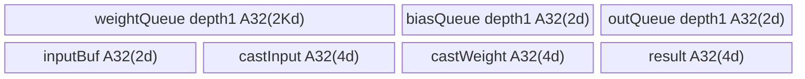

# 旧原生因果卷积 Update A3 Direct Invoke 算子知识

## 算子速览

| 项目 | 内容 |
|---|---|
| 实际入口 | Direct Invoke `torch.ops.npu.causal_conv1d_update`，不是统一causal_conv1d的run_mode1。 |
| 计算语义 | Host先预移state前缀，再由AIV按request顺序执行逐通道因果卷积和接受/候选两段状态更新；新Y、原地state。 |
| 输入输出 | 连续BF16/FP16 X[B,S,D]、weight[K,D]、state[pool,W,D]；索引/accepted/qsl实际Device读取int32；活动native定义K4/S4/W6。 |
| 执行类型 | 单或多次同类AIV_VECTOR launch；无Cube、SIMT或通信节点。 |
| Kernel 路线 | R-001…R-008：D≤4096或分通道多launch × dense/queryLoc长度 × 接受数有无。 |
| 核心资源 | 每tile d≤4096；UB=A32(2*K*d)+3*A32(2*d)+3*A32(4*d)，K4/d4096为106496B；GM复制和拼回不可省略。 |
| 来源闭包 | direct_implementation_closed：旧Torch Host、两份14字段布局、两dtype entry、完整body/base copy helper及legacy构建闭合；Torch复制/分配为框架边界。 |
| 验证状态 | draft：预移/短序列初态覆盖、pad同核偏移、metadata/容量/缓存生命周期风险可见；本次知识提取未执行编译、真机、数值或性能测试。 |

## 接口与语义

### 计算语义

Host的实际第一步是修改state，而非只读原历史：V=W−S>0时把旧state[:,S:W,:]复制到前缀[:,0:V,:]。有indices时先用clamp_min(0)的索引提取所选slot，预移后再index_copy回池；无indices时对**整个pool**预移，不只对B个活动request。因此后续卷积以**已预移state**为初态，不能把Host注释的完整滚动意图当成任意原始state上的保证。

每request实际长度L_i为S或qsl差；numAccept缺省L_i、inStateOffset初值0。存在accepted时，A_i=int32 accepted[i]，off=A_i−1，没有夹值。令c=min(A_i,L_i)：
第一段j=0..c−1，每步从state[off:off+K−1]读K−1旧项并按weight最旧到当前顺序累加，读到的state位置p≠0时复制到p−1，再将X[j]写state[off+K−2]。第二段j=0..L_i−c−1不左移，读state[off+j:off+j+K−1]，将X[c+j]写state[off+K−1+j]。两段都做相同FP32卷积、可选bias/SiLU和输出。接受数不是“只算几项”，第二段仍计算剩余候选。

```text
z = Σ(k=0..K−2) FP32(state[history_pos(k)])*FP32(weight[k])
    + FP32(X[current])*FP32(weight[K−1]) + optional FP32(bias)
Y = CAST_ROUND_T(activation ? z/(1+exp(−z)) : z)
```

已读活动native配置为K=4,S=accepted=4,W=6、BF16、D12288；其state写槽与预移前缀满足该具体滚动对照。不能只凭accepted=S、W=K+S−2推广到任意短S：若[0,W−S)与[accepted−1,accepted+K−2)相交，预移会先改变Device历史。K4/S1/W3/accepted1预移后前三行变[old1,old2,old2]，后续读取已经不是原来的[old0,old1,old2]；这是固定源码地址推导，未做数值验证。无accepted且W>K−1的多步同样没有完整整W滚动保证。

### 输入、输出与属性

| 参数 | shape/layout | dtype | 约束、默认值与语义 |
|---|---|---|---|
| x | 连续[B,S,D] | BF16/FP16 | Host强制rank3；不接受统一入口的rank2 packed布局。 |
| weight | 连续[K,D] | x.dtype | Host只检查rank2/dtype/连续，未检查实际第二轴=D或K范围。 |
| conv_state | 连续[pool,W,D]，Tensor(a!) | x.dtype | Host只查rank3/dtype/连续，未查通道、窗口容量或索引上界。 |
| conv_state_indices | [B]或空 | **Device int32** | schema必传Tensor；Host不统一转换/检查，pre-shift临时转int64不改变传给Device的原Tensor。 |
| bias | 可选[D] | 应为x.dtype | 非空选中；Host不完整检查shape/dtype/device。 |
| num_accepted_tokens | 可选[B] | Device int32 | 不存在转空int32；存在不转换、无0..L或容量guard。 |
| query_start_loc | 可选[B+1] | Device int32 | 改变每request实际长度和core首X offset；X仍为rank3缓冲，Host预移仍用全局S。 |
| activation_mode | 默认False | bool | True显式Exp/Adds/Div SiLU。 |
| pad_slot_id | 默认−1 | int64 | Device pad跳过；Host预移clamp_min0并不豁免slot0。 |
| y | 新empty_like(x) | x.dtype | 分通道路径先写新y_tile再拼回；空/skip区不是0保证。 |

### 入口与版本

固定kernel dda6d36b0cdb4081e102d14c0a2fb276fc416e69与CANN9.1.0；SDK固定e5451c7feba11f9e259f4fbc19c4bf82f8c0496c用于InitBuffer真实32B对齐。Torch schema/PrivateUse1直接绑定causal_conv1d_update_impl，经dtype选两个raw entry，不能补造ACLNN。

A3证据是Host显式A3 UB说明、活动MAMBA test_conv1d_update及CANN9.1.0 A3 CI；同一脚本在950明确过滤该测试，故本卡仅A3，不能由始终构建本源扩大950公开范围。测试可因包/设备/注册缺失直接return，文件存在不证明测试已运行。

[旧卷积接入指南](/model/inference/guides/integration/sgl_kernel_npu/sgl_legacy_causal_conv_recurrent.md)、[统一update源码卡](sgl_causal_conv1d_unified_update.md)与[Python v2源码卡](sgl_causal_conv1d_update_v2.md)分别保留不同ABI和状态机制。

## Host/Launcher 执行流程

### 参数校验与前处理

依次检查X/weight/state的rank3/2/3，三者同BF16/FP16，三者连续；不检查D匹配、正维度、K2..4、metadata/device和值域。读取B,S,D,K,W；四presence由numel>0。创建新Y；然后执行前述pre-shift，**在后续平台查询、tiling分配和launch之前已修改可变state**，后续异常没有自有回滚。indices存在时.to(int64)、clamp_min0、index_select得cs_view，clone前缀来源、copy并index_copy；无indices时直接对整个state池slice/clone/copy。它们是已读Host的数据搬运/地址映射，Torch实际Device复制实现与allocator为框架边界，不宣称已分析其内部kernel。

D≤4096直接launch原Tensor；D>4096按channel tile [t*4096,min(D,(t+1)*4096))，分别把X、weight、state和可选bias连续化，分配empty_like y_tile，launch后把y_tile和整个conv_state_tile复制回原池对应channel slice。pre-shift只在整个调用开始做一次。这里没有CPU同步等待，源码注释“kernel returns”不能解释为Device完成；copy/launch/stitch依当前框架dispatch队列与stream顺序，不能绕过它用未排序raw memcpy替换。

### 参数、Workspace 与生命周期

A=GetCoreNumAiv，blocks=min(A,int32(B))，恰等0时置1；其他负值/窄化无完整保护。workspace_size=int32(GetLibApiWorkSpaceSize())，每tile分配byte Tensor；两个Device entry接受workspace但不消费。Host14字段按8B自然对齐推导112B、alignof8，复制tiling按32B取128B；缓存globalTilingBuffer为128*1024=131072B，首次tile设备固定。11个shape/flag键做移位XOR hash后以uint64作为captureMap键，虽定义operator==也不用于map键；hash碰撞不比较原key，device/AIV核数不入key，globals无显式锁。dtype虽未入key，但POD不含dtype且两种T均2B，实际dtype由当前Host分支选择，**不能照搬统一入口的旧dtypeKey错误到本入口**。

H2D copy用pinned CPU临时→当前NPU nonblocking/copy=true；满1024缓存时逐tile新复制。EXEC_KERNEL_CMD仅捕获raw pointer tuple、stream和blockdim，OpCommand lambda不检查aclrtlaunch返回值、不捕获Tensor owner，也无自有record_stream。各tile输入/state/Y/metadata/tiling/workspace的异步寿命与copyback顺序依PyTorch/torch_npu框架，不能把局部变量离开作用域或Host语句顺序当作完成证据。persistent state由caller持有；跨stream/重复slot需要上层排他。

GM可见额外容量，记e=2、V=max(W−S,0)：
无indices预移clone为e*pool*V*D；有indices的cs_view为e*B*W*D、src clone为e*B*V*D，转int64/safe索引最多各8B*B。宽路径某tile临时X/Y各e*B*S*d、weight e*K*d、state e*pool*W*d、bias可选e*d；实际queued临时保留和allocator复用时点属于框架，不能把这些加成已证明物理峰值或保证仅一tile存活。

### 启动图与失败传播


| 节点/边 | Host/entry | 参数/extent | ordering、owner与失败传播 |
|---|---|---|---|
| 预移→tile | slice/clone/copy_或index_select/index_copy_ | 原state先写；前缀V行，indices为safe clamp | 框架dispatch；无自有失败回滚，pad slot0可能预移。 |
| 每K | launch_for_tile→EXEC_KERNEL_CMD→aclrtlaunch两个dtype符号 | blocks；14字段POD；tile d；X/weight/state/indices/bias/accepted/qsl/Y | 当前NPU stream，返回码忽略；workspace传入但未使用。 |
| K→copyback | y.slice.copy_(y_tile)，state.slice.copy_(state_tile) | Y B*S*d、state pool*W*d项 | 框架流顺序；不能提前释放仍被raw pointer消费的tile。 |
| copyback→下一tile | channel循环t++ | 不重叠channel，最后d≤4096 | 没有独立Device事件连接；由框架队列承担，未验证graph。 |

没有跨Kernel自有workspace边；多Kernel只由channel切片产生，数学串接通过不同channel切片的Y/state回写，不是Cube任务图。各核心卷积body已可见，框架搬运边界明确。

## Route 与参数设计

### 分核与资源计算

每tile重新ComputeTilingData：numCore=blocks，f=blockFactor=B/blocks，tail=B−f*(blocks−1)。blockId=blocks−1取batchNum=tail，其余取f；首request=blockId*f，全部余数交最后核。B=0时blocks1、f/tail0，仍进入InitBuffer而无request计算；D=0/非法K时没有完整安全终点。X初始offset为qsl[blockId*f]*d或blockId*f*S*d；每有效request完成后增加L_i*d，**pad continue不会执行这步**。同核batchNum>1且前pad后valid时后续request会使用错误X起点，不能泛化到每核单request域。

记A32(n)=ceil(n/32)*32，SDK InitBuffer分别对每个queue/TBuf向32B取整：
`UB=A32(2*K*d)+3*A32(2*d)+3*A32(4*d)`。三个2d来自biasQueue、outQueue与inputBuf；三个4d来自castInput/castWeight/result；weightQueue深1、2Kd，全部无条件分配，bias空也占。对32B对齐d，逻辑式(2K+18)*d；K4,d4096为106496B。Host只限d≤4096，不限K且不query UB；K大仍可能超过注释中的A3 192KiB预算，不能称4096保证任意宽K安全。各容量被uint32参数窄化，巨大K乘法也无检查。

### Route 选择

| 顺序 | Route | Key/模板 | 精确选择条件与优先级 | 不适用去向 |
|---:|---|---|---|---|
| 1 | R-001 单launch dense长度 无接受数 | T=BF16/FP16，hasQueryLoc=0，hasNumAccept=0 | Host检查通过；D≤4096；qsl空；accepted空 | 其他presence进入对应Route；数据值非法无完整guard/fallback |
| 2 | R-002 单launch dense长度 接受数两阶段 | T=BF16/FP16，hasQueryLoc=0，hasNumAccept=1 | Host检查通过；D≤4096；qsl空；accepted非空 | 其他presence进入对应Route；数据值非法无完整guard/fallback |
| 3 | R-003 单launch queryLoc长度 无接受数 | T=BF16/FP16，hasQueryLoc=1，hasNumAccept=0 | Host检查通过；D≤4096；qsl非空；accepted空 | 其他presence进入对应Route；数据值非法无完整guard/fallback |
| 4 | R-004 单launch queryLoc长度 接受数两阶段 | T=BF16/FP16，hasQueryLoc=1，hasNumAccept=1 | Host检查通过；D≤4096；qsl非空；accepted非空 | 其他presence进入对应Route；数据值非法无完整guard/fallback |
| 5 | R-005 分通道多launch dense长度 无接受数 | T=BF16/FP16，hasQueryLoc=0，hasNumAccept=0 | Host检查通过；D>4096；qsl空；accepted空 | 其他presence进入对应Route；数据值非法无完整guard/fallback |
| 6 | R-006 分通道多launch dense长度 接受数两阶段 | T=BF16/FP16，hasQueryLoc=0，hasNumAccept=1 | Host检查通过；D>4096；qsl空；accepted非空 | 其他presence进入对应Route；数据值非法无完整guard/fallback |
| 7 | R-007 分通道多launch queryLoc长度 无接受数 | T=BF16/FP16，hasQueryLoc=1，hasNumAccept=0 | Host检查通过；D>4096；qsl非空；accepted空 | 其他presence进入对应Route；数据值非法无完整guard/fallback |
| 8 | R-008 分通道多launch queryLoc长度 接受数两阶段 | T=BF16/FP16，hasQueryLoc=1，hasNumAccept=1 | Host检查通过；D>4096；qsl非空；accepted非空 | 其他presence进入对应Route；数据值非法无完整guard/fallback |

```text
rank/dtype/contiguous检查 → empty Y → 按W−S>0预移state
  D≤4096: launch_for_tile原Tensor一次
  D>4096: 每channel4096 contiguous→launch→Y/state拼回
    dtype BF16/FP16选独立entry，无dtype POD router
    hasQueryLoc?读qsl差:用S
    hasNumAccept?off=accepted−1,c=min(accepted,L):off=0,c=L
    第一段c次：历史左移+卷积；第二段L−c次：不左移，候选递增写槽+卷积
```

### 模板/实现执行矩阵

| Route | key/selector | dtype/shape/platform 完整命中条件 | 执行拓扑与 Kernel 节点 | 实际模板/body | 内存与同步特征 | tail/fallback |
|---|---|---|---|---|---|---|
| R-001 | D≤4096,qsl0,accept0 | A3、Host检查成立，X3D；两T分别有当前Host entry | 单AIV | CausalConv1dUpdateOp::CausalConv1dUpdate<T>::Init/Process/ComputeUpdate | UB按d对齐公式；queue深1；off0的历史左移；workspace未用 | request末核tail；pad/空无补零，非安全fallback |
| R-002 | D≤4096,qsl0,accept1 | A3、Host检查成立，X3D；两T分别有当前Host entry | 单AIV | CausalConv1dUpdateOp::CausalConv1dUpdate<T>::Init/Process/ComputeUpdate | UB按d对齐公式；queue深1；off=accepted−1的两阶段state搬运；workspace未用 | request末核tail；pad/空无补零，非安全fallback |
| R-003 | D≤4096,qsl1,accept0 | A3、Host检查成立，X3D；两T分别有当前Host entry | 单AIV | CausalConv1dUpdateOp::CausalConv1dUpdate<T>::Init/Process/ComputeUpdate | UB按d对齐公式；queue深1；off0的历史左移；workspace未用 | request末核tail；pad/空无补零，非安全fallback |
| R-004 | D≤4096,qsl1,accept1 | A3、Host检查成立，X3D；两T分别有当前Host entry | 单AIV | CausalConv1dUpdateOp::CausalConv1dUpdate<T>::Init/Process/ComputeUpdate | UB按d对齐公式；queue深1；off=accepted−1的两阶段state搬运；workspace未用 | request末核tail；pad/空无补零，非安全fallback |
| R-005 | D>4096,qsl0,accept0 | A3、Host检查成立，X3D；两T分别有当前Host entry | ceil(D/4096)次AIV＋框架copies | CausalConv1dUpdateOp::CausalConv1dUpdate<T>::Init/Process/ComputeUpdate | UB按d对齐公式；queue深1；off0的历史左移；workspace未用 | 末channel d=min(4096,D−t*4096)；pad/空无补零，非安全fallback |
| R-006 | D>4096,qsl0,accept1 | A3、Host检查成立，X3D；两T分别有当前Host entry | ceil(D/4096)次AIV＋框架copies | CausalConv1dUpdateOp::CausalConv1dUpdate<T>::Init/Process/ComputeUpdate | UB按d对齐公式；queue深1；off=accepted−1的两阶段state搬运；workspace未用 | 末channel d=min(4096,D−t*4096)；pad/空无补零，非安全fallback |
| R-007 | D>4096,qsl1,accept0 | A3、Host检查成立，X3D；两T分别有当前Host entry | ceil(D/4096)次AIV＋框架copies | CausalConv1dUpdateOp::CausalConv1dUpdate<T>::Init/Process/ComputeUpdate | UB按d对齐公式；queue深1；off0的历史左移；workspace未用 | 末channel d=min(4096,D−t*4096)；pad/空无补零，非安全fallback |
| R-008 | D>4096,qsl1,accept1 | A3、Host检查成立，X3D；两T分别有当前Host entry | ceil(D/4096)次AIV＋框架copies | CausalConv1dUpdateOp::CausalConv1dUpdate<T>::Init/Process/ComputeUpdate | UB按d对齐公式；queue深1；off=accepted−1的两阶段state搬运；workspace未用 | 末channel d=min(4096,D−t*4096)；pad/空无补零，非安全fallback |

### 隐藏性能 Guard

| Guard | Host/Tiling 条件 | Device/资源原因 | 影响 Route | 不满足时去向 | 源码符号 |
|---|---|---|---|---|---|
| channel4096 | D≤4096，否则多tile | K4 logical26*d UB，避免大D直接膨胀 | 全部 | contiguous复制/多launch/拼回 | causal_conv1d_update_impl |
| 实际UB | Host无K/UB guard | weightQueue按K*d，SDK逐buffer对齐 | 全部 | 无自有资源fallback | Init |
| 数据width/shape | Host仅rank/dtype/连续 | k*dim寻址与K−2写槽 | 全部 | K≤1/通道不匹配等没有可靠安全语义 | ComputeUpdate |
| 接受数 | 存在即off=A−1，c=min(A,L) | 状态窗口和第二段候选地址 | accepted路线 | 无夹值，0/负数/越容量风险 | ComputeUpdate |
| pre-shift | W−S>0 | 先改变旧state，再读history | 全部 | W≤S不预移 | Host val_shift |
| pad | stateIdx==padSlotId | 跳过整个request，但未推进X offset | 全部 | 后同核request可能错位；Host仍可预移slot0 | ComputeUpdate |
| queryLoc | 非空 | core首X起点与逐request长度 | qsl路线 | dense长度S | Process/ComputeUpdate |
| metadata ABI | 原Tensor没有转int32 | Device reinterpret_cast<int32_t*> | 全部 | int64/noncontig可误读，无修复 | Init |
|缓存/生命周期|hash数值键、device/core未入key|旧POD与raw临时指针|全部|无修复fallback|captureMap/EXEC_KERNEL_CMD|

### POD/ABI

Host定义全局CausalConv1dUpdateTilingData，Device另定义sglang::npu_kernel同名结构；两份字段顺序/类型一致但并非同一个C++声明。以下按int64_t自然8B对齐推导sizeof112B、alignof8、offset；无源码static_assert，本次未编译测量。复制tilingSize128B，末16B不是Device字段。Init逐字段复制到核本地POD。

| 结构 | 字段 | 类型/位宽 | ABI 布局 | 单位 | Host/launcher producer | Device consumer | 边界 |
|---|---|---|---|---|---|---|---|
| Host全局/Device namespaced CausalConv1dUpdateTilingData | numCore | int64_t/64位 | offset=0B | core | block_dim=min(A,int32(B))，恰0时设1 | Process guard与末核识别 | A>0、窄化合法 |
| Host全局/Device namespaced CausalConv1dUpdateTilingData | blockFactor | int64_t/64位 | offset=8B | request | B/block_dim | core首request=blockId*factor | 普通core每核数量 |
| Host全局/Device namespaced CausalConv1dUpdateTilingData | blockTailFactor | int64_t/64位 | offset=16B | request | B−factor*(block_dim−1) | ParseCoreBlocks末核batchNum | 余数全部交末核 |
| Host全局/Device namespaced CausalConv1dUpdateTilingData | batch | int64_t/64位 | offset=24B | request | X.size(0) | GM分核界，主要用于Host/POD | Host未检查正B |
| Host全局/Device namespaced CausalConv1dUpdateTilingData | seqLen | int64_t/64位 | offset=32B | token/request | X.size(1) | 默认actSeqLen与dense core起点 | queryLoc存在则长度被覆盖 |
| Host全局/Device namespaced CausalConv1dUpdateTilingData | dim | int64_t/64位 | offset=40B | channel | 本次tile_dim | 所有UB/copy count与GM行步长 | ≤4096仅限制通道，K仍无UB约束 |
| Host全局/Device namespaced CausalConv1dUpdateTilingData | width | int64_t/64位 | offset=48B | tap | weight.size(0) | weightQueue容量、K−1循环和state写槽 | Host无K范围或weight通道验证 |
| Host全局/Device namespaced CausalConv1dUpdateTilingData | stateLen | int64_t/64位 | offset=56B | token/cache | conv_state.size(1) | state槽步长与Host pre-shift | 实际窗口容量未检查 |
| Host全局/Device namespaced CausalConv1dUpdateTilingData | hasIndices | int64_t/64位 | offset=64B | bool | conv_state_indices.numel()>0 | int32 index、pad比较 | Host不转换dtype/连续性 |
| Host全局/Device namespaced CausalConv1dUpdateTilingData | hasBias | int64_t/64位 | offset=72B | bool | bias.numel()>0 | 每token biasQueue加载/相加 | queue无论presence都分配 |
| Host全局/Device namespaced CausalConv1dUpdateTilingData | hasNumAccept | int64_t/64位 | offset=80B | bool | accepted.numel()>0 | off=accepted−1，calc=min(A,L) | 没有范围夹值 |
| Host全局/Device namespaced CausalConv1dUpdateTilingData | hasQueryLoc | int64_t/64位 | offset=88B | bool | qsl.numel()>0 | core起点qsl[core*factor]，每request长度差 | pad continue会跳过X offset推进 |
| Host全局/Device namespaced CausalConv1dUpdateTilingData | activationMode | int64_t/64位 | offset=96B | bool | bool activation_mode?1:0 | 显式Exp/Adds/Div SiLU | Torch schema bool |
| Host全局/Device namespaced CausalConv1dUpdateTilingData | padSlotId | int64_t/64位 | offset=104B | slot | 原int64 pad_slot_id | int32 stateIdx转int64后比较 | Host预移会clamp_min0，不豁免slot0 |

### Route 源码闭包

| Route | Key/selector | Host/Tiling producer | POD/参数 | Kernel entry/router 节点 | Kernel body/直接依赖 | 构建接线 |
|---|---|---|---|---|---|---|
| R-001 | D分支/qsl0/accept0/当前dtype | op_host/causal_conv1d_update.cpp::launch_for_tile；op_host/tiling/...::ComputeTilingData | 两份14字段 | op_kernel/causal_conv1d_update.cpp::causal_conv1d_update_bfloat16_t或_half | op_kernel/causal_conv1d_update.h::Init/Process/ComputeUpdate/六copy；base.h::ParseCoreBlocks/六参数helper | cmake/legacy_kernels.cmake::workspace_kernel/sgl_kernel_npu |
| R-002 | D分支/qsl0/accept1/当前dtype | op_host/causal_conv1d_update.cpp::launch_for_tile；op_host/tiling/...::ComputeTilingData | 两份14字段 | op_kernel/causal_conv1d_update.cpp::causal_conv1d_update_bfloat16_t或_half | op_kernel/causal_conv1d_update.h::Init/Process/ComputeUpdate/六copy；base.h::ParseCoreBlocks/六参数helper | cmake/legacy_kernels.cmake::workspace_kernel/sgl_kernel_npu |
| R-003 | D分支/qsl1/accept0/当前dtype | op_host/causal_conv1d_update.cpp::launch_for_tile；op_host/tiling/...::ComputeTilingData | 两份14字段 | op_kernel/causal_conv1d_update.cpp::causal_conv1d_update_bfloat16_t或_half | op_kernel/causal_conv1d_update.h::Init/Process/ComputeUpdate/六copy；base.h::ParseCoreBlocks/六参数helper | cmake/legacy_kernels.cmake::workspace_kernel/sgl_kernel_npu |
| R-004 | D分支/qsl1/accept1/当前dtype | op_host/causal_conv1d_update.cpp::launch_for_tile；op_host/tiling/...::ComputeTilingData | 两份14字段 | op_kernel/causal_conv1d_update.cpp::causal_conv1d_update_bfloat16_t或_half | op_kernel/causal_conv1d_update.h::Init/Process/ComputeUpdate/六copy；base.h::ParseCoreBlocks/六参数helper | cmake/legacy_kernels.cmake::workspace_kernel/sgl_kernel_npu |
| R-005 | D分支/qsl0/accept0/当前dtype | op_host/causal_conv1d_update.cpp::launch_for_tile；op_host/tiling/...::ComputeTilingData | 两份14字段 | op_kernel/causal_conv1d_update.cpp::causal_conv1d_update_bfloat16_t或_half | op_kernel/causal_conv1d_update.h::Init/Process/ComputeUpdate/六copy；base.h::ParseCoreBlocks/六参数helper | cmake/legacy_kernels.cmake::workspace_kernel/sgl_kernel_npu |
| R-006 | D分支/qsl0/accept1/当前dtype | op_host/causal_conv1d_update.cpp::launch_for_tile；op_host/tiling/...::ComputeTilingData | 两份14字段 | op_kernel/causal_conv1d_update.cpp::causal_conv1d_update_bfloat16_t或_half | op_kernel/causal_conv1d_update.h::Init/Process/ComputeUpdate/六copy；base.h::ParseCoreBlocks/六参数helper | cmake/legacy_kernels.cmake::workspace_kernel/sgl_kernel_npu |
| R-007 | D分支/qsl1/accept0/当前dtype | op_host/causal_conv1d_update.cpp::launch_for_tile；op_host/tiling/...::ComputeTilingData | 两份14字段 | op_kernel/causal_conv1d_update.cpp::causal_conv1d_update_bfloat16_t或_half | op_kernel/causal_conv1d_update.h::Init/Process/ComputeUpdate/六copy；base.h::ParseCoreBlocks/六参数helper | cmake/legacy_kernels.cmake::workspace_kernel/sgl_kernel_npu |
| R-008 | D分支/qsl1/accept1/当前dtype | op_host/causal_conv1d_update.cpp::launch_for_tile；op_host/tiling/...::ComputeTilingData | 两份14字段 | op_kernel/causal_conv1d_update.cpp::causal_conv1d_update_bfloat16_t或_half | op_kernel/causal_conv1d_update.h::Init/Process/ComputeUpdate/六copy；base.h::ParseCoreBlocks/六参数helper | cmake/legacy_kernels.cmake::workspace_kernel/sgl_kernel_npu |

## Kernel 实现

### 公共执行流程

两dtype entry直接构造CausalConv1dUpdate<T>，workspace形参未消费。Init把indices/accepted/queryLoc**按int32指针**绑定，解析14字段，分配三个depth1 queue和四TBuf。Process若blockId≥numCore返回，否则从core首qsl或dense公式设置xOffset，整块K*d权重DataCopyPad一次入weightQueue，DeQue后保留wLocal跨本core所有request，最后FreeTensor。

每request先取stateIdx并处理pad，再取L_i和accepted；两段计算均：Duplicate FP32 result0、分配outQueue Tensor；每历史tap通过inputBuf加载state，必要时直接把同一T临时写到上一槽，再MTE2_V、Cast(input/weight)到FP32并MulAddDst，V_MTE2防止下一load覆盖inputBuf；加载当前X后先写state再升精度相乘。bias每token独立Alloc/EnQue/DeQue、升FP32相加、Free。激活以castWeight临时覆盖为−z→exp→+1→z/tmp，最后CAST_ROUND到T outQueue，EnQue/DeQue→DataCopyPad Y→Free。第二段不做history左移，但追加新候选slot递增。

六个base copy参数均blockCount1、blockLen=有效元素数*sizeof(T)字节、srcStride/dstStride/rsv全0；输入padParams={false,0,0,0}，输出DataCopyPad按实际字节长度写GM。通道DMA尾由DataCopyPad处理，不代表weight每tap起点k*d的Vector本地对齐自动安全；UB实际容量取32B对齐，维度布局与primitive准入仍须成立。队列EnQue/DeQue/Free承担queue管线依赖，自有helper每次FetchEventID后set/wait MTE2_V、V_MTE2、MTE2_MTE3、MTE3_MTE2，保护inputBuf读/写/搬运；不存在ring5slot、双输出slot、跨核SyncAll或atomic。

### Route R-001：单launch dense长度 无接受数

#### 适用条件

D≤4096，query_start_loc为空，num_accepted_tokens为空，Host rank/dtype/连续检查通过；T按当前Host dtype分别为bfloat16_t或half。源码无K/状态容量完整guard，实际可复用域须满足本节全部地址、UB与metadata前提；已读活动native用例仅K4/S4/accepted4/W6，不扩成任意raw输入安全承诺。

##### 选择证据

| 层级 | 文件 | 符号 | 源码谓词/参数 | 结果/下一跳 |
|---|---|---|---|---|
| Host | csrc/causal_conv1d_update/op_host/causal_conv1d_update.cpp | causal_conv1d_update_impl/launch_for_tile | D≤4096，query_start_loc为空，num_accepted_tokens为空 | 原Tensor单launch；presence写POD |
| Router | csrc/causal_conv1d_update/op_kernel/causal_conv1d_update.cpp | causal_conv1d_update_bfloat16_t/_half | 当前Host dtype，不读dtype POD | CausalConv1dUpdate<T> |
| Body | csrc/causal_conv1d_update/op_kernel/causal_conv1d_update.h | Process/ComputeUpdate | hasQueryLoc=0，hasNumAccept=0 | L_i=S，off=0，两段token loop |

#### Device 数据流

##### 函数级调用链

```text
Torch PrivateUse1 wrapper → causal_conv1d_update_impl
  → [W>S的Host prefix copy/index_copy]
  → 原Tensor
    → launch_for_tile → Host ComputeTilingData → pinned H2D/cache → EXEC_KERNEL_CMD
      → causal_conv1d_update_T → Init/ParseCoreBlocks/InitBuffer
      → Process → CopyInWeight → ComputeUpdate
        → 每request: index/pad/length/accepted
        → 第一段: CopyInState→可能CopyOutState→Cast/MulAddDst
          → CopyInX→CopyOutState→Cast/MulAddDst→bias/SiLU→CopyOutY
        → 第二段: 同计算，但历史不左移且候选state地址递增
      → weightQueue FreeTensor
    → 返回Y
```

##### 源码等价伪码

```text
# 伪码；pre-shift只在整个Host调用开始做一次
if W>S:
  safe = indices.to(int64).clamp_min(0) if hasIndices
  target = state.index_select(0,safe) if hasIndices else entire_state_pool
  tmp=clone(target[:,S:W,:]); target[:,:W−S,:]=tmp
  if hasIndices:state.index_copy_(0,safe,target)
c0=0;d=D;使用原Tensor
  coreFirst=blockId*blockFactor
  batchNum=(blockId==numCore−1)?tail:factor
  xoff=coreFirst*S*d
  weightQueue = load K*d contiguous T once percore
  off=0                                      # 成员初值
  for i=0..batchNum−1:
    b=coreFirst+i
    slot=hasIndices?int32(indices[b]):b
    if hasIndices and slot==pad:continue      # xoff没有推进
    L=S
    A=L;c=L;off保持0
    for j=0..c−1:
      acc=0FP32
      for k=0..K−2:
        p=k+off
        load state[slot,p]→inputBuf
        MTE2_MTE3
        if p!=0: inputBuf→state[slot,p−1]; MTE3_MTE2
        MTE2_V;Cast input/weight[k]→FP32;MulAddDst(acc);V_MTE2
      load X[xoff+j*d]→inputBuf
      MTE2_MTE3;inputBuf→state[slot,off+K−2];MTE3_MTE2
      Cast/MulAddDst current weight[K−1]; optional bias/SiLU
      CAST_ROUND_T→outQueue→DataCopyPad Y[xoff+j*d]→Free
    for j=0..L−c−1:
      acc=0FP32
      for k=0..K−2:
        load state[slot,k+off+j]→inputBuf; Cast/MulAddDst (不左移)
      load X[xoff+(c+j)*d]→inputBuf
      inputBuf→state[slot,off+K−1+j]
      Cast/MulAddDst current; optional bias/SiLU
      CAST_ROUND_T→Y[xoff+(c+j)*d]
    xoff += L*d
  Free weightQueue
  返回Y
```

本Route第二段长度为0；但off0、pre-shift与每步GM左移仍可能改变整W语义，不能把A缺省L解释成显式accepted=L：显式accepted=L会把off改成L−1，两个Route地址不同。
dense xoff逐有效request加S*d，若pad较早continue会使同核后续有效request起点落后。

#### 内存与数据搬运

##### 资源与搬运表

| 层级/缓冲区 | offset/地址公式 | extent/容量公式 | dtype/layout | producer | consumer | owner/lifetime | 对齐/复用 |
|---|---|---|---|---|---|---|---|
| GM X/Y | flat xoff+token*d+channel | tile各2*B*S*d B；copy每次d项 | T contiguous tile | 调用方/Vector | inputBuf/调用方 | 调用方原X、Host新Y | DataCopyPad按2d字节；跳过Y未写 |
| GM state | ((slot*W+p)*d)*2B | tile2*pool*W*d B | T | Host pre-shift与Device就地提交 | 下一tap/token/上层 | caller持久池 | 按实际off/两段地址，不保证全W滚动 |
| weightQueue VECIN | SDK按初始化序分配，首区 | depth1*A32(2*K*d) | T K×d | CopyInWeight一次 | 每request各tap Cast | 整core ComputeUpdate保留到最后Free | 不是每token重装；k*d本地对齐仍需合法 |
| biasQueue VECIN | weight后 | depth1*A32(2*d) | T d | 每token CopyInBias | Cast/Add | 每tokenAlloc/DeQue/Free | 即使无bias也分配 |
| outQueue VECOUT | bias后 | depth1*A32(2*d) | T d | CAST_ROUND | CopyOutY MTE3 | 每tokenAlloc/EnQue/DeQue/Free | 单slot，非双buffer |
| inputBuf VECCALC | 三queue后 | A32(2*d) | T d | state/X DataCopyPad | Cast与state DataCopyPad | 每tap与current复用 | MTE2_V、V_MTE2、MTE2_MTE3、MTE3_MTE2 |
| castInput/castWeight/result | 各随后一段 | 各A32(4*d)，合3*A32(4*d) | FP32 d | Cast/acc/SiLU | MulAddDst/output Cast | castWeight在tap之后复用SiLU临时 | 无额外history/ring分配 |
| metadata/POD/workspace | indices/accepted/qsl raw int32；tiling128B | B/B+1容量caller负责；workspace=lib bytes | GM线性 | caller/Host | Device直接读 | raw临时寿命依框架；workspace未消费 | 无dtype metadata转换，无跨K workspace |


##### 分层内存布局



##### 字节账与复用顺序

```text
A32(n)=ceil(n/32)*32
UB_total = A32(2*K*d) + 3*A32(2*d) + 3*A32(4*d)
d对齐时 = (2*K+18)*d；K4,d4096 => 106496 B
UB_total <= 可用UB 是前提；Host只限制d，不限制K/总量
dynamic_ub = N/A；AIV queue/TBuf
workspace_total = libWorkspace byte Tensor/每launch；Device实际消费0
launch_count = 1
```

| 复用子区 | 写入者 | 读取者/消费点 | 下一次覆盖 | 同步或释放依据 | 安全条件 |
|---|---|---|---|---|---|
| inputBuf | 每tap历史或current MTE2 | state MTE3和FP32 Cast | 下一load | MTE2_MTE3→MTE3_MTE2；MTE2_V→V_MTE2 | 不能让下一load覆盖尚未copy/cast值 |
| castInput | 每tap/current Cast或bias Cast | MulAddDst/Add | 下一tap/token | 同Vector管线/primitive依赖 | count=d且类型FP32 |
| castWeight | weight Cast | MulAddDst；之后SiLU临时 | 下一tap或−z/Exp | 同Vector顺序 | 权重原值仍在weightQueue，临时可覆盖 |
| resultBuf | Duplicate0/MulAddDst/bias/Div | output Cast | 下一tokenDuplicate | outputQueue已独立存值 | 保留FP32累加和CAST_ROUND |
| weight/bias/out队列 | CopyIn或Cast | DeQue消费 | Free后下一Alloc | queue EnQue/DeQue/Free | depth1实际分配，不能编造double buffer |

#### 同步、精度与尾块

##### 同步与数值边界表

| 阶段 | primitive/机制 | producer | consumer/等待点 | 保护对象 | 精度/尾块 |
|---|---|---|---|---|---|
| 权重/可选bias | TQue EnQue/DeQue/Free | MTE2 | Vector | queue1 | T→FP32 CAST_NONE；weight跨全core复用 |
| history搬运/左移 | MTE2_MTE3、MTE3_MTE2 | state load | state写/下一load | inputBuf/持久GM | p!=0才向前一槽写；第二段不左移 |
| tap计算 | MTE2_V、V_MTE2；Cast/MulAddDst | inputBuf/weightQueue | FP32 result | input/calc | 每tap count=d；无低精度累加 |
| 激活/输出 | Exp/Adds/Div；outQueue lifecycle | FP32 result | MTE3 Y | result/outQueue | CAST_ROUND到BF16/FP16，不能替换成统一入口CAST_RINT承诺 |
| DMA尾 | DataCopyExtParams blockCount1、blockLen=2d或2Kd、strides0；Pad false | GM/UB | UB/GM | 实际tile | GM有效字节copy；Vector行偏移对齐仍需满足 |
| 分核/尾核 | ParseCoreBlocks末核tail | POD | request循环 | B个request域 | pad continue跳过X推进的限定风险 |
| 多launch排序 | 同当前stream框架dispatch | contiguous/launch | copyback/下一tile | 临时GM/Y/state | 无自有event或CPU同步；生命周期为框架边界 |

#### 关键实现

##### 符号证据表

| 阶段 | 文件 | 符号/模板实例 | 实现事实 |
|---|---|---|---|
| Host/Tiling producer | csrc/causal_conv1d_update/op_host/causal_conv1d_update.cpp | causal_conv1d_update_impl/launch_for_tile | pre-shift、单launch、presence与缓存 |
| Host/Tiling producer | csrc/causal_conv1d_update/op_host/tiling/causal_conv1d_update_tiling.h | ComputeTilingData | 14字段/factor/tail |
| Kernel entry/router | csrc/causal_conv1d_update/op_kernel/causal_conv1d_update.cpp | causal_conv1d_update_bfloat16_t/half | 两T实例，workspace未用 |
| Device body/helper | csrc/causal_conv1d_update/op_kernel/causal_conv1d_update.h | Init/Process/ComputeUpdate/CopyIn*/CopyOut* | 上述循环、地址、queue与事件 |
| Device body/helper | csrc/causal_conv1d_update/op_kernel/causal_conv1d_update_base.h | ParseCoreBlocks/Get*CopyParams | 分核与六类DataCopy参数 |


### Route R-002：单launch dense长度 接受数两阶段

#### 适用条件

D≤4096，query_start_loc为空，num_accepted_tokens非空，Host rank/dtype/连续检查通过；T按当前Host dtype分别为bfloat16_t或half。源码无K/状态容量完整guard，实际可复用域须满足本节全部地址、UB与metadata前提；已读活动native用例仅K4/S4/accepted4/W6，不扩成任意raw输入安全承诺。

##### 选择证据

| 层级 | 文件 | 符号 | 源码谓词/参数 | 结果/下一跳 |
|---|---|---|---|---|
| Host | csrc/causal_conv1d_update/op_host/causal_conv1d_update.cpp | causal_conv1d_update_impl/launch_for_tile | D≤4096，query_start_loc为空，num_accepted_tokens非空 | 原Tensor单launch；presence写POD |
| Router | csrc/causal_conv1d_update/op_kernel/causal_conv1d_update.cpp | causal_conv1d_update_bfloat16_t/_half | 当前Host dtype，不读dtype POD | CausalConv1dUpdate<T> |
| Body | csrc/causal_conv1d_update/op_kernel/causal_conv1d_update.h | Process/ComputeUpdate | hasQueryLoc=0，hasNumAccept=1 | L_i=S，off=accepted−1，两段token loop |

#### Device 数据流

##### 函数级调用链

```text
Torch PrivateUse1 wrapper → causal_conv1d_update_impl
  → [W>S的Host prefix copy/index_copy]
  → 原Tensor
    → launch_for_tile → Host ComputeTilingData → pinned H2D/cache → EXEC_KERNEL_CMD
      → causal_conv1d_update_T → Init/ParseCoreBlocks/InitBuffer
      → Process → CopyInWeight → ComputeUpdate
        → 每request: index/pad/length/accepted
        → 第一段: CopyInState→可能CopyOutState→Cast/MulAddDst
          → CopyInX→CopyOutState→Cast/MulAddDst→bias/SiLU→CopyOutY
        → 第二段: 同计算，但历史不左移且候选state地址递增
      → weightQueue FreeTensor
    → 返回Y
```

##### 源码等价伪码

```text
# 伪码；pre-shift只在整个Host调用开始做一次
if W>S:
  safe = indices.to(int64).clamp_min(0) if hasIndices
  target = state.index_select(0,safe) if hasIndices else entire_state_pool
  tmp=clone(target[:,S:W,:]); target[:,:W−S,:]=tmp
  if hasIndices:state.index_copy_(0,safe,target)
c0=0;d=D;使用原Tensor
  coreFirst=blockId*blockFactor
  batchNum=(blockId==numCore−1)?tail:factor
  xoff=coreFirst*S*d
  weightQueue = load K*d contiguous T once percore
  off=0                                      # 成员初值
  for i=0..batchNum−1:
    b=coreFirst+i
    slot=hasIndices?int32(indices[b]):b
    if hasIndices and slot==pad:continue      # xoff没有推进
    L=S
    A=int32(accepted[b]); off=A−1; c=min(A,L)
    for j=0..c−1:
      acc=0FP32
      for k=0..K−2:
        p=k+off
        load state[slot,p]→inputBuf
        MTE2_MTE3
        if p!=0: inputBuf→state[slot,p−1]; MTE3_MTE2
        MTE2_V;Cast input/weight[k]→FP32;MulAddDst(acc);V_MTE2
      load X[xoff+j*d]→inputBuf
      MTE2_MTE3;inputBuf→state[slot,off+K−2];MTE3_MTE2
      Cast/MulAddDst current weight[K−1]; optional bias/SiLU
      CAST_ROUND_T→outQueue→DataCopyPad Y[xoff+j*d]→Free
    for j=0..L−c−1:
      acc=0FP32
      for k=0..K−2:
        load state[slot,k+off+j]→inputBuf; Cast/MulAddDst (不左移)
      load X[xoff+(c+j)*d]→inputBuf
      inputBuf→state[slot,off+K−1+j]
      Cast/MulAddDst current; optional bias/SiLU
      CAST_ROUND_T→Y[xoff+(c+j)*d]
    xoff += L*d
  Free weightQueue
  返回Y
```

accepted没有clamp：A≤0可导致off<0或c<0、负X/state访问；A>L仍可使seed/追加槽越容量。若0<A<L，第二段最终写槽为K+L−3，需W至少K+L−2；若A≥L，第一段窗口/写槽需W≥A+K−2。这些是地址必要条件，并不证明与上层期望state/历史数学一致。
dense xoff逐有效request加S*d，若pad较早continue会使同核后续有效request起点落后。

#### 内存与数据搬运

##### 资源与搬运表

| 层级/缓冲区 | offset/地址公式 | extent/容量公式 | dtype/layout | producer | consumer | owner/lifetime | 对齐/复用 |
|---|---|---|---|---|---|---|---|
| GM X/Y | flat xoff+token*d+channel | tile各2*B*S*d B；copy每次d项 | T contiguous tile | 调用方/Vector | inputBuf/调用方 | 调用方原X、Host新Y | DataCopyPad按2d字节；跳过Y未写 |
| GM state | ((slot*W+p)*d)*2B | tile2*pool*W*d B | T | Host pre-shift与Device就地提交 | 下一tap/token/上层 | caller持久池 | 按实际off/两段地址，不保证全W滚动 |
| weightQueue VECIN | SDK按初始化序分配，首区 | depth1*A32(2*K*d) | T K×d | CopyInWeight一次 | 每request各tap Cast | 整core ComputeUpdate保留到最后Free | 不是每token重装；k*d本地对齐仍需合法 |
| biasQueue VECIN | weight后 | depth1*A32(2*d) | T d | 每token CopyInBias | Cast/Add | 每tokenAlloc/DeQue/Free | 即使无bias也分配 |
| outQueue VECOUT | bias后 | depth1*A32(2*d) | T d | CAST_ROUND | CopyOutY MTE3 | 每tokenAlloc/EnQue/DeQue/Free | 单slot，非双buffer |
| inputBuf VECCALC | 三queue后 | A32(2*d) | T d | state/X DataCopyPad | Cast与state DataCopyPad | 每tap与current复用 | MTE2_V、V_MTE2、MTE2_MTE3、MTE3_MTE2 |
| castInput/castWeight/result | 各随后一段 | 各A32(4*d)，合3*A32(4*d) | FP32 d | Cast/acc/SiLU | MulAddDst/output Cast | castWeight在tap之后复用SiLU临时 | 无额外history/ring分配 |
| metadata/POD/workspace | indices/accepted/qsl raw int32；tiling128B | B/B+1容量caller负责；workspace=lib bytes | GM线性 | caller/Host | Device直接读 | raw临时寿命依框架；workspace未消费 | 无dtype metadata转换，无跨K workspace |


##### 分层内存布局


##### 字节账与复用顺序

```text
A32(n)=ceil(n/32)*32
UB_total = A32(2*K*d) + 3*A32(2*d) + 3*A32(4*d)
d对齐时 = (2*K+18)*d；K4,d4096 => 106496 B
UB_total <= 可用UB 是前提；Host只限制d，不限制K/总量
dynamic_ub = N/A；AIV queue/TBuf
workspace_total = libWorkspace byte Tensor/每launch；Device实际消费0
launch_count = 1
```

| 复用子区 | 写入者 | 读取者/消费点 | 下一次覆盖 | 同步或释放依据 | 安全条件 |
|---|---|---|---|---|---|
| inputBuf | 每tap历史或current MTE2 | state MTE3和FP32 Cast | 下一load | MTE2_MTE3→MTE3_MTE2；MTE2_V→V_MTE2 | 不能让下一load覆盖尚未copy/cast值 |
| castInput | 每tap/current Cast或bias Cast | MulAddDst/Add | 下一tap/token | 同Vector管线/primitive依赖 | count=d且类型FP32 |
| castWeight | weight Cast | MulAddDst；之后SiLU临时 | 下一tap或−z/Exp | 同Vector顺序 | 权重原值仍在weightQueue，临时可覆盖 |
| resultBuf | Duplicate0/MulAddDst/bias/Div | output Cast | 下一tokenDuplicate | outputQueue已独立存值 | 保留FP32累加和CAST_ROUND |
| weight/bias/out队列 | CopyIn或Cast | DeQue消费 | Free后下一Alloc | queue EnQue/DeQue/Free | depth1实际分配，不能编造double buffer |

#### 同步、精度与尾块

##### 同步与数值边界表

| 阶段 | primitive/机制 | producer | consumer/等待点 | 保护对象 | 精度/尾块 |
|---|---|---|---|---|---|
| 权重/可选bias | TQue EnQue/DeQue/Free | MTE2 | Vector | queue1 | T→FP32 CAST_NONE；weight跨全core复用 |
| history搬运/左移 | MTE2_MTE3、MTE3_MTE2 | state load | state写/下一load | inputBuf/持久GM | p!=0才向前一槽写；第二段不左移 |
| tap计算 | MTE2_V、V_MTE2；Cast/MulAddDst | inputBuf/weightQueue | FP32 result | input/calc | 每tap count=d；无低精度累加 |
| 激活/输出 | Exp/Adds/Div；outQueue lifecycle | FP32 result | MTE3 Y | result/outQueue | CAST_ROUND到BF16/FP16，不能替换成统一入口CAST_RINT承诺 |
| DMA尾 | DataCopyExtParams blockCount1、blockLen=2d或2Kd、strides0；Pad false | GM/UB | UB/GM | 实际tile | GM有效字节copy；Vector行偏移对齐仍需满足 |
| 分核/尾核 | ParseCoreBlocks末核tail | POD | request循环 | B个request域 | pad continue跳过X推进的限定风险 |
| 多launch排序 | 同当前stream框架dispatch | contiguous/launch | copyback/下一tile | 临时GM/Y/state | 无自有event或CPU同步；生命周期为框架边界 |

#### 关键实现

##### 符号证据表

| 阶段 | 文件 | 符号/模板实例 | 实现事实 |
|---|---|---|---|
| Host/Tiling producer | csrc/causal_conv1d_update/op_host/causal_conv1d_update.cpp | causal_conv1d_update_impl/launch_for_tile | pre-shift、单launch、presence与缓存 |
| Host/Tiling producer | csrc/causal_conv1d_update/op_host/tiling/causal_conv1d_update_tiling.h | ComputeTilingData | 14字段/factor/tail |
| Kernel entry/router | csrc/causal_conv1d_update/op_kernel/causal_conv1d_update.cpp | causal_conv1d_update_bfloat16_t/half | 两T实例，workspace未用 |
| Device body/helper | csrc/causal_conv1d_update/op_kernel/causal_conv1d_update.h | Init/Process/ComputeUpdate/CopyIn*/CopyOut* | 上述循环、地址、queue与事件 |
| Device body/helper | csrc/causal_conv1d_update/op_kernel/causal_conv1d_update_base.h | ParseCoreBlocks/Get*CopyParams | 分核与六类DataCopy参数 |


### Route R-003：单launch queryLoc长度 无接受数

#### 适用条件

D≤4096，query_start_loc非空，num_accepted_tokens为空，Host rank/dtype/连续检查通过；T按当前Host dtype分别为bfloat16_t或half。源码无K/状态容量完整guard，实际可复用域须满足本节全部地址、UB与metadata前提；已读活动native用例仅K4/S4/accepted4/W6，不扩成任意raw输入安全承诺。

##### 选择证据

| 层级 | 文件 | 符号 | 源码谓词/参数 | 结果/下一跳 |
|---|---|---|---|---|
| Host | csrc/causal_conv1d_update/op_host/causal_conv1d_update.cpp | causal_conv1d_update_impl/launch_for_tile | D≤4096，query_start_loc非空，num_accepted_tokens为空 | 原Tensor单launch；presence写POD |
| Router | csrc/causal_conv1d_update/op_kernel/causal_conv1d_update.cpp | causal_conv1d_update_bfloat16_t/_half | 当前Host dtype，不读dtype POD | CausalConv1dUpdate<T> |
| Body | csrc/causal_conv1d_update/op_kernel/causal_conv1d_update.h | Process/ComputeUpdate | hasQueryLoc=1，hasNumAccept=0 | L_i=qsl差，off=0，两段token loop |

#### Device 数据流

##### 函数级调用链

```text
Torch PrivateUse1 wrapper → causal_conv1d_update_impl
  → [W>S的Host prefix copy/index_copy]
  → 原Tensor
    → launch_for_tile → Host ComputeTilingData → pinned H2D/cache → EXEC_KERNEL_CMD
      → causal_conv1d_update_T → Init/ParseCoreBlocks/InitBuffer
      → Process → CopyInWeight → ComputeUpdate
        → 每request: index/pad/length/accepted
        → 第一段: CopyInState→可能CopyOutState→Cast/MulAddDst
          → CopyInX→CopyOutState→Cast/MulAddDst→bias/SiLU→CopyOutY
        → 第二段: 同计算，但历史不左移且候选state地址递增
      → weightQueue FreeTensor
    → 返回Y
```

##### 源码等价伪码

```text
# 伪码；pre-shift只在整个Host调用开始做一次
if W>S:
  safe = indices.to(int64).clamp_min(0) if hasIndices
  target = state.index_select(0,safe) if hasIndices else entire_state_pool
  tmp=clone(target[:,S:W,:]); target[:,:W−S,:]=tmp
  if hasIndices:state.index_copy_(0,safe,target)
c0=0;d=D;使用原Tensor
  coreFirst=blockId*blockFactor
  batchNum=(blockId==numCore−1)?tail:factor
  xoff=int32(qsl[coreFirst])*d
  weightQueue = load K*d contiguous T once percore
  off=0                                      # 成员初值
  for i=0..batchNum−1:
    b=coreFirst+i
    slot=hasIndices?int32(indices[b]):b
    if hasIndices and slot==pad:continue      # xoff没有推进
    L=int32(qsl[b+1])-int32(qsl[b])
    A=L;c=L;off保持0
    for j=0..c−1:
      acc=0FP32
      for k=0..K−2:
        p=k+off
        load state[slot,p]→inputBuf
        MTE2_MTE3
        if p!=0: inputBuf→state[slot,p−1]; MTE3_MTE2
        MTE2_V;Cast input/weight[k]→FP32;MulAddDst(acc);V_MTE2
      load X[xoff+j*d]→inputBuf
      MTE2_MTE3;inputBuf→state[slot,off+K−2];MTE3_MTE2
      Cast/MulAddDst current weight[K−1]; optional bias/SiLU
      CAST_ROUND_T→outQueue→DataCopyPad Y[xoff+j*d]→Free
    for j=0..L−c−1:
      acc=0FP32
      for k=0..K−2:
        load state[slot,k+off+j]→inputBuf; Cast/MulAddDst (不左移)
      load X[xoff+(c+j)*d]→inputBuf
      inputBuf→state[slot,off+K−1+j]
      Cast/MulAddDst current; optional bias/SiLU
      CAST_ROUND_T→Y[xoff+(c+j)*d]
    xoff += L*d
  Free weightQueue
  返回Y
```

本Route第二段长度为0；但off0、pre-shift与每步GM左移仍可能改变整W语义，不能把A缺省L解释成显式accepted=L：显式accepted=L会把off改成L−1，两个Route地址不同。
qsl只在core开始决定xoff，后续按差值累加；它不是每request重新设置xoff。Host预移仍用X.shape[1]=S，不按每request qsl差调整。

#### 内存与数据搬运

##### 资源与搬运表

| 层级/缓冲区 | offset/地址公式 | extent/容量公式 | dtype/layout | producer | consumer | owner/lifetime | 对齐/复用 |
|---|---|---|---|---|---|---|---|
| GM X/Y | flat xoff+token*d+channel | tile各2*B*S*d B；copy每次d项 | T contiguous tile | 调用方/Vector | inputBuf/调用方 | 调用方原X、Host新Y | DataCopyPad按2d字节；跳过Y未写 |
| GM state | ((slot*W+p)*d)*2B | tile2*pool*W*d B | T | Host pre-shift与Device就地提交 | 下一tap/token/上层 | caller持久池 | 按实际off/两段地址，不保证全W滚动 |
| weightQueue VECIN | SDK按初始化序分配，首区 | depth1*A32(2*K*d) | T K×d | CopyInWeight一次 | 每request各tap Cast | 整core ComputeUpdate保留到最后Free | 不是每token重装；k*d本地对齐仍需合法 |
| biasQueue VECIN | weight后 | depth1*A32(2*d) | T d | 每token CopyInBias | Cast/Add | 每tokenAlloc/DeQue/Free | 即使无bias也分配 |
| outQueue VECOUT | bias后 | depth1*A32(2*d) | T d | CAST_ROUND | CopyOutY MTE3 | 每tokenAlloc/EnQue/DeQue/Free | 单slot，非双buffer |
| inputBuf VECCALC | 三queue后 | A32(2*d) | T d | state/X DataCopyPad | Cast与state DataCopyPad | 每tap与current复用 | MTE2_V、V_MTE2、MTE2_MTE3、MTE3_MTE2 |
| castInput/castWeight/result | 各随后一段 | 各A32(4*d)，合3*A32(4*d) | FP32 d | Cast/acc/SiLU | MulAddDst/output Cast | castWeight在tap之后复用SiLU临时 | 无额外history/ring分配 |
| metadata/POD/workspace | indices/accepted/qsl raw int32；tiling128B | B/B+1容量caller负责；workspace=lib bytes | GM线性 | caller/Host | Device直接读 | raw临时寿命依框架；workspace未消费 | 无dtype metadata转换，无跨K workspace |


##### 分层内存布局


##### 字节账与复用顺序

```text
A32(n)=ceil(n/32)*32
UB_total = A32(2*K*d) + 3*A32(2*d) + 3*A32(4*d)
d对齐时 = (2*K+18)*d；K4,d4096 => 106496 B
UB_total <= 可用UB 是前提；Host只限制d，不限制K/总量
dynamic_ub = N/A；AIV queue/TBuf
workspace_total = libWorkspace byte Tensor/每launch；Device实际消费0
launch_count = 1
```

| 复用子区 | 写入者 | 读取者/消费点 | 下一次覆盖 | 同步或释放依据 | 安全条件 |
|---|---|---|---|---|---|
| inputBuf | 每tap历史或current MTE2 | state MTE3和FP32 Cast | 下一load | MTE2_MTE3→MTE3_MTE2；MTE2_V→V_MTE2 | 不能让下一load覆盖尚未copy/cast值 |
| castInput | 每tap/current Cast或bias Cast | MulAddDst/Add | 下一tap/token | 同Vector管线/primitive依赖 | count=d且类型FP32 |
| castWeight | weight Cast | MulAddDst；之后SiLU临时 | 下一tap或−z/Exp | 同Vector顺序 | 权重原值仍在weightQueue，临时可覆盖 |
| resultBuf | Duplicate0/MulAddDst/bias/Div | output Cast | 下一tokenDuplicate | outputQueue已独立存值 | 保留FP32累加和CAST_ROUND |
| weight/bias/out队列 | CopyIn或Cast | DeQue消费 | Free后下一Alloc | queue EnQue/DeQue/Free | depth1实际分配，不能编造double buffer |

#### 同步、精度与尾块

##### 同步与数值边界表

| 阶段 | primitive/机制 | producer | consumer/等待点 | 保护对象 | 精度/尾块 |
|---|---|---|---|---|---|
| 权重/可选bias | TQue EnQue/DeQue/Free | MTE2 | Vector | queue1 | T→FP32 CAST_NONE；weight跨全core复用 |
| history搬运/左移 | MTE2_MTE3、MTE3_MTE2 | state load | state写/下一load | inputBuf/持久GM | p!=0才向前一槽写；第二段不左移 |
| tap计算 | MTE2_V、V_MTE2；Cast/MulAddDst | inputBuf/weightQueue | FP32 result | input/calc | 每tap count=d；无低精度累加 |
| 激活/输出 | Exp/Adds/Div；outQueue lifecycle | FP32 result | MTE3 Y | result/outQueue | CAST_ROUND到BF16/FP16，不能替换成统一入口CAST_RINT承诺 |
| DMA尾 | DataCopyExtParams blockCount1、blockLen=2d或2Kd、strides0；Pad false | GM/UB | UB/GM | 实际tile | GM有效字节copy；Vector行偏移对齐仍需满足 |
| 分核/尾核 | ParseCoreBlocks末核tail | POD | request循环 | B个request域 | pad continue跳过X推进的限定风险 |
| 多launch排序 | 同当前stream框架dispatch | contiguous/launch | copyback/下一tile | 临时GM/Y/state | 无自有event或CPU同步；生命周期为框架边界 |

#### 关键实现

##### 符号证据表

| 阶段 | 文件 | 符号/模板实例 | 实现事实 |
|---|---|---|---|
| Host/Tiling producer | csrc/causal_conv1d_update/op_host/causal_conv1d_update.cpp | causal_conv1d_update_impl/launch_for_tile | pre-shift、单launch、presence与缓存 |
| Host/Tiling producer | csrc/causal_conv1d_update/op_host/tiling/causal_conv1d_update_tiling.h | ComputeTilingData | 14字段/factor/tail |
| Kernel entry/router | csrc/causal_conv1d_update/op_kernel/causal_conv1d_update.cpp | causal_conv1d_update_bfloat16_t/half | 两T实例，workspace未用 |
| Device body/helper | csrc/causal_conv1d_update/op_kernel/causal_conv1d_update.h | Init/Process/ComputeUpdate/CopyIn*/CopyOut* | 上述循环、地址、queue与事件 |
| Device body/helper | csrc/causal_conv1d_update/op_kernel/causal_conv1d_update_base.h | ParseCoreBlocks/Get*CopyParams | 分核与六类DataCopy参数 |


### Route R-004：单launch queryLoc长度 接受数两阶段

#### 适用条件

D≤4096，query_start_loc非空，num_accepted_tokens非空，Host rank/dtype/连续检查通过；T按当前Host dtype分别为bfloat16_t或half。源码无K/状态容量完整guard，实际可复用域须满足本节全部地址、UB与metadata前提；已读活动native用例仅K4/S4/accepted4/W6，不扩成任意raw输入安全承诺。

##### 选择证据

| 层级 | 文件 | 符号 | 源码谓词/参数 | 结果/下一跳 |
|---|---|---|---|---|
| Host | csrc/causal_conv1d_update/op_host/causal_conv1d_update.cpp | causal_conv1d_update_impl/launch_for_tile | D≤4096，query_start_loc非空，num_accepted_tokens非空 | 原Tensor单launch；presence写POD |
| Router | csrc/causal_conv1d_update/op_kernel/causal_conv1d_update.cpp | causal_conv1d_update_bfloat16_t/_half | 当前Host dtype，不读dtype POD | CausalConv1dUpdate<T> |
| Body | csrc/causal_conv1d_update/op_kernel/causal_conv1d_update.h | Process/ComputeUpdate | hasQueryLoc=1，hasNumAccept=1 | L_i=qsl差，off=accepted−1，两段token loop |

#### Device 数据流

##### 函数级调用链

```text
Torch PrivateUse1 wrapper → causal_conv1d_update_impl
  → [W>S的Host prefix copy/index_copy]
  → 原Tensor
    → launch_for_tile → Host ComputeTilingData → pinned H2D/cache → EXEC_KERNEL_CMD
      → causal_conv1d_update_T → Init/ParseCoreBlocks/InitBuffer
      → Process → CopyInWeight → ComputeUpdate
        → 每request: index/pad/length/accepted
        → 第一段: CopyInState→可能CopyOutState→Cast/MulAddDst
          → CopyInX→CopyOutState→Cast/MulAddDst→bias/SiLU→CopyOutY
        → 第二段: 同计算，但历史不左移且候选state地址递增
      → weightQueue FreeTensor
    → 返回Y
```

##### 源码等价伪码

```text
# 伪码；pre-shift只在整个Host调用开始做一次
if W>S:
  safe = indices.to(int64).clamp_min(0) if hasIndices
  target = state.index_select(0,safe) if hasIndices else entire_state_pool
  tmp=clone(target[:,S:W,:]); target[:,:W−S,:]=tmp
  if hasIndices:state.index_copy_(0,safe,target)
c0=0;d=D;使用原Tensor
  coreFirst=blockId*blockFactor
  batchNum=(blockId==numCore−1)?tail:factor
  xoff=int32(qsl[coreFirst])*d
  weightQueue = load K*d contiguous T once percore
  off=0                                      # 成员初值
  for i=0..batchNum−1:
    b=coreFirst+i
    slot=hasIndices?int32(indices[b]):b
    if hasIndices and slot==pad:continue      # xoff没有推进
    L=int32(qsl[b+1])-int32(qsl[b])
    A=int32(accepted[b]); off=A−1; c=min(A,L)
    for j=0..c−1:
      acc=0FP32
      for k=0..K−2:
        p=k+off
        load state[slot,p]→inputBuf
        MTE2_MTE3
        if p!=0: inputBuf→state[slot,p−1]; MTE3_MTE2
        MTE2_V;Cast input/weight[k]→FP32;MulAddDst(acc);V_MTE2
      load X[xoff+j*d]→inputBuf
      MTE2_MTE3;inputBuf→state[slot,off+K−2];MTE3_MTE2
      Cast/MulAddDst current weight[K−1]; optional bias/SiLU
      CAST_ROUND_T→outQueue→DataCopyPad Y[xoff+j*d]→Free
    for j=0..L−c−1:
      acc=0FP32
      for k=0..K−2:
        load state[slot,k+off+j]→inputBuf; Cast/MulAddDst (不左移)
      load X[xoff+(c+j)*d]→inputBuf
      inputBuf→state[slot,off+K−1+j]
      Cast/MulAddDst current; optional bias/SiLU
      CAST_ROUND_T→Y[xoff+(c+j)*d]
    xoff += L*d
  Free weightQueue
  返回Y
```

accepted没有clamp：A≤0可导致off<0或c<0、负X/state访问；A>L仍可使seed/追加槽越容量。若0<A<L，第二段最终写槽为K+L−3，需W至少K+L−2；若A≥L，第一段窗口/写槽需W≥A+K−2。这些是地址必要条件，并不证明与上层期望state/历史数学一致。
qsl只在core开始决定xoff，后续按差值累加；它不是每request重新设置xoff。Host预移仍用X.shape[1]=S，不按每request qsl差调整。

#### 内存与数据搬运

##### 资源与搬运表

| 层级/缓冲区 | offset/地址公式 | extent/容量公式 | dtype/layout | producer | consumer | owner/lifetime | 对齐/复用 |
|---|---|---|---|---|---|---|---|
| GM X/Y | flat xoff+token*d+channel | tile各2*B*S*d B；copy每次d项 | T contiguous tile | 调用方/Vector | inputBuf/调用方 | 调用方原X、Host新Y | DataCopyPad按2d字节；跳过Y未写 |
| GM state | ((slot*W+p)*d)*2B | tile2*pool*W*d B | T | Host pre-shift与Device就地提交 | 下一tap/token/上层 | caller持久池 | 按实际off/两段地址，不保证全W滚动 |
| weightQueue VECIN | SDK按初始化序分配，首区 | depth1*A32(2*K*d) | T K×d | CopyInWeight一次 | 每request各tap Cast | 整core ComputeUpdate保留到最后Free | 不是每token重装；k*d本地对齐仍需合法 |
| biasQueue VECIN | weight后 | depth1*A32(2*d) | T d | 每token CopyInBias | Cast/Add | 每tokenAlloc/DeQue/Free | 即使无bias也分配 |
| outQueue VECOUT | bias后 | depth1*A32(2*d) | T d | CAST_ROUND | CopyOutY MTE3 | 每tokenAlloc/EnQue/DeQue/Free | 单slot，非双buffer |
| inputBuf VECCALC | 三queue后 | A32(2*d) | T d | state/X DataCopyPad | Cast与state DataCopyPad | 每tap与current复用 | MTE2_V、V_MTE2、MTE2_MTE3、MTE3_MTE2 |
| castInput/castWeight/result | 各随后一段 | 各A32(4*d)，合3*A32(4*d) | FP32 d | Cast/acc/SiLU | MulAddDst/output Cast | castWeight在tap之后复用SiLU临时 | 无额外history/ring分配 |
| metadata/POD/workspace | indices/accepted/qsl raw int32；tiling128B | B/B+1容量caller负责；workspace=lib bytes | GM线性 | caller/Host | Device直接读 | raw临时寿命依框架；workspace未消费 | 无dtype metadata转换，无跨K workspace |


##### 分层内存布局


##### 字节账与复用顺序

```text
A32(n)=ceil(n/32)*32
UB_total = A32(2*K*d) + 3*A32(2*d) + 3*A32(4*d)
d对齐时 = (2*K+18)*d；K4,d4096 => 106496 B
UB_total <= 可用UB 是前提；Host只限制d，不限制K/总量
dynamic_ub = N/A；AIV queue/TBuf
workspace_total = libWorkspace byte Tensor/每launch；Device实际消费0
launch_count = 1
```

| 复用子区 | 写入者 | 读取者/消费点 | 下一次覆盖 | 同步或释放依据 | 安全条件 |
|---|---|---|---|---|---|
| inputBuf | 每tap历史或current MTE2 | state MTE3和FP32 Cast | 下一load | MTE2_MTE3→MTE3_MTE2；MTE2_V→V_MTE2 | 不能让下一load覆盖尚未copy/cast值 |
| castInput | 每tap/current Cast或bias Cast | MulAddDst/Add | 下一tap/token | 同Vector管线/primitive依赖 | count=d且类型FP32 |
| castWeight | weight Cast | MulAddDst；之后SiLU临时 | 下一tap或−z/Exp | 同Vector顺序 | 权重原值仍在weightQueue，临时可覆盖 |
| resultBuf | Duplicate0/MulAddDst/bias/Div | output Cast | 下一tokenDuplicate | outputQueue已独立存值 | 保留FP32累加和CAST_ROUND |
| weight/bias/out队列 | CopyIn或Cast | DeQue消费 | Free后下一Alloc | queue EnQue/DeQue/Free | depth1实际分配，不能编造double buffer |

#### 同步、精度与尾块

##### 同步与数值边界表

| 阶段 | primitive/机制 | producer | consumer/等待点 | 保护对象 | 精度/尾块 |
|---|---|---|---|---|---|
| 权重/可选bias | TQue EnQue/DeQue/Free | MTE2 | Vector | queue1 | T→FP32 CAST_NONE；weight跨全core复用 |
| history搬运/左移 | MTE2_MTE3、MTE3_MTE2 | state load | state写/下一load | inputBuf/持久GM | p!=0才向前一槽写；第二段不左移 |
| tap计算 | MTE2_V、V_MTE2；Cast/MulAddDst | inputBuf/weightQueue | FP32 result | input/calc | 每tap count=d；无低精度累加 |
| 激活/输出 | Exp/Adds/Div；outQueue lifecycle | FP32 result | MTE3 Y | result/outQueue | CAST_ROUND到BF16/FP16，不能替换成统一入口CAST_RINT承诺 |
| DMA尾 | DataCopyExtParams blockCount1、blockLen=2d或2Kd、strides0；Pad false | GM/UB | UB/GM | 实际tile | GM有效字节copy；Vector行偏移对齐仍需满足 |
| 分核/尾核 | ParseCoreBlocks末核tail | POD | request循环 | B个request域 | pad continue跳过X推进的限定风险 |
| 多launch排序 | 同当前stream框架dispatch | contiguous/launch | copyback/下一tile | 临时GM/Y/state | 无自有event或CPU同步；生命周期为框架边界 |

#### 关键实现

##### 符号证据表

| 阶段 | 文件 | 符号/模板实例 | 实现事实 |
|---|---|---|---|
| Host/Tiling producer | csrc/causal_conv1d_update/op_host/causal_conv1d_update.cpp | causal_conv1d_update_impl/launch_for_tile | pre-shift、单launch、presence与缓存 |
| Host/Tiling producer | csrc/causal_conv1d_update/op_host/tiling/causal_conv1d_update_tiling.h | ComputeTilingData | 14字段/factor/tail |
| Kernel entry/router | csrc/causal_conv1d_update/op_kernel/causal_conv1d_update.cpp | causal_conv1d_update_bfloat16_t/half | 两T实例，workspace未用 |
| Device body/helper | csrc/causal_conv1d_update/op_kernel/causal_conv1d_update.h | Init/Process/ComputeUpdate/CopyIn*/CopyOut* | 上述循环、地址、queue与事件 |
| Device body/helper | csrc/causal_conv1d_update/op_kernel/causal_conv1d_update_base.h | ParseCoreBlocks/Get*CopyParams | 分核与六类DataCopy参数 |


### Route R-005：分通道多launch dense长度 无接受数

#### 适用条件

D>4096，query_start_loc为空，num_accepted_tokens为空，Host rank/dtype/连续检查通过；T按当前Host dtype分别为bfloat16_t或half。源码无K/状态容量完整guard，实际可复用域须满足本节全部地址、UB与metadata前提；已读活动native用例仅K4/S4/accepted4/W6，不扩成任意raw输入安全承诺。

##### 选择证据

| 层级 | 文件 | 符号 | 源码谓词/参数 | 结果/下一跳 |
|---|---|---|---|---|
| Host | csrc/causal_conv1d_update/op_host/causal_conv1d_update.cpp | causal_conv1d_update_impl/launch_for_tile | D>4096，query_start_loc为空，num_accepted_tokens为空 | 每4096channel复制、launch、拼回；presence写POD |
| Router | csrc/causal_conv1d_update/op_kernel/causal_conv1d_update.cpp | causal_conv1d_update_bfloat16_t/_half | 当前Host dtype，不读dtype POD | CausalConv1dUpdate<T> |
| Body | csrc/causal_conv1d_update/op_kernel/causal_conv1d_update.h | Process/ComputeUpdate | hasQueryLoc=0，hasNumAccept=0 | L_i=S，off=0，两段token loop |

#### Device 数据流

##### 函数级调用链

```text
Torch PrivateUse1 wrapper → causal_conv1d_update_impl
  → [W>S的Host prefix copy/index_copy]
  → for channelTile: contiguous X/weight/state/bias
    → launch_for_tile → Host ComputeTilingData → pinned H2D/cache → EXEC_KERNEL_CMD
      → causal_conv1d_update_T → Init/ParseCoreBlocks/InitBuffer
      → Process → CopyInWeight → ComputeUpdate
        → 每request: index/pad/length/accepted
        → 第一段: CopyInState→可能CopyOutState→Cast/MulAddDst
          → CopyInX→CopyOutState→Cast/MulAddDst→bias/SiLU→CopyOutY
        → 第二段: 同计算，但历史不左移且候选state地址递增
      → weightQueue FreeTensor
    → Y/state tile copyback，再下一tile
```

##### 源码等价伪码

```text
# 伪码；pre-shift只在整个Host调用开始做一次
if W>S:
  safe = indices.to(int64).clamp_min(0) if hasIndices
  target = state.index_select(0,safe) if hasIndices else entire_state_pool
  tmp=clone(target[:,S:W,:]); target[:,:W−S,:]=tmp
  if hasIndices:state.index_copy_(0,safe,target)
for c0=0;c0<D;c0+=4096: d=min(4096,D-c0); create contiguous channel copies
  coreFirst=blockId*blockFactor
  batchNum=(blockId==numCore−1)?tail:factor
  xoff=coreFirst*S*d
  weightQueue = load K*d contiguous T once percore
  off=0                                      # 成员初值
  for i=0..batchNum−1:
    b=coreFirst+i
    slot=hasIndices?int32(indices[b]):b
    if hasIndices and slot==pad:continue      # xoff没有推进
    L=S
    A=L;c=L;off保持0
    for j=0..c−1:
      acc=0FP32
      for k=0..K−2:
        p=k+off
        load state[slot,p]→inputBuf
        MTE2_MTE3
        if p!=0: inputBuf→state[slot,p−1]; MTE3_MTE2
        MTE2_V;Cast input/weight[k]→FP32;MulAddDst(acc);V_MTE2
      load X[xoff+j*d]→inputBuf
      MTE2_MTE3;inputBuf→state[slot,off+K−2];MTE3_MTE2
      Cast/MulAddDst current weight[K−1]; optional bias/SiLU
      CAST_ROUND_T→outQueue→DataCopyPad Y[xoff+j*d]→Free
    for j=0..L−c−1:
      acc=0FP32
      for k=0..K−2:
        load state[slot,k+off+j]→inputBuf; Cast/MulAddDst (不左移)
      load X[xoff+(c+j)*d]→inputBuf
      inputBuf→state[slot,off+K−1+j]
      Cast/MulAddDst current; optional bias/SiLU
      CAST_ROUND_T→Y[xoff+(c+j)*d]
    xoff += L*d
  Free weightQueue
  copy Ytile→Y[...,c0:c0+d], stateTile→state[...,c0:c0+d]
```

本Route第二段长度为0；但off0、pre-shift与每步GM左移仍可能改变整W语义，不能把A缺省L解释成显式accepted=L：显式accepted=L会把off改成L−1，两个Route地址不同。
dense xoff逐有效request加S*d，若pad较早continue会使同核后续有效request起点落后。

#### 内存与数据搬运

##### 资源与搬运表

| 层级/缓冲区 | offset/地址公式 | extent/容量公式 | dtype/layout | producer | consumer | owner/lifetime | 对齐/复用 |
|---|---|---|---|---|---|---|---|
| GM X/Y | flat xoff+token*d+channel | tile各2*B*S*d B；copy每次d项 | T contiguous tile | 调用方/Vector | inputBuf/调用方 | Host连续化临时，Y/state随后copyback | DataCopyPad按2d字节；跳过Y未写 |
| GM state | ((slot*W+p)*d)*2B | tile2*pool*W*d B | T | Host pre-shift与Device就地提交 | 下一tap/token/上层 | caller持久池经tile临时复制回 | 按实际off/两段地址，不保证全W滚动 |
| weightQueue VECIN | SDK按初始化序分配，首区 | depth1*A32(2*K*d) | T K×d | CopyInWeight一次 | 每request各tap Cast | 整core ComputeUpdate保留到最后Free | 不是每token重装；k*d本地对齐仍需合法 |
| biasQueue VECIN | weight后 | depth1*A32(2*d) | T d | 每token CopyInBias | Cast/Add | 每tokenAlloc/DeQue/Free | 即使无bias也分配 |
| outQueue VECOUT | bias后 | depth1*A32(2*d) | T d | CAST_ROUND | CopyOutY MTE3 | 每tokenAlloc/EnQue/DeQue/Free | 单slot，非双buffer |
| inputBuf VECCALC | 三queue后 | A32(2*d) | T d | state/X DataCopyPad | Cast与state DataCopyPad | 每tap与current复用 | MTE2_V、V_MTE2、MTE2_MTE3、MTE3_MTE2 |
| castInput/castWeight/result | 各随后一段 | 各A32(4*d)，合3*A32(4*d) | FP32 d | Cast/acc/SiLU | MulAddDst/output Cast | castWeight在tap之后复用SiLU临时 | 无额外history/ring分配 |
| metadata/POD/workspace | indices/accepted/qsl raw int32；tiling128B | B/B+1容量caller负责；workspace=lib bytes | GM线性 | caller/Host | Device直接读 | raw临时寿命依框架；workspace未消费 | 无dtype metadata转换，无跨K workspace |
| GM宽tile副本 | c0:c0+d | X/Y各2BSD_tile；weight2Kd；state2poolWd；bias可选2d | 连续T | contiguous | kernel/copyback | 当前Host迭代临时，异步延寿依框架 | 无CPU完成等待，不能提前释放 |


##### 分层内存布局


##### 字节账与复用顺序

```text
A32(n)=ceil(n/32)*32
UB_total = A32(2*K*d) + 3*A32(2*d) + 3*A32(4*d)
d对齐时 = (2*K+18)*d；K4,d4096 => 106496 B
UB_total <= 可用UB 是前提；Host只限制d，不限制K/总量
dynamic_ub = N/A；AIV queue/TBuf
workspace_total = libWorkspace byte Tensor/每launch；Device实际消费0
launch_count = ceil(D/4096)
```

| 复用子区 | 写入者 | 读取者/消费点 | 下一次覆盖 | 同步或释放依据 | 安全条件 |
|---|---|---|---|---|---|
| inputBuf | 每tap历史或current MTE2 | state MTE3和FP32 Cast | 下一load | MTE2_MTE3→MTE3_MTE2；MTE2_V→V_MTE2 | 不能让下一load覆盖尚未copy/cast值 |
| castInput | 每tap/current Cast或bias Cast | MulAddDst/Add | 下一tap/token | 同Vector管线/primitive依赖 | count=d且类型FP32 |
| castWeight | weight Cast | MulAddDst；之后SiLU临时 | 下一tap或−z/Exp | 同Vector顺序 | 权重原值仍在weightQueue，临时可覆盖 |
| resultBuf | Duplicate0/MulAddDst/bias/Div | output Cast | 下一tokenDuplicate | outputQueue已独立存值 | 保留FP32累加和CAST_ROUND |
| weight/bias/out队列 | CopyIn或Cast | DeQue消费 | Free后下一Alloc | queue EnQue/DeQue/Free | depth1实际分配，不能编造double buffer |

#### 同步、精度与尾块

##### 同步与数值边界表

| 阶段 | primitive/机制 | producer | consumer/等待点 | 保护对象 | 精度/尾块 |
|---|---|---|---|---|---|
| 权重/可选bias | TQue EnQue/DeQue/Free | MTE2 | Vector | queue1 | T→FP32 CAST_NONE；weight跨全core复用 |
| history搬运/左移 | MTE2_MTE3、MTE3_MTE2 | state load | state写/下一load | inputBuf/持久GM | p!=0才向前一槽写；第二段不左移 |
| tap计算 | MTE2_V、V_MTE2；Cast/MulAddDst | inputBuf/weightQueue | FP32 result | input/calc | 每tap count=d；无低精度累加 |
| 激活/输出 | Exp/Adds/Div；outQueue lifecycle | FP32 result | MTE3 Y | result/outQueue | CAST_ROUND到BF16/FP16，不能替换成统一入口CAST_RINT承诺 |
| DMA尾 | DataCopyExtParams blockCount1、blockLen=2d或2Kd、strides0；Pad false | GM/UB | UB/GM | 实际tile | GM有效字节copy；Vector行偏移对齐仍需满足 |
| 分核/尾核 | ParseCoreBlocks末核tail | POD | request循环 | B个request域 | pad continue跳过X推进的限定风险 |
| 多launch排序 | 同当前stream框架dispatch | contiguous/launch | copyback/下一tile | 临时GM/Y/state | 无自有event或CPU同步；生命周期为框架边界 |

#### 关键实现

##### 符号证据表

| 阶段 | 文件 | 符号/模板实例 | 实现事实 |
|---|---|---|---|
| Host/Tiling producer | csrc/causal_conv1d_update/op_host/causal_conv1d_update.cpp | causal_conv1d_update_impl/launch_for_tile | pre-shift、channel多launch、presence与缓存 |
| Host/Tiling producer | csrc/causal_conv1d_update/op_host/tiling/causal_conv1d_update_tiling.h | ComputeTilingData | 14字段/factor/tail |
| Kernel entry/router | csrc/causal_conv1d_update/op_kernel/causal_conv1d_update.cpp | causal_conv1d_update_bfloat16_t/half | 两T实例，workspace未用 |
| Device body/helper | csrc/causal_conv1d_update/op_kernel/causal_conv1d_update.h | Init/Process/ComputeUpdate/CopyIn*/CopyOut* | 上述循环、地址、queue与事件 |
| Device body/helper | csrc/causal_conv1d_update/op_kernel/causal_conv1d_update_base.h | ParseCoreBlocks/Get*CopyParams | 分核与六类DataCopy参数 |


### Route R-006：分通道多launch dense长度 接受数两阶段

#### 适用条件

D>4096，query_start_loc为空，num_accepted_tokens非空，Host rank/dtype/连续检查通过；T按当前Host dtype分别为bfloat16_t或half。源码无K/状态容量完整guard，实际可复用域须满足本节全部地址、UB与metadata前提；已读活动native用例仅K4/S4/accepted4/W6，不扩成任意raw输入安全承诺。

##### 选择证据

| 层级 | 文件 | 符号 | 源码谓词/参数 | 结果/下一跳 |
|---|---|---|---|---|
| Host | csrc/causal_conv1d_update/op_host/causal_conv1d_update.cpp | causal_conv1d_update_impl/launch_for_tile | D>4096，query_start_loc为空，num_accepted_tokens非空 | 每4096channel复制、launch、拼回；presence写POD |
| Router | csrc/causal_conv1d_update/op_kernel/causal_conv1d_update.cpp | causal_conv1d_update_bfloat16_t/_half | 当前Host dtype，不读dtype POD | CausalConv1dUpdate<T> |
| Body | csrc/causal_conv1d_update/op_kernel/causal_conv1d_update.h | Process/ComputeUpdate | hasQueryLoc=0，hasNumAccept=1 | L_i=S，off=accepted−1，两段token loop |

#### Device 数据流

##### 函数级调用链

```text
Torch PrivateUse1 wrapper → causal_conv1d_update_impl
  → [W>S的Host prefix copy/index_copy]
  → for channelTile: contiguous X/weight/state/bias
    → launch_for_tile → Host ComputeTilingData → pinned H2D/cache → EXEC_KERNEL_CMD
      → causal_conv1d_update_T → Init/ParseCoreBlocks/InitBuffer
      → Process → CopyInWeight → ComputeUpdate
        → 每request: index/pad/length/accepted
        → 第一段: CopyInState→可能CopyOutState→Cast/MulAddDst
          → CopyInX→CopyOutState→Cast/MulAddDst→bias/SiLU→CopyOutY
        → 第二段: 同计算，但历史不左移且候选state地址递增
      → weightQueue FreeTensor
    → Y/state tile copyback，再下一tile
```

##### 源码等价伪码

```text
# 伪码；pre-shift只在整个Host调用开始做一次
if W>S:
  safe = indices.to(int64).clamp_min(0) if hasIndices
  target = state.index_select(0,safe) if hasIndices else entire_state_pool
  tmp=clone(target[:,S:W,:]); target[:,:W−S,:]=tmp
  if hasIndices:state.index_copy_(0,safe,target)
for c0=0;c0<D;c0+=4096: d=min(4096,D-c0); create contiguous channel copies
  coreFirst=blockId*blockFactor
  batchNum=(blockId==numCore−1)?tail:factor
  xoff=coreFirst*S*d
  weightQueue = load K*d contiguous T once percore
  off=0                                      # 成员初值
  for i=0..batchNum−1:
    b=coreFirst+i
    slot=hasIndices?int32(indices[b]):b
    if hasIndices and slot==pad:continue      # xoff没有推进
    L=S
    A=int32(accepted[b]); off=A−1; c=min(A,L)
    for j=0..c−1:
      acc=0FP32
      for k=0..K−2:
        p=k+off
        load state[slot,p]→inputBuf
        MTE2_MTE3
        if p!=0: inputBuf→state[slot,p−1]; MTE3_MTE2
        MTE2_V;Cast input/weight[k]→FP32;MulAddDst(acc);V_MTE2
      load X[xoff+j*d]→inputBuf
      MTE2_MTE3;inputBuf→state[slot,off+K−2];MTE3_MTE2
      Cast/MulAddDst current weight[K−1]; optional bias/SiLU
      CAST_ROUND_T→outQueue→DataCopyPad Y[xoff+j*d]→Free
    for j=0..L−c−1:
      acc=0FP32
      for k=0..K−2:
        load state[slot,k+off+j]→inputBuf; Cast/MulAddDst (不左移)
      load X[xoff+(c+j)*d]→inputBuf
      inputBuf→state[slot,off+K−1+j]
      Cast/MulAddDst current; optional bias/SiLU
      CAST_ROUND_T→Y[xoff+(c+j)*d]
    xoff += L*d
  Free weightQueue
  copy Ytile→Y[...,c0:c0+d], stateTile→state[...,c0:c0+d]
```

accepted没有clamp：A≤0可导致off<0或c<0、负X/state访问；A>L仍可使seed/追加槽越容量。若0<A<L，第二段最终写槽为K+L−3，需W至少K+L−2；若A≥L，第一段窗口/写槽需W≥A+K−2。这些是地址必要条件，并不证明与上层期望state/历史数学一致。
dense xoff逐有效request加S*d，若pad较早continue会使同核后续有效request起点落后。

#### 内存与数据搬运

##### 资源与搬运表

| 层级/缓冲区 | offset/地址公式 | extent/容量公式 | dtype/layout | producer | consumer | owner/lifetime | 对齐/复用 |
|---|---|---|---|---|---|---|---|
| GM X/Y | flat xoff+token*d+channel | tile各2*B*S*d B；copy每次d项 | T contiguous tile | 调用方/Vector | inputBuf/调用方 | Host连续化临时，Y/state随后copyback | DataCopyPad按2d字节；跳过Y未写 |
| GM state | ((slot*W+p)*d)*2B | tile2*pool*W*d B | T | Host pre-shift与Device就地提交 | 下一tap/token/上层 | caller持久池经tile临时复制回 | 按实际off/两段地址，不保证全W滚动 |
| weightQueue VECIN | SDK按初始化序分配，首区 | depth1*A32(2*K*d) | T K×d | CopyInWeight一次 | 每request各tap Cast | 整core ComputeUpdate保留到最后Free | 不是每token重装；k*d本地对齐仍需合法 |
| biasQueue VECIN | weight后 | depth1*A32(2*d) | T d | 每token CopyInBias | Cast/Add | 每tokenAlloc/DeQue/Free | 即使无bias也分配 |
| outQueue VECOUT | bias后 | depth1*A32(2*d) | T d | CAST_ROUND | CopyOutY MTE3 | 每tokenAlloc/EnQue/DeQue/Free | 单slot，非双buffer |
| inputBuf VECCALC | 三queue后 | A32(2*d) | T d | state/X DataCopyPad | Cast与state DataCopyPad | 每tap与current复用 | MTE2_V、V_MTE2、MTE2_MTE3、MTE3_MTE2 |
| castInput/castWeight/result | 各随后一段 | 各A32(4*d)，合3*A32(4*d) | FP32 d | Cast/acc/SiLU | MulAddDst/output Cast | castWeight在tap之后复用SiLU临时 | 无额外history/ring分配 |
| metadata/POD/workspace | indices/accepted/qsl raw int32；tiling128B | B/B+1容量caller负责；workspace=lib bytes | GM线性 | caller/Host | Device直接读 | raw临时寿命依框架；workspace未消费 | 无dtype metadata转换，无跨K workspace |
| GM宽tile副本 | c0:c0+d | X/Y各2BSD_tile；weight2Kd；state2poolWd；bias可选2d | 连续T | contiguous | kernel/copyback | 当前Host迭代临时，异步延寿依框架 | 无CPU完成等待，不能提前释放 |


##### 分层内存布局


##### 字节账与复用顺序

```text
A32(n)=ceil(n/32)*32
UB_total = A32(2*K*d) + 3*A32(2*d) + 3*A32(4*d)
d对齐时 = (2*K+18)*d；K4,d4096 => 106496 B
UB_total <= 可用UB 是前提；Host只限制d，不限制K/总量
dynamic_ub = N/A；AIV queue/TBuf
workspace_total = libWorkspace byte Tensor/每launch；Device实际消费0
launch_count = ceil(D/4096)
```

| 复用子区 | 写入者 | 读取者/消费点 | 下一次覆盖 | 同步或释放依据 | 安全条件 |
|---|---|---|---|---|---|
| inputBuf | 每tap历史或current MTE2 | state MTE3和FP32 Cast | 下一load | MTE2_MTE3→MTE3_MTE2；MTE2_V→V_MTE2 | 不能让下一load覆盖尚未copy/cast值 |
| castInput | 每tap/current Cast或bias Cast | MulAddDst/Add | 下一tap/token | 同Vector管线/primitive依赖 | count=d且类型FP32 |
| castWeight | weight Cast | MulAddDst；之后SiLU临时 | 下一tap或−z/Exp | 同Vector顺序 | 权重原值仍在weightQueue，临时可覆盖 |
| resultBuf | Duplicate0/MulAddDst/bias/Div | output Cast | 下一tokenDuplicate | outputQueue已独立存值 | 保留FP32累加和CAST_ROUND |
| weight/bias/out队列 | CopyIn或Cast | DeQue消费 | Free后下一Alloc | queue EnQue/DeQue/Free | depth1实际分配，不能编造double buffer |

#### 同步、精度与尾块

##### 同步与数值边界表

| 阶段 | primitive/机制 | producer | consumer/等待点 | 保护对象 | 精度/尾块 |
|---|---|---|---|---|---|
| 权重/可选bias | TQue EnQue/DeQue/Free | MTE2 | Vector | queue1 | T→FP32 CAST_NONE；weight跨全core复用 |
| history搬运/左移 | MTE2_MTE3、MTE3_MTE2 | state load | state写/下一load | inputBuf/持久GM | p!=0才向前一槽写；第二段不左移 |
| tap计算 | MTE2_V、V_MTE2；Cast/MulAddDst | inputBuf/weightQueue | FP32 result | input/calc | 每tap count=d；无低精度累加 |
| 激活/输出 | Exp/Adds/Div；outQueue lifecycle | FP32 result | MTE3 Y | result/outQueue | CAST_ROUND到BF16/FP16，不能替换成统一入口CAST_RINT承诺 |
| DMA尾 | DataCopyExtParams blockCount1、blockLen=2d或2Kd、strides0；Pad false | GM/UB | UB/GM | 实际tile | GM有效字节copy；Vector行偏移对齐仍需满足 |
| 分核/尾核 | ParseCoreBlocks末核tail | POD | request循环 | B个request域 | pad continue跳过X推进的限定风险 |
| 多launch排序 | 同当前stream框架dispatch | contiguous/launch | copyback/下一tile | 临时GM/Y/state | 无自有event或CPU同步；生命周期为框架边界 |

#### 关键实现

##### 符号证据表

| 阶段 | 文件 | 符号/模板实例 | 实现事实 |
|---|---|---|---|
| Host/Tiling producer | csrc/causal_conv1d_update/op_host/causal_conv1d_update.cpp | causal_conv1d_update_impl/launch_for_tile | pre-shift、channel多launch、presence与缓存 |
| Host/Tiling producer | csrc/causal_conv1d_update/op_host/tiling/causal_conv1d_update_tiling.h | ComputeTilingData | 14字段/factor/tail |
| Kernel entry/router | csrc/causal_conv1d_update/op_kernel/causal_conv1d_update.cpp | causal_conv1d_update_bfloat16_t/half | 两T实例，workspace未用 |
| Device body/helper | csrc/causal_conv1d_update/op_kernel/causal_conv1d_update.h | Init/Process/ComputeUpdate/CopyIn*/CopyOut* | 上述循环、地址、queue与事件 |
| Device body/helper | csrc/causal_conv1d_update/op_kernel/causal_conv1d_update_base.h | ParseCoreBlocks/Get*CopyParams | 分核与六类DataCopy参数 |


### Route R-007：分通道多launch queryLoc长度 无接受数

#### 适用条件

D>4096，query_start_loc非空，num_accepted_tokens为空，Host rank/dtype/连续检查通过；T按当前Host dtype分别为bfloat16_t或half。源码无K/状态容量完整guard，实际可复用域须满足本节全部地址、UB与metadata前提；已读活动native用例仅K4/S4/accepted4/W6，不扩成任意raw输入安全承诺。

##### 选择证据

| 层级 | 文件 | 符号 | 源码谓词/参数 | 结果/下一跳 |
|---|---|---|---|---|
| Host | csrc/causal_conv1d_update/op_host/causal_conv1d_update.cpp | causal_conv1d_update_impl/launch_for_tile | D>4096，query_start_loc非空，num_accepted_tokens为空 | 每4096channel复制、launch、拼回；presence写POD |
| Router | csrc/causal_conv1d_update/op_kernel/causal_conv1d_update.cpp | causal_conv1d_update_bfloat16_t/_half | 当前Host dtype，不读dtype POD | CausalConv1dUpdate<T> |
| Body | csrc/causal_conv1d_update/op_kernel/causal_conv1d_update.h | Process/ComputeUpdate | hasQueryLoc=1，hasNumAccept=0 | L_i=qsl差，off=0，两段token loop |

#### Device 数据流

##### 函数级调用链

```text
Torch PrivateUse1 wrapper → causal_conv1d_update_impl
  → [W>S的Host prefix copy/index_copy]
  → for channelTile: contiguous X/weight/state/bias
    → launch_for_tile → Host ComputeTilingData → pinned H2D/cache → EXEC_KERNEL_CMD
      → causal_conv1d_update_T → Init/ParseCoreBlocks/InitBuffer
      → Process → CopyInWeight → ComputeUpdate
        → 每request: index/pad/length/accepted
        → 第一段: CopyInState→可能CopyOutState→Cast/MulAddDst
          → CopyInX→CopyOutState→Cast/MulAddDst→bias/SiLU→CopyOutY
        → 第二段: 同计算，但历史不左移且候选state地址递增
      → weightQueue FreeTensor
    → Y/state tile copyback，再下一tile
```

##### 源码等价伪码

```text
# 伪码；pre-shift只在整个Host调用开始做一次
if W>S:
  safe = indices.to(int64).clamp_min(0) if hasIndices
  target = state.index_select(0,safe) if hasIndices else entire_state_pool
  tmp=clone(target[:,S:W,:]); target[:,:W−S,:]=tmp
  if hasIndices:state.index_copy_(0,safe,target)
for c0=0;c0<D;c0+=4096: d=min(4096,D-c0); create contiguous channel copies
  coreFirst=blockId*blockFactor
  batchNum=(blockId==numCore−1)?tail:factor
  xoff=int32(qsl[coreFirst])*d
  weightQueue = load K*d contiguous T once percore
  off=0                                      # 成员初值
  for i=0..batchNum−1:
    b=coreFirst+i
    slot=hasIndices?int32(indices[b]):b
    if hasIndices and slot==pad:continue      # xoff没有推进
    L=int32(qsl[b+1])-int32(qsl[b])
    A=L;c=L;off保持0
    for j=0..c−1:
      acc=0FP32
      for k=0..K−2:
        p=k+off
        load state[slot,p]→inputBuf
        MTE2_MTE3
        if p!=0: inputBuf→state[slot,p−1]; MTE3_MTE2
        MTE2_V;Cast input/weight[k]→FP32;MulAddDst(acc);V_MTE2
      load X[xoff+j*d]→inputBuf
      MTE2_MTE3;inputBuf→state[slot,off+K−2];MTE3_MTE2
      Cast/MulAddDst current weight[K−1]; optional bias/SiLU
      CAST_ROUND_T→outQueue→DataCopyPad Y[xoff+j*d]→Free
    for j=0..L−c−1:
      acc=0FP32
      for k=0..K−2:
        load state[slot,k+off+j]→inputBuf; Cast/MulAddDst (不左移)
      load X[xoff+(c+j)*d]→inputBuf
      inputBuf→state[slot,off+K−1+j]
      Cast/MulAddDst current; optional bias/SiLU
      CAST_ROUND_T→Y[xoff+(c+j)*d]
    xoff += L*d
  Free weightQueue
  copy Ytile→Y[...,c0:c0+d], stateTile→state[...,c0:c0+d]
```

本Route第二段长度为0；但off0、pre-shift与每步GM左移仍可能改变整W语义，不能把A缺省L解释成显式accepted=L：显式accepted=L会把off改成L−1，两个Route地址不同。
qsl只在core开始决定xoff，后续按差值累加；它不是每request重新设置xoff。Host预移仍用X.shape[1]=S，不按每request qsl差调整。

#### 内存与数据搬运

##### 资源与搬运表

| 层级/缓冲区 | offset/地址公式 | extent/容量公式 | dtype/layout | producer | consumer | owner/lifetime | 对齐/复用 |
|---|---|---|---|---|---|---|---|
| GM X/Y | flat xoff+token*d+channel | tile各2*B*S*d B；copy每次d项 | T contiguous tile | 调用方/Vector | inputBuf/调用方 | Host连续化临时，Y/state随后copyback | DataCopyPad按2d字节；跳过Y未写 |
| GM state | ((slot*W+p)*d)*2B | tile2*pool*W*d B | T | Host pre-shift与Device就地提交 | 下一tap/token/上层 | caller持久池经tile临时复制回 | 按实际off/两段地址，不保证全W滚动 |
| weightQueue VECIN | SDK按初始化序分配，首区 | depth1*A32(2*K*d) | T K×d | CopyInWeight一次 | 每request各tap Cast | 整core ComputeUpdate保留到最后Free | 不是每token重装；k*d本地对齐仍需合法 |
| biasQueue VECIN | weight后 | depth1*A32(2*d) | T d | 每token CopyInBias | Cast/Add | 每tokenAlloc/DeQue/Free | 即使无bias也分配 |
| outQueue VECOUT | bias后 | depth1*A32(2*d) | T d | CAST_ROUND | CopyOutY MTE3 | 每tokenAlloc/EnQue/DeQue/Free | 单slot，非双buffer |
| inputBuf VECCALC | 三queue后 | A32(2*d) | T d | state/X DataCopyPad | Cast与state DataCopyPad | 每tap与current复用 | MTE2_V、V_MTE2、MTE2_MTE3、MTE3_MTE2 |
| castInput/castWeight/result | 各随后一段 | 各A32(4*d)，合3*A32(4*d) | FP32 d | Cast/acc/SiLU | MulAddDst/output Cast | castWeight在tap之后复用SiLU临时 | 无额外history/ring分配 |
| metadata/POD/workspace | indices/accepted/qsl raw int32；tiling128B | B/B+1容量caller负责；workspace=lib bytes | GM线性 | caller/Host | Device直接读 | raw临时寿命依框架；workspace未消费 | 无dtype metadata转换，无跨K workspace |
| GM宽tile副本 | c0:c0+d | X/Y各2BSD_tile；weight2Kd；state2poolWd；bias可选2d | 连续T | contiguous | kernel/copyback | 当前Host迭代临时，异步延寿依框架 | 无CPU完成等待，不能提前释放 |


##### 分层内存布局


##### 字节账与复用顺序

```text
A32(n)=ceil(n/32)*32
UB_total = A32(2*K*d) + 3*A32(2*d) + 3*A32(4*d)
d对齐时 = (2*K+18)*d；K4,d4096 => 106496 B
UB_total <= 可用UB 是前提；Host只限制d，不限制K/总量
dynamic_ub = N/A；AIV queue/TBuf
workspace_total = libWorkspace byte Tensor/每launch；Device实际消费0
launch_count = ceil(D/4096)
```

| 复用子区 | 写入者 | 读取者/消费点 | 下一次覆盖 | 同步或释放依据 | 安全条件 |
|---|---|---|---|---|---|
| inputBuf | 每tap历史或current MTE2 | state MTE3和FP32 Cast | 下一load | MTE2_MTE3→MTE3_MTE2；MTE2_V→V_MTE2 | 不能让下一load覆盖尚未copy/cast值 |
| castInput | 每tap/current Cast或bias Cast | MulAddDst/Add | 下一tap/token | 同Vector管线/primitive依赖 | count=d且类型FP32 |
| castWeight | weight Cast | MulAddDst；之后SiLU临时 | 下一tap或−z/Exp | 同Vector顺序 | 权重原值仍在weightQueue，临时可覆盖 |
| resultBuf | Duplicate0/MulAddDst/bias/Div | output Cast | 下一tokenDuplicate | outputQueue已独立存值 | 保留FP32累加和CAST_ROUND |
| weight/bias/out队列 | CopyIn或Cast | DeQue消费 | Free后下一Alloc | queue EnQue/DeQue/Free | depth1实际分配，不能编造double buffer |

#### 同步、精度与尾块

##### 同步与数值边界表

| 阶段 | primitive/机制 | producer | consumer/等待点 | 保护对象 | 精度/尾块 |
|---|---|---|---|---|---|
| 权重/可选bias | TQue EnQue/DeQue/Free | MTE2 | Vector | queue1 | T→FP32 CAST_NONE；weight跨全core复用 |
| history搬运/左移 | MTE2_MTE3、MTE3_MTE2 | state load | state写/下一load | inputBuf/持久GM | p!=0才向前一槽写；第二段不左移 |
| tap计算 | MTE2_V、V_MTE2；Cast/MulAddDst | inputBuf/weightQueue | FP32 result | input/calc | 每tap count=d；无低精度累加 |
| 激活/输出 | Exp/Adds/Div；outQueue lifecycle | FP32 result | MTE3 Y | result/outQueue | CAST_ROUND到BF16/FP16，不能替换成统一入口CAST_RINT承诺 |
| DMA尾 | DataCopyExtParams blockCount1、blockLen=2d或2Kd、strides0；Pad false | GM/UB | UB/GM | 实际tile | GM有效字节copy；Vector行偏移对齐仍需满足 |
| 分核/尾核 | ParseCoreBlocks末核tail | POD | request循环 | B个request域 | pad continue跳过X推进的限定风险 |
| 多launch排序 | 同当前stream框架dispatch | contiguous/launch | copyback/下一tile | 临时GM/Y/state | 无自有event或CPU同步；生命周期为框架边界 |

#### 关键实现

##### 符号证据表

| 阶段 | 文件 | 符号/模板实例 | 实现事实 |
|---|---|---|---|
| Host/Tiling producer | csrc/causal_conv1d_update/op_host/causal_conv1d_update.cpp | causal_conv1d_update_impl/launch_for_tile | pre-shift、channel多launch、presence与缓存 |
| Host/Tiling producer | csrc/causal_conv1d_update/op_host/tiling/causal_conv1d_update_tiling.h | ComputeTilingData | 14字段/factor/tail |
| Kernel entry/router | csrc/causal_conv1d_update/op_kernel/causal_conv1d_update.cpp | causal_conv1d_update_bfloat16_t/half | 两T实例，workspace未用 |
| Device body/helper | csrc/causal_conv1d_update/op_kernel/causal_conv1d_update.h | Init/Process/ComputeUpdate/CopyIn*/CopyOut* | 上述循环、地址、queue与事件 |
| Device body/helper | csrc/causal_conv1d_update/op_kernel/causal_conv1d_update_base.h | ParseCoreBlocks/Get*CopyParams | 分核与六类DataCopy参数 |


### Route R-008：分通道多launch queryLoc长度 接受数两阶段

#### 适用条件

D>4096，query_start_loc非空，num_accepted_tokens非空，Host rank/dtype/连续检查通过；T按当前Host dtype分别为bfloat16_t或half。源码无K/状态容量完整guard，实际可复用域须满足本节全部地址、UB与metadata前提；已读活动native用例仅K4/S4/accepted4/W6，不扩成任意raw输入安全承诺。

##### 选择证据

| 层级 | 文件 | 符号 | 源码谓词/参数 | 结果/下一跳 |
|---|---|---|---|---|
| Host | csrc/causal_conv1d_update/op_host/causal_conv1d_update.cpp | causal_conv1d_update_impl/launch_for_tile | D>4096，query_start_loc非空，num_accepted_tokens非空 | 每4096channel复制、launch、拼回；presence写POD |
| Router | csrc/causal_conv1d_update/op_kernel/causal_conv1d_update.cpp | causal_conv1d_update_bfloat16_t/_half | 当前Host dtype，不读dtype POD | CausalConv1dUpdate<T> |
| Body | csrc/causal_conv1d_update/op_kernel/causal_conv1d_update.h | Process/ComputeUpdate | hasQueryLoc=1，hasNumAccept=1 | L_i=qsl差，off=accepted−1，两段token loop |

#### Device 数据流

##### 函数级调用链

```text
Torch PrivateUse1 wrapper → causal_conv1d_update_impl
  → [W>S的Host prefix copy/index_copy]
  → for channelTile: contiguous X/weight/state/bias
    → launch_for_tile → Host ComputeTilingData → pinned H2D/cache → EXEC_KERNEL_CMD
      → causal_conv1d_update_T → Init/ParseCoreBlocks/InitBuffer
      → Process → CopyInWeight → ComputeUpdate
        → 每request: index/pad/length/accepted
        → 第一段: CopyInState→可能CopyOutState→Cast/MulAddDst
          → CopyInX→CopyOutState→Cast/MulAddDst→bias/SiLU→CopyOutY
        → 第二段: 同计算，但历史不左移且候选state地址递增
      → weightQueue FreeTensor
    → Y/state tile copyback，再下一tile
```

##### 源码等价伪码

```text
# 伪码；pre-shift只在整个Host调用开始做一次
if W>S:
  safe = indices.to(int64).clamp_min(0) if hasIndices
  target = state.index_select(0,safe) if hasIndices else entire_state_pool
  tmp=clone(target[:,S:W,:]); target[:,:W−S,:]=tmp
  if hasIndices:state.index_copy_(0,safe,target)
for c0=0;c0<D;c0+=4096: d=min(4096,D-c0); create contiguous channel copies
  coreFirst=blockId*blockFactor
  batchNum=(blockId==numCore−1)?tail:factor
  xoff=int32(qsl[coreFirst])*d
  weightQueue = load K*d contiguous T once percore
  off=0                                      # 成员初值
  for i=0..batchNum−1:
    b=coreFirst+i
    slot=hasIndices?int32(indices[b]):b
    if hasIndices and slot==pad:continue      # xoff没有推进
    L=int32(qsl[b+1])-int32(qsl[b])
    A=int32(accepted[b]); off=A−1; c=min(A,L)
    for j=0..c−1:
      acc=0FP32
      for k=0..K−2:
        p=k+off
        load state[slot,p]→inputBuf
        MTE2_MTE3
        if p!=0: inputBuf→state[slot,p−1]; MTE3_MTE2
        MTE2_V;Cast input/weight[k]→FP32;MulAddDst(acc);V_MTE2
      load X[xoff+j*d]→inputBuf
      MTE2_MTE3;inputBuf→state[slot,off+K−2];MTE3_MTE2
      Cast/MulAddDst current weight[K−1]; optional bias/SiLU
      CAST_ROUND_T→outQueue→DataCopyPad Y[xoff+j*d]→Free
    for j=0..L−c−1:
      acc=0FP32
      for k=0..K−2:
        load state[slot,k+off+j]→inputBuf; Cast/MulAddDst (不左移)
      load X[xoff+(c+j)*d]→inputBuf
      inputBuf→state[slot,off+K−1+j]
      Cast/MulAddDst current; optional bias/SiLU
      CAST_ROUND_T→Y[xoff+(c+j)*d]
    xoff += L*d
  Free weightQueue
  copy Ytile→Y[...,c0:c0+d], stateTile→state[...,c0:c0+d]
```

accepted没有clamp：A≤0可导致off<0或c<0、负X/state访问；A>L仍可使seed/追加槽越容量。若0<A<L，第二段最终写槽为K+L−3，需W至少K+L−2；若A≥L，第一段窗口/写槽需W≥A+K−2。这些是地址必要条件，并不证明与上层期望state/历史数学一致。
qsl只在core开始决定xoff，后续按差值累加；它不是每request重新设置xoff。Host预移仍用X.shape[1]=S，不按每request qsl差调整。

#### 内存与数据搬运

##### 资源与搬运表

| 层级/缓冲区 | offset/地址公式 | extent/容量公式 | dtype/layout | producer | consumer | owner/lifetime | 对齐/复用 |
|---|---|---|---|---|---|---|---|
| GM X/Y | flat xoff+token*d+channel | tile各2*B*S*d B；copy每次d项 | T contiguous tile | 调用方/Vector | inputBuf/调用方 | Host连续化临时，Y/state随后copyback | DataCopyPad按2d字节；跳过Y未写 |
| GM state | ((slot*W+p)*d)*2B | tile2*pool*W*d B | T | Host pre-shift与Device就地提交 | 下一tap/token/上层 | caller持久池经tile临时复制回 | 按实际off/两段地址，不保证全W滚动 |
| weightQueue VECIN | SDK按初始化序分配，首区 | depth1*A32(2*K*d) | T K×d | CopyInWeight一次 | 每request各tap Cast | 整core ComputeUpdate保留到最后Free | 不是每token重装；k*d本地对齐仍需合法 |
| biasQueue VECIN | weight后 | depth1*A32(2*d) | T d | 每token CopyInBias | Cast/Add | 每tokenAlloc/DeQue/Free | 即使无bias也分配 |
| outQueue VECOUT | bias后 | depth1*A32(2*d) | T d | CAST_ROUND | CopyOutY MTE3 | 每tokenAlloc/EnQue/DeQue/Free | 单slot，非双buffer |
| inputBuf VECCALC | 三queue后 | A32(2*d) | T d | state/X DataCopyPad | Cast与state DataCopyPad | 每tap与current复用 | MTE2_V、V_MTE2、MTE2_MTE3、MTE3_MTE2 |
| castInput/castWeight/result | 各随后一段 | 各A32(4*d)，合3*A32(4*d) | FP32 d | Cast/acc/SiLU | MulAddDst/output Cast | castWeight在tap之后复用SiLU临时 | 无额外history/ring分配 |
| metadata/POD/workspace | indices/accepted/qsl raw int32；tiling128B | B/B+1容量caller负责；workspace=lib bytes | GM线性 | caller/Host | Device直接读 | raw临时寿命依框架；workspace未消费 | 无dtype metadata转换，无跨K workspace |
| GM宽tile副本 | c0:c0+d | X/Y各2BSD_tile；weight2Kd；state2poolWd；bias可选2d | 连续T | contiguous | kernel/copyback | 当前Host迭代临时，异步延寿依框架 | 无CPU完成等待，不能提前释放 |


##### 分层内存布局


##### 字节账与复用顺序

```text
A32(n)=ceil(n/32)*32
UB_total = A32(2*K*d) + 3*A32(2*d) + 3*A32(4*d)
d对齐时 = (2*K+18)*d；K4,d4096 => 106496 B
UB_total <= 可用UB 是前提；Host只限制d，不限制K/总量
dynamic_ub = N/A；AIV queue/TBuf
workspace_total = libWorkspace byte Tensor/每launch；Device实际消费0
launch_count = ceil(D/4096)
```

| 复用子区 | 写入者 | 读取者/消费点 | 下一次覆盖 | 同步或释放依据 | 安全条件 |
|---|---|---|---|---|---|
| inputBuf | 每tap历史或current MTE2 | state MTE3和FP32 Cast | 下一load | MTE2_MTE3→MTE3_MTE2；MTE2_V→V_MTE2 | 不能让下一load覆盖尚未copy/cast值 |
| castInput | 每tap/current Cast或bias Cast | MulAddDst/Add | 下一tap/token | 同Vector管线/primitive依赖 | count=d且类型FP32 |
| castWeight | weight Cast | MulAddDst；之后SiLU临时 | 下一tap或−z/Exp | 同Vector顺序 | 权重原值仍在weightQueue，临时可覆盖 |
| resultBuf | Duplicate0/MulAddDst/bias/Div | output Cast | 下一tokenDuplicate | outputQueue已独立存值 | 保留FP32累加和CAST_ROUND |
| weight/bias/out队列 | CopyIn或Cast | DeQue消费 | Free后下一Alloc | queue EnQue/DeQue/Free | depth1实际分配，不能编造double buffer |

#### 同步、精度与尾块

##### 同步与数值边界表

| 阶段 | primitive/机制 | producer | consumer/等待点 | 保护对象 | 精度/尾块 |
|---|---|---|---|---|---|
| 权重/可选bias | TQue EnQue/DeQue/Free | MTE2 | Vector | queue1 | T→FP32 CAST_NONE；weight跨全core复用 |
| history搬运/左移 | MTE2_MTE3、MTE3_MTE2 | state load | state写/下一load | inputBuf/持久GM | p!=0才向前一槽写；第二段不左移 |
| tap计算 | MTE2_V、V_MTE2；Cast/MulAddDst | inputBuf/weightQueue | FP32 result | input/calc | 每tap count=d；无低精度累加 |
| 激活/输出 | Exp/Adds/Div；outQueue lifecycle | FP32 result | MTE3 Y | result/outQueue | CAST_ROUND到BF16/FP16，不能替换成统一入口CAST_RINT承诺 |
| DMA尾 | DataCopyExtParams blockCount1、blockLen=2d或2Kd、strides0；Pad false | GM/UB | UB/GM | 实际tile | GM有效字节copy；Vector行偏移对齐仍需满足 |
| 分核/尾核 | ParseCoreBlocks末核tail | POD | request循环 | B个request域 | pad continue跳过X推进的限定风险 |
| 多launch排序 | 同当前stream框架dispatch | contiguous/launch | copyback/下一tile | 临时GM/Y/state | 无自有event或CPU同步；生命周期为框架边界 |

#### 关键实现

##### 符号证据表

| 阶段 | 文件 | 符号/模板实例 | 实现事实 |
|---|---|---|---|
| Host/Tiling producer | csrc/causal_conv1d_update/op_host/causal_conv1d_update.cpp | causal_conv1d_update_impl/launch_for_tile | pre-shift、channel多launch、presence与缓存 |
| Host/Tiling producer | csrc/causal_conv1d_update/op_host/tiling/causal_conv1d_update_tiling.h | ComputeTilingData | 14字段/factor/tail |
| Kernel entry/router | csrc/causal_conv1d_update/op_kernel/causal_conv1d_update.cpp | causal_conv1d_update_bfloat16_t/half | 两T实例，workspace未用 |
| Device body/helper | csrc/causal_conv1d_update/op_kernel/causal_conv1d_update.h | Init/Process/ComputeUpdate/CopyIn*/CopyOut* | 上述循环、地址、queue与事件 |
| Device body/helper | csrc/causal_conv1d_update/op_kernel/causal_conv1d_update_base.h | ParseCoreBlocks/Get*CopyParams | 分核与六类DataCopy参数 |

## 算子特定优化

### Trick T-001：宽通道在Host物化连续tile并双向拼回

#### 触发与源码依据

- 适用 Route：R-005…R-008。
- 触发条件：D>4096；每tile d=min(4096,D−t*4096)。
- Golden 来源：[op_host/causal_conv1d_update.cpp:233-253](https://github.com/sgl-project/sgl-kernel-npu/blob/dda6d36b0cdb4081e102d14c0a2fb276fc416e69/csrc/causal_conv1d_update/op_host/causal_conv1d_update.cpp#L233-L253)。

**官方源码（固定 Commit 连续逐字摘录）**：

```cpp
    const int64_t num_tiles = (dim + kMaxDimTile - 1) / kMaxDimTile;
    for (int64_t t = 0; t < num_tiles; ++t) {
        const int64_t tile_start = t * kMaxDimTile;
        const int64_t tile_end = std::min(tile_start + kMaxDimTile, dim);
        const int64_t tile_dim = tile_end - tile_start;

        // Slice along the dim axis. Slicing yields non-contiguous views; the kernel
        // requires contiguous inputs, so we materialize tile copies and write the
        // results back after the kernel returns.
        auto x_tile = x.slice(2, tile_start, tile_end).contiguous();
        auto weight_tile = weight.slice(1, tile_start, tile_end).contiguous();
        auto conv_state_tile = conv_state.slice(2, tile_start, tile_end).contiguous();
        auto bias_tile = has_bias ? bias.slice(0, tile_start, tile_end).contiguous() : bias;
        auto y_tile = at::empty_like(x_tile);

        launch_for_tile(x_tile, weight_tile, conv_state_tile, bias_tile, y_tile, tile_dim);

        // Stitch the tile outputs back into the full tensors. conv_state is updated
        // in-place by the kernel on the tile copy, so we must copy it back.
        y.slice(2, tile_start, tile_end).copy_(y_tile);
        conv_state.slice(2, tile_start, tile_end).copy_(conv_state_tile);
```

#### 机制与设计原因

Kernel UB随d线性增长，Host将大D变成多次d≤4096的launch；channel切片不是连续内存，因此X、weight、state/bias实际复制到连续tile，算完还要拼回Y和**整个tile state**。只拼Y会丢失Device在state_tile上的原地更新。通道切分不减少K依赖的weightQueue容量，不能当作任意K UB guard。源码没有CPU同步，copy/launch/copyback须保持框架队列顺序与异步owner有效。

#### 迁移边界

- 适用：独立channel的逐通道卷积，且允许Host连续化/多launch成本。
- 前提：T两字节、状态布局与copyback范围、metadata线性ABI以及每tile UB/Vector对齐成立。
- 失效：K过大仍超UB，非法metadata/容量没有自有fallback；不能把tile复制绕过或漏掉state回写。
- 未验证：本次知识提取未执行编译、真机、数值或性能测试。

#### 错误做法

仅将x做slice而不contiguous会改变kernel的线性寻址；只拼回Y不拼state违反源码可变状态合同。固定仓未提供可验证性能反例。

### Trick T-002：权重跨request保留，inputBuf与castWeight按阶段复用

#### 触发与源码依据

- 适用 Route：全部。
- 触发条件：每个已进入Process的AIV实例，K*d权重一次入queue。
- Golden 来源：[op_kernel/causal_conv1d_update.h:128-139](https://github.com/sgl-project/sgl-kernel-npu/blob/dda6d36b0cdb4081e102d14c0a2fb276fc416e69/csrc/causal_conv1d_update/op_kernel/causal_conv1d_update.h#L128-L139)。

**官方源码（固定 Commit 连续逐字摘录）**：

```cpp
    // alloc TQue
    // pipe_.InitBuffer(inQueueX_, 1, tilingData_.dim * sizeof(T));
    pipe_.InitBuffer(inQueueWeight_, 1, tilingData_.width * tilingData_.dim * sizeof(T));
    // pipe_.InitBuffer(inQueueState_, 1, tilingData_.dim * sizeof(T));
    pipe_.InitBuffer(inQueueBias_, 1, tilingData_.dim * sizeof(T));
    pipe_.InitBuffer(outQueueY_, 1, tilingData_.dim * sizeof(T));

    // alloc TBuf
    pipe_.InitBuffer(inputBuf_, tilingData_.dim * sizeof(T));
    pipe_.InitBuffer(castBufInput_, tilingData_.dim * sizeof(float));
    pipe_.InitBuffer(castBufWeight_, tilingData_.dim * sizeof(float));
    pipe_.InitBuffer(resultBuf_, tilingData_.dim * sizeof(float));
```

#### 机制与设计原因

weightQueue depth1存整块K*d的T权重，DeQue后跨本core所有request/token复用，到ComputeUpdate末尾才Free。历史和current不各建queue，而共用一个T inputBuf：先供GM state搬运，再供FP32 Cast，MTE2_MTE3/MTE3_MTE2与MTE2_V/V_MTE2约束覆盖。castWeight先存各tap升精度权重，当前tap结束后可覆盖为SiLU的−z/exp/+1临时；原权重仍在weightQueue，避免额外FP32激活TBuf。biasQueue空时也分配，不能从byte账扣除。

#### 迁移边界

- 适用：同core重复使用相同weight、逐tap流式state输入。
- 前提：全部queue depth1、每个SDK分配单独A32对齐；CopyIn/Compute/CopyOut事件顺序不变。
- 失效：省去inputBuf MTE3完成等待会过早覆盖仍在写state的值；任意K并不受4096tile自动保护。
- 未验证：本次知识提取未执行编译、真机、数值或性能测试。

#### 错误做法

不要把注释中的inQueueX/inQueueState当实际分配，也不要按逻辑(2K+18)d忽略非对齐d的七块独立A32取整。固定仓未提供可验证性能百分比。

## 模板与实现对比

| 对比维度 | 单launch R-001…004 | 多launch R-005…008 | dense与queryLoc | accepted有无 | 设计选择依据 |
|---|---|---|---|---|---|
| 命中条件/优先级 | D≤4096 | D>4096 | qsl空/非空 | accepted空/非空 | Host按presence写POD |
| 模板与 dtype | BF16/FP16两个entry | 每tile同两个entry | 同CausalConv1dUpdate<T> | 同body两循环 | 无dtype POD router |
| 循环与分核 | B分core，最后核多余数 | 外层channel循环，内层同B分核 | core首起点与L_i不同 | off0,c=L或off=A−1,c=min(A,L) | pad continue均未推进xOffset |
| Queue/TBuf/寄存器/dynamic UB/通信 window | 三queue深1、四TBuf | 每launch同结构，d≤4096 | 无额外UB | 第二段无新增UB | 无SIMT/Cube/通信 |
| 内存总占用与复用 | A32(2Kd)+3A32(2d)+3A32(4d) | 同每tile；额外GM连续副本 | qsl原指针int32 | accepted原指针int32 | bias队列无条件分配 |
| 搬运/Vector/SIMT/NDDMA/通信 API | DataCopyPad+FP32MulAddDst | contiguous/copyback＋同计算 | pre-shift仍按全局S | 第一段左移、第二段递增候选 | DataCopyParam全部一段bytes |
| 同步、精度与 tail | 队列/四类hard event，CAST_ROUND | 框架stream串接，不CPU等待 | qsl差/容量caller负责 | offset不clamp | Vector每tapk*d对齐仍须合法 |
| fallback/失败边界 | width/状态/metadata缺guard | K大仍可超UB，临时寿命 | qsl不能修复pad偏移 | A≤0/越界无保护 | draft静态边界保留 |

## 平台差异

| 项目 | A2 | A3 | Ascend 950 |
|---|---|---|---|
| 支持状态 | 本次无独立活动证据，不列 | 本卡：固定MAMBA CANN9.1 CI、活动standalone native定义和Host A3 UB说明 | 固定脚本明确排除test_conv1d_update，不发布本平台卡 |
| Host/Launcher | 未扩展 | 原生旧Host、4096通道tile | legacy始终编入只表示构建，不抵消测试过滤边界 |
| Kernel/资源 | 未声明 | 经典AIV，三queue/四TBuf，32B逐块对齐 | 无本任务公开支持承诺，不由双dtype entry推断 |

不能拿统一causal_conv1d的950构建或Python v2的A3用例替本入口证明平台或数值。固定SDK仅用9.1.0版本；DataCopyPad/Vector/Queue的内部指令与寄存器分配保留primitive/编译器边界，不构成自有body缺失。

## 限制与失败边界

- 本卡保存实际执行的pre-shift后数学，不把Host注释视为无条件整W滚动。初态窗口与预移目标相交会先改变历史；已读活动K4/S4/W6用例不能覆盖短S全部组合或queryLoc变长。
- 无indices时Host预移整个pool，包括本次B范围之外；有indices时负索引clamp到0，pad也可能写slot0。Device的pad跳过不能推导整个Host调用对slot0不写。
- ComputeUpdate在pad匹配时continue、xOffset未加L_i*d；仅在同核batchNum>1且较早pad后仍有有效项时影响后续X起点。每core单request或pad为最后项不据此推断后项错位。
- Host未检查K范围、weight/state通道、state容量、positive shape、metadata dtype/连续性/长度/同设备；Device按原int32解读，不因Host pre-shift用临时int64便自动修复。K≤1/非法K、A≤0、负长度和越容量没有可靠安全conv保证。
- accepted缺省L但off保持0；显式accepted=L把off置L−1，二者不等价。accepted0/负数可产生负state/X地址，越大值无夹值。地址容量必要条件不等同上层state协议正确。
- 4096只限制d，UB还依赖K；未做平台UB query或overflow guard。DataCopyPad的GM尾保护不自动保证weight局部行k*d的Vector对齐，需按目标primitive合同使用。
- 每个cacheMap键只有hash，不做原key相等、device/core隔离或显式锁。此POD无dtypeKey，不能将统一入口特有dtype缓存错误照搬；两个T仍须按当前输入dtype正确launch。
- Host在Device运行前已修改state；后续异常无回滚。raw lambda忽略launch结果、未捕获Tensor owner，异步临时和copyback排序属于框架边界，未给定跨stream安全保证。
- state slot重复/输入输出alias/跨调用并发没有自有仲裁。Y由empty分配，pad/空/未覆盖区不补零；宽tile整Ycopyback也会复制这些未初始化区。
- 本次未执行编译、真机、数值、图或性能测试，无verified或性能收益数字；direct_implementation_closed仅表示源码可追溯。

## 源码索引

### 链路索引

| 链路阶段 | 文件 | 关键符号 | 支撑内容 |
|---|---|---|---|
| primary | [csrc/pytorch_extensions.cpp](https://github.com/sgl-project/sgl-kernel-npu/blob/dda6d36b0cdb4081e102d14c0a2fb276fc416e69/csrc/pytorch_extensions.cpp) | Torch schema/PrivateUse1 | 旧Torch schema与PrivateUse1 wrapper |
| header | [csrc/causal_conv1d_update/op_host/causal_conv1d_update.h](https://github.com/sgl-project/sgl-kernel-npu/blob/dda6d36b0cdb4081e102d14c0a2fb276fc416e69/csrc/causal_conv1d_update/op_host/causal_conv1d_update.h) | 正文对应符号/声明/target | Host完整声明 |
| implementation | [csrc/causal_conv1d_update/op_host/causal_conv1d_update.cpp](https://github.com/sgl-project/sgl-kernel-npu/blob/dda6d36b0cdb4081e102d14c0a2fb276fc416e69/csrc/causal_conv1d_update/op_host/causal_conv1d_update.cpp) | causal_conv1d_update_impl/launch_for_tile | 预移、tile、hash、workspace与launch/拼回 |
| implementation | [csrc/causal_conv1d_update/op_host/tiling/causal_conv1d_update_tiling.h](https://github.com/sgl-project/sgl-kernel-npu/blob/dda6d36b0cdb4081e102d14c0a2fb276fc416e69/csrc/causal_conv1d_update/op_host/tiling/causal_conv1d_update_tiling.h) | ComputeTilingData | Host14字段与分核producer |
| header | [csrc/causal_conv1d_update/op_host/stub/aclrtlaunch_causal_conv1d_update_bfloat16_t.h](https://github.com/sgl-project/sgl-kernel-npu/blob/dda6d36b0cdb4081e102d14c0a2fb276fc416e69/csrc/causal_conv1d_update/op_host/stub/aclrtlaunch_causal_conv1d_update_bfloat16_t.h) | 正文对应符号/声明/target | BF16 raw launch ABI |
| header | [csrc/causal_conv1d_update/op_host/stub/aclrtlaunch_causal_conv1d_update_half.h](https://github.com/sgl-project/sgl-kernel-npu/blob/dda6d36b0cdb4081e102d14c0a2fb276fc416e69/csrc/causal_conv1d_update/op_host/stub/aclrtlaunch_causal_conv1d_update_half.h) | 正文对应符号/声明/target | FP16 raw launch ABI |
| implementation | [csrc/causal_conv1d_update/op_kernel/causal_conv1d_update.cpp](https://github.com/sgl-project/sgl-kernel-npu/blob/dda6d36b0cdb4081e102d14c0a2fb276fc416e69/csrc/causal_conv1d_update/op_kernel/causal_conv1d_update.cpp) | 正文对应符号/声明/target | 两dtype entry |
| implementation | [csrc/causal_conv1d_update/op_kernel/causal_conv1d_update.h](https://github.com/sgl-project/sgl-kernel-npu/blob/dda6d36b0cdb4081e102d14c0a2fb276fc416e69/csrc/causal_conv1d_update/op_kernel/causal_conv1d_update.h) | Init/Process/ComputeUpdate/CopyIn*/CopyOut* | UB、两段token循环、同步与copy |
| implementation | [csrc/causal_conv1d_update/op_kernel/causal_conv1d_update_base.h](https://github.com/sgl-project/sgl-kernel-npu/blob/dda6d36b0cdb4081e102d14c0a2fb276fc416e69/csrc/causal_conv1d_update/op_kernel/causal_conv1d_update_base.h) | ParseCoreBlocks/Get*CopyParams | 分核与六类DataCopyExtParams |
| header | [csrc/causal_conv1d_update/op_kernel/causal_conv1d_update_tilingdata.h](https://github.com/sgl-project/sgl-kernel-npu/blob/dda6d36b0cdb4081e102d14c0a2fb276fc416e69/csrc/causal_conv1d_update/op_kernel/causal_conv1d_update_tilingdata.h) | 正文对应符号/声明/target | Device namespaced14字段POD |
| header | [csrc/causal_conv1d_update/op_kernel/causal_conv1d_update_struct.h](https://github.com/sgl-project/sgl-kernel-npu/blob/dda6d36b0cdb4081e102d14c0a2fb276fc416e69/csrc/causal_conv1d_update/op_kernel/causal_conv1d_update_struct.h) | 正文对应符号/声明/target | dtype常量 |
| implementation | [csrc/utils/torch_helper.h](https://github.com/sgl-project/sgl-kernel-npu/blob/dda6d36b0cdb4081e102d14c0a2fb276fc416e69/csrc/utils/torch_helper.h) | 正文对应符号/声明/target | H2D pinned临时与raw pointer OpCommand |
| header | [csrc/utils/common.h](https://github.com/sgl-project/sgl-kernel-npu/blob/dda6d36b0cdb4081e102d14c0a2fb276fc416e69/csrc/utils/common.h) | 正文对应符号/声明/target | 公共类型/对齐工具 |
| header | [csrc/utils/defines.h](https://github.com/sgl-project/sgl-kernel-npu/blob/dda6d36b0cdb4081e102d14c0a2fb276fc416e69/csrc/utils/defines.h) | 正文对应符号/声明/target | Host符号可见性 |
| supporting | [csrc/CMakeLists.txt](https://github.com/sgl-project/sgl-kernel-npu/blob/dda6d36b0cdb4081e102d14c0a2fb276fc416e69/csrc/CMakeLists.txt) | 正文对应符号/声明/target | 根Torch构建进入legacy |
| implementation | [cmake/legacy_kernels.cmake](https://github.com/sgl-project/sgl-kernel-npu/blob/dda6d36b0cdb4081e102d14c0a2fb276fc416e69/cmake/legacy_kernels.cmake) | 正文对应符号/声明/target | Host+workspace_kernel及950选择 |
| supporting | [.github/workflows/pr-test-kernels.yml](https://github.com/sgl-project/sgl-kernel-npu/blob/dda6d36b0cdb4081e102d14c0a2fb276fc416e69/.github/workflows/pr-test-kernels.yml) | 正文对应符号/声明/target | MAMBA A3/950 CANN9.1.0 CI接线 |
| supporting | [scripts/run_kernel_tests.sh](https://github.com/sgl-project/sgl-kernel-npu/blob/dda6d36b0cdb4081e102d14c0a2fb276fc416e69/scripts/run_kernel_tests.sh) | 正文对应符号/声明/target | 活动prefill用例与950过滤 |
| supporting | [tests/python/sgl_kernel_npu/test_conv1d_update.py](https://github.com/sgl-project/sgl-kernel-npu/blob/dda6d36b0cdb4081e102d14c0a2fb276fc416e69/tests/python/sgl_kernel_npu/test_conv1d_update.py) | 正文对应符号/声明/target | 更新对照和旧950排除边界，未运行 |
| SDK primary | [impl/basic_api/kernel_tpipe_impl.h](https://gitcode.com/cann/asc-devkit/blob/e5451c7feba11f9e259f4fbc19c4bf82f8c0496c/impl/basic_api/kernel_tpipe_impl.h) | TPipe::InitBuffer | InitBuffer将各queue/TBuf容量向32B对齐 |
| SDK header | [impl/basic_api/utils/kernel_utils_constants.h](https://gitcode.com/cann/asc-devkit/blob/e5451c7feba11f9e259f4fbc19c4bf82f8c0496c/impl/basic_api/utils/kernel_utils_constants.h) | ONE_BLK_SIZE/MIN_BLOCK_LEN | ONE_BLK_SIZE等SDK常量 |

### 实现复用检查

| 检查项 | 可复用事实 | 不得改变的约束 | 源码符号 |
|---|---|---|---|
| ABI/POD | Host全局和Device namespaced14字段布局一致，112B推导 | 字段顺序/64位/128B复制，三metadata实际int32 | 两份CausalConv1dUpdateTilingData |
| 调用顺序 | pre-shift→tile→launch→双向copyback | pre-shift副作用先发生、state临时必须拼回 | causal_conv1d_update_impl |
| workspace/内存 | SDK逐buffer32B对齐，三queue四TBuf；lib workspace未消费 | 不漏bias空时分配/深1，不把逻辑式当物理峰值 | Init/TPipe::InitBuffer |
| 同步 | inputBuf四类事件、queue生命周期、框架stream | state复制未完成不覆盖input；临时owner有效 | ComputeUpdate/CopyOutState/EXEC_KERNEL_CMD |
| 精度与尾块 | FP32MulAddDst，显式SiLU，CAST_ROUND | 两段状态写槽和k*d对齐条件 | ComputeUpdate/Get*CopyParams |
| 失败边界 | pad同核偏移、短S预移、accepted容量、hash/device | 不把已读缺陷当缺源，亦不声明已实测故障 | Host val_shift/ComputeUpdate/captureMap |
