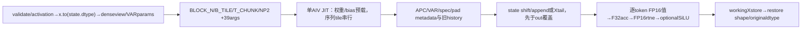
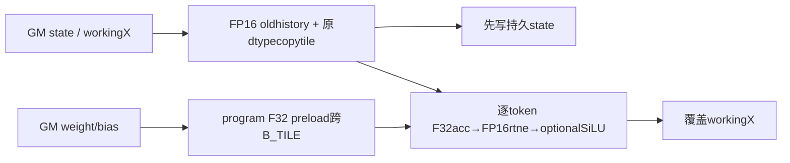

# SGL 因果状态卷积 v2 A3 Direct Invoke 算子知识


## 算子速览

| 项目 | 内容 |
|---|---|
| 实际入口 | sgl_kernel_npu.mamba.causal_conv1d.causal_conv1d_update_v2，Direct Invoke |
| 计算语义 | 按通道因果短卷积，旧history与当前token逐步滚动，可选bias/SiLU；更新选定持久state并覆盖workingX |
| 输入输出 | dense[B,T,C]/单步[B,C]或packed[total,C]；weight[W,C]，state[slots,state_len,C]；输出恢复原x.dtype |
| 执行类型 | 单Triton AIV_VECTOR，无dot/Cube/MIX/SIMT/NDDMA/通信节点 |
| Kernel 路线 | R001…R008=BLOCK_N512/256×dense/VAR×普通/spec；256域T_CHUNK48为未保证arange前提的源可达边界 |
| 核心资源 | B_TILE1/2/4/8，BLOCK_N512/256，T_CHUNK1/48；权重跨B_TILE复用、history/copytile逐序列复用，物理UB由compiler决定 |
| 来源闭包 | direct_implementation_closed：39参数、全部flags/Hostselector/完整tiledJIT、alias/rounding与打包闭合 |
| 静态边界 | indices签名Optional却无条件load；VAR普通state_len_run可≤0；APC目的slot无负保护；BF16等数据也先转FP16；validate_data stride假设需限定 |
| 验证状态 | draft；本次知识提取未执行编译、真机、数值或性能测试，活动测试计划不是已通过记录 |

## 接口与语义

### 计算语义

对request b/channel c，以所选旧state的W−1个history作为卷积前缀，逐token计算Σ_{j=0}^{W−1}history_or_current[j]*weight[j,c]+bias[c]，再可选SiLU。每个token之后history窗口左移并append当前**原始输入**，不是append卷积结果。Device实际W1..6有对应选择分支；Host没有W范围完整检查，W>6不获得完整history/current规则，不因可到达就称支持。

精度顺序必须按source：x先Host转conv_state.dtype；Device旧history与每个当前x都先toFP16，权重load→F32，history/current再F32乘加、可选F32bias；累加结果显式toFP16(fp_downcast_rounding="rtne")，然后若SiLU再回F32做x/(1+exp(−x))，最终storeworkingX（state.dtype），Host返回再转原x.dtype。BF16/F32来源也可能经历FP16值域/舍入；没有“BF16全程保持”或“FP32输入等于全FP32卷积”的保证。primitive乘加融合/exp细节由Tritonlower决定，本次未测。

持久state更新在覆盖out==x之前完成：先读旧history；按真实runtime state_len_run选择“旧state左移+appendX”或“取X尾部”，写APC目的cacheline；再逐token卷积覆盖workingX。spec读旧state起点accepted−1、shift1；普通读起点0、shift有效L。APC可分别选inputcacheline与outputcacheline；pad过滤只检查inputslot。packed时state_len_run含max_query_len与实际L差，必须保留其边界，不能只用数学标准卷积窗口公式代替。

### 输入、输出与属性

| 参数 | shape/layout | dtype | 约束、默认值与语义 |
|---|---|---|---|
| x | dense[B,T,C]、单步[B,C]；VAR[total,C] | 原始floating，测试FP16/BF16 | Hostto(state.dtype)，workingout=x；有实际stride参数不代表任意alias安全 |
| conv_state | [slots,state_len_total,C] | floating，测试FP16/BF16 | 原地目的池；Host取state_len_total但不作为完整capacityguard |
| weight | [W,C] | floating | actualstrides传入，loadF32；W1..6有body规则，测试主要W4 |
| bias | optional[C] | floating | loadF32，可选加；不全面验证device/type/shape |
| activation | bool/None/silu/swish | 默认None | boolTrue→silu；字符串只允许silu/swish |
| conv_state_indices | cache表，通常[B]或APC扩展表 | source按传入load再转I64 | 签名None；VARassert存在，dense无assert但kernel无条件load |
| num_accepted_tokens | optional[B] | sourceload→I64 | 存在→SPEC，accepted−1起点、shift1；不代替实际token长度 |
| query_start_loc | optional[B+1] | sourceload→I64，差转I32 | 存在→VAR；B取indices.shape0，max_query_len为launchseqlen |
| max_query_len | scalar | 默认−1 | VAR必须caller给合法最大长度，不自动从cu求max |
| pad_slot_id | scalar/None | 默认−1 | 非None启用inputslot过滤；None禁用，无目的slot负保护 |
| block_idx_last_scheduled_token | optional[B] | sourceload→I32 | 存在开启APC，作为cache表目的位置偏移 |
| initial_state_idx | optional[B] | sourceload→I32 | APC时作为cache表初态位置偏移；只给blocklast而缺本项未保护 |
| validate_data | bool | 默认False | True只做pad非None和x.stride(1)==1等少量assert，不是全校验 |
| output | 同原x逻辑shape | 原x.dtype | 按dtypealias/copy路径，未处理pad/空序列保留workingX原值 |

Host同dtype .to常返回同Tensor，故workingX/out可能就是callerx或其unsqueezeview，会被覆盖；x.dtype≠state.dtype时产生workingcopy，返回转原dtype通常再产生新Tensor。不能无条件把此函数叫inputreadonly或inplace于原x。state始终直接指向caller池，没有state.contiguous/copyback；需要有效stride、容量、无并发目的冲突及不与workingX产生意外alias。

### 入口与版本

本入口为legacytiledv2，非同file causal_conv1d_update_npu（B,C,T布局、含Torch核心sum分支）、fn_npu（F.conv1d）或nativeTorchop薄包装；这些Device-only/其它Host没有由本v2调用，不能按同文件扩大launchgraph。

A3支持范围来自活动MAMBA_TESTS的test_conv1d_update.py __main__真实调用v2和test_mamba_conv.py的BF16实例，加固定CANN9.1矩阵。950显式过滤这两个文件，因此不创建950卡，也不借module可打包扩A2。prepare脚本9.1默认选择triton-ascend3.2.2，是CI配置而非本次编译结果。

已全文读[legacy因果卷积与recurrent集成Guide](../../../../guides/integration/sgl_kernel_npu/sgl_legacy_causal_conv_recurrent.md)，其接口布局可链接复用；本卡补完整tiledbody/39参数/精度与rawboundary，不修改该Guide或把它当完整Device卡。

## Host/Launcher 执行流程

### 参数校验与前处理

若validate_dataTrue，先assertpad非None、x.stride(1)==1；通常连续[B,T,C] stride(1)=C，C>1时该assert与此布局不符，不能说True在正常dense域总可用。activation归一化/字符串assert之后保存原dtype，x.to(state.dtype)。dense2Dx.unsqueeze(1)变[B,1,C]；VAR仅assertindices非None，B=indices.size0、C=x.size1、seqlen=max_query_len；dense直接解包B/T/C。

取weight宽W、state大小/strides、out=x和所有实际stride；SPEC时effState=W−1+(seqlen−1)，否则W−1，NP2=nextPOT(effState)。再按C选BLOCK_N、按B/channel任务数选B_TILE、选T_CHUNK与grid，提交唯一tiledJIT。无用户可见tile参数、无显式num_warps/num_stages配置；Host没有dtype/设备/全shape/capacity/值域完整校验。np2遇非正effState不作正常支持承诺，不伪造primitive具体异常。

### 参数、Workspace 与生命周期

自有workspace0，没有ACLNNexecutor/TilingData或GM中间statecopy。workingX按dtype关系aliascallerx或新增copy；out指向同workingstorage，输入GM state/weight/bias/indices由caller持有。返回若to原dtype产生copy，其与workingX在框架currentstream排序；return不是Device同步完成，临时workingcopy至runtime消费由框架allocator/Triton合同管理，source没有record_stream/同步/free。

JIT直接写callerstate的outputcacheline及workingX；Pad/空L/尾batch不写output的lane保留其原workingX值，不是新zeroTensor。statecopy按源mask可能不覆盖整state_len_total，未写域保持原池内容；Hoststate_len_total没有被等同effectivehistory长度。重复目的slot/读写交叉cachetable/source与dest重叠由caller保证，不存在atomic/crossprogrambarrier。

### 启动图与失败传播



Pythonshape/assert/typecast/JIT异常直传，无旧布局Torch或referencefallback。小C的T_CHUNK48在同body生成arange48，正常Triton静态arangePOT前提未由Host保证；相关Route仅保留源码可追溯的参数/符号化body，不声称编译成功、确定报错或Device结果。

## Route 与参数设计

### 分核与资源计算

B/C/seqlen由dense或VAR按前文顺序生成，W=weight.shape0，state_len=SPEC?W−1+(seqlen−1):W−1，NP2=nextPOT(state_len)；实际池state_len_total只从shape取出，没有用于该长度推导或完整上界验证。

BLOCK_N=C≥512?512:256，g=ceil(C/BLOCK_N)。CoreHint40、target80固定为启发常量，不是设备资源查询。rawB=max(1,ceil(B*g/80))；B_TILE依序rawB≤1→1、≤2→2、≤4→4、else→8。grid=(ceil(B/B_TILE),g)，T_CHUNK=BLOCK_N512?1:48，无显式warps/stages。每program先load一个channel片的所有weight/bias，再staticfor bi=0..B_TILE−1串行处理请求；所以不是B_TILE个序列同时组成[B_TILE,T_CHUNK,BLOCK_N]矩形驻留。

logicalweight上界6*BLOCK_N*4B、bias BLOCK_N*4B，history上界5*BLOCK_N*2B、current BLOCK_N*2B、acc BLOCK_N*4B，state/Xcopy矩形T_CHUNK*BLOCK_N*sState。仅为源码逻辑域，compiler会依W/flags去掉不活跃值、分配UB/reg/流水，固定仓无物理InitBuffer/UBoffset报告；不能直接求和、乘B_TILE当真实峰值。source“32KB UB idea”注释没有逐buffer物理分配支撑，不作为UB_total≤某硬件上限。selfworkspace0。

VAR实际L=I32(qe−qs)，state_len_run=state_len−(seqlen−L)：SPEC1为W−2+L，SPEC0为W−1−(max_query_len−L)。dense则L=seqlen/state_len_run=state_len。SPEC1旧起点accepted−1、shift1；SPEC0旧起点0、shiftL。use_shift=L<state_len_run，keep=state_len_run−L；use_tail相反，tailStart=L−state_len_run。三phase写state的范围与下文mask完整保留，不能把该状态含义抹平成“永远取最近W−1”而忽略spec/APC/VAR偏移。

### Route 选择

| 顺序 | Route | Key/模板 | 精确选择条件与优先级 | 不适用去向 |
|---:|---|---|---|---|
| 1 | R-001 512通道片等长普通历史 | BLOCK_N512,T_CHUNK1,VAR0,SPEC0 | C>=512；query_start_locNone；acceptedNone；activation/shape前处理通过，本卡A3，caller数据合同 | 其它selector或Python/JIT异常；无fallback |
| 2 | R-002 512通道片等长投机历史 | BLOCK_N512,T_CHUNK1,VAR0,SPEC1 | C>=512；query_start_locNone；accepted非None；activation/shape前处理通过，本卡A3，caller数据合同 | 其它selector或Python/JIT异常；无fallback |
| 3 | R-003 512通道片变长普通历史 | BLOCK_N512,T_CHUNK1,VAR1,SPEC0 | C>=512；query_start_loc非None；acceptedNone；activation/shape前处理通过，本卡A3，caller数据合同 | 其它selector或Python/JIT异常；无fallback |
| 4 | R-004 512通道片变长投机历史 | BLOCK_N512,T_CHUNK1,VAR1,SPEC1 | C>=512；query_start_loc非None；accepted非None；activation/shape前处理通过，本卡A3，caller数据合同 | 其它selector或Python/JIT异常；无fallback |
| 5 | R-005 256通道片编译边界等长普通历史 | BLOCK_N256,T_CHUNK48,VAR0,SPEC0 | C<512且正；query_start_locNone；acceptedNone；activation/shape前处理通过，本卡A3，caller数据合同 | 其它selector或Python/JIT异常；arange48前提未保证 |
| 6 | R-006 256通道片编译边界等长投机历史 | BLOCK_N256,T_CHUNK48,VAR0,SPEC1 | C<512且正；query_start_locNone；accepted非None；activation/shape前处理通过，本卡A3，caller数据合同 | 其它selector或Python/JIT异常；arange48前提未保证 |
| 7 | R-007 256通道片编译边界变长普通历史 | BLOCK_N256,T_CHUNK48,VAR1,SPEC0 | C<512且正；query_start_loc非None；acceptedNone；activation/shape前处理通过，本卡A3，caller数据合同 | 其它selector或Python/JIT异常；arange48前提未保证 |
| 8 | R-008 256通道片编译边界变长投机历史 | BLOCK_N256,T_CHUNK48,VAR1,SPEC1 | C<512且正；query_start_loc非None；accepted非None；activation/shape前处理通过，本卡A3，caller数据合同 | 其它selector或Python/JIT异常；arange48前提未保证 |

```text
伪码：
shape/activation/workingX
VAR = query_start_loc is not None; SPEC=accepted is not None
APC = block_idx_last_scheduled_token is not None
BIAS=bias is not None; SILU=activation in {silu,swish}; PAD=pad_slot_id is not None
C>=512 -> R001/R002/R003/R004按VAR,SPEC 00/01/10/11
C<512  -> R005/R006/R007/R008按相同顺序；T_CHUNK48 compilerboundary
APC与BIAS/SILU/PAD、B_TILE属于下面精确子selector，不增删任一真实flag
```

### 模板/实现执行矩阵

| Route | key/selector | dtype/shape/platform 完整命中条件 | 执行拓扑与 Kernel 节点 | 实际模板/body | 内存与同步特征 | tail/fallback |
|---|---|---|---|---|---|---|
| R-001 | BN512/TC1/V0/S0，B_TILE1/2/4/8按rawB | A3；C>=512、VAR0/SPEC0精确存在谓词；浮点caller域、实际strides/capacity/device合法；W1..6 body、测试W4不泛化验收 | 单AIV JIT gridceil(B/B_TILE)×ceil(C/BN) | _causal_conv1d_update_kernel_npu_tiled完整39参数，APC/BIAS/SILU/PAD全子selector | weight/bias跨B_TILE复用，旧history先读，statecopy先于outalias覆盖；自有workspace0 | batch/channel/seq/pad mask；普通rolling |
| R-002 | BN512/TC1/V0/S1，B_TILE1/2/4/8按rawB | A3；C>=512、VAR0/SPEC1精确存在谓词；浮点caller域、实际strides/capacity/device合法；W1..6 body、测试W4不泛化验收 | 单AIV JIT gridceil(B/B_TILE)×ceil(C/BN) | _causal_conv1d_update_kernel_npu_tiled完整39参数，APC/BIAS/SILU/PAD全子selector | weight/bias跨B_TILE复用，旧history先读，statecopy先于outalias覆盖；自有workspace0 | batch/channel/seq/pad mask；accepted−1值域caller |
| R-003 | BN512/TC1/V1/S0，B_TILE1/2/4/8按rawB | A3；C>=512、VAR1/SPEC0精确存在谓词；浮点caller域、实际strides/capacity/device合法；W1..6 body、测试W4不泛化验收 | 单AIV JIT gridceil(B/B_TILE)×ceil(C/BN) | _causal_conv1d_update_kernel_npu_tiled完整39参数，APC/BIAS/SILU/PAD全子selector | weight/bias跨B_TILE复用，旧history先读，statecopy先于outalias覆盖；自有workspace0 | batch/channel/seq/pad mask；state_len_run≤0边界 |
| R-004 | BN512/TC1/V1/S1，B_TILE1/2/4/8按rawB | A3；C>=512、VAR1/SPEC1精确存在谓词；浮点caller域、实际strides/capacity/device合法；W1..6 body、测试W4不泛化验收 | 单AIV JIT gridceil(B/B_TILE)×ceil(C/BN) | _causal_conv1d_update_kernel_npu_tiled完整39参数，APC/BIAS/SILU/PAD全子selector | weight/bias跨B_TILE复用，旧history先读，statecopy先于outalias覆盖；自有workspace0 | batch/channel/seq/pad mask；accepted−1值域caller |
| R-005 | BN256/TC48/V0/S0，B_TILE1/2/4/8按rawB | A3；C<512且正、VAR0/SPEC0精确存在谓词；浮点caller域、实际strides/capacity/device合法；W1..6 body、测试W4不泛化验收 | 单AIV JIT gridceil(B/B_TILE)×ceil(C/BN) | _causal_conv1d_update_kernel_npu_tiled完整39参数，APC/BIAS/SILU/PAD全子selector | weight/bias跨B_TILE复用，旧history先读，statecopy先于outalias覆盖；自有workspace0 | 仅symbolicbody，arange48编译未保证；普通rolling |
| R-006 | BN256/TC48/V0/S1，B_TILE1/2/4/8按rawB | A3；C<512且正、VAR0/SPEC1精确存在谓词；浮点caller域、实际strides/capacity/device合法；W1..6 body、测试W4不泛化验收 | 单AIV JIT gridceil(B/B_TILE)×ceil(C/BN) | _causal_conv1d_update_kernel_npu_tiled完整39参数，APC/BIAS/SILU/PAD全子selector | weight/bias跨B_TILE复用，旧history先读，statecopy先于outalias覆盖；自有workspace0 | 仅symbolicbody，arange48编译未保证；accepted−1值域caller |
| R-007 | BN256/TC48/V1/S0，B_TILE1/2/4/8按rawB | A3；C<512且正、VAR1/SPEC0精确存在谓词；浮点caller域、实际strides/capacity/device合法；W1..6 body、测试W4不泛化验收 | 单AIV JIT gridceil(B/B_TILE)×ceil(C/BN) | _causal_conv1d_update_kernel_npu_tiled完整39参数，APC/BIAS/SILU/PAD全子selector | weight/bias跨B_TILE复用，旧history先读，statecopy先于outalias覆盖；自有workspace0 | 仅symbolicbody，arange48编译未保证；state_len_run≤0边界 |
| R-008 | BN256/TC48/V1/S1，B_TILE1/2/4/8按rawB | A3；C<512且正、VAR1/SPEC1精确存在谓词；浮点caller域、实际strides/capacity/device合法；W1..6 body、测试W4不泛化验收 | 单AIV JIT gridceil(B/B_TILE)×ceil(C/BN) | _causal_conv1d_update_kernel_npu_tiled完整39参数，APC/BIAS/SILU/PAD全子selector | weight/bias跨B_TILE复用，旧history先读，statecopy先于outalias覆盖；自有workspace0 | 仅symbolicbody，arange48编译未保证；accepted−1值域caller |

APC精确附加表与各Route做笛卡尔积，ABI/同body资源均保持参数化，未把来源差异消成alias：

| APC selector | 完整条件 | input cachetable偏移 | output cachetable偏移 | 消费指针与边界 |
|---|---|---|---|---|
| A0 | blocklast is None | b*stride_indices+0 | b*stride_indices+0 | initialidx/blocklast inactive；indices仍无条件读 |
| A1 | blocklast is not None | b*stride_indices+I32(initialidx[b]) | b*stride_indices+I32(blocklast[b]) | initialidx必须存在/有效；Host不独立assert |

BIAS/SILU/PAD八个精确组合，分别改变source中显式load/计算或mask，无新增自有buffer或GMworkspace；每个Route×APC都保留这八种行为：

| 代码 | bias条件 | activation归一化结果 | pad条件 | 精度/输出/过滤差异 |
|---|---|---|---|---|
| B0L0P0 | bias None | None/False | pad None | acc_bias0；FP16rtne后直接store；不做pad过滤 |
| B0L0P1 | bias None | None/False | pad 非None | acc_bias0；FP16rtne后直接store；inputslot==pad跳过 |
| B0L1P0 | bias None | silu/swish/True | pad None | acc_bias0；FP16rtne后回F32算SiLU；不做pad过滤 |
| B0L1P1 | bias None | silu/swish/True | pad 非None | acc_bias0；FP16rtne后回F32算SiLU；inputslot==pad跳过 |
| B1L0P0 | bias 非None | None/False | pad None | loadF32bias并加；FP16rtne后直接store；不做pad过滤 |
| B1L0P1 | bias 非None | None/False | pad 非None | loadF32bias并加；FP16rtne后直接store；inputslot==pad跳过 |
| B1L1P0 | bias 非None | silu/swish/True | pad None | loadF32bias并加；FP16rtne后回F32算SiLU；不做pad过滤 |
| B1L1P1 | bias 非None | silu/swish/True | pad 非None | loadF32bias并加；FP16rtne后回F32算SiLU；inputslot==pad跳过 |

B_TILE精确四选择见前文rawB区间，不是用户独立参数。width1..6的卷积unroll选择同source嵌套if，W个weight、W−1个history与当前rawx组成输入；未用history/weights为source零初始化域而非固定物理分配。所有Route中APC/Spec/VAR/精度/tail会改变的表达式均按这些矩阵和逐Route伪码保留，不以共同文件名代替。

### 隐藏性能 Guard

| Guard | Host/Tiling 条件 | Device/资源原因 | 影响 Route | 不满足时去向 | 源码符号 |
|---|---|---|---|---|---|
| validationstride | validateTrue时x.stride(1)==1 | 常规denseBTCstride1=C非1 | 全部 | assertion；不能当通用验证开关 | Host |
| channel阈值 | C>=512 | BN512/TC1；否则BN256/TC48 | 全部 | 进入另一source分支 | tiling |
| arange静态范围 | 未guardPOT(T_CHUNK)，小域取48 | tokenvector静态范围前提 | R005..8 | compilerboundary，未验证结果 | tok_vec |
| indices存在 | VAR仅Hostassert；dense无assert | Device不论APC都loadindices | 全部 | None无有效pointerproducer | conv_states_input_coord |
| APC成对metadata | 只由blocklast存在置True | 同分支也loadinitialidx | APC1 | 缺initialidx未保护 | IS_APC_ENABLED |
| pad来源/目的 | 只input!=pad保护laneactive | 目的coord仅有<cacheupper | 全部PAD1/APC1尤其 | 负目的未保护，不扩安全承诺 | dstCoord/masks |
| actual/maxL | VAR无全面值域guard | statecopy静态upper使用maxseqlen、convloop实际L | VAR | L>maxL等不保证；L≤0不输出 | state_len_run |
| width/capacity | Host不查W≤6/池窗口足够 | W>6无完整selection；priorload无slotupper保护 | 全部 | raw未保护，不能借statecopymask保证 | historyloads/compute |
| dtype/device | x仅转state.dtype，其他不全检 | history/currentFP16、weightsF32、各pointer设备 | 全部 | caller合同；不造自动device切换 | Host/JIT |
| conflict/alias | 无重复目的检测 | 多program直接GMstore无atomic | 全部 | caller需保证无跨requestrace | tl.store |

### POD/ABI

无C++POD/TilingData。完整39个Triton参数按源码顺序列出；constexpr为compile specialization，batch显式tl.int32，其他runtimeinteger/pointer的physical位宽、packoffset/sizeof/align由compiler ABI决定，固定仓无明确声明，不伪造。do_not_specialize列表：batch、state_len、num_cache_lines、stride_x_seq、stride_x_token、stride_conv_state_seq、stride_state_indices、stride_o_seq、stride_o_token。

| 结构 | 字段 | 类型/位宽 | ABI 布局 | 单位 | Host/launcher producer | Device consumer | 边界 |
|---|---|---|---|---|---|---|---|
| Triton tuple | x_ptr | pointer/inferred，physical位宽未声明 | arg0；physicaloffset未声明 | GMaddress | workingX=x.to(state.dtype) | xbase/phasecopy/convload | dense/VAR stride |
| Triton tuple | w_ptr | pointer/inferred，physical位宽未声明 | arg1；physicaloffset未声明 | GMaddress | callerweight | w_col0..5 F32 | shape[W,C] |
| Triton tuple | bias_ptr | pointer/inferred，physical位宽未声明 | arg2；physicaloffset未声明 | GMaddress | callerbias或None | BIAS1 load acc_bias | BIAS0inactive |
| Triton tuple | conv_state_ptr | pointer/inferred，physical位宽未声明 | arg3；physicaloffset未声明 | GMaddress | callerstate | priorhistory/shift/append/tailstore | 真实strides；可变 |
| Triton tuple | conv_state_indices_ptr | pointer/inferred，physical位宽未声明 | arg4；physicaloffset未声明 | GMaddress | callerindices或None | 始终读input与outputCoord | None无pointerproducer |
| Triton tuple | num_accepted_tokens_ptr | pointer/inferred，physical位宽未声明 | arg5；physicaloffset未声明 | GMaddress | calleraccepted或None | SPEC1 accepted[b]-1 | SPEC0inactive |
| Triton tuple | query_start_loc_ptr | pointer/inferred，physical位宽未声明 | arg6；physicaloffset未声明 | GMaddress | callercu或None | VAR1qs/qe | VAR0inactive |
| Triton tuple | block_idx_last_scheduled_token | pointer/inferred，physical位宽未声明 | arg7；physicaloffset未声明 | GMaddress | callerblocklast或None | APC1目的cachetable偏移 | APC0inactive |
| Triton tuple | initial_state_idx | pointer/inferred，physical位宽未声明 | arg8；physicaloffset未声明 | GMaddress | callerinitialidx或None | APC1初态cachetable偏移 | APC0inactive，flag不由它产生 |
| Triton tuple | o_ptr | pointer/inferred，physical位宽未声明 | arg9；physicaloffset未声明 | GMaddress | out=workingX | store卷积结果 | 与x_ptr同storage |
| Triton tuple | batch | tl.int32/32bit | arg10；physicaloffset未声明 | 元素/计数或scalar | denseB或indices.size0 | b<B尾mask | tl.int32显式；未Host上界guard |
| Triton tuple | dim | tl.constexpr | arg11；physicaloffset未声明 | 元素/计数或scalar | x最后/VAR第二维C | channelmask/tiling | positivecaller |
| Triton tuple | seqlen | tl.constexpr | arg12；physicaloffset未声明 | 元素/计数或scalar | denseT/VARmax_query_len | denseL、VARstate_len_run、statecopy静态loop | VAR默认−1不作为正常值 |
| Triton tuple | state_len | runtimeinteger inferred，lower位宽未声明 | arg13；physicaloffset未声明 | 元素/计数或scalar | SPEC?W−1+(seqlen−1):W−1 | state_len_run/keep/tail | 不是池state_len_total |
| Triton tuple | num_cache_lines | runtimeinteger inferred，lower位宽未声明 | arg14；physicaloffset未声明 | 元素/计数或scalar | state.shape0 | statecopycoorduppermask | priorhistory不受该upper保护 |
| Triton tuple | stride_x_seq | runtimeinteger inferred，lower位宽未声明 | arg15；physicaloffset未声明 | elements | densex.stride0/VAR0 | denseb*xseq | elementstride |
| Triton tuple | stride_x_dim | tl.constexpr | arg16；physicaloffset未声明 | elements | densex.stride2/VARx.stride1 | channel*x_dim | elementstride |
| Triton tuple | stride_x_token | runtimeinteger inferred，lower位宽未声明 | arg17；physicaloffset未声明 | elements | densex.stride1/VARx.stride0 | token*x_token | elementstride |
| Triton tuple | stride_w_dim | tl.constexpr | arg18；physicaloffset未声明 | elements | weight.stride1 | channel*w_dim | elementstride |
| Triton tuple | stride_w_width | tl.constexpr | arg19；physicaloffset未声明 | elements | weight.stride0 | j*w_width | elementstride |
| Triton tuple | stride_conv_state_seq | runtimeinteger inferred，lower位宽未声明 | arg20；physicaloffset未声明 | elements | state.stride0 | cachecoord*state_seq | elementstride |
| Triton tuple | stride_conv_state_dim | tl.constexpr | arg21；physicaloffset未声明 | elements | state.stride2 | channel*state_dim | elementstride |
| Triton tuple | stride_conv_state_tok | tl.constexpr | arg22；physicaloffset未声明 | elements | state.stride1 | historyindex*state_tok | elementstride |
| Triton tuple | stride_state_indices | runtimeinteger inferred，lower位宽未声明 | arg23；physicaloffset未声明 | elements | indices.stride0或None时0 | b*stride_indices+APCoffset | 0不取消indicesload |
| Triton tuple | stride_o_seq | runtimeinteger inferred，lower位宽未声明 | arg24；physicaloffset未声明 | elements | denseout.stride0/VAR0 | denseb*oseq | elementstride |
| Triton tuple | stride_o_dim | tl.constexpr | arg25；physicaloffset未声明 | elements | denseout.stride2/VARout.stride1 | channel*odim | elementstride |
| Triton tuple | stride_o_token | runtimeinteger inferred，lower位宽未声明 | arg26；physicaloffset未声明 | elements | denseout.stride1/VARout.stride0 | token*otoken | elementstride |
| Triton tuple | pad_slot_id | tl.constexpr | arg27；physicaloffset未声明 | 元素/计数或scalar | caller默认−1/None | USE_PAD时inputcoord比较 | None仅PAD0不消费 |
| Triton tuple | HAS_BIAS | tl.constexpr | arg28；physicaloffset未声明 | boolselector | bias is not None | biasload/addflag | boolconstexpr |
| Triton tuple | KERNEL_WIDTH | tl.constexpr | arg29；physicaloffset未声明 | 元素/计数或scalar | weight.shape0 | history/weights/compute unroll | 1..6有body；raw更大未guard |
| Triton tuple | SILU_ACTIVATION | tl.constexpr | arg30；physicaloffset未声明 | boolselector | activation in(silu,swish) | FP16rtne之后SiLU | boolnormalization先发生 |
| Triton tuple | IS_VARLEN | tl.constexpr | arg31；physicaloffset未声明 | boolselector | query_start_loc is not None | L/bases/state_len_run | boolconstexpr |
| Triton tuple | IS_APC_ENABLED | tl.constexpr | arg32；physicaloffset未声明 | boolselector | blocklast is not None | input/dstcachetableoffset | initialidx成对caller保证 |
| Triton tuple | IS_SPEC_DECODING | tl.constexpr | arg33；physicaloffset未声明 | boolselector | accepted is not None | historyoff/shift/HosteffState | boolconstexpr |
| Triton tuple | NP2_STATELEN | tl.constexpr | arg34；physicaloffset未声明 | 元素/计数或scalar | nextPOT(effState) | phaseA/Cstaticloopupper | 非正effState未保证 |
| Triton tuple | USE_PAD_SLOT | tl.constexpr | arg35；physicaloffset未声明 | boolselector | pad_slot_id is not None | inputslot过滤 | 目的slot不独立比较 |
| Triton tuple | BLOCK_N | tl.constexpr | arg36；physicaloffset未声明 | 元素/计数或scalar | C>=512?512:256 | featurearange/tile | P2 |
| Triton tuple | B_TILE | tl.constexpr | arg37；physicaloffset未声明 | 元素/计数或scalar | rawB≤1/2/4→1/2/4否则8 | staticforbi/requestmapping | P2，串行Btile不乘copytile |
| Triton tuple | T_CHUNK | tl.constexpr | arg38；physicaloffset未声明 | 元素/计数或scalar | BN512?1:48 | tok_vec/3statecopyloopstep | 48前提未guard |

### Route 源码闭包

| Route | Key/selector | Host/Tiling producer | POD/参数 | Kernel entry/router 节点 | Kernel body/直接依赖 | 构建接线 |
|---|---|---|---|---|---|---|
| R-001 | BN512/TC1/VAR0/SPEC0 +APC/B/L/P矩阵 | python/sgl_kernel_npu/sgl_kernel_npu/mamba/causal_conv1d.py:causal_conv1d_update_v2 | 上表39参数、actualstride/NP2/B_TILE | 同file:_causal_conv1d_update_kernel_npu_tiled | 全部weight/history/3copy/convstore body；torchcast/view与triton/tl primitive明确边界 | setup.py→torch_wheel.stage_runtime复制mamba模块→包init；CI精确A3tests |
| R-002 | BN512/TC1/VAR0/SPEC1 +APC/B/L/P矩阵 | python/sgl_kernel_npu/sgl_kernel_npu/mamba/causal_conv1d.py:causal_conv1d_update_v2 | 上表39参数、actualstride/NP2/B_TILE | 同file:_causal_conv1d_update_kernel_npu_tiled | 全部weight/history/3copy/convstore body；torchcast/view与triton/tl primitive明确边界 | setup.py→torch_wheel.stage_runtime复制mamba模块→包init；CI精确A3tests |
| R-003 | BN512/TC1/VAR1/SPEC0 +APC/B/L/P矩阵 | python/sgl_kernel_npu/sgl_kernel_npu/mamba/causal_conv1d.py:causal_conv1d_update_v2 | 上表39参数、actualstride/NP2/B_TILE | 同file:_causal_conv1d_update_kernel_npu_tiled | 全部weight/history/3copy/convstore body；torchcast/view与triton/tl primitive明确边界 | setup.py→torch_wheel.stage_runtime复制mamba模块→包init；CI精确A3tests |
| R-004 | BN512/TC1/VAR1/SPEC1 +APC/B/L/P矩阵 | python/sgl_kernel_npu/sgl_kernel_npu/mamba/causal_conv1d.py:causal_conv1d_update_v2 | 上表39参数、actualstride/NP2/B_TILE | 同file:_causal_conv1d_update_kernel_npu_tiled | 全部weight/history/3copy/convstore body；torchcast/view与triton/tl primitive明确边界 | setup.py→torch_wheel.stage_runtime复制mamba模块→包init；CI精确A3tests |
| R-005 | BN256/TC48/VAR0/SPEC0 +APC/B/L/P矩阵 | python/sgl_kernel_npu/sgl_kernel_npu/mamba/causal_conv1d.py:causal_conv1d_update_v2 | 上表39参数、actualstride/NP2/B_TILE | 同file:_causal_conv1d_update_kernel_npu_tiled | 全部weight/history/3copy/convstore body；torchcast/view与triton/tl primitive明确边界 | setup.py→torch_wheel.stage_runtime复制mamba模块→包init；CI精确A3tests |
| R-006 | BN256/TC48/VAR0/SPEC1 +APC/B/L/P矩阵 | python/sgl_kernel_npu/sgl_kernel_npu/mamba/causal_conv1d.py:causal_conv1d_update_v2 | 上表39参数、actualstride/NP2/B_TILE | 同file:_causal_conv1d_update_kernel_npu_tiled | 全部weight/history/3copy/convstore body；torchcast/view与triton/tl primitive明确边界 | setup.py→torch_wheel.stage_runtime复制mamba模块→包init；CI精确A3tests |
| R-007 | BN256/TC48/VAR1/SPEC0 +APC/B/L/P矩阵 | python/sgl_kernel_npu/sgl_kernel_npu/mamba/causal_conv1d.py:causal_conv1d_update_v2 | 上表39参数、actualstride/NP2/B_TILE | 同file:_causal_conv1d_update_kernel_npu_tiled | 全部weight/history/3copy/convstore body；torchcast/view与triton/tl primitive明确边界 | setup.py→torch_wheel.stage_runtime复制mamba模块→包init；CI精确A3tests |
| R-008 | BN256/TC48/VAR1/SPEC1 +APC/B/L/P矩阵 | python/sgl_kernel_npu/sgl_kernel_npu/mamba/causal_conv1d.py:causal_conv1d_update_v2 | 上表39参数、actualstride/NP2/B_TILE | 同file:_causal_conv1d_update_kernel_npu_tiled | 全部weight/history/3copy/convstore body；torchcast/view与triton/tl primitive明确边界 | setup.py→torch_wheel.stage_runtime复制mamba模块→包init；CI精确A3tests |

## Kernel 实现

### 公共执行流程

唯一tiledJIT先按channel片预载6个weight逻辑F32向量及可选bias，然后B_TILE个request串行：计算APC位置/inputslot、padactive、VAR长度与基址、spec偏移→先读最多5个FP16 history→取目的slot→三phase原dtype statecopy（shift/append或tail）→实际L个token逐步卷积、FP16rtne和optionalSiLU、覆盖workingX。statecopy使用state.dtype原值；只有计算history/current和acc显式经过FP16，不把持久state写值误成半精输出。

tl.load/store/arange/exp/cast与looplowering是明确compilerprimitive边界；本仓没有UB InitBuffer/TQue/TBuf、固定warps/threadblock或显式pipeflag。源码无debug_barrier（该语句存在于另一旧kernel但不由本Hostlaunch）；不能把旧kernel同步或al.insert_slice网络搬进本v2。source旧history在statecopy前读取，statecopy读X又在output覆盖前，局部memorydependency/ordering由当前JIT编译器建立；跨program共享cache冲突没有额外同步。

### Route R-001：512通道片等长普通历史

#### 适用条件

##### 选择证据

| 层级 | 文件 | 符号 | 源码谓词/参数 | 结果/下一跳 |
|---|---|---|---|---|
| Host | python/sgl_kernel_npu/sgl_kernel_npu/mamba/causal_conv1d.py | causal_conv1d_update_v2 | C>=512；query_start_locNone；acceptedNone | BN512/TC1/VAR0/SPEC0 |
| flags | 同file | APC/BIAS/SILU/PAD | 公共精确2×8子selector矩阵，未裁剪任何组合 | 39tuple中全部constexpr |
| launch | 同file | grid/_causal_conv1d_update_kernel_npu_tiled | B_TILE按rawB阈值1/2/4/8 | gridceil(B/B_TILE)×ceil(C/512) |
| boundary | 同file | tok_vec/history/state_len_run | TC1正常静态范围，仍须合法metadata/capacity | 普通history合法值caller |

本Route保留APC0/1、八种BIAS/SILU/PAD和四B_TILE区间的完整参数化，不把它们错当文件别名。precision与GMmask依对应flag/源分支变化；smallTC48后的body为可追溯符号化说明，不能当已实际执行轨迹。

#### Device 数据流

##### 函数级调用链

```text
causal_conv1d_update_v2 -> activation/xcast/shape/strides/tile
 -> _causal_conv1d_update_kernel_npu_tiled[ceil(B/B_TILE),ceil(C/512)]
  -> preloadweight/bias
  -> staticfor bi in B_TILE:
    APC/inputslot/pad -> denseL/base -> offset0、shiftL
    -> readFP16oldhistory -> dstslot
    -> state_shift / appendX / Xtail (state.dtype)
    -> tl.range(L): FP16current + F32sum/bias
       -> FP16 rtne -> rollrawhistory -> optionalF32SiLU -> storeworkingX
 -> squeezeifneeded -> to(original_x_dtype)
```

##### 源码等价伪码

```text
伪码；BN=512,TC=1；合法caller域下的source流程
cc=pidC*BN+arange(BN); cm=cc<C; preloadW[0..W-1]F32,biasF32或0
tv=arange(TC)
for bi in staticrange(B_TILE):
 b=pidB*B_TILE+bi; active=b<B
 initpos=loadinitialidx[b] ifAPC else0
 dstpos=loadblocklast[b] ifAPC else0
 srcslot=I64(loadindices[b*strideidx+initpos],maskactive,other0)
 ifPAD: active &=srcslot!=pad
 L=seqlen;E=effState;xb=b*x_seq;ob=b*o_seq
 active &=L>0
 off=0; shift=L
 hist[0..W-2]=loadstate(srcslot,cc,off+j,maskactive&cm).toFP16
 dstslot=I64(loadindices[b*strideidx+dstpos],maskactive,other0)
 useShift=L<E;keep=where(useShift,E-L,0);useTail=L>=E;tailStart=where(useTail,L-E,0)
 for t0 in staticrange(0,NP2,TC): # phaseA
  dt=t0+tv;st=dt+shift
  m=active&cm&useShift&(dt<keep)&(st<E)&(dt<E)&(srcslot<Ncache)&(dstslot<Ncache)
  vals=loadstate(srcslot,off+st,cc,m,other0) # state.dtype，无FP16cast
  storestate(dstslot,dt,cc,vals,m)
 for t0 in staticrange(0,seqlen,TC): # phaseB
  xt=t0+tv;dt=keep+xt
  m=active&cm&useShift&(xt<L)&(dt<E)&(dstslot<Ncache)
  vals=loadX(xb+xt*x_token+cc*x_dim,m,other0);storestate(dstslot,dt,cc,vals,m)
 for t0 in staticrange(0,NP2,TC): # phaseC
  dt=t0+tv;xt=tailStart+dt
  m=active&cm&useTail&(dt<E)&(xt<L)&(dstslot<Ncache)
  vals=loadX(xb+xt*x_token+cc*x_dim,m,other0);storestate(dstslot,dt,cc,vals,m)
 for t in tl.range(L):
  current=loadX(xb+t*x_token+cc*x_dim,active&cm).toFP16
  acc=F32 sum(hist/current*preloadedW);ifBIAS:acc+=bias
  acc=FP16_rtne(acc);rollhist_append(current)
  ifSILU:acc=F32(acc)/(1+exp(-F32(acc)))
  storeO(ob+t*o_token+cc*o_dim,acc,active&cm)
```

dense E=W−1，输入2D时L1；Host有效窗口与state总容量仍须独立核对。
phaseA/B/C对slot只有源码所写upper条件，并未加非负guard；priorhistoryload更没有该upper过滤，不能以phasecopy带mask保证所有raw输入安全。W1..6具体unroll保留source选择，W>6不扩为正常域。

#### 内存与数据搬运

##### 资源与搬运表

| 层级/缓冲区 | offset/地址公式 | extent/容量公式 | dtype/layout | producer | consumer | owner/lifetime | 对齐/复用 |
|---|---|---|---|---|---|---|---|
| workingX GM | xb+t*x_token+cc*x_dim | denseB*T*C*sState；VARtotal*C*sState | x.to(state.dtype)与真实stride | caller/Hostcast | phaseB/C与conv，最终同ptr写O | alias原x或框架copy到消费 | statecopy先读取，output稍后覆盖 |
| state GM | slot*state_seq+cc*state_dim+token*state_tok | slots*state_len_total*C*sState | 实际state layout | caller/旧轮 | priorhistory/phaseA与phaseABC写 | caller持久原池 | src/dst由APC表，可不同；未覆盖域保持 |
| weight GM | cc*w_dim+j*w_width | W*C*sW | actualstrides | caller | preloadF32 | 全launch，currentprogram跨B_TILE复用 | channelmask、每W条件load |
| bias GM | cc | C*sBias | densevector合同 | caller | BIAS1 preload | 同上 | BIAS0不读，未显式stride |
| metadata GM | b*strideidx+APCpos；accepted[b]；cu[b/b+1] | caller各自真实容量 | source类型→I64/I32 | caller | scalarcoord/length/shift | caller到消费 | indices始终load；无Hostcast/全值域校验 |
| logicalweight/bias | 每channelBNlane | 6*BN*4 + BIAS*BN*4 | F32 | load/zero | Wunroll/acc | 当前program全B_TILE | compilerDCE/物理reg未知 |
| logicalhistory/current | 每request最多5hist+1current | hist5*BN*2，currentBN*2 | FP16 | initialhistory/currentload | conv、rolling | 串行bi/token | 先读旧state；rollappendrawX |
| logicalstatecopy tile | [TC,BN]=[1,512] | TC*BN*sState | state.dtype | state/Xload | stateGMstore | phase/iteration局部SSA | B_TILE串行，不乘BT作为峰值 |
| logicalacc/result | BNlane | accBN*4；FP16resultBN*2；SiLUifF32BN*4 | F32→FP16rtne→optionalF32 | multiply/add/bias | optionalSiLU/Ostore | 当前token | 生命周期可能重叠由compiler决定 |
| UB/TQue/TBuf/dynamic/window | N/A sourceowned | physicalcompilerUB/reg未声明 | compilerlowering | 无InitBuffer | 无ownedqueue | N/A | 不造32KiB资源proof或doublebuffer |
| workspace/return | workspace0；返回alias或cast | 最多workingcopy和返回copy的各自有效x字节 | originaldtype | Host/runtime | caller | 返回Tensor、临时框架owner | 无systemworkspace/executor |

##### 分层内存布局

owned AIV UB block-beta：N/A；实际只有Triton逻辑域与GM，固定源码无可证physical UBoffset/depth。替代路径：



TC1的逻辑矩形由source arange/广播确定，compilerphysical占用仍未本次验证。没有L1/L0/Cubebuffer或跨kernelGMpartial。

##### 字节账与复用顺序

```text
BN=512;TC=1;VAR=0;SPEC=0
logicalW<=6*BN*4；logicalBias=BIAS*BN*4
logicalHistory<=5*BN*2；current=BN*2；acc=BN*4
logicalcopy=TC*BN*sState；不是B_TILE*TC*BN（B_TILE逐bi串行）
ownedUB=N/A；compilerphysicalUB/register unknown，不能将逻辑和当真实峰值
workspace_total=0
workingXcopy 若originaldtype!=state.dtype：x.numel*sState，否则通常alias新增0
returncast 若不同dtype：x.numel*sOrig；原dtype同则aliasworkingX
stateGM=slots*state_len_total*C*sState；未写全statecapacity的域不自动清零
```

| 复用子区 | 写入者 | 读取者/消费点 | 下一次覆盖 | 同步或释放依据 | 安全条件 |
|---|---|---|---|---|---|
| weight/biaslocal | programentryload | B_TILE各bi全部token | program结束 | SSA/compiler | callerweight到消费，channelmask合法 |
| oldhistorylocal | statepriorload/roll | 当前token卷积 | rollhistory/下一bi | SSA/tokendependency | statecopy前完成旧history读 |
| statecopylocal | phaseA/B/C load | 对应stateGMstore | 下一t0/phase/bi | compiler memorydependency，无显式barrier | caller无跨programslotrace；原x先读再覆盖 |
| workingX GM | Hostcast/caller原值 | phasecopy/convcurrentload | 当前tokenOstore | 单programsource顺序、JITalias依赖 | 本request后token不会读取先前卷积输出作rawX；history保留rawcurrent |
| state GM | phaseABCstore | 后续调用 | 后续request/caller | 无跨programatomic/event | 避免重复dst/交叉srcdestalias |
| returnTensor | tooriginaldtype/view | caller | source不再改 | currentstream框架合同 | 异步copy/JIT输入临时到消费，不把return当sync |

#### 同步、精度与尾块

##### 同步与数值边界表

| 阶段 | primitive/机制 | producer | consumer/等待点 | 保护对象 | 精度/尾块 |
|---|---|---|---|---|---|
| weight/historyload | tl.load(mask,other0) | GM | W/history | channel/batch/pad | weightsF32、historyFP16；actualslot上界未全面保护 |
| statecopy | 原dtype tl.load/store | 旧state/rawworkingX | 持久state | jointm | 先读history，后state写，最后O写；不把copy值误说成FP16计算值 |
| conv | F32acc及bias | FP16history/current、F32weight | result | BNlane | W≤6源码unroll；未指定fma降级或所有dtypes硬件支持 |
| round/activation | toFP16 rtne→ifSiLUF32 | acc | Ostore | 有效lane | FP16舍入在SiLU之前，BF16状态也经历该计算路径 |
| masks | b<B、Ctail、L>0、inputpad | metadata/mapping | state/O各自m | 有效输出 | pad/emptyO保留workingX原值；目的slot负值未保护 |
| synchronization | compilerSSA/memorydependency | 本program各phase/token | 后继phase/token | locallogic/alias | 没有debug_barrier、crosscoreflag、atomic；跨program冲突caller负责 |
| Hostreturn | Triton/torch currentstream | JIT/returncast | caller | Tensorlifetime | 无设备sync/record_stream；本次无运行验证 |

#### 关键实现

##### 符号证据表

| 阶段 | 文件 | 符号/模板实例 | 实现事实 |
|---|---|---|---|
| Host/Tiling producer | python/sgl_kernel_npu/sgl_kernel_npu/mamba/causal_conv1d.py | causal_conv1d_update_v2 | BN512/TC1/VAR0/SPEC0、B_TILE、strides |
| Kernel entry/router | python/sgl_kernel_npu/sgl_kernel_npu/mamba/causal_conv1d.py | _causal_conv1d_update_kernel_npu_tiled | 39参数/constexpr flags，无其它kernel fallback |
| Device body/helper | python/sgl_kernel_npu/sgl_kernel_npu/mamba/causal_conv1d.py | weight/history/phaseA/B/C/tokenloop | 全部mask/address/FP16→F32→FP16rtne与持久state |
| 构建接线 | python/sgl_kernel_npu/build_tools/torch_wheel.py | stage_runtime | 复制当前PythonJIT，编译器primitive另有边界 |


### Route R-002：512通道片等长投机历史

#### 适用条件

##### 选择证据

| 层级 | 文件 | 符号 | 源码谓词/参数 | 结果/下一跳 |
|---|---|---|---|---|
| Host | python/sgl_kernel_npu/sgl_kernel_npu/mamba/causal_conv1d.py | causal_conv1d_update_v2 | C>=512；query_start_locNone；accepted非None | BN512/TC1/VAR0/SPEC1 |
| flags | 同file | APC/BIAS/SILU/PAD | 公共精确2×8子selector矩阵，未裁剪任何组合 | 39tuple中全部constexpr |
| launch | 同file | grid/_causal_conv1d_update_kernel_npu_tiled | B_TILE按rawB阈值1/2/4/8 | gridceil(B/B_TILE)×ceil(C/512) |
| boundary | 同file | tok_vec/history/state_len_run | TC1正常静态范围，仍须合法metadata/capacity | accepted−1合法值caller |

本Route保留APC0/1、八种BIAS/SILU/PAD和四B_TILE区间的完整参数化，不把它们错当文件别名。precision与GMmask依对应flag/源分支变化；smallTC48后的body为可追溯符号化说明，不能当已实际执行轨迹。

#### Device 数据流

##### 函数级调用链

```text
causal_conv1d_update_v2 -> activation/xcast/shape/strides/tile
 -> _causal_conv1d_update_kernel_npu_tiled[ceil(B/B_TILE),ceil(C/512)]
  -> preloadweight/bias
  -> staticfor bi in B_TILE:
    APC/inputslot/pad -> denseL/base -> accepted−1 offset、shift1
    -> readFP16oldhistory -> dstslot
    -> state_shift / appendX / Xtail (state.dtype)
    -> tl.range(L): FP16current + F32sum/bias
       -> FP16 rtne -> rollrawhistory -> optionalF32SiLU -> storeworkingX
 -> squeezeifneeded -> to(original_x_dtype)
```

##### 源码等价伪码

```text
伪码；BN=512,TC=1；合法caller域下的source流程
cc=pidC*BN+arange(BN); cm=cc<C; preloadW[0..W-1]F32,biasF32或0
tv=arange(TC)
for bi in staticrange(B_TILE):
 b=pidB*B_TILE+bi; active=b<B
 initpos=loadinitialidx[b] ifAPC else0
 dstpos=loadblocklast[b] ifAPC else0
 srcslot=I64(loadindices[b*strideidx+initpos],maskactive,other0)
 ifPAD: active &=srcslot!=pad
 L=seqlen;E=effState;xb=b*x_seq;ob=b*o_seq
 active &=L>0
 off=I64(loadaccepted[b])-1; shift=1
 hist[0..W-2]=loadstate(srcslot,cc,off+j,maskactive&cm).toFP16
 dstslot=I64(loadindices[b*strideidx+dstpos],maskactive,other0)
 useShift=L<E;keep=where(useShift,E-L,0);useTail=L>=E;tailStart=where(useTail,L-E,0)
 for t0 in staticrange(0,NP2,TC): # phaseA
  dt=t0+tv;st=dt+shift
  m=active&cm&useShift&(dt<keep)&(st<E)&(dt<E)&(srcslot<Ncache)&(dstslot<Ncache)
  vals=loadstate(srcslot,off+st,cc,m,other0) # state.dtype，无FP16cast
  storestate(dstslot,dt,cc,vals,m)
 for t0 in staticrange(0,seqlen,TC): # phaseB
  xt=t0+tv;dt=keep+xt
  m=active&cm&useShift&(xt<L)&(dt<E)&(dstslot<Ncache)
  vals=loadX(xb+xt*x_token+cc*x_dim,m,other0);storestate(dstslot,dt,cc,vals,m)
 for t0 in staticrange(0,NP2,TC): # phaseC
  dt=t0+tv;xt=tailStart+dt
  m=active&cm&useTail&(dt<E)&(xt<L)&(dstslot<Ncache)
  vals=loadX(xb+xt*x_token+cc*x_dim,m,other0);storestate(dstslot,dt,cc,vals,m)
 for t in tl.range(L):
  current=loadX(xb+t*x_token+cc*x_dim,active&cm).toFP16
  acc=F32 sum(hist/current*preloadedW);ifBIAS:acc+=bias
  acc=FP16_rtne(acc);rollhist_append(current)
  ifSILU:acc=F32(acc)/(1+exp(-F32(acc)))
  storeO(ob+t*o_token+cc*o_dim,acc,active&cm)
```

dense E=W−2+seqlen，输入2D时L1；Host有效窗口与state总容量仍须独立核对。
phaseA/B/C对slot只有源码所写upper条件，并未加非负guard；priorhistoryload更没有该upper过滤，不能以phasecopy带mask保证所有raw输入安全。W1..6具体unroll保留source选择，W>6不扩为正常域。

#### 内存与数据搬运

##### 资源与搬运表

| 层级/缓冲区 | offset/地址公式 | extent/容量公式 | dtype/layout | producer | consumer | owner/lifetime | 对齐/复用 |
|---|---|---|---|---|---|---|---|
| workingX GM | xb+t*x_token+cc*x_dim | denseB*T*C*sState；VARtotal*C*sState | x.to(state.dtype)与真实stride | caller/Hostcast | phaseB/C与conv，最终同ptr写O | alias原x或框架copy到消费 | statecopy先读取，output稍后覆盖 |
| state GM | slot*state_seq+cc*state_dim+token*state_tok | slots*state_len_total*C*sState | 实际state layout | caller/旧轮 | priorhistory/phaseA与phaseABC写 | caller持久原池 | src/dst由APC表，可不同；未覆盖域保持 |
| weight GM | cc*w_dim+j*w_width | W*C*sW | actualstrides | caller | preloadF32 | 全launch，currentprogram跨B_TILE复用 | channelmask、每W条件load |
| bias GM | cc | C*sBias | densevector合同 | caller | BIAS1 preload | 同上 | BIAS0不读，未显式stride |
| metadata GM | b*strideidx+APCpos；accepted[b]；cu[b/b+1] | caller各自真实容量 | source类型→I64/I32 | caller | scalarcoord/length/shift | caller到消费 | indices始终load；无Hostcast/全值域校验 |
| logicalweight/bias | 每channelBNlane | 6*BN*4 + BIAS*BN*4 | F32 | load/zero | Wunroll/acc | 当前program全B_TILE | compilerDCE/物理reg未知 |
| logicalhistory/current | 每request最多5hist+1current | hist5*BN*2，currentBN*2 | FP16 | initialhistory/currentload | conv、rolling | 串行bi/token | 先读旧state；rollappendrawX |
| logicalstatecopy tile | [TC,BN]=[1,512] | TC*BN*sState | state.dtype | state/Xload | stateGMstore | phase/iteration局部SSA | B_TILE串行，不乘BT作为峰值 |
| logicalacc/result | BNlane | accBN*4；FP16resultBN*2；SiLUifF32BN*4 | F32→FP16rtne→optionalF32 | multiply/add/bias | optionalSiLU/Ostore | 当前token | 生命周期可能重叠由compiler决定 |
| UB/TQue/TBuf/dynamic/window | N/A sourceowned | physicalcompilerUB/reg未声明 | compilerlowering | 无InitBuffer | 无ownedqueue | N/A | 不造32KiB资源proof或doublebuffer |
| workspace/return | workspace0；返回alias或cast | 最多workingcopy和返回copy的各自有效x字节 | originaldtype | Host/runtime | caller | 返回Tensor、临时框架owner | 无systemworkspace/executor |

##### 分层内存布局

owned AIV UB block-beta：N/A；实际只有Triton逻辑域与GM，固定源码无可证physical UBoffset/depth。替代路径：


TC1的逻辑矩形由source arange/广播确定，compilerphysical占用仍未本次验证。没有L1/L0/Cubebuffer或跨kernelGMpartial。

##### 字节账与复用顺序

```text
BN=512;TC=1;VAR=0;SPEC=1
logicalW<=6*BN*4；logicalBias=BIAS*BN*4
logicalHistory<=5*BN*2；current=BN*2；acc=BN*4
logicalcopy=TC*BN*sState；不是B_TILE*TC*BN（B_TILE逐bi串行）
ownedUB=N/A；compilerphysicalUB/register unknown，不能将逻辑和当真实峰值
workspace_total=0
workingXcopy 若originaldtype!=state.dtype：x.numel*sState，否则通常alias新增0
returncast 若不同dtype：x.numel*sOrig；原dtype同则aliasworkingX
stateGM=slots*state_len_total*C*sState；未写全statecapacity的域不自动清零
```

| 复用子区 | 写入者 | 读取者/消费点 | 下一次覆盖 | 同步或释放依据 | 安全条件 |
|---|---|---|---|---|---|
| weight/biaslocal | programentryload | B_TILE各bi全部token | program结束 | SSA/compiler | callerweight到消费，channelmask合法 |
| oldhistorylocal | statepriorload/roll | 当前token卷积 | rollhistory/下一bi | SSA/tokendependency | statecopy前完成旧history读 |
| statecopylocal | phaseA/B/C load | 对应stateGMstore | 下一t0/phase/bi | compiler memorydependency，无显式barrier | caller无跨programslotrace；原x先读再覆盖 |
| workingX GM | Hostcast/caller原值 | phasecopy/convcurrentload | 当前tokenOstore | 单programsource顺序、JITalias依赖 | 本request后token不会读取先前卷积输出作rawX；history保留rawcurrent |
| state GM | phaseABCstore | 后续调用 | 后续request/caller | 无跨programatomic/event | 避免重复dst/交叉srcdestalias |
| returnTensor | tooriginaldtype/view | caller | source不再改 | currentstream框架合同 | 异步copy/JIT输入临时到消费，不把return当sync |

#### 同步、精度与尾块

##### 同步与数值边界表

| 阶段 | primitive/机制 | producer | consumer/等待点 | 保护对象 | 精度/尾块 |
|---|---|---|---|---|---|
| weight/historyload | tl.load(mask,other0) | GM | W/history | channel/batch/pad | weightsF32、historyFP16；actualslot上界未全面保护 |
| statecopy | 原dtype tl.load/store | 旧state/rawworkingX | 持久state | jointm | 先读history，后state写，最后O写；不把copy值误说成FP16计算值 |
| conv | F32acc及bias | FP16history/current、F32weight | result | BNlane | W≤6源码unroll；未指定fma降级或所有dtypes硬件支持 |
| round/activation | toFP16 rtne→ifSiLUF32 | acc | Ostore | 有效lane | FP16舍入在SiLU之前，BF16状态也经历该计算路径 |
| masks | b<B、Ctail、L>0、inputpad | metadata/mapping | state/O各自m | 有效输出 | pad/emptyO保留workingX原值；目的slot负值未保护 |
| synchronization | compilerSSA/memorydependency | 本program各phase/token | 后继phase/token | locallogic/alias | 没有debug_barrier、crosscoreflag、atomic；跨program冲突caller负责 |
| Hostreturn | Triton/torch currentstream | JIT/returncast | caller | Tensorlifetime | 无设备sync/record_stream；本次无运行验证 |

#### 关键实现

##### 符号证据表

| 阶段 | 文件 | 符号/模板实例 | 实现事实 |
|---|---|---|---|
| Host/Tiling producer | python/sgl_kernel_npu/sgl_kernel_npu/mamba/causal_conv1d.py | causal_conv1d_update_v2 | BN512/TC1/VAR0/SPEC1、B_TILE、strides |
| Kernel entry/router | python/sgl_kernel_npu/sgl_kernel_npu/mamba/causal_conv1d.py | _causal_conv1d_update_kernel_npu_tiled | 39参数/constexpr flags，无其它kernel fallback |
| Device body/helper | python/sgl_kernel_npu/sgl_kernel_npu/mamba/causal_conv1d.py | weight/history/phaseA/B/C/tokenloop | 全部mask/address/FP16→F32→FP16rtne与持久state |
| 构建接线 | python/sgl_kernel_npu/build_tools/torch_wheel.py | stage_runtime | 复制当前PythonJIT，编译器primitive另有边界 |


### Route R-003：512通道片变长普通历史

#### 适用条件

##### 选择证据

| 层级 | 文件 | 符号 | 源码谓词/参数 | 结果/下一跳 |
|---|---|---|---|---|
| Host | python/sgl_kernel_npu/sgl_kernel_npu/mamba/causal_conv1d.py | causal_conv1d_update_v2 | C>=512；query_start_loc非None；acceptedNone | BN512/TC1/VAR1/SPEC0 |
| flags | 同file | APC/BIAS/SILU/PAD | 公共精确2×8子selector矩阵，未裁剪任何组合 | 39tuple中全部constexpr |
| launch | 同file | grid/_causal_conv1d_update_kernel_npu_tiled | B_TILE按rawB阈值1/2/4/8 | gridceil(B/B_TILE)×ceil(C/512) |
| boundary | 同file | tok_vec/history/state_len_run | TC1正常静态范围，仍须合法metadata/capacity | VAR普通state_len_run≤0静态域另限 |

本Route保留APC0/1、八种BIAS/SILU/PAD和四B_TILE区间的完整参数化，不把它们错当文件别名。precision与GMmask依对应flag/源分支变化；smallTC48后的body为可追溯符号化说明，不能当已实际执行轨迹。

#### Device 数据流

##### 函数级调用链

```text
causal_conv1d_update_v2 -> activation/xcast/shape/strides/tile
 -> _causal_conv1d_update_kernel_npu_tiled[ceil(B/B_TILE),ceil(C/512)]
  -> preloadweight/bias
  -> staticfor bi in B_TILE:
    APC/inputslot/pad -> qs/qe/L/state_len_run -> offset0、shiftL
    -> readFP16oldhistory -> dstslot
    -> state_shift / appendX / Xtail (state.dtype)
    -> tl.range(L): FP16current + F32sum/bias
       -> FP16 rtne -> rollrawhistory -> optionalF32SiLU -> storeworkingX
 -> squeezeifneeded -> to(original_x_dtype)
```

##### 源码等价伪码

```text
伪码；BN=512,TC=1；合法caller域下的source流程
cc=pidC*BN+arange(BN); cm=cc<C; preloadW[0..W-1]F32,biasF32或0
tv=arange(TC)
for bi in staticrange(B_TILE):
 b=pidB*B_TILE+bi; active=b<B
 initpos=loadinitialidx[b] ifAPC else0
 dstpos=loadblocklast[b] ifAPC else0
 srcslot=I64(loadindices[b*strideidx+initpos],maskactive,other0)
 ifPAD: active &=srcslot!=pad
 qs=I64(loadcu[b]);qe=I64(loadcu[b+1]);L=I32(qe-qs);E=effState-(maxL-L);xb=qs*x_token;ob=qs*o_token
 active &=L>0
 off=0; shift=L
 hist[0..W-2]=loadstate(srcslot,cc,off+j,maskactive&cm).toFP16
 dstslot=I64(loadindices[b*strideidx+dstpos],maskactive,other0)
 useShift=L<E;keep=where(useShift,E-L,0);useTail=L>=E;tailStart=where(useTail,L-E,0)
 for t0 in staticrange(0,NP2,TC): # phaseA
  dt=t0+tv;st=dt+shift
  m=active&cm&useShift&(dt<keep)&(st<E)&(dt<E)&(srcslot<Ncache)&(dstslot<Ncache)
  vals=loadstate(srcslot,off+st,cc,m,other0) # state.dtype，无FP16cast
  storestate(dstslot,dt,cc,vals,m)
 for t0 in staticrange(0,seqlen,TC): # phaseB
  xt=t0+tv;dt=keep+xt
  m=active&cm&useShift&(xt<L)&(dt<E)&(dstslot<Ncache)
  vals=loadX(xb+xt*x_token+cc*x_dim,m,other0);storestate(dstslot,dt,cc,vals,m)
 for t0 in staticrange(0,NP2,TC): # phaseC
  dt=t0+tv;xt=tailStart+dt
  m=active&cm&useTail&(dt<E)&(xt<L)&(dstslot<Ncache)
  vals=loadX(xb+xt*x_token+cc*x_dim,m,other0);storestate(dstslot,dt,cc,vals,m)
 for t in tl.range(L):
  current=loadX(xb+t*x_token+cc*x_dim,active&cm).toFP16
  acc=F32 sum(hist/current*preloadedW);ifBIAS:acc+=bias
  acc=FP16_rtne(acc);rollhist_append(current)
  ifSILU:acc=F32(acc)/(1+exp(-F32(acc)))
  storeO(ob+t*o_token+cc*o_dim,acc,active&cm)
```

此VAR/SPEC0的E=W−1−(maxL−L)可以≤0；L>0时仍active但三phase内dt<E等mask关闭state写，卷积tokenloop仍可能执行，不能推成整个kernel无输出或必然报错。
phaseA/B/C对slot只有源码所写upper条件，并未加非负guard；priorhistoryload更没有该upper过滤，不能以phasecopy带mask保证所有raw输入安全。W1..6具体unroll保留source选择，W>6不扩为正常域。

#### 内存与数据搬运

##### 资源与搬运表

| 层级/缓冲区 | offset/地址公式 | extent/容量公式 | dtype/layout | producer | consumer | owner/lifetime | 对齐/复用 |
|---|---|---|---|---|---|---|---|
| workingX GM | xb+t*x_token+cc*x_dim | denseB*T*C*sState；VARtotal*C*sState | x.to(state.dtype)与真实stride | caller/Hostcast | phaseB/C与conv，最终同ptr写O | alias原x或框架copy到消费 | statecopy先读取，output稍后覆盖 |
| state GM | slot*state_seq+cc*state_dim+token*state_tok | slots*state_len_total*C*sState | 实际state layout | caller/旧轮 | priorhistory/phaseA与phaseABC写 | caller持久原池 | src/dst由APC表，可不同；未覆盖域保持 |
| weight GM | cc*w_dim+j*w_width | W*C*sW | actualstrides | caller | preloadF32 | 全launch，currentprogram跨B_TILE复用 | channelmask、每W条件load |
| bias GM | cc | C*sBias | densevector合同 | caller | BIAS1 preload | 同上 | BIAS0不读，未显式stride |
| metadata GM | b*strideidx+APCpos；accepted[b]；cu[b/b+1] | caller各自真实容量 | source类型→I64/I32 | caller | scalarcoord/length/shift | caller到消费 | indices始终load；无Hostcast/全值域校验 |
| logicalweight/bias | 每channelBNlane | 6*BN*4 + BIAS*BN*4 | F32 | load/zero | Wunroll/acc | 当前program全B_TILE | compilerDCE/物理reg未知 |
| logicalhistory/current | 每request最多5hist+1current | hist5*BN*2，currentBN*2 | FP16 | initialhistory/currentload | conv、rolling | 串行bi/token | 先读旧state；rollappendrawX |
| logicalstatecopy tile | [TC,BN]=[1,512] | TC*BN*sState | state.dtype | state/Xload | stateGMstore | phase/iteration局部SSA | B_TILE串行，不乘BT作为峰值 |
| logicalacc/result | BNlane | accBN*4；FP16resultBN*2；SiLUifF32BN*4 | F32→FP16rtne→optionalF32 | multiply/add/bias | optionalSiLU/Ostore | 当前token | 生命周期可能重叠由compiler决定 |
| UB/TQue/TBuf/dynamic/window | N/A sourceowned | physicalcompilerUB/reg未声明 | compilerlowering | 无InitBuffer | 无ownedqueue | N/A | 不造32KiB资源proof或doublebuffer |
| workspace/return | workspace0；返回alias或cast | 最多workingcopy和返回copy的各自有效x字节 | originaldtype | Host/runtime | caller | 返回Tensor、临时框架owner | 无systemworkspace/executor |

##### 分层内存布局

owned AIV UB block-beta：N/A；实际只有Triton逻辑域与GM，固定源码无可证physical UBoffset/depth。替代路径：


TC1的逻辑矩形由source arange/广播确定，compilerphysical占用仍未本次验证。没有L1/L0/Cubebuffer或跨kernelGMpartial。

##### 字节账与复用顺序

```text
BN=512;TC=1;VAR=1;SPEC=0
logicalW<=6*BN*4；logicalBias=BIAS*BN*4
logicalHistory<=5*BN*2；current=BN*2；acc=BN*4
logicalcopy=TC*BN*sState；不是B_TILE*TC*BN（B_TILE逐bi串行）
ownedUB=N/A；compilerphysicalUB/register unknown，不能将逻辑和当真实峰值
workspace_total=0
workingXcopy 若originaldtype!=state.dtype：x.numel*sState，否则通常alias新增0
returncast 若不同dtype：x.numel*sOrig；原dtype同则aliasworkingX
stateGM=slots*state_len_total*C*sState；未写全statecapacity的域不自动清零
```

| 复用子区 | 写入者 | 读取者/消费点 | 下一次覆盖 | 同步或释放依据 | 安全条件 |
|---|---|---|---|---|---|
| weight/biaslocal | programentryload | B_TILE各bi全部token | program结束 | SSA/compiler | callerweight到消费，channelmask合法 |
| oldhistorylocal | statepriorload/roll | 当前token卷积 | rollhistory/下一bi | SSA/tokendependency | statecopy前完成旧history读 |
| statecopylocal | phaseA/B/C load | 对应stateGMstore | 下一t0/phase/bi | compiler memorydependency，无显式barrier | caller无跨programslotrace；原x先读再覆盖 |
| workingX GM | Hostcast/caller原值 | phasecopy/convcurrentload | 当前tokenOstore | 单programsource顺序、JITalias依赖 | 本request后token不会读取先前卷积输出作rawX；history保留rawcurrent |
| state GM | phaseABCstore | 后续调用 | 后续request/caller | 无跨programatomic/event | 避免重复dst/交叉srcdestalias |
| returnTensor | tooriginaldtype/view | caller | source不再改 | currentstream框架合同 | 异步copy/JIT输入临时到消费，不把return当sync |

#### 同步、精度与尾块

##### 同步与数值边界表

| 阶段 | primitive/机制 | producer | consumer/等待点 | 保护对象 | 精度/尾块 |
|---|---|---|---|---|---|
| weight/historyload | tl.load(mask,other0) | GM | W/history | channel/batch/pad | weightsF32、historyFP16；actualslot上界未全面保护 |
| statecopy | 原dtype tl.load/store | 旧state/rawworkingX | 持久state | jointm | 先读history，后state写，最后O写；不把copy值误说成FP16计算值 |
| conv | F32acc及bias | FP16history/current、F32weight | result | BNlane | W≤6源码unroll；未指定fma降级或所有dtypes硬件支持 |
| round/activation | toFP16 rtne→ifSiLUF32 | acc | Ostore | 有效lane | FP16舍入在SiLU之前，BF16状态也经历该计算路径 |
| masks | b<B、Ctail、L>0、inputpad | metadata/mapping | state/O各自m | 有效输出 | pad/emptyO保留workingX原值；目的slot负值未保护 |
| synchronization | compilerSSA/memorydependency | 本program各phase/token | 后继phase/token | locallogic/alias | 没有debug_barrier、crosscoreflag、atomic；跨program冲突caller负责 |
| Hostreturn | Triton/torch currentstream | JIT/returncast | caller | Tensorlifetime | 无设备sync/record_stream；本次无运行验证 |

#### 关键实现

##### 符号证据表

| 阶段 | 文件 | 符号/模板实例 | 实现事实 |
|---|---|---|---|
| Host/Tiling producer | python/sgl_kernel_npu/sgl_kernel_npu/mamba/causal_conv1d.py | causal_conv1d_update_v2 | BN512/TC1/VAR1/SPEC0、B_TILE、strides |
| Kernel entry/router | python/sgl_kernel_npu/sgl_kernel_npu/mamba/causal_conv1d.py | _causal_conv1d_update_kernel_npu_tiled | 39参数/constexpr flags，无其它kernel fallback |
| Device body/helper | python/sgl_kernel_npu/sgl_kernel_npu/mamba/causal_conv1d.py | weight/history/phaseA/B/C/tokenloop | 全部mask/address/FP16→F32→FP16rtne与持久state |
| 构建接线 | python/sgl_kernel_npu/build_tools/torch_wheel.py | stage_runtime | 复制当前PythonJIT，编译器primitive另有边界 |


### Route R-004：512通道片变长投机历史

#### 适用条件

##### 选择证据

| 层级 | 文件 | 符号 | 源码谓词/参数 | 结果/下一跳 |
|---|---|---|---|---|
| Host | python/sgl_kernel_npu/sgl_kernel_npu/mamba/causal_conv1d.py | causal_conv1d_update_v2 | C>=512；query_start_loc非None；accepted非None | BN512/TC1/VAR1/SPEC1 |
| flags | 同file | APC/BIAS/SILU/PAD | 公共精确2×8子selector矩阵，未裁剪任何组合 | 39tuple中全部constexpr |
| launch | 同file | grid/_causal_conv1d_update_kernel_npu_tiled | B_TILE按rawB阈值1/2/4/8 | gridceil(B/B_TILE)×ceil(C/512) |
| boundary | 同file | tok_vec/history/state_len_run | TC1正常静态范围，仍须合法metadata/capacity | accepted−1合法值caller |

本Route保留APC0/1、八种BIAS/SILU/PAD和四B_TILE区间的完整参数化，不把它们错当文件别名。precision与GMmask依对应flag/源分支变化；smallTC48后的body为可追溯符号化说明，不能当已实际执行轨迹。

#### Device 数据流

##### 函数级调用链

```text
causal_conv1d_update_v2 -> activation/xcast/shape/strides/tile
 -> _causal_conv1d_update_kernel_npu_tiled[ceil(B/B_TILE),ceil(C/512)]
  -> preloadweight/bias
  -> staticfor bi in B_TILE:
    APC/inputslot/pad -> qs/qe/L/state_len_run -> accepted−1 offset、shift1
    -> readFP16oldhistory -> dstslot
    -> state_shift / appendX / Xtail (state.dtype)
    -> tl.range(L): FP16current + F32sum/bias
       -> FP16 rtne -> rollrawhistory -> optionalF32SiLU -> storeworkingX
 -> squeezeifneeded -> to(original_x_dtype)
```

##### 源码等价伪码

```text
伪码；BN=512,TC=1；合法caller域下的source流程
cc=pidC*BN+arange(BN); cm=cc<C; preloadW[0..W-1]F32,biasF32或0
tv=arange(TC)
for bi in staticrange(B_TILE):
 b=pidB*B_TILE+bi; active=b<B
 initpos=loadinitialidx[b] ifAPC else0
 dstpos=loadblocklast[b] ifAPC else0
 srcslot=I64(loadindices[b*strideidx+initpos],maskactive,other0)
 ifPAD: active &=srcslot!=pad
 qs=I64(loadcu[b]);qe=I64(loadcu[b+1]);L=I32(qe-qs);E=effState-(maxL-L);xb=qs*x_token;ob=qs*o_token
 active &=L>0
 off=I64(loadaccepted[b])-1; shift=1
 hist[0..W-2]=loadstate(srcslot,cc,off+j,maskactive&cm).toFP16
 dstslot=I64(loadindices[b*strideidx+dstpos],maskactive,other0)
 useShift=L<E;keep=where(useShift,E-L,0);useTail=L>=E;tailStart=where(useTail,L-E,0)
 for t0 in staticrange(0,NP2,TC): # phaseA
  dt=t0+tv;st=dt+shift
  m=active&cm&useShift&(dt<keep)&(st<E)&(dt<E)&(srcslot<Ncache)&(dstslot<Ncache)
  vals=loadstate(srcslot,off+st,cc,m,other0) # state.dtype，无FP16cast
  storestate(dstslot,dt,cc,vals,m)
 for t0 in staticrange(0,seqlen,TC): # phaseB
  xt=t0+tv;dt=keep+xt
  m=active&cm&useShift&(xt<L)&(dt<E)&(dstslot<Ncache)
  vals=loadX(xb+xt*x_token+cc*x_dim,m,other0);storestate(dstslot,dt,cc,vals,m)
 for t0 in staticrange(0,NP2,TC): # phaseC
  dt=t0+tv;xt=tailStart+dt
  m=active&cm&useTail&(dt<E)&(xt<L)&(dstslot<Ncache)
  vals=loadX(xb+xt*x_token+cc*x_dim,m,other0);storestate(dstslot,dt,cc,vals,m)
 for t in tl.range(L):
  current=loadX(xb+t*x_token+cc*x_dim,active&cm).toFP16
  acc=F32 sum(hist/current*preloadedW);ifBIAS:acc+=bias
  acc=FP16_rtne(acc);rollhist_append(current)
  ifSILU:acc=F32(acc)/(1+exp(-F32(acc)))
  storeO(ob+t*o_token+cc*o_dim,acc,active&cm)
```

此VAR/SPEC1 E=W−2+L，acceptedoff与实际L均需caller合法，Host不从cu自动推maxL。
phaseA/B/C对slot只有源码所写upper条件，并未加非负guard；priorhistoryload更没有该upper过滤，不能以phasecopy带mask保证所有raw输入安全。W1..6具体unroll保留source选择，W>6不扩为正常域。

#### 内存与数据搬运

##### 资源与搬运表

| 层级/缓冲区 | offset/地址公式 | extent/容量公式 | dtype/layout | producer | consumer | owner/lifetime | 对齐/复用 |
|---|---|---|---|---|---|---|---|
| workingX GM | xb+t*x_token+cc*x_dim | denseB*T*C*sState；VARtotal*C*sState | x.to(state.dtype)与真实stride | caller/Hostcast | phaseB/C与conv，最终同ptr写O | alias原x或框架copy到消费 | statecopy先读取，output稍后覆盖 |
| state GM | slot*state_seq+cc*state_dim+token*state_tok | slots*state_len_total*C*sState | 实际state layout | caller/旧轮 | priorhistory/phaseA与phaseABC写 | caller持久原池 | src/dst由APC表，可不同；未覆盖域保持 |
| weight GM | cc*w_dim+j*w_width | W*C*sW | actualstrides | caller | preloadF32 | 全launch，currentprogram跨B_TILE复用 | channelmask、每W条件load |
| bias GM | cc | C*sBias | densevector合同 | caller | BIAS1 preload | 同上 | BIAS0不读，未显式stride |
| metadata GM | b*strideidx+APCpos；accepted[b]；cu[b/b+1] | caller各自真实容量 | source类型→I64/I32 | caller | scalarcoord/length/shift | caller到消费 | indices始终load；无Hostcast/全值域校验 |
| logicalweight/bias | 每channelBNlane | 6*BN*4 + BIAS*BN*4 | F32 | load/zero | Wunroll/acc | 当前program全B_TILE | compilerDCE/物理reg未知 |
| logicalhistory/current | 每request最多5hist+1current | hist5*BN*2，currentBN*2 | FP16 | initialhistory/currentload | conv、rolling | 串行bi/token | 先读旧state；rollappendrawX |
| logicalstatecopy tile | [TC,BN]=[1,512] | TC*BN*sState | state.dtype | state/Xload | stateGMstore | phase/iteration局部SSA | B_TILE串行，不乘BT作为峰值 |
| logicalacc/result | BNlane | accBN*4；FP16resultBN*2；SiLUifF32BN*4 | F32→FP16rtne→optionalF32 | multiply/add/bias | optionalSiLU/Ostore | 当前token | 生命周期可能重叠由compiler决定 |
| UB/TQue/TBuf/dynamic/window | N/A sourceowned | physicalcompilerUB/reg未声明 | compilerlowering | 无InitBuffer | 无ownedqueue | N/A | 不造32KiB资源proof或doublebuffer |
| workspace/return | workspace0；返回alias或cast | 最多workingcopy和返回copy的各自有效x字节 | originaldtype | Host/runtime | caller | 返回Tensor、临时框架owner | 无systemworkspace/executor |

##### 分层内存布局

owned AIV UB block-beta：N/A；实际只有Triton逻辑域与GM，固定源码无可证physical UBoffset/depth。替代路径：


TC1的逻辑矩形由source arange/广播确定，compilerphysical占用仍未本次验证。没有L1/L0/Cubebuffer或跨kernelGMpartial。

##### 字节账与复用顺序

```text
BN=512;TC=1;VAR=1;SPEC=1
logicalW<=6*BN*4；logicalBias=BIAS*BN*4
logicalHistory<=5*BN*2；current=BN*2；acc=BN*4
logicalcopy=TC*BN*sState；不是B_TILE*TC*BN（B_TILE逐bi串行）
ownedUB=N/A；compilerphysicalUB/register unknown，不能将逻辑和当真实峰值
workspace_total=0
workingXcopy 若originaldtype!=state.dtype：x.numel*sState，否则通常alias新增0
returncast 若不同dtype：x.numel*sOrig；原dtype同则aliasworkingX
stateGM=slots*state_len_total*C*sState；未写全statecapacity的域不自动清零
```

| 复用子区 | 写入者 | 读取者/消费点 | 下一次覆盖 | 同步或释放依据 | 安全条件 |
|---|---|---|---|---|---|
| weight/biaslocal | programentryload | B_TILE各bi全部token | program结束 | SSA/compiler | callerweight到消费，channelmask合法 |
| oldhistorylocal | statepriorload/roll | 当前token卷积 | rollhistory/下一bi | SSA/tokendependency | statecopy前完成旧history读 |
| statecopylocal | phaseA/B/C load | 对应stateGMstore | 下一t0/phase/bi | compiler memorydependency，无显式barrier | caller无跨programslotrace；原x先读再覆盖 |
| workingX GM | Hostcast/caller原值 | phasecopy/convcurrentload | 当前tokenOstore | 单programsource顺序、JITalias依赖 | 本request后token不会读取先前卷积输出作rawX；history保留rawcurrent |
| state GM | phaseABCstore | 后续调用 | 后续request/caller | 无跨programatomic/event | 避免重复dst/交叉srcdestalias |
| returnTensor | tooriginaldtype/view | caller | source不再改 | currentstream框架合同 | 异步copy/JIT输入临时到消费，不把return当sync |

#### 同步、精度与尾块

##### 同步与数值边界表

| 阶段 | primitive/机制 | producer | consumer/等待点 | 保护对象 | 精度/尾块 |
|---|---|---|---|---|---|
| weight/historyload | tl.load(mask,other0) | GM | W/history | channel/batch/pad | weightsF32、historyFP16；actualslot上界未全面保护 |
| statecopy | 原dtype tl.load/store | 旧state/rawworkingX | 持久state | jointm | 先读history，后state写，最后O写；不把copy值误说成FP16计算值 |
| conv | F32acc及bias | FP16history/current、F32weight | result | BNlane | W≤6源码unroll；未指定fma降级或所有dtypes硬件支持 |
| round/activation | toFP16 rtne→ifSiLUF32 | acc | Ostore | 有效lane | FP16舍入在SiLU之前，BF16状态也经历该计算路径 |
| masks | b<B、Ctail、L>0、inputpad | metadata/mapping | state/O各自m | 有效输出 | pad/emptyO保留workingX原值；目的slot负值未保护 |
| synchronization | compilerSSA/memorydependency | 本program各phase/token | 后继phase/token | locallogic/alias | 没有debug_barrier、crosscoreflag、atomic；跨program冲突caller负责 |
| Hostreturn | Triton/torch currentstream | JIT/returncast | caller | Tensorlifetime | 无设备sync/record_stream；本次无运行验证 |

#### 关键实现

##### 符号证据表

| 阶段 | 文件 | 符号/模板实例 | 实现事实 |
|---|---|---|---|
| Host/Tiling producer | python/sgl_kernel_npu/sgl_kernel_npu/mamba/causal_conv1d.py | causal_conv1d_update_v2 | BN512/TC1/VAR1/SPEC1、B_TILE、strides |
| Kernel entry/router | python/sgl_kernel_npu/sgl_kernel_npu/mamba/causal_conv1d.py | _causal_conv1d_update_kernel_npu_tiled | 39参数/constexpr flags，无其它kernel fallback |
| Device body/helper | python/sgl_kernel_npu/sgl_kernel_npu/mamba/causal_conv1d.py | weight/history/phaseA/B/C/tokenloop | 全部mask/address/FP16→F32→FP16rtne与持久state |
| 构建接线 | python/sgl_kernel_npu/build_tools/torch_wheel.py | stage_runtime | 复制当前PythonJIT，编译器primitive另有边界 |


### Route R-005：256通道片编译边界等长普通历史

#### 适用条件

##### 选择证据

| 层级 | 文件 | 符号 | 源码谓词/参数 | 结果/下一跳 |
|---|---|---|---|---|
| Host | python/sgl_kernel_npu/sgl_kernel_npu/mamba/causal_conv1d.py | causal_conv1d_update_v2 | C<512且正；query_start_locNone；acceptedNone | BN256/TC48/VAR0/SPEC0 |
| flags | 同file | APC/BIAS/SILU/PAD | 公共精确2×8子selector矩阵，未裁剪任何组合 | 39tuple中全部constexpr |
| launch | 同file | grid/_causal_conv1d_update_kernel_npu_tiled | B_TILE按rawB阈值1/2/4/8 | gridceil(B/B_TILE)×ceil(C/256) |
| boundary | 同file | tok_vec/history/state_len_run | TC48 staticarange前提未保证 | 普通history合法值caller |

本Route保留APC0/1、八种BIAS/SILU/PAD和四B_TILE区间的完整参数化，不把它们错当文件别名。precision与GMmask依对应flag/源分支变化；smallTC48后的body为可追溯符号化说明，不能当已实际执行轨迹。

#### Device 数据流

##### 函数级调用链

```text
causal_conv1d_update_v2 -> activation/xcast/shape/strides/tile
 -> _causal_conv1d_update_kernel_npu_tiled[ceil(B/B_TILE),ceil(C/256)]
  -> preloadweight/bias
  -> staticfor bi in B_TILE:
    APC/inputslot/pad -> denseL/base -> offset0、shiftL
    -> readFP16oldhistory -> dstslot
    -> state_shift / appendX / Xtail (state.dtype)
    -> tl.range(L): FP16current + F32sum/bias
       -> FP16 rtne -> rollrawhistory -> optionalF32SiLU -> storeworkingX
 -> squeezeifneeded -> to(original_x_dtype)
```

##### 源码等价伪码

```text
伪码；BN=256,TC=48；TC48编译前提未保证，后续仅符号化
cc=pidC*BN+arange(BN); cm=cc<C; preloadW[0..W-1]F32,biasF32或0
tv=arange(TC)
for bi in staticrange(B_TILE):
 b=pidB*B_TILE+bi; active=b<B
 initpos=loadinitialidx[b] ifAPC else0
 dstpos=loadblocklast[b] ifAPC else0
 srcslot=I64(loadindices[b*strideidx+initpos],maskactive,other0)
 ifPAD: active &=srcslot!=pad
 L=seqlen;E=effState;xb=b*x_seq;ob=b*o_seq
 active &=L>0
 off=0; shift=L
 hist[0..W-2]=loadstate(srcslot,cc,off+j,maskactive&cm).toFP16
 dstslot=I64(loadindices[b*strideidx+dstpos],maskactive,other0)
 useShift=L<E;keep=where(useShift,E-L,0);useTail=L>=E;tailStart=where(useTail,L-E,0)
 for t0 in staticrange(0,NP2,TC): # phaseA
  dt=t0+tv;st=dt+shift
  m=active&cm&useShift&(dt<keep)&(st<E)&(dt<E)&(srcslot<Ncache)&(dstslot<Ncache)
  vals=loadstate(srcslot,off+st,cc,m,other0) # state.dtype，无FP16cast
  storestate(dstslot,dt,cc,vals,m)
 for t0 in staticrange(0,seqlen,TC): # phaseB
  xt=t0+tv;dt=keep+xt
  m=active&cm&useShift&(xt<L)&(dt<E)&(dstslot<Ncache)
  vals=loadX(xb+xt*x_token+cc*x_dim,m,other0);storestate(dstslot,dt,cc,vals,m)
 for t0 in staticrange(0,NP2,TC): # phaseC
  dt=t0+tv;xt=tailStart+dt
  m=active&cm&useTail&(dt<E)&(xt<L)&(dstslot<Ncache)
  vals=loadX(xb+xt*x_token+cc*x_dim,m,other0);storestate(dstslot,dt,cc,vals,m)
 for t in tl.range(L):
  current=loadX(xb+t*x_token+cc*x_dim,active&cm).toFP16
  acc=F32 sum(hist/current*preloadedW);ifBIAS:acc+=bias
  acc=FP16_rtne(acc);rollhist_append(current)
  ifSILU:acc=F32(acc)/(1+exp(-F32(acc)))
  storeO(ob+t*o_token+cc*o_dim,acc,active&cm)
```

dense E=W−1，输入2D时L1；Host有效窗口与state总容量仍须独立核对。
phaseA/B/C对slot只有源码所写upper条件，并未加非负guard；priorhistoryload更没有该upper过滤，不能以phasecopy带mask保证所有raw输入安全。W1..6具体unroll保留source选择，W>6不扩为正常域。

#### 内存与数据搬运

##### 资源与搬运表

| 层级/缓冲区 | offset/地址公式 | extent/容量公式 | dtype/layout | producer | consumer | owner/lifetime | 对齐/复用 |
|---|---|---|---|---|---|---|---|
| workingX GM | xb+t*x_token+cc*x_dim | denseB*T*C*sState；VARtotal*C*sState | x.to(state.dtype)与真实stride | caller/Hostcast | phaseB/C与conv，最终同ptr写O | alias原x或框架copy到消费 | statecopy先读取，output稍后覆盖 |
| state GM | slot*state_seq+cc*state_dim+token*state_tok | slots*state_len_total*C*sState | 实际state layout | caller/旧轮 | priorhistory/phaseA与phaseABC写 | caller持久原池 | src/dst由APC表，可不同；未覆盖域保持 |
| weight GM | cc*w_dim+j*w_width | W*C*sW | actualstrides | caller | preloadF32 | 全launch，currentprogram跨B_TILE复用 | channelmask、每W条件load |
| bias GM | cc | C*sBias | densevector合同 | caller | BIAS1 preload | 同上 | BIAS0不读，未显式stride |
| metadata GM | b*strideidx+APCpos；accepted[b]；cu[b/b+1] | caller各自真实容量 | source类型→I64/I32 | caller | scalarcoord/length/shift | caller到消费 | indices始终load；无Hostcast/全值域校验 |
| logicalweight/bias | 每channelBNlane | 6*BN*4 + BIAS*BN*4 | F32 | load/zero | Wunroll/acc | 当前program全B_TILE | compilerDCE/物理reg未知 |
| logicalhistory/current | 每request最多5hist+1current | hist5*BN*2，currentBN*2 | FP16 | initialhistory/currentload | conv、rolling | 串行bi/token | 先读旧state；rollappendrawX |
| logicalstatecopy tile | [TC,BN]=[48,256] | TC*BN*sState | state.dtype | state/Xload | stateGMstore | phase/iteration局部SSA | B_TILE串行，不乘BT作为峰值 |
| logicalacc/result | BNlane | accBN*4；FP16resultBN*2；SiLUifF32BN*4 | F32→FP16rtne→optionalF32 | multiply/add/bias | optionalSiLU/Ostore | 当前token | 生命周期可能重叠由compiler决定 |
| UB/TQue/TBuf/dynamic/window | N/A sourceowned | physicalcompilerUB/reg未声明 | compilerlowering | 无InitBuffer | 无ownedqueue | N/A | 不造32KiB资源proof或doublebuffer |
| workspace/return | workspace0；返回alias或cast | 最多workingcopy和返回copy的各自有效x字节 | originaldtype | Host/runtime | caller | 返回Tensor、临时框架owner | 无systemworkspace/executor |

##### 分层内存布局

owned AIV UB block-beta：N/A；实际只有Triton逻辑域与GM，固定源码无可证physical UBoffset/depth。替代路径：


TC48的逻辑矩形由source arange/广播确定，TC48能否按正常前提lower未保证，图不表示已成功分配/执行。没有L1/L0/Cubebuffer或跨kernelGMpartial。

##### 字节账与复用顺序

```text
BN=256;TC=48;VAR=0;SPEC=0
logicalW<=6*BN*4；logicalBias=BIAS*BN*4
logicalHistory<=5*BN*2；current=BN*2；acc=BN*4
logicalcopy=TC*BN*sState；不是B_TILE*TC*BN（B_TILE逐bi串行）
ownedUB=N/A；compilerphysicalUB/register unknown，不能将逻辑和当真实峰值
workspace_total=0
workingXcopy 若originaldtype!=state.dtype：x.numel*sState，否则通常alias新增0
returncast 若不同dtype：x.numel*sOrig；原dtype同则aliasworkingX
stateGM=slots*state_len_total*C*sState；未写全statecapacity的域不自动清零
```

| 复用子区 | 写入者 | 读取者/消费点 | 下一次覆盖 | 同步或释放依据 | 安全条件 |
|---|---|---|---|---|---|
| weight/biaslocal | programentryload | B_TILE各bi全部token | program结束 | SSA/compiler | callerweight到消费，channelmask合法 |
| oldhistorylocal | statepriorload/roll | 当前token卷积 | rollhistory/下一bi | SSA/tokendependency | statecopy前完成旧history读 |
| statecopylocal | phaseA/B/C load | 对应stateGMstore | 下一t0/phase/bi | compiler memorydependency，无显式barrier | caller无跨programslotrace；原x先读再覆盖 |
| workingX GM | Hostcast/caller原值 | phasecopy/convcurrentload | 当前tokenOstore | 单programsource顺序、JITalias依赖 | 本request后token不会读取先前卷积输出作rawX；history保留rawcurrent |
| state GM | phaseABCstore | 后续调用 | 后续request/caller | 无跨programatomic/event | 避免重复dst/交叉srcdestalias |
| returnTensor | tooriginaldtype/view | caller | source不再改 | currentstream框架合同 | 异步copy/JIT输入临时到消费，不把return当sync |

#### 同步、精度与尾块

##### 同步与数值边界表

| 阶段 | primitive/机制 | producer | consumer/等待点 | 保护对象 | 精度/尾块 |
|---|---|---|---|---|---|
| weight/historyload | tl.load(mask,other0) | GM | W/history | channel/batch/pad | weightsF32、historyFP16；actualslot上界未全面保护 |
| statecopy | 原dtype tl.load/store | 旧state/rawworkingX | 持久state | jointm | 先读history，后state写，最后O写；不把copy值误说成FP16计算值 |
| conv | F32acc及bias | FP16history/current、F32weight | result | BNlane | W≤6源码unroll；未指定fma降级或所有dtypes硬件支持 |
| round/activation | toFP16 rtne→ifSiLUF32 | acc | Ostore | 有效lane | FP16舍入在SiLU之前，BF16状态也经历该计算路径 |
| masks | b<B、Ctail、L>0、inputpad | metadata/mapping | state/O各自m | 有效输出 | pad/emptyO保留workingX原值；目的slot负值未保护 |
| synchronization | compilerSSA/memorydependency | 本program各phase/token | 后继phase/token | locallogic/alias | 没有debug_barrier、crosscoreflag、atomic；跨program冲突caller负责 |
| Hostreturn | Triton/torch currentstream | JIT/returncast | caller | Tensorlifetime | 无设备sync/record_stream；TC48未保证compile，后续不推定实际执行 |

#### 关键实现

##### 符号证据表

| 阶段 | 文件 | 符号/模板实例 | 实现事实 |
|---|---|---|---|
| Host/Tiling producer | python/sgl_kernel_npu/sgl_kernel_npu/mamba/causal_conv1d.py | causal_conv1d_update_v2 | BN256/TC48/VAR0/SPEC0、B_TILE、strides |
| Kernel entry/router | python/sgl_kernel_npu/sgl_kernel_npu/mamba/causal_conv1d.py | _causal_conv1d_update_kernel_npu_tiled | 39参数/constexpr flags，无其它kernel fallback |
| Device body/helper | python/sgl_kernel_npu/sgl_kernel_npu/mamba/causal_conv1d.py | weight/history/phaseA/B/C/tokenloop | 全部mask/address/FP16→F32→FP16rtne与持久state |
| 构建接线 | python/sgl_kernel_npu/build_tools/torch_wheel.py | stage_runtime | 复制当前PythonJIT，编译器primitive另有边界 |


### Route R-006：256通道片编译边界等长投机历史

#### 适用条件

##### 选择证据

| 层级 | 文件 | 符号 | 源码谓词/参数 | 结果/下一跳 |
|---|---|---|---|---|
| Host | python/sgl_kernel_npu/sgl_kernel_npu/mamba/causal_conv1d.py | causal_conv1d_update_v2 | C<512且正；query_start_locNone；accepted非None | BN256/TC48/VAR0/SPEC1 |
| flags | 同file | APC/BIAS/SILU/PAD | 公共精确2×8子selector矩阵，未裁剪任何组合 | 39tuple中全部constexpr |
| launch | 同file | grid/_causal_conv1d_update_kernel_npu_tiled | B_TILE按rawB阈值1/2/4/8 | gridceil(B/B_TILE)×ceil(C/256) |
| boundary | 同file | tok_vec/history/state_len_run | TC48 staticarange前提未保证 | accepted−1合法值caller |

本Route保留APC0/1、八种BIAS/SILU/PAD和四B_TILE区间的完整参数化，不把它们错当文件别名。precision与GMmask依对应flag/源分支变化；smallTC48后的body为可追溯符号化说明，不能当已实际执行轨迹。

#### Device 数据流

##### 函数级调用链

```text
causal_conv1d_update_v2 -> activation/xcast/shape/strides/tile
 -> _causal_conv1d_update_kernel_npu_tiled[ceil(B/B_TILE),ceil(C/256)]
  -> preloadweight/bias
  -> staticfor bi in B_TILE:
    APC/inputslot/pad -> denseL/base -> accepted−1 offset、shift1
    -> readFP16oldhistory -> dstslot
    -> state_shift / appendX / Xtail (state.dtype)
    -> tl.range(L): FP16current + F32sum/bias
       -> FP16 rtne -> rollrawhistory -> optionalF32SiLU -> storeworkingX
 -> squeezeifneeded -> to(original_x_dtype)
```

##### 源码等价伪码

```text
伪码；BN=256,TC=48；TC48编译前提未保证，后续仅符号化
cc=pidC*BN+arange(BN); cm=cc<C; preloadW[0..W-1]F32,biasF32或0
tv=arange(TC)
for bi in staticrange(B_TILE):
 b=pidB*B_TILE+bi; active=b<B
 initpos=loadinitialidx[b] ifAPC else0
 dstpos=loadblocklast[b] ifAPC else0
 srcslot=I64(loadindices[b*strideidx+initpos],maskactive,other0)
 ifPAD: active &=srcslot!=pad
 L=seqlen;E=effState;xb=b*x_seq;ob=b*o_seq
 active &=L>0
 off=I64(loadaccepted[b])-1; shift=1
 hist[0..W-2]=loadstate(srcslot,cc,off+j,maskactive&cm).toFP16
 dstslot=I64(loadindices[b*strideidx+dstpos],maskactive,other0)
 useShift=L<E;keep=where(useShift,E-L,0);useTail=L>=E;tailStart=where(useTail,L-E,0)
 for t0 in staticrange(0,NP2,TC): # phaseA
  dt=t0+tv;st=dt+shift
  m=active&cm&useShift&(dt<keep)&(st<E)&(dt<E)&(srcslot<Ncache)&(dstslot<Ncache)
  vals=loadstate(srcslot,off+st,cc,m,other0) # state.dtype，无FP16cast
  storestate(dstslot,dt,cc,vals,m)
 for t0 in staticrange(0,seqlen,TC): # phaseB
  xt=t0+tv;dt=keep+xt
  m=active&cm&useShift&(xt<L)&(dt<E)&(dstslot<Ncache)
  vals=loadX(xb+xt*x_token+cc*x_dim,m,other0);storestate(dstslot,dt,cc,vals,m)
 for t0 in staticrange(0,NP2,TC): # phaseC
  dt=t0+tv;xt=tailStart+dt
  m=active&cm&useTail&(dt<E)&(xt<L)&(dstslot<Ncache)
  vals=loadX(xb+xt*x_token+cc*x_dim,m,other0);storestate(dstslot,dt,cc,vals,m)
 for t in tl.range(L):
  current=loadX(xb+t*x_token+cc*x_dim,active&cm).toFP16
  acc=F32 sum(hist/current*preloadedW);ifBIAS:acc+=bias
  acc=FP16_rtne(acc);rollhist_append(current)
  ifSILU:acc=F32(acc)/(1+exp(-F32(acc)))
  storeO(ob+t*o_token+cc*o_dim,acc,active&cm)
```

dense E=W−2+seqlen，输入2D时L1；Host有效窗口与state总容量仍须独立核对。
phaseA/B/C对slot只有源码所写upper条件，并未加非负guard；priorhistoryload更没有该upper过滤，不能以phasecopy带mask保证所有raw输入安全。W1..6具体unroll保留source选择，W>6不扩为正常域。

#### 内存与数据搬运

##### 资源与搬运表

| 层级/缓冲区 | offset/地址公式 | extent/容量公式 | dtype/layout | producer | consumer | owner/lifetime | 对齐/复用 |
|---|---|---|---|---|---|---|---|
| workingX GM | xb+t*x_token+cc*x_dim | denseB*T*C*sState；VARtotal*C*sState | x.to(state.dtype)与真实stride | caller/Hostcast | phaseB/C与conv，最终同ptr写O | alias原x或框架copy到消费 | statecopy先读取，output稍后覆盖 |
| state GM | slot*state_seq+cc*state_dim+token*state_tok | slots*state_len_total*C*sState | 实际state layout | caller/旧轮 | priorhistory/phaseA与phaseABC写 | caller持久原池 | src/dst由APC表，可不同；未覆盖域保持 |
| weight GM | cc*w_dim+j*w_width | W*C*sW | actualstrides | caller | preloadF32 | 全launch，currentprogram跨B_TILE复用 | channelmask、每W条件load |
| bias GM | cc | C*sBias | densevector合同 | caller | BIAS1 preload | 同上 | BIAS0不读，未显式stride |
| metadata GM | b*strideidx+APCpos；accepted[b]；cu[b/b+1] | caller各自真实容量 | source类型→I64/I32 | caller | scalarcoord/length/shift | caller到消费 | indices始终load；无Hostcast/全值域校验 |
| logicalweight/bias | 每channelBNlane | 6*BN*4 + BIAS*BN*4 | F32 | load/zero | Wunroll/acc | 当前program全B_TILE | compilerDCE/物理reg未知 |
| logicalhistory/current | 每request最多5hist+1current | hist5*BN*2，currentBN*2 | FP16 | initialhistory/currentload | conv、rolling | 串行bi/token | 先读旧state；rollappendrawX |
| logicalstatecopy tile | [TC,BN]=[48,256] | TC*BN*sState | state.dtype | state/Xload | stateGMstore | phase/iteration局部SSA | B_TILE串行，不乘BT作为峰值 |
| logicalacc/result | BNlane | accBN*4；FP16resultBN*2；SiLUifF32BN*4 | F32→FP16rtne→optionalF32 | multiply/add/bias | optionalSiLU/Ostore | 当前token | 生命周期可能重叠由compiler决定 |
| UB/TQue/TBuf/dynamic/window | N/A sourceowned | physicalcompilerUB/reg未声明 | compilerlowering | 无InitBuffer | 无ownedqueue | N/A | 不造32KiB资源proof或doublebuffer |
| workspace/return | workspace0；返回alias或cast | 最多workingcopy和返回copy的各自有效x字节 | originaldtype | Host/runtime | caller | 返回Tensor、临时框架owner | 无systemworkspace/executor |

##### 分层内存布局

owned AIV UB block-beta：N/A；实际只有Triton逻辑域与GM，固定源码无可证physical UBoffset/depth。替代路径：


TC48的逻辑矩形由source arange/广播确定，TC48能否按正常前提lower未保证，图不表示已成功分配/执行。没有L1/L0/Cubebuffer或跨kernelGMpartial。

##### 字节账与复用顺序

```text
BN=256;TC=48;VAR=0;SPEC=1
logicalW<=6*BN*4；logicalBias=BIAS*BN*4
logicalHistory<=5*BN*2；current=BN*2；acc=BN*4
logicalcopy=TC*BN*sState；不是B_TILE*TC*BN（B_TILE逐bi串行）
ownedUB=N/A；compilerphysicalUB/register unknown，不能将逻辑和当真实峰值
workspace_total=0
workingXcopy 若originaldtype!=state.dtype：x.numel*sState，否则通常alias新增0
returncast 若不同dtype：x.numel*sOrig；原dtype同则aliasworkingX
stateGM=slots*state_len_total*C*sState；未写全statecapacity的域不自动清零
```

| 复用子区 | 写入者 | 读取者/消费点 | 下一次覆盖 | 同步或释放依据 | 安全条件 |
|---|---|---|---|---|---|
| weight/biaslocal | programentryload | B_TILE各bi全部token | program结束 | SSA/compiler | callerweight到消费，channelmask合法 |
| oldhistorylocal | statepriorload/roll | 当前token卷积 | rollhistory/下一bi | SSA/tokendependency | statecopy前完成旧history读 |
| statecopylocal | phaseA/B/C load | 对应stateGMstore | 下一t0/phase/bi | compiler memorydependency，无显式barrier | caller无跨programslotrace；原x先读再覆盖 |
| workingX GM | Hostcast/caller原值 | phasecopy/convcurrentload | 当前tokenOstore | 单programsource顺序、JITalias依赖 | 本request后token不会读取先前卷积输出作rawX；history保留rawcurrent |
| state GM | phaseABCstore | 后续调用 | 后续request/caller | 无跨programatomic/event | 避免重复dst/交叉srcdestalias |
| returnTensor | tooriginaldtype/view | caller | source不再改 | currentstream框架合同 | 异步copy/JIT输入临时到消费，不把return当sync |

#### 同步、精度与尾块

##### 同步与数值边界表

| 阶段 | primitive/机制 | producer | consumer/等待点 | 保护对象 | 精度/尾块 |
|---|---|---|---|---|---|
| weight/historyload | tl.load(mask,other0) | GM | W/history | channel/batch/pad | weightsF32、historyFP16；actualslot上界未全面保护 |
| statecopy | 原dtype tl.load/store | 旧state/rawworkingX | 持久state | jointm | 先读history，后state写，最后O写；不把copy值误说成FP16计算值 |
| conv | F32acc及bias | FP16history/current、F32weight | result | BNlane | W≤6源码unroll；未指定fma降级或所有dtypes硬件支持 |
| round/activation | toFP16 rtne→ifSiLUF32 | acc | Ostore | 有效lane | FP16舍入在SiLU之前，BF16状态也经历该计算路径 |
| masks | b<B、Ctail、L>0、inputpad | metadata/mapping | state/O各自m | 有效输出 | pad/emptyO保留workingX原值；目的slot负值未保护 |
| synchronization | compilerSSA/memorydependency | 本program各phase/token | 后继phase/token | locallogic/alias | 没有debug_barrier、crosscoreflag、atomic；跨program冲突caller负责 |
| Hostreturn | Triton/torch currentstream | JIT/returncast | caller | Tensorlifetime | 无设备sync/record_stream；TC48未保证compile，后续不推定实际执行 |

#### 关键实现

##### 符号证据表

| 阶段 | 文件 | 符号/模板实例 | 实现事实 |
|---|---|---|---|
| Host/Tiling producer | python/sgl_kernel_npu/sgl_kernel_npu/mamba/causal_conv1d.py | causal_conv1d_update_v2 | BN256/TC48/VAR0/SPEC1、B_TILE、strides |
| Kernel entry/router | python/sgl_kernel_npu/sgl_kernel_npu/mamba/causal_conv1d.py | _causal_conv1d_update_kernel_npu_tiled | 39参数/constexpr flags，无其它kernel fallback |
| Device body/helper | python/sgl_kernel_npu/sgl_kernel_npu/mamba/causal_conv1d.py | weight/history/phaseA/B/C/tokenloop | 全部mask/address/FP16→F32→FP16rtne与持久state |
| 构建接线 | python/sgl_kernel_npu/build_tools/torch_wheel.py | stage_runtime | 复制当前PythonJIT，编译器primitive另有边界 |


### Route R-007：256通道片编译边界变长普通历史

#### 适用条件

##### 选择证据

| 层级 | 文件 | 符号 | 源码谓词/参数 | 结果/下一跳 |
|---|---|---|---|---|
| Host | python/sgl_kernel_npu/sgl_kernel_npu/mamba/causal_conv1d.py | causal_conv1d_update_v2 | C<512且正；query_start_loc非None；acceptedNone | BN256/TC48/VAR1/SPEC0 |
| flags | 同file | APC/BIAS/SILU/PAD | 公共精确2×8子selector矩阵，未裁剪任何组合 | 39tuple中全部constexpr |
| launch | 同file | grid/_causal_conv1d_update_kernel_npu_tiled | B_TILE按rawB阈值1/2/4/8 | gridceil(B/B_TILE)×ceil(C/256) |
| boundary | 同file | tok_vec/history/state_len_run | TC48 staticarange前提未保证 | VAR普通state_len_run≤0静态域另限 |

本Route保留APC0/1、八种BIAS/SILU/PAD和四B_TILE区间的完整参数化，不把它们错当文件别名。precision与GMmask依对应flag/源分支变化；smallTC48后的body为可追溯符号化说明，不能当已实际执行轨迹。

#### Device 数据流

##### 函数级调用链

```text
causal_conv1d_update_v2 -> activation/xcast/shape/strides/tile
 -> _causal_conv1d_update_kernel_npu_tiled[ceil(B/B_TILE),ceil(C/256)]
  -> preloadweight/bias
  -> staticfor bi in B_TILE:
    APC/inputslot/pad -> qs/qe/L/state_len_run -> offset0、shiftL
    -> readFP16oldhistory -> dstslot
    -> state_shift / appendX / Xtail (state.dtype)
    -> tl.range(L): FP16current + F32sum/bias
       -> FP16 rtne -> rollrawhistory -> optionalF32SiLU -> storeworkingX
 -> squeezeifneeded -> to(original_x_dtype)
```

##### 源码等价伪码

```text
伪码；BN=256,TC=48；TC48编译前提未保证，后续仅符号化
cc=pidC*BN+arange(BN); cm=cc<C; preloadW[0..W-1]F32,biasF32或0
tv=arange(TC)
for bi in staticrange(B_TILE):
 b=pidB*B_TILE+bi; active=b<B
 initpos=loadinitialidx[b] ifAPC else0
 dstpos=loadblocklast[b] ifAPC else0
 srcslot=I64(loadindices[b*strideidx+initpos],maskactive,other0)
 ifPAD: active &=srcslot!=pad
 qs=I64(loadcu[b]);qe=I64(loadcu[b+1]);L=I32(qe-qs);E=effState-(maxL-L);xb=qs*x_token;ob=qs*o_token
 active &=L>0
 off=0; shift=L
 hist[0..W-2]=loadstate(srcslot,cc,off+j,maskactive&cm).toFP16
 dstslot=I64(loadindices[b*strideidx+dstpos],maskactive,other0)
 useShift=L<E;keep=where(useShift,E-L,0);useTail=L>=E;tailStart=where(useTail,L-E,0)
 for t0 in staticrange(0,NP2,TC): # phaseA
  dt=t0+tv;st=dt+shift
  m=active&cm&useShift&(dt<keep)&(st<E)&(dt<E)&(srcslot<Ncache)&(dstslot<Ncache)
  vals=loadstate(srcslot,off+st,cc,m,other0) # state.dtype，无FP16cast
  storestate(dstslot,dt,cc,vals,m)
 for t0 in staticrange(0,seqlen,TC): # phaseB
  xt=t0+tv;dt=keep+xt
  m=active&cm&useShift&(xt<L)&(dt<E)&(dstslot<Ncache)
  vals=loadX(xb+xt*x_token+cc*x_dim,m,other0);storestate(dstslot,dt,cc,vals,m)
 for t0 in staticrange(0,NP2,TC): # phaseC
  dt=t0+tv;xt=tailStart+dt
  m=active&cm&useTail&(dt<E)&(xt<L)&(dstslot<Ncache)
  vals=loadX(xb+xt*x_token+cc*x_dim,m,other0);storestate(dstslot,dt,cc,vals,m)
 for t in tl.range(L):
  current=loadX(xb+t*x_token+cc*x_dim,active&cm).toFP16
  acc=F32 sum(hist/current*preloadedW);ifBIAS:acc+=bias
  acc=FP16_rtne(acc);rollhist_append(current)
  ifSILU:acc=F32(acc)/(1+exp(-F32(acc)))
  storeO(ob+t*o_token+cc*o_dim,acc,active&cm)
```

此VAR/SPEC0的E=W−1−(maxL−L)可以≤0；L>0时仍active但三phase内dt<E等mask关闭state写，卷积tokenloop仍可能执行，不能推成整个kernel无输出或必然报错。
phaseA/B/C对slot只有源码所写upper条件，并未加非负guard；priorhistoryload更没有该upper过滤，不能以phasecopy带mask保证所有raw输入安全。W1..6具体unroll保留source选择，W>6不扩为正常域。

#### 内存与数据搬运

##### 资源与搬运表

| 层级/缓冲区 | offset/地址公式 | extent/容量公式 | dtype/layout | producer | consumer | owner/lifetime | 对齐/复用 |
|---|---|---|---|---|---|---|---|
| workingX GM | xb+t*x_token+cc*x_dim | denseB*T*C*sState；VARtotal*C*sState | x.to(state.dtype)与真实stride | caller/Hostcast | phaseB/C与conv，最终同ptr写O | alias原x或框架copy到消费 | statecopy先读取，output稍后覆盖 |
| state GM | slot*state_seq+cc*state_dim+token*state_tok | slots*state_len_total*C*sState | 实际state layout | caller/旧轮 | priorhistory/phaseA与phaseABC写 | caller持久原池 | src/dst由APC表，可不同；未覆盖域保持 |
| weight GM | cc*w_dim+j*w_width | W*C*sW | actualstrides | caller | preloadF32 | 全launch，currentprogram跨B_TILE复用 | channelmask、每W条件load |
| bias GM | cc | C*sBias | densevector合同 | caller | BIAS1 preload | 同上 | BIAS0不读，未显式stride |
| metadata GM | b*strideidx+APCpos；accepted[b]；cu[b/b+1] | caller各自真实容量 | source类型→I64/I32 | caller | scalarcoord/length/shift | caller到消费 | indices始终load；无Hostcast/全值域校验 |
| logicalweight/bias | 每channelBNlane | 6*BN*4 + BIAS*BN*4 | F32 | load/zero | Wunroll/acc | 当前program全B_TILE | compilerDCE/物理reg未知 |
| logicalhistory/current | 每request最多5hist+1current | hist5*BN*2，currentBN*2 | FP16 | initialhistory/currentload | conv、rolling | 串行bi/token | 先读旧state；rollappendrawX |
| logicalstatecopy tile | [TC,BN]=[48,256] | TC*BN*sState | state.dtype | state/Xload | stateGMstore | phase/iteration局部SSA | B_TILE串行，不乘BT作为峰值 |
| logicalacc/result | BNlane | accBN*4；FP16resultBN*2；SiLUifF32BN*4 | F32→FP16rtne→optionalF32 | multiply/add/bias | optionalSiLU/Ostore | 当前token | 生命周期可能重叠由compiler决定 |
| UB/TQue/TBuf/dynamic/window | N/A sourceowned | physicalcompilerUB/reg未声明 | compilerlowering | 无InitBuffer | 无ownedqueue | N/A | 不造32KiB资源proof或doublebuffer |
| workspace/return | workspace0；返回alias或cast | 最多workingcopy和返回copy的各自有效x字节 | originaldtype | Host/runtime | caller | 返回Tensor、临时框架owner | 无systemworkspace/executor |

##### 分层内存布局

owned AIV UB block-beta：N/A；实际只有Triton逻辑域与GM，固定源码无可证physical UBoffset/depth。替代路径：


TC48的逻辑矩形由source arange/广播确定，TC48能否按正常前提lower未保证，图不表示已成功分配/执行。没有L1/L0/Cubebuffer或跨kernelGMpartial。

##### 字节账与复用顺序

```text
BN=256;TC=48;VAR=1;SPEC=0
logicalW<=6*BN*4；logicalBias=BIAS*BN*4
logicalHistory<=5*BN*2；current=BN*2；acc=BN*4
logicalcopy=TC*BN*sState；不是B_TILE*TC*BN（B_TILE逐bi串行）
ownedUB=N/A；compilerphysicalUB/register unknown，不能将逻辑和当真实峰值
workspace_total=0
workingXcopy 若originaldtype!=state.dtype：x.numel*sState，否则通常alias新增0
returncast 若不同dtype：x.numel*sOrig；原dtype同则aliasworkingX
stateGM=slots*state_len_total*C*sState；未写全statecapacity的域不自动清零
```

| 复用子区 | 写入者 | 读取者/消费点 | 下一次覆盖 | 同步或释放依据 | 安全条件 |
|---|---|---|---|---|---|
| weight/biaslocal | programentryload | B_TILE各bi全部token | program结束 | SSA/compiler | callerweight到消费，channelmask合法 |
| oldhistorylocal | statepriorload/roll | 当前token卷积 | rollhistory/下一bi | SSA/tokendependency | statecopy前完成旧history读 |
| statecopylocal | phaseA/B/C load | 对应stateGMstore | 下一t0/phase/bi | compiler memorydependency，无显式barrier | caller无跨programslotrace；原x先读再覆盖 |
| workingX GM | Hostcast/caller原值 | phasecopy/convcurrentload | 当前tokenOstore | 单programsource顺序、JITalias依赖 | 本request后token不会读取先前卷积输出作rawX；history保留rawcurrent |
| state GM | phaseABCstore | 后续调用 | 后续request/caller | 无跨programatomic/event | 避免重复dst/交叉srcdestalias |
| returnTensor | tooriginaldtype/view | caller | source不再改 | currentstream框架合同 | 异步copy/JIT输入临时到消费，不把return当sync |

#### 同步、精度与尾块

##### 同步与数值边界表

| 阶段 | primitive/机制 | producer | consumer/等待点 | 保护对象 | 精度/尾块 |
|---|---|---|---|---|---|
| weight/historyload | tl.load(mask,other0) | GM | W/history | channel/batch/pad | weightsF32、historyFP16；actualslot上界未全面保护 |
| statecopy | 原dtype tl.load/store | 旧state/rawworkingX | 持久state | jointm | 先读history，后state写，最后O写；不把copy值误说成FP16计算值 |
| conv | F32acc及bias | FP16history/current、F32weight | result | BNlane | W≤6源码unroll；未指定fma降级或所有dtypes硬件支持 |
| round/activation | toFP16 rtne→ifSiLUF32 | acc | Ostore | 有效lane | FP16舍入在SiLU之前，BF16状态也经历该计算路径 |
| masks | b<B、Ctail、L>0、inputpad | metadata/mapping | state/O各自m | 有效输出 | pad/emptyO保留workingX原值；目的slot负值未保护 |
| synchronization | compilerSSA/memorydependency | 本program各phase/token | 后继phase/token | locallogic/alias | 没有debug_barrier、crosscoreflag、atomic；跨program冲突caller负责 |
| Hostreturn | Triton/torch currentstream | JIT/returncast | caller | Tensorlifetime | 无设备sync/record_stream；TC48未保证compile，后续不推定实际执行 |

#### 关键实现

##### 符号证据表

| 阶段 | 文件 | 符号/模板实例 | 实现事实 |
|---|---|---|---|
| Host/Tiling producer | python/sgl_kernel_npu/sgl_kernel_npu/mamba/causal_conv1d.py | causal_conv1d_update_v2 | BN256/TC48/VAR1/SPEC0、B_TILE、strides |
| Kernel entry/router | python/sgl_kernel_npu/sgl_kernel_npu/mamba/causal_conv1d.py | _causal_conv1d_update_kernel_npu_tiled | 39参数/constexpr flags，无其它kernel fallback |
| Device body/helper | python/sgl_kernel_npu/sgl_kernel_npu/mamba/causal_conv1d.py | weight/history/phaseA/B/C/tokenloop | 全部mask/address/FP16→F32→FP16rtne与持久state |
| 构建接线 | python/sgl_kernel_npu/build_tools/torch_wheel.py | stage_runtime | 复制当前PythonJIT，编译器primitive另有边界 |


### Route R-008：256通道片编译边界变长投机历史

#### 适用条件

##### 选择证据

| 层级 | 文件 | 符号 | 源码谓词/参数 | 结果/下一跳 |
|---|---|---|---|---|
| Host | python/sgl_kernel_npu/sgl_kernel_npu/mamba/causal_conv1d.py | causal_conv1d_update_v2 | C<512且正；query_start_loc非None；accepted非None | BN256/TC48/VAR1/SPEC1 |
| flags | 同file | APC/BIAS/SILU/PAD | 公共精确2×8子selector矩阵，未裁剪任何组合 | 39tuple中全部constexpr |
| launch | 同file | grid/_causal_conv1d_update_kernel_npu_tiled | B_TILE按rawB阈值1/2/4/8 | gridceil(B/B_TILE)×ceil(C/256) |
| boundary | 同file | tok_vec/history/state_len_run | TC48 staticarange前提未保证 | accepted−1合法值caller |

本Route保留APC0/1、八种BIAS/SILU/PAD和四B_TILE区间的完整参数化，不把它们错当文件别名。precision与GMmask依对应flag/源分支变化；smallTC48后的body为可追溯符号化说明，不能当已实际执行轨迹。

#### Device 数据流

##### 函数级调用链

```text
causal_conv1d_update_v2 -> activation/xcast/shape/strides/tile
 -> _causal_conv1d_update_kernel_npu_tiled[ceil(B/B_TILE),ceil(C/256)]
  -> preloadweight/bias
  -> staticfor bi in B_TILE:
    APC/inputslot/pad -> qs/qe/L/state_len_run -> accepted−1 offset、shift1
    -> readFP16oldhistory -> dstslot
    -> state_shift / appendX / Xtail (state.dtype)
    -> tl.range(L): FP16current + F32sum/bias
       -> FP16 rtne -> rollrawhistory -> optionalF32SiLU -> storeworkingX
 -> squeezeifneeded -> to(original_x_dtype)
```

##### 源码等价伪码

```text
伪码；BN=256,TC=48；TC48编译前提未保证，后续仅符号化
cc=pidC*BN+arange(BN); cm=cc<C; preloadW[0..W-1]F32,biasF32或0
tv=arange(TC)
for bi in staticrange(B_TILE):
 b=pidB*B_TILE+bi; active=b<B
 initpos=loadinitialidx[b] ifAPC else0
 dstpos=loadblocklast[b] ifAPC else0
 srcslot=I64(loadindices[b*strideidx+initpos],maskactive,other0)
 ifPAD: active &=srcslot!=pad
 qs=I64(loadcu[b]);qe=I64(loadcu[b+1]);L=I32(qe-qs);E=effState-(maxL-L);xb=qs*x_token;ob=qs*o_token
 active &=L>0
 off=I64(loadaccepted[b])-1; shift=1
 hist[0..W-2]=loadstate(srcslot,cc,off+j,maskactive&cm).toFP16
 dstslot=I64(loadindices[b*strideidx+dstpos],maskactive,other0)
 useShift=L<E;keep=where(useShift,E-L,0);useTail=L>=E;tailStart=where(useTail,L-E,0)
 for t0 in staticrange(0,NP2,TC): # phaseA
  dt=t0+tv;st=dt+shift
  m=active&cm&useShift&(dt<keep)&(st<E)&(dt<E)&(srcslot<Ncache)&(dstslot<Ncache)
  vals=loadstate(srcslot,off+st,cc,m,other0) # state.dtype，无FP16cast
  storestate(dstslot,dt,cc,vals,m)
 for t0 in staticrange(0,seqlen,TC): # phaseB
  xt=t0+tv;dt=keep+xt
  m=active&cm&useShift&(xt<L)&(dt<E)&(dstslot<Ncache)
  vals=loadX(xb+xt*x_token+cc*x_dim,m,other0);storestate(dstslot,dt,cc,vals,m)
 for t0 in staticrange(0,NP2,TC): # phaseC
  dt=t0+tv;xt=tailStart+dt
  m=active&cm&useTail&(dt<E)&(xt<L)&(dstslot<Ncache)
  vals=loadX(xb+xt*x_token+cc*x_dim,m,other0);storestate(dstslot,dt,cc,vals,m)
 for t in tl.range(L):
  current=loadX(xb+t*x_token+cc*x_dim,active&cm).toFP16
  acc=F32 sum(hist/current*preloadedW);ifBIAS:acc+=bias
  acc=FP16_rtne(acc);rollhist_append(current)
  ifSILU:acc=F32(acc)/(1+exp(-F32(acc)))
  storeO(ob+t*o_token+cc*o_dim,acc,active&cm)
```

此VAR/SPEC1 E=W−2+L，acceptedoff与实际L均需caller合法，Host不从cu自动推maxL。
phaseA/B/C对slot只有源码所写upper条件，并未加非负guard；priorhistoryload更没有该upper过滤，不能以phasecopy带mask保证所有raw输入安全。W1..6具体unroll保留source选择，W>6不扩为正常域。

#### 内存与数据搬运

##### 资源与搬运表

| 层级/缓冲区 | offset/地址公式 | extent/容量公式 | dtype/layout | producer | consumer | owner/lifetime | 对齐/复用 |
|---|---|---|---|---|---|---|---|
| workingX GM | xb+t*x_token+cc*x_dim | denseB*T*C*sState；VARtotal*C*sState | x.to(state.dtype)与真实stride | caller/Hostcast | phaseB/C与conv，最终同ptr写O | alias原x或框架copy到消费 | statecopy先读取，output稍后覆盖 |
| state GM | slot*state_seq+cc*state_dim+token*state_tok | slots*state_len_total*C*sState | 实际state layout | caller/旧轮 | priorhistory/phaseA与phaseABC写 | caller持久原池 | src/dst由APC表，可不同；未覆盖域保持 |
| weight GM | cc*w_dim+j*w_width | W*C*sW | actualstrides | caller | preloadF32 | 全launch，currentprogram跨B_TILE复用 | channelmask、每W条件load |
| bias GM | cc | C*sBias | densevector合同 | caller | BIAS1 preload | 同上 | BIAS0不读，未显式stride |
| metadata GM | b*strideidx+APCpos；accepted[b]；cu[b/b+1] | caller各自真实容量 | source类型→I64/I32 | caller | scalarcoord/length/shift | caller到消费 | indices始终load；无Hostcast/全值域校验 |
| logicalweight/bias | 每channelBNlane | 6*BN*4 + BIAS*BN*4 | F32 | load/zero | Wunroll/acc | 当前program全B_TILE | compilerDCE/物理reg未知 |
| logicalhistory/current | 每request最多5hist+1current | hist5*BN*2，currentBN*2 | FP16 | initialhistory/currentload | conv、rolling | 串行bi/token | 先读旧state；rollappendrawX |
| logicalstatecopy tile | [TC,BN]=[48,256] | TC*BN*sState | state.dtype | state/Xload | stateGMstore | phase/iteration局部SSA | B_TILE串行，不乘BT作为峰值 |
| logicalacc/result | BNlane | accBN*4；FP16resultBN*2；SiLUifF32BN*4 | F32→FP16rtne→optionalF32 | multiply/add/bias | optionalSiLU/Ostore | 当前token | 生命周期可能重叠由compiler决定 |
| UB/TQue/TBuf/dynamic/window | N/A sourceowned | physicalcompilerUB/reg未声明 | compilerlowering | 无InitBuffer | 无ownedqueue | N/A | 不造32KiB资源proof或doublebuffer |
| workspace/return | workspace0；返回alias或cast | 最多workingcopy和返回copy的各自有效x字节 | originaldtype | Host/runtime | caller | 返回Tensor、临时框架owner | 无systemworkspace/executor |

##### 分层内存布局

owned AIV UB block-beta：N/A；实际只有Triton逻辑域与GM，固定源码无可证physical UBoffset/depth。替代路径：


TC48的逻辑矩形由source arange/广播确定，TC48能否按正常前提lower未保证，图不表示已成功分配/执行。没有L1/L0/Cubebuffer或跨kernelGMpartial。

##### 字节账与复用顺序

```text
BN=256;TC=48;VAR=1;SPEC=1
logicalW<=6*BN*4；logicalBias=BIAS*BN*4
logicalHistory<=5*BN*2；current=BN*2；acc=BN*4
logicalcopy=TC*BN*sState；不是B_TILE*TC*BN（B_TILE逐bi串行）
ownedUB=N/A；compilerphysicalUB/register unknown，不能将逻辑和当真实峰值
workspace_total=0
workingXcopy 若originaldtype!=state.dtype：x.numel*sState，否则通常alias新增0
returncast 若不同dtype：x.numel*sOrig；原dtype同则aliasworkingX
stateGM=slots*state_len_total*C*sState；未写全statecapacity的域不自动清零
```

| 复用子区 | 写入者 | 读取者/消费点 | 下一次覆盖 | 同步或释放依据 | 安全条件 |
|---|---|---|---|---|---|
| weight/biaslocal | programentryload | B_TILE各bi全部token | program结束 | SSA/compiler | callerweight到消费，channelmask合法 |
| oldhistorylocal | statepriorload/roll | 当前token卷积 | rollhistory/下一bi | SSA/tokendependency | statecopy前完成旧history读 |
| statecopylocal | phaseA/B/C load | 对应stateGMstore | 下一t0/phase/bi | compiler memorydependency，无显式barrier | caller无跨programslotrace；原x先读再覆盖 |
| workingX GM | Hostcast/caller原值 | phasecopy/convcurrentload | 当前tokenOstore | 单programsource顺序、JITalias依赖 | 本request后token不会读取先前卷积输出作rawX；history保留rawcurrent |
| state GM | phaseABCstore | 后续调用 | 后续request/caller | 无跨programatomic/event | 避免重复dst/交叉srcdestalias |
| returnTensor | tooriginaldtype/view | caller | source不再改 | currentstream框架合同 | 异步copy/JIT输入临时到消费，不把return当sync |

#### 同步、精度与尾块

##### 同步与数值边界表

| 阶段 | primitive/机制 | producer | consumer/等待点 | 保护对象 | 精度/尾块 |
|---|---|---|---|---|---|
| weight/historyload | tl.load(mask,other0) | GM | W/history | channel/batch/pad | weightsF32、historyFP16；actualslot上界未全面保护 |
| statecopy | 原dtype tl.load/store | 旧state/rawworkingX | 持久state | jointm | 先读history，后state写，最后O写；不把copy值误说成FP16计算值 |
| conv | F32acc及bias | FP16history/current、F32weight | result | BNlane | W≤6源码unroll；未指定fma降级或所有dtypes硬件支持 |
| round/activation | toFP16 rtne→ifSiLUF32 | acc | Ostore | 有效lane | FP16舍入在SiLU之前，BF16状态也经历该计算路径 |
| masks | b<B、Ctail、L>0、inputpad | metadata/mapping | state/O各自m | 有效输出 | pad/emptyO保留workingX原值；目的slot负值未保护 |
| synchronization | compilerSSA/memorydependency | 本program各phase/token | 后继phase/token | locallogic/alias | 没有debug_barrier、crosscoreflag、atomic；跨program冲突caller负责 |
| Hostreturn | Triton/torch currentstream | JIT/returncast | caller | Tensorlifetime | 无设备sync/record_stream；TC48未保证compile，后续不推定实际执行 |

#### 关键实现

##### 符号证据表

| 阶段 | 文件 | 符号/模板实例 | 实现事实 |
|---|---|---|---|
| Host/Tiling producer | python/sgl_kernel_npu/sgl_kernel_npu/mamba/causal_conv1d.py | causal_conv1d_update_v2 | BN256/TC48/VAR1/SPEC1、B_TILE、strides |
| Kernel entry/router | python/sgl_kernel_npu/sgl_kernel_npu/mamba/causal_conv1d.py | _causal_conv1d_update_kernel_npu_tiled | 39参数/constexpr flags，无其它kernel fallback |
| Device body/helper | python/sgl_kernel_npu/sgl_kernel_npu/mamba/causal_conv1d.py | weight/history/phaseA/B/C/tokenloop | 全部mask/address/FP16→F32→FP16rtne与持久state |
| 构建接线 | python/sgl_kernel_npu/build_tools/torch_wheel.py | stage_runtime | 复制当前PythonJIT，编译器primitive另有边界 |

## 算子特定优化

### Trick T-001：按通道任务量选择batch片

#### 触发与源码依据

- 适用 Route：所有Route，C正/B合法。
- 触发条件：对应Route/flags/strides/caller域；未满足compiler前提时仅符号化，不推定成功轨迹。
- Golden 来源：[固定v2实现 L582–L605](https://github.com/sgl-project/sgl-kernel-npu/blob/dda6d36b0cdb4081e102d14c0a2fb276fc416e69/python/sgl_kernel_npu/sgl_kernel_npu/mamba/causal_conv1d.py#L582-L605)

**官方源码（固定 Commit 连续逐字摘录）**：

```python
    CORE_HINT = 40
    # channel tile: 512 when dim large (reduce tasks), else 256
    block_n = 512 if dim >= 512 else 256
    g = triton.cdiv(dim, block_n)
    target = 2 * CORE_HINT  # ~80
    b_tile_raw = max(1, (batch * g + target - 1) // target)
    # clamp to small set
    if b_tile_raw <= 1:
        b_tile = 1
    elif b_tile_raw <= 2:
        b_tile = 2
    elif b_tile_raw <= 4:
        b_tile = 4
    else:
        b_tile = 8

    # token chunk based on block_n (32KB UB idea); conservative
    t_chunk = 1 if block_n == 512 else 48

    def grid(META):
        return (
            triton.cdiv(batch, META["B_TILE"]),
            triton.cdiv(dim, META["BLOCK_N"]),
        )
```

#### 机制与设计原因

BLOCK_N512/256与B_TILE四档固定规则以target80估program数，权重/bias被同program串行B_TILE请求复用，减少每请求重复预载的source次数；不把CoreHint40当硬件检测。

#### 迁移边界

- 适用/前提/失效：T_CHUNK小域48前提未保证、实际compiler资源未知，无法把启发常量作为合法性证明。
- 未验证：本次知识提取未执行编译、真机、数值或性能测试。

#### 错误做法

固定仓未提供可验证的运行反例；不得把这些source机制改述成未经测试的性能、编译或数值成功结果。

### Trick T-002：覆盖workingX并恢复原dtype

#### 触发与源码依据

- 适用 Route：所有Route；同dtypealias或异dtypecopy。
- 触发条件：对应Route/flags/strides/caller域；未满足compiler前提时仅符号化，不推定成功轨迹。
- Golden 来源：[固定v2实现 L535–L554](https://github.com/sgl-project/sgl-kernel-npu/blob/dda6d36b0cdb4081e102d14c0a2fb276fc416e69/python/sgl_kernel_npu/sgl_kernel_npu/mamba/causal_conv1d.py#L535-L554)

**官方源码（固定 Commit 连续逐字摘录）**：

```python
    original_x_dtype = x.dtype
    x = x.to(conv_state.dtype)
    unsqueeze = query_start_loc is None and x.dim() == 2
    if unsqueeze:
        # make it (batch, dim, seqlen) with seqlen == 1
        x = x.unsqueeze(1)

    if query_start_loc is None:
        batch, seqlen, dim = x.shape
    else:
        assert conv_state_indices is not None
        batch = conv_state_indices.size(0)
        dim = x.size(1)
        seqlen = max_query_len

    width, _ = weight.shape
    num_cache_lines, state_len_total, _ = conv_state.size()

    # overwrite-on-x strategy same as original
    out = x
```

#### 机制与设计原因

x.to(state.dtype)后out=x避免另建ownedoutput；dense2D用view扩维。dtype相同可覆写原caller，dtype不同时工作copy和返回copy有不同owner/字节，不能写成始终inplace或始终readonly。

#### 迁移边界

- 适用/前提/失效：保留statecopy先于Ostore的顺序、临时Tensor生命周期及返回原shape/type；不要误把注释batch,dim,seqlen当真实unsqueeze1轴。
- 未验证：本次知识提取未执行编译、真机、数值或性能测试。

#### 错误做法

宣称返回新Tensor且原x从不变与out=x路径冲突；同type .to可alias，必须保留调用方可见写入边界。

### Trick T-003：状态复制按token小片串行

#### 触发与源码依据

- 适用 Route：所有Route；TC1或TC48符号域。
- 触发条件：对应Route/flags/strides/caller域；未满足compiler前提时仅符号化，不推定成功轨迹。
- Golden 来源：[固定v2实现 L286–L310](https://github.com/sgl-project/sgl-kernel-npu/blob/dda6d36b0cdb4081e102d14c0a2fb276fc416e69/python/sgl_kernel_npu/sgl_kernel_npu/mamba/causal_conv1d.py#L286-L310)

**官方源码（固定 Commit 连续逐字摘录）**：

```python
        # A) shift old state into dst[0:keep_shift)  (only when seqlen_run < state_len_run)
        for t0 in tl.static_range(0, NP2_STATELEN, T_CHUNK):
            dst_tok = (t0 + tok_vec).to(tl.int32)  # [T_CHUNK]
            src_tok = (dst_tok + shift).to(tl.int32)  # [T_CHUNK]
            m_tok = (
                use_shift
                & (dst_tok < keep_shift)
                & (src_tok < state_len_run)
                & (dst_tok < state_len_run)
            )
            m = (
                (lane_active & m_tok)[:, None]
                & mask_w[None, :]
                & (conv_states_input_coord < num_cache_lines)
                & (conv_states_offset < num_cache_lines)
            )

            src_ptrs = (
                state_src_base[None, :] + src_tok[:, None] * stride_conv_state_tok
            )
            dst_ptrs = (
                state_dst_base[None, :] + dst_tok[:, None] * stride_conv_state_tok
            )
            vals = tl.load(src_ptrs, mask=m, other=0.0)
            tl.store(dst_ptrs, vals, mask=m)
```

#### 机制与设计原因

phaseA以NP2/TC拆旧state左移，读本tile后立即写目的tile，配合phaseB/C把stateGM更新限制在源mask域；用小copy矩形替代整NP2×channel大矩形，B_TILE又逐请求串行。

#### 迁移边界

- 适用/前提/失效：完整mask/源目的coord/shift/acceptedoff与read-before-O必须保留；TC48未保证lower，不推导编译已成或峰值UB下降的实测幅度。
- 未验证：本次知识提取未执行编译、真机、数值或性能测试。

#### 错误做法

固定仓未提供可验证的运行反例；不得把这些source机制改述成未经测试的性能、编译或数值成功结果。

### Trick T-004：旧history预载为FP16值域

#### 触发与源码依据

- 适用 Route：所有Route，W2..6读取相应history。
- 触发条件：对应Route/flags/strides/caller域；未满足compiler前提时仅符号化，不推定成功轨迹。
- Golden 来源：[固定v2实现 L209–L245](https://github.com/sgl-project/sgl-kernel-npu/blob/dda6d36b0cdb4081e102d14c0a2fb276fc416e69/python/sgl_kernel_npu/sgl_kernel_npu/mamba/causal_conv1d.py#L209-L245)

**官方源码（固定 Commit 连续逐字摘录）**：

```python
        # define history vectors as zeros then load conditionally
        col0 = tl.zeros((BLOCK_N,), dtype=tl.float16)
        col1 = tl.zeros((BLOCK_N,), dtype=tl.float16)
        col2 = tl.zeros((BLOCK_N,), dtype=tl.float16)
        col3 = tl.zeros((BLOCK_N,), dtype=tl.float16)
        col4 = tl.zeros((BLOCK_N,), dtype=tl.float16)
        if KERNEL_WIDTH >= 2:
            col0 = tl.load(
                prior_tokens + 0 * stride_conv_state_tok,
                mask=lane_active & mask_w,
                other=0.0,
            ).to(tl.float16)
        if KERNEL_WIDTH >= 3:
            col1 = tl.load(
                prior_tokens + 1 * stride_conv_state_tok,
                mask=lane_active & mask_w,
                other=0.0,
            ).to(tl.float16)
        if KERNEL_WIDTH >= 4:
            col2 = tl.load(
                prior_tokens + 2 * stride_conv_state_tok,
                mask=lane_active & mask_w,
                other=0.0,
            ).to(tl.float16)
        if KERNEL_WIDTH >= 5:
            col3 = tl.load(
                prior_tokens + 3 * stride_conv_state_tok,
                mask=lane_active & mask_w,
                other=0.0,
            ).to(tl.float16)
        if KERNEL_WIDTH >= 6:
            col4 = tl.load(
                prior_tokens + 4 * stride_conv_state_tok,
                mask=lane_active & mask_w,
                other=0.0,
            ).to(tl.float16)

```

#### 机制与设计原因

在任何state更新前把旧history保存到local，避免overwrite后读取新state；source强制FP16而非沿state.dtype，这是可迁移精度边界，同时造成BF16/F32值域/舍入改变。

#### 迁移边界

- 适用/前提/失效：原history与currentrawX的FP16行为、权重F32及后续acc必须一起核对；不要宣称改cast保持逐位结果。
- 未验证：本次知识提取未执行编译、真机、数值或性能测试。

#### 错误做法

固定仓未提供可验证的运行反例；不得把这些source机制改述成未经测试的性能、编译或数值成功结果。

### Trick T-005：FP16舍入与原始输入滚动

#### 触发与源码依据

- 适用 Route：所有Route，W1..6正文分支。
- 触发条件：对应Route/flags/strides/caller域；未满足compiler前提时仅符号化，不推定成功轨迹。
- Golden 来源：[固定v2实现 L436–L471](https://github.com/sgl-project/sgl-kernel-npu/blob/dda6d36b0cdb4081e102d14c0a2fb276fc416e69/python/sgl_kernel_npu/sgl_kernel_npu/mamba/causal_conv1d.py#L436-L471)

**官方源码（固定 Commit 连续逐字摘录）**：

```python
                acc += matrix_x.to(tl.float32) * matrix_w  # [BLOCK_N]

            if HAS_BIAS:
                acc += acc_bias

            acc = acc.to(tl.float16, fp_downcast_rounding="rtne")

            # roll history window
            if KERNEL_WIDTH == 2:
                col0 = matrix_x
            elif KERNEL_WIDTH == 3:
                col0 = col1
                col1 = matrix_x
            elif KERNEL_WIDTH == 4:
                col0 = col1
                col1 = col2
                col2 = matrix_x
            elif KERNEL_WIDTH == 5:
                col0 = col1
                col1 = col2
                col2 = col3
                col3 = matrix_x
            elif KERNEL_WIDTH == 6:
                col0 = col1
                col1 = col2
                col2 = col3
                col3 = col4
                col4 = matrix_x

            if SILU_ACTIVATION:
                acc = acc.to(tl.float32)
                acc = acc / (1.0 + tl.exp(-acc))

            # store output
            o_ptrs = o_base_1d + idx_token * stride_o_token
            tl.store(o_ptrs, acc, mask=lane_active & mask_w)
```

#### 机制与设计原因

F32acc+bias先FP16rtne，historyappend的matrix_x仍是rawcurrent，不取acc；SiLU再F32，最后沿workingdtype写出。这个位置同时决定激活精度与下一token因果输入。

#### 迁移边界

- 适用/前提/失效：保留round在SiLU前与rawhistory更新，不能用标准全F32conv+SiLU替代本数值路径并声称相同。
- 未验证：本次知识提取未执行编译、真机、数值或性能测试。

#### 错误做法

固定仓未提供可验证的运行反例；不得把这些source机制改述成未经测试的性能、编译或数值成功结果。

### Trick T-006：APC与packed元数据在同JIT解释

#### 触发与源码依据

- 适用 Route：APC/VAR全部精确子selector。
- 触发条件：对应Route/flags/strides/caller域；未满足compiler前提时仅符号化，不推定成功轨迹。
- Golden 来源：[固定v2实现 L147–L202](https://github.com/sgl-project/sgl-kernel-npu/blob/dda6d36b0cdb4081e102d14c0a2fb276fc416e69/python/sgl_kernel_npu/sgl_kernel_npu/mamba/causal_conv1d.py#L147-L202)

**官方源码（固定 Commit 连续逐字摘录）**：

```python

        # input cache line
        conv_states_input_coord = tl.load(
            conv_state_indices_ptr + b * stride_state_indices + conv_state_init,
            mask=lane_active,
            other=0,
        ).to(tl.int64)

        if USE_PAD_SLOT:
            lane_active = lane_active & (conv_states_input_coord != pad_slot_id)

        # -------------------------
        # varlen (optional): revise seqlen_run and state_len_run like original kernel does
        # -------------------------
        if IS_VARLEN:
            qs = tl.load(query_start_loc_ptr + b, mask=lane_active, other=0).to(
                tl.int64
            )
            qe = tl.load(query_start_loc_ptr + (b + 1), mask=lane_active, other=0).to(
                tl.int64
            )
            seqlen_run = (qe - qs).to(tl.int32)
            # revise effective state_len for shorter sequences (same formula as original)
            state_len_run = (state_len - (seqlen - seqlen_run)).to(tl.int32)
            x_offset = (qs * stride_x_token).to(tl.int64)
            o_offset = (qs * stride_o_token).to(tl.int64)
        else:
            seqlen_run = tl.full((), seqlen, tl.int32)
            state_len_run = tl.full((), state_len, tl.int32)
            x_offset = (b * stride_x_seq).to(tl.int64)
            o_offset = (b * stride_o_seq).to(tl.int64)

        # empty sequence -> skip (avoid early return because other lanes in tile)
        lane_active = lane_active & (seqlen_run > 0)

        # -------------------------
        # spec decoding offset (optional)
        # -------------------------
        if IS_SPEC_DECODING:
            conv_state_token_offset = (
                tl.load(num_accepted_tokens_ptr + b, mask=lane_active, other=1).to(
                    tl.int64
                )
                - 1
            )
            shift = tl.full((), 1, tl.int32)  # sliding by 1 in spec mode
        else:
            conv_state_token_offset = tl.full((), 0, tl.int64)
            shift = seqlen_run  # normal mode shift by seqlen

        # -------------------------
        # STEP 1: read initial history cols BEFORE state update (out==x safe)
        # -------------------------
        conv_states_base = (
            conv_state_ptr
            + conv_states_input_coord * stride_conv_state_seq
```

#### 机制与设计原因

APC从同cachetable按初态/目的偏移分别选槽，VAR从边界算有效L和基址，避免Host先gather整state；源中state_len_run仍依maxL，必须保留普通/投机差异。

#### 迁移边界

- 适用/前提/失效：APC成对pointer、indices存在/值域、VARmaxL与实际L合法；inputpad不保护目的负slot，不能补造完整guard。
- 未验证：本次知识提取未执行编译、真机、数值或性能测试。

#### 错误做法

VAR普通域把state_len_run强改说成恒W−1会隐藏maxL−L项；APC目的slot不是inputpad检查的同一变量，不能泛化跳过保证。

## 模板与实现对比

| 对比维度 | R-001/2 等长512片 | R-003/4 变长512片 | R-005/6 等长256片边界 | R-007/8 变长256片边界 | 设计选择依据 |
|---|---|---|---|---|---|
| 命中条件/优先级 | C≥512,VAR0,SPEC0/1 | C≥512,VAR1,SPEC0/1 | 0<C<512,VAR0,SPEC0/1 | 0<C<512,VAR1,SPEC0/1 | 精确谓词见八Route与子selector矩阵 |
| 模板与 dtype | BN512/TC1，FP16history/current→F32acc | 同 | BN256/TC48，同cast顺序 | 同 | x先转state.dtype，最后恢复原dtype |
| 循环与分核 | gridceil(B/Btile)×ceilC512，tokenL | 同grid、L来自cu | gridceil(B/Btile)×ceilC256 | 同、L来自cu | Btile1/2/4/8串行request；APC精确偏移 |
| Queue/TBuf/寄存器/dynamic UB/通信 window | 无sourceowned；compilerSSA | 同 | TC48 lower前提未保证 | 同 | 不造UB32KiB或warps/stages |
| 内存总占用与复用 | copytile1×512、权重跨Btile、outalias/copy | 同plusmetadata | symboliccopy48×256、其它同 | 同 | 逻辑byte不当physical峰值 |
| 搬运/Vector/SIMT/NDDMA/通信 API | load/store、F32sum/FP16rtne/optionalexp | 同 | 相同body符号化 | 同 | 无dot/Cube/SIMT/NDDMA/通信 |
| 同步、精度与 tail | statecopy先于out、jointmask、noatomic | 普通E可≤0，specE=W−2+L | 同控制但compile前提边界 | 兼有VAR与compile边界 | rawhistory值不替换为convout |
| fallback/失败边界 | indicesNone/APC缺配/容量/冲突 | 再maxL/cu/shift边界 | 再arange48前提 | 两类边界 | 异常直传，无其它Host fallback |

同组两Route并未消除SPEC差异：普通off0/shiftL/E=W−1（VAR再减maxL−L），投机offaccepted−1/shift1/E=W−2+seqlen（VAR变W−2+L）；全部在各Route逐项列出。APC、BIAS/SILU/PAD和B_TILE按完整矩阵参数化，内存/精度/mask变化没有省略。

## 平台差异

| 项目 | A2 | A3 | Ascend 950 |
|---|---|---|---|
| 支持状态 | 当前任务无本入口活动证据，不加入 | 活动test_conv1d_update/test_mamba_conv精确调用+9.1 CI，draft计划范围 | 两文件在950 SKIP_ON_A5明确过滤，本任务不创建 |
| Host/Launcher | 不外推 | CoreHint40/target80只是固定启发 | 不因同Python可打包就声称支持 |
| Kernel/资源 | 不声称 | 同tiledJIT39参数，compilerphysicalUB未知 | 不扩为正式支持路线 |
| 运行证据 | 无 | 测试定义/计划，本次未执行 | 没有本次运行结果 |

run_kernel_tests.sh对带__main__的test_conv1d_update.py执行python脚本，其main实际调用FP16四步v2对顺序decode；test_mamba_conv.py没有main，按pytest执行其中BF16 v2函数。MAMBA_TESTS两file在A3保留，950两者都filter；不能把其它nativeconv1d test未filter的证据借给本v2。

module导入torch/triton/tl及triton.language.extra.cann.extension；当前tiledbody不用该extension的insert_slice/extract_slice（它们出现在本入口不launch的其它kernel）。TritonAscend安装/primitive实现是明确外部编译边界，CANN9.1→3.2.2只为固定CI默认配置，不是本次已安装/已编译证明。

## 限制与失败边界

- x/state/weight/bias/metadata同设备、有效shape/stride/容量和值域由caller保证；Host不全面验证dtype/同NPU或state窗口大小。不要把validate_dataFalse当性能开关同时宣称已验证所有数据。
- validate_dataTrue先assertx.stride(1)==1，正常denseBTC的stride1=C通常不满足；它也未变成全面validation。True的失败来自实际assert，不补造校验成功。
- indices虽然Optional，kernel不论APC都load；denseNone没有Hostassert，也没有有效Devicepointerproducer。VAR仅assertindices存在，不保证其rank/表长/同device；stride0并不会取消load。
- APC由blocklast存在置True，同时必须有合法initialidx；input/dstcachetable偏移独立。PAD只比较inputslot，目的负slot/其它负input没有自动保护。statecopy中的slotupper不能保护更早的priorhistoryload。
- VAR普通E=W−1−(maxL−L)可以≤0：当L>0时copy三phase关闭而tokenconv仍可能执行。SPEC packed E=W−2+L；maxL默认−1或actualL>maxL都无完整Hostguard，不能宣称边界值被自动修复。
- Smallchannel分支固定TC48，arange正常静态前提未保证；source有完整body不等于已编译/已报错，R005..8仅保留条件化资源/计算描述。不能默默改成64或删该Host可达分支。
- W1..6有显式卷积分支但不表示所有组合真机已验收；非正effState的nextPOT前提另限。W>6仍会进入source循环，却不会按一般W卷积选择history/current：matrix_x/w初始化为col0/w0后缺少对应分支，不能当泛化长卷积支持。
- history/current先FP16，即使原BF16/F32；F32acc+bias再FP16rtne，SiLU之后沿workingdtype写出。statecopy用原working/state dtype值，不将计算FP16舍入反推为持久state已经同样舍入。
- workingX可aliascallerx，未写pad/空L输出域保留其原working值；异dtype有工作copy与可能的返回cast。state未写域也保持原值，不是zero初始化。不得无条件inputreadonly/全部inplace或完整清池。
- duplicate/overlapcache目的slot、跨requestsrc/destalias、输入与state意外互alias没有atomic/跨programbarrier；source顺序不提供跨program或跨stream安全保证。异步临时与currentstream由框架合同管理。
- CoreHint40/target80和“32KB UB idea”都不是实测硬件占用，source无ownedUB/TQue/TBuf/warps/stages设置，不能编造物理UB总量或性能增益。
- 不由本Hostlaunch的旧kernel/torchconv/sum路线不进入本producer闭包；不把同文件存在当已覆盖其它逻辑入口。全部自有39参数/body/build已读，direct_implementation_closed不表示数值/编译/资源/平台验收。本次未执行任何上游、测试或校验。

## 源码索引

### 链路索引

| 链路阶段 | 文件 | 关键符号 | 支撑内容 |
|---|---|---|---|
| primary | python/sgl_kernel_npu/sgl_kernel_npu/mamba/causal_conv1d.py | causal_conv1d_update_v2 / _causal_conv1d_update_kernel_npu_tiled | 完整v2 Host/JIT、pipeline/精度/flags |
| supporting | tests/python/sgl_kernel_npu/test_conv1d_update.py | test_speculative_fp16_matches_sequential_decode/__main__ | __main__实际调用v2/FP16四步，非本次运行 |
| supporting | tests/python/sgl_kernel_npu/test_mamba_conv.py | test_npu_causal_conv1d_update_mtp | A3活动test内BF16 v2实例 |
| supporting | .github/workflows/pr-test-kernels.yml | test-mamba-ops | 9.1/A3与950矩阵group |
| supporting | .github/workflows/pr-test-kernel-group.yml | 固定文件 | 精确runner/image/run接线 |
| supporting | scripts/run_kernel_tests.sh | MAMBA_TESTS/SKIP_ON_A5/run_test | A3MAMBA_TESTS精确文件、950过滤两个file |
| supporting | scripts/prepare_kernel_tests.sh | 固定文件 | 9.1→triton-ascend3.2.2准备计划 |
| supporting | README.md | 固定文件 | 固定CANN9.1版本 |
| supporting | python/sgl_kernel_npu/README.md | 固定文件 | Python包布局 |
| implementation | setup.py | 固定文件 | 构建wheel coordinator |
| implementation | python/sgl_kernel_npu/build_tools/torch_wheel.py | stage_runtime | stage_runtime复制mamba文件 |
| implementation | python/sgl_kernel_npu/build_tools/target_provider.py | 固定文件 | 包构建provider接线 |
| implementation | python/sgl_kernel_npu/sgl_kernel_npu/__init__.py | 固定文件 | 包扩展导入框架边界 |

每行一个来源文件且在Frontmatter sources中。Pythonmodule内其它Host/Device作为非当前入口skip；ordinaryxcast/view/outputcast为框架边界，triton/tl为primitive边界；没有未找到的自有核心实现。

### 实现复用检查

| 检查项 | 可复用事实 | 不得改变的约束 | 源码符号 |
|---|---|---|---|
| ABI/POD | 39参数、runtime/constexpr/explicitI32、actualstrides | inactivepointer与indicesunconditional不同；无虚构packoffset | JITsignature/Hostcall |
| 调用顺序 | oldhistory→statecopy→conv覆盖workingX | copiedstate值原dtype、rawX滚动与dtypeowner | tiledbody |
| workspace/内存 | workspace0，B_TILE串行，weight跨request复用 | 逻辑tile不代替UB/reg报告；同dtypealias与异dtypecopies | Host/out=x/loops |
| 同步 | SSA/memorydependency，无显式debugbarrier | 不套旧kernel的barrier，不造跨programatomic | selectedJIT |
| 精度与尾块 | history/currentFP16，F32acc+bias→FP16rtne→SiLU | input/dstpad不同、VAR E公式、TC48边界 | cast/mask/compute |
| 失败边界 | optionalindices/APC成对值/maxL/容量/alias均明确 | A3计划证据不扩A2/950，不写已执行结果 | Host/tests/CI |
