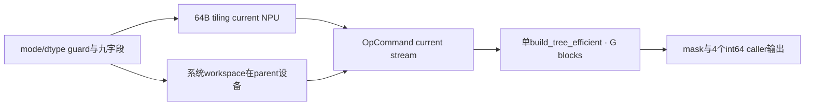

# 验证树构造 A3 Direct Invoke 算子知识

## 算子速览

| 项目 | 内容 |
|---|---|
| 实际入口 | `torch.ops.npu.build_tree_kernel_efficient`→手写Host→ACLRT `build_tree_efficient` |
| 计算语义 | 将已选择的draft候选构造成位置、扁平检索索引与child/sibling链，并逐节点产生祖先掩码；不做候选排序或验证采样 |
| 输入输出 | 3个int64输入、bool mask与4个int64 caller输出，topk/depth/D/mode四int64属性；返回空 |
| 执行类型 | 单AIV_VECTOR，实际为scalar GM/UB SetValue/GetValue+MTE搬运；没有Cube/Matmul/SIMT节点 |
| Kernel 路线 | R-001 FULL0；R-002 QLEN1的实际地址分支；BITPACK2在Host抛错 |
| 核心资源 | 5个depth1 VECIN Queue，UB=a32(D)+4a32(8D)；64B GM tiling；Host分配系统workspace但Device不使用 |
| 来源闭包 | direct_implementation_closed：Torch schema、Host、POD、entry、完整body/launcher及活动构建闭合；不表示QLEN数学正确 |
| 验证状态 | draft；本次知识提取未执行编译、真机、数值或性能测试 |

## 接口与语义

### 计算语义

记B=batch、D=draft_token_num（包含root）、K=topk、H=depth，L_b=已验证长度。selected[b,i]是选中draft平坦候选号，i=0..D−2对应输出节点1..D−1；parent表行宽P=K*(H−1)+1。节点0为root，位置L_b；其他节点位置为L_b加沿parent映射回溯到root的边数。index[b,i]=b*D+i；next[b,p]为首child，sibling[b,i]为后续兄弟，无边为−1。

FULL预期GM每batch拼接D行、行宽L_b+D，起点S_b=D²*b+D*sum_{j<b}L_j。每节点只写行内末D bool：root恒true，其他true对应自身和祖先；前L_b历史prefix根本不写，caller需预置True才能得到完整历史注意力掩码。四个int64输出由本Kernel初始化/覆盖，无需把retrive_index预填−1当额外必要条件。

源码enum是FULL_MASK=0、QLEN_ONLY=1、QLEN_ONLY_BITPACKING=2；README参数表“1=FULL_MASK”与实现冲突，以实际POD/分支解释源码。QLEN实际写地址`D²*b+D*b`与tid无关，不能当作每节点独立的D×D mask：同batch所有tid覆盖相同D bool，b>0也不同于预期D²*b+D*tid。positions/index/链表计算仍执行，掩码错误边界见R-002。未知非0且非2的mode也落else，不能注册为新的公开模式。

### 输入、输出与属性

| 参数 | shape/layout | dtype | 约束、默认值与语义 |
|---|---|---|---|
| parent_list | 预期[B,K*(H−1)+1]连续物理行 | int64 | Host只读size0为B，不检查rank/行宽/parent值 |
| selected_index | 预期[B,D−1]连续 | int64 | 所有非root祖先必须在合法选中域，Host不校验 |
| verified_seq_len | [B]连续 | int64 | L_b应非负且可表示，Device按全局b读取 |
| tree_mask | FULL一维长度D*sumL+B*D²；QLEN预期B*D²但实际另见源码地址 | bool | caller分配、无新Tensor；Host仅size0窄化int32，Device再窄化u16绑定span |
| positions | [B,D]或等容平坦连续 | int64 | root与depth位置 |
| retrive_index | [B,D] | int64 | 本地节点→全局bD+i |
| retrive_next_token | [B,D] | int64 | first child，完整初始化−1后push-front |
| retrive_next_sibling | [B,D] | int64 | sibling，完整初始化−1 |
| topk/depth/draft_token_num | 四属性中前三者 | int64 | 无正值/范围guard；D在Device截为u16 |
| tree_mask_mode | 第四属性 | int64 | 0 FULL、1 QLEN，2抛Not implemented；没有默认值 |

### 入口与版本

固定dda6，原生8Tensor+4属性入口，独立Direct Invoke。测试Python外层的topk/sort/gather属于候选准备，未纳入该native入口，也不借它声称外部Torch排序实现闭合。基础legacy Host和workspace_kernel集合在arch22/arch35接线；活动SPECULATIVE CI列A3/950、CANN9.1并包含test_build_tree.py，证明源码构建/测试意图，非本次执行通过。本卡仅A3。

[验证树API](../../../../apis/sgl_kernel_npu/sgl_build_verification_tree.md)保留简明合同。原始schema八Tensor均没有mutation标注，尽管实际写5输出；不据此声称functionalization、编译图alias追踪或图捕获安全。

## Host/Launcher 执行流程

### 参数校验与前处理

先判断mode2并抛Not implemented；再检查八Tensor dtype组合int64/int64/int64/bool/int64/int64/int64/int64，不符抛invalid_argument。随后B=parent_list.size0→int32、mask_size=tree_mask.size0→int32；get_tiling查询当前平台AIV核数A，G=min(A,B)，W=GetLibApiWorkSpaceSize→int32；写参数并复制current NPU；在parent设备分配W字节workspace，执行单launch。

没有device/同设备/stride/contiguous、Tensor rank与shape一致性、buffer capacity、alias、topk>0、D范围、合法树/无环或UB预算检查。B0或A0会在B%G与除法中遇到零，未早返；K0会在Device父表索引除法遇到零。L/候选内容不由Host读取或修复。Host没有Contiguous/ViewCopy/排序节点。

### 参数、Workspace 与生命周期

普通C++ ABI下BuildTreeTilingData align8、sizeof56，四i64+五i32有效字段52B；CPU byte缓冲a32(56)=64B，仅字段赋值，结构尾padding4B与运输尾8B不初始化，Device只读取明确字段。CopyTensorHostToDevice先pin_memory再异步复制到current NPU。workspace大小来自平台系统API，不是树数据尺寸，Device entry虽接workspace_in，但类Init/body完全不读它；不应额外加16MiB偏移或虚构workspace边。

EXEC_KERNEL_CMD捕获current stream与data_ptr/标量转换tuple，未捕获Tensor对象、显式record_stream或DeviceGuard。caller输出、输入、Host局部tiling/workspace需要匹配框架分配器、流与current设备的owner协议；allocator/OpCommand实现属于外部边界，不能据裸指针捕获就断言本次已发生UAF。workspace分配device来自parent而tiling/current stream来自current NPU，caller须确保一致。

### 启动图与失败传播



| 节点/边 | producer/consumer | offset/extent/layout | ordering与owner | 失败传播 |
|---|---|---|---|---|
| Tiling前处理 | Host→entry Init | 64B运输，九字段52B，普通ABI | current-device Torch复制与流协议；Host局部Tensor | 框架异常不转为fallback |
| 单核心节点 | EXEC_KERNEL_CMD→KernalBuildTree | 八GM+workspace+tiling；G blocks | 同current stream；caller数据 | helper不检查ACLRT返回，固定return0不等价完成 |
| 输出 | Compute/CopyOut→caller | D bool/节点与4*D*i64/batch | Queue交接、每核分开batch，caller保活 | 无后继Kernel/全局barrier |
| workspace | Host分配→entry形参 | W bytes | 本地Tensor owner，Device未消费 | 不是跨节点算法边 |

## Route 与参数设计

### 分核与资源计算

G=min(A,B)，q=floor(B/G)、r=B%G；big_core_num=(r==0?G:r)，bigTiles=ceil(B/G)，smallTiles=q。核c初始offset=c*bigTiles；c<big_core_num取bigTiles，否则取smallTiles并减(bigTiles−smallTiles)*(c−big_core_num)。整除时所有G核均big，大小相同；非整除前r核多1batch，无额外空核。分核不拆同一棵树，保持child/ancestor操作在单核。

Device D=uint16(POD.D)、mask_size=uint16(POD.mask_size)。UB所有Queue depth1：M=a32(D) bool、四个I=a32(8D) int64，总M+4I。例如D8为32+4*64=288B；D128为128+4*1024=4224B。Host不按UB选择D，不查询可用UB作比较；总量≤实际可用UB是复用必要条件。每batch先扫描全局先前b的L构造FULL基址，未缓存prefix sum，不能宣称已消除此重复GM标量读取。

### Route 选择

| 顺序 | Route | Key/模板 | 精确选择条件与优先级 | 不适用去向 |
|---:|---|---|---|---|
| 1 | Host拒绝 | mode==2 | 发生在dtype检查前 | throw Not implemented |
| 2 | R-001 FULL | mode==0 | mode2已排除且dtype guard通过、Host计算完成 | Device else |
| 3 | R-002 QLEN实际分支 | mode!=0且mode!=2 | 公开1及未知其他值；共享错误地址表达式 | 无fallback/有效模式校验 |

```text
Host：mode2 throw→dtype检查→B/G参数与分配→单entry
entry Init→Process每batch→每tid Compute
Compute：mode0写S_b+(L_b+D)*tid+L_b；else写D²*b+D*b（无tid）
其余树/位置与CopyOut算法共用；无TilingKey/模板router
```

### 模板/实现执行矩阵

| Route | key/selector | dtype/shape/platform 完整命中条件 | 执行拓扑与 Kernel 节点 | 实际模板/body | 内存与同步特征 | tail/fallback |
|---|---|---|---|---|---|---|
| R-001 | mode0 | A3，八dtype匹配，Host分核/分配能完成；调用方满足实际shape/tree/地址域 | 单AIV build_tree_efficient | 无模板，KernalBuildTree::Init/Process/Compute/CopyOut | 5 Queue深度1，FULL每节点独立D bool | DataCopyPad只搬有效字节，prefix不写，无树修复 |
| R-002 | mode1或未知非0非2 | 相同Host域，modeelse | 同单节点 | 同body的地址else | 相同UB，同batch反复覆盖一个D bool区 | 不是正确QLEN fallback；无BITPACK Device路线 |

### 隐藏性能 Guard

| Guard | Host/Tiling 条件 | Device/资源原因 | 影响 Route | 不满足时去向 | 源码符号 |
|---|---|---|---|---|---|
| mode2拒绝 | ==QLEN_ONLY_BITPACKING | 无packed body | 全部 | Host抛错 | build_tree_efficient |
| B/A正值 | Host无guard | G参与%与/ | 两者 | 无空batch早返 | get_tiling |
| D与容量 | 无D合法域/UB/shape检查 | D截u16，5 Queue与D个节点 | 两者 | 同body，无防溢出fallback | Init |
| mask/span/地址 | mask_size两次窄化，最终u16；无capacity检查 | token_tree_idx为int32，实际DMA地址独立 | 两者 | 不保证自动安全拒绝 | Init/Compute |
| topk与tree | 无正值/无环/成员检查 | selected/K、parent search和while回溯 | 两者 | 可能越有效域或不终止，未运行 | Compute |
| prefix预置 | Host不写 | FULL只提交D节点bool | R-001 | caller未置则保留原历史位 | Compute |
| QLEN tid缺失 | Host未拒绝mode1 | 多tid同GM写区 | R-002 | 无修复路径 | Compute else |

### POD/ABI

| 结构 | 字段 | 类型/位宽 | ABI 布局 | 单位 | Host/launcher producer | Device consumer | 边界 |
|---|---|---|---|---|---|---|---|
| BuildTreeTilingData | topk | int64/64 | off0，sizeof56/align8 | 分支宽度 | 属性topk | Init→selected/K与parent行宽 | K0无guard |
| 同上 | depth | int64/64 | off8 | 层数 | 属性depth | Init→P=K*(H−1)+1 | 无范围check |
| 同上 | draft_token_num | int64/64 | off16 | 节点数 | 属性draft_token_num | Init转u16→UB/loop/地址 | 不一致于原64位大值 |
| 同上 | tree_mask_mode | int64/64 | off24 | 枚举 | 属性tree_mask_mode | Compute mode0/else | 未知值落else |
| 同上 | batch_size | int32/32 | off32 | batch | parent_list.size0窄化 | Init绑定L长度/分核 | 正值未检查 |
| 同上 | mask_size | int32/32 | off36 | bool元素 | tree_mask.size0窄化 | Init转u16绑定GM span | 不是numel校验/设备容量证明 |
| 同上 | big_core_num | int32/32 | off40 | core数 | r==0?G:r | Init核号比较 | G0前已无保护 |
| 同上 | big_core_tile_num | int32/32 | off44 | batch/core | (B+G−1)/G | Init初始offset与big核长度 | 加法窄化/溢出未guard |
| 同上 | small_core_tile_num | int32/32 | off48 | batch/core | B/G | Init小核长度/offset校正 | 与big共同保证正常B覆盖 |

ABI数值为普通同header C++布局推导，未编译测量。entry地址参数顺序为parent、selected、L、mask、positions、index、next、sibling、workspace、tiling；生成stub封送布局不可见，不虚构GM地址offset。

### Route 源码闭包

| Route | Key/selector | Host/Tiling producer | POD/参数 | Kernel entry/router 节点 | Kernel body/直接依赖 | 构建接线 |
|---|---|---|---|---|---|---|
| R-001 | FULL0 | build_tree.cpp::build_tree_efficient/get_tiling | BuildTreeTilingData九字段 | build_tree_kernel.cpp::build_tree_efficient | KernalBuildTree全部4方法，Compute FULL | legacy_kernels基础Host+workspace_kernel，Torch PrivateUse1 |
| R-002 | 非0非2 | 同一Host，未验证未知mode | 同布局 | 同entry | 同body，Compute else实际地址 | 同target，无单独QLEN特化 |

## Kernel 实现

### 公共执行流程

Init读取九字段、分batch范围，parent/selected/四输出GM先按bs_offset行基址偏移，L和mask保持全局基址。初始化5个VECIN Queue（实际名称如此，不能按输出用途改成VECOUT）。Process每本地bid分配4个int64 UB，next/sibling全D置−1；算b与S_b、L_b；tid0构建所有child/sibling/index并写root位置；tid>0祖先回溯填掩码与位置。每tid单独分配mask、EnQue/DeQue→DataCopyPad→Free；整batch结束四输出EnQue并CopyOut各DeQue→DataCopyPad→Free。

公共树算法如下，所有offset按已偏移核GM基址解释；这不是并行线程，tid是单核顺序循环变量。

```text
源码等价公共伪码，D为Device u16；P=K*(H−1)+1
for local bid in [0,bs_per_core):
  b=bs_offset+bid
  next[0:D]=sibling[0:D]=-1        # UB逐项SetValue
  S_b=D²*b + D*sum(L[0:b])        # 每batch重新标量读取prefix
  for tid=0..D-1:
    maskUB[0]=true；maskUB[1:D]=false
    if tid==0:
      positionsUB[0]=L[b]
      for i=D-1 downto1:
        indexUB[i]=b*D+i
        parent_tb=selected[bid*(D-1)+i-1]/K
        pp=0
        if parent_tb>0:
          token=parent[bid*P+parent_tb]
          while pp<D:
            if selected[bid*(D-1)+pp]==token: pp+=1; break
            pp+=1
        if pp==D: continue
        old=nextUB[pp]；nextUB[pp]=i
        if old!=-1: siblingUB[i]=old
      indexUB[0]=b*D
    else:
      cur=tid-1；n=0
      while true:
        n+=1；maskUB[1+cur]=true
        parent_tb=selected[bid*(D-1)+cur]/K
        if parent_tb==0: break
        token=parent[bid*P+parent_tb]
        for cur=0..D-1:
          if selected[bid*(D-1)+cur]==token: break
      positionsUB[tid]=n+L[b]
    # Route决定mask dst，EnQue→DeQue→DataCopyPad 1block*D bytes→Free
  # EnQue4输出；每个DeQue→DataCopyPad 1block*(8D)bytes→Free
```

parent search实际上界D，而selected逻辑行宽D−1；未找到祖先时可能读取下一行/末尾之外，ancestor while也无missing/cycle终点。正常树必须保证实际参与回溯的所有父项在可检索合法域且最终到root。任何Device bound行为与Runtime错误形态未测，不写成已确认硬件异常。

### Route R-001：FULL逐节点掩码

#### 适用条件

##### 选择证据

| 层级 | 文件 | 符号 | 源码谓词/参数 | 结果/下一跳 |
|---|---|---|---|---|
| Host | csrc/build_tree/op_host/build_tree.cpp | build_tree_efficient | 先排mode2，再dtype，B/G计算与分配 | 单launch |
| 参数 | csrc/build_tree/op_host/build_tree_tiling.h | TreeMaskMode/BuildTreeTilingData | mode==0 | 同九字段 |
| body | csrc/build_tree/op_kernel/build_tree_kernel.cpp | Compute | mode==0 | dst=int32(S_b+(L_b+D)*tid+L_b) |

#### Device 数据流

##### 函数级调用链

```text
build_tree_efficient Host→get_tiling→EXEC_KERNEL_CMD(build_tree_efficient,G,...)
 →entry→KernalBuildTree::Init→Process
   →每bid分配4 Queue→next/sibling清−1→L prefix标量和
   →每tid Compute：Route mask地址→mask初值
      →tid0 child/index；tid>0 ancestor walk
      →mask EnQue/DeQue→DataCopyPad→Free
   →4输出EnQue→CopyOut四次DeQue/DataCopyPad/Free
```

##### 源码等价伪码

```text
伪码；完整树/循环/地址见上方公共伪码，Route保留以下实际提交
G=min(A,B)；核batch范围按big/small九字段产生
for bid in core_range:
  4UB=Alloc；next/sibling[0:D]=-1
  S_b=D²*b + D*sum(L[0:b])
  for tid=0..D-1:
    dst=int32(S_b+(L_b+D)*tid+L_b)
    mask=Alloc(maskQ)；mask[0]=true；mask[1:D]=false
    tid0：倒序i建立index及push-front子链；写root position
    tid>0：while沿selected/K→parent→selected回溯；写祖先mask与depth position
    EnQue(maskQ,mask)；mask=DeQue(maskQ)
    DataCopyPad<bool>(maskGM[dst],mask,{1,D,0,0,0})  # blockLen为bytes
    Free(maskQ,mask)
  EnQue(4outQ)
  for q,gm in [(positionsQ,positions),(indexQ,index),(nextQ,next),(siblingQ,sibling)]:
    v=DeQue(q)；DataCopyPad<int64>(gm[bid*D],v,{1,8D,0,0,0})；Free(q,v)
```

FULL每行prefix L_b保持caller原值，只有D节点区提交。D个节点范围在正常容量/无窄化溢出下互不重叠；parent/selected的无效树行为不因此变为安全。

#### 内存与数据搬运

##### 资源与搬运表

| 层级/缓冲区 | offset/地址公式 | extent/容量公式 | dtype/layout | producer | consumer | owner/lifetime | 对齐/复用 |
|---|---|---|---|---|---|---|---|
| GM parent | 核基址bs_offset*P，local bid*P+parent_tb | bs_per_core*P | int64 | caller | Compute GetValue | caller保活 | 无DMA preload/stride参数 |
| GM selected | 核基址bs_offset*(D−1)，local bid*(D−1)+i | bs_per_core*(D−1) | int64 | caller | 父查找/祖先循环 | caller | 搜索实际D次的弱边界仍保留 |
| GM L | 全局b及0..b−1 | B | int64 | caller | prefix和position | caller | 无prefix workspace |
| GM mask | Route dst | 每tid D bool | bool flat | maskQ/MTE3 | caller注意力 | caller可变输出 | GM精确D B，不写UB padding |
| GM四输出 | 核基址bs_offset*D；local bid*D | 各bs_per_core*D | int64 | 四Queue/MTE3 | caller | caller可变输出 | 每次CopyOut 8D B |
| mask_queue VECIN | local0 | depth1*a32(D)B | bool | scalar SetValue | MTE3 | 每tid Alloc→Free | 同一槽跨tid复用 |
| positions_queue VECIN | local0 | depth1*a32(8D)B | int64 | root/ancestor depth | CopyOut | 每bid Alloc→Free | 不与其他Queue alias |
| retrive_index_queue VECIN | local0 | depth1*a32(8D)B | int64 | root与倒序i | CopyOut | 每bid Alloc→Free | 有效D项全写 |
| retrive_next_token_queue VECIN | local0 | depth1*a32(8D)B | int64 | −1初始化+push-front | child链/CopyOut | 每bid Alloc→Free | UB随机标量读写 |
| retrive_next_sibling_queue VECIN | local0 | depth1*a32(8D)B | int64 | −1初始化+旧head | CopyOut | 每bid Alloc→Free | 无额外GM中间表 |
| GM tiling/workspace | 0 | 64B/W B | byte | Host | tiling九字段/不消费W | Host局部Tensor异步契约 | 不虚构Device user workspace切片 |

##### 分层内存布局


##### 字节账与复用顺序

```text
a32(x)=ceil(x/32)*32 bytes
UB_total=a32(D)+4*a32(8D)；D8=288B，D128=4224B
UB_total<=实际可用UB是必要条件，Host未执行该比较
算法workspace_total=0；Host另分配系统W但Device不读；GM tiling64B
dynamic_ub=N/A；无L1/L0/通信window；scalar寄存器精确用量编译器不可见
```

| 复用子区 | 写入者 | 读取者/消费点 | 下一次覆盖 | 同步或释放依据 | 安全条件 |
|---|---|---|---|---|---|
| maskQ单槽 | 当前tid SetValue | 当前tid MTE3 | 下一tid Alloc/SetValue | EnQue→DeQue→DataCopyPad→Free | 保留Free与Queue依赖 |
| next/sibling UB | 每bid初始化与tid0 push-front | tid0后续i与CopyOut | 下一bid初始化 | 此bid输出完成再Free | 不在child查找中提前释放 |
| positions/index UB | 当前bid各节点 | CopyOut | 下一bid | Queue释放 | 不能只算单项临时容量 |

#### 同步、精度与尾块

##### 同步与数值边界表

| 阶段 | primitive/机制 | producer | consumer/等待点 | 保护对象 | 精度/尾块 |
|---|---|---|---|---|---|
| scalar输入 | GM GetValue | caller已就绪输入 | parent/selected/L访问 | 同流输入 | int64，无float/cast计算 |
| UB构建 | SetValue/GetValue顺序 | 初始化/child/ancestor | 下一scalar阶段 | mask/链表 | bool与int64原值，D/u16、dst/int32窄化须caller约束 |
| mask提交 | EnQue/DeQue→DataCopyPad | scalar mask | MTE3 | 单mask Queue | blockCount1、blockLenD字节、stride0，UB padding不写GM |
| 四输出提交 | 各EnQue/DeQue→DataCopyPad | 全D位置/链 | MTE3 | 各int64 Queue | blockLen8D字节，stride0，不需D是4倍数 |
| 同槽重用 | FreeTensor | 当前MTE3 | 下一tid/bid分配 | 5个Queue | 无手写event号或跨核barrier，不虚构double buffer |

#### 关键实现

##### 符号证据表

| 阶段 | 文件 | 符号/模板实例 | 实现事实 |
|---|---|---|---|
| Host/Tiling producer | csrc/build_tree/op_host/build_tree.cpp | get_tiling/build_tree_efficient | G/W/九字段、mode2/dtype guard |
| Kernel entry/router | csrc/build_tree/op_kernel/build_tree_kernel.cpp | build_tree_efficient/Init | 十GM参数、分batch、u16窄化 |
| Device body/helper | 同上 | Process/Compute/CopyOut | 完整child/ancestor、当前Route地址与5 Queue搬运 |

### Route R-002：QLEN实际覆盖分支

#### 适用条件

##### 选择证据

| 层级 | 文件 | 符号 | 源码谓词/参数 | 结果/下一跳 |
|---|---|---|---|---|
| Host | csrc/build_tree/op_host/build_tree.cpp | build_tree_efficient | 先排mode2，再dtype，B/G计算与分配 | 单launch |
| 参数 | csrc/build_tree/op_host/build_tree_tiling.h | TreeMaskMode/BuildTreeTilingData | mode!=0且mode!=2 | 同九字段 |
| body | csrc/build_tree/op_kernel/build_tree_kernel.cpp | Compute | mode!=0且mode!=2 | dst=int32(D²*b+D*b) |

#### Device 数据流

##### 函数级调用链

```text
build_tree_efficient Host→get_tiling→EXEC_KERNEL_CMD(build_tree_efficient,G,...)
 →entry→KernalBuildTree::Init→Process
   →每bid分配4 Queue→next/sibling清−1→L prefix标量和
   →每tid Compute：Route mask地址→mask初值
      →tid0 child/index；tid>0 ancestor walk
      →mask EnQue/DeQue→DataCopyPad→Free
   →4输出EnQue→CopyOut四次DeQue/DataCopyPad/Free
```

##### 源码等价伪码

```text
伪码；完整树/循环/地址见上方公共伪码，Route保留以下实际提交
G=min(A,B)；核batch范围按big/small九字段产生
for bid in core_range:
  4UB=Alloc；next/sibling[0:D]=-1
  S_b=D²*b + D*sum(L[0:b])
  for tid=0..D-1:
    dst=int32(D²*b+D*b)
    mask=Alloc(maskQ)；mask[0]=true；mask[1:D]=false
    tid0：倒序i建立index及push-front子链；写root position
    tid>0：while沿selected/K→parent→selected回溯；写祖先mask与depth position
    EnQue(maskQ,mask)；mask=DeQue(maskQ)
    DataCopyPad<bool>(maskGM[dst],mask,{1,D,0,0,0})  # blockLen为bytes
    Free(maskQ,mask)
  EnQue(4outQ)
  for q,gm in [(positionsQ,positions),(indexQ,index),(nextQ,next),(siblingQ,sibling)]:
    v=DeQue(q)；DataCopyPad<int64>(gm[bid*D],v,{1,8D,0,0,0})；Free(q,v)
```

QLEN的dst无tid，每tid覆盖同一D bool；正常有序执行最终是最后一个节点的祖先mask，而非完整D×D结果。b>0额外D*b偏移同样是源码事实；没有Host额外容量或正确性验证。未知mode复用此行为不代表公开支持。四个int64输出仍按完整共同算法写出。

#### 内存与数据搬运

##### 资源与搬运表

| 层级/缓冲区 | offset/地址公式 | extent/容量公式 | dtype/layout | producer | consumer | owner/lifetime | 对齐/复用 |
|---|---|---|---|---|---|---|---|
| GM parent | 核基址bs_offset*P，local bid*P+parent_tb | bs_per_core*P | int64 | caller | Compute GetValue | caller保活 | 无DMA preload/stride参数 |
| GM selected | 核基址bs_offset*(D−1)，local bid*(D−1)+i | bs_per_core*(D−1) | int64 | caller | 父查找/祖先循环 | caller | 搜索实际D次的弱边界仍保留 |
| GM L | 全局b及0..b−1 | B | int64 | caller | prefix和position | caller | 无prefix workspace |
| GM mask | Route dst | 每tid D bool | bool flat | maskQ/MTE3 | caller注意力 | caller可变输出 | GM精确D B，不写UB padding |
| GM四输出 | 核基址bs_offset*D；local bid*D | 各bs_per_core*D | int64 | 四Queue/MTE3 | caller | caller可变输出 | 每次CopyOut 8D B |
| mask_queue VECIN | local0 | depth1*a32(D)B | bool | scalar SetValue | MTE3 | 每tid Alloc→Free | 同一槽跨tid复用 |
| positions_queue VECIN | local0 | depth1*a32(8D)B | int64 | root/ancestor depth | CopyOut | 每bid Alloc→Free | 不与其他Queue alias |
| retrive_index_queue VECIN | local0 | depth1*a32(8D)B | int64 | root与倒序i | CopyOut | 每bid Alloc→Free | 有效D项全写 |
| retrive_next_token_queue VECIN | local0 | depth1*a32(8D)B | int64 | −1初始化+push-front | child链/CopyOut | 每bid Alloc→Free | UB随机标量读写 |
| retrive_next_sibling_queue VECIN | local0 | depth1*a32(8D)B | int64 | −1初始化+旧head | CopyOut | 每bid Alloc→Free | 无额外GM中间表 |
| GM tiling/workspace | 0 | 64B/W B | byte | Host | tiling九字段/不消费W | Host局部Tensor异步契约 | 不虚构Device user workspace切片 |

##### 分层内存布局


##### 字节账与复用顺序

```text
a32(x)=ceil(x/32)*32 bytes
UB_total=a32(D)+4*a32(8D)；D8=288B，D128=4224B
UB_total<=实际可用UB是必要条件，Host未执行该比较
算法workspace_total=0；Host另分配系统W但Device不读；GM tiling64B
dynamic_ub=N/A；无L1/L0/通信window；scalar寄存器精确用量编译器不可见
```

| 复用子区 | 写入者 | 读取者/消费点 | 下一次覆盖 | 同步或释放依据 | 安全条件 |
|---|---|---|---|---|---|
| maskQ单槽 | 当前tid SetValue | 当前tid MTE3 | 下一tid Alloc/SetValue | EnQue→DeQue→DataCopyPad→Free | 保留Free与Queue依赖 |
| next/sibling UB | 每bid初始化与tid0 push-front | tid0后续i与CopyOut | 下一bid初始化 | 此bid输出完成再Free | 不在child查找中提前释放 |
| positions/index UB | 当前bid各节点 | CopyOut | 下一bid | Queue释放 | 不能只算单项临时容量 |

#### 同步、精度与尾块

##### 同步与数值边界表

| 阶段 | primitive/机制 | producer | consumer/等待点 | 保护对象 | 精度/尾块 |
|---|---|---|---|---|---|
| scalar输入 | GM GetValue | caller已就绪输入 | parent/selected/L访问 | 同流输入 | int64，无float/cast计算 |
| UB构建 | SetValue/GetValue顺序 | 初始化/child/ancestor | 下一scalar阶段 | mask/链表 | bool与int64原值，D/u16、dst/int32窄化须caller约束 |
| mask提交 | EnQue/DeQue→DataCopyPad | scalar mask | MTE3 | 单mask Queue | blockCount1、blockLenD字节、stride0，UB padding不写GM |
| 四输出提交 | 各EnQue/DeQue→DataCopyPad | 全D位置/链 | MTE3 | 各int64 Queue | blockLen8D字节，stride0，不需D是4倍数 |
| 同槽重用 | FreeTensor | 当前MTE3 | 下一tid/bid分配 | 5个Queue | 无手写event号或跨核barrier，不虚构double buffer |

#### 关键实现

##### 符号证据表

| 阶段 | 文件 | 符号/模板实例 | 实现事实 |
|---|---|---|---|
| Host/Tiling producer | csrc/build_tree/op_host/build_tree.cpp | get_tiling/build_tree_efficient | G/W/九字段、mode2/dtype guard |
| Kernel entry/router | csrc/build_tree/op_kernel/build_tree_kernel.cpp | build_tree_efficient/Init | 十GM参数、分batch、u16窄化 |
| Device body/helper | 同上 | Process/Compute/CopyOut | 完整child/ancestor、当前Route地址与5 Queue搬运 |

## 算子特定优化

### Trick T-001：倒序push-front在UB构建child/sibling

#### 触发与源码依据

- 适用两Route的tid0；正常父映射可解析，next/sibling先全−1。
- Golden来源：[复用旧head生成sibling](https://github.com/sgl-project/sgl-kernel-npu/blob/dda6d36b0cdb4081e102d14c0a2fb276fc416e69/csrc/build_tree/op_kernel/build_tree_kernel.cpp#L167-L173)。

**官方源码（固定Commit连续逐字摘录）**：

```cpp
                if (retrive_next_token_ub.GetValue(parent_position) == -1) {
                    retrive_next_token_ub.SetValue(parent_position, i);
                } else {
                    int64_t origin_next_token = retrive_next_token_ub.GetValue(parent_position);
                    retrive_next_token_ub.SetValue(parent_position, i);
                    retrive_next_sibling_ub.SetValue(i, origin_next_token);
                }
```

#### 机制与设计原因

i从D−1向1递减，每次把新i放父节点head、旧head放入sibling[i]，因此合法情况下同父child链按i递增，而无需额外排序或GM原子链更新。全部链表在同核UB驻留，batch不拆核，最后一次性提交D个int64。parent映射的线性搜索仍存在，不能将O(1)链导航宣传成整个建树O(D)。

#### 迁移边界

- 适用：单核完整树、已选候选可解析且无环。
- 前提：保留倒序i、−1初始化、root0和父映射规则。
- 失效：改跨核建树需重新设计冲突与同步，当前没有atomic fallback。
- 未验证：本次知识提取未执行编译、真机、数值或性能测试。

#### 错误做法

固定仓未提供可验证运行反例；不能把parent search上界D当成selected实际有D项的证据，逻辑行宽仍是D−1。

### Trick T-002：每节点仅提交D字节而保留FULL历史prefix

#### 触发与源码依据

- 适用R-001，每节点先构造root/ancestor布尔区；R-002复用搬运但地址有缺陷。
- Golden来源：[精确字节DataCopyPad与Queue释放](https://github.com/sgl-project/sgl-kernel-npu/blob/dda6d36b0cdb4081e102d14c0a2fb276fc416e69/csrc/build_tree/op_kernel/build_tree_kernel.cpp#L196-L200)。

**官方源码（固定Commit连续逐字摘录）**：

```cpp
        this->mask_queue.EnQue(tree_mask_ub);
        AscendC::LocalTensor<bool> mask_ub = mask_queue.DeQue<bool>();
        AscendC::DataCopyExtParams copy_params{1, static_cast<uint32_t>(this->draft_token_num * sizeof(bool)), 0, 0, 0};
        AscendC::DataCopyPad<bool>(this->tree_mask_gm[token_tree_idx], mask_ub, copy_params);
        mask_queue.FreeTensor(mask_ub);
```

#### 机制与设计原因

UB按a32(D)分配，DataCopyPad blockCount1、blockLen=D*sizeof(bool)、stride0，只提交有效D字节而非整对齐区；FULL把dst移过L_b，保留caller已置的历史prefix。这减少每节点需要构造的UB行宽，未声称测得带宽提升。四int64输出同样以8D有效字节提交，不能把a32 padding写出覆盖相邻对象。

#### 迁移边界

- 适用：非32B倍数有效长度、已分配足够GM目标容量。
- 前提：FULL caller预填prefix、目标地址可表示、匹配SDK DataCopyPad byte单位。
- 失效：QLEN地址不能靠此搬运机制修复，BITPACK在Host明确拒绝。
- 未验证：本次知识提取未执行编译、真机、数值或性能测试。

#### 错误做法

固定仓提供真实静态反例是else地址缺tid；搬运精确D字节不代表目标行选择正确，也不能把padding容量等同有效输出长度。

### Trick T-003：按batch分核保持树内依赖局部化

#### 触发与源码依据

- 适用正常B/A正值，两Route共用big/small连续batch范围。
- Golden来源：[核内连续batch范围](https://github.com/sgl-project/sgl-kernel-npu/blob/dda6d36b0cdb4081e102d14c0a2fb276fc416e69/csrc/build_tree/op_kernel/build_tree_kernel.cpp#L43-L50)。

**官方源码（固定Commit连续逐字摘录）**：

```cpp
        this->bs_offset = AscendC::GetBlockIdx() * tiling->big_core_tile_num;
        if (AscendC::GetBlockIdx() < tiling->big_core_num) {
            this->bs_per_core = tiling->big_core_tile_num;
        } else {
            this->bs_per_core = tiling->small_core_tile_num;
            this->bs_offset -= (tiling->big_core_tile_num - tiling->small_core_tile_num) *
                               (AscendC::GetBlockIdx() - tiling->big_core_num);
        }
```

#### 机制与设计原因

前r核多分一个batch，整除时big_core_num=G避免零big核误解。完整树由单核串行tid处理，child/ancestor依赖不需要跨核flag，代价是同树不并行、每batch重复求此前L的和。该机制是分工事实，不宣称不同L/树深的工作量完全均衡。

#### 迁移边界

- 适用：多独立小树，batch连续存储。
- 前提：B/A正、分核int32表达式可表示。
- 失效：B0无早返，不能靠G=min(A,B)声称空输入安全；需在调用侧处理。
- 未验证：本次知识提取未执行编译、真机、数值或性能测试。

#### 错误做法

固定仓未提供可验证运行反例；不得把tid循环称作D个独立线程或将树内节点拆核而保留原无同步协议。

## 模板与实现对比

| 对比维度 | R-001 FULL0 | R-002 QLEN实际else | 设计选择依据 |
|---|---|---|---|
| 命中条件/优先级 | mode0 | 非0非2；公开1/未知值 | Host先拒绝2 |
| 模板与 dtype | 无模板，i64+bool | 相同 | 只mask地址分支不同 |
| 循环与分核 | G核batch、bid/tid/ancestor | 相同 | 单树不拆核 |
| Queue/TBuf/寄存器/dynamic UB/通信 window | 5 Queue深度1 | 相同 | 不因地址错而少计UB |
| 内存总占用与复用 | a32(D)+4a32(8D) | 相同 | 无算法workspace |
| 搬运/Vector/SIMT/NDDMA/通信 API | DataCopyPad/标量 | 相同 | 无Cube/Vector算术高阶primitive |
| 同步、精度与 tail | Queue有效D/8D字节 | 同样搬运 | 整数/布尔，无浮点精度域 |
| fallback/失败边界 | prefix caller保证 | 无tid，反复覆盖，非正确QLEN | 不用模板名掩盖真实缺陷 |

## 平台差异

| 项目 | A2 | A3 | Ascend 950 |
|---|---|---|---|
| 支持状态 | arch22基础接线信号，不在本次冻结卡范围 | 活动CANN9.1 CI矩阵与基础实现 | 活动CANN9.1 CI矩阵与基础实现 |
| Host/Launcher | 不外推产品验收 | 动态查询当前AIV核数/W | 同一Host动态查询，非固定照搬A3资源 |
| Kernel/资源 | 未独立确认 | 同一标量/AIV body与5 Queue | 同源body/字节公式，SDK原语差异为外部边界 |

本卡仅A3，另一平台使用独立同名卡，不把CI定义写成已跑通过。

## 限制与失败边界

- FULL0/QLEN1/BITPACK2以真实enum为准；README表格值冲突保持显式。QLEN无tid地址不能作为正常每节点mask复用；未知mode也不是正式支持范围。
- parent search实际D次与selected D−1逻辑行宽有边界冲突；ancestor while无missing/cycle guard，caller必须提供完整、可终止、合法值域树。不能通过重命名helper或前置topk处理证明所有非法树安全。
- D由int64截u16，mask_size由size0→int32→u16；dst与CopyOut offset为int，prefix与乘积也存在中间位宽边界。正确复用必须使实际表达式可表示、GM容量足够；GM绑定span窄化不等于DataCopyPad会自动拒绝越界。
- B/A0、K0、负属性、device/stride/shape/alias和UB不足均无完整Host保护。输入或输出重叠、跨流并发改树、current设备错误不自动修复。
- 实际test main选择FULL、B2/K4/H4/D8，比较positions、retrive链及draft tokens，mask只打印未assert；不能宣称测试已验证FULL所有掩码，更无QLEN数值通过证据。本次所有测试未运行。
- 源码闭包是draft实现事实，不增加verified，不等于产品验收、错误安全、图捕获或性能保证。

## 源码索引

### 链路索引

| 链路阶段 | 文件 | 关键符号 | 支撑内容 |
|---|---|---|---|
| Host | csrc/build_tree/op_host/build_tree.cpp | build_tree_efficient/get_tiling | dtype、分核与参数 |
| ABI | csrc/build_tree/op_host/build_tree_tiling.h | TreeMaskMode/BuildTreeTilingData | 真实枚举与九字段 |
| Device | csrc/build_tree/op_kernel/build_tree_kernel.cpp | KernalBuildTree | 完整树/地址/UB/搬运 |
| 公开合同 | csrc/build_tree/README.md | build_tree_kernel_efficient | 预期布局及枚举文档冲突 |
| 测试定义 | tests/python/sgl_kernel_npu/test_build_tree.py | FULL path | 参考及断言范围 |
| Torch ABI | csrc/pytorch_extensions.cpp | build_tree_kernel_efficient | 无mutation注解的schema与实际注册 |
| launcher | csrc/utils/torch_helper.h | CopyTensorHostToDevice/EXEC_KERNEL_CMD | current stream、裸指针tuple |
| 声明 | csrc/utils/defines.h | HOST_API | 可见性 |
| 构建 | cmake/legacy_kernels.cmake | workspace_kernel | 基础集合Host/Device |
| CI矩阵 | .github/workflows/pr-test-kernels.yml | SPECULATIVE | A3/950 CANN9.1定义 |
| CI调用 | .github/workflows/pr-test-kernel-group.yml | prepare step | 活动构建 |
| CI准备 | scripts/prepare_kernel_tests.sh | legacy kernels | 构建/测试分组 |

### 实现复用检查

| 检查项 | 可复用事实 | 不得改变的约束 | 源码符号 |
|---|---|---|---|
| ABI/POD | 九字段52B、结构56B、运输64B | 四i64再五i32，D/mask再u16，未初始化padding不读 | get_tiling/Init |
| 调用顺序 | mode2→dtype→tiling/workspace→单launch | current device/stream、caller owner、schema实际写入 | Host/helper |
| workspace/内存 | 5 depth1 Queue，系统W不消费 | 有效字节与a32容量区分，不虚构UserWorkspace | Init/CopyOut |
| 同步 | Queue每tid/bid复用 | 整树单核、Free时点 | Process/Compute |
| 精度与尾块 | bool/i64，无浮点 | DataCopyPad byte单位、FULL prefix与QLEN实际地址 | Compute/CopyOut |
| 失败边界 | 实际弱guard与无fallback | 父树/容量/窄化/空域、未执行测试 | Host/Compute/CI |
