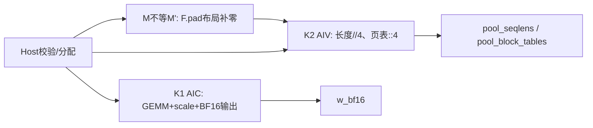
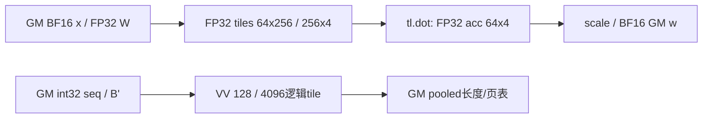
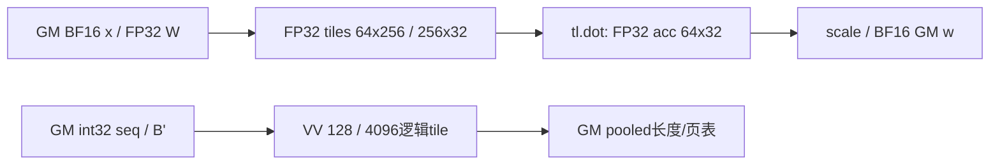
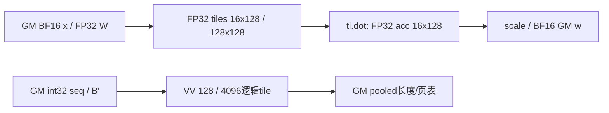

# KPoolIndexerPrepareDecodeInput A2/A3 Direct Invoke 算子知识

## 算子速览

| 项目 | 内容 |
|---|---|
| 实际入口 | `sgl_kernel_npu.implementation.triton.indexer.kpool_indexer_prepare_decode_input.kpool_indexer_prepare_decode_input`，直接调用；公开`auto/triton`均转发此函数 |
| 计算语义 | BF16 hidden与FP32权重投影，乘两个调用方scale后转BF16；长度整除4；页表先补到正4倍数宽度，再抽取每4列首项 |
| 输入输出 | x[N,H] BF16、W[J,H] FP32、长度[N] int32、页表[N,M] int32连续；返回新建BF16[N,J]、int32[N]、int32[N,M'/4] |
| 执行类型 | K1为`tl.dot`的AIC_CUBE节点，K2为纯AIV_VECTOR；两个自有节点输出独立，无跨节点数据消费边 |
| Kernel 路线 | R-001…R-008分别对应J=1/2/4/8/16/32/64/128；各含相同K2。Host另有不补零/补零布局分支 |
| 核心资源 | 自有GM workspace=0；正式输出`2NJ+4N+NM'`字节；补零分支另有int32[N,M']临时张量。GEMM逻辑FP32累加`4·BB·J`、操作数`4·BK·(BB+J)`字节，非物理L1/L0/UB承诺 |
| 来源闭包 | `direct_implementation_closed`：Host、8个head实例、完整GEMM与VV body/helper、打包接线已闭合。F.pad与Triton编译/运行时为明确外部primitive边界，未宣称pad Device源码闭合 |
| 验证状态 | 本次知识提取未执行安装、编译、真机、数值或性能测试。公开arch35“已验证”为上游表述；本卡draft，M=0实际输出宽度与公开ceil公式不同 |

## 接口与语义

### 计算语义

设N为batch，H为hidden宽度，J为head数，M为输入页表宽度，固定pool_size=4。Host实际计算`M'=4·max(1,ceil(M/4))`、P=M'/4。令B'为原页表在右侧补M'-M个零后的连续int32矩阵；M>0且4整除M时直接使用原矩阵。

```text
s = float(n_heads_pow * softmax_scale)                   # Python乘法后float转换
acc[n,j] = tl.dot(float32(x[n,:]), W[j,:], acc_float32)
w_bf16[n,j] = bf16(acc[n,j] * s)
pool_seqlens[n] = seqlens_32[n] // 4                     # Device整数除法契约
pool_block_tables[n,p] = B'[n,4*p], 0 <= p < P
```

K1显式FP32 A/B与FP32 accumulator；实际乘法精度、收缩及Cube lowering由Triton-Ascend工具链决定，源码未指定`input_precision`，不能由dtype推断全IEEE FP32乘法。默认scale为`32**-0.5`和`128**-0.5`，并不随J自动更改。真实长度非负为业务前提；不把负数的跨后端整数舍入推广为合同。M=0时源码P=1、抽取补零页ID，公开返回表的`ceil(M/4)`给0，必须识别此差异，不能伪称已知必然失败。`actual_seq_lengths_q`仍在算子外。

### 输入、输出与属性

| 参数 | shape/layout | dtype | 约束、默认值与语义 |
|---|---|---|---|
| x | [N,H] ND连续 | BF16 | Host解包二维、连续assert；只读 |
| weights_proj_weight | [J,H] ND连续 | FP32 | hidden匹配；J须1…128的二次幂；只读 |
| seqlens_32 | [N]连续 | int32 | shape/dtype/连续assert；值域未检查 |
| block_tables | [N,M]连续 | int32 | 检查首维、dtype、连续；页ID不做变换；M=0按实际padding分支处理 |
| pool_size | Python int | — | 默认4；仅支持4；除法和padding发生在最后的`pool_size==4`assert之前 |
| n_heads_pow | scalar | Python float转换 | 默认32**-0.5，调用方按业务传值 |
| softmax_scale | scalar | Python float转换 | 默认128**-0.5，无finite检查 |
| w_bf16 | 新[N,J]连续 | BF16 | 全有效行由K1写入 |
| pool_seqlens | 新[N]连续 | int32 | K2 section A写 |
| pool_block_tables | 新[N,P]连续 | int32 | K2 section B写，P为实际padding后宽度/4 |

公开合同要求同一NPU；Direct Host没有显式NPU/同device/设备guard。输出始终分配于x.device，属性helper读取当前设备；调用方须保持一致。无原地/梯度/量化子语义。

### 入口与版本

固定SGL提交`dda6d36b0cdb4081e102d14c0a2fb276fc416e69`，CANN baseline9.1.0来自README构建例与CI容器版本配置，并非本次运行。公开模块的`auto`固定选`triton`，`torch_native`是另一独立实现；本卡冻结Direct符号，不将该独立后端混入闭包。冻结查重无相同主题API命中，故无重复API替换。

## Host/Launcher 执行流程

### 参数校验与前处理

按201–247行：解包x/W二维→H匹配→4输入dtype→长度shape与页表首维→4输入连续→取M并计算M'→必要时`F.pad(block_tables,(0,M'-M))`→选择J对应BB/BK→固定VV块128/4096→读取AIC/Vector核数→检查4096可被pool整除、pool严格4。非法pool可在最终assert前已除零、错误padding或分配失败；无fallback。

F.pad仅为页表布局预处理：输入int32连续[N,M]，右侧pad extent为(0,M'-M)，默认constant0，结果int32连续[N,M']，输出逻辑页号不改变。由框架拥有新storage，Host局部持有至K2提交；必须由框架allocator/current-stream记录延长到K2使用完。pad的Device body、实际copy算法、额外内部workspace及空输入准入不在固定SGL源码；这里不宣称已闭合或必然成功。若M'=M则没有临时副本，原页表直接供K2读取。

### 参数、Workspace 与生命周期

无自有POD struct、aclnn executor、显式GM workspace、event或队列。3个输出通过`torch.empty`新建，合计2NJ+4N+4NP字节；F.pad分支至少持有4NM'字节返回storage，原输入另有4NM字节。分配器保留量/对齐和框架内部临时量未在源码给出，不能按逻辑tensor大小断言实际峰值。

x/W由K1读至完成，长度/原页表或pad结果由K2读至完成。返回tensor拥有输出storage，Python函数返回并不代表Device完成。用户不得在stream完成前覆盖或释放未被框架正确跟踪的输入。helper无参缓存`current_device`属性，切设备后需保证缓存适用；源码没有自行清缓存。没有任何共享GM中间结果从K1传给K2。

### 启动图与失败传播



Host依次提交K1 grid=(num_aicore,)和K2 grid=(num_vectorcore,)，均未显式传stream，沿Triton/框架当前stream语义。pad→K2是真实输入依赖，须满足同设备同stream或外部依赖保障。K1与K2只有Host提交顺序，K2参数不含w_bf16；源码272–273行的“weak HBM store->load”注释不能替代实际不存在的数据边，也不需要为独立输出虚构跨核flag。同步异常可在后续框架调用才暴露；同步Python launch异常中止后续语句，无自有catch/cleanup。N=0无Host早退，正grid下两个循环均无有效迭代；框架空tensor/launch准入仍为外部边界。

## Route 与参数设计

### 分核与资源计算

`_choose_gemm_blocks`顺序为rows=max(1,2048//J)，BB=max(16,min(64,2^floor(log2(rows))))，columns=24576//(BB+J)，BK=min(256,2^floor(log2(columns)))。2048/24576是逻辑元素预算，Host未查询UB/L1/L0字节进行容量判定。

| Route | J | BB | BK | 逻辑acc字节 | FP32 A tile字节 | FP32 B tile字节 |
|---|---:|---:|---:|---:|---:|---:|
| R-001 | 1 | 64 | 256 | 256 | 65536 | 1024 |
| R-002 | 2 | 64 | 256 | 512 | 65536 | 2048 |
| R-003 | 4 | 64 | 256 | 1024 | 65536 | 4096 |
| R-004 | 8 | 64 | 256 | 2048 | 65536 | 8192 |
| R-005 | 16 | 64 | 256 | 4096 | 65536 | 16384 |
| R-006 | 32 | 64 | 256 | 8192 | 65536 | 32768 |
| R-007 | 64 | 32 | 256 | 8192 | 32768 | 65536 |
| R-008 | 128 | 16 | 128 | 8192 | 8192 | 65536 |

令G=ceil(N/BB)、Q=ceil(H/BK)。K1 pid按g=pid,pid+C_A,…轮转batch group，每组BB行、J列，K轴按BK循环。W tile被同组BB行复用；不同g重新加载。K2 pid按C_V步长分别轮转ceil(N/128)个长度tile与ceil(NM'/4096)个页表tile；两个section在同一个program内依次执行，无二者间数据依赖。

### Route 选择

| 顺序 | Route | Key/模板 | 精确选择条件与优先级 | 不适用去向 |
|---:|---|---|---|---|
| 1 | R-001 | J=1, BB=64, BK=256 | 公共Host校验成立且J=1，均含共享VV节点 | 其他合法J取对应实例；非法J在_choose_gemm_blocks assert |
| 2 | R-002 | J=2, BB=64, BK=256 | 公共Host校验成立且J=2，均含共享VV节点 | 其他合法J取对应实例；非法J在_choose_gemm_blocks assert |
| 3 | R-003 | J=4, BB=64, BK=256 | 公共Host校验成立且J=4，均含共享VV节点 | 其他合法J取对应实例；非法J在_choose_gemm_blocks assert |
| 4 | R-004 | J=8, BB=64, BK=256 | 公共Host校验成立且J=8，均含共享VV节点 | 其他合法J取对应实例；非法J在_choose_gemm_blocks assert |
| 5 | R-005 | J=16, BB=64, BK=256 | 公共Host校验成立且J=16，均含共享VV节点 | 其他合法J取对应实例；非法J在_choose_gemm_blocks assert |
| 6 | R-006 | J=32, BB=64, BK=256 | 公共Host校验成立且J=32，均含共享VV节点 | 其他合法J取对应实例；非法J在_choose_gemm_blocks assert |
| 7 | R-007 | J=64, BB=32, BK=256 | 公共Host校验成立且J=64，均含共享VV节点 | 其他合法J取对应实例；非法J在_choose_gemm_blocks assert |
| 8 | R-008 | J=128, BB=16, BK=128 | 公共Host校验成立且J=128，均含共享VV节点 | 其他合法J取对应实例；非法J在_choose_gemm_blocks assert |

```text
dtype/shape/contiguous checks
  M'=4*max(1,ceil(M/4)); M'!=M -> F.pad; else original page table
  J not power-of-two in [1,128] -> assert
  J in {1,2,4,8,16,32,64,128} -> R-001..R-008 exact constants
  get current-device core counts; require positive
  require pool_size==4; allocate outputs
  launch GEMM -> launch shared VV -> return 3 owners
```

### 模板/实现执行矩阵

| Route | key/selector | dtype/shape/platform 完整命中条件 | 执行族与 kernel 节点 | 实际模板/body | 内存与同步特征 | tail/fallback |
|---|---|---|---|---|---|---|
| R-001 | J=1,BB=64,BK=256 | 公共输入合同，本卡A2/A3归属arch22，无额外arch分支 | GEMM AIC_CUBE→Host顺序→共享VV AIV_VECTOR，输出独立 | _kpool_indexer_prepare_decode_input_gemm_kernel + _kpool_indexer_prepare_decode_input_vv_kernel | 自有workspace0；acc=256B；无跨节点GM交接 | N/BK尾由blockptr零填/掩码；VV长度及页表尾mask，无算法fallback |
| R-002 | J=2,BB=64,BK=256 | 公共输入合同，本卡A2/A3归属arch22，无额外arch分支 | GEMM AIC_CUBE→Host顺序→共享VV AIV_VECTOR，输出独立 | _kpool_indexer_prepare_decode_input_gemm_kernel + _kpool_indexer_prepare_decode_input_vv_kernel | 自有workspace0；acc=512B；无跨节点GM交接 | N/BK尾由blockptr零填/掩码；VV长度及页表尾mask，无算法fallback |
| R-003 | J=4,BB=64,BK=256 | 公共输入合同，本卡A2/A3归属arch22，无额外arch分支 | GEMM AIC_CUBE→Host顺序→共享VV AIV_VECTOR，输出独立 | _kpool_indexer_prepare_decode_input_gemm_kernel + _kpool_indexer_prepare_decode_input_vv_kernel | 自有workspace0；acc=1024B；无跨节点GM交接 | N/BK尾由blockptr零填/掩码；VV长度及页表尾mask，无算法fallback |
| R-004 | J=8,BB=64,BK=256 | 公共输入合同，本卡A2/A3归属arch22，无额外arch分支 | GEMM AIC_CUBE→Host顺序→共享VV AIV_VECTOR，输出独立 | _kpool_indexer_prepare_decode_input_gemm_kernel + _kpool_indexer_prepare_decode_input_vv_kernel | 自有workspace0；acc=2048B；无跨节点GM交接 | N/BK尾由blockptr零填/掩码；VV长度及页表尾mask，无算法fallback |
| R-005 | J=16,BB=64,BK=256 | 公共输入合同，本卡A2/A3归属arch22，无额外arch分支 | GEMM AIC_CUBE→Host顺序→共享VV AIV_VECTOR，输出独立 | _kpool_indexer_prepare_decode_input_gemm_kernel + _kpool_indexer_prepare_decode_input_vv_kernel | 自有workspace0；acc=4096B；无跨节点GM交接 | N/BK尾由blockptr零填/掩码；VV长度及页表尾mask，无算法fallback |
| R-006 | J=32,BB=64,BK=256 | 公共输入合同，本卡A2/A3归属arch22，无额外arch分支 | GEMM AIC_CUBE→Host顺序→共享VV AIV_VECTOR，输出独立 | _kpool_indexer_prepare_decode_input_gemm_kernel + _kpool_indexer_prepare_decode_input_vv_kernel | 自有workspace0；acc=8192B；无跨节点GM交接 | N/BK尾由blockptr零填/掩码；VV长度及页表尾mask，无算法fallback |
| R-007 | J=64,BB=32,BK=256 | 公共输入合同，本卡A2/A3归属arch22，无额外arch分支 | GEMM AIC_CUBE→Host顺序→共享VV AIV_VECTOR，输出独立 | _kpool_indexer_prepare_decode_input_gemm_kernel + _kpool_indexer_prepare_decode_input_vv_kernel | 自有workspace0；acc=8192B；无跨节点GM交接 | N/BK尾由blockptr零填/掩码；VV长度及页表尾mask，无算法fallback |
| R-008 | J=128,BB=16,BK=128 | 公共输入合同，本卡A2/A3归属arch22，无额外arch分支 | GEMM AIC_CUBE→Host顺序→共享VV AIV_VECTOR，输出独立 | _kpool_indexer_prepare_decode_input_gemm_kernel + _kpool_indexer_prepare_decode_input_vv_kernel | 自有workspace0；acc=8192B；无跨节点GM交接 | N/BK尾由blockptr零填/掩码；VV长度及页表尾mask，无算法fallback |

### 隐藏性能 Guard

| Guard | Host/Tiling 条件 | Device/资源原因 | 影响 Route | 不满足时去向 | 源码符号 |
|---|---|---|---|---|---|
| J范围及二次幂 | 0<J<=128且J&(J-1)==0 | head维完整arange/固定tile预算 | 全部 | assert | _choose_gemm_blocks |
| 页表4列分组 | pool=4、M'为正4倍数 | reshape[1024,2,2]后两次split精确::4 | 全部K2 | 布局padding；非法pool最终assert或更早外部异常 | wrapper231–247 |
| 当前设备属性 | C_A,C_V>0 | 两program grid-stride除步长 | 全部 | helper assert；无设备切换 | get_device_properties |
| 连续/同device | 连续assert，同NPU为公开合同但Direct未查 | blockptr与flatten固定stride | 全部 | 非连续assert；同device不匹配无自有防护 | wrapper221–224 |
| 物理片上容量 | 无Host UB/L1/L0 guard | 逻辑预算不等于真实lowered容量 | 全部 | 编译/运行时边界，不臆造安全容量 | _GEMM_ACC_ELEMENTS/_GEMM_OPERAND_ELEMENTS |
| 整数/乘积 | 未对N*H/NM'/行offset做统一范围检查 | rows先整数运算后转int64；其他flatten算术由JIT推导 | 全部 | 无额外guard，不承诺超大shape | GEMM rows64 / VV offs_in |

### POD/ABI

本实现无序列化C POD。下面按两个JIT签名逐字段列出，constexpr在编译specialization消费；Python/JIT runtime标量与指针的sizeof/alignof/offsetof、寄存器/栈ABI不在固定仓，不补造32位或64位保证。逻辑pointer tensor dtype见列。

| 结构 | 字段 | 类型/位宽 | ABI 布局 | 单位 | Host/launcher producer | Device consumer | 边界 |
|---|---|---|---|---|---|---|---|
| GEMM args | x_ptr | pointer→BF16 | JIT外部ABI | 元素 | x | a_block | [N,H]连续 |
| GEMM args | w_ptr | pointer→FP32 | JIT外部ABI | 元素 | weights_proj_weight | w_block | [J,H]连续 |
| GEMM args | w_bf16_ptr | pointer→BF16 | JIT外部ABI | 元素 | torch.empty[N,J] | tl.store | 新storage |
| GEMM args | N | runtime整数，位宽外部 | JIT外部ABI | 行 | x.shape[0] | NUM_B_BLOCKS/mask | 非负shape |
| GEMM args | combined_scale | runtime标量，位宽外部 | JIT外部ABI | scale | float(n_heads_pow*softmax_scale) | acc乘法 | 未标注constexpr，注释inlined不能当声明 |
| GEMM args | HIDDEN_SIZE | tl.constexpr | 编译期无C偏移 | 元素 | x.shape[1] | K loop/blockptr | 与W宽匹配 |
| GEMM args | N_HEADS | tl.constexpr | 编译期无C偏移 | head | W.shape[0] | blockptr/acc/offset | 8个合法J |
| GEMM args | BLOCK_B | tl.constexpr | 编译期无C偏移 | 行 | _choose_gemm_blocks | batch tile | 64/32/16 |
| GEMM args | BLOCK_K | tl.constexpr | 编译期无C偏移 | K元素 | _choose_gemm_blocks | K tile/advance | 256/128 |
| GEMM args | NUM_CORES | tl.constexpr | 编译期无C偏移 | program | helper第一返回值 | g步长 | >0 |
| VV args | seqlens_ptr | pointer→int32 | JIT外部ABI | 元素 | seqlens_32 | section A | [N] |
| VV args | block_tables_ptr | pointer→int32 | JIT外部ABI | 元素 | 原页表或F.pad结果 | section B | [N,M'] |
| VV args | pool_seqlens_ptr | pointer→int32 | JIT外部ABI | 元素 | 新[N] | section A store | 输出 |
| VV args | pool_block_tables_ptr | pointer→int32 | JIT外部ABI | 元素 | 新[N,P] | section B store | 输出 |
| VV args | N | runtime整数，位宽外部 | JIT外部ABI | 行 | x.shape[0] | tile数与mask | 同GEMM N |
| VV args | NUM_BLOCKS | tl.constexpr | 编译期无C偏移 | 列 | padded_blocks | flatten输入宽 | 实际M'，不是原M |
| VV args | POOL_SIZE | tl.constexpr | 编译期无C偏移 | 列/组 | pool_size | //4、N_POOL/P_TOTAL | 必须4 |
| VV args | BLOCK_M_A | tl.constexpr | 编译期无C偏移 | 长度元素/tile | 常量128 | section A arange | 128 |
| VV args | BLOCK_M_B | tl.constexpr | 编译期无C偏移 | 页表元素/tile | 常量4096 | section B arange/reshape | 4096 |
| VV args | NUM_CORES | tl.constexpr | 编译期无C偏移 | program | helper第二返回值 | 两section步长 | >0 |

### Route 源码闭包

| Route | Key/selector | Host/Tiling producer | POD/参数 | Kernel entry/router | Kernel body/直接依赖 | 构建接线 |
|---|---|---|---|---|---|---|
| R-001 | J=1 | python/sgl_kernel_npu/sgl_kernel_npu/implementation/triton/indexer/kpool_indexer_prepare_decode_input.py::_choose_gemm_blocks / wrapper | 上表两个JIT签名、BB=64,BK=256 | 同文件两个@triton.jit | GEMM50–112、VV119–170；get_device_properties | setup.py→torch_wheel.py完整包复制→Direct模块JIT；无原生CMake kernel替换 |
| R-002 | J=2 | python/sgl_kernel_npu/sgl_kernel_npu/implementation/triton/indexer/kpool_indexer_prepare_decode_input.py::_choose_gemm_blocks / wrapper | 上表两个JIT签名、BB=64,BK=256 | 同文件两个@triton.jit | GEMM50–112、VV119–170；get_device_properties | setup.py→torch_wheel.py完整包复制→Direct模块JIT；无原生CMake kernel替换 |
| R-003 | J=4 | python/sgl_kernel_npu/sgl_kernel_npu/implementation/triton/indexer/kpool_indexer_prepare_decode_input.py::_choose_gemm_blocks / wrapper | 上表两个JIT签名、BB=64,BK=256 | 同文件两个@triton.jit | GEMM50–112、VV119–170；get_device_properties | setup.py→torch_wheel.py完整包复制→Direct模块JIT；无原生CMake kernel替换 |
| R-004 | J=8 | python/sgl_kernel_npu/sgl_kernel_npu/implementation/triton/indexer/kpool_indexer_prepare_decode_input.py::_choose_gemm_blocks / wrapper | 上表两个JIT签名、BB=64,BK=256 | 同文件两个@triton.jit | GEMM50–112、VV119–170；get_device_properties | setup.py→torch_wheel.py完整包复制→Direct模块JIT；无原生CMake kernel替换 |
| R-005 | J=16 | python/sgl_kernel_npu/sgl_kernel_npu/implementation/triton/indexer/kpool_indexer_prepare_decode_input.py::_choose_gemm_blocks / wrapper | 上表两个JIT签名、BB=64,BK=256 | 同文件两个@triton.jit | GEMM50–112、VV119–170；get_device_properties | setup.py→torch_wheel.py完整包复制→Direct模块JIT；无原生CMake kernel替换 |
| R-006 | J=32 | python/sgl_kernel_npu/sgl_kernel_npu/implementation/triton/indexer/kpool_indexer_prepare_decode_input.py::_choose_gemm_blocks / wrapper | 上表两个JIT签名、BB=64,BK=256 | 同文件两个@triton.jit | GEMM50–112、VV119–170；get_device_properties | setup.py→torch_wheel.py完整包复制→Direct模块JIT；无原生CMake kernel替换 |
| R-007 | J=64 | python/sgl_kernel_npu/sgl_kernel_npu/implementation/triton/indexer/kpool_indexer_prepare_decode_input.py::_choose_gemm_blocks / wrapper | 上表两个JIT签名、BB=32,BK=256 | 同文件两个@triton.jit | GEMM50–112、VV119–170；get_device_properties | setup.py→torch_wheel.py完整包复制→Direct模块JIT；无原生CMake kernel替换 |
| R-008 | J=128 | python/sgl_kernel_npu/sgl_kernel_npu/implementation/triton/indexer/kpool_indexer_prepare_decode_input.py::_choose_gemm_blocks / wrapper | 上表两个JIT签名、BB=16,BK=128 | 同文件两个@triton.jit | GEMM50–112、VV119–170；get_device_properties | setup.py→torch_wheel.py完整包复制→Direct模块JIT；无原生CMake kernel替换 |

## Kernel 实现

### 公共执行流程

每条Route含同一双节点图。K1对batch group循环：构造A blockptr(shape[N,H],stride[H,1],tile[BB,BK],order[1,0])及W blockptr(shape[J,H],stride[H,1],tile[J,BK],order[1,0])；acc FP32[BB,J]清零；K循环load、x转FP32、W转置、tl.dot、advance；scale→BF16→有效行store。A检查N与H边界，W只检查H边界，因为J完整覆盖；K尾均padding zero。输出行地址rows先转int64，但此前rows计算不因此自动扩大。

K2 section A按128行读int32长度、//4、masked store；masked load未给other，无效lane没有store，不宣称它被初始化为0。section B以4096元素连续masked load页表(other0)，reshape[1024,2,2]，split两次分别取末维第0半，得到1024个int32，按flatten输出顺序masked store。M'为4倍数确保跨行flatten的::4与逐行::4完全一致。

```text
GEMM(pid):
  for g=pid; g<ceil(N/BB); g+=C_A:
    acc[BB,J]=float32(0)
    for k=0; k<H; k+=BK:
      a=zero_padded_load(x[g*BB:g*BB+BB,k:k+BK]).float32
      b=transpose(zero_padded_load(W[:,k:k+BK]))
      acc=tl.dot(a,b,acc)
    store w[g*BB+row,j]=bf16(acc[row,j]*scale), row<N
VV(pid):
  for t=pid; t<ceil(N/128); t+=C_V:
    store pool_seq[r]=load(seq[r])//4, r=t*128+arange128<N
  for t=pid; t<ceil(N*M'/4096); t+=C_V:
    block=load(B'[t*4096+arange4096], inrange, other0)
    block=reshape(block,[1024,2,2]); block=split0(block); block=split0(block)
    store pool_BT[t*1024+arange1024]=block, outidx<N*P
```

### Route R-001：J=1的双节点实例

#### 适用条件

公共合同成立，J=1，BB=64、BK=256；Host布局分支可为原页表或F.pad结果。N/H尾、M=0、M不足4列均保留真实Host行为；非法输入不伪装成新的成功Route。

##### 选择证据

| 层级 | 文件 | 符号 | 源码谓词/参数 | 结果/下一跳 |
|---|---|---|---|---|
| Host | python/sgl_kernel_npu/sgl_kernel_npu/implementation/triton/indexer/kpool_indexer_prepare_decode_input.py | _choose_gemm_blocks | J=1, rows=max(1,2048//J), columns=24576//(BB+J) | BB=64,BK=256 |
| launch | 同文件 | wrapper258/274 | C_A/C_V grids，两个独立输出节点 | GEMM实例及共享VV |

#### Device 数据流

##### 函数级调用链

```text
wrapper -> _choose_gemm_blocks(1) -> GEMM[BB=64,BK=256,J=1]
        -> _kpool_indexer_prepare_decode_input_vv_kernel[128,4096,pool4]
        -> return w_bf16,pool_seqlens,pool_block_tables
```

##### 源码等价伪码

使用公共伪码的确切常量BB=64、BK=256、J=1。每个K1 program的g步长C_A，K循环步长256；每组最终输出64×1逻辑元素、仅N内的行提交。K2完整执行两个section，既不读取K1输出，也不依赖其acc。

#### 内存与数据搬运

##### 资源与搬运表

| 层级/缓冲区 | offset/地址公式 | extent/容量公式 | dtype/layout | producer | consumer | owner/lifetime | 对齐/复用 |
|---|---|---|---|---|---|---|---|
| GM x/W | x[(g*64+r)H+k]；W[jH+k] | 2NH、4JH B | BF16/FP32 ND | caller | K1 blockptr | 输入至K1完成 | K尾zero padding；W每组重读 |
| 逻辑A/B | tile[64,256]/[256,1] | FP32 65536/1024 B | A转换FP32、B转置FP32 | load/cast/trans | tl.dot | 当前K迭代 | SSA别名/物理复用由compiler决定 |
| 逻辑acc | [64,1] | 256 B | FP32 | tl.zeros/tl.dot | scale/cast/store | 当前batch group | 每组清零，K迭代累加 |
| GM w | ((g*64+r)J+j)*2 | 2NJ B | BF16 ND | K1 | 外部消费者 | 输出tensor | 行mask |
| GM B'/seq | 4*flat、4*r | 4NM'、4N B | int32连续 | caller/可选F.pad | K2 | 输入或pad临时至K2完成 | F.pad补零预处理边界 |
| VV逻辑tile | 4096/2048/1024元素 | 16384/8192/4096 B | int32 SSA split | load/reshape/split | split/store | 当前tile | 不是3份实际UB容量相加保证 |
| GM pooled输出 | 4*r、4*(t*1024+i) | 4N+NP*4 B | int32 ND | K2 | 外部消费者 | 两输出tensor | mask不写越界lane |
| L1/L0A/L0B/L0C/UB/寄存器 | 固定仓无显式分配 | 物理字节/offset未知 | Triton lowering | compiler | compiler | JIT/kernel边界 | 不能由逻辑tile推实际容量/双缓冲 |
| 自有workspace | N/A | 0 B | 无GM中间结果 | 无 | 无 | 无 | 无K1→K2消费边 |

##### 分层内存布局


Triton决定GM→片上→Cube和Vector物理路线；此图表示固定源码的逻辑数据流，未将L1/L0实际分配当N/A或虚构。源码无TQue/TBuf，故无可据源绘制的独立UB队列布局；物理资源是外部compiler边界。

##### 字节账、交接边与复用顺序

```text
G = ceil(N/64)
K1有效GM读 = 2NH + 4*G*JH；写 = 2NJ
K2有效GM读 = 4N+4NM'；写 = 4N+4NP
正式输出 = 2NJ+4N+4NP；自有workspace = 0
pad分支返回storage = 4NM'；输入原页表storage = 4NM
逻辑acc = 256 B；逻辑FP32 A/B = 65536/1024 B
L1/L0/UB物理容量/对齐/深度未知，不以以上SSA字节估计真实峰值
```

以上为有效元素层面的名义读写量，不包含cache命中、框架pad内部流量、allocator对齐或compiler spill。H=0时GEMM的W/A读取为0。

| 边/复用子区 | producer | offset/extent | dtype/layout | consumer | ordering/sync | owner/lifetime | 安全条件 |
|---|---|---|---|---|---|---|---|
| pad→K2，可选 | F.pad | 0/4NM' B | int32[N,M']连续 | VV section B | 当前stream/框架外部契约 | pad tensor，至K2完成 | 所有输入同device；allocator记录stream |
| acc跨K迭代 | zeros/dot | [64,1] | FP32逻辑SSA | 下一dot或epilogue | JIT语义依赖，低层同步外部 | 每batch group | 不跨g保留旧值 |
| K1/K2关系 | 两独立节点 | 无交接buffer | 输出分离 | 无彼此消费 | 只有Host同stream顺序 | 独立输出storage | 不发明store-load依赖或flag |

#### 同步、精度与尾块

##### 同步与数值边界表

| 阶段 | primitive/机制 | producer | consumer/等待点 | 保护对象 | 精度/尾块 |
|---|---|---|---|---|---|
| GEMM | blockptr load→cast/trans→tl.dot | GM x/W | acc | 当前K tile | x显式FP32，W FP32，acc FP32；乘法模式未指定 |
| K1输出 | acc*runtime scale→BF16 store | acc | w | [N,J] | scale非constexpr声明；N尾mask，K尾zero |
| VV长度 | load→int //4→store | int32 seq | pool_seq | [N] | 无效lane无other但不提交；合法业务长度非负 |
| VV页表 | other0 load/reshape/split×2/store | int32 B' | pool_BT | [N,P] | flatten尾mask，M'整除4，原样页号 |
| 低层同步 | 编译器/运行时primitive边界 | 各节点内部 | 各节点内部 | 片上搬运计算 | 无源码可见barrier/event/双缓冲协议；未验证降低后实现 |

#### 关键实现

##### 符号证据表

| 阶段 | 文件 | 符号/模板实例 | 实现事实 |
|---|---|---|---|
| Host/Tiling producer | python/sgl_kernel_npu/sgl_kernel_npu/implementation/triton/indexer/kpool_indexer_prepare_decode_input.py | _choose_gemm_blocks(1) | BB=64,BK=256 |
| Kernel entry/router | 同文件 | GEMM kernel[J=1] / VV kernel | C_A/C_V grid-stride |
| Device body/helper | 同文件 | tl.make_block_ptr/tl.dot/tl.split | 当前实例M/N/K=64/1/256；K2固定两section |

### Route R-002：J=2的双节点实例

#### 适用条件

公共合同成立，J=2，BB=64、BK=256；Host布局分支可为原页表或F.pad结果。N/H尾、M=0、M不足4列均保留真实Host行为；非法输入不伪装成新的成功Route。

##### 选择证据

| 层级 | 文件 | 符号 | 源码谓词/参数 | 结果/下一跳 |
|---|---|---|---|---|
| Host | python/sgl_kernel_npu/sgl_kernel_npu/implementation/triton/indexer/kpool_indexer_prepare_decode_input.py | _choose_gemm_blocks | J=2, rows=max(1,2048//J), columns=24576//(BB+J) | BB=64,BK=256 |
| launch | 同文件 | wrapper258/274 | C_A/C_V grids，两个独立输出节点 | GEMM实例及共享VV |

#### Device 数据流

##### 函数级调用链

```text
wrapper -> _choose_gemm_blocks(2) -> GEMM[BB=64,BK=256,J=2]
        -> _kpool_indexer_prepare_decode_input_vv_kernel[128,4096,pool4]
        -> return w_bf16,pool_seqlens,pool_block_tables
```

##### 源码等价伪码

使用公共伪码的确切常量BB=64、BK=256、J=2。每个K1 program的g步长C_A，K循环步长256；每组最终输出64×2逻辑元素、仅N内的行提交。K2完整执行两个section，既不读取K1输出，也不依赖其acc。

#### 内存与数据搬运

##### 资源与搬运表

| 层级/缓冲区 | offset/地址公式 | extent/容量公式 | dtype/layout | producer | consumer | owner/lifetime | 对齐/复用 |
|---|---|---|---|---|---|---|---|
| GM x/W | x[(g*64+r)H+k]；W[jH+k] | 2NH、4JH B | BF16/FP32 ND | caller | K1 blockptr | 输入至K1完成 | K尾zero padding；W每组重读 |
| 逻辑A/B | tile[64,256]/[256,2] | FP32 65536/2048 B | A转换FP32、B转置FP32 | load/cast/trans | tl.dot | 当前K迭代 | SSA别名/物理复用由compiler决定 |
| 逻辑acc | [64,2] | 512 B | FP32 | tl.zeros/tl.dot | scale/cast/store | 当前batch group | 每组清零，K迭代累加 |
| GM w | ((g*64+r)J+j)*2 | 2NJ B | BF16 ND | K1 | 外部消费者 | 输出tensor | 行mask |
| GM B'/seq | 4*flat、4*r | 4NM'、4N B | int32连续 | caller/可选F.pad | K2 | 输入或pad临时至K2完成 | F.pad补零预处理边界 |
| VV逻辑tile | 4096/2048/1024元素 | 16384/8192/4096 B | int32 SSA split | load/reshape/split | split/store | 当前tile | 不是3份实际UB容量相加保证 |
| GM pooled输出 | 4*r、4*(t*1024+i) | 4N+NP*4 B | int32 ND | K2 | 外部消费者 | 两输出tensor | mask不写越界lane |
| L1/L0A/L0B/L0C/UB/寄存器 | 固定仓无显式分配 | 物理字节/offset未知 | Triton lowering | compiler | compiler | JIT/kernel边界 | 不能由逻辑tile推实际容量/双缓冲 |
| 自有workspace | N/A | 0 B | 无GM中间结果 | 无 | 无 | 无 | 无K1→K2消费边 |

##### 分层内存布局


Triton决定GM→片上→Cube和Vector物理路线；此图表示固定源码的逻辑数据流，未将L1/L0实际分配当N/A或虚构。源码无TQue/TBuf，故无可据源绘制的独立UB队列布局；物理资源是外部compiler边界。

##### 字节账、交接边与复用顺序

```text
G = ceil(N/64)
K1有效GM读 = 2NH + 4*G*JH；写 = 2NJ
K2有效GM读 = 4N+4NM'；写 = 4N+4NP
正式输出 = 2NJ+4N+4NP；自有workspace = 0
pad分支返回storage = 4NM'；输入原页表storage = 4NM
逻辑acc = 512 B；逻辑FP32 A/B = 65536/2048 B
L1/L0/UB物理容量/对齐/深度未知，不以以上SSA字节估计真实峰值
```

以上为有效元素层面的名义读写量，不包含cache命中、框架pad内部流量、allocator对齐或compiler spill。H=0时GEMM的W/A读取为0。

| 边/复用子区 | producer | offset/extent | dtype/layout | consumer | ordering/sync | owner/lifetime | 安全条件 |
|---|---|---|---|---|---|---|---|
| pad→K2，可选 | F.pad | 0/4NM' B | int32[N,M']连续 | VV section B | 当前stream/框架外部契约 | pad tensor，至K2完成 | 所有输入同device；allocator记录stream |
| acc跨K迭代 | zeros/dot | [64,2] | FP32逻辑SSA | 下一dot或epilogue | JIT语义依赖，低层同步外部 | 每batch group | 不跨g保留旧值 |
| K1/K2关系 | 两独立节点 | 无交接buffer | 输出分离 | 无彼此消费 | 只有Host同stream顺序 | 独立输出storage | 不发明store-load依赖或flag |

#### 同步、精度与尾块

##### 同步与数值边界表

| 阶段 | primitive/机制 | producer | consumer/等待点 | 保护对象 | 精度/尾块 |
|---|---|---|---|---|---|
| GEMM | blockptr load→cast/trans→tl.dot | GM x/W | acc | 当前K tile | x显式FP32，W FP32，acc FP32；乘法模式未指定 |
| K1输出 | acc*runtime scale→BF16 store | acc | w | [N,J] | scale非constexpr声明；N尾mask，K尾zero |
| VV长度 | load→int //4→store | int32 seq | pool_seq | [N] | 无效lane无other但不提交；合法业务长度非负 |
| VV页表 | other0 load/reshape/split×2/store | int32 B' | pool_BT | [N,P] | flatten尾mask，M'整除4，原样页号 |
| 低层同步 | 编译器/运行时primitive边界 | 各节点内部 | 各节点内部 | 片上搬运计算 | 无源码可见barrier/event/双缓冲协议；未验证降低后实现 |

#### 关键实现

##### 符号证据表

| 阶段 | 文件 | 符号/模板实例 | 实现事实 |
|---|---|---|---|
| Host/Tiling producer | python/sgl_kernel_npu/sgl_kernel_npu/implementation/triton/indexer/kpool_indexer_prepare_decode_input.py | _choose_gemm_blocks(2) | BB=64,BK=256 |
| Kernel entry/router | 同文件 | GEMM kernel[J=2] / VV kernel | C_A/C_V grid-stride |
| Device body/helper | 同文件 | tl.make_block_ptr/tl.dot/tl.split | 当前实例M/N/K=64/2/256；K2固定两section |

### Route R-003：J=4的双节点实例

#### 适用条件

公共合同成立，J=4，BB=64、BK=256；Host布局分支可为原页表或F.pad结果。N/H尾、M=0、M不足4列均保留真实Host行为；非法输入不伪装成新的成功Route。

##### 选择证据

| 层级 | 文件 | 符号 | 源码谓词/参数 | 结果/下一跳 |
|---|---|---|---|---|
| Host | python/sgl_kernel_npu/sgl_kernel_npu/implementation/triton/indexer/kpool_indexer_prepare_decode_input.py | _choose_gemm_blocks | J=4, rows=max(1,2048//J), columns=24576//(BB+J) | BB=64,BK=256 |
| launch | 同文件 | wrapper258/274 | C_A/C_V grids，两个独立输出节点 | GEMM实例及共享VV |

#### Device 数据流

##### 函数级调用链

```text
wrapper -> _choose_gemm_blocks(4) -> GEMM[BB=64,BK=256,J=4]
        -> _kpool_indexer_prepare_decode_input_vv_kernel[128,4096,pool4]
        -> return w_bf16,pool_seqlens,pool_block_tables
```

##### 源码等价伪码

使用公共伪码的确切常量BB=64、BK=256、J=4。每个K1 program的g步长C_A，K循环步长256；每组最终输出64×4逻辑元素、仅N内的行提交。K2完整执行两个section，既不读取K1输出，也不依赖其acc。

#### 内存与数据搬运

##### 资源与搬运表

| 层级/缓冲区 | offset/地址公式 | extent/容量公式 | dtype/layout | producer | consumer | owner/lifetime | 对齐/复用 |
|---|---|---|---|---|---|---|---|
| GM x/W | x[(g*64+r)H+k]；W[jH+k] | 2NH、4JH B | BF16/FP32 ND | caller | K1 blockptr | 输入至K1完成 | K尾zero padding；W每组重读 |
| 逻辑A/B | tile[64,256]/[256,4] | FP32 65536/4096 B | A转换FP32、B转置FP32 | load/cast/trans | tl.dot | 当前K迭代 | SSA别名/物理复用由compiler决定 |
| 逻辑acc | [64,4] | 1024 B | FP32 | tl.zeros/tl.dot | scale/cast/store | 当前batch group | 每组清零，K迭代累加 |
| GM w | ((g*64+r)J+j)*2 | 2NJ B | BF16 ND | K1 | 外部消费者 | 输出tensor | 行mask |
| GM B'/seq | 4*flat、4*r | 4NM'、4N B | int32连续 | caller/可选F.pad | K2 | 输入或pad临时至K2完成 | F.pad补零预处理边界 |
| VV逻辑tile | 4096/2048/1024元素 | 16384/8192/4096 B | int32 SSA split | load/reshape/split | split/store | 当前tile | 不是3份实际UB容量相加保证 |
| GM pooled输出 | 4*r、4*(t*1024+i) | 4N+NP*4 B | int32 ND | K2 | 外部消费者 | 两输出tensor | mask不写越界lane |
| L1/L0A/L0B/L0C/UB/寄存器 | 固定仓无显式分配 | 物理字节/offset未知 | Triton lowering | compiler | compiler | JIT/kernel边界 | 不能由逻辑tile推实际容量/双缓冲 |
| 自有workspace | N/A | 0 B | 无GM中间结果 | 无 | 无 | 无 | 无K1→K2消费边 |

##### 分层内存布局



Triton决定GM→片上→Cube和Vector物理路线；此图表示固定源码的逻辑数据流，未将L1/L0实际分配当N/A或虚构。源码无TQue/TBuf，故无可据源绘制的独立UB队列布局；物理资源是外部compiler边界。

##### 字节账、交接边与复用顺序

```text
G = ceil(N/64)
K1有效GM读 = 2NH + 4*G*JH；写 = 2NJ
K2有效GM读 = 4N+4NM'；写 = 4N+4NP
正式输出 = 2NJ+4N+4NP；自有workspace = 0
pad分支返回storage = 4NM'；输入原页表storage = 4NM
逻辑acc = 1024 B；逻辑FP32 A/B = 65536/4096 B
L1/L0/UB物理容量/对齐/深度未知，不以以上SSA字节估计真实峰值
```

以上为有效元素层面的名义读写量，不包含cache命中、框架pad内部流量、allocator对齐或compiler spill。H=0时GEMM的W/A读取为0。

| 边/复用子区 | producer | offset/extent | dtype/layout | consumer | ordering/sync | owner/lifetime | 安全条件 |
|---|---|---|---|---|---|---|---|
| pad→K2，可选 | F.pad | 0/4NM' B | int32[N,M']连续 | VV section B | 当前stream/框架外部契约 | pad tensor，至K2完成 | 所有输入同device；allocator记录stream |
| acc跨K迭代 | zeros/dot | [64,4] | FP32逻辑SSA | 下一dot或epilogue | JIT语义依赖，低层同步外部 | 每batch group | 不跨g保留旧值 |
| K1/K2关系 | 两独立节点 | 无交接buffer | 输出分离 | 无彼此消费 | 只有Host同stream顺序 | 独立输出storage | 不发明store-load依赖或flag |

#### 同步、精度与尾块

##### 同步与数值边界表

| 阶段 | primitive/机制 | producer | consumer/等待点 | 保护对象 | 精度/尾块 |
|---|---|---|---|---|---|
| GEMM | blockptr load→cast/trans→tl.dot | GM x/W | acc | 当前K tile | x显式FP32，W FP32，acc FP32；乘法模式未指定 |
| K1输出 | acc*runtime scale→BF16 store | acc | w | [N,J] | scale非constexpr声明；N尾mask，K尾zero |
| VV长度 | load→int //4→store | int32 seq | pool_seq | [N] | 无效lane无other但不提交；合法业务长度非负 |
| VV页表 | other0 load/reshape/split×2/store | int32 B' | pool_BT | [N,P] | flatten尾mask，M'整除4，原样页号 |
| 低层同步 | 编译器/运行时primitive边界 | 各节点内部 | 各节点内部 | 片上搬运计算 | 无源码可见barrier/event/双缓冲协议；未验证降低后实现 |

#### 关键实现

##### 符号证据表

| 阶段 | 文件 | 符号/模板实例 | 实现事实 |
|---|---|---|---|
| Host/Tiling producer | python/sgl_kernel_npu/sgl_kernel_npu/implementation/triton/indexer/kpool_indexer_prepare_decode_input.py | _choose_gemm_blocks(4) | BB=64,BK=256 |
| Kernel entry/router | 同文件 | GEMM kernel[J=4] / VV kernel | C_A/C_V grid-stride |
| Device body/helper | 同文件 | tl.make_block_ptr/tl.dot/tl.split | 当前实例M/N/K=64/4/256；K2固定两section |

### Route R-004：J=8的双节点实例

#### 适用条件

公共合同成立，J=8，BB=64、BK=256；Host布局分支可为原页表或F.pad结果。N/H尾、M=0、M不足4列均保留真实Host行为；非法输入不伪装成新的成功Route。

##### 选择证据

| 层级 | 文件 | 符号 | 源码谓词/参数 | 结果/下一跳 |
|---|---|---|---|---|
| Host | python/sgl_kernel_npu/sgl_kernel_npu/implementation/triton/indexer/kpool_indexer_prepare_decode_input.py | _choose_gemm_blocks | J=8, rows=max(1,2048//J), columns=24576//(BB+J) | BB=64,BK=256 |
| launch | 同文件 | wrapper258/274 | C_A/C_V grids，两个独立输出节点 | GEMM实例及共享VV |

#### Device 数据流

##### 函数级调用链

```text
wrapper -> _choose_gemm_blocks(8) -> GEMM[BB=64,BK=256,J=8]
        -> _kpool_indexer_prepare_decode_input_vv_kernel[128,4096,pool4]
        -> return w_bf16,pool_seqlens,pool_block_tables
```

##### 源码等价伪码

使用公共伪码的确切常量BB=64、BK=256、J=8。每个K1 program的g步长C_A，K循环步长256；每组最终输出64×8逻辑元素、仅N内的行提交。K2完整执行两个section，既不读取K1输出，也不依赖其acc。

#### 内存与数据搬运

##### 资源与搬运表

| 层级/缓冲区 | offset/地址公式 | extent/容量公式 | dtype/layout | producer | consumer | owner/lifetime | 对齐/复用 |
|---|---|---|---|---|---|---|---|
| GM x/W | x[(g*64+r)H+k]；W[jH+k] | 2NH、4JH B | BF16/FP32 ND | caller | K1 blockptr | 输入至K1完成 | K尾zero padding；W每组重读 |
| 逻辑A/B | tile[64,256]/[256,8] | FP32 65536/8192 B | A转换FP32、B转置FP32 | load/cast/trans | tl.dot | 当前K迭代 | SSA别名/物理复用由compiler决定 |
| 逻辑acc | [64,8] | 2048 B | FP32 | tl.zeros/tl.dot | scale/cast/store | 当前batch group | 每组清零，K迭代累加 |
| GM w | ((g*64+r)J+j)*2 | 2NJ B | BF16 ND | K1 | 外部消费者 | 输出tensor | 行mask |
| GM B'/seq | 4*flat、4*r | 4NM'、4N B | int32连续 | caller/可选F.pad | K2 | 输入或pad临时至K2完成 | F.pad补零预处理边界 |
| VV逻辑tile | 4096/2048/1024元素 | 16384/8192/4096 B | int32 SSA split | load/reshape/split | split/store | 当前tile | 不是3份实际UB容量相加保证 |
| GM pooled输出 | 4*r、4*(t*1024+i) | 4N+NP*4 B | int32 ND | K2 | 外部消费者 | 两输出tensor | mask不写越界lane |
| L1/L0A/L0B/L0C/UB/寄存器 | 固定仓无显式分配 | 物理字节/offset未知 | Triton lowering | compiler | compiler | JIT/kernel边界 | 不能由逻辑tile推实际容量/双缓冲 |
| 自有workspace | N/A | 0 B | 无GM中间结果 | 无 | 无 | 无 | 无K1→K2消费边 |

##### 分层内存布局


Triton决定GM→片上→Cube和Vector物理路线；此图表示固定源码的逻辑数据流，未将L1/L0实际分配当N/A或虚构。源码无TQue/TBuf，故无可据源绘制的独立UB队列布局；物理资源是外部compiler边界。

##### 字节账、交接边与复用顺序

```text
G = ceil(N/64)
K1有效GM读 = 2NH + 4*G*JH；写 = 2NJ
K2有效GM读 = 4N+4NM'；写 = 4N+4NP
正式输出 = 2NJ+4N+4NP；自有workspace = 0
pad分支返回storage = 4NM'；输入原页表storage = 4NM
逻辑acc = 2048 B；逻辑FP32 A/B = 65536/8192 B
L1/L0/UB物理容量/对齐/深度未知，不以以上SSA字节估计真实峰值
```

以上为有效元素层面的名义读写量，不包含cache命中、框架pad内部流量、allocator对齐或compiler spill。H=0时GEMM的W/A读取为0。

| 边/复用子区 | producer | offset/extent | dtype/layout | consumer | ordering/sync | owner/lifetime | 安全条件 |
|---|---|---|---|---|---|---|---|
| pad→K2，可选 | F.pad | 0/4NM' B | int32[N,M']连续 | VV section B | 当前stream/框架外部契约 | pad tensor，至K2完成 | 所有输入同device；allocator记录stream |
| acc跨K迭代 | zeros/dot | [64,8] | FP32逻辑SSA | 下一dot或epilogue | JIT语义依赖，低层同步外部 | 每batch group | 不跨g保留旧值 |
| K1/K2关系 | 两独立节点 | 无交接buffer | 输出分离 | 无彼此消费 | 只有Host同stream顺序 | 独立输出storage | 不发明store-load依赖或flag |

#### 同步、精度与尾块

##### 同步与数值边界表

| 阶段 | primitive/机制 | producer | consumer/等待点 | 保护对象 | 精度/尾块 |
|---|---|---|---|---|---|
| GEMM | blockptr load→cast/trans→tl.dot | GM x/W | acc | 当前K tile | x显式FP32，W FP32，acc FP32；乘法模式未指定 |
| K1输出 | acc*runtime scale→BF16 store | acc | w | [N,J] | scale非constexpr声明；N尾mask，K尾zero |
| VV长度 | load→int //4→store | int32 seq | pool_seq | [N] | 无效lane无other但不提交；合法业务长度非负 |
| VV页表 | other0 load/reshape/split×2/store | int32 B' | pool_BT | [N,P] | flatten尾mask，M'整除4，原样页号 |
| 低层同步 | 编译器/运行时primitive边界 | 各节点内部 | 各节点内部 | 片上搬运计算 | 无源码可见barrier/event/双缓冲协议；未验证降低后实现 |

#### 关键实现

##### 符号证据表

| 阶段 | 文件 | 符号/模板实例 | 实现事实 |
|---|---|---|---|
| Host/Tiling producer | python/sgl_kernel_npu/sgl_kernel_npu/implementation/triton/indexer/kpool_indexer_prepare_decode_input.py | _choose_gemm_blocks(8) | BB=64,BK=256 |
| Kernel entry/router | 同文件 | GEMM kernel[J=8] / VV kernel | C_A/C_V grid-stride |
| Device body/helper | 同文件 | tl.make_block_ptr/tl.dot/tl.split | 当前实例M/N/K=64/8/256；K2固定两section |

### Route R-005：J=16的双节点实例

#### 适用条件

公共合同成立，J=16，BB=64、BK=256；Host布局分支可为原页表或F.pad结果。N/H尾、M=0、M不足4列均保留真实Host行为；非法输入不伪装成新的成功Route。

##### 选择证据

| 层级 | 文件 | 符号 | 源码谓词/参数 | 结果/下一跳 |
|---|---|---|---|---|
| Host | python/sgl_kernel_npu/sgl_kernel_npu/implementation/triton/indexer/kpool_indexer_prepare_decode_input.py | _choose_gemm_blocks | J=16, rows=max(1,2048//J), columns=24576//(BB+J) | BB=64,BK=256 |
| launch | 同文件 | wrapper258/274 | C_A/C_V grids，两个独立输出节点 | GEMM实例及共享VV |

#### Device 数据流

##### 函数级调用链

```text
wrapper -> _choose_gemm_blocks(16) -> GEMM[BB=64,BK=256,J=16]
        -> _kpool_indexer_prepare_decode_input_vv_kernel[128,4096,pool4]
        -> return w_bf16,pool_seqlens,pool_block_tables
```

##### 源码等价伪码

使用公共伪码的确切常量BB=64、BK=256、J=16。每个K1 program的g步长C_A，K循环步长256；每组最终输出64×16逻辑元素、仅N内的行提交。K2完整执行两个section，既不读取K1输出，也不依赖其acc。

#### 内存与数据搬运

##### 资源与搬运表

| 层级/缓冲区 | offset/地址公式 | extent/容量公式 | dtype/layout | producer | consumer | owner/lifetime | 对齐/复用 |
|---|---|---|---|---|---|---|---|
| GM x/W | x[(g*64+r)H+k]；W[jH+k] | 2NH、4JH B | BF16/FP32 ND | caller | K1 blockptr | 输入至K1完成 | K尾zero padding；W每组重读 |
| 逻辑A/B | tile[64,256]/[256,16] | FP32 65536/16384 B | A转换FP32、B转置FP32 | load/cast/trans | tl.dot | 当前K迭代 | SSA别名/物理复用由compiler决定 |
| 逻辑acc | [64,16] | 4096 B | FP32 | tl.zeros/tl.dot | scale/cast/store | 当前batch group | 每组清零，K迭代累加 |
| GM w | ((g*64+r)J+j)*2 | 2NJ B | BF16 ND | K1 | 外部消费者 | 输出tensor | 行mask |
| GM B'/seq | 4*flat、4*r | 4NM'、4N B | int32连续 | caller/可选F.pad | K2 | 输入或pad临时至K2完成 | F.pad补零预处理边界 |
| VV逻辑tile | 4096/2048/1024元素 | 16384/8192/4096 B | int32 SSA split | load/reshape/split | split/store | 当前tile | 不是3份实际UB容量相加保证 |
| GM pooled输出 | 4*r、4*(t*1024+i) | 4N+NP*4 B | int32 ND | K2 | 外部消费者 | 两输出tensor | mask不写越界lane |
| L1/L0A/L0B/L0C/UB/寄存器 | 固定仓无显式分配 | 物理字节/offset未知 | Triton lowering | compiler | compiler | JIT/kernel边界 | 不能由逻辑tile推实际容量/双缓冲 |
| 自有workspace | N/A | 0 B | 无GM中间结果 | 无 | 无 | 无 | 无K1→K2消费边 |

##### 分层内存布局


Triton决定GM→片上→Cube和Vector物理路线；此图表示固定源码的逻辑数据流，未将L1/L0实际分配当N/A或虚构。源码无TQue/TBuf，故无可据源绘制的独立UB队列布局；物理资源是外部compiler边界。

##### 字节账、交接边与复用顺序

```text
G = ceil(N/64)
K1有效GM读 = 2NH + 4*G*JH；写 = 2NJ
K2有效GM读 = 4N+4NM'；写 = 4N+4NP
正式输出 = 2NJ+4N+4NP；自有workspace = 0
pad分支返回storage = 4NM'；输入原页表storage = 4NM
逻辑acc = 4096 B；逻辑FP32 A/B = 65536/16384 B
L1/L0/UB物理容量/对齐/深度未知，不以以上SSA字节估计真实峰值
```

以上为有效元素层面的名义读写量，不包含cache命中、框架pad内部流量、allocator对齐或compiler spill。H=0时GEMM的W/A读取为0。

| 边/复用子区 | producer | offset/extent | dtype/layout | consumer | ordering/sync | owner/lifetime | 安全条件 |
|---|---|---|---|---|---|---|---|
| pad→K2，可选 | F.pad | 0/4NM' B | int32[N,M']连续 | VV section B | 当前stream/框架外部契约 | pad tensor，至K2完成 | 所有输入同device；allocator记录stream |
| acc跨K迭代 | zeros/dot | [64,16] | FP32逻辑SSA | 下一dot或epilogue | JIT语义依赖，低层同步外部 | 每batch group | 不跨g保留旧值 |
| K1/K2关系 | 两独立节点 | 无交接buffer | 输出分离 | 无彼此消费 | 只有Host同stream顺序 | 独立输出storage | 不发明store-load依赖或flag |

#### 同步、精度与尾块

##### 同步与数值边界表

| 阶段 | primitive/机制 | producer | consumer/等待点 | 保护对象 | 精度/尾块 |
|---|---|---|---|---|---|
| GEMM | blockptr load→cast/trans→tl.dot | GM x/W | acc | 当前K tile | x显式FP32，W FP32，acc FP32；乘法模式未指定 |
| K1输出 | acc*runtime scale→BF16 store | acc | w | [N,J] | scale非constexpr声明；N尾mask，K尾zero |
| VV长度 | load→int //4→store | int32 seq | pool_seq | [N] | 无效lane无other但不提交；合法业务长度非负 |
| VV页表 | other0 load/reshape/split×2/store | int32 B' | pool_BT | [N,P] | flatten尾mask，M'整除4，原样页号 |
| 低层同步 | 编译器/运行时primitive边界 | 各节点内部 | 各节点内部 | 片上搬运计算 | 无源码可见barrier/event/双缓冲协议；未验证降低后实现 |

#### 关键实现

##### 符号证据表

| 阶段 | 文件 | 符号/模板实例 | 实现事实 |
|---|---|---|---|
| Host/Tiling producer | python/sgl_kernel_npu/sgl_kernel_npu/implementation/triton/indexer/kpool_indexer_prepare_decode_input.py | _choose_gemm_blocks(16) | BB=64,BK=256 |
| Kernel entry/router | 同文件 | GEMM kernel[J=16] / VV kernel | C_A/C_V grid-stride |
| Device body/helper | 同文件 | tl.make_block_ptr/tl.dot/tl.split | 当前实例M/N/K=64/16/256；K2固定两section |

### Route R-006：J=32的双节点实例

#### 适用条件

公共合同成立，J=32，BB=64、BK=256；Host布局分支可为原页表或F.pad结果。N/H尾、M=0、M不足4列均保留真实Host行为；非法输入不伪装成新的成功Route。

##### 选择证据

| 层级 | 文件 | 符号 | 源码谓词/参数 | 结果/下一跳 |
|---|---|---|---|---|
| Host | python/sgl_kernel_npu/sgl_kernel_npu/implementation/triton/indexer/kpool_indexer_prepare_decode_input.py | _choose_gemm_blocks | J=32, rows=max(1,2048//J), columns=24576//(BB+J) | BB=64,BK=256 |
| launch | 同文件 | wrapper258/274 | C_A/C_V grids，两个独立输出节点 | GEMM实例及共享VV |

#### Device 数据流

##### 函数级调用链

```text
wrapper -> _choose_gemm_blocks(32) -> GEMM[BB=64,BK=256,J=32]
        -> _kpool_indexer_prepare_decode_input_vv_kernel[128,4096,pool4]
        -> return w_bf16,pool_seqlens,pool_block_tables
```

##### 源码等价伪码

使用公共伪码的确切常量BB=64、BK=256、J=32。每个K1 program的g步长C_A，K循环步长256；每组最终输出64×32逻辑元素、仅N内的行提交。K2完整执行两个section，既不读取K1输出，也不依赖其acc。

#### 内存与数据搬运

##### 资源与搬运表

| 层级/缓冲区 | offset/地址公式 | extent/容量公式 | dtype/layout | producer | consumer | owner/lifetime | 对齐/复用 |
|---|---|---|---|---|---|---|---|
| GM x/W | x[(g*64+r)H+k]；W[jH+k] | 2NH、4JH B | BF16/FP32 ND | caller | K1 blockptr | 输入至K1完成 | K尾zero padding；W每组重读 |
| 逻辑A/B | tile[64,256]/[256,32] | FP32 65536/32768 B | A转换FP32、B转置FP32 | load/cast/trans | tl.dot | 当前K迭代 | SSA别名/物理复用由compiler决定 |
| 逻辑acc | [64,32] | 8192 B | FP32 | tl.zeros/tl.dot | scale/cast/store | 当前batch group | 每组清零，K迭代累加 |
| GM w | ((g*64+r)J+j)*2 | 2NJ B | BF16 ND | K1 | 外部消费者 | 输出tensor | 行mask |
| GM B'/seq | 4*flat、4*r | 4NM'、4N B | int32连续 | caller/可选F.pad | K2 | 输入或pad临时至K2完成 | F.pad补零预处理边界 |
| VV逻辑tile | 4096/2048/1024元素 | 16384/8192/4096 B | int32 SSA split | load/reshape/split | split/store | 当前tile | 不是3份实际UB容量相加保证 |
| GM pooled输出 | 4*r、4*(t*1024+i) | 4N+NP*4 B | int32 ND | K2 | 外部消费者 | 两输出tensor | mask不写越界lane |
| L1/L0A/L0B/L0C/UB/寄存器 | 固定仓无显式分配 | 物理字节/offset未知 | Triton lowering | compiler | compiler | JIT/kernel边界 | 不能由逻辑tile推实际容量/双缓冲 |
| 自有workspace | N/A | 0 B | 无GM中间结果 | 无 | 无 | 无 | 无K1→K2消费边 |

##### 分层内存布局



Triton决定GM→片上→Cube和Vector物理路线；此图表示固定源码的逻辑数据流，未将L1/L0实际分配当N/A或虚构。源码无TQue/TBuf，故无可据源绘制的独立UB队列布局；物理资源是外部compiler边界。

##### 字节账、交接边与复用顺序

```text
G = ceil(N/64)
K1有效GM读 = 2NH + 4*G*JH；写 = 2NJ
K2有效GM读 = 4N+4NM'；写 = 4N+4NP
正式输出 = 2NJ+4N+4NP；自有workspace = 0
pad分支返回storage = 4NM'；输入原页表storage = 4NM
逻辑acc = 8192 B；逻辑FP32 A/B = 65536/32768 B
L1/L0/UB物理容量/对齐/深度未知，不以以上SSA字节估计真实峰值
```

以上为有效元素层面的名义读写量，不包含cache命中、框架pad内部流量、allocator对齐或compiler spill。H=0时GEMM的W/A读取为0。

| 边/复用子区 | producer | offset/extent | dtype/layout | consumer | ordering/sync | owner/lifetime | 安全条件 |
|---|---|---|---|---|---|---|---|
| pad→K2，可选 | F.pad | 0/4NM' B | int32[N,M']连续 | VV section B | 当前stream/框架外部契约 | pad tensor，至K2完成 | 所有输入同device；allocator记录stream |
| acc跨K迭代 | zeros/dot | [64,32] | FP32逻辑SSA | 下一dot或epilogue | JIT语义依赖，低层同步外部 | 每batch group | 不跨g保留旧值 |
| K1/K2关系 | 两独立节点 | 无交接buffer | 输出分离 | 无彼此消费 | 只有Host同stream顺序 | 独立输出storage | 不发明store-load依赖或flag |

#### 同步、精度与尾块

##### 同步与数值边界表

| 阶段 | primitive/机制 | producer | consumer/等待点 | 保护对象 | 精度/尾块 |
|---|---|---|---|---|---|
| GEMM | blockptr load→cast/trans→tl.dot | GM x/W | acc | 当前K tile | x显式FP32，W FP32，acc FP32；乘法模式未指定 |
| K1输出 | acc*runtime scale→BF16 store | acc | w | [N,J] | scale非constexpr声明；N尾mask，K尾zero |
| VV长度 | load→int //4→store | int32 seq | pool_seq | [N] | 无效lane无other但不提交；合法业务长度非负 |
| VV页表 | other0 load/reshape/split×2/store | int32 B' | pool_BT | [N,P] | flatten尾mask，M'整除4，原样页号 |
| 低层同步 | 编译器/运行时primitive边界 | 各节点内部 | 各节点内部 | 片上搬运计算 | 无源码可见barrier/event/双缓冲协议；未验证降低后实现 |

#### 关键实现

##### 符号证据表

| 阶段 | 文件 | 符号/模板实例 | 实现事实 |
|---|---|---|---|
| Host/Tiling producer | python/sgl_kernel_npu/sgl_kernel_npu/implementation/triton/indexer/kpool_indexer_prepare_decode_input.py | _choose_gemm_blocks(32) | BB=64,BK=256 |
| Kernel entry/router | 同文件 | GEMM kernel[J=32] / VV kernel | C_A/C_V grid-stride |
| Device body/helper | 同文件 | tl.make_block_ptr/tl.dot/tl.split | 当前实例M/N/K=64/32/256；K2固定两section |

### Route R-007：J=64的双节点实例

#### 适用条件

公共合同成立，J=64，BB=32、BK=256；Host布局分支可为原页表或F.pad结果。N/H尾、M=0、M不足4列均保留真实Host行为；非法输入不伪装成新的成功Route。

##### 选择证据

| 层级 | 文件 | 符号 | 源码谓词/参数 | 结果/下一跳 |
|---|---|---|---|---|
| Host | python/sgl_kernel_npu/sgl_kernel_npu/implementation/triton/indexer/kpool_indexer_prepare_decode_input.py | _choose_gemm_blocks | J=64, rows=max(1,2048//J), columns=24576//(BB+J) | BB=32,BK=256 |
| launch | 同文件 | wrapper258/274 | C_A/C_V grids，两个独立输出节点 | GEMM实例及共享VV |

#### Device 数据流

##### 函数级调用链

```text
wrapper -> _choose_gemm_blocks(64) -> GEMM[BB=32,BK=256,J=64]
        -> _kpool_indexer_prepare_decode_input_vv_kernel[128,4096,pool4]
        -> return w_bf16,pool_seqlens,pool_block_tables
```

##### 源码等价伪码

使用公共伪码的确切常量BB=32、BK=256、J=64。每个K1 program的g步长C_A，K循环步长256；每组最终输出32×64逻辑元素、仅N内的行提交。K2完整执行两个section，既不读取K1输出，也不依赖其acc。

#### 内存与数据搬运

##### 资源与搬运表

| 层级/缓冲区 | offset/地址公式 | extent/容量公式 | dtype/layout | producer | consumer | owner/lifetime | 对齐/复用 |
|---|---|---|---|---|---|---|---|
| GM x/W | x[(g*32+r)H+k]；W[jH+k] | 2NH、4JH B | BF16/FP32 ND | caller | K1 blockptr | 输入至K1完成 | K尾zero padding；W每组重读 |
| 逻辑A/B | tile[32,256]/[256,64] | FP32 32768/65536 B | A转换FP32、B转置FP32 | load/cast/trans | tl.dot | 当前K迭代 | SSA别名/物理复用由compiler决定 |
| 逻辑acc | [32,64] | 8192 B | FP32 | tl.zeros/tl.dot | scale/cast/store | 当前batch group | 每组清零，K迭代累加 |
| GM w | ((g*32+r)J+j)*2 | 2NJ B | BF16 ND | K1 | 外部消费者 | 输出tensor | 行mask |
| GM B'/seq | 4*flat、4*r | 4NM'、4N B | int32连续 | caller/可选F.pad | K2 | 输入或pad临时至K2完成 | F.pad补零预处理边界 |
| VV逻辑tile | 4096/2048/1024元素 | 16384/8192/4096 B | int32 SSA split | load/reshape/split | split/store | 当前tile | 不是3份实际UB容量相加保证 |
| GM pooled输出 | 4*r、4*(t*1024+i) | 4N+NP*4 B | int32 ND | K2 | 外部消费者 | 两输出tensor | mask不写越界lane |
| L1/L0A/L0B/L0C/UB/寄存器 | 固定仓无显式分配 | 物理字节/offset未知 | Triton lowering | compiler | compiler | JIT/kernel边界 | 不能由逻辑tile推实际容量/双缓冲 |
| 自有workspace | N/A | 0 B | 无GM中间结果 | 无 | 无 | 无 | 无K1→K2消费边 |

##### 分层内存布局


Triton决定GM→片上→Cube和Vector物理路线；此图表示固定源码的逻辑数据流，未将L1/L0实际分配当N/A或虚构。源码无TQue/TBuf，故无可据源绘制的独立UB队列布局；物理资源是外部compiler边界。

##### 字节账、交接边与复用顺序

```text
G = ceil(N/32)
K1有效GM读 = 2NH + 4*G*JH；写 = 2NJ
K2有效GM读 = 4N+4NM'；写 = 4N+4NP
正式输出 = 2NJ+4N+4NP；自有workspace = 0
pad分支返回storage = 4NM'；输入原页表storage = 4NM
逻辑acc = 8192 B；逻辑FP32 A/B = 32768/65536 B
L1/L0/UB物理容量/对齐/深度未知，不以以上SSA字节估计真实峰值
```

以上为有效元素层面的名义读写量，不包含cache命中、框架pad内部流量、allocator对齐或compiler spill。H=0时GEMM的W/A读取为0。

| 边/复用子区 | producer | offset/extent | dtype/layout | consumer | ordering/sync | owner/lifetime | 安全条件 |
|---|---|---|---|---|---|---|---|
| pad→K2，可选 | F.pad | 0/4NM' B | int32[N,M']连续 | VV section B | 当前stream/框架外部契约 | pad tensor，至K2完成 | 所有输入同device；allocator记录stream |
| acc跨K迭代 | zeros/dot | [32,64] | FP32逻辑SSA | 下一dot或epilogue | JIT语义依赖，低层同步外部 | 每batch group | 不跨g保留旧值 |
| K1/K2关系 | 两独立节点 | 无交接buffer | 输出分离 | 无彼此消费 | 只有Host同stream顺序 | 独立输出storage | 不发明store-load依赖或flag |

#### 同步、精度与尾块

##### 同步与数值边界表

| 阶段 | primitive/机制 | producer | consumer/等待点 | 保护对象 | 精度/尾块 |
|---|---|---|---|---|---|
| GEMM | blockptr load→cast/trans→tl.dot | GM x/W | acc | 当前K tile | x显式FP32，W FP32，acc FP32；乘法模式未指定 |
| K1输出 | acc*runtime scale→BF16 store | acc | w | [N,J] | scale非constexpr声明；N尾mask，K尾zero |
| VV长度 | load→int //4→store | int32 seq | pool_seq | [N] | 无效lane无other但不提交；合法业务长度非负 |
| VV页表 | other0 load/reshape/split×2/store | int32 B' | pool_BT | [N,P] | flatten尾mask，M'整除4，原样页号 |
| 低层同步 | 编译器/运行时primitive边界 | 各节点内部 | 各节点内部 | 片上搬运计算 | 无源码可见barrier/event/双缓冲协议；未验证降低后实现 |

#### 关键实现

##### 符号证据表

| 阶段 | 文件 | 符号/模板实例 | 实现事实 |
|---|---|---|---|
| Host/Tiling producer | python/sgl_kernel_npu/sgl_kernel_npu/implementation/triton/indexer/kpool_indexer_prepare_decode_input.py | _choose_gemm_blocks(64) | BB=32,BK=256 |
| Kernel entry/router | 同文件 | GEMM kernel[J=64] / VV kernel | C_A/C_V grid-stride |
| Device body/helper | 同文件 | tl.make_block_ptr/tl.dot/tl.split | 当前实例M/N/K=32/64/256；K2固定两section |

### Route R-008：J=128的双节点实例

#### 适用条件

公共合同成立，J=128，BB=16、BK=128；Host布局分支可为原页表或F.pad结果。N/H尾、M=0、M不足4列均保留真实Host行为；非法输入不伪装成新的成功Route。

##### 选择证据

| 层级 | 文件 | 符号 | 源码谓词/参数 | 结果/下一跳 |
|---|---|---|---|---|
| Host | python/sgl_kernel_npu/sgl_kernel_npu/implementation/triton/indexer/kpool_indexer_prepare_decode_input.py | _choose_gemm_blocks | J=128, rows=max(1,2048//J), columns=24576//(BB+J) | BB=16,BK=128 |
| launch | 同文件 | wrapper258/274 | C_A/C_V grids，两个独立输出节点 | GEMM实例及共享VV |

#### Device 数据流

##### 函数级调用链

```text
wrapper -> _choose_gemm_blocks(128) -> GEMM[BB=16,BK=128,J=128]
        -> _kpool_indexer_prepare_decode_input_vv_kernel[128,4096,pool4]
        -> return w_bf16,pool_seqlens,pool_block_tables
```

##### 源码等价伪码

使用公共伪码的确切常量BB=16、BK=128、J=128。每个K1 program的g步长C_A，K循环步长128；每组最终输出16×128逻辑元素、仅N内的行提交。K2完整执行两个section，既不读取K1输出，也不依赖其acc。

#### 内存与数据搬运

##### 资源与搬运表

| 层级/缓冲区 | offset/地址公式 | extent/容量公式 | dtype/layout | producer | consumer | owner/lifetime | 对齐/复用 |
|---|---|---|---|---|---|---|---|
| GM x/W | x[(g*16+r)H+k]；W[jH+k] | 2NH、4JH B | BF16/FP32 ND | caller | K1 blockptr | 输入至K1完成 | K尾zero padding；W每组重读 |
| 逻辑A/B | tile[16,128]/[128,128] | FP32 8192/65536 B | A转换FP32、B转置FP32 | load/cast/trans | tl.dot | 当前K迭代 | SSA别名/物理复用由compiler决定 |
| 逻辑acc | [16,128] | 8192 B | FP32 | tl.zeros/tl.dot | scale/cast/store | 当前batch group | 每组清零，K迭代累加 |
| GM w | ((g*16+r)J+j)*2 | 2NJ B | BF16 ND | K1 | 外部消费者 | 输出tensor | 行mask |
| GM B'/seq | 4*flat、4*r | 4NM'、4N B | int32连续 | caller/可选F.pad | K2 | 输入或pad临时至K2完成 | F.pad补零预处理边界 |
| VV逻辑tile | 4096/2048/1024元素 | 16384/8192/4096 B | int32 SSA split | load/reshape/split | split/store | 当前tile | 不是3份实际UB容量相加保证 |
| GM pooled输出 | 4*r、4*(t*1024+i) | 4N+NP*4 B | int32 ND | K2 | 外部消费者 | 两输出tensor | mask不写越界lane |
| L1/L0A/L0B/L0C/UB/寄存器 | 固定仓无显式分配 | 物理字节/offset未知 | Triton lowering | compiler | compiler | JIT/kernel边界 | 不能由逻辑tile推实际容量/双缓冲 |
| 自有workspace | N/A | 0 B | 无GM中间结果 | 无 | 无 | 无 | 无K1→K2消费边 |

##### 分层内存布局



Triton决定GM→片上→Cube和Vector物理路线；此图表示固定源码的逻辑数据流，未将L1/L0实际分配当N/A或虚构。源码无TQue/TBuf，故无可据源绘制的独立UB队列布局；物理资源是外部compiler边界。

##### 字节账、交接边与复用顺序

```text
G = ceil(N/16)
K1有效GM读 = 2NH + 4*G*JH；写 = 2NJ
K2有效GM读 = 4N+4NM'；写 = 4N+4NP
正式输出 = 2NJ+4N+4NP；自有workspace = 0
pad分支返回storage = 4NM'；输入原页表storage = 4NM
逻辑acc = 8192 B；逻辑FP32 A/B = 8192/65536 B
L1/L0/UB物理容量/对齐/深度未知，不以以上SSA字节估计真实峰值
```

以上为有效元素层面的名义读写量，不包含cache命中、框架pad内部流量、allocator对齐或compiler spill。H=0时GEMM的W/A读取为0。

| 边/复用子区 | producer | offset/extent | dtype/layout | consumer | ordering/sync | owner/lifetime | 安全条件 |
|---|---|---|---|---|---|---|---|
| pad→K2，可选 | F.pad | 0/4NM' B | int32[N,M']连续 | VV section B | 当前stream/框架外部契约 | pad tensor，至K2完成 | 所有输入同device；allocator记录stream |
| acc跨K迭代 | zeros/dot | [16,128] | FP32逻辑SSA | 下一dot或epilogue | JIT语义依赖，低层同步外部 | 每batch group | 不跨g保留旧值 |
| K1/K2关系 | 两独立节点 | 无交接buffer | 输出分离 | 无彼此消费 | 只有Host同stream顺序 | 独立输出storage | 不发明store-load依赖或flag |

#### 同步、精度与尾块

##### 同步与数值边界表

| 阶段 | primitive/机制 | producer | consumer/等待点 | 保护对象 | 精度/尾块 |
|---|---|---|---|---|---|
| GEMM | blockptr load→cast/trans→tl.dot | GM x/W | acc | 当前K tile | x显式FP32，W FP32，acc FP32；乘法模式未指定 |
| K1输出 | acc*runtime scale→BF16 store | acc | w | [N,J] | scale非constexpr声明；N尾mask，K尾zero |
| VV长度 | load→int //4→store | int32 seq | pool_seq | [N] | 无效lane无other但不提交；合法业务长度非负 |
| VV页表 | other0 load/reshape/split×2/store | int32 B' | pool_BT | [N,P] | flatten尾mask，M'整除4，原样页号 |
| 低层同步 | 编译器/运行时primitive边界 | 各节点内部 | 各节点内部 | 片上搬运计算 | 无源码可见barrier/event/双缓冲协议；未验证降低后实现 |

#### 关键实现

##### 符号证据表

| 阶段 | 文件 | 符号/模板实例 | 实现事实 |
|---|---|---|---|
| Host/Tiling producer | python/sgl_kernel_npu/sgl_kernel_npu/implementation/triton/indexer/kpool_indexer_prepare_decode_input.py | _choose_gemm_blocks(128) | BB=16,BK=128 |
| Kernel entry/router | 同文件 | GEMM kernel[J=128] / VV kernel | C_A/C_V grid-stride |
| Device body/helper | 同文件 | tl.make_block_ptr/tl.dot/tl.split | 当前实例M/N/K=16/128/128；K2固定两section |

## 算子特定优化

### Trick T-001：按head数打包batch并约束逻辑tile

#### 触发与源码依据

全部Route，J为合法二次幂；Golden来源：[固定源码35–43行](https://github.com/sgl-project/sgl-kernel-npu/blob/dda6d36b0cdb4081e102d14c0a2fb276fc416e69/python/sgl_kernel_npu/sgl_kernel_npu/implementation/triton/indexer/kpool_indexer_prepare_decode_input.py#L35-L43)。

```python
def _choose_gemm_blocks(n_heads: int) -> tuple[int, int]:
    assert (
        0 < n_heads <= 128 and n_heads & (n_heads - 1) == 0
    ), "n_heads must be a power of two in [1, 128]"
    rows = max(1, _GEMM_ACC_ELEMENTS // n_heads)
    block_b = max(16, min(64, 1 << (rows.bit_length() - 1)))
    columns = _GEMM_OPERAND_ELEMENTS // (block_b + n_heads)
    block_k = min(256, 1 << (columns.bit_length() - 1))
    return block_b, block_k
```

#### 机制与设计原因

把BB个batch映射到GEMM M轴，避免每条decode行分别形成M=1的投影；每个K迭代只读一次W tile供BB行复用。J增加时收缩BB，J=128再收缩BK；预算是逻辑acc/operand元素，不是物理UB或L0字节判定。J各实例精确常量见8条Route。

#### 迁移边界

输入需连续且head范围满足assert；更改dtype、Cube lowering或资源预算需重审，不能将24576当UB字节。本次知识提取未执行编译、真机、数值或性能测试。

#### 错误做法

将每个batch单独投影会丢失源码所建立的组内W复用；固定仓未提供可验证性能反例，不能填写加速倍数。

### Trick T-002：一次连续读页表再两次split完成四步长抽取

#### 触发与源码依据

全部Route的VV section B；pool严格4且pad后M'整除4。Golden来源：[固定源码153–170行](https://github.com/sgl-project/sgl-kernel-npu/blob/dda6d36b0cdb4081e102d14c0a2fb276fc416e69/python/sgl_kernel_npu/sgl_kernel_npu/implementation/triton/indexer/kpool_indexer_prepare_decode_input.py#L153-L170)。

```python
        # 1) Contiguously load BLOCK_M_B elements as a 1D tile for coalesced access.
        offs_in = tile_idx * BLOCK_M_B + tl.arange(0, BLOCK_M_B)
        mask_in = offs_in < N * NUM_BLOCKS
        block = tl.load(
            block_tables_ptr + offs_in, mask=mask_in, other=0
        )  # [BLOCK_M_B]

        # 2) Extract ::4 with reshape + split (POOL_SIZE=4 is hard-coded;
        #    two splits select the even halves).
        block = tl.reshape(block, [P_TOTAL, 2, 2])
        block, _ = tl.split(block)  # [P_TOTAL, 2], select element 0 of each pair (::2)
        block, _ = tl.split(block)  # [P_TOTAL], apply ::2 again to obtain ::4
        pt = block  # [P_TOTAL]

        # 3) Write the 1D tile back contiguously.
        offs_out = tile_idx * P_TOTAL + tl.arange(0, P_TOTAL)
        mask_out = offs_out < N * N_POOL
        tl.store(pool_block_tables_ptr + offs_out, pt, mask=mask_out)
```

#### 机制与设计原因

4096连续int32元素被布局重排为[1024,2,2]，连续两次取split第0结果，输出恰好每4个元素的首项，避免显式index/transpose中间GM物化。1024个输出连续写回，整个张量flatten；M'必须整除4才能保持每行分组相位。逻辑split能否完全无copy及物理UB布局由编译器决定。

#### 迁移边界

pool改变时不能仅更改constexpr而保留固定两次split。M=0仍强制pad到4；F.pad的Device实现不在SGL闭包内。本次知识提取未执行编译、真机、数值或性能测试。

#### 错误做法

不补齐M便flatten抽取会让后续行的分组相位漂移；源码明确先pad再提取，不能删除该布局约束。

## 模板与实现对比

| 对比维度 | R-001…R-006 | R-007 | R-008 | 设计选择依据 |
|---|---|---|---|---|
| 命中条件/优先级 | J=1/2/4/8/16/32各自独立实例 | J=64 | J=128 | 完整head枚举，无fallback |
| 执行族/节点图 | AIC GEMM与独立VV | 同左 | 同左 | tl.dot使整体采用CV |
| M/N/K、tile 与 scheduler | BB64，N=J，BK256 | 32/64/256 | 16/128/128 | _choose_gemm_blocks预算 |
| workspace/L1/L0/UB | 自有workspace0；物理compiler边界 | 同左 | 同左 | 不将逻辑tile误作物理分配 |
| AIC/AIV 或 kernel 交接 | 无消费边，两个正式输出域独立 | 同左 | 同左 | K2不接收w |
| 同步、精度与 tail | FP32 dot/scale→BF16；K1 blockptr padding，VV masks | 同左 | 同左 | 具体tile边界不同 |
| fallback/失败边界 | 非法J/dtype/contiguous assert；框架pad/工具链异常传播 | 同左 | 同左 | 无后端运行时回退 |

## 平台差异

| 项目 | A2 | A3 | Ascend 950 |
|---|---|---|---|
| 支持状态 | 公开arch22支持，2201映射 | 公开arch22支持，2201映射 | 公开arch35已验证为上游表述 |
| Host/Launcher | 共用Direct/Python JIT | 共用 | 共用 |
| Kernel/资源 | 同8head实例，核数取当前设备 | 同左 | 同左；源码无独立arch35分支 |
| 本次验证 | 未执行，draft | 未执行，draft | 未执行，draft |

本卡A2/A3归属arch22。CANN9.1.0为固定仓配置baseline，不保证任意同名二进制工具链的具体lowering、精度或容量都相同。

## 限制与失败边界

- M=0实际M'=4、P=1；公开ceil(M/4)说明在该点不同。不能自行改源或断言已知必然失败，pad空输入准入仍是外部框架边界。
- Direct未完整检查rank、同NPU/device、所有整数值域与乘积溢出；部分shape通过解包/索引自然失败，未转换成统一错误码。默认scale固定，不随J自动归一化。
- pool_size=4 assert发生在除法/pad/属性查询之后；非法pool不能依赖末尾assert优先失败。
- H尾有zero padding，无需整除256；N尾有mask。N=0没有Host早退，H=0没有显式拒绝，不能据未验证工具链行为宣称稳定支持全部空域。
- K1未显式设input_precision，FP32 dtype不等于已证明全IEEE FP32乘法；BF16输出有转换误差。超大N/H/M的中间整数类型与运行时launch限制没有自有安全guard。
- 物理L1/L0A/L0B/L0C/UB/寄存器布局、pipeline同步、compiler spill为外部primitive边界；不伪填容量、层级未使用或双缓冲配置。
- F.pad为受控布局前处理，SGL中不可见其Device body/内部workspace；需调用方与框架保证同device、stream、allocator lifetime。两自有节点没有彼此store-load数据边。
- 本次知识提取未执行安装、编译、真机、数值或性能测试，draft不能当稳定安全或收益已验证的实现推荐。

## 源码索引

### 链路索引

| 链路阶段 | 文件 | 关键符号 | 支撑内容 |
|---|---|---|---|
| 公开合同 | [docs/api/zh/operators/indexer/kpool_indexer_prepare_decode_input.md](https://github.com/sgl-project/sgl-kernel-npu/blob/dda6d36b0cdb4081e102d14c0a2fb276fc416e69/docs/api/zh/operators/indexer/kpool_indexer_prepare_decode_input.md) | kpool_indexer_prepare_decode_input | 三输出/arch22支持arch35已验证/FP32投影/4页抽取 |
| Direct/Host/Device | [python/sgl_kernel_npu/sgl_kernel_npu/implementation/triton/indexer/kpool_indexer_prepare_decode_input.py](https://github.com/sgl-project/sgl-kernel-npu/blob/dda6d36b0cdb4081e102d14c0a2fb276fc416e69/python/sgl_kernel_npu/sgl_kernel_npu/implementation/triton/indexer/kpool_indexer_prepare_decode_input.py) | _choose_gemm_blocks/kpool_indexer_prepare_decode_input/_kpool_indexer_prepare_decode_input_gemm_kernel/_kpool_indexer_prepare_decode_input_vv_kernel | 完整287行/8head实例/独立双节点/补零边界 |
| 公开转发 | [python/sgl_kernel_npu/sgl_kernel_npu/operators/indexer/kpool_indexer_prepare_decode_input.py](https://github.com/sgl-project/sgl-kernel-npu/blob/dda6d36b0cdb4081e102d14c0a2fb276fc416e69/python/sgl_kernel_npu/sgl_kernel_npu/operators/indexer/kpool_indexer_prepare_decode_input.py) | _triton_impl | auto固定triton，无运行时回退 |
| indexer包 | [python/sgl_kernel_npu/sgl_kernel_npu/implementation/triton/indexer/__init__.py](https://github.com/sgl-project/sgl-kernel-npu/blob/dda6d36b0cdb4081e102d14c0a2fb276fc416e69/python/sgl_kernel_npu/sgl_kernel_npu/implementation/triton/indexer/__init__.py) | module init | 无Device |
| 属性helper | [python/sgl_kernel_npu/sgl_kernel_npu/implementation/triton/utils/triton_utils.py](https://github.com/sgl-project/sgl-kernel-npu/blob/dda6d36b0cdb4081e102d14c0a2fb276fc416e69/python/sgl_kernel_npu/sgl_kernel_npu/implementation/triton/utils/triton_utils.py) | get_device_properties | 无参缓存/currentdevice/双核数assert |
| import边界 | [python/sgl_kernel_npu/sgl_kernel_npu/__init__.py](https://github.com/sgl-project/sgl-kernel-npu/blob/dda6d36b0cdb4081e102d14c0a2fb276fc416e69/python/sgl_kernel_npu/sgl_kernel_npu/__init__.py) | _load_sgl_kernel_npu | torch_npu/原生库与vendor初始化 |
| backend包 | [python/sgl_kernel_npu/sgl_kernel_npu/implementation/triton/__init__.py](https://github.com/sgl-project/sgl-kernel-npu/blob/dda6d36b0cdb4081e102d14c0a2fb276fc416e69/python/sgl_kernel_npu/sgl_kernel_npu/implementation/triton/__init__.py) | module init | 懒加载包，无另一Device节点 |
| 构建入口 | [setup.py](https://github.com/sgl-project/sgl-kernel-npu/blob/dda6d36b0cdb4081e102d14c0a2fb276fc416e69/setup.py) | main | 完整Python wheel路径；本次未构建 |
| 源码打包 | [python/sgl_kernel_npu/build_tools/torch_wheel.py](https://github.com/sgl-project/sgl-kernel-npu/blob/dda6d36b0cdb4081e102d14c0a2fb276fc416e69/python/sgl_kernel_npu/build_tools/torch_wheel.py) | stage_runtime/build_torch/build_wheel/setup_refactor | 复制完整Python包、原生运行库与wheel |
| 平台/包说明 | [python/sgl_kernel_npu/README.md](https://github.com/sgl-project/sgl-kernel-npu/blob/dda6d36b0cdb4081e102d14c0a2fb276fc416e69/python/sgl_kernel_npu/README.md) | REFACTOR/arch22/35 mapping | 全部Python实现包含、产品映射、CANN9.1.0构建例 |
| 产品映射 | [csrc/cmake/architectures.json](https://github.com/sgl-project/sgl-kernel-npu/blob/dda6d36b0cdb4081e102d14c0a2fb276fc416e69/csrc/cmake/architectures.json) | 2201/3510 | a2/a3/950对应构建族 |
| 版本配置 | [.github/workflows/pr-test-kernels.yml](https://github.com/sgl-project/sgl-kernel-npu/blob/dda6d36b0cdb4081e102d14c0a2fb276fc416e69/.github/workflows/pr-test-kernels.yml) | test-norm-ops | CANN9.1.0/a3/950配置，非本次运行 |
| CI消费 | [.github/workflows/pr-test-kernel-group.yml](https://github.com/sgl-project/sgl-kernel-npu/blob/dda6d36b0cdb4081e102d14c0a2fb276fc416e69/.github/workflows/pr-test-kernel-group.yml) | run-kernel-group | 对应版本容器/测试组参数 |

### 实现复用检查

| 检查项 | 可复用事实 | 不得改变的约束 | 源码符号 |
|---|---|---|---|
| ABI/POD | 两JIT参数表逐字段可追溯 | constexpr与runtime不同，combined_scale未标constexpr；无伪造C ABI | 两kernel签名 |
| 调用顺序 | 可选pad→K2，K1/K2独立正式输出 | 保持布局依赖及框架stream/lifetime；不虚构跨节点数据边 | wrapper231–287 |
| workspace/内存 | 自有workspace0、三个新输出 | 逻辑与物理字节区分，padstorage需保活 | torch.empty/F.pad |
| 同步 | 自有节点无可见flag/event | 编译器内部同步为明确边界 | tl.load/tl.dot/tl.store |
| 精度与尾块 | 显式FP32x/acc、scale→BF16、blockptr zero/mask | 默认scale、未指定乘法模式、长度整数除法 | GEMM95–112/VV140–170 |
| 失败边界 | 公开head域及Host guard可复查 | M0合同差异、超大整数与外部工具链准入未验证 | _choose_gemm_blocks/wrapper |
