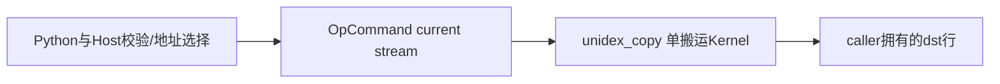

# UniDex索引行拷贝 A3 Direct Invoke 算子知识

## 算子速览

| 项目 | 内容 |
|---|---|
| 实际入口 | `sparsity_driven_kv_offload.unidex_copy_inplace`→`torch.ops.npu.unidex_copy`→手写Host→ACLRT launch；Direct Invoke，无ACLNN pair |
| 计算语义 | 对mask非零且两侧行号合法的映射i，拷贝整行字节`dst[d_i]=src[s_i]`，跳过其他映射 |
| 输入输出 | 连续同dtype的逻辑行buffer、int64行索引、bool/uint8 mask；原地dst，Python返回同对象 |
| 执行类型 | 单AscendC搬运节点，GM→UB→GM；无Cube/Mmad、SIMT或通信算法；硬件搬运primitive属于SDK边界 |
| Kernel 路线 | R-001，四种Tensor/raw基址组合使用同一body；M=0为Host无launch终点 |
| 核心资源 | `TQueBind<VECIN,VECOUT,2>`，UB=`2*align32(row_bytes)`，无workspace |
| 来源闭包 | direct_implementation_closed：Python、schema/注册、Host标量、entry/body、launch helper及legacy构建均闭合 |
| 验证状态 | draft；本次知识提取未执行编译、真机、数值或性能测试 |

## 接口与语义

### 计算语义

输入Tensor按`address_ndims`切成前缀逻辑行和后缀整行载荷。前缀shape乘积为行数，后缀元素数乘element_size为行字节W。src/dst可有不同shape和不同前缀维数，但dtype及W必须一致。Kernel统一转uint8搬运，不做数值转换、布局变换或算术。无效映射保留原dst内容，不填零。

### 输入、输出与属性

| 参数 | shape/layout | dtype | 约束、默认值与语义 |
|---|---|---|---|
| src/dst | 连续Tensor、rank≥2的Python入口 | 同dtype，Host不设额外dtype白名单 | dst可变；没有raw覆盖的一侧须在索引同一NPU |
| src_address_ndims/dst_address_ndims | Python整数 | int | 各满足`1<=n<tensor.dim()`；不支持一维Tensor按该helper分行 |
| src_index/dst_index | `[M]`连续NPU | int64 | Python长度相等；原生pair允许各numel≥显式max_copy |
| valid_mask | `[M]`连续、索引同设备 | bool或uint8 | 0跳过，其他字节真；不是浮点权重 |
| block_dim | 默认8 | int64→uint32 | 必须正且≤UINT32_MAX；Host未按实际核数限制 |
| src_ptr/dst_ptr | 缺省None | 可选正int64地址 | 覆盖该侧真实基址；须传设备可见地址而非CPU host_ptr |
| 返回 | 原dst对象 | 同dst | 原生Torch op返回空；Python另返回dst身份 |

### 入口与版本

固定dda6提交。legacy CMake在`SGL_KERNEL_ENABLE_A3_ONLY_OPS`下编入Host/Kernel，Torch实现同宏门控；默认950关闭该集合。该开关是arch22家族构建控制，本卡只冻结A3，不宣称A2不支持。CANN9.1来自实际kernel CI容器→prepare脚本→`build.sh -a kernels`的构建配置；这是预期构建证据，专属正确性脚本不因此被宣称在CI跑过。无产品级全组合验收结论。

## Host/Launcher 执行流程

### 参数校验与前处理

Python先推导两侧行数/W，检查W、dtype和三元数据numel相等。原生Host按序检查索引/mask的NPU与相同设备；仅未raw覆盖的src/dst检查NPU/device。所有五Tensor仍须连续，src/dst dtype相同，索引一维int64、mask一维bool/uint8。raw地址必须正；行数、W、block_dim正，M非负，W≤32768。

五个标量行数/W/M/G都须落uint32范围；两侧`rows*W`各≤UINT32_MAX，无raw的一侧还检查Tensor有效载荷足够。raw侧不检查外部分配容量，Tensor仅提供元数据，caller负责实际地址范围。全部检查后M=0早返，仍不支持零行数或W=0。没有contiguous复制或数据cast。

### 参数、Workspace 与生命周期

Host取得current NPU stream；对索引/mask及未raw覆盖的Tensor分别record_stream，再把raw整数或data_ptr转真实基址。没有DeviceGuard，调用方须使current设备与索引设备及注册地址所属设备一致。raw地址由外部owner保活至设备完成，Tensor占位对象不会拥有该注册映射；释放规则复用[稀疏KV卸载API](../../../../apis/sgl_kernel_npu/sgl_sparse_kv_offload_primitives.md)。

`EXEC_KERNEL_CMD`把Tensor转换成裸data_ptr，将指针/标量tuple与stream捕获到OpCommand闭包；未按值捕获这些Tensor。record_stream与Host排队对象保活是不同层，调用方仍应按运行时排队/执行契约保留有效对象，不能由闭包存在推导它拥有raw映射。workspace=0，无executor、POD缓冲或主机索引读回。

### 启动图与失败传播



唯一节点参数为五GM地址和四uint32标量，blockDim=G作为launch参数；无跨Kernel workspace边。校验抛错或M=0阻止launch。helper内部没有检查ACLRT launch返回值，闭包固定返回0，实际异常/异步故障传播依赖OpCommand/Runtime；不能把0当数值成功或同步完成。

## Route 与参数设计

### 分核与资源计算

Device用uint32计算`P=(M+G-1)/G`，核c处理`[c*P,min(M,c*P+P))`。这是按映射总数分块，不按有效mask均衡。每核初始化一个两深度队列，每槽A=align32(W)字节，总2A≤65536；没有Host UB可用量查询，要求匹配平台实际容量足够。M+G−1和coreEnd的uint32中间加法有溢出边界，Host只检单值上界并不能消除；不声称极限uint32域都被正确覆盖。

### Route 选择

| 顺序 | Route | Key/模板 | 精确选择条件与优先级 | 不适用去向 |
|---:|---|---|---|---|
| 1 | 无launch终点 | 无 | 全部校验通过且M=0 | 返回dst原值 |
| 2 | R-001 两槽字节行搬运 | KernelUniDexCopy | 全部校验通过且M>0 | 校验失败抛错，无fallback |

```text
校验 → M=0早返
     → M>0：src_ptr/dst_ptr各自选择raw或Tensor基址 → 同一Kernel
```

### 模板/实现执行矩阵

| Route | key/selector | dtype/shape/platform 完整命中条件 | 执行拓扑与 Kernel 节点 | 实际模板/body | 内存与同步特征 | tail/fallback |
|---|---|---|---|---|---|---|
| R-001 | rawSrc/rawDst四种布尔组合，无TilingKey | 上述准入、M>0、A3；dtype仅作元数据一致性 | 单unidex_copy | KernelUniDexCopy::Init/Process/BuildCopyTask/CopyIn/CopyOut | 两槽TQueBind，异步owner按raw组合不同 | coreEnd裁M；映射非法跳过，无替代核 |

四组合的GM地址producer分别为data_ptr/data_ptr、raw/data_ptr、data_ptr/raw、raw/raw；只有Tensor侧执行record_stream，Kernel参数/body、队列与字节extent相同，故不重复成四份Route。

### 隐藏性能 Guard

| Guard | Host/Tiling 条件 | Device/资源原因 | 影响 Route | 不满足时去向 | 源码符号 |
|---|---|---|---|---|---|
| 行预算 | 0<W≤32KiB | 一整行需进UB，两槽2align32(W) | R-001 | 抛错 | Host unidex_copy |
| 寻址 | rows*W≤UINT32_MAX | 行byte offset及GlobalTensor extent使用uint32乘法 | R-001 | 抛错 | CheckFitsUint32/Init |
| metadata容量 | 各numel≥M | 标量读取0..M−1 | R-001 | 抛错 | Host |
| 映射合法 | mask≠0且0≤srcRow<srcRows、0≤dstRow<dstRows | 仅有合法任务进队列 | R-001 | 跳过该i | BuildCopyTask |
| 极限分核 | Host未检M+G−1中间和 | uint32加法不能由每项合法推出不溢出 | R-001 | 无自动fallback | Init/Process |

### POD/ABI

无自定义序列化POD，以下为entry有序参数；生成launch stub的打包offset/alignof不在仓内，不能按普通C结构虚构offset。

| 结构 | 字段 | 类型/位宽 | ABI 布局 | 单位 | Host/launcher producer | Device consumer | 边界 |
|---|---|---|---|---|---|---|---|
| entry | src | GM_ADDR | 参数0，物理封送外部 | byte基址 | src_ptr或src.data_ptr | srcGm | raw容量caller |
| entry | dst | GM_ADDR | 参数1，物理封送外部 | byte基址 | dst_ptr或dst.data_ptr | dstGm | 原地可变 |
| entry | src_index | GM_ADDR | 参数2 | int64序列基址 | ConvertType(src_index) | srcIndexGm.GetValue | M项 |
| entry | dst_index | GM_ADDR | 参数3 | int64序列基址 | ConvertType(dst_index) | dstIndexGm.GetValue | M项 |
| entry | valid_mask | GM_ADDR | 参数4 | uint8序列基址 | ConvertType(valid_mask) | validMaskGm.GetValue | bool按字节 |
| entry | srcRows | uint32/32 | 参数5 | 行 | Host src_rows窄化 | BuildCopyTask/Init | 正 |
| entry | dstRows | uint32/32 | 参数6 | 行 | Host dst_rows窄化 | BuildCopyTask/Init | 正 |
| entry | blockBytes | uint32/32 | 参数7 | byte | Host block_bytes窄化 | Init/CopyIn/Out | 1..32768 |
| entry | maxCopy | uint32/32 | 参数8 | 映射 | Host max_copy窄化 | Init/Process | 正域才launch |
| launch | blockDim | uint32/32 | entry外launch参数 | 核 | Host block_dim窄化 | GetBlockNum/Idx | 未查硬件上限 |

### Route 源码闭包

| Route | Key/selector | Host/Tiling producer | POD/参数 | Kernel entry/router 节点 | Kernel body/直接依赖 | 构建接线 |
|---|---|---|---|---|---|---|
| R-001 | M>0及四raw组合 | ops.py→Host unidex_copy | 上述10项，非POD | unidex_copy | KernelUniDexCopy/AscendC搬运primitive | legacy no_workspace_kernel→sgl_kernel_npu，A3宏 |

## Kernel 实现

### 公共执行流程

entry局部TPipe拥有队列，Init绑定GM字节范围并计算核域，Process只调用标量检查与两向DataCopyPad，不使用Vector算术、dot或额外数值精度路径。SDK队列/搬运/自动同步实现及launch二进制ABI为明确primitive/生成代码边界；没有缺失的算子自有helper。

### Route R-001：两槽字节行搬运

#### 适用条件

##### 选择证据

| 层级 | 文件 | 符号 | 源码谓词/参数 | 结果/下一跳 |
|---|---|---|---|---|
| Python | sparsity_driven_kv_offload/ops.py | unidex_copy_inplace | W相等、dtype相等、metadata等长 | Torch op |
| Host | unidex_copy/op_host/unidex_copy.cpp | unidex_copy | 全部guard且M>0 | EXEC_KERNEL_CMD |
| entry | unidex_copy/op_kernel/unidex_copy_kernel.cpp | unidex_copy | 无key/router分支 | Init→Process |

#### Device 数据流

##### 函数级调用链

```text
Host unidex_copy → EXEC_KERNEL_CMD → ACLRT_LAUNCH_KERNEL(unidex_copy)
  → KernelUniDexCopy::Init(TPipe)
  → Process → BuildCopyTask → CopyIn → queue → CopyOut
```

##### 源码等价伪码

```text
P=u32(M+G-1)/G; begin=u32(core*P); end=min(M,u32(begin+P))
queueHead=queueTail=queued=0; offsets[2]=0
for i in [begin,end):
  if mask[i]==0: continue
  s=srcIndex[i]; d=dstIndex[i]
  if s<0 or d<0 or s>=srcRows or d>=dstRows: continue
  so=u32(s)*W; do=u32(d)*W
  if queued==2:
    dequeue oldest; copy W bytes to dst+offsets[head]; FreeTensor
    head=next(head); queued--
  allocate input slot; GM src+so → UB W bytes; EnQue
  offsets[tail]=do; tail=next(tail); queued++
while queued>0:
  dequeue oldest; copy W bytes to dst+offsets[head]; FreeTensor
  head=next(head); queued--
```

#### 内存与数据搬运

##### 资源与搬运表

| 层级/缓冲区 | offset/地址公式 | extent/容量公式 | dtype/layout | producer | consumer | owner/lifetime | 对齐/复用 |
|---|---|---|---|---|---|---|---|
| GM src | base+s*W | srcRows*W有效byte | uint8解释 | caller | CopyIn | Tensor或raw owner | 连续行，不改dtype |
| GM dst | base+d*W | dstRows*W有效byte | uint8解释 | CopyOut | caller | caller | 非memmove保证 |
| GM indices/mask | i | 8M/8M/M bytes | int64/int64/u8 | caller | BuildCopyTask | caller/stream | scalar GetValue |
| UB copyQue | 两个队列槽 | 各align32(W) byte | TQueBind u8 | DataCopyPad入 | DataCopyPad出 | entry TPipe | depth2，不单列额外outQueue |
| scalar dstOffsets | head/tail取0或1 | 2个uint32逻辑值 | 标量 | 入队时写 | 出队时读 | Process调用内 | 物理寄存器/栈分配外部 |

CopyIn参数`{blockCount=1,blockLen=W,srcStride=0,dstStride=0,rsv=0}`，padding参数`false/0/0/0`；CopyOut同样一次W字节。W非32倍数也可用DataCopyPad；UB槽补齐不意味着复制额外padding到dst。没有NDDMA多维变换。

##### 分层内存布局


##### 字节账与复用顺序

```text
UB_total = 2 * align32(W) * sizeof(uint8) <= 65536 bytes
Host没有读取可用UB；必要条件UB_total<=匹配平台可用UB
dynamic_ub=N/A；workspace_total=0
```

| 复用子区 | 写入者 | 读取者/消费点 | 下一次覆盖 | 同步或释放依据 | 安全条件 |
|---|---|---|---|---|---|
| 单queue槽 | CopyIn MTE2 | CopyOut MTE3 | 下一次AllocTensor | EnQue/DeQue/FreeTensor的SDK队列协议 | 不能在出队前复用或把depth按1计 |
| offsets[2] | 当前有效任务入队 | 同一队列顺序出队 | tail循环回该项 | queued=2先弹旧任务 | invalid任务不推进tail |

#### 同步、精度与尾块

##### 同步与数值边界表

| 阶段 | primitive/机制 | producer | consumer/等待点 | 保护对象 | 精度/尾块 |
|---|---|---|---|---|---|
| GM→UB→GM | TQueBind协议 | CopyIn/EnQue | DeQue/CopyOut/FreeTensor | 两槽载荷 | 逐字节，不cast/归约 |
| 最后队列 | while queued>0 drain | 最后合法输入 | 退出前CopyOut | 待写行 | 不漏最后1/2行 |
| stream | record_stream+current stream launch | Host提交 | 外部完成同步 | Tensor侧storage | raw侧需caller自己保活 |
| 核间 | 无atomic/barrier | 各核映射 | 无串行合并 | dst/source地址冲突 | duplicate dst或跨行alias无确定顺序 |

#### 关键实现

##### 符号证据表

| 阶段 | 文件 | 符号/模板实例 | 实现事实 |
|---|---|---|---|
| Host/Tiling producer | unidex_copy/op_host/unidex_copy.cpp | unidex_copy | rows*W上界、raw地址选择及record_stream |
| Kernel entry/router | unidex_copy/op_kernel/unidex_copy_kernel.cpp | unidex_copy | 本地pipe、Init/Process，无TilingKey |
| Device body/helper | 同上 | BuildCopyTask/CopyIn/CopyOut | 无效跳过，byte-row两槽搬运 |

## 算子特定优化

### Trick T-001：两槽队列保持目标偏移与载荷同序

#### 触发与源码依据

- 适用Route：R-001，队列已有两项且遇到下一个合法映射。
- Golden来源：[队列满先出最早任务](https://github.com/sgl-project/sgl-kernel-npu/blob/dda6d36b0cdb4081e102d14c0a2fb276fc416e69/csrc/sparsity_driven_kv_offload/unidex_copy/op_kernel/unidex_copy_kernel.cpp#L107-L114)。

**官方源码（固定Commit连续逐字摘录）**：

```cpp
            if (queued == BUFFER_NUM) {
                CopyOut(dstOffsets[queueHead]);
                queueHead = NextQueueIndex(queueHead);
                --queued;
            }

            CopyIn(srcOffset);
            dstOffsets[queueTail] = dstOffset;
```

#### 机制与设计原因

两槽使MTE2读入与后续MTE3提交可流水，dstOffsets环与queue顺序配对；先检查映射再入队，mask/越界不浪费整行搬运。它不重排有效任务，亦不均衡稀疏mask负载；不能据队列深度推实测重叠率或加速比。

#### 迁移边界

- 适用：同W字节行的indexed copy，地址在匹配NPU可见。
- 前提：UB双槽预算、队列同步契约及无冲突的caller地址域。
- 失效：重复dst、source/dst重叠或过大分核整数需另设计，源码无自动fallback。
- 未验证：本次知识提取未执行编译、真机、数值或性能测试。

#### 错误做法

固定仓未提供可验证反例；不得把两槽载荷都记成同一个最新dstOffset，也不能用本核代替需要重叠安全语义的memmove。

### Trick T-002：按字节长度处理非对齐行

#### 触发与源码依据

- 适用Route：R-001，1≤W≤32768，包括W非32倍数。
- Golden来源：[单行DataCopyPad与入队](https://github.com/sgl-project/sgl-kernel-npu/blob/dda6d36b0cdb4081e102d14c0a2fb276fc416e69/csrc/sparsity_driven_kv_offload/unidex_copy/op_kernel/unidex_copy_kernel.cpp#L177-L181)。

**官方源码（固定Commit连续逐字摘录）**：

```cpp
        AscendC::LocalTensor<CopyUnit> local = copyQue.AllocTensor<CopyUnit>();
        AscendC::DataCopyExtParams copyParams{1, blockBytes, 0, 0, 0};
        AscendC::DataCopyPadExtParams<CopyUnit> padParams{false, 0, 0, 0};
        AscendC::DataCopyPad(local, srcGm[srcOffset], copyParams, padParams);
        copyQue.EnQue(local);
```

#### 机制与设计原因

W以byte而非元素作blockLen，槽容量另对齐32；不需要将完整KV载荷变成特定dtype的计算Tensor，也不把尾padding写入相邻逻辑行。该机制支持物理注册Host地址与普通设备地址共享同一byte copy body。

#### 迁移边界

- 适用：完全连续、相同W的行载荷；不是任意strided视图拷贝。
- 前提：W/容量/uint32地址guard、匹配DataCopyPad primitive及raw owner。
- 失效：W超过32KiB需另分tile，现Host直接报错。
- 未验证：本次知识提取未执行编译、真机、数值或性能测试。

#### 错误做法

固定仓未提供可验证反例；不能把align32(W)当作有效输出字节数。

## 模板与实现对比

| 对比维度 | R-001 Tensor基址 | R-001含raw覆盖 | 设计选择依据 |
|---|---|---|---|
| 命中条件/优先级 | 对应ptr=None | 对应ptr为正整数 | 逐侧选择，无不同body |
| 模板与 dtype | uint8 copy | 同一uint8 copy | dtype不参与数值计算 |
| 循环与分核 | 按M/G连续映射段 | 相同 | 不按valid数均衡 |
| Queue/TBuf/寄存器/dynamic UB/通信 window | 2align32(W)，无dynamic UB/window | 相同 | 不能因Host内存减UB账 |
| 内存总占用与复用 | Tensor存储caller拥有 | 外部注册存储caller拥有 | owner与地址域不同 |
| 搬运/Vector/SIMT/NDDMA/通信 API | 两向DataCopyPad | 相同 | 无数值算术 |
| 同步、精度与 tail | record_stream，字节精确长度 | raw侧不record_stream | 完成前不得释放 |
| fallback/失败边界 | 校验抛错、非法映射跳过 | 再加外部容量/注册有效前提 | 无自动迁移/回退 |

## 平台差异

| 项目 | A2 | A3 | Ascend 950 |
|---|---|---|---|
| 支持状态 | 宏默认arch22信号，本卡未冻结验收 | 本卡draft源码范围 | 默认legacy A3集合不编入 |
| Host/Launcher | 未作产品推定 | 同步/地址合同如上 | 不凭源文件存在推支持 |
| Kernel/资源 | 不外推 | 2align32(W)必要预算 | 无950正式卡 |

## 限制与失败边界

- shape容量不等于raw分配容量；registered host_ptr与dev_ptr不可混用，进程/设备映射及完成同步见卸载API。
- 同一dst被多个映射/核写、source与dst重叠或被其他stream修改时，没有atomic/依赖分析或memmove保证。
- 当前设备、raw注册设备及索引NPU须一致；Host没有自动切设备，block_dim没有硬件核数上限检查。
- uint32分核中间和可能溢出；非空metadata也未防止所有极限blockDim launch，保持draft，不把源码闭合当运行正确。
- 专属测试定义FP16对齐/非对齐行、三种raw覆盖、注册H2D/D2H、M0与错误索引dtype；测试同步后释放映射。没有本次执行、图捕获或性能结果。

## 源码索引

### 链路索引

下列相对路径均属于固定dda6的sgl-kernel-npu。

| 链路阶段 | 文件 | 关键符号 | 支撑内容 |
|---|---|---|---|
| 入口声明/约束 | python/sgl_kernel_npu/sgl_kernel_npu/sparsity_driven_kv_offload/ops.py | unidex_copy_inplace | 逻辑行推导/返回dst |
| 包入口 | python/sgl_kernel_npu/sgl_kernel_npu/sparsity_driven_kv_offload/__init__.py | exports | 公开导出 |
| 包装载 | python/sgl_kernel_npu/sgl_kernel_npu/__init__.py | _load_sgl_kernel_npu | 原生库依赖 |
| Torch ABI | csrc/pytorch_extensions.cpp | unidex_copy schema/impl | dst变更标记与宏 |
| Host | csrc/sparsity_driven_kv_offload/unidex_copy/op_host/unidex_copy.cpp | unidex_copy | 参数/地址/生命周期 |
| entry/body | csrc/sparsity_driven_kv_offload/unidex_copy/op_kernel/unidex_copy_kernel.cpp | KernelUniDexCopy | 分核/queue/搬运 |
| launcher | csrc/utils/torch_helper.h | EXEC_KERNEL_CMD | 参数转换/闭包/返回边界 |
| 声明宏 | csrc/utils/defines.h | HOST_API | 可见性 |
| 构建 | cmake/legacy_kernels.cmake | no_workspace_kernel/OP_PLUGIN_NAME | Host+Kernel+库接线 |
| 场景 | csrc/sparsity_driven_kv_offload/README.md | primitive data path | 单进程单NPU部署 |
| 测试 | tests/python/sgl_kernel_npu/test_unidex_copy.py | TestUnidexCopy | 定义用例 |
| 构建矩阵 | .github/workflows/pr-test-kernels.yml | CANN9.1/A3 | 预期CI配置 |
| CI调用 | .github/workflows/pr-test-kernel-group.yml | prepare step | 容器到脚本 |
| CI构建 | scripts/prepare_kernel_tests.sh | build.sh -a kernels | legacy构建，无本次执行 |
| 专属入口 | scripts/sparsity_driven_kv_offload/test_unidex_shm.sh | unit/smoke | 同步与设备选择测试协议 |

### 实现复用检查

| 检查项 | 可复用事实 | 不得改变的约束 | 源码符号 |
|---|---|---|---|
| ABI/POD | 五指针+四u32，G在launch | 参数顺序、W单位byte | entry |
| 调用顺序 | 校验→record_stream→launch | M0也先校验 | Host |
| workspace/内存 | 0workspace、双槽UB | depth2及raw owner | Init |
| 同步 | queue FIFO+环形dst偏移 | 入队/出队同步与完成前保活 | Process |
| 精度与尾块 | uint8整行有效W | 不写align padding、不cast | CopyIn/Out |
| 失败边界 | 非法映射跳过，Host错误抛出 | 不补造冲突/溢出/launch成功保证 | BuildCopyTask/EXEC_KERNEL_CMD |
