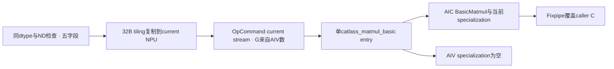
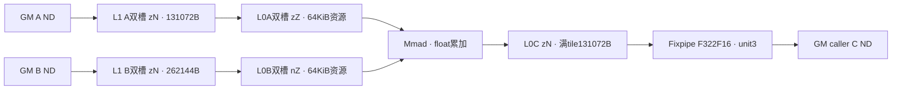
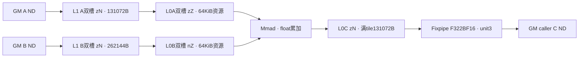
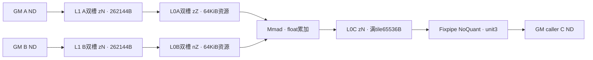

# CATLASS基础矩阵乘 A2/A3 Direct Invoke 算子知识

## 算子速览

| 项目 | 内容 |
|---|---|
| 实际入口 | `torch.ops.npu.catlass_matmul_basic(a,b,out,format_mode=None)`，caller输出、返回空；独立Direct Invoke |
| 计算语义 | C[M,N]=A[M,K]×B[K,N]，不加旧C、无bias/activation/scale |
| 输入输出 | 三Tensor同FP16/BF16/FP32，Device紧密RowMajor；Host只支持ND |
| 执行类型 | 单entry的AIC_CUBE计算；BasicMatmul<AIV>为空，不虚构Vector epilogue；launch封装比例依赖匹配codegen元数据 |
| Kernel 路线 | R-001 FP16、R-002 BF16、R-003 FP32；无NZ或不同数学fallback |
| 核心资源 | AtlasA2资源对象整层申请L1 512KiB/L0A64KiB/L0B64KiB/L0C128KiB/UB192KiB/BT1KiB/FIX7KiB；实际mainloop子区见后文 |
| 来源闭包 | direct_implementation_closed：SGL Host/POD/entry、gitlink精确70eda CATLASS当前实例、copy/mainloop/Mmad/Fixpipe、构建闭合 |
| 验证状态 | draft；本次知识提取未执行编译、真机、数值或性能测试 |

## 接口与语义

### 计算语义

A/B/C全部按紧密行主序解释，A stride=(K,1)、B/C stride=(N,1)，不读取Torch Tensor stride。每个MN tile独立遍历全部K：第一K分片将L0C初始化0，之后累加，最后Fixpipe覆盖caller C。三类型累加器均float；FP16/BF16在Fixpipe以F322F16/F322BF16转换，FP32 NoQuant。没有alpha/beta、旧C读入或自动转置语义。FP32 Mmad受匹配运行环境HF32开关/转换模式影响，当前entry和选中库链未显式设置它，不能从float输入/输出推导全精度或固定舍入状态。

### 输入、输出与属性

| 参数 | shape/layout | dtype | 约束、默认值与语义 |
|---|---|---|---|
| input_a | 预期[M,K]连续同NPU | Half/BF16/Float | Host未显式检查rank/stride/device/正维度；size0/1读为int32 |
| input_b | 预期[K,N]连续同NPU | 与A完全相同 | Host检查B.size0==窄化后K；不做Transpose/Contiguous |
| output_c | caller[M,N]紧密 | 与A/B相同 | Host只校验dtype，不检查shape/容量/alias；返回空，实际写入 |
| format_mode | optional string | None默认ND | ND通过，NZ被专门拒绝，其他字符串由GetModeVal抛错；注释“use default”不代表未知值fallback |

### 入口与版本

固定SGL dda6的git tree把third_party/catlass固定到70eda，本卡用这个实例版本，不使用DeepEP950的v1.6.1或MegaMoe的v2。CMake显式BUILD_CATLASS_MODULE=ON时才添加Host、注册与独立catlass_workspace_kernel target，默认OFF；分离target的原因是避免sparse_attention_score自带tla头覆盖CATLASS同名头。CANN9.1作为固定legacy CI配置与匹配SDK基线，不是本次编译事件，安装库还需满足该可选构建。

平台按固定AtlasA2实现与arch22集成冻结A2/A3；通用基础入口本身未提供950产品支持表，本卡不把basic target在950构建列表存在提升为该库specialization已验收。与[softFP8接口](../../../../apis/sgl_kernel_npu/sgl_softfp8_w8a16_matmul.md)是不同数学/输出ABI：这里不解码FP8、不接scale，C由caller提供。

## Host/Launcher 执行流程

### 参数校验与前处理

先要求aType==bType==cType且仅Half/BF16/Float；解析format默认ND，未知字符串抛错，NZ也抛“current ops only support weightFormat ND”。随后M=A.size0、K=A.size1、N=B.size1窄化int32，检查B.size0==K；没有C shape、二维/连续性、同NPU/设备、空维和32位范围完整guard。

get_tiling查询PlatformAscendCManager的AIV数G（源码确实不是AIC数），分配32B CPU byte Tensor，赋五POD字段，再pin_memory复制到current NPU。Host在A所在设备分配1 byte workspace并传entry，Device完全不读gmWorkspace。没有框架Matmul、Cast或layout transform节点；ND→zN发生在Device搬运。

### 参数、Workspace 与生命周期

POD普通ABI sizeof32/align8，m/n/k各int32占0/4/8，12..15为padding，weight_format_mode int64@16、data_format_mode int64@24；28B字段写入、4B padding未初始化，运输32B。Device将m/n/k读为uint32，负/溢出值不会在entry自动修复；weight_format_mode字段Device未使用。

EXEC_KERNEL_CMD捕获current stream及转换后的裸指针tuple，没有DeviceGuard、显式record_stream或Tensor对象捕获。A/B/C caller、Host局部tiling/workspace的异步寿命需满足匹配Torch NPU分配器/OpCommand协议；copy设备与workspace设备来源不同，caller须使current NPU与输入一致。固定源码不能证明安装二进制、allocator或生成stub内部，不据此断言已发生UAF。

### 启动图与失败传播



| 节点/边 | producer/consumer | extent与ordering | owner/失败传播 |
|---|---|---|---|
| 参数前处理 | Host→entry | 32B POD，生成ACLRT五GM地址A/B/C/workspace/tiling | Host局部Tensor，current-device异步复制；不是核心算子节点 |
| 唯一核心节点 | ACLRT→BasicMatmul::operator()<AIC> | G blocks，循环步长GetBlockNum，内部显式pipe事件/UnitFlag | callerGM；helper忽略ACLRT返回并固定0，不等于设备完成 |
| AIV分支 | 同entry→operator()<AIV> | 空body，无UB epilogue数据流 | 不补造AIC/AIV workspace交接 |
| workspace | Host1byte→形参 | Device未读 | 不需要UserWorkspace offset或系统16MiB切片 |

实际AIC/AIV封装与block调度限制由匹配codegen/Runtime决定；源码G来自AIV查询，不把它改写成已按AIC数限界，也不臆测该差异必然启动失败。

## Route 与参数设计

### 分核与资源计算

2B输入采用L1tile(128,256,256)、L0tile(128,256,64)；4B float采用(128,128,256)/(128,128,64)。scheduler固定GemmIdentityBlockSwizzle<3,0>：TM=ceil(M/128)、TN=ceil(N/tileN)，total=TM*TN；block c执行task=c,c+G,…<total，无splitK。每task实际M/N裁尾，K仍全K。

Zn蛇形映射：group=task/(3*TN)、inner=task%(3*TN)，rows=最后group的剩余TM或3；mTile=3*group+inner%rows、nTile=inner/rows，奇group令nTile=TN−1−nTile。GM offset A=128*mTile*K、B=tileN*nTile、C=128*mTile*N+tileN*nTile。

当前3Route L1/L0tile的M/N相同，mPartLoop/nPartLoop在正常tile均1；K按256的L1 tile与64的L0分片循环，先预载当前，再在计算前异步预载下一L1槽。2B L1有效2*(65536+131072)=393216B，float有效2*(131072+131072)=524288B；不能把物理Resource整512KiB申请与有效子区混为一项。每层详见Route。

### Route 选择

| 顺序 | Route | Key/模板 | 精确选择条件与优先级 | 不适用去向 |
|---:|---|---|---|---|
| 1 | R-002 BF16 | data_format_mode==0 | Host同BF16/ND，entry首先检查BF16 | FP16 |
| 2 | R-001 FP16 | mode==1 | Host同Half/ND | FP32 |
| 3 | R-003 FP32 | mode==2 | Host同Float/ND | 未知mode直接return，不写C |

```text
Host同dtype合法→format None/ND；NZ/未知字符串throw→M/K/N检查与POD
entry BF16→case2；else FP16→case1；else FP32→case3；else return
每实例BasicMatmul AIC计算，AIV为空；没有其他dtype/格式fallback
```

### 模板/实现执行矩阵

| Route | key/selector | dtype/shape/platform 完整命中条件 | 执行族与 kernel 节点 | 实际模板/body | 内存与同步特征 | tail/fallback |
|---|---|---|---|---|---|---|
| R-001 | mode1 | A2/A3，Host同Half、ND且K匹配；真实几何/设备caller保证 | 单AIC主计算/AIV空 | BasicMatmul<BlockMmad_case1,void,Swizzle<3,0>> | L1有效384KiB、L0A/B pingpong、UnitFlag true | MN裁尾、K256/64尾；无NZ |
| R-002 | mode0 | 同上、BF16 | 同节点 | BlockMmad_case2，GemmType<__bf16,RowMajor>三项 | 与half容量同，Fixpipe F322BF16 | BF16精度不同，不当FP16位等价 |
| R-003 | mode2 | 同上、Float | 同节点 | BlockMmad_case3，GemmType<float,RowMajor> | L1有效512KiB、Float LoadData3D特化 | HF32状态外部，MN/K尾按实际参数 |

### 隐藏性能 Guard

| Guard | Host/Tiling 条件 | Device/资源原因 | 影响 Route | 不满足时去向 | 源码符号 |
|---|---|---|---|---|---|
| ND | Host明确拒NZ/未知字符串 | 当前三实例全部RowMajor | 全部 | 抛错，无layout转换 | GetModeVal/Host |
| dtype | 三Tensor同Half/BF16/Float | Typed GEMM与Fixpipe | 各自 | 抛错，非法PODmode才Device return | Host/entry |
| 层级容量 | 编译期static_assert，无Host动态检查 | 双L1、两32KiB L0A/B槽、L0C | 三者 | 模板不满足时编译拒绝；未执行编译 | BlockMmad constants |
| GM stride | stride<65536走一条ND2NZ，否则逐行 | Nd2NzParams srcDValue限界 | 全部 | source自有逐行fallback | CopyGmToL1 |
| 有效shape | Host无正值/范围/C容量检查 | uint32 dims与scheduler/首次Copy | 全部 | 无空K修复，见限制 | Host/BlockMmad |
| UnitFlag | 模板true | 512B单元状态与Fixpipe配对 | 全部 | 未提供关闭开关fallback | BlockMmad/SDK UnitFlag |

### POD/ABI

| 结构 | 字段 | 类型/位宽 | ABI 布局 | 单位 | Host/launcher producer | Device consumer | 边界 |
|---|---|---|---|---|---|---|---|
| KernelCatlassMatmulTilingData | m | int32/32 | off0；sizeof32/align8 | 行 | int32(A.size0) | entry读uint32→problemShape/layoutA/C | 无范围guard |
| 同上 | n | int32/32 | off4 | 列 | int32(B.size1) | entry→layoutB/C与scheduler | 同上 |
| 同上 | k | int32/32 | off8 | 归约元素 | int32(A.size1) | entry→problemShape K/布局stride | 零K未拒绝 |
| 同上 | weight_format_mode | int64/64 | off16 | enum | GetModeVal ND0 | Device不读取 | inactive，不能当Device NZ guard |
| 同上 | data_format_mode | int64/64 | off24 | enum | dTypeMap BF160/Half1/Float2 | entry三分支 | 未知值return |

普通ABI为源码类型布局推导，非offsetof实测；字段内默认初始化表达式不代表原始at::empty byte Tensor调用了C++构造，Host已显式赋值五字段。Device局部Params含problemShape、ptrA/layoutA、ptrB/layoutB、ptrC/layoutC，各GM/RowMajor值在entry按紧密矩阵显式构造；Arguments对象创建但未调用CanImplement/ToUnderlyingArguments，也无额外资源guard。

### Route 源码闭包

| Route | Key/selector | Host/Tiling producer | POD/参数 | Kernel entry/router | Kernel body/直接依赖 | 构建接线 |
|---|---|---|---|---|---|---|
| R-001 | FP16 1 | SGL Host/get_tiling | 五字段32B | SGL catlass_matmul_basic case1 | CATLASS70eda BasicMatmul、Pingpong<true>、half copy/MM/Fixpipe | 独立catlass_workspace_kernel+gitlink70eda |
| R-002 | BF16 0 | 同Host | 同POD | case2 | BF16实际specialization与F322BF16 | 同target |
| R-003 | FP32 2 | 同Host | 同POD | case3 | float LoadData3D、Mmad、NoQuant Fixpipe | 同target，无950实现替换 |

## Kernel 实现

### 公共执行流程

BasicMatmul AIC构建scheduler、Resource和BlockMmad；每个MN task取实际尾shape及GM offset，调用选中Pingpong mainloop；结束PIPE_ALL。AIV specialization空。Resource成员申请整L1/L0/UB/BT/FIX各层，构造体再pipe.Destroy以释放TPipe自动同步状态；BlockMmad使用其中的显式byte子区并自己管理event。不把未用UB/BT/FIX描述成数学Vector阶段，也不省略这些源码声明的资源对象。实际编译器能否消除未使用资源初始化本次未验证。

mainloop事件：L1 A槽0/1、B槽2/3用MTE1_MTE2保护复用，MTE2_MTE1保护载入完成；L0 A槽0/1、B槽2/3用M_MTE1保护Mmad后重载。MTE1_M event0等LoadData完成后才Mmad。UnitFlag=true：每个非末Mmad设2，最终K/M/N分片设3；Fixpipe设3。源码构造还预置FIX_M0，析构等待各L1/L0事件和FIX_M0，不复制!ENABLE_UNIT_FLAG分支的M_FIX显式屏障来解释当前实例。

### Route R-001：half ND pingpong

#### 适用条件

##### 选择证据

| 层级 | 文件 | 符号 | 源码谓词/参数 | 结果/下一跳 |
|---|---|---|---|---|
| Host | SGL catlass_matmul_basic.cpp | catlass_matmul_basic | 三Tensor同half且ND、K匹配 | get_tiling dtype code |
| entry | SGL catlass_matmul_basic_kernel.cpp | BlockMmad_case1 | dtype分支，L1(128,256,256)/L0(128,256,64) | BasicMatmul |
| library | CATLASS basic_matmul.hpp / block_mmad_pingpong.hpp | AIC operator / Pingpong<true> | AtlasA2、STAGES2、void epilogue、RowMajor A/B/C | 当前half copy/Mmad/F322F16 |

#### Device 数据流

##### 函数级调用链

```text
SGL Host→get_tiling→EXEC_KERNEL_CMD→catlass_matmul_basic
 →BasicMatmul<BlockMmad<Pingpong<true>,L1(128,256,256),L0(128,256,64),GemmType<half,RowMajor>×3>,void,Swizzle<3,0>>
 →operator()<AIC>→Resource/BlockMmad→每MN task BlockMmad::operator()
 →CopyGmToL1 A/B→CopyL1ToL0A/B→TileMmad→CopyL0CToGm F322F16
 →PIPE_ALL→BlockMmad析构事件drain
AIV operator为空；无跨AIC/AIV数据边或算法workspace
```

##### 源码等价伪码

```text
伪码；当前T=half，tileN=256；stage索引初始0
for task=blockIdx;task<ceil(M/128)*ceil(N/256);task+=GetBlockNum():
  (mi,ni)=Swizzle<3,0>(task)；a=A[128*mi*K]；b=B[256*ni]；c=C[128*mi*N+256*ni]
  ma=min(128,M-128*mi)；na=min(256,N-256*ni)
  mr=up16(ma)；nr=up16(na)；ka=min(K,256)
  wait MTE1_MTE2(Acur,Bcur)；ND2NZ Copy当前A[ma,ka],B[ka,na]；set MTE2_MTE1
  for kTile=0..ceil(K/256)-1:
    nxt=(cur+1)%2
    if kTile不是末tile:
      wait nxt L1复用；Copy下一Ktile到nxt；set nxt MTE2_MTE1
    for mPart=0..ceil(mr/128)-1:                 # 当前实例正常恰1
      for kp=0..ceil(ka/64)-1:
        kk=min(64,ka-64*kp)
        wait L0A M_MTE1；首m/kPart wait当前A MTE2_MTE1
        LoadData A L1→L0A；末m/kPart set A MTE1_MTE2
        for nPart=0..ceil(nr/256)-1:         # 正常恰1
          wait L0B M_MTE1；首k/nPart wait B MTE2_MTE1
          LoadData B L1→L0B；末k/nPart set B MTE1_MTE2
          set/wait MTE1_M0
          initC=(kTile==0 && kp==0)
          unit=3 iff 当前是最后Ktile/mPart/kPart/nPart，otherwise2
          Mmad<float,half,half>(L0C,L0A,L0B,{mPartActual,nPartActual,kk,initC,unit})
          if (mPartActual/16)*(nPartActual/16)<10: PIPE_M
          set L0B M_MTE1；L0B槽轮换
        set L0A M_MTE1；L0A槽轮换
    cur=nxt；ka=下一Ktile真实长度
  Fixpipe(C, L0C, mSize=ma,nSize=na, dstStride=N,quant=F322F16,unit=3)
PIPE_ALL；析构wait每槽MTE1_MTE2/M_MTE1与FIX_M0
```

#### 内存与数据搬运

##### 资源与搬运表

| 层级/缓冲区 | offset/地址公式 | extent/容量公式 | dtype/layout | producer | consumer | owner/lifetime | 对齐/复用 |
|---|---|---|---|---|---|---|---|
| GM A/B/C | 上述tile基址与紧密K/N stride | A MK、B KN、C MN元素 | half RowMajor | caller/MTE/Fixpipe | Copy/caller | caller异步寿命 | 没有通用Torch stride |
| L1 A0/A1 | 0、65536B | 各65536B | half zN | ND2NZ | LoadData A | Resource整512KiB、当前task | MTE1_MTE2复用 |
| L1 B0/B1 | 131072、262144B | 各131072B | half zN | ND2NZ | LoadData B | 同Resource | B槽event2/3 |
| L0A | 槽0/32768B | Resource65536B，两slot；每满tile128*64*2=16384B | half zZ | LoadData | Mmad | Resource | M_MTE1 event0/1 |
| L0B | 槽0/32768B | Resource65536B；每tile64*256*2=32768B | half nZ | LoadData | Mmad | Resource | event2/3 |
| L0C | 0 | Resource131072B；当前满tile131072B | FP32 zN | Mmad | Fixpipe | Resource一个acc区 | UnitFlag每512B，跨K累加 |
| UB/BT/FIX | 各Resource起点 | 196608/1024/7168B声明申请 | byte资源对象 | LocalTensorBuffer | 当前算法无UB/BT算术consumer | Resource | 不虚构Vector队列或量化scale表 |
| GM tiling/ws | 0 | 32B / 1B | byte | Host | tiling五字段/ws不读 | Host局部Tensor | 无算法workspace切片 |

GM→L1当前CopyGmToL1<AtlasA2,RowMajor>用Nd2NzParams：ndNum1、dValue真实列数、srcDValue原全行stride、dstNzC0Stride=layoutDst.stride3/(32/2)，dstNzNStride=stride0/(32/2)。src行stride<65536一次搬整tile，否则每行ndNum/nValue1、srcDValue0，dst每行偏移32/2元素，源按完整stride递进。无Host额外“长stride拒绝”。
L1→L0A用LoadData2D，ifTranspose=false，repeatTimes=L0布局shape3，srcStride=L1.stride3/每512B元素数，dstGap=L0.stride3/该元素数−1，按shape1循环；L1→L0B用ifTranspose=true，repeatTimes=ceil(orgN/(32/2))，按ceil(orgK/16)循环。sid0/addrMode0，所有地址从真实fractal layout产生。

##### 分层内存布局



当前没有Vector子段，不补造block-beta UB队列。UB资源声明与算法未消费是两回事。

##### 字节账、交接边与复用顺序

```text
L1有效=2*65536+2*131072=393216B <= AtlasA2 L1 524288B（实际整层申请）
L0A/B分别整65536B；两32768B槽，各当前tile不超槽
L0C满tile=131072B <= 整层131072B；无double L0C
Resource另声明UB196608/BT1024/FIX7168B，不当有效Vector数据
算法workspace=0；HostGM占用另含32B tiling+1B未使用workspace
```

| 边/复用子区 | producer | offset/extent | dtype/layout | consumer | ordering/sync | owner/lifetime | 安全条件 |
|---|---|---|---|---|---|---|---|
| L1两槽 | MTE2预载 | A/B固定byte子区 | half zN | 当前/下一Ktile LoadData | MTE1_MTE2→MTE2_MTE1 | Resource | 下一tile只写nxt空槽 |
| L0A/B槽 | MTE1 LoadData | 0/32768B | zZ/nZ | Mmad | M_MTE1复用与MTE1_M ready | Resource | Mmad读完才重装 |
| L0C | Mmad init/acc | 单acc区 | FP32 zN | Fixpipe | unit2占用累加、最后unit3可读、Fixpipe3释放 | Resource | 保持512B覆盖配对及相同顺序 |
| GM C | Fixpipe | ma×na，完整N stride | half ND | caller | Kernel PIPE_ALL；外部流完成由caller等待 | caller | 不写MN padding区 |

#### 同步、精度与尾块

##### 同步与数值边界表

| 阶段 | primitive/机制 | producer | consumer/等待点 | 保护对象 | 精度/尾块 |
|---|---|---|---|---|---|
| GM→L1→L0 | MTE2_MTE1与双槽复用event | ND2NZ | LoadData | 两L1槽 | 真实GM tile ma/na/kActual；fractal padding由primitive合同处理 |
| L0→Mmad | MTE1_M0 | LoadData A/B | Mmad | 两L0槽 | 全float accumulator，initC只首K分片 |
| Mmad连发 | 小矩阵PIPE_M阈值 | 前次Mmad | 后次Mmad | L0C | (m/16)*(n/16)<10时显式barrier |
| Mmad/Fixpipe | UnitFlag true | unit2/最后3 | Fixpipe3 | 512B L0C单元 | 原子状态不是跨核flag，不能替换为AIC/AIV通信 |
| 输出 | Fixpipe F322F16/relu false | FP32 L0C | caller C | 有效ma/na | rounding以匹配SDK为准，不假定Vector CAST_RINT |
| 尾域 | mRound/up16、nRound/up16，K256/64裁尾 | scheduler/mainloop | 同typed copy/Mmad | 最后tile | Fixpipe只输出真实ma/na；K0无有效acc producer |

#### 关键实现

##### 符号证据表

| 阶段 | 文件 | 符号/模板实例 | 实现事实 |
|---|---|---|---|
| Host/Tiling producer | SGL catlass_matmul_basic.cpp | get_tiling/catlass_matmul_basic | G来自AIV、32B字段与ND guard |
| Kernel entry/router | SGL catlass_matmul_basic_kernel.cpp | 当前half实例 | tile(128,256,256)/(128,256,64) |
| Device body/helper | CATLASS BasicMatmul/Pingpong/copy/TileMmad/Fixpipe | 当前half traits与方法 | 蛇形调度、双L1/L0、UnitFlag与实际输出 |

### Route R-002：__bf16 ND pingpong

#### 适用条件

##### 选择证据

| 层级 | 文件 | 符号 | 源码谓词/参数 | 结果/下一跳 |
|---|---|---|---|---|
| Host | SGL catlass_matmul_basic.cpp | catlass_matmul_basic | 三Tensor同__bf16且ND、K匹配 | get_tiling dtype code |
| entry | SGL catlass_matmul_basic_kernel.cpp | BlockMmad_case2 | dtype分支，L1(128,256,256)/L0(128,256,64) | BasicMatmul |
| library | CATLASS basic_matmul.hpp / block_mmad_pingpong.hpp | AIC operator / Pingpong<true> | AtlasA2、STAGES2、void epilogue、RowMajor A/B/C | 当前__bf16 copy/Mmad/F322BF16 |

#### Device 数据流

##### 函数级调用链

```text
SGL Host→get_tiling→EXEC_KERNEL_CMD→catlass_matmul_basic
 →BasicMatmul<BlockMmad<Pingpong<true>,L1(128,256,256),L0(128,256,64),GemmType<__bf16,RowMajor>×3>,void,Swizzle<3,0>>
 →operator()<AIC>→Resource/BlockMmad→每MN task BlockMmad::operator()
 →CopyGmToL1 A/B→CopyL1ToL0A/B→TileMmad→CopyL0CToGm F322BF16
 →PIPE_ALL→BlockMmad析构事件drain
AIV operator为空；无跨AIC/AIV数据边或算法workspace
```

##### 源码等价伪码

```text
伪码；当前T=__bf16，tileN=256；stage索引初始0
for task=blockIdx;task<ceil(M/128)*ceil(N/256);task+=GetBlockNum():
  (mi,ni)=Swizzle<3,0>(task)；a=A[128*mi*K]；b=B[256*ni]；c=C[128*mi*N+256*ni]
  ma=min(128,M-128*mi)；na=min(256,N-256*ni)
  mr=up16(ma)；nr=up16(na)；ka=min(K,256)
  wait MTE1_MTE2(Acur,Bcur)；ND2NZ Copy当前A[ma,ka],B[ka,na]；set MTE2_MTE1
  for kTile=0..ceil(K/256)-1:
    nxt=(cur+1)%2
    if kTile不是末tile:
      wait nxt L1复用；Copy下一Ktile到nxt；set nxt MTE2_MTE1
    for mPart=0..ceil(mr/128)-1:                 # 当前实例正常恰1
      for kp=0..ceil(ka/64)-1:
        kk=min(64,ka-64*kp)
        wait L0A M_MTE1；首m/kPart wait当前A MTE2_MTE1
        LoadData A L1→L0A；末m/kPart set A MTE1_MTE2
        for nPart=0..ceil(nr/256)-1:         # 正常恰1
          wait L0B M_MTE1；首k/nPart wait B MTE2_MTE1
          LoadData B L1→L0B；末k/nPart set B MTE1_MTE2
          set/wait MTE1_M0
          initC=(kTile==0 && kp==0)
          unit=3 iff 当前是最后Ktile/mPart/kPart/nPart，otherwise2
          Mmad<float,__bf16,__bf16>(L0C,L0A,L0B,{mPartActual,nPartActual,kk,initC,unit})
          if (mPartActual/16)*(nPartActual/16)<10: PIPE_M
          set L0B M_MTE1；L0B槽轮换
        set L0A M_MTE1；L0A槽轮换
    cur=nxt；ka=下一Ktile真实长度
  Fixpipe(C, L0C, mSize=ma,nSize=na, dstStride=N,quant=F322BF16,unit=3)
PIPE_ALL；析构wait每槽MTE1_MTE2/M_MTE1与FIX_M0
```

#### 内存与数据搬运

##### 资源与搬运表

| 层级/缓冲区 | offset/地址公式 | extent/容量公式 | dtype/layout | producer | consumer | owner/lifetime | 对齐/复用 |
|---|---|---|---|---|---|---|---|
| GM A/B/C | 上述tile基址与紧密K/N stride | A MK、B KN、C MN元素 | __bf16 RowMajor | caller/MTE/Fixpipe | Copy/caller | caller异步寿命 | 没有通用Torch stride |
| L1 A0/A1 | 0、65536B | 各65536B | __bf16 zN | ND2NZ | LoadData A | Resource整512KiB、当前task | MTE1_MTE2复用 |
| L1 B0/B1 | 131072、262144B | 各131072B | __bf16 zN | ND2NZ | LoadData B | 同Resource | B槽event2/3 |
| L0A | 槽0/32768B | Resource65536B，两slot；每满tile128*64*2=16384B | __bf16 zZ | LoadData | Mmad | Resource | M_MTE1 event0/1 |
| L0B | 槽0/32768B | Resource65536B；每tile64*256*2=32768B | __bf16 nZ | LoadData | Mmad | Resource | event2/3 |
| L0C | 0 | Resource131072B；当前满tile131072B | FP32 zN | Mmad | Fixpipe | Resource一个acc区 | UnitFlag每512B，跨K累加 |
| UB/BT/FIX | 各Resource起点 | 196608/1024/7168B声明申请 | byte资源对象 | LocalTensorBuffer | 当前算法无UB/BT算术consumer | Resource | 不虚构Vector队列或量化scale表 |
| GM tiling/ws | 0 | 32B / 1B | byte | Host | tiling五字段/ws不读 | Host局部Tensor | 无算法workspace切片 |

GM→L1当前CopyGmToL1<AtlasA2,RowMajor>用Nd2NzParams：ndNum1、dValue真实列数、srcDValue原全行stride、dstNzC0Stride=layoutDst.stride3/(32/2)，dstNzNStride=stride0/(32/2)。src行stride<65536一次搬整tile，否则每行ndNum/nValue1、srcDValue0，dst每行偏移32/2元素，源按完整stride递进。无Host额外“长stride拒绝”。
L1→L0A用LoadData2D，ifTranspose=false，repeatTimes=L0布局shape3，srcStride=L1.stride3/每512B元素数，dstGap=L0.stride3/该元素数−1，按shape1循环；L1→L0B用ifTranspose=true，repeatTimes=ceil(orgN/(32/2))，按ceil(orgK/16)循环。sid0/addrMode0，所有地址从真实fractal layout产生。

##### 分层内存布局



当前没有Vector子段，不补造block-beta UB队列。UB资源声明与算法未消费是两回事。

##### 字节账、交接边与复用顺序

```text
L1有效=2*65536+2*131072=393216B <= AtlasA2 L1 524288B（实际整层申请）
L0A/B分别整65536B；两32768B槽，各当前tile不超槽
L0C满tile=131072B <= 整层131072B；无double L0C
Resource另声明UB196608/BT1024/FIX7168B，不当有效Vector数据
算法workspace=0；HostGM占用另含32B tiling+1B未使用workspace
```

| 边/复用子区 | producer | offset/extent | dtype/layout | consumer | ordering/sync | owner/lifetime | 安全条件 |
|---|---|---|---|---|---|---|---|
| L1两槽 | MTE2预载 | A/B固定byte子区 | __bf16 zN | 当前/下一Ktile LoadData | MTE1_MTE2→MTE2_MTE1 | Resource | 下一tile只写nxt空槽 |
| L0A/B槽 | MTE1 LoadData | 0/32768B | zZ/nZ | Mmad | M_MTE1复用与MTE1_M ready | Resource | Mmad读完才重装 |
| L0C | Mmad init/acc | 单acc区 | FP32 zN | Fixpipe | unit2占用累加、最后unit3可读、Fixpipe3释放 | Resource | 保持512B覆盖配对及相同顺序 |
| GM C | Fixpipe | ma×na，完整N stride | __bf16 ND | caller | Kernel PIPE_ALL；外部流完成由caller等待 | caller | 不写MN padding区 |

#### 同步、精度与尾块

##### 同步与数值边界表

| 阶段 | primitive/机制 | producer | consumer/等待点 | 保护对象 | 精度/尾块 |
|---|---|---|---|---|---|
| GM→L1→L0 | MTE2_MTE1与双槽复用event | ND2NZ | LoadData | 两L1槽 | 真实GM tile ma/na/kActual；fractal padding由primitive合同处理 |
| L0→Mmad | MTE1_M0 | LoadData A/B | Mmad | 两L0槽 | 全float accumulator，initC只首K分片 |
| Mmad连发 | 小矩阵PIPE_M阈值 | 前次Mmad | 后次Mmad | L0C | (m/16)*(n/16)<10时显式barrier |
| Mmad/Fixpipe | UnitFlag true | unit2/最后3 | Fixpipe3 | 512B L0C单元 | 原子状态不是跨核flag，不能替换为AIC/AIV通信 |
| 输出 | Fixpipe F322BF16/relu false | FP32 L0C | caller C | 有效ma/na | rounding以匹配SDK为准，不假定Vector CAST_RINT |
| 尾域 | mRound/up16、nRound/up16，K256/64裁尾 | scheduler/mainloop | 同typed copy/Mmad | 最后tile | Fixpipe只输出真实ma/na；K0无有效acc producer |

#### 关键实现

##### 符号证据表

| 阶段 | 文件 | 符号/模板实例 | 实现事实 |
|---|---|---|---|
| Host/Tiling producer | SGL catlass_matmul_basic.cpp | get_tiling/catlass_matmul_basic | G来自AIV、32B字段与ND guard |
| Kernel entry/router | SGL catlass_matmul_basic_kernel.cpp | 当前__bf16实例 | tile(128,256,256)/(128,256,64) |
| Device body/helper | CATLASS BasicMatmul/Pingpong/copy/TileMmad/Fixpipe | 当前__bf16 traits与方法 | 蛇形调度、双L1/L0、UnitFlag与实际输出 |

### Route R-003：float ND pingpong

#### 适用条件

##### 选择证据

| 层级 | 文件 | 符号 | 源码谓词/参数 | 结果/下一跳 |
|---|---|---|---|---|
| Host | SGL catlass_matmul_basic.cpp | catlass_matmul_basic | 三Tensor同float且ND、K匹配 | get_tiling dtype code |
| entry | SGL catlass_matmul_basic_kernel.cpp | BlockMmad_case3 | dtype分支，L1(128,128,256)/L0(128,128,64) | BasicMatmul |
| library | CATLASS basic_matmul.hpp / block_mmad_pingpong.hpp | AIC operator / Pingpong<true> | AtlasA2、STAGES2、void epilogue、RowMajor A/B/C | 当前float copy/Mmad/NoQuant |

#### Device 数据流

##### 函数级调用链

```text
SGL Host→get_tiling→EXEC_KERNEL_CMD→catlass_matmul_basic
 →BasicMatmul<BlockMmad<Pingpong<true>,L1(128,128,256),L0(128,128,64),GemmType<float,RowMajor>×3>,void,Swizzle<3,0>>
 →operator()<AIC>→Resource/BlockMmad→每MN task BlockMmad::operator()
 →CopyGmToL1 A/B→CopyL1ToL0A/B→TileMmad→CopyL0CToGm NoQuant
 →PIPE_ALL→BlockMmad析构事件drain
AIV operator为空；无跨AIC/AIV数据边或算法workspace
```

##### 源码等价伪码

```text
伪码；当前T=float，tileN=128；stage索引初始0
for task=blockIdx;task<ceil(M/128)*ceil(N/128);task+=GetBlockNum():
  (mi,ni)=Swizzle<3,0>(task)；a=A[128*mi*K]；b=B[128*ni]；c=C[128*mi*N+128*ni]
  ma=min(128,M-128*mi)；na=min(128,N-128*ni)
  mr=up16(ma)；nr=up8(na)；ka=min(K,256)
  wait MTE1_MTE2(Acur,Bcur)；ND2NZ Copy当前A[ma,ka],B[ka,na]；set MTE2_MTE1
  for kTile=0..ceil(K/256)-1:
    nxt=(cur+1)%2
    if kTile不是末tile:
      wait nxt L1复用；Copy下一Ktile到nxt；set nxt MTE2_MTE1
    for mPart=0..ceil(mr/128)-1:                 # 当前实例正常恰1
      for kp=0..ceil(ka/64)-1:
        kk=min(64,ka-64*kp)
        wait L0A M_MTE1；首m/kPart wait当前A MTE2_MTE1
        LoadData A L1→L0A；末m/kPart set A MTE1_MTE2
        for nPart=0..ceil(nr/128)-1:         # 正常恰1
          wait L0B M_MTE1；首k/nPart wait B MTE2_MTE1
          LoadData B L1→L0B；末k/nPart set B MTE1_MTE2
          set/wait MTE1_M0
          initC=(kTile==0 && kp==0)
          unit=3 iff 当前是最后Ktile/mPart/kPart/nPart，otherwise2
          Mmad<float,float,float>(L0C,L0A,L0B,{mPartActual,nPartActual,kk,initC,unit})
          if (mPartActual/16)*(nPartActual/16)<10: PIPE_M
          set L0B M_MTE1；L0B槽轮换
        set L0A M_MTE1；L0A槽轮换
    cur=nxt；ka=下一Ktile真实长度
  Fixpipe(C, L0C, mSize=ma,nSize=na, dstStride=N,quant=NoQuant,unit=3)
PIPE_ALL；析构wait每槽MTE1_MTE2/M_MTE1与FIX_M0
```

#### 内存与数据搬运

##### 资源与搬运表

| 层级/缓冲区 | offset/地址公式 | extent/容量公式 | dtype/layout | producer | consumer | owner/lifetime | 对齐/复用 |
|---|---|---|---|---|---|---|---|
| GM A/B/C | 上述tile基址与紧密K/N stride | A MK、B KN、C MN元素 | float RowMajor | caller/MTE/Fixpipe | Copy/caller | caller异步寿命 | 没有通用Torch stride |
| L1 A0/A1 | 0、131072B | 各131072B | float zN | ND2NZ | LoadData A | Resource整512KiB、当前task | MTE1_MTE2复用 |
| L1 B0/B1 | 262144、393216B | 各131072B | float zN | ND2NZ | LoadData B | 同Resource | B槽event2/3 |
| L0A | 槽0/32768B | Resource65536B，两slot；每满tile128*64*4=32768B | float zZ | LoadData | Mmad | Resource | M_MTE1 event0/1 |
| L0B | 槽0/32768B | Resource65536B；每tile64*128*4=32768B | float nZ | LoadData | Mmad | Resource | event2/3 |
| L0C | 0 | Resource131072B；当前满tile65536B | FP32 zN | Mmad | Fixpipe | Resource一个acc区 | UnitFlag每512B，跨K累加 |
| UB/BT/FIX | 各Resource起点 | 196608/1024/7168B声明申请 | byte资源对象 | LocalTensorBuffer | 当前算法无UB/BT算术consumer | Resource | 不虚构Vector队列或量化scale表 |
| GM tiling/ws | 0 | 32B / 1B | byte | Host | tiling五字段/ws不读 | Host局部Tensor | 无算法workspace切片 |

GM→L1当前CopyGmToL1<AtlasA2,RowMajor>用Nd2NzParams：ndNum1、dValue真实列数、srcDValue原全行stride、dstNzC0Stride=layoutDst.stride3/(32/4)，dstNzNStride=stride0/(32/4)。src行stride<65536一次搬整tile，否则每行ndNum/nValue1、srcDValue0，dst每行偏移32/4元素，源按完整stride递进。无Host额外“长stride拒绝”。
float A/B选中专门LoadData3D：A SetFmatrix LEFT，kExtension=l0K、mExtension=l0M、channelSize=l1K；B把L1/L0 K/N额外round16，SetFmatrix RIGHT、kExtension=l0NAlign、mExtension=l0KAlign、channelSize=l1NAlign、fMatrixCtrl=true。两者config={false,false}，不是把half的LoadData2D参数直接套用。Mmad kDirectionAlign维持RowMajor A默认false；float columnMajor/nZ才会设置true的分支不在当前实例。

##### 分层内存布局



当前没有Vector子段，不补造block-beta UB队列。UB资源声明与算法未消费是两回事。

##### 字节账、交接边与复用顺序

```text
L1有效=2*131072+2*131072=524288B <= AtlasA2 L1 524288B（实际整层申请）
L0A/B分别整65536B；两32768B槽，各当前tile不超槽
L0C满tile=65536B <= 整层131072B；无double L0C
Resource另声明UB196608/BT1024/FIX7168B，不当有效Vector数据
算法workspace=0；HostGM占用另含32B tiling+1B未使用workspace
```

| 边/复用子区 | producer | offset/extent | dtype/layout | consumer | ordering/sync | owner/lifetime | 安全条件 |
|---|---|---|---|---|---|---|---|
| L1两槽 | MTE2预载 | A/B固定byte子区 | float zN | 当前/下一Ktile LoadData | MTE1_MTE2→MTE2_MTE1 | Resource | 下一tile只写nxt空槽 |
| L0A/B槽 | MTE1 LoadData | 0/32768B | zZ/nZ | Mmad | M_MTE1复用与MTE1_M ready | Resource | Mmad读完才重装 |
| L0C | Mmad init/acc | 单acc区 | FP32 zN | Fixpipe | unit2占用累加、最后unit3可读、Fixpipe3释放 | Resource | 保持512B覆盖配对及相同顺序 |
| GM C | Fixpipe | ma×na，完整N stride | float ND | caller | Kernel PIPE_ALL；外部流完成由caller等待 | caller | 不写MN padding区 |

#### 同步、精度与尾块

##### 同步与数值边界表

| 阶段 | primitive/机制 | producer | consumer/等待点 | 保护对象 | 精度/尾块 |
|---|---|---|---|---|---|
| GM→L1→L0 | MTE2_MTE1与双槽复用event | ND2NZ | LoadData | 两L1槽 | 真实GM tile ma/na/kActual；fractal padding由primitive合同处理 |
| L0→Mmad | MTE1_M0 | LoadData A/B | Mmad | 两L0槽 | 全float accumulator，initC只首K分片 |
| Mmad连发 | 小矩阵PIPE_M阈值 | 前次Mmad | 后次Mmad | L0C | (m/16)*(n/16)<10时显式barrier |
| Mmad/Fixpipe | UnitFlag true | unit2/最后3 | Fixpipe3 | 512B L0C单元 | 原子状态不是跨核flag，不能替换为AIC/AIV通信 |
| 输出 | Fixpipe NoQuant/relu false | FP32 L0C | caller C | 有效ma/na | rounding以匹配SDK为准，不假定Vector CAST_RINT |
| 尾域 | mRound/up16、nRound/up8，K256/64裁尾 | scheduler/mainloop | 同typed copy/Mmad | 最后tile | Fixpipe只输出真实ma/na；K0无有效acc producer |

#### 关键实现

##### 符号证据表

| 阶段 | 文件 | 符号/模板实例 | 实现事实 |
|---|---|---|---|
| Host/Tiling producer | SGL catlass_matmul_basic.cpp | get_tiling/catlass_matmul_basic | G来自AIV、32B字段与ND guard |
| Kernel entry/router | SGL catlass_matmul_basic_kernel.cpp | 当前float实例 | tile(128,128,256)/(128,128,64) |
| Device body/helper | CATLASS BasicMatmul/Pingpong/copy/TileMmad/Fixpipe | 当前float traits与方法 | 蛇形调度、双L1/L0、UnitFlag与实际输出 |

## 算子特定优化

### Trick T-001：K方向双L1预载与独立L0 pingpong

#### 触发与源码依据

- 适用三Route，K超过一个L1 tile时预载分支命中。
- Golden来源：[下一Ktile的GM地址与L1预载](https://gitcode.com/cann/catlass/blob/70eda02b1271ff0e8c47db94469fae576feba97b/include/catlass/gemm/block/block_mmad_pingpong.hpp#L201-L218)。

**官方源码（固定Commit连续逐字摘录）**：

```cpp
                auto l1BTensor = l1BTensorList[l1ListIdNext];
                // Get GM tile for next stage
                MatrixCoord gmTileAOffset{0, kLoopIdxNext * L1TileShape::K};
                MatrixCoord gmTileBOffset{kLoopIdxNext * L1TileShape::K, 0};
                auto gmTileA = gmA[layoutA.GetOffset(gmTileAOffset)];
                auto gmTileB = gmB[layoutB.GetOffset(gmTileBOffset)];

                // load next matrix A tile from GM to L1
                AscendC::WaitFlag<AscendC::HardEvent::MTE1_MTE2>(l1AEventList[l1ListIdNext]);
                layoutTileA = layoutA.GetTileLayout(MakeCoord(actualShape.m(), kActualNext));
                copyGmToL1A(l1ATensor, gmTileA, layoutAInL1, layoutTileA);
                AscendC::SetFlag<AscendC::HardEvent::MTE2_MTE1>(l1AEventList[l1ListIdNext]);

                // load next matrix B tile from GM to L1
                AscendC::WaitFlag<AscendC::HardEvent::MTE1_MTE2>(l1BEventList[l1ListIdNext]);
                layoutTileB = layoutB.GetTileLayout(MakeCoord(kActualNext, actualShape.n()));
                copyGmToL1B(l1BTensor, gmTileB, layoutBInL1, layoutTileB);
                AscendC::SetFlag<AscendC::HardEvent::MTE2_MTE1>(l1BEventList[l1ListIdNext]);
```

#### 机制与设计原因

下一256K块在当前L0/Mmad计算前送到另一L1槽，L0A/B也用独立两槽，使GM→L1、L1→L0与矩阵计算有流水重叠机会。stage数2必须同时计入A/B L1容量；float因此改变tileN为128，以512KiB恰好容纳，不能照搬2B的N256。事件保护的是实际搬运/计算读取结束，本次未测重叠比例或吞吐。

#### 迁移边界

- 适用：同AtlasA2资源、固定RowMajor输入/输出、正K。
- 前提：完整两层pingpong与当前tile静态容量断言。
- 失效：不同tile/byte宽度须重新算容量与事件，模板static_assert拒绝溢出。
- 未验证：本次知识提取未执行编译、真机、数值或性能测试。

#### 错误做法

固定仓提供可见编译期反例是float若沿用2B N256会超L1双槽预算；不把它写成已执行编译错误日志。

### Trick T-002：UnitFlag保持跨K累加并在最后交接Fixpipe

#### 触发与源码依据

- 适用固定DispatchPolicy<true>，所有实际Mmad与Fixpipe同步启用。
- Golden来源：[最后分片切换unitFlag](https://gitcode.com/cann/catlass/blob/70eda02b1271ff0e8c47db94469fae576feba97b/include/catlass/gemm/block/block_mmad_pingpong.hpp#L291-L304)。

**官方源码（固定Commit连续逐字摘录）**：

```cpp
                        // If the current tile is the first tile on the k axis, the accumulator needs to be reset to 0
                        bool initC = ((kLoopIdx == 0) && (kPartIdx == 0));
                        // If the unit flag is enabled, the unit flag is set according to the calculation progress
                        uint8_t unitFlag = 0b00;
                        if constexpr (ENABLE_UNIT_FLAG) {
                            if ((kLoopIdx == kTileCount - 1) && (mPartIdx == mPartLoop - 1) &&
                                (kPartIdx == kPartLoop - 1) && (nPartIdx == nPartLoop - 1)) {
                                unitFlag = 0b11;
                            } else {
                                unitFlag = 0b10;
                            }
                        }
                        // Perform calculation operations
                        tileMmad(l0CTile, l0ATile, l0BTile, mPartActual, nPartActual, kPartActual, initC, unitFlag);
```

#### 机制与设计原因

SDK说明每512B L0C有可读/可写标志：Mmad2保持写占用，最后Mmad3转可读，Fixpipe3读后转回可写。当前实例借此代替!ENABLE_UNIT_FLAG分支的显式M_FIX/FIX_M主计算握手；构造/析构仍有源码自身event初始化/drain，不能全部删掉。小矩阵Mmad的PIPE_M阈值也仍保留。

#### 迁移边界

- 适用：按K累计的单L0C与对应Fixpipe输出。
- 前提：读写块覆盖、计算方向与SDK UnitFlag/NZ2ND合同一致；尾块与运行初态须核对。
- 失效：单侧关闭unitFlag或部分搬出但未处理剩余状态不满足合同，当前无运行时切换fallback。
- 未验证：本次知识提取未执行编译、真机、数值或性能测试。

#### 错误做法

不能把单位标志当作CPU流同步或AIC/AIV通信。固定仓未提供当前完整算子的可验证真机反例；SDK约束与潜在边界不等于本次已观测死锁。

## 模板与实现对比

| 对比维度 | FP16/BF16两个typed Route | FP32 Route | 设计选择依据 |
|---|---|---|---|
| 命中条件/优先级 | entry BF16先、Half后 | Float最后 | 同dtype/ND Hostguard |
| 执行族/节点图 | AIC compute/AIV空 | 相同 | 无Vector epilogue |
| M/N/K、tile 与 scheduler | L1(128,256,256)，L0K64 | N改128，其他同 | 4B L1容量，Swizzle<3,0>固定 |
| workspace/L1/L0/UB | 有效L1 393216，L0C tile131072 | 有效L1 524288，L0C tile65536 | Resource整层申请不变 |
| AIC/AIV 或 kernel 交接 | 无跨族/跨Kernel数据边 | 相同 | UnitFlag仅同AIC L0C/Fixpipe |
| 同步、精度与 tail | float acc→F322F16/F322BF16；2D LoadData | float acc/NoQuant；3D LoadData，HF32状态外部 | 不混用typed copy或舍入假设 |
| fallback/失败边界 | 无NZ，未完整guardshape/device | 同上加FP32控制状态 | 源码闭包不代替验收 |

## 平台差异

| 项目 | A2 | A3 | Ascend 950 |
|---|---|---|---|
| 支持状态 | 本卡固定AtlasA2/arch22源码范围 | 同族固定实现与集成范围 | 基础target存在不充分证明当前库实例公开支持，未建950卡 |
| Host/Launcher | 当前平台AIV核数 | 同一动态查询 | 不能照搬A2/A3 block/资源/布局保证 |
| Kernel/资源 | AtlasA2 zZ/nZ、512/64/64/128KiB | 同源当前traits | 不用Mmad primitive支持950替代整体支持证明 |

## 限制与失败边界

- Host缺C shape/容量、通用stride/device/alias、正维度与32位范围guard。M/N0时scheduler正常域无task但仍有资源初始化；正M/N且K0时mainloop无Mmad acc producer仍进入Fixpipe3，不保证数学零输出或安全返回，未运行确认具体结果。
- UnitFlag SDK要求Mmad/Fixpipe以一致512B块交接，NZ2ND需匹配计算方向；当前库链未显式设置SetMMRowMajor，不能从外部运行初态未知推断它必然正确或必然错误。尾块Mmad按round尺寸而Fixpipe按实际尺寸，接入需核实块覆盖，不能把SDK一般约束当本次已复现故障。
- FP32 HF32/NaN/Inf控制状态由外部SDK/Runtime提供；源码未显式固定，不承诺IEEE逐项/bitwise等同Torch matmul。普通tail实际参数与三型LoadData差异已保存，不补造通用layout支持。
- Resource会声明整UB/BT/FIX成员，算法本体不使用这些数学层；不能只按L1有效子区列作整Kernel全部物理申请，也不能在没有编译证据时宣称未用成员必被消除。
- test_catlass_matmul_basic.py定义三dtype、小/随机/零值、非tile整倍数参考，实际比较torch.matmul；测试函数调用assert_tensors_almost_equal(res1,res2)的actual/expected命名反向不改变两者比较，但未测试invalid shape/alias/空K/控制状态。本次未运行，没有verified。

## 源码索引

### 链路索引

| 链路阶段 | 文件 | 关键符号 | 支撑内容 |
|---|---|---|---|
| SGL Host | csrc/catlass/op_host/catlass_matmul_basic.cpp | catlass_matmul_basic/get_tiling | 对应正文入口/实例/资源/约束 |
| SGL POD | csrc/catlass/op_host/catlass_matmul_tiling.h | KernelCatlassMatmulTilingData | 对应正文入口/实例/资源/约束 |
| SGL entry | csrc/catlass/op_kernel/catlass_matmul_basic_kernel.cpp | catlass_matmul_basic | 对应正文入口/实例/资源/约束 |
| SGL 公开合同 | csrc/catlass/README.md | 基础ND接口 | 对应正文入口/实例/资源/约束 |
| SGL Torch ABI | csrc/pytorch_extensions.cpp | schema/PrivateUse1 | 对应正文入口/实例/资源/约束 |
| SGL launcher | csrc/utils/torch_helper.h | EXEC_KERNEL_CMD/CopyTensorHostToDevice | 对应正文入口/实例/资源/约束 |
| SGL 声明 | csrc/utils/defines.h | HOST_API | 对应正文入口/实例/资源/约束 |
| SGL 构建 | CMakeLists.txt | BUILD_CATLASS_MODULE/CATLASS_DIR | 对应正文入口/实例/资源/约束 |
| SGL 构建 | cmake/legacy_kernels.cmake | catlass_workspace_kernel | 对应正文入口/实例/资源/约束 |
| SGL 测试定义 | tests/python/sgl_kernel_npu/test_catlass_matmul_basic.py | TestMatrixMultiplication | 对应正文入口/实例/资源/约束 |
| SGL CI配置 | .github/workflows/pr-test-kernels.yml | CANN9.1 A3/950 legacy matrix | 对应正文入口/实例/资源/约束 |
| SGL CI构建 | scripts/prepare_kernel_tests.sh | legacy kernels | 对应正文入口/实例/资源/约束 |
| CATLASS Kernel | include/catlass/gemm/kernel/basic_matmul.hpp | BasicMatmul::operator()<AIC/AIV> | 对应正文入口/实例/资源/约束 |
| CATLASS 实例分派 | include/catlass/gemm/block/block_mmad.hpp | BlockMmad default及specialization includes | 对应正文入口/实例/资源/约束 |
| CATLASS mainloop | include/catlass/gemm/block/block_mmad_pingpong.hpp | MmadAtlasA2Pingpong specialization | 对应正文入口/实例/资源/约束 |
| CATLASS scheduler | include/catlass/gemm/block/block_swizzle.hpp | GemmIdentityBlockSwizzle<3,0> | 对应正文入口/实例/资源/约束 |
| CATLASS policy | include/catlass/gemm/dispatch_policy.hpp | STAGES2/ENABLE_UNIT_FLAG | 对应正文入口/实例/资源/约束 |
| CATLASS type/layout | include/catlass/gemm/helper.hpp | L1AlignHelper/ElementAccumulatorSelector | 对应正文入口/实例/资源/约束 |
| CATLASS copy selector | include/catlass/gemm/tile/tile_copy.hpp | TileCopy | 对应正文入口/实例/资源/约束 |
| CATLASS GM→L1 | include/catlass/gemm/tile/copy_gm_to_l1.hpp | AtlasA2 RowMajor→zN | 对应正文入口/实例/资源/约束 |
| CATLASS L0A | include/catlass/gemm/tile/copy_l1_to_l0a.hpp | zN→zZ typed LoadData | 对应正文入口/实例/资源/约束 |
| CATLASS L0B | include/catlass/gemm/tile/copy_l1_to_l0b.hpp | zN→nZ typed LoadData | 对应正文入口/实例/资源/约束 |
| CATLASS 矩阵计算 | include/catlass/gemm/tile/tile_mmad.hpp | TileMmad | 对应正文入口/实例/资源/约束 |
| CATLASS 输出 | include/catlass/gemm/tile/copy_l0c_to_gm.hpp | CopyL0CToGm noquant RowMajor | 对应正文入口/实例/资源/约束 |
| CATLASS 容量常量 | include/catlass/arch/arch.hpp | AtlasA2 | 对应正文入口/实例/资源/约束 |
| CATLASS 资源owner | include/catlass/arch/resource.hpp | Resource/pipe.Destroy | 对应正文入口/实例/资源/约束 |
| CATLASS 物理申请 | include/catlass/arch/local_tensor_buffer.hpp | LocalTensorBuffer | 对应正文入口/实例/资源/约束 |
| CATLASS 地址布局 | include/catlass/layout/matrix.hpp | RowMajor/zN/zZ/nZ | 对应正文入口/实例/资源/约束 |
| CATLASS 常量 | include/catlass/catlass.hpp | BYTE_PER_C0/STRIDE_LIMIT | 对应正文入口/实例/资源/约束 |
| CATLASS 类型位宽 | include/catlass/numeric_size.hpp | SizeOfBits/BytesToBits | 对应正文入口/实例/资源/约束 |
| SDK9.1 版本 | version.cmake | asc-devkit9.1 | 对应正文入口/实例/资源/约束 |
| SDK9.1 primitive合同 | docs/api/SIMD-API/基础API/cube_compute_ISASI/Mmad计算/Mmad.md | Mmad有效shape/小矩阵barrier | 对应正文入口/实例/资源/约束 |
| SDK9.1 单元同步 | docs/api/SIMD-API/基础API/cube_compute_ISASI/Mmad计算关键特性说明/UnitFlag.md | 512B unitFlag2/3 | 对应正文入口/实例/资源/约束 |
| SDK9.1 FP32精度 | docs/api/SIMD-API/基础API/cube_compute_ISASI/Mmad计算关键特性说明/HF32.md | HF32外部控制状态 | 对应正文入口/实例/资源/约束 |

### 实现复用检查

| 检查项 | 可复用事实 | 不得改变的约束 | 源码符号 |
|---|---|---|---|
| ABI/POD | 32B五字段、28B有效字段 | offset/位宽、weight字段inactive、dtype code | Host/header/entry |
| 调用顺序 | current流、单entry、AIC任务循环 | G来自AIV、owner/可选构建 | Host/helper/BasicMatmul |
| workspace/内存 | 算法0，Host1byte，Resource整层 | 有效子区/整层、双stage、dtype tileN | Resource/BlockMmad |
| 同步 | L1/L0事件、UnitFlag2/3、末PIPE_ALL | 每槽轮换、FX/M握手与drain | Pingpong/TileMmad |
| 精度与尾块 | float accumulator与typed Fixpipe | Float3D vs2B2D、实际MN/K与HF32外部状态 | Copy/TileMmad/Fixpipe |
| 失败边界 | Host抛错/未知Device mode return | 不补造NZ、shape/零K修复或运行通过 | Host/entry/SDK |
