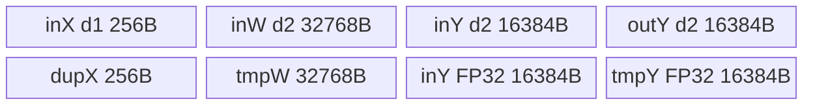

# SGMV_EXPAND 950 Direct Invoke 算子知识

## 算子速览

| 项目 | 内容 |
|---|---|
| 实际入口 | `torch.ops.npu.sgmv_expand`→手写Host→typed `sgmv_expand_half/bfloat16_t` |
| 计算语义 | y[t,s:s+O]←T(FP32(y切片)+dot_FP32(x[t,:],W[lora(t),:,:]))；返回原y别名，不额外乘scale |
| 输入输出 | x[T,R]须FP32，W[L,O,R]及y[T,F]为同类FP16/BF16，route为int64；rank归约只实现8/16/32/64 |
| 执行类型 | 单AIV_VECTOR，Cast/Mul/BlockReduceSum/PairReduceSum/Add，无Cube |
| Kernel 路线 | R-001…004按rank归约族，分别列half/BF16 typed selector；R-005记录Host未拒绝的其他rank终点 |
| 核心资源 | X depth1、W/旧Y/新Y depth2与四TBuf；显式UB131584B；workspace0 |
| 来源闭包 | direct_implementation_closed：native参数、Host、全部entry/body、SGMV选中helper与基础构建闭合；弱guard/未实现rank不等于正确性 |
| 验证状态 | draft；本次知识提取未执行编译、真机、数值或性能测试 |

## 接口与语义

### 计算语义

令R=x.size1、O=slice_size、F=y.size1、s=slice_offset。x物理FP32行长R；W按紧密[L,O,R]取adapter与输出行。每个8192权重元素tile转换FP32，乘重复的X，再按R归约为8192/R个输出；先在FP32完成dot和原y加法，最后CAST_RINT回half/BF16。expand没有scale属性，不应重复应用shrink已乘的alpha/r。非选切片保持原y，负ID直接continue也不清零整行。

BlockIterator逐核从previous_block=0/offset=0开始，对递增token t累加seq_len：若t>=offset+length则前进，否则缓存当前block与offset并返回；零长度块跳过，扫描完返回−1并保留原y。非负length、lora_indices与seq_len同长及全覆盖时sum(length)=T均由caller保证；负length没有Host检查。

### 输入、输出与属性

| 参数 | shape/layout | dtype | 约束、默认值与语义 |
|---|---|---|---|
| x | [T,R]连续同NPU | FP32 | Device固定X_T=float；Host只检查rank2，不验证FP32 |
| weight | [L,O,R]或[L,1,O,R]紧密 | 与y同half/BF16 | Host只验证rank3/4，不查dtype/轴尺寸/ID上界 |
| indices或lora_indices/seq_len | lora_indices[S]、seq_len[S] | int64 | 数据布局及分段协议由caller保证 |
| y/y_out | [T,F]连续 | half或BF16 | Host检查此dtype与rank2；返回y_out=y同对象alias，原地累加 |
| slice_offset | s≥0 | int64→u32 entry | Host检查非负与s+O≤F，无完整窄化/加法溢出guard |
| slice_size | O | int64→u32 | Host要求R≤O；实际W adapter stride=R*O |

### 入口与版本

固定dda6旧Torch ABI，区别于带lora_ranks/slice_offsets的新SGEMMV/SGEMMC接口。基础legacy Host/no_workspace_kernel与PrivateUse1注册在arch22/35均接线；活动CANN9.1整体构建配置列A3/950，本卡950仅描述draft源码范围，不证明本次编译或产品数值支持。不扩大A2范围。API合同见[旧BGMV/SGMV](../../../../apis/sgl_kernel_npu/sgl_legacy_lora_bgmv_sgmv.md)。schema将所有Tensor标Tensor!，实际写y；返回Tensor与原y alias，不承诺任意输入输出alias均安全。

## Host/Launcher 执行流程

### 参数校验与前处理

读取y dtype，仅Half/BF16；检查x/y rank2、weight rank3/4。BGMV另检查indices rank1且x/y/indices首维相同，SGMV没有对应metadata/行数检查。检查R≤O、s≥0、s+O≤F。其后y_out=y，提取所有裸指针，路由长度、T、R、F存int，s/O仍来自int64并在impl转u32；没有dtype转换/contiguous或独立输出分配。

current NPU stream送入OpCommand custom handler；handler硬编码device0查询AIV数A，n=ceil(T/A)，检查n!=0，再G=ceil(T/n)launch。A0在除法前没有guard，正常A下T0因n0抛错。Host不验证x为FP32、weight与y同type、device/stride/shape几何、adapter值/上界、R白名单、UB、对齐和Host尺寸窄化、R*O的32位乘积范围；Device行偏移F*idx使用int64乘加后赋uint64，不存在uint32(F*idx)截断。调用成功排队不能替代这些前提。

### 参数、Workspace 与生命周期

无POD、tiling Tensor或workspace，全部直接entry参数。裸指针与标量捕获到custom handler，没有DeviceGuard、显式record_stream或Tensor owner捕获；caller须使current设备/流与张量一致并遵循异步allocator/OpCommand生命周期。device0能力查询不自动随current设备改变。yIn/yOut为同指针是明确算法复用；x/W/route与y不应发生错误重叠或并发修改，Host没有alias检查。

### 启动图与失败传播


| 节点/边 | producer/consumer | 参数/extent与ordering | owner/失败传播 |
|---|---|---|---|
| 唯一核心节点 | sgmv_expand_impl→typed entry→SGMVExpand::Init/Process | G与直接GM/u32参数，current stream | caller全部Tensor；能力/n失败抛错，ACLRT返回未检查 |
| y旧值→新值 | CopyInY→FP32 Add→CopyOut | 当前4096或tail输出元素，Queue交接 | 相同GM切片；handler返回0不是设备完成 |
| 其他交接 | 无 | 无跨Kernel workspace/事件 | 无外部Sort/Matmul核心节点 |

## Route 与参数设计

### 分核与资源计算

n=ceil(T/A)，G=ceil(T/n)，核c顺序处理[c*n,min((c+1)*n,T))。一token所有输出与X归约在单核完成，无跨核reduce。X一次加载R个FP32，重复成64元素dupX。权重tile Wt=8192个2B数，128个64FP32 repeat；每tile有效输出E=128*(64/R)，一4096输出tile需S=4096/E次权重流入。R8/16/32/64分别E1024/512/256/128，S4/8/16/32。

输出完整tile数O//4096，尾Y=O%4096。尾权重数Y*R，完整8192tile照常计算，余权重w_tail以lastRepeats=floor(w_tail/64)计算，pair16=ceil(lastRepeats*8/64)，pair32=ceil(pair16/2)。无子64元素repeat掩码，尾部不足repeat的部分不完整计算。后续ScaleOutput/CopyOut仍使用全部Y；不能把普通DataCopy尾长或带floor的归约写成任意O均正确。

UB实际8分配共131584B：inX1*64*4=256；W2*8192*2=32768；旧Y2*4096*2=16384；新Y同16384；dupX256；tmpW8192*4=32768；inYFP32=16384；tmpYFP32=16384。Host不查询UB余量或按平台选tile，131584≤可用UB是必要条件，不能写成已执行guard。

### Route 选择

| 顺序 | Route | Key/模板 | 精确选择条件与优先级 | 不适用去向 |
|---:|---|---|---|---|
| 1 | typed entry | y dtype BF16显式，否则half | Host已拒绝其他dtype；impl Float早返从本Host不可达 | 后续R runtime分支 |
| 2 | R-001 | R8 | 相同Host域，R==8 | R16 |
| 3 | R-002 | R16 | R==16 | R32 |
| 4 | R-003 | R32 | R==32 | R64 |
| 5 | R-004 | R64 | R==64 | R-005其他R实际终点 |

```text
Host y dtype/rank/slice弱guard→device0能力→n非零→typed单entry
Init固定UB与E/S计算→每token route，负ID/未覆盖skip
R8：BlockReduceSum；R16：BlockReduceSum→Pair
R32：BlockReduceSum→Pair→Pair；R64：BlockReduceSum→BlockReduceSum
其他R：没有归约else；R0或R>64先有Init除零边界；无外部fallback
```

### 模板/实现执行矩阵

| Route | key/selector | dtype/shape/platform 完整命中条件 | 执行拓扑与 Kernel 节点 | 实际模板/body | 内存与同步特征 | tail/fallback |
|---|---|---|---|---|---|---|
| R-001 | R==8；Half/BF16各typed entry | 950，Host完成且y Half/BF16、R8；caller满足FP32 x/紧密W等合同 | 单sgmv_expand_half或_bfloat16_t AIV | SGMVExpand<half/bfloat16_t>::Compute，BlockReduceSum直接写tmpY | 同131584B；每阶段PIPE_V与Queue | E=1024，S=4，w_tail/64向下取整 |
| R-002 | R==16；Half/BF16各typed entry | 950，Host完成且y Half/BF16、R16；caller满足FP32 x/紧密W等合同 | 单sgmv_expand_half或_bfloat16_t AIV | SGMVExpand<half/bfloat16_t>::Compute，BlockReduceSum(tmpW)→PairReduceSum(tmpY) | 同131584B；每阶段PIPE_V与Queue | E=512，S=8，w_tail/64向下取整 |
| R-003 | R==32；Half/BF16各typed entry | 950，Host完成且y Half/BF16、R32；caller满足FP32 x/紧密W等合同 | 单sgmv_expand_half或_bfloat16_t AIV | SGMVExpand<half/bfloat16_t>::Compute，BlockReduceSum(tmpW)→PairReduceSum(tmpW)→PairReduceSum(tmpY) | 同131584B；每阶段PIPE_V与Queue | E=256，S=16，w_tail/64向下取整 |
| R-004 | R==64；Half/BF16各typed entry | 950，Host完成且y Half/BF16、R64；caller满足FP32 x/紧密W等合同 | 单sgmv_expand_half或_bfloat16_t AIV | SGMVExpand<half/bfloat16_t>::Compute，BlockReduceSum(tmpW)→BlockReduceSum(tmpY) | 同131584B；每阶段PIPE_V与Queue | E=128，S=32，w_tail/64向下取整 |
| R-005 | R不在8/16/32/64 | Host未拒绝的原始域 | 同entry或Init无法完成 | Compute没有归约else | 仍固定UB；部分R复制可越64元素dup区 | 不声称有有效数学输出/安全拒绝 |

两dtype共享相同2B资源、selector、模板代码、cast/round控制与所有同步/tail步骤，按rank归约实现族参数化T；各行保留half/BF16两个精确entry，不把BF16数值格式当FP16精度等价。

### 隐藏性能 Guard

| Guard | Host/Tiling 条件 | Device/资源原因 | 影响 Route | 不满足时去向 | 源码符号 |
|---|---|---|---|---|---|
| R白名单 | 无Host检查 | 64元素dup与4归约分支 | R-001…005 | 其他R不归约；R0/>64 Init除零 | Init/Compute |
| x/W/y dtype | Host只检查y | X_T=float、W/Y=T | 全部 | 不自动cast/拒绝其他Tensor | Init |
| 尾部/对齐 | 无Host检查 | 普通DataCopy与floor(w_tail/64) | 四有效族 | 剩余量可能不完整，无Pad fallback | ComputeLastIteration |
| UB | 未查询比较 | 固定131584B | 全部 | 无tile降级 | Init |
| n/A/T | 只检查n!=0 | 两次ceil分工 | 全部 | T0正常A时抛错，A0无先验guard | Host handler |
| ID/分段/stride | 无完整检查 | adapter stride R*O、scalar路由 | 全部 | 负ID/未覆盖skip，正越界无保护 | Process/helper |

### POD/ABI

无结构POD；以下按entry实际位置，生成stub封送ABI为外部边界。slice int64→impl u32、尺寸int→u32均保留窄化，不补造范围检查。

| 结构 | 字段 | 类型/位宽 | ABI 布局 | 单位 | Host/launcher producer | Device consumer | 边界 |
|---|---|---|---|---|---|---|---|
| entry | x | GM_ADDR | 参数0 | 4TR bytes | x.data_ptr | FP32 xGm | 由实际Host弱guard与caller合同约束 |
| entry | weight | GM_ADDR | 参数1 | 2LOR bytes | weight.data_ptr | T wGm | 由实际Host弱guard与caller合同约束 |
| entry | loraIndices | GM_ADDR | 参数2 | 8*route_count | route.data_ptr | int64 routeGm | 由实际Host弱guard与caller合同约束 |
| entry | loraIndicesSize | uint32 | 参数3 | elements | int(route.size0) | GM length | 由实际Host弱guard与caller合同约束 |
| entry | seqLen | GM_ADDR | 参数4 | int64 lengths | seq_len.data_ptr | BlockIterator | 由实际Host弱guard与caller合同约束 |
| entry | seqLenSize | uint32 | 参数5 | elements | int(seq_len.size0) | GetSize | 由实际Host弱guard与caller合同约束 |
| entry | yIn | GM_ADDR | 参数6 | 2TF bytes | y.data_ptr | T yInGm | 由实际Host弱guard与caller合同约束 |
| entry | yOut | GM_ADDR | 参数7 | 同指针 | y_out=y | T yOutGm | 由实际Host弱guard与caller合同约束 |
| entry | batchSize | uint32 | 参数8 | tokens | int(x.size0) | Process end | 由实际Host弱guard与caller合同约束 |
| entry | numTokensPerCore | uint32 | 参数9 | tokens/core | ceil(T/A) | core range | 由实际Host弱guard与caller合同约束 |
| entry | maxLoRARank | uint32 | 参数10 | R | int(x.size1) | dupX/Compute branch | 由实际Host弱guard与caller合同约束 |
| entry | outputHiddenDim | uint32 | 参数11 | O | slice_size窄化 | tile/tail与W stride | 由实际Host弱guard与caller合同约束 |
| entry | sliceOffset | uint32 | 参数12 | T元素 | slice_offset窄化 | yOffset | 由实际Host弱guard与caller合同约束 |
| entry | outputFullDim | uint32 | 参数13 | F | int(y.size1) | t*F+s | 由实际Host弱guard与caller合同约束 |

### Route 源码闭包

| Route | Key/selector | Host/Tiling producer | POD/参数 | Kernel entry/router 节点 | Kernel body/直接依赖 | 构建接线 |
|---|---|---|---|---|---|---|
| R-001 | R8/两dtype | csrc/lora/op_host/sgmv_expand.cpp::sgmv_expand/sgmv_expand_impl | 无POD直接entry | csrc/lora/op_kernel/sgmv_expand_kernel.cpp::sgmv_expand_half/_bfloat16_t | SGMVExpand<T>::Init/Process/CopyInX/Y/W/Compute/ScaleOutput/CopyOut/BlockIterator | legacy基础Host/no_workspace_kernel与PrivateUse1 |
| R-002 | R16/两dtype | csrc/lora/op_host/sgmv_expand.cpp::sgmv_expand/sgmv_expand_impl | 无POD直接entry | csrc/lora/op_kernel/sgmv_expand_kernel.cpp::sgmv_expand_half/_bfloat16_t | SGMVExpand<T>::Init/Process/CopyInX/Y/W/Compute/ScaleOutput/CopyOut/BlockIterator | legacy基础Host/no_workspace_kernel与PrivateUse1 |
| R-003 | R32/两dtype | csrc/lora/op_host/sgmv_expand.cpp::sgmv_expand/sgmv_expand_impl | 无POD直接entry | csrc/lora/op_kernel/sgmv_expand_kernel.cpp::sgmv_expand_half/_bfloat16_t | SGMVExpand<T>::Init/Process/CopyInX/Y/W/Compute/ScaleOutput/CopyOut/BlockIterator | legacy基础Host/no_workspace_kernel与PrivateUse1 |
| R-004 | R64/两dtype | csrc/lora/op_host/sgmv_expand.cpp::sgmv_expand/sgmv_expand_impl | 无POD直接entry | csrc/lora/op_kernel/sgmv_expand_kernel.cpp::sgmv_expand_half/_bfloat16_t | SGMVExpand<T>::Init/Process/CopyInX/Y/W/Compute/ScaleOutput/CopyOut/BlockIterator | legacy基础Host/no_workspace_kernel与PrivateUse1 |
| R-005 | 其他R | 同Host未检查 | 同参数 | 同typed entry | Init/Compute缺分支/容量边界 | 没有不同构建fallback |

## Kernel 实现

### 公共执行流程

typed entry创建TPipe与SGMVExpand<T>，Init固定8区、E/S计算；每token读取适配器，负ID/分段缺失continue。CopyInX按R读取FP32并用scalar在dupX内重复填满64lane，Free输入X；每4096输出tile先CopyInY，然后S次8192权重载入/转FP32/Mul/rank归约，写tmpY不同子区；ScaleOutput DeQue旧Y→Cast FP32→Add tmpY+旧Y→CAST_RINT到新Y Queue→EnQue；CopyOut DeQue/DataCopy/Free。尾部由ComputeLastIteration按实际剩余计数重用同流程。PIPE_V位于Cast、Mul、各归约、Add和回cast后；没有跨核flag或GM中间dot。

```text
公共源码等价伪码；T为输出/权重half或BF16，X始终FP32
for t=core_start..core_end-1:
  id=实际逐行或分段路由；if id<0或分段未覆盖: continue
  yBase=F*int64(t)+s；wBase=id*uint32(R*O)  #行偏移64位乘加后赋uint64，R*O仍为uint32乘积
  CopyInX R个float→EnQue/DeQue
  for i=0;i<64;i+=R:
    for j=0;j<R;j++: dupX[i+j]=xLocal[j]
  Free X
  for outTile=0..O//4096-1:
    CopyInY(outTile,4096)→EnQue
    for wTile=0..S-1:
      CopyInW(outTile*S+wTile,8192)→EnQue
      Compute(progress=wTile*E,repeats128,pair16=16,pair32=8)
    ScaleOutput(4096)；CopyOut(outTile,4096)
  tailY=O%4096
  if tailY:
    tailW=tailY*R；CopyInY(O//4096,tailY)
    for wTile=0..tailW//8192-1: CopyInW/Compute完整tile
    if tailW%8192:
      CopyInW剩余；rep=(tailW%8192)//64
      p16=ceil(rep*8/64)；p32=ceil(p16/2)
      Compute(progress=完整Wtile数*E,rep,p16,p32)
    ScaleOutput(tailY)；CopyOut(O//4096,tailY)
```

普通DataCopy读取/写入使用元素count，未使用DataCopyPad或tail掩码；caller要满足各原语/基址对齐。Init的fixed64/R与Process的循环不支持推断任意rank值合法。

### Route R-001：rank8两dtype归约族

#### 适用条件

##### 选择证据

| 层级 | 文件 | 符号 | 源码谓词/参数 | 结果/下一跳 |
|---|---|---|---|---|
| Host | csrc/lora/op_host/sgmv_expand.cpp | sgmv_expand/sgmv_expand_impl | y Half/BF16与弱shape/slice guard | 两typed entry |
| entry | csrc/lora/op_kernel/sgmv_expand_kernel.cpp | sgmv_expand_half/_bfloat16_t | BF16编译宏__CCE_AICORE__>=220 | SGMVExpand<T> |
| body | csrc/lora/op_kernel/sgmv_expand_kernel.cpp | Compute | maxLoRARank_==8 | BlockReduceSum直接写tmpY |

#### Device 数据流

##### 函数级调用链

```text
sgmv_expand→OpCommand→sgmv_expand_impl→sgmv_expand_half或_bfloat16_t
 →SGMVExpand<T>::Init→Process→实际路由→CopyInX
 →每输出tile CopyInY→4次CopyInW→Compute(rank8)
 →ScaleOutput→CopyOut→ComputeLastIteration（可选）
```

##### 源码等价伪码

```text
当前Route R=8，E=1024输出/Wtile，S=4个Wtile/完整Ytile
每token/输出tile地址、序与tail循环遵循上方完整公共伪码
Compute(progress,rep,p16,p32):
  w=DeQue(inW)；Cast(tmpW,w,CAST_NONE,mask64,rep,{1,1,8,4})
  PIPE_V；Free(inW,w)
  Mul(tmpW,dupX,tmpW,mask64,rep,{1,1,1,8,0,8})；PIPE_V
  BlockReduceSum(tmpY[progress],tmpW,rep,mask64,dstRep1,srcBlk1,srcRep8)；PIPE_V
ScaleOutput(count=4096或tailY):
  old=DeQue(inY)；Cast(inYFP32,old,CAST_NONE,count)；PIPE_V；Free(inY,old)
  Add(tmpY,tmpY,inYFP32,count)；PIPE_V
  yNew=Alloc(outY)；Cast(yNew,tmpY,CAST_RINT,count)；PIPE_V；EnQue(outY,yNew)
CopyOut: DeQue(outY)→DataCopy(yBase+outTile*4096,count)→Free
```

#### 内存与数据搬运

##### 资源与搬运表

| 层级/缓冲区 | offset/地址公式 | extent/容量公式 | dtype/layout | producer | consumer | owner/lifetime | 对齐/复用 |
|---|---|---|---|---|---|---|---|
| GM X | t*R | R float | FP32紧密 | caller | CopyInX | caller异步保活 | 只读一行，不使用stride |
| GM W | id*(R*O)+wTile*8192 | 8192或tailW元素 | T紧密 | caller | Cast | caller | adapter长度R*O先u32计算 |
| GM yIn/yOut | F*t+s+outTile*4096 | 4096或tailY T | half/BF16 | caller旧值/CopyOut | Add/caller | 同指针alias | 非切片不写，无任意overlap保证 |
| GM route | token或segment | int64表 | 紧密 | caller | scalar/BlockIterator | caller | 无ID上界guard |
| inQueueX VECIN | local0 | depth1*64*4=256B | FP32 | CopyInX | scalar dup | Alloc→EnQue/DeQue→Free | 实际只载R |
| inQueueW VECIN | local0 | depth2*8192*2=32768B | T | MTE2 | Cast | 每Wtile复用 | 深度必须计2 |
| inQueueY VECIN | local0 | depth2*4096*2=16384B | T | MTE2 | Cast/Add | 每Ytile | 保存旧值至ScaleOutput |
| outQueueY VECOUT | local0 | depth2*4096*2=16384B | T | 回cast | MTE3 | Alloc→Free | 不与inY物理alias |
| dupBufferX VECCALC | local0 | 64*4=256B | FP32 | scalar重复 | Mul src0 | 当前token所有Wtile | src0RepStride0重读 |
| tmpBufferW VECCALC | local0 | 8192*4=32768B | FP32 | Cast→Mul→部分归约 | rank归约 | 当前Wtile | 真原地复用 |
| inBufferY VECCALC | local0 | 4096*4=16384B | FP32 | Cast旧y | Add | 当前Ytile | 不作GMworkspace |
| tmpBufferY VECCALC | progress*4 | 4096*4=16384B | FP32 | 各Wtile归约 | Add/回cast | 当前Ytile | 各E子区覆盖有效结果 |

##### 分层内存布局



##### 字节账与复用顺序

```text
UB_total=256+32768+16384+16384+256+32768+16384+16384=131584 B
必要条件131584<=实际可用UB；Host无容量比较/降级选择
workspace=0，dynamic_ub=N/A，无L1/L0/通信window；寄存器精确用量为编译器边界
```

| 复用子区 | 写入者 | 读取者/消费点 | 下一次覆盖 | 同步或释放依据 | 安全条件 |
|---|---|---|---|---|---|
| dupX | 每token scalar | 所有Wtile Mul | 下一token | 当前token顺序与PIPE_V | 不在同token提前覆盖 |
| tmpW | Cast/Mul/归约 | rank归约下一层 | 下一Wtile Cast | 各PIPE_V | 保留源repeat stride与原地顺序 |
| tmpY各progress子区 | 当前Wtile最终归约 | ScaleOutput Add/回cast | 下一Ytile | PIPE_V、outY交接 | 有效部分必须全部写出；尾部不足repeat不保证 |
| y GM切片 | 旧Y CopyIn | FP32 Add | 当前CopyOut | inY/outY两Queue | 同tile旧值读取在覆盖前 |

#### 同步、精度与尾块

##### 同步与数值边界表

| 阶段 | primitive/机制 | producer | consumer/等待点 | 保护对象 | 精度/尾块 |
|---|---|---|---|---|---|
| X/W/Y载入 | Queue EnQue/DeQue | MTE2 | scalar/Cast | 三输入Queue | X本来FP32；T→FP32 CAST_NONE |
| Cast/Mul | PIPE_V | W Cast、Xdup | rank归约 | tmpW | mask64、repeat rep；src0Rep0重复X，src1Rep8连续W |
| 归约 | Block/Pair+PIPE_V | tmpW层级 | 下一层/tmpY | FP32 dot | 参数dstRep1/srcBlk1/srcRep8；不同R见本Route精确伪码 |
| 加旧值 | Cast→PIPE_V→Add→PIPE_V | dot与旧Y | 输出Cast | tmpY/inYFP32 | 不在dot后提前降精度 |
| 回写 | CAST_RINT→PIPE_V→Queue/MTE3 | FP32总和 | caller y | T outQueue | 半精度/BF16按实际T舍入，不宣称bitwise等价 |
| tail | floor(w_tail/64)、pair向上整repeat | 剩余W | 相同归约族 | 有效Y部分 | 无子repeat mask；普通DataCopy不补任意对齐 |

#### 关键实现

##### 符号证据表

| 阶段 | 文件 | 符号/模板实例 | 实现事实 |
|---|---|---|---|
| Host/Tiling producer | csrc/lora/op_host/sgmv_expand.cpp | sgmv_expand/sgmv_expand_impl | typed selector、T/n/G与slice参数 |
| Kernel entry/router | csrc/lora/op_kernel/sgmv_expand_kernel.cpp | sgmv_expand_half/_bfloat16_t | SGMVExpand<T>实例 |
| Device body/helper | csrc/lora/op_kernel/sgmv_expand_kernel.cpp | CopyInX/Compute/ComputeLastIteration/ScaleOutput/CopyOut | rank8归约、E1024/S4、tail与真实舍入 |

### Route R-002：rank16两dtype归约族

#### 适用条件

##### 选择证据

| 层级 | 文件 | 符号 | 源码谓词/参数 | 结果/下一跳 |
|---|---|---|---|---|
| Host | csrc/lora/op_host/sgmv_expand.cpp | sgmv_expand/sgmv_expand_impl | y Half/BF16与弱shape/slice guard | 两typed entry |
| entry | csrc/lora/op_kernel/sgmv_expand_kernel.cpp | sgmv_expand_half/_bfloat16_t | BF16编译宏__CCE_AICORE__>=220 | SGMVExpand<T> |
| body | csrc/lora/op_kernel/sgmv_expand_kernel.cpp | Compute | maxLoRARank_==16 | BlockReduceSum(tmpW)→PairReduceSum(tmpY) |

#### Device 数据流

##### 函数级调用链

```text
sgmv_expand→OpCommand→sgmv_expand_impl→sgmv_expand_half或_bfloat16_t
 →SGMVExpand<T>::Init→Process→实际路由→CopyInX
 →每输出tile CopyInY→8次CopyInW→Compute(rank16)
 →ScaleOutput→CopyOut→ComputeLastIteration（可选）
```

##### 源码等价伪码

```text
当前Route R=16，E=512输出/Wtile，S=8个Wtile/完整Ytile
每token/输出tile地址、序与tail循环遵循上方完整公共伪码
Compute(progress,rep,p16,p32):
  w=DeQue(inW)；Cast(tmpW,w,CAST_NONE,mask64,rep,{1,1,8,4})
  PIPE_V；Free(inW,w)
  Mul(tmpW,dupX,tmpW,mask64,rep,{1,1,1,8,0,8})；PIPE_V
  BlockReduceSum(tmpW,tmpW,rep,mask64,1,1,8)；PIPE_V
  PairReduceSum(tmpY[progress],tmpW,p16,mask64,1,1,8)；PIPE_V
ScaleOutput(count=4096或tailY):
  old=DeQue(inY)；Cast(inYFP32,old,CAST_NONE,count)；PIPE_V；Free(inY,old)
  Add(tmpY,tmpY,inYFP32,count)；PIPE_V
  yNew=Alloc(outY)；Cast(yNew,tmpY,CAST_RINT,count)；PIPE_V；EnQue(outY,yNew)
CopyOut: DeQue(outY)→DataCopy(yBase+outTile*4096,count)→Free
```

#### 内存与数据搬运

##### 资源与搬运表

| 层级/缓冲区 | offset/地址公式 | extent/容量公式 | dtype/layout | producer | consumer | owner/lifetime | 对齐/复用 |
|---|---|---|---|---|---|---|---|
| GM X | t*R | R float | FP32紧密 | caller | CopyInX | caller异步保活 | 只读一行，不使用stride |
| GM W | id*(R*O)+wTile*8192 | 8192或tailW元素 | T紧密 | caller | Cast | caller | adapter长度R*O先u32计算 |
| GM yIn/yOut | F*t+s+outTile*4096 | 4096或tailY T | half/BF16 | caller旧值/CopyOut | Add/caller | 同指针alias | 非切片不写，无任意overlap保证 |
| GM route | token或segment | int64表 | 紧密 | caller | scalar/BlockIterator | caller | 无ID上界guard |
| inQueueX VECIN | local0 | depth1*64*4=256B | FP32 | CopyInX | scalar dup | Alloc→EnQue/DeQue→Free | 实际只载R |
| inQueueW VECIN | local0 | depth2*8192*2=32768B | T | MTE2 | Cast | 每Wtile复用 | 深度必须计2 |
| inQueueY VECIN | local0 | depth2*4096*2=16384B | T | MTE2 | Cast/Add | 每Ytile | 保存旧值至ScaleOutput |
| outQueueY VECOUT | local0 | depth2*4096*2=16384B | T | 回cast | MTE3 | Alloc→Free | 不与inY物理alias |
| dupBufferX VECCALC | local0 | 64*4=256B | FP32 | scalar重复 | Mul src0 | 当前token所有Wtile | src0RepStride0重读 |
| tmpBufferW VECCALC | local0 | 8192*4=32768B | FP32 | Cast→Mul→部分归约 | rank归约 | 当前Wtile | 真原地复用 |
| inBufferY VECCALC | local0 | 4096*4=16384B | FP32 | Cast旧y | Add | 当前Ytile | 不作GMworkspace |
| tmpBufferY VECCALC | progress*4 | 4096*4=16384B | FP32 | 各Wtile归约 | Add/回cast | 当前Ytile | 各E子区覆盖有效结果 |

##### 分层内存布局


##### 字节账与复用顺序

```text
UB_total=256+32768+16384+16384+256+32768+16384+16384=131584 B
必要条件131584<=实际可用UB；Host无容量比较/降级选择
workspace=0，dynamic_ub=N/A，无L1/L0/通信window；寄存器精确用量为编译器边界
```

| 复用子区 | 写入者 | 读取者/消费点 | 下一次覆盖 | 同步或释放依据 | 安全条件 |
|---|---|---|---|---|---|
| dupX | 每token scalar | 所有Wtile Mul | 下一token | 当前token顺序与PIPE_V | 不在同token提前覆盖 |
| tmpW | Cast/Mul/归约 | rank归约下一层 | 下一Wtile Cast | 各PIPE_V | 保留源repeat stride与原地顺序 |
| tmpY各progress子区 | 当前Wtile最终归约 | ScaleOutput Add/回cast | 下一Ytile | PIPE_V、outY交接 | 有效部分必须全部写出；尾部不足repeat不保证 |
| y GM切片 | 旧Y CopyIn | FP32 Add | 当前CopyOut | inY/outY两Queue | 同tile旧值读取在覆盖前 |

#### 同步、精度与尾块

##### 同步与数值边界表

| 阶段 | primitive/机制 | producer | consumer/等待点 | 保护对象 | 精度/尾块 |
|---|---|---|---|---|---|
| X/W/Y载入 | Queue EnQue/DeQue | MTE2 | scalar/Cast | 三输入Queue | X本来FP32；T→FP32 CAST_NONE |
| Cast/Mul | PIPE_V | W Cast、Xdup | rank归约 | tmpW | mask64、repeat rep；src0Rep0重复X，src1Rep8连续W |
| 归约 | Block/Pair+PIPE_V | tmpW层级 | 下一层/tmpY | FP32 dot | 参数dstRep1/srcBlk1/srcRep8；不同R见本Route精确伪码 |
| 加旧值 | Cast→PIPE_V→Add→PIPE_V | dot与旧Y | 输出Cast | tmpY/inYFP32 | 不在dot后提前降精度 |
| 回写 | CAST_RINT→PIPE_V→Queue/MTE3 | FP32总和 | caller y | T outQueue | 半精度/BF16按实际T舍入，不宣称bitwise等价 |
| tail | floor(w_tail/64)、pair向上整repeat | 剩余W | 相同归约族 | 有效Y部分 | 无子repeat mask；普通DataCopy不补任意对齐 |

#### 关键实现

##### 符号证据表

| 阶段 | 文件 | 符号/模板实例 | 实现事实 |
|---|---|---|---|
| Host/Tiling producer | csrc/lora/op_host/sgmv_expand.cpp | sgmv_expand/sgmv_expand_impl | typed selector、T/n/G与slice参数 |
| Kernel entry/router | csrc/lora/op_kernel/sgmv_expand_kernel.cpp | sgmv_expand_half/_bfloat16_t | SGMVExpand<T>实例 |
| Device body/helper | csrc/lora/op_kernel/sgmv_expand_kernel.cpp | CopyInX/Compute/ComputeLastIteration/ScaleOutput/CopyOut | rank16归约、E512/S8、tail与真实舍入 |

### Route R-003：rank32两dtype归约族

#### 适用条件

##### 选择证据

| 层级 | 文件 | 符号 | 源码谓词/参数 | 结果/下一跳 |
|---|---|---|---|---|
| Host | csrc/lora/op_host/sgmv_expand.cpp | sgmv_expand/sgmv_expand_impl | y Half/BF16与弱shape/slice guard | 两typed entry |
| entry | csrc/lora/op_kernel/sgmv_expand_kernel.cpp | sgmv_expand_half/_bfloat16_t | BF16编译宏__CCE_AICORE__>=220 | SGMVExpand<T> |
| body | csrc/lora/op_kernel/sgmv_expand_kernel.cpp | Compute | maxLoRARank_==32 | BlockReduceSum(tmpW)→PairReduceSum(tmpW)→PairReduceSum(tmpY) |

#### Device 数据流

##### 函数级调用链

```text
sgmv_expand→OpCommand→sgmv_expand_impl→sgmv_expand_half或_bfloat16_t
 →SGMVExpand<T>::Init→Process→实际路由→CopyInX
 →每输出tile CopyInY→16次CopyInW→Compute(rank32)
 →ScaleOutput→CopyOut→ComputeLastIteration（可选）
```

##### 源码等价伪码

```text
当前Route R=32，E=256输出/Wtile，S=16个Wtile/完整Ytile
每token/输出tile地址、序与tail循环遵循上方完整公共伪码
Compute(progress,rep,p16,p32):
  w=DeQue(inW)；Cast(tmpW,w,CAST_NONE,mask64,rep,{1,1,8,4})
  PIPE_V；Free(inW,w)
  Mul(tmpW,dupX,tmpW,mask64,rep,{1,1,1,8,0,8})；PIPE_V
  BlockReduceSum(tmpW,tmpW,rep,mask64,1,1,8)；PIPE_V
  PairReduceSum(tmpW,tmpW,p16,mask64,1,1,8)；PIPE_V
  PairReduceSum(tmpY[progress],tmpW,p32,mask64,1,1,8)；PIPE_V
ScaleOutput(count=4096或tailY):
  old=DeQue(inY)；Cast(inYFP32,old,CAST_NONE,count)；PIPE_V；Free(inY,old)
  Add(tmpY,tmpY,inYFP32,count)；PIPE_V
  yNew=Alloc(outY)；Cast(yNew,tmpY,CAST_RINT,count)；PIPE_V；EnQue(outY,yNew)
CopyOut: DeQue(outY)→DataCopy(yBase+outTile*4096,count)→Free
```

#### 内存与数据搬运

##### 资源与搬运表

| 层级/缓冲区 | offset/地址公式 | extent/容量公式 | dtype/layout | producer | consumer | owner/lifetime | 对齐/复用 |
|---|---|---|---|---|---|---|---|
| GM X | t*R | R float | FP32紧密 | caller | CopyInX | caller异步保活 | 只读一行，不使用stride |
| GM W | id*(R*O)+wTile*8192 | 8192或tailW元素 | T紧密 | caller | Cast | caller | adapter长度R*O先u32计算 |
| GM yIn/yOut | F*t+s+outTile*4096 | 4096或tailY T | half/BF16 | caller旧值/CopyOut | Add/caller | 同指针alias | 非切片不写，无任意overlap保证 |
| GM route | token或segment | int64表 | 紧密 | caller | scalar/BlockIterator | caller | 无ID上界guard |
| inQueueX VECIN | local0 | depth1*64*4=256B | FP32 | CopyInX | scalar dup | Alloc→EnQue/DeQue→Free | 实际只载R |
| inQueueW VECIN | local0 | depth2*8192*2=32768B | T | MTE2 | Cast | 每Wtile复用 | 深度必须计2 |
| inQueueY VECIN | local0 | depth2*4096*2=16384B | T | MTE2 | Cast/Add | 每Ytile | 保存旧值至ScaleOutput |
| outQueueY VECOUT | local0 | depth2*4096*2=16384B | T | 回cast | MTE3 | Alloc→Free | 不与inY物理alias |
| dupBufferX VECCALC | local0 | 64*4=256B | FP32 | scalar重复 | Mul src0 | 当前token所有Wtile | src0RepStride0重读 |
| tmpBufferW VECCALC | local0 | 8192*4=32768B | FP32 | Cast→Mul→部分归约 | rank归约 | 当前Wtile | 真原地复用 |
| inBufferY VECCALC | local0 | 4096*4=16384B | FP32 | Cast旧y | Add | 当前Ytile | 不作GMworkspace |
| tmpBufferY VECCALC | progress*4 | 4096*4=16384B | FP32 | 各Wtile归约 | Add/回cast | 当前Ytile | 各E子区覆盖有效结果 |

##### 分层内存布局


##### 字节账与复用顺序

```text
UB_total=256+32768+16384+16384+256+32768+16384+16384=131584 B
必要条件131584<=实际可用UB；Host无容量比较/降级选择
workspace=0，dynamic_ub=N/A，无L1/L0/通信window；寄存器精确用量为编译器边界
```

| 复用子区 | 写入者 | 读取者/消费点 | 下一次覆盖 | 同步或释放依据 | 安全条件 |
|---|---|---|---|---|---|
| dupX | 每token scalar | 所有Wtile Mul | 下一token | 当前token顺序与PIPE_V | 不在同token提前覆盖 |
| tmpW | Cast/Mul/归约 | rank归约下一层 | 下一Wtile Cast | 各PIPE_V | 保留源repeat stride与原地顺序 |
| tmpY各progress子区 | 当前Wtile最终归约 | ScaleOutput Add/回cast | 下一Ytile | PIPE_V、outY交接 | 有效部分必须全部写出；尾部不足repeat不保证 |
| y GM切片 | 旧Y CopyIn | FP32 Add | 当前CopyOut | inY/outY两Queue | 同tile旧值读取在覆盖前 |

#### 同步、精度与尾块

##### 同步与数值边界表

| 阶段 | primitive/机制 | producer | consumer/等待点 | 保护对象 | 精度/尾块 |
|---|---|---|---|---|---|
| X/W/Y载入 | Queue EnQue/DeQue | MTE2 | scalar/Cast | 三输入Queue | X本来FP32；T→FP32 CAST_NONE |
| Cast/Mul | PIPE_V | W Cast、Xdup | rank归约 | tmpW | mask64、repeat rep；src0Rep0重复X，src1Rep8连续W |
| 归约 | Block/Pair+PIPE_V | tmpW层级 | 下一层/tmpY | FP32 dot | 参数dstRep1/srcBlk1/srcRep8；不同R见本Route精确伪码 |
| 加旧值 | Cast→PIPE_V→Add→PIPE_V | dot与旧Y | 输出Cast | tmpY/inYFP32 | 不在dot后提前降精度 |
| 回写 | CAST_RINT→PIPE_V→Queue/MTE3 | FP32总和 | caller y | T outQueue | 半精度/BF16按实际T舍入，不宣称bitwise等价 |
| tail | floor(w_tail/64)、pair向上整repeat | 剩余W | 相同归约族 | 有效Y部分 | 无子repeat mask；普通DataCopy不补任意对齐 |

#### 关键实现

##### 符号证据表

| 阶段 | 文件 | 符号/模板实例 | 实现事实 |
|---|---|---|---|
| Host/Tiling producer | csrc/lora/op_host/sgmv_expand.cpp | sgmv_expand/sgmv_expand_impl | typed selector、T/n/G与slice参数 |
| Kernel entry/router | csrc/lora/op_kernel/sgmv_expand_kernel.cpp | sgmv_expand_half/_bfloat16_t | SGMVExpand<T>实例 |
| Device body/helper | csrc/lora/op_kernel/sgmv_expand_kernel.cpp | CopyInX/Compute/ComputeLastIteration/ScaleOutput/CopyOut | rank32归约、E256/S16、tail与真实舍入 |

### Route R-004：rank64两dtype归约族

#### 适用条件

##### 选择证据

| 层级 | 文件 | 符号 | 源码谓词/参数 | 结果/下一跳 |
|---|---|---|---|---|
| Host | csrc/lora/op_host/sgmv_expand.cpp | sgmv_expand/sgmv_expand_impl | y Half/BF16与弱shape/slice guard | 两typed entry |
| entry | csrc/lora/op_kernel/sgmv_expand_kernel.cpp | sgmv_expand_half/_bfloat16_t | BF16编译宏__CCE_AICORE__>=220 | SGMVExpand<T> |
| body | csrc/lora/op_kernel/sgmv_expand_kernel.cpp | Compute | maxLoRARank_==64 | BlockReduceSum(tmpW)→BlockReduceSum(tmpY) |

#### Device 数据流

##### 函数级调用链

```text
sgmv_expand→OpCommand→sgmv_expand_impl→sgmv_expand_half或_bfloat16_t
 →SGMVExpand<T>::Init→Process→实际路由→CopyInX
 →每输出tile CopyInY→32次CopyInW→Compute(rank64)
 →ScaleOutput→CopyOut→ComputeLastIteration（可选）
```

##### 源码等价伪码

```text
当前Route R=64，E=128输出/Wtile，S=32个Wtile/完整Ytile
每token/输出tile地址、序与tail循环遵循上方完整公共伪码
Compute(progress,rep,p16,p32):
  w=DeQue(inW)；Cast(tmpW,w,CAST_NONE,mask64,rep,{1,1,8,4})
  PIPE_V；Free(inW,w)
  Mul(tmpW,dupX,tmpW,mask64,rep,{1,1,1,8,0,8})；PIPE_V
  BlockReduceSum(tmpW,tmpW,rep,mask64,1,1,8)；PIPE_V
  BlockReduceSum(tmpY[progress],tmpW,p16,mask64,1,1,8)；PIPE_V
ScaleOutput(count=4096或tailY):
  old=DeQue(inY)；Cast(inYFP32,old,CAST_NONE,count)；PIPE_V；Free(inY,old)
  Add(tmpY,tmpY,inYFP32,count)；PIPE_V
  yNew=Alloc(outY)；Cast(yNew,tmpY,CAST_RINT,count)；PIPE_V；EnQue(outY,yNew)
CopyOut: DeQue(outY)→DataCopy(yBase+outTile*4096,count)→Free
```

#### 内存与数据搬运

##### 资源与搬运表

| 层级/缓冲区 | offset/地址公式 | extent/容量公式 | dtype/layout | producer | consumer | owner/lifetime | 对齐/复用 |
|---|---|---|---|---|---|---|---|
| GM X | t*R | R float | FP32紧密 | caller | CopyInX | caller异步保活 | 只读一行，不使用stride |
| GM W | id*(R*O)+wTile*8192 | 8192或tailW元素 | T紧密 | caller | Cast | caller | adapter长度R*O先u32计算 |
| GM yIn/yOut | F*t+s+outTile*4096 | 4096或tailY T | half/BF16 | caller旧值/CopyOut | Add/caller | 同指针alias | 非切片不写，无任意overlap保证 |
| GM route | token或segment | int64表 | 紧密 | caller | scalar/BlockIterator | caller | 无ID上界guard |
| inQueueX VECIN | local0 | depth1*64*4=256B | FP32 | CopyInX | scalar dup | Alloc→EnQue/DeQue→Free | 实际只载R |
| inQueueW VECIN | local0 | depth2*8192*2=32768B | T | MTE2 | Cast | 每Wtile复用 | 深度必须计2 |
| inQueueY VECIN | local0 | depth2*4096*2=16384B | T | MTE2 | Cast/Add | 每Ytile | 保存旧值至ScaleOutput |
| outQueueY VECOUT | local0 | depth2*4096*2=16384B | T | 回cast | MTE3 | Alloc→Free | 不与inY物理alias |
| dupBufferX VECCALC | local0 | 64*4=256B | FP32 | scalar重复 | Mul src0 | 当前token所有Wtile | src0RepStride0重读 |
| tmpBufferW VECCALC | local0 | 8192*4=32768B | FP32 | Cast→Mul→部分归约 | rank归约 | 当前Wtile | 真原地复用 |
| inBufferY VECCALC | local0 | 4096*4=16384B | FP32 | Cast旧y | Add | 当前Ytile | 不作GMworkspace |
| tmpBufferY VECCALC | progress*4 | 4096*4=16384B | FP32 | 各Wtile归约 | Add/回cast | 当前Ytile | 各E子区覆盖有效结果 |

##### 分层内存布局


##### 字节账与复用顺序

```text
UB_total=256+32768+16384+16384+256+32768+16384+16384=131584 B
必要条件131584<=实际可用UB；Host无容量比较/降级选择
workspace=0，dynamic_ub=N/A，无L1/L0/通信window；寄存器精确用量为编译器边界
```

| 复用子区 | 写入者 | 读取者/消费点 | 下一次覆盖 | 同步或释放依据 | 安全条件 |
|---|---|---|---|---|---|
| dupX | 每token scalar | 所有Wtile Mul | 下一token | 当前token顺序与PIPE_V | 不在同token提前覆盖 |
| tmpW | Cast/Mul/归约 | rank归约下一层 | 下一Wtile Cast | 各PIPE_V | 保留源repeat stride与原地顺序 |
| tmpY各progress子区 | 当前Wtile最终归约 | ScaleOutput Add/回cast | 下一Ytile | PIPE_V、outY交接 | 有效部分必须全部写出；尾部不足repeat不保证 |
| y GM切片 | 旧Y CopyIn | FP32 Add | 当前CopyOut | inY/outY两Queue | 同tile旧值读取在覆盖前 |

#### 同步、精度与尾块

##### 同步与数值边界表

| 阶段 | primitive/机制 | producer | consumer/等待点 | 保护对象 | 精度/尾块 |
|---|---|---|---|---|---|
| X/W/Y载入 | Queue EnQue/DeQue | MTE2 | scalar/Cast | 三输入Queue | X本来FP32；T→FP32 CAST_NONE |
| Cast/Mul | PIPE_V | W Cast、Xdup | rank归约 | tmpW | mask64、repeat rep；src0Rep0重复X，src1Rep8连续W |
| 归约 | Block/Pair+PIPE_V | tmpW层级 | 下一层/tmpY | FP32 dot | 参数dstRep1/srcBlk1/srcRep8；不同R见本Route精确伪码 |
| 加旧值 | Cast→PIPE_V→Add→PIPE_V | dot与旧Y | 输出Cast | tmpY/inYFP32 | 不在dot后提前降精度 |
| 回写 | CAST_RINT→PIPE_V→Queue/MTE3 | FP32总和 | caller y | T outQueue | 半精度/BF16按实际T舍入，不宣称bitwise等价 |
| tail | floor(w_tail/64)、pair向上整repeat | 剩余W | 相同归约族 | 有效Y部分 | 无子repeat mask；普通DataCopy不补任意对齐 |

#### 关键实现

##### 符号证据表

| 阶段 | 文件 | 符号/模板实例 | 实现事实 |
|---|---|---|---|
| Host/Tiling producer | csrc/lora/op_host/sgmv_expand.cpp | sgmv_expand/sgmv_expand_impl | typed selector、T/n/G与slice参数 |
| Kernel entry/router | csrc/lora/op_kernel/sgmv_expand_kernel.cpp | sgmv_expand_half/_bfloat16_t | SGMVExpand<T>实例 |
| Device body/helper | csrc/lora/op_kernel/sgmv_expand_kernel.cpp | CopyInX/Compute/ComputeLastIteration/ScaleOutput/CopyOut | rank64归约、E128/S32、tail与真实舍入 |

### Route R-005：Host未拒绝的其他rank

#### 适用条件

##### 选择证据

| 层级 | 文件 | 符号 | 源码谓词/参数 | 结果/下一跳 |
|---|---|---|---|---|
| Host | csrc/lora/op_host/sgmv_expand.cpp | sgmv_expand | R≤O但无rank白名单 | 仍typed launch |
| body | csrc/lora/op_kernel/sgmv_expand_kernel.cpp | Init/Compute | R非8/16/32/64 | Init除法边界或无归约写出 |

#### Device 数据流

##### 函数级调用链

```text
sgmv_expand→typed entry→Init E=128*(64/R), S=4096/E
 →可完成时Process→CopyInX/CopyInY/W→Compute无归约else→ScaleOutput/CopyOut
```

##### 源码等价伪码

```text
R=0：Init先有64/R除零；R>64：64/R为0，E0，后4096/E除零
0<R≤64且非4种合法R：Init仍计算E/S；复制dupX步长R可能非整除64
Compute只Cast/Mul，无四rank归约分支命中，tmpY不由当前Wtile赋合法dot
后续Add/回cast仍可读取tmpY；无fallback/错误码/完整输出保证
```

#### 内存与数据搬运

##### 资源与搬运表

| 层级/缓冲区 | offset/地址公式 | extent/容量公式 | dtype/layout | producer | consumer | owner/lifetime | 对齐/复用 |
|---|---|---|---|---|---|---|---|
| 8个UB区 | 与有效Route相同 | 固定131584B | X/中间FP32、W/Y为T | Init/部分计算 | 后续阶段 | 同Queue协议 | 无fallback扩大dupX或初始化tmpY |
| GM y | F*t+s+tile*4096 | O切片 | T | ScaleOutput/CopyOut | caller | caller | 不承诺数学有效或拒绝前不写 |

##### 分层内存布局


##### 字节账与复用顺序

UB仍131584B、workspace0；invalid rank不能通过减少输出数从账上扣缓冲。R不整除64时dup循环最后i+j可能超64元素有效区，源码无边界mask；不泛化为本次实际硬件故障。tmpY缺当前归约producer，因而不存在可证明的合法dot→Add复用链。

#### 同步、精度与尾块

##### 同步与数值边界表

| 阶段 | primitive/机制 | producer | consumer/等待点 | 保护对象 | 精度/尾块 |
|---|---|---|---|---|---|
| 无归约else | 没有补救同步或错误输出 | Cast/Mul未生成tmpY合法dot | Add读取 | tmpY | 不保证结果/安全拒绝，caller停止这种输入 |

#### 关键实现

##### 符号证据表

| 阶段 | 文件 | 符号/模板实例 | 实现事实 |
|---|---|---|---|
| Host/Tiling producer | csrc/lora/op_host/sgmv_expand.cpp | sgmv_expand | 未校验R白名单 |
| Kernel entry/router | csrc/lora/op_kernel/sgmv_expand_kernel.cpp | typed macro | 两dtype仍可达 |
| Device body/helper | csrc/lora/op_kernel/sgmv_expand_kernel.cpp | Init/CopyInX/Compute | 除法、64lane复制及缺else终点 |

## 算子特定优化

### Trick T-001：64lane重复X与零repeat stride复用

#### 触发与源码依据

- 适用四有效rank族，两dtype，X固定FP32。
- Golden来源：[重复读dupX的Mul参数](https://github.com/sgl-project/sgl-kernel-npu/blob/dda6d36b0cdb4081e102d14c0a2fb276fc416e69/csrc/lora/op_kernel/sgmv_expand_kernel.cpp#L332-L332)。

**官方源码（固定Commit连续逐字摘录）**：

```cpp
    AscendC::BinaryRepeatParams dotProductParams_ = {1, 1, 1, 8, 0, 8};
```

#### 机制与设计原因

X仅载R个float后在64lane中重复，Mul src0RepStride=0让全部128repeat重读同一256B dupX，W src1RepStride=8连续前进；减少每个权重tile重新读取/扩展X。对应rank归约保留输出连续排列，不能把src0RepStride改成8而仍声称同一X广播语义。

#### 迁移边界

- 适用：R为8/16/32/64、紧密输出行W布局。
- 前提：64lane dup、mask64、2B W cast参数和8区UB。
- 失效：其他R无正确归约fallback，见R-005；普通DataCopy对齐仍需满足。
- 未验证：本次知识提取未执行编译、真机、数值或性能测试。

#### 错误做法

固定仓未提供可验证运行反例；现有R-005真实缺分支足以说明不能只因Host接受R≤O就推广rank范围。

### Trick T-002：FP32 dot直接在tmpY加旧输出后一次回cast

#### 触发与源码依据

- 适用有效rank与完整计算尾部，旧y必须在当前CopyOut前读入。
- Golden来源：[加旧Y后CAST_RINT](https://github.com/sgl-project/sgl-kernel-npu/blob/dda6d36b0cdb4081e102d14c0a2fb276fc416e69/csrc/lora/op_kernel/sgmv_expand_kernel.cpp#L232-L239)。

**官方源码（固定Commit连续逐字摘录）**：

```cpp
        Add(yLocal, yLocal, yInLocalFP32, numElements);
        AscendC::PipeBarrier<PIPE_V>();

        AscendC::LocalTensor<Y_T> yOutLocal = outQueueY_.AllocTensor<Y_T>();
        Cast(yOutLocal, yLocal, AscendC::RoundMode::CAST_RINT, numElements);
        AscendC::PipeBarrier<PIPE_V>();

        outQueueY_.EnQue<Y_T>(yOutLocal);
```

#### 机制与设计原因

tmpY先汇集各Wtile的FP32 dot，旧Y单独转FP32到inBufferY，Add直接写回tmpY，再一次CAST_RINT写output Queue。避免把低秩dot先降为half/BF16后再加旧y，且无需额外GM中间Tensor。该精度顺序可由源码核实，不声称数值误差或速度提升百分比。

#### 迁移边界

- 适用：原地加法切片，x/W不与y错误重叠。
- 前提：保留inY读取、Cast/Add/barrier和outQueue顺序，最后按实际T舍入。
- 失效：先cast dot或错用scale改变语义；当前无另一精度Route。
- 未验证：本次知识提取未执行编译、真机、数值或性能测试。

#### 错误做法

固定仓未提供可验证运行反例；不得将返回y alias误写为新分配独立输出，或将负ID保留旧y改写成清零。

## 模板与实现对比

| 对比维度 | R8 | R16 | R32 | R64 | 设计选择依据 |
|---|---|---|---|---|---|
| 命中条件/优先级 | ==8 | ==16 | ==32 | ==64 | Compute依次if/else |
| 模板与 dtype | SGMVExpand<half/BF16> | 同 | 同 | 同 | 两typed entry参数化T |
| 循环与分核 | E1024/S4 | E512/S8 | E256/S16 | E128/S32 | 每Wtile8192元素 |
| Queue/TBuf/寄存器/dynamic UB/通信 window | 相同8区 | 同 | 同 | 同 | 无Cube/通信 |
| 内存总占用与复用 | 131584B | 同 | 同 | 同 | rank不改变分配 |
| 搬运/Vector/SIMT/NDDMA/通信 API | BlockReduce | Block+Pair | Block+Pair+Pair | Block+Block | 每输出归约R个乘积 |
| 同步、精度与 tail | 同PIPE_V/回cast | 同 | 同 | 同 | tailrepeat floor必须单独核对 |
| fallback/失败边界 | 合法rank | 合法rank | 合法rank | 合法rank | 其他R独立静态终点R-005 |

## 平台差异

| 项目 | A2 | A3 | Ascend 950 |
|---|---|---|---|
| 支持状态 | 默认arch22信号，本次未冻结 | CANN9.1整体构建draft源码范围 | CANN9.1整体构建draft源码范围 |
| Host/Launcher | 未单独验收 | device0能力查询、current stream | 同一动态查询缺口，不固定A3核数 |
| Kernel/资源 | 不外推 | 8区AIV body | 同源body，BF16编译宏>=220 |

本卡仅950；没有本次编译/真机记录或由旧API名字推导的产品验收。

## 限制与失败边界

- R白名单、FP32 x、同T weight/y、紧密几何/stride/同NPU、合法正ID/分段覆盖都不是Host完整guard；R其他值无有效fallback。
- 尾部w_tail/64向下取整、不带子repeat掩码，部分PairReduce全64lane repeat也可能读取对齐区未定义内容；没有证明任意O、F、s与tail对齐有效。caller需约束实际原语合法域，不能将未定义尾值当golden。
- yOffset_=outputFullDim_*idx+sliceOffset_中idx为int64，乘加按64位后赋uint64，不存在32位行乘积截断；singleLoRAWeightLen_=R*O仍由uint32字段相乘，Host的T/R/F等尺寸窄化也需满足各自范围。
- 原生负ID与SGMV未覆盖跳过保留旧y，不清零；接入层如果要求零输出，必须显式初始化并验证哨兵。返回y别名不自动扩展任意x/W/route alias支持。
- test_lora_kernels.py调用新版sgemmv_expand并带ranks/offsets，未直接覆盖sgmv_expand。本次未运行上游、编译、真机、数值或性能测试，不追加verified。

## 源码索引

### 链路索引

| 链路阶段 | 文件 | 关键符号 | 支撑内容 |
|---|---|---|---|
| Host | csrc/lora/op_host/sgmv_expand.cpp | sgmv_expand | 检查/分核/alias输出 |
| Device | csrc/lora/op_kernel/sgmv_expand_kernel.cpp | SGMVExpand | typed entry、rank归约与尾部 |
| 注册 | csrc/pytorch_extensions.cpp | schema/PrivateUse1 | 旧Torch ABI |
| 框架依赖 | csrc/utils/torch_helper.h | Torch helper | current流边界 |
| 声明 | csrc/utils/defines.h | HOST_API | 可见性 |
| 构建 | cmake/legacy_kernels.cmake | no_workspace_kernel | 基础两arch Host/Device |
| CI矩阵 | .github/workflows/pr-test-kernels.yml | A3/950 CANN9.1 | 实际整体构建定义 |
| CI调用 | .github/workflows/pr-test-kernel-group.yml | prepare step | 构建接线 |
| CI准备 | scripts/prepare_kernel_tests.sh | legacy kernels | 整体构建/测试筛选 |
| 测试边界 | tests/python/sgl_kernel_npu/test_lora_kernels.py | test_sgemmv_expand | 不同新接口，不能充当本卡通过 |
| helper | csrc/lora/op_kernel/lora_common_kernel.h | BlockIterator | 分段游标/未覆盖跳过 |

### 实现复用检查

| 检查项 | 可复用事实 | 不得改变的约束 | 源码符号 |
|---|---|---|---|
| ABI/POD | 无POD直接typed参数 | x FP32，W/y T，route int64，u32尺寸/offset | Host/entry宏 |
| 调用顺序 | OpCommand当前流，返回y alias | device0能力查询与异步owner | Host |
| workspace/内存 | 131584B、三个depth2 Queue | 不漏深度或把GM alias当UB物理alias | Init |
| 同步 | Queue+每阶段PIPE_V | tmpW原地归约和旧y读取时点 | Compute/ScaleOutput |
| 精度与尾块 | FP32 dot+旧Y，末次RINT | 四rank归约参数、floor尾部/对齐前提 | ComputeLastIteration |
| 失败边界 | 负ID/未覆盖保留，未知rank缺实现 | 不误用SGEMMV测试/metadata | Process/helper |
