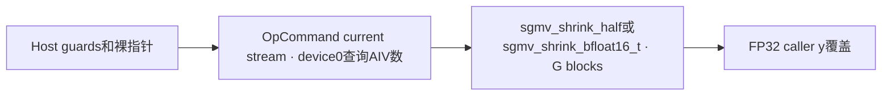

# sgmv_shrink 950 Direct Invoke 算子知识

## 算子速览

| 项目 | 内容 |
|---|---|
| 实际入口 | `torch.ops.npu.sgmv_shrink`→手写Host `sglang::npu_kernel::sgmv_shrink`→typed ACLRT entry |
| 计算语义 | y[t,r]=FP32(scale)*sum_h FP32(x[t,h])*FP32(W[lora(t),r,h])，覆盖FP32输出，不累加旧y |
| 输入输出 | x[T,H]、W[L,R,H]为同类FP16/BF16；y[T,R]须FP32；路由int64；Host不完整验证dtype/几何 |
| 执行类型 | 单AIV_VECTOR；Cast/Mul/ReduceSum/Muls，无Cube |
| Kernel 路线 | 4个实现族：half/BF16 × H≤11776或H>11776；负ID/分段缺失跳过保留原输出 |
| 核心资源 | X/W两个depth1 Queue，各11776*2B；两个FP32临时各47104B；输出Queue和累加TBuf各4R B；UB=141312+8R B，workspace0 |
| 来源闭包 | direct_implementation_closed：native ABI、Host、typed entry、实际body与选中helper及构建闭合 |
| 验证状态 | draft；本次知识提取未执行编译、真机、数值或性能测试；邻近LoRA测试调用不同SGEMMV入口 |

## 接口与语义

### 计算语义

每token选择一个适配器，W物理紧密布局[L,R,H]，允许Host rank4但只有[L,1,R,H]与此stride相符。FP16/BF16输入与权重转FP32，按11776元素tile求点积；每tile ReduceSum结果用FP32 scalar acc顺序累加，最后统一乘scale并覆盖FP32 y。与expand不同，这里无旧y读入，也不把负ID解释为输出零：跳过即保留caller原值。

每核初始化BlockIterator(seqLen)，previous_block=0、previous_offset=0。按递增token t，从缓存block开始累加length；若t>=offset+length则前进，否则保存当前block与offset并返回。零长度块跳过；扫描完seq_len返回−1，当前token不写。只有t单调递增且length非负时缓存游标表达正常连续分段，负长度未被Host拒绝。然后读取lora_indices[block]，两metadata长度不匹配未检测。

### 输入、输出与属性

| 参数 | shape/layout | dtype | 约束、默认值与语义 |
|---|---|---|---|
| x | [T,H]连续同NPU | half或BF16 | Host只检查该dtype、rank2，H>R |
| weight | [L,R,H]或[L,1,R,H] | 与x同类型 | Host只要求rank3/4，不检查dtype/轴尺寸/adapter数量 |
| y | [T,R]连续同NPU | FP32 | Host只要求rank2；实际GM reinterpret为float，caller保证dtype和容量 |
| 路由 | lora_indices[S]与seq_len[S] | int64 | 各连续token块长度；非负、同长、sum覆盖T由caller保证；非负ID须<L，无Host上界检查 |
| scale | 全调用一个double属性 | Host窄化float | 无逐adapter scale，无默认值/有限数检查 |

### 入口与版本

固定dda6的旧Torch独立Direct Invoke，不是新版aclnnSglSgemmvShrink或SGEMMC。schema所有Tensor标Tensor!，返回空；实际仅写y。基础legacy Host/no_workspace_kernel集合与PrivateUse1注册在arch22/arch35均接线，活动CANN9.1 A3/950 whole-build配置支撑本卡950源码范围，不当作本次构建/产品数值验收。不扩大到A2。既有[四旧LoRA API](../../../../apis/sgl_kernel_npu/sgl_legacy_lora_bgmv_sgmv.md)用于合同对照。

## Host/Launcher 执行流程

### 参数校验与前处理

先读x dtype并只接受Half/BFloat16；检查x rank2、weight rank3/4、y rank2；BGMV额外要求indices rank1及x/y/indices行数相同，SGMV无这组检查。要求H=x.size1>R=y.size1。随后提取data_ptr，路由长度/总token/H先存int，R存uint32，scale double→float；current stream来自当前NPU，进入OpCommand custom handler。

handler硬编码device_id=0查询ACL_DEVICE_INFO_VECTOR_CORE_NUM为int64 A，查询失败TORCH_CHECK；n=ceil(T/A)，再检查n!=0，G=ceil(T/n)启动。没有先检查A>0，T0在正常A>0时n0被拒绝；大shape/int/u32窄化与加法溢出没有guard。直接传裸指针，不cast/contiguous，不验证同NPU/stride、weight几何、y dtype、ID值、SGMV metadata dtype/rank/覆盖和输入输出重叠。

### 参数、Workspace 与生命周期

无tiling Tensor/POD，无workspace；launch参数为裸GM地址、u32尺寸/分工与float scale。custom handler捕获裸指针与标量，没有DeviceGuard、Tensor对象捕获或显式record_stream；调用方须保证current设备/流、所有张量及异步owner有效。能力查询device0与执行current设备不同，异型多NPU可能资源不匹配；匹配分配器/OpCommand/Runtime行为未固定，不能断言已发生UAF。

### 启动图与失败传播



| 节点/边 | producer/consumer | extent/ordering/owner | 失败传播 |
|---|---|---|---|
| 唯一Kernel | sgmv_shrink_impl→typed entry→SGMVShrink::Init/Process | G，x/W/route/y callerGM，current stream，无跨Kernel边 | 查询/n guard抛错；ACLRT返回未检查，handler固定0不是完成同步 |
| 输出 | 每token ScaleOutput/CopyOut→y | R*4字节，Queue交接后GM；caller保活 | 无后继节点、无清零fallback |

## Route 与参数设计

### 分核与资源计算

n=ceil(T/A)，G=ceil(T/n)，核c处理[c*n,min((c+1)*n,T))，每核token递增；不是按rank拆核。Ktile=11776，u=floor(H/Ktile)、tail=H%Ktile；incremental=(H>Ktile)。H≤Ktile时X只载入/转一次并跨R复用；H>Ktile时每r重载每X tile，以固定UB处理任意更长H，X搬运随R重复。H==Ktile选择非incremental，恰一完整tile；H<Ktile没有完整tile、只做一次tail；H>Ktile且整除无tail。

InitBuffer实际容量：2*(11776*2)+2*(11776*4)+4R+4R=141312+8R bytes。输出Queue/TBuf按4R申请，原始R非8倍数时不代替TPipe内部分配对齐；同样普通DataCopy count的32B合法域须caller/SDK满足。Host不查询UB容量或给R上限，必要总量≤实际UB，SDK原语可能的内部资源不冒充这些显式缓冲。

### Route 选择

| 顺序 | Route | Key/模板 | 精确选择条件与优先级 | 不适用去向 |
|---:|---|---|---|---|
| 1 | dtype guard | x Half或BF16 | Host其余rank/H>R通过，handler可完成 | 其他dtype抛错 |
| 2 | typed entry | BF16先于默认half | impl Float早返不可由本Host到达；BF16显式分支 | half分支 |
| 3 | 4族 | SGMVShrink<T>::ProcessImpl<inc> | inc=(H>11776)，两dtype各自true/false | 无更小tile/外部fallback |

```text
Host x dtype/rank/几何弱guard→裸指针→device0 A→n非零→G
half/BF16 entry→Init所有相同容量→每token路由
负adapter/SGMV未覆盖→continue（不写y）
H>11776→ProcessImpl<true>；否则<false>→ScaleOutput→CopyOut
```

### 模板/实现执行矩阵

| Route | key/selector | dtype/shape/platform 完整命中条件 | 执行拓扑与 Kernel 节点 | 实际模板/body | 内存与同步特征 | tail/fallback |
|---|---|---|---|---|---|---|
| R-001 | FP16 / incremental=false | 950；Host完成且x=FP16，H≤11776 | 单sgmv_shrink_half AIV | SGMVShrink<half>::ProcessImpl<false> | 同6缓冲；X跨r驻留 | 普通DataCopy尾count，无外部fallback |
| R-002 | FP16 / incremental=true | 950；Host完成且x=FP16，H>11776 | 单sgmv_shrink_half AIV | SGMVShrink<half>::ProcessImpl<true> | 同6缓冲；每r重载X | 普通DataCopy尾count，无外部fallback |
| R-003 | BF16 / incremental=false | 950；Host完成且x=BF16，H≤11776 | 单sgmv_shrink_bfloat16_t AIV | SGMVShrink<bfloat16_t>::ProcessImpl<false> | 同6缓冲；X跨r驻留 | 普通DataCopy尾count，无外部fallback |
| R-004 | BF16 / incremental=true | 950；Host完成且x=BF16，H>11776 | 单sgmv_shrink_bfloat16_t AIV | SGMVShrink<bfloat16_t>::ProcessImpl<true> | 同6缓冲；每r重载X | 普通DataCopy尾count，无外部fallback |

### 隐藏性能 Guard

| Guard | Host/Tiling 条件 | Device/资源原因 | 影响 Route | 不满足时去向 | 源码符号 |
|---|---|---|---|---|---|
| T/n/A | n!=0检查；A正未检查 | 分核除法、每核范围 | 全部 | T0在正常A下抛错；A0先除法 | Host handler |
| x typed | 仅Half/BF16 | x/W reinterpret同T，y始终float | 全部 | x不符抛错；其他dtype仍caller保证 | Host/Init |
| H tile | H>11776 runtime分支 | X整行可否驻tmpX | 两组 | true增量，非失败 | Process |
| UB/R | 未比较 | 141312+8R显式容量，DataCopy(R) | 全部 | 无UB fallback | Init |
| ID/几何/stride | 无值与容量检查 | 紧密W adapter stride、int64 route | 全部 | 负ID跳过，正越界无防护 | Process |
| 对齐/窄化 | 无统一校验 | 普通DataCopy无Pad，维数u32与乘积 | 全部 | 不宣称任意尾合法 | CopyIn/CopyOut |

### POD/ABI

无自定义POD；生成stub封送ABI为外部边界，下列为每个直接entry参数，不能把它们伪装成packed struct offset。

| 结构 | 字段 | 类型/位宽 | ABI 布局 | 单位 | Host/launcher producer | Device consumer | 边界 |
|---|---|---|---|---|---|---|---|
| entry | x | GM_ADDR | 参数0 | 2TH bytes | x.data_ptr | X_T xGm | 未提供未声明的shape/dtype/range guard |
| entry | weight | GM_ADDR | 参数1 | 2LRH bytes | weight.data_ptr | W_T wGm | 未提供未声明的shape/dtype/range guard |
| entry | loraIndices | GM_ADDR | 参数2 | 8*route_count | route.data_ptr | int64 routeGm | 未提供未声明的shape/dtype/range guard |
| entry | loraIndicesSize | uint32 | 参数3 | elements | int(route.size0) | SetGlobalBuffer length | 未提供未声明的shape/dtype/range guard |
| entry | seqLen | GM_ADDR | 参数4 | int64 lengths | seq_len.data_ptr | seqLenGm | 未提供未声明的shape/dtype/range guard |
| entry | seqLenSize | uint32 | 参数5 | elements | int(seq_len.size0) | BlockIterator GetSize | 未提供未声明的shape/dtype/range guard |
| entry | y | GM_ADDR | 参数6 | 4TR bytes | y.data_ptr | float yOutGm | 未提供未声明的shape/dtype/range guard |
| entry | batchSize | uint32 | 参数7 | tokens | int(x.size0) | Process endIdx | 未提供未声明的shape/dtype/range guard |
| entry | numTokensPerCore | uint32 | 参数8 | tokens/core | ceil(T/A) | start/endIdx | 未提供未声明的shape/dtype/range guard |
| entry | inputHiddenDim | uint32 | 参数9 | elements | int(x.size1) | tile loops/W stride | 未提供未声明的shape/dtype/range guard |
| entry | maxLoRARank | uint32 | 参数10 | elements | uint32(y.size1) | r loop/output extent | 未提供未声明的shape/dtype/range guard |
| entry | scale | float32 | 参数11 | scalar | float(scale_double) | Muls | 未提供未声明的shape/dtype/range guard |

### Route 源码闭包

| Route | Key/selector | Host/Tiling producer | POD/参数 | Kernel entry/router 节点 | Kernel body/直接依赖 | 构建接线 |
|---|---|---|---|---|---|---|
| R-001 | FP16,H≤11776 | csrc/lora/op_host/sgmv_shrink.cpp::sgmv_shrink/sgmv_shrink_impl | 无POD，typed直接参数 | csrc/lora/op_kernel/sgmv_shrink_kernel.cpp::sgmv_shrink_half | SGMVShrink<half>::Init/Process/ProcessImpl<false>/Compute/ScaleOutput/CopyOut/BlockIterator | legacy基础Host/no_workspace_kernel+PrivateUse1 |
| R-002 | FP16,H>11776 | csrc/lora/op_host/sgmv_shrink.cpp::sgmv_shrink/sgmv_shrink_impl | 无POD，typed直接参数 | csrc/lora/op_kernel/sgmv_shrink_kernel.cpp::sgmv_shrink_half | SGMVShrink<half>::Init/Process/ProcessImpl<true>/Compute/ScaleOutput/CopyOut/BlockIterator | legacy基础Host/no_workspace_kernel+PrivateUse1 |
| R-003 | BF16,H≤11776 | csrc/lora/op_host/sgmv_shrink.cpp::sgmv_shrink/sgmv_shrink_impl | 无POD，typed直接参数 | csrc/lora/op_kernel/sgmv_shrink_kernel.cpp::sgmv_shrink_bfloat16_t | SGMVShrink<bfloat16_t>::Init/Process/ProcessImpl<false>/Compute/ScaleOutput/CopyOut/BlockIterator | legacy基础Host/no_workspace_kernel+PrivateUse1 |
| R-004 | BF16,H>11776 | csrc/lora/op_host/sgmv_shrink.cpp::sgmv_shrink/sgmv_shrink_impl | 无POD，typed直接参数 | csrc/lora/op_kernel/sgmv_shrink_kernel.cpp::sgmv_shrink_bfloat16_t | SGMVShrink<bfloat16_t>::Init/Process/ProcessImpl<true>/Compute/ScaleOutput/CopyOut/BlockIterator | legacy基础Host/no_workspace_kernel+PrivateUse1 |

## Kernel 实现

### 公共执行流程

同一typed entry创建TPipe与类，Init所有6个UB区；Process按token路由，跳过无adapter行。有效行按r循环和H tile产生R个FP32 acc，outBufferY保存；ScaleOutput从outBufferY乘float scale直接写FP32 outQueue，EnQue；CopyOut DeQue按R元素DataCopy到y[t*R]，Free。每个Mul/ReduceSum/Muls后PIPE_V barrier；没有跨核flag、atomic或workspace中间边。AscendC primitive内部归约树/内部scratch与编译器调度是SDK边界，不宣称bitwise等同Torch matmul。

### Route R-001：FP16 驻留X复用

#### 适用条件

##### 选择证据

| 层级 | 文件 | 符号 | 源码谓词/参数 | 结果/下一跳 |
|---|---|---|---|---|
| Host | csrc/lora/op_host/sgmv_shrink.cpp | sgmv_shrink/sgmv_shrink_impl | x typed guard后FP16 | sgmv_shrink_half |
| entry | csrc/lora/op_kernel/sgmv_shrink_kernel.cpp | sgmv_shrink_half | typed macro | SGMVShrink<half>::Init/Process |
| body | csrc/lora/op_kernel/sgmv_shrink_kernel.cpp | Process | incremental_=H>11776，当前x=FP16,H≤11776 | ProcessImpl<false> |

#### Device 数据流

##### 函数级调用链

```text
sgmv_shrink→OpCommand custom handler→sgmv_shrink_impl→sgmv_shrink_half
 →SGMVShrink<half>::Init→Process→路由/负ID跳过
 →ProcessImpl<false>→CopyInX/CopyInW→Compute<false>
 →CopyAndComputeLastIteration<false>→ScaleOutput→CopyOut
```

##### 源码等价伪码

```text
伪码；T=half，K=11776；当前Route incremental=false
for t=c*n..min((c+1)*n,totalTokens)-1:
    block=BlockIterator.GetBlockIdx(t); if block<0: continue; id=lora_indices[block]
    if id<0: continue                         # 不清零旧y
    wBase=id*uint32(H*R)
    CopyInX(t,0,H)→EnQue/DeQue；Cast tmpX[0:H] FP32 CAST_NONE；PIPE_V；Free X
    for r=0..R-1:
        acc=FP32(0)
        for j=0..H//K-1:
            CopyInW(r,j,K)→EnQue
            DeQue W；Cast tmpW FP32 CAST_NONE K元素；PIPE_V；Free W
            Mul(tmpW,tmpX,tmpW,K)；PIPE_V
            ReduceSum<float>(tmpW,tmpW,tmpW,K)；PIPE_V；acc+=tmpW[0]
        rem=H%K
        if rem>0:
            CopyInW(r,H//K,rem)；同Compute且count=rem；acc+=tileSum
        outBufferY[r]=acc
    out=Alloc(outQ)；Muls(out,outBufferY,scale,R)；PIPE_V；EnQue(outQ,out)
    out=DeQue(outQ)；DataCopy(y[t*R],out,R)；Free(outQ,out)
```

#### 内存与数据搬运

##### 资源与搬运表

| 层级/缓冲区 | offset/地址公式 | extent/容量公式 | dtype/layout | producer | consumer | owner/lifetime | 对齐/复用 |
|---|---|---|---|---|---|---|---|
| GM X | t*H+j*11776 | 当前count=11776或rem | 当前T连续 | caller | CopyInX | caller异步保活 | 普通DataCopy count元素 |
| GM W | id*(H*R)+r*H+j*11776 | 相同count | 当前T连续 | caller | CopyInW | caller | H*R先u32计算，不虚构64位保护 |
| GM路由 | t或segment block | int64 count | 紧密int64 | caller | scalar GetValue/BlockIterator | caller | 无Host值域读回 |
| GM y | t*R | R float | FP32 | MTE3 | caller | caller可变输出 | 负ID/未覆盖不写 |
| inQueueX VECIN | 0 | depth1*11776*2=23552B | T | MTE2 | Cast tmpX | Alloc→EnQue/DeQue→Free | 驻留路线只填H但容量不减 |
| inQueueW VECIN | 0 | depth1*23552B | T | MTE2 | Cast tmpW | 每r/tile复用 | 无双缓冲 |
| tmpBufferX VECCALC | 0 | 11776*4=47104B | FP32 | Cast | Mul | 整token或当前tile | 驻留跨r/增量重载不同 |
| tmpBufferW VECCALC | 0 | 47104B | FP32 | Cast→Mul→ReduceSum原地 | scalar acc | 每r/tile复用 | 实参与scratch alias按源码，内部约束为SDK边界 |
| outBufferY VECCALC | r*4 | R*4B | FP32 | r循环 | Muls | 当前token全部r | 下一token覆盖 |
| outQueueY VECOUT | 0 | depth1*R*4B | FP32 | Muls | MTE3 | Alloc→EnQue/DeQue→Free | 无算法workspace |

##### 分层内存布局


##### 字节账与复用顺序

```text
显式UB=23552+23552+47104+47104+4R+4R=141312+8R B
必要条件显式UB及匹配SDK内部资源<=实际可用UB；Host不查询比较
workspace=0；dynamic_ub=N/A；寄存器精确分配不可由固定源码量化
```

| 复用子区 | 写入者 | 读取者/消费点 | 下一次覆盖 | 同步或释放依据 | 安全条件 |
|---|---|---|---|---|---|
| tmpX | Cast X | 当前/后续Mul | 驻留下一token，增量下一tile | Cast后PIPE_V；Mul后PIPE_V | 驻留不能被每r覆写 |
| tmpW | Cast→Mul→ReduceSum | scalar GetValue(0) | 下一tile Cast | 各PIPE_V | acc读取先于覆盖 |
| outBufferY | 每r标量acc | 一次Muls | 下一token | Muls后PIPE_V | R项完整计算 |
| outQueueY | Muls | DataCopy | 下一token分配 | EnQue/DeQue/Free | 保留MTE3复用依赖 |

#### 同步、精度与尾块

##### 同步与数值边界表

| 阶段 | primitive/机制 | producer | consumer/等待点 | 保护对象 | 精度/尾块 |
|---|---|---|---|---|---|
| 载入到转换 | Queue EnQue/DeQue | X/W MTE2 | Cast | 输入UB | T→FP32 CAST_NONE |
| 乘法与归约 | PIPE_V | Cast/Mul/ReduceSum | 后续Vector/scalar | tmpX/tmpW | FP32 Mul与tile ReduceSum，顺序acc加；不承诺具体归约树 |
| tail | rem>0分支 | 最后X/W搬运 | Compute count=rem | 有效元素 | 普通DataCopy无Pad，不能推出任意rem对齐合法 |
| scale/输出 | Muls→PIPE_V→EnQue/DeQue | acc/scale | MTE3 | float output | scale Host由double窄化float，无半精度回cast |
| 跳过 | id<0/BlockIterator−1 | scalar路由 | continue | 原y保留 | 不做加零/清零 |

#### 关键实现

##### 符号证据表

| 阶段 | 文件 | 符号/模板实例 | 实现事实 |
|---|---|---|---|
| Host/Tiling producer | csrc/lora/op_host/sgmv_shrink.cpp | sgmv_shrink/sgmv_shrink_impl | device0核数、typed分发、直接参数 |
| Kernel entry/router | csrc/lora/op_kernel/sgmv_shrink_kernel.cpp | sgmv_shrink_half | SGMVShrink<half>实例 |
| Device body/helper | csrc/lora/op_kernel/sgmv_shrink_kernel.cpp | ProcessImpl<false>/Compute/CopyAndComputeLastIteration | x=FP16,H≤11776的真实X复用与tail |

### Route R-002：FP16 增量X分块

#### 适用条件

##### 选择证据

| 层级 | 文件 | 符号 | 源码谓词/参数 | 结果/下一跳 |
|---|---|---|---|---|
| Host | csrc/lora/op_host/sgmv_shrink.cpp | sgmv_shrink/sgmv_shrink_impl | x typed guard后FP16 | sgmv_shrink_half |
| entry | csrc/lora/op_kernel/sgmv_shrink_kernel.cpp | sgmv_shrink_half | typed macro | SGMVShrink<half>::Init/Process |
| body | csrc/lora/op_kernel/sgmv_shrink_kernel.cpp | Process | incremental_=H>11776，当前x=FP16,H>11776 | ProcessImpl<true> |

#### Device 数据流

##### 函数级调用链

```text
sgmv_shrink→OpCommand custom handler→sgmv_shrink_impl→sgmv_shrink_half
 →SGMVShrink<half>::Init→Process→路由/负ID跳过
 →ProcessImpl<true>→CopyInX/CopyInW→Compute<true>
 →CopyAndComputeLastIteration<true>→ScaleOutput→CopyOut
```

##### 源码等价伪码

```text
伪码；T=half，K=11776；当前Route incremental=true
for t=c*n..min((c+1)*n,totalTokens)-1:
    block=BlockIterator.GetBlockIdx(t); if block<0: continue; id=lora_indices[block]
    if id<0: continue                         # 不清零旧y
    wBase=id*uint32(H*R)
    for r=0..R-1:
        acc=FP32(0)
        for j=0..H//K-1:
            CopyInX(t,j,K)→EnQue
            CopyInW(r,j,K)→EnQue
            DeQue X/W；Cast tmpX/tmpW FP32 CAST_NONE K元素；PIPE_V；Free X/W
            Mul(tmpW,tmpX,tmpW,K)；PIPE_V
            ReduceSum<float>(tmpW,tmpW,tmpW,K)；PIPE_V；acc+=tmpW[0]
        rem=H%K
        if rem>0:
            CopyInX(t,H//K,rem)；转换/释放与当前完整tile相同
            CopyInW(r,H//K,rem)；同Compute且count=rem；acc+=tileSum
        outBufferY[r]=acc
    out=Alloc(outQ)；Muls(out,outBufferY,scale,R)；PIPE_V；EnQue(outQ,out)
    out=DeQue(outQ)；DataCopy(y[t*R],out,R)；Free(outQ,out)
```

#### 内存与数据搬运

##### 资源与搬运表

| 层级/缓冲区 | offset/地址公式 | extent/容量公式 | dtype/layout | producer | consumer | owner/lifetime | 对齐/复用 |
|---|---|---|---|---|---|---|---|
| GM X | t*H+j*11776 | 当前count=11776或rem | 当前T连续 | caller | CopyInX | caller异步保活 | 普通DataCopy count元素 |
| GM W | id*(H*R)+r*H+j*11776 | 相同count | 当前T连续 | caller | CopyInW | caller | H*R先u32计算，不虚构64位保护 |
| GM路由 | t或segment block | int64 count | 紧密int64 | caller | scalar GetValue/BlockIterator | caller | 无Host值域读回 |
| GM y | t*R | R float | FP32 | MTE3 | caller | caller可变输出 | 负ID/未覆盖不写 |
| inQueueX VECIN | 0 | depth1*11776*2=23552B | T | MTE2 | Cast tmpX | Alloc→EnQue/DeQue→Free | 驻留路线只填H但容量不减 |
| inQueueW VECIN | 0 | depth1*23552B | T | MTE2 | Cast tmpW | 每r/tile复用 | 无双缓冲 |
| tmpBufferX VECCALC | 0 | 11776*4=47104B | FP32 | Cast | Mul | 整token或当前tile | 驻留跨r/增量重载不同 |
| tmpBufferW VECCALC | 0 | 47104B | FP32 | Cast→Mul→ReduceSum原地 | scalar acc | 每r/tile复用 | 实参与scratch alias按源码，内部约束为SDK边界 |
| outBufferY VECCALC | r*4 | R*4B | FP32 | r循环 | Muls | 当前token全部r | 下一token覆盖 |
| outQueueY VECOUT | 0 | depth1*R*4B | FP32 | Muls | MTE3 | Alloc→EnQue/DeQue→Free | 无算法workspace |

##### 分层内存布局


##### 字节账与复用顺序

```text
显式UB=23552+23552+47104+47104+4R+4R=141312+8R B
必要条件显式UB及匹配SDK内部资源<=实际可用UB；Host不查询比较
workspace=0；dynamic_ub=N/A；寄存器精确分配不可由固定源码量化
```

| 复用子区 | 写入者 | 读取者/消费点 | 下一次覆盖 | 同步或释放依据 | 安全条件 |
|---|---|---|---|---|---|
| tmpX | Cast X | 当前/后续Mul | 驻留下一token，增量下一tile | Cast后PIPE_V；Mul后PIPE_V | 驻留不能被每r覆写 |
| tmpW | Cast→Mul→ReduceSum | scalar GetValue(0) | 下一tile Cast | 各PIPE_V | acc读取先于覆盖 |
| outBufferY | 每r标量acc | 一次Muls | 下一token | Muls后PIPE_V | R项完整计算 |
| outQueueY | Muls | DataCopy | 下一token分配 | EnQue/DeQue/Free | 保留MTE3复用依赖 |

#### 同步、精度与尾块

##### 同步与数值边界表

| 阶段 | primitive/机制 | producer | consumer/等待点 | 保护对象 | 精度/尾块 |
|---|---|---|---|---|---|
| 载入到转换 | Queue EnQue/DeQue | X/W MTE2 | Cast | 输入UB | T→FP32 CAST_NONE |
| 乘法与归约 | PIPE_V | Cast/Mul/ReduceSum | 后续Vector/scalar | tmpX/tmpW | FP32 Mul与tile ReduceSum，顺序acc加；不承诺具体归约树 |
| tail | rem>0分支 | 最后X/W搬运 | Compute count=rem | 有效元素 | 普通DataCopy无Pad，不能推出任意rem对齐合法 |
| scale/输出 | Muls→PIPE_V→EnQue/DeQue | acc/scale | MTE3 | float output | scale Host由double窄化float，无半精度回cast |
| 跳过 | id<0/BlockIterator−1 | scalar路由 | continue | 原y保留 | 不做加零/清零 |

#### 关键实现

##### 符号证据表

| 阶段 | 文件 | 符号/模板实例 | 实现事实 |
|---|---|---|---|
| Host/Tiling producer | csrc/lora/op_host/sgmv_shrink.cpp | sgmv_shrink/sgmv_shrink_impl | device0核数、typed分发、直接参数 |
| Kernel entry/router | csrc/lora/op_kernel/sgmv_shrink_kernel.cpp | sgmv_shrink_half | SGMVShrink<half>实例 |
| Device body/helper | csrc/lora/op_kernel/sgmv_shrink_kernel.cpp | ProcessImpl<true>/Compute/CopyAndComputeLastIteration | x=FP16,H>11776的真实X复用与tail |

### Route R-003：BF16 驻留X复用

#### 适用条件

##### 选择证据

| 层级 | 文件 | 符号 | 源码谓词/参数 | 结果/下一跳 |
|---|---|---|---|---|
| Host | csrc/lora/op_host/sgmv_shrink.cpp | sgmv_shrink/sgmv_shrink_impl | x typed guard后BF16 | sgmv_shrink_bfloat16_t |
| entry | csrc/lora/op_kernel/sgmv_shrink_kernel.cpp | sgmv_shrink_bfloat16_t | typed macro | SGMVShrink<bfloat16_t>::Init/Process |
| body | csrc/lora/op_kernel/sgmv_shrink_kernel.cpp | Process | incremental_=H>11776，当前x=BF16,H≤11776 | ProcessImpl<false> |

#### Device 数据流

##### 函数级调用链

```text
sgmv_shrink→OpCommand custom handler→sgmv_shrink_impl→sgmv_shrink_bfloat16_t
 →SGMVShrink<bfloat16_t>::Init→Process→路由/负ID跳过
 →ProcessImpl<false>→CopyInX/CopyInW→Compute<false>
 →CopyAndComputeLastIteration<false>→ScaleOutput→CopyOut
```

##### 源码等价伪码

```text
伪码；T=bfloat16_t，K=11776；当前Route incremental=false
for t=c*n..min((c+1)*n,totalTokens)-1:
    block=BlockIterator.GetBlockIdx(t); if block<0: continue; id=lora_indices[block]
    if id<0: continue                         # 不清零旧y
    wBase=id*uint32(H*R)
    CopyInX(t,0,H)→EnQue/DeQue；Cast tmpX[0:H] FP32 CAST_NONE；PIPE_V；Free X
    for r=0..R-1:
        acc=FP32(0)
        for j=0..H//K-1:
            CopyInW(r,j,K)→EnQue
            DeQue W；Cast tmpW FP32 CAST_NONE K元素；PIPE_V；Free W
            Mul(tmpW,tmpX,tmpW,K)；PIPE_V
            ReduceSum<float>(tmpW,tmpW,tmpW,K)；PIPE_V；acc+=tmpW[0]
        rem=H%K
        if rem>0:
            CopyInW(r,H//K,rem)；同Compute且count=rem；acc+=tileSum
        outBufferY[r]=acc
    out=Alloc(outQ)；Muls(out,outBufferY,scale,R)；PIPE_V；EnQue(outQ,out)
    out=DeQue(outQ)；DataCopy(y[t*R],out,R)；Free(outQ,out)
```

#### 内存与数据搬运

##### 资源与搬运表

| 层级/缓冲区 | offset/地址公式 | extent/容量公式 | dtype/layout | producer | consumer | owner/lifetime | 对齐/复用 |
|---|---|---|---|---|---|---|---|
| GM X | t*H+j*11776 | 当前count=11776或rem | 当前T连续 | caller | CopyInX | caller异步保活 | 普通DataCopy count元素 |
| GM W | id*(H*R)+r*H+j*11776 | 相同count | 当前T连续 | caller | CopyInW | caller | H*R先u32计算，不虚构64位保护 |
| GM路由 | t或segment block | int64 count | 紧密int64 | caller | scalar GetValue/BlockIterator | caller | 无Host值域读回 |
| GM y | t*R | R float | FP32 | MTE3 | caller | caller可变输出 | 负ID/未覆盖不写 |
| inQueueX VECIN | 0 | depth1*11776*2=23552B | T | MTE2 | Cast tmpX | Alloc→EnQue/DeQue→Free | 驻留路线只填H但容量不减 |
| inQueueW VECIN | 0 | depth1*23552B | T | MTE2 | Cast tmpW | 每r/tile复用 | 无双缓冲 |
| tmpBufferX VECCALC | 0 | 11776*4=47104B | FP32 | Cast | Mul | 整token或当前tile | 驻留跨r/增量重载不同 |
| tmpBufferW VECCALC | 0 | 47104B | FP32 | Cast→Mul→ReduceSum原地 | scalar acc | 每r/tile复用 | 实参与scratch alias按源码，内部约束为SDK边界 |
| outBufferY VECCALC | r*4 | R*4B | FP32 | r循环 | Muls | 当前token全部r | 下一token覆盖 |
| outQueueY VECOUT | 0 | depth1*R*4B | FP32 | Muls | MTE3 | Alloc→EnQue/DeQue→Free | 无算法workspace |

##### 分层内存布局


##### 字节账与复用顺序

```text
显式UB=23552+23552+47104+47104+4R+4R=141312+8R B
必要条件显式UB及匹配SDK内部资源<=实际可用UB；Host不查询比较
workspace=0；dynamic_ub=N/A；寄存器精确分配不可由固定源码量化
```

| 复用子区 | 写入者 | 读取者/消费点 | 下一次覆盖 | 同步或释放依据 | 安全条件 |
|---|---|---|---|---|---|
| tmpX | Cast X | 当前/后续Mul | 驻留下一token，增量下一tile | Cast后PIPE_V；Mul后PIPE_V | 驻留不能被每r覆写 |
| tmpW | Cast→Mul→ReduceSum | scalar GetValue(0) | 下一tile Cast | 各PIPE_V | acc读取先于覆盖 |
| outBufferY | 每r标量acc | 一次Muls | 下一token | Muls后PIPE_V | R项完整计算 |
| outQueueY | Muls | DataCopy | 下一token分配 | EnQue/DeQue/Free | 保留MTE3复用依赖 |

#### 同步、精度与尾块

##### 同步与数值边界表

| 阶段 | primitive/机制 | producer | consumer/等待点 | 保护对象 | 精度/尾块 |
|---|---|---|---|---|---|
| 载入到转换 | Queue EnQue/DeQue | X/W MTE2 | Cast | 输入UB | T→FP32 CAST_NONE |
| 乘法与归约 | PIPE_V | Cast/Mul/ReduceSum | 后续Vector/scalar | tmpX/tmpW | FP32 Mul与tile ReduceSum，顺序acc加；不承诺具体归约树 |
| tail | rem>0分支 | 最后X/W搬运 | Compute count=rem | 有效元素 | 普通DataCopy无Pad，不能推出任意rem对齐合法 |
| scale/输出 | Muls→PIPE_V→EnQue/DeQue | acc/scale | MTE3 | float output | scale Host由double窄化float，无半精度回cast |
| 跳过 | id<0/BlockIterator−1 | scalar路由 | continue | 原y保留 | 不做加零/清零 |

#### 关键实现

##### 符号证据表

| 阶段 | 文件 | 符号/模板实例 | 实现事实 |
|---|---|---|---|
| Host/Tiling producer | csrc/lora/op_host/sgmv_shrink.cpp | sgmv_shrink/sgmv_shrink_impl | device0核数、typed分发、直接参数 |
| Kernel entry/router | csrc/lora/op_kernel/sgmv_shrink_kernel.cpp | sgmv_shrink_bfloat16_t | SGMVShrink<bfloat16_t>实例 |
| Device body/helper | csrc/lora/op_kernel/sgmv_shrink_kernel.cpp | ProcessImpl<false>/Compute/CopyAndComputeLastIteration | x=BF16,H≤11776的真实X复用与tail |

### Route R-004：BF16 增量X分块

#### 适用条件

##### 选择证据

| 层级 | 文件 | 符号 | 源码谓词/参数 | 结果/下一跳 |
|---|---|---|---|---|
| Host | csrc/lora/op_host/sgmv_shrink.cpp | sgmv_shrink/sgmv_shrink_impl | x typed guard后BF16 | sgmv_shrink_bfloat16_t |
| entry | csrc/lora/op_kernel/sgmv_shrink_kernel.cpp | sgmv_shrink_bfloat16_t | typed macro | SGMVShrink<bfloat16_t>::Init/Process |
| body | csrc/lora/op_kernel/sgmv_shrink_kernel.cpp | Process | incremental_=H>11776，当前x=BF16,H>11776 | ProcessImpl<true> |

#### Device 数据流

##### 函数级调用链

```text
sgmv_shrink→OpCommand custom handler→sgmv_shrink_impl→sgmv_shrink_bfloat16_t
 →SGMVShrink<bfloat16_t>::Init→Process→路由/负ID跳过
 →ProcessImpl<true>→CopyInX/CopyInW→Compute<true>
 →CopyAndComputeLastIteration<true>→ScaleOutput→CopyOut
```

##### 源码等价伪码

```text
伪码；T=bfloat16_t，K=11776；当前Route incremental=true
for t=c*n..min((c+1)*n,totalTokens)-1:
    block=BlockIterator.GetBlockIdx(t); if block<0: continue; id=lora_indices[block]
    if id<0: continue                         # 不清零旧y
    wBase=id*uint32(H*R)
    for r=0..R-1:
        acc=FP32(0)
        for j=0..H//K-1:
            CopyInX(t,j,K)→EnQue
            CopyInW(r,j,K)→EnQue
            DeQue X/W；Cast tmpX/tmpW FP32 CAST_NONE K元素；PIPE_V；Free X/W
            Mul(tmpW,tmpX,tmpW,K)；PIPE_V
            ReduceSum<float>(tmpW,tmpW,tmpW,K)；PIPE_V；acc+=tmpW[0]
        rem=H%K
        if rem>0:
            CopyInX(t,H//K,rem)；转换/释放与当前完整tile相同
            CopyInW(r,H//K,rem)；同Compute且count=rem；acc+=tileSum
        outBufferY[r]=acc
    out=Alloc(outQ)；Muls(out,outBufferY,scale,R)；PIPE_V；EnQue(outQ,out)
    out=DeQue(outQ)；DataCopy(y[t*R],out,R)；Free(outQ,out)
```

#### 内存与数据搬运

##### 资源与搬运表

| 层级/缓冲区 | offset/地址公式 | extent/容量公式 | dtype/layout | producer | consumer | owner/lifetime | 对齐/复用 |
|---|---|---|---|---|---|---|---|
| GM X | t*H+j*11776 | 当前count=11776或rem | 当前T连续 | caller | CopyInX | caller异步保活 | 普通DataCopy count元素 |
| GM W | id*(H*R)+r*H+j*11776 | 相同count | 当前T连续 | caller | CopyInW | caller | H*R先u32计算，不虚构64位保护 |
| GM路由 | t或segment block | int64 count | 紧密int64 | caller | scalar GetValue/BlockIterator | caller | 无Host值域读回 |
| GM y | t*R | R float | FP32 | MTE3 | caller | caller可变输出 | 负ID/未覆盖不写 |
| inQueueX VECIN | 0 | depth1*11776*2=23552B | T | MTE2 | Cast tmpX | Alloc→EnQue/DeQue→Free | 驻留路线只填H但容量不减 |
| inQueueW VECIN | 0 | depth1*23552B | T | MTE2 | Cast tmpW | 每r/tile复用 | 无双缓冲 |
| tmpBufferX VECCALC | 0 | 11776*4=47104B | FP32 | Cast | Mul | 整token或当前tile | 驻留跨r/增量重载不同 |
| tmpBufferW VECCALC | 0 | 47104B | FP32 | Cast→Mul→ReduceSum原地 | scalar acc | 每r/tile复用 | 实参与scratch alias按源码，内部约束为SDK边界 |
| outBufferY VECCALC | r*4 | R*4B | FP32 | r循环 | Muls | 当前token全部r | 下一token覆盖 |
| outQueueY VECOUT | 0 | depth1*R*4B | FP32 | Muls | MTE3 | Alloc→EnQue/DeQue→Free | 无算法workspace |

##### 分层内存布局


##### 字节账与复用顺序

```text
显式UB=23552+23552+47104+47104+4R+4R=141312+8R B
必要条件显式UB及匹配SDK内部资源<=实际可用UB；Host不查询比较
workspace=0；dynamic_ub=N/A；寄存器精确分配不可由固定源码量化
```

| 复用子区 | 写入者 | 读取者/消费点 | 下一次覆盖 | 同步或释放依据 | 安全条件 |
|---|---|---|---|---|---|
| tmpX | Cast X | 当前/后续Mul | 驻留下一token，增量下一tile | Cast后PIPE_V；Mul后PIPE_V | 驻留不能被每r覆写 |
| tmpW | Cast→Mul→ReduceSum | scalar GetValue(0) | 下一tile Cast | 各PIPE_V | acc读取先于覆盖 |
| outBufferY | 每r标量acc | 一次Muls | 下一token | Muls后PIPE_V | R项完整计算 |
| outQueueY | Muls | DataCopy | 下一token分配 | EnQue/DeQue/Free | 保留MTE3复用依赖 |

#### 同步、精度与尾块

##### 同步与数值边界表

| 阶段 | primitive/机制 | producer | consumer/等待点 | 保护对象 | 精度/尾块 |
|---|---|---|---|---|---|
| 载入到转换 | Queue EnQue/DeQue | X/W MTE2 | Cast | 输入UB | T→FP32 CAST_NONE |
| 乘法与归约 | PIPE_V | Cast/Mul/ReduceSum | 后续Vector/scalar | tmpX/tmpW | FP32 Mul与tile ReduceSum，顺序acc加；不承诺具体归约树 |
| tail | rem>0分支 | 最后X/W搬运 | Compute count=rem | 有效元素 | 普通DataCopy无Pad，不能推出任意rem对齐合法 |
| scale/输出 | Muls→PIPE_V→EnQue/DeQue | acc/scale | MTE3 | float output | scale Host由double窄化float，无半精度回cast |
| 跳过 | id<0/BlockIterator−1 | scalar路由 | continue | 原y保留 | 不做加零/清零 |

#### 关键实现

##### 符号证据表

| 阶段 | 文件 | 符号/模板实例 | 实现事实 |
|---|---|---|---|
| Host/Tiling producer | csrc/lora/op_host/sgmv_shrink.cpp | sgmv_shrink/sgmv_shrink_impl | device0核数、typed分发、直接参数 |
| Kernel entry/router | csrc/lora/op_kernel/sgmv_shrink_kernel.cpp | sgmv_shrink_bfloat16_t | SGMVShrink<bfloat16_t>实例 |
| Device body/helper | csrc/lora/op_kernel/sgmv_shrink_kernel.cpp | ProcessImpl<true>/Compute/CopyAndComputeLastIteration | x=BF16,H>11776的真实X复用与tail |

## 算子特定优化

### Trick T-001：小H把FP32 X跨rank驻留，大H使用固定tile

#### 触发与源码依据

- 适用H≤11776的两typed Route，其他两Route明确选增量。
- Golden来源：[非增量分支只转换一次X](https://github.com/sgl-project/sgl-kernel-npu/blob/dda6d36b0cdb4081e102d14c0a2fb276fc416e69/csrc/lora/op_kernel/sgmv_shrink_kernel.cpp#L105-L112)。

**官方源码（固定Commit连续逐字摘录）**：

```cpp
        if constexpr (!INCREMENTAL_MODE) {
            CopyInX(idx, 0, inputHiddenDim_);
            AscendC::LocalTensor<float> xTmpTensor = tmpBufferX_.Get<float>();
            AscendC::LocalTensor<X_T> xLocal = inQueueX_.DeQue<X_T>();
            Cast(xTmpTensor, xLocal, AscendC::RoundMode::CAST_NONE, inputHiddenDim_);
            AscendC::PipeBarrier<PIPE_V>();
            inQueueX_.FreeTensor(xLocal);
        }
```

#### 机制与设计原因

非增量先将整行X保存在tmpX，后续R个点积只载W；较大H保持11776固定容量但每r重载X tile。两者真正改变GM搬运与生命周期，未改变完整UB申请，也不声称源码“optimal performance”注释已由本次测量验证。tmpW直接承接Cast、Mul与ReduceSum，不物化tile结果到GM。

#### 迁移边界

- 适用：同物理布局与dtype的逐适配器dot，H正、H>R。
- 前提：完整6区UB、普通DataCopy对齐、匹配ReduceSum alias/同步语义。
- 失效：超UB R或通用stride需新guard/实现，当前无fallback。
- 未验证：本次知识提取未执行编译、真机、数值或性能测试。

#### 错误做法

固定仓未提供可验证运行反例；不能把大H只载X一次写成当前实现，也不能把tile float scalar acc当作整个H单次ReduceSum的bitwise同序结果。

## 模板与实现对比

| 对比维度 | H≤11776两typed族 | H>11776两typed族 | 设计选择依据 |
|---|---|---|---|
| 命中条件/优先级 | incremental=false | true | Host相同，Device runtime H阈值 |
| 模板与 dtype | SGMVShrink<half/BF16>::ProcessImpl<false> | <true> | 输入dtype决定entry；输出都FP32 |
| 循环与分核 | X一次、R点积 | R×H tiles各重载X | 同token连续分核 |
| Queue/TBuf/寄存器/dynamic UB/通信 window | 相同6区 | 相同 | 无Cube/通信/window/dynamic UB |
| 内存总占用与复用 | 141312+8R B | 相同 | 只数据访问不同 |
| 搬运/Vector/SIMT/NDDMA/通信 API | Cast/Mul/ReduceSum/Muls | 同count随tile变化 | 无外部核心节点 |
| 同步、精度与 tail | H<K只一次tail；H==K一个整tile | 完整tiles后可选rem | 普通DataCopy约束caller负责 |
| fallback/失败边界 | 负ID保留输出 | 相同 | 不自动清零/修元数据 |

## 平台差异

| 项目 | A2 | A3 | Ascend 950 |
|---|---|---|---|
| 支持状态 | 基础arch22构建信号，本次未独立冻结 | 活动CANN9.1整体构建、draft源码范围 | 活动CANN9.1整体构建、draft源码范围 |
| Host/Launcher | 不外推验收 | device0查询核数/current执行流 | 同一查询缺口，非A3固定核数 |
| Kernel/资源 | 未单独确认 | no_workspace基础body | 同源typed entry，BF16宏要求__CCE_AICORE__>=220 |

本卡950，源码支持信号与实际数值验收分开。默认源未提供这四个旧入口的独立已通过测试证明。

## 限制与失败边界

- shrink的x/W应同T、输出y必须FP32、路由必须int64；Host仅校验x dtype，不能用“未报错”证明其他dtype安全。权重rank4非单例中间维仍按紧密三维stride计算。
- 无通用stride/device/alias修复；device0 capability与current执行设备错配、u32尺寸/乘积与int窄化、UB余量/普通DataCopy尾对齐均需接入层核对。
- SGMV需metadata同长、非负length、合法ID，覆盖全token时sum(length)=T；未覆盖/负ID保留旧y，负length不属于可迁移正常语义。BGMV逐tokenmetadata检查相对更强但不查ID上界。
- 测试test_lora_kernels.py实际调用sgemmv_shrink/expand并带lora_ranks/scales/offsets，不是sgmv_shrink，不能充当本卡直接覆盖。没有编译/真机/数值/性能事件或verified。

## 源码索引

### 链路索引

| 链路阶段 | 文件 | 关键符号 | 支撑内容 |
|---|---|---|---|
| Host | csrc/lora/op_host/sgmv_shrink.cpp | sgmv_shrink | checks、能力查询与启动 |
| Device | csrc/lora/op_kernel/sgmv_shrink_kernel.cpp | SGMVShrink | typed entry、两种X载入与点积 |
| Torch | csrc/pytorch_extensions.cpp | schema/PrivateUse1 | 原地输出ABI |
| 框架依赖 | csrc/utils/torch_helper.h | TorchNpuHelper | Host include与Runtime边界 |
| 声明 | csrc/utils/defines.h | HOST_API | 可见性 |
| 构建 | cmake/legacy_kernels.cmake | no_workspace_kernel | 两arch基础Host/Device集合 |
| CI矩阵 | .github/workflows/pr-test-kernels.yml | CANN9.1 A3/950 | 整体构建定义 |
| CI调用 | .github/workflows/pr-test-kernel-group.yml | prepare | 活动构建接线 |
| 构建准备 | scripts/prepare_kernel_tests.sh | legacy kernels | 整体构建 |
| 测试边界 | tests/python/sgl_kernel_npu/test_lora_kernels.py | test_sgemmv_shrink | 不同入口，不能当本卡通过 |
| 分段路由 | csrc/lora/op_kernel/lora_common_kernel.h | BlockIterator | 连续token长度游标 |

### 实现复用检查

| 检查项 | 可复用事实 | 不得改变的约束 | 源码符号 |
|---|---|---|---|
| ABI/POD | 无POD直接entry | u32参数顺序、scale float、GM dtype | typed macro/Host |
| 调用顺序 | current stream/OpCommand | device0能力来源与owner | Host |
| workspace/内存 | workspace0、6UB区 | depth1、tmpW原地与R输出预算 | Init/Compute |
| 同步 | Queue+PIPE_V | Cast→Mul→ReduceSum→scalar→Muls→CopyOut | Compute/ScaleOutput |
| 精度与尾块 | FP32 acc/scale/output | 普通DataCopy tail不是Pad | ProcessImpl/tail |
| 失败边界 | 负ID/未覆盖跳过 | 不清原y、不误用SGEMMV测试 | Process/BlockIterator |
