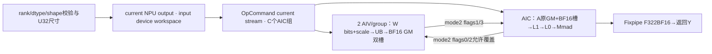
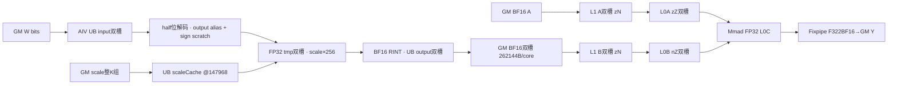

# CATLASS softFP8 W8A16分组矩阵乘 A2/A3 Direct Invoke 算子知识

## 算子速览

| 项目 | 内容 |
|---|---|
| 实际入口 | `torch.ops.npu.softfp8_w8a16_grouped_matmul`，SGL Direct Invoke，返回新Tensor |
| 计算语义 | 有限E4M3权重按128×128 scale反量化并RINT成BF16，再BF16×BF16→FP32累加→BF16输出；按累计前缀切M组 |
| 输入输出 | A BF16，W uint8位容器，S FP32，Y固定Device BF16；紧密ND |
| 执行类型 | 单MIX_CV entry，KERNEL_TYPE_MIX_AIC_1_2；两AIV软件反量化，AIC Cube主循环 |
| Kernel 路线 | R-001 K>N的Swizzle<3,0>；R-002其余Swizzle<3,1> |
| 核心资源 | GM双槽262144B/core；L1有效393216B、L0A/B各64KiB、L0C128KiB；每AIV UB固定147968B+整K scaleCache |
| 来源闭包 | direct_implementation_closed：Host/entry/SGL实际prologue与mainloop、CATLASS70eda实例、SDK9.1同步搬运契约与构建 |
| 验证状态 | draft；已做固定源码闭包分析，本次知识提取未执行编译、真机、数值或性能测试 |

## 接口与语义

### 计算语义

W的uint8仅保存E4M3编码，不是INT8数值矩阵。对有限有效编码，Wb[k,n]=RINT_BF16(decodeE4M3(W[k,n])*S[k//128,n//128])；Y=BF16(sum_k A*Wb)，不加bias、旧Y或activation。实际数值顺序是先软件得到FP16(w/256)，再Cast FP32与(S*256)相乘，Cast BF16 RINT之后才Cube。两个NaN编码0x7f/0xff在此位操作中得到±480有限数，不具有torch.float8_e4m3fn的NaN传播；scale*256也有未guard中间溢出域，不把所有bitpattern/scale推广为上述高精度等式。

令p[-1]=0，p[j]=groupList[j]，m_j=uint32(p[j]−p[j−1])；第j组只对A[p[j−1]:p[j],:]与W[j,:,:]计算，写同一Y行区。groupList为int64累计结束位置，g等于W/scale第一轴，合法前缀单调非负且末值M；不是组大小数组。Host只检查其rank/dtype/长度，不读取前缀值。

### 输入、输出与属性

| 参数 | shape/layout | dtype | 约束、默认值与语义 |
|---|---|---|---|
| mat1 | [M,K]紧密ND | BF16 | Host校验dtype/rank，未检查NPU/连续/同device |
| mat2 | [g,K,N]紧密ND | uint8 | Host检查rank/K，Device以int8指针重解释unsigned bits |
| scale | [g,ceil(K/128),ceil(N/128)] | FP32 | exact shape/rank；无finite/值域/strideguard |
| groupList | [g]紧密 | INT64 | Host只验dtype/rank/numel；Device每组差分为U32，caller保证合法前缀 |
| c / outDType | 必填string位置参数 | 合法合同仅"bf16" | Torch schema名称c，无默认；Host字符串映射另有宽域，见限制 |
| output | 新[M,N]ND | BF16合法合同 | Host按string申请current NPU Tensor，Device没有dtype分发 |

### 入口与版本

固定SGL dda6的third_party/catlass gitlink为70eda；使用该选中库，不混用DeepEP950 v1.6.1或Mega v2。公开README明确softFP8为A2/A3；BUILD_CATLASS_MODULE默认OFF，且两入口Host/注册/entry有SGL_KERNEL_ENABLE_A3_ONLY_OPS双门控，arch22集成才提供。独立catlass_workspace_kernel target用于避免其他算子tla include冲突。CANN9.1是固定legacy CI/匹配SDK基线，本次没有编译验收；950未被此公共合同支持。

[公共接口与BMM边界](../../../../apis/sgl_kernel_npu/sgl_softfp8_w8a16_matmul.md)保留API知识；[基础矩阵乘](sgl_matmul_basic.md)是三dtype、caller输出的另一数学。README BMM在本固定注册/构建无可调用实现，不从本卡推导BMM。

## Host/Launcher 执行流程

### 参数校验与前处理

Host依次检查A BF16/rank2，W byte/rank3，S float/rank3，groupList int64/rank1，用int64原shape算ceil128，然后验证W K、S exact shape及groupList长度g；M/N/K/g再static_cast U32。没有Contiguous、TransData、FP8框架解码或正值/range/device/alias全面guard。

TypeStrToAclDtype经通用map接受float32/float16/int8/int32/bf16，未知string默认为float16。GetOutputTensor按该dtype在current NPU empty_with_format(ND)，不是输入device上的强制BF16申请。最终Kernel只有BF16实例，不会因string改变精度；合法调用须传"bf16"，其他Host接受值没有正确数学fallback。

### 参数、Workspace 与生命周期

C=PlatformAscendCManager.GetCoreNumAic；Host W_H=uint32(4*256*256*sizeof(outputDataType)*C) bytes，其中outputDataType是aclDataType enum，**sizeof(enum)不是所选dtype元素byte数**。若匹配C++ ABI该enum为4B，推导为1048576B/core；未做sizeof/offsetof实测。Device helper需求W_D=2*256*256*sizeof(BF16)*C=262144*C bytes，Host没有调用GetWorkspaceSize；按实际enumABI及U32乘法不溢出才能比较容量，不能误写Host仅分配BF16 2B公式。

workspace在mat1.options().device分配byte Tensor；output为current NPU。current stream、所有裸指针与U32尺寸捕获到OpCommand handler，未捕获Tensor owner、未DeviceGuard、未显式record_stream；caller/返回Tensor/Host局部workspace的异步寿命依匹配Torch NPU allocator和OpCommand协议。生成ACLRT stub/安装binary内部为外部框架边界，固定源码不证明UAF或图捕获可用。

### 启动图与失败传播



handler另查询**device0** VECTOR_CORE_NUM并只检查返回成功，aiv_num结果未用于launch；实际blockDim仍C。ACLRT launch返回码没有被返回，handler固定0，cmd.Run不等于设备完成。失败包括Host TORCH_CHECK抛错、allocator/Runtime外部错误；没有自有fallback或多kernel中断恢复。workspace是entry直接GM地址，不经过GetUserWorkspace/16MiB切片。

## Route 与参数设计

### 分核与资源计算

原尺寸→ceil128 scale shape校验→U32→固定L1(128,256,256)/L0(128,256,64)、STAGES2、computeLen8192、groupSize128→C launch。两Route只改变Swizzle方向，完整prologue/mainloop/资源相同。

两侧同序读groupList：首组m0=p0，后组mj=pj−p[j−1]，窄化U32。对每组Update scheduler({mj,N,K},{128,256})；startCore初始0，core c的首task=(c+C−startCore)%C，步长C；组后startCore=(startCore+ceil(mj/128)*ceil(N/256))%C。Cube/Vector由相同公式对齐。
A/Y组offset以元素累计mj*K/mj*N；W按每组K*N个1B元素推进，S按ceil(K/128)*ceil(N/128)个FP32推进；稀疏/指针列表不是这个接口。AIV对ceil(mj/128)==1的W设置CacheMode::CACHE_MODE_DISABLE，其他矩阵仍默认。mj0不执行MN task但W/S仍跳过当前组，A/Y与startCore不变；g0不写Y。前缀不足M留未写输出，超M越容量，递减先变U32大数，均非Host拒绝路径。表达式mj*K等可能先按U32乘再累计到int64，不能用累加变量宽度推导无溢出。

Swizzle<3,0>：group=t/(3*TN)，inner=t%(3*TN)，rows=min(3,TM−3group)，m=3group+inner%rows，n=inner/rows，奇group翻n=TN−1−n。Swizzle<3,1>：group=t/(3*TM)，inner=t%(3*TM)，cols=min(3,TN−3group)，n=3group+inner%cols，m=inner/cols，奇group翻m=TM−1−m。两个名字是任务蛇形方向，**不把用户W ND改为NZ**。每tile mActual≤128、nActual≤256，Kactual=全K。

### Route 选择

| 顺序 | Route | Key/模板 | 精确选择条件与优先级 | 不适用去向 |
|---:|---|---|---|---|
| 1 | R-001 Zn调度 | Swizzle<3,0> | Host公共合法域后K>N | R-002 |
| 2 | R-002 Nz调度 | Swizzle<3,1> | else，即K<=N | 无第三dtype/layout/fallback |

```text
A BF16/W uint8/S FP32与exactshape校验 +groupList int64长度g
→U32 dims与output/workspace→单MIX1:2 entry
→if K>N: R-001 Swizzle<3,0>; else: R-002 Swizzle<3,1>
→相同AIV解码+scale/RINT BF16和AIC BF16 Cube→Fixpipe
```

### 模板/实现执行矩阵

| Route | key/selector | dtype/shape/platform 完整命中条件 | 执行族与 kernel 节点 | 实际模板/body | 内存与同步特征 | tail/fallback |
|---|---|---|---|---|---|---|
| R-001 | K>N | A2/A3，BF16 A/byte W/float S、ND，Host shape与caller安全域 | 单MIX_CV，AIV_VECTOR→GM双槽→AIC_CUBE | GroupedMatmulSliceMFP8W8A16<BlockMmadOpt,void,Swizzle<3,0>,int64_t> | AtlasA2、STAGES2、mode2四flag、UnitFlag true | actual MN、K256/64、K行两AIV、N256 padding；非法域不自动修复 |
| R-002 | else | 同上且K<=N | 同单entry不同调度实例 | GroupedMatmulSliceMFP8W8A16<BlockMmadOpt,void,Swizzle<3,1>,int64_t> | 相同每core预算与同步，任务蛇形改变 | 无E5M2、NZ输入或FP32输出数学路线 |

BlockMmadOpt精确为BlockMmad<MmadAtlasA2PingPongWithPrologueBFP8<true>,GemmShape<128,256,256>,GemmShape<128,256,64>,GemmType<BF16,RowMajor>三项,void,TileCopyWithPrologue<AtlasA2,AType,BType,CType,void,TileCastFp8ToBf16WithScaleDequant<AtlasA2,GemmType<int8,RowMajor>,GemmType<BF16,RowMajor>,GemmType<float,RowMajor>,8192>>>。ElementAccumulatorSelector为float；无PrologueA/BlockEpilogue/bias。ColumnMajor、长行>4096、带PrologueA等通用分支当前实例均不可达，不伪造为Host路线。

### 隐藏性能 Guard

| Guard | Host/Tiling 条件 | Device/资源原因 | 影响 Route | 不满足时去向 | 源码符号 |
|---|---|---|---|---|---|
| 公开输入 | BF16/byte/float exactrank/shape | Typed BF16 Cube+位解码 | 全部 | Host throw | csrc/catlass/op_host/catlass_gmm_fp8.cpp |
| 输出字符串 | Host未限定bf16 | Device始终2B BF16写 | 全部 | 其他string仅改变allocation，无正确fallback | catlass_op_utils.cpp/entry |
| scale容量 | Host无K上限 | UB147968+32ceil(K/128)≤196608，当前cols1/2 | 全部 | ceil(K/128)>1520越声明UB，非Host拒绝；未真机复现 | loadAllTileScales |
| scale搬运窄化 | DataCopyParams四字段u16 | 整K组数、byte rowgap窄化；A2/A3每次blockCount另有4095限制 | 全部 | 无split长scale preload fallback | SDK DataCopyParams / loadAllTileScales |
| L1/L0 | static_assert容量、L1/L0同M/N | 393216≤512KiB，A/B/C tile满足资源 | 全部 | 模板不满足编译拒绝，本次未编译 | BlockMmad constants |
| ND→zN stride | srcDValue<65536 | CopyGmToL1 ND2NZ参数限制 | 全部 | 选中库逐行fallback，不是Host抛错 | CATLASS CopyGmToL1 |
| 正域/连续/device | Host没有完整guard | U32维度/offset、异步GM地址与cache | 全部 | 无空K/溢出修复 | Host/scheduler |
| prefix值 | Host只验长度 | group差分U32、startCore模C、A/Y容量 | 全部 | 非法值直接影响地址/覆盖，不构造自动分组 | GroupedMatmulSliceMFP8W8A16 |

### POD/ABI

无Host序列化tiling Tensor。以下先列ACLRT entry参数，按源码实参顺序传递；device地址通常64位，但生成stub参数打包sizeof/alignof/offsetof未在固定SGL仓提供，不把顺序号冒充结构byte offset。局部Params在同一Device TU构造/消费，非跨GM POD，含layout/traits的总体ABI未测。

| 结构 | 字段 | 类型/位宽 | ABI 布局 | 单位 | Host/launcher producer | Device consumer | 边界 |
|---|---|---|---|---|---|---|---|
| entry | deviceA | GM_ADDR | 顺序0，stub packing不可见 | 地址 | mat1.data_ptr | A layout/Copy | 无自动dtype/stride/范围修复 |
| entry | deviceB | GM_ADDR | 顺序1，stub packing不可见 | 地址 | mat2.data_ptr | rawW prologue | 无自动dtype/stride/范围修复 |
| entry | deviceScale | GM_ADDR | 顺序2，stub packing不可见 | 地址 | scale.data_ptr | loadAllTileScales | 无自动dtype/stride/范围修复 |
| entry | deviceGroupList | GM_ADDR | 顺序3，stub packing不可见 | 地址 | groupList.data_ptr | 逐组int64差分 | 无自动dtype/stride/范围修复 |
| entry | deviceC | GM_ADDR | 顺序4，stub packing不可见 | 地址 | GetOutputTensor.data_ptr | Fixpipe BF16写 | 无自动dtype/stride/范围修复 |
| entry | deviceWorkspace | GM_ADDR | 顺序5，stub packing不可见 | 地址 | byte workspace.data_ptr | BF16每core双槽 | 无自动dtype/stride/范围修复 |
| entry | g | uint32/32 | 顺序6，stub packing不可见 | 元素/组数 | uint32(W.size0) | problemCount组循环 | 无自动dtype/stride/范围修复 |
| entry | m | uint32/32 | 顺序7，stub packing不可见 | 元素/组数 | uint32(A.size0) | problemShape M/Y allocation | 无自动dtype/stride/范围修复 |
| entry | n | uint32/32 | 顺序8，stub packing不可见 | 元素/组数 | uint32(W最后轴) | RowMajor stride/Swizzle N | 无自动dtype/stride/范围修复 |
| entry | k | uint32/32 | 顺序9，stub packing不可见 | 元素/组数 | uint32(A.size1) | K循环/scale rows | 无自动dtype/stride/范围修复 |
| Kernel Params | problemShape | GemmCoord/U32轴 | 同TU局部，sizeof/offset未测 | 按字段typed语义 | entry显式{m,n,k} | scheduler/actualshape | 非额外GM传输字段 |
| Kernel Params | problemCount | uint32/32 | 同TU局部，sizeof/offset未测 | 按字段typed语义 | entry显式g | 逐组循环 | 非额外GM传输字段 |
| Kernel Params | ptrGroupList | GM_ADDR | 同TU局部，sizeof/offset未测 | 按字段typed语义 | entry显式deviceGroupList | int64前缀读取 | 非额外GM传输字段 |
| Kernel Params | ptrA | GM_ADDR | 同TU局部，sizeof/offset未测 | 按字段typed语义 | entry显式deviceA | A Tile GM | 非额外GM传输字段 |
| Kernel Params | layoutA | RowMajor | 同TU局部，sizeof/offset未测 | 按字段typed语义 | entry显式{m,k} | A strideK | 非额外GM传输字段 |
| Kernel Params | ptrPrologueB | GM_ADDR | 同TU局部，sizeof/offset未测 | 按字段typed语义 | entry显式deviceB | rawW pointer | 非额外GM传输字段 |
| Kernel Params | layoutPrologueB | RowMajor | 同TU局部，sizeof/offset未测 | 按字段typed语义 | entry显式{k,n} | rawW strideN | 非额外GM传输字段 |
| Kernel Params | ptrC | GM_ADDR | 同TU局部，sizeof/offset未测 | 按字段typed语义 | entry显式deviceC | Y output | 非额外GM传输字段 |
| Kernel Params | layoutC | RowMajor | 同TU局部，sizeof/offset未测 | 按字段typed语义 | entry显式{m,n} | Y strideN | 非额外GM传输字段 |
| Kernel Params | mmadParams | BlockMmad::Params | 同TU局部，sizeof/offset未测 | 按字段typed语义 | entry显式{{},{half1,half0},{}} | PrologueB Params/store与Fixpipe Params | 非额外GM传输字段 |
| Kernel Params | ptrPerGroupScale | GM_ADDR | 同TU局部，sizeof/offset未测 | 按字段typed语义 | entry显式deviceScale | scaleTile GM | 非额外GM传输字段 |
| Kernel Params | layoutScale | RowMajor | 同TU局部，sizeof/offset未测 | 按字段typed语义 | entry显式{ceil(K/128),ceil(N/128)} | scale full-rowstride | 非额外GM传输字段 |
| Kernel Params | groupSize | uint32/32 | 同TU局部，sizeof/offset未测 | 按字段typed语义 | entry显式128 | scale K/N组索引 | 非额外GM传输字段 |
| Kernel Params | ptrWorkspace | GM_ADDR | 同TU局部，sizeof/offset未测 | 按字段typed语义 | entry显式deviceWorkspace | c*256*256*STAGES BF16元素 | 非额外GM传输字段 |
| BlockMmad::Params | prologueA | traits Params | 同TU局部，布局未测 | 局部对象 | entry aggregate init | void traits为空/inactive | 不是独立Host tiling |
| BlockMmad::Params | prologueB | traits Params | 同TU局部，布局未测 | 局部对象 | entry aggregate init | 两个half字段见下 | 不是独立Host tiling |
| BlockMmad::Params | copyL0CToGm | traits Params | 同TU局部，布局未测 | 局部对象 | entry aggregate init | 空Params，默认F322BF16选择 | 不是独立Host tiling |
| PrologueB::Params | scalar | half/16 | 局部两个half声明；未测布局 | 标量 | entry half1 | 构造仅保存，当前Dequant/Muls不读取 | inactive，不能当运行时scale/zero-point开关 |
| PrologueB::Params | zeroPoint | half/16 | 局部两个half声明；未测布局 | 标量 | entry half0 | 构造仅保存，当前Dequant/Muls不读取 | inactive，不能当运行时scale/zero-point开关 |

### Route 源码闭包

| Route | Key/selector | Host/Tiling producer | POD/参数 | Kernel entry/router | Kernel body/直接依赖 | 构建接线 |
|---|---|---|---|---|---|---|
| R-001 | K>N | csrc/catlass/op_host/catlass_gmm_fp8.cpp::softfp8_w8a16_grouped_matmul | entry参数与上述Params | csrc/catlass/op_kernel/catlass_gmm_fp8_kernel.cpp，Swizzle<3,0> | csrc/catlass/utils/gemm/kernel/gmm_wfp8a16.hpp、SGL选中PrologueB/BlockMmad、CATLASS70eda copy/Mmad/Fixpipe与crossflags | legacy_kernels/CMake可选CATLASS+A3_ONLY |
| R-002 | else | 同一Host | 相同typed Params | 同entry，Swizzle<3,1> | 相同实际body，另一任务顺序 | 同target/gitlink |

## Kernel 实现

### 公共执行流程

同一entry的AIC/AIV分别构造Resource与BlockMmad；两侧scheduler及l1ListId从0开始，跨MN task与组持续轮转。AIC预置两个CopyBFinish，AIV可生产首两槽。AIV先缓存当前Ntile全部K组scale，两AIV按实际K行quotient/remainder分工，各完成BF16 workspace槽写出再通知；AIC读同槽后立即允许覆盖，然后L1/L0流水与Mmad并行。没有AIC输出→AIV epilogue边，没有Vector bias，也无全核SyncAll。

CrossCoreFlag包装只原样传id，B两个stage分配CopyFinish0/2与PrologueFinish1/3，不附加core/subblock偏移。mode2的SDK语义是一AIC通知两AIV、两AIV通知一AIC。选择高级Matmul或mode4的另一同步协议不能直接替换本实例；flag计数须由反向握手限制，不使用未实例化WithReverse helper补造步骤。

### Route R-001：Swizzle<3,0>软件反量化与BF16 Cube

#### 适用条件

##### 选择证据

| 层级 | 文件 | 符号 | 源码谓词/参数 | 结果/下一跳 |
|---|---|---|---|---|
| Host | csrc/catlass/op_host/catlass_gmm_fp8.cpp | softfp8_w8a16_grouped_matmul | 已述rank/dtype/exactshape；caller BF16输出与安全正域 | 单Direct launch |
| entry | csrc/catlass/op_kernel/catlass_gmm_fp8_kernel.cpp | GroupedMatmulSliceMFP8W8A16 | K>N；AtlasA2、L1(128,256,256)/L0(128,256,64) | Swizzle<3,0> |
| body | csrc/catlass/utils/gemm/kernel/gmm_wfp8a16.hpp | AIC/AIV operator | 两侧同task序列，AIV logicalcore=c | SGL BlockMmad/PrologueB当前typed实例 |

#### Device 数据流

##### 函数级调用链

```text
softfp8_w8a16_grouped_matmul→ACLRT single MIX1:2 entry→GroupedMatmulSliceMFP8W8A16<BlockMmadOpt,void,Swizzle<3,0>,int64_t>
 AIV operator→BlockMmad::Prologue→带scale PrologueImpl→loadAllTileScales
 →TileCastFp8ToBf16WithScaleDequant::operator→Dequant/Cast/Muls/Cast/DataCopyPad
 AIC operator→BlockMmad::operator→CopyGmToL1A/B→CopyL1ToL0A/B→TileMmad→CopyL0CToGm
 当前Typed CopyL0CToGm=FP32 zN→BF16 RowMajor F322BF16，无BlockEpilogue
```

##### 源码等价伪码

任务坐标精确采用上文Swizzle<3,0>公式，选择条件K>N。先执行逐组startCore轮转与组offset公式，每组运行下面当前MN body；W/S每组更新、A/Y按前缀更新。当前route完整两侧body如下。

```text
伪码，非可执行代码；当前全为RowMajor/BF16，A无prologue。
AIV logicalCore=GetBlockIdx()/GetSubBlockNum()；AIC core=GetBlockIdx()，共享C=GetBlockNum()
按当前Route scheduler与相同task序列分别执行：
  AIC取A tile基址(mTile*128*K)，Y tile基址(mTile*128*N+nTile*256)
  AIV取原始W tile基址(nTile*256)，scale列基址nTile*2；GMM另加组基址
  AIV loadAllTileScales(ceil(K/128),ceil(nActual/128),fullScaleCols,scaleTile)；PIPE_ALL
  for kt in 0..ceil(K/256)-1:
    ka=min(256,K-256*kt)；slot=l1ListId，初始0但跨task/group不重置
    AIV wait CopyFinish[slot]；按subblock quotient/remainder分ka行
      start=sub*(floor(ka/2)+(sub<ka%2)) + (sub>=ka%2 ? ka%2 : 0)
      每批最多32行，每行pad256元素，GM src=(256*kt+start+32*b)*N+nTile*256
      DataCopyPad W→input，wait MTE2_V、MTE3_V
      unsigned byte→half数字，加1024，再按half bit左移7
      用0x4000提符号、0x3fff提数据，符号左移1后Or，得到half(w/256)
      Cast FP32；按K行组/N列组从已缓存scale读取并Muls(S*256)
      Cast BF16 RINT；MTE3仅实际行列写workspace(core,slot)
    两AIV各Set mode2 PrologueFinish[slot] via PIPE_MTE3
    AIC Copy A从原GM→当前L1；Wait PrologueFinish[slot]
      Copy workspace B→L1 B；Set mode2 CopyFinish[slot] via PIPE_MTE2
      在当前计算前预取下一Ktile到下一L1槽（有下一tile时）
      wait MTE2_MTE1；for kp in 0..ceil(ka/64)-1:
        LoadData A/B→各L0双槽，首/末分片维护MTE2/MTE1事件
        Mmad BF16/BF16→float，m/n为当前分片MN向上对齐16后的范围，k=min(64,ka-64*kp)
        initC=(kt==0 && kp==0)，unit=3仅最后所有分片，否则2
        small-MN条件PIPE_M；释放L0、末kPart释放L1
    双方各自推进slot模2，次数严格一致
  AIC Fixpipe F322BF16覆盖实际Y；无bias/旧Y累加/Vector epilogue
析构按同步表drain；流水存在并发，用两侧任务图理解而非把AIV/AIC循环串行化。
```

#### 内存与数据搬运

##### 资源与搬运表

| 层级/缓冲区 | offset/地址公式 | extent/容量公式 | dtype/layout | producer | consumer | owner/lifetime | 对齐/复用 |
|---|---|---|---|---|---|---|---|
| GM A/W/S/Y | 当前矩阵/组基址加tile offset | A 2MK、W KN、S 4ceil(K/128)ceil(N/128)、Y 2MN B；GMM W/S另乘g | A/Y BF16，W uint8 bits，S FP32，紧密RowMajor | caller/Hostempty/Fixpipe | AIV/AIC/caller | caller与返回Tensor，异步stream寿命 | 不采用Tensor stride；无alias保护 |
| GM反量化槽0/1 | Wsp+262144*c+131072*s B | 每core2×256×256×2=262144B | BF16 RowMajor(256,256) | 两AIV各写实际K行 | AIC MTE2 | Host workspace至launch结束；task/group复用 | mode2 Copy/Prologue两向握手 |
| L1 A0/A1 | 0/65536 B | 各128×256×2=65536B | BF16 zN | CopyGmToL1A ND2NZ | LoadData A | Resource，跨task复用 | event0/1 |
| L1 B0/B1 | 131072/262144 B | 各256×256×2=131072B | BF16 zN | CopyGmToL1B读取GM反量化槽 | LoadData B | 同Resource | event2/3；总有效393216B |
| L0A | 0/32768 B | Resource65536B；每128×64×2=16384B有效tile | BF16 zZ | LoadData2D非转置 | Mmad | AIC，2槽 | M_MTE1 event0/1 |
| L0B | 0/32768 B | Resource65536B；每64×256×2=32768B | BF16 nZ | LoadData2D转置 | Mmad | AIC，2槽 | M_MTE1 event2/3 |
| L0C | 0 | 128×256×4=131072B，单acc区 | FP32 zN | Mmad across K | Fixpipe F322BF16 | AIC一个MN tile | UnitFlag2/最终3；无旧Y累加 |
| UB input0/1 | 0/8192 B | 各8192B | uint8解释的int8 | GM→UB MTE2 | Dequant | 每AIV Resource UB | V_MTE2 0/1 |
| UB output0/1 | 16384/32768 B | 各16384B | FP16位解码与BF16输出物理alias | Dequant/Cast | FP32 Cast/MTE3 | 同slot | MTE3_V保护旧输出；不双计half alias |
| UB sign workspace0/1 | 49152/65536 B | 各16384B | half/uint16 | And/ShiftLeft | Or | 同AIV | V屏障 |
| UB tmpFP32 0/1 | 81920/114688 B | 各32768B | FP32 | half→float Cast | Muls→BF16 Cast | 同AIV双槽 | validLen≤8192 |
| UB masks | 147456/147712 B | 各128×2=256B | int16 0x4000/0x3fff | Duplicate | And | Prologue对象 | PIPE_V |
| UB scaleCache | 147968 B | ceil(K/128)×up8(ceil(nActual/128))×4B | FP32，每K组一行，行补32B | loadAllTileScales | 分组Muls | 每MN tile加载整个K，跨当前Ktiles复用 | 当前cols1或2→每行32B；未设容量guard |
| Resource整层 | 各层base | L1 524288、L0A/B各65536、L0C131072、UB196608、BT1024、FIX7168 B | LocalTensorBuffer | Resource成员构造 | 上述有效子区；BT/FIX无数值consumer | 每kernel对象；pipe.Destroy后显式event | 源码整层声明不等于有效extent或编译器资源消除结论 |
| 寄存器/其他 | scalar循环与局部参数 | 物理寄存器byte预算源码未给出 | U32/U64/FP32等 | scheduler/prologue | primitive | 当前执行scope | SIMT/NDDMA/thread动态UB=N/A，未实例化 |

GM→L1当前ND2NZ Nd2NzParams为ndNum1，nValue实际行、dValue实际列、srcDValue原全行stride，BF16 C0=16；srcDValue≥65536时库按每行nValue1/srcDValue0逐行搬运。L1→L0A用LoadData2D非转置，L1→L0B转置，srcStride/dstGap由当前zN/zZ/nZ stride按512B块转换，sid/addrMode0。L0/Mmad的M/N来自RoundUp(actualMN,16)，例如1×1尾块按16×16计算；K按64分片并传实际尾长。最终Fixpipe按未对齐实际MN裁尾写回。不能将MN padding保护归因于Mmad传实际MN，也不能仅据padding未经零初始化推断有效输出必然污染。

##### 分层内存布局



AIV UB block-beta：0..16383 input；16384..49151 output/half alias；49152..81919 sign scratch；81920..147455 FP32 tmp；147456..147967两个mask；147968..196607 scale可用48640B。各区均按源码byte offset，无TQue depth隐含额外分配。

##### 字节账、交接边与复用顺序

```text
W_device=2*256*256*2*C=262144*C bytes；Host实际公式4*256*256*sizeof(aclDataType)*C
L1_effective=2*128*256*2+2*256*256*2=393216 <= Resource524288 B
L0A/B各65536 B、2槽各32768；有效A tile16384、B tile32768
L0C=128*256*4=131072 B，单tile FP32
UB_fixed=2*8192+2*16384+2*16384+2*32768+2*256=147968 B
UB_scale=ceil(K/128)*up8(ceil(nActual/128))*4 = ceil(K/128)*32 (0<nActual<=256)
UB_total<=196608 当且仅当ceil(K/128)<=1520（仅容量必要条件；Host未guard）
```

| 边/复用子区 | producer | offset/extent | dtype/layout | consumer | ordering/sync | owner/lifetime | 安全条件 |
|---|---|---|---|---|---|---|---|
| 槽s可覆盖 | AIC构造预置，后每次B MTE2完成 | slot s，131072B，c私有 | BF16 RowMajor | 两AIV下次prologue | mode2 Set<PIPE_MTE2>(2s)→两AIV Wait(2s) | Host workspace | AIC读完才允许覆盖 |
| 槽s已生产 | 两AIV完成各自有效K行 | 同slot及实际kActual×nActual | BF16，rowstride256 | AIC CopyGmToL1B | 各AIV Set<2,PIPE_MTE3>(2s+1)，AIC Wait(2s+1)等两者 | 同上 | 空行AIV仍参与mode2通知；不能改mode4 |
| L1当前/下一槽 | A/B MTE2 | A/B资源表对应slice | BF16 zN | LoadData | MTE2_MTE1；MTE1_MTE2允许复用 | AIC Resource | wait复用后prefetch，slot跨MN/group持续轮转 |
| UB输入/输出槽 | MTE2、Vector、MTE3 | 每slot input/output/F32区 | u8→half alias→float→BF16 | 下轮Vector/搬运 | V_MTE2、MTE2_V、MTE3_V、V_MTE3 IDs0/1 | AIV Resource | 输入覆盖与旧输出读出分别保护 |
| L0C→Y | Mmad最后分片 | 实际mActual×nActual | FP32→BF16 | Fixpipe/返回Tensor | UnitFlag3，构造/析构另FIX_M0 | Resource/返回Tensor | UnitFlag512B覆盖条件依匹配SDK，见精度表 |


#### 同步、精度与尾块

##### 同步与数值边界表

| 阶段 | primitive/机制 | producer | consumer/等待点 | 保护对象 | 精度/尾块 |
|---|---|---|---|---|---|
| Scale preload | DataCopyPad旧DataCopyParams；PIPE_ALL | MTE2整K组scale | Vector Muls | UB147968之后cache | blockLen=cols×4B、srcStride=(fullCols-cols)×4B、dstStride默认0；字段均u16，不按普通DataCopy的32B单位误读；SDK c220 align_b32直接转发 |
| 原始W搬入 | DataCopyPad Ext MTE2→V | GM bytebits | Dequant | input slot | blockCount=rows≤32，blockLen=nActual bytes，srcStride=N−nActual bytes，dstStride=floor((256−nActual)/32) UB blocks；dummy不是保证零，实际rowpitch256 |
| 位解码 | Cast u8→half/加1024/左移7/And/Or，各PIPE_V | input | half位模式 | output alias+sign workspace | 有限E4M3生成w/256；0x7f/0xff得到±480/256而非NaN |
| 分组scale | half→FP32 Cast；Muls float；PIPE_V | decoded values+cache | Cast BF16 CAST_RINT | tmpFP32 | 128K/128N分界分片；乘数先S×256；valid cols≤64一mask、row repeat≤32、rowstride32DB；scale×256中间溢出不受Host保护 |
| 输出槽 | Cast BF16→MTE3；V_MTE3 | Vector | GM workspace | BF16 output slot | Cast计256×rows（含padding），MTE3只写实际n；GM dstStride=(256−n)×2B，UB srcStride=floor((256−n)×2/32) DB |
| AIC L1/L0 | MTE1_MTE2/MTE2_MTE1、M_MTE1/MTE1_M | MTE2/LoadData/Mmad | 后续consumer | 两层A/B双槽 | A ND→zN、B ND→zN；A LoadData2D false，B true；M/N按16对齐后传Mmad，K使用实际分片长度；最终Fixpipe按实际MN写出，不承诺M/N padding lane不读 |
| Mmad/Fixpipe | BF16×BF16→FP32，UnitFlag非末2/末3 | L0A/B | L0C→Fixpipe | 当前MN tile | initC仅首K分片；small (m/16)*(n/16)<10时PIPE_M；Fixpipe F322BF16 unit3，仅写真实MN；不承诺bitwise对CPU reference |
| 销毁 | AIC drain L1/L0/FIX_M0；AIV drain CopyFinish两个槽；Prologue drain V_MTE2/MTE3_V | 本launch | 对象结束 | 所有可复用slice | 无全核SyncAll；选中实现无高级Matmul对象，避免臆造其flag0..7冲突 |

当前nActual≤256，up256(nActual)=256，8192/256=32行一批；每AIV最多ceil(256/2)=128行，最多4批。K尾按两subblock实际行数拆分；N尾仅valid列scale/MTE3，output Cast可以包含padding。K0但MN正时AIC首次等待无AIV prologue生产、且没有有效Mmad producer；无安全零输出契约。MN0无task仍构造/析构预置flag协议，不从“空tensor”推导所有参数/Runtime均合法。

#### 关键实现

##### 符号证据表

| 阶段 | 文件 | 符号/模板实例 | 实现事实 |
|---|---|---|---|
| Host producer | csrc/catlass/op_host/catlass_gmm_fp8.cpp | softfp8_w8a16_grouped_matmul | C AIC launch、string allocation与enum-size workspace |
| entry/router | csrc/catlass/op_kernel/catlass_gmm_fp8_kernel.cpp | GroupedMatmulSliceMFP8W8A16/Swizzle<3,0> | 当前K>N，固定MIX1:2与BF16 typed实例 |
| schedule | csrc/catlass/utils/gemm/kernel/gmm_wfp8a16.hpp | AIC/AIV operator | groupList差分、组offset/startCore轮转与W L2关闭条件 |
| cross/compute | csrc/catlass/utils/gemm/block/block_mmad_pingpong_with_prologue_fp8_w8a16.hpp | BlockMmad::PrologueImpl/operator | Bworkspace mode2双槽、L1/L0/Mmad/Fixpipe |
| vector | csrc/catlass/utils/gemm/tile/cast_fp8_to_bf16_with_scale.hpp | operator/Dequant/loadAllTileScales | 位解码、整K scale cache、RINT BF16与8192处理长度 |
| primitive | CATLASS include/catlass/gemm/tile/tile_copy.hpp | TileCopyWithPrologue<AtlasA2,...> | BF16 copy/floatacc/F322BF16，非高级Matmul API |

### Route R-002：Swizzle<3,1>软件反量化与BF16 Cube

#### 适用条件

##### 选择证据

| 层级 | 文件 | 符号 | 源码谓词/参数 | 结果/下一跳 |
|---|---|---|---|---|
| Host | csrc/catlass/op_host/catlass_gmm_fp8.cpp | softfp8_w8a16_grouped_matmul | 已述rank/dtype/exactshape；caller BF16输出与安全正域 | 单Direct launch |
| entry | csrc/catlass/op_kernel/catlass_gmm_fp8_kernel.cpp | GroupedMatmulSliceMFP8W8A16 | K<=N；AtlasA2、L1(128,256,256)/L0(128,256,64) | Swizzle<3,1> |
| body | csrc/catlass/utils/gemm/kernel/gmm_wfp8a16.hpp | AIC/AIV operator | 两侧同task序列，AIV logicalcore=c | SGL BlockMmad/PrologueB当前typed实例 |

#### Device 数据流

##### 函数级调用链

```text
softfp8_w8a16_grouped_matmul→ACLRT single MIX1:2 entry→GroupedMatmulSliceMFP8W8A16<BlockMmadOpt,void,Swizzle<3,1>,int64_t>
 AIV operator→BlockMmad::Prologue→带scale PrologueImpl→loadAllTileScales
 →TileCastFp8ToBf16WithScaleDequant::operator→Dequant/Cast/Muls/Cast/DataCopyPad
 AIC operator→BlockMmad::operator→CopyGmToL1A/B→CopyL1ToL0A/B→TileMmad→CopyL0CToGm
 当前Typed CopyL0CToGm=FP32 zN→BF16 RowMajor F322BF16，无BlockEpilogue
```

##### 源码等价伪码

任务坐标精确采用上文Swizzle<3,1>公式，选择条件K<=N。先执行逐组startCore轮转与组offset公式，每组运行下面当前MN body；W/S每组更新、A/Y按前缀更新。当前route完整两侧body如下。

```text
伪码，非可执行代码；当前全为RowMajor/BF16，A无prologue。
AIV logicalCore=GetBlockIdx()/GetSubBlockNum()；AIC core=GetBlockIdx()，共享C=GetBlockNum()
按当前Route scheduler与相同task序列分别执行：
  AIC取A tile基址(mTile*128*K)，Y tile基址(mTile*128*N+nTile*256)
  AIV取原始W tile基址(nTile*256)，scale列基址nTile*2；GMM另加组基址
  AIV loadAllTileScales(ceil(K/128),ceil(nActual/128),fullScaleCols,scaleTile)；PIPE_ALL
  for kt in 0..ceil(K/256)-1:
    ka=min(256,K-256*kt)；slot=l1ListId，初始0但跨task/group不重置
    AIV wait CopyFinish[slot]；按subblock quotient/remainder分ka行
      start=sub*(floor(ka/2)+(sub<ka%2)) + (sub>=ka%2 ? ka%2 : 0)
      每批最多32行，每行pad256元素，GM src=(256*kt+start+32*b)*N+nTile*256
      DataCopyPad W→input，wait MTE2_V、MTE3_V
      unsigned byte→half数字，加1024，再按half bit左移7
      用0x4000提符号、0x3fff提数据，符号左移1后Or，得到half(w/256)
      Cast FP32；按K行组/N列组从已缓存scale读取并Muls(S*256)
      Cast BF16 RINT；MTE3仅实际行列写workspace(core,slot)
    两AIV各Set mode2 PrologueFinish[slot] via PIPE_MTE3
    AIC Copy A从原GM→当前L1；Wait PrologueFinish[slot]
      Copy workspace B→L1 B；Set mode2 CopyFinish[slot] via PIPE_MTE2
      在当前计算前预取下一Ktile到下一L1槽（有下一tile时）
      wait MTE2_MTE1；for kp in 0..ceil(ka/64)-1:
        LoadData A/B→各L0双槽，首/末分片维护MTE2/MTE1事件
        Mmad BF16/BF16→float，m/n为当前分片MN向上对齐16后的范围，k=min(64,ka-64*kp)
        initC=(kt==0 && kp==0)，unit=3仅最后所有分片，否则2
        small-MN条件PIPE_M；释放L0、末kPart释放L1
    双方各自推进slot模2，次数严格一致
  AIC Fixpipe F322BF16覆盖实际Y；无bias/旧Y累加/Vector epilogue
析构按同步表drain；流水存在并发，用两侧任务图理解而非把AIV/AIC循环串行化。
```

#### 内存与数据搬运

##### 资源与搬运表

| 层级/缓冲区 | offset/地址公式 | extent/容量公式 | dtype/layout | producer | consumer | owner/lifetime | 对齐/复用 |
|---|---|---|---|---|---|---|---|
| GM A/W/S/Y | 当前矩阵/组基址加tile offset | A 2MK、W KN、S 4ceil(K/128)ceil(N/128)、Y 2MN B；GMM W/S另乘g | A/Y BF16，W uint8 bits，S FP32，紧密RowMajor | caller/Hostempty/Fixpipe | AIV/AIC/caller | caller与返回Tensor，异步stream寿命 | 不采用Tensor stride；无alias保护 |
| GM反量化槽0/1 | Wsp+262144*c+131072*s B | 每core2×256×256×2=262144B | BF16 RowMajor(256,256) | 两AIV各写实际K行 | AIC MTE2 | Host workspace至launch结束；task/group复用 | mode2 Copy/Prologue两向握手 |
| L1 A0/A1 | 0/65536 B | 各128×256×2=65536B | BF16 zN | CopyGmToL1A ND2NZ | LoadData A | Resource，跨task复用 | event0/1 |
| L1 B0/B1 | 131072/262144 B | 各256×256×2=131072B | BF16 zN | CopyGmToL1B读取GM反量化槽 | LoadData B | 同Resource | event2/3；总有效393216B |
| L0A | 0/32768 B | Resource65536B；每128×64×2=16384B有效tile | BF16 zZ | LoadData2D非转置 | Mmad | AIC，2槽 | M_MTE1 event0/1 |
| L0B | 0/32768 B | Resource65536B；每64×256×2=32768B | BF16 nZ | LoadData2D转置 | Mmad | AIC，2槽 | M_MTE1 event2/3 |
| L0C | 0 | 128×256×4=131072B，单acc区 | FP32 zN | Mmad across K | Fixpipe F322BF16 | AIC一个MN tile | UnitFlag2/最终3；无旧Y累加 |
| UB input0/1 | 0/8192 B | 各8192B | uint8解释的int8 | GM→UB MTE2 | Dequant | 每AIV Resource UB | V_MTE2 0/1 |
| UB output0/1 | 16384/32768 B | 各16384B | FP16位解码与BF16输出物理alias | Dequant/Cast | FP32 Cast/MTE3 | 同slot | MTE3_V保护旧输出；不双计half alias |
| UB sign workspace0/1 | 49152/65536 B | 各16384B | half/uint16 | And/ShiftLeft | Or | 同AIV | V屏障 |
| UB tmpFP32 0/1 | 81920/114688 B | 各32768B | FP32 | half→float Cast | Muls→BF16 Cast | 同AIV双槽 | validLen≤8192 |
| UB masks | 147456/147712 B | 各128×2=256B | int16 0x4000/0x3fff | Duplicate | And | Prologue对象 | PIPE_V |
| UB scaleCache | 147968 B | ceil(K/128)×up8(ceil(nActual/128))×4B | FP32，每K组一行，行补32B | loadAllTileScales | 分组Muls | 每MN tile加载整个K，跨当前Ktiles复用 | 当前cols1或2→每行32B；未设容量guard |
| Resource整层 | 各层base | L1 524288、L0A/B各65536、L0C131072、UB196608、BT1024、FIX7168 B | LocalTensorBuffer | Resource成员构造 | 上述有效子区；BT/FIX无数值consumer | 每kernel对象；pipe.Destroy后显式event | 源码整层声明不等于有效extent或编译器资源消除结论 |
| 寄存器/其他 | scalar循环与局部参数 | 物理寄存器byte预算源码未给出 | U32/U64/FP32等 | scheduler/prologue | primitive | 当前执行scope | SIMT/NDDMA/thread动态UB=N/A，未实例化 |

GM→L1当前ND2NZ Nd2NzParams为ndNum1，nValue实际行、dValue实际列、srcDValue原全行stride，BF16 C0=16；srcDValue≥65536时库按每行nValue1/srcDValue0逐行搬运。L1→L0A用LoadData2D非转置，L1→L0B转置，srcStride/dstGap由当前zN/zZ/nZ stride按512B块转换，sid/addrMode0。L0/Mmad的M/N来自RoundUp(actualMN,16)，例如1×1尾块按16×16计算；K按64分片并传实际尾长。最终Fixpipe按未对齐实际MN裁尾写回。不能将MN padding保护归因于Mmad传实际MN，也不能仅据padding未经零初始化推断有效输出必然污染。

##### 分层内存布局


AIV UB block-beta：0..16383 input；16384..49151 output/half alias；49152..81919 sign scratch；81920..147455 FP32 tmp；147456..147967两个mask；147968..196607 scale可用48640B。各区均按源码byte offset，无TQue depth隐含额外分配。

##### 字节账、交接边与复用顺序

```text
W_device=2*256*256*2*C=262144*C bytes；Host实际公式4*256*256*sizeof(aclDataType)*C
L1_effective=2*128*256*2+2*256*256*2=393216 <= Resource524288 B
L0A/B各65536 B、2槽各32768；有效A tile16384、B tile32768
L0C=128*256*4=131072 B，单tile FP32
UB_fixed=2*8192+2*16384+2*16384+2*32768+2*256=147968 B
UB_scale=ceil(K/128)*up8(ceil(nActual/128))*4 = ceil(K/128)*32 (0<nActual<=256)
UB_total<=196608 当且仅当ceil(K/128)<=1520（仅容量必要条件；Host未guard）
```

| 边/复用子区 | producer | offset/extent | dtype/layout | consumer | ordering/sync | owner/lifetime | 安全条件 |
|---|---|---|---|---|---|---|---|
| 槽s可覆盖 | AIC构造预置，后每次B MTE2完成 | slot s，131072B，c私有 | BF16 RowMajor | 两AIV下次prologue | mode2 Set<PIPE_MTE2>(2s)→两AIV Wait(2s) | Host workspace | AIC读完才允许覆盖 |
| 槽s已生产 | 两AIV完成各自有效K行 | 同slot及实际kActual×nActual | BF16，rowstride256 | AIC CopyGmToL1B | 各AIV Set<2,PIPE_MTE3>(2s+1)，AIC Wait(2s+1)等两者 | 同上 | 空行AIV仍参与mode2通知；不能改mode4 |
| L1当前/下一槽 | A/B MTE2 | A/B资源表对应slice | BF16 zN | LoadData | MTE2_MTE1；MTE1_MTE2允许复用 | AIC Resource | wait复用后prefetch，slot跨MN/group持续轮转 |
| UB输入/输出槽 | MTE2、Vector、MTE3 | 每slot input/output/F32区 | u8→half alias→float→BF16 | 下轮Vector/搬运 | V_MTE2、MTE2_V、MTE3_V、V_MTE3 IDs0/1 | AIV Resource | 输入覆盖与旧输出读出分别保护 |
| L0C→Y | Mmad最后分片 | 实际mActual×nActual | FP32→BF16 | Fixpipe/返回Tensor | UnitFlag3，构造/析构另FIX_M0 | Resource/返回Tensor | UnitFlag512B覆盖条件依匹配SDK，见精度表 |


#### 同步、精度与尾块

##### 同步与数值边界表

| 阶段 | primitive/机制 | producer | consumer/等待点 | 保护对象 | 精度/尾块 |
|---|---|---|---|---|---|
| Scale preload | DataCopyPad旧DataCopyParams；PIPE_ALL | MTE2整K组scale | Vector Muls | UB147968之后cache | blockLen=cols×4B、srcStride=(fullCols-cols)×4B、dstStride默认0；字段均u16，不按普通DataCopy的32B单位误读；SDK c220 align_b32直接转发 |
| 原始W搬入 | DataCopyPad Ext MTE2→V | GM bytebits | Dequant | input slot | blockCount=rows≤32，blockLen=nActual bytes，srcStride=N−nActual bytes，dstStride=floor((256−nActual)/32) UB blocks；dummy不是保证零，实际rowpitch256 |
| 位解码 | Cast u8→half/加1024/左移7/And/Or，各PIPE_V | input | half位模式 | output alias+sign workspace | 有限E4M3生成w/256；0x7f/0xff得到±480/256而非NaN |
| 分组scale | half→FP32 Cast；Muls float；PIPE_V | decoded values+cache | Cast BF16 CAST_RINT | tmpFP32 | 128K/128N分界分片；乘数先S×256；valid cols≤64一mask、row repeat≤32、rowstride32DB；scale×256中间溢出不受Host保护 |
| 输出槽 | Cast BF16→MTE3；V_MTE3 | Vector | GM workspace | BF16 output slot | Cast计256×rows（含padding），MTE3只写实际n；GM dstStride=(256−n)×2B，UB srcStride=floor((256−n)×2/32) DB |
| AIC L1/L0 | MTE1_MTE2/MTE2_MTE1、M_MTE1/MTE1_M | MTE2/LoadData/Mmad | 后续consumer | 两层A/B双槽 | A ND→zN、B ND→zN；A LoadData2D false，B true；M/N按16对齐后传Mmad，K使用实际分片长度；最终Fixpipe按实际MN写出，不承诺M/N padding lane不读 |
| Mmad/Fixpipe | BF16×BF16→FP32，UnitFlag非末2/末3 | L0A/B | L0C→Fixpipe | 当前MN tile | initC仅首K分片；small (m/16)*(n/16)<10时PIPE_M；Fixpipe F322BF16 unit3，仅写真实MN；不承诺bitwise对CPU reference |
| 销毁 | AIC drain L1/L0/FIX_M0；AIV drain CopyFinish两个槽；Prologue drain V_MTE2/MTE3_V | 本launch | 对象结束 | 所有可复用slice | 无全核SyncAll；选中实现无高级Matmul对象，避免臆造其flag0..7冲突 |

当前nActual≤256，up256(nActual)=256，8192/256=32行一批；每AIV最多ceil(256/2)=128行，最多4批。K尾按两subblock实际行数拆分；N尾仅valid列scale/MTE3，output Cast可以包含padding。K0但MN正时AIC首次等待无AIV prologue生产、且没有有效Mmad producer；无安全零输出契约。MN0无task仍构造/析构预置flag协议，不从“空tensor”推导所有参数/Runtime均合法。

#### 关键实现

##### 符号证据表

| 阶段 | 文件 | 符号/模板实例 | 实现事实 |
|---|---|---|---|
| Host producer | csrc/catlass/op_host/catlass_gmm_fp8.cpp | softfp8_w8a16_grouped_matmul | C AIC launch、string allocation与enum-size workspace |
| entry/router | csrc/catlass/op_kernel/catlass_gmm_fp8_kernel.cpp | GroupedMatmulSliceMFP8W8A16/Swizzle<3,1> | 当前K<=N，固定MIX1:2与BF16 typed实例 |
| schedule | csrc/catlass/utils/gemm/kernel/gmm_wfp8a16.hpp | AIC/AIV operator | groupList差分、组offset/startCore轮转与W L2关闭条件 |
| cross/compute | csrc/catlass/utils/gemm/block/block_mmad_pingpong_with_prologue_fp8_w8a16.hpp | BlockMmad::PrologueImpl/operator | Bworkspace mode2双槽、L1/L0/Mmad/Fixpipe |
| vector | csrc/catlass/utils/gemm/tile/cast_fp8_to_bf16_with_scale.hpp | operator/Dequant/loadAllTileScales | 位解码、整K scale cache、RINT BF16与8192处理长度 |
| primitive | CATLASS include/catlass/gemm/tile/tile_copy.hpp | TileCopyWithPrologue<AtlasA2,...> | BF16 copy/floatacc/F322BF16，非高级Matmul API |

## 算子特定优化

### Trick T-001：mode2双向握手保护跨AIV/AIC的BF16 GM双槽

#### 触发与源码依据

适用R-001/R-002；固定MIX1:2、STAGES2、PrologueB非void/A为空，两Route均生效。 Golden来源：[固定实现](https://github.com/sgl-project/sgl-kernel-npu/blob/dda6d36b0cdb4081e102d14c0a2fb276fc416e69/csrc/catlass/utils/gemm/block/block_mmad_pingpong_with_prologue_fp8_w8a16.hpp#L466-L483)。

**官方源码（固定 Commit 连续逐字摘录）**：

```cpp
                auto layoutTileDstB = layoutDstB.GetTileLayout(actualTileShapeB);

                uint32_t scaleRowOffset = kOffset / groupSize;
                uint32_t scaleRowNum = CeilDiv(kActual, groupSize);
                uint32_t scaleColOffset = 0;
                uint32_t scaleColNum = layoutScaleB.shape(1);
                MatrixCoord offsetScaleCoord{scaleRowOffset, scaleColOffset};
                MatrixCoord scaleTileShape{scaleRowNum, scaleColNum};
                auto gmTileScale = gmScaleB[layoutScaleB.GetOffset(offsetScaleCoord)];
                auto layoutTileScale = layoutScaleB.GetTileLayout(scaleTileShape);

                Catlass::Arch::CrossCoreWaitFlag(flagCopyBFinish[l1ListId]);
                prologueB(gmTileDstB, layoutTileDstB, gmTileSrcB, layoutTileSrcB, layoutTileScale, groupSize, kOffset);
                Catlass::Arch::CrossCoreSetFlag<0x02, PIPE_MTE3>(flagPrologueBFinish[l1ListId]);
            }

            l1ListId = (l1ListId + 1 == STAGES) ? 0 : (l1ListId + 1);
        }
```

#### 机制与设计原因

每个workspace槽由两AIV生产、一AIC消费：PrologueFinish在MTE3完成后发布，CopyFinish在AIC MTE2读完后发布，反向握手把覆盖限制在对应stage。无需完整K×N BF16中间矩阵，但仍存在GM物化，不声称消除GM往返。

#### 迁移边界

适用A2/A3当前typed实例；需保持选定模板、ND、scale布局、byte/元素单位、每core槽容量和同步轮次。改变tile/groupSize/layout/dtype/core比例须重新推导，不存在自动通用fallback。本次知识提取未执行编译、真机、数值或性能测试。

#### 错误做法

不能只保留正向ready而删除读完通知；不能将mode2改成仅等单AIV的mode4。固定源码未提供该改法的运行反例。

### Trick T-002：用half位模式构造软件E4M3并在FP32融合128块scale

#### 触发与源码依据

适用R-001/R-002；RowMajor、computeLen8192、每行≤256，当前有限E4M3与scale安全域。 Golden来源：[固定实现](https://github.com/sgl-project/sgl-kernel-npu/blob/dda6d36b0cdb4081e102d14c0a2fb276fc416e69/csrc/catlass/utils/gemm/tile/cast_fp8_to_bf16_with_scale.hpp#L371-L382)。

**官方源码（固定 Commit 连续逐字摘录）**：

```cpp
        uint32_t num = validLen;
        num = (num + 128 - 1) / 128 * 128;
        AscendC::Cast<half, uint8_t>(dst.template ReinterpretCast<half>(), src.template ReinterpretCast<uint8_t>(),
                                     AscendC::RoundMode::CAST_NONE, num);
        pipe_barrier(PIPE_V);

        AscendC::Adds<half>(dst, dst, 1024, num);
        pipe_barrier(PIPE_V);

        AscendC::ShiftLeft<uint16_t>(dst.template ReinterpretCast<uint16_t>(), dst.template ReinterpretCast<uint16_t>(),
                                     7, num);
        pipe_barrier(PIPE_V);
```

#### 机制与设计原因

u8数字转half再加1024，把编码移入half exponent/mantissa位置；分离符号后得到w/256，FP32乘S*256，再RINT BF16。位容器节省W输入byte，Cube仍读BF16；不是硬件FP8 Mmad，且特殊编码/中间溢出另受限制。

#### 迁移边界

适用A2/A3当前typed实例；需保持选定模板、ND、scale布局、byte/元素单位、每core槽容量和同步轮次。改变tile/groupSize/layout/dtype/core比例须重新推导，不存在自动通用fallback。本次知识提取未执行编译、真机、数值或性能测试。

#### 错误做法

把int8按有符号值Cast会破坏高位符号编码；把全部E4M3FN NaN bit当作传播NaN与实际移位结果不符。

### Trick T-003：一次缓存当前Ntile的整K组scale

#### 触发与源码依据

适用R-001/R-002；两个Route全部非空MN tile，Ntile256、scaleGroupNumN1/2，按K组行缓存。 Golden来源：[固定实现](https://github.com/sgl-project/sgl-kernel-npu/blob/dda6d36b0cdb4081e102d14c0a2fb276fc416e69/csrc/catlass/utils/gemm/tile/cast_fp8_to_bf16_with_scale.hpp#L336-L345)。

**官方源码（固定 Commit 连续逐字摘录）**：

```cpp
    void loadAllTileScales(uint32_t scaleGroupNumk, uint32_t scaleGroupNumN, uint32_t scaleStride,
                           AscendC::GlobalTensor<ElementScale> const gmScaleB)
    {
        AscendC::DataCopyParams copyScaleParams;
        copyScaleParams.blockCount = scaleGroupNumk;
        copyScaleParams.blockLen = scaleGroupNumN * sizeof(float);
        copyScaleParams.srcStride = (scaleStride - scaleGroupNumN) * sizeof(float);
        AscendC::DataCopyPadParams padScaleParams;
        AscendC::DataCopyPad(scaleCacheBuffer, gmScaleB, copyScaleParams, padScaleParams);
    }
```

#### 机制与设计原因

避免每个256K分片反复从GM取相同N组scale；行补32B，访问用paddedScaleCols8。缓存大小随整个K增长，不随当前kActual256封顶，因此必须同时保留UB147968起点与K容量必要上界。

#### 迁移边界

适用A2/A3当前typed实例；需保持选定模板、ND、scale布局、byte/元素单位、每core槽容量和同步轮次。改变tile/groupSize/layout/dtype/core比例须重新推导，不存在自动通用fallback。本次知识提取未执行编译、真机、数值或性能测试。

#### 错误做法

只用当前Ktile两组scale估算UB会漏掉整K preload；源码没有超过cache容量后分批加载的fallback。

## 模板与实现对比

| 对比维度 | R-001 Zn | R-002 Nz | 设计选择依据 |
|---|---|---|---|
| 命中条件/优先级 | K>N | K<=N | entry if/else；不是按用户weight格式 |
| 执行族/节点图 | AIV→GM槽→AIC Cube | 同图 | 单MIX1:2，两边同scheduler |
| tile与调度 | 128×256、按3个Mtile组 | 同tile、按3个Ntile组 | SwizzleDirection0/1 |
| workspace/L1/L0/UB | 262144B/core；393216 L1有效；L0A/B64KiB/C128KiB；UB147968+32ceilK128 | 完全相同 | 仅任务访问顺序不同 |
| AIC/AIV交接 | mode2 Copy0/2、Prologue1/3 | 相同 | stage序列两边一致 |
| 精度/tail | decode→scaleFP32→RINT BF16→MmadFP32→BF16 | 相同 | actualMN/K与行分工 |
| fallback/失败 | 非法域无修复 | 同上 | Host shape检查不等于全部有效域guard |

## 平台差异

| 项目 | A2 | A3 | Ascend 950 |
|---|---|---|---|
| 支持状态 | README明确softFP8支持 | README明确支持 | 当前公开范围不支持，不建950卡 |
| Host/Launcher | 可选CATLASS+A3_ONLY/arch22集成 | 同Host/C AIC launch | 不从Device通用源码或SDK primitive支持反推产品入口 |
| Kernel/资源 | AtlasA2实例，mode2，MIX1:2 | 同一typed主循环 | 无本卡平台替换证明 |

## 限制与失败边界

- 仅BF16输出合法合同；其他string可通过通用map并申请不同dtype，但Device仍按BF16写。int8 allocation仅MN B而write2MN B，float32/int32 allocation宽4B仍只按2B布局写，float16位解释也不同。它们是源码可见无正确fallback域，未观察实际设备结果。
- 不检查所有Tensor同NPU/设备、连续性、stride、alias、正维度或U32范围；current-device output与input-device workspace/stream须caller协调。Host enum-size workspace公式、U32乘法、scheduler/布局乘法与scale旧u16参数均有独立范围限制。
- scaleCache必要UB上界ceil(K/128)≤1520，即正K≤194560；这只是源码AtlasA2 UB预算，不是公开Host性能承诺；K更大无分批preload。legacyDataCopyParams srcStride也可能因fullScaleCols变大而截断。
- NaN编码0x7f/0xff和极端scale行为不同于直接FP8高精度反量化；Params.scalar/zeroPoint未用于当前body，不能当作额外量化参数。
- SDK UnitFlag按512B单元交接、NZ2ND要求calcDirection等配置；当前选中库没有显式SetMMRowMajor，安装环境寄存器初态/匹配编译配置不在自有源码保证内，不把该缺少设置直接宣称为已复现死锁。K0正MN无完成的AIV数据producer，不承诺零矩阵。
- 前缀值未校验；合法g组覆盖M才保证所有Y行有producer，负/递减/越M或U32 groupM溢出没有安全fallback。
- 固定测试12组正前缀case通过__main__构造随机有限E4M3与正scale，以独立FP32 GEMM reference、atol=rtol=1e-2比较；返回bool并打印汇总，无assert/非零退出失败链，pytestmark仅require_npu_op，未从文件存在推导已执行或全部Route覆盖。GMM reference保持FP32输出，与Device BF16比较；helper拒绝零/负组，不覆盖非法前缀。本次未运行这些脚本。
- 固定源码闭包不证明生成stub、Torch allocator、安装库身份、设备数值/性能/图捕获；本卡保留draft，不登记verified事件。

## 源码索引

### 链路索引

| 链路阶段 | 文件 | 关键符号 | 支撑内容 |
|---|---|---|---|
| primary | [SGL:csrc/catlass/op_host/catlass_gmm_fp8.cpp](https://github.com/sgl-project/sgl-kernel-npu/blob/dda6d36b0cdb4081e102d14c0a2fb276fc416e69/csrc/catlass/op_host/catlass_gmm_fp8.cpp) | softfp8_w8a16_grouped_matmul | 入口检查、字符串output、workspace、launch |
| implementation | [SGL:csrc/catlass/op_kernel/catlass_gmm_fp8_kernel.cpp](https://github.com/sgl-project/sgl-kernel-npu/blob/dda6d36b0cdb4081e102d14c0a2fb276fc416e69/csrc/catlass/op_kernel/catlass_gmm_fp8_kernel.cpp) | catlass_gmm_fp8_kernel | 本卡选中实现/契约/构建/证据；作用见对应正文 |
| implementation | [SGL:csrc/catlass/utils/gemm/kernel/gmm_wfp8a16.hpp](https://github.com/sgl-project/sgl-kernel-npu/blob/dda6d36b0cdb4081e102d14c0a2fb276fc416e69/csrc/catlass/utils/gemm/kernel/gmm_wfp8a16.hpp) | GroupedMatmulSliceMFP8W8A16 | 两侧schedule/Params/GMoffset/task生命周期 |
| evidence | [SGL:tests/python/sgl_kernel_npu/test_gmm_wfp8a16.py](https://github.com/sgl-project/sgl-kernel-npu/blob/dda6d36b0cdb4081e102d14c0a2fb276fc416e69/tests/python/sgl_kernel_npu/test_gmm_wfp8a16.py) | test_gmm_wfp8a16 | 本卡选中实现/契约/构建/证据；作用见对应正文 |
| header | [SGL:csrc/catlass/op_host/catlass_op_utils.h](https://github.com/sgl-project/sgl-kernel-npu/blob/dda6d36b0cdb4081e102d14c0a2fb276fc416e69/csrc/catlass/op_host/catlass_op_utils.h) | catlass_op_utils | 本卡选中实现/契约/构建/证据；作用见对应正文 |
| implementation | [SGL:csrc/catlass/op_host/catlass_op_utils.cpp](https://github.com/sgl-project/sgl-kernel-npu/blob/dda6d36b0cdb4081e102d14c0a2fb276fc416e69/csrc/catlass/op_host/catlass_op_utils.cpp) | catlass_op_utils | 本卡选中实现/契约/构建/证据；作用见对应正文 |
| implementation | [SGL:csrc/catlass/utils/gemm/block/block_mmad_pingpong_with_prologue_fp8_w8a16.hpp](https://github.com/sgl-project/sgl-kernel-npu/blob/dda6d36b0cdb4081e102d14c0a2fb276fc416e69/csrc/catlass/utils/gemm/block/block_mmad_pingpong_with_prologue_fp8_w8a16.hpp) | BlockMmad/PrologueImpl | 选中BF16主循环、资源、跨核交接 |
| implementation | [SGL:csrc/catlass/utils/gemm/tile/cast_fp8_to_bf16_with_scale.hpp](https://github.com/sgl-project/sgl-kernel-npu/blob/dda6d36b0cdb4081e102d14c0a2fb276fc416e69/csrc/catlass/utils/gemm/tile/cast_fp8_to_bf16_with_scale.hpp) | TileCastFp8ToBf16WithScaleDequant | 解码/scale/UB/round/DMA |
| header | [SGL:csrc/catlass/utils/gemm/tile/tile_traits_with_scale.hpp](https://github.com/sgl-project/sgl-kernel-npu/blob/dda6d36b0cdb4081e102d14c0a2fb276fc416e69/csrc/catlass/utils/gemm/tile/tile_traits_with_scale.hpp) | tile_traits_with_scale | 本卡选中实现/契约/构建/证据；作用见对应正文 |
| header | [SGL:csrc/catlass/utils/gemm/dispatch_policy_ext.hpp](https://github.com/sgl-project/sgl-kernel-npu/blob/dda6d36b0cdb4081e102d14c0a2fb276fc416e69/csrc/catlass/utils/gemm/dispatch_policy_ext.hpp) | dispatch_policy_ext | 本卡选中实现/契约/构建/证据；作用见对应正文 |
| constraint | [SGL:csrc/catlass/README.md](https://github.com/sgl-project/sgl-kernel-npu/blob/dda6d36b0cdb4081e102d14c0a2fb276fc416e69/csrc/catlass/README.md) | README | 本卡选中实现/契约/构建/证据；作用见对应正文 |
| implementation | [SGL:csrc/pytorch_extensions.cpp](https://github.com/sgl-project/sgl-kernel-npu/blob/dda6d36b0cdb4081e102d14c0a2fb276fc416e69/csrc/pytorch_extensions.cpp) | pytorch_extensions | 本卡选中实现/契约/构建/证据；作用见对应正文 |
| header | [SGL:csrc/utils/defines.h](https://github.com/sgl-project/sgl-kernel-npu/blob/dda6d36b0cdb4081e102d14c0a2fb276fc416e69/csrc/utils/defines.h) | defines | 本卡选中实现/契约/构建/证据；作用见对应正文 |
| implementation | [SGL:csrc/utils/torch_helper.h](https://github.com/sgl-project/sgl-kernel-npu/blob/dda6d36b0cdb4081e102d14c0a2fb276fc416e69/csrc/utils/torch_helper.h) | torch_helper | 本卡选中实现/契约/构建/证据；作用见对应正文 |
| implementation | [SGL:CMakeLists.txt](https://github.com/sgl-project/sgl-kernel-npu/blob/dda6d36b0cdb4081e102d14c0a2fb276fc416e69/CMakeLists.txt) | CMakeLists | 本卡选中实现/契约/构建/证据；作用见对应正文 |
| implementation | [SGL:cmake/legacy_kernels.cmake](https://github.com/sgl-project/sgl-kernel-npu/blob/dda6d36b0cdb4081e102d14c0a2fb276fc416e69/cmake/legacy_kernels.cmake) | legacy_kernels | 本卡选中实现/契约/构建/证据；作用见对应正文 |
| supporting | [SGL:.github/workflows/pr-test-kernels.yml](https://github.com/sgl-project/sgl-kernel-npu/blob/dda6d36b0cdb4081e102d14c0a2fb276fc416e69/.github/workflows/pr-test-kernels.yml) | pr-test-kernels | 本卡选中实现/契约/构建/证据；作用见对应正文 |
| supporting | [SGL:scripts/prepare_kernel_tests.sh](https://github.com/sgl-project/sgl-kernel-npu/blob/dda6d36b0cdb4081e102d14c0a2fb276fc416e69/scripts/prepare_kernel_tests.sh) | prepare_kernel_tests | 本卡选中实现/契约/构建/证据；作用见对应正文 |
| implementation | [CATLASS70eda:include/catlass/gemm/block/block_mmad.hpp](https://gitcode.com/cann/catlass/blob/70eda02b1271ff0e8c47db94469fae576feba97b/include/catlass/gemm/block/block_mmad.hpp) | block_mmad | 本卡选中实现/契约/构建/证据；作用见对应正文 |
| implementation | [CATLASS70eda:include/catlass/gemm/block/block_swizzle.hpp](https://gitcode.com/cann/catlass/blob/70eda02b1271ff0e8c47db94469fae576feba97b/include/catlass/gemm/block/block_swizzle.hpp) | block_swizzle | 本卡选中实现/契约/构建/证据；作用见对应正文 |
| header | [CATLASS70eda:include/catlass/gemm/dispatch_policy.hpp](https://gitcode.com/cann/catlass/blob/70eda02b1271ff0e8c47db94469fae576feba97b/include/catlass/gemm/dispatch_policy.hpp) | dispatch_policy | 本卡选中实现/契约/构建/证据；作用见对应正文 |
| implementation | [CATLASS70eda:include/catlass/gemm/helper.hpp](https://gitcode.com/cann/catlass/blob/70eda02b1271ff0e8c47db94469fae576feba97b/include/catlass/gemm/helper.hpp) | helper | 本卡选中实现/契约/构建/证据；作用见对应正文 |
| primary | [CATLASS70eda:include/catlass/gemm/tile/tile_copy.hpp](https://gitcode.com/cann/catlass/blob/70eda02b1271ff0e8c47db94469fae576feba97b/include/catlass/gemm/tile/tile_copy.hpp) | tile_copy | 本卡选中实现/契约/构建/证据；作用见对应正文 |
| implementation | [CATLASS70eda:include/catlass/gemm/tile/copy_gm_to_l1.hpp](https://gitcode.com/cann/catlass/blob/70eda02b1271ff0e8c47db94469fae576feba97b/include/catlass/gemm/tile/copy_gm_to_l1.hpp) | copy_gm_to_l1 | 本卡选中实现/契约/构建/证据；作用见对应正文 |
| implementation | [CATLASS70eda:include/catlass/gemm/tile/copy_l1_to_l0a.hpp](https://gitcode.com/cann/catlass/blob/70eda02b1271ff0e8c47db94469fae576feba97b/include/catlass/gemm/tile/copy_l1_to_l0a.hpp) | copy_l1_to_l0a | 本卡选中实现/契约/构建/证据；作用见对应正文 |
| implementation | [CATLASS70eda:include/catlass/gemm/tile/copy_l1_to_l0b.hpp](https://gitcode.com/cann/catlass/blob/70eda02b1271ff0e8c47db94469fae576feba97b/include/catlass/gemm/tile/copy_l1_to_l0b.hpp) | copy_l1_to_l0b | 本卡选中实现/契约/构建/证据；作用见对应正文 |
| implementation | [CATLASS70eda:include/catlass/gemm/tile/tile_mmad.hpp](https://gitcode.com/cann/catlass/blob/70eda02b1271ff0e8c47db94469fae576feba97b/include/catlass/gemm/tile/tile_mmad.hpp) | tile_mmad | 本卡选中实现/契约/构建/证据；作用见对应正文 |
| implementation | [CATLASS70eda:include/catlass/gemm/tile/copy_l0c_to_gm.hpp](https://gitcode.com/cann/catlass/blob/70eda02b1271ff0e8c47db94469fae576feba97b/include/catlass/gemm/tile/copy_l0c_to_gm.hpp) | copy_l0c_to_gm | 本卡选中实现/契约/构建/证据；作用见对应正文 |
| header | [CATLASS70eda:include/catlass/arch/arch.hpp](https://gitcode.com/cann/catlass/blob/70eda02b1271ff0e8c47db94469fae576feba97b/include/catlass/arch/arch.hpp) | arch | 本卡选中实现/契约/构建/证据；作用见对应正文 |
| implementation | [CATLASS70eda:include/catlass/arch/resource.hpp](https://gitcode.com/cann/catlass/blob/70eda02b1271ff0e8c47db94469fae576feba97b/include/catlass/arch/resource.hpp) | resource | 本卡选中实现/契约/构建/证据；作用见对应正文 |
| implementation | [CATLASS70eda:include/catlass/arch/local_tensor_buffer.hpp](https://gitcode.com/cann/catlass/blob/70eda02b1271ff0e8c47db94469fae576feba97b/include/catlass/arch/local_tensor_buffer.hpp) | local_tensor_buffer | 本卡选中实现/契约/构建/证据；作用见对应正文 |
| implementation | [CATLASS70eda:include/catlass/layout/matrix.hpp](https://gitcode.com/cann/catlass/blob/70eda02b1271ff0e8c47db94469fae576feba97b/include/catlass/layout/matrix.hpp) | matrix | 本卡选中实现/契约/构建/证据；作用见对应正文 |
| header | [CATLASS70eda:include/catlass/catlass.hpp](https://gitcode.com/cann/catlass/blob/70eda02b1271ff0e8c47db94469fae576feba97b/include/catlass/catlass.hpp) | catlass | 本卡选中实现/契约/构建/证据；作用见对应正文 |
| implementation | [CATLASS70eda:include/catlass/numeric_size.hpp](https://gitcode.com/cann/catlass/blob/70eda02b1271ff0e8c47db94469fae576feba97b/include/catlass/numeric_size.hpp) | numeric_size | 本卡选中实现/契约/构建/证据；作用见对应正文 |
| implementation | [CATLASS70eda:include/catlass/arch/cross_core_sync.hpp](https://gitcode.com/cann/catlass/blob/70eda02b1271ff0e8c47db94469fae576feba97b/include/catlass/arch/cross_core_sync.hpp) | cross_core_sync | 本卡选中实现/契约/构建/证据；作用见对应正文 |
| primary | [SDK9.1:version.cmake](https://gitcode.com/cann/asc-devkit/blob/e5451c7feba11f9e259f4fbc19c4bf82f8c0496c/version.cmake) | version | 本卡选中实现/契约/构建/证据；作用见对应正文 |
| constraint | [SDK9.1:docs/api/SIMD-API/基础API/cube_compute_ISASI/Mmad计算/Mmad.md](https://gitcode.com/cann/asc-devkit/blob/e5451c7feba11f9e259f4fbc19c4bf82f8c0496c/docs/api/SIMD-API/基础API/cube_compute_ISASI/Mmad计算/Mmad.md) | Mmad | 本卡选中实现/契约/构建/证据；作用见对应正文 |
| constraint | [SDK9.1:docs/api/SIMD-API/基础API/cube_compute_ISASI/Mmad计算关键特性说明/UnitFlag.md](https://gitcode.com/cann/asc-devkit/blob/e5451c7feba11f9e259f4fbc19c4bf82f8c0496c/docs/api/SIMD-API/基础API/cube_compute_ISASI/Mmad计算关键特性说明/UnitFlag.md) | UnitFlag | 本卡选中实现/契约/构建/证据；作用见对应正文 |
| constraint | [SDK9.1:docs/api/SIMD-API/基础API/同步控制/核间同步/CrossCoreSetFlag_ISASI.md](https://gitcode.com/cann/asc-devkit/blob/e5451c7feba11f9e259f4fbc19c4bf82f8c0496c/docs/api/SIMD-API/基础API/同步控制/核间同步/CrossCoreSetFlag_ISASI.md) | CrossCoreSetFlag_ISASI | 本卡选中实现/契约/构建/证据；作用见对应正文 |
| constraint | [SDK9.1:docs/api/SIMD-API/基础API/同步控制/核间同步/CrossCoreWaitFlag_ISASI.md](https://gitcode.com/cann/asc-devkit/blob/e5451c7feba11f9e259f4fbc19c4bf82f8c0496c/docs/api/SIMD-API/基础API/同步控制/核间同步/CrossCoreWaitFlag_ISASI.md) | CrossCoreWaitFlag_ISASI | 本卡选中实现/契约/构建/证据；作用见对应正文 |
| constraint | [SDK9.1:docs/api/SIMD-API/基础API/Memory矢量计算/数据搬运/DataCopyPad_GMToUB.md](https://gitcode.com/cann/asc-devkit/blob/e5451c7feba11f9e259f4fbc19c4bf82f8c0496c/docs/api/SIMD-API/基础API/Memory矢量计算/数据搬运/DataCopyPad_GMToUB.md) | DataCopyPad_GMToUB | 本卡选中实现/契约/构建/证据；作用见对应正文 |
| constraint | [SDK9.1:docs/api/SIMD-API/基础API/Memory矢量计算/数据搬运/DataCopyPad_UBToGM.md](https://gitcode.com/cann/asc-devkit/blob/e5451c7feba11f9e259f4fbc19c4bf82f8c0496c/docs/api/SIMD-API/基础API/Memory矢量计算/数据搬运/DataCopyPad_UBToGM.md) | DataCopyPad_UBToGM | 本卡选中实现/契约/构建/证据；作用见对应正文 |
| implementation | [SDK9.1:include/basic_api/kernel_struct_data_copy.h](https://gitcode.com/cann/asc-devkit/blob/e5451c7feba11f9e259f4fbc19c4bf82f8c0496c/include/basic_api/kernel_struct_data_copy.h) | kernel_struct_data_copy | 本卡选中实现/契约/构建/证据；作用见对应正文 |
| implementation | [SDK9.1:include/basic_api/kernel_operator_data_copy_intf.h](https://gitcode.com/cann/asc-devkit/blob/e5451c7feba11f9e259f4fbc19c4bf82f8c0496c/include/basic_api/kernel_operator_data_copy_intf.h) | kernel_operator_data_copy_intf | 本卡选中实现/契约/构建/证据；作用见对应正文 |
| implementation | [SDK9.1:impl/basic_api/kernel_operator_data_copy_intf_impl.h](https://gitcode.com/cann/asc-devkit/blob/e5451c7feba11f9e259f4fbc19c4bf82f8c0496c/impl/basic_api/kernel_operator_data_copy_intf_impl.h) | kernel_operator_data_copy_intf_impl | 本卡选中实现/契约/构建/证据；作用见对应正文 |
| implementation | [SDK9.1:impl/basic_api/dav_c220/kernel_operator_data_copy_impl.h](https://gitcode.com/cann/asc-devkit/blob/e5451c7feba11f9e259f4fbc19c4bf82f8c0496c/impl/basic_api/dav_c220/kernel_operator_data_copy_impl.h) | kernel_operator_data_copy_impl | 本卡选中实现/契约/构建/证据；作用见对应正文 |

### 实现复用检查

| 检查项 | 可复用事实 | 不得改变的约束 | 源码符号 |
|---|---|---|---|
| ABI/POD | 无Host tiling包；entry参数与局部Params逐字段 | U32 dims/typed地址/RowMajor构造，inactive scalar/zeroPoint不补造语义 | entry/Params |
| 调用顺序 | 两AIV软件prologue和AIC主循环并发 | 同task/同stage序列；GMM另同group差分/startCore | AIC/AIV operator |
| workspace/内存 | 每core BF16两槽、L1/L0双槽、UB显式布局 | Host enum-size公式不改为dtype size；整K scaleCache和owner寿命 | Host/Resource/TileCast |
| 同步 | CopyFinish0/2反向与PrologueFinish1/3正向 | mode2两AIV计数、MTE2/MTE3 pipe和析构drain | CrossCoreFlag/BlockMmad |
| 精度与尾块 | half位解码→FP32scale→RINT BF16→FP32acc→BF16 | 有限编码/中间溢出、actualMN/K、padding与copy stride单位 | Dequant/Muls/Mmad/Fixpipe |
| 失败边界 | Host shape checks之外保留弱guard | 无非法string数学fallback/无空K保证/无超cache分批 | Host/PrologueImpl |
