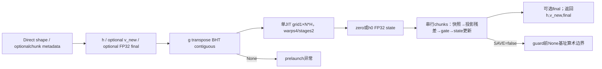
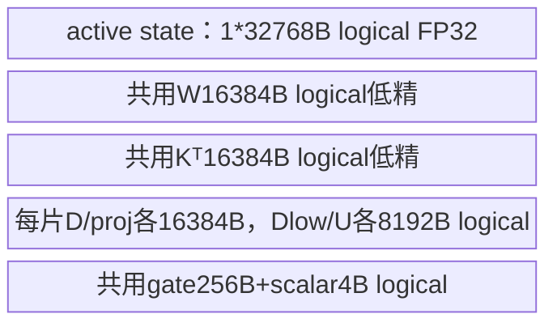
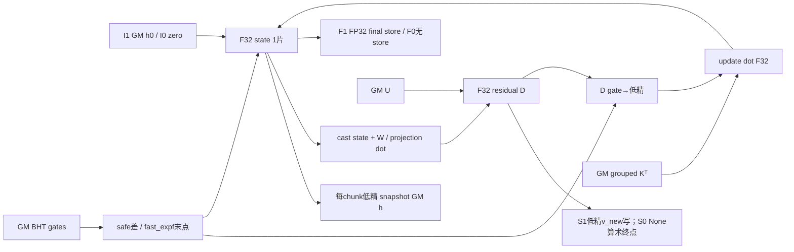
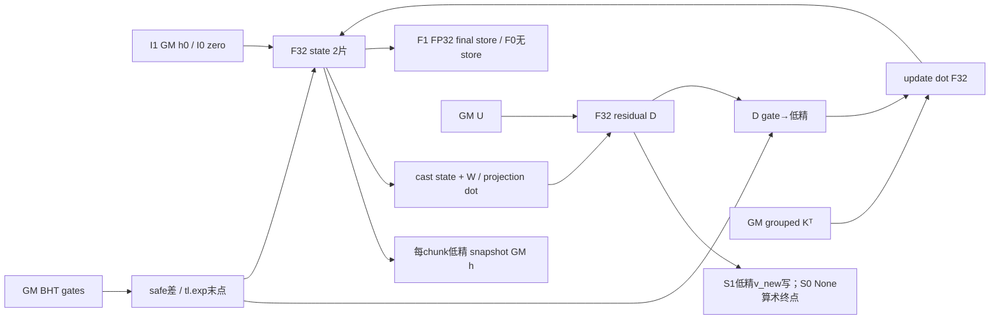
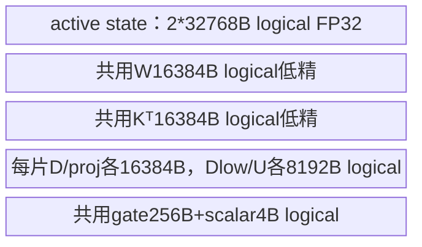

# 分块门控 Delta 状态更新 A2/A3 Direct Invoke 算子知识

## 算子速览

| 项目 | 内容 |
|---|---|
| 实际入口 | `sgl_kernel_npu.implementation.triton.attention.gdn.chunk_delta_h.chunk_gated_delta_rule_fwd_h_npu`，Direct Invoke |
| 计算语义 | 保存chunk进入状态，D=U−W·cast(S)，再以末gate衰减S并用Kᵀ·cast(D·decay)更新；state维序K,V |
| 输入输出 | k[B,T,Hg,K]、w[B,T,H,K]、u[B,T,H,V]低精；g FP32；h为低精快照，v_new可选低精残差，final可选FP32状态 |
| 执行类型 | 一个JIT每sequence/head串行chunk递推；可达AIC_CUBE投影/更新dot与Vector gate/累加/cast，不推物理MIX比例 |
| Kernel 路线 | R001…R008族、64个IFS子selector：V单/双64列片、等/变长、普通/fast指数、初态/终态/残差布尔位全展开；SAVE=false保留None算术风险终点 |
| 核心资源 | 每V片FP32 state[128,64]=32768B逻辑域，BT64/W[64,128]/Kᵀ[128,64]；GM快照和可选输出分别所有；无自有CANN workspace |
| 来源闭包 | direct_implementation_closed：Direct/公开范围guard、完整当前JIT/全部selector、元数据/指数helper及打包闭合；旧V小片body差异明确 |
| 静态风险 | equal b>0且H>1的gate地址缺batch-head跨度；save_new_value=False仍有guard外v_new=None算术；K/T尾load未显式padding_option。描述后续body均不保证这些边界已被消除 |
| 验证状态 | 本次知识提取未执行编译、真机、数值或性能测试；draft/source追溯不表示数值、内存或编译验收 |

## 接口与语义

### 计算语义

合法公开Triton域为1≤K,V≤128、BT64；H/Hg为整数，k/w/u FP16或BF16同dtype，g累计FP32。对sequence/head保有FP32 S[K,V]，每chunk开始把S转k.dtype写h快照；投影用W低精与S转w.dtype后的矩阵乘，FP32残差D=U−W·cast(S)。若SAVE_NEW_VALUE，D此时转u.dtype写v_new，发生在gate乘之前。随后decay_i=safe_exp(g_L−g_i)，safe_exp只在差≤0时指数、正差取0；S乘普通exp(g_L)，D乘decay后转k.dtype，再用Kᵀ低精乘该低精D更新FP32 S。两个关键低精舍入点是投影前state cast与更新前gated residual cast，不能换成全FP32参考。源码to未显式舍入参数，不抄其它kernel rtne声明。

初态None从FP32零开始，否则从[N,H,K,V]加载；final=True把最后FP32 S写新Tensor，输入初态不改。h快照为每块进入状态，不能用final代替；v_new是未乘当前decay的D，不能传原始U给后续输出重建。状态轴序K,V与本仓原生GDN及其它融合decode的V,K池不同。

当前g的Host布局是transpose(1,2).contiguous()→[B,H,Traw]；Device用bos+h*Traw+token寻址。packed B1时bos=cu[n]正确；等长sequence b>0时bos=b*Traw，而所需地址应为b*H*Traw+h*Traw+token，缺b*(H−1)*Traw。H1或b0不受该偏移问题影响，不能把理想独立逐batch gate公式保证推广到B>1/H>1全部输入。此为地址静态推导，未运行验证。

### 输入、输出与属性

| 参数 | shape/layout | dtype | 约束、默认值与语义 |
|---|---|---|---|
| k | [B,T,Hg,K]连续NPU | FP16/BF16 | 公开1..128 K；H是Hg整数倍；Direct不copy/逐项校验 |
| w | [B,T,H,K]连续同NPU | k.dtype | transformed keys，投影W·state |
| u | [B,T,H,V]连续同NPU | k.dtype | transformed values；公开1..128 V |
| g | [B,T,H] | FP32 | 累计log gate必需；Direct无条件transpose，None前处理异常 |
| initial_state | [N,H,K,V]或None | FP32 | None选零；输入不改；没有自有shape/设备guard |
| output_final_state | bool | — | 默认False；True新分配final FP32 |
| chunk_size | Python int | — | 默认64；公开wrapper只允许Triton64，Direct直接作BT，只有弱K≤256 assert |
| save_new_value | bool | — | 默认True；False分配v_new=None，JIT仍在guard前计算其基址，不能声称该分支编译/执行可靠 |
| cu_seqlens | [N+1]或None | int32/int64 | packed B1、同设备连续、从0到T正长度为调用方合同；Device castI32 |
| h | equal[B,ceil(T/64),H,K,V]；packed[1,total_chunks,H,K,V] | k.dtype | 新分配进入状态快照；实际store按K/V边界 |
| v_new | 同u或None | u.dtype | SAVE=True写未gate残差D；SAVE=False风险边界见上 |
| final_state | [N,H,K,V]或None | FP32 | 最后状态，不改initial_state |

### 入口与版本

公开wrapper检查chunk_size是非bool正POT，triton/auto再要求K/V1..128、chunk64，并拒绝gNone；但指定Direct函数仅assert K≤256。raw K129..256/V>128只拥有固定128行/两64列tile，会有状态/输出尾域未覆盖；公开明示不支持，不能升级为正式支持Route。其它BT也不借raw参数可达扩大公开合同。卡片平台以Frontmatter为准，产品表arch22/arch35支持、README/generation映射支撑；CANN9.1.0为固定任务配置，非运行声明。

旧fla/chunk_delta_h.py的Host与当前除import外语义相同，JIT在V>64域主要算法相同；**V≤64并不全域等价**：旧body始终执行第二64列tile，当前新body以if V>64把第二片初态加载、h/v_new/final存储和两dot全部编译排除。新源码注释提到完全越界第二tile可能corrupt stores，只作为源码说明，不当作本次复现实测。旧exp/metadata helper与新gdn_utils算法相同，各模块cache和导入时exp绑定独立。

公开合同见[状态和输出API](../../../../apis/sgl_kernel_npu/sgl_gdn_chunk_state_and_output.md)；WY生成的w/u需与k/g/布局匹配。独立torch_native CPU FP64参考不在本Direct图，不借其其它chunk大小能力扩大本Triton支持。

## Host/Launcher 执行流程

### 参数校验与前处理

B,T,Hg,K从k.shape、V/H从u末两维取得，BT=chunk_size。cu非空先prepare_chunk_indices(cu,BT)；equal N=B,NT=ceil(T/BT),offsetNone；packed N=len(cu)−1,NT=len(indices)，另prepare_chunk_offsets(cu,BT)。**indices只用于Host取NT/分配h，不传Device**；Device只用cu和offsets。

Direct assert K≤256之后，h=k.new_empty(B,NT,H,K,V)，final按flag分配[N,H,K,V]FP32或None，v_new按save分配empty_like(u)或None；g无条件transpose(1,2).contiguous。没有_validate_inputs，不主动验证k/w/u contiguous/dtype/device/head整除/匹配shape/正维度，也不验证cu值或h0容量。公共wrapper的范围guard必须与Direct弱guard分开。

grid(meta)固定返回(1,N*H)，warps4/stages2。heuristics取G/h0/ht/v_new/cu存在性产生五个constexpr；G经过transpose正常恒非空，所以USE_G=false无Host producer。v_new基址算术却在SAVE_NEW_VALUE if之前，不把“无store”误作None操作已被guard。

### 参数、Workspace 与生命周期

h字节=2*B*NT*H*K*V（公开低精），final=True为4*N*H*K*V，save=True v_new=2*B*T*H*V；各为独立新ATen Tensor，不与输入原地alias。g转置contiguous至多新增4BTH字节，是否复用storage由框架；同current stream提交JIT，局部临时/输入/输出的异步存活由Torch allocator/Triton runtime管理，没有源码自有record_event/ACLNN executor或手工workspace释放。函数返回三Tensor/None不等于Device完成。

varlen indices [total_chunks,2]沿cu dtype、bytes2NT*sCu，由prepare_lens→tolist→CPU arange/cumsum/stack→to(cu)构造并缓存；offsets=cat([0],ceil(length/BT)).cumsum(-1)，shape[N+1]，实际整数promotion由Torch决定，不假设必然沿cu dtype，bytes=(N+1)*sOffset。前者取len需要Host同步元数据构造，后者在cu设备作基本Tensor前处理；不是外部状态更新数学核心。cache每helper至多4项、Tensor按identity，不读version；原地改cu可能复用旧indices/offsets。source没有清缓存接口。

没有自有system/user workspace/GM中间state片；FP32 S跨所有chunk驻留编译局部域。输入h0读取一次，h每chunk输出一次，v_new可选每chunk写，final末尾写；程序间每sequence/head状态独立，无跨核state归并。

### 启动图与失败传播



Python shape/分配/transpose/assert/metadata异常会中断；没有catch/fallback。JIT编译/异步设备错误依runtime传播。source中save=False的None算术处不能假造pointer值或把后续SM/更新说成必执行；下文该组合保留条件化body及真实关闭store，明确其编译接受性未验证。source可见的错误不等于核心body缺失。
## Route 与参数设计

### 分核与资源计算

每program pid1=n*H+h对应一个sequence/head，pid0固定1且不拆V。equal bos=n*Traw，boh=n*ceil(Traw/64)；packed从cu[n/n+1].toI32得局部T，从offsets[n].toI32得boh。一个程序串行NTlocal=ceil(Tlocal/64)次，state不跨program共享。

V≤64活跃一片[128,64]FP32=32768B逻辑state；V65..128活跃两片=65536B。源虽声明第二零矩阵，小V后续不读写/更新它，不能当确定物理分配。每chunk共用W[64,128]低精16384B、Kᵀ[128,64]低精16384B；每V片U低精8192B、D/proj FP32各16384B、Dlow8192B逻辑域。投影dot(64,64,128)，更新dot(128,64,64)，一片2dot/双片4dot。num_stages2不等于物理两份state；L1/L0/UB/寄存器由compiler决定。

I=USE_INITIAL_STATE，F=STORE_FINAL_STATE，S=SAVE_NEW_VALUE。I只改变一次初态读取，F/S只改变对应GM输出分配/写入；21参数结构、活跃state大小、dot形状、内部同步和两次低精cast在同族固定。S0还有guard外None基址算术，必须按独立子路线终点记录。下面以8个body族呈现，各族的8个精确子selector逐项保留，合计64；不声称子路线GM流或失败行为相同。

### Route 选择

共同P：本卡平台，k/w/u连续同NPU、FP16/BF16同dtype，G匹配FP32，K/V1..128、BT64、H%Hg0且正长度；varlen另B1、cu连续同设备I32/I64、[0,…,T]正长度并可I32表示；I1时h0合同FP32[N,H,K,V]。P是公开有效合同，Direct仅弱assertK≤256，不把P说成全量已执行guard。Fast由gdn_utils导入时env=="1"绑定，其它值普通exp。

| 顺序 | Route | Key/模板 | 精确选择条件与优先级 | 不适用去向 |
|---:|---|---|---|---|
| 1 | R-001 V1至64单片等长普通指数 | Vhigh0/VAR0/fast0；子selector IFS000…111 | P；V1..64；cuNone；导入env非1；I/F/S取该族子路线表 | 其它合法族按对应行；S0条件终点不能当正常可用 |
| 2 | R-002 V1至64单片等长快速指数 | Vhigh0/VAR0/fast1；子selector IFS000…111 | P；V1..64；cuNone；导入env=1；I/F/S取该族子路线表 | 其它合法族按对应行；S0条件终点不能当正常可用 |
| 3 | R-003 V1至64单片变长普通指数 | Vhigh0/VAR1/fast0；子selector IFS000…111 | P；V1..64；cu非空；导入env非1；I/F/S取该族子路线表 | 其它合法族按对应行；S0条件终点不能当正常可用 |
| 4 | R-004 V1至64单片变长快速指数 | Vhigh0/VAR1/fast1；子selector IFS000…111 | P；V1..64；cu非空；导入env=1；I/F/S取该族子路线表 | 其它合法族按对应行；S0条件终点不能当正常可用 |
| 5 | R-005 V65至128双片等长普通指数 | Vhigh1/VAR0/fast0；子selector IFS000…111 | P；V65..128；cuNone；导入env非1；I/F/S取该族子路线表 | 其它合法族按对应行；S0条件终点不能当正常可用 |
| 6 | R-006 V65至128双片等长快速指数 | Vhigh1/VAR0/fast1；子selector IFS000…111 | P；V65..128；cuNone；导入env=1；I/F/S取该族子路线表 | 其它合法族按对应行；S0条件终点不能当正常可用 |
| 7 | R-007 V65至128双片变长普通指数 | Vhigh1/VAR1/fast0；子selector IFS000…111 | P；V65..128；cu非空；导入env非1；I/F/S取该族子路线表 | 其它合法族按对应行；S0条件终点不能当正常可用 |
| 8 | R-008 V65至128双片变长快速指数 | Vhigh1/VAR1/fast1；子selector IFS000…111 | P；V65..128；cu非空；导入env=1；I/F/S取该族子路线表 | 其它合法族按对应行；S0条件终点不能当正常可用 |

```text
public wrapper：K/V1..128、BT64、G非None；Direct只有assertK<=256
Vhigh=(V>64)；VAR=(cu!=None)；fast=模块导入时env=="1"
I=(h0!=None)；F=(Host按output_final_state分配ht!=None)
S=(Host按save_new_value分配v_new!=None)；USE_G恒1
先匹配8个body族，再按I/F/S 3bit匹配族内8个精确子路线
S0：v_new=None，guard外算术可达；不推定后续成功执行
```

### 模板/实现执行矩阵

| Route | key/selector | dtype/shape/platform 完整命中条件 | 执行族与 kernel 节点 | 实际模板/body | 内存与同步特征 | tail/fallback |
|---|---|---|---|---|---|---|
| R-001 V1至64单片等长普通指数 | Vhigh0/VAR0/fast0×IFS000…111 | P及选择行；FP16/BF16两typed实例 | 一个JIT Cube投影/更新+Vector gate/cast，2dot/chunk | blockdim64_npu_kernel；USE_G1，V片1，VAR0，tl.exp；I/F/S逐子表 | state逻辑32768B，内部同步/精度固定；h0/残差/final GM边逐子表参数化 | W/U/h0 other0，K/T padding未显式zero；S0独立None算术终点 |
| R-002 V1至64单片等长快速指数 | Vhigh0/VAR0/fast1×IFS000…111 | P及选择行；FP16/BF16两typed实例 | 一个JIT Cube投影/更新+Vector gate/cast，2dot/chunk | blockdim64_npu_kernel；USE_G1，V片1，VAR0，fast_expf；I/F/S逐子表 | state逻辑32768B，内部同步/精度固定；h0/残差/final GM边逐子表参数化 | W/U/h0 other0，K/T padding未显式zero；S0独立None算术终点 |
| R-003 V1至64单片变长普通指数 | Vhigh0/VAR1/fast0×IFS000…111 | P及选择行；FP16/BF16两typed实例 | 一个JIT Cube投影/更新+Vector gate/cast，2dot/chunk | blockdim64_npu_kernel；USE_G1，V片1，VAR1，tl.exp；I/F/S逐子表 | state逻辑32768B，内部同步/精度固定；h0/残差/final GM边逐子表参数化 | W/U/h0 other0，K/T padding未显式zero；S0独立None算术终点 |
| R-004 V1至64单片变长快速指数 | Vhigh0/VAR1/fast1×IFS000…111 | P及选择行；FP16/BF16两typed实例 | 一个JIT Cube投影/更新+Vector gate/cast，2dot/chunk | blockdim64_npu_kernel；USE_G1，V片1，VAR1，fast_expf；I/F/S逐子表 | state逻辑32768B，内部同步/精度固定；h0/残差/final GM边逐子表参数化 | W/U/h0 other0，K/T padding未显式zero；S0独立None算术终点 |
| R-005 V65至128双片等长普通指数 | Vhigh1/VAR0/fast0×IFS000…111 | P及选择行；FP16/BF16两typed实例 | 一个JIT Cube投影/更新+Vector gate/cast，4dot/chunk | blockdim64_npu_kernel；USE_G1，V片2，VAR0，tl.exp；I/F/S逐子表 | state逻辑65536B，内部同步/精度固定；h0/残差/final GM边逐子表参数化 | W/U/h0 other0，K/T padding未显式zero；S0独立None算术终点 |
| R-006 V65至128双片等长快速指数 | Vhigh1/VAR0/fast1×IFS000…111 | P及选择行；FP16/BF16两typed实例 | 一个JIT Cube投影/更新+Vector gate/cast，4dot/chunk | blockdim64_npu_kernel；USE_G1，V片2，VAR0，fast_expf；I/F/S逐子表 | state逻辑65536B，内部同步/精度固定；h0/残差/final GM边逐子表参数化 | W/U/h0 other0，K/T padding未显式zero；S0独立None算术终点 |
| R-007 V65至128双片变长普通指数 | Vhigh1/VAR1/fast0×IFS000…111 | P及选择行；FP16/BF16两typed实例 | 一个JIT Cube投影/更新+Vector gate/cast，4dot/chunk | blockdim64_npu_kernel；USE_G1，V片2，VAR1，tl.exp；I/F/S逐子表 | state逻辑65536B，内部同步/精度固定；h0/残差/final GM边逐子表参数化 | W/U/h0 other0，K/T padding未显式zero；S0独立None算术终点 |
| R-008 V65至128双片变长快速指数 | Vhigh1/VAR1/fast1×IFS000…111 | P及选择行；FP16/BF16两typed实例 | 一个JIT Cube投影/更新+Vector gate/cast，4dot/chunk | blockdim64_npu_kernel；USE_G1，V片2，VAR1，fast_expf；I/F/S逐子表 | state逻辑65536B，内部同步/精度固定；h0/残差/final GM边逐子表参数化 | W/U/h0 other0，K/T padding未显式zero；S0独立None算术终点 |

I/F/S不改变同族的dot shape/type/cast、state/片布局、metadata ABI或内部同步。每一族仍逐项列全部8个精确selector、输入/输出owner/字节/guard及终点；这是共享body的参数化呈现，不删子路线。FP16/BF16均2B但cast数值范围不同；final FP32，无量化scale/zero-point。

### 隐藏性能 Guard

| Guard | Host/Tiling 条件 | Device/资源原因 | 影响 Route | 不满足时去向 | 源码符号 |
|---|---|---|---|---|---|
| public K/V范围 | wrapper1..128；Direct仅K≤256 | 固定128行与最多2×64列 | 全部 | wrapper失败；rawK129..256/V>128尾域无覆盖 | wrapper/body |
| public BT | wrapper仅64 | 当前固定验证/64列和128行dot配置 | 全部 | wrapper拒绝其它BT；Direct未强制，不提升支持 | chunk_delta_h |
| V>64 | constexpr if V>64 | 排除小V完全越界第二tile | 双片Route | V≤64仅首片；旧kernel无此guard | 当前JIT |
| G必需 | Host无条件transpose | body先load gate，USE_G只guard部分乘法 | 全部 | None前处理异常 | Host/body |
| 无残差None | saveFalse→v_new=None | v_new_base求值在SAVE if外 | save0 | 编译/执行边界，不能造有效pointer | v_new_base |
| batch gate地址 | equal n>0且H>1 | BHT实际stride不同于bos+h*T | equalRoutes | 不拒绝但读不同gate；B1/H1不受此项影响 | T_max/g_ptr |
| layout/head整除 | 公开连续、H%Hg0，Direct无完整guard | 硬编码Hg*K/H*K/H*V stride | 全部 | 失约无可靠fallback | stride/group |
| 初态shape/owner | h0 FP32[N,H,K,V] | 一次mask load到state | init1 | Host未完整验证，失约可能越界 | USE_INITIAL_STATE |
| metadata正长度/I32 | cu/offset load castI32 | NT/bos/boh直接控制循环与GM offset | varRoutes | 原地改cache/非法值无保证 | helper/IS_VARLEN |
| K/Ttail | b_k block_ptr boundarycheck未显式zero | padding lane进更新dot；W/U另为mask other0 | 全部 | 不把mask存在当零值证明 | p_k tl.load |
| 容量 | 无owned UB/L1上限guard | 至多两32768B state逻辑域及dot片 | 全部 | 具体compiler资源未验证 | warps4/stages2 |

### POD/ABI

无C POD/TCubeTiling/固定sizeof/offsetof；下表为21个Python→JIT参数，runtime指针包offset/标量位宽由compiler生成，固定Python未证明。constexpr不等于GM wire字段；T do_not_specialize，T_max在var重写前取rawT，N/B不传入Device，仅Host grid/分配使用。

| 结构 | 字段 | 类型/位宽 | ABI 布局 | 单位 | Host/launcher producer | Device consumer | 边界 |
|---|---|---|---|---|---|---|---|
| JIT args | k | lowprec GM pointer | slot0，物理ABI offset不可见 | 元素 | 原k | grouped Kᵀ load | 硬编码stride |
| JIT args | v | lowprec GM pointer | slot1，物理ABI offset不可见 | 元素 | u | U/D残差 | 输入不改 |
| JIT args | w | lowprec GM pointer | slot2，物理ABI offset不可见 | 元素 | 原w | 投影W | mask other0 |
| JIT args | v_new | lowprec GM pointer或None | slot3，物理ABI offset不可见 | 元素 | save?empty_like(u):None | guard内store，guard外base算术 | save0风险 |
| JIT args | g | float32 GM pointer | slot4，物理ABI offset不可见 | 元素 | transpose(1,2).contiguous [B,H,Traw] | g_last/gvector | equal批次偏移风险 |
| JIT args | h | lowprec GM pointer | slot5，物理ABI offset不可见 | 元素 | k.new_empty(B,NT,H,K,V) | 每chunk prestate store | K,V axis |
| JIT args | h0 | float32 GM pointer或None | slot6，物理ABI offset不可见 | 元素 | initial_state | USE_INITIAL maskload | 不原地改 |
| JIT args | ht | float32 GM pointer或None | slot7，物理ABI offset不可见 | 元素 | flag?new_empty(N,H,K,V):None | STORE_FINAL内store | 安全guard存在 |
| JIT args | cu_seqlens | I32/I64 pointer或None | slot8，物理ABI offset不可见 | token | caller | var bos/eos.toI32 | 公开B1/正边界 |
| JIT args | chunk_offsets | Torch整数pointer或None | slot9，物理ABI offset不可见 | chunk | prepare_chunk_offsets | var boh.toI32 | promotion由Torch决定 |
| JIT args | T | runtime Python int | slot10，位宽未固定，物理ABI offset不可见 | token | k.shape1 | T_max rawT，var局部T | do_not_specialize |
| JIT args | H | constexpr int | compile，物理ABI offset不可见 | head | u.shape[-2] | pid/headstride/group | H%Hg合同 |
| JIT args | Hg | constexpr int | compile，物理ABI offset不可见 | keyhead | k.shape2 | grouped keystride | 正 |
| JIT args | K | constexpr int | compile，物理ABI offset不可见 | feature | k.shape3 | mask/shape/stride | 公开≤128 |
| JIT args | V | constexpr int | compile，物理ABI offset不可见 | valuefeature | u.shape[-1] | Vslice/stride/mask | 公开≤128 |
| JIT args | BT | constexpr int | compile，物理ABI offset不可见 | token/chunk | chunk_size | NT/loop/dot block | 公开64 |
| JIT args | USE_G | constexpr bool | heuristics，物理ABI offset不可见 | bool | g!=None aftertranspose | gate乘法guard | 实际1；load不在此guard |
| JIT args | USE_INITIAL_STATE | constexpr bool | heuristics，物理ABI offset不可见 | bool | h0!=None | 一次initialload | 全部0/1组合 |
| JIT args | STORE_FINAL_STATE | constexpr bool | heuristics，物理ABI offset不可见 | bool | ht!=None | 末state store | 全部0/1组合 |
| JIT args | SAVE_NEW_VALUE | constexpr bool | heuristics，物理ABI offset不可见 | bool | v_new!=None | D store | base算术未被guard |
| JIT args | IS_VARLEN | constexpr bool | heuristics，物理ABI offset不可见 | bool | cu!=None | cu/offset及localT | 存在性非有效性 |

Host indices的sequence/tile各一列，字节偏移(2i)*sCu/(2i+1)*sCu，但不作为JIT指针传参；它只影响NT与h分配。offsets每field offsets[n]=Σ_{j<n}ceil(Lj/64)，地址n*sOffset，dtype沿Torch cumsum promotion；N+1项最后totalchunks。Device只读取offsets[n]，表最后一项可作为Host总量但不是本body额外load。stride_h=H*K*V在body声明但当前访问公式直接展开，不当额外layout变换。

### Route 源码闭包

| Route | Key/selector | Host/Tiling producer | POD/参数 | Kernel entry/router | Kernel body/直接依赖 | 构建接线 |
|---|---|---|---|---|---|---|
| R-001及IFS000…111 | Vhigh0/VAR0/fast0×3bit IFS | Direct shape/allocate/transpose，gdn_utils metadata/globalexp | 21typed/constexpr参数，I/F/S存在性producer逐子表 | blockdim64_npu_kernel[1,NH] | 单片完整initial/snapshot/project/gate/update/final body；S0无guard None算术另列 | root setup→stage_runtime共同Python→triton.jit，无ACLNN |
| R-002及IFS000…111 | Vhigh0/VAR0/fast1×3bit IFS | Direct shape/allocate/transpose，gdn_utils metadata/globalexp | 21typed/constexpr参数，I/F/S存在性producer逐子表 | blockdim64_npu_kernel[1,NH] | 单片完整initial/snapshot/project/gate/update/final body；S0无guard None算术另列 | root setup→stage_runtime共同Python→triton.jit，无ACLNN |
| R-003及IFS000…111 | Vhigh0/VAR1/fast0×3bit IFS | Direct shape/allocate/transpose，gdn_utils metadata/globalexp | 21typed/constexpr参数，I/F/S存在性producer逐子表 | blockdim64_npu_kernel[1,NH] | 单片完整initial/snapshot/project/gate/update/final body；S0无guard None算术另列 | root setup→stage_runtime共同Python→triton.jit，无ACLNN |
| R-004及IFS000…111 | Vhigh0/VAR1/fast1×3bit IFS | Direct shape/allocate/transpose，gdn_utils metadata/globalexp | 21typed/constexpr参数，I/F/S存在性producer逐子表 | blockdim64_npu_kernel[1,NH] | 单片完整initial/snapshot/project/gate/update/final body；S0无guard None算术另列 | root setup→stage_runtime共同Python→triton.jit，无ACLNN |
| R-005及IFS000…111 | Vhigh1/VAR0/fast0×3bit IFS | Direct shape/allocate/transpose，gdn_utils metadata/globalexp | 21typed/constexpr参数，I/F/S存在性producer逐子表 | blockdim64_npu_kernel[1,NH] | 两片完整initial/snapshot/project/gate/update/final body；S0无guard None算术另列 | root setup→stage_runtime共同Python→triton.jit，无ACLNN |
| R-006及IFS000…111 | Vhigh1/VAR0/fast1×3bit IFS | Direct shape/allocate/transpose，gdn_utils metadata/globalexp | 21typed/constexpr参数，I/F/S存在性producer逐子表 | blockdim64_npu_kernel[1,NH] | 两片完整initial/snapshot/project/gate/update/final body；S0无guard None算术另列 | root setup→stage_runtime共同Python→triton.jit，无ACLNN |
| R-007及IFS000…111 | Vhigh1/VAR1/fast0×3bit IFS | Direct shape/allocate/transpose，gdn_utils metadata/globalexp | 21typed/constexpr参数，I/F/S存在性producer逐子表 | blockdim64_npu_kernel[1,NH] | 两片完整initial/snapshot/project/gate/update/final body；S0无guard None算术另列 | root setup→stage_runtime共同Python→triton.jit，无ACLNN |
| R-008及IFS000…111 | Vhigh1/VAR1/fast1×3bit IFS | Direct shape/allocate/transpose，gdn_utils metadata/globalexp | 21typed/constexpr参数，I/F/S存在性producer逐子表 | blockdim64_npu_kernel[1,NH] | 两片完整initial/snapshot/project/gate/update/final body；S0无guard None算术另列 | root setup→stage_runtime共同Python→triton.jit，无ACLNN |

## Kernel 实现

### 公共执行流程

同族body中I只控制一次h0 load，F只控制末尾ht store，S只控制未gate residual store，内部state仍为同样FP32片。S0在其if之前就计算None基址，不能因共享后续body而暗中当成成功分支；各子路线表单列该终点。V>64的整片guard、VAR地址/metadata及exp primitive决定8个族实际差异。

每sequence/head内按chunk序：低精snapshot→W/K/G load→FP32投影残差→可选低精D store→gate差safe_exp/末点exp→F32 state衰减和D低精cast→update dot→可选final。packed h用全局boh。无跨programstate交换/atomic/跨kernel递推workspace。低精snapshot不读回作state。

Torch metadata/layout、Triton dot/load/store/cast/exp是明确primitive边界；physical L1/L0/UB、MIX比例、微tile/flag/register不在Python自有声明。每族以下保留共享参数化字节账与同步，并把GM存在性/生命周期/失败差异按8子selector逐行列出。
### Route R-001：V1至64单片等长普通指数

#### 适用条件

##### 选择证据

| 层级 | 文件 | 符号 | 源码谓词/参数 | 结果/下一跳 |
|---|---|---|---|---|
| 公开范围 | operators/attention/gdn/chunk_delta_h.py | chunk_delta_h | 公共P、K/V1..128、BT64、G必需 | Direct |
| 族selector | implementation/triton/attention/gdn/chunk_delta_h.py / gdn_utils.py | V>64 / IS_VARLEN / exp | V1..64、VAR0、导入env非1 | 1片，tl.exp |
| 子selector | Direct分配 / JIT heuristics | USE_INITIAL_STATE/STORE_FINAL_STATE/SAVE_NEW_VALUE | I=(initial!=None)，F=(ht!=None)，S=(vnew!=None)，逐行如下 | 同21参数结构，GM读写/终点按位保留 |
| 风险 | kernel | v_new_base/g_ptr | S0无条件None算术；equal n>0且H>1 gate错跨度 | 不把符号化后续当保证执行 |

每个子路线ID为本族ID.S加IFS三位。I/F/S全部由实际Host存在性producer得到，以下8行独占当前族的所有布尔组合；h快照始终由Host分配。每行的h0/final/vnew都是独立owner，初始化不改h0。

| 精确子路线 | I/F/S | h0 producer/读域 | h低精快照 | v_new producer/写域/owner | final producer/写域/owner | 同步、精度及独立终点 |
|---|---|---|---|---|---|---|
| R-001.S000 | 0/0/0 | h0=None，不读；FP32 zero | Host新Tensor2BNT*HKV；每chunk更新前写 | None，0分配/0store；guard外仍求None+offset | None，无分配/写 | 内部F32state/dot/两cast不变；None算术可阻断编译/执行，不推定任何后续写完成 |
| R-001.S001 | 0/0/1 | h0=None，不读；FP32 zero | Host新Tensor2BNT*HKV；每chunk更新前写 | empty_like(u)，2BTHV字节；guard内写D转u.dtype，gate前；返回新owner | None，无分配/写 | 内部F32state/dot/两cast不变；条件化后续body见下，未消除其它风险 |
| R-001.S010 | 0/1/0 | h0=None，不读；FP32 zero | Host新Tensor2BNT*HKV；每chunk更新前写 | None，0分配/0store；guard外仍求None+offset | new_empty FP32，4NHKV字节；末尾guard内写，返回新owner | 内部F32state/dot/两cast不变；None算术可阻断编译/执行，不推定任何后续写完成 |
| R-001.S011 | 0/1/1 | h0=None，不读；FP32 zero | Host新Tensor2BNT*HKV；每chunk更新前写 | empty_like(u)，2BTHV字节；guard内写D转u.dtype，gate前；返回新owner | new_empty FP32，4NHKV字节；末尾guard内写，返回新owner | 内部F32state/dot/两cast不变；条件化后续body见下，未消除其它风险 |
| R-001.S100 | 1/0/0 | caller h0 FP32，读4NHKV字节，K/V mask other0 | Host新Tensor2BNT*HKV；每chunk更新前写 | None，0分配/0store；guard外仍求None+offset | None，无分配/写 | 内部F32state/dot/两cast不变；None算术可阻断编译/执行，不推定任何后续写完成 |
| R-001.S101 | 1/0/1 | caller h0 FP32，读4NHKV字节，K/V mask other0 | Host新Tensor2BNT*HKV；每chunk更新前写 | empty_like(u)，2BTHV字节；guard内写D转u.dtype，gate前；返回新owner | None，无分配/写 | 内部F32state/dot/两cast不变；条件化后续body见下，未消除其它风险 |
| R-001.S110 | 1/1/0 | caller h0 FP32，读4NHKV字节，K/V mask other0 | Host新Tensor2BNT*HKV；每chunk更新前写 | None，0分配/0store；guard外仍求None+offset | new_empty FP32，4NHKV字节；末尾guard内写，返回新owner | 内部F32state/dot/两cast不变；None算术可阻断编译/执行，不推定任何后续写完成 |
| R-001.S111 | 1/1/1 | caller h0 FP32，读4NHKV字节，K/V mask other0 | Host新Tensor2BNT*HKV；每chunk更新前写 | empty_like(u)，2BTHV字节；guard内写D转u.dtype，gate前；返回新owner | new_empty FP32，4NHKV字节；末尾guard内写，返回新owner | 内部F32state/dot/两cast不变；条件化后续body见下，未消除其它风险 |

以上8行分别保留完整GM差异。S0的状态更新描述只表示其后可见body在该表达式被允许/消去后的符号化行为，不判定后端会这样处理；即使源码snapshot在算术前，也不保证编译失败时发生过snapshot。I/F位不更改内部state extent、dot形状/精度或跨chunk顺序。

#### Device 数据流

##### 函数级调用链

```text
Direct：shape/metadata -> h分配 -> F?htTensor:None -> S?vnewTensor:None -> G.transpose.contiguous
 -> kernel[1,N*H]，warps4/stages2，USE_G1，VAR0
    -> bos=n*Traw，boh=n*ceil(Traw/64)
    -> I ? h0 maskload : FP32 zeros
    -> for localchunk:
       -> cast state到k.dtype并store prestate h
       -> W maskload / grouped Kᵀ blockload / Gscalar,vector
       -> vnew_base无条件算术（S0独立风险终点）
       -> 1片各：U maskload / dot(W,cast(S)) / FP32 D
       -> S ? D转u.dtype store : 无store
       -> safe_exp差 / tl.exp末gate -> gate D -> 低精cast -> update dot
    -> F ? FP32 final store : 无store
```

##### 源码等价伪码

```text
源码等价伪码，offset单位元素；I/F/S严格由上表对应子路线取值
n=pid1//H;head=pid1%H;Traw=HostT
bos=n*Traw;L=Traw;boh=n*ceil(L/64)
Sstate[1]=zeros FP32[128,64]
if I: 各活跃片load h0+pid1*K*V+krow*V+slab*64+vcol，
      mask krow<K&&slab*64+vcol<V，other0，转F32
for c in0..ceil(L/64)-1:
    t=c*64+row                                  #序列内时间，row为块内0..63
    各活跃片先store h[(boh+c)*H*K*V+head*K*V+krow*V+slab*64+vcol]
        =state.to(kdtype)，boundary K/V
    W=load w+bos*H*K+head*K+(c*64+row)*H*K+feature，
           t<L&&feature<K，other0                    #64*128
    Kt=blockload k+(bos*Hg+head//(H//Hg))*K，
           shape[K,L]，stride[1,Hg*K]，offset[0,c*64]，
           block[128,64]，order[0,1]，boundary[0,1]    #未显式padding_option zero
    vnewBase=(S?v_new:None)+bos*H*V+head*V            #不在if S内；S0不推定通过
    last=min((c+1)*64,L)-1
    glast=load G[BHT实际地址 bos+head*Traw+last]
    gi=load G[bos+head*Traw+c*64+arange64]，mask t<L，other0
    alpha=safe_exp(glast-gi)                         #正差0
    gamma=tl.exp(glast)       #未屏蔽正glast
    for slab0..0:                               #第二片仅V>64时
        U=load u+bos*H*V+head*V+(c*64+row)*H*V+slab*64+vcol，
              t<L&&slab*64+vcol<V，other0
        D=U.toF32-dot(W,state[slab].to(W.dtype))      #64*128 ×128*64
        if S: store vnewBase+t*H*V+slab*64+vcol=D.to(udtype)，boundary L/V
        D=D*alpha[:,None];state[slab]*=gamma
        Dlow=D.to(kdtype)                            #第二次关键低精cast
        state[slab]+=dot(Kt,Dlow)                    #128*64 ×64*64，F32acc
if F: 各活跃片store ht[pid1*K*V+krow*V+slab*64+vcol]=state F32，boundary K/V
```

仅第一片活跃，每chunk2dot；第二零矩阵虽声明，但其后load/store/dot均被V>64编译排除。 equal n>0且H>1时实际gate地址少n*(H−1)*Traw；n0/H1不因这项偏移受影响，数值后果依gate值。 残差可选写的是未gate D，h写的是进入state；不能把它们改成gated D或final state。输入h0只读。

#### 内存与数据搬运

##### 资源与搬运表

| 层级/缓冲区 | offset/地址公式 | extent/容量公式 | dtype/layout | producer | consumer | owner/lifetime | 对齐/复用 |
|---|---|---|---|---|---|---|---|
| GM k | (bos*Hg+head//(H//Hg))*K+feature+token*Hg*K | 2BTHgK B | lowprec ND，读作[K,L] | caller | update dot | readonly/stream | block128*64，order0/1 |
| GM w/u | bos*H*K/V+head*K/V+token*H*K/V+feature | w2BTHK/u2BTHV | lowprec ND | caller/WY | projection/residual | readonly | W/U mask other0 |
| GM G | 实际bos+head*Traw+token | 至多4BTH B临时 | F32 BHT | transpose.contiguous | exp/safe_exp | runtime owner | equal跨度风险如实保留 |
| GM h0 | I1:pid1*K*V+krow*V+vcol；I0:N/A | I*4NHKV输入读字节 | F32 K,V | caller或None | init | 不修改/不归本函数分配 | mask/other0 |
| GM h | (boh+c)*H*K*V+head*K*V+krow*V+vcol | 2BNT*HKV B | lowprec K,V snapshot | prestate cast | caller | 新返回Tensor | 1片覆盖公开K/V有效域 |
| GM v_new | S1:bos*HV+head*V+token*HV+vcol；S0:None算术 | S*2BTHV分配/写字节 | u.dtype或None | D gate前cast | caller | S1新owner；S0None | guard内store不删除guard外base |
| GM ht | F1:pid1*K*V+krow*V+vcol；F0:N/A | F*4NHKV分配/写字节 | F32或None | 最后state | caller | F1新owner；F0None | STORE_FINAL guard内、K/V边界 |
| GM metadata | N/A | 0新增 | 整数 | helper/caller | HostNT/Devicebos,boh | cache | offsets Torch promotion，loadtoI32 |
| L1/L0A/B/C | compiler projection/update layout | dot(64,64,128)/(128,64,64)逻辑tile | lowprec operands/F32acc | loads/casts | dot | compiler perprogram | 无ownedoffset/db/容量 |
| UB/register state | 1活跃片[128,64] | 32768B逻辑域 | F32 | I?h0:zero→update | snapshot/投影/下chunk | 整sequence | 小V未使用第二声明不计活跃使用 |
| UB/register W/K | [64,128]/[128,64] | 各16384B逻辑域 | FP16/BF16 | load | 两类dot | 每chunk，所有片共用 | K/Tblockpad未显式0 |
| UB/register U/D/proj | [64,64]/片 | U8192，D/proj各16384，Dlow8192B逻辑域 | mixed | load/dot/sub/gate/cast | store/update | 每V片 | 不相加冒充物理峰值 |
| UB/register G | 64F32+scalar | 256+4B逻辑域 | F32 | loads/exp | state/D乘 | 每chunk共用 | safe差与plain末exp不同 |
| workspace | N/A | 0 owned | N/A | N/A | N/A | 上述Tensor/局部state | 不套16MiB CANN区 |

##### 分层内存布局




图只给编译局部值域，非物理UB地址/峰值；I/F/S不改变这些dot/state逻辑域，GM条件差异见8子路线表。physical配置、寄存器/spill/flag由compiler决定。

##### 字节账、交接边与复用顺序

```text
I,F,S取当前精确子路线0/1；S0若None算术不被接受，不保证任何Device提交发生
h_bytes=2*B*NT*H*K*V
vnew_bytes=S*2*B*T*H*V；final_bytes=F*4*N*H*K*V
h0_input_read=I*4*N*H*K*V；不分配、不修改h0
G_preprocess_bytes<=4*B*T*H
metadata_new_bytes=0
owned_workspace=0
state_active_domain=1*128*64*4=32768
W=16384；Kᵀ=16384；per_slab D/proj各16384，Dlow/U各8192 logical B
physical_L1/L0/UB_peak/registers=compiler layout/reuse/padding/spill，未编译取得
```

| 边/复用子区 | producer | offset/extent | dtype/layout | consumer | ordering/sync | owner/lifetime | 安全条件 |
|---|---|---|---|---|---|---|---|
| G前处理 | transpose.contiguous | ≤4BTH B | F32 BHT | gate loads | 同stream/runtimecopy | 临时Tensor | equal多batch跨度风险 |
| metadata | helper/lens/indices/offset | N/A | 整数 | Host分配/JIT | tolist同步/Tensorstream | cache | 正长度/不可变cu |
| I初态 | I1 h0 load / I0 zero | I*4NHKV读取 | F32 K,V | localstate | 程序开始TL依赖 | inputreadonly | mask other0，21ABI不变 |
| state→h | chunk前statecast | 每chunk每head2KV B | lowprec K,V | GM h | update前store | h新owner | 不alias h0/final |
| state→projection | state.to(wdtype) | 每片128*64*2B逻辑域 | lowprec | W dot | compiler依赖 | 当前chunk | 第一次关键低精cast |
| S残差 | D未gate→u.dtype | S*2BTHV GM写 | lowprec或None | caller | gate乘之前；S if内store | S1新owner | S0 guard外base算术单列终点 |
| gated D→update | D*alpha再cast | 64*64*2B/片 | k.dtype | Kᵀ dot | compiler依赖 | 当前片 | 第二次关键低精cast |
| state跨chunk | priorF32 S | 32768B活跃逻辑域 | F32 | nextprojection/snapshot | 同program顺序，无crosscore | 全sequence | 低精h不读回作state |
| F终态 | 最后state | F*4NHKV GM写 | F32或None | caller | 末尾STORE_FINAL内 | F1新owner | 不修改h0，F0不写 |

#### 同步、精度与尾块

##### 同步与数值边界表

| 阶段 | primitive/机制 | producer | consumer/等待点 | 保护对象 | 精度/尾块 |
|---|---|---|---|---|---|
| I0/I1初态 | zero / maskload other0 | 常量/h0 | localstate | 1片state | F32；I/F/S不改extent |
| snapshot | blockptr store | statecast | h | prechunk state | lowprec；K/V boundary；V第二片编译排除 |
| projection | dot(W,statecast) | lowprec W/state | D F32 | 64*64/片 | dotK128，W other0 |
| K load | blockptr check | grouped k | update | 128*64 | 未显式padding_option，K/T0不保证 |
| S0/S1残差 | S1 store / S0无store | D | v_new/None | gate前残差 | S0 guard外None算术可阻断编译/执行，不推定后续 |
| gate | safe差 + tl.exp末点 | G F32 | D/S乘 | 每chunk | 正差0；末点exp未屏蔽正输入 |
| update | dot(K,Dlow)+S | lowprec K/D | nextstate | 128*64/片 | Dgate后cast，F32acc |
| F0/F1终态 | F1 store/F0无 | state | ht/None | 本sequence/head | F32 K/V boundary，guard内 |
| 内部同步 | TL/compiler pipeline | 当前op | 后继op | 程序私有state | 无owned数字flag/atomic，chunk串行 |
| 族尾界 | V≤64 if | compiler | 第二片 | Vtile | public范围1..128；raw宽域不提升支持 |

全部8子路线的内部精度与同步相同，GM optional边分别如表；S0的不可靠终点明确保留，没有用共享body假定它通过。equal仅n>0且H>1有该gate偏移；n0/H1不作此断言。 physical资源/最终cast规则未运行确认，不补造round模式。

#### 关键实现

##### 符号证据表

| 阶段 | 文件 | 符号/模板实例 | 实现事实 |
|---|---|---|---|
| Host/Tiling producer | implementation/triton/attention/gdn/chunk_delta_h.py | Direct | 当前族V/VAR、I/F/S分配、G BHT、grid1×NH |
| Kernel entry/router | 同文件 | heuristics/blockdim64 | USE_G1,VAR0；I/F/S八组合，V≤64 |
| Device body/helper | 同文件 | init/forNT/dot/gate/store | 1片、2dot/chunk、双cast/F32state与optional GM边 |
| 风险点 | 同文件 | v_new_base/g_ptr | S0 None算术；equal b>0/H>1缺跨度 |
| 依赖 | gdn_utils.py | exp/safe_exp/prepare_* | tl.exp、cache与offsetproducer |
| 旧差异 | fla/chunk_delta_h.py | 旧Host/JIT | V>64主体复用；V≤64旧第二片未排除，不全域等价 |


### Route R-002：V1至64单片等长快速指数

#### 适用条件

##### 选择证据

| 层级 | 文件 | 符号 | 源码谓词/参数 | 结果/下一跳 |
|---|---|---|---|---|
| 公开范围 | operators/attention/gdn/chunk_delta_h.py | chunk_delta_h | 公共P、K/V1..128、BT64、G必需 | Direct |
| 族selector | implementation/triton/attention/gdn/chunk_delta_h.py / gdn_utils.py | V>64 / IS_VARLEN / exp | V1..64、VAR0、导入env=1 | 1片，fast_expf |
| 子selector | Direct分配 / JIT heuristics | USE_INITIAL_STATE/STORE_FINAL_STATE/SAVE_NEW_VALUE | I=(initial!=None)，F=(ht!=None)，S=(vnew!=None)，逐行如下 | 同21参数结构，GM读写/终点按位保留 |
| 风险 | kernel | v_new_base/g_ptr | S0无条件None算术；equal n>0且H>1 gate错跨度 | 不把符号化后续当保证执行 |

每个子路线ID为本族ID.S加IFS三位。I/F/S全部由实际Host存在性producer得到，以下8行独占当前族的所有布尔组合；h快照始终由Host分配。每行的h0/final/vnew都是独立owner，初始化不改h0。

| 精确子路线 | I/F/S | h0 producer/读域 | h低精快照 | v_new producer/写域/owner | final producer/写域/owner | 同步、精度及独立终点 |
|---|---|---|---|---|---|---|
| R-002.S000 | 0/0/0 | h0=None，不读；FP32 zero | Host新Tensor2BNT*HKV；每chunk更新前写 | None，0分配/0store；guard外仍求None+offset | None，无分配/写 | 内部F32state/dot/两cast不变；None算术可阻断编译/执行，不推定任何后续写完成 |
| R-002.S001 | 0/0/1 | h0=None，不读；FP32 zero | Host新Tensor2BNT*HKV；每chunk更新前写 | empty_like(u)，2BTHV字节；guard内写D转u.dtype，gate前；返回新owner | None，无分配/写 | 内部F32state/dot/两cast不变；条件化后续body见下，未消除其它风险 |
| R-002.S010 | 0/1/0 | h0=None，不读；FP32 zero | Host新Tensor2BNT*HKV；每chunk更新前写 | None，0分配/0store；guard外仍求None+offset | new_empty FP32，4NHKV字节；末尾guard内写，返回新owner | 内部F32state/dot/两cast不变；None算术可阻断编译/执行，不推定任何后续写完成 |
| R-002.S011 | 0/1/1 | h0=None，不读；FP32 zero | Host新Tensor2BNT*HKV；每chunk更新前写 | empty_like(u)，2BTHV字节；guard内写D转u.dtype，gate前；返回新owner | new_empty FP32，4NHKV字节；末尾guard内写，返回新owner | 内部F32state/dot/两cast不变；条件化后续body见下，未消除其它风险 |
| R-002.S100 | 1/0/0 | caller h0 FP32，读4NHKV字节，K/V mask other0 | Host新Tensor2BNT*HKV；每chunk更新前写 | None，0分配/0store；guard外仍求None+offset | None，无分配/写 | 内部F32state/dot/两cast不变；None算术可阻断编译/执行，不推定任何后续写完成 |
| R-002.S101 | 1/0/1 | caller h0 FP32，读4NHKV字节，K/V mask other0 | Host新Tensor2BNT*HKV；每chunk更新前写 | empty_like(u)，2BTHV字节；guard内写D转u.dtype，gate前；返回新owner | None，无分配/写 | 内部F32state/dot/两cast不变；条件化后续body见下，未消除其它风险 |
| R-002.S110 | 1/1/0 | caller h0 FP32，读4NHKV字节，K/V mask other0 | Host新Tensor2BNT*HKV；每chunk更新前写 | None，0分配/0store；guard外仍求None+offset | new_empty FP32，4NHKV字节；末尾guard内写，返回新owner | 内部F32state/dot/两cast不变；None算术可阻断编译/执行，不推定任何后续写完成 |
| R-002.S111 | 1/1/1 | caller h0 FP32，读4NHKV字节，K/V mask other0 | Host新Tensor2BNT*HKV；每chunk更新前写 | empty_like(u)，2BTHV字节；guard内写D转u.dtype，gate前；返回新owner | new_empty FP32，4NHKV字节；末尾guard内写，返回新owner | 内部F32state/dot/两cast不变；条件化后续body见下，未消除其它风险 |

以上8行分别保留完整GM差异。S0的状态更新描述只表示其后可见body在该表达式被允许/消去后的符号化行为，不判定后端会这样处理；即使源码snapshot在算术前，也不保证编译失败时发生过snapshot。I/F位不更改内部state extent、dot形状/精度或跨chunk顺序。

#### Device 数据流

##### 函数级调用链

```text
Direct：shape/metadata -> h分配 -> F?htTensor:None -> S?vnewTensor:None -> G.transpose.contiguous
 -> kernel[1,N*H]，warps4/stages2，USE_G1，VAR0
    -> bos=n*Traw，boh=n*ceil(Traw/64)
    -> I ? h0 maskload : FP32 zeros
    -> for localchunk:
       -> cast state到k.dtype并store prestate h
       -> W maskload / grouped Kᵀ blockload / Gscalar,vector
       -> vnew_base无条件算术（S0独立风险终点）
       -> 1片各：U maskload / dot(W,cast(S)) / FP32 D
       -> S ? D转u.dtype store : 无store
       -> safe_exp差 / fast_expf末gate -> gate D -> 低精cast -> update dot
    -> F ? FP32 final store : 无store
```

##### 源码等价伪码

```text
源码等价伪码，offset单位元素；I/F/S严格由上表对应子路线取值
n=pid1//H;head=pid1%H;Traw=HostT
bos=n*Traw;L=Traw;boh=n*ceil(L/64)
Sstate[1]=zeros FP32[128,64]
if I: 各活跃片load h0+pid1*K*V+krow*V+slab*64+vcol，
      mask krow<K&&slab*64+vcol<V，other0，转F32
for c in0..ceil(L/64)-1:
    t=c*64+row                                  #序列内时间，row为块内0..63
    各活跃片先store h[(boh+c)*H*K*V+head*K*V+krow*V+slab*64+vcol]
        =state.to(kdtype)，boundary K/V
    W=load w+bos*H*K+head*K+(c*64+row)*H*K+feature，
           t<L&&feature<K，other0                    #64*128
    Kt=blockload k+(bos*Hg+head//(H//Hg))*K，
           shape[K,L]，stride[1,Hg*K]，offset[0,c*64]，
           block[128,64]，order[0,1]，boundary[0,1]    #未显式padding_option zero
    vnewBase=(S?v_new:None)+bos*H*V+head*V            #不在if S内；S0不推定通过
    last=min((c+1)*64,L)-1
    glast=load G[BHT实际地址 bos+head*Traw+last]
    gi=load G[bos+head*Traw+c*64+arange64]，mask t<L，other0
    alpha=safe_exp(glast-gi)                         #正差0
    gamma=fast_expf(glast)       #未屏蔽正glast
    for slab0..0:                               #第二片仅V>64时
        U=load u+bos*H*V+head*V+(c*64+row)*H*V+slab*64+vcol，
              t<L&&slab*64+vcol<V，other0
        D=U.toF32-dot(W,state[slab].to(W.dtype))      #64*128 ×128*64
        if S: store vnewBase+t*H*V+slab*64+vcol=D.to(udtype)，boundary L/V
        D=D*alpha[:,None];state[slab]*=gamma
        Dlow=D.to(kdtype)                            #第二次关键低精cast
        state[slab]+=dot(Kt,Dlow)                    #128*64 ×64*64，F32acc
if F: 各活跃片store ht[pid1*K*V+krow*V+slab*64+vcol]=state F32，boundary K/V
```

仅第一片活跃，每chunk2dot；第二零矩阵虽声明，但其后load/store/dot均被V>64编译排除。 equal n>0且H>1时实际gate地址少n*(H−1)*Traw；n0/H1不因这项偏移受影响，数值后果依gate值。 残差可选写的是未gate D，h写的是进入state；不能把它们改成gated D或final state。输入h0只读。

#### 内存与数据搬运

##### 资源与搬运表

| 层级/缓冲区 | offset/地址公式 | extent/容量公式 | dtype/layout | producer | consumer | owner/lifetime | 对齐/复用 |
|---|---|---|---|---|---|---|---|
| GM k | (bos*Hg+head//(H//Hg))*K+feature+token*Hg*K | 2BTHgK B | lowprec ND，读作[K,L] | caller | update dot | readonly/stream | block128*64，order0/1 |
| GM w/u | bos*H*K/V+head*K/V+token*H*K/V+feature | w2BTHK/u2BTHV | lowprec ND | caller/WY | projection/residual | readonly | W/U mask other0 |
| GM G | 实际bos+head*Traw+token | 至多4BTH B临时 | F32 BHT | transpose.contiguous | exp/safe_exp | runtime owner | equal跨度风险如实保留 |
| GM h0 | I1:pid1*K*V+krow*V+vcol；I0:N/A | I*4NHKV输入读字节 | F32 K,V | caller或None | init | 不修改/不归本函数分配 | mask/other0 |
| GM h | (boh+c)*H*K*V+head*K*V+krow*V+vcol | 2BNT*HKV B | lowprec K,V snapshot | prestate cast | caller | 新返回Tensor | 1片覆盖公开K/V有效域 |
| GM v_new | S1:bos*HV+head*V+token*HV+vcol；S0:None算术 | S*2BTHV分配/写字节 | u.dtype或None | D gate前cast | caller | S1新owner；S0None | guard内store不删除guard外base |
| GM ht | F1:pid1*K*V+krow*V+vcol；F0:N/A | F*4NHKV分配/写字节 | F32或None | 最后state | caller | F1新owner；F0None | STORE_FINAL guard内、K/V边界 |
| GM metadata | N/A | 0新增 | 整数 | helper/caller | HostNT/Devicebos,boh | cache | offsets Torch promotion，loadtoI32 |
| L1/L0A/B/C | compiler projection/update layout | dot(64,64,128)/(128,64,64)逻辑tile | lowprec operands/F32acc | loads/casts | dot | compiler perprogram | 无ownedoffset/db/容量 |
| UB/register state | 1活跃片[128,64] | 32768B逻辑域 | F32 | I?h0:zero→update | snapshot/投影/下chunk | 整sequence | 小V未使用第二声明不计活跃使用 |
| UB/register W/K | [64,128]/[128,64] | 各16384B逻辑域 | FP16/BF16 | load | 两类dot | 每chunk，所有片共用 | K/Tblockpad未显式0 |
| UB/register U/D/proj | [64,64]/片 | U8192，D/proj各16384，Dlow8192B逻辑域 | mixed | load/dot/sub/gate/cast | store/update | 每V片 | 不相加冒充物理峰值 |
| UB/register G | 64F32+scalar | 256+4B逻辑域 | F32 | loads/exp | state/D乘 | 每chunk共用 | safe差与plain末exp不同 |
| workspace | N/A | 0 owned | N/A | N/A | N/A | 上述Tensor/局部state | 不套16MiB CANN区 |

##### 分层内存布局




图只给编译局部值域，非物理UB地址/峰值；I/F/S不改变这些dot/state逻辑域，GM条件差异见8子路线表。physical配置、寄存器/spill/flag由compiler决定。

##### 字节账、交接边与复用顺序

```text
I,F,S取当前精确子路线0/1；S0若None算术不被接受，不保证任何Device提交发生
h_bytes=2*B*NT*H*K*V
vnew_bytes=S*2*B*T*H*V；final_bytes=F*4*N*H*K*V
h0_input_read=I*4*N*H*K*V；不分配、不修改h0
G_preprocess_bytes<=4*B*T*H
metadata_new_bytes=0
owned_workspace=0
state_active_domain=1*128*64*4=32768
W=16384；Kᵀ=16384；per_slab D/proj各16384，Dlow/U各8192 logical B
physical_L1/L0/UB_peak/registers=compiler layout/reuse/padding/spill，未编译取得
```

| 边/复用子区 | producer | offset/extent | dtype/layout | consumer | ordering/sync | owner/lifetime | 安全条件 |
|---|---|---|---|---|---|---|---|
| G前处理 | transpose.contiguous | ≤4BTH B | F32 BHT | gate loads | 同stream/runtimecopy | 临时Tensor | equal多batch跨度风险 |
| metadata | helper/lens/indices/offset | N/A | 整数 | Host分配/JIT | tolist同步/Tensorstream | cache | 正长度/不可变cu |
| I初态 | I1 h0 load / I0 zero | I*4NHKV读取 | F32 K,V | localstate | 程序开始TL依赖 | inputreadonly | mask other0，21ABI不变 |
| state→h | chunk前statecast | 每chunk每head2KV B | lowprec K,V | GM h | update前store | h新owner | 不alias h0/final |
| state→projection | state.to(wdtype) | 每片128*64*2B逻辑域 | lowprec | W dot | compiler依赖 | 当前chunk | 第一次关键低精cast |
| S残差 | D未gate→u.dtype | S*2BTHV GM写 | lowprec或None | caller | gate乘之前；S if内store | S1新owner | S0 guard外base算术单列终点 |
| gated D→update | D*alpha再cast | 64*64*2B/片 | k.dtype | Kᵀ dot | compiler依赖 | 当前片 | 第二次关键低精cast |
| state跨chunk | priorF32 S | 32768B活跃逻辑域 | F32 | nextprojection/snapshot | 同program顺序，无crosscore | 全sequence | 低精h不读回作state |
| F终态 | 最后state | F*4NHKV GM写 | F32或None | caller | 末尾STORE_FINAL内 | F1新owner | 不修改h0，F0不写 |

#### 同步、精度与尾块

##### 同步与数值边界表

| 阶段 | primitive/机制 | producer | consumer/等待点 | 保护对象 | 精度/尾块 |
|---|---|---|---|---|---|
| I0/I1初态 | zero / maskload other0 | 常量/h0 | localstate | 1片state | F32；I/F/S不改extent |
| snapshot | blockptr store | statecast | h | prechunk state | lowprec；K/V boundary；V第二片编译排除 |
| projection | dot(W,statecast) | lowprec W/state | D F32 | 64*64/片 | dotK128，W other0 |
| K load | blockptr check | grouped k | update | 128*64 | 未显式padding_option，K/T0不保证 |
| S0/S1残差 | S1 store / S0无store | D | v_new/None | gate前残差 | S0 guard外None算术可阻断编译/执行，不推定后续 |
| gate | safe差 + fast_expf末点 | G F32 | D/S乘 | 每chunk | 正差0；末点exp未屏蔽正输入 |
| update | dot(K,Dlow)+S | lowprec K/D | nextstate | 128*64/片 | Dgate后cast，F32acc |
| F0/F1终态 | F1 store/F0无 | state | ht/None | 本sequence/head | F32 K/V boundary，guard内 |
| 内部同步 | TL/compiler pipeline | 当前op | 后继op | 程序私有state | 无owned数字flag/atomic，chunk串行 |
| 族尾界 | V≤64 if | compiler | 第二片 | Vtile | public范围1..128；raw宽域不提升支持 |

全部8子路线的内部精度与同步相同，GM optional边分别如表；S0的不可靠终点明确保留，没有用共享body假定它通过。equal仅n>0且H>1有该gate偏移；n0/H1不作此断言。 physical资源/最终cast规则未运行确认，不补造round模式。

#### 关键实现

##### 符号证据表

| 阶段 | 文件 | 符号/模板实例 | 实现事实 |
|---|---|---|---|
| Host/Tiling producer | implementation/triton/attention/gdn/chunk_delta_h.py | Direct | 当前族V/VAR、I/F/S分配、G BHT、grid1×NH |
| Kernel entry/router | 同文件 | heuristics/blockdim64 | USE_G1,VAR0；I/F/S八组合，V≤64 |
| Device body/helper | 同文件 | init/forNT/dot/gate/store | 1片、2dot/chunk、双cast/F32state与optional GM边 |
| 风险点 | 同文件 | v_new_base/g_ptr | S0 None算术；equal b>0/H>1缺跨度 |
| 依赖 | gdn_utils.py | exp/safe_exp/prepare_* | fast_expf、cache与offsetproducer |
| 旧差异 | fla/chunk_delta_h.py | 旧Host/JIT | V>64主体复用；V≤64旧第二片未排除，不全域等价 |


### Route R-003：V1至64单片变长普通指数

#### 适用条件

##### 选择证据

| 层级 | 文件 | 符号 | 源码谓词/参数 | 结果/下一跳 |
|---|---|---|---|---|
| 公开范围 | operators/attention/gdn/chunk_delta_h.py | chunk_delta_h | 公共P、K/V1..128、BT64、G必需 | Direct |
| 族selector | implementation/triton/attention/gdn/chunk_delta_h.py / gdn_utils.py | V>64 / IS_VARLEN / exp | V1..64、VAR1、导入env非1 | 1片，tl.exp |
| 子selector | Direct分配 / JIT heuristics | USE_INITIAL_STATE/STORE_FINAL_STATE/SAVE_NEW_VALUE | I=(initial!=None)，F=(ht!=None)，S=(vnew!=None)，逐行如下 | 同21参数结构，GM读写/终点按位保留 |
| 风险 | kernel | v_new_base/g_ptr | S0无条件None算术；packed B1无equal跨度问题 | 不把符号化后续当保证执行 |

每个子路线ID为本族ID.S加IFS三位。I/F/S全部由实际Host存在性producer得到，以下8行独占当前族的所有布尔组合；h快照始终由Host分配。每行的h0/final/vnew都是独立owner，初始化不改h0。

| 精确子路线 | I/F/S | h0 producer/读域 | h低精快照 | v_new producer/写域/owner | final producer/写域/owner | 同步、精度及独立终点 |
|---|---|---|---|---|---|---|
| R-003.S000 | 0/0/0 | h0=None，不读；FP32 zero | Host新Tensor2BNT*HKV；每chunk更新前写 | None，0分配/0store；guard外仍求None+offset | None，无分配/写 | 内部F32state/dot/两cast不变；None算术可阻断编译/执行，不推定任何后续写完成 |
| R-003.S001 | 0/0/1 | h0=None，不读；FP32 zero | Host新Tensor2BNT*HKV；每chunk更新前写 | empty_like(u)，2BTHV字节；guard内写D转u.dtype，gate前；返回新owner | None，无分配/写 | 内部F32state/dot/两cast不变；条件化后续body见下，未消除其它风险 |
| R-003.S010 | 0/1/0 | h0=None，不读；FP32 zero | Host新Tensor2BNT*HKV；每chunk更新前写 | None，0分配/0store；guard外仍求None+offset | new_empty FP32，4NHKV字节；末尾guard内写，返回新owner | 内部F32state/dot/两cast不变；None算术可阻断编译/执行，不推定任何后续写完成 |
| R-003.S011 | 0/1/1 | h0=None，不读；FP32 zero | Host新Tensor2BNT*HKV；每chunk更新前写 | empty_like(u)，2BTHV字节；guard内写D转u.dtype，gate前；返回新owner | new_empty FP32，4NHKV字节；末尾guard内写，返回新owner | 内部F32state/dot/两cast不变；条件化后续body见下，未消除其它风险 |
| R-003.S100 | 1/0/0 | caller h0 FP32，读4NHKV字节，K/V mask other0 | Host新Tensor2BNT*HKV；每chunk更新前写 | None，0分配/0store；guard外仍求None+offset | None，无分配/写 | 内部F32state/dot/两cast不变；None算术可阻断编译/执行，不推定任何后续写完成 |
| R-003.S101 | 1/0/1 | caller h0 FP32，读4NHKV字节，K/V mask other0 | Host新Tensor2BNT*HKV；每chunk更新前写 | empty_like(u)，2BTHV字节；guard内写D转u.dtype，gate前；返回新owner | None，无分配/写 | 内部F32state/dot/两cast不变；条件化后续body见下，未消除其它风险 |
| R-003.S110 | 1/1/0 | caller h0 FP32，读4NHKV字节，K/V mask other0 | Host新Tensor2BNT*HKV；每chunk更新前写 | None，0分配/0store；guard外仍求None+offset | new_empty FP32，4NHKV字节；末尾guard内写，返回新owner | 内部F32state/dot/两cast不变；None算术可阻断编译/执行，不推定任何后续写完成 |
| R-003.S111 | 1/1/1 | caller h0 FP32，读4NHKV字节，K/V mask other0 | Host新Tensor2BNT*HKV；每chunk更新前写 | empty_like(u)，2BTHV字节；guard内写D转u.dtype，gate前；返回新owner | new_empty FP32，4NHKV字节；末尾guard内写，返回新owner | 内部F32state/dot/两cast不变；条件化后续body见下，未消除其它风险 |

以上8行分别保留完整GM差异。S0的状态更新描述只表示其后可见body在该表达式被允许/消去后的符号化行为，不判定后端会这样处理；即使源码snapshot在算术前，也不保证编译失败时发生过snapshot。I/F位不更改内部state extent、dot形状/精度或跨chunk顺序。

#### Device 数据流

##### 函数级调用链

```text
Direct：shape/metadata -> h分配 -> F?htTensor:None -> S?vnewTensor:None -> G.transpose.contiguous
 -> kernel[1,N*H]，warps4/stages2，USE_G1，VAR1
    -> cu/offset load，bos/eos/localT/boh
    -> I ? h0 maskload : FP32 zeros
    -> for localchunk:
       -> cast state到k.dtype并store prestate h
       -> W maskload / grouped Kᵀ blockload / Gscalar,vector
       -> vnew_base无条件算术（S0独立风险终点）
       -> 1片各：U maskload / dot(W,cast(S)) / FP32 D
       -> S ? D转u.dtype store : 无store
       -> safe_exp差 / tl.exp末gate -> gate D -> 低精cast -> update dot
    -> F ? FP32 final store : 无store
```

##### 源码等价伪码

```text
源码等价伪码，offset单位元素；I/F/S严格由上表对应子路线取值
n=pid1//H;head=pid1%H;Traw=HostT
bos=cu[n].toI32;eos=cu[n+1].toI32;L=eos-bos;boh=offsets[n].toI32
Sstate[1]=zeros FP32[128,64]
if I: 各活跃片load h0+pid1*K*V+krow*V+slab*64+vcol，
      mask krow<K&&slab*64+vcol<V，other0，转F32
for c in0..ceil(L/64)-1:
    t=c*64+row                                  #序列内时间，row为块内0..63
    各活跃片先store h[(boh+c)*H*K*V+head*K*V+krow*V+slab*64+vcol]
        =state.to(kdtype)，boundary K/V
    W=load w+bos*H*K+head*K+(c*64+row)*H*K+feature，
           t<L&&feature<K，other0                    #64*128
    Kt=blockload k+(bos*Hg+head//(H//Hg))*K，
           shape[K,L]，stride[1,Hg*K]，offset[0,c*64]，
           block[128,64]，order[0,1]，boundary[0,1]    #未显式padding_option zero
    vnewBase=(S?v_new:None)+bos*H*V+head*V            #不在if S内；S0不推定通过
    last=min((c+1)*64,L)-1
    glast=load G[BHT实际地址 bos+head*Traw+last]
    gi=load G[bos+head*Traw+c*64+arange64]，mask t<L，other0
    alpha=safe_exp(glast-gi)                         #正差0
    gamma=tl.exp(glast)       #未屏蔽正glast
    for slab0..0:                               #第二片仅V>64时
        U=load u+bos*H*V+head*V+(c*64+row)*H*V+slab*64+vcol，
              t<L&&slab*64+vcol<V，other0
        D=U.toF32-dot(W,state[slab].to(W.dtype))      #64*128 ×128*64
        if S: store vnewBase+t*H*V+slab*64+vcol=D.to(udtype)，boundary L/V
        D=D*alpha[:,None];state[slab]*=gamma
        Dlow=D.to(kdtype)                            #第二次关键低精cast
        state[slab]+=dot(Kt,Dlow)                    #128*64 ×64*64，F32acc
if F: 各活跃片store ht[pid1*K*V+krow*V+slab*64+vcol]=state F32，boundary K/V
```

仅第一片活跃，每chunk2dot；第二零矩阵虽声明，但其后load/store/dot均被V>64编译排除。 packed B1的BHT gate偏移bos+head*Traw与转置匹配。 残差可选写的是未gate D，h写的是进入state；不能把它们改成gated D或final state。输入h0只读。

#### 内存与数据搬运

##### 资源与搬运表

| 层级/缓冲区 | offset/地址公式 | extent/容量公式 | dtype/layout | producer | consumer | owner/lifetime | 对齐/复用 |
|---|---|---|---|---|---|---|---|
| GM k | (bos*Hg+head//(H//Hg))*K+feature+token*Hg*K | 2BTHgK B | lowprec ND，读作[K,L] | caller | update dot | readonly/stream | block128*64，order0/1 |
| GM w/u | bos*H*K/V+head*K/V+token*H*K/V+feature | w2BTHK/u2BTHV | lowprec ND | caller/WY | projection/residual | readonly | W/U mask other0 |
| GM G | 实际bos+head*Traw+token | 至多4BTH B临时 | F32 BHT | transpose.contiguous | exp/safe_exp | runtime owner | equal跨度风险如实保留 |
| GM h0 | I1:pid1*K*V+krow*V+vcol；I0:N/A | I*4NHKV输入读字节 | F32 K,V | caller或None | init | 不修改/不归本函数分配 | mask/other0 |
| GM h | (boh+c)*H*K*V+head*K*V+krow*V+vcol | 2BNT*HKV B | lowprec K,V snapshot | prestate cast | caller | 新返回Tensor | 1片覆盖公开K/V有效域 |
| GM v_new | S1:bos*HV+head*V+token*HV+vcol；S0:None算术 | S*2BTHV分配/写字节 | u.dtype或None | D gate前cast | caller | S1新owner；S0None | guard内store不删除guard外base |
| GM ht | F1:pid1*K*V+krow*V+vcol；F0:N/A | F*4NHKV分配/写字节 | F32或None | 最后state | caller | F1新owner；F0None | STORE_FINAL guard内、K/V边界 |
| GM metadata | cu[n/n+1]、offsets[n]；indices只Host | 2NT*sCu+(N+1)*sOffset | 整数 | helper/caller | HostNT/Devicebos,boh | cache | offsets Torch promotion，loadtoI32 |
| L1/L0A/B/C | compiler projection/update layout | dot(64,64,128)/(128,64,64)逻辑tile | lowprec operands/F32acc | loads/casts | dot | compiler perprogram | 无ownedoffset/db/容量 |
| UB/register state | 1活跃片[128,64] | 32768B逻辑域 | F32 | I?h0:zero→update | snapshot/投影/下chunk | 整sequence | 小V未使用第二声明不计活跃使用 |
| UB/register W/K | [64,128]/[128,64] | 各16384B逻辑域 | FP16/BF16 | load | 两类dot | 每chunk，所有片共用 | K/Tblockpad未显式0 |
| UB/register U/D/proj | [64,64]/片 | U8192，D/proj各16384，Dlow8192B逻辑域 | mixed | load/dot/sub/gate/cast | store/update | 每V片 | 不相加冒充物理峰值 |
| UB/register G | 64F32+scalar | 256+4B逻辑域 | F32 | loads/exp | state/D乘 | 每chunk共用 | safe差与plain末exp不同 |
| workspace | N/A | 0 owned | N/A | N/A | N/A | 上述Tensor/局部state | 不套16MiB CANN区 |

##### 分层内存布局


图只给编译局部值域，非物理UB地址/峰值；I/F/S不改变这些dot/state逻辑域，GM条件差异见8子路线表。physical配置、寄存器/spill/flag由compiler决定。

##### 字节账、交接边与复用顺序

```text
I,F,S取当前精确子路线0/1；S0若None算术不被接受，不保证任何Device提交发生
h_bytes=2*B*NT*H*K*V
vnew_bytes=S*2*B*T*H*V；final_bytes=F*4*N*H*K*V
h0_input_read=I*4*N*H*K*V；不分配、不修改h0
G_preprocess_bytes<=4*B*T*H
returned_metadata_bytes=2*NT*sCu+(N+1)*sOffset  #仅indices/offsets两张返回表容量
lens_cache_retained_bytes=8*N  #prepare_lens的int64[N]，独立最多4项identity缓存
metadata_new_bytes=实际未命中的返回表分配 + (8*N if lens缓存未命中 else 0)
#全部缓存命中时新增0；lens结果至淘汰/缓存清理且最后Tensor引用释放后回收；tolist/转换临时峰值另计
owned_workspace=0
state_active_domain=1*128*64*4=32768
W=16384；Kᵀ=16384；per_slab D/proj各16384，Dlow/U各8192 logical B
physical_L1/L0/UB_peak/registers=compiler layout/reuse/padding/spill，未编译取得
```

| 边/复用子区 | producer | offset/extent | dtype/layout | consumer | ordering/sync | owner/lifetime | 安全条件 |
|---|---|---|---|---|---|---|---|
| G前处理 | transpose.contiguous | ≤4BTH B | F32 BHT | gate loads | 同stream/runtimecopy | 临时Tensor | packed B1 |
| metadata | helper/lens/indices/offset | 返回表2NT*sCu+(N+1)*sOffset，另有int64[N]长度缓存8N B | 整数 | Host按各缓存实际未命中分配/JIT | tolist同步/Tensorstream | 独立最多4项identity缓存；淘汰/清理后随最后引用释放 | 正长度/不可变cu；临时转换峰值另计 |
| I初态 | I1 h0 load / I0 zero | I*4NHKV读取 | F32 K,V | localstate | 程序开始TL依赖 | inputreadonly | mask other0，21ABI不变 |
| state→h | chunk前statecast | 每chunk每head2KV B | lowprec K,V | GM h | update前store | h新owner | 不alias h0/final |
| state→projection | state.to(wdtype) | 每片128*64*2B逻辑域 | lowprec | W dot | compiler依赖 | 当前chunk | 第一次关键低精cast |
| S残差 | D未gate→u.dtype | S*2BTHV GM写 | lowprec或None | caller | gate乘之前；S if内store | S1新owner | S0 guard外base算术单列终点 |
| gated D→update | D*alpha再cast | 64*64*2B/片 | k.dtype | Kᵀ dot | compiler依赖 | 当前片 | 第二次关键低精cast |
| state跨chunk | priorF32 S | 32768B活跃逻辑域 | F32 | nextprojection/snapshot | 同program顺序，无crosscore | 全sequence | 低精h不读回作state |
| F终态 | 最后state | F*4NHKV GM写 | F32或None | caller | 末尾STORE_FINAL内 | F1新owner | 不修改h0，F0不写 |

#### 同步、精度与尾块

##### 同步与数值边界表

| 阶段 | primitive/机制 | producer | consumer/等待点 | 保护对象 | 精度/尾块 |
|---|---|---|---|---|---|
| I0/I1初态 | zero / maskload other0 | 常量/h0 | localstate | 1片state | F32；I/F/S不改extent |
| snapshot | blockptr store | statecast | h | prechunk state | lowprec；K/V boundary；V第二片编译排除 |
| projection | dot(W,statecast) | lowprec W/state | D F32 | 64*64/片 | dotK128，W other0 |
| K load | blockptr check | grouped k | update | 128*64 | 未显式padding_option，K/T0不保证 |
| S0/S1残差 | S1 store / S0无store | D | v_new/None | gate前残差 | S0 guard外None算术可阻断编译/执行，不推定后续 |
| gate | safe差 + tl.exp末点 | G F32 | D/S乘 | 每chunk | 正差0；末点exp未屏蔽正输入 |
| update | dot(K,Dlow)+S | lowprec K/D | nextstate | 128*64/片 | Dgate后cast，F32acc |
| F0/F1终态 | F1 store/F0无 | state | ht/None | 本sequence/head | F32 K/V boundary，guard内 |
| 内部同步 | TL/compiler pipeline | 当前op | 后继op | 程序私有state | 无owned数字flag/atomic，chunk串行 |
| 族尾界 | V≤64 if | compiler | 第二片 | Vtile | public范围1..128；raw宽域不提升支持 |

全部8子路线的内部精度与同步相同，GM optional边分别如表；S0的不可靠终点明确保留，没有用共享body假定它通过。packed B1不受equal gate批次偏移问题。 physical资源/最终cast规则未运行确认，不补造round模式。

#### 关键实现

##### 符号证据表

| 阶段 | 文件 | 符号/模板实例 | 实现事实 |
|---|---|---|---|
| Host/Tiling producer | implementation/triton/attention/gdn/chunk_delta_h.py | Direct | 当前族V/VAR、I/F/S分配、G BHT、grid1×NH |
| Kernel entry/router | 同文件 | heuristics/blockdim64 | USE_G1,VAR1；I/F/S八组合，V≤64 |
| Device body/helper | 同文件 | init/forNT/dot/gate/store | 1片、2dot/chunk、双cast/F32state与optional GM边 |
| 风险点 | 同文件 | v_new_base/g_ptr | S0 None算术；packed bos |
| 依赖 | gdn_utils.py | exp/safe_exp/prepare_* | tl.exp、cache与offsetproducer |
| 旧差异 | fla/chunk_delta_h.py | 旧Host/JIT | V>64主体复用；V≤64旧第二片未排除，不全域等价 |


### Route R-004：V1至64单片变长快速指数

#### 适用条件

##### 选择证据

| 层级 | 文件 | 符号 | 源码谓词/参数 | 结果/下一跳 |
|---|---|---|---|---|
| 公开范围 | operators/attention/gdn/chunk_delta_h.py | chunk_delta_h | 公共P、K/V1..128、BT64、G必需 | Direct |
| 族selector | implementation/triton/attention/gdn/chunk_delta_h.py / gdn_utils.py | V>64 / IS_VARLEN / exp | V1..64、VAR1、导入env=1 | 1片，fast_expf |
| 子selector | Direct分配 / JIT heuristics | USE_INITIAL_STATE/STORE_FINAL_STATE/SAVE_NEW_VALUE | I=(initial!=None)，F=(ht!=None)，S=(vnew!=None)，逐行如下 | 同21参数结构，GM读写/终点按位保留 |
| 风险 | kernel | v_new_base/g_ptr | S0无条件None算术；packed B1无equal跨度问题 | 不把符号化后续当保证执行 |

每个子路线ID为本族ID.S加IFS三位。I/F/S全部由实际Host存在性producer得到，以下8行独占当前族的所有布尔组合；h快照始终由Host分配。每行的h0/final/vnew都是独立owner，初始化不改h0。

| 精确子路线 | I/F/S | h0 producer/读域 | h低精快照 | v_new producer/写域/owner | final producer/写域/owner | 同步、精度及独立终点 |
|---|---|---|---|---|---|---|
| R-004.S000 | 0/0/0 | h0=None，不读；FP32 zero | Host新Tensor2BNT*HKV；每chunk更新前写 | None，0分配/0store；guard外仍求None+offset | None，无分配/写 | 内部F32state/dot/两cast不变；None算术可阻断编译/执行，不推定任何后续写完成 |
| R-004.S001 | 0/0/1 | h0=None，不读；FP32 zero | Host新Tensor2BNT*HKV；每chunk更新前写 | empty_like(u)，2BTHV字节；guard内写D转u.dtype，gate前；返回新owner | None，无分配/写 | 内部F32state/dot/两cast不变；条件化后续body见下，未消除其它风险 |
| R-004.S010 | 0/1/0 | h0=None，不读；FP32 zero | Host新Tensor2BNT*HKV；每chunk更新前写 | None，0分配/0store；guard外仍求None+offset | new_empty FP32，4NHKV字节；末尾guard内写，返回新owner | 内部F32state/dot/两cast不变；None算术可阻断编译/执行，不推定任何后续写完成 |
| R-004.S011 | 0/1/1 | h0=None，不读；FP32 zero | Host新Tensor2BNT*HKV；每chunk更新前写 | empty_like(u)，2BTHV字节；guard内写D转u.dtype，gate前；返回新owner | new_empty FP32，4NHKV字节；末尾guard内写，返回新owner | 内部F32state/dot/两cast不变；条件化后续body见下，未消除其它风险 |
| R-004.S100 | 1/0/0 | caller h0 FP32，读4NHKV字节，K/V mask other0 | Host新Tensor2BNT*HKV；每chunk更新前写 | None，0分配/0store；guard外仍求None+offset | None，无分配/写 | 内部F32state/dot/两cast不变；None算术可阻断编译/执行，不推定任何后续写完成 |
| R-004.S101 | 1/0/1 | caller h0 FP32，读4NHKV字节，K/V mask other0 | Host新Tensor2BNT*HKV；每chunk更新前写 | empty_like(u)，2BTHV字节；guard内写D转u.dtype，gate前；返回新owner | None，无分配/写 | 内部F32state/dot/两cast不变；条件化后续body见下，未消除其它风险 |
| R-004.S110 | 1/1/0 | caller h0 FP32，读4NHKV字节，K/V mask other0 | Host新Tensor2BNT*HKV；每chunk更新前写 | None，0分配/0store；guard外仍求None+offset | new_empty FP32，4NHKV字节；末尾guard内写，返回新owner | 内部F32state/dot/两cast不变；None算术可阻断编译/执行，不推定任何后续写完成 |
| R-004.S111 | 1/1/1 | caller h0 FP32，读4NHKV字节，K/V mask other0 | Host新Tensor2BNT*HKV；每chunk更新前写 | empty_like(u)，2BTHV字节；guard内写D转u.dtype，gate前；返回新owner | new_empty FP32，4NHKV字节；末尾guard内写，返回新owner | 内部F32state/dot/两cast不变；条件化后续body见下，未消除其它风险 |

以上8行分别保留完整GM差异。S0的状态更新描述只表示其后可见body在该表达式被允许/消去后的符号化行为，不判定后端会这样处理；即使源码snapshot在算术前，也不保证编译失败时发生过snapshot。I/F位不更改内部state extent、dot形状/精度或跨chunk顺序。

#### Device 数据流

##### 函数级调用链

```text
Direct：shape/metadata -> h分配 -> F?htTensor:None -> S?vnewTensor:None -> G.transpose.contiguous
 -> kernel[1,N*H]，warps4/stages2，USE_G1，VAR1
    -> cu/offset load，bos/eos/localT/boh
    -> I ? h0 maskload : FP32 zeros
    -> for localchunk:
       -> cast state到k.dtype并store prestate h
       -> W maskload / grouped Kᵀ blockload / Gscalar,vector
       -> vnew_base无条件算术（S0独立风险终点）
       -> 1片各：U maskload / dot(W,cast(S)) / FP32 D
       -> S ? D转u.dtype store : 无store
       -> safe_exp差 / fast_expf末gate -> gate D -> 低精cast -> update dot
    -> F ? FP32 final store : 无store
```

##### 源码等价伪码

```text
源码等价伪码，offset单位元素；I/F/S严格由上表对应子路线取值
n=pid1//H;head=pid1%H;Traw=HostT
bos=cu[n].toI32;eos=cu[n+1].toI32;L=eos-bos;boh=offsets[n].toI32
Sstate[1]=zeros FP32[128,64]
if I: 各活跃片load h0+pid1*K*V+krow*V+slab*64+vcol，
      mask krow<K&&slab*64+vcol<V，other0，转F32
for c in0..ceil(L/64)-1:
    t=c*64+row                                  #序列内时间，row为块内0..63
    各活跃片先store h[(boh+c)*H*K*V+head*K*V+krow*V+slab*64+vcol]
        =state.to(kdtype)，boundary K/V
    W=load w+bos*H*K+head*K+(c*64+row)*H*K+feature，
           t<L&&feature<K，other0                    #64*128
    Kt=blockload k+(bos*Hg+head//(H//Hg))*K，
           shape[K,L]，stride[1,Hg*K]，offset[0,c*64]，
           block[128,64]，order[0,1]，boundary[0,1]    #未显式padding_option zero
    vnewBase=(S?v_new:None)+bos*H*V+head*V            #不在if S内；S0不推定通过
    last=min((c+1)*64,L)-1
    glast=load G[BHT实际地址 bos+head*Traw+last]
    gi=load G[bos+head*Traw+c*64+arange64]，mask t<L，other0
    alpha=safe_exp(glast-gi)                         #正差0
    gamma=fast_expf(glast)       #未屏蔽正glast
    for slab0..0:                               #第二片仅V>64时
        U=load u+bos*H*V+head*V+(c*64+row)*H*V+slab*64+vcol，
              t<L&&slab*64+vcol<V，other0
        D=U.toF32-dot(W,state[slab].to(W.dtype))      #64*128 ×128*64
        if S: store vnewBase+t*H*V+slab*64+vcol=D.to(udtype)，boundary L/V
        D=D*alpha[:,None];state[slab]*=gamma
        Dlow=D.to(kdtype)                            #第二次关键低精cast
        state[slab]+=dot(Kt,Dlow)                    #128*64 ×64*64，F32acc
if F: 各活跃片store ht[pid1*K*V+krow*V+slab*64+vcol]=state F32，boundary K/V
```

仅第一片活跃，每chunk2dot；第二零矩阵虽声明，但其后load/store/dot均被V>64编译排除。 packed B1的BHT gate偏移bos+head*Traw与转置匹配。 残差可选写的是未gate D，h写的是进入state；不能把它们改成gated D或final state。输入h0只读。

#### 内存与数据搬运

##### 资源与搬运表

| 层级/缓冲区 | offset/地址公式 | extent/容量公式 | dtype/layout | producer | consumer | owner/lifetime | 对齐/复用 |
|---|---|---|---|---|---|---|---|
| GM k | (bos*Hg+head//(H//Hg))*K+feature+token*Hg*K | 2BTHgK B | lowprec ND，读作[K,L] | caller | update dot | readonly/stream | block128*64，order0/1 |
| GM w/u | bos*H*K/V+head*K/V+token*H*K/V+feature | w2BTHK/u2BTHV | lowprec ND | caller/WY | projection/residual | readonly | W/U mask other0 |
| GM G | 实际bos+head*Traw+token | 至多4BTH B临时 | F32 BHT | transpose.contiguous | exp/safe_exp | runtime owner | equal跨度风险如实保留 |
| GM h0 | I1:pid1*K*V+krow*V+vcol；I0:N/A | I*4NHKV输入读字节 | F32 K,V | caller或None | init | 不修改/不归本函数分配 | mask/other0 |
| GM h | (boh+c)*H*K*V+head*K*V+krow*V+vcol | 2BNT*HKV B | lowprec K,V snapshot | prestate cast | caller | 新返回Tensor | 1片覆盖公开K/V有效域 |
| GM v_new | S1:bos*HV+head*V+token*HV+vcol；S0:None算术 | S*2BTHV分配/写字节 | u.dtype或None | D gate前cast | caller | S1新owner；S0None | guard内store不删除guard外base |
| GM ht | F1:pid1*K*V+krow*V+vcol；F0:N/A | F*4NHKV分配/写字节 | F32或None | 最后state | caller | F1新owner；F0None | STORE_FINAL guard内、K/V边界 |
| GM metadata | cu[n/n+1]、offsets[n]；indices只Host | 2NT*sCu+(N+1)*sOffset | 整数 | helper/caller | HostNT/Devicebos,boh | cache | offsets Torch promotion，loadtoI32 |
| L1/L0A/B/C | compiler projection/update layout | dot(64,64,128)/(128,64,64)逻辑tile | lowprec operands/F32acc | loads/casts | dot | compiler perprogram | 无ownedoffset/db/容量 |
| UB/register state | 1活跃片[128,64] | 32768B逻辑域 | F32 | I?h0:zero→update | snapshot/投影/下chunk | 整sequence | 小V未使用第二声明不计活跃使用 |
| UB/register W/K | [64,128]/[128,64] | 各16384B逻辑域 | FP16/BF16 | load | 两类dot | 每chunk，所有片共用 | K/Tblockpad未显式0 |
| UB/register U/D/proj | [64,64]/片 | U8192，D/proj各16384，Dlow8192B逻辑域 | mixed | load/dot/sub/gate/cast | store/update | 每V片 | 不相加冒充物理峰值 |
| UB/register G | 64F32+scalar | 256+4B逻辑域 | F32 | loads/exp | state/D乘 | 每chunk共用 | safe差与plain末exp不同 |
| workspace | N/A | 0 owned | N/A | N/A | N/A | 上述Tensor/局部state | 不套16MiB CANN区 |

##### 分层内存布局


图只给编译局部值域，非物理UB地址/峰值；I/F/S不改变这些dot/state逻辑域，GM条件差异见8子路线表。physical配置、寄存器/spill/flag由compiler决定。

##### 字节账、交接边与复用顺序

```text
I,F,S取当前精确子路线0/1；S0若None算术不被接受，不保证任何Device提交发生
h_bytes=2*B*NT*H*K*V
vnew_bytes=S*2*B*T*H*V；final_bytes=F*4*N*H*K*V
h0_input_read=I*4*N*H*K*V；不分配、不修改h0
G_preprocess_bytes<=4*B*T*H
returned_metadata_bytes=2*NT*sCu+(N+1)*sOffset  #仅indices/offsets两张返回表容量
lens_cache_retained_bytes=8*N  #prepare_lens的int64[N]，独立最多4项identity缓存
metadata_new_bytes=实际未命中的返回表分配 + (8*N if lens缓存未命中 else 0)
#全部缓存命中时新增0；lens结果至淘汰/缓存清理且最后Tensor引用释放后回收；tolist/转换临时峰值另计
owned_workspace=0
state_active_domain=1*128*64*4=32768
W=16384；Kᵀ=16384；per_slab D/proj各16384，Dlow/U各8192 logical B
physical_L1/L0/UB_peak/registers=compiler layout/reuse/padding/spill，未编译取得
```

| 边/复用子区 | producer | offset/extent | dtype/layout | consumer | ordering/sync | owner/lifetime | 安全条件 |
|---|---|---|---|---|---|---|---|
| G前处理 | transpose.contiguous | ≤4BTH B | F32 BHT | gate loads | 同stream/runtimecopy | 临时Tensor | packed B1 |
| metadata | helper/lens/indices/offset | 返回表2NT*sCu+(N+1)*sOffset，另有int64[N]长度缓存8N B | 整数 | Host按各缓存实际未命中分配/JIT | tolist同步/Tensorstream | 独立最多4项identity缓存；淘汰/清理后随最后引用释放 | 正长度/不可变cu；临时转换峰值另计 |
| I初态 | I1 h0 load / I0 zero | I*4NHKV读取 | F32 K,V | localstate | 程序开始TL依赖 | inputreadonly | mask other0，21ABI不变 |
| state→h | chunk前statecast | 每chunk每head2KV B | lowprec K,V | GM h | update前store | h新owner | 不alias h0/final |
| state→projection | state.to(wdtype) | 每片128*64*2B逻辑域 | lowprec | W dot | compiler依赖 | 当前chunk | 第一次关键低精cast |
| S残差 | D未gate→u.dtype | S*2BTHV GM写 | lowprec或None | caller | gate乘之前；S if内store | S1新owner | S0 guard外base算术单列终点 |
| gated D→update | D*alpha再cast | 64*64*2B/片 | k.dtype | Kᵀ dot | compiler依赖 | 当前片 | 第二次关键低精cast |
| state跨chunk | priorF32 S | 32768B活跃逻辑域 | F32 | nextprojection/snapshot | 同program顺序，无crosscore | 全sequence | 低精h不读回作state |
| F终态 | 最后state | F*4NHKV GM写 | F32或None | caller | 末尾STORE_FINAL内 | F1新owner | 不修改h0，F0不写 |

#### 同步、精度与尾块

##### 同步与数值边界表

| 阶段 | primitive/机制 | producer | consumer/等待点 | 保护对象 | 精度/尾块 |
|---|---|---|---|---|---|
| I0/I1初态 | zero / maskload other0 | 常量/h0 | localstate | 1片state | F32；I/F/S不改extent |
| snapshot | blockptr store | statecast | h | prechunk state | lowprec；K/V boundary；V第二片编译排除 |
| projection | dot(W,statecast) | lowprec W/state | D F32 | 64*64/片 | dotK128，W other0 |
| K load | blockptr check | grouped k | update | 128*64 | 未显式padding_option，K/T0不保证 |
| S0/S1残差 | S1 store / S0无store | D | v_new/None | gate前残差 | S0 guard外None算术可阻断编译/执行，不推定后续 |
| gate | safe差 + fast_expf末点 | G F32 | D/S乘 | 每chunk | 正差0；末点exp未屏蔽正输入 |
| update | dot(K,Dlow)+S | lowprec K/D | nextstate | 128*64/片 | Dgate后cast，F32acc |
| F0/F1终态 | F1 store/F0无 | state | ht/None | 本sequence/head | F32 K/V boundary，guard内 |
| 内部同步 | TL/compiler pipeline | 当前op | 后继op | 程序私有state | 无owned数字flag/atomic，chunk串行 |
| 族尾界 | V≤64 if | compiler | 第二片 | Vtile | public范围1..128；raw宽域不提升支持 |

全部8子路线的内部精度与同步相同，GM optional边分别如表；S0的不可靠终点明确保留，没有用共享body假定它通过。packed B1不受equal gate批次偏移问题。 physical资源/最终cast规则未运行确认，不补造round模式。

#### 关键实现

##### 符号证据表

| 阶段 | 文件 | 符号/模板实例 | 实现事实 |
|---|---|---|---|
| Host/Tiling producer | implementation/triton/attention/gdn/chunk_delta_h.py | Direct | 当前族V/VAR、I/F/S分配、G BHT、grid1×NH |
| Kernel entry/router | 同文件 | heuristics/blockdim64 | USE_G1,VAR1；I/F/S八组合，V≤64 |
| Device body/helper | 同文件 | init/forNT/dot/gate/store | 1片、2dot/chunk、双cast/F32state与optional GM边 |
| 风险点 | 同文件 | v_new_base/g_ptr | S0 None算术；packed bos |
| 依赖 | gdn_utils.py | exp/safe_exp/prepare_* | fast_expf、cache与offsetproducer |
| 旧差异 | fla/chunk_delta_h.py | 旧Host/JIT | V>64主体复用；V≤64旧第二片未排除，不全域等价 |


### Route R-005：V65至128双片等长普通指数

#### 适用条件

##### 选择证据

| 层级 | 文件 | 符号 | 源码谓词/参数 | 结果/下一跳 |
|---|---|---|---|---|
| 公开范围 | operators/attention/gdn/chunk_delta_h.py | chunk_delta_h | 公共P、K/V1..128、BT64、G必需 | Direct |
| 族selector | implementation/triton/attention/gdn/chunk_delta_h.py / gdn_utils.py | V>64 / IS_VARLEN / exp | V65..128、VAR0、导入env非1 | 2片，tl.exp |
| 子selector | Direct分配 / JIT heuristics | USE_INITIAL_STATE/STORE_FINAL_STATE/SAVE_NEW_VALUE | I=(initial!=None)，F=(ht!=None)，S=(vnew!=None)，逐行如下 | 同21参数结构，GM读写/终点按位保留 |
| 风险 | kernel | v_new_base/g_ptr | S0无条件None算术；equal n>0且H>1 gate错跨度 | 不把符号化后续当保证执行 |

每个子路线ID为本族ID.S加IFS三位。I/F/S全部由实际Host存在性producer得到，以下8行独占当前族的所有布尔组合；h快照始终由Host分配。每行的h0/final/vnew都是独立owner，初始化不改h0。

| 精确子路线 | I/F/S | h0 producer/读域 | h低精快照 | v_new producer/写域/owner | final producer/写域/owner | 同步、精度及独立终点 |
|---|---|---|---|---|---|---|
| R-005.S000 | 0/0/0 | h0=None，不读；FP32 zero | Host新Tensor2BNT*HKV；每chunk更新前写 | None，0分配/0store；guard外仍求None+offset | None，无分配/写 | 内部F32state/dot/两cast不变；None算术可阻断编译/执行，不推定任何后续写完成 |
| R-005.S001 | 0/0/1 | h0=None，不读；FP32 zero | Host新Tensor2BNT*HKV；每chunk更新前写 | empty_like(u)，2BTHV字节；guard内写D转u.dtype，gate前；返回新owner | None，无分配/写 | 内部F32state/dot/两cast不变；条件化后续body见下，未消除其它风险 |
| R-005.S010 | 0/1/0 | h0=None，不读；FP32 zero | Host新Tensor2BNT*HKV；每chunk更新前写 | None，0分配/0store；guard外仍求None+offset | new_empty FP32，4NHKV字节；末尾guard内写，返回新owner | 内部F32state/dot/两cast不变；None算术可阻断编译/执行，不推定任何后续写完成 |
| R-005.S011 | 0/1/1 | h0=None，不读；FP32 zero | Host新Tensor2BNT*HKV；每chunk更新前写 | empty_like(u)，2BTHV字节；guard内写D转u.dtype，gate前；返回新owner | new_empty FP32，4NHKV字节；末尾guard内写，返回新owner | 内部F32state/dot/两cast不变；条件化后续body见下，未消除其它风险 |
| R-005.S100 | 1/0/0 | caller h0 FP32，读4NHKV字节，K/V mask other0 | Host新Tensor2BNT*HKV；每chunk更新前写 | None，0分配/0store；guard外仍求None+offset | None，无分配/写 | 内部F32state/dot/两cast不变；None算术可阻断编译/执行，不推定任何后续写完成 |
| R-005.S101 | 1/0/1 | caller h0 FP32，读4NHKV字节，K/V mask other0 | Host新Tensor2BNT*HKV；每chunk更新前写 | empty_like(u)，2BTHV字节；guard内写D转u.dtype，gate前；返回新owner | None，无分配/写 | 内部F32state/dot/两cast不变；条件化后续body见下，未消除其它风险 |
| R-005.S110 | 1/1/0 | caller h0 FP32，读4NHKV字节，K/V mask other0 | Host新Tensor2BNT*HKV；每chunk更新前写 | None，0分配/0store；guard外仍求None+offset | new_empty FP32，4NHKV字节；末尾guard内写，返回新owner | 内部F32state/dot/两cast不变；None算术可阻断编译/执行，不推定任何后续写完成 |
| R-005.S111 | 1/1/1 | caller h0 FP32，读4NHKV字节，K/V mask other0 | Host新Tensor2BNT*HKV；每chunk更新前写 | empty_like(u)，2BTHV字节；guard内写D转u.dtype，gate前；返回新owner | new_empty FP32，4NHKV字节；末尾guard内写，返回新owner | 内部F32state/dot/两cast不变；条件化后续body见下，未消除其它风险 |

以上8行分别保留完整GM差异。S0的状态更新描述只表示其后可见body在该表达式被允许/消去后的符号化行为，不判定后端会这样处理；即使源码snapshot在算术前，也不保证编译失败时发生过snapshot。I/F位不更改内部state extent、dot形状/精度或跨chunk顺序。

#### Device 数据流

##### 函数级调用链

```text
Direct：shape/metadata -> h分配 -> F?htTensor:None -> S?vnewTensor:None -> G.transpose.contiguous
 -> kernel[1,N*H]，warps4/stages2，USE_G1，VAR0
    -> bos=n*Traw，boh=n*ceil(Traw/64)
    -> I ? h0 maskload : FP32 zeros
    -> for localchunk:
       -> cast state到k.dtype并store prestate h
       -> W maskload / grouped Kᵀ blockload / Gscalar,vector
       -> vnew_base无条件算术（S0独立风险终点）
       -> 2片各：U maskload / dot(W,cast(S)) / FP32 D
       -> S ? D转u.dtype store : 无store
       -> safe_exp差 / tl.exp末gate -> gate D -> 低精cast -> update dot
    -> F ? FP32 final store : 无store
```

##### 源码等价伪码

```text
源码等价伪码，offset单位元素；I/F/S严格由上表对应子路线取值
n=pid1//H;head=pid1%H;Traw=HostT
bos=n*Traw;L=Traw;boh=n*ceil(L/64)
Sstate[2]=zeros FP32[128,64]
if I: 各活跃片load h0+pid1*K*V+krow*V+slab*64+vcol，
      mask krow<K&&slab*64+vcol<V，other0，转F32
for c in0..ceil(L/64)-1:
    t=c*64+row                                  #序列内时间，row为块内0..63
    各活跃片先store h[(boh+c)*H*K*V+head*K*V+krow*V+slab*64+vcol]
        =state.to(kdtype)，boundary K/V
    W=load w+bos*H*K+head*K+(c*64+row)*H*K+feature，
           t<L&&feature<K，other0                    #64*128
    Kt=blockload k+(bos*Hg+head//(H//Hg))*K，
           shape[K,L]，stride[1,Hg*K]，offset[0,c*64]，
           block[128,64]，order[0,1]，boundary[0,1]    #未显式padding_option zero
    vnewBase=(S?v_new:None)+bos*H*V+head*V            #不在if S内；S0不推定通过
    last=min((c+1)*64,L)-1
    glast=load G[BHT实际地址 bos+head*Traw+last]
    gi=load G[bos+head*Traw+c*64+arange64]，mask t<L，other0
    alpha=safe_exp(glast-gi)                         #正差0
    gamma=tl.exp(glast)       #未屏蔽正glast
    for slab0..1:                               #第二片仅V>64时
        U=load u+bos*H*V+head*V+(c*64+row)*H*V+slab*64+vcol，
              t<L&&slab*64+vcol<V，other0
        D=U.toF32-dot(W,state[slab].to(W.dtype))      #64*128 ×128*64
        if S: store vnewBase+t*H*V+slab*64+vcol=D.to(udtype)，boundary L/V
        D=D*alpha[:,None];state[slab]*=gamma
        Dlow=D.to(kdtype)                            #第二次关键低精cast
        state[slab]+=dot(Kt,Dlow)                    #128*64 ×64*64，F32acc
if F: 各活跃片store ht[pid1*K*V+krow*V+slab*64+vcol]=state F32，boundary K/V
```

两片同时保有F32 state，共用W/K/G，每chunk4dot。 equal n>0且H>1时实际gate地址少n*(H−1)*Traw；n0/H1不因这项偏移受影响，数值后果依gate值。 残差可选写的是未gate D，h写的是进入state；不能把它们改成gated D或final state。输入h0只读。

#### 内存与数据搬运

##### 资源与搬运表

| 层级/缓冲区 | offset/地址公式 | extent/容量公式 | dtype/layout | producer | consumer | owner/lifetime | 对齐/复用 |
|---|---|---|---|---|---|---|---|
| GM k | (bos*Hg+head//(H//Hg))*K+feature+token*Hg*K | 2BTHgK B | lowprec ND，读作[K,L] | caller | update dot | readonly/stream | block128*64，order0/1 |
| GM w/u | bos*H*K/V+head*K/V+token*H*K/V+feature | w2BTHK/u2BTHV | lowprec ND | caller/WY | projection/residual | readonly | W/U mask other0 |
| GM G | 实际bos+head*Traw+token | 至多4BTH B临时 | F32 BHT | transpose.contiguous | exp/safe_exp | runtime owner | equal跨度风险如实保留 |
| GM h0 | I1:pid1*K*V+krow*V+vcol；I0:N/A | I*4NHKV输入读字节 | F32 K,V | caller或None | init | 不修改/不归本函数分配 | mask/other0 |
| GM h | (boh+c)*H*K*V+head*K*V+krow*V+vcol | 2BNT*HKV B | lowprec K,V snapshot | prestate cast | caller | 新返回Tensor | 2片覆盖公开K/V有效域 |
| GM v_new | S1:bos*HV+head*V+token*HV+vcol；S0:None算术 | S*2BTHV分配/写字节 | u.dtype或None | D gate前cast | caller | S1新owner；S0None | guard内store不删除guard外base |
| GM ht | F1:pid1*K*V+krow*V+vcol；F0:N/A | F*4NHKV分配/写字节 | F32或None | 最后state | caller | F1新owner；F0None | STORE_FINAL guard内、K/V边界 |
| GM metadata | N/A | 0新增 | 整数 | helper/caller | HostNT/Devicebos,boh | cache | offsets Torch promotion，loadtoI32 |
| L1/L0A/B/C | compiler projection/update layout | dot(64,64,128)/(128,64,64)逻辑tile | lowprec operands/F32acc | loads/casts | dot | compiler perprogram | 无ownedoffset/db/容量 |
| UB/register state | 2活跃片[128,64] | 65536B逻辑域 | F32 | I?h0:zero→update | snapshot/投影/下chunk | 整sequence | 小V未使用第二声明不计活跃使用 |
| UB/register W/K | [64,128]/[128,64] | 各16384B逻辑域 | FP16/BF16 | load | 两类dot | 每chunk，所有片共用 | K/Tblockpad未显式0 |
| UB/register U/D/proj | [64,64]/片 | U8192，D/proj各16384，Dlow8192B逻辑域 | mixed | load/dot/sub/gate/cast | store/update | 每V片 | 不相加冒充物理峰值 |
| UB/register G | 64F32+scalar | 256+4B逻辑域 | F32 | loads/exp | state/D乘 | 每chunk共用 | safe差与plain末exp不同 |
| workspace | N/A | 0 owned | N/A | N/A | N/A | 上述Tensor/局部state | 不套16MiB CANN区 |

##### 分层内存布局





图只给编译局部值域，非物理UB地址/峰值；I/F/S不改变这些dot/state逻辑域，GM条件差异见8子路线表。physical配置、寄存器/spill/flag由compiler决定。

##### 字节账、交接边与复用顺序

```text
I,F,S取当前精确子路线0/1；S0若None算术不被接受，不保证任何Device提交发生
h_bytes=2*B*NT*H*K*V
vnew_bytes=S*2*B*T*H*V；final_bytes=F*4*N*H*K*V
h0_input_read=I*4*N*H*K*V；不分配、不修改h0
G_preprocess_bytes<=4*B*T*H
metadata_new_bytes=0
owned_workspace=0
state_active_domain=2*128*64*4=65536
W=16384；Kᵀ=16384；per_slab D/proj各16384，Dlow/U各8192 logical B
physical_L1/L0/UB_peak/registers=compiler layout/reuse/padding/spill，未编译取得
```

| 边/复用子区 | producer | offset/extent | dtype/layout | consumer | ordering/sync | owner/lifetime | 安全条件 |
|---|---|---|---|---|---|---|---|
| G前处理 | transpose.contiguous | ≤4BTH B | F32 BHT | gate loads | 同stream/runtimecopy | 临时Tensor | equal多batch跨度风险 |
| metadata | helper/lens/indices/offset | N/A | 整数 | Host分配/JIT | tolist同步/Tensorstream | cache | 正长度/不可变cu |
| I初态 | I1 h0 load / I0 zero | I*4NHKV读取 | F32 K,V | localstate | 程序开始TL依赖 | inputreadonly | mask other0，21ABI不变 |
| state→h | chunk前statecast | 每chunk每head2KV B | lowprec K,V | GM h | update前store | h新owner | 不alias h0/final |
| state→projection | state.to(wdtype) | 每片128*64*2B逻辑域 | lowprec | W dot | compiler依赖 | 当前chunk | 第一次关键低精cast |
| S残差 | D未gate→u.dtype | S*2BTHV GM写 | lowprec或None | caller | gate乘之前；S if内store | S1新owner | S0 guard外base算术单列终点 |
| gated D→update | D*alpha再cast | 64*64*2B/片 | k.dtype | Kᵀ dot | compiler依赖 | 当前片 | 第二次关键低精cast |
| state跨chunk | priorF32 S | 65536B活跃逻辑域 | F32 | nextprojection/snapshot | 同program顺序，无crosscore | 全sequence | 低精h不读回作state |
| F终态 | 最后state | F*4NHKV GM写 | F32或None | caller | 末尾STORE_FINAL内 | F1新owner | 不修改h0，F0不写 |

#### 同步、精度与尾块

##### 同步与数值边界表

| 阶段 | primitive/机制 | producer | consumer/等待点 | 保护对象 | 精度/尾块 |
|---|---|---|---|---|---|
| I0/I1初态 | zero / maskload other0 | 常量/h0 | localstate | 2片state | F32；I/F/S不改extent |
| snapshot | blockptr store | statecast | h | prechunk state | lowprec；K/V boundary；V第二片启用 |
| projection | dot(W,statecast) | lowprec W/state | D F32 | 64*64/片 | dotK128，W other0 |
| K load | blockptr check | grouped k | update | 128*64 | 未显式padding_option，K/T0不保证 |
| S0/S1残差 | S1 store / S0无store | D | v_new/None | gate前残差 | S0 guard外None算术可阻断编译/执行，不推定后续 |
| gate | safe差 + tl.exp末点 | G F32 | D/S乘 | 每chunk | 正差0；末点exp未屏蔽正输入 |
| update | dot(K,Dlow)+S | lowprec K/D | nextstate | 128*64/片 | Dgate后cast，F32acc |
| F0/F1终态 | F1 store/F0无 | state | ht/None | 本sequence/head | F32 K/V boundary，guard内 |
| 内部同步 | TL/compiler pipeline | 当前op | 后继op | 程序私有state | 无owned数字flag/atomic，chunk串行 |
| 族尾界 | V>64 if | compiler | 第二片 | Vtile | public范围1..128；raw宽域不提升支持 |

全部8子路线的内部精度与同步相同，GM optional边分别如表；S0的不可靠终点明确保留，没有用共享body假定它通过。equal仅n>0且H>1有该gate偏移；n0/H1不作此断言。 physical资源/最终cast规则未运行确认，不补造round模式。

#### 关键实现

##### 符号证据表

| 阶段 | 文件 | 符号/模板实例 | 实现事实 |
|---|---|---|---|
| Host/Tiling producer | implementation/triton/attention/gdn/chunk_delta_h.py | Direct | 当前族V/VAR、I/F/S分配、G BHT、grid1×NH |
| Kernel entry/router | 同文件 | heuristics/blockdim64 | USE_G1,VAR0；I/F/S八组合，V>64 |
| Device body/helper | 同文件 | init/forNT/dot/gate/store | 2片、4dot/chunk、双cast/F32state与optional GM边 |
| 风险点 | 同文件 | v_new_base/g_ptr | S0 None算术；equal b>0/H>1缺跨度 |
| 依赖 | gdn_utils.py | exp/safe_exp/prepare_* | tl.exp、cache与offsetproducer |
| 旧差异 | fla/chunk_delta_h.py | 旧Host/JIT | V>64主体复用；V≤64旧第二片未排除，不全域等价 |


### Route R-006：V65至128双片等长快速指数

#### 适用条件

##### 选择证据

| 层级 | 文件 | 符号 | 源码谓词/参数 | 结果/下一跳 |
|---|---|---|---|---|
| 公开范围 | operators/attention/gdn/chunk_delta_h.py | chunk_delta_h | 公共P、K/V1..128、BT64、G必需 | Direct |
| 族selector | implementation/triton/attention/gdn/chunk_delta_h.py / gdn_utils.py | V>64 / IS_VARLEN / exp | V65..128、VAR0、导入env=1 | 2片，fast_expf |
| 子selector | Direct分配 / JIT heuristics | USE_INITIAL_STATE/STORE_FINAL_STATE/SAVE_NEW_VALUE | I=(initial!=None)，F=(ht!=None)，S=(vnew!=None)，逐行如下 | 同21参数结构，GM读写/终点按位保留 |
| 风险 | kernel | v_new_base/g_ptr | S0无条件None算术；equal n>0且H>1 gate错跨度 | 不把符号化后续当保证执行 |

每个子路线ID为本族ID.S加IFS三位。I/F/S全部由实际Host存在性producer得到，以下8行独占当前族的所有布尔组合；h快照始终由Host分配。每行的h0/final/vnew都是独立owner，初始化不改h0。

| 精确子路线 | I/F/S | h0 producer/读域 | h低精快照 | v_new producer/写域/owner | final producer/写域/owner | 同步、精度及独立终点 |
|---|---|---|---|---|---|---|
| R-006.S000 | 0/0/0 | h0=None，不读；FP32 zero | Host新Tensor2BNT*HKV；每chunk更新前写 | None，0分配/0store；guard外仍求None+offset | None，无分配/写 | 内部F32state/dot/两cast不变；None算术可阻断编译/执行，不推定任何后续写完成 |
| R-006.S001 | 0/0/1 | h0=None，不读；FP32 zero | Host新Tensor2BNT*HKV；每chunk更新前写 | empty_like(u)，2BTHV字节；guard内写D转u.dtype，gate前；返回新owner | None，无分配/写 | 内部F32state/dot/两cast不变；条件化后续body见下，未消除其它风险 |
| R-006.S010 | 0/1/0 | h0=None，不读；FP32 zero | Host新Tensor2BNT*HKV；每chunk更新前写 | None，0分配/0store；guard外仍求None+offset | new_empty FP32，4NHKV字节；末尾guard内写，返回新owner | 内部F32state/dot/两cast不变；None算术可阻断编译/执行，不推定任何后续写完成 |
| R-006.S011 | 0/1/1 | h0=None，不读；FP32 zero | Host新Tensor2BNT*HKV；每chunk更新前写 | empty_like(u)，2BTHV字节；guard内写D转u.dtype，gate前；返回新owner | new_empty FP32，4NHKV字节；末尾guard内写，返回新owner | 内部F32state/dot/两cast不变；条件化后续body见下，未消除其它风险 |
| R-006.S100 | 1/0/0 | caller h0 FP32，读4NHKV字节，K/V mask other0 | Host新Tensor2BNT*HKV；每chunk更新前写 | None，0分配/0store；guard外仍求None+offset | None，无分配/写 | 内部F32state/dot/两cast不变；None算术可阻断编译/执行，不推定任何后续写完成 |
| R-006.S101 | 1/0/1 | caller h0 FP32，读4NHKV字节，K/V mask other0 | Host新Tensor2BNT*HKV；每chunk更新前写 | empty_like(u)，2BTHV字节；guard内写D转u.dtype，gate前；返回新owner | None，无分配/写 | 内部F32state/dot/两cast不变；条件化后续body见下，未消除其它风险 |
| R-006.S110 | 1/1/0 | caller h0 FP32，读4NHKV字节，K/V mask other0 | Host新Tensor2BNT*HKV；每chunk更新前写 | None，0分配/0store；guard外仍求None+offset | new_empty FP32，4NHKV字节；末尾guard内写，返回新owner | 内部F32state/dot/两cast不变；None算术可阻断编译/执行，不推定任何后续写完成 |
| R-006.S111 | 1/1/1 | caller h0 FP32，读4NHKV字节，K/V mask other0 | Host新Tensor2BNT*HKV；每chunk更新前写 | empty_like(u)，2BTHV字节；guard内写D转u.dtype，gate前；返回新owner | new_empty FP32，4NHKV字节；末尾guard内写，返回新owner | 内部F32state/dot/两cast不变；条件化后续body见下，未消除其它风险 |

以上8行分别保留完整GM差异。S0的状态更新描述只表示其后可见body在该表达式被允许/消去后的符号化行为，不判定后端会这样处理；即使源码snapshot在算术前，也不保证编译失败时发生过snapshot。I/F位不更改内部state extent、dot形状/精度或跨chunk顺序。

#### Device 数据流

##### 函数级调用链

```text
Direct：shape/metadata -> h分配 -> F?htTensor:None -> S?vnewTensor:None -> G.transpose.contiguous
 -> kernel[1,N*H]，warps4/stages2，USE_G1，VAR0
    -> bos=n*Traw，boh=n*ceil(Traw/64)
    -> I ? h0 maskload : FP32 zeros
    -> for localchunk:
       -> cast state到k.dtype并store prestate h
       -> W maskload / grouped Kᵀ blockload / Gscalar,vector
       -> vnew_base无条件算术（S0独立风险终点）
       -> 2片各：U maskload / dot(W,cast(S)) / FP32 D
       -> S ? D转u.dtype store : 无store
       -> safe_exp差 / fast_expf末gate -> gate D -> 低精cast -> update dot
    -> F ? FP32 final store : 无store
```

##### 源码等价伪码

```text
源码等价伪码，offset单位元素；I/F/S严格由上表对应子路线取值
n=pid1//H;head=pid1%H;Traw=HostT
bos=n*Traw;L=Traw;boh=n*ceil(L/64)
Sstate[2]=zeros FP32[128,64]
if I: 各活跃片load h0+pid1*K*V+krow*V+slab*64+vcol，
      mask krow<K&&slab*64+vcol<V，other0，转F32
for c in0..ceil(L/64)-1:
    t=c*64+row                                  #序列内时间，row为块内0..63
    各活跃片先store h[(boh+c)*H*K*V+head*K*V+krow*V+slab*64+vcol]
        =state.to(kdtype)，boundary K/V
    W=load w+bos*H*K+head*K+(c*64+row)*H*K+feature，
           t<L&&feature<K，other0                    #64*128
    Kt=blockload k+(bos*Hg+head//(H//Hg))*K，
           shape[K,L]，stride[1,Hg*K]，offset[0,c*64]，
           block[128,64]，order[0,1]，boundary[0,1]    #未显式padding_option zero
    vnewBase=(S?v_new:None)+bos*H*V+head*V            #不在if S内；S0不推定通过
    last=min((c+1)*64,L)-1
    glast=load G[BHT实际地址 bos+head*Traw+last]
    gi=load G[bos+head*Traw+c*64+arange64]，mask t<L，other0
    alpha=safe_exp(glast-gi)                         #正差0
    gamma=fast_expf(glast)       #未屏蔽正glast
    for slab0..1:                               #第二片仅V>64时
        U=load u+bos*H*V+head*V+(c*64+row)*H*V+slab*64+vcol，
              t<L&&slab*64+vcol<V，other0
        D=U.toF32-dot(W,state[slab].to(W.dtype))      #64*128 ×128*64
        if S: store vnewBase+t*H*V+slab*64+vcol=D.to(udtype)，boundary L/V
        D=D*alpha[:,None];state[slab]*=gamma
        Dlow=D.to(kdtype)                            #第二次关键低精cast
        state[slab]+=dot(Kt,Dlow)                    #128*64 ×64*64，F32acc
if F: 各活跃片store ht[pid1*K*V+krow*V+slab*64+vcol]=state F32，boundary K/V
```

两片同时保有F32 state，共用W/K/G，每chunk4dot。 equal n>0且H>1时实际gate地址少n*(H−1)*Traw；n0/H1不因这项偏移受影响，数值后果依gate值。 残差可选写的是未gate D，h写的是进入state；不能把它们改成gated D或final state。输入h0只读。

#### 内存与数据搬运

##### 资源与搬运表

| 层级/缓冲区 | offset/地址公式 | extent/容量公式 | dtype/layout | producer | consumer | owner/lifetime | 对齐/复用 |
|---|---|---|---|---|---|---|---|
| GM k | (bos*Hg+head//(H//Hg))*K+feature+token*Hg*K | 2BTHgK B | lowprec ND，读作[K,L] | caller | update dot | readonly/stream | block128*64，order0/1 |
| GM w/u | bos*H*K/V+head*K/V+token*H*K/V+feature | w2BTHK/u2BTHV | lowprec ND | caller/WY | projection/residual | readonly | W/U mask other0 |
| GM G | 实际bos+head*Traw+token | 至多4BTH B临时 | F32 BHT | transpose.contiguous | exp/safe_exp | runtime owner | equal跨度风险如实保留 |
| GM h0 | I1:pid1*K*V+krow*V+vcol；I0:N/A | I*4NHKV输入读字节 | F32 K,V | caller或None | init | 不修改/不归本函数分配 | mask/other0 |
| GM h | (boh+c)*H*K*V+head*K*V+krow*V+vcol | 2BNT*HKV B | lowprec K,V snapshot | prestate cast | caller | 新返回Tensor | 2片覆盖公开K/V有效域 |
| GM v_new | S1:bos*HV+head*V+token*HV+vcol；S0:None算术 | S*2BTHV分配/写字节 | u.dtype或None | D gate前cast | caller | S1新owner；S0None | guard内store不删除guard外base |
| GM ht | F1:pid1*K*V+krow*V+vcol；F0:N/A | F*4NHKV分配/写字节 | F32或None | 最后state | caller | F1新owner；F0None | STORE_FINAL guard内、K/V边界 |
| GM metadata | N/A | 0新增 | 整数 | helper/caller | HostNT/Devicebos,boh | cache | offsets Torch promotion，loadtoI32 |
| L1/L0A/B/C | compiler projection/update layout | dot(64,64,128)/(128,64,64)逻辑tile | lowprec operands/F32acc | loads/casts | dot | compiler perprogram | 无ownedoffset/db/容量 |
| UB/register state | 2活跃片[128,64] | 65536B逻辑域 | F32 | I?h0:zero→update | snapshot/投影/下chunk | 整sequence | 小V未使用第二声明不计活跃使用 |
| UB/register W/K | [64,128]/[128,64] | 各16384B逻辑域 | FP16/BF16 | load | 两类dot | 每chunk，所有片共用 | K/Tblockpad未显式0 |
| UB/register U/D/proj | [64,64]/片 | U8192，D/proj各16384，Dlow8192B逻辑域 | mixed | load/dot/sub/gate/cast | store/update | 每V片 | 不相加冒充物理峰值 |
| UB/register G | 64F32+scalar | 256+4B逻辑域 | F32 | loads/exp | state/D乘 | 每chunk共用 | safe差与plain末exp不同 |
| workspace | N/A | 0 owned | N/A | N/A | N/A | 上述Tensor/局部state | 不套16MiB CANN区 |

##### 分层内存布局


图只给编译局部值域，非物理UB地址/峰值；I/F/S不改变这些dot/state逻辑域，GM条件差异见8子路线表。physical配置、寄存器/spill/flag由compiler决定。

##### 字节账、交接边与复用顺序

```text
I,F,S取当前精确子路线0/1；S0若None算术不被接受，不保证任何Device提交发生
h_bytes=2*B*NT*H*K*V
vnew_bytes=S*2*B*T*H*V；final_bytes=F*4*N*H*K*V
h0_input_read=I*4*N*H*K*V；不分配、不修改h0
G_preprocess_bytes<=4*B*T*H
metadata_new_bytes=0
owned_workspace=0
state_active_domain=2*128*64*4=65536
W=16384；Kᵀ=16384；per_slab D/proj各16384，Dlow/U各8192 logical B
physical_L1/L0/UB_peak/registers=compiler layout/reuse/padding/spill，未编译取得
```

| 边/复用子区 | producer | offset/extent | dtype/layout | consumer | ordering/sync | owner/lifetime | 安全条件 |
|---|---|---|---|---|---|---|---|
| G前处理 | transpose.contiguous | ≤4BTH B | F32 BHT | gate loads | 同stream/runtimecopy | 临时Tensor | equal多batch跨度风险 |
| metadata | helper/lens/indices/offset | N/A | 整数 | Host分配/JIT | tolist同步/Tensorstream | cache | 正长度/不可变cu |
| I初态 | I1 h0 load / I0 zero | I*4NHKV读取 | F32 K,V | localstate | 程序开始TL依赖 | inputreadonly | mask other0，21ABI不变 |
| state→h | chunk前statecast | 每chunk每head2KV B | lowprec K,V | GM h | update前store | h新owner | 不alias h0/final |
| state→projection | state.to(wdtype) | 每片128*64*2B逻辑域 | lowprec | W dot | compiler依赖 | 当前chunk | 第一次关键低精cast |
| S残差 | D未gate→u.dtype | S*2BTHV GM写 | lowprec或None | caller | gate乘之前；S if内store | S1新owner | S0 guard外base算术单列终点 |
| gated D→update | D*alpha再cast | 64*64*2B/片 | k.dtype | Kᵀ dot | compiler依赖 | 当前片 | 第二次关键低精cast |
| state跨chunk | priorF32 S | 65536B活跃逻辑域 | F32 | nextprojection/snapshot | 同program顺序，无crosscore | 全sequence | 低精h不读回作state |
| F终态 | 最后state | F*4NHKV GM写 | F32或None | caller | 末尾STORE_FINAL内 | F1新owner | 不修改h0，F0不写 |

#### 同步、精度与尾块

##### 同步与数值边界表

| 阶段 | primitive/机制 | producer | consumer/等待点 | 保护对象 | 精度/尾块 |
|---|---|---|---|---|---|
| I0/I1初态 | zero / maskload other0 | 常量/h0 | localstate | 2片state | F32；I/F/S不改extent |
| snapshot | blockptr store | statecast | h | prechunk state | lowprec；K/V boundary；V第二片启用 |
| projection | dot(W,statecast) | lowprec W/state | D F32 | 64*64/片 | dotK128，W other0 |
| K load | blockptr check | grouped k | update | 128*64 | 未显式padding_option，K/T0不保证 |
| S0/S1残差 | S1 store / S0无store | D | v_new/None | gate前残差 | S0 guard外None算术可阻断编译/执行，不推定后续 |
| gate | safe差 + fast_expf末点 | G F32 | D/S乘 | 每chunk | 正差0；末点exp未屏蔽正输入 |
| update | dot(K,Dlow)+S | lowprec K/D | nextstate | 128*64/片 | Dgate后cast，F32acc |
| F0/F1终态 | F1 store/F0无 | state | ht/None | 本sequence/head | F32 K/V boundary，guard内 |
| 内部同步 | TL/compiler pipeline | 当前op | 后继op | 程序私有state | 无owned数字flag/atomic，chunk串行 |
| 族尾界 | V>64 if | compiler | 第二片 | Vtile | public范围1..128；raw宽域不提升支持 |

全部8子路线的内部精度与同步相同，GM optional边分别如表；S0的不可靠终点明确保留，没有用共享body假定它通过。equal仅n>0且H>1有该gate偏移；n0/H1不作此断言。 physical资源/最终cast规则未运行确认，不补造round模式。

#### 关键实现

##### 符号证据表

| 阶段 | 文件 | 符号/模板实例 | 实现事实 |
|---|---|---|---|
| Host/Tiling producer | implementation/triton/attention/gdn/chunk_delta_h.py | Direct | 当前族V/VAR、I/F/S分配、G BHT、grid1×NH |
| Kernel entry/router | 同文件 | heuristics/blockdim64 | USE_G1,VAR0；I/F/S八组合，V>64 |
| Device body/helper | 同文件 | init/forNT/dot/gate/store | 2片、4dot/chunk、双cast/F32state与optional GM边 |
| 风险点 | 同文件 | v_new_base/g_ptr | S0 None算术；equal b>0/H>1缺跨度 |
| 依赖 | gdn_utils.py | exp/safe_exp/prepare_* | fast_expf、cache与offsetproducer |
| 旧差异 | fla/chunk_delta_h.py | 旧Host/JIT | V>64主体复用；V≤64旧第二片未排除，不全域等价 |


### Route R-007：V65至128双片变长普通指数

#### 适用条件

##### 选择证据

| 层级 | 文件 | 符号 | 源码谓词/参数 | 结果/下一跳 |
|---|---|---|---|---|
| 公开范围 | operators/attention/gdn/chunk_delta_h.py | chunk_delta_h | 公共P、K/V1..128、BT64、G必需 | Direct |
| 族selector | implementation/triton/attention/gdn/chunk_delta_h.py / gdn_utils.py | V>64 / IS_VARLEN / exp | V65..128、VAR1、导入env非1 | 2片，tl.exp |
| 子selector | Direct分配 / JIT heuristics | USE_INITIAL_STATE/STORE_FINAL_STATE/SAVE_NEW_VALUE | I=(initial!=None)，F=(ht!=None)，S=(vnew!=None)，逐行如下 | 同21参数结构，GM读写/终点按位保留 |
| 风险 | kernel | v_new_base/g_ptr | S0无条件None算术；packed B1无equal跨度问题 | 不把符号化后续当保证执行 |

每个子路线ID为本族ID.S加IFS三位。I/F/S全部由实际Host存在性producer得到，以下8行独占当前族的所有布尔组合；h快照始终由Host分配。每行的h0/final/vnew都是独立owner，初始化不改h0。

| 精确子路线 | I/F/S | h0 producer/读域 | h低精快照 | v_new producer/写域/owner | final producer/写域/owner | 同步、精度及独立终点 |
|---|---|---|---|---|---|---|
| R-007.S000 | 0/0/0 | h0=None，不读；FP32 zero | Host新Tensor2BNT*HKV；每chunk更新前写 | None，0分配/0store；guard外仍求None+offset | None，无分配/写 | 内部F32state/dot/两cast不变；None算术可阻断编译/执行，不推定任何后续写完成 |
| R-007.S001 | 0/0/1 | h0=None，不读；FP32 zero | Host新Tensor2BNT*HKV；每chunk更新前写 | empty_like(u)，2BTHV字节；guard内写D转u.dtype，gate前；返回新owner | None，无分配/写 | 内部F32state/dot/两cast不变；条件化后续body见下，未消除其它风险 |
| R-007.S010 | 0/1/0 | h0=None，不读；FP32 zero | Host新Tensor2BNT*HKV；每chunk更新前写 | None，0分配/0store；guard外仍求None+offset | new_empty FP32，4NHKV字节；末尾guard内写，返回新owner | 内部F32state/dot/两cast不变；None算术可阻断编译/执行，不推定任何后续写完成 |
| R-007.S011 | 0/1/1 | h0=None，不读；FP32 zero | Host新Tensor2BNT*HKV；每chunk更新前写 | empty_like(u)，2BTHV字节；guard内写D转u.dtype，gate前；返回新owner | new_empty FP32，4NHKV字节；末尾guard内写，返回新owner | 内部F32state/dot/两cast不变；条件化后续body见下，未消除其它风险 |
| R-007.S100 | 1/0/0 | caller h0 FP32，读4NHKV字节，K/V mask other0 | Host新Tensor2BNT*HKV；每chunk更新前写 | None，0分配/0store；guard外仍求None+offset | None，无分配/写 | 内部F32state/dot/两cast不变；None算术可阻断编译/执行，不推定任何后续写完成 |
| R-007.S101 | 1/0/1 | caller h0 FP32，读4NHKV字节，K/V mask other0 | Host新Tensor2BNT*HKV；每chunk更新前写 | empty_like(u)，2BTHV字节；guard内写D转u.dtype，gate前；返回新owner | None，无分配/写 | 内部F32state/dot/两cast不变；条件化后续body见下，未消除其它风险 |
| R-007.S110 | 1/1/0 | caller h0 FP32，读4NHKV字节，K/V mask other0 | Host新Tensor2BNT*HKV；每chunk更新前写 | None，0分配/0store；guard外仍求None+offset | new_empty FP32，4NHKV字节；末尾guard内写，返回新owner | 内部F32state/dot/两cast不变；None算术可阻断编译/执行，不推定任何后续写完成 |
| R-007.S111 | 1/1/1 | caller h0 FP32，读4NHKV字节，K/V mask other0 | Host新Tensor2BNT*HKV；每chunk更新前写 | empty_like(u)，2BTHV字节；guard内写D转u.dtype，gate前；返回新owner | new_empty FP32，4NHKV字节；末尾guard内写，返回新owner | 内部F32state/dot/两cast不变；条件化后续body见下，未消除其它风险 |

以上8行分别保留完整GM差异。S0的状态更新描述只表示其后可见body在该表达式被允许/消去后的符号化行为，不判定后端会这样处理；即使源码snapshot在算术前，也不保证编译失败时发生过snapshot。I/F位不更改内部state extent、dot形状/精度或跨chunk顺序。

#### Device 数据流

##### 函数级调用链

```text
Direct：shape/metadata -> h分配 -> F?htTensor:None -> S?vnewTensor:None -> G.transpose.contiguous
 -> kernel[1,N*H]，warps4/stages2，USE_G1，VAR1
    -> cu/offset load，bos/eos/localT/boh
    -> I ? h0 maskload : FP32 zeros
    -> for localchunk:
       -> cast state到k.dtype并store prestate h
       -> W maskload / grouped Kᵀ blockload / Gscalar,vector
       -> vnew_base无条件算术（S0独立风险终点）
       -> 2片各：U maskload / dot(W,cast(S)) / FP32 D
       -> S ? D转u.dtype store : 无store
       -> safe_exp差 / tl.exp末gate -> gate D -> 低精cast -> update dot
    -> F ? FP32 final store : 无store
```

##### 源码等价伪码

```text
源码等价伪码，offset单位元素；I/F/S严格由上表对应子路线取值
n=pid1//H;head=pid1%H;Traw=HostT
bos=cu[n].toI32;eos=cu[n+1].toI32;L=eos-bos;boh=offsets[n].toI32
Sstate[2]=zeros FP32[128,64]
if I: 各活跃片load h0+pid1*K*V+krow*V+slab*64+vcol，
      mask krow<K&&slab*64+vcol<V，other0，转F32
for c in0..ceil(L/64)-1:
    t=c*64+row                                  #序列内时间，row为块内0..63
    各活跃片先store h[(boh+c)*H*K*V+head*K*V+krow*V+slab*64+vcol]
        =state.to(kdtype)，boundary K/V
    W=load w+bos*H*K+head*K+(c*64+row)*H*K+feature，
           t<L&&feature<K，other0                    #64*128
    Kt=blockload k+(bos*Hg+head//(H//Hg))*K，
           shape[K,L]，stride[1,Hg*K]，offset[0,c*64]，
           block[128,64]，order[0,1]，boundary[0,1]    #未显式padding_option zero
    vnewBase=(S?v_new:None)+bos*H*V+head*V            #不在if S内；S0不推定通过
    last=min((c+1)*64,L)-1
    glast=load G[BHT实际地址 bos+head*Traw+last]
    gi=load G[bos+head*Traw+c*64+arange64]，mask t<L，other0
    alpha=safe_exp(glast-gi)                         #正差0
    gamma=tl.exp(glast)       #未屏蔽正glast
    for slab0..1:                               #第二片仅V>64时
        U=load u+bos*H*V+head*V+(c*64+row)*H*V+slab*64+vcol，
              t<L&&slab*64+vcol<V，other0
        D=U.toF32-dot(W,state[slab].to(W.dtype))      #64*128 ×128*64
        if S: store vnewBase+t*H*V+slab*64+vcol=D.to(udtype)，boundary L/V
        D=D*alpha[:,None];state[slab]*=gamma
        Dlow=D.to(kdtype)                            #第二次关键低精cast
        state[slab]+=dot(Kt,Dlow)                    #128*64 ×64*64，F32acc
if F: 各活跃片store ht[pid1*K*V+krow*V+slab*64+vcol]=state F32，boundary K/V
```

两片同时保有F32 state，共用W/K/G，每chunk4dot。 packed B1的BHT gate偏移bos+head*Traw与转置匹配。 残差可选写的是未gate D，h写的是进入state；不能把它们改成gated D或final state。输入h0只读。

#### 内存与数据搬运

##### 资源与搬运表

| 层级/缓冲区 | offset/地址公式 | extent/容量公式 | dtype/layout | producer | consumer | owner/lifetime | 对齐/复用 |
|---|---|---|---|---|---|---|---|
| GM k | (bos*Hg+head//(H//Hg))*K+feature+token*Hg*K | 2BTHgK B | lowprec ND，读作[K,L] | caller | update dot | readonly/stream | block128*64，order0/1 |
| GM w/u | bos*H*K/V+head*K/V+token*H*K/V+feature | w2BTHK/u2BTHV | lowprec ND | caller/WY | projection/residual | readonly | W/U mask other0 |
| GM G | 实际bos+head*Traw+token | 至多4BTH B临时 | F32 BHT | transpose.contiguous | exp/safe_exp | runtime owner | equal跨度风险如实保留 |
| GM h0 | I1:pid1*K*V+krow*V+vcol；I0:N/A | I*4NHKV输入读字节 | F32 K,V | caller或None | init | 不修改/不归本函数分配 | mask/other0 |
| GM h | (boh+c)*H*K*V+head*K*V+krow*V+vcol | 2BNT*HKV B | lowprec K,V snapshot | prestate cast | caller | 新返回Tensor | 2片覆盖公开K/V有效域 |
| GM v_new | S1:bos*HV+head*V+token*HV+vcol；S0:None算术 | S*2BTHV分配/写字节 | u.dtype或None | D gate前cast | caller | S1新owner；S0None | guard内store不删除guard外base |
| GM ht | F1:pid1*K*V+krow*V+vcol；F0:N/A | F*4NHKV分配/写字节 | F32或None | 最后state | caller | F1新owner；F0None | STORE_FINAL guard内、K/V边界 |
| GM metadata | cu[n/n+1]、offsets[n]；indices只Host | 2NT*sCu+(N+1)*sOffset | 整数 | helper/caller | HostNT/Devicebos,boh | cache | offsets Torch promotion，loadtoI32 |
| L1/L0A/B/C | compiler projection/update layout | dot(64,64,128)/(128,64,64)逻辑tile | lowprec operands/F32acc | loads/casts | dot | compiler perprogram | 无ownedoffset/db/容量 |
| UB/register state | 2活跃片[128,64] | 65536B逻辑域 | F32 | I?h0:zero→update | snapshot/投影/下chunk | 整sequence | 小V未使用第二声明不计活跃使用 |
| UB/register W/K | [64,128]/[128,64] | 各16384B逻辑域 | FP16/BF16 | load | 两类dot | 每chunk，所有片共用 | K/Tblockpad未显式0 |
| UB/register U/D/proj | [64,64]/片 | U8192，D/proj各16384，Dlow8192B逻辑域 | mixed | load/dot/sub/gate/cast | store/update | 每V片 | 不相加冒充物理峰值 |
| UB/register G | 64F32+scalar | 256+4B逻辑域 | F32 | loads/exp | state/D乘 | 每chunk共用 | safe差与plain末exp不同 |
| workspace | N/A | 0 owned | N/A | N/A | N/A | 上述Tensor/局部state | 不套16MiB CANN区 |

##### 分层内存布局


图只给编译局部值域，非物理UB地址/峰值；I/F/S不改变这些dot/state逻辑域，GM条件差异见8子路线表。physical配置、寄存器/spill/flag由compiler决定。

##### 字节账、交接边与复用顺序

```text
I,F,S取当前精确子路线0/1；S0若None算术不被接受，不保证任何Device提交发生
h_bytes=2*B*NT*H*K*V
vnew_bytes=S*2*B*T*H*V；final_bytes=F*4*N*H*K*V
h0_input_read=I*4*N*H*K*V；不分配、不修改h0
G_preprocess_bytes<=4*B*T*H
returned_metadata_bytes=2*NT*sCu+(N+1)*sOffset  #仅indices/offsets两张返回表容量
lens_cache_retained_bytes=8*N  #prepare_lens的int64[N]，独立最多4项identity缓存
metadata_new_bytes=实际未命中的返回表分配 + (8*N if lens缓存未命中 else 0)
#全部缓存命中时新增0；lens结果至淘汰/缓存清理且最后Tensor引用释放后回收；tolist/转换临时峰值另计
owned_workspace=0
state_active_domain=2*128*64*4=65536
W=16384；Kᵀ=16384；per_slab D/proj各16384，Dlow/U各8192 logical B
physical_L1/L0/UB_peak/registers=compiler layout/reuse/padding/spill，未编译取得
```

| 边/复用子区 | producer | offset/extent | dtype/layout | consumer | ordering/sync | owner/lifetime | 安全条件 |
|---|---|---|---|---|---|---|---|
| G前处理 | transpose.contiguous | ≤4BTH B | F32 BHT | gate loads | 同stream/runtimecopy | 临时Tensor | packed B1 |
| metadata | helper/lens/indices/offset | 返回表2NT*sCu+(N+1)*sOffset，另有int64[N]长度缓存8N B | 整数 | Host按各缓存实际未命中分配/JIT | tolist同步/Tensorstream | 独立最多4项identity缓存；淘汰/清理后随最后引用释放 | 正长度/不可变cu；临时转换峰值另计 |
| I初态 | I1 h0 load / I0 zero | I*4NHKV读取 | F32 K,V | localstate | 程序开始TL依赖 | inputreadonly | mask other0，21ABI不变 |
| state→h | chunk前statecast | 每chunk每head2KV B | lowprec K,V | GM h | update前store | h新owner | 不alias h0/final |
| state→projection | state.to(wdtype) | 每片128*64*2B逻辑域 | lowprec | W dot | compiler依赖 | 当前chunk | 第一次关键低精cast |
| S残差 | D未gate→u.dtype | S*2BTHV GM写 | lowprec或None | caller | gate乘之前；S if内store | S1新owner | S0 guard外base算术单列终点 |
| gated D→update | D*alpha再cast | 64*64*2B/片 | k.dtype | Kᵀ dot | compiler依赖 | 当前片 | 第二次关键低精cast |
| state跨chunk | priorF32 S | 65536B活跃逻辑域 | F32 | nextprojection/snapshot | 同program顺序，无crosscore | 全sequence | 低精h不读回作state |
| F终态 | 最后state | F*4NHKV GM写 | F32或None | caller | 末尾STORE_FINAL内 | F1新owner | 不修改h0，F0不写 |

#### 同步、精度与尾块

##### 同步与数值边界表

| 阶段 | primitive/机制 | producer | consumer/等待点 | 保护对象 | 精度/尾块 |
|---|---|---|---|---|---|
| I0/I1初态 | zero / maskload other0 | 常量/h0 | localstate | 2片state | F32；I/F/S不改extent |
| snapshot | blockptr store | statecast | h | prechunk state | lowprec；K/V boundary；V第二片启用 |
| projection | dot(W,statecast) | lowprec W/state | D F32 | 64*64/片 | dotK128，W other0 |
| K load | blockptr check | grouped k | update | 128*64 | 未显式padding_option，K/T0不保证 |
| S0/S1残差 | S1 store / S0无store | D | v_new/None | gate前残差 | S0 guard外None算术可阻断编译/执行，不推定后续 |
| gate | safe差 + tl.exp末点 | G F32 | D/S乘 | 每chunk | 正差0；末点exp未屏蔽正输入 |
| update | dot(K,Dlow)+S | lowprec K/D | nextstate | 128*64/片 | Dgate后cast，F32acc |
| F0/F1终态 | F1 store/F0无 | state | ht/None | 本sequence/head | F32 K/V boundary，guard内 |
| 内部同步 | TL/compiler pipeline | 当前op | 后继op | 程序私有state | 无owned数字flag/atomic，chunk串行 |
| 族尾界 | V>64 if | compiler | 第二片 | Vtile | public范围1..128；raw宽域不提升支持 |

全部8子路线的内部精度与同步相同，GM optional边分别如表；S0的不可靠终点明确保留，没有用共享body假定它通过。packed B1不受equal gate批次偏移问题。 physical资源/最终cast规则未运行确认，不补造round模式。

#### 关键实现

##### 符号证据表

| 阶段 | 文件 | 符号/模板实例 | 实现事实 |
|---|---|---|---|
| Host/Tiling producer | implementation/triton/attention/gdn/chunk_delta_h.py | Direct | 当前族V/VAR、I/F/S分配、G BHT、grid1×NH |
| Kernel entry/router | 同文件 | heuristics/blockdim64 | USE_G1,VAR1；I/F/S八组合，V>64 |
| Device body/helper | 同文件 | init/forNT/dot/gate/store | 2片、4dot/chunk、双cast/F32state与optional GM边 |
| 风险点 | 同文件 | v_new_base/g_ptr | S0 None算术；packed bos |
| 依赖 | gdn_utils.py | exp/safe_exp/prepare_* | tl.exp、cache与offsetproducer |
| 旧差异 | fla/chunk_delta_h.py | 旧Host/JIT | V>64主体复用；V≤64旧第二片未排除，不全域等价 |


### Route R-008：V65至128双片变长快速指数

#### 适用条件

##### 选择证据

| 层级 | 文件 | 符号 | 源码谓词/参数 | 结果/下一跳 |
|---|---|---|---|---|
| 公开范围 | operators/attention/gdn/chunk_delta_h.py | chunk_delta_h | 公共P、K/V1..128、BT64、G必需 | Direct |
| 族selector | implementation/triton/attention/gdn/chunk_delta_h.py / gdn_utils.py | V>64 / IS_VARLEN / exp | V65..128、VAR1、导入env=1 | 2片，fast_expf |
| 子selector | Direct分配 / JIT heuristics | USE_INITIAL_STATE/STORE_FINAL_STATE/SAVE_NEW_VALUE | I=(initial!=None)，F=(ht!=None)，S=(vnew!=None)，逐行如下 | 同21参数结构，GM读写/终点按位保留 |
| 风险 | kernel | v_new_base/g_ptr | S0无条件None算术；packed B1无equal跨度问题 | 不把符号化后续当保证执行 |

每个子路线ID为本族ID.S加IFS三位。I/F/S全部由实际Host存在性producer得到，以下8行独占当前族的所有布尔组合；h快照始终由Host分配。每行的h0/final/vnew都是独立owner，初始化不改h0。

| 精确子路线 | I/F/S | h0 producer/读域 | h低精快照 | v_new producer/写域/owner | final producer/写域/owner | 同步、精度及独立终点 |
|---|---|---|---|---|---|---|
| R-008.S000 | 0/0/0 | h0=None，不读；FP32 zero | Host新Tensor2BNT*HKV；每chunk更新前写 | None，0分配/0store；guard外仍求None+offset | None，无分配/写 | 内部F32state/dot/两cast不变；None算术可阻断编译/执行，不推定任何后续写完成 |
| R-008.S001 | 0/0/1 | h0=None，不读；FP32 zero | Host新Tensor2BNT*HKV；每chunk更新前写 | empty_like(u)，2BTHV字节；guard内写D转u.dtype，gate前；返回新owner | None，无分配/写 | 内部F32state/dot/两cast不变；条件化后续body见下，未消除其它风险 |
| R-008.S010 | 0/1/0 | h0=None，不读；FP32 zero | Host新Tensor2BNT*HKV；每chunk更新前写 | None，0分配/0store；guard外仍求None+offset | new_empty FP32，4NHKV字节；末尾guard内写，返回新owner | 内部F32state/dot/两cast不变；None算术可阻断编译/执行，不推定任何后续写完成 |
| R-008.S011 | 0/1/1 | h0=None，不读；FP32 zero | Host新Tensor2BNT*HKV；每chunk更新前写 | empty_like(u)，2BTHV字节；guard内写D转u.dtype，gate前；返回新owner | new_empty FP32，4NHKV字节；末尾guard内写，返回新owner | 内部F32state/dot/两cast不变；条件化后续body见下，未消除其它风险 |
| R-008.S100 | 1/0/0 | caller h0 FP32，读4NHKV字节，K/V mask other0 | Host新Tensor2BNT*HKV；每chunk更新前写 | None，0分配/0store；guard外仍求None+offset | None，无分配/写 | 内部F32state/dot/两cast不变；None算术可阻断编译/执行，不推定任何后续写完成 |
| R-008.S101 | 1/0/1 | caller h0 FP32，读4NHKV字节，K/V mask other0 | Host新Tensor2BNT*HKV；每chunk更新前写 | empty_like(u)，2BTHV字节；guard内写D转u.dtype，gate前；返回新owner | None，无分配/写 | 内部F32state/dot/两cast不变；条件化后续body见下，未消除其它风险 |
| R-008.S110 | 1/1/0 | caller h0 FP32，读4NHKV字节，K/V mask other0 | Host新Tensor2BNT*HKV；每chunk更新前写 | None，0分配/0store；guard外仍求None+offset | new_empty FP32，4NHKV字节；末尾guard内写，返回新owner | 内部F32state/dot/两cast不变；None算术可阻断编译/执行，不推定任何后续写完成 |
| R-008.S111 | 1/1/1 | caller h0 FP32，读4NHKV字节，K/V mask other0 | Host新Tensor2BNT*HKV；每chunk更新前写 | empty_like(u)，2BTHV字节；guard内写D转u.dtype，gate前；返回新owner | new_empty FP32，4NHKV字节；末尾guard内写，返回新owner | 内部F32state/dot/两cast不变；条件化后续body见下，未消除其它风险 |

以上8行分别保留完整GM差异。S0的状态更新描述只表示其后可见body在该表达式被允许/消去后的符号化行为，不判定后端会这样处理；即使源码snapshot在算术前，也不保证编译失败时发生过snapshot。I/F位不更改内部state extent、dot形状/精度或跨chunk顺序。

#### Device 数据流

##### 函数级调用链

```text
Direct：shape/metadata -> h分配 -> F?htTensor:None -> S?vnewTensor:None -> G.transpose.contiguous
 -> kernel[1,N*H]，warps4/stages2，USE_G1，VAR1
    -> cu/offset load，bos/eos/localT/boh
    -> I ? h0 maskload : FP32 zeros
    -> for localchunk:
       -> cast state到k.dtype并store prestate h
       -> W maskload / grouped Kᵀ blockload / Gscalar,vector
       -> vnew_base无条件算术（S0独立风险终点）
       -> 2片各：U maskload / dot(W,cast(S)) / FP32 D
       -> S ? D转u.dtype store : 无store
       -> safe_exp差 / fast_expf末gate -> gate D -> 低精cast -> update dot
    -> F ? FP32 final store : 无store
```

##### 源码等价伪码

```text
源码等价伪码，offset单位元素；I/F/S严格由上表对应子路线取值
n=pid1//H;head=pid1%H;Traw=HostT
bos=cu[n].toI32;eos=cu[n+1].toI32;L=eos-bos;boh=offsets[n].toI32
Sstate[2]=zeros FP32[128,64]
if I: 各活跃片load h0+pid1*K*V+krow*V+slab*64+vcol，
      mask krow<K&&slab*64+vcol<V，other0，转F32
for c in0..ceil(L/64)-1:
    t=c*64+row                                  #序列内时间，row为块内0..63
    各活跃片先store h[(boh+c)*H*K*V+head*K*V+krow*V+slab*64+vcol]
        =state.to(kdtype)，boundary K/V
    W=load w+bos*H*K+head*K+(c*64+row)*H*K+feature，
           t<L&&feature<K，other0                    #64*128
    Kt=blockload k+(bos*Hg+head//(H//Hg))*K，
           shape[K,L]，stride[1,Hg*K]，offset[0,c*64]，
           block[128,64]，order[0,1]，boundary[0,1]    #未显式padding_option zero
    vnewBase=(S?v_new:None)+bos*H*V+head*V            #不在if S内；S0不推定通过
    last=min((c+1)*64,L)-1
    glast=load G[BHT实际地址 bos+head*Traw+last]
    gi=load G[bos+head*Traw+c*64+arange64]，mask t<L，other0
    alpha=safe_exp(glast-gi)                         #正差0
    gamma=fast_expf(glast)       #未屏蔽正glast
    for slab0..1:                               #第二片仅V>64时
        U=load u+bos*H*V+head*V+(c*64+row)*H*V+slab*64+vcol，
              t<L&&slab*64+vcol<V，other0
        D=U.toF32-dot(W,state[slab].to(W.dtype))      #64*128 ×128*64
        if S: store vnewBase+t*H*V+slab*64+vcol=D.to(udtype)，boundary L/V
        D=D*alpha[:,None];state[slab]*=gamma
        Dlow=D.to(kdtype)                            #第二次关键低精cast
        state[slab]+=dot(Kt,Dlow)                    #128*64 ×64*64，F32acc
if F: 各活跃片store ht[pid1*K*V+krow*V+slab*64+vcol]=state F32，boundary K/V
```

两片同时保有F32 state，共用W/K/G，每chunk4dot。 packed B1的BHT gate偏移bos+head*Traw与转置匹配。 残差可选写的是未gate D，h写的是进入state；不能把它们改成gated D或final state。输入h0只读。

#### 内存与数据搬运

##### 资源与搬运表

| 层级/缓冲区 | offset/地址公式 | extent/容量公式 | dtype/layout | producer | consumer | owner/lifetime | 对齐/复用 |
|---|---|---|---|---|---|---|---|
| GM k | (bos*Hg+head//(H//Hg))*K+feature+token*Hg*K | 2BTHgK B | lowprec ND，读作[K,L] | caller | update dot | readonly/stream | block128*64，order0/1 |
| GM w/u | bos*H*K/V+head*K/V+token*H*K/V+feature | w2BTHK/u2BTHV | lowprec ND | caller/WY | projection/residual | readonly | W/U mask other0 |
| GM G | 实际bos+head*Traw+token | 至多4BTH B临时 | F32 BHT | transpose.contiguous | exp/safe_exp | runtime owner | equal跨度风险如实保留 |
| GM h0 | I1:pid1*K*V+krow*V+vcol；I0:N/A | I*4NHKV输入读字节 | F32 K,V | caller或None | init | 不修改/不归本函数分配 | mask/other0 |
| GM h | (boh+c)*H*K*V+head*K*V+krow*V+vcol | 2BNT*HKV B | lowprec K,V snapshot | prestate cast | caller | 新返回Tensor | 2片覆盖公开K/V有效域 |
| GM v_new | S1:bos*HV+head*V+token*HV+vcol；S0:None算术 | S*2BTHV分配/写字节 | u.dtype或None | D gate前cast | caller | S1新owner；S0None | guard内store不删除guard外base |
| GM ht | F1:pid1*K*V+krow*V+vcol；F0:N/A | F*4NHKV分配/写字节 | F32或None | 最后state | caller | F1新owner；F0None | STORE_FINAL guard内、K/V边界 |
| GM metadata | cu[n/n+1]、offsets[n]；indices只Host | 2NT*sCu+(N+1)*sOffset | 整数 | helper/caller | HostNT/Devicebos,boh | cache | offsets Torch promotion，loadtoI32 |
| L1/L0A/B/C | compiler projection/update layout | dot(64,64,128)/(128,64,64)逻辑tile | lowprec operands/F32acc | loads/casts | dot | compiler perprogram | 无ownedoffset/db/容量 |
| UB/register state | 2活跃片[128,64] | 65536B逻辑域 | F32 | I?h0:zero→update | snapshot/投影/下chunk | 整sequence | 小V未使用第二声明不计活跃使用 |
| UB/register W/K | [64,128]/[128,64] | 各16384B逻辑域 | FP16/BF16 | load | 两类dot | 每chunk，所有片共用 | K/Tblockpad未显式0 |
| UB/register U/D/proj | [64,64]/片 | U8192，D/proj各16384，Dlow8192B逻辑域 | mixed | load/dot/sub/gate/cast | store/update | 每V片 | 不相加冒充物理峰值 |
| UB/register G | 64F32+scalar | 256+4B逻辑域 | F32 | loads/exp | state/D乘 | 每chunk共用 | safe差与plain末exp不同 |
| workspace | N/A | 0 owned | N/A | N/A | N/A | 上述Tensor/局部state | 不套16MiB CANN区 |

##### 分层内存布局


图只给编译局部值域，非物理UB地址/峰值；I/F/S不改变这些dot/state逻辑域，GM条件差异见8子路线表。physical配置、寄存器/spill/flag由compiler决定。

##### 字节账、交接边与复用顺序

```text
I,F,S取当前精确子路线0/1；S0若None算术不被接受，不保证任何Device提交发生
h_bytes=2*B*NT*H*K*V
vnew_bytes=S*2*B*T*H*V；final_bytes=F*4*N*H*K*V
h0_input_read=I*4*N*H*K*V；不分配、不修改h0
G_preprocess_bytes<=4*B*T*H
returned_metadata_bytes=2*NT*sCu+(N+1)*sOffset  #仅indices/offsets两张返回表容量
lens_cache_retained_bytes=8*N  #prepare_lens的int64[N]，独立最多4项identity缓存
metadata_new_bytes=实际未命中的返回表分配 + (8*N if lens缓存未命中 else 0)
#全部缓存命中时新增0；lens结果至淘汰/缓存清理且最后Tensor引用释放后回收；tolist/转换临时峰值另计
owned_workspace=0
state_active_domain=2*128*64*4=65536
W=16384；Kᵀ=16384；per_slab D/proj各16384，Dlow/U各8192 logical B
physical_L1/L0/UB_peak/registers=compiler layout/reuse/padding/spill，未编译取得
```

| 边/复用子区 | producer | offset/extent | dtype/layout | consumer | ordering/sync | owner/lifetime | 安全条件 |
|---|---|---|---|---|---|---|---|
| G前处理 | transpose.contiguous | ≤4BTH B | F32 BHT | gate loads | 同stream/runtimecopy | 临时Tensor | packed B1 |
| metadata | helper/lens/indices/offset | 返回表2NT*sCu+(N+1)*sOffset，另有int64[N]长度缓存8N B | 整数 | Host按各缓存实际未命中分配/JIT | tolist同步/Tensorstream | 独立最多4项identity缓存；淘汰/清理后随最后引用释放 | 正长度/不可变cu；临时转换峰值另计 |
| I初态 | I1 h0 load / I0 zero | I*4NHKV读取 | F32 K,V | localstate | 程序开始TL依赖 | inputreadonly | mask other0，21ABI不变 |
| state→h | chunk前statecast | 每chunk每head2KV B | lowprec K,V | GM h | update前store | h新owner | 不alias h0/final |
| state→projection | state.to(wdtype) | 每片128*64*2B逻辑域 | lowprec | W dot | compiler依赖 | 当前chunk | 第一次关键低精cast |
| S残差 | D未gate→u.dtype | S*2BTHV GM写 | lowprec或None | caller | gate乘之前；S if内store | S1新owner | S0 guard外base算术单列终点 |
| gated D→update | D*alpha再cast | 64*64*2B/片 | k.dtype | Kᵀ dot | compiler依赖 | 当前片 | 第二次关键低精cast |
| state跨chunk | priorF32 S | 65536B活跃逻辑域 | F32 | nextprojection/snapshot | 同program顺序，无crosscore | 全sequence | 低精h不读回作state |
| F终态 | 最后state | F*4NHKV GM写 | F32或None | caller | 末尾STORE_FINAL内 | F1新owner | 不修改h0，F0不写 |

#### 同步、精度与尾块

##### 同步与数值边界表

| 阶段 | primitive/机制 | producer | consumer/等待点 | 保护对象 | 精度/尾块 |
|---|---|---|---|---|---|
| I0/I1初态 | zero / maskload other0 | 常量/h0 | localstate | 2片state | F32；I/F/S不改extent |
| snapshot | blockptr store | statecast | h | prechunk state | lowprec；K/V boundary；V第二片启用 |
| projection | dot(W,statecast) | lowprec W/state | D F32 | 64*64/片 | dotK128，W other0 |
| K load | blockptr check | grouped k | update | 128*64 | 未显式padding_option，K/T0不保证 |
| S0/S1残差 | S1 store / S0无store | D | v_new/None | gate前残差 | S0 guard外None算术可阻断编译/执行，不推定后续 |
| gate | safe差 + fast_expf末点 | G F32 | D/S乘 | 每chunk | 正差0；末点exp未屏蔽正输入 |
| update | dot(K,Dlow)+S | lowprec K/D | nextstate | 128*64/片 | Dgate后cast，F32acc |
| F0/F1终态 | F1 store/F0无 | state | ht/None | 本sequence/head | F32 K/V boundary，guard内 |
| 内部同步 | TL/compiler pipeline | 当前op | 后继op | 程序私有state | 无owned数字flag/atomic，chunk串行 |
| 族尾界 | V>64 if | compiler | 第二片 | Vtile | public范围1..128；raw宽域不提升支持 |

全部8子路线的内部精度与同步相同，GM optional边分别如表；S0的不可靠终点明确保留，没有用共享body假定它通过。packed B1不受equal gate批次偏移问题。 physical资源/最终cast规则未运行确认，不补造round模式。

#### 关键实现

##### 符号证据表

| 阶段 | 文件 | 符号/模板实例 | 实现事实 |
|---|---|---|---|
| Host/Tiling producer | implementation/triton/attention/gdn/chunk_delta_h.py | Direct | 当前族V/VAR、I/F/S分配、G BHT、grid1×NH |
| Kernel entry/router | 同文件 | heuristics/blockdim64 | USE_G1,VAR1；I/F/S八组合，V>64 |
| Device body/helper | 同文件 | init/forNT/dot/gate/store | 2片、4dot/chunk、双cast/F32state与optional GM边 |
| 风险点 | 同文件 | v_new_base/g_ptr | S0 None算术；packed bos |
| 依赖 | gdn_utils.py | exp/safe_exp/prepare_* | fast_expf、cache与offsetproducer |
| 旧差异 | fla/chunk_delta_h.py | 旧Host/JIT | V>64主体复用；V≤64旧第二片未排除，不全域等价 |

## 算子特定优化

### Trick T-001：按V编译排除整片越界访问

#### 触发与源码依据

- 适用 Route：V≤64/65..128两族，所有init/final/save/var/exp组合。
- 触发条件：对应Route表完整P与所有selector位同时成立；仅解释source机制及其风险。
- Golden 来源：[python/sgl_kernel_npu/sgl_kernel_npu/implementation/triton/attention/gdn/chunk_delta_h.py:70–89](https://github.com/sgl-project/sgl-kernel-npu/blob/dda6d36b0cdb4081e102d14c0a2fb276fc416e69/python/sgl_kernel_npu/sgl_kernel_npu/implementation/triton/attention/gdn/chunk_delta_h.py#L70-L89)。

**官方源码（固定 Commit 连续逐字摘录）**：

```python

    v_start1 = 0
    v_start2 = 64
    # A fully out-of-bounds second V tile can corrupt stores on Ascend.
    # Compile it out for V <= 64; keep both tiles for the model V=128 path.

    offs_k = tl.arange(0, 128)[:, None]
    offs_v1 = v_start1 + tl.arange(0, 64)[None, :]
    offs_v2 = v_start2 + tl.arange(0, 64)[None, :]
    mask_kv1 = (offs_k < K) & (offs_v1 < V)
    mask_kv2 = (offs_k < K) & (offs_v2 < V)

    if USE_INITIAL_STATE:
        h0_ptr = h0 + i_nh * K * V
        ptr_h0_bv1 = h0_ptr + offs_k * V + offs_v1 * 1
        b_h1_bv1 += tl.load(ptr_h0_bv1, mask=mask_kv1, other=0.0).to(tl.float32)

        if V > 64:
            ptr_h0_bv2 = h0_ptr + offs_k * V + offs_v2 * 1
            b_h1_bv2 += tl.load(ptr_h0_bv2, mask=mask_kv2, other=0.0).to(tl.float32)
```

#### 机制与设计原因

V≤64当前body从初态load、hstore、投影/更新和末store全面排除第二64列片；V>64两片共同使用W/K/G。source注释明确整片越界store可能corrupt，不把仅加mask等同这一编译期排除。

#### 迁移边界

- 适用：V1..128且当前BT64/K128固定片；小V仅首片。
- 前提：本卡平台/CANN任务版本、当前layout/typed参数与完整资源/stream约束。
- 失效：旧fla核没有这些guard，不可将旧body全域替代；V>128不被两片覆盖。
- 未验证：本次知识提取未执行编译、真机、数值或性能测试。

#### 错误做法

旧文件V≤64仍执行完全越界第二片，当前注释/guard给出直接源码差异，未声称本次真机复现。

### Trick T-002：每sequence/head串行state与进入快照

#### 触发与源码依据

- 适用 Route：全部Route，grid1×N*H，chunk顺序递推。
- 触发条件：对应Route表完整P与所有selector位同时成立；仅解释source机制及其风险。
- Golden 来源：[python/sgl_kernel_npu/sgl_kernel_npu/implementation/triton/attention/gdn/chunk_delta_h.py:90–109](https://github.com/sgl-project/sgl-kernel-npu/blob/dda6d36b0cdb4081e102d14c0a2fb276fc416e69/python/sgl_kernel_npu/sgl_kernel_npu/implementation/triton/attention/gdn/chunk_delta_h.py#L90-L109)。

**官方源码（固定 Commit 连续逐字摘录）**：

```python

    for i_t in range(NT):
        h_base = h + (boh + i_t) * H * K * V + i_h * K * V

        p_h1_bv1 = tl.make_block_ptr(
            h_base, (K, V), (V, 1), (0, v_start1), (128, 64), (1, 0)
        )
        tl.store(
            p_h1_bv1, b_h1_bv1.to(p_h1_bv1.dtype.element_ty), boundary_check=(0, 1)
        )

        if V > 64:
            p_h1_bv2 = tl.make_block_ptr(
                h_base, (K, V), (V, 1), (0, v_start2), (128, 64), (1, 0)
            )
            tl.store(
                p_h1_bv2, b_h1_bv2.to(p_h1_bv2.dtype.element_ty), boundary_check=(0, 1)
            )

        offs_t_wv = (i_t * BT + tl.arange(0, BT))[:, None]
```

#### 机制与设计原因

FP32 state在program内跨NT所有chunk保持，GM h只保存每块进入时低精快照而不作为递推state读回。该结构不需要跨kernel state workspace/归并；依赖链使chunk不能任意并行。

#### 迁移边界

- 适用：正确cu/offsets与独立sequence/head owner。
- 前提：本卡平台/CANN任务版本、当前layout/typed参数与完整资源/stream约束。
- 失效：改成每chunk独立program必须增加真实state依赖/同步，不可仅更换grid。
- 未验证：本次知识提取未执行编译、真机、数值或性能测试。

#### 错误做法

固定仓未提供可验证反例。

### Trick T-003：投影与更新间保留两个低精舍入点

#### 触发与源码依据

- 适用 Route：全部Route正常body；SAVE0须先越过None算术边界。
- 触发条件：对应Route表完整P与所有selector位同时成立；仅解释source机制及其风险。
- Golden 来源：[python/sgl_kernel_npu/sgl_kernel_npu/implementation/triton/attention/gdn/chunk_delta_h.py:140–167](https://github.com/sgl-project/sgl-kernel-npu/blob/dda6d36b0cdb4081e102d14c0a2fb276fc416e69/python/sgl_kernel_npu/sgl_kernel_npu/implementation/triton/attention/gdn/chunk_delta_h.py#L140-L167)。

**官方源码（固定 Commit 连续逐字摘录）**：

```python

        v_base = v + bos * H * V + i_h * V
        ptr_v1 = v_base + offs_t_v * stride_v + offs_v1 * 1
        b_v1 = tl.load(ptr_v1, mask=mask_v1, other=0.0)
        b_v_new1 = b_v1.to(tl.float32)
        b_v_new1 -= tl.dot(b_w, b_h1_bv1.to(b_w.dtype))

        if SAVE_NEW_VALUE:
            p_v_new1 = tl.make_block_ptr(
                v_new_base,
                (T, V),
                (stride_v, 1),
                (i_t * BT, v_start1),
                (BT, 64),
                (1, 0),
            )
            tl.store(
                p_v_new1, b_v_new1.to(p_v_new1.dtype.element_ty), boundary_check=(0, 1)
            )

        if USE_G:
            b_v_new1 = b_v_new1 * b_g[:, None]
            b_h1_bv1 = b_h1_bv1 * b_g_last

        b_v_new1 = b_v_new1.to(k.dtype.element_ty)
        b_h1_bv1 += tl.dot(b_k, b_v_new1)

        if V > 64:
```

#### 机制与设计原因

W dot使用state.to(W.dtype)；残差F32可先写u.dtype；gate后D再.to(k.dtype)才Kᵀ dot。state本体一直F32，包括末gate衰减。低精快照与实际F32递推不能互换；exp/gate融合不物化GM中间gated D。

#### 迁移边界

- 适用：FP16/BF16模型输入和FP32 state/gate；primitive cast规则保持。
- 前提：本卡平台/CANN任务版本、当前layout/typed参数与完整资源/stream约束。
- 失效：使用FP32 S直接dot或把Dgate推到cast后会改变舍入路径；保存残差不能改成gated残差。
- 未验证：本次知识提取未执行编译、真机、数值或性能测试。

#### 错误做法

固定仓未提供可验证反例。

### Trick T-004：共享Kᵀ与末gate一次计算

#### 触发与源码依据

- 适用 Route：全部Route；两V片复用K/G；safe_exp与exp由导入env绑定。
- 触发条件：对应Route表完整P与所有selector位同时成立；仅解释source机制及其风险。
- Golden 来源：[python/sgl_kernel_npu/sgl_kernel_npu/implementation/triton/attention/gdn/chunk_delta_h.py:120–137](https://github.com/sgl-project/sgl-kernel-npu/blob/dda6d36b0cdb4081e102d14c0a2fb276fc416e69/python/sgl_kernel_npu/sgl_kernel_npu/implementation/triton/attention/gdn/chunk_delta_h.py#L120-L137)。

**官方源码（固定 Commit 连续逐字摘录）**：

```python
        p_k = tl.make_block_ptr(
            k_base, (K, T), (1, stride_k), (0, i_t * BT), (128, BT), (0, 1)
        )
        b_k = tl.load(p_k, boundary_check=(0, 1))

        v_new_base = v_new + bos * H * V + i_h * V

        last_idx = min((i_t + 1) * BT, T) - 1
        b_g_last = tl.load(g + bos + i_h * T_max + last_idx)

        offs_t = i_t * BT + tl.arange(0, BT)
        mask_t = offs_t < T
        g_ptr = g + bos + i_h * T_max
        b_g = tl.load(g_ptr + offs_t, mask=mask_t, other=0.0)

        b_g = safe_exp(b_g_last - b_g)
        b_g_last = exp(b_g_last)

```

#### 机制与设计原因

K块每chunk一次读，末点及64个gate一次读；safe_exp处理末点减行gate的非正差，普通exp处理末gate本身，随后两V片复用。片内load不补造padding_zero，且同一连续片段同时显示None算术和batch地址风险，不能作为无条件安全复用示例。

#### 迁移边界

- 适用：同K布局/BT64、G正确BHT寻址，Tensor owner/stream正确。
- 前提：本卡平台/CANN任务版本、当前layout/typed参数与完整资源/stream约束。
- 失效：equal多batch/H>1地址不符、saveNone及K/Tpad边界需先处理；不宣称已修复。
- 未验证：本次知识提取未执行编译、真机、数值或性能测试。

#### 错误做法

源码v_new_base位于SAVE guard外，G地址缺equal batch-head跨度，详见限制。

### Trick T-005：终态可选且保持FP32独立存储

#### 触发与源码依据

- 适用 Route：STORE_FINAL_STATE1各Route；0组合不产生ht Tensor/store。
- 触发条件：对应Route表完整P与所有selector位同时成立；仅解释source机制及其风险。
- Golden 来源：[python/sgl_kernel_npu/sgl_kernel_npu/implementation/triton/attention/gdn/chunk_delta_h.py:196–214](https://github.com/sgl-project/sgl-kernel-npu/blob/dda6d36b0cdb4081e102d14c0a2fb276fc416e69/python/sgl_kernel_npu/sgl_kernel_npu/implementation/triton/attention/gdn/chunk_delta_h.py#L196-L214)。

**官方源码（固定 Commit 连续逐字摘录）**：

```python
    if STORE_FINAL_STATE:
        ht_ptr = ht + i_nh * K * V
        p_ht1_bv1 = tl.make_block_ptr(
            ht_ptr, (K, V), (V, 1), (0, v_start1), (128, 64), (1, 0)
        )
        tl.store(
            p_ht1_bv1, b_h1_bv1.to(p_ht1_bv1.dtype.element_ty), boundary_check=(0, 1)
        )

        if V > 64:
            p_ht1_bv2 = tl.make_block_ptr(
                ht_ptr, (K, V), (V, 1), (0, v_start2), (128, 64), (1, 0)
            )
            tl.store(
                p_ht1_bv2,
                b_h1_bv2.to(p_ht1_bv2.dtype.element_ty),
                boundary_check=(0, 1),
            )

```

#### 机制与设计原因

最后一次chunk后才按pid1写FP32[N,H,K,V]，不覆盖h0，不返回低精h的最后快照充当终态；V小路线只首片，V大两片。关闭final能省其真实GM allocation/store，不能省算法内部state。

#### 迁移边界

- 适用：相同K/V轴序与final flag，h0只读。
- 前提：本卡平台/CANN任务版本、当前layout/typed参数与完整资源/stream约束。
- 失效：把final别名到h0会改变原地语义，需要独立目标；把h最后块当final会少一次更新。
- 未验证：本次知识提取未执行编译、真机、数值或性能测试。

#### 错误做法

固定仓未提供可验证反例。

### Trick T-006：Host预转置G与布尔specialization

#### 触发与源码依据

- 适用 Route：全部Route，G tensor存在、h/vnew/final各独立分配。
- 触发条件：对应Route表完整P与所有selector位同时成立；仅解释source机制及其风险。
- Golden 来源：[python/sgl_kernel_npu/sgl_kernel_npu/implementation/triton/attention/gdn/chunk_delta_h.py:248–269](https://github.com/sgl-project/sgl-kernel-npu/blob/dda6d36b0cdb4081e102d14c0a2fb276fc416e69/python/sgl_kernel_npu/sgl_kernel_npu/implementation/triton/attention/gdn/chunk_delta_h.py#L248-L269)。

**官方源码（固定 Commit 连续逐字摘录）**：

```python
        k.new_empty(N, H, K, V, dtype=torch.float32) if output_final_state else None
    )

    v_new = torch.empty_like(u) if save_new_value else None
    # Pre-transpose tensors outside the kernel to ensure contiguous memory access within the kernel
    # avoiding scattered (non-contiguous) access that may lead to axis expansion
    g = g.transpose(1, 2).contiguous()

    def grid(meta):
        return (1, N * H)

    chunk_gated_delta_rule_fwd_kernel_h_blockdim64_npu_kernel[grid](
        k=k,
        v=u,
        w=w,
        v_new=v_new,
        g=g,
        h=h,
        h0=initial_state,
        ht=final_state,
        cu_seqlens=cu_seqlens,
        chunk_offsets=chunk_offsets,
```

#### 机制与设计原因

G在Host transpose(1,2).contiguous，降低Device零散时间读取；grid1×NH使每程序有独立state。Host按None存在性驱动三个可选开关，但关闭v_new不能证明其guard外指针算术被删除。

#### 迁移边界

- 适用：当前BHT地址合同，packed B1或equal地址风险已另行修复才可安全迁移。
- 前提：本卡平台/CANN任务版本、当前layout/typed参数与完整资源/stream约束。
- 失效：GNone在transpose失败，USE_G0没有producer；源只assertK≤256不等于公开支持K256。
- 未验证：本次知识提取未执行编译、真机、数值或性能测试。

#### 错误做法

固定仓未提供可验证反例。

## 模板与实现对比

| 对比维度 | V≤64族 R001…R004及子路线 | V65..128族 R005…R008及子路线 | 设计选择依据 |
|---|---|---|---|
| 命中条件/优先级 | constexpr V≤64 | V>64 | K,V公开1..128，BT64 |
| 执行族/节点图 | 每chunk2dot+Vector | 每chunk4dot+Vector | 每V片投影/更新各1dot |
| M/N/K、tile 与 scheduler | projection64/64/128，update128/64/64；1片 | 同形状2片 | grid1×NH，sequence串行 |
| workspace/L1/L0/UB | active state逻辑32768B | 65536B | physicalcompiler资源未知，不造UB峰值 |
| AIC/AIV 或 kernel 交接 | 无跨kernelstateGM | 同 | 本program F32 state，无归并 |
| 同步、精度与 tail | 第二片load/store/dot全编译排除 | 两片K/V边界分别检查 | 新核区别于旧无guardbody |
| fallback/失败边界 | publicguard相同 | 相同 | rawV>128尾未覆盖，不提升公开支持 |

| 对比维度 | 等长组合 | 变长组合 | 设计选择依据 |
|---|---|---|---|
| 命中条件/优先级 | cuNone，N=B | cu非空，公开B1 | heuristics IS_VARLEN |
| 执行族/节点图 | 单JIT递推 | metadata前处理+单JIT递推 | indices仅Host NT，offsets传Device |
| M/N/K、tile 与 scheduler | bos=n*T，boh=n*NT | bos=cu[n]、boh=offset[n] | 每sequence重启chunk |
| workspace/L1/L0/UB | 无metadata allocation | 索引2NT*sCu、offset(N+1)*sOffset | Tensorcache强引用 |
| AIC/AIV 或 kernel 交接 | 同程序串行state | 同 | 不靠Host launch每chunk |
| 同步、精度与 tail | b>0/H>1 G地址缺跨度 | B1 G总Traw跨度对应 | 不把equal风险泛化packed |
| fallback/失败边界 | 无完整Directguard | 另cu值/cache/I32前提 | 没有自动Torch fallback |

| 对比维度 | init0/1 | final0/1 | save0/1 | exp普通/fast | 设计选择依据 |
|---|---|---|---|---|---|
| 命中条件/优先级 | h0存在性 | ht分配flag | vnew分配flag | 模块导入env | 64子selector逐项完整列出 |
| 执行族/节点图 | zero/initialload | 算法后可选store | 残差可选store | 同dot/不同指数primitive | 不改变unique state更新语义 |
| M/N/K、tile 与 scheduler | 同 | 同 | 同 | 同 | V片数另由constexpr决定 |
| workspace/L1/L0/UB | init1额外读4NHKV | final1额外写4NHKV | save1额外2BTHV | 局部exp差别compiler决定 | 无ownedworkspace |
| AIC/AIV 或 kernel 交接 | 本程序初态一次加载 | 本程序末写 | D未gate先写 | 无跨kernel | Tensor owner独立 |
| 同步、精度与 tail | FP32load other0 | FP32store K/V check | 输入dtype store边界 | safe_exp差与plain末exp | 无显式round模式承诺 |
| fallback/失败边界 | h0shape未完整检查 | ht在guard内 | save0 guard外None算术 | source无误差性能测量 | 没有safe fallback |

## 平台差异

| 项目 | A2 | A3 | Ascend 950 |
|---|---|---|---|
| 支持状态 | 公开arch22支持 | 公开arch22支持 | 公开arch35支持；平台分卡 |
| Host/Launcher | 相同Direct及publicguard | 同 | 同 |
| Kernel/资源 | 当前source无按平台更换片宽/BT | 同 | 同；不能借此推断硬件UB/L0容量相同 |

具体卡片只声明Frontmatter平台。逐算子公开产品表、generation/architectures与README映射闭合平台；CANN9.1.0来自固定README/CI配置，具体Triton build与physical资源未运行确认。root setup→torch_wheel.stage_runtime复制全部共同Python源码，wheel含当前JIT与helper；target provider不替换共同GDN。package init加载已有Torch扩展属于安装框架边界，本算子没有自有CANN OpDef/ACLNN执行器或独立CMake Device entry，按triton.jit懒编译。

## 限制与失败边界

- **SAVE=false None算术**：Host v_new=None，JIT在SAVE guard之前执行v_new+bos*H*V+h*V。缺少安全producer/空指针替代是源码可见事实；没有固定frontend运行或lowering证据，不能假造指针值、肯定后续递推必执行或保证关闭store即合法。相应32个selector仍保留可追溯body与风险，不推荐直接安全复用。
- **equal多batch gate**：Host G为[B,H,Traw]，Device实际(b+h)*Traw+token，所需(b*H+h)*Traw+token，差b*(H−1)*Traw。仅b>0且H>1存在该偏移；B1/H1/sequence0不因这一项受影响。数值影响依gate值，不伪造已复现结果。
- **公开范围与raw弱guard**：public仅K,V1..128/BT64；Direct assertK≤256而固定128行、两64列覆盖，rawK129..256或V>128分配的状态/输出尾域不完整写。不把raw可到达升级成公开支持Route，K>256 assert失败。其它BT同样不借raw参数扩大已验证声明。
- **尾padding与cast**：W/U/h0 load显式mask other0，Kᵀ blockptr load仅boundarycheck无显式padding_option；K/T尾lane进入update dot时不能无条件声称0。h/vnew/final store边界真实存在，不补成全tile写。to(dtype)没有显式round参数，低精state投影和gated D两处cast必须保留。
- **None G与值域**：G虽默认None但Direct transpose会前处理异常，USE_G0不成为可用路线；JIT gate load也不在USE_G if内。safe_exp把正差置0，末gateexp未屏蔽正输入，可能溢出；finite/形状/设备/连续/head整除等Direct未完整检查。
- **元数据/缓存**：public packed B1正长度cu，从0到T，indices/offsets缓存按identity不按内容/version，原地修改可陈旧；Device值转I32，int64输入不证明任意范围可表示。indices只用于Host NT/h分配，不能当Device实际读取；offsets实际dtype沿Torch promotion。
- **旧实现差异**：旧fla Host同语义、V>64 body复用；V≤64旧核未排除第二片，新核显式if V>64排除。不能用AST候选列表认定全kernel等价，也不把源码注释的corrupt描述伪装本次实测。
- state实际FP32跨chunk，本地h快照低精不参与后续递推；输入initial_state不修改。擅自改成原地/重用h0/final storage会改变独立语义，需要另行任务，不在本目标中实施。
- physicalL1/L0/UB、双缓冲/微tile/flag/寄存器/spill由compiler决定，逻辑state32768/65536B不等于物理UB安全证明。没有测试/编译报告不填虚构上限，也不凭num_stages2称自有双缓冲。
- 自有所有数学body和当前实例helper可读，无缺失外部核心状态更新源码；Torch metadata/layout与Triton primitives边界已明确。独立Torch FP64 reference不在本Direct图，不借其更宽输入域作fallback。
- 本次知识提取未执行编译、真机、数值或性能测试，无verified；draft/direct_implementation_closed只表可追溯，不保证安全、数值或性能。

## 源码索引

### 链路索引

| 链路阶段 | 文件 | 关键符号 | 支撑内容 |
|---|---|---|---|
| primary | docs/api/en/operators/attention/gdn/chunk_delta_h.md | chunk_delta_h.md | 公开K/V1..128/BT64、两代支持及state合同 |
| implementation | python/sgl_kernel_npu/sgl_kernel_npu/implementation/triton/attention/gdn/chunk_delta_h.py | chunk_delta_h.py | 当前Direct Host/JIT与V>64 guard |
| implementation | python/sgl_kernel_npu/sgl_kernel_npu/operators/attention/gdn/chunk_delta_h.py | chunk_delta_h.py | 公开K/V/BT范围guard及None G拒绝 |
| implementation | python/sgl_kernel_npu/sgl_kernel_npu/fla/chunk_delta_h.py | chunk_delta_h.py | 旧Host复用、V<=64未排除第二tile的旧body |
| implementation | python/sgl_kernel_npu/sgl_kernel_npu/implementation/triton/attention/gdn/gdn_utils.py | gdn_utils.py | 索引/长度与identity cache producer |
| implementation | python/sgl_kernel_npu/sgl_kernel_npu/operators/utils/registry.py | registry.py | 注册及显式后端选择 |
| implementation | python/sgl_kernel_npu/sgl_kernel_npu/operators/utils/generation.py | generation.py | 2201/3510硬件映射 |
| implementation | python/sgl_kernel_npu/sgl_kernel_npu/fla/utils.py | utils.py | 旧prepare_chunk_indices/cache等价定义、独立状态 |
| supporting | python/sgl_kernel_npu/README.md | README.md | arch22 A2/A3、arch35 950与Python打包 |
| supporting | README.md | README.md | CANN9.1任务固定配置 |
| supporting | .github/workflows/pr-test-kernels.yml | pr-test-kernels.yml | 固定CI配置，非运行证明 |
| implementation | setup.py | setup.py | refactor wheel coordinator |
| implementation | python/sgl_kernel_npu/build_tools/torch_wheel.py | torch_wheel.py | stage_runtime复制全部Python和JIT |
| implementation | python/sgl_kernel_npu/build_tools/target_provider.py | target_provider.py | 构建目标provider接线；本GDN为共同模块 |
| supporting | csrc/cmake/architectures.json | architectures.json | 2201/3510对应计算目标 |
| implementation | python/sgl_kernel_npu/sgl_kernel_npu/__init__.py | __init__.py | 包导入加载已构建Torch扩展，框架边界 |

### 实现复用检查

| 检查项 | 可复用事实 | 不得改变的约束 | 源码符号 |
|---|---|---|---|
| ABI/POD | 21typed/constexpr参数、5heuristics、K,V state轴序 | 无固定C POD/offset证明，Traw/localT/boh单位不同 | kernel签名/IS_VARLEN |
| 调用顺序 | metadata→outputs→G转置→单JIT→串行chunks | snapshot在更新前；Dstore在gate前；SAVE0不隐藏None算术 | Host/forNT |
| workspace/内存 | h低精/可选D低精/finalFP32分别所有，state局部F32 | 不将h0设原地；逻辑域不当physicalUB峰值 | allocate/loads/stores |
| 同步 | 同program数据依赖/currentstream，packed含tolist同步 | 不造crosscore flag、跨kernelstateGM归并 | JIT/helper |
| 精度与尾块 | statecast投影、Dgate后cast、V≤64排除第二片 | K/Tpadding未明确zero，to无显式round，普通末exp与safe差不同 | dot/cast/exp |
| 失败边界 | saveNone、equalgate跨度、raw弱guard/公开限制分别记录 | 不以sourceclosed推安全，旧V小分支不全域等价 | v_new_base/g_ptr/publicwrapper |
