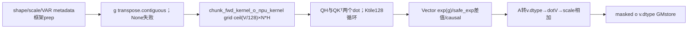
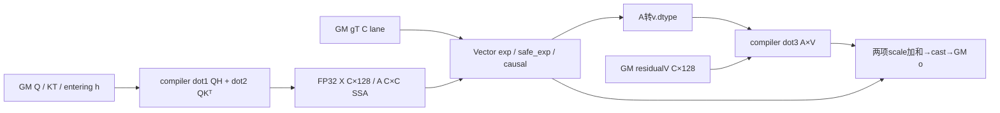

# GDN 块输出重建 A2/A3 Direct Invoke 算子知识


## 算子速览

| 项目 | 内容 |
|---|---|
| 实际入口 | sgl_kernel_npu.implementation.triton.attention.gdn.chunk_o.chunk_fwd_o_npu，Direct Invoke |
| 计算语义 | entering状态QH与块内因果QKᵀV合成，累计gate衰减；局部attention转v.dtype后dotV |
| 输入输出 | Q/K[B,T,Hg,K]，残差V[B,T,H,V]，进入h[B,NT,H,K,V]；新o沿V shape/dtype；g实际必填 |
| 执行类型 | 单Triton CV节点：AIC_CUBE候选tl.dot三实例及AIV_VECTOR gate/causal/cast/scale，实际primitive调度由compilerlower |
| Kernel 路线 | R001…R004=等/变长×import-time安全指数standard/fast，gNone为Host失败终点，不造USE_G0可达路线 |
| 核心资源 | BT=C，BK=BV128；grid(ceil(V/128),N*H)，每program串行全部本序列chunks；logical acc[BT,128]/[BT,BT]FP32 |
| 来源闭包 | direct_implementation_closed：19字段、完整3dot/Vectorbody、metadata/cache、gtranspose、旧版导入与打包闭合 |
| 关键边界 | equal b>0&H>1的g寻址缺b*(H−1)*T；公开条件/原公式须按实际gate限定；cache按Tensor对象is；未建立物理L1/L0/UB安全证明 |
| 验证状态 | 本次知识提取未执行编译、真机、数值或性能测试；draft闭包不表示数值、资源或编译验收 |

## 接口与语义

### 计算语义

每序列/值头h的query/key头qh=h//(H//Hg)。每chunk C行，以输入进入状态S[K,V]计算跨chunk项X=Q*S，局部项A=Q*Kᵀ。若gTensor，将X各行乘exp(g_i)，A_ij乘safe_exp(g_i−g_j)，safe_exp(x)只在x≤0保留exp、正差转exp(−inf)=0，再用i≥j mask置掉上三角。最终o=(X*scale+dot(cast_vdtype(A),V)*scale)，store到v.dtype；scale默认K^-0.5（实际k.shape[-1]）。g为按同一chunk_size、在每个chunk内累计的对数衰减；packed输入须按各序列边界重新分块累计，不能用全序列累计值替代，不在本kernel再cumsum，h为每chunk进入状态，v为DeltaH残差而非自动模型原V。

两个前置dot各FP32累加域，第三dot输入A先转v.dtype；没有显式allow_tf32/input_precision/round设置，不能把FP32输入路线写成IEEE全精度保证或借用WY U分支的allow_tf32=False。g load未显式toF32；常用gF32时exp/差值F32，其他floating输入按实际primitive/type规则，不把未显式cast补成代码。直接exp(g_i)始终tl.exp，环境FLA_USE_FAST_OPS只改变safe_exp内exp为fast_expf/标准tl.exp；这一差别必须保留。

Host把g[B,T,H]变为contiguous[B,H,Traw]，Deviceequal bos=b*Traw却以g+bos+h*Traw定位，实际(b+h)*Traw+t而独立batch/head应为(b*H+h)*Traw+t。仅b>0&H>1有该偏移；B1/H1/b0不因本项受影响，实际数值差依gate内容。packedB1使用bos=cu[n]且headstrideTraw正确对应该总token布局。数学意图与实际equal地址区别必须保留，不把normal输入都写成上述独立序列公式无条件成立。

### 输入、输出与属性

| 参数 | shape/layout | dtype | 约束、默认值与语义 |
|---|---|---|---|
| q | [B,T,Hg,K] contiguous | F16/BF16/F32 | NPU；rawHost仅shape解包，无stride参数 |
| k | 同q | 同q | shape/device/dtype为caller合同，scale默认由k[-1]算 |
| v | [B,T,H,V] contiguous | 同q | H为Hg正整数倍，值为前序残差 |
| h | equal[B,ceil(T/C),H,K,V]；packed[1,sumceil(L/C),H,K,V] | 同q | entering状态，容量由caller保证；输入只读 |
| g | [B,T,H] | floating，通常F32 | 按本次chunk_size及packed序列边界构造chunk-local累计值；默认None仍保留但Host直接transpose，None必AttributeError |
| scale | scalar | float/None | None则k.shape[-1]^-0.5 |
| cu_seqlens | [N+1]连续边界 | int32/int64 | None/equal或packedB1，从0到T，严格正序列；Device载入后toI32 |
| chunk_size | C | positivePOT integer，默认64 | 直接BT不按T缩小，真实资源compiler边界 |
| o | 同v | v.dtype/device | 新empty_like，输入不改 |

文档/publicwrapper陈述上述caller合同，但wrapper只dispatch，Direct没有_validate。传入shape不符、非连续Q/K/V/H、混device/type、H%Hg!=0、容量不足、非法cu或非POT C不构成公开支持，不凭raw到达升级。g.transpose.contiguous是唯一主动布局变换，其余不会自动修复。

### 入口与版本

公开auto/triton选择本Direct，torch_native独立参考不进当前任务图；没有异常fallback。公开API文档arch22/arch35均支持，README/architectures/generation映射A2/A3与950，本卡Frontmatter限定当前平台。固定CANN9.1来自README/CI，未声称实际运行。

完整读既有[状态与输出API](../../../../apis/sgl_kernel_npu/sgl_gdn_chunk_state_and_output.md)，复用原接口和数学意图。当前两函数与legacy fla/chunk_o.py实际Host/JIT/decorator AST相同；旧import的fla/utils.py中safe_exp和metadata对应算法相同，但module全局/cache实例独立、导入时环境各自绑定。旧文件额外导入torchF/exp等未使用，不是新增执行节点。只映射这个入口，不用同文件/AST线索扩为其它legacy数学语义。

## Host/Launcher 执行流程

### 参数校验与前处理

顺序为解包Q/V维度→BT=C→VAR时prepare_chunk_indices→HostNT=ceil(T/C)或len(indices)（这个NT之后不用于grid/body，仅保留metadata产生路径）→默认scale→empty_like(v)→N=B或len(cu)−1与prepare_chunk_offsets→grid closure→g.transpose(1,2).contiguous→JIT。没有Host型状/dtype/device/POT断言。gNone在准备/分配后、JIT前抛AttributeError；USE_GFalse body存在但此Host无producer，不将其编进正式normalRoute。

prepare_lens先把cu转I64再做差；indices用ceil(L/C).tolist()创建每sequence局部chunk.arange，再stack序号/局部chunk并.to(cu)；offsets在cu设备从0与ceil(L/C)拼接cumsum，通常产I64。indicesHost只用于lenNT、不传kernel，offsets才给Device定位h。tolist若NPU元数据引入framework同步；Torch拷贝/metadata构造属于普通框架prep，不伪造自有Device函数。

三个helper分别有至多4项tensor_cache：Tensor参数按对象is，不查_version/内容；cu原地更新可复用旧lens/indices/offsets。换C也可能仍命中prepare_lens旧值，不能当绕过机制。只限VAR metadata路径，equal不调用这些helper。

### 参数、Workspace 与生命周期

记s为同typeQ/K/V/H字节，sG/sCu分别gate/cu字节，Z=sum_nceil(Ln/C)，equalZ=B*ceil(T/C)。
输入Q/K各B*T*Hg*K*s，V与o各B*T*H*V*s，h有效Z*H*K*V*s，g有效B*T*H*sG。o由Host新分配；gT=transpose.contiguous，在转置view本身连续时alias原storage，否则新copy B*T*H*sG，两者不并算重复physicalowner。indices有效2Z*sCu；prepare_lens I64 N*8，offsets I64(N+1)*8；这些TorchTensor/4entrycache可延长metadata生存，不是ACLNN workspace。源码无自有GM workspace/systemworkspace/executor/手工free。

JIT输入cu/gT/offsets与输出o须保持到runtime消费，返回o不等于stream同步完成；临时gT/metadata由框架Tensor/缓存及Tritonruntime生命周期合同管理，源码没record_stream/event。跨stream调用需框架同步，不能声称Host书写顺序本身是硬件barrier。

### 启动图与失败传播



只有一个ownedJIT，内部Cube/Vector交接是Triton SSA/primitive dependency，source无显式AIC:AIV核比、跨核flag编号或GM pingpong；不能补造。代码的3dot与Vector逻辑图如下，各dot完整参数见Route，实际物理AIC/AIV分配/同步lower为compiler边界。所有Python/metadata/allocation/JIT异常直传，无参考fallback；无后续ownedKernel要继续提交。

## Route 与参数设计

### 分核与资源计算

先由q/v shape确定B/Traw/Hg/K/H/V，BT=C（无min(T,C)），BK=BV128。N=equalB或VARlen(cu)−1；grid(ceil(V/128),N*H)，num_warps4,num_stages2。每program(pid0=i_v,pid1=n*H+h)负责一个序列/值头/128值列，串行其NTn=ceil(Ln/C)全部chunk，内部Ksplitceil(K/128)循环。没有按chunk并行、splitK跨program归约或跨core sharedA；QKᵀ会在各Vtile重复计算，不宣称A跨Vtile共享。

dot1 QH：M=C,N=128,Kdot=128，每KtileQ[C,128]与h[128,128]相乘，b_o[C,128]F32累加；dot2 QKᵀ：M=C,N=C,Kdot128，复用同b_q，与k[128,C]相乘，b_A[C,C]F32累加；Ktail通过显式paddingzero。dot3 AV：M=C,N128,Kdot=C，A先转v.dtype，与v[C,128]相乘，结果scale再与scale过的b_o相加。两类输入blocklayout Q(rowtime,feature)/K(feature,time)使转置由stride定义，无独立GM Ktranspose；h/valuefeature连续。

逻辑tensor容量：q C*128*s、k128*C*s、h128*128*s、vC*128*s；两个FP32acc为4*C*128与4*C*C；Acast C*C*s；g C*sG、decaydiff C*C（primitive结果dtype域按g与exp实际规则）。这不是物理L1/L0/UB求和，compilerSSA重用/流水/布局/DoubleBuffer未知。num_stages2不是可据以给所有logicbuffer乘2的源分配证据。固定仓无该Triton lowering implementation/compiledresource，也无Host容量guard：只能标physicalprimitive边界，不虚构L0Coffset/UB≤192KiB等结论。

### Route 选择

| 顺序 | Route | Key/模板 | 精确选择条件与优先级 | 不适用去向 |
|---:|---|---|---|---|
| 1 | R-001 等长标准安全指数 | USE_G1,VAR0,EXPtl.exp | gTensor与caller合同；cuNone/equal；gdn_utils导入时FLA_USE_FAST_OPS!="1"；本卡平台；QKVH同F16/BF16/F32 | 另一selector或异常直传 |
| 2 | R-002 等长 fast安全指数 | USE_G1,VAR0,EXPfast_expf | gTensor与caller合同；cuNone/equal；gdn_utils导入时FLA_USE_FAST_OPS=="1"；本卡平台；QKVH同F16/BF16/F32 | 另一selector或异常直传 |
| 3 | R-003 变长标准安全指数 | USE_G1,VAR1,EXPtl.exp | gTensor与caller合同；cu非None/packedB1；gdn_utils导入时FLA_USE_FAST_OPS!="1"；本卡平台；QKVH同F16/BF16/F32 | 另一selector或异常直传 |
| 4 | R-004 变长 fast安全指数 | USE_G1,VAR1,EXPfast_expf | gTensor与caller合同；cu非None/packedB1；gdn_utils导入时FLA_USE_FAST_OPS=="1"；本卡平台；QKVH同F16/BF16/F32 | 另一selector或异常直传 |

```text
伪码：
on gdn_utils import: safe_exp.exp = fast_expf if env=="1" else tl.exp
Direct shape -> metadata/scale/output -> g.transpose.contiguous
gNone -> AttributeError, noJIT/USE_G0
cuNone -> VAR0: R001 standard / R002 fast
cuTensor -> VAR1: R003 standard / R004 fast
allnormal: USE_G1,BK128,BV128,BT=C,warps4,stages2
```

### 模板/实现执行矩阵

| Route | key/selector | dtype/shape/platform 完整命中条件 | 执行族与 kernel 节点 | 实际模板/body | 内存与同步特征 | tail/fallback |
|---|---|---|---|---|---|---|
| R-001 | VAR0,USE_G1,safestandard | cuNone，B≥1；同typeQKVH三dtype；g通常F32；H/Hg正整数；CpositivePOT，capacity/contiguouscaller合同；本卡平台 | 一个CV JIT的三dot+Vectorgate/causal/scale | chunk_fwd_kernel_o_npu_kernel[H,Hg,K,V,C,128,128,1,0]，safe_exp→tl.exp；4warps/2stages | equalboh=nceilT/C；gTGM；自有workspace0，SSA交接 | K/V/T显式zero、storebounds；b>0&H>1 gateoffset冲突；无fallback |
| R-002 | VAR0,USE_G1,safefast | cuNone，B≥1；同typeQKVH三dtype；g通常F32；H/Hg正整数；CpositivePOT，capacity/contiguouscaller合同；本卡平台 | 一个CV JIT的三dot+Vectorgate/causal/scale | chunk_fwd_kernel_o_npu_kernel[H,Hg,K,V,C,128,128,1,0]，safe_exp→fast_expf；4warps/2stages | equalboh=nceilT/C；gTGM；自有workspace0，SSA交接 | K/V/T显式zero、storebounds；b>0&H>1 gateoffset冲突；无fallback |
| R-003 | VAR1,USE_G1,safestandard | cu非None，B1、positiveLengths、0..T；同typeQKVH三dtype；g通常F32；H/Hg正整数；CpositivePOT，capacity/contiguouscaller合同；本卡平台 | 一个CV JIT的三dot+Vectorgate/causal/scale | chunk_fwd_kernel_o_npu_kernel[H,Hg,K,V,C,128,128,1,1]，safe_exp→tl.exp；4warps/2stages | cu->I32和offsets->I64；gT/metadataGM；自有workspace0，SSA交接 | K/V/T显式zero、storebounds；cache不可原地cu；无fallback |
| R-004 | VAR1,USE_G1,safefast | cu非None，B1、positiveLengths、0..T；同typeQKVH三dtype；g通常F32；H/Hg正整数；CpositivePOT，capacity/contiguouscaller合同；本卡平台 | 一个CV JIT的三dot+Vectorgate/causal/scale | chunk_fwd_kernel_o_npu_kernel[H,Hg,K,V,C,128,128,1,1]，safe_exp→fast_expf；4warps/2stages | cu->I32和offsets->I64；gT/metadataGM；自有workspace0，SSA交接 | K/V/T显式zero、storebounds；cache不可原地cu；无fallback |

### 隐藏性能 Guard

| Guard | Host/Tiling 条件 | Device/资源原因 | 影响 Route | 不满足时去向 | 源码符号 |
|---|---|---|---|---|---|
| g存在 | 无显式guard；直接transpose | 正常USE_G恒1 | 全部 | NoneHost AttributeError | chunk_fwd_o_npu |
| BT/C | 原样chunk_size，未assertPOT/容量 | dotM/C、C²acc/arange约束 | 全部 | 无安全fallback；compiler边界，不伪造报错 | Host BT与kernel |
| denseQKVH | caller合同，Host不复制 | blockptr固定strides | 全部 | raw不保证，非支持域 | p_q/p_k/p_h/p_v |
| headgroup | H%Hg0且正 | i_h//(H//Hg) | 全部 | Host无assert，非法除法/寻址不扩支持 | q/kbase |
| packedB1/I32bounds | caller：0=cu0<...=T，读值可I32表达 | flattenB1与toI32窄化 | R003/4 | Host不全检，非法边界不保证 | bos/eos.toI32 |
| gcache | cu对象不原地变更 | helper按is复用旧derivedTensor | R003/4 | 无自动失效；新对象/显式调用管理 | tensor_cache |
| equalgate | b0或H1无本项偏移 | HostBHT，Devicebos非b*H*T | R001/2 | b>0&H>1按实际gate读，禁止无条件数学承诺 | g_ptr |
| exp环境 | 模块导入时读取 | 只safe_exp可选fast，不改tl.exp(g) | 全部 | 改env不自动rebinding已importmodule | gdn_utils exp |

### POD/ABI

无C++ POD：源为19个Triton参数含constexpr/heuristic，runtime pointer/scalar physical位宽、align、offsetof与pack规则由compiler/runtime ABI决定，本仓未显式声明。逐字段保持源次序，不造sizeof。Launchoptions num_warps4/num_stages2为另外配置，不塞入POD字段。

| 结构 | 字段 | 类型/位宽 | ABI 布局 | 单位 | Host/launcher producer | Device consumer | 边界 |
|---|---|---|---|---|---|---|---|
| Triton tuple | q | inputpointer q.dtype | arg0；physicaloffset未声明 | 元素 | callerq | qbase与p_q[BT,128] | dense |
| Triton tuple | k | inputpointer k.dtype | arg1；physicaloffset未声明 | 元素 | callerk | kbase与p_k[128,BT] | 同qtype |
| Triton tuple | v | inputpointer v.dtype | arg2；physicaloffset未声明 | 元素 | callerv | p_v[BT,128] | 决定castA/o |
| Triton tuple | h | inputpointer h.dtype | arg3；physicaloffset未声明 | 元素 | caller进入快照 | h_base/p_h[128,128] | Z,H,K,V |
| Triton tuple | g | inputpointer g.dtype | arg4；physicaloffset未声明 | 元素 | g.transpose.contiguous | g+bos+h*Traw+offs | NoneHost失败 |
| Triton tuple | o | outputpointer v.dtype | arg5；physicaloffset未声明 | 元素 | empty_like(v) | p_o store | 独立GM |
| Triton tuple | cu_seqlens | optionalpointer I32/I64 | arg6；physicaloffset未声明 | token | caller/None | toI32 bos/eos | VAR0inactive |
| Triton tuple | chunk_offsets | optionalpointer（cumsum通常I64） | arg7；physicaloffset未声明 | chunk | prepare_chunk_offsets/None | loadtoI64 boh | VAR0inactive |
| Triton tuple | scale | runtime float，lower位宽未显式 | arg8；physicaloffset未声明 | scalar | caller/defaultkK^-0.5 | 两项scale | 非局部attention提前scale |
| Triton tuple | T | runtime integer，lower位宽未显式 | arg9；physicaloffset未声明 | token | q.shape1 | Traw保存；VAR后覆盖L | do_not_specialize |
| Triton tuple | H | tl.constexpr int | arg10 compile；physicaloffset未声明 | valuehead | v.shape[-2] | i_nh拆头/group/stride | H%Hg0合同 |
| Triton tuple | Hg | tl.constexpr int | arg11 compile；physicaloffset未声明 | qkhead | q.shape[-2] | i_h//(H//Hg)/QKstride | 正数合同 |
| Triton tuple | K | tl.constexpr int | arg12 compile；physicaloffset未声明 | feature | q.shape[-1] | ceilK128 loop/hstride | 与k/h一致合同 |
| Triton tuple | V | tl.constexpr int | arg13 compile；physicaloffset未声明 | feature | v.shape[-1] | grid ceilV128/hstride | 正数合同 |
| Triton tuple | BT | tl.constexpr int | arg14 compile；physicaloffset未声明 | token | chunk_size直接 | chunk loop/shape BT | positivePOT合同 |
| Triton tuple | BK | tl.constexpr int | arg15 compile；physicaloffset未声明 | feature | 128 | Q/K/H Ktile | Ktail explicitzero |
| Triton tuple | BV | tl.constexpr int | arg16 compile；physicaloffset未声明 | valuefeature | 128 | i_v tile/v/o/h | Vtail explicitzero |
| Triton tuple | USE_G | heuristic tl.constexpr bool | arg17 compile；physicaloffset未声明 | bool | g is not None；该Host正常恒True | gate分支 | False没有Hostproducer |
| Triton tuple | IS_VARLEN | heuristic tl.constexpr bool | arg18 compile；physicaloffset未声明 | bool | cu is not None | bos/eos/boh | equal或VAR |

### Route 源码闭包

| Route | Key/selector | Host/Tiling producer | POD/参数 | Kernel entry/router | Kernel body/直接依赖 | 构建接线 |
|---|---|---|---|---|---|---|
| R-001 | VAR0,USE_G1,safestandard | python/sgl_kernel_npu/sgl_kernel_npu/implementation/triton/attention/gdn/chunk_o.py:chunk_fwd_o_npu；gdn_utils prepare_lens/indices/offsets | 上表19字段+4warps/2stages | python/sgl_kernel_npu/sgl_kernel_npu/implementation/triton/attention/gdn/chunk_o.py:chunk_fwd_kernel_o_npu_kernel heuristic specialization | 完整body与gdn_utils:safe_exp；tl.dot/load/store/exp compilerprimitive边界 | operators/attention/gdn/chunk_o.py→registry；setup.py→torch_wheel.py stage_runtime；target_provider共同模块与__init__扩展导入 |
| R-002 | VAR0,USE_G1,safefast | python/sgl_kernel_npu/sgl_kernel_npu/implementation/triton/attention/gdn/chunk_o.py:chunk_fwd_o_npu；gdn_utils prepare_lens/indices/offsets | 上表19字段+4warps/2stages | python/sgl_kernel_npu/sgl_kernel_npu/implementation/triton/attention/gdn/chunk_o.py:chunk_fwd_kernel_o_npu_kernel heuristic specialization | 完整body与gdn_utils:safe_exp；tl.dot/load/store/exp compilerprimitive边界 | operators/attention/gdn/chunk_o.py→registry；setup.py→torch_wheel.py stage_runtime；target_provider共同模块与__init__扩展导入 |
| R-003 | VAR1,USE_G1,safestandard | python/sgl_kernel_npu/sgl_kernel_npu/implementation/triton/attention/gdn/chunk_o.py:chunk_fwd_o_npu；gdn_utils prepare_lens/indices/offsets | 上表19字段+4warps/2stages | python/sgl_kernel_npu/sgl_kernel_npu/implementation/triton/attention/gdn/chunk_o.py:chunk_fwd_kernel_o_npu_kernel heuristic specialization | 完整body与gdn_utils:safe_exp；tl.dot/load/store/exp compilerprimitive边界 | operators/attention/gdn/chunk_o.py→registry；setup.py→torch_wheel.py stage_runtime；target_provider共同模块与__init__扩展导入 |
| R-004 | VAR1,USE_G1,safefast | python/sgl_kernel_npu/sgl_kernel_npu/implementation/triton/attention/gdn/chunk_o.py:chunk_fwd_o_npu；gdn_utils prepare_lens/indices/offsets | 上表19字段+4warps/2stages | python/sgl_kernel_npu/sgl_kernel_npu/implementation/triton/attention/gdn/chunk_o.py:chunk_fwd_kernel_o_npu_kernel heuristic specialization | 完整body与gdn_utils:safe_exp；tl.dot/load/store/exp compilerprimitive边界 | operators/attention/gdn/chunk_o.py→registry；setup.py→torch_wheel.py stage_runtime；target_provider共同模块与__init__扩展导入 |

## Kernel 实现

### 公共执行流程

所有正常Route仅一个ownedCV JIT：grid先分值列与序列/head，确定bos/eos/boh→同program按chunk顺序初始化两个FP32acc→Ktile128循环load Q/K/H并dot1/dot2累加→Vectorgate与causal→loadV并dot3→两项各scale再加/store。h只读，每chunk独立进入快照；没有本kernel内状态递推或h更新。b_A只当前program当前chunk存在，其跨Vtile重算；不要误作中间GM workspace。source未提供AIC/AIV flag或物理buffer协议，这些由Tritonprimitive lowering负责，知识闭合的是明确dotshape/layout/精度/dependency而非伪造compile输出。

### Route R-001：等长标准安全指数

#### 适用条件

##### 选择证据

| 层级 | 文件 | 符号 | 源码谓词/参数 | 结果/下一跳 |
|---|---|---|---|---|
| public | operators/attention/gdn/chunk_o.py | _triton_impl/chunk_fwd_o | auto/triton，caller三type同dtype/layout/device合同 | Direct，无额外_validate |
| Host | python/sgl_kernel_npu/sgl_kernel_npu/implementation/triton/attention/gdn/chunk_o.py | chunk_fwd_o_npu | gTensor、cuNone | N=B，gT，o，grid |
| import | implementation/triton/attention/gdn/gdn_utils.py | exp/safe_exp | FLA_USE_FAST_OPS!="1" | safe_exp调用tl.exp |
| router | python/sgl_kernel_npu/sgl_kernel_npu/implementation/triton/attention/gdn/chunk_o.py | heuristics / chunk_fwd_kernel_o_npu_kernel | USE_G1,IS_VARLEN0,BK=BV128,BT=C | 三dot与Vector阶段 |

#### Device 数据流

##### 函数级调用链

```text
chunk_fwd_o_npu -> equalN=B
 -> empty_like(v); g.transpose.contiguous
 -> chunk_fwd_kernel_o_npu_kernel[ceil(V/128),N*H]
   -> bos=n*Traw; boh=n*ceil(Traw/C)
   -> eachchunk: eachKtile loadQ/K/H -> dotQH, dotQKᵀ
   -> tl.exp(g) and safe_exp -> tl.exp fordiff
   -> causalwhere; loadV -> dot(castA,V)
   -> scale/statepluslocal -> storevtype
```

##### 源码等价伪码

```text
伪码；i_v=pid0; n=pid1//H; h=pid1%H; Traw=HostT
bos=n*Traw; eos=bos+Traw; L=Traw; boh=n*ceil(L/C)
qbase=q+(bos*Hg+h//(H//Hg))*K; kbase同
vbase=v+(bos*H+h)*V; obase同
for c=0..ceil(L/C)-1:
  hbase=hGM+I64((boh+c)*H+h)*K*V
  X=zerosF32[C,128]; A=zerosF32[C,C]
  for z=0..ceil(K/128)-1:
    Q=loadblock(qbase,(L,K),(Hg*K,1),(c*C,z*128),(C,128),order(1,0),check01,zero)
    KT=loadblock(kbase,(K,L),(1,Hg*K),(z*128,c*C),(128,C),order(0,1),check01,zero)
    S=loadblock(hbase,(K,V),(V,1),(z*128,i_v*128),(128,128),order(1,0),check01,zero)
    X += dot(Q,S); A += dot(Q,KT) # FP32 acc domains
  gg=load(gT+bos+h*Traw+c*C+arange(C),mask=c*C+arange(C)<L,other0)
  X *= tl.exp(gg)[:,None]
  dx=gg[:,None]-gg[None,:]
  A *= tl.exp(where(dx<=0,dx,-inf))
  A=where(arange(C)[:,None]>=arange(C)[None,:],A,0)
  VV=loadblock(vbase,(L,V),(H*V,1),(c*C,i_v*128),(C,128),order(1,0),check01,zero)
  out=X*scale+dot(cast_vdtype(A),VV)*scale
  storeblock(obase,(L,V),(H*V,1),(c*C,i_v*128),(C,128),cast_vdtype(out),check01)
```

equal g实际地址(b+h)*Traw+t，不能替换成假想(b*H+h)*Traw+t；只有b0/H1/B1排除本项偏移。Q/K/V/h的equalbatch寻址分别通过bos/boh，不能因gate缺陷把它们也说成同一地址缺陷。

#### 内存与数据搬运

##### 资源与搬运表

| 层级/缓冲区 | offset/地址公式 | extent/容量公式 | dtype/layout | producer | consumer | owner/lifetime | 对齐/复用 |
|---|---|---|---|---|---|---|---|
| Q GM→logicalQ | (bos*Hg+qh)*K+t*Hg*K+z | inputB*T*Hg*K*s；tileC*128*s | denseQ[C,128],order1,0 | caller | dot1/dot2 | caller；同Ktile共享Q | check01/paddingzero |
| K GM→logicalKT | (bos*Hg+qh)*K+z+t*Hg*K | 同Q；tile128*C*s | transposedview[128,C],order0,1 | caller | dot2 | caller；无GM transpose | check01/paddingzero |
| h GM→logicalS | ((boh+c)*H+h)*K*V+z*V+i_v*128+vcol | inputZ*H*K*V*s；tile128²*s | K,V dense | caller/前序DeltaH | dot1 | input到消费，readonly | check01/paddingzero；caller容量 |
| local X acc | [C,128] | 4*C*128 | FP32 | dot1累加 | gexp/scale/add | 当前chunk SSA | K循环累加，不跨chunk |
| local A acc/cast | [C,C] | FP32 4*C²；castC²*s | time,time | dot2→gate/causal | dot3A | 当前chunk SSA | 每Vtile重算；不GM共享 |
| gT GM→localg | bos+h*Traw+c*C+t | B*T*H*sG；tileC*sG | contiguousBHT | Hosttranspose/contiguous | exp与safeexp | inputalias或框架copy直到kernel消费 | maskt<L,other0；equalbatch offset缺项 |
| V GM→logicalVV | (bos*H+h)*V+t*H*V+i_v*128+vcol | B*T*H*V*s；tileC*128*s | time,V | caller残差 | dot3B | readonly到消费 | check01/paddingzero |
| o GM | 与V基址/stride同形 | B*T*H*V*s | v.dtype | Hostempty/kernelstore | laterconsumer | 返回Tensor | check01，独占head/Vslice |
| cu GM | n/n+1 | N/A | I32/I64→I32 | caller | VARbos/eos | inactive | 0..T与I32合法caller合同 |
| offsets GM | n | N/A | load→I64 | prepare_chunk_offsets | VARboh | cache/框架Tensor | 行数与h容量一致 |
| Host-only indices/lens | indices[Z,2]/lens[N] | N/A | indices沿cu；lensI64 | helpers | Hostlen/offsetproducer | 各4entrycache | 不作为Deviceindices参数 |
| L1/L0A/L0B/L0C/UB/register | 无sourceownedoffset | physical容量未声明；逻辑tile如上 | compiler tl.dot/SSA | compilerprimitive | compilerprimitive | compiler调度 | 不造doublebuffer、flag或baseMMAD |
| self workspace | N/A | 0 | N/A | 无 | 无 | 无 | 不把gT/Torchmetadata改名ACLNNworkspace |

##### 分层内存布局



L1/L0A/L0B/L0C/Fixpipe：Tritonprimitive的实际lower路径，source没有显式owned分配/LoadData/Mmad/Fixpipe参数，无法填写physicaloffset；所选dotlayout/shape/type已逐实例给出，不以N/A掩盖它们。Vector owned UB block-beta：N/A，实际为compilerlane/SSA临时而非手工TQue/TBuf。num_stages2不能自动推断两套每层物理buffer。

##### 字节账、交接边与复用顺序

```text
BK=BV128, BT=C
logicalQ=128*C*s; logicalKT=128*C*s; logicalS=128*128*s
logicalV=128*C*s; logicalX=4*C*128; logicalA=4*C*C
logicalAcast=C*C*s; logicalg=C*sG
单Ktile有效搬运上界=2*C*128*s+128*128*s（各维boundary裁剪）
单chunk Vload=C*128*s、outputstore=C*128*s、gload=C*sG（边界裁剪）
物理L1/L0/UB/register_total：compiler未公开，不能将logic相加/乘stages当实际峰值
workspace_total=0（自有）；o bytes=B*Traw*H*V*s
gT copy若需要=B*Traw*H*sG，否则alias不新增；metadata按本Route VAR条件
无source容量guard/对齐workspace切片/系统workspace
```

| 边/复用子区 | producer | offset/extent | dtype/layout | consumer | ordering/sync | owner/lifetime | 安全条件 |
|---|---|---|---|---|---|---|---|
| Q tile复用 | loadQ | C×128 | q.dtype | dot1与dot2 | compilerSSA dependency | 当前Ktile | 两dotconsume后可回收；无手写event |
| X递推acc | dot1 | C×128,4C128B | FP32 | 下Ktile累加/gate | compilerdot/expr dependency | 当前chunk | 初始化zeros，不跨program |
| A递推acc→Vector→dot3 | dot2/gate/causal/cast | C×C F32→C×C*s | time,time | dot3A | compilerprimitive ordering；无源flagID | 当前chunk/值tile | causalzero、castbeforeVdot |
| X→最终output | dot1/gexp | C×128F32 | time,Vtile | scale/add | SSA | 当前chunk | 不提前用下一chunk覆盖 |
| gT跨framework→JIT | transpose.contiguous | 0..B*T*H*sG | denseBHT | loadg | 框架当前stream/Tritonruntime合同 | alias/copyTensor到消费 | equal地址冲突按实际值限定 |
| metadata→JIT | helperoffsets/cu | 0..N或N+1 | I64/I32 | VARdecode | 框架排序；tolist同步为ordinaryprep | cache/inputowner | 正边界/I32不溢；同对象不原地变更 |
| o提交 | finalcast/store | (bos+h)*逻辑对应片，具体为(bos*H+h+t*H)*V+i_v*128 | v.dtype | caller | runtime后续streamconsumer | 返回o | source无sync，inputs保持存活 |
| 下一chunk | source重新zeros/load | localSSA domains | 各自dtype | 新dot | compilerloopdependency | 新chunk | 无sharedGMpartial/atomic |

#### 同步、精度与尾块

##### 同步与数值边界表

| 阶段 | primitive/机制 | producer | consumer/等待点 | 保护对象 | 精度/尾块 |
|---|---|---|---|---|---|
| Q/K/hload | blockptrcheck01 + paddingzero | GM | dot1/2 | time/K/Vtail | 三者明确zero，与KKT/DeltaH个别未明示zero不同 |
| dot1/2 | tl.dot，FP32acc domains | Q/h或Q/K | 各自acc加法 | 当前chunk | 默认input_precision/allow_tf32，未强制IEEE |
| gateX | tl.exp(nativeg) | gT | X乘法 | 行decay | 常用gF32；未显式gcast；始终tl.exp |
| gateA | safe_exp→tl.exp(where(dx<=0,dx,−inf)) | g差 | A乘法 | attentionmatrix | 正差zero；maskedgloadother0；不把fastmode用于Xexp |
| causal | tl.where(i>=j,A,0) | A | cast/dot3 | 时间因果域 | i/j由arange(C)转F32；不只乘布尔掩码 |
| dot3 | tl.dot(A.to(v.dtype),V) | castA、zeropadV | finalsum | localoutput | A低精舍入，dot默认精度；无显式round |
| final | X*scale+dot3*scale→to(o.type)→storecheck | 两项 | GM o | validtime/V | 两项各乘scale再相加，outputv.dtype |
| loop/sync | SSA/compilerdot管线 | 当前tile | 依赖consumer/下一loop | compilerownedlocal | 无源atomic/event/pipe/跨AICflag |
| stream | framework/Tritonruntime | prep/JIT | 后续caller | gT/meta/o生存 | source无device sync，异步return |

#### 关键实现

##### 符号证据表

| 阶段 | 文件 | 符号/模板实例 | 实现事实 |
|---|---|---|---|
| Host/Tiling producer | python/sgl_kernel_npu/sgl_kernel_npu/implementation/triton/attention/gdn/chunk_o.py | chunk_fwd_o_npu | gridVtile×N*H，BT=C/BK=BV128，warps4/stages2，gT |
| Kernel entry/router | python/sgl_kernel_npu/sgl_kernel_npu/implementation/triton/attention/gdn/chunk_o.py | chunk_fwd_kernel_o_npu_kernel[USE_G1,VAR0] | 19参数，T do_not_specialize |
| Device body/helper | python/sgl_kernel_npu/sgl_kernel_npu/implementation/triton/attention/gdn/chunk_o.py | 三tl.dot与blockptr | M/N/K= C/128/128、C/C/128、C/128/C；显式zerotails |
| Device body/helper | implementation/triton/attention/gdn/gdn_utils.py | safe_exp / metadatahelpers | tl.exp、4entry identitycache |


### Route R-002：等长 fast安全指数

#### 适用条件

##### 选择证据

| 层级 | 文件 | 符号 | 源码谓词/参数 | 结果/下一跳 |
|---|---|---|---|---|
| public | operators/attention/gdn/chunk_o.py | _triton_impl/chunk_fwd_o | auto/triton，caller三type同dtype/layout/device合同 | Direct，无额外_validate |
| Host | python/sgl_kernel_npu/sgl_kernel_npu/implementation/triton/attention/gdn/chunk_o.py | chunk_fwd_o_npu | gTensor、cuNone | N=B，gT，o，grid |
| import | implementation/triton/attention/gdn/gdn_utils.py | exp/safe_exp | FLA_USE_FAST_OPS=="1" | safe_exp调用tldevice.fast_expf |
| router | python/sgl_kernel_npu/sgl_kernel_npu/implementation/triton/attention/gdn/chunk_o.py | heuristics / chunk_fwd_kernel_o_npu_kernel | USE_G1,IS_VARLEN0,BK=BV128,BT=C | 三dot与Vector阶段 |

#### Device 数据流

##### 函数级调用链

```text
chunk_fwd_o_npu -> equalN=B
 -> empty_like(v); g.transpose.contiguous
 -> chunk_fwd_kernel_o_npu_kernel[ceil(V/128),N*H]
   -> bos=n*Traw; boh=n*ceil(Traw/C)
   -> eachchunk: eachKtile loadQ/K/H -> dotQH, dotQKᵀ
   -> tl.exp(g) and safe_exp -> fast_expf fordiff
   -> causalwhere; loadV -> dot(castA,V)
   -> scale/statepluslocal -> storevtype
```

##### 源码等价伪码

```text
伪码；i_v=pid0; n=pid1//H; h=pid1%H; Traw=HostT
bos=n*Traw; eos=bos+Traw; L=Traw; boh=n*ceil(L/C)
qbase=q+(bos*Hg+h//(H//Hg))*K; kbase同
vbase=v+(bos*H+h)*V; obase同
for c=0..ceil(L/C)-1:
  hbase=hGM+I64((boh+c)*H+h)*K*V
  X=zerosF32[C,128]; A=zerosF32[C,C]
  for z=0..ceil(K/128)-1:
    Q=loadblock(qbase,(L,K),(Hg*K,1),(c*C,z*128),(C,128),order(1,0),check01,zero)
    KT=loadblock(kbase,(K,L),(1,Hg*K),(z*128,c*C),(128,C),order(0,1),check01,zero)
    S=loadblock(hbase,(K,V),(V,1),(z*128,i_v*128),(128,128),order(1,0),check01,zero)
    X += dot(Q,S); A += dot(Q,KT) # FP32 acc domains
  gg=load(gT+bos+h*Traw+c*C+arange(C),mask=c*C+arange(C)<L,other0)
  X *= tl.exp(gg)[:,None]
  dx=gg[:,None]-gg[None,:]
  A *= fast_expf(where(dx<=0,dx,-inf))
  A=where(arange(C)[:,None]>=arange(C)[None,:],A,0)
  VV=loadblock(vbase,(L,V),(H*V,1),(c*C,i_v*128),(C,128),order(1,0),check01,zero)
  out=X*scale+dot(cast_vdtype(A),VV)*scale
  storeblock(obase,(L,V),(H*V,1),(c*C,i_v*128),(C,128),cast_vdtype(out),check01)
```

equal g实际地址(b+h)*Traw+t，不能替换成假想(b*H+h)*Traw+t；只有b0/H1/B1排除本项偏移。Q/K/V/h的equalbatch寻址分别通过bos/boh，不能因gate缺陷把它们也说成同一地址缺陷。

#### 内存与数据搬运

##### 资源与搬运表

| 层级/缓冲区 | offset/地址公式 | extent/容量公式 | dtype/layout | producer | consumer | owner/lifetime | 对齐/复用 |
|---|---|---|---|---|---|---|---|
| Q GM→logicalQ | (bos*Hg+qh)*K+t*Hg*K+z | inputB*T*Hg*K*s；tileC*128*s | denseQ[C,128],order1,0 | caller | dot1/dot2 | caller；同Ktile共享Q | check01/paddingzero |
| K GM→logicalKT | (bos*Hg+qh)*K+z+t*Hg*K | 同Q；tile128*C*s | transposedview[128,C],order0,1 | caller | dot2 | caller；无GM transpose | check01/paddingzero |
| h GM→logicalS | ((boh+c)*H+h)*K*V+z*V+i_v*128+vcol | inputZ*H*K*V*s；tile128²*s | K,V dense | caller/前序DeltaH | dot1 | input到消费，readonly | check01/paddingzero；caller容量 |
| local X acc | [C,128] | 4*C*128 | FP32 | dot1累加 | gexp/scale/add | 当前chunk SSA | K循环累加，不跨chunk |
| local A acc/cast | [C,C] | FP32 4*C²；castC²*s | time,time | dot2→gate/causal | dot3A | 当前chunk SSA | 每Vtile重算；不GM共享 |
| gT GM→localg | bos+h*Traw+c*C+t | B*T*H*sG；tileC*sG | contiguousBHT | Hosttranspose/contiguous | exp与safeexp | inputalias或框架copy直到kernel消费 | maskt<L,other0；equalbatch offset缺项 |
| V GM→logicalVV | (bos*H+h)*V+t*H*V+i_v*128+vcol | B*T*H*V*s；tileC*128*s | time,V | caller残差 | dot3B | readonly到消费 | check01/paddingzero |
| o GM | 与V基址/stride同形 | B*T*H*V*s | v.dtype | Hostempty/kernelstore | laterconsumer | 返回Tensor | check01，独占head/Vslice |
| cu GM | n/n+1 | N/A | I32/I64→I32 | caller | VARbos/eos | inactive | 0..T与I32合法caller合同 |
| offsets GM | n | N/A | load→I64 | prepare_chunk_offsets | VARboh | cache/框架Tensor | 行数与h容量一致 |
| Host-only indices/lens | indices[Z,2]/lens[N] | N/A | indices沿cu；lensI64 | helpers | Hostlen/offsetproducer | 各4entrycache | 不作为Deviceindices参数 |
| L1/L0A/L0B/L0C/UB/register | 无sourceownedoffset | physical容量未声明；逻辑tile如上 | compiler tl.dot/SSA | compilerprimitive | compilerprimitive | compiler调度 | 不造doublebuffer、flag或baseMMAD |
| self workspace | N/A | 0 | N/A | 无 | 无 | 无 | 不把gT/Torchmetadata改名ACLNNworkspace |

##### 分层内存布局


L1/L0A/L0B/L0C/Fixpipe：Tritonprimitive的实际lower路径，source没有显式owned分配/LoadData/Mmad/Fixpipe参数，无法填写physicaloffset；所选dotlayout/shape/type已逐实例给出，不以N/A掩盖它们。Vector owned UB block-beta：N/A，实际为compilerlane/SSA临时而非手工TQue/TBuf。num_stages2不能自动推断两套每层物理buffer。

##### 字节账、交接边与复用顺序

```text
BK=BV128, BT=C
logicalQ=128*C*s; logicalKT=128*C*s; logicalS=128*128*s
logicalV=128*C*s; logicalX=4*C*128; logicalA=4*C*C
logicalAcast=C*C*s; logicalg=C*sG
单Ktile有效搬运上界=2*C*128*s+128*128*s（各维boundary裁剪）
单chunk Vload=C*128*s、outputstore=C*128*s、gload=C*sG（边界裁剪）
物理L1/L0/UB/register_total：compiler未公开，不能将logic相加/乘stages当实际峰值
workspace_total=0（自有）；o bytes=B*Traw*H*V*s
gT copy若需要=B*Traw*H*sG，否则alias不新增；metadata按本Route VAR条件
无source容量guard/对齐workspace切片/系统workspace
```

| 边/复用子区 | producer | offset/extent | dtype/layout | consumer | ordering/sync | owner/lifetime | 安全条件 |
|---|---|---|---|---|---|---|---|
| Q tile复用 | loadQ | C×128 | q.dtype | dot1与dot2 | compilerSSA dependency | 当前Ktile | 两dotconsume后可回收；无手写event |
| X递推acc | dot1 | C×128,4C128B | FP32 | 下Ktile累加/gate | compilerdot/expr dependency | 当前chunk | 初始化zeros，不跨program |
| A递推acc→Vector→dot3 | dot2/gate/causal/cast | C×C F32→C×C*s | time,time | dot3A | compilerprimitive ordering；无源flagID | 当前chunk/值tile | causalzero、castbeforeVdot |
| X→最终output | dot1/gexp | C×128F32 | time,Vtile | scale/add | SSA | 当前chunk | 不提前用下一chunk覆盖 |
| gT跨framework→JIT | transpose.contiguous | 0..B*T*H*sG | denseBHT | loadg | 框架当前stream/Tritonruntime合同 | alias/copyTensor到消费 | equal地址冲突按实际值限定 |
| metadata→JIT | helperoffsets/cu | 0..N或N+1 | I64/I32 | VARdecode | 框架排序；tolist同步为ordinaryprep | cache/inputowner | 正边界/I32不溢；同对象不原地变更 |
| o提交 | finalcast/store | (bos+h)*逻辑对应片，具体为(bos*H+h+t*H)*V+i_v*128 | v.dtype | caller | runtime后续streamconsumer | 返回o | source无sync，inputs保持存活 |
| 下一chunk | source重新zeros/load | localSSA domains | 各自dtype | 新dot | compilerloopdependency | 新chunk | 无sharedGMpartial/atomic |

#### 同步、精度与尾块

##### 同步与数值边界表

| 阶段 | primitive/机制 | producer | consumer/等待点 | 保护对象 | 精度/尾块 |
|---|---|---|---|---|---|
| Q/K/hload | blockptrcheck01 + paddingzero | GM | dot1/2 | time/K/Vtail | 三者明确zero，与KKT/DeltaH个别未明示zero不同 |
| dot1/2 | tl.dot，FP32acc domains | Q/h或Q/K | 各自acc加法 | 当前chunk | 默认input_precision/allow_tf32，未强制IEEE |
| gateX | tl.exp(nativeg) | gT | X乘法 | 行decay | 常用gF32；未显式gcast；始终tl.exp |
| gateA | safe_exp→fast_expf(where(dx<=0,dx,−inf)) | g差 | A乘法 | attentionmatrix | 正差zero；maskedgloadother0；不把fastmode用于Xexp |
| causal | tl.where(i>=j,A,0) | A | cast/dot3 | 时间因果域 | i/j由arange(C)转F32；不只乘布尔掩码 |
| dot3 | tl.dot(A.to(v.dtype),V) | castA、zeropadV | finalsum | localoutput | A低精舍入，dot默认精度；无显式round |
| final | X*scale+dot3*scale→to(o.type)→storecheck | 两项 | GM o | validtime/V | 两项各乘scale再相加，outputv.dtype |
| loop/sync | SSA/compilerdot管线 | 当前tile | 依赖consumer/下一loop | compilerownedlocal | 无源atomic/event/pipe/跨AICflag |
| stream | framework/Tritonruntime | prep/JIT | 后续caller | gT/meta/o生存 | source无device sync，异步return |

#### 关键实现

##### 符号证据表

| 阶段 | 文件 | 符号/模板实例 | 实现事实 |
|---|---|---|---|
| Host/Tiling producer | python/sgl_kernel_npu/sgl_kernel_npu/implementation/triton/attention/gdn/chunk_o.py | chunk_fwd_o_npu | gridVtile×N*H，BT=C/BK=BV128，warps4/stages2，gT |
| Kernel entry/router | python/sgl_kernel_npu/sgl_kernel_npu/implementation/triton/attention/gdn/chunk_o.py | chunk_fwd_kernel_o_npu_kernel[USE_G1,VAR0] | 19参数，T do_not_specialize |
| Device body/helper | python/sgl_kernel_npu/sgl_kernel_npu/implementation/triton/attention/gdn/chunk_o.py | 三tl.dot与blockptr | M/N/K= C/128/128、C/C/128、C/128/C；显式zerotails |
| Device body/helper | implementation/triton/attention/gdn/gdn_utils.py | safe_exp / metadatahelpers | fast_expf、4entry identitycache |


### Route R-003：变长标准安全指数

#### 适用条件

##### 选择证据

| 层级 | 文件 | 符号 | 源码谓词/参数 | 结果/下一跳 |
|---|---|---|---|---|
| public | operators/attention/gdn/chunk_o.py | _triton_impl/chunk_fwd_o | auto/triton，caller三type同dtype/layout/device合同 | Direct，无额外_validate |
| Host | python/sgl_kernel_npu/sgl_kernel_npu/implementation/triton/attention/gdn/chunk_o.py | chunk_fwd_o_npu | gTensor、cu非None,packedB1 | N=len(cu)-1，gT，o，grid |
| import | implementation/triton/attention/gdn/gdn_utils.py | exp/safe_exp | FLA_USE_FAST_OPS!="1" | safe_exp调用tl.exp |
| router | python/sgl_kernel_npu/sgl_kernel_npu/implementation/triton/attention/gdn/chunk_o.py | heuristics / chunk_fwd_kernel_o_npu_kernel | USE_G1,IS_VARLEN1,BK=BV128,BT=C | 三dot与Vector阶段 |

#### Device 数据流

##### 函数级调用链

```text
chunk_fwd_o_npu -> prepare_chunk_indices/offsets -> prepare_lens (each cache)
 -> empty_like(v); g.transpose.contiguous
 -> chunk_fwd_kernel_o_npu_kernel[ceil(V/128),N*H]
   -> loadcu -> I32bos/eos; loadoffsets -> I64boh
   -> eachchunk: eachKtile loadQ/K/H -> dotQH, dotQKᵀ
   -> tl.exp(g) and safe_exp -> tl.exp fordiff
   -> causalwhere; loadV -> dot(castA,V)
   -> scale/statepluslocal -> storevtype
```

##### 源码等价伪码

```text
伪码；i_v=pid0; n=pid1//H; h=pid1%H; Traw=HostT
bos=I32(loadcu[n]); eos=I32(loadcu[n+1]); L=eos-bos; boh=I64(loadoffsets[n])
qbase=q+(bos*Hg+h//(H//Hg))*K; kbase同
vbase=v+(bos*H+h)*V; obase同
for c=0..ceil(L/C)-1:
  hbase=hGM+I64((boh+c)*H+h)*K*V
  X=zerosF32[C,128]; A=zerosF32[C,C]
  for z=0..ceil(K/128)-1:
    Q=loadblock(qbase,(L,K),(Hg*K,1),(c*C,z*128),(C,128),order(1,0),check01,zero)
    KT=loadblock(kbase,(K,L),(1,Hg*K),(z*128,c*C),(128,C),order(0,1),check01,zero)
    S=loadblock(hbase,(K,V),(V,1),(z*128,i_v*128),(128,128),order(1,0),check01,zero)
    X += dot(Q,S); A += dot(Q,KT) # FP32 acc domains
  gg=load(gT+bos+h*Traw+c*C+arange(C),mask=c*C+arange(C)<L,other0)
  X *= tl.exp(gg)[:,None]
  dx=gg[:,None]-gg[None,:]
  A *= tl.exp(where(dx<=0,dx,-inf))
  A=where(arange(C)[:,None]>=arange(C)[None,:],A,0)
  VV=loadblock(vbase,(L,V),(H*V,1),(c*C,i_v*128),(C,128),order(1,0),check01,zero)
  out=X*scale+dot(cast_vdtype(A),VV)*scale
  storeblock(obase,(L,V),(H*V,1),(c*C,i_v*128),(C,128),cast_vdtype(out),check01)
```

每sequence重新设置L/NT/boh；H与Vtile共享同sequence边界但各自独占输出，短序列尾块不会借邻sequence数据。cu载入toI32，必须可表示且正长度，Host未补检。

#### 内存与数据搬运

##### 资源与搬运表

| 层级/缓冲区 | offset/地址公式 | extent/容量公式 | dtype/layout | producer | consumer | owner/lifetime | 对齐/复用 |
|---|---|---|---|---|---|---|---|
| Q GM→logicalQ | (bos*Hg+qh)*K+t*Hg*K+z | inputB*T*Hg*K*s；tileC*128*s | denseQ[C,128],order1,0 | caller | dot1/dot2 | caller；同Ktile共享Q | check01/paddingzero |
| K GM→logicalKT | (bos*Hg+qh)*K+z+t*Hg*K | 同Q；tile128*C*s | transposedview[128,C],order0,1 | caller | dot2 | caller；无GM transpose | check01/paddingzero |
| h GM→logicalS | ((boh+c)*H+h)*K*V+z*V+i_v*128+vcol | inputZ*H*K*V*s；tile128²*s | K,V dense | caller/前序DeltaH | dot1 | input到消费，readonly | check01/paddingzero；caller容量 |
| local X acc | [C,128] | 4*C*128 | FP32 | dot1累加 | gexp/scale/add | 当前chunk SSA | K循环累加，不跨chunk |
| local A acc/cast | [C,C] | FP32 4*C²；castC²*s | time,time | dot2→gate/causal | dot3A | 当前chunk SSA | 每Vtile重算；不GM共享 |
| gT GM→localg | bos+h*Traw+c*C+t | B*T*H*sG；tileC*sG | contiguousBHT | Hosttranspose/contiguous | exp与safeexp | inputalias或框架copy直到kernel消费 | maskt<L,other0；packedheadstride总Traw |
| V GM→logicalVV | (bos*H+h)*V+t*H*V+i_v*128+vcol | B*T*H*V*s；tileC*128*s | time,V | caller残差 | dot3B | readonly到消费 | check01/paddingzero |
| o GM | 与V基址/stride同形 | B*T*H*V*s | v.dtype | Hostempty/kernelstore | laterconsumer | 返回Tensor | check01，独占head/Vslice |
| cu GM | n/n+1 | (N+1)*sCu | I32/I64→I32 | caller | VARbos/eos | caller/metadatahelper到消费 | 0..T与I32合法caller合同 |
| offsets GM | n | (N+1)*8（cumsum输出） | load→I64 | prepare_chunk_offsets | VARboh | cache/框架Tensor | 行数与h容量一致 |
| Host-only indices/lens | indices[Z,2]/lens[N] | 2Z*sCu+8N | indices沿cu；lensI64 | helpers | Hostlen/offsetproducer | 各4entrycache | 不作为Deviceindices参数 |
| L1/L0A/L0B/L0C/UB/register | 无sourceownedoffset | physical容量未声明；逻辑tile如上 | compiler tl.dot/SSA | compilerprimitive | compilerprimitive | compiler调度 | 不造doublebuffer、flag或baseMMAD |
| self workspace | N/A | 0 | N/A | 无 | 无 | 无 | 不把gT/Torchmetadata改名ACLNNworkspace |

##### 分层内存布局


L1/L0A/L0B/L0C/Fixpipe：Tritonprimitive的实际lower路径，source没有显式owned分配/LoadData/Mmad/Fixpipe参数，无法填写physicaloffset；所选dotlayout/shape/type已逐实例给出，不以N/A掩盖它们。Vector owned UB block-beta：N/A，实际为compilerlane/SSA临时而非手工TQue/TBuf。num_stages2不能自动推断两套每层物理buffer。

##### 字节账、交接边与复用顺序

```text
BK=BV128, BT=C
logicalQ=128*C*s; logicalKT=128*C*s; logicalS=128*128*s
logicalV=128*C*s; logicalX=4*C*128; logicalA=4*C*C
logicalAcast=C*C*s; logicalg=C*sG
单Ktile有效搬运上界=2*C*128*s+128*128*s（各维boundary裁剪）
单chunk Vload=C*128*s、outputstore=C*128*s、gload=C*sG（边界裁剪）
物理L1/L0/UB/register_total：compiler未公开，不能将logic相加/乘stages当实际峰值
workspace_total=0（自有）；o bytes=B*Traw*H*V*s
gT copy若需要=B*Traw*H*sG，否则alias不新增；metadata按本Route VAR条件
无source容量guard/对齐workspace切片/系统workspace
```

| 边/复用子区 | producer | offset/extent | dtype/layout | consumer | ordering/sync | owner/lifetime | 安全条件 |
|---|---|---|---|---|---|---|---|
| Q tile复用 | loadQ | C×128 | q.dtype | dot1与dot2 | compilerSSA dependency | 当前Ktile | 两dotconsume后可回收；无手写event |
| X递推acc | dot1 | C×128,4C128B | FP32 | 下Ktile累加/gate | compilerdot/expr dependency | 当前chunk | 初始化zeros，不跨program |
| A递推acc→Vector→dot3 | dot2/gate/causal/cast | C×C F32→C×C*s | time,time | dot3A | compilerprimitive ordering；无源flagID | 当前chunk/值tile | causalzero、castbeforeVdot |
| X→最终output | dot1/gexp | C×128F32 | time,Vtile | scale/add | SSA | 当前chunk | 不提前用下一chunk覆盖 |
| gT跨framework→JIT | transpose.contiguous | 0..B*T*H*sG | denseBHT | loadg | 框架当前stream/Tritonruntime合同 | alias/copyTensor到消费 | cu/offsets不可过期 |
| metadata→JIT | helperoffsets/cu | 0..N或N+1 | I64/I32 | VARdecode | 框架排序；tolist同步为ordinaryprep | cache/inputowner | 正边界/I32不溢；同对象不原地变更 |
| o提交 | finalcast/store | (bos+h)*逻辑对应片，具体为(bos*H+h+t*H)*V+i_v*128 | v.dtype | caller | runtime后续streamconsumer | 返回o | source无sync，inputs保持存活 |
| 下一chunk | source重新zeros/load | localSSA domains | 各自dtype | 新dot | compilerloopdependency | 新chunk | 无sharedGMpartial/atomic |

#### 同步、精度与尾块

##### 同步与数值边界表

| 阶段 | primitive/机制 | producer | consumer/等待点 | 保护对象 | 精度/尾块 |
|---|---|---|---|---|---|
| Q/K/hload | blockptrcheck01 + paddingzero | GM | dot1/2 | time/K/Vtail | 三者明确zero，与KKT/DeltaH个别未明示zero不同 |
| dot1/2 | tl.dot，FP32acc domains | Q/h或Q/K | 各自acc加法 | 当前chunk | 默认input_precision/allow_tf32，未强制IEEE |
| gateX | tl.exp(nativeg) | gT | X乘法 | 行decay | 常用gF32；未显式gcast；始终tl.exp |
| gateA | safe_exp→tl.exp(where(dx<=0,dx,−inf)) | g差 | A乘法 | attentionmatrix | 正差zero；maskedgloadother0；不把fastmode用于Xexp |
| causal | tl.where(i>=j,A,0) | A | cast/dot3 | 时间因果域 | i/j由arange(C)转F32；不只乘布尔掩码 |
| dot3 | tl.dot(A.to(v.dtype),V) | castA、zeropadV | finalsum | localoutput | A低精舍入，dot默认精度；无显式round |
| final | X*scale+dot3*scale→to(o.type)→storecheck | 两项 | GM o | validtime/V | 两项各乘scale再相加，outputv.dtype |
| loop/sync | SSA/compilerdot管线 | 当前tile | 依赖consumer/下一loop | compilerownedlocal | 无源atomic/event/pipe/跨AICflag |
| stream | framework/Tritonruntime | prep/JIT | 后续caller | gT/meta/o生存 | source无device sync，异步return |

#### 关键实现

##### 符号证据表

| 阶段 | 文件 | 符号/模板实例 | 实现事实 |
|---|---|---|---|
| Host/Tiling producer | python/sgl_kernel_npu/sgl_kernel_npu/implementation/triton/attention/gdn/chunk_o.py | chunk_fwd_o_npu | gridVtile×N*H，BT=C/BK=BV128，warps4/stages2，gT |
| Kernel entry/router | python/sgl_kernel_npu/sgl_kernel_npu/implementation/triton/attention/gdn/chunk_o.py | chunk_fwd_kernel_o_npu_kernel[USE_G1,VAR1] | 19参数，T do_not_specialize |
| Device body/helper | python/sgl_kernel_npu/sgl_kernel_npu/implementation/triton/attention/gdn/chunk_o.py | 三tl.dot与blockptr | M/N/K= C/128/128、C/C/128、C/128/C；显式zerotails |
| Device body/helper | implementation/triton/attention/gdn/gdn_utils.py | safe_exp / metadatahelpers | tl.exp、4entry identitycache |


### Route R-004：变长 fast安全指数

#### 适用条件

##### 选择证据

| 层级 | 文件 | 符号 | 源码谓词/参数 | 结果/下一跳 |
|---|---|---|---|---|
| public | operators/attention/gdn/chunk_o.py | _triton_impl/chunk_fwd_o | auto/triton，caller三type同dtype/layout/device合同 | Direct，无额外_validate |
| Host | python/sgl_kernel_npu/sgl_kernel_npu/implementation/triton/attention/gdn/chunk_o.py | chunk_fwd_o_npu | gTensor、cu非None,packedB1 | N=len(cu)-1，gT，o，grid |
| import | implementation/triton/attention/gdn/gdn_utils.py | exp/safe_exp | FLA_USE_FAST_OPS=="1" | safe_exp调用tldevice.fast_expf |
| router | python/sgl_kernel_npu/sgl_kernel_npu/implementation/triton/attention/gdn/chunk_o.py | heuristics / chunk_fwd_kernel_o_npu_kernel | USE_G1,IS_VARLEN1,BK=BV128,BT=C | 三dot与Vector阶段 |

#### Device 数据流

##### 函数级调用链

```text
chunk_fwd_o_npu -> prepare_chunk_indices/offsets -> prepare_lens (each cache)
 -> empty_like(v); g.transpose.contiguous
 -> chunk_fwd_kernel_o_npu_kernel[ceil(V/128),N*H]
   -> loadcu -> I32bos/eos; loadoffsets -> I64boh
   -> eachchunk: eachKtile loadQ/K/H -> dotQH, dotQKᵀ
   -> tl.exp(g) and safe_exp -> fast_expf fordiff
   -> causalwhere; loadV -> dot(castA,V)
   -> scale/statepluslocal -> storevtype
```

##### 源码等价伪码

```text
伪码；i_v=pid0; n=pid1//H; h=pid1%H; Traw=HostT
bos=I32(loadcu[n]); eos=I32(loadcu[n+1]); L=eos-bos; boh=I64(loadoffsets[n])
qbase=q+(bos*Hg+h//(H//Hg))*K; kbase同
vbase=v+(bos*H+h)*V; obase同
for c=0..ceil(L/C)-1:
  hbase=hGM+I64((boh+c)*H+h)*K*V
  X=zerosF32[C,128]; A=zerosF32[C,C]
  for z=0..ceil(K/128)-1:
    Q=loadblock(qbase,(L,K),(Hg*K,1),(c*C,z*128),(C,128),order(1,0),check01,zero)
    KT=loadblock(kbase,(K,L),(1,Hg*K),(z*128,c*C),(128,C),order(0,1),check01,zero)
    S=loadblock(hbase,(K,V),(V,1),(z*128,i_v*128),(128,128),order(1,0),check01,zero)
    X += dot(Q,S); A += dot(Q,KT) # FP32 acc domains
  gg=load(gT+bos+h*Traw+c*C+arange(C),mask=c*C+arange(C)<L,other0)
  X *= tl.exp(gg)[:,None]
  dx=gg[:,None]-gg[None,:]
  A *= fast_expf(where(dx<=0,dx,-inf))
  A=where(arange(C)[:,None]>=arange(C)[None,:],A,0)
  VV=loadblock(vbase,(L,V),(H*V,1),(c*C,i_v*128),(C,128),order(1,0),check01,zero)
  out=X*scale+dot(cast_vdtype(A),VV)*scale
  storeblock(obase,(L,V),(H*V,1),(c*C,i_v*128),(C,128),cast_vdtype(out),check01)
```

每sequence重新设置L/NT/boh；H与Vtile共享同sequence边界但各自独占输出，短序列尾块不会借邻sequence数据。cu载入toI32，必须可表示且正长度，Host未补检。

#### 内存与数据搬运

##### 资源与搬运表

| 层级/缓冲区 | offset/地址公式 | extent/容量公式 | dtype/layout | producer | consumer | owner/lifetime | 对齐/复用 |
|---|---|---|---|---|---|---|---|
| Q GM→logicalQ | (bos*Hg+qh)*K+t*Hg*K+z | inputB*T*Hg*K*s；tileC*128*s | denseQ[C,128],order1,0 | caller | dot1/dot2 | caller；同Ktile共享Q | check01/paddingzero |
| K GM→logicalKT | (bos*Hg+qh)*K+z+t*Hg*K | 同Q；tile128*C*s | transposedview[128,C],order0,1 | caller | dot2 | caller；无GM transpose | check01/paddingzero |
| h GM→logicalS | ((boh+c)*H+h)*K*V+z*V+i_v*128+vcol | inputZ*H*K*V*s；tile128²*s | K,V dense | caller/前序DeltaH | dot1 | input到消费，readonly | check01/paddingzero；caller容量 |
| local X acc | [C,128] | 4*C*128 | FP32 | dot1累加 | gexp/scale/add | 当前chunk SSA | K循环累加，不跨chunk |
| local A acc/cast | [C,C] | FP32 4*C²；castC²*s | time,time | dot2→gate/causal | dot3A | 当前chunk SSA | 每Vtile重算；不GM共享 |
| gT GM→localg | bos+h*Traw+c*C+t | B*T*H*sG；tileC*sG | contiguousBHT | Hosttranspose/contiguous | exp与safeexp | inputalias或框架copy直到kernel消费 | maskt<L,other0；packedheadstride总Traw |
| V GM→logicalVV | (bos*H+h)*V+t*H*V+i_v*128+vcol | B*T*H*V*s；tileC*128*s | time,V | caller残差 | dot3B | readonly到消费 | check01/paddingzero |
| o GM | 与V基址/stride同形 | B*T*H*V*s | v.dtype | Hostempty/kernelstore | laterconsumer | 返回Tensor | check01，独占head/Vslice |
| cu GM | n/n+1 | (N+1)*sCu | I32/I64→I32 | caller | VARbos/eos | caller/metadatahelper到消费 | 0..T与I32合法caller合同 |
| offsets GM | n | (N+1)*8（cumsum输出） | load→I64 | prepare_chunk_offsets | VARboh | cache/框架Tensor | 行数与h容量一致 |
| Host-only indices/lens | indices[Z,2]/lens[N] | 2Z*sCu+8N | indices沿cu；lensI64 | helpers | Hostlen/offsetproducer | 各4entrycache | 不作为Deviceindices参数 |
| L1/L0A/L0B/L0C/UB/register | 无sourceownedoffset | physical容量未声明；逻辑tile如上 | compiler tl.dot/SSA | compilerprimitive | compilerprimitive | compiler调度 | 不造doublebuffer、flag或baseMMAD |
| self workspace | N/A | 0 | N/A | 无 | 无 | 无 | 不把gT/Torchmetadata改名ACLNNworkspace |

##### 分层内存布局


L1/L0A/L0B/L0C/Fixpipe：Tritonprimitive的实际lower路径，source没有显式owned分配/LoadData/Mmad/Fixpipe参数，无法填写physicaloffset；所选dotlayout/shape/type已逐实例给出，不以N/A掩盖它们。Vector owned UB block-beta：N/A，实际为compilerlane/SSA临时而非手工TQue/TBuf。num_stages2不能自动推断两套每层物理buffer。

##### 字节账、交接边与复用顺序

```text
BK=BV128, BT=C
logicalQ=128*C*s; logicalKT=128*C*s; logicalS=128*128*s
logicalV=128*C*s; logicalX=4*C*128; logicalA=4*C*C
logicalAcast=C*C*s; logicalg=C*sG
单Ktile有效搬运上界=2*C*128*s+128*128*s（各维boundary裁剪）
单chunk Vload=C*128*s、outputstore=C*128*s、gload=C*sG（边界裁剪）
物理L1/L0/UB/register_total：compiler未公开，不能将logic相加/乘stages当实际峰值
workspace_total=0（自有）；o bytes=B*Traw*H*V*s
gT copy若需要=B*Traw*H*sG，否则alias不新增；metadata按本Route VAR条件
无source容量guard/对齐workspace切片/系统workspace
```

| 边/复用子区 | producer | offset/extent | dtype/layout | consumer | ordering/sync | owner/lifetime | 安全条件 |
|---|---|---|---|---|---|---|---|
| Q tile复用 | loadQ | C×128 | q.dtype | dot1与dot2 | compilerSSA dependency | 当前Ktile | 两dotconsume后可回收；无手写event |
| X递推acc | dot1 | C×128,4C128B | FP32 | 下Ktile累加/gate | compilerdot/expr dependency | 当前chunk | 初始化zeros，不跨program |
| A递推acc→Vector→dot3 | dot2/gate/causal/cast | C×C F32→C×C*s | time,time | dot3A | compilerprimitive ordering；无源flagID | 当前chunk/值tile | causalzero、castbeforeVdot |
| X→最终output | dot1/gexp | C×128F32 | time,Vtile | scale/add | SSA | 当前chunk | 不提前用下一chunk覆盖 |
| gT跨framework→JIT | transpose.contiguous | 0..B*T*H*sG | denseBHT | loadg | 框架当前stream/Tritonruntime合同 | alias/copyTensor到消费 | cu/offsets不可过期 |
| metadata→JIT | helperoffsets/cu | 0..N或N+1 | I64/I32 | VARdecode | 框架排序；tolist同步为ordinaryprep | cache/inputowner | 正边界/I32不溢；同对象不原地变更 |
| o提交 | finalcast/store | (bos+h)*逻辑对应片，具体为(bos*H+h+t*H)*V+i_v*128 | v.dtype | caller | runtime后续streamconsumer | 返回o | source无sync，inputs保持存活 |
| 下一chunk | source重新zeros/load | localSSA domains | 各自dtype | 新dot | compilerloopdependency | 新chunk | 无sharedGMpartial/atomic |

#### 同步、精度与尾块

##### 同步与数值边界表

| 阶段 | primitive/机制 | producer | consumer/等待点 | 保护对象 | 精度/尾块 |
|---|---|---|---|---|---|
| Q/K/hload | blockptrcheck01 + paddingzero | GM | dot1/2 | time/K/Vtail | 三者明确zero，与KKT/DeltaH个别未明示zero不同 |
| dot1/2 | tl.dot，FP32acc domains | Q/h或Q/K | 各自acc加法 | 当前chunk | 默认input_precision/allow_tf32，未强制IEEE |
| gateX | tl.exp(nativeg) | gT | X乘法 | 行decay | 常用gF32；未显式gcast；始终tl.exp |
| gateA | safe_exp→fast_expf(where(dx<=0,dx,−inf)) | g差 | A乘法 | attentionmatrix | 正差zero；maskedgloadother0；不把fastmode用于Xexp |
| causal | tl.where(i>=j,A,0) | A | cast/dot3 | 时间因果域 | i/j由arange(C)转F32；不只乘布尔掩码 |
| dot3 | tl.dot(A.to(v.dtype),V) | castA、zeropadV | finalsum | localoutput | A低精舍入，dot默认精度；无显式round |
| final | X*scale+dot3*scale→to(o.type)→storecheck | 两项 | GM o | validtime/V | 两项各乘scale再相加，outputv.dtype |
| loop/sync | SSA/compilerdot管线 | 当前tile | 依赖consumer/下一loop | compilerownedlocal | 无源atomic/event/pipe/跨AICflag |
| stream | framework/Tritonruntime | prep/JIT | 后续caller | gT/meta/o生存 | source无device sync，异步return |

#### 关键实现

##### 符号证据表

| 阶段 | 文件 | 符号/模板实例 | 实现事实 |
|---|---|---|---|
| Host/Tiling producer | python/sgl_kernel_npu/sgl_kernel_npu/implementation/triton/attention/gdn/chunk_o.py | chunk_fwd_o_npu | gridVtile×N*H，BT=C/BK=BV128，warps4/stages2，gT |
| Kernel entry/router | python/sgl_kernel_npu/sgl_kernel_npu/implementation/triton/attention/gdn/chunk_o.py | chunk_fwd_kernel_o_npu_kernel[USE_G1,VAR1] | 19参数，T do_not_specialize |
| Device body/helper | python/sgl_kernel_npu/sgl_kernel_npu/implementation/triton/attention/gdn/chunk_o.py | 三tl.dot与blockptr | M/N/K= C/128/128、C/C/128、C/128/C；显式zerotails |
| Device body/helper | implementation/triton/attention/gdn/gdn_utils.py | safe_exp / metadatahelpers | fast_expf、4entry identitycache |

## 算子特定优化

### Trick T-001：按序列/head分核并重启packed chunk

#### 触发与源码依据

- 适用 Route：全部；VAR分支仅R003/4。
- 触发条件：各Route caller合同、selector与tile参数全部成立；不扩raw非法域。
- Golden 来源：[固定实现 L47–L63](https://github.com/sgl-project/sgl-kernel-npu/blob/dda6d36b0cdb4081e102d14c0a2fb276fc416e69/python/sgl_kernel_npu/sgl_kernel_npu/implementation/triton/attention/gdn/chunk_o.py#L47-L63)

**官方源码（固定 Commit 连续逐字摘录）**：

```python
    if IS_VARLEN:
        bos, eos = tl.load(cu_seqlens + i_n).to(tl.int32), tl.load(
            cu_seqlens + i_n + 1
        ).to(tl.int32)
        T = eos - bos
        NT = tl.cdiv(T, BT)
        boh = tl.load(chunk_offsets + i_n).to(tl.int64)
    else:
        bos, eos = i_n * T, i_n * T + T
        NT = tl.cdiv(T, BT)
        boh = i_n * NT

    # offset calculation
    q += (bos * Hg + i_h // (H // Hg)) * K
    k += (bos * Hg + i_h // (H // Hg)) * K
    v += (bos * H + i_h) * V
    o += (bos * H + i_h) * V
```

#### 机制与设计原因

bos/eos/boh按每sequence重设；group h映射qh=h//(H//Hg)，Q/K共享而V按h区分。h按全局chunkoffset寻址，不能把equal的nceilT/C直接用在packed。

#### 迁移边界

- 适用/前提/失效：positive序列、B1packed、h容量/边界I32可表示；equal多batchgate另外限定。
- 未验证：本次知识提取未执行编译、真机、数值或性能测试。

#### 错误做法

固定仓未提供可验证反例；迁移必须保留已列selector/shape/资源/精度条件，不给未执行的性能或编译结论。

### Trick T-002：共享Q tile的双dot与K分片累加

#### 触发与源码依据

- 适用 Route：全部K>0,C合法。
- 触发条件：各Route caller合同、selector与tile参数全部成立；不扩raw非法域。
- Golden 来源：[固定实现 L65–L92](https://github.com/sgl-project/sgl-kernel-npu/blob/dda6d36b0cdb4081e102d14c0a2fb276fc416e69/python/sgl_kernel_npu/sgl_kernel_npu/implementation/triton/attention/gdn/chunk_o.py#L65-L92)

**官方源码（固定 Commit 连续逐字摘录）**：

```python
    for i_t in range(NT):
        i_tg = boh + i_t
        h_base = h + (i_tg * H + i_h).to(tl.int64) * K * V
        b_o = tl.zeros([BT, BV], dtype=tl.float32)
        b_A = tl.zeros([BT, BT], dtype=tl.float32)
        for i_k in range(tl.cdiv(K, BK)):
            p_q = tl.make_block_ptr(
                q, (T, K), (Hg * K, 1), (i_t * BT, i_k * BK), (BT, BK), (1, 0)
            )
            # [BT, BK]
            b_q = tl.load(p_q, boundary_check=(0, 1), padding_option="zero")

            p_k = tl.make_block_ptr(
                k, (K, T), (1, Hg * K), (i_k * BK, i_t * BT), (BK, BT), (0, 1)
            )
            # [BK, BT]
            b_k = tl.load(p_k, boundary_check=(0, 1), padding_option="zero")

            p_h = tl.make_block_ptr(
                h_base, (K, V), (V, 1), (i_k * BK, i_v * BV), (BK, BV), (1, 0)
            )
            # [BK, BV]
            b_h = tl.load(p_h, boundary_check=(0, 1), padding_option="zero")

            # [BT, BK] @ [BK, BV] -> [BT, BV]
            b_o += tl.dot(b_q, b_h)
            # [BT, BK] @ [BK, BT] -> [BT, BT]
            b_A += tl.dot(b_q, b_k)
```

#### 机制与设计原因

每个128Ktile只load一次Q供QH与QKᵀ，两个acc初始化F32并Kloop累加。Q/K/H都显式paddingzero；同program串行chunks但每chunkacc重置，不是状态递推。

#### 迁移边界

- 适用/前提/失效：保留三种blockptrstride/order与M/N/K；增C会平方增加A逻辑域，物理资源需compiler审核。
- 未验证：本次知识提取未执行编译、真机、数值或性能测试。

#### 错误做法

固定仓未提供可验证反例；迁移必须保留已列selector/shape/资源/精度条件，不给未执行的性能或编译结论。

### Trick T-003：门控差值截断与因果融合

#### 触发与源码依据

- 适用 Route：全部正常gTensor。
- 触发条件：各Route caller合同、selector与tile参数全部成立；不扩raw非法域。
- Golden 来源：[固定实现 L94–L105](https://github.com/sgl-project/sgl-kernel-npu/blob/dda6d36b0cdb4081e102d14c0a2fb276fc416e69/python/sgl_kernel_npu/sgl_kernel_npu/implementation/triton/attention/gdn/chunk_o.py#L94-L105)

**官方源码（固定 Commit 连续逐字摘录）**：

```python
        if USE_G:
            offs_t = i_t * BT + tl.arange(0, BT)
            mask_t = offs_t < T
            g_ptr = g + bos + i_h * T_max
            b_g = tl.load(g_ptr + offs_t, mask=mask_t, other=0.0)

            b_o = b_o * tl.exp(b_g)[:, None]
            b_A = b_A * safe_exp(b_g[:, None] - b_g[None, :])

        o_i = tl.arange(0, BT).to(tl.float32)
        m_A = o_i[:, None] >= o_i[None, :]
        b_A = tl.where(m_A, b_A, 0)
```

#### 机制与设计原因

X乘tl.exp(g)与A乘safe_exp差值后再causalwhere，正g差不等于普通exp；tailgate other0，无上三角GM写后再mask。g_ptr的equal偏移源可见，不能用数学意图抹去。

#### 迁移边界

- 适用/前提/失效：g已在各chunk内累计、按相同chunk_size及packed序列边界重置；packed/equal地址按实际域；nonmonotonegate仍按safe_exp截断，而非强行exp全部差。
- 未验证：本次知识提取未执行编译、真机、数值或性能测试。

#### 错误做法

把g+bos+h*Traw改述为已经实现正确独立batchgate会隐去b>0&H>1的精确偏移；源码已有反例条件但本次未数值复现。

### Trick T-004：attention低精cast后直接接V dot

#### 触发与源码依据

- 适用 Route：全部同typeQKVH三dtype。
- 触发条件：各Route caller合同、selector与tile参数全部成立；不扩raw非法域。
- Golden 来源：[固定实现 L107–L119](https://github.com/sgl-project/sgl-kernel-npu/blob/dda6d36b0cdb4081e102d14c0a2fb276fc416e69/python/sgl_kernel_npu/sgl_kernel_npu/implementation/triton/attention/gdn/chunk_o.py#L107-L119)

**官方源码（固定 Commit 连续逐字摘录）**：

```python
        p_v = tl.make_block_ptr(
            v, (T, V), (H * V, 1), (i_t * BT, i_v * BV), (BT, BV), (1, 0)
        )
        p_o = tl.make_block_ptr(
            o, (T, V), (H * V, 1), (i_t * BT, i_v * BV), (BT, BV), (1, 0)
        )
        b_v = tl.load(p_v, boundary_check=(0, 1), padding_option="zero")

        # to fix mma -> mma layout conversion
        # already solved by triton v3.2 or higher
        b_o = b_o * scale + tl.dot(b_A.to(b_v.dtype), b_v) * scale

        tl.store(p_o, b_o.to(p_o.dtype.element_ty), boundary_check=(0, 1))
```

#### 机制与设计原因

A先cast到Vtype才第三dot，两个贡献各乘scale后相加再转o.type。无需把C×C attention写入GM；comment提及Triton3.2不等于本次已验证该compiler版本。

#### 迁移边界

- 适用/前提/失效：保留cast位置、scale顺序与显式zero Vtail；不能替换全FP32数学后声称逐位一致。
- 未验证：本次知识提取未执行编译、真机、数值或性能测试。

#### 错误做法

删除A转Vtype会改变第三dot输入精度；不能用全精参考相近结果替代原有舍入合同。

### Trick T-005：按Vtile×序列头启动并外置gate转置

#### 触发与源码依据

- 适用 Route：全部；gNone走失败终点。
- 触发条件：各Route caller合同、selector与tile参数全部成立；不扩raw非法域。
- Golden 来源：[固定实现 L152–L177](https://github.com/sgl-project/sgl-kernel-npu/blob/dda6d36b0cdb4081e102d14c0a2fb276fc416e69/python/sgl_kernel_npu/sgl_kernel_npu/implementation/triton/attention/gdn/chunk_o.py#L152-L177)

**官方源码（固定 Commit 连续逐字摘录）**：

```python
    def grid(meta):
        return (triton.cdiv(V, meta["BV"]), N * H)

    # Pre-transpose tensors outside the kernel to ensure contiguous memory access within the kernel
    # avoiding scattered (non-contiguous) access that may lead to axis expansion
    g = g.transpose(1, 2).contiguous()
    chunk_fwd_kernel_o_npu_kernel[grid](
        q,
        k,
        v,
        h,
        g,
        o,
        cu_seqlens,
        chunk_offsets,
        scale,
        T=T,
        H=H,
        Hg=Hg,
        K=K,
        V=V,
        BT=BT,
        BK=128,
        BV=128,
        num_warps=4,
        num_stages=2,
```

#### 机制与设计原因

grid不含chunkaxis，program连续处理sequence所有chunks；BK/BV固定128，warps4/stages2。gtranspose后contiguous供denseBHTload；None在launch前失败。

#### 迁移边界

- 适用/前提/失效：gTensor同device、QKVH连续与stream生命周期；gcopy是否新增依view.is_contiguous，不能一律零copy或一律分配。
- 未验证：本次知识提取未执行编译、真机、数值或性能测试。

#### 错误做法

让gNone触发USE_G0与真实Host顺序冲突：transpose在launch前抛错，不能凭heuristic存在宣传无gate路线。

### Trick T-006：仅安全指数的导入时fast选择

#### 触发与源码依据

- 适用 Route：标准R001/3与fastR002/4。
- 触发条件：各Route caller合同、selector与tile参数全部成立；不扩raw非法域。
- Golden 来源：[固定实现 L94–L102](https://github.com/sgl-project/sgl-kernel-npu/blob/dda6d36b0cdb4081e102d14c0a2fb276fc416e69/python/sgl_kernel_npu/sgl_kernel_npu/implementation/triton/attention/gdn/gdn_utils.py#L94-L102)

**官方源码（固定 Commit 连续逐字摘录）**：

```python
if os.environ.get("FLA_USE_FAST_OPS", "0") == "1":
    exp = tldevice.fast_expf
else:
    exp = tl.exp


@triton.jit
def safe_exp(x):
    return exp(tl.where(x <= 0, x, float("-inf")))
```

#### 机制与设计原因

模块导入时绑定safe_exp的exp符号，x>0先转−inf。X衰减在主body直接tl.exp，不受此符号影响。新旧utils各自绑定与cache独立。

#### 迁移边界

- 适用/前提/失效：变更环境需考虑模块已import的绑定；不能把所有exp都标fast或把fast结果声称IEEE相同。
- 未验证：本次知识提取未执行编译、真机、数值或性能测试。

#### 错误做法

固定仓未提供可验证反例；迁移必须保留已列selector/shape/资源/精度条件，不给未执行的性能或编译结论。

## 模板与实现对比

| 对比维度 | R-001 等长标准 | R-002 等长fast | R-003 变长标准 | R-004 变长fast | 设计选择依据 |
|---|---|---|---|---|---|
| 命中条件/优先级 | cuNone,env!=1 | cuNone,env1 | cu非None,env!=1 | cu非None,env1 | env为导入时，g必须Tensor |
| 执行族/节点图 | 单CV JIT三dot+Vector | 同 | 同 | 同 | 不是三个Kernel或额外状态更新 |
| M/N/K、tile 与 scheduler | C/128/128，C/C/128，C/128/C；gridVtile×B*H | 同 | 同dot，gridVtile×N*H | 同 | 每program串行NTn，Ktile128 |
| workspace/L1/L0/UB | 自有workspace0，compiler物理层未声明；gT可能copy | 同 | 再含Torch indices/lens/offsets | 同 | logic字节与physical分配严格区分 |
| AIC/AIV 或 kernel 交接 | FP32acc→Vectorgate→Acast→第三dot→store，compilerSSA | 同但safe_exp fast | 同并读cu/offsets | 同但safe_exp fast | 没有sourceflag编号/GM中间 |
| 同步、精度与 tail | blockloadzero、FP32acc、A转v.dtype；b>0&H>1g偏移 | 同 | 同tail/cast、cuI32和identitycache | 同 | fast只safe_exp，主Xexp仍tl.exp |
| fallback/失败边界 | gNoneHost失败，非法域无补检 | 同 | cu缓存/边界/容量caller保证 | 同 | 无referencefallback |

## 平台差异

| 项目 | A2 | A3 | Ascend 950 |
|---|---|---|---|
| 支持状态 | 公开chunk_o.md arch22支持；本卡按Frontmatter | 同arch22 | 公开arch35支持；本卡按Frontmatter |
| Host/Launcher | 同chunk_fwd_o_npu | 同 | 同，无平台专属selector |
| Kernel/资源 | BK/BV128、warps4/stages2、Ccaller | 同 | 同source参数，不能据此推物理资源相同 |
| primitive边界 | Tritonlowering/physicalL1L0UB/FP32dot默认精度未本次复验 | 同 | 同，不虚构950优化路径 |

PythonREADME说明arch22为A2/A3，generation与architectures将2201/3510映射arch22/35；每operator公开支持表为直接平台证据。CANN9.1.0是README/CI固定任务版本，非本次运行验证。

## 限制与失败边界

- public合同而非完整Hostvalidation：同NPU/device/type/连续shape、H/Hg正整数、足够h进入状态容量、CpositivePOT与finiteinput由caller保证。raw参数通过shape解包不等于支持。
- gNone在Host转置必AttributeError，没有该Host可达USE_G0 kernel，不把dormant分支列正式实现支持。
- equalgate寻址实际(b+h)*Traw+t，独立batch应(b*H+h)*Traw+t；仅b>0&H>1偏移。B1/H1/b0不受此项影响，gate值相同可数值巧合，不编造所有样本必失败。
- VAR边界load到I32，h偏移boh到I64；不把cu输入I64误当全部token计算都64位。构造/stride及中间乘法没有source完整上界检查，非法巨大维度不宣称安全。
- VARindicesHost只用于lenNT、但仍触发prepare_lens/indices缓存与构造；offsets传Device。各cache最多4项，以Tensor对象is匹配，不检查_version/内容。原地cu更新可复用旧metadata，换C也可能仍命中旧lens。不要泛化到equal或decode。
- C固定caller值未按短T缩小，A占C²逻辑域；没有Host UB/L0容量guard。compilerphysicalL1/L0/UB/流水与同步为primitive边界，num_stages2不能反推ownedDoubleBuffer或性能。
- 所有Q/K/H/V blockload显式zero，gateother0，outputcheck01；不沿用KKT/DeltaH等不同kernel未明确paddingzero的边界。
- tl.dot默认precision没有显式IEEE/TF32保证；F32acc不等于所有乘法全精。第三dot前A.to(vdtype)、两项scale与最后cast位置不可交换。
- 新旧Host/JIT等价仅限此函数，utils算法/global绑定与cache实例分别核对；额外未调用legacyhelpers不进入闭包或新卡。
- 所有ownedbody/selector/参数/build已读，direct_implementation_closed与draft同时保留，未执行编译/真机/数值/性能，不把源闭包当正确性验收。

## 源码索引

### 链路索引

| 链路阶段 | 文件 | 关键符号 | 支撑内容 |
|---|---|---|---|
| primary | docs/api/en/operators/attention/gdn/chunk_o.md | 固定文件 | 输出数学、公开平台、dtype与gate batch条件 |
| implementation | python/sgl_kernel_npu/sgl_kernel_npu/implementation/triton/attention/gdn/chunk_o.py | chunk_fwd_o_npu / chunk_fwd_kernel_o_npu_kernel | 完整Host与三个dot/Vector融合body |
| implementation | python/sgl_kernel_npu/sgl_kernel_npu/operators/attention/gdn/chunk_o.py | chunk_fwd_o_npu / chunk_fwd_kernel_o_npu_kernel | auto/triton懒调用及caller合同 |
| implementation | python/sgl_kernel_npu/sgl_kernel_npu/implementation/triton/attention/gdn/gdn_utils.py | safe_exp/prepare_lens/prepare_chunk_indices/prepare_chunk_offsets/tensor_cache | 实际safe_exp与三metadata cache/helper |
| implementation | python/sgl_kernel_npu/sgl_kernel_npu/fla/chunk_o.py | chunk_fwd_o_npu / chunk_fwd_kernel_o_npu_kernel | 相同Host/JIT及实际legacy导入复用 |
| implementation | python/sgl_kernel_npu/sgl_kernel_npu/fla/utils.py | safe_exp/prepare_lens/prepare_chunk_indices/prepare_chunk_offsets/tensor_cache | legacy safe_exp/metadata独立cache实例 |
| implementation | python/sgl_kernel_npu/sgl_kernel_npu/operators/utils/registry.py | register/get_impl | 注册及显式后端选择 |
| implementation | python/sgl_kernel_npu/sgl_kernel_npu/operators/utils/generation.py | generation mapping | 2201/3510硬件映射 |
| supporting | python/sgl_kernel_npu/README.md | 固定文件 | arch22 A2/A3、arch35 950与Python打包 |
| supporting | README.md | 固定文件 | CANN9.1任务固定配置 |
| supporting | .github/workflows/pr-test-kernels.yml | 固定文件 | 固定CI配置，非运行证明 |
| implementation | setup.py | 固定文件 | refactor wheel coordinator |
| implementation | python/sgl_kernel_npu/build_tools/torch_wheel.py | stage_runtime | stage_runtime复制全部Python和JIT |
| implementation | python/sgl_kernel_npu/build_tools/target_provider.py | 固定文件 | 构建目标provider接线；本GDN为共同模块 |
| supporting | csrc/cmake/architectures.json | 固定文件 | 2201/3510对应计算目标 |
| implementation | python/sgl_kernel_npu/sgl_kernel_npu/__init__.py | 固定文件 | 包导入加载已构建Torch扩展，框架边界 |

### 实现复用检查

| 检查项 | 可复用事实 | 不得改变的约束 | 源码符号 |
|---|---|---|---|
| ABI/POD | 19字段/heuristics，BK/BV128、BT=C | 物理位宽offset未声明；T不specialize | chunk_fwd_kernel_o_npu_kernel |
| 调用顺序 | metadata/empty→gT→单CV JIT | gNone先失败，无USE_G0 producer；reference独立 | chunk_fwd_o_npu |
| workspace/内存 | 无自有workspace，o/gT/cacheTensor owner明确 | h进入快照K,V轴、gT BHT与equal实际偏移 | blockptr/g_ptr/boh |
| 同步 | compilerSSA三dot/Vector交接与runtimecurrentstream | 不造跨AICflag/Queue；inputs临时到消费 | tl.dot/load/store |
| 精度与尾块 | explicitzeros、A.to(vdtype)、scale两项 | defaultdot精度与safeexp env限定 | safe_exp / kernel |
| 失败边界 | caller合同、非法shape/None/cache/compile直传 | 闭包不证明resource/numeric安全 | Host/helpers |
