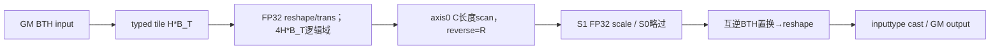

# 块内标量累积和 950 Direct Invoke 算子知识

## 算子速览

| 项目 | 内容 |
|---|---|
| 实际入口 | `sgl_kernel_npu.implementation.triton.attention.gdn.chunk_local_cumsum.chunk_local_cumsum_scalar_npu`，Direct Invoke |
| 计算语义 | 每sequence/chunk独立正向prefix或反向suffix sum，再可选scale；FP32 scan后转输入dtype |
| 输入输出 | 连续NPU g[B,T,H]或[B,H,T]，FP16/BF16/FP32；公开输出dtype须沿g；新输出同shape |
| 执行类型 | 单JIT AIV_VECTOR，tl.cumsum/transpose/reshape/scale/cast，没有dot/Cube/MIX_CV/SIMT/通信节点 |
| Kernel 路线 | R001 BTH等长，R002 BTH变长，R003 BHT完整tile；各保留reverse×HAS_SCALE四个精确子selector，共12 |
| 核心资源 | B_T=nextPOT(floor(2^18/(H*C)))；每program H*B_T输入及FP32 scan逻辑域，非物理UB预算；无owned workspace |
| 来源闭包 | direct_implementation_closed：公开范围guard、Direct参数、完整JIT/扫描布局/metadata、旧映射/打包闭合 |
| 静态风险 | BHT两次同向循环置换并非互逆，会改变一般H>1/B_T>1数据的head/time排列；BTH反向末partial chunk未显式padzero；raw dtype mismatch会先舍入inputdtype |
| 验证状态 | 本次知识提取未执行编译、真机、数值或性能测试；draft只表源码可追溯，不保证数学输出/内存安全 |

## 接口与语义

### 计算语义

意图为每sequence内每C-token chunk分别o[t,h]=scale·Σ_{j≤t且同chunk}g[j,h]；reverse=True改为j≥t的suffix。scale=None不乘。不同chunk不串接总和，packed在cu边界重启chunk编号。实际load后转FP32，tl.cumsum(axis=0,reverse=R)，可选FP32乘scale，最终显式to(s.dtype.element_ty)再store；没有显式round属性。不因为分配FP32输出就保留未舍入的FP32 scan结果：public wrapper要求output_dtype=None或等于g.dtype，低精g使用默认FP32会ValueError。

BTH body：reshape[Nc,C,H]→trans(1,0,2)得[C,Nc,H]，沿C scan，再同一trans(1,0,2)回[Nc,C,H]，reshape[B_T,H]，置换互逆。BHT body却reshape[H,Nc,C]→trans(2,0,1)得[C,H,Nc]，scan后再trans(2,0,1)得[Nc,C,H]，reshape[H,B_T]；这个第二置换不是逆(1,2,0)，不能当正确恢复BHT。若线性输出位置p=h_out*B_T+t_out，实际展开来自h'=p%H、c'=floor(p/H)%C、n'=floor(p/(H*C))的scan值，一般混排head/time；H1或B_T1退化维度可相符，不推定所有输入值都数值不同。

BTH load只boundary_check时间维、未显式padding_option="zero"。正向有效前缀不依赖同chunk未来padding；反向且sequence_len%C!=0时，valid suffix会涉及该partial chunk的缺失后缀lane，不能无条件保证padding0。若len%C=0，padding只属其它完整chunk而不跨chunk参与，此风险子域排除。BHT public要求完整B_T时间tile，没有time tail，但上述置换风险仍独立存在。

### 输入、输出与属性

| 参数 | shape/layout | dtype | 约束、默认值与语义 |
|---|---|---|---|
| g | [B,T,H]或head_first时[B,H,T] | FP16/BF16/FP32 | 公开连续同NPU/非空；Direct无完整dtype/device/stride检查 |
| chunk_size C | Python int | — | 必需、正POT，GDN常64；Direct仅bit_length assert，public拒bool/非正 |
| reverse | bool | — | 默认False；constexpr scan方向 |
| scale | float或None | — | 默认None；HAS_SCALE=(scale!=None)，scan后乘；finite/溢出不检查 |
| cu_seqlens | [N+1]或None | I32/I64 | packed B1、正长度合法边界；HF+cu public明确拒绝；Direct不完整验证 |
| head_first | bool | — | 默认False；True为BHT，public还要求T%B_T=0 |
| output_dtype | torch.dtype或None | — | 默认FP32；public Triton需None或g.dtype；Direct原始可分配其它type但仍先castinputdtype |
| output | g.shape新Tensor | 公开g.dtype | 输入不改；headfirst实际置换见上，不冒充公式全域保证 |

### 入口与版本

public operators wrapper检查rank3、非bool正POT C、各维非空；triton/auto拒HF+cu，计算q=floor(2^18/(H*C))，要求q>0且B_T=nextPOT(q)≥C，HF额外T%B_T=0；cu非空要求B1；输出dtype要求None或g.dtype。指定Direct scalar函数只有POT assert和shape解包，不包含这些全部guard。原始Direct HF+cu虽然能进入现有body，不是公开支持Route，按不支持布局边界记录。

旧fla/cumsum.py的scalar Host/JIT及辅助dispatcher与新文件语义相同，仅imports/版权/tuple换行不同；prepare_chunk_indices/helper cache算法等价、模块状态独立。旧额外exp/safe_exp/offsets导入不被本扫描body读取。另一个同文件chunk_local_cumsum dispatcher对rank4 NotImplemented、其它rank ValueError，指定入口为scalar，不能把dormant vector接口补成实现。

公开产品表arch22/arch35支持，README/generation映射平台，Frontmatter固定本卡范围；CANN9.1.0为配置依据，非运行声明。合同可复用[块内线性系统API](../../../../apis/sgl_kernel_npu/sgl_gdn_chunk_linear_system.md)，本卡增加固定source静态边界；独立torch_native数学参考不在本Direct图。

## Host/Launcher 执行流程

### 参数校验与前处理

Direct根据head_first解包B/H/T，仅assert C==2**(C.bit_length−1)。按H*C计算q，OPTIM_BLOCK_SIZE=triton.next_power_of_2(q)，不把常量2^18当字节UB上限。cu存在时prepare_chunk_indices(cu,chunk_size=B_T)，注意不是按C生成表；num_blocks为表长度，否则ceil(T/B_T)。g_org保留input，g=empty_like(input,dtype=output_dtype or inputdtype)。没有Contiguous/TransData，输入stride按BTH/BHT硬编码，非连续失约。

单JIT grid=(num_blocks,B)，T不specialize、B/H/B_T/C/HF/R为编译参数，HAS_SCALE/VAR用heuristics。warps8/stages3只是compiler选项，不表示物理CUDA线程或3份UB。框架分配失败、assert/metadata/JIT异常直接传播，无fallback。

### 参数、Workspace 与生命周期

输出新Tensor，合法公开域bytes=B*T*H*sInput；raw output_dtype可改变allocation bytes但body先to inputdtype，不能从宽输出宣称FP32 scan精度。input g_org只读，返回output不改input。无自有CANN system/workspace/ACLNN executor，也无scan跨program中间GM区。

BTH varlen表[NTblocks,2]沿cu dtype，2NTblocks*sCu B，由prepare_lens→ceil(length/B_T).tolist→CPU arange/cumsum/stack→to(cu)构造，存在Host同步。helper缓存4项按Tensor identity而非内容/version，修改同cu对象可能陈旧；Device indices/bos/eos转I32，I64输入不等价无限范围。cu正边界/同设备连续由调用方合同，Direct没有完整检查。

输出/metadata/input和JIT asynchronous lifetime依Torch allocator/currentstream协议，没有source自有event/record_stream或显式free。函数返回不等于Device完成，packed helper不承诺无Host同步graph捕获。

### 启动图与失败传播


全部Device节点无Cube/AIC/MIX_CV，故使用VV Skill；tl.cumsum是当前真实核心primitive，不是外部Torch数学替代。单kernel无跨kernel workspace边；程序之间通过同chunk独立分域，只有合法cu/B_T/C对齐时输出域不重叠。public guard拒绝的HF+cu、时间尾HF、dtype mismatch不被偷偷补成支持Route。
## Route 与参数设计

### 分核与资源计算

令C=chunk_size，q=floor(2^18/(H*C))，B_T=nextPOT(q)，N_c=B_T/C。public guard保证q>0、B_T≥C，二者POT因此N_c为正整数；不把条件粗化成未证明的H*C²上限，因为nextPOT向上取整。每program覆盖本sequence连续B_T个token与全部H头。equal bos=batch*T，packed表恢复sequence/localblock，bos=cu[n]、L=cu[n+1]−cu[n]。

BTH blockptr shape[L,H]，stride[H,1]，offset[localblock*B_T,0]，block[B_T,H]，order[1,0]，boundary_check=(0,)检查time。BHT shape[H,T]，stride[T,1]，offset[0,block*B_T]，block[H,B_T]，order[1,0]，boundary_check=(0,)只检查head；public T%B_T=0才消除未检查的时间尾。packed HF不支持，不能把局部L作为原BHT head跨度推广。

GM output=BTH*sInput，var表2NTblocks*sCu。逻辑inputtile=H*B_T*sInput，FP32 load/scan域各4H*B_T，final inputcast域H*B_T*sInput；reshape/trans可为compiler view/copy，不假定物理alias。2^18是source tile启发常数，不是UB bytes或硬件容量；C1等宽tile可能增大FP32域，source无physical UB guard。UB/register/spill/内部scan树由compiler，不能填假安全上界。

### Route 选择

P为公开rank3/非空、C非bool正POT、连续NPU三浮点型、输出type None或inputtype、q>0且B_T≥C。BTH var追加B1、cu连续同设备I32/I64、[0,…,T]正长度调用方合同；HF必须cuNone且T%B_T=0。Direct只POT assert，P不是完整Direct已执行guard。三族分别保留R=reverse与S=HAS_SCALE四个精确子selector，不省略反向tail区别。

| 顺序 | Route | Key/模板 | 精确选择条件与优先级 | 不适用去向 |
|---:|---|---|---|---|
| 1 | R-001 BTH等长块内扫描 | HEAD_FIRST0/VAR0×RS00/01/10/11 | P；head_first=false；cuNone；R/S取族内子表 | 其它合法族按行；HF+cu公开拒绝，raw不升级支持 |
| 2 | R-002 BTH变长块内扫描 | HEAD_FIRST0/VAR1×RS00/01/10/11 | P；head_first=false；cu非空、B1/合法正边界；R/S取族内子表 | 其它合法族按行；HF+cu公开拒绝，raw不升级支持 |
| 3 | R-003 BHT完整时间tile扫描与置换边界 | HEAD_FIRST1/VAR0×RS00/01/10/11 | P；head_first=true；cuNone；T%B_T=0；R/S取族内子表 | 其它合法族按行；HF+cu公开拒绝，raw不升级支持 |

```text
public guard P / head_first+cu拒绝 / HF时间完整tile / outputdtype匹配
Direct解包shape、POT assert，q和B_T producer
if head_first: R003（public只equal/fulltile）
else if cu!=None: R002
else: R001
REVERSE由参数，HAS_SCALE=(scale!=None)；四子selector各自保留
单JIT grid(num_blocks,B)，全部AIV_VECTOR
```

### 模板/实现执行矩阵

| Route | key/selector | dtype/shape/platform 完整命中条件 | 执行拓扑与 Kernel 节点 | 实际模板/body | 内存与同步特征 | tail/fallback |
|---|---|---|---|---|---|---|
| R-001 BTH等长块内扫描 | HF0/VAR0、RS四子selector | P及选择行；FP16/BF16/FP32各typed实例，output同input | 单JIT AIV_VECTOR | chunk_local_cumsum_scalar_kernel；BLOCK_T=B_T，CHUNK_SIZE=C，REVERSE=R，HAS_SCALE=S | H*B_T输入、4H*B_T scan逻辑域；无metadata；无ownedworkspace | forward validprefix/反向partialchunk未显式padzero；无fallback |
| R-002 BTH变长块内扫描 | HF0/VAR1、RS四子selector | P及选择行；FP16/BF16/FP32各typed实例，output同input | 单JIT AIV_VECTOR | chunk_local_cumsum_scalar_kernel；BLOCK_T=B_T，CHUNK_SIZE=C，REVERSE=R，HAS_SCALE=S | H*B_T输入、4H*B_T scan逻辑域；indices表；无ownedworkspace | forward validprefix/反向partialchunk未显式padzero；无fallback |
| R-003 BHT完整时间tile扫描与置换边界 | HF1/VAR0、RS四子selector | P及选择行；FP16/BF16/FP32各typed实例，output同input | 单JIT AIV_VECTOR | chunk_local_cumsum_scalar_kernel；BLOCK_T=B_T，CHUNK_SIZE=C，REVERSE=R，HAS_SCALE=S | H*B_T输入、4H*B_T scan逻辑域；无metadata；无ownedworkspace | fulltime但两次循环置换非逆；无fallback |

同族R/S改变scan方向和可选乘法，byte/layout/参数结构相同，尾依赖和数值顺序分别在子表列明。三inputdtype均FP32scan后转各自输入type，低精round范围不同但不新增数学量化目标。

### 隐藏性能 Guard

| Guard | Host/Tiling 条件 | Device/资源原因 | 影响 Route | 不满足时去向 | 源码符号 |
|---|---|---|---|---|---|
| C正POT | public拒bool/非正/非POT；Direct bit_length assert | reshape N_c×C及scan轴长度 | 全部 | public ValueError/Direct assert或原始异常 | wrappers/Direct |
| tile可拆 | publicq>0&&B_T≥C | N_c=B_T/C正整数 | 全部 | public ValueError；Direct无完整guard | OPTIM_BLOCK_SIZE |
| 输出dtype | public None或g.dtype | body显式to inputdtype | 全部 | public ValueError；raw宽输出仍先inputround | finalstore |
| HF时间完整 | public T%B_T=0 | HF boundary_check只head不time | R003 | public拒；rawtime尾可越界，无fallback | HF blockptr |
| HF+cu | public拒绝 | HF stride用localL不等原BHT跨度且bos*H不足以泛化 | raw边界 | 不列公开支持Route | public/HEAD_FIRST |
| HF置换 | 两次trans(2,0,1) | 非互逆：[H,Nc,C]→[C,H,Nc]→[Nc,C,H] | R003全部子路线 | 无guard，条件布局差异，draft | HEAD_FIRST |
| reverse partial | R1且L%C!=0，load无显式padding_option | scan同chunk缺失后缀可参与validsuffix | R001/R002的reverse子路线 | 不保证零，未验证具体primitive | BTH tl.load/cumsum |
| contiguous/device/类型 | 公开合同，Direct不copy/check | 硬编码H/T stride | 全部 | raw失约无可靠输出 | body |
| cu/cache/I32 | packedB1/正边界/不可变Tensor | helperidentity缓存、DevicecastI32 | R002 | caller失约，table可陈旧 | helper |
| 物理容量 | 2^18是tile启发，warps8/stages3 | localtile和scan由compiler分配 | 全部 | 没有source UB上限fallback，未编译确认 | launch |

### POD/ABI

无C POD/固定sizeof/offsetof，以下14字段为Python→Triton typed参数；最终scalar宽度/arg pack offset由compiler生成，固定Python未证明。constexpr不是GM字段。T不specialize，var重写局部长度；B主要用于Host grid，Device声明后未参与当前body计算。

| 结构 | 字段 | 类型/位宽 | ABI 布局 | 单位 | Host/launcher producer | Device consumer | 边界 |
|---|---|---|---|---|---|---|---|
| JIT args | s | input typed GM pointer | slot0；物理offset不可见 | 元素 | g_org input | tile blockload→FP32 | readonly |
| JIT args | o | output typed GM pointer | slot1；物理offset不可见 | 元素 | empty_like dtype | store inputtype value | public要求同dtype |
| JIT args | scale | float scalar或None | slot2；宽度compiler；物理offset不可见 | 倍率 | 用户scale | HAS_SCALE内scan后乘 | None不算术 |
| JIT args | cu_seqlens | I32/I64 pointer或None | slot3；物理offset不可见 | token | caller | VAR bos/eos.toI32 | HF公开不许 |
| JIT args | chunk_indices | cu同dtype pointer或None | slot4；物理offset不可见 | pair | prepare_chunk_indices(cu,B_T) | VAR sequence/block.toI32 | 不是C分块表 |
| JIT args | T | runtime Python int | slot5；宽度compiler；物理offset不可见 | token | g时间维 | equal T/var localL | do_not_specialize |
| JIT args | B | constexpr int | compile；物理offset不可见 | batch | g.batch/Hostgrid | Device当前未读 | publicvarB1 |
| JIT args | H | constexpr int | compile；物理offset不可见 | head | g对应维 | stride/layout/fullheadblock | 正 |
| JIT args | BLOCK_T | constexpr int | compile；物理offset不可见 | token/program | nextPOT(floor(2^18/(H*C))) | tile/Nc/offset | public≥C |
| JIT args | REVERSE | constexpr bool | compile；物理offset不可见 | 方向 | reverse参数 | tl.cumsum reverse | 两值都可达 |
| JIT args | HAS_SCALE | constexpr bool | heuristics；物理offset不可见 | bool | scale!=None | 可选乘法 | 安全guard内 |
| JIT args | IS_VARLEN | constexpr bool | heuristics；物理offset不可见 | bool | cu!=None | 表/cu mapping | metadata值合同 |
| JIT args | HEAD_FIRST | constexpr bool | compile；物理offset不可见 | layout | head_first | HF/BTH分支 | publicHF仅equal |
| JIT args | CHUNK_SIZE | constexpr int | compile，默认64但Host覆盖；物理offset不可见 | token/chunk | chunk_size | reshape/scan axis0 | POT/正 |

VAR table每row sequence/block分别(2i)*sCu/(2i+1)*sCu，block编号按B_T而非C。该producer与Nc关系保证合法BTH program开始在sequence chunk边界上；cu的真实内容不由Direct验证。输出dtype不额外入kernel POD，指针type来自Tensor，body仍用s.dtype显式cast。warps8/stages3为compiler options，不冒充SIMT thread/dynamicUB参数。

### Route 源码闭包

| Route | Key/selector | Host/Tiling producer | POD/参数 | Kernel entry/router 节点 | Kernel body/直接依赖 | 构建接线 |
|---|---|---|---|---|---|---|
| R-001及RS00/01/10/11 | HF0/VAR0、R/S | Direct q/B_T/allocate | 14typed/constexpr字段，R/S producer逐子表 | scalar_kernel[blocks,B] | BTH互逆置换→scan，scale可选/inputcast/store；gdn_utils indices | root setup→stage_runtime共同Python→triton.jit，无ACLNN |
| R-002及RS00/01/10/11 | HF0/VAR1、R/S | Direct q/B_T/allocate+B_T indices | 14typed/constexpr字段，R/S producer逐子表 | scalar_kernel[blocks,B] | BTH互逆置换→scan，scale可选/inputcast/store；gdn_utils indices | root setup→stage_runtime共同Python→triton.jit，无ACLNN |
| R-003及RS00/01/10/11 | HF1/VAR0、R/S | Direct q/B_T/allocate | 14typed/constexpr字段，R/S producer逐子表 | scalar_kernel[blocks,B] | HF循环置换→scan→非逆置换边界，scale可选/inputcast/store；gdn_utils indices | root setup→stage_runtime共同Python→triton.jit，无ACLNN |

## Kernel 实现

### 公共执行流程

pid0对应时间B_T tile，pid1对应batch；VAR先把pid0映射sequence/localblock并读cu局部L。load整个H×B_T或B_T×H tile、转F32，reshape出独立Nc个C长度chunk，把C放到axis0作tl.cumsum(reverse=R)，可选scale后回布局、cast inputtype、store。没有跨program前缀状态或累积区，sequence/chunk独立；无AIC/MIX_CV/atomic/通信/多kernel数学节点。

BTH两次(1,0,2)互逆，HF两次(2,0,1)不互逆，具体输出排列作为source知识保留。compiler负责scan树/内部Vector同步与physicalUB/register/spill；本固定Python没有ownedTQue/TBuf/InitBuffer或对应硬件repeat/pipe参数，不造它们。以下每族保留四个R/S子selector、尾依赖、参数化资源和生命周期。
### Route R-001：BTH等长块内扫描

#### 适用条件

##### 选择证据

| 层级 | 文件 | 符号 | 源码谓词/参数 | 结果/下一跳 |
|---|---|---|---|---|
| Public合同 | operators/attention/gdn/chunk_local_cumsum.py | chunk_local_cumsum | P；HF0、VAR0 | scalar Direct |
| Direct | implementation/triton/attention/gdn/chunk_local_cumsum.py | scalar_npu | q/B_T/Nc producer；ceilT/B_T grid | output分配，单JIT |
| JIT | 同文件 | heuristics / scalar_kernel | HEAD_FIRST0、IS_VARLEN0、R/S四组合 | 当前layout/scan，全部AIV |

| 精确子selector | REVERSE/HAS_SCALE | scale producer | 计算/精度顺序 | tail/布局差异 | 参数/资源/生命周期 |
|---|---|---|---|---|---|
| R-001.S00 | 0/0 | None | FP32 prefix scan→inputtype cast | 有效prefix不依赖未来padding | 同14参数结构/同tile逻辑域/新output；scale乘法仅S1，无额外GM |
| R-001.S01 | 0/1 | 非None float实参 | FP32 prefix scan→乘scale→inputtype cast | 有效prefix不依赖未来padding | 同14参数结构/同tile逻辑域/新output；scale乘法仅S1，无额外GM |
| R-001.S10 | 1/0 | None | FP32 suffix scan→inputtype cast | L%C!=0时同chunk缺失后缀无显式padzero；整chunk尾排除 | 同14参数结构/同tile逻辑域/新output；scale乘法仅S1，无额外GM |
| R-001.S11 | 1/1 | 非None float实参 | FP32 suffix scan→乘scale→inputtype cast | L%C!=0时同chunk缺失后缀无显式padzero；整chunk尾排除 | 同14参数结构/同tile逻辑域/新output；scale乘法仅S1，无额外GM |

四子selector逐项保留扫描方向和可选乘法，没有把reverse partial边界当共同成功保证。FP16/BF16/FP32三typed实例均F32scan后cast输入type，byte按sInput2/2/4。BTH布局互逆置换，公共与raw失约边界分开。

#### Device 数据流

##### 函数级调用链

```text
scalar_npu -> shape/POT -> q/B_T
 -> num_blocks=ceil(T/B_T)
 -> empty_like output -> scalar_kernel[blocks,B](warps8,stages3)
    -> bos=batch*T
    -> BTH blockptr B_T×H，boundary time
    -> load→F32 -> reshape [Nc,C,H]
    -> trans (1,0,2)→[C,Nc,H]
    -> tl.cumsum(axis0,reverse=R) -> S?multiply(scale)
    -> trans (1,0,2)→[Nc,C,H]（逆）
    -> reshape [B_T,H] -> cast inputtype -> store
```

##### 源码等价伪码

```text
源码等价伪码；R/S取精确子selector；offset单位元素
q=floor(2^18/(H*C));B_T=nextPOT(q);Nc=B_T/C
blk=pid0;bos=pid1*T;L=T
p_s=blockptr(input+bos*H,shape[L,H],stride[H,1],offset[blk*B_T,0],
              block[B_T,H],order[1,0])
p_o=同地址公式/newoutput
X=load(p_s,boundary_check=[0]).toF32  #timecheck，无显式padding_option zero
X=reshape(X,[Nc,C,H]);X=trans(X,[1,0,2])  # [C,Nc,H]
Y=cumsum(X,axis0,reverse=R)
if S:Y*=scale
Y=trans(Y,[1,0,2]);Y=reshape(Y,[B_T,H])
store(p_o,Y.to(inputtype),boundary_check=[0])
```

每program含Nc独立chunk，不把前一chunk总和传给后一chunk。R0有效prefix不依赖未来padding；R1若L%C!=0，最后同chunk缺失未来lane参与suffix且load未显式padzero，不能保证已初始化；L%C0时invalid只在其它chunk。 scale只在scan后FP32乘，不能放到低精store之后替代而宣称相同舍入。

#### 内存与数据搬运

##### 资源与搬运表

| 层级/缓冲区 | offset/地址公式 | extent/容量公式 | dtype/layout | producer | consumer | owner/lifetime | 对齐/复用 |
|---|---|---|---|---|---|---|---|
| GM input | bos*H+(blk*B_T+t)*H+head | BTH*sInput B | BTH typed | caller | tileload | readonly/stream | 无自动contiguous，硬编码stride |
| GM output | 同logical地址公式/newpointer | BTH*sInput B公开域 | inputdtype；raw沿allocationtype | scan→scale→inputcast | caller | 新Tensor | timebound；无效row不写 |
| GM metadata | N/A | 0新增 | I32/I64 | helper/caller | mapping | cache | loadtoI32，表按B_T块 |
| UB/register tile | compiler局部，无自有offset | H*B_T*sInput，转F32域4H*B_T | typed/F32 | GMload | reshape/trans/scan | 每program | 逻辑域非物理容量 |
| UB/register scan | [C,Nc,H] | C*H*Nc*4=4H*B_T B逻辑域 | F32 | cumsum | scale/trans/cast | 每program | R方向变化不改变shape |
| UB/register transpose | view/copy由compiler定 | 相同元素域4H*B_T | F32 | trans/reshape | storecast | 每program | 不保证物理alias或分配depth |
| scalar scale | S1实参，S0None | compiler scalar宽度不可见 | float | caller | scan后乘 | JIT参数 | HAS_SCALE guard内使用 |
| TQue/TBuf/硬件寄存器号 | N/A owned | 没有InitBuffer/自有队列申请 | compiler-managed local值域 | TL primitives | compilerlowering | program | 不造depth、repeat、寄存器报告 |
| L1/L0/Cube | N/A | 无Cube节点 | N/A | N/A | N/A | N/A | 不补Cube资源 |
| workspace/dynamicUB/window | N/A owned | 0 ownedworkspace，无SIMT动态UB/通信window | N/A | N/A | N/A | runtime | 不套CANN系统区 |

##### 分层内存布局

物理AIV UB `block-beta` 布局为N/A：固定Python没有owned InitBuffer/TQue/TBuf子区，实际为compiler-managed vector局部tensor。下面只画真实GM→typed tile→FP32 scan→cast→GM数据流，不能把逻辑tensor值域当硬件UB分配图。



##### 字节账与复用顺序

```text
output_bytes=B*T*H*sInput（公开同dtype）
metadata_bytes=0
owned_workspace_total=0；dynamic_ub=N/A（非SIMT launch）
typed_input_domain=H*B_T*sInput
F32_input/scan/transpose_domain各4*H*B_T（表达式域，不是独立物理allocation和）
UB_total/UB可用上界=固定Python没有owned分配/selector容量值，compiler决定
q/B_T启发式不是UB bytes budget；不填UB_total<=2^18字节这类伪界限
```

| 复用子区 | 写入者 | 读取者/消费点 | 下一次覆盖 | 同步或释放依据 | 安全条件 |
|---|---|---|---|---|---|
| 输入tile逻辑域 | tl.load→toF32 | reshape/trans/scan | 当前program内部compiler管理 | TL数据依赖，非自有队列event | timebound不等于padzero |
| scan逻辑域 | tl.cumsum | scale可选/trans/cast | 当前表达式后compiler可复用 | compiler vectorpipeline | 正/反方向和独立chunk轴保持 |
| scale/后布局 | S1乘法或S0原scan | 最后cast/store | program结束 | TL依赖 | BTH互逆，scale先于低精cast |
| metadata表 | helper/cache | currentmapping | 4entry淘汰时由Tensorowner释放 | tolist同步/.to/currentstream | 不原地改同cu；值合法 |
| GM output | currentprogram store | caller | 下一次外部写需stream有序 | runtime owner/stream，函数返回非完成 | 合法table/tile分域不重叠 |

#### 同步、精度与尾块

##### 同步与数值边界表

| 阶段 | primitive/机制 | producer | consumer/等待点 | 保护对象 | 精度/尾块 |
|---|---|---|---|---|---|
| metadata | N/A | 无 | mapping | table/bos | equal不执行 |
| load | blockptr boundary[0] | GM input | F32tile | wholeH×B_T | 检查time，无显式padding_option zero |
| layout/scan | reshape/trans→cumsum(axis0,reverse=R) | F32tile | scan | Nc独立C长序列 | 两(1,0,2)互逆 |
| R0/S0 | prefix，无scale | scan | cast | 有效prefix | 不依赖同chunk未来padding |
| R0/S1 | prefix→F32乘scale | scan/scalar | cast | 同 | 不把scale挪到cast后 |
| R1/S0 | suffix，无scale | scan | cast | 有效suffix | L%C!=0缺失后缀零值未保证 |
| R1/S1 | suffix→F32乘scale | scan/scalar | cast | 同 | 上述tail仍保留；scale不消除未知lane保证 |
| store | to inputtype +boundary[0] | postlayout/scale | output GM | 公共同dtype | 无显式round；raw宽输出仍先低精round |
| 内部同步 | TL/compiler scan依赖 | 当前primitive | 后继primitive | compiler局部域 | 无ownedflag/atomic/跨programprefix，scan树实现不可见 |

#### 关键实现

##### 符号证据表

| 阶段 | 文件 | 符号/模板实例 | 实现事实 |
|---|---|---|---|
| Host/Tiling producer | implementation/triton/attention/gdn/chunk_local_cumsum.py | scalar_npu | q/B_T/Nc、ceilT grid、新output |
| Kernel entry/router | 同文件 | heuristics/scalar_kernel | HF0/VAR0，R/S四子selector，warps8/stages3 |
| Device body/helper | 同文件 | else BTH branch | 两(1,0,2)互逆、scan C轴、scale/cast |
| Device body/helper | gdn_utils.py | prepare_chunk_indices/tensor_cache | 本族None分支不调用 |
| 旧路径 | fla/cumsum.py / fla/utils.py | 同Scalar Host/JIT/helper | body/Host等价，imports和cache实例独立，不新建重复Operator |


### Route R-002：BTH变长块内扫描

#### 适用条件

##### 选择证据

| 层级 | 文件 | 符号 | 源码谓词/参数 | 结果/下一跳 |
|---|---|---|---|---|
| Public合同 | operators/attention/gdn/chunk_local_cumsum.py | chunk_local_cumsum | P；HF0、VAR1 | scalar Direct |
| Direct | implementation/triton/attention/gdn/chunk_local_cumsum.py | scalar_npu | q/B_T/Nc producer；prepare indices(cu,B_T) | output分配，单JIT |
| JIT | 同文件 | heuristics / scalar_kernel | HEAD_FIRST0、IS_VARLEN1、R/S四组合 | 当前layout/scan，全部AIV |

| 精确子selector | REVERSE/HAS_SCALE | scale producer | 计算/精度顺序 | tail/布局差异 | 参数/资源/生命周期 |
|---|---|---|---|---|---|
| R-002.S00 | 0/0 | None | FP32 prefix scan→inputtype cast | 有效prefix不依赖未来padding | 同14参数结构/同tile逻辑域/新output；scale乘法仅S1，无额外GM |
| R-002.S01 | 0/1 | 非None float实参 | FP32 prefix scan→乘scale→inputtype cast | 有效prefix不依赖未来padding | 同14参数结构/同tile逻辑域/新output；scale乘法仅S1，无额外GM |
| R-002.S10 | 1/0 | None | FP32 suffix scan→inputtype cast | L%C!=0时同chunk缺失后缀无显式padzero；整chunk尾排除 | 同14参数结构/同tile逻辑域/新output；scale乘法仅S1，无额外GM |
| R-002.S11 | 1/1 | 非None float实参 | FP32 suffix scan→乘scale→inputtype cast | L%C!=0时同chunk缺失后缀无显式padzero；整chunk尾排除 | 同14参数结构/同tile逻辑域/新output；scale乘法仅S1，无额外GM |

四子selector逐项保留扫描方向和可选乘法，没有把reverse partial边界当共同成功保证。FP16/BF16/FP32三typed实例均F32scan后cast输入type，byte按sInput2/2/4。BTH布局互逆置换，公共与raw失约边界分开。

#### Device 数据流

##### 函数级调用链

```text
scalar_npu -> shape/POT -> q/B_T
 -> prepare_chunk_indices(cu,B_T)/lens/cache/tolist/CPU pairs/to(cu)
 -> empty_like output -> scalar_kernel[blocks,B](warps8,stages3)
    -> load sequence/localblock/cu→localL，castI32
    -> BTH blockptr B_T×H，boundary time
    -> load→F32 -> reshape [Nc,C,H]
    -> trans (1,0,2)→[C,Nc,H]
    -> tl.cumsum(axis0,reverse=R) -> S?multiply(scale)
    -> trans (1,0,2)→[Nc,C,H]（逆）
    -> reshape [B_T,H] -> cast inputtype -> store
```

##### 源码等价伪码

```text
源码等价伪码；R/S取精确子selector；offset单位元素
q=floor(2^18/(H*C));B_T=nextPOT(q);Nc=B_T/C
seq,blk=table[pid0,0/1].toI32;bos,eos=cu[seq/seq+1].toI32;L=eos-bos
p_s=blockptr(input+bos*H,shape[L,H],stride[H,1],offset[blk*B_T,0],
              block[B_T,H],order[1,0])
p_o=同地址公式/newoutput
X=load(p_s,boundary_check=[0]).toF32  #timecheck，无显式padding_option zero
X=reshape(X,[Nc,C,H]);X=trans(X,[1,0,2])  # [C,Nc,H]
Y=cumsum(X,axis0,reverse=R)
if S:Y*=scale
Y=trans(Y,[1,0,2]);Y=reshape(Y,[B_T,H])
store(p_o,Y.to(inputtype),boundary_check=[0])
```

每program含Nc独立chunk，不把前一chunk总和传给后一chunk。R0有效prefix不依赖未来padding；R1若L%C!=0，最后同chunk缺失未来lane参与suffix且load未显式padzero，不能保证已初始化；L%C0时invalid只在其它chunk。 scale只在scan后FP32乘，不能放到低精store之后替代而宣称相同舍入。

#### 内存与数据搬运

##### 资源与搬运表

| 层级/缓冲区 | offset/地址公式 | extent/容量公式 | dtype/layout | producer | consumer | owner/lifetime | 对齐/复用 |
|---|---|---|---|---|---|---|---|
| GM input | bos*H+(blk*B_T+t)*H+head | BTH*sInput B | BTH typed | caller | tileload | readonly/stream | 无自动contiguous，硬编码stride |
| GM output | 同logical地址公式/newpointer | BTH*sInput B公开域 | inputdtype；raw沿allocationtype | scan→scale→inputcast | caller | 新Tensor | timebound；无效row不写 |
| GM metadata | table[2pid0/2pid0+1],cu[seq/seq+1] | 2NTblocks*sCu B索引表，另有8N B长度缓存；按实际缓存未命中新增 | I32/I64 | helper/caller | mapping | cache | loadtoI32，表按B_T块 |
| UB/register tile | compiler局部，无自有offset | H*B_T*sInput，转F32域4H*B_T | typed/F32 | GMload | reshape/trans/scan | 每program | 逻辑域非物理容量 |
| UB/register scan | [C,Nc,H] | C*H*Nc*4=4H*B_T B逻辑域 | F32 | cumsum | scale/trans/cast | 每program | R方向变化不改变shape |
| UB/register transpose | view/copy由compiler定 | 相同元素域4H*B_T | F32 | trans/reshape | storecast | 每program | 不保证物理alias或分配depth |
| scalar scale | S1实参，S0None | compiler scalar宽度不可见 | float | caller | scan后乘 | JIT参数 | HAS_SCALE guard内使用 |
| TQue/TBuf/硬件寄存器号 | N/A owned | 没有InitBuffer/自有队列申请 | compiler-managed local值域 | TL primitives | compilerlowering | program | 不造depth、repeat、寄存器报告 |
| L1/L0/Cube | N/A | 无Cube节点 | N/A | N/A | N/A | N/A | 不补Cube资源 |
| workspace/dynamicUB/window | N/A owned | 0 ownedworkspace，无SIMT动态UB/通信window | N/A | N/A | N/A | runtime | 不套CANN系统区 |

##### 分层内存布局

物理AIV UB `block-beta` 布局为N/A：固定Python没有owned InitBuffer/TQue/TBuf子区，实际为compiler-managed vector局部tensor。下面只画真实GM→typed tile→FP32 scan→cast→GM数据流，不能把逻辑tensor值域当硬件UB分配图。


##### 字节账与复用顺序

```text
output_bytes=B*T*H*sInput（公开同dtype）
indices_bytes=2*NTblocks*sCu  #仅分块索引返回表
lens_cache_retained_bytes=8*N  #prepare_lens独立最多4项identity缓存，int64[N]
metadata_new_bytes=实际索引缓存未命中分配 + (8*N if lens缓存未命中 else 0)
#全部缓存命中时新增0；lens至淘汰/清理且最后引用释放后回收；tolist/转换临时峰值另计，不是Kernel workspace
owned_workspace_total=0；dynamic_ub=N/A（非SIMT launch）
typed_input_domain=H*B_T*sInput
F32_input/scan/transpose_domain各4*H*B_T（表达式域，不是独立物理allocation和）
UB_total/UB可用上界=固定Python没有owned分配/selector容量值，compiler决定
q/B_T启发式不是UB bytes budget；不填UB_total<=2^18字节这类伪界限
```

| 复用子区 | 写入者 | 读取者/消费点 | 下一次覆盖 | 同步或释放依据 | 安全条件 |
|---|---|---|---|---|---|
| 输入tile逻辑域 | tl.load→toF32 | reshape/trans/scan | 当前program内部compiler管理 | TL数据依赖，非自有队列event | timebound不等于padzero |
| scan逻辑域 | tl.cumsum | scale可选/trans/cast | 当前表达式后compiler可复用 | compiler vectorpipeline | 正/反方向和独立chunk轴保持 |
| scale/后布局 | S1乘法或S0原scan | 最后cast/store | program结束 | TL依赖 | BTH互逆，scale先于低精cast |
| metadata表 | helper/cache | currentmapping | 4entry淘汰时由Tensorowner释放 | tolist同步/.to/currentstream | 不原地改同cu；值合法 |
| GM output | currentprogram store | caller | 下一次外部写需stream有序 | runtime owner/stream，函数返回非完成 | 合法table/tile分域不重叠 |

#### 同步、精度与尾块

##### 同步与数值边界表

| 阶段 | primitive/机制 | producer | consumer/等待点 | 保护对象 | 精度/尾块 |
|---|---|---|---|---|---|
| metadata | tolist/CPU pair/.to/cache | helper/cu | mapping | table/bos | 同步、I32窄化/identitycache |
| load | blockptr boundary[0] | GM input | F32tile | wholeH×B_T | 检查time，无显式padding_option zero |
| layout/scan | reshape/trans→cumsum(axis0,reverse=R) | F32tile | scan | Nc独立C长序列 | 两(1,0,2)互逆 |
| R0/S0 | prefix，无scale | scan | cast | 有效prefix | 不依赖同chunk未来padding |
| R0/S1 | prefix→F32乘scale | scan/scalar | cast | 同 | 不把scale挪到cast后 |
| R1/S0 | suffix，无scale | scan | cast | 有效suffix | L%C!=0缺失后缀零值未保证 |
| R1/S1 | suffix→F32乘scale | scan/scalar | cast | 同 | 上述tail仍保留；scale不消除未知lane保证 |
| store | to inputtype +boundary[0] | postlayout/scale | output GM | 公共同dtype | 无显式round；raw宽输出仍先低精round |
| 内部同步 | TL/compiler scan依赖 | 当前primitive | 后继primitive | compiler局部域 | 无ownedflag/atomic/跨programprefix，scan树实现不可见 |

#### 关键实现

##### 符号证据表

| 阶段 | 文件 | 符号/模板实例 | 实现事实 |
|---|---|---|---|
| Host/Tiling producer | implementation/triton/attention/gdn/chunk_local_cumsum.py | scalar_npu | q/B_T/Nc、B_T indices、新output |
| Kernel entry/router | 同文件 | heuristics/scalar_kernel | HF0/VAR1，R/S四子selector，warps8/stages3 |
| Device body/helper | 同文件 | else BTH branch | 两(1,0,2)互逆、scan C轴、scale/cast |
| Device body/helper | gdn_utils.py | prepare_chunk_indices/tensor_cache | 当前metadata producer |
| 旧路径 | fla/cumsum.py / fla/utils.py | 同Scalar Host/JIT/helper | body/Host等价，imports和cache实例独立，不新建重复Operator |


### Route R-003：BHT完整时间tile扫描与置换边界

#### 适用条件

##### 选择证据

| 层级 | 文件 | 符号 | 源码谓词/参数 | 结果/下一跳 |
|---|---|---|---|---|
| Public合同 | operators/attention/gdn/chunk_local_cumsum.py | chunk_local_cumsum | P；HF1、VAR0，T%B_T=0 | scalar Direct |
| Direct | implementation/triton/attention/gdn/chunk_local_cumsum.py | scalar_npu | q/B_T/Nc producer；ceilT/B_T grid | output分配，单JIT |
| JIT | 同文件 | heuristics / scalar_kernel | HEAD_FIRST1、IS_VARLEN0、R/S四组合 | 当前layout/scan，全部AIV |

| 精确子selector | REVERSE/HAS_SCALE | scale producer | 计算/精度顺序 | tail/布局差异 | 参数/资源/生命周期 |
|---|---|---|---|---|---|
| R-003.S00 | 0/0 | None | FP32 prefix scan→inputtype cast | fulltime但HF非逆置换一般混排，R方向不修正布局 | 同14参数结构/同tile逻辑域/新output；scale乘法仅S1，无额外GM |
| R-003.S01 | 0/1 | 非None float实参 | FP32 prefix scan→乘scale→inputtype cast | fulltime但HF非逆置换一般混排，R方向不修正布局 | 同14参数结构/同tile逻辑域/新output；scale乘法仅S1，无额外GM |
| R-003.S10 | 1/0 | None | FP32 suffix scan→inputtype cast | fulltime但HF非逆置换一般混排，R方向不修正布局 | 同14参数结构/同tile逻辑域/新output；scale乘法仅S1，无额外GM |
| R-003.S11 | 1/1 | 非None float实参 | FP32 suffix scan→乘scale→inputtype cast | fulltime但HF非逆置换一般混排，R方向不修正布局 | 同14参数结构/同tile逻辑域/新output；scale乘法仅S1，无额外GM |

四子selector逐项保留扫描方向和可选乘法，没有把reverse partial边界当共同成功保证。FP16/BF16/FP32三typed实例均F32scan后cast输入type，byte按sInput2/2/4。HF+cu公共拒绝，raw虽可达本body，但localL作为headstride不等原BHT跨度，不提升公开支持。

#### Device 数据流

##### 函数级调用链

```text
scalar_npu -> shape/POT -> q/B_T
 -> num_blocks=ceil(T/B_T)
 -> empty_like output -> scalar_kernel[blocks,B](warps8,stages3)
    -> bos=batch*T
    -> BHT blockptr H×B_T，boundary只head
    -> load→F32 -> reshape [H,Nc,C]
    -> trans (2,0,1)→[C,H,Nc]
    -> tl.cumsum(axis0,reverse=R) -> S?multiply(scale)
    -> trans (2,0,1)→[Nc,C,H]（非逆）
    -> reshape [H,B_T] -> cast inputtype -> store
```

##### 源码等价伪码

```text
源码等价伪码；R/S取精确子selector；offset单位元素
q=floor(2^18/(H*C));B_T=nextPOT(q);Nc=B_T/C
blk=pid0;bos=pid1*T;L=T
p_s=blockptr(input+bos*H,shape[H,L],stride[L,1],offset[0,blk*B_T],
              block[H,B_T],order[1,0])
p_o=同地址公式/newoutput
X=load(p_s,boundary_check=[0]).toF32  #只check head；public要求完整time
X=reshape(X,[H,Nc,C])
X=trans(X,[2,0,1])                 # [C,H,Nc]
Y=cumsum(X,axis0,reverse=R)
if S:Y*=scale
Y=trans(Y,[2,0,1])                 # [Nc,C,H]，不是[H,Nc,C]
Y=reshape(Y,[H,B_T])               # 改变head/time线性排列
store(p_o,Y.to(inputtype),boundary_check=[0])
```

HF例：H2、C64、T2048时q2048/B_T2048，public fulltile满足，但输出p=1对应原head1的chunk0/c0 scan值，而数学意图是head0/c1；这是静态索引推导，不执行数值测试。H1或B_T1是退化相符域，一般数据风险不等于每个值必不同。 scale只在scan后FP32乘，不能放到低精store之后替代而宣称相同舍入。

#### 内存与数据搬运

##### 资源与搬运表

| 层级/缓冲区 | offset/地址公式 | extent/容量公式 | dtype/layout | producer | consumer | owner/lifetime | 对齐/复用 |
|---|---|---|---|---|---|---|---|
| GM input | bos*H+head*L+blk*B_T+t | BTH*sInput B | BHT typed | caller | tileload | readonly/stream | 无自动contiguous，硬编码stride |
| GM output | 同logical地址公式/newpointer | BTH*sInput B公开域 | inputdtype；raw沿allocationtype | scan→scale→inputcast | caller | 新Tensor | 无timebound但public fulltile |
| GM metadata | N/A | 0新增 | I32/I64 | helper/caller | mapping | cache | loadtoI32，表按B_T块 |
| UB/register tile | compiler局部，无自有offset | H*B_T*sInput，转F32域4H*B_T | typed/F32 | GMload | reshape/trans/scan | 每program | 逻辑域非物理容量 |
| UB/register scan | [C,H,Nc] | C*H*Nc*4=4H*B_T B逻辑域 | F32 | cumsum | scale/trans/cast | 每program | R方向变化不改变shape |
| UB/register transpose | view/copy由compiler定 | 相同元素域4H*B_T | F32 | trans/reshape | storecast | 每program | 不保证物理alias或分配depth |
| scalar scale | S1实参，S0None | compiler scalar宽度不可见 | float | caller | scan后乘 | JIT参数 | HAS_SCALE guard内使用 |
| TQue/TBuf/硬件寄存器号 | N/A owned | 没有InitBuffer/自有队列申请 | compiler-managed local值域 | TL primitives | compilerlowering | program | 不造depth、repeat、寄存器报告 |
| L1/L0/Cube | N/A | 无Cube节点 | N/A | N/A | N/A | N/A | 不补Cube资源 |
| workspace/dynamicUB/window | N/A owned | 0 ownedworkspace，无SIMT动态UB/通信window | N/A | N/A | N/A | runtime | 不套CANN系统区 |

##### 分层内存布局

物理AIV UB `block-beta` 布局为N/A：固定Python没有owned InitBuffer/TQue/TBuf子区，实际为compiler-managed vector局部tensor。下面只画真实GM→typed tile→FP32 scan→cast→GM数据流，不能把逻辑tensor值域当硬件UB分配图。


##### 字节账与复用顺序

```text
output_bytes=B*T*H*sInput（公开同dtype）
metadata_bytes=0
owned_workspace_total=0；dynamic_ub=N/A（非SIMT launch）
typed_input_domain=H*B_T*sInput
F32_input/scan/transpose_domain各4*H*B_T（表达式域，不是独立物理allocation和）
UB_total/UB可用上界=固定Python没有owned分配/selector容量值，compiler决定
q/B_T启发式不是UB bytes budget；不填UB_total<=2^18字节这类伪界限
```

| 复用子区 | 写入者 | 读取者/消费点 | 下一次覆盖 | 同步或释放依据 | 安全条件 |
|---|---|---|---|---|---|
| 输入tile逻辑域 | tl.load→toF32 | reshape/trans/scan | 当前program内部compiler管理 | TL数据依赖，非自有队列event | public时间完整tile |
| scan逻辑域 | tl.cumsum | scale可选/trans/cast | 当前表达式后compiler可复用 | compiler vectorpipeline | 正/反方向和独立chunk轴保持 |
| scale/后布局 | S1乘法或S0原scan | 最后cast/store | program结束 | TL依赖 | HF非逆置换不得当正确回布局 |
| metadata表 | helper/cache | currentmapping | 4entry淘汰时由Tensorowner释放 | tolist同步/.to/currentstream | 不原地改同cu；值合法 |
| GM output | currentprogram store | caller | 下一次外部写需stream有序 | runtime owner/stream，函数返回非完成 | 合法table/tile分域不重叠 |

#### 同步、精度与尾块

##### 同步与数值边界表

| 阶段 | primitive/机制 | producer | consumer/等待点 | 保护对象 | 精度/尾块 |
|---|---|---|---|---|---|
| metadata | N/A | 无 | mapping | table/bos | equal不执行 |
| load | blockptr boundary[0] | GM input | F32tile | wholeH×B_T | 检查head，time完整由publicguard |
| layout/scan | reshape/trans→cumsum(axis0,reverse=R) | F32tile | scan | Nc独立C长序列 | 两循环置换非逆，一般head/time混排 |
| R0/S0 | prefix，无scale | scan | cast | 有效prefix | fulltime仍置换边界 |
| R0/S1 | prefix→F32乘scale | scan/scalar | cast | 同 | 不把scale挪到cast后 |
| R1/S0 | suffix，无scale | scan | cast | 有效suffix | fulltime但置换边界 |
| R1/S1 | suffix→F32乘scale | scan/scalar | cast | 同 | 上述tail仍保留；scale不消除未知lane保证 |
| store | to inputtype +boundary[0] | postlayout/scale | output GM | 公共同dtype | 无显式round；raw宽输出仍先低精round |
| 内部同步 | TL/compiler scan依赖 | 当前primitive | 后继primitive | compiler局部域 | 无ownedflag/atomic/跨programprefix，scan树实现不可见 |

#### 关键实现

##### 符号证据表

| 阶段 | 文件 | 符号/模板实例 | 实现事实 |
|---|---|---|---|
| Host/Tiling producer | implementation/triton/attention/gdn/chunk_local_cumsum.py | scalar_npu | q/B_T/Nc、ceilT grid、新output |
| Kernel entry/router | 同文件 | heuristics/scalar_kernel | HF1/VAR0，R/S四子selector，warps8/stages3 |
| Device body/helper | 同文件 | HEAD_FIRST branch | 两(2,0,1)循环置换非逆、scan C轴、scale/cast |
| Device body/helper | gdn_utils.py | prepare_chunk_indices/tensor_cache | 本族None分支不调用 |
| 旧路径 | fla/cumsum.py / fla/utils.py | 同Scalar Host/JIT/helper | body/Host等价，imports和cache实例独立，不新建重复Operator |

## 算子特定优化

### Trick T-001：多chunk沿独立C轴向量扫描

#### 触发与源码依据

- 适用 Route：R001/R002全部四个R/S子selector，B_T≥C。
- 触发条件：当前Route完整P与精确R/S子selector。
- Golden 来源：[python/sgl_kernel_npu/sgl_kernel_npu/implementation/triton/attention/gdn/chunk_local_cumsum.py:78–86](https://github.com/sgl-project/sgl-kernel-npu/blob/dda6d36b0cdb4081e102d14c0a2fb276fc416e69/python/sgl_kernel_npu/sgl_kernel_npu/implementation/triton/attention/gdn/chunk_local_cumsum.py#L78-L86)。

**官方源码（固定 Commit 连续逐字摘录）**：

```python
        b_s = tl.load(ptr_s, boundary_check=(0,)).to(tl.float32)
        b_s = tl.reshape(b_s, (N_CHUNKS, CHUNK_SIZE, H))
        b_s = tl.trans(b_s, (1, 0, 2))
        b_o = tl.cumsum(b_s, axis=0, reverse=REVERSE)

        if HAS_SCALE:
            b_o *= scale
        b_o = tl.trans(b_o, (1, 0, 2))
        b_o = tl.reshape(b_o, (BLOCK_T, H))
```

#### 机制与设计原因

BTH先reshape[Nc,C,H]再(1,0,2)将C轴移到axis0，tl.cumsum每Nc/head独立，避免跨chunk总和。返回同一自逆置换，scale可在F32 scan后融合。没有跨programcarry或GM局部sum阶段。

#### 迁移边界

- 适用：B_T与C均POT且B_T≥C，正确BTH stride/metadata。
- 前提：本卡平台/CANN任务版本、当前layout、FP32 scan及输入dtype cast/stream约束。
- 失效：将scan轴换到Nc或删除reshape会把不同chunk累加；反向partialchunk仍需单独padding前提。
- 未验证：本次知识提取未执行编译、真机、数值或性能测试。

#### 错误做法

固定仓未提供可验证反例。

### Trick T-002：Head-first布局特化的置换边界

#### 触发与源码依据

- 适用 Route：R003全部R/S，public完整时间tile。
- 触发条件：当前Route完整P与精确R/S子selector。
- Golden 来源：[python/sgl_kernel_npu/sgl_kernel_npu/implementation/triton/attention/gdn/chunk_local_cumsum.py:63–70](https://github.com/sgl-project/sgl-kernel-npu/blob/dda6d36b0cdb4081e102d14c0a2fb276fc416e69/python/sgl_kernel_npu/sgl_kernel_npu/implementation/triton/attention/gdn/chunk_local_cumsum.py#L63-L70)。

**官方源码（固定 Commit 连续逐字摘录）**：

```python
        b_s = tl.load(ptr_s, boundary_check=(0,)).to(tl.float32)
        b_s = tl.reshape(b_s, (H, N_CHUNKS, CHUNK_SIZE))
        b_s = tl.trans(b_s, (2, 0, 1))
        b_o = tl.cumsum(b_s, axis=0, reverse=REVERSE)
        if HAS_SCALE:
            b_o *= scale
        b_o = tl.trans(b_o, (2, 0, 1))
        b_o = tl.reshape(b_o, (H, BLOCK_T))
```

#### 机制与设计原因

HF旨在把时间C轴移到scan axis0，但两次(2,0,1)不是互逆，结果[Nc,C,H]再reshape[H,B_T]一般重排head/time。本机制必须作为source级缺陷知识保留，不能推荐安全直接复用；H1或B_T1退化可相符。

#### 迁移边界

- 适用：分析相同shape/置换时可复用静态索引推导，不推荐未经修复迁移该分支。
- 前提：本卡平台/CANN任务版本、当前layout、FP32 scan及输入dtype cast/stream约束。
- 失效：不能把BTH的自逆置换经验套到HF的3-cycle；修正需另行源码任务和验证。
- 未验证：本次知识提取未执行编译、真机、数值或性能测试。

#### 错误做法

固定source两次同向3-cycle，第二本应逆(1,2,0)才恢复维序，未做真机对比。

### Trick T-003：按head和chunk预算生成B_T并按序列重启

#### 触发与源码依据

- 适用 Route：全部Route，q正且B_T≥C，var仅R002。
- 触发条件：当前Route完整P与精确R/S子selector。
- Golden 来源：[python/sgl_kernel_npu/sgl_kernel_npu/implementation/triton/attention/gdn/chunk_local_cumsum.py:103–118](https://github.com/sgl-project/sgl-kernel-npu/blob/dda6d36b0cdb4081e102d14c0a2fb276fc416e69/python/sgl_kernel_npu/sgl_kernel_npu/implementation/triton/attention/gdn/chunk_local_cumsum.py#L103-L118)。

**官方源码（固定 Commit 连续逐字摘录）**：

```python
    else:
        B, T, H = g.shape
    assert chunk_size == 2 ** (
        chunk_size.bit_length() - 1
    ), "chunk_size must be a power of 2"
    OPTIM_BLOCK_SIZE = triton.next_power_of_2((2**18) // (H * chunk_size))
    block_indices = (
        prepare_chunk_indices(cu_seqlens, chunk_size=OPTIM_BLOCK_SIZE)
        if cu_seqlens is not None
        else None
    )
    num_blocks = (
        len(block_indices)
        if cu_seqlens is not None
        else triton.cdiv(T, OPTIM_BLOCK_SIZE)
    )
```

#### 机制与设计原因

Host nextPOT(floor(2^18/(H*C)))调时间tile，一program覆盖全部head与多个chunk；packed表按B_T生成而不是C。source没有将该常数当字节或硬件容量，不能据它承诺UB≤256KiB。

#### 迁移边界

- 适用：相同维度关系与正budget，cu不可变/正边界。
- 前提：本卡平台/CANN任务版本、当前layout、FP32 scan及输入dtype cast/stream约束。
- 失效：q0、B_T<C由public拒绝；Direct没有完整guard；N_c0/reshape边界不编造fallback。
- 未验证：本次知识提取未执行编译、真机、数值或性能测试。

#### 错误做法

固定仓未提供可验证反例。

### Trick T-004：输入dtype舍入后写出

#### 触发与源码依据

- 适用 Route：全部Route/所有R/S，公开outputtype匹配。
- 触发条件：当前Route完整P与精确R/S子selector。
- Golden 来源：[python/sgl_kernel_npu/sgl_kernel_npu/implementation/triton/attention/gdn/chunk_local_cumsum.py:88–89](https://github.com/sgl-project/sgl-kernel-npu/blob/dda6d36b0cdb4081e102d14c0a2fb276fc416e69/python/sgl_kernel_npu/sgl_kernel_npu/implementation/triton/attention/gdn/chunk_local_cumsum.py#L88-L89)。

**官方源码（固定 Commit 连续逐字摘录）**：

```python
    tl.store(ptr_o, b_o.to(s.dtype.element_ty), boundary_check=(0,))
    return
```

#### 机制与设计原因

scan和可选scale在F32，最终明确to(s.dtype.element_ty)。输出allocation不同type也不会恢复已舍弃的低精bit，所以public匹配dtype是有实际源依据的边界。

#### 迁移边界

- 适用：保留inputtype roundpoint和scale先后关系。
- 前提：本卡平台/CANN任务版本、当前layout、FP32 scan及输入dtype cast/stream约束。
- 失效：低精g用默认outputFP32在public被拒绝；raw宽输出不当成F32精度结果。
- 未验证：本次知识提取未执行编译、真机、数值或性能测试。

#### 错误做法

固定source显式inputdtype cast反驳仅改output allocation即获得F32scan值的做法。

### Trick T-005：公开guard隔离不安全tile/layout域

#### 触发与源码依据

- 适用 Route：public wrapper路径，三族公共P。
- 触发条件：当前Route完整P与精确R/S子selector。
- Golden 来源：[python/sgl_kernel_npu/sgl_kernel_npu/operators/attention/gdn/chunk_local_cumsum.py:70–83](https://github.com/sgl-project/sgl-kernel-npu/blob/dda6d36b0cdb4081e102d14c0a2fb276fc416e69/python/sgl_kernel_npu/sgl_kernel_npu/operators/attention/gdn/chunk_local_cumsum.py#L70-L83)。

**官方源码（固定 Commit 连续逐字摘录）**：

```python
    if impl in ("auto", "triton"):
        if head_first and cu_seqlens is not None:
            raise ValueError("Triton does not support head_first=True with cu_seqlens")
        H, T = (g.shape[1], g.shape[2]) if head_first else (g.shape[2], g.shape[1])
        tile_budget = (2**18) // (H * chunk_size)
        block_t = 1 << (max(tile_budget, 1) - 1).bit_length()
        if tile_budget == 0 or block_t < chunk_size:
            raise ValueError(
                "Triton head count and chunk_size require BLOCK_T >= chunk_size"
            )
        if head_first and T % block_t:
            raise ValueError(
                f"Triton head_first requires T divisible by BLOCK_T={block_t}"
            )
```

#### 机制与设计原因

q>0/B_T≥C保证scan reshape有正整chunk数；HF额外T%B_T0避免其只checkhead的blockptr时间尾；HF+cu拒绝、outputdtype匹配有单独guard。它们不是Direct全量已执行检查，source闭包必须区分入口层。

#### 迁移边界

- 适用：按公开wrapper调用及对应设备/连续caller合同。
- 前提：本卡平台/CANN任务版本、当前layout、FP32 scan及输入dtype cast/stream约束。
- 失效：直接调用弱guard函数不能继承public安全检查；HF完整tile不解决非逆置换问题。
- 未验证：本次知识提取未执行编译、真机、数值或性能测试。

#### 错误做法

source明确ValueError排除对应域，不把raw可达解释为公开可用。

## 模板与实现对比

| 对比维度 | R001 BTH等长 | R002 BTH变长 | R003 BHT完整tile | 设计选择依据 |
|---|---|---|---|---|
| 命中条件/优先级 | HF0/cuNone | HF0/cu非空B1 | HF1/cuNone/T%B_T0 | public排除HFvar |
| 模板与 dtype | 3inputtype×RS四组合 | 同 | 同 | outputtype沿input，scanF32 |
| 循环与分核 | gridceilT/B_T×B，bos=b*T | grid总B_T块×1，表恢复localblock | 等长grid，整time tile | B_T多Cchunk，全部H |
| Queue/TBuf/寄存器/dynamic UB/通信 window | 无ownedQueue/TBuf，compiler local | 同+metadata表 | 同 | 非SIMT/通信，无假dynamicUB |
| 内存总占用与复用 | outputBTH*sInput，局部域H*B_T | 额外2NTblocks*sCu | 同等长 | logic域不当physicalUB预算 |
| 搬运/Vector/SIMT/NDDMA/通信 API | blockptr load/store、互逆trans、tl.cumsum | 同+cu/table | 非逆循环trans、同scan | 无Cube/NDDMA/通信节点 |
| 同步、精度与 tail | forwardprefix；reversepartial未显式pad0 | 按sequence局部L同 | 时间无tail但HF一般混排 | 各RS子selector明确条件 |
| fallback/失败边界 | publicP/Direct弱guard | cu/cache/I32 | public域仍有置换缺陷 | 无参考fallback |

| 对比维度 | RS00/01正向 | RS10/11反向 | S0无scale / S1有scale | 设计选择依据 |
|---|---|---|---|---|
| 命中条件/优先级 | reverseFalse | reverseTrue | scaleNone / 非None | actualconstexpr/heuristics |
| 模板与 dtype | FP32prefix→inputcast | FP32suffix→inputcast | S1在scan后乘 | 同tile/参数布局 |
| 循环与分核 | 不变 | 不变 | 不变 | 内部primitive改变方向/多乘法 |
| Queue/TBuf/寄存器/dynamic UB/通信 window | compiler-managed | 同 | 无额外GM | 无自有分配 |
| 内存总占用与复用 | 同logical域 | 同 | 同byte，只scalar存在性不同 | 不因S1造新buffer |
| 搬运/Vector/SIMT/NDDMA/通信 API | cumsum reverse0 | cumsum reverse1 | 可选F32multiply | source操作顺序 |
| 同步、精度与 tail | 有效prefix不依未来pad | L%C!=0缺失后缀zero未保证 | 不把scale后移到cast后 | HF置换问题独立 |
| fallback/失败边界 | caller/value合同 | 额外partial尾边界 | NaN/overflow未检测 | 未运行验证 |

## 平台差异

| 项目 | A2 | A3 | Ascend 950 |
|---|---|---|---|
| 支持状态 | 公开arch22支持 | 公开arch22支持 | 公开arch35支持；分平台卡 |
| Host/Launcher | 同scalar Direct/publicguard | 同 | 同 |
| Kernel/资源 | 同q/B_T/scanbody | 同 | 同；不能推物理UB/scanlowering完全相同 |

本卡平台仅Frontmatter；逐算子产品表+README/generation/architecture映射闭合公开支持，不由triton路径推测。CANN9.1.0固定配置不等于本次运行。root setup→torch_wheel.stage_runtime复制共同Python到wheel，provider不替换共同GDN；package已有Torch扩展加载为框架环境边界，本算子无独立ACLNN/OpDef/CMake Device target，实际按JIT懒编译。

## 限制与失败边界

- **HF置换**：先[H,Nc,C]→[C,H,Nc]，再[Nc,C,H]而非[H,Nc,C]，reshape[H,B_T]一般混排。H>1/B_T>1的一般非对称数据相对数学意图排列不同，H1或B_T1退化相符或数据巧合须排除；仅静态推导，不报告已测数值或设备故障。T完整tile不会修复置换。
- **反向partial**：BTH load没显式padding_option zero，R1且L%C!=0时同chunk缺失后缀可进入suffix；不能无条件声称零初始化或断言实际backend一定错误。R0有效prefix不读未来；L%C0时padding属其它chunk，不泛化全部reverse调用。
- **入口层差异**：public拒rank非3/非正或bool C/q0/B_T<C/HF+cu/HF时间尾/outputdtype不匹配；Direct只POT assert。raw HF+cu的localL headstride不等原BHT跨度，raw HF时间尾因只checkhead可能越界；均不提升公开支持Route。
- **dtype与scale**：最终明确先castinputdtype，public低精input需output_dtype=None或inputdtype，默认FP32不适配。raw宽输出仍不能恢复未舍入FP32值；源码无显式round属性。scale在F32scan后，NaN/Inf和累积溢出不逐值检查。
- **metadata与layout**：cu正边界/同NPU连续、输入contiguous等caller合同不由Direct全验证；identity cache无version失效，原地改cu可陈旧；Device把I64值转I32。表按B_T不是C分块，改B_T必须重算table；packed前处理tolist会同步。
- **资源**：2^18是tile启发式，不是UB字节上限；nextPOT可向上扩大tile，不能宣称任意head/chunk配置资源安全。physicalUB/register/spill/scan树无自有source分配报告；不造Queue/TBuf depth、硬件repeat/flag或寄存器数。
- 全部当前Device节点只含Vector scan/布局/scale/cast，没有Cube/AIC/MIX_CV，VV准入成立；也没有外部Torch数学cumsum代替核心。Torch元数据/分配与Triton primitives是标注框架边界，自有Host/JIT/helper无真实源码缺口。
- 旧fla scalar/dispatcher与新语义相同且共享本置换/padding表达式，helper cache状态独立；不重复新建旧Operator。rank4 dispatcher明确NotImplemented，不能虚构vector实现或fallback。
- 本次知识提取未执行编译、真机、数值或性能测试，无verified；draft/direct_implementation_closed只说明可追溯，不保证数学意图全域正确、安全或性能。

## 源码索引

### 链路索引

| 链路阶段 | 文件 | 关键符号 | 支撑内容 |
|---|---|---|---|
| primary | docs/api/en/operators/attention/gdn/chunk_local_cumsum.md | chunk_local_cumsum.md | 公开Scalar cumsum语义、范围和平台 |
| implementation | python/sgl_kernel_npu/sgl_kernel_npu/implementation/triton/attention/gdn/chunk_local_cumsum.py | chunk_local_cumsum.py | Direct scalar Host/唯一AIV JIT，HF置换 |
| implementation | python/sgl_kernel_npu/sgl_kernel_npu/operators/attention/gdn/chunk_local_cumsum.py | chunk_local_cumsum.py | 公开POT/tile/headfirst/outputdtype guards |
| implementation | python/sgl_kernel_npu/sgl_kernel_npu/fla/cumsum.py | cumsum.py | 旧同Scalar/JIT/dispatcher主体及独立helper绑定 |
| implementation | python/sgl_kernel_npu/sgl_kernel_npu/implementation/triton/attention/gdn/gdn_utils.py | gdn_utils.py | 索引/长度与identity cache producer |
| implementation | python/sgl_kernel_npu/sgl_kernel_npu/operators/utils/registry.py | registry.py | 注册及显式后端选择 |
| implementation | python/sgl_kernel_npu/sgl_kernel_npu/operators/utils/generation.py | generation.py | 2201/3510硬件映射 |
| implementation | python/sgl_kernel_npu/sgl_kernel_npu/fla/utils.py | utils.py | 旧prepare_chunk_indices/cache等价定义、独立状态 |
| supporting | python/sgl_kernel_npu/README.md | README.md | arch22 A2/A3、arch35 950与Python打包 |
| supporting | README.md | README.md | CANN9.1任务固定配置 |
| supporting | .github/workflows/pr-test-kernels.yml | pr-test-kernels.yml | 固定CI配置，非运行证明 |
| implementation | setup.py | setup.py | refactor wheel coordinator |
| implementation | python/sgl_kernel_npu/build_tools/torch_wheel.py | torch_wheel.py | stage_runtime复制全部Python和JIT |
| implementation | python/sgl_kernel_npu/build_tools/target_provider.py | target_provider.py | 构建目标provider接线；本GDN为共同模块 |
| supporting | csrc/cmake/architectures.json | architectures.json | 2201/3510对应计算目标 |
| implementation | python/sgl_kernel_npu/sgl_kernel_npu/__init__.py | __init__.py | 包导入加载已构建Torch扩展，框架边界 |

### 实现复用检查

| 检查项 | 可复用事实 | 不得改变的约束 | 源码符号 |
|---|---|---|---|
| ABI/POD | 14typed/constexpr参数，table两列按B_T | 无C POD offset证明，B Device当前未读，Tvar会重写 | signature/Host |
| 调用顺序 | tileload→F32→reshape/trans→scan→scale→布局→inputcast→store | HF非逆置换不能当正确复原，scale不后移cast后 | scalar_kernel |
| workspace/内存 | 新output/可选table，无ownedworkspace/Queue/TBuf | logic域非physicalUB，2^18非字节预算 | allocate/OPTIM_BLOCK_SIZE |
| 同步 | TL/compiler scan/currentstream，packed含tolist同步 | 无跨programcarry、无ownedflag/atomic | cumsum/helper |
| 精度与尾块 | inputtype round、BTH forward/reverse尾依赖区分 | HFfulltile guard不修排列；反向partial不保证padzero | load/trans/cumsum/store |
| 失败边界 | public/raw合同不同、cache/I32、dormant vectordispatcher | sourceclosed不推安全，未实测primitive不编造fault | wrapper/dispatcher/body |
