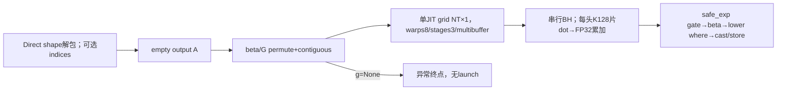
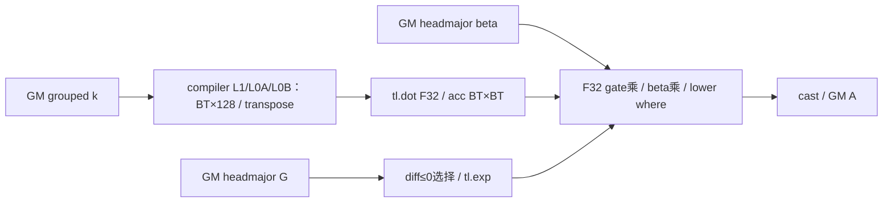
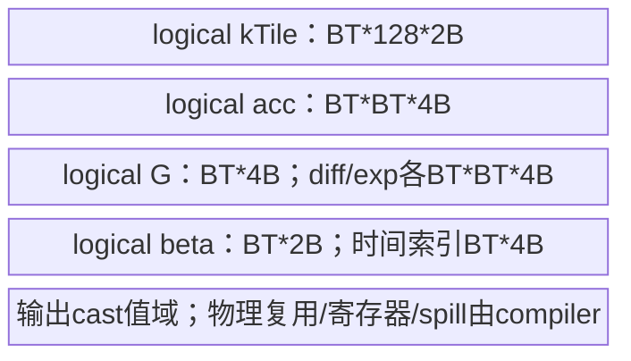
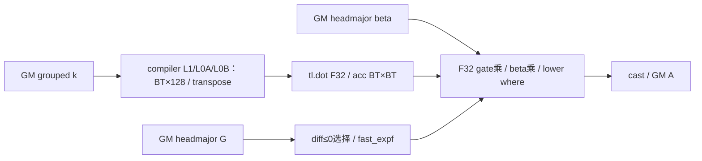

# 分块门控 KKT 构造 A2/A3 Direct Invoke 算子知识

## 算子速览

| 项目 | 内容 |
|---|---|
| 实际入口 | `sgl_kernel_npu.implementation.triton.attention.gdn.chunk_scaled_dot_kkt.chunk_scaled_dot_kkt_fwd_npu`，Direct Invoke |
| 计算语义 | chunk内Aij=beta_i·(kiᵀkj)·exp(gi−gj)，只保留i>j且gi−gj≤0；grouped key heads共享 |
| 输入输出 | k[B,T,Hg,K] FP16/BF16，beta[B,T,H]同dtype，G[B,T,H]FP32；O[B,T,H,BT]新分配；BT=chunk_size默认64 |
| 执行类型 | 单JIT有AIC_CUBE语义tl.dot(BT×128,128×BT)及Vector gate/beta/三角mask；不推断物理MIX比例 |
| Kernel 路线 | R001/R002等长，R003/R004变长；分别模块绑定tl.exp/fast_expf；USE_G=false没有本Host producer |
| 核心资源 | k原样读，beta/G Host permute+contiguous；A bytes=BTHBT*sO；逻辑局部K tile=2BT*128B、acc=4BT²B；物理L1/L0/UB/register由Triton决定 |
| 来源闭包 | direct_implementation_closed：公开注册/Direct Host、唯一JIT、safe_exp/metadata cache及打包闭合；Torch布局预处理及Triton primitive为明确边界 |
| 关键边界 | Host无完整_validate_inputs；g=None在permute前处理失败；K尾block_ptr未显式padding_option，不能承诺补零；变长identity缓存可陈旧 |
| 验证状态 | 本次知识提取未执行编译、真机、数值或性能测试。draft保留调用方合同与编译资源边界，不保证任意shape可编译/数值正确 |

## 接口与语义

### 计算语义

H为beta末维，Hg为k倒二维，合法域H%Hg=0。输出头h读取key头h//(H//Hg)，不会实际复制key。每sequence在cu边界重启chunk；对局部chunk内行i/j，先按K128片计算Sij=Σdot(k_i,k_j)，FP32逐片累加，再乘safe_exp(Gi−Gj)，再乘beta_i，最后where(i>j,值,0)。safe_exp(x)=exp(where(x≤0,x,−inf))，因此正差取0而非增长指数；不是普通exp的全实数合同。FP32 G的chunk内单调不增是公开预期，输入值未逐项检查。

k/beta为FP16/BF16时tl.dot输出默认FP32，源码每片先独立dot再与b_A相加，没有input_precision="ieee"设置（低精输入不能借用solve_tril FP32 IEEE结论）。beta按行广播乘FP32结果，最终b_A.to(output element type)存GM，源码没有显式fp_downcast_rounding参数，不从其它算子抄rtne保证。FLA_USE_FAST_OPS仅在gdn_utils模块导入时读取：字符串"1"绑定fast_expf，否则tl.exp，后改环境不保证已导入模块重绑。

有效尾chunk的padded时间列j≥Tlocal、有效行i<Tlocal总满足i≤j，最终三角where明确写0；无效输出行被boundary_check挡住。K%128不整除时，b_k的block_ptr load虽boundary_check(0,1)却未显式padding_option="zero"，这类越界特征lane参与有效i/j dot，不能把时间列的三角zero证明迁移到K padding。具体未设padding的primitive行为/编译资源本次未验证。

### 输入、输出与属性

| 参数 | shape/layout | dtype | 约束、默认值与语义 |
|---|---|---|---|
| k | [B,T,Hg,K] contiguous NPU | FP16/BF16 | 公开合同；Host只解包shape，未主动检查rank/device/stride/dtype/非零 |
| beta | [B,T,H] | k.dtype | 公开同NPU；Host permute(2,0,1).contiguous，得到[H,B,T] |
| g_cumsum | [B,T,H] | FP32 | 本后端实际必需；Direct默认None将于permute失败；公开wrapper先ValueError |
| cu_seqlens | [N+1]或None | int32/int64 | packed B1、同设备连续、从0到T正长度由调用方保证；Host无全量检查，JITload转int32 |
| chunk_size | Python int | — | 默认64；公开正2次幂，实际Host直接作BT constexpr，无assert/资源上限 |
| output_dtype | torch.dtype或None | — | 默认FP32；传给empty再由tl.to写出；None沿Torch默认dtype，来源未穷举全部可编译类型，不推定整数cast为独立量化支持 |
| A | [B,T,H,BT] | output_dtype或框架默认 | 新建、严格下三角、有效行padding时间列0，输入不改 |

### 入口与版本

公共operators wrapper对g=None先ValueError，auto/triton同样懒导入本Direct，torch_native为独立参考且无失败回退。本目标只覆盖Direct语义及其公开有效域；不把独立PyTorch数学参考混入同launch graph。架构/平台由逐算子docs产品表arch22/35支持与generation/README映射确认；本卡平台以Frontmatter为准，CANN9.1.0取固定README/CI，不宣称具体Triton版本已运行。

旧fla/chunk_scaled_dot_kkt.py与新文件的kernel及Host AST等价，差异是varlen tuple换行、import路径和版权头。新gdn_utils/旧fla.utils的prepare_chunk_indices、tensor_cache、safe_exp和exp选择相同；cache是独立模块实例，若两模块在不同环境设置下导入则不能无条件称全局exp对象相同。旧额外import exp/offsets没有被本kernel直接读取。普通链接复用[块内线性系统API](../../../../apis/sgl_kernel_npu/sgl_gdn_chunk_linear_system.md)；输出A随后由[三角求逆源码卡](sgl_solve_tril.md)消费得到R，不把KKT A误作WY的逆输入。

## Host/Launcher 执行流程

### 参数校验与前处理

Direct没有_validate_inputs。先B,T,Hg,K=k.shape，H=beta.shape[-1]，BT=chunk_size；有cu则prepare_chunk_indices(cu,BT)，否则None；NT取表长度或ceil(T/BT)。分配empty A[B,T,H,BT]后，在launch实参求值中依次把beta和g permute(2,0,1).contiguous()。g=None在此产生Torch异常，JIT未启动；即使heuristics声明USE_G=false，也不是本Host可达Device路线。没有自动替换None为零gate。

permute是view，contiguous在必要时分配拷贝到head-major [H,B,T]；若已符合该布局可复用框架storage，实际是否新分配由Torch决定。k没有contiguous调用，Device硬编码stride，非连续k失约不能假定自动修复。没有显式H整除Hg、设备/dtype/shape一致性、BT/POT/非零、cu合法值或gate单调检查；异常/失约行为按真实边界记录，不冒充已执行guard。

### 参数、Workspace 与生命周期

输出A由本次empty分配，bytes=B*T*H*BT*sO，未预清零，所有合法有效row完整BT列由JIT写出。beta/G的head-major contiguous结果至多分别BTH*sBeta与4BTH字节临时，实际alias情况由Torch；它们是launch实参临时Tensor，源码没有另存长期owner或手工record event，异步生命周期由框架allocator/JIT协议承担。输入及输出调用方必须保持到stream完成，不能从函数返回推完成。

没有自有workspace/system区/ACLNN executor/TCubeTiling；局部acc不是GM workspace。varlen table[NT,2]沿cu dtype、bytes2NT*sCu；prepare_lens转int64相减，ceil长度tolist后CPU arange/cumsum/stack再.to(cu)，存在NPU→Host同步与拷贝。tensor_cache最多4项按Tensor is判断、非Tensor同类型同值，命中LRU移到末尾；不按内容/version失效，原地改cu可能复用陈旧lens/indices。CPU索引构造是元数据前处理，非外部KKT数学核心；相关Torch基本操作是标注框架primitive。

### 启动图与失败传播



单JIT grid=(NT,1)，第二program_id取出后忽略；每program内部for i_bh in range(B*H)串行所有batch/head，不是grid=(NT,BH)。warps8、stages3、multibuffer=True只给compiler，不推物理线程/Cube:AIV数或3份UB。Python失败直接传播、不catch；JIT编译/异步Device错误依runtime边界，无kernel返回码检查或fallback。

## Route 与参数设计

### 分核与资源计算

Host从k读B,T,Hg,K，从beta读H，BT直接chunk_size，BK固定128；NT为ceil(T/BT)或packed表长度。每program处理一个时间chunk，串行BH；group=h//(H//Hg)。key基址=(bos*Hg+group)*K，block shape(Tlocal,K)、stride(Hg*K,1)、offset(tile*BT,kBlock*128)、block(BT,128)、order(1,0)。b_k[BT,128]与其tl.trans视图做BT×128×BT dot，循环ceil(K/128)，b_A[BT,BT]FP32逐片加。

head-major beta/G基址h*(B*rawT)+bos，shape(Tlocal)、stride1、offset tile*BT、blockBT；bt_stride在重写T之前计算，所以packed使用全tensor每head跨度，不是local T。输出基址=(bos*H+h)*BT，shape(Tlocal,BT)、stride(H*BT,1)、offset(tile*BT,0)、block(BT,BT)、order(1,0)。

逻辑key tile=BT*128*sK（公开sK2），acc/gdiff/exp域各BT²*4，beta=BT*sBeta，G=BT*4；源码中b_A更新各步可由compiler就地复用，不能把所有表达式域简单相加当UBpeak。物理L1/L0/UB、double-buffer深度、bankpadding/spill与寄存器数不在本固定Python显式声明，multibuffer=True只是compiler策略请求。源码没有自有资源上限guard，BT任意正POT不等价必然资源可行。

### Route 选择

公共合同P：本卡平台支持，k/beta FP16或BF16且同dtype、k连续NPU[B,T,Hg,K]、beta/G[B,T,H]且同NPU、G FP32、正维度、H%Hg=0、BT正POT。Direct不逐项检查这些；下列是共同有效输入域，原始失约路径单列失败边界。varlen追加B1、cu连续同设备int32/int64、[0,…,T]正长度。USE_G实际恒true。Fast是在gdn_utils import时绑定，不在每调用读环境。

| 顺序 | Route | Key/模板 | 精确选择条件与优先级 | 不适用去向 |
|---:|---|---|---|---|
| 1 | R-001 等长tl.exp门控KKT | IS_VARLEN=0,USE_G=true；exp=tl.exp | P；cu=None；模块导入FLA_USE_FAST_OPS!="1" | 其它条件对应其它行；gNone前处理失败，无无gate路线 |
| 2 | R-002 等长fast_expf门控KKT | IS_VARLEN=0,USE_G=true；exp=fast_expf | P；cu=None；模块导入FLA_USE_FAST_OPS=="1" | 其它条件对应其它行；gNone前处理失败，无无gate路线 |
| 3 | R-003 变长tl.exp门控KKT | IS_VARLEN=1,USE_G=true；exp=tl.exp | P；cu!=None且varlen附加合同；模块导入FLA_USE_FAST_OPS!="1" | 其它条件对应其它行；gNone前处理失败，无无gate路线 |
| 4 | R-004 变长fast_expf门控KKT | IS_VARLEN=1,USE_G=true；exp=fast_expf | P；cu!=None且varlen附加合同；模块导入FLA_USE_FAST_OPS=="1" | 其它条件对应其它行；gNone前处理失败，无无gate路线 |

```text
g=None：public wrapper ValueError；raw Direct在permute(None)失败，无JIT
否则BT=chunk_size；BK=128；NT=cu非空?len(indices):ceil(T/BT)
betaHBT=permute(beta,2,0,1).contiguous
gHBT=permute(g,2,0,1).contiguous
IS_VARLEN=(cu!=None)，USE_G=true
exp对象已由gdn_utils导入时环境选定tl.exp/fast_expf
单JIT[(NT,1)](...,warps8,stages3,multibuffer=True)
```

### 模板/实现执行矩阵

| Route | key/selector | dtype/shape/platform 完整命中条件 | 执行族与 kernel 节点 | 实际模板/body | 内存与同步特征 | tail/fallback |
|---|---|---|---|---|---|---|
| R-001 等长tl.exp门控KKT | var0/USE_G1/tl.exp | P+上表谓词，sK2，输出类型由ATen/Triton转换边界 | 单JIT AIC_CUBE dot+Vector gate/beta/mask | chunk_scaled_dot_kkt_fwd_trans_kernel，BT/BK128、H/Hg/K constexpr，T不specialize | beta/G headmajor临时，A新output，无metadata | blockptr check无显式zero；时间列三角0；Ktail padding未承诺；无safe fallback |
| R-002 等长fast_expf门控KKT | var0/USE_G1/fast_expf | P+上表谓词，sK2，输出类型由ATen/Triton转换边界 | 单JIT AIC_CUBE dot+Vector gate/beta/mask | chunk_scaled_dot_kkt_fwd_trans_kernel，BT/BK128、H/Hg/K constexpr，T不specialize | beta/G headmajor临时，A新output，无metadata | blockptr check无显式zero；时间列三角0；Ktail padding未承诺；无safe fallback |
| R-003 变长tl.exp门控KKT | var1/USE_G1/tl.exp | P+上表谓词，sK2，输出类型由ATen/Triton转换边界 | 单JIT AIC_CUBE dot+Vector gate/beta/mask | chunk_scaled_dot_kkt_fwd_trans_kernel，BT/BK128、H/Hg/K constexpr，T不specialize | beta/G headmajor临时，A新output，2NT*sCu metadata/cache | blockptr check无显式zero；时间列三角0；Ktail padding未承诺；无safe fallback |
| R-004 变长fast_expf门控KKT | var1/USE_G1/fast_expf | P+上表谓词，sK2，输出类型由ATen/Triton转换边界 | 单JIT AIC_CUBE dot+Vector gate/beta/mask | chunk_scaled_dot_kkt_fwd_trans_kernel，BT/BK128、H/Hg/K constexpr，T不specialize | beta/G headmajor临时，A新output，2NT*sCu metadata/cache | blockptr check无显式zero；时间列三角0；Ktail padding未承诺；无safe fallback |

输入FP16、BF16各为不同JIT typed specialization；均sK=sBeta=2B、dotFP32累加，数值范围不可混同。公开output_dtype没有穷举类型枚举，默认FP32时sO4；常用FP16/BF16时sO2、最终转换目标相应变化，None由Torch默认dtype决定。源码没有量化scale/zero-point或整数输出支持声明，不能把ATen接受dtype推为所有Triton类型/平台可运行，也不创建另一个量化数学目标。

### 隐藏性能 Guard

| Guard | Host/Tiling 条件 | Device/资源原因 | 影响 Route | 不满足时去向 | 源码符号 |
|---|---|---|---|---|---|
| 必需G | raw无guard，public先检查 | Host无条件permute(g)，USE_G=false无producer | 全部 | None时prelaunch异常 | Direct/wrapper |
| 连续k | 公开要求，Host不copy/check | 硬编码Hg*K/1 stride | 全部 | 失约，不保证正确；无fallback | p_k |
| H%Hg=0 | 公开要求，Host无assert | group=h//(H//Hg)，非法可除零或越界头 | 全部 | raw不保证，非支持域 | body loop |
| BT正POT | 公开合同，Host不assert | tl.arange/block/dotshape、quadratic acc | 全部 | 可能分配/JIT失败，无资源fallback | BT/Host |
| Ktail | BK128、ceil(K/128) | 特征尾lane参与dot，load未显式zero padding | 全部 | 不承诺自动补0，不伪造确定数值错误 | b_k tl.load |
| 时间tail | tile*BT+row<Tlocal | output检查行，三角mask使padding列0 | 全部 | 超界输出行不store | p_A/tl.where |
| packed | B1/cu合法、值可I32表示 | indices/bos/eos.toI32、每序列chunk映射 | R003/004 | raw无guard，失约可能索引错误 | IS_VARLEN |
| cache不变 | Tensor identity相同则命中 | 无版本counter/内容摘要 | R003/004 | 同对象原地变更可能陈旧 | tensor_cache |
| exp分支 | 导入时环境"1" | 不同primitive精度/实现 | Fast Routes | 后改env不保证重绑 | gdn_utils.exp |
| 物理容量 | 无源码UB/L1检查 | BT²FP32域及BK tile由compiler分配 | 全部 | compiler/runtime报错，不能给假容量阈值 | num_stages/multibuffer |

### POD/ABI

没有C POD、固定sizeof/alignof/offsetof或自有Tiling序列化。下表逐参数是Python→JIT typed槽位，最终指针包offset/标量整型位宽由Triton生成、固定Python未证明；constexpr不占GM wire字段。stride单位元素，BT/BK是tile维度，B/T是原始总batch/time；T在varlen分支重写局部长度，但bt_stride先由原始T产生。

| 结构 | 字段 | 类型/位宽 | ABI 布局 | 单位 | Host/launcher producer | Device consumer | 边界 |
|---|---|---|---|---|---|---|---|
| JIT args | k | typed GM pointer | slot0；物理offset不可见 | 元素 | 原k | p_k grouped head地址 | 无Host contiguous |
| JIT args | beta | typed GM pointer | slot1；物理offset不可见 | 元素 | permute+contiguous [H,B,T] | p_beta headmajor | beta原shape合同 |
| JIT args | g_cumsum | float32 GM pointer | slot2；物理offset不可见 | 元素 | permute+contiguous [H,B,T] | p_g/safe_exp | None无producer |
| JIT args | A | typed GM pointer | slot3；物理offset不可见 | 元素 | empty output dtype | p_A/store | 最后cast类型沿Tensor |
| JIT args | cu_seqlens | I32/I64 GM pointer或None | slot4；物理offset不可见 | token | caller | var bos/eos toI32 | 非var inactive |
| JIT args | chunk_indices | cu同dtype GM pointer或None | slot5；物理offset不可见 | 2列pair | prepare_chunk_indices(cu,BT) | var sequence/tile toI32 | 非var inactive |
| JIT args | T | Python int/runtime | slot6；位宽未证明；物理offset不可见 | token | k.shape1 | 先bt_stride，再var局部T | do_not_specialize |
| JIT args | B | Python int/runtime | slot7；位宽未证明；物理offset不可见 | batch | k.shape0 | bt_stride/for BH | packed合同B1但无assert |
| JIT args | H | constexpr int | 编译参数；物理offset不可见 | output head | beta.shape[-1] | headloop/outputstride/group | H%Hg合同 |
| JIT args | Hg | constexpr int | 编译参数；物理offset不可见 | key head | k.shape2 | group/p_kstride | 正 |
| JIT args | K | constexpr int | 编译参数；物理offset不可见 | feature | k.shape3 | ceil(K/128)/p_k shape | 值域无assert |
| JIT args | BT | constexpr int | 编译参数；物理offset不可见 | chunk token | chunk_size | dot M/N、TLrange/outputcols | 正POT公开合同 |
| JIT args | BK | constexpr int | 编译参数；物理offset不可见 | feature/tile | Host常量128 | dotK/p_k block | 128 |
| JIT args | IS_VARLEN | constexpr bool | heuristics；物理offset不可见 | bool | cu!=None | sequence/table分支 | 存在即true，非有效性guard |
| JIT args | USE_G | constexpr bool | heuristics；物理offset不可见 | bool | g temp非None | gate分支 | 正常Host恒true |

metadata的sequence与tile编号分别位于table[(2i)*sCu]和[(2i+1)*sCu]，每field独立整数；Host prepare_lens/CPU构造/.to(cu)与前卡相同，cache owner保持table，不保持cu内容快照。exp选择是模块全局绑定而非GM参数；num_warps8/num_stages3/multibuffer=True是compiler options，不补入虚构POD。

### Route 源码闭包

| Route | Key/selector | Host/Tiling producer | POD/参数 | Kernel entry/router | Kernel body/直接依赖 | 构建接线 |
|---|---|---|---|---|---|---|
| R-001 等长tl.exp门控KKT | var0/USE_G1/tl.exp | chunk_scaled_dot_kkt_fwd_npu shape/indices/empty/permute | 15typed/constexpr字段，无C POD | trans_kernel[(NT,1)] | forBH→forK dot→safe_exp→beta→lower→store；gdn_utils tl.exp及cache | root setup→stage_runtime复制共同Python，triton.jit懒编译，无本算子ACLNN/CMake |
| R-002 等长fast_expf门控KKT | var0/USE_G1/fast_expf | chunk_scaled_dot_kkt_fwd_npu shape/indices/empty/permute | 15typed/constexpr字段，无C POD | trans_kernel[(NT,1)] | forBH→forK dot→safe_exp→beta→lower→store；gdn_utils fast_expf及cache | root setup→stage_runtime复制共同Python，triton.jit懒编译，无本算子ACLNN/CMake |
| R-003 变长tl.exp门控KKT | var1/USE_G1/tl.exp | chunk_scaled_dot_kkt_fwd_npu shape/indices/empty/permute | 15typed/constexpr字段，无C POD | trans_kernel[(NT,1)] | forBH→forK dot→safe_exp→beta→lower→store；gdn_utils tl.exp及cache | root setup→stage_runtime复制共同Python，triton.jit懒编译，无本算子ACLNN/CMake |
| R-004 变长fast_expf门控KKT | var1/USE_G1/fast_expf | chunk_scaled_dot_kkt_fwd_npu shape/indices/empty/permute | 15typed/constexpr字段，无C POD | trans_kernel[(NT,1)] | forBH→forK dot→safe_exp→beta→lower→store；gdn_utils fast_expf及cache | root setup→stage_runtime复制共同Python，triton.jit懒编译，无本算子ACLNN/CMake |

## Kernel 实现

### 公共执行流程

全部Route同一个JIT。bt_stride=B*rawT在headloop前计算；每head恢复相应bos/tile并读beta，初始化BT×BT FP32 acc；K128片load原k、tl.trans同一tile并dot，加到acc；USE_Gtrue读G，形成FP32差矩阵并调用safe_exp；乘beta行系数，最后严格lower where，转换/边界store A。没有第二kernel、atomic或跨program中间workspace；元数据正确时每program持有不同chunk，每head由本program串行处理，输出无重叠。

Triton生成内部GM→compiler L1/L0→dotacc→Vector/UB/寄存器→GM通路；源码没有owned硬件flag、显式L1/L0地址、DB数或UBcapacity。num_stages/multibuffer不能替代当前tile值域、GM边和stream owner说明；以下逐Route给出真实形状、layout、精度及可见边界。
### Route R-001：等长tl.exp门控KKT

#### 适用条件

##### 选择证据

| 层级 | 文件 | 符号 | 源码谓词/参数 | 结果/下一跳 |
|---|---|---|---|---|
| Direct Host | implementation/triton/attention/gdn/chunk_scaled_dot_kkt.py | chunk_scaled_dot_kkt_fwd_npu | 共同公开P；cu=None；G必需 | output/permute；grid NT×1 |
| 模块global | implementation/triton/attention/gdn/gdn_utils.py | exp / safe_exp | 导入时FLA_USE_FAST_OPS!="1" | exp=tl.exp |
| JIT heuristics | chunk_scaled_dot_kkt.py | trans_kernel | IS_VARLEN=0、USE_G=true、BK128 | 串行BH/分片dot；没有无G fallback |

#### Device 数据流

##### 函数级调用链

```text
chunk_scaled_dot_kkt_fwd_npu(k,beta,G,cu,BT,dtype)
 -> NT=ceil(T/BT)
 -> output empty / beta.permute.contiguous / G.permute.contiguous
 -> chunk_scaled_dot_kkt_fwd_trans_kernel[(NT,1)]
    -> bt_stride=B*rawT
    -> for i_bh in range(B*H)
       -> b,h解码，bos=b*T
       -> beta blockptr load
       -> for i_k in ceil(K/128): k blockptr load / tl.trans / tl.dot / F32 add
       -> G blockptr load / Gdiff / safe_exp -> tl.exp(where diff<=0)
       -> multiply beta / lower where / to output type / store
```

##### 源码等价伪码

```text
源码等价伪码；地址/stride单位元素
bt_stride=B*rawT; tileGlobal=pid0; pid1=0（读取后忽略）
for bh in0..B*H-1:
    b=bh//H;h=bh%H
    bos=b*rawT;Tlocal=rawT;tile=tileGlobal
    betaTile=load blockptr(betaHBT+h*bt_stride+bos,
                          shape[Tlocal],stride1,offset tile*BT,blockBT,order0,
                          boundary_check0)
    acc=zeros[BT,BT] F32
    for kb in0..ceil(K/128)-1:
        keyGroup=h//(H//Hg)
        kTile=load blockptr(k+(bos*Hg+keyGroup)*K,
                           shape[Tlocal,K],stride[Hg*K,1],
                           offset[tile*BT,kb*128],block[BT,128],order[1,0],
                           boundary_check[0,1])
        # 未显式padding_option="zero"，不假定K尾lane为0
        acc=acc+dot(kTile,trans(kTile))  # 低精输入/F32输出
    gTile=load blockptr(GHBT+h*bt_stride+bos,shape[Tlocal],stride1,
                       offset tile*BT,blockBT,order0,boundary_check0)
    diff=gTile[:,None]-gTile[None,:]
    factor=tl.exp(where(diff<=0,diff,-inf))
    acc=acc*factor
    acc=acc*betaTile[:,None]
    acc=where(arangeBT[:,None]>arangeBT[None,:],acc,0)
    store blockptr(A+(bos*H+h)*BT,
                   shape[Tlocal,BT],stride[H*BT,1],
                   offset[tile*BT,0],block[BT,BT],order[1,0],
                   value=acc.to(A.element_ty),boundary_check[0,1])
```

FP16/BF16 k对应两个typed JIT实例、相同2B物理输入与FP32acc路径；不会自动把k转FP32再dot。普通tl.exp也经过diff<=0选择；不是直接对正差指数化。 等长b循环用bos=b*rawT，逐head头共享key映射，没有packed table或Host tolist。

#### 内存与数据搬运

##### 资源与搬运表

| 层级/缓冲区 | offset/地址公式 | extent/容量公式 | dtype/layout | producer | consumer | owner/lifetime | 对齐/复用 |
|---|---|---|---|---|---|---|---|
| GM k | (bos*Hg+h//(H//Hg))*K + row*Hg*K+feature | B*T*Hg*K*2B | FP16/BF16 ND | caller | dotload | input/stream | 硬编码最后维stride1；不做copy |
| GM betaHBT | h*(B*rawT)+bos+row | 至多BTH*2B临时 | headmajor [H,B,T] | permute+contiguous | beta vectorload | Tensor临时/runtimeallocator | 原input非该布局时copy，框架alias边界 |
| GM GHBT | h*(B*rawT)+bos+row | 至多4BTH B临时 | FP32 headmajor | permute+contiguous | gate load | 同上 | 必需，None不launch |
| GM A | (bos*H+h)*BT+row*H*BT+col | BTHBT*sO B | output type ND | 当前JIT | caller/后续solve | 返回Tensor | 有效行全BT列写，padded时间列0 |
| GM table/cu | table[2pid0/2pid0+1]；cu[seq/seq+1] | N/A，0新增 | int32/int64 | helper /caller | varlen标量load | cache/调用方 | Device.toI32；无内容快照 |
| L1/L0A/B/C | compiler dot operand/acc layout | 当前dot逻辑(BT,128)×(128,BT) | 低精A/B，FP32acc | tl.load/trans | tl.dot | compiler perprogram | 无手工offset/db/容量报告 |
| UB/register K tile | compiler local view | BT*128*2B逻辑域 | FP16/BF16 | tl.load | dot及transpose同tile | 每K片 | transpose不证明完整物理复制 |
| UB/register acc | 无手工地址 | BT²*4B逻辑域 | FP32 | dot+逐片加 | gate/beta/mask/store | 每head全部K片到输出 | 不是GM workspace |
| UB/register gate | G BT*4；diff/exp各BT²*4B | 表达式值域，非物理峰值 | FP32 | Gload/sub/tl.exp | acc乘 | 每head后处理 | compiler可复用，不填虚构绝对offset |
| UB/register beta/mask | beta BT*2；o_t_FP32 BT*4；mask BT² predicate | 表达式域 | lowprec/F32/predicate | loads/arange | rowmultiply/where | 每head | predicate物理位宽不等价1B/元素 |
| workspace/system区 | N/A | 0 owned bytes | N/A | N/A | N/A | 无自有分配 | 不套AscendC libapi16MiB |

##### 分层内存布局





图仅局部tensor值域，不是物理UB地址表。代码没有classic TQue/TBuf或自有Vector-to-Cube跨核buffer；compiler内部同步是primitive边界，不能给数字flag。

##### 字节账、交接边与复用顺序

```text
A_bytes=B*T*H*BT*sO
beta_preprocess_bytes <= B*T*H*2；G_preprocess_bytes <= B*T*H*4
table_bytes=0
owned_workspace_total=0
kTile_domain=BT*128*2；acc_domain=BT*BT*4
G_domain=BT*4；diff_domain=exp_domain=BT*BT*4；beta_domain=BT*2
physical_L1/L0/UB_peak/registers = 编译器layout/reuse/padding/spill，固定Python未声明
```

| 边/复用子区 | producer | offset/extent | dtype/layout | consumer | ordering/sync | owner/lifetime | 安全条件 |
|---|---|---|---|---|---|---|---|
| beta/G布局前处理 | torch.permute().contiguous() | beta至多2BTH，G4BTH | headmajor contiguous | kernel头向量load | 同current stream/runtime tensorcopy顺序 | 临时Tensor由allocator/JIT协议保持 | sameNPU/shape/dtype合同，无Host逐项guard |
| metadata | helper ceil/lens→tolist→CPU stack→to(cu) | N/A | cu类型pair | varload | 本Route不执行 | cache | 原地改同cu对象可失效 |
| keytile→dot | blockptr load | BT*128*2B逻辑域 | lowprec ND/transposed view | dot | compiler数据依赖 | 当前kb | K尾未显式zero；不能把boundarycheck当padzero |
| dotacc→gate/beta | K片dot输出逐片add | BT²*4B逻辑域 | FP32 | Vector表达式 | TL依赖/compiler pipeline | 当前head | exp规则按diff≤0；无FP32输入dot虚构 |
| lower结果→O | where / to element type | 每有效row BT*sO | outputtype ND | GM caller | store/currentstream | A Tensor | 有效row唯一chunk/head；cu正确时无race |

#### 同步、精度与尾块

##### 同步与数值边界表

| 阶段 | primitive/机制 | producer | consumer/等待点 | 保护对象 | 精度/尾块 |
|---|---|---|---|---|---|
| Host布局 | contiguous copy/runtime | beta/G input | JIT | headmajor临时 | 非数学fallback，无自动k copy |
| metadata | N/A | 无 | var JIT | 索引 | 等长不触发 |
| MM分片 | tl.load/trans/dot/add | k lowprec | acc FP32 | 当前head BT² | BK128，ceilK循环，无显式ieee/round属性 |
| feature尾块 | blockptr boundary_check(0,1) | 末Ktile | dot有效i/j | K%128的缺失特征lane | 未给padding_option，不能保证零，未验证具体backend |
| gate | safe_exp→tl.exp | FP32 Gdiff | acc乘 | BT² | x>0置−inf再exp→0；本次无误差界/性能测量 |
| beta/lower | beta[:,None]乘→where(i>j) | FP32 acc | finalcast | 有效输出row | padding时间列j≥L时i≤j，明确写0；不与K padding混淆 |
| 输出 | to(A.element_ty)/boundarystore | acc | GM A | 有效row BT列 | 未显式round参数，不抄其它kernel rtne |
| 内部同步 | TL数据依赖/compiler dot pipeline | operations | 后继operations | compiler局部buffer | 无owned atomic/event/flag，单JIT无跨kernel临时 |

#### 关键实现

##### 符号证据表

| 阶段 | 文件 | 符号/模板实例 | 实现事实 |
|---|---|---|---|
| Host/Tiling producer | implementation/triton/attention/gdn/chunk_scaled_dot_kkt.py | chunk_scaled_dot_kkt_fwd_npu | gridNT×1、BK128、warps8/stages3/multibufferTrue、headmajor预处理 |
| Kernel entry/router | 同文件 | heuristics / trans_kernel | IS_VARLEN0，USE_Gtrue；T不specialize |
| Device body/helper | 同文件 | forBH/forK/p_k/tl.dot | grouped head映射，串行BH，每K片dot并F32add |
| Device body/helper | gdn_utils.py | safe_exp / exp | 导入时env非1绑定tl.exp，diff>0→−inf |
| Device body/helper | chunk_scaled_dot_kkt.py | p_beta/p_g/p_A / where | headmajor输入和ND输出、严格lower、tail规则 |
| 旧路径 | fla/chunk_scaled_dot_kkt.py / fla/utils.py | 同名Host/JIT/helper | AST相同，import/modulecache/exp绑定时间需分别核对 |


### Route R-002：等长fast_expf门控KKT

#### 适用条件

##### 选择证据

| 层级 | 文件 | 符号 | 源码谓词/参数 | 结果/下一跳 |
|---|---|---|---|---|
| Direct Host | implementation/triton/attention/gdn/chunk_scaled_dot_kkt.py | chunk_scaled_dot_kkt_fwd_npu | 共同公开P；cu=None；G必需 | output/permute；grid NT×1 |
| 模块global | implementation/triton/attention/gdn/gdn_utils.py | exp / safe_exp | 导入时FLA_USE_FAST_OPS=="1" | exp=tldevice.fast_expf |
| JIT heuristics | chunk_scaled_dot_kkt.py | trans_kernel | IS_VARLEN=0、USE_G=true、BK128 | 串行BH/分片dot；没有无G fallback |

#### Device 数据流

##### 函数级调用链

```text
chunk_scaled_dot_kkt_fwd_npu(k,beta,G,cu,BT,dtype)
 -> NT=ceil(T/BT)
 -> output empty / beta.permute.contiguous / G.permute.contiguous
 -> chunk_scaled_dot_kkt_fwd_trans_kernel[(NT,1)]
    -> bt_stride=B*rawT
    -> for i_bh in range(B*H)
       -> b,h解码，bos=b*T
       -> beta blockptr load
       -> for i_k in ceil(K/128): k blockptr load / tl.trans / tl.dot / F32 add
       -> G blockptr load / Gdiff / safe_exp -> fast_expf(where diff<=0)
       -> multiply beta / lower where / to output type / store
```

##### 源码等价伪码

```text
源码等价伪码；地址/stride单位元素
bt_stride=B*rawT; tileGlobal=pid0; pid1=0（读取后忽略）
for bh in0..B*H-1:
    b=bh//H;h=bh%H
    bos=b*rawT;Tlocal=rawT;tile=tileGlobal
    betaTile=load blockptr(betaHBT+h*bt_stride+bos,
                          shape[Tlocal],stride1,offset tile*BT,blockBT,order0,
                          boundary_check0)
    acc=zeros[BT,BT] F32
    for kb in0..ceil(K/128)-1:
        keyGroup=h//(H//Hg)
        kTile=load blockptr(k+(bos*Hg+keyGroup)*K,
                           shape[Tlocal,K],stride[Hg*K,1],
                           offset[tile*BT,kb*128],block[BT,128],order[1,0],
                           boundary_check[0,1])
        # 未显式padding_option="zero"，不假定K尾lane为0
        acc=acc+dot(kTile,trans(kTile))  # 低精输入/F32输出
    gTile=load blockptr(GHBT+h*bt_stride+bos,shape[Tlocal],stride1,
                       offset tile*BT,blockBT,order0,boundary_check0)
    diff=gTile[:,None]-gTile[None,:]
    factor=fast_expf(where(diff<=0,diff,-inf))
    acc=acc*factor
    acc=acc*betaTile[:,None]
    acc=where(arangeBT[:,None]>arangeBT[None,:],acc,0)
    store blockptr(A+(bos*H+h)*BT,
                   shape[Tlocal,BT],stride[H*BT,1],
                   offset[tile*BT,0],block[BT,BT],order[1,0],
                   value=acc.to(A.element_ty),boundary_check[0,1])
```

FP16/BF16 k对应两个typed JIT实例、相同2B物理输入与FP32acc路径；不会自动把k转FP32再dot。Fast只替换指数primitive，不改变diff>0置−inf、beta顺序或严格lower；来源无此分支误差界。 等长b循环用bos=b*rawT，逐head头共享key映射，没有packed table或Host tolist。

#### 内存与数据搬运

##### 资源与搬运表

| 层级/缓冲区 | offset/地址公式 | extent/容量公式 | dtype/layout | producer | consumer | owner/lifetime | 对齐/复用 |
|---|---|---|---|---|---|---|---|
| GM k | (bos*Hg+h//(H//Hg))*K + row*Hg*K+feature | B*T*Hg*K*2B | FP16/BF16 ND | caller | dotload | input/stream | 硬编码最后维stride1；不做copy |
| GM betaHBT | h*(B*rawT)+bos+row | 至多BTH*2B临时 | headmajor [H,B,T] | permute+contiguous | beta vectorload | Tensor临时/runtimeallocator | 原input非该布局时copy，框架alias边界 |
| GM GHBT | h*(B*rawT)+bos+row | 至多4BTH B临时 | FP32 headmajor | permute+contiguous | gate load | 同上 | 必需，None不launch |
| GM A | (bos*H+h)*BT+row*H*BT+col | BTHBT*sO B | output type ND | 当前JIT | caller/后续solve | 返回Tensor | 有效行全BT列写，padded时间列0 |
| GM table/cu | table[2pid0/2pid0+1]；cu[seq/seq+1] | N/A，0新增 | int32/int64 | helper /caller | varlen标量load | cache/调用方 | Device.toI32；无内容快照 |
| L1/L0A/B/C | compiler dot operand/acc layout | 当前dot逻辑(BT,128)×(128,BT) | 低精A/B，FP32acc | tl.load/trans | tl.dot | compiler perprogram | 无手工offset/db/容量报告 |
| UB/register K tile | compiler local view | BT*128*2B逻辑域 | FP16/BF16 | tl.load | dot及transpose同tile | 每K片 | transpose不证明完整物理复制 |
| UB/register acc | 无手工地址 | BT²*4B逻辑域 | FP32 | dot+逐片加 | gate/beta/mask/store | 每head全部K片到输出 | 不是GM workspace |
| UB/register gate | G BT*4；diff/exp各BT²*4B | 表达式值域，非物理峰值 | FP32 | Gload/sub/fast_expf | acc乘 | 每head后处理 | compiler可复用，不填虚构绝对offset |
| UB/register beta/mask | beta BT*2；o_t_FP32 BT*4；mask BT² predicate | 表达式域 | lowprec/F32/predicate | loads/arange | rowmultiply/where | 每head | predicate物理位宽不等价1B/元素 |
| workspace/system区 | N/A | 0 owned bytes | N/A | N/A | N/A | 无自有分配 | 不套AscendC libapi16MiB |

##### 分层内存布局




图仅局部tensor值域，不是物理UB地址表。代码没有classic TQue/TBuf或自有Vector-to-Cube跨核buffer；compiler内部同步是primitive边界，不能给数字flag。

##### 字节账、交接边与复用顺序

```text
A_bytes=B*T*H*BT*sO
beta_preprocess_bytes <= B*T*H*2；G_preprocess_bytes <= B*T*H*4
table_bytes=0
owned_workspace_total=0
kTile_domain=BT*128*2；acc_domain=BT*BT*4
G_domain=BT*4；diff_domain=exp_domain=BT*BT*4；beta_domain=BT*2
physical_L1/L0/UB_peak/registers = 编译器layout/reuse/padding/spill，固定Python未声明
```

| 边/复用子区 | producer | offset/extent | dtype/layout | consumer | ordering/sync | owner/lifetime | 安全条件 |
|---|---|---|---|---|---|---|---|
| beta/G布局前处理 | torch.permute().contiguous() | beta至多2BTH，G4BTH | headmajor contiguous | kernel头向量load | 同current stream/runtime tensorcopy顺序 | 临时Tensor由allocator/JIT协议保持 | sameNPU/shape/dtype合同，无Host逐项guard |
| metadata | helper ceil/lens→tolist→CPU stack→to(cu) | N/A | cu类型pair | varload | 本Route不执行 | cache | 原地改同cu对象可失效 |
| keytile→dot | blockptr load | BT*128*2B逻辑域 | lowprec ND/transposed view | dot | compiler数据依赖 | 当前kb | K尾未显式zero；不能把boundarycheck当padzero |
| dotacc→gate/beta | K片dot输出逐片add | BT²*4B逻辑域 | FP32 | Vector表达式 | TL依赖/compiler pipeline | 当前head | exp规则按diff≤0；无FP32输入dot虚构 |
| lower结果→O | where / to element type | 每有效row BT*sO | outputtype ND | GM caller | store/currentstream | A Tensor | 有效row唯一chunk/head；cu正确时无race |

#### 同步、精度与尾块

##### 同步与数值边界表

| 阶段 | primitive/机制 | producer | consumer/等待点 | 保护对象 | 精度/尾块 |
|---|---|---|---|---|---|
| Host布局 | contiguous copy/runtime | beta/G input | JIT | headmajor临时 | 非数学fallback，无自动k copy |
| metadata | N/A | 无 | var JIT | 索引 | 等长不触发 |
| MM分片 | tl.load/trans/dot/add | k lowprec | acc FP32 | 当前head BT² | BK128，ceilK循环，无显式ieee/round属性 |
| feature尾块 | blockptr boundary_check(0,1) | 末Ktile | dot有效i/j | K%128的缺失特征lane | 未给padding_option，不能保证零，未验证具体backend |
| gate | safe_exp→fast_expf | FP32 Gdiff | acc乘 | BT² | x>0置−inf再exp→0；本次无误差界/性能测量 |
| beta/lower | beta[:,None]乘→where(i>j) | FP32 acc | finalcast | 有效输出row | padding时间列j≥L时i≤j，明确写0；不与K padding混淆 |
| 输出 | to(A.element_ty)/boundarystore | acc | GM A | 有效row BT列 | 未显式round参数，不抄其它kernel rtne |
| 内部同步 | TL数据依赖/compiler dot pipeline | operations | 后继operations | compiler局部buffer | 无owned atomic/event/flag，单JIT无跨kernel临时 |

#### 关键实现

##### 符号证据表

| 阶段 | 文件 | 符号/模板实例 | 实现事实 |
|---|---|---|---|
| Host/Tiling producer | implementation/triton/attention/gdn/chunk_scaled_dot_kkt.py | chunk_scaled_dot_kkt_fwd_npu | gridNT×1、BK128、warps8/stages3/multibufferTrue、headmajor预处理 |
| Kernel entry/router | 同文件 | heuristics / trans_kernel | IS_VARLEN0，USE_Gtrue；T不specialize |
| Device body/helper | 同文件 | forBH/forK/p_k/tl.dot | grouped head映射，串行BH，每K片dot并F32add |
| Device body/helper | gdn_utils.py | safe_exp / exp | FLA_USE_FAST_OPS=1导入时fast_expf，diff>0→−inf |
| Device body/helper | chunk_scaled_dot_kkt.py | p_beta/p_g/p_A / where | headmajor输入和ND输出、严格lower、tail规则 |
| 旧路径 | fla/chunk_scaled_dot_kkt.py / fla/utils.py | 同名Host/JIT/helper | AST相同，import/modulecache/exp绑定时间需分别核对 |


### Route R-003：变长tl.exp门控KKT

#### 适用条件

##### 选择证据

| 层级 | 文件 | 符号 | 源码谓词/参数 | 结果/下一跳 |
|---|---|---|---|---|
| Direct Host | implementation/triton/attention/gdn/chunk_scaled_dot_kkt.py | chunk_scaled_dot_kkt_fwd_npu | 共同公开P；cu非空/B1/合法边界；G必需 | output/permute；grid NT×1 |
| 模块global | implementation/triton/attention/gdn/gdn_utils.py | exp / safe_exp | 导入时FLA_USE_FAST_OPS!="1" | exp=tl.exp |
| JIT heuristics | chunk_scaled_dot_kkt.py | trans_kernel | IS_VARLEN=1、USE_G=true、BK128 | 串行BH/分片dot；没有无G fallback |

#### Device 数据流

##### 函数级调用链

```text
chunk_scaled_dot_kkt_fwd_npu(k,beta,G,cu,BT,dtype)
 -> prepare_chunk_indices / prepare_lens / tensor_cache / tolist / CPU pair table
 -> output empty / beta.permute.contiguous / G.permute.contiguous
 -> chunk_scaled_dot_kkt_fwd_trans_kernel[(NT,1)]
    -> bt_stride=B*rawT
    -> for i_bh in range(B*H)
       -> load sequence/tile + cu bos/eos.toI32
       -> beta blockptr load
       -> for i_k in ceil(K/128): k blockptr load / tl.trans / tl.dot / F32 add
       -> G blockptr load / Gdiff / safe_exp -> tl.exp(where diff<=0)
       -> multiply beta / lower where / to output type / store
```

##### 源码等价伪码

```text
源码等价伪码；地址/stride单位元素
bt_stride=B*rawT; tileGlobal=pid0; pid1=0（读取后忽略）
for bh in0..B*H-1:
    b=bh//H;h=bh%H
    seq,tile=table[2*tileGlobal],table[2*tileGlobal+1] ->I32；bos,eos=cu[seq],cu[seq+1]->I32；Tlocal=eos-bos
    betaTile=load blockptr(betaHBT+h*bt_stride+bos,
                          shape[Tlocal],stride1,offset tile*BT,blockBT,order0,
                          boundary_check0)
    acc=zeros[BT,BT] F32
    for kb in0..ceil(K/128)-1:
        keyGroup=h//(H//Hg)
        kTile=load blockptr(k+(bos*Hg+keyGroup)*K,
                           shape[Tlocal,K],stride[Hg*K,1],
                           offset[tile*BT,kb*128],block[BT,128],order[1,0],
                           boundary_check[0,1])
        # 未显式padding_option="zero"，不假定K尾lane为0
        acc=acc+dot(kTile,trans(kTile))  # 低精输入/F32输出
    gTile=load blockptr(GHBT+h*bt_stride+bos,shape[Tlocal],stride1,
                       offset tile*BT,blockBT,order0,boundary_check0)
    diff=gTile[:,None]-gTile[None,:]
    factor=tl.exp(where(diff<=0,diff,-inf))
    acc=acc*factor
    acc=acc*betaTile[:,None]
    acc=where(arangeBT[:,None]>arangeBT[None,:],acc,0)
    store blockptr(A+(bos*H+h)*BT,
                   shape[Tlocal,BT],stride[H*BT,1],
                   offset[tile*BT,0],block[BT,BT],order[1,0],
                   value=acc.to(A.element_ty),boundary_check[0,1])
```

FP16/BF16 k对应两个typed JIT实例、相同2B物理输入与FP32acc路径；不会自动把k转FP32再dot。普通tl.exp也经过diff<=0选择；不是直接对正差指数化。 变长indices按sequence重启tile，但source无B1/valueguard；失约输入可能重复/越界写，不能宣传为自动校正。

#### 内存与数据搬运

##### 资源与搬运表

| 层级/缓冲区 | offset/地址公式 | extent/容量公式 | dtype/layout | producer | consumer | owner/lifetime | 对齐/复用 |
|---|---|---|---|---|---|---|---|
| GM k | (bos*Hg+h//(H//Hg))*K + row*Hg*K+feature | B*T*Hg*K*2B | FP16/BF16 ND | caller | dotload | input/stream | 硬编码最后维stride1；不做copy |
| GM betaHBT | h*(B*rawT)+bos+row | 至多BTH*2B临时 | headmajor [H,B,T] | permute+contiguous | beta vectorload | Tensor临时/runtimeallocator | 原input非该布局时copy，框架alias边界 |
| GM GHBT | h*(B*rawT)+bos+row | 至多4BTH B临时 | FP32 headmajor | permute+contiguous | gate load | 同上 | 必需，None不launch |
| GM A | (bos*H+h)*BT+row*H*BT+col | BTHBT*sO B | output type ND | 当前JIT | caller/后续solve | 返回Tensor | 有效行全BT列写，padded时间列0 |
| GM table/cu | table[2pid0/2pid0+1]；cu[seq/seq+1] | 2NT*sCu + cu输入 | int32/int64 | helper /caller | varlen标量load | cache/调用方 | Device.toI32；无内容快照 |
| L1/L0A/B/C | compiler dot operand/acc layout | 当前dot逻辑(BT,128)×(128,BT) | 低精A/B，FP32acc | tl.load/trans | tl.dot | compiler perprogram | 无手工offset/db/容量报告 |
| UB/register K tile | compiler local view | BT*128*2B逻辑域 | FP16/BF16 | tl.load | dot及transpose同tile | 每K片 | transpose不证明完整物理复制 |
| UB/register acc | 无手工地址 | BT²*4B逻辑域 | FP32 | dot+逐片加 | gate/beta/mask/store | 每head全部K片到输出 | 不是GM workspace |
| UB/register gate | G BT*4；diff/exp各BT²*4B | 表达式值域，非物理峰值 | FP32 | Gload/sub/tl.exp | acc乘 | 每head后处理 | compiler可复用，不填虚构绝对offset |
| UB/register beta/mask | beta BT*2；o_t_FP32 BT*4；mask BT² predicate | 表达式域 | lowprec/F32/predicate | loads/arange | rowmultiply/where | 每head | predicate物理位宽不等价1B/元素 |
| workspace/system区 | N/A | 0 owned bytes | N/A | N/A | N/A | 无自有分配 | 不套AscendC libapi16MiB |

##### 分层内存布局


图仅局部tensor值域，不是物理UB地址表。代码没有classic TQue/TBuf或自有Vector-to-Cube跨核buffer；compiler内部同步是primitive边界，不能给数字flag。

##### 字节账、交接边与复用顺序

```text
A_bytes=B*T*H*BT*sO
beta_preprocess_bytes <= B*T*H*2；G_preprocess_bytes <= B*T*H*4
table_bytes=2*NT*sCu
owned_workspace_total=0
kTile_domain=BT*128*2；acc_domain=BT*BT*4
G_domain=BT*4；diff_domain=exp_domain=BT*BT*4；beta_domain=BT*2
physical_L1/L0/UB_peak/registers = 编译器layout/reuse/padding/spill，固定Python未声明
```

| 边/复用子区 | producer | offset/extent | dtype/layout | consumer | ordering/sync | owner/lifetime | 安全条件 |
|---|---|---|---|---|---|---|---|
| beta/G布局前处理 | torch.permute().contiguous() | beta至多2BTH，G4BTH | headmajor contiguous | kernel头向量load | 同current stream/runtime tensorcopy顺序 | 临时Tensor由allocator/JIT协议保持 | sameNPU/shape/dtype合同，无Host逐项guard |
| metadata | helper ceil/lens→tolist→CPU stack→to(cu) | 2NT*sCu | cu类型pair | varload | tolist同步/拷贝runtime | cache | 原地改同cu对象可失效 |
| keytile→dot | blockptr load | BT*128*2B逻辑域 | lowprec ND/transposed view | dot | compiler数据依赖 | 当前kb | K尾未显式zero；不能把boundarycheck当padzero |
| dotacc→gate/beta | K片dot输出逐片add | BT²*4B逻辑域 | FP32 | Vector表达式 | TL依赖/compiler pipeline | 当前head | exp规则按diff≤0；无FP32输入dot虚构 |
| lower结果→O | where / to element type | 每有效row BT*sO | outputtype ND | GM caller | store/currentstream | A Tensor | 有效row唯一chunk/head；cu正确时无race |

#### 同步、精度与尾块

##### 同步与数值边界表

| 阶段 | primitive/机制 | producer | consumer/等待点 | 保护对象 | 精度/尾块 |
|---|---|---|---|---|---|
| Host布局 | contiguous copy/runtime | beta/G input | JIT | headmajor临时 | 非数学fallback，无自动k copy |
| metadata | tolist/.to/tensor_cache | cu/helper | var JIT | 索引 | CPU同步、I32窄化、identity陈旧风险 |
| MM分片 | tl.load/trans/dot/add | k lowprec | acc FP32 | 当前head BT² | BK128，ceilK循环，无显式ieee/round属性 |
| feature尾块 | blockptr boundary_check(0,1) | 末Ktile | dot有效i/j | K%128的缺失特征lane | 未给padding_option，不能保证零，未验证具体backend |
| gate | safe_exp→tl.exp | FP32 Gdiff | acc乘 | BT² | x>0置−inf再exp→0；本次无误差界/性能测量 |
| beta/lower | beta[:,None]乘→where(i>j) | FP32 acc | finalcast | 有效输出row | padding时间列j≥L时i≤j，明确写0；不与K padding混淆 |
| 输出 | to(A.element_ty)/boundarystore | acc | GM A | 有效row BT列 | 未显式round参数，不抄其它kernel rtne |
| 内部同步 | TL数据依赖/compiler dot pipeline | operations | 后继operations | compiler局部buffer | 无owned atomic/event/flag，单JIT无跨kernel临时 |

#### 关键实现

##### 符号证据表

| 阶段 | 文件 | 符号/模板实例 | 实现事实 |
|---|---|---|---|
| Host/Tiling producer | implementation/triton/attention/gdn/chunk_scaled_dot_kkt.py | chunk_scaled_dot_kkt_fwd_npu | gridNT×1、BK128、warps8/stages3/multibufferTrue、headmajor预处理 |
| Kernel entry/router | 同文件 | heuristics / trans_kernel | IS_VARLEN1，USE_Gtrue；T不specialize |
| Device body/helper | 同文件 | forBH/forK/p_k/tl.dot | grouped head映射，串行BH，每K片dot并F32add |
| Device body/helper | gdn_utils.py | safe_exp / exp | 导入时env非1绑定tl.exp，diff>0→−inf |
| Device body/helper | chunk_scaled_dot_kkt.py | p_beta/p_g/p_A / where | headmajor输入和ND输出、严格lower、tail规则 |
| 旧路径 | fla/chunk_scaled_dot_kkt.py / fla/utils.py | 同名Host/JIT/helper | AST相同，import/modulecache/exp绑定时间需分别核对 |


### Route R-004：变长fast_expf门控KKT

#### 适用条件

##### 选择证据

| 层级 | 文件 | 符号 | 源码谓词/参数 | 结果/下一跳 |
|---|---|---|---|---|
| Direct Host | implementation/triton/attention/gdn/chunk_scaled_dot_kkt.py | chunk_scaled_dot_kkt_fwd_npu | 共同公开P；cu非空/B1/合法边界；G必需 | output/permute；grid NT×1 |
| 模块global | implementation/triton/attention/gdn/gdn_utils.py | exp / safe_exp | 导入时FLA_USE_FAST_OPS=="1" | exp=tldevice.fast_expf |
| JIT heuristics | chunk_scaled_dot_kkt.py | trans_kernel | IS_VARLEN=1、USE_G=true、BK128 | 串行BH/分片dot；没有无G fallback |

#### Device 数据流

##### 函数级调用链

```text
chunk_scaled_dot_kkt_fwd_npu(k,beta,G,cu,BT,dtype)
 -> prepare_chunk_indices / prepare_lens / tensor_cache / tolist / CPU pair table
 -> output empty / beta.permute.contiguous / G.permute.contiguous
 -> chunk_scaled_dot_kkt_fwd_trans_kernel[(NT,1)]
    -> bt_stride=B*rawT
    -> for i_bh in range(B*H)
       -> load sequence/tile + cu bos/eos.toI32
       -> beta blockptr load
       -> for i_k in ceil(K/128): k blockptr load / tl.trans / tl.dot / F32 add
       -> G blockptr load / Gdiff / safe_exp -> fast_expf(where diff<=0)
       -> multiply beta / lower where / to output type / store
```

##### 源码等价伪码

```text
源码等价伪码；地址/stride单位元素
bt_stride=B*rawT; tileGlobal=pid0; pid1=0（读取后忽略）
for bh in0..B*H-1:
    b=bh//H;h=bh%H
    seq,tile=table[2*tileGlobal],table[2*tileGlobal+1] ->I32；bos,eos=cu[seq],cu[seq+1]->I32；Tlocal=eos-bos
    betaTile=load blockptr(betaHBT+h*bt_stride+bos,
                          shape[Tlocal],stride1,offset tile*BT,blockBT,order0,
                          boundary_check0)
    acc=zeros[BT,BT] F32
    for kb in0..ceil(K/128)-1:
        keyGroup=h//(H//Hg)
        kTile=load blockptr(k+(bos*Hg+keyGroup)*K,
                           shape[Tlocal,K],stride[Hg*K,1],
                           offset[tile*BT,kb*128],block[BT,128],order[1,0],
                           boundary_check[0,1])
        # 未显式padding_option="zero"，不假定K尾lane为0
        acc=acc+dot(kTile,trans(kTile))  # 低精输入/F32输出
    gTile=load blockptr(GHBT+h*bt_stride+bos,shape[Tlocal],stride1,
                       offset tile*BT,blockBT,order0,boundary_check0)
    diff=gTile[:,None]-gTile[None,:]
    factor=fast_expf(where(diff<=0,diff,-inf))
    acc=acc*factor
    acc=acc*betaTile[:,None]
    acc=where(arangeBT[:,None]>arangeBT[None,:],acc,0)
    store blockptr(A+(bos*H+h)*BT,
                   shape[Tlocal,BT],stride[H*BT,1],
                   offset[tile*BT,0],block[BT,BT],order[1,0],
                   value=acc.to(A.element_ty),boundary_check[0,1])
```

FP16/BF16 k对应两个typed JIT实例、相同2B物理输入与FP32acc路径；不会自动把k转FP32再dot。Fast只替换指数primitive，不改变diff>0置−inf、beta顺序或严格lower；来源无此分支误差界。 变长indices按sequence重启tile，但source无B1/valueguard；失约输入可能重复/越界写，不能宣传为自动校正。

#### 内存与数据搬运

##### 资源与搬运表

| 层级/缓冲区 | offset/地址公式 | extent/容量公式 | dtype/layout | producer | consumer | owner/lifetime | 对齐/复用 |
|---|---|---|---|---|---|---|---|
| GM k | (bos*Hg+h//(H//Hg))*K + row*Hg*K+feature | B*T*Hg*K*2B | FP16/BF16 ND | caller | dotload | input/stream | 硬编码最后维stride1；不做copy |
| GM betaHBT | h*(B*rawT)+bos+row | 至多BTH*2B临时 | headmajor [H,B,T] | permute+contiguous | beta vectorload | Tensor临时/runtimeallocator | 原input非该布局时copy，框架alias边界 |
| GM GHBT | h*(B*rawT)+bos+row | 至多4BTH B临时 | FP32 headmajor | permute+contiguous | gate load | 同上 | 必需，None不launch |
| GM A | (bos*H+h)*BT+row*H*BT+col | BTHBT*sO B | output type ND | 当前JIT | caller/后续solve | 返回Tensor | 有效行全BT列写，padded时间列0 |
| GM table/cu | table[2pid0/2pid0+1]；cu[seq/seq+1] | 2NT*sCu + cu输入 | int32/int64 | helper /caller | varlen标量load | cache/调用方 | Device.toI32；无内容快照 |
| L1/L0A/B/C | compiler dot operand/acc layout | 当前dot逻辑(BT,128)×(128,BT) | 低精A/B，FP32acc | tl.load/trans | tl.dot | compiler perprogram | 无手工offset/db/容量报告 |
| UB/register K tile | compiler local view | BT*128*2B逻辑域 | FP16/BF16 | tl.load | dot及transpose同tile | 每K片 | transpose不证明完整物理复制 |
| UB/register acc | 无手工地址 | BT²*4B逻辑域 | FP32 | dot+逐片加 | gate/beta/mask/store | 每head全部K片到输出 | 不是GM workspace |
| UB/register gate | G BT*4；diff/exp各BT²*4B | 表达式值域，非物理峰值 | FP32 | Gload/sub/fast_expf | acc乘 | 每head后处理 | compiler可复用，不填虚构绝对offset |
| UB/register beta/mask | beta BT*2；o_t_FP32 BT*4；mask BT² predicate | 表达式域 | lowprec/F32/predicate | loads/arange | rowmultiply/where | 每head | predicate物理位宽不等价1B/元素 |
| workspace/system区 | N/A | 0 owned bytes | N/A | N/A | N/A | 无自有分配 | 不套AscendC libapi16MiB |

##### 分层内存布局


图仅局部tensor值域，不是物理UB地址表。代码没有classic TQue/TBuf或自有Vector-to-Cube跨核buffer；compiler内部同步是primitive边界，不能给数字flag。

##### 字节账、交接边与复用顺序

```text
A_bytes=B*T*H*BT*sO
beta_preprocess_bytes <= B*T*H*2；G_preprocess_bytes <= B*T*H*4
table_bytes=2*NT*sCu
owned_workspace_total=0
kTile_domain=BT*128*2；acc_domain=BT*BT*4
G_domain=BT*4；diff_domain=exp_domain=BT*BT*4；beta_domain=BT*2
physical_L1/L0/UB_peak/registers = 编译器layout/reuse/padding/spill，固定Python未声明
```

| 边/复用子区 | producer | offset/extent | dtype/layout | consumer | ordering/sync | owner/lifetime | 安全条件 |
|---|---|---|---|---|---|---|---|
| beta/G布局前处理 | torch.permute().contiguous() | beta至多2BTH，G4BTH | headmajor contiguous | kernel头向量load | 同current stream/runtime tensorcopy顺序 | 临时Tensor由allocator/JIT协议保持 | sameNPU/shape/dtype合同，无Host逐项guard |
| metadata | helper ceil/lens→tolist→CPU stack→to(cu) | 2NT*sCu | cu类型pair | varload | tolist同步/拷贝runtime | cache | 原地改同cu对象可失效 |
| keytile→dot | blockptr load | BT*128*2B逻辑域 | lowprec ND/transposed view | dot | compiler数据依赖 | 当前kb | K尾未显式zero；不能把boundarycheck当padzero |
| dotacc→gate/beta | K片dot输出逐片add | BT²*4B逻辑域 | FP32 | Vector表达式 | TL依赖/compiler pipeline | 当前head | exp规则按diff≤0；无FP32输入dot虚构 |
| lower结果→O | where / to element type | 每有效row BT*sO | outputtype ND | GM caller | store/currentstream | A Tensor | 有效row唯一chunk/head；cu正确时无race |

#### 同步、精度与尾块

##### 同步与数值边界表

| 阶段 | primitive/机制 | producer | consumer/等待点 | 保护对象 | 精度/尾块 |
|---|---|---|---|---|---|
| Host布局 | contiguous copy/runtime | beta/G input | JIT | headmajor临时 | 非数学fallback，无自动k copy |
| metadata | tolist/.to/tensor_cache | cu/helper | var JIT | 索引 | CPU同步、I32窄化、identity陈旧风险 |
| MM分片 | tl.load/trans/dot/add | k lowprec | acc FP32 | 当前head BT² | BK128，ceilK循环，无显式ieee/round属性 |
| feature尾块 | blockptr boundary_check(0,1) | 末Ktile | dot有效i/j | K%128的缺失特征lane | 未给padding_option，不能保证零，未验证具体backend |
| gate | safe_exp→fast_expf | FP32 Gdiff | acc乘 | BT² | x>0置−inf再exp→0；本次无误差界/性能测量 |
| beta/lower | beta[:,None]乘→where(i>j) | FP32 acc | finalcast | 有效输出row | padding时间列j≥L时i≤j，明确写0；不与K padding混淆 |
| 输出 | to(A.element_ty)/boundarystore | acc | GM A | 有效row BT列 | 未显式round参数，不抄其它kernel rtne |
| 内部同步 | TL数据依赖/compiler dot pipeline | operations | 后继operations | compiler局部buffer | 无owned atomic/event/flag，单JIT无跨kernel临时 |

#### 关键实现

##### 符号证据表

| 阶段 | 文件 | 符号/模板实例 | 实现事实 |
|---|---|---|---|
| Host/Tiling producer | implementation/triton/attention/gdn/chunk_scaled_dot_kkt.py | chunk_scaled_dot_kkt_fwd_npu | gridNT×1、BK128、warps8/stages3/multibufferTrue、headmajor预处理 |
| Kernel entry/router | 同文件 | heuristics / trans_kernel | IS_VARLEN1，USE_Gtrue；T不specialize |
| Device body/helper | 同文件 | forBH/forK/p_k/tl.dot | grouped head映射，串行BH，每K片dot并F32add |
| Device body/helper | gdn_utils.py | safe_exp / exp | FLA_USE_FAST_OPS=1导入时fast_expf，diff>0→−inf |
| Device body/helper | chunk_scaled_dot_kkt.py | p_beta/p_g/p_A / where | headmajor输入和ND输出、严格lower、tail规则 |
| 旧路径 | fla/chunk_scaled_dot_kkt.py / fla/utils.py | 同名Host/JIT/helper | AST相同，import/modulecache/exp绑定时间需分别核对 |

## 算子特定优化

### Trick T-001：K128分片与grouped head共享

#### 触发与源码依据

- 适用 Route：全部Route；合法H%Hg=0、k低精、BK固定128。
- 触发条件：完整公共P、对应varlen/exp谓词同时成立。
- Golden 来源：[python/sgl_kernel_npu/sgl_kernel_npu/implementation/triton/attention/gdn/chunk_scaled_dot_kkt.py:66–76](https://github.com/sgl-project/sgl-kernel-npu/blob/dda6d36b0cdb4081e102d14c0a2fb276fc416e69/python/sgl_kernel_npu/sgl_kernel_npu/implementation/triton/attention/gdn/chunk_scaled_dot_kkt.py#L66-L76)。

**官方源码（固定 Commit 连续逐字摘录）**：

```python
        for i_k in range(tl.cdiv(K, BK)):
            p_k = tl.make_block_ptr(
                k + (bos * Hg + i_h // (H // Hg)) * K,
                (T, K),
                (Hg * K, 1),
                (i_t * BT, i_k * BK),
                (BT, BK),
                (1, 0),
            )  # (B*T, Hg, K) -> (BT, BK)(stride:Hg * K, 1)
            b_k = tl.load(p_k, boundary_check=(0, 1))  # (BT, BK) dot (BK, BT) part
            b_A = b_A + tl.dot(b_k, tl.trans(b_k))  # (BT, BT)
```

#### 机制与设计原因

每个输出头按h//(H//Hg)读共享key，K按128片计算同tile与transpose的Gram dot，FP32逐片加；没有把共享key复制成H头。blockptr shape/stride/order与tail检查是当前实例的一部分。

#### 迁移边界

- 适用：相同连续ND key、分组合同与BK128；更改Ktiling需重算资源/尾lane行为。
- 前提：本卡平台/CANN任务版本，FP16/BF16 key/FP32 gate及当前typed/stride合同。
- 失效：非连续k、H不整除Hg没有安全fallback；Ktail未显式zero不当成已补0。
- 未验证：本次知识提取未执行编译、真机、数值或性能测试。

#### 错误做法

固定仓未提供可验证反例。

### Trick T-002：gate/beta/严格lower融合写出

#### 触发与源码依据

- 适用 Route：全部Route；G存在、USE_G=true。
- 触发条件：完整公共P、对应varlen/exp谓词同时成立。
- Golden 来源：[python/sgl_kernel_npu/sgl_kernel_npu/implementation/triton/attention/gdn/chunk_scaled_dot_kkt.py:78–98](https://github.com/sgl-project/sgl-kernel-npu/blob/dda6d36b0cdb4081e102d14c0a2fb276fc416e69/python/sgl_kernel_npu/sgl_kernel_npu/implementation/triton/attention/gdn/chunk_scaled_dot_kkt.py#L78-L98)。

**官方源码（固定 Commit 连续逐字摘录）**：

```python
        if USE_G:
            p_g = tl.make_block_ptr(
                g_cumsum + i_h * bt_stride + bos, (T,), (1,), (i_t * BT,), (BT,), (0,)
            )  # (H, B*T) -> (BT)
            b_g = tl.load(p_g, boundary_check=(0,))
            b_g_diff = b_g[:, None] - b_g[None, :]
            b_A = b_A * safe_exp(b_g_diff)

        b_A = b_A * b_beta[:, None]
        b_A = tl.where(o_t_fp32[:, None] > o_t_fp32[None, :], b_A, 0)
        p_A = tl.make_block_ptr(
            A + (bos * H + i_h) * BT,
            (T, BT),
            (BT * H, 1),
            (i_t * BT, 0),
            (BT, BT),
            (1, 0),
        )
        tl.store(p_A, b_A.to(p_A.dtype.element_ty), boundary_check=(0, 1))


```

#### 机制与设计原因

acc先乘safe_exp(Gi−Gj)，再按行乘beta，最后严格lower where；输出有效行的padding时间列j≥L必位于上三角而被明确写0。融合在同JIT，未物化GM score/gate矩阵。

#### 迁移边界

- 适用：相同chunk语义、FP32 G和合法tail；输出转换留在store。
- 前提：本卡平台/CANN任务版本，FP16/BF16 key/FP32 gate及当前typed/stride合同。
- 失效：移动beta广播方向或把三角where换成未证明mask会改变语义；时间padding证明不能用于Kfeature padding。
- 未验证：本次知识提取未执行编译、真机、数值或性能测试。

#### 错误做法

固定仓未提供可验证反例。

### Trick T-003：导入时选择safe_exp primitive

#### 触发与源码依据

- 适用 Route：普通/fast两族，分别R001/R003与R002/R004。
- 触发条件：完整公共P、对应varlen/exp谓词同时成立。
- Golden 来源：[python/sgl_kernel_npu/sgl_kernel_npu/implementation/triton/attention/gdn/gdn_utils.py:94–102](https://github.com/sgl-project/sgl-kernel-npu/blob/dda6d36b0cdb4081e102d14c0a2fb276fc416e69/python/sgl_kernel_npu/sgl_kernel_npu/implementation/triton/attention/gdn/gdn_utils.py#L94-L102)。

**官方源码（固定 Commit 连续逐字摘录）**：

```python
if os.environ.get("FLA_USE_FAST_OPS", "0") == "1":
    exp = tldevice.fast_expf
else:
    exp = tl.exp


@triton.jit
def safe_exp(x):
    return exp(tl.where(x <= 0, x, float("-inf")))
```

#### 机制与设计原因

模块导入读取FLA_USE_FAST_OPS，字符串1选择fast_expf；safe_exp先将正差置−inf，从而正差给0。两个primitive误差/实现不同，来源没有性能和误差测量。

#### 迁移边界

- 适用：同一模块加载时机、x≤0筛选合同、目标compiler支持对应primitive。
- 前提：本卡平台/CANN任务版本，FP16/BF16 key/FP32 gate及当前typed/stride合同。
- 失效：调用间改env不自动更换已绑定exp；不能仅删where改为普通exp。
- 未验证：本次知识提取未执行编译、真机、数值或性能测试。

#### 错误做法

源码正差显式置−inf，删除会使本来0的域变为正指数。

### Trick T-004：headmajor前处理与单时间grid

#### 触发与源码依据

- 适用 Route：全部Route；beta/G秩3且形状/设备正确。
- 触发条件：完整公共P、对应varlen/exp谓词同时成立。
- Golden 来源：[python/sgl_kernel_npu/sgl_kernel_npu/implementation/triton/attention/gdn/chunk_scaled_dot_kkt.py:143–165](https://github.com/sgl-project/sgl-kernel-npu/blob/dda6d36b0cdb4081e102d14c0a2fb276fc416e69/python/sgl_kernel_npu/sgl_kernel_npu/implementation/triton/attention/gdn/chunk_scaled_dot_kkt.py#L143-L165)。

**官方源码（固定 Commit 连续逐字摘录）**：

```python
    chunk_scaled_dot_kkt_fwd_trans_kernel[(NT, 1)](
        k=k,
        beta=torch.permute(beta, (2, 0, 1)).contiguous(),
        g_cumsum=torch.permute(g_cumsum, (2, 0, 1)).contiguous(),
        # beta=beta,
        # g_cumsum=g_cumsum,
        A=A,
        cu_seqlens=cu_seqlens,
        chunk_indices=chunk_indices,
        T=T,
        B=B,
        H=H,
        Hg=Hg,
        K=K,
        BT=BT,
        BK=128,
        num_warps=8,
        num_stages=3,
        multibuffer=True,
    )
    return A
```

#### 机制与设计原因

Host permute(2,0,1).contiguous把beta/G变成按head连续的时间向量，grid固定NT×1，每program串行BH；warps8/stages3/multibufferTrue留给compiler。k不做相同copy。

#### 迁移边界

- 适用：相同headmajor stride与runtime异步临时owner。
- 前提：本卡平台/CANN任务版本，FP16/BF16 key/FP32 gate及当前typed/stride合同。
- 失效：不能把grid改成NT×BH而保留forBH，否则重复输出；None G仍在Host失败。
- 未验证：本次知识提取未执行编译、真机、数值或性能测试。

#### 错误做法

固定source注释中的beta原layout参数被替换为实际permute，不能只按注释推地址。

### Trick T-005：packed分块重启与raw总时间stride

#### 触发与源码依据

- 适用 Route：R003/R004；B1、cu合法且不可变。
- 触发条件：完整公共P、对应varlen/exp谓词同时成立。
- Golden 来源：[python/sgl_kernel_npu/sgl_kernel_npu/implementation/triton/attention/gdn/chunk_scaled_dot_kkt.py:37–61](https://github.com/sgl-project/sgl-kernel-npu/blob/dda6d36b0cdb4081e102d14c0a2fb276fc416e69/python/sgl_kernel_npu/sgl_kernel_npu/implementation/triton/attention/gdn/chunk_scaled_dot_kkt.py#L37-L61)。

**官方源码（固定 Commit 连续逐字摘录）**：

```python
):
    bt_stride = B * T  # get from raw T
    i_t_i, _ = tl.program_id(0), tl.program_id(1)
    # i_b, i_h = i_bh // H, i_bh % H
    for i_bh in range(B * H):
        i_b, i_h = i_bh // H, i_bh % H
        if IS_VARLEN:
            i_n, i_t = (
                tl.load(chunk_indices + i_t_i * 2).to(tl.int32),
                tl.load(chunk_indices + i_t_i * 2 + 1).to(tl.int32),
            )
            bos, eos = (
                tl.load(cu_seqlens + i_n).to(tl.int32),
                tl.load(cu_seqlens + i_n + 1).to(tl.int32),
            )
            T = eos - bos
        else:
            bos, eos = i_b * T, i_b * T + T
            i_t = i_t_i
        o_t = tl.arange(0, BT)  # vector<0-BT>
        o_t_fp32 = o_t.to(tl.float32)

        p_beta = tl.make_block_ptr(
            beta + i_h * bt_stride + bos, (T,), (1,), (i_t * BT,), (BT,), (0,)
        )  # (H, B*T) -> (BT)
```

#### 机制与设计原因

bt_stride在T被varlen重写前计算，用raw总T定位headmajor输入；indices给sequence内tile，cu给局部T/bos。将这两个长度混用会错读头向量或跨sequence。

#### 迁移边界

- 适用：同样两列表、cu.toI32约束、cache不可变。
- 前提：本卡平台/CANN任务版本，FP16/BF16 key/FP32 gate及当前typed/stride合同。
- 失效：原地改cu会复用旧表；packed B>1无Hostguard且body重复同sequence，不能宣称支持。
- 未验证：本次知识提取未执行编译、真机、数值或性能测试。

#### 错误做法

固定仓未提供可验证反例。

## 模板与实现对比

| 对比维度 | R001等长tl.exp | R002等长fast_expf | R003变长tl.exp | R004变长fast_expf | 设计选择依据 |
|---|---|---|---|---|---|
| 命中条件/优先级 | cuNone、env非1 | cuNone、env1 | cu非空、env非1 | cu非空、env1 | env仅模块导入时绑定 |
| 执行族/节点图 | 单JIT dot+Vector | 同 | metadata前处理+同JIT | 同 | 核心KKT无外部数学节点 |
| M/N/K、tile 与 scheduler | BT/BT/128，每program串行BH | 同 | chunk map局部tile/B1 | 同 | BK128，grid NT×1 |
| workspace/L1/L0/UB | A新output、beta/G至多2BTH/4BTH临时 | 同 | 另2NT*sCu表 | 同 | physicalcompiler资源未知，logical域见表 |
| AIC/AIV 或 kernel 交接 | compiler dot→Vector，无ownedGM临时 | 同 | 同及table/cu读取 | 同 | 单kernel；不造MIX比例/数字flag |
| 同步、精度与 tail | FP32acc、tl.exp、lower0 | fast primitive，误差无测量 | 另tolist同步/I32窄化 | 同+fast | 时间padding和Kpadding不同 |
| fallback/失败边界 | GNone前处理失败、Ktail边界 | 同 | cache/边界值风险 | 同 | 不自动Torch fallback |

## 平台差异

| 项目 | A2 | A3 | Ascend 950 |
|---|---|---|---|
| 支持状态 | 公开arch22支持 | 公开arch22支持 | 公开arch35支持；分别落卡 |
| Host/Launcher | 同Python/typed参数 | 同 | 同 |
| Kernel/资源 | source无按平台换BK/warps配置 | 同 | 同；不把同tile推成同物理资源上限 |

Frontmatter限定本卡目标平台。public per-op产品表+README/generation/architectures映射是平台依据；不是见到triton路径就推支持。CANN9.1.0来自固定配置，具体Triton build未指定，compiler primitive/lowering属于明确边界。root setup→torch_wheel.stage_runtime复制共同Python模块，wheel包含本JIT；target_provider不替换共同GDN，package init加载已有Torch扩展是框架安装边界。本算子无独立CANN OpDef/ACLNN/CMake device target，实际Device按jit懒编译。

## 限制与失败边界

- Direct没有完整输入校验；public API合同不是Host已执行assert。H/Hg不整除、Hg0、k非连续、设备/dtype/shape不一致、BT0/非POT、非法cu都没有安全fallback保证，不把这些失约raw输入当新增支持Route。
- 默认g_cumsum=None在Direct无条件permute处失败；public wrapper更早ValueError。USE_G=false虽然JIT声明存在，没有此Host实际producer，不能写成无gate可用功能。
- key特征尾K%128≠0时blockptr boundary_check未显式padding_option；缺失feature lane会进入有效lower dot，不能保证zero padding，也不在没有固定primitive/运行证据时断言确定数值。有效时间padding列由最终lower where明确写0，二者不混淆。
- packed支持B1由公开合同限定，raw Host未guard；所有cu/indices load转int32，不因cu I64而能处理任意大边界。prepare_lens/indices identity cache不含内容版本，原地改同cu可陈旧；tolist同步使该前处理不是纯Device异步或无条件graph可捕获。
- FLA_USE_FAST_OPS导入时选择exp；old/new helper各自模块可在不同时间读取环境，不把AST等价扩大成全局cache/函数对象同一。普通/fast指数源码没有此任务测得误差界或加速数据。
- FP32累加不保证任意大/非有限输入无溢出；beta/g值不逐项检查。输出to未指定round参数，None沿框架默认dtype；来源未穷举全部torch.dtype在每平台Triton支持，不把任意cast当量化算子。
- logical BT²域、BKtile和multibuffer flag不能产生物理UB/L1/L0 budget数字。没有编译报告不声明DB份数/寄存器数或任意POT BT安全；num_warps不是源码自有CUDA线程数。
- Torch布局copy/metadata elementary operations及Triton dot/exp/load/store是明确primitive边界；没有缺失owned KKT body或外部核心数学实现。scope不含torch_native独立参考，不借其输入支持范围扩大Direct。
- 本次知识提取未执行编译、真机、数值或性能测试，无verified。draft/direct_implementation_closed只说明源码可追溯，不表示数值/内存安全或性能验收。

## 源码索引

### 链路索引

| 链路阶段 | 文件 | 关键符号 | 支撑内容 |
|---|---|---|---|
| primary | docs/api/en/operators/attention/gdn/chunk_scaled_dot_kkt.md | chunk_scaled_dot_kkt.md | 公开合同与两代平台支持 |
| implementation | python/sgl_kernel_npu/sgl_kernel_npu/implementation/triton/attention/gdn/chunk_scaled_dot_kkt.py | chunk_scaled_dot_kkt.py | Direct Host/唯一实际JIT完整body |
| implementation | python/sgl_kernel_npu/sgl_kernel_npu/operators/attention/gdn/chunk_scaled_dot_kkt.py | chunk_scaled_dot_kkt.py | 公开None gate失败/后端注册 |
| implementation | python/sgl_kernel_npu/sgl_kernel_npu/fla/chunk_scaled_dot_kkt.py | chunk_scaled_dot_kkt.py | 旧同数学/Host/JIT映射 |
| implementation | python/sgl_kernel_npu/sgl_kernel_npu/implementation/triton/attention/gdn/gdn_utils.py | gdn_utils.py | 索引/长度与identity cache producer |
| implementation | python/sgl_kernel_npu/sgl_kernel_npu/operators/utils/registry.py | registry.py | 注册及显式后端选择 |
| implementation | python/sgl_kernel_npu/sgl_kernel_npu/operators/utils/generation.py | generation.py | 2201/3510硬件映射 |
| implementation | python/sgl_kernel_npu/sgl_kernel_npu/fla/utils.py | utils.py | 旧prepare_chunk_indices/cache等价定义、独立状态 |
| supporting | python/sgl_kernel_npu/README.md | README.md | arch22 A2/A3、arch35 950与Python打包 |
| supporting | README.md | README.md | CANN9.1任务固定配置 |
| supporting | .github/workflows/pr-test-kernels.yml | pr-test-kernels.yml | 固定CI配置，非运行证明 |
| implementation | setup.py | setup.py | refactor wheel coordinator |
| implementation | python/sgl_kernel_npu/build_tools/torch_wheel.py | torch_wheel.py | stage_runtime复制全部Python和JIT |
| implementation | python/sgl_kernel_npu/build_tools/target_provider.py | target_provider.py | 构建目标provider接线；本GDN为共同模块 |
| supporting | csrc/cmake/architectures.json | architectures.json | 2201/3510对应计算目标 |
| implementation | python/sgl_kernel_npu/sgl_kernel_npu/__init__.py | __init__.py | 包导入加载已构建Torch扩展，框架边界 |

### 实现复用检查

| 检查项 | 可复用事实 | 不得改变的约束 | 源码符号 |
|---|---|---|---|
| ABI/POD | 15typed/constexpr参数，rawT先算head跨度 | 无C POD固定offset；k硬编码stride；G必需 | trans_kernel signature/p_beta/p_g/p_k |
| 调用顺序 | metadata→empty→beta/G headmajor→单JIT | k不自动copy，None失败不改成USE_G0支持 | Direct Host |
| workspace/内存 | 无owned workspace；A完整有效行写；临时headmajor/table | 逻辑tensor域不当物理UBpeak；runtime owner直到stream消费 | allocate/contiguous/store |
| 同步 | compiler数据依赖/单stream；varlen tolist同步 | 不造跨kernelGM边/硬件flag/MIX比例 | JIT/helper |
| 精度与尾块 | lowprec dot/F32acc→safe_exp→beta→lower→targetcast | exp选择时机、正差归0；K padding未保证zero；输出round未显式 | safe_exp/body |
| 失败边界 | 公共输入合同与实际guard分别记录 | 不把sourceclosed推成安全运行、无gate/任意dtype支持 | wrapper/Host |
