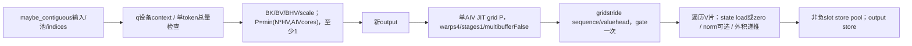
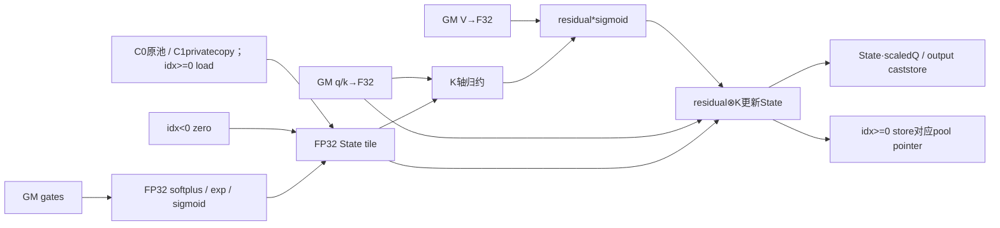
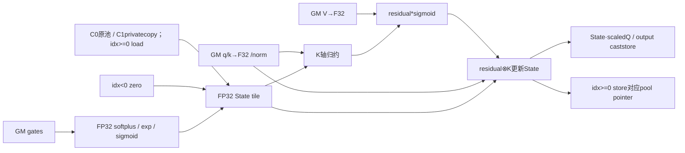

# 融合 GDN 单 token 递推 950 Direct Invoke 算子知识

## 算子速览

| 项目 | 内容 |
|---|---|
| 实际入口 | `sgl_kernel_npu.implementation.triton.attention.gdn.fused_gdn_decode.fused_sigmoid_gating_delta_rule_update_decode_npu`，Direct Invoke |
| 计算语义 | 单token：softplus衰减、sigmoid更新、可选Q/K L2norm、V×K状态外积递推与输出；选中非负槽原地写 |
| 输入输出 | q/k[B,T,H,K]低精，v[B,T,HV,V]，状态池[slots,HV,V,K]FP32；新output沿q.dtype；负槽零态不写，非连续池复制无回拷 |
| 执行类型 | 单JIT AIV_VECTOR：逐元素/归约/外积，没有tl.dot/AIC/Cube/MIX_CV；数学矩阵形式不改变VV分类 |
| Kernel 路线 | R001…R004=等/变长×QK norm；各族按池alias/拷贝与槽正负四子selector保留，共16种生命周期情形 |
| 核心资源 | BK=nextPOT(K)，BV=min(nextPOT(V),64)，FP32 state[BV,BK]逻辑域；1D programs按AIV数、gridstride序列/valuehead，全部V片由同program处理 |
| 来源闭包 | direct_implementation_closed：公开/Direct Host、29参数、完整Vector body、device_properties helper、打包与旧文件复用闭合 |
| 关键边界 | Q/K实际按同H寻址；无槽上界/冲突检测；masked q/k/state load未显式other0，BK>K时Kpadding进入norm/归约；VAR总token计数不验证每sequence长度1 |
| 验证状态 | 本次知识提取未执行编译、真机、数值或性能测试；draft不表示已完成数值/资源/状态并发安全验收 |

## 接口与语义

### 计算语义

每sequence n/value head hv，query/key头h=hv//(HV//H)。x=a+dt_bias，softplus选 beta*x≤threshold 时log(1+exp(beta*x))/beta，否则x；g=−exp(A_log)*softplus，d=exp(g)，update weight βout=1/(1+exp(−b))。FP32 state S[V,K]先衰减Sd=dS，residual r=(v−Σ_K Sd*k)*βout，S=Sd+r⊗k，o=Σ_K S*(q*scale)。state不是chunk路径K,V轴序，池内每value行K连续。

q/k由低精load转FP32；norm=True时分别除以sqrt(sum_K(q²))+1e−6，k同式，epsilon在sqrt后加，不是sqrt(sum+eps)或clamp(norm,eps)。q随后乘scale，k不乘scale。门控、norm、state残差/外积及归约均FP32表达式；pool为FP32写回，最终output转q.dtype；没有chunk状态路径的低精state投影/gatedD双cast。源码to未显式round参数。

正常decode每sequence恰1 token。非负槽读/写pool同slot/head，负槽从FP32零矩阵开始且不store pool，但输出仍计算。pool contiguous时修改调用方原Tensor；noncontiguous时Host .contiguous得到私有copy，kernel修改copy，函数只返回output、无copyback或新state返回，不能期待原pool变。此差异属于该入口实际生命周期，不另造functional状态输出。

softplus的tl.where是值选择，源码仍包含exp(beta*x)计算，不能把阈值选线性推成所有中间exp都不计算/绝不溢出。所有mask load没有显式other=0；K<BK时padding lane可进入norm及两个K归约，零值不保证。V尾的无效行不跨V归约，只masked store，不能将K padding风险泛化为所有Vtail。

### 输入、输出与属性

| 参数 | shape/layout | dtype | 约束、默认值与语义 |
|---|---|---|---|
| A_log | [HV] | FP32 | 每valuehead log decay；shape/device未完整Host校验 |
| a | [N,HV] | q.dtype | softplus gate，正常bos=n时匹配 |
| dt_bias | [HV] | FP32 | 每head偏置 |
| softplus_beta | scalar | float | 公开>0；Host无显式positive assert |
| softplus_threshold | scalar | float | beta*x≤threshold指数支，否则线性；无finite检查 |
| q | [B,T,H,K] | FP16/BF16 | fixed T1；packed B1且eachlen1；Host必要时contiguous |
| k | [B,T,H,K]实际合同 | FP16/BF16 | kernel用q的H/stride，未实现较小Hg key扩展；文档表Hg冲突见入口章节 |
| v | [B,T,HV,V] | q.dtype | HV%H0由caller保证；output由q shape/dtype分配 |
| b | [N,HV] | q.dtype | sigmoid输入 |
| initial_state_source | [slots,HV,V,K] | FP32 | 必需Tensor，contiguous别名写回；否则copy不回拷 |
| initial_state_indices | [N]连续 | I32/I64 | 负值零态不写；非负必须有效；同slot并发需caller协调 |
| scale | float或None | — | None取K^-0.5，给定时assert>0 |
| use_qk_l2norm_in_kernel | bool | — | 默认False，constexpr |
| cu_seqlens | [N+1]或None | I32/I64 | packed B1/从0起每差1；Host只检查q.T==N，不逐值读取 |
| output | [B,T,HV,V] | q.dtype | 新Tensor，只返回此对象；pool更新副作用按子selector |

### 入口与版本

公开wrapper懒导入当前Direct，auto/triton同实现无参考fallback；wrapper注释和kernel都用Q/K相同H。公开API表较小Hg不能当当前已实现分组key扩展：p_k=(bos*H+h)*K，与q同stride，Hk<H可能跨头/跨sequence错误寻址或越界。已阅读全文的[decode API](../../../../apis/sgl_kernel_npu/sgl_fused_gdn_decode.md)已经限定同H/池alias/负槽合同，本卡普通链接复用而不重复新建API。[独立gate API](../../../../apis/sgl_kernel_npu/sgl_gdn_gating.md)属于extend门控，不作为本decode自动前驱。

旧fla/fused_sigmoid_gating_recurrent_decode_optimized.py与当前实现整个文件逐字相同，包含imports、Host、JIT decorators/body与device_properties依赖；直接在当前卡记录旧路径映射，不重复建旧Operator。公开产品表arch22/arch35支持，README/generation映射平台，Frontmatter固定范围；CANN9.1.0为配置依据，非运行声明。

## Host/Launcher 执行流程

### 参数校验与前处理

Direct依次对A_log/a/dt_bias/q/k/v/b/pool/indices执行_maybe_contiguous，cu非空也处理；已连续直接返回原Tensor，否则copy。pool和indices必需，None会在is_contiguous调用前处理失败，所以heuristics USE_INITIAL_STATE=false没有正常Host producer。没有完整dtype/device/rank/shape/head整除/slotbounds/length值校验，不把文档合同说成已执行guard。

进入torch.npu.device(q.device.index)后，从q/v取B,T,H,K/HV,V，N为B或len(cu)−1。equal强制T=1；varlen只强制Ttotal==N，没有assertB1或读cu验证每差1。因此raw cu=[0,2,2]等总量可通过但不符合单token合同；body会对多token复用首token门控，并以pool偏移idx+i读写不同状态位置，不升级成多tokenrecurrent支持。empty序列也不在公开有效域。

BK=nextPOT(K)，BV=min(nextPOT(V),64)，NK=ceil(K/BK)assert1（K正时由构造满足），NV=ceil(V/BV)。scale=None取K^-0.5，否则assert scale>0。BHV1、NHV=HV、OVERSUB1。o=q.new_empty(B,T,HV,V)。get_device_properties需AIC/AIV数都>0，但只vector数用于grid；没有Cube执行节点。

### 参数、Workspace 与生命周期

o bytes=B*T*HV*V*sQ，是新返回Tensor；q/k/v/a/b/A_log/dt_bias/indices/cu的非连续copy只作为只读输入准备。pool contiguous时data_ptr别名调用方原pool，read/write同slice；pool非连续时新copy bytes=slots*HV*V*K*4，局部owner不返回/不回拷，输出可变但原pool不能期望更新。所有临时copy/输入/pool/output需遵守currentstream与Torch allocator异步存活，函数返回不代表Device完成，source无自有record_event/显式free。

没有自有system/user workspace、GM归约临时、ACLNN executor或跨kernel状态交接。每program自行处理sequence/hv的全部V片，FP32 tile state在读→更新→store内使用。连续pool同非负slot/head由多个请求并发写会冲突；若g_idx映到不同pid，source无atomic/锁/event进行序列化。映到同pid时按gridstride顺序执行，但仍共享更新后的state，不能当独立请求初态。负槽kernel不读写其slot；Host必要的contiguous copy仍可能复制整个pool，Kpadding其它风险也不会因此消除。

get_device_properties()用无参数@cache缓存首次当前device的AIC/AIV数，未按device key；当前调用切q设备后仍可能复用旧数量。gridstride逻辑仍由P程序覆盖任务，不推断必然数值故障；不能宣称缓存跨设备总是当前资源数。

### 启动图与失败传播



P=max(1,min(N*NHV,num_vectorcore*OVERSUB))，BHV1/NHVHV/OVERSUB1；Device按g_idx=pid;g_idx<N*NHV;g_idx+=P重放任务。Kernel source包含time循环，但public只one-token；不能因循环存在放宽数学目标。Python/JIT异常不捕获；异步Device错误依runtime后续同步，无safe fallback。全部核心node只有Vector归约/外积，无dot/Cube/MIX_CV，使用VV。
## Route 与参数设计

### 分核与资源计算

Host BK=nextPOT(K)，BV=min(nextPOT(V),64)，BHV1、NHVHV，NV=ceil(V/BV)。P=max(1,min(N*HV,vectorcorecount))，gridstride每g_idx唯一映射n=g_idx//HV、hv=g_idx%HV、h=hv//(HV//H)。同任务所有NV片均由同program串行处理，无V分片跨program归约。每V片state shape[BV,BK]F32、extent4BV*BK逻辑字节；q/k各4BK、v/residual/output各4BV逻辑字节。P是program数不是AIV线程数，warps4/stages1/multibufferFalse不等于自有硬件buffer depth。

pool地址为idx*HV*V*K+hv*V*K+vrow*K+kcol，明确V行/K列。output=(bos*HV+hv)*V+vrow；q/k=(bos*H+h)*K+kcol。q/k load和可选norm位于V片/time循环内，虽pointer先设，仍会每V片重新计算，不宣称只normalize一次。门控scalar则在V循环前每n/hv一次计算，合法one-token时恰好对应该token。

B/T/H/HV/K/V正值、HV%H0、Q/K同H、slot范围/无冲突为caller合同，Host无完整guard。K<BK时masked load未显式other0，K归约读整个BK；K==BK时无此Kpadding子域。Vtail无效行不参与其它有效V行归约，maskstore控制输出/池写域。logical4BV*BK不冒充physicalUB上界；无K资源容量fallback。

### Route 选择

P=本卡平台、q/k同H且低精、v/a/b按q.dtype、A_log/dt_bias/pool FP32、必要Tensor同NPU/shape一致、N/K/V/H/HV正且HV%H0、state slot合法或负、softplus_beta>0；scale None或正。连续输入由Host必要时copy。equal T1由Host检查；VAR要求B1/cu每sequence一token且[0,…,N]连续边界，这个逐值条件Host不验证。P中caller合同不冒充已执行guard。

| 顺序 | Route | Key/模板 | 精确选择条件与优先级 | 不适用去向 |
|---:|---|---|---|---|
| 1 | R-001 等长单token原始QK递推 | VAR0/NORM0，BHV1/OVERSUB1/USE_INITIAL1 | P；cuNone、HostT1；use_qk_l2norm=false；池alias/slot sign逐子表 | 其它合法族按行；poolNone/invalidshape等prelaunch或caller失约，无fallback |
| 2 | R-002 等长单tokenQK归一化递推 | VAR0/NORM1，BHV1/OVERSUB1/USE_INITIAL1 | P；cuNone、HostT1；use_qk_l2norm=true；池alias/slot sign逐子表 | 其它合法族按行；poolNone/invalidshape等prelaunch或caller失约，无fallback |
| 3 | R-003 变长单token原始QK递推 | VAR1/NORM0，BHV1/OVERSUB1/USE_INITIAL1 | P；cu非空、B1/eachlen1且HostT=N；use_qk_l2norm=false；池alias/slot sign逐子表 | 其它合法族按行；poolNone/invalidshape等prelaunch或caller失约，无fallback |
| 4 | R-004 变长单tokenQK归一化递推 | VAR1/NORM1，BHV1/OVERSUB1/USE_INITIAL1 | P；cu非空、B1/eachlen1且HostT=N；use_qk_l2norm=true；池alias/slot sign逐子表 | 其它合法族按行；poolNone/invalidshape等prelaunch或caller失约，无fallback |

```text
必要Tensor_maybe_contiguous（poolNone不能到USE_INITIAL0）
q device context；equal requireT1；VAR requireTtotal==N，caller另保证B1/eachlen1
BK=nextPOTK；BV=min(nextPOTV,64)；NKassert1；scale默认或positive assert
P按AIV数，BHV1/NHVHV/OVERSUB1
选择VAR×NORM四族
子selector：pool原连续/复制 × idx>=0/idx<0
负slot：F32zero、无poolstore；正slot：读写本pointer对应pool
```

### 模板/实现执行矩阵

| Route | key/selector | dtype/shape/platform 完整命中条件 | 执行拓扑与 Kernel 节点 | 实际模板/body | 内存与同步特征 | tail/fallback |
|---|---|---|---|---|---|---|
| R-001 等长单token原始QK递推 | VAR0/NORM0×4生命周期子selector | P及选择行；dq/dk∈FP16/BF16，poolF32，indices/cuI32/I64 | 单JIT AIV_VECTOR，无dot/Cube | _fused_sigmoid_gating_delta_rule_update_decode_kernel；BK/P/BV上述producer，USE_INITIAL1 | state4BV*BK逻辑域，所有V片本program，pool正负读写/alias逐表 | K<BK maskedpadding未显式0；Vtail独立；raw多token不支持 |
| R-002 等长单tokenQK归一化递推 | VAR0/NORM1×4生命周期子selector | P及选择行；dq/dk∈FP16/BF16，poolF32，indices/cuI32/I64 | 单JIT AIV_VECTOR，无dot/Cube | _fused_sigmoid_gating_delta_rule_update_decode_kernel；BK/P/BV上述producer，USE_INITIAL1 | state4BV*BK逻辑域，所有V片本program，pool正负读写/alias逐表 | K<BK maskedpadding未显式0；Vtail独立；raw多token不支持 |
| R-003 变长单token原始QK递推 | VAR1/NORM0×4生命周期子selector | P及选择行；dq/dk∈FP16/BF16，poolF32，indices/cuI32/I64 | 单JIT AIV_VECTOR，无dot/Cube | _fused_sigmoid_gating_delta_rule_update_decode_kernel；BK/P/BV上述producer，USE_INITIAL1 | state4BV*BK逻辑域，所有V片本program，pool正负读写/alias逐表 | K<BK maskedpadding未显式0；Vtail独立；raw多token不支持 |
| R-004 变长单tokenQK归一化递推 | VAR1/NORM1×4生命周期子selector | P及选择行；dq/dk∈FP16/BF16，poolF32，indices/cuI32/I64 | 单JIT AIV_VECTOR，无dot/Cube | _fused_sigmoid_gating_delta_rule_update_decode_kernel；BK/P/BV上述producer，USE_INITIAL1 | state4BV*BK逻辑域，所有V片本program，pool正负读写/alias逐表 | K<BK maskedpadding未显式0；Vtail独立；raw多token不支持 |

dq/dk分别为实际Q/K低精type；q/a/b/v按公开合同，所有load转F32。indices可I32/I64，poolpointer typeF32，outputtype=dq。scale默认/自定义只改变同scalar数据producer，不改参数布局/节点图；slot sign为runtime分支，poolcopy为Host alias差异，分别在每族四行保留。没有USE_INITIAL0正常producer，也没有外部state update数学kernel。

### 隐藏性能 Guard

| Guard | Host/Tiling 条件 | Device/资源原因 | 影响 Route | 不满足时去向 | 源码符号 |
|---|---|---|---|---|---|
| 单token | equal显式T1；VAR只显式Ttotal==N | gate在time loop外一次、pool按idx+i偏移 | 全部 | Host拒总体不符；per-seq长度caller，raw异常不提升支持 | Direct/time loop |
| Q/K头合同 | wrapper注释/实际body同H；Host不查Hg | p_k与q同H stride，无分组扩展 | 全部 | 较少k头错误寻址/可能越界 | p_q/p_k |
| HV%H0 | caller，Host未assert | h=hv//(HV//H) | 全部 | 非整除/分母0等失约，不可靠 | i_h |
| Ktile | BKnextPOTK、NKassert1 | K被完整向上pad；norm/投影归约跨BK | 全部 | 无资源fallback；Kpad未显式zero | mask_k/loads/reduce |
| Vtile | BV=min(nextPOTV,64) | 每片至多64V行，NV loop | 全部 | maskV写域；无跨V归约 | i_v/mask_h |
| pool必需 | _maybe_contiguous无条件 | USE_INITIAL由必需Tensor非None得到 | 全部 | None前处理AttributeError，无zero-pool路线 | Direct/heuristics |
| 槽sign/upper | runtime idx>=0，未传slots容量 | 非负load/store，负zero不写 | 全部 | 上界caller保证；同slot冲突无atomic | p_h0/idxguard |
| poolalias | contiguous直接alias；非连续copy | in-place副作用只作用实际pointer | 全部 | 无copyback，原非连续池不更新 | _maybe_contiguous |
| scalar数值 | scale给定>0显式assert；softbeta>0仅doc | 1/beta、exp/log/sqrt | 全部 | 非finite/overflow无保护，阈值不是全中间exp短路 | gate |
| 设备资源 | helperassert AIC/AIV均>0，@cache无devicekey | P只用vectorcore，gridstride覆盖任务 | 全部 | helper失败Host异常；跨设备数缓存可能旧 | get_device_properties |
| 物理容量 | 无source UB上界检查 | BV*BK state和norm/reduce局部域 | 全部 | compiler资源未验证，不凭stages1造界限 | JIToptions |

### POD/ABI

无C POD/固定sizeof/offsetof，以下29个Python→JIT typed参数逐字段列出。runtime scalar/指针pack的物理offset与整型宽度由compiler生成，固定Python未证明；constexpr不在GM wire。T/N/NHV标记do_not_specialize。Device未读B/OVERSUB当前值，Host使用它们确定shape/grid。

| 结构 | 字段 | 类型/位宽 | ABI 布局 | 单位 | Host/launcher producer | Device consumer | 边界 |
|---|---|---|---|---|---|---|---|
| JIT args | A_log | F32 GM pointer | slot0；物理offset不可见 | head | _maybe_contiguous(A_log) | gate logdecay | HV |
| JIT args | a | dq GM pointer | slot1；物理offset不可见 | token/head | _maybe_contiguous(a) | gate bos*HV+hv | 正常one-token bos=n |
| JIT args | dt_bias | F32 GM pointer | slot2；物理offset不可见 | head | contiguous bias | gate add | HV |
| JIT args | softplus_beta | float scalar | slot3；物理offset不可见 | slope | caller | softplus beta*x和1/beta | public>0无Hostguard |
| JIT args | softplus_threshold | float scalar | slot4；物理offset不可见 | threshold | caller | beta*x<=threshold select | 非短路保证 |
| JIT args | q | dq GM pointer | slot5；物理offset不可见 | 元素 | maybe_contiguous q | Q load/norm/scale | H,K stride |
| JIT args | k | dk GM pointer | slot6；物理offset不可见 | 元素 | maybe_contiguous k | K load/norm | 实际同q H |
| JIT args | v | dq GM pointer | slot7；物理offset不可见 | 元素 | maybe_contiguous v | residual U load | HV,V |
| JIT args | b | dq GM pointer | slot8；物理offset不可见 | token/head | maybe_contiguous b | sigmoid | bos*HV+hv |
| JIT args | o | dq GM pointer | slot9；物理offset不可见 | 元素 | q.new_empty(B,T,HV,V) | output store | 新返回Tensor |
| JIT args | h0_source | F32 GM pointer | slot10；物理offset不可见 | 元素 | maybe_contiguous pool | signguard load/store | alias/copy分开 |
| JIT args | h0_indices | I32/I64 GM pointer | slot11；物理offset不可见 | slot | maybe_contiguous indices | idx=load[n] | 无upperguard |
| JIT args | cu_seqlens | I32/I64 pointer或None | slot12；物理offset不可见 | token | maybe_contiguous cu | bos/eos.toI64，t_len.toI32 | VAR |
| JIT args | scale | float scalar | slot13；物理offset不可见 | query倍率 | None?K^-0.5:positive user | norm后q乘 | default/自定义 |
| JIT args | T | runtime int | slot14，宽度compiler；物理offset不可见 | token | q.shape1 | fixedbos=n*T/t_len=T | do_not_specialize |
| JIT args | N | runtime int | slot15，宽度compiler；物理offset不可见 | sequence | cuNone?B:len(cu)-1 | total_tiles=N*NHV | do_not_specialize |
| JIT args | NHV | runtime int | slot16，宽度compiler；物理offset不可见 | headtile/seq | HV（BHV1） | g_idx到n/hv mapping | do_not_specialize |
| JIT args | B | constexpr int | compile；物理offset不可见 | batch | q.shape0 | 当前Device未读 | Hostoutputshape/normalN |
| JIT args | H | constexpr int | compile；物理offset不可见 | query/keyhead | q.shape2 | q/k stride与hv映射 | k不能少头 |
| JIT args | HV | constexpr int | compile；物理offset不可见 | valuehead | v.shape2 | gates/pool/valuestride | HV%H合同 |
| JIT args | K | constexpr int | compile；物理offset不可见 | keydim | q.shape3 | mask/stride/statecols | 正 |
| JIT args | V | constexpr int | compile；物理offset不可见 | valuedim | v.shape3 | NV/mask/poolrows | 正 |
| JIT args | BK | constexpr int | compile；物理offset不可见 | padded K | nextPOTK | arangeK/reduce/statecols | K<BK填充值未保证 |
| JIT args | BV | constexpr int | compile；物理offset不可见 | Vtile | min(nextPOTV,64) | arangeV/state rows | NV loop |
| JIT args | BHV | constexpr int | compile；物理offset不可见 | hv/task | 1 | static_range0..1 | 恰一个valuehead |
| JIT args | OVERSUB | constexpr int | compile；物理offset不可见 | grid因子 | 1 | Device当前未读 | Host P用 |
| JIT args | USE_INITIAL_STATE | constexpr bool | heuristics；物理offset不可见 | bool | pool!=None | idx/state sign分支 | 正常Host恒1 |
| JIT args | IS_VARLEN | constexpr bool | heuristics；物理offset不可见 | bool | cu!=None | bos/eos/time分支 | 不验证每长度1 |
| JIT args | USE_QK_L2NORM_IN_KERNEL | constexpr bool | compile；物理offset不可见 | norm | 用户flag | q/k sum/sqrt+eps | 两族 |

无slots-capacity、poolstride或inputstride POD，Device无法从这些参数自检slot上界/非标准布局；Host contiguous是address合同。cu bos/eos显式toI64、t_len再I32；idx沿原I32/I64，source没有显式把全部pooloffset扩成64位的自有ABI承诺，不伪造大pool乘法安全保证。

### Route 源码闭包

| Route | Key/selector | Host/Tiling producer | POD/参数 | Kernel entry/router 节点 | Kernel body/直接依赖 | 构建接线 |
|---|---|---|---|---|---|---|
| R-001及4生命周期子selector | VAR0/NORM0，slot/copy | Direct maybe_contiguous/T/N/BK/BV/P/scale | 29typed/constexpr参数，无C POD | _decode_kernel[gridP] | gridstride n/hv→gate→NVtile→state signload/zero→norm0→Vector outer/reduce→pool/outputstore | root setup→stage_runtime共同Python→triton.jit；get_device_properties当前helper |
| R-002及4生命周期子selector | VAR0/NORM1，slot/copy | Direct maybe_contiguous/T/N/BK/BV/P/scale | 29typed/constexpr参数，无C POD | _decode_kernel[gridP] | gridstride n/hv→gate→NVtile→state signload/zero→norm1→Vector outer/reduce→pool/outputstore | root setup→stage_runtime共同Python→triton.jit；get_device_properties当前helper |
| R-003及4生命周期子selector | VAR1/NORM0，slot/copy | Direct maybe_contiguous/T/N/BK/BV/P/scale | 29typed/constexpr参数，无C POD | _decode_kernel[gridP] | gridstride n/hv→gate→NVtile→state signload/zero→norm0→Vector outer/reduce→pool/outputstore | root setup→stage_runtime共同Python→triton.jit；get_device_properties当前helper |
| R-004及4生命周期子selector | VAR1/NORM1，slot/copy | Direct maybe_contiguous/T/N/BK/BV/P/scale | 29typed/constexpr参数，无C POD | _decode_kernel[gridP] | gridstride n/hv→gate→NVtile→state signload/zero→norm1→Vector outer/reduce→pool/outputstore | root setup→stage_runtime共同Python→triton.jit；get_device_properties当前helper |

## Kernel 实现

### 公共执行流程

pid步长P遍历N*NHV任务，每任务n/hv唯一；BHV1静态内循环一次，h=hv//(HV//H)。合法fixed/packed都t_len1，gate在V/time循环外计算一次。NV各片由本program串行，q/k每片load、norm可选，state按slot sign选择pool或zero，逐元素衰减/外积与K轴归约得到residual/output。正slot写pool，所有slot写output。

masked loads没有显式other=0；K<BK时norm及两个Kreduce的padding不保证初始化。Vtail行独立、无跨V归约，storemask保护其有效域。compiler负责内部Vector reduction树/UB/register/同步，源码无ownedQueue/TBuf/InitBuffer、数字flag或Cube primitive；不造physical buffer报告。
### Route R-001：等长单token原始QK递推

#### 适用条件

##### 选择证据

| 层级 | 文件 | 符号 | 源码谓词/参数 | 结果/下一跳 |
|---|---|---|---|---|
| public合同 | docs/operators / operators/attention/gdn/fused_gdn_decode.py | public wrapper | P，Q/K同H，V,K池；T1 | Direct |
| Host | implementation/triton/attention/gdn/fused_gdn_decode.py | Direct | VAR0，NORM=false；pool/index必需 | contiguous准备、BK/BV/P、output |
| JIT | 同文件 | _decode_kernel/heuristics | USE_INITIAL1，VAR0，USE_QK_L2NORM0 | 单AIV gridstride；slot runtime sign |
| owner/sign | _maybe_contiguous / idx if | alias/copy / idx>=0 | 四精确子selector如下 | 不合并pool原tensor副作用差异 |

C=1表示原pool非连续而复制，C=0表示原连续直接alias；Z=1表示该sequence idx<0，Z=0表示合法非负slot。每族保留四个子selector，不把private copy当原池写回，不把负slot当输入poolNone。

| 精确子selector | C/Z | Host pool pointer/owner | Kernel state producer | Kernel pool writer | 调用方原pool效果 | 输出/同步边界 |
|---|---|---|---|---|---|---|
| R-001.S00 | 0/0 | 原contiguous pool alias，调用方owner | mask_h load选中slot→F32 | idx>=0 guard内同slot/head/V片store | 正常非负slot原地修改 | 新output；重复slot跨program可能冲突，无atomic |
| R-001.S01 | 0/1 | 原contiguous pool alias，调用方owner | F32 zero[BV,BK]，不load该slot | 无poolstore | 此kernel不写原pool | 新output；负slot无pool数据依赖，但Kpad风险仍在 |
| R-001.S10 | 1/0 | 整pool contiguous copy，新局部Tensor/4slotsHVVK B | mask_h load选中slot→F32 | idx>=0 guard内同slot/head/V片store | 无copyback，不保证/不执行原pool回写 | 新output；重复slot跨program可能冲突，无atomic；负slot也不省Host整池copy |
| R-001.S11 | 1/1 | 整pool contiguous copy，新局部Tensor/4slotsHVVK B | F32 zero[BV,BK]，不load该slot | 无poolstore | 无copyback，不保证/不执行原pool回写 | 新output；负slot无pool数据依赖，但Kpad风险仍在；负slot也不省Host整池copy |

上界/唯一性由caller保证，Device没有slots字段可检查。负slot时仅kernel不读写选中槽，不表示Hostcopy分支不读取整个原pool。四子selector共享29参数结构、typedstate extent/Vector顺序/尾策略，owner/GM读写差异逐行保留。

#### Device 数据流

##### 函数级调用链

```text
Direct -> _maybe_contiguous所有必要输入（池alias/copy）
 -> q设备context / T1检查
 -> BKnextPOTK / BVmin(POTV,64) / scale / P / newoutput
 -> _decode_kernel[gridP](warps4,stages1,multibufferFalse)
    -> for g_idx=pid;g_idx<N*HV;g_idx+=P
       -> n/hv/h mapping / bos=n*T，t_len=T
       -> softplus/logdecay/decay/sigmoid每n/hv一次
       -> for Vtile:
          -> idx load / p_h0 pointer
          -> for token（公开域恰1）:
             -> q/k/v maskedload→F32
             -> idx>=0 ? poolload : zeros
             -> 无norm
             -> q*scale / state decay / residual Ksum / beta / outer update / output Ksum
             -> idx>=0 poolstore / outputstore
```

##### 源码等价伪码

```text
源码等价伪码，offset单位元素；C/Z按当前精确子selector
P=max(1,min(N*HV,vectorcores));BK=nextPOTK;BV=min(nextPOTV,64)
for gidx=pid;gidx<N*HV;gidx+=P:
    n=gidx//HV;hv=gidx%HV;h=hv//(HV//H)
    bos=n*T;L=T #公开每L1
    x=load(a[bos*HV+hv]).toF32+load(dt_bias[hv]).toF32
    bx=softplus_beta*x
    sp=where(bx<=threshold,log(1+exp(bx))/softplus_beta,x)
    decay=exp(-exp(load(A_log[hv]).toF32)*sp)
    upd=1/(1+exp(-load(b[bos*HV+hv]).toF32))
    pq=q+(bos*H+h)*K+arangeBK;pk=k+(bos*H+h)*K+arangeBK
    for iv in0..ceil(V/BV)-1:
        rows=iv*BV+arangeBV;maskV=rows<V;maskK=arangeBK<K
        idx=load(indices[n]);ph=pool+idx*HV*V*K+hv*V*K+rows[:,None]*K+arangeBK[None,:]
        for i in0..L-1:
            Q=load(pq+i*H*K,maskK).toF32
            Kvec=load(pk+i*H*K,maskK).toF32
            Val=load(v+(bos*HV+hv)*V+rows+i*HV*V,maskV).toF32
            State=idx>=0?load(ph+i*HV*V*K,maskV[:,None]&&maskK).toF32:
                            zeros[BV,BK]F32
            #所有上述masked load均未显式other0
            无归一化
            Q*=scale
            State*=decay
            Residual=(Val-sum_BK(State*Kvec[None,:],axis1))*upd
            State+=Kvec[None,:]*Residual[:,None]
            Out=sum_BK(State*Q[None,:],axis1)
            if idx>=0:store(ph+i*HV*V*K,State.to(pooldtype),maskV[:,None]&&maskK)
            store(o+(bos*HV+hv)*V+rows+i*HV*V,Out.to(qdtype),maskV)
```

即使norm关闭，两个state·K/Q的K轴归约仍跨BK，Kpadding零值也不保证。 time循环不证明多token递推支持：多token时gate只首token、state按idx+i偏移，不是把同slot连续更新；VAR仅总量检查无法替代cu逐差1合同。q/k load/norm仍在Vtile内重复，gate scalar才在外。

#### 内存与数据搬运

##### 资源与搬运表

| 层级/缓冲区 | offset/地址公式 | extent/容量公式 | dtype/layout | producer | consumer | owner/lifetime | 对齐/复用 |
|---|---|---|---|---|---|---|---|
| GM q/k | (bos*H+h)*K+kcol+i*H*K | 各2BTHK B合同 | dq/dk contiguous | _maybe_contiguous/caller | Q/Kload/norm | input或copy owner | 实际同H；无较小Hg扩展 |
| GM v/a/b | v:(bosHV+hv)*V+row；a/b:bosHV+hv | v2BTHVV；a/b各2NHV B | qdtype | maybe_contiguous | gate/residual | readonly或copy | Vtail mask，gate每task一次 |
| GM A_log/bias | hv | 各4HV B | F32 | maybe_contiguous | softplus/decay | readonly/copy | scalarload无mask，HVshape caller |
| GM pool | idx*HV*VK+hv*VK+vrow*K+kcol | 4slotsHVVK B；C1另分同量copy | F32 V,K | caller或privatecopy | 正idx state load/store | C0caller alias；C1局部copy无回拷 | 负idx不kernelload/store；上界未校验 |
| GM indices/cu | indices[n]；cu[n/n+1] | N*sIdx、(N+1)*sCu输入，可copy | I32/I64 | maybe_contiguous | mapping/state sign | input/copy | cu toI64/lenI32，idx原type |
| GM output | (bosHV+hv)*V+row+i*HV*V | 2BTHVV B | qdtype | updatedState Ksum | caller | 新Tensor | maskV；valid每sequence1token |
| UB/register State | compiler local [BV,BK] | 4BV*BK B逻辑域 | F32 | 正slot load或negativezero | decay/outer/Ksum/store | 每Vtile | 缺K/Vlane未显式other0；只validV写出 |
| UB/register Q/K | 两[BK] | 各4BK B逻辑域 | F32 | load | residual/output Ksum | 每Vtile/token | K<BK pad可影响归约 |
| UB/register V/R/O | [BV] | 各4BV B逻辑域 | F32 | load/sub/sum/update | outer/outputstore | 每片 | 不跨V归约，Vtail不泛化K风险 |
| scalar gates | A/a/bias/b,x,bx,sp,decay,upd | compiler scalar widths/寄存器数不可见 | F32 | loads/exp/log | 该task全部V片 | n/hv lifetime | 不是独立GM中间 |
| TQue/TBuf/物理UB布局 | N/A owned | 没有InitBuffer/自有队列depth | compiler managed locals | TLprimitives | compiler lowering | program | 不造buffer offset/register报告 |
| Cube/L1/L0 | N/A | 无dot/Cube节点 | N/A | N/A | N/A | N/A | 不补Cube资源 |
| workspace/dynamicUB/window | N/A | 0 ownedworkspace，无SIMT/通信介质 | N/A | N/A | N/A | runtime | 不套系统16MiB |

##### 分层内存布局

owned AIV UB `block-beta` 布局N/A：固定Python没有自有InitBuffer子区，实际位置/寄存器spill由compiler决定。只画真实Vector数据流，不以logicaltensor冒充硬件buffer分配。



##### 字节账与复用顺序

```text
output_bytes=B*T*HV*V*2
pool_input_bytes=slots*HV*V*K*4
pool_copy_new_bytes=C*slots*HV*V*K*4
其它readonly非连续输入按_maybe_contiguous可各新增原numel*element_size；已连续alias不加
owned_workspace_total=0；dynamic_ub=N/A（非SIMT）
State_domain=4*BV*BK；Q/K_domain各4*BK；V/R/O_domain各4*BV
physical_UB_peak/registers=compiler layout/reuse/padding/spill，未编译取得
```

| 复用子区 | 写入者 | 读取者/消费点 | 下一次覆盖 | 同步或释放依据 | 安全条件 |
|---|---|---|---|---|---|
| Host pool pointer | C0原Tensor/C1 contiguouscopy | 正idx load/store | 当前/下次调用 | Torch currentstream/owner | C1无回拷；不能从output返回推state原池已变 |
| gate scalars | softplus/exp/sigmoid | 全Vtile state/residual | 下一gidx | TL依赖 | 单token合同，raw多token不重算gate |
| state tile | poolload/negativezero→decay/outer | residual/output Ksum及poolstore | 下一Vtile/token | compiler数据依赖 | 正slot并发冲突caller协调，negative no store |
| Q/K vectors | maskedload/norm | 两个Ksum/outer | 每Vtile重载 | compiler Vectorpipeline | Kpadding未显式0，norm开关分别记录 |
| pool slice | idx>=0 state store | 后续同slot调用 | 外部有序更新 | 无ownedatomic/锁/event | 相同slot/head跨pid缺ordering，不保证并发安全 |
| GM output | 当前task validV store | caller | 后续外部写 | runtime allocator/stream | 合法cu每len1、shape/head映射避免重叠 |

两个sequence同idx且同hv时，gidx差为Δn*HV；若该差%P≠0则映到不同pid，可能并发读写同pool slice而无源码同步；映到同pid虽串行，也使用共享更新后state，不能当独立初态。负slot没有这条pool写冲突，C1冲突作用于privatecopy但也可能影响output。

#### 同步、精度与尾块

##### 同步与数值边界表

| 阶段 | primitive/机制 | producer | consumer/等待点 | 保护对象 | 精度/尾块 |
|---|---|---|---|---|---|
| Host contiguous | identity或copy | input/pool | JIT | 指针layout | 不做copyback；poolNone前处理失败 |
| gating | FP32 exp/log/where/sigmoid | scalarinputs | State/Residual | task scalars | beta*x<=threshold，select不保证exp短路；beta>0caller |
| state sign | idx>=0 load/store，idx<0 zeros | pool/constant | State | BV*BK | maskedload未显式other0，negativezero是明确F32zero |
| QK norm | N/A | F32 q/k | recurrence | BK vectors | 关闭norm仍有K归约padding边界 |
| recurrence | mul/sub/sum(axis1)/outer | F32 State/Q/K/V | nextState/output | 每V行 | 无tl.dot，无低精中间statecast |
| pool write | signguard maskedstore | F32 updatedState | poolpointer | validV×K | C0原池/C1copy，slot范围/并发caller负责 |
| output | sumBK→to(qdtype)→maskVstore | State/scaledQ | newoutput | validV | 无显式round；不跨Vreduce |
| time/metadata | HostT1 | Host/caller | loop | 单token | VAR只总量检查，每差1未验证；不支持多token |
| 内部同步 | TL/compiler Vector依赖 | 当前operation | 后继operation | 私有locals | 无ownedflag/atomic/跨kernel边 |
| resource cache | 无参数get_device_properties @cache | 首device属性 | Host P | gridstride | 不按devicekey，不能宣称总当前corecount |

#### 关键实现

##### 符号证据表

| 阶段 | 文件 | 符号/模板实例 | 实现事实 |
|---|---|---|---|
| Host/Tiling producer | implementation/triton/attention/gdn/fused_gdn_decode.py | Direct/_maybe_contiguous | alias/copy、T1、BK/BV/P/scale |
| Kernel entry/router | 同文件 | _decode_kernel/heuristics | VAR0/NORM0/USE_INITIAL1；BHV1、OVERSUB1 |
| Device body/helper | 同文件 | gridstride/gate/NV/time/sign | Vector recurrence、VK pool、negativezero、positivewrite |
| Device body/helper | 同文件 | q/k/state maskedload / norm | 无显式other0；Kpad进入Ksum；Vtail独立 |
| Host helper | utils/triton_utils.py | get_device_properties | AIC/AIV assert、只vector数用于P、无参数cache |
| legacy映射 | fla/fused_sigmoid_gating_recurrent_decode_optimized.py | 全文件同名Host/JIT | imports/decorators/Host/body逐字相同，单一数学目标 |


### Route R-002：等长单tokenQK归一化递推

#### 适用条件

##### 选择证据

| 层级 | 文件 | 符号 | 源码谓词/参数 | 结果/下一跳 |
|---|---|---|---|---|
| public合同 | docs/operators / operators/attention/gdn/fused_gdn_decode.py | public wrapper | P，Q/K同H，V,K池；T1 | Direct |
| Host | implementation/triton/attention/gdn/fused_gdn_decode.py | Direct | VAR0，NORM=true；pool/index必需 | contiguous准备、BK/BV/P、output |
| JIT | 同文件 | _decode_kernel/heuristics | USE_INITIAL1，VAR0，USE_QK_L2NORM1 | 单AIV gridstride；slot runtime sign |
| owner/sign | _maybe_contiguous / idx if | alias/copy / idx>=0 | 四精确子selector如下 | 不合并pool原tensor副作用差异 |

C=1表示原pool非连续而复制，C=0表示原连续直接alias；Z=1表示该sequence idx<0，Z=0表示合法非负slot。每族保留四个子selector，不把private copy当原池写回，不把负slot当输入poolNone。

| 精确子selector | C/Z | Host pool pointer/owner | Kernel state producer | Kernel pool writer | 调用方原pool效果 | 输出/同步边界 |
|---|---|---|---|---|---|---|
| R-002.S00 | 0/0 | 原contiguous pool alias，调用方owner | mask_h load选中slot→F32 | idx>=0 guard内同slot/head/V片store | 正常非负slot原地修改 | 新output；重复slot跨program可能冲突，无atomic |
| R-002.S01 | 0/1 | 原contiguous pool alias，调用方owner | F32 zero[BV,BK]，不load该slot | 无poolstore | 此kernel不写原pool | 新output；负slot无pool数据依赖，但Kpad风险仍在 |
| R-002.S10 | 1/0 | 整pool contiguous copy，新局部Tensor/4slotsHVVK B | mask_h load选中slot→F32 | idx>=0 guard内同slot/head/V片store | 无copyback，不保证/不执行原pool回写 | 新output；重复slot跨program可能冲突，无atomic；负slot也不省Host整池copy |
| R-002.S11 | 1/1 | 整pool contiguous copy，新局部Tensor/4slotsHVVK B | F32 zero[BV,BK]，不load该slot | 无poolstore | 无copyback，不保证/不执行原pool回写 | 新output；负slot无pool数据依赖，但Kpad风险仍在；负slot也不省Host整池copy |

上界/唯一性由caller保证，Device没有slots字段可检查。负slot时仅kernel不读写选中槽，不表示Hostcopy分支不读取整个原pool。四子selector共享29参数结构、typedstate extent/Vector顺序/尾策略，owner/GM读写差异逐行保留。

#### Device 数据流

##### 函数级调用链

```text
Direct -> _maybe_contiguous所有必要输入（池alias/copy）
 -> q设备context / T1检查
 -> BKnextPOTK / BVmin(POTV,64) / scale / P / newoutput
 -> _decode_kernel[gridP](warps4,stages1,multibufferFalse)
    -> for g_idx=pid;g_idx<N*HV;g_idx+=P
       -> n/hv/h mapping / bos=n*T，t_len=T
       -> softplus/logdecay/decay/sigmoid每n/hv一次
       -> for Vtile:
          -> idx load / p_h0 pointer
          -> for token（公开域恰1）:
             -> q/k/v maskedload→F32
             -> idx>=0 ? poolload : zeros
             -> Q/K norm=sum BK→sqrt+1e-6→divide
             -> q*scale / state decay / residual Ksum / beta / outer update / output Ksum
             -> idx>=0 poolstore / outputstore
```

##### 源码等价伪码

```text
源码等价伪码，offset单位元素；C/Z按当前精确子selector
P=max(1,min(N*HV,vectorcores));BK=nextPOTK;BV=min(nextPOTV,64)
for gidx=pid;gidx<N*HV;gidx+=P:
    n=gidx//HV;hv=gidx%HV;h=hv//(HV//H)
    bos=n*T;L=T #公开每L1
    x=load(a[bos*HV+hv]).toF32+load(dt_bias[hv]).toF32
    bx=softplus_beta*x
    sp=where(bx<=threshold,log(1+exp(bx))/softplus_beta,x)
    decay=exp(-exp(load(A_log[hv]).toF32)*sp)
    upd=1/(1+exp(-load(b[bos*HV+hv]).toF32))
    pq=q+(bos*H+h)*K+arangeBK;pk=k+(bos*H+h)*K+arangeBK
    for iv in0..ceil(V/BV)-1:
        rows=iv*BV+arangeBV;maskV=rows<V;maskK=arangeBK<K
        idx=load(indices[n]);ph=pool+idx*HV*V*K+hv*V*K+rows[:,None]*K+arangeBK[None,:]
        for i in0..L-1:
            Q=load(pq+i*H*K,maskK).toF32
            Kvec=load(pk+i*H*K,maskK).toF32
            Val=load(v+(bos*HV+hv)*V+rows+i*HV*V,maskV).toF32
            State=idx>=0?load(ph+i*HV*V*K,maskV[:,None]&&maskK).toF32:
                            zeros[BV,BK]F32
            #所有上述masked load均未显式other0
            Q/=sqrt(sum_BK(Q*Q))+1e-6;Kvec/=sqrt(sum_BK(Kvec*Kvec))+1e-6
            Q*=scale
            State*=decay
            Residual=(Val-sum_BK(State*Kvec[None,:],axis1))*upd
            State+=Kvec[None,:]*Residual[:,None]
            Out=sum_BK(State*Q[None,:],axis1)
            if idx>=0:store(ph+i*HV*V*K,State.to(pooldtype),maskV[:,None]&&maskK)
            store(o+(bos*HV+hv)*V+rows+i*HV*V,Out.to(qdtype),maskV)
```

norm是sqrt(sum)+eps，maskK没有显式other0，K<BK会把未保证填充值纳入norm归约。 time循环不证明多token递推支持：多token时gate只首token、state按idx+i偏移，不是把同slot连续更新；VAR仅总量检查无法替代cu逐差1合同。q/k load/norm仍在Vtile内重复，gate scalar才在外。

#### 内存与数据搬运

##### 资源与搬运表

| 层级/缓冲区 | offset/地址公式 | extent/容量公式 | dtype/layout | producer | consumer | owner/lifetime | 对齐/复用 |
|---|---|---|---|---|---|---|---|
| GM q/k | (bos*H+h)*K+kcol+i*H*K | 各2BTHK B合同 | dq/dk contiguous | _maybe_contiguous/caller | Q/Kload/norm | input或copy owner | 实际同H；无较小Hg扩展 |
| GM v/a/b | v:(bosHV+hv)*V+row；a/b:bosHV+hv | v2BTHVV；a/b各2NHV B | qdtype | maybe_contiguous | gate/residual | readonly或copy | Vtail mask，gate每task一次 |
| GM A_log/bias | hv | 各4HV B | F32 | maybe_contiguous | softplus/decay | readonly/copy | scalarload无mask，HVshape caller |
| GM pool | idx*HV*VK+hv*VK+vrow*K+kcol | 4slotsHVVK B；C1另分同量copy | F32 V,K | caller或privatecopy | 正idx state load/store | C0caller alias；C1局部copy无回拷 | 负idx不kernelload/store；上界未校验 |
| GM indices/cu | indices[n]；cu[n/n+1] | N*sIdx、(N+1)*sCu输入，可copy | I32/I64 | maybe_contiguous | mapping/state sign | input/copy | cu toI64/lenI32，idx原type |
| GM output | (bosHV+hv)*V+row+i*HV*V | 2BTHVV B | qdtype | updatedState Ksum | caller | 新Tensor | maskV；valid每sequence1token |
| UB/register State | compiler local [BV,BK] | 4BV*BK B逻辑域 | F32 | 正slot load或negativezero | decay/outer/Ksum/store | 每Vtile | 缺K/Vlane未显式other0；只validV写出 |
| UB/register Q/K | 两[BK] | 各4BK B逻辑域 | F32 | load/norm | residual/output Ksum | 每Vtile/token | K<BK pad可影响归约 |
| UB/register V/R/O | [BV] | 各4BV B逻辑域 | F32 | load/sub/sum/update | outer/outputstore | 每片 | 不跨V归约，Vtail不泛化K风险 |
| scalar gates | A/a/bias/b,x,bx,sp,decay,upd | compiler scalar widths/寄存器数不可见 | F32 | loads/exp/log | 该task全部V片 | n/hv lifetime | 不是独立GM中间 |
| TQue/TBuf/物理UB布局 | N/A owned | 没有InitBuffer/自有队列depth | compiler managed locals | TLprimitives | compiler lowering | program | 不造buffer offset/register报告 |
| Cube/L1/L0 | N/A | 无dot/Cube节点 | N/A | N/A | N/A | N/A | 不补Cube资源 |
| workspace/dynamicUB/window | N/A | 0 ownedworkspace，无SIMT/通信介质 | N/A | N/A | N/A | runtime | 不套系统16MiB |

##### 分层内存布局

owned AIV UB `block-beta` 布局N/A：固定Python没有自有InitBuffer子区，实际位置/寄存器spill由compiler决定。只画真实Vector数据流，不以logicaltensor冒充硬件buffer分配。



##### 字节账与复用顺序

```text
output_bytes=B*T*HV*V*2
pool_input_bytes=slots*HV*V*K*4
pool_copy_new_bytes=C*slots*HV*V*K*4
其它readonly非连续输入按_maybe_contiguous可各新增原numel*element_size；已连续alias不加
owned_workspace_total=0；dynamic_ub=N/A（非SIMT）
State_domain=4*BV*BK；Q/K_domain各4*BK；V/R/O_domain各4*BV
physical_UB_peak/registers=compiler layout/reuse/padding/spill，未编译取得
```

| 复用子区 | 写入者 | 读取者/消费点 | 下一次覆盖 | 同步或释放依据 | 安全条件 |
|---|---|---|---|---|---|
| Host pool pointer | C0原Tensor/C1 contiguouscopy | 正idx load/store | 当前/下次调用 | Torch currentstream/owner | C1无回拷；不能从output返回推state原池已变 |
| gate scalars | softplus/exp/sigmoid | 全Vtile state/residual | 下一gidx | TL依赖 | 单token合同，raw多token不重算gate |
| state tile | poolload/negativezero→decay/outer | residual/output Ksum及poolstore | 下一Vtile/token | compiler数据依赖 | 正slot并发冲突caller协调，negative no store |
| Q/K vectors | maskedload/norm | 两个Ksum/outer | 每Vtile重载 | compiler Vectorpipeline | Kpadding未显式0，norm开关分别记录 |
| pool slice | idx>=0 state store | 后续同slot调用 | 外部有序更新 | 无ownedatomic/锁/event | 相同slot/head跨pid缺ordering，不保证并发安全 |
| GM output | 当前task validV store | caller | 后续外部写 | runtime allocator/stream | 合法cu每len1、shape/head映射避免重叠 |

两个sequence同idx且同hv时，gidx差为Δn*HV；若该差%P≠0则映到不同pid，可能并发读写同pool slice而无源码同步；映到同pid虽串行，也使用共享更新后state，不能当独立初态。负slot没有这条pool写冲突，C1冲突作用于privatecopy但也可能影响output。

#### 同步、精度与尾块

##### 同步与数值边界表

| 阶段 | primitive/机制 | producer | consumer/等待点 | 保护对象 | 精度/尾块 |
|---|---|---|---|---|---|
| Host contiguous | identity或copy | input/pool | JIT | 指针layout | 不做copyback；poolNone前处理失败 |
| gating | FP32 exp/log/where/sigmoid | scalarinputs | State/Residual | task scalars | beta*x<=threshold，select不保证exp短路；beta>0caller |
| state sign | idx>=0 load/store，idx<0 zeros | pool/constant | State | BV*BK | maskedload未显式other0，negativezero是明确F32zero |
| QK norm | sumBK→sqrt+1e-6→divide | F32 q/k | recurrence | BK vectors | eps在sqrt后；Kpad进入norm |
| recurrence | mul/sub/sum(axis1)/outer | F32 State/Q/K/V | nextState/output | 每V行 | 无tl.dot，无低精中间statecast |
| pool write | signguard maskedstore | F32 updatedState | poolpointer | validV×K | C0原池/C1copy，slot范围/并发caller负责 |
| output | sumBK→to(qdtype)→maskVstore | State/scaledQ | newoutput | validV | 无显式round；不跨Vreduce |
| time/metadata | HostT1 | Host/caller | loop | 单token | VAR只总量检查，每差1未验证；不支持多token |
| 内部同步 | TL/compiler Vector依赖 | 当前operation | 后继operation | 私有locals | 无ownedflag/atomic/跨kernel边 |
| resource cache | 无参数get_device_properties @cache | 首device属性 | Host P | gridstride | 不按devicekey，不能宣称总当前corecount |

#### 关键实现

##### 符号证据表

| 阶段 | 文件 | 符号/模板实例 | 实现事实 |
|---|---|---|---|
| Host/Tiling producer | implementation/triton/attention/gdn/fused_gdn_decode.py | Direct/_maybe_contiguous | alias/copy、T1、BK/BV/P/scale |
| Kernel entry/router | 同文件 | _decode_kernel/heuristics | VAR0/NORM1/USE_INITIAL1；BHV1、OVERSUB1 |
| Device body/helper | 同文件 | gridstride/gate/NV/time/sign | Vector recurrence、VK pool、negativezero、positivewrite |
| Device body/helper | 同文件 | q/k/state maskedload / norm | 无显式other0；Kpad进入Ksum；Vtail独立 |
| Host helper | utils/triton_utils.py | get_device_properties | AIC/AIV assert、只vector数用于P、无参数cache |
| legacy映射 | fla/fused_sigmoid_gating_recurrent_decode_optimized.py | 全文件同名Host/JIT | imports/decorators/Host/body逐字相同，单一数学目标 |


### Route R-003：变长单token原始QK递推

#### 适用条件

##### 选择证据

| 层级 | 文件 | 符号 | 源码谓词/参数 | 结果/下一跳 |
|---|---|---|---|---|
| public合同 | docs/operators / operators/attention/gdn/fused_gdn_decode.py | public wrapper | P，Q/K同H，V,K池；B1/每序列1token | Direct |
| Host | implementation/triton/attention/gdn/fused_gdn_decode.py | Direct | VAR1，NORM=false；pool/index必需 | contiguous准备、BK/BV/P、output |
| JIT | 同文件 | _decode_kernel/heuristics | USE_INITIAL1，VAR1，USE_QK_L2NORM0 | 单AIV gridstride；slot runtime sign |
| owner/sign | _maybe_contiguous / idx if | alias/copy / idx>=0 | 四精确子selector如下 | 不合并pool原tensor副作用差异 |

C=1表示原pool非连续而复制，C=0表示原连续直接alias；Z=1表示该sequence idx<0，Z=0表示合法非负slot。每族保留四个子selector，不把private copy当原池写回，不把负slot当输入poolNone。

| 精确子selector | C/Z | Host pool pointer/owner | Kernel state producer | Kernel pool writer | 调用方原pool效果 | 输出/同步边界 |
|---|---|---|---|---|---|---|
| R-003.S00 | 0/0 | 原contiguous pool alias，调用方owner | mask_h load选中slot→F32 | idx>=0 guard内同slot/head/V片store | 正常非负slot原地修改 | 新output；重复slot跨program可能冲突，无atomic |
| R-003.S01 | 0/1 | 原contiguous pool alias，调用方owner | F32 zero[BV,BK]，不load该slot | 无poolstore | 此kernel不写原pool | 新output；负slot无pool数据依赖，但Kpad风险仍在 |
| R-003.S10 | 1/0 | 整pool contiguous copy，新局部Tensor/4slotsHVVK B | mask_h load选中slot→F32 | idx>=0 guard内同slot/head/V片store | 无copyback，不保证/不执行原pool回写 | 新output；重复slot跨program可能冲突，无atomic；负slot也不省Host整池copy |
| R-003.S11 | 1/1 | 整pool contiguous copy，新局部Tensor/4slotsHVVK B | F32 zero[BV,BK]，不load该slot | 无poolstore | 无copyback，不保证/不执行原pool回写 | 新output；负slot无pool数据依赖，但Kpad风险仍在；负slot也不省Host整池copy |

上界/唯一性由caller保证，Device没有slots字段可检查。负slot时仅kernel不读写选中槽，不表示Hostcopy分支不读取整个原pool。四子selector共享29参数结构、typedstate extent/Vector顺序/尾策略，owner/GM读写差异逐行保留。

#### Device 数据流

##### 函数级调用链

```text
Direct -> _maybe_contiguous所有必要输入（池alias/copy）
 -> q设备context / Ttotal==N检查，caller每len1/B1
 -> BKnextPOTK / BVmin(POTV,64) / scale / P / newoutput
 -> _decode_kernel[gridP](warps4,stages1,multibufferFalse)
    -> for g_idx=pid;g_idx<N*HV;g_idx+=P
       -> n/hv/h mapping / cu bos/eos.toI64，t_len.toI32
       -> softplus/logdecay/decay/sigmoid每n/hv一次
       -> for Vtile:
          -> idx load / p_h0 pointer
          -> for token（公开域恰1）:
             -> q/k/v maskedload→F32
             -> idx>=0 ? poolload : zeros
             -> 无norm
             -> q*scale / state decay / residual Ksum / beta / outer update / output Ksum
             -> idx>=0 poolstore / outputstore
```

##### 源码等价伪码

```text
源码等价伪码，offset单位元素；C/Z按当前精确子selector
P=max(1,min(N*HV,vectorcores));BK=nextPOTK;BV=min(nextPOTV,64)
for gidx=pid;gidx<N*HV;gidx+=P:
    n=gidx//HV;hv=gidx%HV;h=hv//(HV//H)
    bos=cu[n].toI64;eos=cu[n+1].toI64;L=(eos-bos).toI32 #公开每L1
    x=load(a[bos*HV+hv]).toF32+load(dt_bias[hv]).toF32
    bx=softplus_beta*x
    sp=where(bx<=threshold,log(1+exp(bx))/softplus_beta,x)
    decay=exp(-exp(load(A_log[hv]).toF32)*sp)
    upd=1/(1+exp(-load(b[bos*HV+hv]).toF32))
    pq=q+(bos*H+h)*K+arangeBK;pk=k+(bos*H+h)*K+arangeBK
    for iv in0..ceil(V/BV)-1:
        rows=iv*BV+arangeBV;maskV=rows<V;maskK=arangeBK<K
        idx=load(indices[n]);ph=pool+idx*HV*V*K+hv*V*K+rows[:,None]*K+arangeBK[None,:]
        for i in0..L-1:
            Q=load(pq+i*H*K,maskK).toF32
            Kvec=load(pk+i*H*K,maskK).toF32
            Val=load(v+(bos*HV+hv)*V+rows+i*HV*V,maskV).toF32
            State=idx>=0?load(ph+i*HV*V*K,maskV[:,None]&&maskK).toF32:
                            zeros[BV,BK]F32
            #所有上述masked load均未显式other0
            无归一化
            Q*=scale
            State*=decay
            Residual=(Val-sum_BK(State*Kvec[None,:],axis1))*upd
            State+=Kvec[None,:]*Residual[:,None]
            Out=sum_BK(State*Q[None,:],axis1)
            if idx>=0:store(ph+i*HV*V*K,State.to(pooldtype),maskV[:,None]&&maskK)
            store(o+(bos*HV+hv)*V+rows+i*HV*V,Out.to(qdtype),maskV)
```

即使norm关闭，两个state·K/Q的K轴归约仍跨BK，Kpadding零值也不保证。 time循环不证明多token递推支持：多token时gate只首token、state按idx+i偏移，不是把同slot连续更新；VAR仅总量检查无法替代cu逐差1合同。q/k load/norm仍在Vtile内重复，gate scalar才在外。

#### 内存与数据搬运

##### 资源与搬运表

| 层级/缓冲区 | offset/地址公式 | extent/容量公式 | dtype/layout | producer | consumer | owner/lifetime | 对齐/复用 |
|---|---|---|---|---|---|---|---|
| GM q/k | (bos*H+h)*K+kcol+i*H*K | 各2BTHK B合同 | dq/dk contiguous | _maybe_contiguous/caller | Q/Kload/norm | input或copy owner | 实际同H；无较小Hg扩展 |
| GM v/a/b | v:(bosHV+hv)*V+row；a/b:bosHV+hv | v2BTHVV；a/b各2NHV B | qdtype | maybe_contiguous | gate/residual | readonly或copy | Vtail mask，gate每task一次 |
| GM A_log/bias | hv | 各4HV B | F32 | maybe_contiguous | softplus/decay | readonly/copy | scalarload无mask，HVshape caller |
| GM pool | idx*HV*VK+hv*VK+vrow*K+kcol | 4slotsHVVK B；C1另分同量copy | F32 V,K | caller或privatecopy | 正idx state load/store | C0caller alias；C1局部copy无回拷 | 负idx不kernelload/store；上界未校验 |
| GM indices/cu | indices[n]；cu[n/n+1] | N*sIdx、(N+1)*sCu输入，可copy | I32/I64 | maybe_contiguous | mapping/state sign | input/copy | cu toI64/lenI32，idx原type |
| GM output | (bosHV+hv)*V+row+i*HV*V | 2BTHVV B | qdtype | updatedState Ksum | caller | 新Tensor | maskV；valid每sequence1token |
| UB/register State | compiler local [BV,BK] | 4BV*BK B逻辑域 | F32 | 正slot load或negativezero | decay/outer/Ksum/store | 每Vtile | 缺K/Vlane未显式other0；只validV写出 |
| UB/register Q/K | 两[BK] | 各4BK B逻辑域 | F32 | load | residual/output Ksum | 每Vtile/token | K<BK pad可影响归约 |
| UB/register V/R/O | [BV] | 各4BV B逻辑域 | F32 | load/sub/sum/update | outer/outputstore | 每片 | 不跨V归约，Vtail不泛化K风险 |
| scalar gates | A/a/bias/b,x,bx,sp,decay,upd | compiler scalar widths/寄存器数不可见 | F32 | loads/exp/log | 该task全部V片 | n/hv lifetime | 不是独立GM中间 |
| TQue/TBuf/物理UB布局 | N/A owned | 没有InitBuffer/自有队列depth | compiler managed locals | TLprimitives | compiler lowering | program | 不造buffer offset/register报告 |
| Cube/L1/L0 | N/A | 无dot/Cube节点 | N/A | N/A | N/A | N/A | 不补Cube资源 |
| workspace/dynamicUB/window | N/A | 0 ownedworkspace，无SIMT/通信介质 | N/A | N/A | N/A | runtime | 不套系统16MiB |

##### 分层内存布局

owned AIV UB `block-beta` 布局N/A：固定Python没有自有InitBuffer子区，实际位置/寄存器spill由compiler决定。只画真实Vector数据流，不以logicaltensor冒充硬件buffer分配。


##### 字节账与复用顺序

```text
output_bytes=B*T*HV*V*2
pool_input_bytes=slots*HV*V*K*4
pool_copy_new_bytes=C*slots*HV*V*K*4
其它readonly非连续输入按_maybe_contiguous可各新增原numel*element_size；已连续alias不加
owned_workspace_total=0；dynamic_ub=N/A（非SIMT）
State_domain=4*BV*BK；Q/K_domain各4*BK；V/R/O_domain各4*BV
physical_UB_peak/registers=compiler layout/reuse/padding/spill，未编译取得
```

| 复用子区 | 写入者 | 读取者/消费点 | 下一次覆盖 | 同步或释放依据 | 安全条件 |
|---|---|---|---|---|---|
| Host pool pointer | C0原Tensor/C1 contiguouscopy | 正idx load/store | 当前/下次调用 | Torch currentstream/owner | C1无回拷；不能从output返回推state原池已变 |
| gate scalars | softplus/exp/sigmoid | 全Vtile state/residual | 下一gidx | TL依赖 | 单token合同，raw多token不重算gate |
| state tile | poolload/negativezero→decay/outer | residual/output Ksum及poolstore | 下一Vtile/token | compiler数据依赖 | 正slot并发冲突caller协调，negative no store |
| Q/K vectors | maskedload/norm | 两个Ksum/outer | 每Vtile重载 | compiler Vectorpipeline | Kpadding未显式0，norm开关分别记录 |
| pool slice | idx>=0 state store | 后续同slot调用 | 外部有序更新 | 无ownedatomic/锁/event | 相同slot/head跨pid缺ordering，不保证并发安全 |
| GM output | 当前task validV store | caller | 后续外部写 | runtime allocator/stream | 合法cu每len1、shape/head映射避免重叠 |

两个sequence同idx且同hv时，gidx差为Δn*HV；若该差%P≠0则映到不同pid，可能并发读写同pool slice而无源码同步；映到同pid虽串行，也使用共享更新后state，不能当独立初态。负slot没有这条pool写冲突，C1冲突作用于privatecopy但也可能影响output。

#### 同步、精度与尾块

##### 同步与数值边界表

| 阶段 | primitive/机制 | producer | consumer/等待点 | 保护对象 | 精度/尾块 |
|---|---|---|---|---|---|
| Host contiguous | identity或copy | input/pool | JIT | 指针layout | 不做copyback；poolNone前处理失败 |
| gating | FP32 exp/log/where/sigmoid | scalarinputs | State/Residual | task scalars | beta*x<=threshold，select不保证exp短路；beta>0caller |
| state sign | idx>=0 load/store，idx<0 zeros | pool/constant | State | BV*BK | maskedload未显式other0，negativezero是明确F32zero |
| QK norm | N/A | F32 q/k | recurrence | BK vectors | 关闭norm仍有K归约padding边界 |
| recurrence | mul/sub/sum(axis1)/outer | F32 State/Q/K/V | nextState/output | 每V行 | 无tl.dot，无低精中间statecast |
| pool write | signguard maskedstore | F32 updatedState | poolpointer | validV×K | C0原池/C1copy，slot范围/并发caller负责 |
| output | sumBK→to(qdtype)→maskVstore | State/scaledQ | newoutput | validV | 无显式round；不跨Vreduce |
| time/metadata | cu I64bos/eos、I32len | Host/caller | loop | 单token | VAR只总量检查，每差1未验证；不支持多token |
| 内部同步 | TL/compiler Vector依赖 | 当前operation | 后继operation | 私有locals | 无ownedflag/atomic/跨kernel边 |
| resource cache | 无参数get_device_properties @cache | 首device属性 | Host P | gridstride | 不按devicekey，不能宣称总当前corecount |

#### 关键实现

##### 符号证据表

| 阶段 | 文件 | 符号/模板实例 | 实现事实 |
|---|---|---|---|
| Host/Tiling producer | implementation/triton/attention/gdn/fused_gdn_decode.py | Direct/_maybe_contiguous | alias/copy、总T=N、BK/BV/P/scale |
| Kernel entry/router | 同文件 | _decode_kernel/heuristics | VAR1/NORM0/USE_INITIAL1；BHV1、OVERSUB1 |
| Device body/helper | 同文件 | gridstride/gate/NV/time/sign | Vector recurrence、VK pool、negativezero、positivewrite |
| Device body/helper | 同文件 | q/k/state maskedload / norm | 无显式other0；Kpad进入Ksum；Vtail独立 |
| Host helper | utils/triton_utils.py | get_device_properties | AIC/AIV assert、只vector数用于P、无参数cache |
| legacy映射 | fla/fused_sigmoid_gating_recurrent_decode_optimized.py | 全文件同名Host/JIT | imports/decorators/Host/body逐字相同，单一数学目标 |


### Route R-004：变长单tokenQK归一化递推

#### 适用条件

##### 选择证据

| 层级 | 文件 | 符号 | 源码谓词/参数 | 结果/下一跳 |
|---|---|---|---|---|
| public合同 | docs/operators / operators/attention/gdn/fused_gdn_decode.py | public wrapper | P，Q/K同H，V,K池；B1/每序列1token | Direct |
| Host | implementation/triton/attention/gdn/fused_gdn_decode.py | Direct | VAR1，NORM=true；pool/index必需 | contiguous准备、BK/BV/P、output |
| JIT | 同文件 | _decode_kernel/heuristics | USE_INITIAL1，VAR1，USE_QK_L2NORM1 | 单AIV gridstride；slot runtime sign |
| owner/sign | _maybe_contiguous / idx if | alias/copy / idx>=0 | 四精确子selector如下 | 不合并pool原tensor副作用差异 |

C=1表示原pool非连续而复制，C=0表示原连续直接alias；Z=1表示该sequence idx<0，Z=0表示合法非负slot。每族保留四个子selector，不把private copy当原池写回，不把负slot当输入poolNone。

| 精确子selector | C/Z | Host pool pointer/owner | Kernel state producer | Kernel pool writer | 调用方原pool效果 | 输出/同步边界 |
|---|---|---|---|---|---|---|
| R-004.S00 | 0/0 | 原contiguous pool alias，调用方owner | mask_h load选中slot→F32 | idx>=0 guard内同slot/head/V片store | 正常非负slot原地修改 | 新output；重复slot跨program可能冲突，无atomic |
| R-004.S01 | 0/1 | 原contiguous pool alias，调用方owner | F32 zero[BV,BK]，不load该slot | 无poolstore | 此kernel不写原pool | 新output；负slot无pool数据依赖，但Kpad风险仍在 |
| R-004.S10 | 1/0 | 整pool contiguous copy，新局部Tensor/4slotsHVVK B | mask_h load选中slot→F32 | idx>=0 guard内同slot/head/V片store | 无copyback，不保证/不执行原pool回写 | 新output；重复slot跨program可能冲突，无atomic；负slot也不省Host整池copy |
| R-004.S11 | 1/1 | 整pool contiguous copy，新局部Tensor/4slotsHVVK B | F32 zero[BV,BK]，不load该slot | 无poolstore | 无copyback，不保证/不执行原pool回写 | 新output；负slot无pool数据依赖，但Kpad风险仍在；负slot也不省Host整池copy |

上界/唯一性由caller保证，Device没有slots字段可检查。负slot时仅kernel不读写选中槽，不表示Hostcopy分支不读取整个原pool。四子selector共享29参数结构、typedstate extent/Vector顺序/尾策略，owner/GM读写差异逐行保留。

#### Device 数据流

##### 函数级调用链

```text
Direct -> _maybe_contiguous所有必要输入（池alias/copy）
 -> q设备context / Ttotal==N检查，caller每len1/B1
 -> BKnextPOTK / BVmin(POTV,64) / scale / P / newoutput
 -> _decode_kernel[gridP](warps4,stages1,multibufferFalse)
    -> for g_idx=pid;g_idx<N*HV;g_idx+=P
       -> n/hv/h mapping / cu bos/eos.toI64，t_len.toI32
       -> softplus/logdecay/decay/sigmoid每n/hv一次
       -> for Vtile:
          -> idx load / p_h0 pointer
          -> for token（公开域恰1）:
             -> q/k/v maskedload→F32
             -> idx>=0 ? poolload : zeros
             -> Q/K norm=sum BK→sqrt+1e-6→divide
             -> q*scale / state decay / residual Ksum / beta / outer update / output Ksum
             -> idx>=0 poolstore / outputstore
```

##### 源码等价伪码

```text
源码等价伪码，offset单位元素；C/Z按当前精确子selector
P=max(1,min(N*HV,vectorcores));BK=nextPOTK;BV=min(nextPOTV,64)
for gidx=pid;gidx<N*HV;gidx+=P:
    n=gidx//HV;hv=gidx%HV;h=hv//(HV//H)
    bos=cu[n].toI64;eos=cu[n+1].toI64;L=(eos-bos).toI32 #公开每L1
    x=load(a[bos*HV+hv]).toF32+load(dt_bias[hv]).toF32
    bx=softplus_beta*x
    sp=where(bx<=threshold,log(1+exp(bx))/softplus_beta,x)
    decay=exp(-exp(load(A_log[hv]).toF32)*sp)
    upd=1/(1+exp(-load(b[bos*HV+hv]).toF32))
    pq=q+(bos*H+h)*K+arangeBK;pk=k+(bos*H+h)*K+arangeBK
    for iv in0..ceil(V/BV)-1:
        rows=iv*BV+arangeBV;maskV=rows<V;maskK=arangeBK<K
        idx=load(indices[n]);ph=pool+idx*HV*V*K+hv*V*K+rows[:,None]*K+arangeBK[None,:]
        for i in0..L-1:
            Q=load(pq+i*H*K,maskK).toF32
            Kvec=load(pk+i*H*K,maskK).toF32
            Val=load(v+(bos*HV+hv)*V+rows+i*HV*V,maskV).toF32
            State=idx>=0?load(ph+i*HV*V*K,maskV[:,None]&&maskK).toF32:
                            zeros[BV,BK]F32
            #所有上述masked load均未显式other0
            Q/=sqrt(sum_BK(Q*Q))+1e-6;Kvec/=sqrt(sum_BK(Kvec*Kvec))+1e-6
            Q*=scale
            State*=decay
            Residual=(Val-sum_BK(State*Kvec[None,:],axis1))*upd
            State+=Kvec[None,:]*Residual[:,None]
            Out=sum_BK(State*Q[None,:],axis1)
            if idx>=0:store(ph+i*HV*V*K,State.to(pooldtype),maskV[:,None]&&maskK)
            store(o+(bos*HV+hv)*V+rows+i*HV*V,Out.to(qdtype),maskV)
```

norm是sqrt(sum)+eps，maskK没有显式other0，K<BK会把未保证填充值纳入norm归约。 time循环不证明多token递推支持：多token时gate只首token、state按idx+i偏移，不是把同slot连续更新；VAR仅总量检查无法替代cu逐差1合同。q/k load/norm仍在Vtile内重复，gate scalar才在外。

#### 内存与数据搬运

##### 资源与搬运表

| 层级/缓冲区 | offset/地址公式 | extent/容量公式 | dtype/layout | producer | consumer | owner/lifetime | 对齐/复用 |
|---|---|---|---|---|---|---|---|
| GM q/k | (bos*H+h)*K+kcol+i*H*K | 各2BTHK B合同 | dq/dk contiguous | _maybe_contiguous/caller | Q/Kload/norm | input或copy owner | 实际同H；无较小Hg扩展 |
| GM v/a/b | v:(bosHV+hv)*V+row；a/b:bosHV+hv | v2BTHVV；a/b各2NHV B | qdtype | maybe_contiguous | gate/residual | readonly或copy | Vtail mask，gate每task一次 |
| GM A_log/bias | hv | 各4HV B | F32 | maybe_contiguous | softplus/decay | readonly/copy | scalarload无mask，HVshape caller |
| GM pool | idx*HV*VK+hv*VK+vrow*K+kcol | 4slotsHVVK B；C1另分同量copy | F32 V,K | caller或privatecopy | 正idx state load/store | C0caller alias；C1局部copy无回拷 | 负idx不kernelload/store；上界未校验 |
| GM indices/cu | indices[n]；cu[n/n+1] | N*sIdx、(N+1)*sCu输入，可copy | I32/I64 | maybe_contiguous | mapping/state sign | input/copy | cu toI64/lenI32，idx原type |
| GM output | (bosHV+hv)*V+row+i*HV*V | 2BTHVV B | qdtype | updatedState Ksum | caller | 新Tensor | maskV；valid每sequence1token |
| UB/register State | compiler local [BV,BK] | 4BV*BK B逻辑域 | F32 | 正slot load或negativezero | decay/outer/Ksum/store | 每Vtile | 缺K/Vlane未显式other0；只validV写出 |
| UB/register Q/K | 两[BK] | 各4BK B逻辑域 | F32 | load/norm | residual/output Ksum | 每Vtile/token | K<BK pad可影响归约 |
| UB/register V/R/O | [BV] | 各4BV B逻辑域 | F32 | load/sub/sum/update | outer/outputstore | 每片 | 不跨V归约，Vtail不泛化K风险 |
| scalar gates | A/a/bias/b,x,bx,sp,decay,upd | compiler scalar widths/寄存器数不可见 | F32 | loads/exp/log | 该task全部V片 | n/hv lifetime | 不是独立GM中间 |
| TQue/TBuf/物理UB布局 | N/A owned | 没有InitBuffer/自有队列depth | compiler managed locals | TLprimitives | compiler lowering | program | 不造buffer offset/register报告 |
| Cube/L1/L0 | N/A | 无dot/Cube节点 | N/A | N/A | N/A | N/A | 不补Cube资源 |
| workspace/dynamicUB/window | N/A | 0 ownedworkspace，无SIMT/通信介质 | N/A | N/A | N/A | runtime | 不套系统16MiB |

##### 分层内存布局

owned AIV UB `block-beta` 布局N/A：固定Python没有自有InitBuffer子区，实际位置/寄存器spill由compiler决定。只画真实Vector数据流，不以logicaltensor冒充硬件buffer分配。


##### 字节账与复用顺序

```text
output_bytes=B*T*HV*V*2
pool_input_bytes=slots*HV*V*K*4
pool_copy_new_bytes=C*slots*HV*V*K*4
其它readonly非连续输入按_maybe_contiguous可各新增原numel*element_size；已连续alias不加
owned_workspace_total=0；dynamic_ub=N/A（非SIMT）
State_domain=4*BV*BK；Q/K_domain各4*BK；V/R/O_domain各4*BV
physical_UB_peak/registers=compiler layout/reuse/padding/spill，未编译取得
```

| 复用子区 | 写入者 | 读取者/消费点 | 下一次覆盖 | 同步或释放依据 | 安全条件 |
|---|---|---|---|---|---|
| Host pool pointer | C0原Tensor/C1 contiguouscopy | 正idx load/store | 当前/下次调用 | Torch currentstream/owner | C1无回拷；不能从output返回推state原池已变 |
| gate scalars | softplus/exp/sigmoid | 全Vtile state/residual | 下一gidx | TL依赖 | 单token合同，raw多token不重算gate |
| state tile | poolload/negativezero→decay/outer | residual/output Ksum及poolstore | 下一Vtile/token | compiler数据依赖 | 正slot并发冲突caller协调，negative no store |
| Q/K vectors | maskedload/norm | 两个Ksum/outer | 每Vtile重载 | compiler Vectorpipeline | Kpadding未显式0，norm开关分别记录 |
| pool slice | idx>=0 state store | 后续同slot调用 | 外部有序更新 | 无ownedatomic/锁/event | 相同slot/head跨pid缺ordering，不保证并发安全 |
| GM output | 当前task validV store | caller | 后续外部写 | runtime allocator/stream | 合法cu每len1、shape/head映射避免重叠 |

两个sequence同idx且同hv时，gidx差为Δn*HV；若该差%P≠0则映到不同pid，可能并发读写同pool slice而无源码同步；映到同pid虽串行，也使用共享更新后state，不能当独立初态。负slot没有这条pool写冲突，C1冲突作用于privatecopy但也可能影响output。

#### 同步、精度与尾块

##### 同步与数值边界表

| 阶段 | primitive/机制 | producer | consumer/等待点 | 保护对象 | 精度/尾块 |
|---|---|---|---|---|---|
| Host contiguous | identity或copy | input/pool | JIT | 指针layout | 不做copyback；poolNone前处理失败 |
| gating | FP32 exp/log/where/sigmoid | scalarinputs | State/Residual | task scalars | beta*x<=threshold，select不保证exp短路；beta>0caller |
| state sign | idx>=0 load/store，idx<0 zeros | pool/constant | State | BV*BK | maskedload未显式other0，negativezero是明确F32zero |
| QK norm | sumBK→sqrt+1e-6→divide | F32 q/k | recurrence | BK vectors | eps在sqrt后；Kpad进入norm |
| recurrence | mul/sub/sum(axis1)/outer | F32 State/Q/K/V | nextState/output | 每V行 | 无tl.dot，无低精中间statecast |
| pool write | signguard maskedstore | F32 updatedState | poolpointer | validV×K | C0原池/C1copy，slot范围/并发caller负责 |
| output | sumBK→to(qdtype)→maskVstore | State/scaledQ | newoutput | validV | 无显式round；不跨Vreduce |
| time/metadata | cu I64bos/eos、I32len | Host/caller | loop | 单token | VAR只总量检查，每差1未验证；不支持多token |
| 内部同步 | TL/compiler Vector依赖 | 当前operation | 后继operation | 私有locals | 无ownedflag/atomic/跨kernel边 |
| resource cache | 无参数get_device_properties @cache | 首device属性 | Host P | gridstride | 不按devicekey，不能宣称总当前corecount |

#### 关键实现

##### 符号证据表

| 阶段 | 文件 | 符号/模板实例 | 实现事实 |
|---|---|---|---|
| Host/Tiling producer | implementation/triton/attention/gdn/fused_gdn_decode.py | Direct/_maybe_contiguous | alias/copy、总T=N、BK/BV/P/scale |
| Kernel entry/router | 同文件 | _decode_kernel/heuristics | VAR1/NORM1/USE_INITIAL1；BHV1、OVERSUB1 |
| Device body/helper | 同文件 | gridstride/gate/NV/time/sign | Vector recurrence、VK pool、negativezero、positivewrite |
| Device body/helper | 同文件 | q/k/state maskedload / norm | 无显式other0；Kpad进入Ksum；Vtail独立 |
| Host helper | utils/triton_utils.py | get_device_properties | AIC/AIV assert、只vector数用于P、无参数cache |
| legacy映射 | fla/fused_sigmoid_gating_recurrent_decode_optimized.py | 全文件同名Host/JIT | imports/decorators/Host/body逐字相同，单一数学目标 |

## 算子特定优化

### Trick T-001：连续池alias与非连续池复制

#### 触发与源码依据

- 适用 Route：全部4族及C/Z四子selector。
- 触发条件：对应VAR/NORM完整P与精确C/Z子selector。
- Golden 来源：[python/sgl_kernel_npu/sgl_kernel_npu/implementation/triton/attention/gdn/fused_gdn_decode.py:9–11](https://github.com/sgl-project/sgl-kernel-npu/blob/dda6d36b0cdb4081e102d14c0a2fb276fc416e69/python/sgl_kernel_npu/sgl_kernel_npu/implementation/triton/attention/gdn/fused_gdn_decode.py#L9-L11)。

**官方源码（固定 Commit 连续逐字摘录）**：

```python
def _maybe_contiguous(x):
    """Return ``x`` unchanged when already contiguous, else a contiguous copy."""
    return x if x.is_contiguous() else x.contiguous()
```

#### 机制与设计原因

_maybe_contiguous对已连续池返回原Tensor，对非连续池返回copy；kernel只拿实际pointer写状态，Host最后仅return output，无copyback。生命周期直接决定原池是否变化，不能把copy也描述为原地更新原输入。

#### 迁移边界

- 适用：相同Tensor contiguity合同与allocator/stream生命周期。
- 前提：本卡平台/CANN任务版本、当前typed/layout/资源/slot及stream合同。
- 失效：若需要对非连续原池回写，需要新的显式copyback与同步/语义任务，本卡不修改上游。
- 未验证：本次知识提取未执行编译、真机、数值或性能测试。

#### 错误做法

固定source没有回拷，不能从非连续输入仍返回output推断原state已更新。

### Trick T-002：按sequence/valuehead gridstride覆盖任务

#### 触发与源码依据

- 适用 Route：全部Route，BHV1/NHVHV、one-token合同。
- 触发条件：对应VAR/NORM完整P与精确C/Z子selector。
- Golden 来源：[python/sgl_kernel_npu/sgl_kernel_npu/implementation/triton/attention/gdn/fused_gdn_decode.py:65–79](https://github.com/sgl-project/sgl-kernel-npu/blob/dda6d36b0cdb4081e102d14c0a2fb276fc416e69/python/sgl_kernel_npu/sgl_kernel_npu/implementation/triton/attention/gdn/fused_gdn_decode.py#L65-L79)。

**官方源码（固定 Commit 连续逐字摘录）**：

```python
    for g_idx in tl.range(pid, total_tiles, num_programs):
        i_n = g_idx // NHV
        i_nhv = g_idx % NHV

        if IS_VARLEN:
            bos = tl.load(cu_seqlens + i_n).to(tl.int64)
            eos = tl.load(cu_seqlens + i_n + 1).to(tl.int64)
            t_len = (eos - bos).to(tl.int32)
        else:
            bos = i_n * T
            t_len = T

        for i_bhv in tl.static_range(0, BHV):
            i_hv = i_nhv * BHV + i_bhv
            i_h = i_hv // (HV // H)
```

#### 机制与设计原因

gidx到n/hv解码，每task独占一个valuehead且处理其全部V片；h=hv//(HV//H)共享Q/K头。program固定少量AIV grid并用stride覆盖总N*HV，不需要跨program V归约或GM partial-output。

#### 迁移边界

- 适用：合法HV%H0、Q/K同H、cu每差1，状态slot无冲突。
- 前提：本卡平台/CANN任务版本、当前typed/layout/资源/slot及stream合同。
- 失效：不能把source time循环升级为多tokenrecurrent；slots别名必须按pid/流协调。
- 未验证：本次知识提取未执行编译、真机、数值或性能测试。

#### 错误做法

固定仓未提供可验证反例。

### Trick T-003：门控scalar在V片外融合计算

#### 触发与源码依据

- 适用 Route：全部Route，F32 A_log/bias与低精a/b loadF32。
- 触发条件：对应VAR/NORM完整P与精确C/Z子selector。
- Golden 来源：[python/sgl_kernel_npu/sgl_kernel_npu/implementation/triton/attention/gdn/fused_gdn_decode.py:83–97](https://github.com/sgl-project/sgl-kernel-npu/blob/dda6d36b0cdb4081e102d14c0a2fb276fc416e69/python/sgl_kernel_npu/sgl_kernel_npu/implementation/triton/attention/gdn/fused_gdn_decode.py#L83-L97)。

**官方源码（固定 Commit 连续逐字摘录）**：

```python
            b_a = tl.load(a + bos * HV + i_hv).to(tl.float32)
            b_dt_bias = tl.load(dt_bias + i_hv).to(tl.float32)
            b_b = tl.load(b + bos * HV + i_hv).to(tl.float32)

            x = b_a + b_dt_bias
            beta_x = softplus_beta * x
            softplus_x = tl.where(
                beta_x <= softplus_threshold,
                (1.0 / softplus_beta) * tl.log(1.0 + tl.exp(beta_x)),
                x,
            )
            b_g = -tl.exp(b_A_log) * softplus_x
            b_decay = tl.exp(b_g)
            b_beta = 1.0 / (1.0 + tl.exp(-b_b))

```

#### 机制与设计原因

softplus→logdecay→decay和sigmoid每n/hv一次，后续所有V片复用。阈值比较beta*x≤threshold，输入beta是softplus斜率而非sigmoid权重。tl.where不是source控制流短路，不把线性分支承诺为exp中间绝不计算。

#### 迁移边界

- 适用：single-token、合法positive softplus_beta与范围可控输入。
- 前提：本卡平台/CANN任务版本、当前typed/layout/资源/slot及stream合同。
- 失效：多tokenraw只复用首gate且state另偏移；把threshold比较改x或把βout混成softplus_beta会改变公式。
- 未验证：本次知识提取未执行编译、真机、数值或性能测试。

#### 错误做法

固定仓未提供可验证反例。

### Trick T-004：负槽零态而不创建独立state输出

#### 触发与源码依据

- 适用 Route：全部Route，Z0/Z1 runtime sign。
- 触发条件：对应VAR/NORM完整P与精确C/Z子selector。
- Golden 来源：[python/sgl_kernel_npu/sgl_kernel_npu/implementation/triton/attention/gdn/fused_gdn_decode.py:126–131](https://github.com/sgl-project/sgl-kernel-npu/blob/dda6d36b0cdb4081e102d14c0a2fb276fc416e69/python/sgl_kernel_npu/sgl_kernel_npu/implementation/triton/attention/gdn/fused_gdn_decode.py#L126-L131)。

**官方源码（固定 Commit 连续逐字摘录）**：

```python
                        if idx >= 0:
                            b_h = tl.load(p_h0 + i * HV * K * V, mask=mask_h).to(
                                tl.float32
                            )
                        else:
                            b_h = tl.zeros([BV, BK], dtype=tl.float32)
```

#### 机制与设计原因

idx≥0 load对应V,K slice，idx<0明确zeros[BV,BK]；store也受非负guard，负slot输出仍由零态更新算。USE_INITIAL false没有本Hostproducer，不能把负slot与poolNone混同。

#### 迁移边界

- 适用：pool必需Tensor，slot上界/布局/冲突由caller，privatecopy差异另列。
- 前提：本卡平台/CANN任务版本、当前typed/layout/资源/slot及stream合同。
- 失效：负idx不能证明Kpad输入lane已初始化；poolNone在Host_maybe_contiguous失败。
- 未验证：本次知识提取未执行编译、真机、数值或性能测试。

#### 错误做法

固定仓未提供可验证反例。

### Trick T-005：Vector外积与两个K轴归约闭合递推

#### 触发与源码依据

- 适用 Route：全部Route，norm开/关各自constexpr。
- 触发条件：对应VAR/NORM完整P与精确C/Z子selector。
- Golden 来源：[python/sgl_kernel_npu/sgl_kernel_npu/implementation/triton/attention/gdn/fused_gdn_decode.py:135–155](https://github.com/sgl-project/sgl-kernel-npu/blob/dda6d36b0cdb4081e102d14c0a2fb276fc416e69/python/sgl_kernel_npu/sgl_kernel_npu/implementation/triton/attention/gdn/fused_gdn_decode.py#L135-L155)。

**官方源码（固定 Commit 连续逐字摘录）**：

```python
                    if USE_QK_L2NORM_IN_KERNEL:
                        b_q = b_q / (tl.sqrt(tl.sum(b_q * b_q)) + 1e-6)
                        b_k = b_k / (tl.sqrt(tl.sum(b_k * b_k)) + 1e-6)

                    b_q = b_q * scale

                    # Recurrent delta rule update. b_h is [BV, BK] (V row, K col).
                    b_h *= b_decay
                    b_v -= tl.sum(b_h * b_k[None, :], 1)
                    b_v *= b_beta
                    b_h += b_k[None, :] * b_v[:, None]
                    b_o = tl.sum(b_h * b_q[None, :], 1)

                    if USE_INITIAL_STATE:
                        if idx >= 0:
                            tl.store(
                                p_h0 + i * HV * K * V,
                                b_h.to(h0_source.dtype.element_ty),
                                mask=mask_h,
                            )

```

#### 机制与设计原因

以BV×BK state做逐元素衰减、沿K求预测、对K×残差广播外积更新、再Ksum输出，不含tl.dot，因此整体VV。norm用sqrt(sum)+1e−6，q乘scale在norm后；state一直FP32，仅output最终lowcast。

#### 迁移边界

- 适用：正确VK池、maskedlane语义与F32精度范围，公开one-token。
- 前提：本卡平台/CANN任务版本、当前typed/layout/资源/slot及stream合同。
- 失效：K<BK而maskedload无other0时，norm/归约不能保证padding0；不能按数学矩阵形式补Cube或抄chunk双cast。
- 未验证：本次知识提取未执行编译、真机、数值或性能测试。

#### 错误做法

固定仓未提供可验证反例。

### Trick T-006：AIV数量限制的1D grid与单stage配置

#### 触发与源码依据

- 适用 Route：全部Route，OVERSUB1/BHV1。
- 触发条件：对应VAR/NORM完整P与精确C/Z子selector。
- Golden 来源：[python/sgl_kernel_npu/sgl_kernel_npu/implementation/triton/attention/gdn/fused_gdn_decode.py:220–235](https://github.com/sgl-project/sgl-kernel-npu/blob/dda6d36b0cdb4081e102d14c0a2fb276fc416e69/python/sgl_kernel_npu/sgl_kernel_npu/implementation/triton/attention/gdn/fused_gdn_decode.py#L220-L235)。

**官方源码（固定 Commit 连续逐字摘录）**：

```python
        BHV = 1
        NHV = HV

        o = q.new_empty(B, T, HV, V)

        # 1-D grid sized to the AIV vector core count; num_warps=4 was tuned for
        # small-batch decode. Oversubscription does not help because the loop
        # trip count is already small.
        num_aicore, num_vectorcore = get_device_properties()
        OVERSUB = 1
        num_programs = min(N * NHV, num_vectorcore * OVERSUB)
        num_programs = max(1, num_programs)
        grid = (num_programs,)

        num_warps = 4
        num_stages = 1
```

#### 机制与设计原因

P按cached vectorcore数与N*HV取min并至少1，warps4/stages1/multibufferFalse是当前compiler参数。AIC计数只被helper assert，不使该kernel成为Cube。source注释的调优动机不是本次性能验证。

#### 迁移边界

- 适用：同resource helper与gridstride，跨设备cache需留意。
- 前提：本卡平台/CANN任务版本、当前typed/layout/资源/slot及stream合同。
- 失效：改oversub/warps/stages需要实测，不据source注释宣称已测收益；无参数cache不保证总为当前device数量。
- 未验证：本次知识提取未执行编译、真机、数值或性能测试。

#### 错误做法

固定仓未提供可验证反例。

## 模板与实现对比

| 对比维度 | R001/002等长 | R003/004变长 | 设计选择依据 |
|---|---|---|---|
| 命中条件/优先级 | cuNone、HostT1、N=B | cu非空、HostTtotal=N，callerB1/eachlen1 | VAR heuristics |
| 模板与 dtype | Q/K低精→F32，poolF32/outputQdtype | 同 | 无低精中间statecast |
| 循环与分核 | gridstride n/hv，bos=n*T | gridstride n/hv，bos=cu[n]I64 | 全部V片同program，t_len1合同 |
| Queue/TBuf/寄存器/dynamic UB/通信 window | 无ownedQueue/TBuf，compiler locals | 同 | 无SIMT动态UB/通信/Cube |
| 内存总占用与复用 | output2BTHVV，poolalias/copy | 同+可选cu contiguouscopy | state逻辑4BV*BK非UBpeak |
| 搬运/Vector/SIMT/NDDMA/通信 API | maskedload、sum/exp/log/sqrt/outer/store | 同 | 无dot、allVector |
| 同步、精度与 tail | slot并发caller，Kpad未显式0 | 另cu perlength未检查/I32len | time循环不升级支持多token |
| fallback/失败边界 | T不1拒绝 | 总量不符拒绝，其余caller | 无参考fallback |

| 对比维度 | NORM0 R001/003 | NORM1 R002/004 | pool alias/copy与slot sign | 设计选择依据 |
|---|---|---|---|---|
| 命中条件/优先级 | flagFalse | flagTrue | 每族C/Z四子selector | constexpr/Host/runtime分支 |
| 模板与 dtype | F32 Q/K直接scale/recurrence | F32 sum/sqrt+eps/divide后scale | 正slotload F32/负slotzero | dtype/slot合同明确 |
| 循环与分核 | 同gridstride/NV | norm在每Vtile重复 | 正/负都写output | 不造只计算一次norm优化 |
| Queue/TBuf/寄存器/dynamic UB/通信 window | compiler locals | 另norm标量/表达式 | 同state shape | 没有自有额外UBbuffer |
| 内存总占用与复用 | 4BV*BK state、vectors | 同logicalshape | C1额外整poolcopy | physical资源compiler决定 |
| 搬运/Vector/SIMT/NDDMA/通信 API | 两Ksum/outer | 再加两normreduce/sqrt/div | idx>=0 poolload/store，negativezero | VK地址、无Cube |
| 同步、精度与 tail | Kpad可能进两sum | Kpad还进normsum | copy无回拷、slot冲突无同步 | Vtail无跨Vreduce |
| fallback/失败边界 | 无norm不消Kpad保证缺口 | eps在sqrt后，非其它norm定义 | poolNone无producer | 不声明安全并发/全padding正确 |

## 平台差异

| 项目 | A2 | A3 | Ascend 950 |
|---|---|---|---|
| 支持状态 | 公开arch22支持 | 公开arch22支持 | 公开arch35支持；分卡 |
| Host/Launcher | 同Direct/resource helper | 同 | 同 |
| Kernel/资源 | 同BK/BV/NORM/VK Vectorbody | 同 | 同；实际AIV数/physicallowering不可推相同 |

Frontmatter限定本卡平台。产品表、wrapper/README/generation及活动打包闭合；CANN9.1.0为固定配置，具体Triton build/physical资源未运行确认。root setup→torch_wheel.stage_runtime复制共同Python模块至wheel，provider不替换本GDN，包加载已有Torch扩展属于环境边界。无本算子独立CANN OpDef/ACLNN/CMake entry；当前JIT无Cube。

## 限制与失败边界

- **Q/K头冲突**：公开表列较小Hg，而wrapper注释/currentkernel都按q的H读k，不实现较少key头扩展。有效合同Q/K同H；较少k头raw可能跨头/sequence错误寻址或越界，不能从“文档Hg”推当前支持。HV%H0同样未Host验证。
- **Kpadding**：BK=nextPOTK，q/k/state maskedload未显式other0，K<BK时padding会进入norm及两个Ksum，不能保证zero或在无primitive运行证据时编造确定数值/设备故障。K==BK无此Kpad子域；Vtail行不跨Vreduce，不泛化为所有tail错误。负slotzero不自动初始化q/k缺失lane。
- **decode边界**：fixedT1已检查；VAR只检查Ttotal==N，不assertB1或逐值验证cu每差1。raw例[0,2,2]总量可匹配但包含2/0长度，不符合one-token；gate只首token，state按idx+i偏移而非同槽recurrent更新。rawVAR B>1可使其余batch output域未覆盖，不能升级公开支持。
- **pool owner**：C0连续池原地改，C1非连续池privatecopy不返回且无回拷；负slotkernel不写池但Hostcopy仍可复制整个输入。初态pool/indices必需，None在maybe_contiguous失败，不存在USE_INITIAL0可用Host路线。
- **slot范围/冲突**：没有上界、indices长度或重复槽检测，Device没slots参数。不同pid对相同非负slot/head可能并发read-modify-write，无atomic/锁/ordering；同pid虽串行也共享更新后state。caller须协调，不能保证独立请求同槽结果。
- **数值/精度**：softplus_beta>0仅公开caller合同，Host无assert；tl.where不能推中间exp短路。exp/log/sigmoid/sqrt的NaN/overflow无专门保护。norm为sqrt(sum)+1e−6，scale在qnorm后，outputto无显式round参数；state为F32，不抄chunk双低精舍入规则。
- **resource与ABI**：get_device_properties无参数cache可能保留首设备数量，AIC值只assert、P只用AIV数；不将core helper判成Cube。pool offset乘法沿compiler整型规则，没有固定64位ABI安全证明。logicalstate4BV*BK不等physicalUBcap；warps/stages不是自有线程/buffer深度。
- source完整owned Vector数学body，无缺失外部核心更新算子；Torch contiguous/allocator和Triton primitives是标注框架边界。独立torch_native参考不在该Direct图，不能用其值校验或不同域替代当前guard。
- legacy optimized decode文件与当前整个文件逐字相同，不新增重复Operator；imports/decorator/Host/helper依赖均已核对。
- 本次知识提取未执行编译、真机、数值或性能测试，无verified；draft/direct_implementation_closed只表可追溯，不表示数值/状态并发/资源/性能验收。

## 源码索引

### 链路索引

| 链路阶段 | 文件 | 关键符号 | 支撑内容 |
|---|---|---|---|
| primary | docs/api/en/operators/attention/gdn/fused_gdn_decode.md | fused_gdn_decode.md | 公开单token/VK状态合同、平台与Hg冲突 |
| implementation | python/sgl_kernel_npu/sgl_kernel_npu/implementation/triton/attention/gdn/fused_gdn_decode.py | fused_gdn_decode.py | Direct contiguous/Host grid与完整Vector recurrence |
| implementation | python/sgl_kernel_npu/sgl_kernel_npu/operators/attention/gdn/fused_gdn_decode.py | fused_gdn_decode.py | 公开wrapper实际Q/K同H注释/注册 |
| implementation | python/sgl_kernel_npu/sgl_kernel_npu/fla/fused_sigmoid_gating_recurrent_decode_optimized.py | fused_sigmoid_gating_recurrent_decode_optimized.py | 整文件与当前相同的legacy入口 |
| implementation | python/sgl_kernel_npu/sgl_kernel_npu/utils/triton_utils.py | triton_utils.py | 无参数@cache获取当前AIC/AIV数量 |
| implementation | python/sgl_kernel_npu/sgl_kernel_npu/operators/utils/registry.py | registry.py | 注册及显式后端选择 |
| implementation | python/sgl_kernel_npu/sgl_kernel_npu/operators/utils/generation.py | generation.py | 2201/3510硬件映射 |
| supporting | python/sgl_kernel_npu/README.md | README.md | arch22 A2/A3、arch35 950与Python打包 |
| supporting | README.md | README.md | CANN9.1任务固定配置 |
| supporting | .github/workflows/pr-test-kernels.yml | pr-test-kernels.yml | 固定CI配置，非运行证明 |
| implementation | setup.py | setup.py | refactor wheel coordinator |
| implementation | python/sgl_kernel_npu/build_tools/torch_wheel.py | torch_wheel.py | stage_runtime复制全部Python和JIT |
| implementation | python/sgl_kernel_npu/build_tools/target_provider.py | target_provider.py | 构建目标provider接线；本GDN为共同模块 |
| supporting | csrc/cmake/architectures.json | architectures.json | 2201/3510对应计算目标 |
| implementation | python/sgl_kernel_npu/sgl_kernel_npu/__init__.py | __init__.py | 包导入加载已构建Torch扩展，框架边界 |

### 实现复用检查

| 检查项 | 可复用事实 | 不得改变的约束 | 源码符号 |
|---|---|---|---|
| ABI/POD | 29typed/constexpr参数，VK池、cuI64bos/I32len | 无fixedC POD/pack证明，无slotscapacity字段 | signature/p_h0 |
| 调用顺序 | contiguous→decodecheck→tile/grid→单Vector JIT | poolalias/copy副作用不同，单tokengate计算一次 | Direct/kernel |
| workspace/内存 | output新owner，poolC0/C1/negative分别记录 | 无copyback，logical4BV*BK非physicalUB，不能造GM partial | _maybe_contiguous/gridstride |
| 同步 | 同programNV私有、pool冲突caller/stream协调 | 无atomic或数字flag，不把同槽跨pid当自动串行 | idxguard/stores |
| 精度与尾块 | F32gate/norm/state，outputQdtype | 同H key、Kpad未保证other0、Vtail不跨V归约 | loads/sum/outer |
| 失败边界 | raw多token/VAR B>1/None pool不提升公开支持 | 不用sourceclosed保证安全/性能，old文件复用不重复 | Host/legacy |
