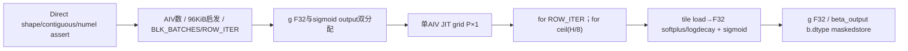

# 融合 GDN 双门控 950 Direct Invoke 算子知识

## 算子速览

| 项目 | 内容 |
|---|---|
| 实际入口 | `sgl_kernel_npu.implementation.triton.attention.gdn.fused_gdn_gating.fused_gdn_gating`，Direct Invoke |
| 计算语义 | g=−exp(A_log)·softplus_beta,threshold(a+bias)，beta_output=sigmoid(b)；参数beta是softplus斜率 |
| 输入输出 | a/b[R,H]浮点，A_log/bias各H元素；新g F32、新beta_output沿b.dtype；输入不改 |
| 执行类型 | 单JIT AIV_VECTOR，elementwise exp/log/where/sigmoid，无dot/Cube/MIX_CV/归约 |
| Kernel 路线 | R001 R≤cached AIV数，每program1row；R002大R每块64row（公开a三type域）；R003 H0源可达空head控制终点 |
| 核心资源 | BLK_HEADS8；UNIFIED_BUFFER_SIZE=96KiB为Host启发式，非compiler物理UB报告；logicaltile[B_R,8] |
| 来源闭包 | direct_implementation_closed：公开/Direct guard、14参数、当前Host tile、完整kernel/实际relativehelper/旧Host差异/打包闭合 |
| 边界 | A_log/bias仅检查numel不查stride；beta>0/R>0/同设备dtype为caller合同；source UB预算不证明physical安全；未声明中间exp短路 |
| 验证状态 | 本次知识提取未执行编译、真机、数值或性能测试；draft不表示编译资源/数值或性能验收 |

## 接口与语义

### 计算语义

对每row r/head h，x=a[r,h]+dt_bias[h]。若beta*x≤threshold，softplus=log(1+exp(beta*x))/beta，否则softplus=x；g=−exp(A_log[h])*softplus，第二输出beta_output=sigmoid(b[r,h])。比较对象是beta*x，等号属于log分支；softplus参数beta与输出sigmoid更新权重名称相似但不同。source tl.where表达式不提供控制流短路，不能从选择线性值推断中间exp绝不被计算或不溢出。

所有四input load后参与g计算者显式toF32，sigmoid也先把b转F32；g以F32新Tensor输出，sigmoid转b.dtype后写新Tensor。没有cumsum、state更新或模型decode前后隐式kernel，两个输出同一JIT产生。scalar计算每lane独立，row/head padding lane不跨valid lane归约；maskedload虽未显式other0，invalid lane不写出且不会进入有效lane值，不能套用decode的Kreduce padding风险。

### 输入、输出与属性

| 参数 | shape/layout | dtype | 约束、默认值与语义 |
|---|---|---|---|
| A_log | [H]合同；Host只查numelH | floating，生产F32 | 同NPU且连续caller保证，未检查stride/形状rank |
| a | [R,H]contiguous | FP16/BF16/FP32 | Hostshape解包，a/b shape一致且连续assert；R>0公开caller合同 |
| b | [R,H]contiguous | FP16/BF16/FP32 | 可与a不同type，决定beta_output dtype |
| dt_bias | [H]合同；Host只查numelH | floating，生产F32 | 必须连续，同设备caller保证 |
| beta | scalar | float | 默认1.0，公开>0；Host未assert |
| threshold | scalar | float | 默认20.0，对beta*x比较 |
| g | [R,H]新分配 | FP32 | a设备，readonly输入 |
| beta_output | [R,H]新分配 | b.dtype | b设备，输入不改 |

当前validator只覆盖b.shape==a.shape、a/b contiguous、A_log/bias numelH；同设备、NPU、dtype、vectorcontiguity、beta positive/Rpositive未完整Host验证。A_log/bias任意Torch floating格式的实际compiler支持未穷举，不因numel通过宣称全平台可运行；常用F32明确。H0可通过计数assert，属于源可达empty-head终点，未作为真机支持声明。

### 入口与版本

public auto/triton懒导入当前Direct，无失败fallback；torch_native为独立参考数学实现，不在本launch graph。公开产品表arch22/arch35支持，README/generation确定平台映射，Frontmatter仅本卡范围；CANN9.1.0为固定配置而非运行结果。既有[gate API](../../../../apis/sgl_kernel_npu/sgl_gdn_gating.md)已经说明阈值/输出精度/vectorstride合同，可普通链接复用；[decode源码卡](sgl_fused_gdn_decode_950.md)自己内部算门控，不把本算子自动插入所有decode图。

当前kernel与旧fla/fused_gdn_gating.py同名kernel的AST/decorators一致。Host不等价：当前UNIFIED_BUFFER_SIZE98304B(96KiB)、大batch FACTOR8且新增校验，旧1572864B且FACTOR8*H、无新增校验；实际get_device_properties import分别来自implementation/triton/utils与root utils，两者是独立无参数cache实例。只复用相同JIT事实，不把旧Host参数或kernel其它入口混入当前路线。

旧without_sigmoid入口只生成g并返回原b、shape/3D grid不同，是独立数学语义，当前Host不调用它；不以同文件存在扩本双输出目标。

## Host/Launcher 执行流程

### 参数校验与前处理

batch,num_heads=a.shape，seq_len固定1；检查b.shape相同、a/b连续、A_log/bias各numelH。没有Contiguous/ViewCopy，所有GM按dense flat访问，vector stride错误不能自动修复。相同设备/类型/Rpositive/betapositive为caller合同，raw invalid不提升支持。

实际relative import `...utils.triton_utils` 命中implementation/triton/utils/triton_utils.py，get_device_properties以current NPU查询并无参数@cache，assert AIC/AIV数均>0，Host只取vector数。无q那样的显式device context，输入设备与runtimecurrent device须遵守框架合同；不伪造已由Host验证。

BLK_HEADS8，elem_size=a.element_size；预算U=98304，maxRows=int((U*0.95)/(8*sA))。R≤Cores时progs=R、BLK_BATCHES1、ROW_ITER1；否则progs=Cores，factor8，calcRows=nextPOT(ceil(int(U*0.95)/(8*8*sA)))//2，BLK_BATCHES=max(1,min(calcRows,maxRows,64))，ROW_ITER=ceil(ceil(R/progs)/BLK_BATCHES)。正常a=F16/BF16/F32(sA2/4)时大branch最终均cap为64，具体推导见资源章节。g=empty F32(a.device)，beta_output=empty(b.dtype,b.device)，grid=(progs,1)。

### 参数、Workspace 与生命周期

g字节=4RH，beta_output=RH*sB，均独立新Tensor；A_log/a/b/bias只读，无GM权重临时或自有CANN system/workspace/ACLNN executor。小branch一row一个program，大branch每program负责ROW_ITER*BLK_BATCHES个连续row、内层循环全部8head片；无跨programpartial或归约。

kernel参数tuple和currentstream由Triton runtime提交，输入/输出保持到Device消费，函数return双Tensor不等于同步完成。source没有自有event/record_stream/free，physicalUB/register/primitive exp实现由compiler决定。

属性helper无参数cache可能保留首device的corecount，不能宣称跨设备总为当前资源；grid覆盖按该P仍用行区间与mask，不推断必然数值故障。helperAIC值只被assert，并非Cube节点。

### 启动图与失败传播



Python shape/assert/allocation/helper/JIT异常直接传播，无参考fallback。R0公开unsupported且Host不显式拒绝，会形成progs0、grid(0,1)，具体零grid行为为runtime边界，不声明可用；R>0/H0则Device COL_ITER0，无数学load/store，返回已分配的空head输出，单独R003闭合。全部Device节点仅Vector elementwise，无Cube/归约/通信。

## Route 与参数设计

### 分核与资源计算

记C为helper缓存AIV数，P=programs，B_R=BLK_BATCHES，I=ROW_ITER，J=ceil(H/8)，sA/sB/sL/sD分别为a/b/A_log/bias元素字节。小域R≤C：P=R,B_R=1,I=1；大域R>C：P=C,B_R=64,I=ceil(ceil(R/C)/64)，以上B_R64只对公开a的sA∈{2,4}成立。P个program分别覆盖[p*I*B_R,(p+1)*I*B_R)，所以所有R行被覆盖且无program间输出别名；最后mask裁掉多余行。每row遍历J个headtile，H尾mask。

大域计算：U=98304B，int(U*0.95)=93388；sA2的calc=nextPOT(ceil(93388/128))//2=512、maxRows5836；sA4的calc=nextPOT(ceil(93388/256))//2=256、maxRows2918；max(1,min(calc,maxRows,64))都64。U/95%/factor8是估算，不是实际所有F32中间量的求和，不证明compiler UB_total≤96KiB。g和beta_output GM总新增RH*(4+sB)，workspace0；输入唯一有效数据容量为RH*(sA+sB)+H*(sL+sD)；源码逻辑a/b读取为RH*(sA+sB)，H>0时head向量逻辑读取为P*I*H*(sL+sD)，包括a/b整块被mask的迭代，不等于编译后实际物理流量。单tile源逻辑load为B_R*8*(sA+sB)+8*(sL+sD)，store为B_R*8*(4+sB)，mask只访问有效元素；head vectors每次row迭代重读，不伪造跨row cache。整个调用的有效a/b读与双输出写各一次，head读按全部P*I个rowtile迭代重复，head_mask仅检查head<H，不受row mask限制。

### Route 选择

| 顺序 | Route | Key/模板 | 精确选择条件与优先级 | 不适用去向 |
|---:|---|---|---|---|
| 1 | R-003 空head控制终点 | H=0；仍继承小/大分核 | Host校验通过,R>0,H=0；source没有Hpositive assert | COL_ITER0无数学load/store；不作为真机验证支持 |
| 2 | R-001 每行一program门控 | B_R1,I1 | R>0,H>0,R≤C，a公开三type，shape/contiguous/numel通过 | R>C到R002 |
| 3 | R-002 多行分块门控 | B_R64,I=ceil(ceil(R/C)/64) | R>0,H>0,R>C，a sA2/4与同caller合同 | 其它dtype不扩支持，Python/编译异常传播 |

```text
伪码（按实际Host分支再分类空head）：
shape/assert; C=get_device_properties()[1]; B_H=8
if R<=C: P=R; B_R=1; I=1
else: P=C; B_R=max(1,min(calcRows,maxRows,64)); I=ceil(ceil(R/P)/B_R)
allocate outputs; launch(P,1)
if H==0: kernel COL_ITER0 -> R003
elif R<=C: R001
else: R002
R0: grid(0,1)为未验证runtime终点，不属于正常路由
```

### 模板/实现执行矩阵

| Route | key/selector | dtype/shape/platform 完整命中条件 | 执行拓扑与 Kernel 节点 | 实际模板/body | 内存与同步特征 | tail/fallback |
|---|---|---|---|---|---|---|
| R-001 | B_H8,B_R1,I1 | R1..C,H>0，a/b各F16/BF16/F32，vectors floating连续、同设备caller合同，本卡平台 | 单AIV JIT grid(R,1) | fused_gdn_gating_kernel；seq/H/R/beta/threshold/I do_not_specialize | 8lane双输出；无workspace/跨core sync | headmask；异常直传 |
| R-002 | B_H8,B_R64,I公式 | R>C,H>0，其它合同同R001 | 单AIV JIT grid(C,1) | 同body不同rowtile | 64×8逻辑tile；row/col双loop，无跨program边 | row/head mask；core尾空tile的a/b与输出可全masked，A_log/dt_bias仍按head_mask产生源码逻辑读取 |
| R-003 | H0；B_R1或64 | R>0,H0，numel vectors0；source可达而非公开已测域 | 单JIT grid(P,1)，数学loop0次 | 同entry，COL_ITER0 | GM outputs0B，自有workspace0；compiler资源未测 | 返回空head输出；H0若framework报错直传 |

### 隐藏性能 Guard

| Guard | Host/Tiling 条件 | Device/资源原因 | 影响 Route | 不满足时去向 | 源码符号 |
|---|---|---|---|---|---|
| dense layout | a/b contiguous assert；vector仅numel | flat off/head pointer没有stride字段 | 全部 | a/b assert；vector违规无保护 | python/sgl_kernel_npu/sgl_kernel_npu/implementation/triton/attention/gdn/fused_gdn_gating.py:fused_gdn_gating |
| 小/大row | R≤C | 限制program数，大域用64rowtile | R001/2 | 按else，不另fallback | 同Host |
| B_R P2 | 公开sA2/4推得1/64 | tl.arange静态范围；不扩任意dtype | R001/2 | compiler/runtime边界 | calc_blk_batches |
| device cache | @cache无参数 | 核数首device结果可复用 | 全部 | 没有主动刷新/fallback | implementation/triton/utils/triton_utils.py:get_device_properties |
| Rpositive/betapositive | caller合同未assert | R0zeroGrid、beta0除法 | 正常routes | 未验证/未定义数学域，非安全路径 | Host与kernel |
| 预算 | 96KiB×95%、factor8、cap64 | 只按sA估行数；实际F32表达式由compilerlower | R002 | 没有runtime资源fallback | UNIFIED_BUFFER_SIZE |

### POD/ABI

这里没有C++结构/POD，也没有可从source证明的sizeof/alignof/offsetof。以下按源14个参数顺序闭合；pointer运行时位宽、runtime scalar lowering及打包offset由Triton ABI决定，固定仓没有声明，不能填入虚构64/32位。constexpr不占用同样的runtime参数slot。

| 结构 | 字段 | 类型/位宽 | ABI 布局 | 单位 | Host/launcher producer | Device consumer | 边界 |
|---|---|---|---|---|---|---|---|
| Triton tuple | g | pointer, g.dtype=F32 | arg0；physical offset未声明 | byte* | empty(R,H,F32,a.device) | store g+off | 4RH |
| Triton tuple | beta_output | pointer, b.dtype | arg1；physical offset未声明 | byte* | empty(R,H,b.dtype,b.device) | sigmoid store | RH*sB |
| Triton tuple | A_log | pointer, inputdtype | arg2；physical offset未声明 | byte* | caller tensor | head_off load | numelH；dense stride1合同 |
| Triton tuple | a | pointer, inputdtype | arg3；physical offset未声明 | byte* | caller a contiguous | off load | shapeR,H |
| Triton tuple | b | pointer, inputdtype | arg4；physical offset未声明 | byte* | caller b contiguous | off load | shapeR,H，输出dtype |
| Triton tuple | dt_bias | pointer, inputdtype | arg5；physical offset未声明 | byte* | caller tensor | head_off load | numelH；dense stride1合同 |
| Triton tuple | seq_len | runtime integer；真实lower位宽未在源声明 | arg6；physical offset未声明 | token | 1 | off中乘seq_len、i_s偏移 | do_not_specialize |
| Triton tuple | NUM_HEADS | runtime integer；lower位宽未声明 | arg7；physical offset未声明 | head | a.shape[1] | cdiv、stride及head mask | H0无col loop |
| Triton tuple | NUM_BATCHES | runtime integer；lower位宽未声明 | arg8；physical offset未声明 | row | a.shape[0] | batch mask | R>0正常域 |
| Triton tuple | beta | runtime scalar float；lower位宽未声明 | arg9；physical offset未声明 | slope | 默认1.0/caller | softplus比较、exp、除法 | do_not_specialize；>0合同 |
| Triton tuple | threshold | runtime scalar float；lower位宽未声明 | arg10；physical offset未声明 | 数值 | 默认20.0/caller | beta*x<=threshold | do_not_specialize |
| Triton tuple | BLK_HEADS | tl.constexpr integer | arg11 compile specialization；physical offset未声明 | head | 8 | arange8/headtile | 无seq reduction |
| Triton tuple | BLK_BATCHES | tl.constexpr integer | arg12 compile specialization；physical offset未声明 | row | 小1；大min(...,64)正常64 | arange/rowbase | P2为1/64 |
| Triton tuple | ROW_ITER | runtime integer；lower位宽未声明 | arg13；physical offset未声明 | loop | 小1；大ceil(ceil(R/P)/B_R) | row range、每program跨度 | do_not_specialize |

### Route 源码闭包

| Route | Key/selector | Host/Tiling producer | POD/参数 | Kernel entry/router 节点 | Kernel body/直接依赖 | 构建接线 |
|---|---|---|---|---|---|---|
| R-001 每行一program门控 | R≤C;B_R1 | python/sgl_kernel_npu/sgl_kernel_npu/implementation/triton/attention/gdn/fused_gdn_gating.py:fused_gdn_gating；implementation/triton/utils/triton_utils.py:get_device_properties | 上表14字段 | python/sgl_kernel_npu/sgl_kernel_npu/implementation/triton/attention/gdn/fused_gdn_gating.py:fused_gdn_gating_kernel，静态B_H8/B_R | 同文件完整body；triton/tl primitive为compiler边界 | setup.py→build_tools/torch_wheel.py:stage_runtime复制模块；operators/utils/registry.py选择triton；__init__.py加载扩展 |
| R-002 多行分块门控 | R>C;B_R64 | python/sgl_kernel_npu/sgl_kernel_npu/implementation/triton/attention/gdn/fused_gdn_gating.py:fused_gdn_gating；implementation/triton/utils/triton_utils.py:get_device_properties | 上表14字段 | python/sgl_kernel_npu/sgl_kernel_npu/implementation/triton/attention/gdn/fused_gdn_gating.py:fused_gdn_gating_kernel，静态B_H8/B_R | 同文件完整body；triton/tl primitive为compiler边界 | setup.py→build_tools/torch_wheel.py:stage_runtime复制模块；operators/utils/registry.py选择triton；__init__.py加载扩展 |
| R-003 空head控制终点 | H0 | python/sgl_kernel_npu/sgl_kernel_npu/implementation/triton/attention/gdn/fused_gdn_gating.py:fused_gdn_gating；implementation/triton/utils/triton_utils.py:get_device_properties | 上表14字段 | python/sgl_kernel_npu/sgl_kernel_npu/implementation/triton/attention/gdn/fused_gdn_gating.py:fused_gdn_gating_kernel，静态B_H8/B_R | 同文件完整body；triton/tl primitive为compiler边界 | setup.py→build_tools/torch_wheel.py:stage_runtime复制模块；operators/utils/registry.py选择triton；__init__.py加载扩展 |

## Kernel 实现

### 公共执行流程

唯一Device节点是AIV_VECTOR。entry读取两个program_id，i_s恒0；按ROW_ITER行块与ceil(H/8)列块，生成flat off，分别load head vectors和a/b tile，将a/bias/Alog/b转F32，计算softplus/exp衰减与sigmoid，以两个mask store写到不同新GM Tensor。tl.load/store/exp/log/sigmoid/where/cast是compiler primitive边界；本仓无手写TQue/TBuf、Vector repeat参数、SIMT threadblock、NDDMA描述符或通信window。没有归约或可达Cube节点，不能按数学门控用途转CV。所有normalroutes相同的公开dtype组合参数化闭合：a三type×b三type9种；Alog/bias标准F32合同，源码没有与a/b相等检查，F16/BF16常规floating若使用由其实际load转F32闭合，不作任意格式硬件承诺。不同dtype仅GM字节sA/sB/sL/sD和最终bcast变化，完整参数化，不合并掉新输出dtype。

### Route R-001：每行一program门控

#### 适用条件

##### 选择证据

| 层级 | 文件 | 符号 | 源码谓词/参数 | 结果/下一跳 |
|---|---|---|---|---|
| public | operators/attention/gdn/fused_gdn_gating.py | fused_gdn_gating | auto/triton懒导入，A2/A3或950按本卡 | 当前Direct，不调用torch_native reference |
| Host | python/sgl_kernel_npu/sgl_kernel_npu/implementation/triton/attention/gdn/fused_gdn_gating.py | fused_gdn_gating | R>0,H>0,R≤C | B_R=1,I=1,P=R |
| Device | python/sgl_kernel_npu/sgl_kernel_npu/implementation/triton/attention/gdn/fused_gdn_gating.py | fused_gdn_gating_kernel | B_H8；J=ceil(H/8) | rowtile/headtile mask读写 |

#### Device 数据流

##### 函数级调用链

```text
fused_gdn_gating -> get_device_properties -> allocate(g,beta_output)
 -> fused_gdn_gating_kernel[(R,1)](14参数；B_R=1,I=1,P=R)
   -> program_id -> for row_idx in range(I)
      -> for col_idx in range(ceil(H/8))
         -> tl.load(A_log,a,b,dt_bias)
         -> F32 x/softplus/exp -> tl.store(g)
         -> F32 sigmoid -> cast(b.dtype) -> tl.store(beta_output)
```

##### 源码等价伪码

```text
伪码；B_R=1,I=1,P=R
for u=0..I-1:
  rr=pid*I*B_R+u*B_R+arange(B_R)
  for j=0..ceil(H/8)-1: # headtile
    hh=j*8+arange(8)
    off=rr[:,None]*1*H+0*H+hh[None,:]
    hm=hh<H; m=(rr[:,None]<R)&hm[None,:]
    L=load(A_log+hh,hm); D=load(dt_bias+hh,hm)
    aa=load(a+off,m); bb=load(b+off,m) # no explicitother
    x=F32(aa)+F32(D)[None,:]
    sp=where(beta*x<=threshold,(1/beta)*log(1+exp(beta*x)),x)
    store(g+off,-exp(F32(L))*sp,m)
    store(beta_output+off,cast_bdtype(sigmoid(F32(bb))),m)
```

每program对其row连续段独占写，逐8head片输出互斥；没有共享中间GM、partial值、额外kernel或跨programevent。

#### 内存与数据搬运

##### 资源与搬运表

| 层级/缓冲区 | offset/地址公式 | extent/容量公式 | dtype/layout | producer | consumer | owner/lifetime | 对齐/复用 |
|---|---|---|---|---|---|---|---|
| GM a | off*sA | RH*sA | dense R,H | caller | loadaa | caller到kernel完成 | 无stride；非连续Host拒绝 |
| GM b | off*sB | RH*sB | dense R,H | caller | loadbb→sigmoid | caller到kernel完成 | 无stride；非连续Host拒绝 |
| GM A_log | hh*sL | H*sL | flathead | caller | loadL→exp | caller到kernel完成 | 仅numel校验，stride1合同 |
| GM bias | hh*sD | H*sD | flathead | caller | loadD→x | caller到kernel完成 | 同上 |
| GM g | off*4 | 4RH | F32 R,H | Hostempty/kernelstore | laterconsumer | 返回Tensor持有 | 独立新输出，无输入alias |
| GM beta_output | off*sB | RH*sB | b.dtype R,H | Hostempty/kernelstore | laterconsumer | 返回Tensor持有 | 独立新输出 |
| compiler lane domain | rr×hh；headL/D[8] broadcast | 2B_R*8 inputlane、2*8headlane；F32 x/sp/g/sigmoid各B_R*8 | 输入各自dtype→F32 | load/expr | store/expr | compilerSSA；当前tile | 跨row/col逻辑值重建，不臆造queue深度/物理UBoffset |
| workspace/Queue/NDDMA/window | N/A | owned workspace0；其它N/A | compiler lowering | N/A | N/A | 无自有分配 | 无系统workspace或自有event |

##### 分层内存布局

owned UB block-beta：N/A；源码只声明Triton lane tensor，没有InitBuffer或可证ownedUB布局，physicalUB/L0/register及compiler double-buffer不可由96KiB注释反推。实际替代路径：


##### 字节账与复用顺序

```text
B_R=1,I=1,P=R; B_H=8
source_owned_UB= N/A（没有手工UB分配）; compiler physicalUB=未知
logical input tile bytes=B_R*8*(sA+sB)+8*(sL+sD)
logical output tile bytes=B_R*8*(4+sB)
F32单中间矩形字节=4*B_R*8；headvector单个=4*8
各SSA中间生命周期重叠/复用由compiler决定，不把逻辑逐项和当物理峰值
Host estimateU=98304，仅R002用95%/factor8/cap64估B_R，不是安全证明
workspace_total=0; input_GM=RH*(sA+sB)+H*(sL+sD)
new_output_GM=RH*(4+sB)
```

| 复用子区 | 写入者 | 读取者/消费点 | 下一次覆盖 | 同步或释放依据 | 安全条件 |
|---|---|---|---|---|---|
| local a/btile | tl.load | F32 x/sigmoid | 下一个col/rowloop | SSA data dependency/compiler | 未声明手工FreeTensor；无跨program引用 |
| local headvectors | loadL/D | broadcast到本tile | 下一个head/rowtile | 同上 | 各有效lane独立 |
| output g/β GM | masked store | 调用方后续streamconsumer | source内不覆盖 | runtime currentstream合同，return非同步 | 输出Tensor/input保持到kernel消费 |
| input GM | caller | kernel load | source不写 | caller生命周期合同 | 不得并发改写 |

#### 同步、精度与尾块

##### 同步与数值边界表

| 阶段 | primitive/机制 | producer | consumer/等待点 | 保护对象 | 精度/尾块 |
|---|---|---|---|---|---|
| inputload | tl.load(mask) | callerGM | x/Lexp/sigmoid | 各tile有效lane | 未显式other0；无跨lane归约，padding不进入validlane |
| gate | toF32/log/exp/where | aa/D/L | gstore | lane内SSA | x先F32加；beta*x≤threshold含等号；where不承诺短路 |
| β | toF32/sigmoid/to(dtype) | bb | βstore | lane内SSA | F32计算后到b.dtype；无显式round |
| output | masked tl.store | g/βexpr | runtime后续consumer | 不重叠输出片 | rr<R且hh<H；former/tailprogram同mask |
| local reuse | compiler dependency | 本tile | 下一tile | localSSA | 源无queue/event/atomic/barrier，也不需跨programcombine |
| Hostreturn | Triton runtime当前stream | JITsubmission | callerstreamordering | TensorGM生命周期 | 未显式device sync/record_stream；异步错误行为runtime边界 |

#### 关键实现

##### 符号证据表

| 阶段 | 文件 | 符号/模板实例 | 实现事实 |
|---|---|---|---|
| Host/Tiling producer | python/sgl_kernel_npu/sgl_kernel_npu/implementation/triton/attention/gdn/fused_gdn_gating.py | fused_gdn_gating | B_R=1,I=1,P=R；分配两输出 |
| Kernel entry/router | python/sgl_kernel_npu/sgl_kernel_npu/implementation/triton/attention/gdn/fused_gdn_gating.py | fused_gdn_gating_kernel[B_H8,B_R1] | 单JIT无router switch，14参数 |
| Device body/helper | python/sgl_kernel_npu/sgl_kernel_npu/implementation/triton/attention/gdn/fused_gdn_gating.py | fused_gdn_gating_kernel | pid/I/J/off/mask/F32数学与store完整 |
| Device body/helper | implementation/triton/utils/triton_utils.py | get_device_properties | @cache无参数，仅Host使用AIV数，AICassert非Cube节点 |


### Route R-002：多行分块门控

#### 适用条件

##### 选择证据

| 层级 | 文件 | 符号 | 源码谓词/参数 | 结果/下一跳 |
|---|---|---|---|---|
| public | operators/attention/gdn/fused_gdn_gating.py | fused_gdn_gating | auto/triton懒导入，A2/A3或950按本卡 | 当前Direct，不调用torch_native reference |
| Host | python/sgl_kernel_npu/sgl_kernel_npu/implementation/triton/attention/gdn/fused_gdn_gating.py | fused_gdn_gating | R>0,H>0,R>C；a sA2/4 | B_R=64,I=ceil(ceil(R/C)/64),P=C |
| Device | python/sgl_kernel_npu/sgl_kernel_npu/implementation/triton/attention/gdn/fused_gdn_gating.py | fused_gdn_gating_kernel | B_H8；J=ceil(H/8) | rowtile/headtile mask读写 |

#### Device 数据流

##### 函数级调用链

```text
fused_gdn_gating -> get_device_properties -> allocate(g,beta_output)
 -> fused_gdn_gating_kernel[(C,1)](14参数；B_R=64,I=ceil(ceil(R/C)/64),P=C)
   -> program_id -> for row_idx in range(I)
      -> for col_idx in range(ceil(H/8))
         -> tl.load(A_log,a,b,dt_bias)
         -> F32 x/softplus/exp -> tl.store(g)
         -> F32 sigmoid -> cast(b.dtype) -> tl.store(beta_output)
```

##### 源码等价伪码

```text
伪码；B_R=64,I=ceil(ceil(R/C)/64),P=C
for u=0..I-1:
  rr=pid*I*B_R+u*B_R+arange(B_R)
  for j=0..ceil(H/8)-1: # headtile
    hh=j*8+arange(8)
    off=rr[:,None]*1*H+0*H+hh[None,:]
    hm=hh<H; m=(rr[:,None]<R)&hm[None,:]
    L=load(A_log+hh,hm); D=load(dt_bias+hh,hm)
    aa=load(a+off,m); bb=load(b+off,m) # no explicitother
    x=F32(aa)+F32(D)[None,:]
    sp=where(beta*x<=threshold,(1/beta)*log(1+exp(beta*x)),x)
    store(g+off,-exp(F32(L))*sp,m)
    store(beta_output+off,cast_bdtype(sigmoid(F32(bb))),m)
```

每program对其row连续段独占写，逐8head片输出互斥；没有共享中间GM、partial值、额外kernel或跨programevent。

#### 内存与数据搬运

##### 资源与搬运表

| 层级/缓冲区 | offset/地址公式 | extent/容量公式 | dtype/layout | producer | consumer | owner/lifetime | 对齐/复用 |
|---|---|---|---|---|---|---|---|
| GM a | off*sA | RH*sA | dense R,H | caller | loadaa | caller到kernel完成 | 无stride；非连续Host拒绝 |
| GM b | off*sB | RH*sB | dense R,H | caller | loadbb→sigmoid | caller到kernel完成 | 无stride；非连续Host拒绝 |
| GM A_log | hh*sL | H*sL | flathead | caller | loadL→exp | caller到kernel完成 | 仅numel校验，stride1合同 |
| GM bias | hh*sD | H*sD | flathead | caller | loadD→x | caller到kernel完成 | 同上 |
| GM g | off*4 | 4RH | F32 R,H | Hostempty/kernelstore | laterconsumer | 返回Tensor持有 | 独立新输出，无输入alias |
| GM beta_output | off*sB | RH*sB | b.dtype R,H | Hostempty/kernelstore | laterconsumer | 返回Tensor持有 | 独立新输出 |
| compiler lane domain | rr×hh；headL/D[8] broadcast | 2B_R*8 inputlane、2*8headlane；F32 x/sp/g/sigmoid各B_R*8 | 输入各自dtype→F32 | load/expr | store/expr | compilerSSA；当前tile | 跨row/col逻辑值重建，不臆造queue深度/物理UBoffset |
| workspace/Queue/NDDMA/window | N/A | owned workspace0；其它N/A | compiler lowering | N/A | N/A | 无自有分配 | 无系统workspace或自有event |

##### 分层内存布局

owned UB block-beta：N/A；源码只声明Triton lane tensor，没有InitBuffer或可证ownedUB布局，physicalUB/L0/register及compiler double-buffer不可由96KiB注释反推。实际替代路径：


##### 字节账与复用顺序

```text
B_R=64,I=ceil(ceil(R/C)/64),P=C; B_H=8
source_owned_UB= N/A（没有手工UB分配）; compiler physicalUB=未知
logical input tile bytes=B_R*8*(sA+sB)+8*(sL+sD)
logical output tile bytes=B_R*8*(4+sB)
F32单中间矩形字节=4*B_R*8；headvector单个=4*8
各SSA中间生命周期重叠/复用由compiler决定，不把逻辑逐项和当物理峰值
Host estimateU=98304，仅R002用95%/factor8/cap64估B_R，不是安全证明
workspace_total=0; input_GM=RH*(sA+sB)+H*(sL+sD)
new_output_GM=RH*(4+sB)
```

| 复用子区 | 写入者 | 读取者/消费点 | 下一次覆盖 | 同步或释放依据 | 安全条件 |
|---|---|---|---|---|---|
| local a/btile | tl.load | F32 x/sigmoid | 下一个col/rowloop | SSA data dependency/compiler | 未声明手工FreeTensor；无跨program引用 |
| local headvectors | loadL/D | broadcast到本tile | 下一个head/rowtile | 同上 | 各有效lane独立 |
| output g/β GM | masked store | 调用方后续streamconsumer | source内不覆盖 | runtime currentstream合同，return非同步 | 输出Tensor/input保持到kernel消费 |
| input GM | caller | kernel load | source不写 | caller生命周期合同 | 不得并发改写 |

#### 同步、精度与尾块

##### 同步与数值边界表

| 阶段 | primitive/机制 | producer | consumer/等待点 | 保护对象 | 精度/尾块 |
|---|---|---|---|---|---|
| inputload | tl.load(mask) | callerGM | x/Lexp/sigmoid | 各tile有效lane | 未显式other0；无跨lane归约，padding不进入validlane |
| gate | toF32/log/exp/where | aa/D/L | gstore | lane内SSA | x先F32加；beta*x≤threshold含等号；where不承诺短路 |
| β | toF32/sigmoid/to(dtype) | bb | βstore | lane内SSA | F32计算后到b.dtype；无显式round |
| output | masked tl.store | g/βexpr | runtime后续consumer | 不重叠输出片 | rr<R且hh<H；former/tailprogram同mask |
| local reuse | compiler dependency | 本tile | 下一tile | localSSA | 源无queue/event/atomic/barrier，也不需跨programcombine |
| Hostreturn | Triton runtime当前stream | JITsubmission | callerstreamordering | TensorGM生命周期 | 未显式device sync/record_stream；异步错误行为runtime边界 |

#### 关键实现

##### 符号证据表

| 阶段 | 文件 | 符号/模板实例 | 实现事实 |
|---|---|---|---|
| Host/Tiling producer | python/sgl_kernel_npu/sgl_kernel_npu/implementation/triton/attention/gdn/fused_gdn_gating.py | fused_gdn_gating | B_R=64,I=ceil(ceil(R/C)/64),P=C；分配两输出 |
| Kernel entry/router | python/sgl_kernel_npu/sgl_kernel_npu/implementation/triton/attention/gdn/fused_gdn_gating.py | fused_gdn_gating_kernel[B_H8,B_R64] | 单JIT无router switch，14参数 |
| Device body/helper | python/sgl_kernel_npu/sgl_kernel_npu/implementation/triton/attention/gdn/fused_gdn_gating.py | fused_gdn_gating_kernel | pid/I/J/off/mask/F32数学与store完整 |
| Device body/helper | implementation/triton/utils/triton_utils.py | get_device_properties | @cache无参数，仅Host使用AIV数，AICassert非Cube节点 |


### Route R-003：空head控制终点

#### 适用条件

##### 选择证据

| 层级 | 文件 | 符号 | 源码谓词/参数 | 结果/下一跳 |
|---|---|---|---|---|
| public | operators/attention/gdn/fused_gdn_gating.py | fused_gdn_gating | auto/triton懒导入，A2/A3或950按本卡 | 当前Direct，不调用torch_native reference |
| Host | python/sgl_kernel_npu/sgl_kernel_npu/implementation/triton/attention/gdn/fused_gdn_gating.py | fused_gdn_gating | R>0,H0且numel/contiguous等通过，Host本身不特判H0 | B_R=1/64，按R≤C选择 |
| Device | python/sgl_kernel_npu/sgl_kernel_npu/implementation/triton/attention/gdn/fused_gdn_gating.py | fused_gdn_gating_kernel | B_H8；J=ceil(H/8)=0 | 无headloop、无数学内存访问 |

#### Device 数据流

##### 函数级调用链

```text
fused_gdn_gating -> get_device_properties -> allocate(g,beta_output)
 -> fused_gdn_gating_kernel[(P,1)](14参数；B_R=1/64，按R≤C选择)
   -> program_id -> for row_idx in range(I)
      -> for col_idx in range(ceil(H/8)) # H0不进入
         -> tl.load(A_log,a,b,dt_bias)
         -> F32 x/softplus/exp -> tl.store(g)
         -> F32 sigmoid -> cast(b.dtype) -> tl.store(beta_output)
```

##### 源码等价伪码

```text
伪码；B_R=1/64，按R≤C选择
for u=0..I-1:
  rr=pid*I*B_R+u*B_R+arange(B_R)
  for j=0..ceil(H/8)-1: # 本Route为0次
    hh=j*8+arange(8)
    off=rr[:,None]*1*H+0*H+hh[None,:]
    hm=hh<H; m=(rr[:,None]<R)&hm[None,:]
    L=load(A_log+hh,hm); D=load(dt_bias+hh,hm)
    aa=load(a+off,m); bb=load(b+off,m) # no explicitother
    x=F32(aa)+F32(D)[None,:]
    sp=where(beta*x<=threshold,(1/beta)*log(1+exp(beta*x)),x)
    store(g+off,-exp(F32(L))*sp,m)
    store(beta_output+off,cast_bdtype(sigmoid(F32(bb))),m)
```

H0的内层循环为零次，上述计算语句作为完整entry的可见body保留，不能声称本终点执行了这些load/exp/store。

#### 内存与数据搬运

##### 资源与搬运表

| 层级/缓冲区 | offset/地址公式 | extent/容量公式 | dtype/layout | producer | consumer | owner/lifetime | 对齐/复用 |
|---|---|---|---|---|---|---|---|
| GM a | off*sA | RH*sA | dense R,H | caller | loadaa | caller到kernel完成 | 无stride；非连续Host拒绝 |
| GM b | off*sB | RH*sB | dense R,H | caller | loadbb→sigmoid | caller到kernel完成 | 无stride；非连续Host拒绝 |
| GM A_log | hh*sL | H*sL | flathead | caller | loadL→exp | caller到kernel完成 | 仅numel校验，stride1合同 |
| GM bias | hh*sD | H*sD | flathead | caller | loadD→x | caller到kernel完成 | 同上 |
| GM g | off*4 | 4RH | F32 R,H | Hostempty/kernelstore | laterconsumer | 返回Tensor持有 | 独立新输出，无输入alias |
| GM beta_output | off*sB | RH*sB | b.dtype R,H | Hostempty/kernelstore | laterconsumer | 返回Tensor持有 | 独立新输出 |
| compiler lane domain | rr×hh；headL/D[8] broadcast | 2B_R*8 inputlane、2*8headlane；F32 x/sp/g/sigmoid各B_R*8 | 输入各自dtype→F32 | load/expr | store/expr | compilerSSA；当前tile | 没有实际数学迭代；不据此宣称物理分配0 |
| workspace/Queue/NDDMA/window | N/A | owned workspace0；其它N/A | compiler lowering | N/A | N/A | 无自有分配 | 无系统workspace或自有event |

##### 分层内存布局

owned UB block-beta：N/A；源码只声明Triton lane tensor，没有InitBuffer或可证ownedUB布局，physicalUB/L0/register及compiler double-buffer不可由96KiB注释反推。实际替代路径：


##### 字节账与复用顺序

```text
B_R=1/64，按R≤C选择; B_H=8
source_owned_UB= N/A（没有手工UB分配）; compiler physicalUB=未知
logical input tile bytes=B_R*8*(sA+sB)+8*(sL+sD)
logical output tile bytes=B_R*8*(4+sB)
F32单中间矩形字节=4*B_R*8；headvector单个=4*8
各SSA中间生命周期重叠/复用由compiler决定，不把逻辑逐项和当物理峰值
Host estimateU=98304，仅R002用95%/factor8/cap64估B_R，不是安全证明
workspace_total=0; input_GM=RH*(sA+sB)+H*(sL+sD)
new_output_GM=RH*(4+sB)=0（H0）；数学load/store量0
```

| 复用子区 | 写入者 | 读取者/消费点 | 下一次覆盖 | 同步或释放依据 | 安全条件 |
|---|---|---|---|---|---|
| local a/btile | tl.load | F32 x/sigmoid | 下一个col/rowloop | SSA data dependency/compiler | 未声明手工FreeTensor；无跨program引用 |
| local headvectors | loadL/D | broadcast到本tile | 下一个head/rowtile | 同上 | 各有效lane独立 |
| output g/β GM | masked store | 调用方后续streamconsumer | source内不覆盖 | runtime currentstream合同，return非同步 | 输出Tensor/input保持到kernel消费 |
| input GM | caller | kernel load | source不写 | caller生命周期合同 | 不得并发改写 |

#### 同步、精度与尾块

##### 同步与数值边界表

| 阶段 | primitive/机制 | producer | consumer/等待点 | 保护对象 | 精度/尾块 |
|---|---|---|---|---|---|
| inputload | tl.load(mask) | callerGM | x/Lexp/sigmoid | 各tile有效lane | 未显式other0；无跨lane归约，padding不进入validlane |
| gate | toF32/log/exp/where | aa/D/L | gstore | lane内SSA | x先F32加；beta*x≤threshold含等号；where不承诺短路 |
| β | toF32/sigmoid/to(dtype) | bb | βstore | lane内SSA | F32计算后到b.dtype；无显式round |
| output | masked tl.store | g/βexpr | runtime后续consumer | 不重叠输出片 | rr<R且hh<H；J0无store |
| local reuse | compiler dependency | 本tile | 下一tile | localSSA | 源无queue/event/atomic/barrier，也不需跨programcombine |
| Hostreturn | Triton runtime当前stream | JITsubmission | callerstreamordering | TensorGM生命周期 | 未显式device sync/record_stream；异步错误行为runtime边界 |

#### 关键实现

##### 符号证据表

| 阶段 | 文件 | 符号/模板实例 | 实现事实 |
|---|---|---|---|
| Host/Tiling producer | python/sgl_kernel_npu/sgl_kernel_npu/implementation/triton/attention/gdn/fused_gdn_gating.py | fused_gdn_gating | B_R=1/64，按R≤C选择；分配两输出 |
| Kernel entry/router | python/sgl_kernel_npu/sgl_kernel_npu/implementation/triton/attention/gdn/fused_gdn_gating.py | fused_gdn_gating_kernel[B_H8,B_R1/64] | 单JIT无router switch，14参数 |
| Device body/helper | python/sgl_kernel_npu/sgl_kernel_npu/implementation/triton/attention/gdn/fused_gdn_gating.py | fused_gdn_gating_kernel | pid/I/J/off/mask/F32数学与store完整 |
| Device body/helper | implementation/triton/utils/triton_utils.py | get_device_properties | @cache无参数，仅Host使用AIV数，AICassert非Cube节点 |

## 算子特定优化

### Trick T-001：行列分块与headvector广播

#### 触发与源码依据

- 适用 Route：R001/R002；R003不进headloop。
- 触发条件：对应Route的shape/contiguous/numel/caller合同全部成立。
- Golden 来源：[当前实现 L48–L69](https://github.com/sgl-project/sgl-kernel-npu/blob/dda6d36b0cdb4081e102d14c0a2fb276fc416e69/python/sgl_kernel_npu/sgl_kernel_npu/implementation/triton/attention/gdn/fused_gdn_gating.py#L48-L69)

**官方源码（固定 Commit 连续逐字摘录）**：

```python
    for row_idx in range(0, ROW_ITER):
        batch_off = (
            i_b * ROW_ITER * BLK_BATCHES
            + row_idx * BLK_BATCHES
            + tl.arange(0, BLK_BATCHES)
        )

        for col_idx in range(0, COL_ITER):
            head_off = col_idx * BLK_HEADS + tl.arange(0, BLK_HEADS)

            off = (
                batch_off[:, None] * seq_len * NUM_HEADS
                + i_s * NUM_HEADS
                + head_off[None, :]
            )
            head_mask = head_off < NUM_HEADS
            mask = head_mask[None, :] & (batch_off[:, None] < NUM_BATCHES)

            blk_A_log = tl.load(A_log + head_off, mask=head_mask)
            blk_a = tl.load(a + off, mask=mask)
            blk_b = tl.load(b + off, mask=mask)
            blk_bias = tl.load(dt_bias + head_off, mask=head_mask)
```

#### 机制与设计原因

program跨度I*B_R保证连续独占row段；headvector8lane广播到rowtile，mask同管两个输出。headvector随rowtile重读，不能宣称全program只读一次或跨row驻留。

#### 迁移边界

- 适用/前提/失效：适合dense R×H、lane独立的双gate；前提B_R合法静态arange且vectors stride1；任意stride必须增加ABI和寻址。
- 未验证：本次知识提取未执行编译、真机、数值或性能测试。

#### 错误做法

使用任意vector stride却仍按head_off读会读取错误物理元素；Host仅numel相等不保护该情形。

### Trick T-002：FP32双门控同tile融合

#### 触发与源码依据

- 适用 Route：R001/R002有效lane。
- 触发条件：对应Route的shape/contiguous/numel/caller合同全部成立。
- Golden 来源：[当前实现 L71–L85](https://github.com/sgl-project/sgl-kernel-npu/blob/dda6d36b0cdb4081e102d14c0a2fb276fc416e69/python/sgl_kernel_npu/sgl_kernel_npu/implementation/triton/attention/gdn/fused_gdn_gating.py#L71-L85)

**官方源码（固定 Commit 连续逐字摘录）**：

```python
            x = blk_a.to(tl.float32) + blk_bias.to(tl.float32)[None, :]
            softplus_x = tl.where(
                beta * x <= threshold, (1 / beta) * tl.log(1 + tl.exp(beta * x)), x
            )

            blk_g = -tl.exp(blk_A_log.to(tl.float32)) * softplus_x
            tl.store(g + off, blk_g.to(g.dtype.element_ty), mask=mask)

            # compute beta_output = sigmoid(b)
            blk_beta_output = tl.sigmoid(blk_b.to(tl.float32))
            tl.store(
                beta_output + off,
                blk_beta_output.to(beta_output.dtype.element_ty),
                mask=mask,
            )
```

#### 机制与设计原因

共享a/b读取与headvectors，在一次JIT中生成F32衰减和sigmoid(b)；b转F32后sigmoid再转b.dtype，g独立F32。阈值比较beta*x，不是x；where不保证未选exp分支不算。

#### 迁移边界

- 适用/前提/失效：适合需要两个gate且接受其dtype的调用；仅需g的without_sigmoid是另一语义，不能声称此入口返回原b。
- 未验证：本次知识提取未执行编译、真机、数值或性能测试。

#### 错误做法

把softplus beta与sigmoid结果视作同一个变量，或把g输出改低精，会改变实际数学/精度合同。

### Trick T-003：按当前headtile估算row块

#### 触发与源码依据

- 适用 Route：R≤C或R>C、a三公开dtype。
- 触发条件：对应Route的shape/contiguous/numel/caller合同全部成立。
- Golden 来源：[当前实现 L112–L133](https://github.com/sgl-project/sgl-kernel-npu/blob/dda6d36b0cdb4081e102d14c0a2fb276fc416e69/python/sgl_kernel_npu/sgl_kernel_npu/implementation/triton/attention/gdn/fused_gdn_gating.py#L112-L133)

**官方源码（固定 Commit 连续逐字摘录）**：

```python
    elem_size = a.element_size()
    max_ub_batches = int((UNIFIED_BUFFER_SIZE * 0.95) / (BLK_HEADS * elem_size))
    if batch <= num_cores:
        progs = batch
        BLK_BATCHES = 1
        ROW_ITER = 1
    else:
        progs = num_cores
        # Heads are processed in BLK_HEADS-wide tiles, so the UB estimate
        # depends on one tile rather than the total number of heads.
        FACTOR = 8
        calc_blk_batches = (
            triton.next_power_of_2(
                triton.cdiv(
                    int(UNIFIED_BUFFER_SIZE * 0.95), FACTOR * BLK_HEADS * elem_size
                )
            )
            // 2
        )
        BLK_BATCHES = max(1, min(calc_blk_batches, max_ub_batches, 64))
        row_per_core = triton.cdiv(batch, progs)
        ROW_ITER = triton.cdiv(row_per_core, BLK_BATCHES)
```

#### 机制与设计原因

大branchfactor8与B_H8共同估行数，并cap64；不再用旧Host factor8*H。公开sA2/4最终B_R64，避免把全H作为一次tile的估算。source没有物理UB总量或已测性能。

#### 迁移边界

- 适用/前提/失效：迁移需保留1/64 arange形状、P/I/mask与实际中间F32资源审查；U96KiB不是全平台UB事实。
- 未验证：本次知识提取未执行编译、真机、数值或性能测试。

#### 错误做法

把旧1572864B及factor8*H代入当前Host会产生不同分块，不能作为当前Route实参。

### Trick T-004：双输出独立分配与单节点提交

#### 触发与源码依据

- 适用 Route：R001/R002/R003。
- 触发条件：对应Route的shape/contiguous/numel/caller合同全部成立。
- Golden 来源：[当前实现 L135–L153](https://github.com/sgl-project/sgl-kernel-npu/blob/dda6d36b0cdb4081e102d14c0a2fb276fc416e69/python/sgl_kernel_npu/sgl_kernel_npu/implementation/triton/attention/gdn/fused_gdn_gating.py#L135-L153)

**官方源码（固定 Commit 连续逐字摘录）**：

```python
    g = torch.empty(batch, num_heads, dtype=torch.float32, device=a.device)
    beta_output = torch.empty(batch, num_heads, dtype=b.dtype, device=b.device)

    grid = (progs, seq_len)
    fused_gdn_gating_kernel[grid](
        g,
        beta_output,
        A_log,
        a,
        b,
        dt_bias,
        seq_len,
        num_heads,
        batch,
        beta,
        threshold,
        BLK_HEADS=BLK_HEADS,
        BLK_BATCHES=BLK_BATCHES,
        ROW_ITER=ROW_ITER,
```

#### 机制与设计原因

g在a.device F32，betaout在b.device且沿b.dtype；一个grid(P,1)提交，不构造GM中间或额外sigmoid JIT。两个device必须一致是caller合同，Host未显式验证。

#### 迁移边界

- 适用/前提/失效：调用方保持两输入设备一致与异步Tensor生命周期；返回不意味着Device完成；其它stream消费需遵守框架排序。
- 未验证：本次知识提取未执行编译、真机、数值或性能测试。

#### 错误做法

假设函数会把b原样forward与源码相冲突；这里分配新beta_output并写sigmoid，without_sigmoid另作独立目标。

## 模板与实现对比

| 对比维度 | R-001 每行一program | R-002 多行分块 | R-003 空head终点 | 设计选择依据 |
|---|---|---|---|---|
| 命中条件/优先级 | H>0,R≤C | H>0,R>C | H0,R>0 | Host先分R，DeviceH0自然loop0 |
| 模板与 dtype | B_H8/B_R1；a/b各3type | B_H8/B_R64；同dtype域 | B_R按R继承 | dtype仅载入/转F32/输出bcast差异 |
| 循环与分核 | P=R,I1,J=ceilH8 | P=C,I公式,J同 | J0 | 所有row区间独占 |
| Queue/TBuf/寄存器/dynamic UB/通信 window | 自有N/A；compilerlane1×8 | 自有N/A；compilerlane64×8 | 数学lane不执行，compiler资源未知 | 不伪造ownedUB/warps/stages |
| 内存总占用与复用 | 新RH*(4+sB)，workspace0 | 同输出，logic tile不同 | 新输出0B | 物理local不由逻辑和推断 |
| 搬运/Vector/SIMT/NDDMA/通信 API | tl.load/store/exp/log/sigmoid | 同 | 无headloop调用 | 无Cube/SIMT/NDDMA/通信节点 |
| 同步、精度与 tail | laneF32，headmask | laneF32，row/headmask | 没有数学store | 无归约，invalidlane不影响validlane |
| fallback/失败边界 | Hostassert/异常直传 | 同，预算不证明compile资源 | runtimeempty行为未真机测 | 无referencefallback |

## 平台差异

| 项目 | A2 | A3 | Ascend 950 |
|---|---|---|---|
| 支持状态 | 公开doc arch22支持；本卡按Frontmatter范围 | 同arch22支持 | 公开doc arch35支持；本卡按Frontmatter范围 |
| Host/Launcher | 当前相同PythonHost/96KiB heuristic | 同 | 同，无显式arch35分支 |
| Kernel/资源 | 同VectorJIT，C来自helper | 同，实际C不硬编码 | 同，实际C不硬编码 |
| 编译与验证 | compiler primitive与资源lower边界，未本次执行 | 同 | 同 |
| 版本证据 | README/CI固定9.1.0为任务版本 | 同 | 同；不宣称CI在本次通过 |

generation.py与architectures.json将Ascend2201→arch22、3510→arch35；Python README说明arch22覆盖A2/A3。公开doc支持表是本gate的平台依据，不能把旧FLA独立入口的平台范围借用为本目标或反向外推。

## 限制与失败边界

- a/b连续且shape相同、vectors各numelH是显式assert；相同device、NPU、floating类型支持、Alog/bias stride1、Rpositive、beta>0属于caller合同，未全部验证。
- A_log/bias不做contiguous或stride参数化。numel通过不等于逻辑向量按denseflat可读；非法view可能读到不同元素。
- 96KiB/95%/factor8预算只用于rowtile heuristic；source没有compiledUB/reg占用、自动spill、num_warps/num_stages参数或性能值，不推荐未经编译资源验证的盲目扩大tile。
- 负/零beta不在softplus公开合同，Host仍可达除法/非合同数学；R0构造zero grid具体runtime结果未验证。H0是已见sourceempty终点而非真机可用性承诺。
- where不是控制流短路，阈值不会从source层证明所有中间exp无溢出；NaN/inf等数值域遵循实际primitive，未实测。
- helper无参数cache保留首device属性，跨device不主动刷新；与cu_seqlens tensor_cache无关，不在此加入变长缓存风险。
- 旧mainJIT body/decorator可复用，Host预算/FACTOR/校验不同；without_sigmoid独立语义不混入本数学目标。
- 全body/selector/build均可追溯，direct_implementation_closed只表示该源闭包；运行时primitive、物理ABI/UB和真机结果没有伪造。

## 源码索引

### 链路索引

| 链路阶段 | 文件 | 关键符号 | 支撑内容 |
|---|---|---|---|
| primary | docs/api/en/operators/attention/gdn/fused_gdn_gating.md | 固定文件 | 公开双gate数学合同、平台与dtype |
| implementation | python/sgl_kernel_npu/sgl_kernel_npu/implementation/triton/attention/gdn/fused_gdn_gating.py | fused_gdn_gating / fused_gdn_gating_kernel | 当前Host96KiB/FACTOR8及完整Vector kernel |
| implementation | python/sgl_kernel_npu/sgl_kernel_npu/operators/attention/gdn/fused_gdn_gating.py | fused_gdn_gating / fused_gdn_gating_kernel | 公开auto/triton注册 |
| implementation | python/sgl_kernel_npu/sgl_kernel_npu/fla/fused_gdn_gating.py | fused_gdn_gating / fused_gdn_gating_kernel | 旧主JIT复用/旧Host预算和factor差异 |
| implementation | python/sgl_kernel_npu/sgl_kernel_npu/implementation/triton/utils/triton_utils.py | get_device_properties | 实际relative import属性cache/helper |
| implementation | python/sgl_kernel_npu/sgl_kernel_npu/utils/triton_utils.py | get_device_properties | 无参数@cache获取当前AIC/AIV数量 |
| implementation | python/sgl_kernel_npu/sgl_kernel_npu/operators/utils/registry.py | register_op/dispatch | 注册及显式后端选择 |
| implementation | python/sgl_kernel_npu/sgl_kernel_npu/operators/utils/generation.py | generation mapping | 2201/3510硬件映射 |
| supporting | python/sgl_kernel_npu/README.md | 固定文件 | arch22 A2/A3、arch35 950与Python打包 |
| supporting | README.md | 固定文件 | CANN9.1任务固定配置 |
| supporting | .github/workflows/pr-test-kernels.yml | 固定文件 | 固定CI配置，非运行证明 |
| implementation | setup.py | 固定文件 | refactor wheel coordinator |
| implementation | python/sgl_kernel_npu/build_tools/torch_wheel.py | stage_runtime | stage_runtime复制全部Python和JIT |
| implementation | python/sgl_kernel_npu/build_tools/target_provider.py | 固定文件 | 构建目标provider接线；本GDN为共同模块 |
| supporting | csrc/cmake/architectures.json | 固定文件 | 2201/3510对应计算目标 |
| implementation | python/sgl_kernel_npu/sgl_kernel_npu/__init__.py | 固定文件 | 包导入加载已构建Torch扩展，框架边界 |

### 实现复用检查

| 检查项 | 可复用事实 | 不得改变的约束 | 源码符号 |
|---|---|---|---|
| ABI/POD | 14参数次序、B_H8/B_R1或64 | runtimeinteger位宽未公开，6个do_not_specialize；不可造C++offset | fused_gdn_gating_kernel |
| 调用顺序 | 校验→属性→双输出→一个JIT | 没有referencefallback或额外sigmoid节点 | fused_gdn_gating |
| workspace/内存 | 无自有workspace，输出各自owner | gF32在a.device，β b.dtype在b.device；输入readonly | Hostempty与maskedstore |
| 同步 | laneSSA、独占GM输出 | stream合同与Tensor存活；不虚构event/barrier | kernel/runtime边界 |
| 精度与尾块 | F32 x/softplus/decay/sigmoid后βcast | β*x阈值含等号；where非短路；row/headmask | tl.where/tl.store |
| 失败边界 | assert/异常直传、R0/H0明确 | helpercache、vectorstride未验；旧Host不等价 | get_device_properties/Host |
