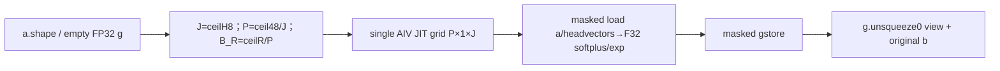
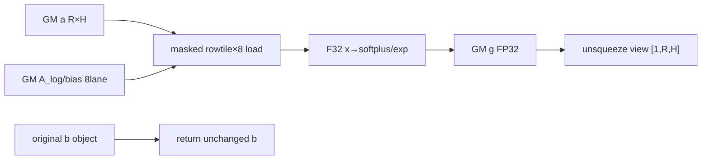

# GDN 仅衰减门控 950 Direct Invoke 算子知识


## 算子速览

| 项目 | 内容 |
|---|---|
| 实际入口 | sgl_kernel_npu.fla.fused_gdn_gating.fused_gdn_gating_kernel_without_sigmoid，Direct Invoke |
| 计算语义 | 只生成g=−exp(A_log)·softplus_beta,threshold(a+bias)，返回(g.unsqueeze0,原b对象)，不计算sigmoid |
| 输入输出 | a[R,H]，vectors[H]；新g FP32返回[1,R,H]；b直接forward，输入不改 |
| 执行类型 | 单AIV_VECTOR JIT，elementwise exp/log/where；无dot/Cube/MIX/跨lane归约 |
| Kernel 路线 | R001 B_R=ceil(R/ceil(48/ceil(H/8)))为positivePOT；R002非POT源可达编译前提边界 |
| 核心资源 | 固定48作为Host调度常量，grid(P,1,J)，B_H8，logicaltile[B_R,8]；无UB容量guard |
| 来源闭包 | direct_implementation_closed：11参数、完整Host/JIT、对象forward、打包与精确CI/test接线闭合 |
| 风险 | BLK_BATCHES未P2化且无guard；非P2 arange前提未保证，不能断言其编译成功/已运行报错；48不是检测到的当前硬件核数 |
| 验证状态 | draft；本次知识提取未执行编译、真机、数值或性能测试，CI/test来源只说明计划接线，不表示已通过 |

## 接口与语义

### 计算语义

每row/head，x=F32(a)+F32(dt_bias)，softplus在beta*x≤threshold时=(1/beta)*log(1+exp(beta*x))，否则x；g=−exp(F32(A_log))*softplus，写FP32。beta默认1、threshold20为constexpr实参；阈值包含等号且比较beta*x。tl.where值选择不能证明中间exp没有计算或不会溢出。该独立语义只算衰减g，没有sigmoid、更新weight、状态递推或cumsum。

b不在Device参数、Host不读其shape/dtype/device/内容，直接return同一PythonTensor对象。返回g是新FP32base的unsqueeze(0)view，shape[1,R,H]且共享该新base storage；不是给原a增加维度。调用方后续修改返回b会影响原b，因为它们是同对象；source本调用不修改a、b、A_log或bias。不将主双gate入口生成新sigmoidβ的合同混入。

### 输入、输出与属性

| 参数 | shape/layout | dtype | 约束、默认值与语义 |
|---|---|---|---|
| A_log | 期望H个densehead | F16/BF16/F32为专属test实例 | Host无numel/stride/shape检查；kernel按head_off读取后F32 |
| a | [R,H]dense | F16/BF16/F32为专属test实例 | 同NPU且连续caller保证，Host只shape解包 |
| b | passthroughTensor | 原样 | 没有Device访问、不需为本g计算转换；不扩不相关类型支持 |
| dt_bias | 期望H个densehead | F16/BF16/F32为专属test实例 | 同A_log寻址/合同 |
| beta | constexprfloat | 默认1 | 数学合同>0，Host无校验 |
| threshold | constexprfloat | 默认20 | 对beta*x比较；未校验finite |
| g返回 | [1,R,H]view | FP32、a.device | 新empty_like(a,F32) base后unsqueeze；contiguousa时dense |
| 第二返回 | b原对象 | 同原b | 不新分配、不sigmoid、不copy |

允许的常规复用域R/H>0、densea/vectors、同NPU、容量足够、B_R满足静态arange前提；source没有这些完整validation。专属test的四组dtype/shape只定义测试，不把任意floating格式/非连续视图推为已验证支持。empty_like默认preserve_format不能替flatkernel修复noncontiguousa的逻辑stride。

### 入口与版本

这是legacy Direct，非公开registered operators.* wrapper、非ACLNN；包fla/__init__.py为空，真实Host/JIT在单file。模块导入rootutils.get_device_properties，但本函数不调用，固定48不会随平台自动检测；同file全局UNIFIED_BUFFER_SIZE1572864和主gatefactor属于其它Host，不用于本入口。

专属test明确调用选定Host；pr-test-kernels.yml的test-fla-ops设CANN9.1.0×A3/950，通过pr-test-kernel-group.yml的A3/A5runner与image执行prepare/run group=fla。run_kernel_tests.sh活动FLA_TESTS含精确test，CANN9.1仅过滤triangular_inverse/chunk_gdn_triton等，950过滤列表也未排该项。该链是固定源公开的计划平台依据，Frontmatter只本卡A3或950，无A2推断；没有本次运行成功事实。

[双gate API](../../../../apis/sgl_kernel_npu/sgl_gdn_gating.md)与[当前双gate源码](sgl_fused_gdn_gating_950.md)可作接口对照，其sigmoid新输出/shapeR,H/动态核数不替代此独立目标的b identity、g前导1维和fixed48。

## Host/Launcher 执行流程

### 参数校验与前处理

Host解包batch,num_heads=a.shape，seq_len1，g=empty_like(a,F32)，num_cores48，J=ceil(H/8)，P=ceil(48/J)，B_R=ceil(R/P)，grid(P,1,J)；launch传11参数、B_H8、num_warps1，未指定num_stages。然后g.unsqueeze0并return(g,b)。没有_validate/assert、contiguous/devicecast、设备资源查询或fallback。

H>0⇒J≥1⇒P≥1；J>48时ceil(48/J)=1，**不是0**。总program P*J在J≤48时可大于48（例如J5，P10，总50），J>48时总数J，不能把固定48写成launch最多48或实际物理corecount。每program只处理一个rowtile/headtile，不像主gate含ROW_ITER/COL_ITER双loop。

### 参数、Workspace 与生命周期

gbase新增4RH B，unsqueeze只是view无第二份4RH；b原对象无新增GM、无读写流量。有效输入a RH*sA、Alog H*sL、bias H*sD。无自有workspace/systemworkspace/executor/queue/event；模块globalU不影响此字节账。input保持到kernel消费，gview持有base；breturn继承调用方原owner，无“内部bcopy”生命周期。

一次Triton JIT在框架currentstream提交；returnview/b非同步。source无record_stream/free或手工event，框架/Tritonprimitive负责Tensor消费合同，不凭Host书写次序制造跨stream安全保证。Hostallocation/JIT异常直接传播，未return；None/错误shape/除零/编译前提边界不走主gate替代。

### 启动图与失败传播



H0使J0后P公式分母0，R0使B_R0不满足positivearange正常前提；源未guard，作为精确非法域边界，不把具体未执行runtime/前端异常字符串编造出来。R/H>0但B_R非POT仍会launch相同body，列R002并停在未保证compiler前提，不虚构后续实际轨迹。所有可达Device数学节点无Cube，使用VV。

## Route 与参数设计

### 分核与资源计算

J=ceil(H/8)，P=ceil(48/J)，B_R=ceil(R/P)，grid(P,1,J)，B_H8；program(pid0=p,pid1=0,pid2=j)负责row[p*B_R,(p+1)*B_R)与head[j*8,(j+1)*8)，联合mask只写r<R,h<H。正R/H时覆盖完整且无program输出冲突；headvector在每rowprogram重复读，b不传入。

B_R没有next_power_of_2/clamp/cap/UB预算：例如R17,H8→J1/P48/B_R1正常POT；R65,H8→B_R2；R145,H8→B_R4；R97,H8→B_R3，不满足tl.arange端点P2的正常编译前提。仅据源码可说未保证前提，不能声称已编译报错、fallback或Device仍算出某确定值。B_R大时logicaltile8*B_R增长，source无capacityguard；真实compiler资源需另核。

单tile logical input=8*B_R*sA+8*(sL+sD)，goutput=8*B_R*4；F32x/softplus/g各8B_Rlane，headvector各8lane。输入有效总GM RH*sA+H*(sL+sD)，输出4RH B；跨program重复headvector读取按P因子。物理UB/register由compilerSSA调度，不能把上述logic域求和当峰值，也不能套同文件1572864B或当前refactor96KiB的预算。

### Route 选择

| 顺序 | Route | Key/模板 | 精确选择条件与优先级 | 不适用去向 |
|---:|---|---|---|---|
| 1 | R-001 合法行块的单节点衰减 | B_H8；B_RpositivePOT | R>0,H>0，P/J公式、B_R≥1且B_R&(B_R−1)==0，caller shape/dtype/layout/device合同 | 非POT到R002；Host未执行这个guard |
| 2 | R-002 非二次幂行块的编译前提终点 | 同entry；B_RnonPOT | R>0,H>0，B_R>0且B_R&(B_R−1)!=0，Host仍提交 | compiler前提未保证；无sourcefallback，不写确定执行结果 |

```text
伪码（源码没有POT判断，以下是知识边界分类，不补造Hostguard）：
allocate g; J=ceilH8; P=ceil48/J; B_R=ceilR/P
H0 -> denominator0非法域
R0 -> B_R0非法arange域
R,Hpositive -> sameJIT(P,1,J),constexprB_R
  if B_R is positivePOT: R001（正常静态arange前提）
  else: R002（源码可达compilerboundary，无运行结论）
after successfulsubmission: unsqueezeg; return originalb
```

### 模板/实现执行矩阵

| Route | key/selector | dtype/shape/platform 完整命中条件 | 执行拓扑与 Kernel 节点 | 实际模板/body | 内存与同步特征 | tail/fallback |
|---|---|---|---|---|---|---|
| R-001 | constexprH/beta/threshold/B_R/8 | R/Hpositive、B_RpositivePOT、常规F16/BF16/F32densea/vectors、同NPU与容量caller合同、本卡平台 | 单AIV_VECTOR gridP×1×J，warps1，无指定stages | fused_gdn_gating_kernel_without_sigmoid_kernel | B_R×8laneF32数学，自有workspace0；gview/baseowner，b原对象 | row/headmask；无assert/fallback |
| R-002 | 同参数结构，B_RnonPOT | R/Hpositive且非POTB_R，其余caller合同 | Host选择相同JIT；实际编译/执行未保证 | 完整body已见；arange(0,B_R)前提缺guard | 按B_R符号化logic资源，不声称物理分配成功 | compilerboundary终点，不能推下游store已执行 |

### 隐藏性能 Guard

| Guard | Host/Tiling 条件 | Device/资源原因 | 影响 Route | 不满足时去向 | 源码符号 |
|---|---|---|---|---|---|
| Hpositive | 未显式guard，J=ceilH8 | P=ceil48/J分母 | 全部 | H0非法公式域 | HostNUM_BLK_BATCHES |
| B_RpositivePOT | 未显式guard，无roundup | tl.arange静态tile前提 | R001/2 | R002未保证编译，非fallback | BLK_BATCHES/arange |
| dense/capacity | 无Host校验 | flat row/head寻址 | 全部 | raw非合同，不扩支持 | a_off/head_off |
| fixed48 | 常量，不调用helper | program分配启发式 | 全部 | J>48仍P1，不存在P0branch | num_cores |
| beta>0 | 未校验 | softplus除beta/斜率 | 全部 | 非公开数学域，未验证 | constexprbeta |
| local容量 | 没有资源guard | B_R*8 F32domains随R增 | R001即使POT仍需compile资源验证 | 无分块loop/fallback | Host/JIT |
| 平台 | 专属test在FLA CI计划A3/950且未filter | 公开无整组支持表 | 全部 | A2不加入，不声称真机pass | workflows/run_kernel_tests |

### POD/ABI

无C++POD。11个源参数按下表闭合，pointer/runtimeinteger实际位宽、packoffset/sizeof/alignof由Triton ABI决定且固定仓未显式声明；不编造64/32位值。H/beta/threshold/B_R/B_H是constexpr专化，num_warps1另属launchoption、未指定stages。

| 结构 | 字段 | 类型/位宽 | ABI 布局 | 单位 | Host/launcher producer | Device consumer | 边界 |
|---|---|---|---|---|---|---|---|
| Triton tuple | g | pointer F32 | arg0，physicaloffset未声明 | byte* | empty_like(a,F32) | storeg+a_off | 4RH |
| Triton tuple | A_log | pointer inputtype | arg1，physicaloffset未声明 | byte* | caller | loadhead | denseH |
| Triton tuple | a | pointer inputtype | arg2，physicaloffset未声明 | byte* | caller | loada_off | denseR,H |
| Triton tuple | dt_bias | pointer inputtype | arg3，physicaloffset未声明 | byte* | caller | loadhead | denseH |
| Triton tuple | batch | runtimeinteger；lower位宽未声明 | arg4，physicaloffset未声明 | row | a.shape0 | batchmask | R>0正常域 |
| Triton tuple | seq_len | runtimeinteger；lower位宽未声明 | arg5，physicaloffset未声明 | token | 1 | a_off rowstride+i_s | i_s0 |
| Triton tuple | NUM_HEADS | tl.constexpr int | arg6 compile，physicaloffset未声明 | head | a.shape1 | headmask/stride | H>0正常域 |
| Triton tuple | beta | tl.constexpr float | arg7 compile，physicaloffset未声明 | slope | 默认1/caller | softplus | 与主gate runtime不同 |
| Triton tuple | threshold | tl.constexpr float | arg8 compile，physicaloffset未声明 | value | 默认20/caller | beta*x比较 | finitecaller |
| Triton tuple | BLK_BATCHES | tl.constexpr int | arg9 compile，physicaloffset未声明 | row | ceil(R/ceil(48/ceil(H/8))) | arangeB_R/rowtile | 未P2化 |
| Triton tuple | BLK_HEADS | tl.constexpr int | arg10 compile，physicaloffset未声明 | head | 8 | arange8/headtile | headtailmask |

### Route 源码闭包

| Route | Key/selector | Host/Tiling producer | POD/参数 | Kernel entry/router 节点 | Kernel body/直接依赖 | 构建接线 |
|---|---|---|---|---|---|---|
| R-001 | B_RpositivePOT；Host同公式 | python/sgl_kernel_npu/sgl_kernel_npu/fla/fused_gdn_gating.py:fused_gdn_gating_kernel_without_sigmoid | 上表11字段，无b指针 | 同file:fused_gdn_gating_kernel_without_sigmoid_kernel | 完整maskedload/F32math/store，tl primitivescompilerboundary | setup.py→torch_wheel.stage_runtime复制fla；包init扩展导入；CI/test精确接线 |
| R-002 | B_RnonPOT边界；Host同公式 | python/sgl_kernel_npu/sgl_kernel_npu/fla/fused_gdn_gating.py:fused_gdn_gating_kernel_without_sigmoid | 上表11字段，无b指针 | 同file:fused_gdn_gating_kernel_without_sigmoid_kernel | 完整maskedload/F32math/store，tl primitivescompilerboundary | setup.py→torch_wheel.stage_runtime复制fla；包init扩展导入；CI/test精确接线 |

## Kernel 实现

### 公共执行流程

source唯一个ownednode的11参数/完整body已读；R002编译前提不满足时不能据下文符号化body推定已实际执行。三维program_id决定独占rowtile/headtile，loadAlog/bias8lane广播与a矩形，转F32算门控，只storeg，source没有read/writeb。没有perprogramloop、归约、dot、Cube、SIMT、NDDMA或通信节点。Tritonprimitive的lane布局/exp精度/物理UB与机器Vectorrepeat参数是compiler边界，不补造手工queue/flag。

### Route R-001：合法行块的单节点衰减

#### 适用条件

##### 选择证据

| 层级 | 文件 | 符号 | 源码谓词/参数 | 结果/下一跳 |
|---|---|---|---|---|
| test入口 | tests/python/sgl_kernel_npu/test_fused_gdn_gating_without_sigmoid.py | run_positive_case | selectedlegacyHost精确调用，四组test定义 | 平台计划证据，不等于本次通过 |
| Host | python/sgl_kernel_npu/sgl_kernel_npu/fla/fused_gdn_gating.py | fused_gdn_gating_kernel_without_sigmoid | R/Hpositive；J=ceilH8,P=ceil48/J,B_R=ceilR/P | grid(P,1,J),warps1 |
| 分域 | python/sgl_kernel_npu/sgl_kernel_npu/fla/fused_gdn_gating.py | BLK_BATCHES | B_RpositivePOT（知识分类，Host无if） | 静态arange正常前提 |

#### Device 数据流

##### 函数级调用链

```text
fused_gdn_gating_kernel_without_sigmoid
 -> empty_like(a,F32); fixed48; computeJ/P/B_R
 -> fused_gdn_gating_kernel_without_sigmoid_kernel[grid(P,1,J),warps1]
   -> pid0/1/2 -> row/head offsets -> masks
   -> loadAlog/bias/a -> F32x/softplus/decay -> maskedstoreg
 -> g.unsqueeze0 -> return(g,originalb)
# 正常合法tile的source图，运行仍未验证
```

##### 源码等价伪码

```text
伪码；B_RpositivePOT正常域
p=pid0; s=pid1=0; j=pid2
rr=p*B_R+arange(B_R); hh=j*8+arange(8)
hm=hh<H; m=(rr[:,None]<R)&hm[None,:]
off=rr[:,None]*1*H+0*H+hh[None,:]
L=load(A_log+hh,hm); D=load(bias+hh,hm); A=load(a+off,m)
x=F32(A)+F32(D) # [B_R,8]+[8]广播
sp=where(beta*x<=threshold,(1/beta)*log(1+exp(beta*x)),x)
gg=-exp(F32(L))*sp
store(g+off,gg.to(F32),m)
# Device无b指针；Host随后returnviewg与同一b
```

#### 内存与数据搬运

##### 资源与搬运表

| 层级/缓冲区 | offset/地址公式 | extent/容量公式 | dtype/layout | producer | consumer | owner/lifetime | 对齐/复用 |
|---|---|---|---|---|---|---|---|
| a GM | off*sA | RH*sA | denseR,H caller合同 | caller | maskedload | caller到消费 | rawHost无contiguousguard |
| A_log GM | hh*sL | H*sL | densehead | caller | headload→exp | caller到消费 | no stride/numelguard |
| bias GM | hh*sD | H*sD | densehead | caller | headload→x | caller到消费 | 同上 |
| gbase GM | off*4 | 4RH | FP32 R,H（densea时） | Hostempty/Device | gview/后续consumer | 返回view保持newbase | 独占row/head片 |
| g返回view | samebaseoffset0 | 与base相同4RH，不新增 | [1,R,H]F32 | unsqueeze0 | caller | view共享新baseowner | 只增加维度 |
| b返回对象 | caller原指针 | 原有capacity；新增0 | 原shape/dtype/device | caller | caller下一逻辑 | 同一PythonTensor | 没有本kernelGM访问 |
| compiler local a/x/sp/g | [B_R,8] | 输入8B_R*sA；每F32矩形32B_R B | lane矩形 | tl.load/F32expr | expr/store | 当前programSSA | 物理UB/register未声明，正常tile |
| head local L/D | [8] | 输入8(sL+sD)，各F32cast32B | lane8广播 | headload | x/decay | 当前programSSA | 每p重复read，无sourcecache |
| workspace/Queue/window | N/A | 自有workspace0；其它N/A | compilerlower | 无自有分配 | 无 | N/A | moduleU未在本Host使用 |

##### 分层内存布局

owned UB block-beta：N/A；没有InitBuffer/TQue/TBuf/LocalTensor或dynamicUB分配。实际替代为compiler localSSA：



图是正常source依赖，非具体物理UBlayout或运行采样。

##### 字节账与复用顺序

```text
J=ceil(H/8), P=ceil(48/J), B_R=ceil(R/P)
logical a inputtile=8*B_R*sA
logical headinputtile=8*(sL+sD)
logical gstoretile=32*B_R
singleF32 intermediate rect=32*B_R bytes；headcast单个32B
source_ownedUB=N/A；compiler physicalUB/register=未声明
workspace_total=0；newgbase=4RH；gview新增0；bforward新增0/访问0
没有source容量guard，不能写UB_total<=某平台上限
source分块覆盖需B_RpositivePOT与caller合同
```

| 复用子区 | 写入者 | 读取者/消费点 | 下一次覆盖 | 同步或释放依据 | 安全条件 |
|---|---|---|---|---|---|
| local a/head | tl.load | x/exp | 本program无下一tileloop | compilerSSA，不存在手工FreeTensor | 当前expr消费前存活 |
| local x/sp/g | F32expr | 下游expr/store | compiler选择物理复用 | SSA数据依赖 | 不推导物理别名/峰值 |
| gbase | maskedstore | 返回gview后续consumer | 本source不再改 | runtime当前stream合同 | 保持Tensor生存，row/head独占 |
| b original | 本调用不写 | caller | caller定义 | 无Device同步/读写需求来自本node | 原对象共享，不期待私有copy |
| inputs | caller | maskedload | 本source只读 | caller生命周期 | 不并发改写；合法dense/capacity |

#### 同步、精度与尾块

##### 同步与数值边界表

| 阶段 | primitive/机制 | producer | consumer/等待点 | 保护对象 | 精度/尾块 |
|---|---|---|---|---|---|
| load | tl.load mask，无other0 | a/headvectors | F32expr | rr<R/hh<H | lane独立无归约；invalidlane不进入validlane |
| x/softplus | toF32 + where/log/exp | a/bias | g计算 | tileSSA | F32后加，beta*x≤threshold含等号；where非短路 |
| decay/store | exp(F32Alog)*sp→storeF32 | L/sp | gbase | 有效lane | 输出F32；没有betaout或sigmoid |
| synchronization | compilerSSA | 前一expr | consumer | local | 无event/barrier/atomic/Queue，无跨program组合 |
| tails | row/head jointmask | off/mask | load/store | 最后row/headtile | 无rowloop；不足B_R/8直接mask |
| return | unsqueeze view + b对象 | HostsubmitsJIT | caller | gbase生命周期 | return不等于同步；本次未实测 |

#### 关键实现

##### 符号证据表

| 阶段 | 文件 | 符号/模板实例 | 实现事实 |
|---|---|---|---|
| Host/Tiling producer | python/sgl_kernel_npu/sgl_kernel_npu/fla/fused_gdn_gating.py | fused_gdn_gating_kernel_without_sigmoid | P/J/B_R、fixed48、gempty/unsqueeze、bforward |
| Kernel entry/router | python/sgl_kernel_npu/sgl_kernel_npu/fla/fused_gdn_gating.py | fused_gdn_gating_kernel_without_sigmoid_kernel[H,beta,threshold,B_R,8] | 11参数，无b，无heuristics/dot |
| Device body/helper | python/sgl_kernel_npu/sgl_kernel_npu/fla/fused_gdn_gating.py | 同完整body | mask、F32 math、store；合法静态tile |
| build/platform | scripts/run_kernel_tests.sh | FLA_TESTS + twofilters | exacttest活动、9.1/A5未过滤；非运行结果 |


### Route R-002：非二次幂行块的编译前提终点

#### 适用条件

##### 选择证据

| 层级 | 文件 | 符号 | 源码谓词/参数 | 结果/下一跳 |
|---|---|---|---|---|
| test入口 | tests/python/sgl_kernel_npu/test_fused_gdn_gating_without_sigmoid.py | run_positive_case | selectedlegacyHost精确调用，四组test定义 | 平台计划证据，不等于本次通过 |
| Host | python/sgl_kernel_npu/sgl_kernel_npu/fla/fused_gdn_gating.py | fused_gdn_gating_kernel_without_sigmoid | R/Hpositive；J=ceilH8,P=ceil48/J,B_R=ceilR/P | grid(P,1,J),warps1 |
| 分域 | python/sgl_kernel_npu/sgl_kernel_npu/fla/fused_gdn_gating.py | BLK_BATCHES | B_RnonPOT（知识分类，Host无if） | 未保证compiler前提，不推定成功或报错 |

#### Device 数据流

##### 函数级调用链

```text
fused_gdn_gating_kernel_without_sigmoid
 -> empty_like(a,F32); fixed48; computeJ/P/B_R
 -> fused_gdn_gating_kernel_without_sigmoid_kernel[grid(P,1,J),warps1]
   -> pid0/1/2 -> row/head offsets -> masks
   -> loadAlog/bias/a -> F32x/softplus/decay -> maskedstoreg
 -> g.unsqueeze0 -> return(g,originalb)
# Host选择可达；arange非POT前提未保证，上述body仅符号化，不代表实际执行
```

##### 源码等价伪码

```text
伪码；B_RnonPOT，编译前提终点；不虚构真实后续轨迹
p=pid0; s=pid1=0; j=pid2
rr=p*B_R+arange(B_R); hh=j*8+arange(8)
hm=hh<H; m=(rr[:,None]<R)&hm[None,:]
off=rr[:,None]*1*H+0*H+hh[None,:]
L=load(A_log+hh,hm); D=load(bias+hh,hm); A=load(a+off,m)
x=F32(A)+F32(D) # [B_R,8]+[8]广播
sp=where(beta*x<=threshold,(1/beta)*log(1+exp(beta*x)),x)
gg=-exp(F32(L))*sp
store(g+off,gg.to(F32),m)
# Device无b指针；Host随后returnviewg与同一b
```

#### 内存与数据搬运

##### 资源与搬运表

| 层级/缓冲区 | offset/地址公式 | extent/容量公式 | dtype/layout | producer | consumer | owner/lifetime | 对齐/复用 |
|---|---|---|---|---|---|---|---|
| a GM | off*sA | RH*sA | denseR,H caller合同 | caller | maskedload | caller到消费 | rawHost无contiguousguard |
| A_log GM | hh*sL | H*sL | densehead | caller | headload→exp | caller到消费 | no stride/numelguard |
| bias GM | hh*sD | H*sD | densehead | caller | headload→x | caller到消费 | 同上 |
| gbase GM | off*4 | 4RH | FP32 R,H（densea时） | Hostempty/Device | gview/后续consumer | 返回view保持newbase | 独占row/head片 |
| g返回view | samebaseoffset0 | 与base相同4RH，不新增 | [1,R,H]F32 | unsqueeze0 | caller | view共享新baseowner | 只增加维度 |
| b返回对象 | caller原指针 | 原有capacity；新增0 | 原shape/dtype/device | caller | caller下一逻辑 | 同一PythonTensor | 没有本kernelGM访问 |
| compiler local a/x/sp/g | [B_R,8] | 输入8B_R*sA；每F32矩形32B_R B | lane矩形 | tl.load/F32expr | expr/store | 当前programSSA | 物理UB/register未声明，是否成功lower未保证 |
| head local L/D | [8] | 输入8(sL+sD)，各F32cast32B | lane8广播 | headload | x/decay | 当前programSSA | 每p重复read，无sourcecache |
| workspace/Queue/window | N/A | 自有workspace0；其它N/A | compilerlower | 无自有分配 | 无 | N/A | moduleU未在本Host使用 |

##### 分层内存布局

owned UB block-beta：N/A；没有InitBuffer/TQue/TBuf/LocalTensor或dynamicUB分配。实际替代为compiler localSSA：


本Route停在未保证arange编译前提；图表示已可追溯的相同body依赖，不声称这些GM访问已发生。

##### 字节账与复用顺序

```text
J=ceil(H/8), P=ceil(48/J), B_R=ceil(R/P)
logical a inputtile=8*B_R*sA
logical headinputtile=8*(sL+sD)
logical gstoretile=32*B_R
singleF32 intermediate rect=32*B_R bytes；headcast单个32B
source_ownedUB=N/A；compiler physicalUB/register=未声明
workspace_total=0；newgbase=4RH；gview新增0；bforward新增0/访问0
没有source容量guard，不能写UB_total<=某平台上限
上述是符号化容量，不等于nonPOT已成功物化
```

| 复用子区 | 写入者 | 读取者/消费点 | 下一次覆盖 | 同步或释放依据 | 安全条件 |
|---|---|---|---|---|---|
| local a/head | tl.load | x/exp | 本program无下一tileloop | compilerSSA，不存在手工FreeTensor | 当前expr消费前存活 |
| local x/sp/g | F32expr | 下游expr/store | compiler选择物理复用 | SSA数据依赖 | 不推导物理别名/峰值 |
| gbase | maskedstore | 返回gview后续consumer | 本source不再改 | runtime当前stream合同 | 保持Tensor生存，row/head独占 |
| b original | 本调用不写 | caller | caller定义 | 无Device同步/读写需求来自本node | 原对象共享，不期待私有copy |
| inputs | caller | maskedload | 本source只读 | caller生命周期 | 不并发改写；合法dense/capacity |

#### 同步、精度与尾块

##### 同步与数值边界表

| 阶段 | primitive/机制 | producer | consumer/等待点 | 保护对象 | 精度/尾块 |
|---|---|---|---|---|---|
| load | tl.load mask，无other0 | a/headvectors | F32expr | rr<R/hh<H | lane独立无归约；invalidlane不进入validlane |
| x/softplus | toF32 + where/log/exp | a/bias | g计算 | tileSSA | F32后加，beta*x≤threshold含等号；where非短路 |
| decay/store | exp(F32Alog)*sp→storeF32 | L/sp | gbase | 有效lane | 输出F32；没有betaout或sigmoid |
| synchronization | compilerSSA | 前一expr | consumer | local | 无event/barrier/atomic/Queue，无跨program组合 |
| tails | row/head jointmask | off/mask | load/store | 最后row/headtile | 无rowloop；不足B_R/8直接mask |
| return | unsqueeze view + b对象 | HostsubmitsJIT | caller | gbase生命周期 | return不等于同步；本Route未保证compile成功，不能声称return已执行 |

#### 关键实现

##### 符号证据表

| 阶段 | 文件 | 符号/模板实例 | 实现事实 |
|---|---|---|---|
| Host/Tiling producer | python/sgl_kernel_npu/sgl_kernel_npu/fla/fused_gdn_gating.py | fused_gdn_gating_kernel_without_sigmoid | P/J/B_R、fixed48、gempty/unsqueeze、bforward |
| Kernel entry/router | python/sgl_kernel_npu/sgl_kernel_npu/fla/fused_gdn_gating.py | fused_gdn_gating_kernel_without_sigmoid_kernel[H,beta,threshold,B_R,8] | 11参数，无b，无heuristics/dot |
| Device body/helper | python/sgl_kernel_npu/sgl_kernel_npu/fla/fused_gdn_gating.py | 同完整body | mask、F32 math、store；nonPOT前提未guard |
| build/platform | scripts/run_kernel_tests.sh | FLA_TESTS + twofilters | exacttest活动、9.1/A5未过滤；非运行结果 |

## 算子特定优化

### Trick T-001：三维grid与row/head独占映射

#### 触发与源码依据

- 适用 Route：R001/R002；R002仅符号化。
- 触发条件：各Route的shape/dtype/layout/capacity及B_R前提；源失败终点不推定后续执行。
- Golden 来源：[固定legacy实现 L154–L164](https://github.com/sgl-project/sgl-kernel-npu/blob/dda6d36b0cdb4081e102d14c0a2fb276fc416e69/python/sgl_kernel_npu/sgl_kernel_npu/fla/fused_gdn_gating.py#L154-L164)

**官方源码（固定 Commit 连续逐字摘录）**：

```python
    i_b, i_s, i_d = tl.program_id(0), tl.program_id(1), tl.program_id(2)
    batch_off = i_b * BLK_BATCHES + tl.arange(0, BLK_BATCHES)
    head_off = i_d * BLK_HEADS + tl.arange(0, BLK_HEADS)
    head_mask = head_off < NUM_HEADS
    a_off = (
        batch_off[:, None] * seq_len * NUM_HEADS + i_s * NUM_HEADS + head_off[None, :]
    )
    a_mask = (batch_off[:, None] < batch) & head_mask[None, :]
    blk_A_log = tl.load(A_log + head_off, mask=head_mask)
    blk_bias = tl.load(dt_bias + head_off, mask=head_mask)
    blk_a = tl.load(a + a_off, mask=a_mask)
```

#### 机制与设计原因

rowpid负责B_R行，headpid负责8head，seqpid恒0；一次jointmask覆盖两维。无loop/归约，headvector按rowprogram重复load。maskedload没有other0，但paddinglane不跨validlane归约。

#### 迁移边界

- 适用/前提/失效：densea/vectors与合法capacity，正常arange前提；不要把maingate的ROW_ITER/COL_ITER调度带入。
- 未验证：本次知识提取未执行编译、真机、数值或性能测试。

#### 错误做法

固定仓未提供可验证运行反例；必须保留上述源条件，不伪造性能或编译测试结果。

### Trick T-002：仅log-decay的FP32门控融合

#### 触发与源码依据

- 适用 Route：R001有效lane；R002是否lower未保证。
- 触发条件：各Route的shape/dtype/layout/capacity及B_R前提；源失败终点不推定后续执行。
- Golden 来源：[固定legacy实现 L165–L170](https://github.com/sgl-project/sgl-kernel-npu/blob/dda6d36b0cdb4081e102d14c0a2fb276fc416e69/python/sgl_kernel_npu/sgl_kernel_npu/fla/fused_gdn_gating.py#L165-L170)

**官方源码（固定 Commit 连续逐字摘录）**：

```python
    x = blk_a.to(tl.float32) + blk_bias.to(tl.float32)
    softplus_x = tl.where(
        beta * x <= threshold, (1 / beta) * tl.log(1 + tl.exp(beta * x)), x
    )
    blk_g = -tl.exp(blk_A_log.to(tl.float32)) * softplus_x
    tl.store(g + a_off, blk_g.to(g.dtype.element_ty), mask=a_mask)
```

#### 机制与设计原因

a/bias/Alog显式转F32，softplus阈值比较beta*x，输出仅gF32；没有sigmoid/b参数流，避免生成未需要的更新weight。但不写未经测试的节时百分比。

#### 迁移边界

- 适用/前提/失效：beta>0与finite常规输入；constexprbeta/threshold会专化；阈值不是exp绝不执行的控制流保证。
- 未验证：本次知识提取未执行编译、真机、数值或性能测试。

#### 错误做法

固定仓未提供可验证运行反例；必须保留上述源条件，不伪造性能或编译测试结果。

### Trick T-003：固定48启发式与未圆整行块

#### 触发与源码依据

- 适用 Route：两Route都由相同Host产生。
- 触发条件：各Route的shape/dtype/layout/capacity及B_R前提；源失败终点不推定后续执行。
- Golden 来源：[固定legacy实现 L181–L200](https://github.com/sgl-project/sgl-kernel-npu/blob/dda6d36b0cdb4081e102d14c0a2fb276fc416e69/python/sgl_kernel_npu/sgl_kernel_npu/fla/fused_gdn_gating.py#L181-L200)

**官方源码（固定 Commit 连续逐字摘录）**：

```python
    batch, num_heads = a.shape
    seq_len = 1
    g = torch.empty_like(a, dtype=torch.float32)
    num_cores = 48  # num_vectorcore of NPU
    NUM_BLK_BATCHES = triton.cdiv(num_cores, triton.cdiv(num_heads, 8))
    BLK_BATCHES = triton.cdiv(batch, NUM_BLK_BATCHES)
    grid = (NUM_BLK_BATCHES, seq_len, triton.cdiv(num_heads, 8))
    fused_gdn_gating_kernel_without_sigmoid_kernel[grid](
        g,
        A_log,
        a,
        dt_bias,
        batch,
        seq_len,
        num_heads,
        beta,
        threshold,
        BLK_BATCHES=BLK_BATCHES,
        BLK_HEADS=8,
        num_warps=1,
```

#### 机制与设计原因

J=ceil(H/8)，P=ceil(48/J)，B_R=ceil(R/P)。P≥1，J>48仍P1；总P*J可能>48。B_R未roundPOT、未cap、未做资源估算，必须把编译前提与source闭包分开。

#### 迁移边界

- 适用/前提/失效：H/Rpositive，B_R正常P2/资源另核。nonPOT保留R002不声称确定报错或Device输出。
- 未验证：本次知识提取未执行编译、真机、数值或性能测试。

#### 错误做法

把J>48解释成P0或零grid是错误的向上取整推导；正J>48时ceil(48/J)=1。另一个错误是无依据把B_R替换nextPOT后仍称原source实参。

### Trick T-004：新g的view返回与b对象forward

#### 触发与源码依据

- 适用 Route：成功提交后的返回路径。
- 触发条件：各Route的shape/dtype/layout/capacity及B_R前提；源失败终点不推定后续执行。
- Golden 来源：[固定legacy实现 L202–L203](https://github.com/sgl-project/sgl-kernel-npu/blob/dda6d36b0cdb4081e102d14c0a2fb276fc416e69/python/sgl_kernel_npu/sgl_kernel_npu/fla/fused_gdn_gating.py#L202-L203)

**官方源码（固定 Commit 连续逐字摘录）**：

```python
    g = g.unsqueeze(0)
    return g, b
```

#### 机制与设计原因

unsqueeze(0)只给新FP32g增加前导维度，不复制其4RH storage；return第二项是入参b，没有Host/Device读取/转换。

#### 迁移边界

- 适用/前提/失效：调用方按[1,R,H]消费g与bidentity，不能期待新sigmoidTensor或独立bcopy；g异步消费遵守runtime合同。
- 未验证：本次知识提取未执行编译、真机、数值或性能测试。

#### 错误做法

把第二返回值写成sigmoid(b)或新Tensor会改变入口语义与对象别名；source明确直接return b。

## 模板与实现对比

| 对比维度 | R-001 合法行块衰减 | R-002 非POT编译前提终点 | 设计选择依据 |
|---|---|---|---|
| 命中条件/优先级 | R/Hpositive、B_RpositivePOT | R/Hpositive、B_RnonPOT | Host无POTguard，仅知识分域 |
| 模板与 dtype | H/beta/threshold/B_R/8 constexpr；常规三type load→F32 | 同body/参数结构，B_R非法正常前提 | 不因模板可见推定成功执行 |
| 循环与分核 | gridP×1×J，无loop | 相同Hostgrid | J>48时P1，总program可>48 |
| Queue/TBuf/寄存器/dynamic UB/通信 window | 无sourceownedbuffer，compilerlaneB_R×8 | 符号化同域，lower未保证 | 无UBbudget/手工events |
| 内存总占用与复用 | 新g4RH，view0，bforward0 | Host已分配g；是否成功提交/返回未保证 | 不造后续runtime轨迹 |
| 搬运/Vector/SIMT/NDDMA/通信 API | tl.load/exp/log/where/store，纯Vector | 同body仅可追溯 | 无Cube/归约/SIMT/NDDMA/通信 |
| 同步、精度与 tail | F32门控、jointmask、SSA | 编译前提不足；符号化F32/tail | 无跨program组合 |
| fallback/失败边界 | 资源/非法layout等未完整guard | 无fallback/圆整，compilerboundary | draft不推荐盲目复用 |

## 平台差异

| 项目 | A2 | A3 | Ascend 950 |
|---|---|---|---|
| 支持状态 | 本固定入口无充分平台依据，不加入 | 精确专属test在活动FLA CANN9.1矩阵；本卡按Frontmatter | 同矩阵及950filter未排本项；本卡按Frontmatter |
| Host/Launcher | 不外推 | fixed48、P/J/B_R，无硬件查询 | 同fixed48，不称真实950核数 |
| Kernel/资源 | 不声称 | 同11参数Vectorbody、warps1 | 同sourcebody/warps1，物理资源未知 |
| 证据强度 | 无本项支持结论 | 公开CI计划/测试定义，非实际pass | 同 |
| CI runner | 不在该FLA矩阵 | linux-aarch64-a3-800t-2 | linux-amd64-a5-1 |

实际接线：pr-test-kernels.yml匹配legacyfla/专属test并选择test-fla-ops，矩阵9.1.0×[a3,950]→pr-test-kernel-group.yml image/runner、prepare_kernel_tests.sh与run_kernel_tests.sh fla。prepare配置9.1→triton-ascend3.2.2，可被TRITON_ASCEND_WHL覆盖；这是安装计划，不声称本次环境已有/已运行该版本。FLA_TESTS中test_fused_gdn_gating_without_sigmoid.py保持活动，CANN9.1与950两跳过滤均未删此文件。

专属test定义四组：FP32 R1/H8 beta1/th20；BF16 R16/H8 1/20；FP16 R64/H16 .5/15；BF16 R32/H32 2/25，均g与CPUreference比较并检查bforward数值，test显式NPU synchronize；这些测试定义未本次执行，代码print PASS不是已发生结果，也未直接用is证明对象身份，身份结论来自Hostreturn本身。

## 限制与失败边界

- legacyDirect无publicwrapper完整guard；a/vectorsdense、同device、H容量、beta>0等由caller保证。b不用于计算，但同对象forward别名应由调用方理解。
- BLK_BATCHES=ceil(R/P)无POT圆整，R/Hpositive仍可nonPOT；arange静态正常前提未保证。R002仅记录可达参数与完整body，不宣称已成功编译、确定报错或产生确定output。
- fixed48是源码常量，非资源查询或平台UB事实；P*J可能>48，J>48时P1，不能误算P0。无tile容量检查，大POTB_R也不能据source承诺资源安全。
- H0带来J0/P分母0，R0带来B_R0；源未guard，未把这些域当正常实现或编造具体前端异常结果。
- F32计算与输出、beta*x阈值含等号、where非短路；不保证所有中间exp有限，不补造IEEE/primitive逐位属性。
- empty_like preserve_format不等于对任意stride输入修正，kernel没有stride参数；非连续a/vectors不扩大支持域。
- moduleget_device_properties与UNIFIED_BUFFER_SIZE导入/常量为同文件其它入口使用，本选定Host不调用/读取；不把它们当本入口资源producer。
- 新双gate/mainoldgate均不等价：它们生成sigmoid新输出、无g前导维，Hostgrid与budget也不同。只用普通对照链接，不合并独立语义。
- 源入口/参数/body/打包/CI均已追溯，direct_implementation_closed不表示compiler/数值/平台测试已通过；本次未运行任何测试/上游。

## 源码索引

### 链路索引

| 链路阶段 | 文件 | 关键符号 | 支撑内容 |
|---|---|---|---|
| primary | python/sgl_kernel_npu/sgl_kernel_npu/fla/fused_gdn_gating.py | fused_gdn_gating_kernel_without_sigmoid / *_kernel | 唯一Host与完整Vector数学body，b对象forward |
| supporting | tests/python/sgl_kernel_npu/test_fused_gdn_gating_without_sigmoid.py | run_positive_case/main/reference | 专属test真实入口与dtype/shape；定义非运行结果 |
| supporting | .github/workflows/pr-test-kernels.yml | test-fla-ops | FLA change-match及A3/950 CANN9.1矩阵 |
| supporting | .github/workflows/pr-test-kernel-group.yml | run-kernel-group | runner、image、prepare/run真实接线 |
| supporting | scripts/run_kernel_tests.sh | FLA_TESTS/SKIP_ON_910/SKIP_ON_A5/run_test | 活动FLA_TESTS及9.1/950过滤未排本项 |
| supporting | scripts/prepare_kernel_tests.sh | CANN_VER/TRITON_ASCEND_VER | CANN9.1→triton3.2.2安装配置及kernelwheel准备 |
| implementation | python/sgl_kernel_npu/sgl_kernel_npu/utils/triton_utils.py | get_device_properties（仅import未调用） | 模块实际导入helper；本入口不调用get_device_properties |
| supporting | README.md | 固定文件 | 固定CANN9.1任务版本 |
| supporting | python/sgl_kernel_npu/README.md | 固定文件 | 包结构与平台名背景，不据此外推A2 |
| implementation | setup.py | 固定文件 | wheel构建协调 |
| implementation | python/sgl_kernel_npu/build_tools/torch_wheel.py | stage_runtime | stage_runtime复制legacyPython模块 |
| implementation | python/sgl_kernel_npu/build_tools/target_provider.py | 固定文件 | 打包targetprovider接线 |
| implementation | python/sgl_kernel_npu/sgl_kernel_npu/__init__.py | 固定文件 | 导入kernel扩展的包入口 |

### 实现复用检查

| 检查项 | 可复用事实 | 不得改变的约束 | 源码符号 |
|---|---|---|---|
| ABI/POD | 11参数，constexprH/beta/threshold/B_R/8 | 无b参数，runtimeABI未显式给物理offset | *_without_sigmoid_kernel |
| 调用顺序 | empty→P/J/B_R→单JIT→gview→bforward | 非POT/零域不造已成功后续轨迹 | Host |
| workspace/内存 | workspace0、newg4RH、view0、bidentity | 不将mainU或refactor96KiB误当当前预算 | empty_like/unsqueeze/return |
| 同步 | laneSSA、独占maskedGM，currentstream | 无跨coreevent/atomic；异步owner合同 | tl.load/store |
| 精度与尾块 | F32门控，jointrow/headmask，无归约 | softplusbeta与阈值、where非短路 | tl.where/tl.exp |
| 失败边界 | nonPOTcompiler前提/H0/R0/layout/资源已限定 | A2不外推；CI/test仅计划与定义 | Host/CI exacttest |
