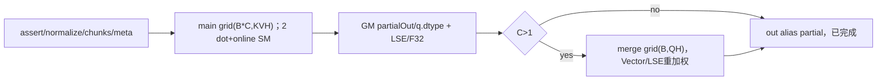
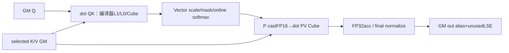
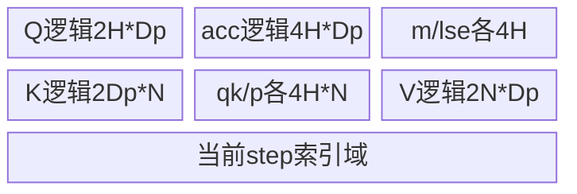
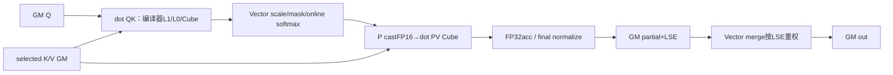
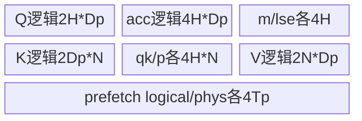

# SGL GQA共享稀疏解码 Ascend 950 Direct Invoke 算子知识

## 算子速览

| 项目 | 内容 |
|---|---|
| 实际入口 | Direct Invoke：sgl_kernel_npu.implementation.triton.attention.gqa_share_sparse_attention.flash_decode_bnsd_with_gqa_share_sparse，**use_native=False**；即公开gqa_share_sparse_decode的triton/auto wrapper实际调用域 |
| 计算语义 | 已选逻辑KV块的GQA共享稀疏decode attention；可选向量sink只进分母；重复块重复计数，非TopK选择算子 |
| 输入输出 | Q[B,QH,D]、K/V[pages,BS,KVH,D] FP16/BF16；topk[KVH或QH,B,S]；页表或request/token映射；输出q同shape/dtype |
| 执行类型 | 主核两次tl.dot（Cube/CV），Vector在线softmax/索引；C>1另一个纯Vector merge kernel。同一program内编译调度与多Kernel拓扑分别说明 |
| Kernel 路线 | R-001..R-072：dtype×3页源×3循环×single/split×sink；R-073失败/非法输入终点。每条均闭合主核及条件merge |
| 核心资源 | FP32acc[H,Dp]、score/P[H,N]，低精Q[H,Dp]/K[Dp,N]/V[N,Dp]；GM split输出2C*B*QH*D B与LSE4C*B*QH B；single alias免额外partial |
| 来源闭包 | direct_implementation_closed：当前Python launcher、GQA normalize/设备属性helper、main/merge两个JIT body、逐arg/meta、owned分支/同步/生命周期闭合。Triton编译器布局/通用tl primitive是明确边界 |
| 验证状态 | 本次知识提取未执行编译、真机、数值或性能测试。draft：S1/prefetch额外page0贡献、finite-floor伪LSE、chunk舍入/UB限制保留；不把源码闭合当正确性保证 |

## 接口与语义

### 计算语义

令G=QH/KVH，query h用kvh=floor(h/G)，该组共享同一selected block表。每个非负logical lb映射到physical page，贡献n=0..BS−1且lb*BS+n<seq_lens[b]的token。对出现次数求softmax(sm_scale·QKᵀ)V，重复lb不去重。sink[QH,D]若存在，计算sm_scale·sum_d(q*sink)作为零value的额外logit，只在chunk0注入一次；不是标量sink/logit输入。mask只依据可见KV前缀，没有额外query position或三角mask，verify/prefill由caller展平query并给每行前缀长度。

每chunk在线维护FP32 m、lse、acc，权重p=exp(qk−mnew)，acc=acc*exp(mold−mnew)+dot(castInputType(p),V)，lse=mnew+log(exp(lseold−mnew)+sum(p))，最后acc*=exp(m−lse)，写q.dtype partial。C>1 merge用FP32按partialLSE重加权已舍入的partial输出，再castq.dtype；不同C/块融合会改变舍入和求和顺序，不能称逐位等价。

实际无sink初值m/lse为−1e30，**并非注释所说−inf**；空chunk的LSE仍−1e30、output0，merge的lse>−inf判断会把它视为有限权重。通常远小于正常logit，但源码对任意有限极负logit不保证与理想空集严格一致。S=1且prefetch=True时CHUNK_SIZE_T被增到2而BLOCK_SIZE_T=1，第二步where+sum没有命中项，返回logical/physical=0并当valid；若seq_len>0则额外page0参与。该确定静态条件见限制，不能描述为纯性能等价优化。

### 输入、输出与属性

| 参数 | shape/layout | dtype | 约束、默认值与语义 |
|---|---|---|---|
| q | [B,QH,D] strided Tensor | FP16/BF16 | B/QH/D>0、同NPU连续合同；kernel显式stride，launcher不主动contiguous Q |
| sink | None或[QH,D] | q.dtype | 向量；None仍传typed q指针、HAS_SINKFalse且stride0，不读placeholder |
| k_cache_bnsd/v_cache_bnsd | [NB,BS,KVH,D] | 同q | launcher assert dtype/shape一致，BS/D匹配；NB/页ID合法由caller |
| block_table | [B,maxBlocks]或None | I32/I64 | BT路线；非负lb必须在capacity内，即使超seq_len也可能先gather页 |
| req_to_token | [requests,maxCtx]或None | I32/I64 | 与BT互斥；只读lb*BS块首slot，physical=slot//BS；assert capacity覆盖maxBlocks*BS |
| req_pool_indices | [B]或None | I32/I64 | 与req_to_token同时给；kernel按无stride连续读取，request越界不守卫 |
| seq_lens | [B] | 文档I32，bodyload后toI32 | 连续读无stride，非负/≤capacity/int32域为caller合同；kernelmin(maxKV)但无下界clamp |
| topk_idx | [KVH或QH,B,S] | I32/I64 | 公开S>0，Normalize先组首head→contiguous；负lb为无效，duplicate不去重 |
| block_size | 正power2 | Python int→constexpr | 与cache dim1相等；正/POT是公开合同，launcher未显式断言而tl.arange受编译约束 |
| sm_scale | float或None | scalar | None→D^−0.5，非自动测试证据 |
| num_topk_chunks | C或None | Pythonint→constexpr | assert≥1/POT/≤max(1,S)；None按helper选，默认cap8 |
| max_num_topk_chunks | scalar | Pythonint默认8 | 仅auto cap，helper≤1归1；不得当显式C限制 |
| topk_blocks_per_step | scalarP | max(1,int(arg))后POT assert | P1单块；P≥2融合；N=BS*P；不会自动降P重试 |
| prefetch_idx | bool | meta | 仅P1有效；P≥2被launcher关False |
| max_num_blocks/num_pages | direct标量 | int或None | direct要求>0；num_pages用于clamp，BT路线placeholder1 |
| sanitize_page_ids | bool | meta | 仅direct物理页夹[0,NP−1]，不检查logical/request；BT实效忽略 |
| num_warps/num_stages | int或None | launcher编译设置 | main默认4/2，可覆盖；merge固定4/2；无本次编译资源报告 |
| use_native | bool | 固定False | 公开gqa wrapper强制False；raw launcher默认True的native分支另入口范围，不列本卡支持 |
| output | [B,QH,D] | q.dtype | empty_like分配；single直接alias partial，split由merge写；不改输入 |

### 入口与版本

公开gqa_share_sparse_decode auto就是triton，wrapper额外use_native=False；torch_native是显式独立参考入口，本卡不把其Torch核心数学算子作为当前fallback。另一个公开flash_decode_bnsd_with_gqa_share_sparse有不同dispatcher/原生路径，本卡链接[双入口API说明](../../../../apis/sgl_kernel_npu/sgl_gqa_shared_sparse_decode.md)以区分。当前direct函数默认use_native=True的原生SAS不在本调用域，不以缺少其分析为由扩大或假称全raw函数闭包。

固定kernel commit dda6d36b0cdb4081e102d14c0a2fb276fc416e69，任务CANN9.1.0由README/CI固定证据和Python构建说明绑定。Triton runtime/JIT/driver通用实现为编译运行框架边界，不假定一个未给出的Triton版本/硬件lowering或SDK测试结果。

## Host/Launcher 执行流程

### 参数校验与前处理

Pythonregistry按impl返回当前_triton，惰性import launcher并固定use_native=False。launcher assertq为half/BF16、K/Vdtype同q、K/Vshape同；跳过native整分支。direct_map由req_to_token是否None决定，assert req_rows同时存在、BT为None、映射rank/dtype与正capacity；BT则assert非空和I32/I64。再解Q/cache维度，assert BS/D一致、QH%KVH=0、seq/topk batch一致和map batch/capacity。并没有检查全部同NPU、sinkshape、seq数值或物理page域，需保持caller合同。

_normalize_topk_idx_for_gqa：首维KVH→contiguous；首维QH→view(KVH,G,B,S)取[:,0,:,:]再contiguous；其它raise。view/contiguous是普通框架预处理边界，没运行TopK/attention核心数学。req/seq无contiguous调用，必须caller准备连续；不因Q有stride参数就宣传所有输入任意stride。

### 参数、Workspace 与生命周期

C=None时：S≤1→1；KVH1且B≤4且S≤17→1；否则get_device_properties取当前设备num_vectorcore（两种core属性均>0 assert），target=max(1,Vcore//max(1,B*KVH))，cap=min(S,maxChunks,target)，floor_power_of_2(cap)。显式C转int后统一assert。CS=max(2,ceil(S/C))，P=max(1,int(blocksArg))且POT，CS=max(CS,P)。prefetch=arg and P1。H=max(16,nextpow2(G))，Dp=nextpow2(D)，Tp=nextpow2(S)，N=BS*P。

out=empty_like(q)。C1令o_partial=out.view(1,B,QH,D)，不再另配partial；C>1另empty([C,B,QH,D],q.dtype)。lse_partial始终empty([C,B,QH],F32)，即C1也分配为主核store目标但不用merge。额外GM=4C*B*QH B + (C>1?2C*B*QH*D:0)；out本体2B*QH*D B另计，normalizedTopk如需要另contiguous缓冲，其extent为KVH*B*S*indexBytes，属于框架准备。无显式workspace参数或aclOpExecutor。

Tensor owner由Python/Torch allocator与当前device stream launch持有，o_partial/lse在merge提交前不释放；调用函数未显式CPU同步、event或跨stream recording，不能扩大为跨stream安全复用。两个Triton launches按同当前流enqueue；依赖前核GMstore→同流后核load，Triton runtime是该顺序边界。

### 启动图与失败传播



main num_warps/num_stages默认4/2，merge固定4/2。assert/import/JIT/编译/launch失败自然抛出，代码不catch后重试参考或不同P设置。单chunk无merge，multi为两个Kernel，不把拓扑数量当执行族。NDDMA/SIMT/通信owned节点N/A；tl.load/store/dot等通用lowering由Triton管理。

## Route 与参数设计

### 分核与资源计算

pid_bc→b=pid_bc%B、c=floor(pid_bc/B)，pid_kh是kvh，query baseh=kvh*G；每program负责该group的H个padded heads、一个topk chunk。head/D尾分别off_h<G、off_d<D，Q padding补0。chunk_start=c*CS，单块循环固定CS步；fused循环ceil((min(start+CS,S)−start)/P)步，每步P个selected block和N=BS*P token。其后多chunkmerge一个program负责一个(b,h)，顺序static C个partial，向量长度Dp。

每主核typed block逻辑值域：Q低精2H*DpB；K低精2Dp*N B；V低精2N*DpB；accF32 4H*DpB；qkF32 4H*N B；PexpF32 4H*N B及dot前低精P2H*N B；m/lse/reduce各4H B。sink存在时chunk0另低精load/FP32sink4H*Dp与FP32product/reduce逻辑域；prefetch另logicalI32[Tp]与physI32[Tp]等索引值域。**这些是源码张量字节账，不能冒充编译器UB/L1/L0实际分配或峰值**：tl.dot microtile、bank padding、寄存器/UB spill、L1/L0 double buffer及流水stage由JIT决定，固定Python源不暴露绝对offset/sizeof报告。

非融合body在qk前已loadK与V，两者逻辑live重叠；fusedbody把Vload放在qk/p之后、K最后使用之后，且tl.range(num_stages=1,disallow_acc_multi_buffer=True)。这是实际live-range优化，不足以单凭逻辑元素数保证编译UB可行。公开固定文档已知A2/A3 D=BS128且P2会ub overflow，保留该编译边界；950不外推同失败或固定容量。

### Route 选择

| 顺序 | Route | Key/模板 | 精确选择条件与优先级 | 不适用去向 |
|---:|---|---|---|---|
| 1 | R-001 | main dtype=FP16,map=BT,loop=SCALAR,C1,sink=false | FP16；req_to_token=None且block_table非空；P=1，prefetch_idx=false；C=1；sinkNone；同公开NPU/索引合同 | 对应轴其它Route，assert/JIT失败R-073 |
| 2 | R-002 | main dtype=FP16,map=BT,loop=SCALAR,C1,sink=true | FP16；req_to_token=None且block_table非空；P=1，prefetch_idx=false；C=1；sink非空；同公开NPU/索引合同 | 对应轴其它Route，assert/JIT失败R-073 |
| 3 | R-003 | main dtype=FP16,map=BT,loop=SCALAR,C>1,sink=false | FP16；req_to_token=None且block_table非空；P=1，prefetch_idx=false；C>1；sinkNone；同公开NPU/索引合同 | 对应轴其它Route，assert/JIT失败R-073 |
| 4 | R-004 | main dtype=FP16,map=BT,loop=SCALAR,C>1,sink=true | FP16；req_to_token=None且block_table非空；P=1，prefetch_idx=false；C>1；sink非空；同公开NPU/索引合同 | 对应轴其它Route，assert/JIT失败R-073 |
| 5 | R-005 | main dtype=FP16,map=BT,loop=PREFETCH,C1,sink=false | FP16；req_to_token=None且block_table非空；P=1，prefetch_idx=true；C=1；sinkNone；同公开NPU/索引合同 | 对应轴其它Route，assert/JIT失败R-073 |
| 6 | R-006 | main dtype=FP16,map=BT,loop=PREFETCH,C1,sink=true | FP16；req_to_token=None且block_table非空；P=1，prefetch_idx=true；C=1；sink非空；同公开NPU/索引合同 | 对应轴其它Route，assert/JIT失败R-073 |
| 7 | R-007 | main dtype=FP16,map=BT,loop=PREFETCH,C>1,sink=false | FP16；req_to_token=None且block_table非空；P=1，prefetch_idx=true；C>1；sinkNone；同公开NPU/索引合同 | 对应轴其它Route，assert/JIT失败R-073 |
| 8 | R-008 | main dtype=FP16,map=BT,loop=PREFETCH,C>1,sink=true | FP16；req_to_token=None且block_table非空；P=1，prefetch_idx=true；C>1；sink非空；同公开NPU/索引合同 | 对应轴其它Route，assert/JIT失败R-073 |
| 9 | R-009 | main dtype=FP16,map=BT,loop=FUSED,C1,sink=false | FP16；req_to_token=None且block_table非空；P=归一blocks_per_step≥2，prefetch实效False；C=1；sinkNone；同公开NPU/索引合同 | 对应轴其它Route，assert/JIT失败R-073 |
| 10 | R-010 | main dtype=FP16,map=BT,loop=FUSED,C1,sink=true | FP16；req_to_token=None且block_table非空；P=归一blocks_per_step≥2，prefetch实效False；C=1；sink非空；同公开NPU/索引合同 | 对应轴其它Route，assert/JIT失败R-073 |
| 11 | R-011 | main dtype=FP16,map=BT,loop=FUSED,C>1,sink=false | FP16；req_to_token=None且block_table非空；P=归一blocks_per_step≥2，prefetch实效False；C>1；sinkNone；同公开NPU/索引合同 | 对应轴其它Route，assert/JIT失败R-073 |
| 12 | R-012 | main dtype=FP16,map=BT,loop=FUSED,C>1,sink=true | FP16；req_to_token=None且block_table非空；P=归一blocks_per_step≥2，prefetch实效False；C>1；sink非空；同公开NPU/索引合同 | 对应轴其它Route，assert/JIT失败R-073 |
| 13 | R-013 | main dtype=FP16,map=DIRECT,loop=SCALAR,C1,sink=false | FP16；req_to_token/req_pool_indices非空且block_table=None，sanitize=false；P=1，prefetch_idx=false；C=1；sinkNone；同公开NPU/索引合同 | 对应轴其它Route，assert/JIT失败R-073 |
| 14 | R-014 | main dtype=FP16,map=DIRECT,loop=SCALAR,C1,sink=true | FP16；req_to_token/req_pool_indices非空且block_table=None，sanitize=false；P=1，prefetch_idx=false；C=1；sink非空；同公开NPU/索引合同 | 对应轴其它Route，assert/JIT失败R-073 |
| 15 | R-015 | main dtype=FP16,map=DIRECT,loop=SCALAR,C>1,sink=false | FP16；req_to_token/req_pool_indices非空且block_table=None，sanitize=false；P=1，prefetch_idx=false；C>1；sinkNone；同公开NPU/索引合同 | 对应轴其它Route，assert/JIT失败R-073 |
| 16 | R-016 | main dtype=FP16,map=DIRECT,loop=SCALAR,C>1,sink=true | FP16；req_to_token/req_pool_indices非空且block_table=None，sanitize=false；P=1，prefetch_idx=false；C>1；sink非空；同公开NPU/索引合同 | 对应轴其它Route，assert/JIT失败R-073 |
| 17 | R-017 | main dtype=FP16,map=DIRECT,loop=PREFETCH,C1,sink=false | FP16；req_to_token/req_pool_indices非空且block_table=None，sanitize=false；P=1，prefetch_idx=true；C=1；sinkNone；同公开NPU/索引合同 | 对应轴其它Route，assert/JIT失败R-073 |
| 18 | R-018 | main dtype=FP16,map=DIRECT,loop=PREFETCH,C1,sink=true | FP16；req_to_token/req_pool_indices非空且block_table=None，sanitize=false；P=1，prefetch_idx=true；C=1；sink非空；同公开NPU/索引合同 | 对应轴其它Route，assert/JIT失败R-073 |
| 19 | R-019 | main dtype=FP16,map=DIRECT,loop=PREFETCH,C>1,sink=false | FP16；req_to_token/req_pool_indices非空且block_table=None，sanitize=false；P=1，prefetch_idx=true；C>1；sinkNone；同公开NPU/索引合同 | 对应轴其它Route，assert/JIT失败R-073 |
| 20 | R-020 | main dtype=FP16,map=DIRECT,loop=PREFETCH,C>1,sink=true | FP16；req_to_token/req_pool_indices非空且block_table=None，sanitize=false；P=1，prefetch_idx=true；C>1；sink非空；同公开NPU/索引合同 | 对应轴其它Route，assert/JIT失败R-073 |
| 21 | R-021 | main dtype=FP16,map=DIRECT,loop=FUSED,C1,sink=false | FP16；req_to_token/req_pool_indices非空且block_table=None，sanitize=false；P=归一blocks_per_step≥2，prefetch实效False；C=1；sinkNone；同公开NPU/索引合同 | 对应轴其它Route，assert/JIT失败R-073 |
| 22 | R-022 | main dtype=FP16,map=DIRECT,loop=FUSED,C1,sink=true | FP16；req_to_token/req_pool_indices非空且block_table=None，sanitize=false；P=归一blocks_per_step≥2，prefetch实效False；C=1；sink非空；同公开NPU/索引合同 | 对应轴其它Route，assert/JIT失败R-073 |
| 23 | R-023 | main dtype=FP16,map=DIRECT,loop=FUSED,C>1,sink=false | FP16；req_to_token/req_pool_indices非空且block_table=None，sanitize=false；P=归一blocks_per_step≥2，prefetch实效False；C>1；sinkNone；同公开NPU/索引合同 | 对应轴其它Route，assert/JIT失败R-073 |
| 24 | R-024 | main dtype=FP16,map=DIRECT,loop=FUSED,C>1,sink=true | FP16；req_to_token/req_pool_indices非空且block_table=None，sanitize=false；P=归一blocks_per_step≥2，prefetch实效False；C>1；sink非空；同公开NPU/索引合同 | 对应轴其它Route，assert/JIT失败R-073 |
| 25 | R-025 | main dtype=FP16,map=CLAMP,loop=SCALAR,C1,sink=false | FP16；req_to_token/req_pool_indices非空且block_table=None，sanitize=true；P=1，prefetch_idx=false；C=1；sinkNone；同公开NPU/索引合同 | 对应轴其它Route，assert/JIT失败R-073 |
| 26 | R-026 | main dtype=FP16,map=CLAMP,loop=SCALAR,C1,sink=true | FP16；req_to_token/req_pool_indices非空且block_table=None，sanitize=true；P=1，prefetch_idx=false；C=1；sink非空；同公开NPU/索引合同 | 对应轴其它Route，assert/JIT失败R-073 |
| 27 | R-027 | main dtype=FP16,map=CLAMP,loop=SCALAR,C>1,sink=false | FP16；req_to_token/req_pool_indices非空且block_table=None，sanitize=true；P=1，prefetch_idx=false；C>1；sinkNone；同公开NPU/索引合同 | 对应轴其它Route，assert/JIT失败R-073 |
| 28 | R-028 | main dtype=FP16,map=CLAMP,loop=SCALAR,C>1,sink=true | FP16；req_to_token/req_pool_indices非空且block_table=None，sanitize=true；P=1，prefetch_idx=false；C>1；sink非空；同公开NPU/索引合同 | 对应轴其它Route，assert/JIT失败R-073 |
| 29 | R-029 | main dtype=FP16,map=CLAMP,loop=PREFETCH,C1,sink=false | FP16；req_to_token/req_pool_indices非空且block_table=None，sanitize=true；P=1，prefetch_idx=true；C=1；sinkNone；同公开NPU/索引合同 | 对应轴其它Route，assert/JIT失败R-073 |
| 30 | R-030 | main dtype=FP16,map=CLAMP,loop=PREFETCH,C1,sink=true | FP16；req_to_token/req_pool_indices非空且block_table=None，sanitize=true；P=1，prefetch_idx=true；C=1；sink非空；同公开NPU/索引合同 | 对应轴其它Route，assert/JIT失败R-073 |
| 31 | R-031 | main dtype=FP16,map=CLAMP,loop=PREFETCH,C>1,sink=false | FP16；req_to_token/req_pool_indices非空且block_table=None，sanitize=true；P=1，prefetch_idx=true；C>1；sinkNone；同公开NPU/索引合同 | 对应轴其它Route，assert/JIT失败R-073 |
| 32 | R-032 | main dtype=FP16,map=CLAMP,loop=PREFETCH,C>1,sink=true | FP16；req_to_token/req_pool_indices非空且block_table=None，sanitize=true；P=1，prefetch_idx=true；C>1；sink非空；同公开NPU/索引合同 | 对应轴其它Route，assert/JIT失败R-073 |
| 33 | R-033 | main dtype=FP16,map=CLAMP,loop=FUSED,C1,sink=false | FP16；req_to_token/req_pool_indices非空且block_table=None，sanitize=true；P=归一blocks_per_step≥2，prefetch实效False；C=1；sinkNone；同公开NPU/索引合同 | 对应轴其它Route，assert/JIT失败R-073 |
| 34 | R-034 | main dtype=FP16,map=CLAMP,loop=FUSED,C1,sink=true | FP16；req_to_token/req_pool_indices非空且block_table=None，sanitize=true；P=归一blocks_per_step≥2，prefetch实效False；C=1；sink非空；同公开NPU/索引合同 | 对应轴其它Route，assert/JIT失败R-073 |
| 35 | R-035 | main dtype=FP16,map=CLAMP,loop=FUSED,C>1,sink=false | FP16；req_to_token/req_pool_indices非空且block_table=None，sanitize=true；P=归一blocks_per_step≥2，prefetch实效False；C>1；sinkNone；同公开NPU/索引合同 | 对应轴其它Route，assert/JIT失败R-073 |
| 36 | R-036 | main dtype=FP16,map=CLAMP,loop=FUSED,C>1,sink=true | FP16；req_to_token/req_pool_indices非空且block_table=None，sanitize=true；P=归一blocks_per_step≥2，prefetch实效False；C>1；sink非空；同公开NPU/索引合同 | 对应轴其它Route，assert/JIT失败R-073 |
| 37 | R-037 | main dtype=BF16,map=BT,loop=SCALAR,C1,sink=false | BF16；req_to_token=None且block_table非空；P=1，prefetch_idx=false；C=1；sinkNone；同公开NPU/索引合同 | 对应轴其它Route，assert/JIT失败R-073 |
| 38 | R-038 | main dtype=BF16,map=BT,loop=SCALAR,C1,sink=true | BF16；req_to_token=None且block_table非空；P=1，prefetch_idx=false；C=1；sink非空；同公开NPU/索引合同 | 对应轴其它Route，assert/JIT失败R-073 |
| 39 | R-039 | main dtype=BF16,map=BT,loop=SCALAR,C>1,sink=false | BF16；req_to_token=None且block_table非空；P=1，prefetch_idx=false；C>1；sinkNone；同公开NPU/索引合同 | 对应轴其它Route，assert/JIT失败R-073 |
| 40 | R-040 | main dtype=BF16,map=BT,loop=SCALAR,C>1,sink=true | BF16；req_to_token=None且block_table非空；P=1，prefetch_idx=false；C>1；sink非空；同公开NPU/索引合同 | 对应轴其它Route，assert/JIT失败R-073 |
| 41 | R-041 | main dtype=BF16,map=BT,loop=PREFETCH,C1,sink=false | BF16；req_to_token=None且block_table非空；P=1，prefetch_idx=true；C=1；sinkNone；同公开NPU/索引合同 | 对应轴其它Route，assert/JIT失败R-073 |
| 42 | R-042 | main dtype=BF16,map=BT,loop=PREFETCH,C1,sink=true | BF16；req_to_token=None且block_table非空；P=1，prefetch_idx=true；C=1；sink非空；同公开NPU/索引合同 | 对应轴其它Route，assert/JIT失败R-073 |
| 43 | R-043 | main dtype=BF16,map=BT,loop=PREFETCH,C>1,sink=false | BF16；req_to_token=None且block_table非空；P=1，prefetch_idx=true；C>1；sinkNone；同公开NPU/索引合同 | 对应轴其它Route，assert/JIT失败R-073 |
| 44 | R-044 | main dtype=BF16,map=BT,loop=PREFETCH,C>1,sink=true | BF16；req_to_token=None且block_table非空；P=1，prefetch_idx=true；C>1；sink非空；同公开NPU/索引合同 | 对应轴其它Route，assert/JIT失败R-073 |
| 45 | R-045 | main dtype=BF16,map=BT,loop=FUSED,C1,sink=false | BF16；req_to_token=None且block_table非空；P=归一blocks_per_step≥2，prefetch实效False；C=1；sinkNone；同公开NPU/索引合同 | 对应轴其它Route，assert/JIT失败R-073 |
| 46 | R-046 | main dtype=BF16,map=BT,loop=FUSED,C1,sink=true | BF16；req_to_token=None且block_table非空；P=归一blocks_per_step≥2，prefetch实效False；C=1；sink非空；同公开NPU/索引合同 | 对应轴其它Route，assert/JIT失败R-073 |
| 47 | R-047 | main dtype=BF16,map=BT,loop=FUSED,C>1,sink=false | BF16；req_to_token=None且block_table非空；P=归一blocks_per_step≥2，prefetch实效False；C>1；sinkNone；同公开NPU/索引合同 | 对应轴其它Route，assert/JIT失败R-073 |
| 48 | R-048 | main dtype=BF16,map=BT,loop=FUSED,C>1,sink=true | BF16；req_to_token=None且block_table非空；P=归一blocks_per_step≥2，prefetch实效False；C>1；sink非空；同公开NPU/索引合同 | 对应轴其它Route，assert/JIT失败R-073 |
| 49 | R-049 | main dtype=BF16,map=DIRECT,loop=SCALAR,C1,sink=false | BF16；req_to_token/req_pool_indices非空且block_table=None，sanitize=false；P=1，prefetch_idx=false；C=1；sinkNone；同公开NPU/索引合同 | 对应轴其它Route，assert/JIT失败R-073 |
| 50 | R-050 | main dtype=BF16,map=DIRECT,loop=SCALAR,C1,sink=true | BF16；req_to_token/req_pool_indices非空且block_table=None，sanitize=false；P=1，prefetch_idx=false；C=1；sink非空；同公开NPU/索引合同 | 对应轴其它Route，assert/JIT失败R-073 |
| 51 | R-051 | main dtype=BF16,map=DIRECT,loop=SCALAR,C>1,sink=false | BF16；req_to_token/req_pool_indices非空且block_table=None，sanitize=false；P=1，prefetch_idx=false；C>1；sinkNone；同公开NPU/索引合同 | 对应轴其它Route，assert/JIT失败R-073 |
| 52 | R-052 | main dtype=BF16,map=DIRECT,loop=SCALAR,C>1,sink=true | BF16；req_to_token/req_pool_indices非空且block_table=None，sanitize=false；P=1，prefetch_idx=false；C>1；sink非空；同公开NPU/索引合同 | 对应轴其它Route，assert/JIT失败R-073 |
| 53 | R-053 | main dtype=BF16,map=DIRECT,loop=PREFETCH,C1,sink=false | BF16；req_to_token/req_pool_indices非空且block_table=None，sanitize=false；P=1，prefetch_idx=true；C=1；sinkNone；同公开NPU/索引合同 | 对应轴其它Route，assert/JIT失败R-073 |
| 54 | R-054 | main dtype=BF16,map=DIRECT,loop=PREFETCH,C1,sink=true | BF16；req_to_token/req_pool_indices非空且block_table=None，sanitize=false；P=1，prefetch_idx=true；C=1；sink非空；同公开NPU/索引合同 | 对应轴其它Route，assert/JIT失败R-073 |
| 55 | R-055 | main dtype=BF16,map=DIRECT,loop=PREFETCH,C>1,sink=false | BF16；req_to_token/req_pool_indices非空且block_table=None，sanitize=false；P=1，prefetch_idx=true；C>1；sinkNone；同公开NPU/索引合同 | 对应轴其它Route，assert/JIT失败R-073 |
| 56 | R-056 | main dtype=BF16,map=DIRECT,loop=PREFETCH,C>1,sink=true | BF16；req_to_token/req_pool_indices非空且block_table=None，sanitize=false；P=1，prefetch_idx=true；C>1；sink非空；同公开NPU/索引合同 | 对应轴其它Route，assert/JIT失败R-073 |
| 57 | R-057 | main dtype=BF16,map=DIRECT,loop=FUSED,C1,sink=false | BF16；req_to_token/req_pool_indices非空且block_table=None，sanitize=false；P=归一blocks_per_step≥2，prefetch实效False；C=1；sinkNone；同公开NPU/索引合同 | 对应轴其它Route，assert/JIT失败R-073 |
| 58 | R-058 | main dtype=BF16,map=DIRECT,loop=FUSED,C1,sink=true | BF16；req_to_token/req_pool_indices非空且block_table=None，sanitize=false；P=归一blocks_per_step≥2，prefetch实效False；C=1；sink非空；同公开NPU/索引合同 | 对应轴其它Route，assert/JIT失败R-073 |
| 59 | R-059 | main dtype=BF16,map=DIRECT,loop=FUSED,C>1,sink=false | BF16；req_to_token/req_pool_indices非空且block_table=None，sanitize=false；P=归一blocks_per_step≥2，prefetch实效False；C>1；sinkNone；同公开NPU/索引合同 | 对应轴其它Route，assert/JIT失败R-073 |
| 60 | R-060 | main dtype=BF16,map=DIRECT,loop=FUSED,C>1,sink=true | BF16；req_to_token/req_pool_indices非空且block_table=None，sanitize=false；P=归一blocks_per_step≥2，prefetch实效False；C>1；sink非空；同公开NPU/索引合同 | 对应轴其它Route，assert/JIT失败R-073 |
| 61 | R-061 | main dtype=BF16,map=CLAMP,loop=SCALAR,C1,sink=false | BF16；req_to_token/req_pool_indices非空且block_table=None，sanitize=true；P=1，prefetch_idx=false；C=1；sinkNone；同公开NPU/索引合同 | 对应轴其它Route，assert/JIT失败R-073 |
| 62 | R-062 | main dtype=BF16,map=CLAMP,loop=SCALAR,C1,sink=true | BF16；req_to_token/req_pool_indices非空且block_table=None，sanitize=true；P=1，prefetch_idx=false；C=1；sink非空；同公开NPU/索引合同 | 对应轴其它Route，assert/JIT失败R-073 |
| 63 | R-063 | main dtype=BF16,map=CLAMP,loop=SCALAR,C>1,sink=false | BF16；req_to_token/req_pool_indices非空且block_table=None，sanitize=true；P=1，prefetch_idx=false；C>1；sinkNone；同公开NPU/索引合同 | 对应轴其它Route，assert/JIT失败R-073 |
| 64 | R-064 | main dtype=BF16,map=CLAMP,loop=SCALAR,C>1,sink=true | BF16；req_to_token/req_pool_indices非空且block_table=None，sanitize=true；P=1，prefetch_idx=false；C>1；sink非空；同公开NPU/索引合同 | 对应轴其它Route，assert/JIT失败R-073 |
| 65 | R-065 | main dtype=BF16,map=CLAMP,loop=PREFETCH,C1,sink=false | BF16；req_to_token/req_pool_indices非空且block_table=None，sanitize=true；P=1，prefetch_idx=true；C=1；sinkNone；同公开NPU/索引合同 | 对应轴其它Route，assert/JIT失败R-073 |
| 66 | R-066 | main dtype=BF16,map=CLAMP,loop=PREFETCH,C1,sink=true | BF16；req_to_token/req_pool_indices非空且block_table=None，sanitize=true；P=1，prefetch_idx=true；C=1；sink非空；同公开NPU/索引合同 | 对应轴其它Route，assert/JIT失败R-073 |
| 67 | R-067 | main dtype=BF16,map=CLAMP,loop=PREFETCH,C>1,sink=false | BF16；req_to_token/req_pool_indices非空且block_table=None，sanitize=true；P=1，prefetch_idx=true；C>1；sinkNone；同公开NPU/索引合同 | 对应轴其它Route，assert/JIT失败R-073 |
| 68 | R-068 | main dtype=BF16,map=CLAMP,loop=PREFETCH,C>1,sink=true | BF16；req_to_token/req_pool_indices非空且block_table=None，sanitize=true；P=1，prefetch_idx=true；C>1；sink非空；同公开NPU/索引合同 | 对应轴其它Route，assert/JIT失败R-073 |
| 69 | R-069 | main dtype=BF16,map=CLAMP,loop=FUSED,C1,sink=false | BF16；req_to_token/req_pool_indices非空且block_table=None，sanitize=true；P=归一blocks_per_step≥2，prefetch实效False；C=1；sinkNone；同公开NPU/索引合同 | 对应轴其它Route，assert/JIT失败R-073 |
| 70 | R-070 | main dtype=BF16,map=CLAMP,loop=FUSED,C1,sink=true | BF16；req_to_token/req_pool_indices非空且block_table=None，sanitize=true；P=归一blocks_per_step≥2，prefetch实效False；C=1；sink非空；同公开NPU/索引合同 | 对应轴其它Route，assert/JIT失败R-073 |
| 71 | R-071 | main dtype=BF16,map=CLAMP,loop=FUSED,C>1,sink=false | BF16；req_to_token/req_pool_indices非空且block_table=None，sanitize=true；P=归一blocks_per_step≥2，prefetch实效False；C>1；sinkNone；同公开NPU/索引合同 | 对应轴其它Route，assert/JIT失败R-073 |
| 72 | R-072 | main dtype=BF16,map=CLAMP,loop=FUSED,C>1,sink=true | BF16；req_to_token/req_pool_indices非空且block_table=None，sanitize=true；P=归一blocks_per_step≥2，prefetch实效False；C>1；sink非空；同公开NPU/索引合同 | 对应轴其它Route，assert/JIT失败R-073 |
| 73 | R-073失败/非法域 | assert/JIT/索引caller前提 | 源可见断言失败或未保护非法输入，不补fallback | exception/未保证行为 |

```text
use_native=False → typed/dim/map guards → NormalizeGQA → 选C/CS/P/H/Dp/Tp/N
 map: req_to_token=None→BT；else direct→sanitize false/true
 loop: P1→prefetch false/true；P≥2→FUSED且prefetch强制false
 dtype: FP16/BF16；sink None/非空；C1/多chunk
 main→C1 alias直接return；C>1 merge→return
 任意assert/JIT/launch错误：传播，无自动降P/参考重试
```

### 模板/实现执行矩阵

| Route | key/selector | dtype/shape/platform 完整命中条件 | 执行族与 kernel 节点 | 实际模板/body | 内存与同步特征 | tail/fallback |
|---|---|---|---|---|---|---|
| R-001 | BT/SCALAR/FP16/sinkfalse/C1 | FP16；req_to_token=None且block_table非空；P=1，prefetch_idx=false；C=1；sinkNone；本卡平台公开支持，caller合法extent | CV main单Kernel | _gqa_share_sparse_decode_bnsd_kernel，if BLOCKS_PER_STEP==1，无merge | out alias partial；caller合法页；常规索引 | head/D/token/TopK mask，S1-prefetch风险按条件；失败不fallback |
| R-002 | BT/SCALAR/FP16/sinktrue/C1 | FP16；req_to_token=None且block_table非空；P=1，prefetch_idx=false；C=1；sink非空；本卡平台公开支持，caller合法extent | CV main单Kernel | _gqa_share_sparse_decode_bnsd_kernel，if BLOCKS_PER_STEP==1，无merge | out alias partial；caller合法页；常规索引 | head/D/token/TopK mask，S1-prefetch风险按条件；失败不fallback |
| R-003 | BT/SCALAR/FP16/sinkfalse/C>1 | FP16；req_to_token=None且block_table非空；P=1，prefetch_idx=false；C>1；sinkNone；本卡平台公开支持，caller合法extent | CV main→Vector merge | _gqa_share_sparse_decode_bnsd_kernel，if BLOCKS_PER_STEP==1，_merge_topk_attn_out_bnsd_kernel | GM partial→同流merge；caller合法页；常规索引 | head/D/token/TopK mask，S1-prefetch风险按条件；失败不fallback |
| R-004 | BT/SCALAR/FP16/sinktrue/C>1 | FP16；req_to_token=None且block_table非空；P=1，prefetch_idx=false；C>1；sink非空；本卡平台公开支持，caller合法extent | CV main→Vector merge | _gqa_share_sparse_decode_bnsd_kernel，if BLOCKS_PER_STEP==1，_merge_topk_attn_out_bnsd_kernel | GM partial→同流merge；caller合法页；常规索引 | head/D/token/TopK mask，S1-prefetch风险按条件；失败不fallback |
| R-005 | BT/PREFETCH/FP16/sinkfalse/C1 | FP16；req_to_token=None且block_table非空；P=1，prefetch_idx=true；C=1；sinkNone；本卡平台公开支持，caller合法extent | CV main单Kernel | _gqa_share_sparse_decode_bnsd_kernel，if BLOCKS_PER_STEP==1，无merge | out alias partial；caller合法页；prologue8Tp类索引值域 | head/D/token/TopK mask，S1-prefetch风险按条件；失败不fallback |
| R-006 | BT/PREFETCH/FP16/sinktrue/C1 | FP16；req_to_token=None且block_table非空；P=1，prefetch_idx=true；C=1；sink非空；本卡平台公开支持，caller合法extent | CV main单Kernel | _gqa_share_sparse_decode_bnsd_kernel，if BLOCKS_PER_STEP==1，无merge | out alias partial；caller合法页；prologue8Tp类索引值域 | head/D/token/TopK mask，S1-prefetch风险按条件；失败不fallback |
| R-007 | BT/PREFETCH/FP16/sinkfalse/C>1 | FP16；req_to_token=None且block_table非空；P=1，prefetch_idx=true；C>1；sinkNone；本卡平台公开支持，caller合法extent | CV main→Vector merge | _gqa_share_sparse_decode_bnsd_kernel，if BLOCKS_PER_STEP==1，_merge_topk_attn_out_bnsd_kernel | GM partial→同流merge；caller合法页；prologue8Tp类索引值域 | head/D/token/TopK mask，S1-prefetch风险按条件；失败不fallback |
| R-008 | BT/PREFETCH/FP16/sinktrue/C>1 | FP16；req_to_token=None且block_table非空；P=1，prefetch_idx=true；C>1；sink非空；本卡平台公开支持，caller合法extent | CV main→Vector merge | _gqa_share_sparse_decode_bnsd_kernel，if BLOCKS_PER_STEP==1，_merge_topk_attn_out_bnsd_kernel | GM partial→同流merge；caller合法页；prologue8Tp类索引值域 | head/D/token/TopK mask，S1-prefetch风险按条件；失败不fallback |
| R-009 | BT/FUSED/FP16/sinkfalse/C1 | FP16；req_to_token=None且block_table非空；P=归一blocks_per_step≥2，prefetch实效False；C=1；sinkNone；本卡平台公开支持，caller合法extent | CV main单Kernel | _gqa_share_sparse_decode_bnsd_kernel，else BLOCKS_PER_STEP>1，无merge | out alias partial；caller合法页；常规索引 | head/D/token/TopK mask，S1-prefetch风险按条件；失败不fallback |
| R-010 | BT/FUSED/FP16/sinktrue/C1 | FP16；req_to_token=None且block_table非空；P=归一blocks_per_step≥2，prefetch实效False；C=1；sink非空；本卡平台公开支持，caller合法extent | CV main单Kernel | _gqa_share_sparse_decode_bnsd_kernel，else BLOCKS_PER_STEP>1，无merge | out alias partial；caller合法页；常规索引 | head/D/token/TopK mask，S1-prefetch风险按条件；失败不fallback |
| R-011 | BT/FUSED/FP16/sinkfalse/C>1 | FP16；req_to_token=None且block_table非空；P=归一blocks_per_step≥2，prefetch实效False；C>1；sinkNone；本卡平台公开支持，caller合法extent | CV main→Vector merge | _gqa_share_sparse_decode_bnsd_kernel，else BLOCKS_PER_STEP>1，_merge_topk_attn_out_bnsd_kernel | GM partial→同流merge；caller合法页；常规索引 | head/D/token/TopK mask，S1-prefetch风险按条件；失败不fallback |
| R-012 | BT/FUSED/FP16/sinktrue/C>1 | FP16；req_to_token=None且block_table非空；P=归一blocks_per_step≥2，prefetch实效False；C>1；sink非空；本卡平台公开支持，caller合法extent | CV main→Vector merge | _gqa_share_sparse_decode_bnsd_kernel，else BLOCKS_PER_STEP>1，_merge_topk_attn_out_bnsd_kernel | GM partial→同流merge；caller合法页；常规索引 | head/D/token/TopK mask，S1-prefetch风险按条件；失败不fallback |
| R-013 | DIRECT/SCALAR/FP16/sinkfalse/C1 | FP16；req_to_token/req_pool_indices非空且block_table=None，sanitize=false；P=1，prefetch_idx=false；C=1；sinkNone；本卡平台公开支持，caller合法extent | CV main单Kernel | _gqa_share_sparse_decode_bnsd_kernel，if BLOCKS_PER_STEP==1，无merge | out alias partial；caller合法页；常规索引 | head/D/token/TopK mask，S1-prefetch风险按条件；失败不fallback |
| R-014 | DIRECT/SCALAR/FP16/sinktrue/C1 | FP16；req_to_token/req_pool_indices非空且block_table=None，sanitize=false；P=1，prefetch_idx=false；C=1；sink非空；本卡平台公开支持，caller合法extent | CV main单Kernel | _gqa_share_sparse_decode_bnsd_kernel，if BLOCKS_PER_STEP==1，无merge | out alias partial；caller合法页；常规索引 | head/D/token/TopK mask，S1-prefetch风险按条件；失败不fallback |
| R-015 | DIRECT/SCALAR/FP16/sinkfalse/C>1 | FP16；req_to_token/req_pool_indices非空且block_table=None，sanitize=false；P=1，prefetch_idx=false；C>1；sinkNone；本卡平台公开支持，caller合法extent | CV main→Vector merge | _gqa_share_sparse_decode_bnsd_kernel，if BLOCKS_PER_STEP==1，_merge_topk_attn_out_bnsd_kernel | GM partial→同流merge；caller合法页；常规索引 | head/D/token/TopK mask，S1-prefetch风险按条件；失败不fallback |
| R-016 | DIRECT/SCALAR/FP16/sinktrue/C>1 | FP16；req_to_token/req_pool_indices非空且block_table=None，sanitize=false；P=1，prefetch_idx=false；C>1；sink非空；本卡平台公开支持，caller合法extent | CV main→Vector merge | _gqa_share_sparse_decode_bnsd_kernel，if BLOCKS_PER_STEP==1，_merge_topk_attn_out_bnsd_kernel | GM partial→同流merge；caller合法页；常规索引 | head/D/token/TopK mask，S1-prefetch风险按条件；失败不fallback |
| R-017 | DIRECT/PREFETCH/FP16/sinkfalse/C1 | FP16；req_to_token/req_pool_indices非空且block_table=None，sanitize=false；P=1，prefetch_idx=true；C=1；sinkNone；本卡平台公开支持，caller合法extent | CV main单Kernel | _gqa_share_sparse_decode_bnsd_kernel，if BLOCKS_PER_STEP==1，无merge | out alias partial；caller合法页；prologue8Tp类索引值域 | head/D/token/TopK mask，S1-prefetch风险按条件；失败不fallback |
| R-018 | DIRECT/PREFETCH/FP16/sinktrue/C1 | FP16；req_to_token/req_pool_indices非空且block_table=None，sanitize=false；P=1，prefetch_idx=true；C=1；sink非空；本卡平台公开支持，caller合法extent | CV main单Kernel | _gqa_share_sparse_decode_bnsd_kernel，if BLOCKS_PER_STEP==1，无merge | out alias partial；caller合法页；prologue8Tp类索引值域 | head/D/token/TopK mask，S1-prefetch风险按条件；失败不fallback |
| R-019 | DIRECT/PREFETCH/FP16/sinkfalse/C>1 | FP16；req_to_token/req_pool_indices非空且block_table=None，sanitize=false；P=1，prefetch_idx=true；C>1；sinkNone；本卡平台公开支持，caller合法extent | CV main→Vector merge | _gqa_share_sparse_decode_bnsd_kernel，if BLOCKS_PER_STEP==1，_merge_topk_attn_out_bnsd_kernel | GM partial→同流merge；caller合法页；prologue8Tp类索引值域 | head/D/token/TopK mask，S1-prefetch风险按条件；失败不fallback |
| R-020 | DIRECT/PREFETCH/FP16/sinktrue/C>1 | FP16；req_to_token/req_pool_indices非空且block_table=None，sanitize=false；P=1，prefetch_idx=true；C>1；sink非空；本卡平台公开支持，caller合法extent | CV main→Vector merge | _gqa_share_sparse_decode_bnsd_kernel，if BLOCKS_PER_STEP==1，_merge_topk_attn_out_bnsd_kernel | GM partial→同流merge；caller合法页；prologue8Tp类索引值域 | head/D/token/TopK mask，S1-prefetch风险按条件；失败不fallback |
| R-021 | DIRECT/FUSED/FP16/sinkfalse/C1 | FP16；req_to_token/req_pool_indices非空且block_table=None，sanitize=false；P=归一blocks_per_step≥2，prefetch实效False；C=1；sinkNone；本卡平台公开支持，caller合法extent | CV main单Kernel | _gqa_share_sparse_decode_bnsd_kernel，else BLOCKS_PER_STEP>1，无merge | out alias partial；caller合法页；常规索引 | head/D/token/TopK mask，S1-prefetch风险按条件；失败不fallback |
| R-022 | DIRECT/FUSED/FP16/sinktrue/C1 | FP16；req_to_token/req_pool_indices非空且block_table=None，sanitize=false；P=归一blocks_per_step≥2，prefetch实效False；C=1；sink非空；本卡平台公开支持，caller合法extent | CV main单Kernel | _gqa_share_sparse_decode_bnsd_kernel，else BLOCKS_PER_STEP>1，无merge | out alias partial；caller合法页；常规索引 | head/D/token/TopK mask，S1-prefetch风险按条件；失败不fallback |
| R-023 | DIRECT/FUSED/FP16/sinkfalse/C>1 | FP16；req_to_token/req_pool_indices非空且block_table=None，sanitize=false；P=归一blocks_per_step≥2，prefetch实效False；C>1；sinkNone；本卡平台公开支持，caller合法extent | CV main→Vector merge | _gqa_share_sparse_decode_bnsd_kernel，else BLOCKS_PER_STEP>1，_merge_topk_attn_out_bnsd_kernel | GM partial→同流merge；caller合法页；常规索引 | head/D/token/TopK mask，S1-prefetch风险按条件；失败不fallback |
| R-024 | DIRECT/FUSED/FP16/sinktrue/C>1 | FP16；req_to_token/req_pool_indices非空且block_table=None，sanitize=false；P=归一blocks_per_step≥2，prefetch实效False；C>1；sink非空；本卡平台公开支持，caller合法extent | CV main→Vector merge | _gqa_share_sparse_decode_bnsd_kernel，else BLOCKS_PER_STEP>1，_merge_topk_attn_out_bnsd_kernel | GM partial→同流merge；caller合法页；常规索引 | head/D/token/TopK mask，S1-prefetch风险按条件；失败不fallback |
| R-025 | CLAMP/SCALAR/FP16/sinkfalse/C1 | FP16；req_to_token/req_pool_indices非空且block_table=None，sanitize=true；P=1，prefetch_idx=false；C=1；sinkNone；本卡平台公开支持，caller合法extent | CV main单Kernel | _gqa_share_sparse_decode_bnsd_kernel，if BLOCKS_PER_STEP==1，无merge | out alias partial；物理页clamp；常规索引 | head/D/token/TopK mask，S1-prefetch风险按条件；失败不fallback |
| R-026 | CLAMP/SCALAR/FP16/sinktrue/C1 | FP16；req_to_token/req_pool_indices非空且block_table=None，sanitize=true；P=1，prefetch_idx=false；C=1；sink非空；本卡平台公开支持，caller合法extent | CV main单Kernel | _gqa_share_sparse_decode_bnsd_kernel，if BLOCKS_PER_STEP==1，无merge | out alias partial；物理页clamp；常规索引 | head/D/token/TopK mask，S1-prefetch风险按条件；失败不fallback |
| R-027 | CLAMP/SCALAR/FP16/sinkfalse/C>1 | FP16；req_to_token/req_pool_indices非空且block_table=None，sanitize=true；P=1，prefetch_idx=false；C>1；sinkNone；本卡平台公开支持，caller合法extent | CV main→Vector merge | _gqa_share_sparse_decode_bnsd_kernel，if BLOCKS_PER_STEP==1，_merge_topk_attn_out_bnsd_kernel | GM partial→同流merge；物理页clamp；常规索引 | head/D/token/TopK mask，S1-prefetch风险按条件；失败不fallback |
| R-028 | CLAMP/SCALAR/FP16/sinktrue/C>1 | FP16；req_to_token/req_pool_indices非空且block_table=None，sanitize=true；P=1，prefetch_idx=false；C>1；sink非空；本卡平台公开支持，caller合法extent | CV main→Vector merge | _gqa_share_sparse_decode_bnsd_kernel，if BLOCKS_PER_STEP==1，_merge_topk_attn_out_bnsd_kernel | GM partial→同流merge；物理页clamp；常规索引 | head/D/token/TopK mask，S1-prefetch风险按条件；失败不fallback |
| R-029 | CLAMP/PREFETCH/FP16/sinkfalse/C1 | FP16；req_to_token/req_pool_indices非空且block_table=None，sanitize=true；P=1，prefetch_idx=true；C=1；sinkNone；本卡平台公开支持，caller合法extent | CV main单Kernel | _gqa_share_sparse_decode_bnsd_kernel，if BLOCKS_PER_STEP==1，无merge | out alias partial；物理页clamp；prologue8Tp类索引值域 | head/D/token/TopK mask，S1-prefetch风险按条件；失败不fallback |
| R-030 | CLAMP/PREFETCH/FP16/sinktrue/C1 | FP16；req_to_token/req_pool_indices非空且block_table=None，sanitize=true；P=1，prefetch_idx=true；C=1；sink非空；本卡平台公开支持，caller合法extent | CV main单Kernel | _gqa_share_sparse_decode_bnsd_kernel，if BLOCKS_PER_STEP==1，无merge | out alias partial；物理页clamp；prologue8Tp类索引值域 | head/D/token/TopK mask，S1-prefetch风险按条件；失败不fallback |
| R-031 | CLAMP/PREFETCH/FP16/sinkfalse/C>1 | FP16；req_to_token/req_pool_indices非空且block_table=None，sanitize=true；P=1，prefetch_idx=true；C>1；sinkNone；本卡平台公开支持，caller合法extent | CV main→Vector merge | _gqa_share_sparse_decode_bnsd_kernel，if BLOCKS_PER_STEP==1，_merge_topk_attn_out_bnsd_kernel | GM partial→同流merge；物理页clamp；prologue8Tp类索引值域 | head/D/token/TopK mask，S1-prefetch风险按条件；失败不fallback |
| R-032 | CLAMP/PREFETCH/FP16/sinktrue/C>1 | FP16；req_to_token/req_pool_indices非空且block_table=None，sanitize=true；P=1，prefetch_idx=true；C>1；sink非空；本卡平台公开支持，caller合法extent | CV main→Vector merge | _gqa_share_sparse_decode_bnsd_kernel，if BLOCKS_PER_STEP==1，_merge_topk_attn_out_bnsd_kernel | GM partial→同流merge；物理页clamp；prologue8Tp类索引值域 | head/D/token/TopK mask，S1-prefetch风险按条件；失败不fallback |
| R-033 | CLAMP/FUSED/FP16/sinkfalse/C1 | FP16；req_to_token/req_pool_indices非空且block_table=None，sanitize=true；P=归一blocks_per_step≥2，prefetch实效False；C=1；sinkNone；本卡平台公开支持，caller合法extent | CV main单Kernel | _gqa_share_sparse_decode_bnsd_kernel，else BLOCKS_PER_STEP>1，无merge | out alias partial；物理页clamp；常规索引 | head/D/token/TopK mask，S1-prefetch风险按条件；失败不fallback |
| R-034 | CLAMP/FUSED/FP16/sinktrue/C1 | FP16；req_to_token/req_pool_indices非空且block_table=None，sanitize=true；P=归一blocks_per_step≥2，prefetch实效False；C=1；sink非空；本卡平台公开支持，caller合法extent | CV main单Kernel | _gqa_share_sparse_decode_bnsd_kernel，else BLOCKS_PER_STEP>1，无merge | out alias partial；物理页clamp；常规索引 | head/D/token/TopK mask，S1-prefetch风险按条件；失败不fallback |
| R-035 | CLAMP/FUSED/FP16/sinkfalse/C>1 | FP16；req_to_token/req_pool_indices非空且block_table=None，sanitize=true；P=归一blocks_per_step≥2，prefetch实效False；C>1；sinkNone；本卡平台公开支持，caller合法extent | CV main→Vector merge | _gqa_share_sparse_decode_bnsd_kernel，else BLOCKS_PER_STEP>1，_merge_topk_attn_out_bnsd_kernel | GM partial→同流merge；物理页clamp；常规索引 | head/D/token/TopK mask，S1-prefetch风险按条件；失败不fallback |
| R-036 | CLAMP/FUSED/FP16/sinktrue/C>1 | FP16；req_to_token/req_pool_indices非空且block_table=None，sanitize=true；P=归一blocks_per_step≥2，prefetch实效False；C>1；sink非空；本卡平台公开支持，caller合法extent | CV main→Vector merge | _gqa_share_sparse_decode_bnsd_kernel，else BLOCKS_PER_STEP>1，_merge_topk_attn_out_bnsd_kernel | GM partial→同流merge；物理页clamp；常规索引 | head/D/token/TopK mask，S1-prefetch风险按条件；失败不fallback |
| R-037 | BT/SCALAR/BF16/sinkfalse/C1 | BF16；req_to_token=None且block_table非空；P=1，prefetch_idx=false；C=1；sinkNone；本卡平台公开支持，caller合法extent | CV main单Kernel | _gqa_share_sparse_decode_bnsd_kernel，if BLOCKS_PER_STEP==1，无merge | out alias partial；caller合法页；常规索引 | head/D/token/TopK mask，S1-prefetch风险按条件；失败不fallback |
| R-038 | BT/SCALAR/BF16/sinktrue/C1 | BF16；req_to_token=None且block_table非空；P=1，prefetch_idx=false；C=1；sink非空；本卡平台公开支持，caller合法extent | CV main单Kernel | _gqa_share_sparse_decode_bnsd_kernel，if BLOCKS_PER_STEP==1，无merge | out alias partial；caller合法页；常规索引 | head/D/token/TopK mask，S1-prefetch风险按条件；失败不fallback |
| R-039 | BT/SCALAR/BF16/sinkfalse/C>1 | BF16；req_to_token=None且block_table非空；P=1，prefetch_idx=false；C>1；sinkNone；本卡平台公开支持，caller合法extent | CV main→Vector merge | _gqa_share_sparse_decode_bnsd_kernel，if BLOCKS_PER_STEP==1，_merge_topk_attn_out_bnsd_kernel | GM partial→同流merge；caller合法页；常规索引 | head/D/token/TopK mask，S1-prefetch风险按条件；失败不fallback |
| R-040 | BT/SCALAR/BF16/sinktrue/C>1 | BF16；req_to_token=None且block_table非空；P=1，prefetch_idx=false；C>1；sink非空；本卡平台公开支持，caller合法extent | CV main→Vector merge | _gqa_share_sparse_decode_bnsd_kernel，if BLOCKS_PER_STEP==1，_merge_topk_attn_out_bnsd_kernel | GM partial→同流merge；caller合法页；常规索引 | head/D/token/TopK mask，S1-prefetch风险按条件；失败不fallback |
| R-041 | BT/PREFETCH/BF16/sinkfalse/C1 | BF16；req_to_token=None且block_table非空；P=1，prefetch_idx=true；C=1；sinkNone；本卡平台公开支持，caller合法extent | CV main单Kernel | _gqa_share_sparse_decode_bnsd_kernel，if BLOCKS_PER_STEP==1，无merge | out alias partial；caller合法页；prologue8Tp类索引值域 | head/D/token/TopK mask，S1-prefetch风险按条件；失败不fallback |
| R-042 | BT/PREFETCH/BF16/sinktrue/C1 | BF16；req_to_token=None且block_table非空；P=1，prefetch_idx=true；C=1；sink非空；本卡平台公开支持，caller合法extent | CV main单Kernel | _gqa_share_sparse_decode_bnsd_kernel，if BLOCKS_PER_STEP==1，无merge | out alias partial；caller合法页；prologue8Tp类索引值域 | head/D/token/TopK mask，S1-prefetch风险按条件；失败不fallback |
| R-043 | BT/PREFETCH/BF16/sinkfalse/C>1 | BF16；req_to_token=None且block_table非空；P=1，prefetch_idx=true；C>1；sinkNone；本卡平台公开支持，caller合法extent | CV main→Vector merge | _gqa_share_sparse_decode_bnsd_kernel，if BLOCKS_PER_STEP==1，_merge_topk_attn_out_bnsd_kernel | GM partial→同流merge；caller合法页；prologue8Tp类索引值域 | head/D/token/TopK mask，S1-prefetch风险按条件；失败不fallback |
| R-044 | BT/PREFETCH/BF16/sinktrue/C>1 | BF16；req_to_token=None且block_table非空；P=1，prefetch_idx=true；C>1；sink非空；本卡平台公开支持，caller合法extent | CV main→Vector merge | _gqa_share_sparse_decode_bnsd_kernel，if BLOCKS_PER_STEP==1，_merge_topk_attn_out_bnsd_kernel | GM partial→同流merge；caller合法页；prologue8Tp类索引值域 | head/D/token/TopK mask，S1-prefetch风险按条件；失败不fallback |
| R-045 | BT/FUSED/BF16/sinkfalse/C1 | BF16；req_to_token=None且block_table非空；P=归一blocks_per_step≥2，prefetch实效False；C=1；sinkNone；本卡平台公开支持，caller合法extent | CV main单Kernel | _gqa_share_sparse_decode_bnsd_kernel，else BLOCKS_PER_STEP>1，无merge | out alias partial；caller合法页；常规索引 | head/D/token/TopK mask，S1-prefetch风险按条件；失败不fallback |
| R-046 | BT/FUSED/BF16/sinktrue/C1 | BF16；req_to_token=None且block_table非空；P=归一blocks_per_step≥2，prefetch实效False；C=1；sink非空；本卡平台公开支持，caller合法extent | CV main单Kernel | _gqa_share_sparse_decode_bnsd_kernel，else BLOCKS_PER_STEP>1，无merge | out alias partial；caller合法页；常规索引 | head/D/token/TopK mask，S1-prefetch风险按条件；失败不fallback |
| R-047 | BT/FUSED/BF16/sinkfalse/C>1 | BF16；req_to_token=None且block_table非空；P=归一blocks_per_step≥2，prefetch实效False；C>1；sinkNone；本卡平台公开支持，caller合法extent | CV main→Vector merge | _gqa_share_sparse_decode_bnsd_kernel，else BLOCKS_PER_STEP>1，_merge_topk_attn_out_bnsd_kernel | GM partial→同流merge；caller合法页；常规索引 | head/D/token/TopK mask，S1-prefetch风险按条件；失败不fallback |
| R-048 | BT/FUSED/BF16/sinktrue/C>1 | BF16；req_to_token=None且block_table非空；P=归一blocks_per_step≥2，prefetch实效False；C>1；sink非空；本卡平台公开支持，caller合法extent | CV main→Vector merge | _gqa_share_sparse_decode_bnsd_kernel，else BLOCKS_PER_STEP>1，_merge_topk_attn_out_bnsd_kernel | GM partial→同流merge；caller合法页；常规索引 | head/D/token/TopK mask，S1-prefetch风险按条件；失败不fallback |
| R-049 | DIRECT/SCALAR/BF16/sinkfalse/C1 | BF16；req_to_token/req_pool_indices非空且block_table=None，sanitize=false；P=1，prefetch_idx=false；C=1；sinkNone；本卡平台公开支持，caller合法extent | CV main单Kernel | _gqa_share_sparse_decode_bnsd_kernel，if BLOCKS_PER_STEP==1，无merge | out alias partial；caller合法页；常规索引 | head/D/token/TopK mask，S1-prefetch风险按条件；失败不fallback |
| R-050 | DIRECT/SCALAR/BF16/sinktrue/C1 | BF16；req_to_token/req_pool_indices非空且block_table=None，sanitize=false；P=1，prefetch_idx=false；C=1；sink非空；本卡平台公开支持，caller合法extent | CV main单Kernel | _gqa_share_sparse_decode_bnsd_kernel，if BLOCKS_PER_STEP==1，无merge | out alias partial；caller合法页；常规索引 | head/D/token/TopK mask，S1-prefetch风险按条件；失败不fallback |
| R-051 | DIRECT/SCALAR/BF16/sinkfalse/C>1 | BF16；req_to_token/req_pool_indices非空且block_table=None，sanitize=false；P=1，prefetch_idx=false；C>1；sinkNone；本卡平台公开支持，caller合法extent | CV main→Vector merge | _gqa_share_sparse_decode_bnsd_kernel，if BLOCKS_PER_STEP==1，_merge_topk_attn_out_bnsd_kernel | GM partial→同流merge；caller合法页；常规索引 | head/D/token/TopK mask，S1-prefetch风险按条件；失败不fallback |
| R-052 | DIRECT/SCALAR/BF16/sinktrue/C>1 | BF16；req_to_token/req_pool_indices非空且block_table=None，sanitize=false；P=1，prefetch_idx=false；C>1；sink非空；本卡平台公开支持，caller合法extent | CV main→Vector merge | _gqa_share_sparse_decode_bnsd_kernel，if BLOCKS_PER_STEP==1，_merge_topk_attn_out_bnsd_kernel | GM partial→同流merge；caller合法页；常规索引 | head/D/token/TopK mask，S1-prefetch风险按条件；失败不fallback |
| R-053 | DIRECT/PREFETCH/BF16/sinkfalse/C1 | BF16；req_to_token/req_pool_indices非空且block_table=None，sanitize=false；P=1，prefetch_idx=true；C=1；sinkNone；本卡平台公开支持，caller合法extent | CV main单Kernel | _gqa_share_sparse_decode_bnsd_kernel，if BLOCKS_PER_STEP==1，无merge | out alias partial；caller合法页；prologue8Tp类索引值域 | head/D/token/TopK mask，S1-prefetch风险按条件；失败不fallback |
| R-054 | DIRECT/PREFETCH/BF16/sinktrue/C1 | BF16；req_to_token/req_pool_indices非空且block_table=None，sanitize=false；P=1，prefetch_idx=true；C=1；sink非空；本卡平台公开支持，caller合法extent | CV main单Kernel | _gqa_share_sparse_decode_bnsd_kernel，if BLOCKS_PER_STEP==1，无merge | out alias partial；caller合法页；prologue8Tp类索引值域 | head/D/token/TopK mask，S1-prefetch风险按条件；失败不fallback |
| R-055 | DIRECT/PREFETCH/BF16/sinkfalse/C>1 | BF16；req_to_token/req_pool_indices非空且block_table=None，sanitize=false；P=1，prefetch_idx=true；C>1；sinkNone；本卡平台公开支持，caller合法extent | CV main→Vector merge | _gqa_share_sparse_decode_bnsd_kernel，if BLOCKS_PER_STEP==1，_merge_topk_attn_out_bnsd_kernel | GM partial→同流merge；caller合法页；prologue8Tp类索引值域 | head/D/token/TopK mask，S1-prefetch风险按条件；失败不fallback |
| R-056 | DIRECT/PREFETCH/BF16/sinktrue/C>1 | BF16；req_to_token/req_pool_indices非空且block_table=None，sanitize=false；P=1，prefetch_idx=true；C>1；sink非空；本卡平台公开支持，caller合法extent | CV main→Vector merge | _gqa_share_sparse_decode_bnsd_kernel，if BLOCKS_PER_STEP==1，_merge_topk_attn_out_bnsd_kernel | GM partial→同流merge；caller合法页；prologue8Tp类索引值域 | head/D/token/TopK mask，S1-prefetch风险按条件；失败不fallback |
| R-057 | DIRECT/FUSED/BF16/sinkfalse/C1 | BF16；req_to_token/req_pool_indices非空且block_table=None，sanitize=false；P=归一blocks_per_step≥2，prefetch实效False；C=1；sinkNone；本卡平台公开支持，caller合法extent | CV main单Kernel | _gqa_share_sparse_decode_bnsd_kernel，else BLOCKS_PER_STEP>1，无merge | out alias partial；caller合法页；常规索引 | head/D/token/TopK mask，S1-prefetch风险按条件；失败不fallback |
| R-058 | DIRECT/FUSED/BF16/sinktrue/C1 | BF16；req_to_token/req_pool_indices非空且block_table=None，sanitize=false；P=归一blocks_per_step≥2，prefetch实效False；C=1；sink非空；本卡平台公开支持，caller合法extent | CV main单Kernel | _gqa_share_sparse_decode_bnsd_kernel，else BLOCKS_PER_STEP>1，无merge | out alias partial；caller合法页；常规索引 | head/D/token/TopK mask，S1-prefetch风险按条件；失败不fallback |
| R-059 | DIRECT/FUSED/BF16/sinkfalse/C>1 | BF16；req_to_token/req_pool_indices非空且block_table=None，sanitize=false；P=归一blocks_per_step≥2，prefetch实效False；C>1；sinkNone；本卡平台公开支持，caller合法extent | CV main→Vector merge | _gqa_share_sparse_decode_bnsd_kernel，else BLOCKS_PER_STEP>1，_merge_topk_attn_out_bnsd_kernel | GM partial→同流merge；caller合法页；常规索引 | head/D/token/TopK mask，S1-prefetch风险按条件；失败不fallback |
| R-060 | DIRECT/FUSED/BF16/sinktrue/C>1 | BF16；req_to_token/req_pool_indices非空且block_table=None，sanitize=false；P=归一blocks_per_step≥2，prefetch实效False；C>1；sink非空；本卡平台公开支持，caller合法extent | CV main→Vector merge | _gqa_share_sparse_decode_bnsd_kernel，else BLOCKS_PER_STEP>1，_merge_topk_attn_out_bnsd_kernel | GM partial→同流merge；caller合法页；常规索引 | head/D/token/TopK mask，S1-prefetch风险按条件；失败不fallback |
| R-061 | CLAMP/SCALAR/BF16/sinkfalse/C1 | BF16；req_to_token/req_pool_indices非空且block_table=None，sanitize=true；P=1，prefetch_idx=false；C=1；sinkNone；本卡平台公开支持，caller合法extent | CV main单Kernel | _gqa_share_sparse_decode_bnsd_kernel，if BLOCKS_PER_STEP==1，无merge | out alias partial；物理页clamp；常规索引 | head/D/token/TopK mask，S1-prefetch风险按条件；失败不fallback |
| R-062 | CLAMP/SCALAR/BF16/sinktrue/C1 | BF16；req_to_token/req_pool_indices非空且block_table=None，sanitize=true；P=1，prefetch_idx=false；C=1；sink非空；本卡平台公开支持，caller合法extent | CV main单Kernel | _gqa_share_sparse_decode_bnsd_kernel，if BLOCKS_PER_STEP==1，无merge | out alias partial；物理页clamp；常规索引 | head/D/token/TopK mask，S1-prefetch风险按条件；失败不fallback |
| R-063 | CLAMP/SCALAR/BF16/sinkfalse/C>1 | BF16；req_to_token/req_pool_indices非空且block_table=None，sanitize=true；P=1，prefetch_idx=false；C>1；sinkNone；本卡平台公开支持，caller合法extent | CV main→Vector merge | _gqa_share_sparse_decode_bnsd_kernel，if BLOCKS_PER_STEP==1，_merge_topk_attn_out_bnsd_kernel | GM partial→同流merge；物理页clamp；常规索引 | head/D/token/TopK mask，S1-prefetch风险按条件；失败不fallback |
| R-064 | CLAMP/SCALAR/BF16/sinktrue/C>1 | BF16；req_to_token/req_pool_indices非空且block_table=None，sanitize=true；P=1，prefetch_idx=false；C>1；sink非空；本卡平台公开支持，caller合法extent | CV main→Vector merge | _gqa_share_sparse_decode_bnsd_kernel，if BLOCKS_PER_STEP==1，_merge_topk_attn_out_bnsd_kernel | GM partial→同流merge；物理页clamp；常规索引 | head/D/token/TopK mask，S1-prefetch风险按条件；失败不fallback |
| R-065 | CLAMP/PREFETCH/BF16/sinkfalse/C1 | BF16；req_to_token/req_pool_indices非空且block_table=None，sanitize=true；P=1，prefetch_idx=true；C=1；sinkNone；本卡平台公开支持，caller合法extent | CV main单Kernel | _gqa_share_sparse_decode_bnsd_kernel，if BLOCKS_PER_STEP==1，无merge | out alias partial；物理页clamp；prologue8Tp类索引值域 | head/D/token/TopK mask，S1-prefetch风险按条件；失败不fallback |
| R-066 | CLAMP/PREFETCH/BF16/sinktrue/C1 | BF16；req_to_token/req_pool_indices非空且block_table=None，sanitize=true；P=1，prefetch_idx=true；C=1；sink非空；本卡平台公开支持，caller合法extent | CV main单Kernel | _gqa_share_sparse_decode_bnsd_kernel，if BLOCKS_PER_STEP==1，无merge | out alias partial；物理页clamp；prologue8Tp类索引值域 | head/D/token/TopK mask，S1-prefetch风险按条件；失败不fallback |
| R-067 | CLAMP/PREFETCH/BF16/sinkfalse/C>1 | BF16；req_to_token/req_pool_indices非空且block_table=None，sanitize=true；P=1，prefetch_idx=true；C>1；sinkNone；本卡平台公开支持，caller合法extent | CV main→Vector merge | _gqa_share_sparse_decode_bnsd_kernel，if BLOCKS_PER_STEP==1，_merge_topk_attn_out_bnsd_kernel | GM partial→同流merge；物理页clamp；prologue8Tp类索引值域 | head/D/token/TopK mask，S1-prefetch风险按条件；失败不fallback |
| R-068 | CLAMP/PREFETCH/BF16/sinktrue/C>1 | BF16；req_to_token/req_pool_indices非空且block_table=None，sanitize=true；P=1，prefetch_idx=true；C>1；sink非空；本卡平台公开支持，caller合法extent | CV main→Vector merge | _gqa_share_sparse_decode_bnsd_kernel，if BLOCKS_PER_STEP==1，_merge_topk_attn_out_bnsd_kernel | GM partial→同流merge；物理页clamp；prologue8Tp类索引值域 | head/D/token/TopK mask，S1-prefetch风险按条件；失败不fallback |
| R-069 | CLAMP/FUSED/BF16/sinkfalse/C1 | BF16；req_to_token/req_pool_indices非空且block_table=None，sanitize=true；P=归一blocks_per_step≥2，prefetch实效False；C=1；sinkNone；本卡平台公开支持，caller合法extent | CV main单Kernel | _gqa_share_sparse_decode_bnsd_kernel，else BLOCKS_PER_STEP>1，无merge | out alias partial；物理页clamp；常规索引 | head/D/token/TopK mask，S1-prefetch风险按条件；失败不fallback |
| R-070 | CLAMP/FUSED/BF16/sinktrue/C1 | BF16；req_to_token/req_pool_indices非空且block_table=None，sanitize=true；P=归一blocks_per_step≥2，prefetch实效False；C=1；sink非空；本卡平台公开支持，caller合法extent | CV main单Kernel | _gqa_share_sparse_decode_bnsd_kernel，else BLOCKS_PER_STEP>1，无merge | out alias partial；物理页clamp；常规索引 | head/D/token/TopK mask，S1-prefetch风险按条件；失败不fallback |
| R-071 | CLAMP/FUSED/BF16/sinkfalse/C>1 | BF16；req_to_token/req_pool_indices非空且block_table=None，sanitize=true；P=归一blocks_per_step≥2，prefetch实效False；C>1；sinkNone；本卡平台公开支持，caller合法extent | CV main→Vector merge | _gqa_share_sparse_decode_bnsd_kernel，else BLOCKS_PER_STEP>1，_merge_topk_attn_out_bnsd_kernel | GM partial→同流merge；物理页clamp；常规索引 | head/D/token/TopK mask，S1-prefetch风险按条件；失败不fallback |
| R-072 | CLAMP/FUSED/BF16/sinktrue/C>1 | BF16；req_to_token/req_pool_indices非空且block_table=None，sanitize=true；P=归一blocks_per_step≥2，prefetch实效False；C>1；sink非空；本卡平台公开支持，caller合法extent | CV main→Vector merge | _gqa_share_sparse_decode_bnsd_kernel，else BLOCKS_PER_STEP>1，_merge_topk_attn_out_bnsd_kernel | GM partial→同流merge；物理页clamp；常规索引 | head/D/token/TopK mask，S1-prefetch风险按条件；失败不fallback |
| R-073 | guard/invalid域 | 不满足caller或显式guard | 无正确性节点保证 | 不另加未见实现 | 无安全复用承诺 | 传播/未知错误 |

### 隐藏性能 Guard

| Guard | Host/Tiling 条件 | Device/资源原因 | 影响 Route | 不满足时去向 | 源码符号 |
|---|---|---|---|---|---|
| dtype/cache/G | assert dtype一致、shape相等、BS/D一致、QH%KVH0 | 两dot/PV cast及group头共享 | 1..72 | AssertionError；KVH0本身除零无提前guard | launcher |
| 页源合同 | direct关联/rank/dtype/capacity显式assert | block-startslot→page，req连续读 | 1..72 | assert；未查数值OOB仍caller风险 | launcher/core |
| C | C≥1/POT/≤max(1,S) | 均分selected list与merge static loop | 1..72 | assert，无重选 | launcher/chunkhelper |
| P | max1归一POT assert | N=BS*P、tl.arange/2dot形状 | FUSED | assert/JIT，非自动回P1 | launcher |
| prefetch S1 | CS≥2但Tp=nextpow2(S)=1 | step1 where+sum无命中→logical/phys0仍valid | PREFETCH所有相应Route | 没有runtime guard；静态错误子域 | core prologue/loop |
| 物理I32 | prefetch physI64转physI32再还原I64 | 寄存器向量gather提取 | PREFETCH | ≥2^31页ID窄化风险，未guard | phys_pf32 |
| UB已知界 | A2/A3 D=BS128,P2文档失败 | 逻辑live域加编译器layout不可由源精确峰值算出 | FUSED A2/A3 | ub overflow，不降P；950不推同失败 | API文档/coreVlate |
| finite floor | 无sink/非0chunk m/lse−1e30 | 避全invalid产生−inf−−inf，但增加伪LSE质量 | 1..72 | 未guard极负有限logit；draft风险 | core init/merge |
| 尾/空槽 | lb≥0、lb*BS+n<min(seq,maxKV)，TopKpos/S/head/D masks | 只合法selected token参加 | 1..72 | 不保护页gather先发生的非法非负lb | core |
| owner/流 | 同流主核→merge | GMpartial与LSE可见 | multi | 无跨流协议；不得提前复用 | launcher |

### POD/ABI

本Direct Invoke没有自有C++序列化POD、TCubeTiling或固定offsetof；以下逐个Kernel参数是**Python launcher→Triton JIT ABI槽**。Tensor pointer类型由实际Tensor决定，scalar整型位宽/参数打包布局由固定调用的Triton编译器生成，Python源不能给sizeof/alignof/offsetof或数值地址；不伪造。stride单位为元素，tensor容量见Host/每Route；constexpr是编译meta不占自有GM POD。num_warps/num_stages是launch配置非Device参数。

| 结构 | 字段 | 类型/位宽 | ABI 布局 | 单位 | Host/launcher producer | Device consumer | 边界 |
|---|---|---|---|---|---|---|---|
| Main kernel args | q_ptr | Tensor pointer q.dtype | JIT槽0；sizeof/align/offset由编译器生成，源码未给 | 元素 | q | main Q[H,Dp] load，head/D mask | caller extent/guard与Route约束 |
| Main kernel args | sink_ptr | Tensor pointer q.dtype | JIT槽1；sizeof/align/offset由编译器生成，源码未给 | 元素 | sink非空?sink:q typed placeholder | 仅HAS_SINK&&chunk0 load | None typed placeholder不读取 |
| Main kernel args | k_cache_ptr | Tensor pointer q.dtype | JIT槽2；sizeof/align/offset由编译器生成，源码未给 | 元素 | k_cache_bnsd | selected K[Dp,N] load | caller extent/guard与Route约束 |
| Main kernel args | v_cache_ptr | Tensor pointer q.dtype | JIT槽3；sizeof/align/offset由编译器生成，源码未给 | 元素 | v_cache_bnsd | selected V[N,Dp] load | caller extent/guard与Route约束 |
| Main kernel args | block_table_ptr | index Tensor pointer I32/I64 | JIT槽4；sizeof/align/offset由编译器生成，源码未给 | index | page_source=direct?req_to_token:block_table | BT分支page gather；direct此typed同源pointer不读BT角色 | caller extent/guard与Route约束 |
| Main kernel args | req_to_token_ptr | index Tensor pointer I32/I64 | JIT槽5；sizeof/align/offset由编译器生成，源码未给 | index | 同page_source | direct分支block-startslot gather；BT unused | caller extent/guard与Route约束 |
| Main kernel args | req_pool_indices_ptr | index Tensor pointer | JIT槽6；sizeof/align/offset由编译器生成，源码未给 | request | direct?req_pool_indices:seq_lens | direct连续rowID；BT unused placeholder | caller extent/guard与Route约束 |
| Main kernel args | idx_ptr | index Tensor pointer I32/I64 | JIT槽7；sizeof/align/offset由编译器生成，源码未给 | logical block | normalize后的topk contiguous | selectedlb load后toI32 | caller extent/guard与Route约束 |
| Main kernel args | o_ptr | q.dtype pointer | JIT槽8；sizeof/align/offset由编译器生成，源码未给 | 元素 | o_partial；C1是out view | mainstore partial、merge load | caller extent/guard与Route约束 |
| Main kernel args | lse_ptr | F32 pointer | JIT槽9；sizeof/align/offset由编译器生成，源码未给 | F32元素 | lse_partial | mainstore/merge load | caller extent/guard与Route约束 |
| Main kernel args | seq_lens | index Tensor pointer | JIT槽10；sizeof/align/offset由编译器生成，源码未给 | token | seq_lens原tensor | load[b] toI32/minmaxKV | caller extent/guard与Route约束 |
| Main kernel args | batch_size | Python int→JIT scalar | JIT槽11；sizeof/align/offset由编译器生成，源码未给 | row | q.shape[0]=B | pid_bc%B、pid_bc//B | caller extent/guard与Route约束 |
| Main kernel args | gqa_group_size | Python int→JIT scalar | JIT槽12；sizeof/align/offset由编译器生成，源码未给 | heads | QH//KVH=G | querybase/group headmask | caller extent/guard与Route约束 |
| Main kernel args | head_dim | Python int→JIT scalar | JIT槽13；sizeof/align/offset由编译器生成，源码未给 | 元素 | q.shape[2]=D | D mask/dotshape/defaultscale | caller extent/guard与Route约束 |
| Main kernel args | max_topk | Python int→JIT scalar | JIT槽14；sizeof/align/offset由编译器生成，源码未给 | 块 | normalizedtopk.shape[2]=S | TopKmask/chunkend | caller extent/guard与Route约束 |
| Main kernel args | max_kv_len | Python int→JIT scalar | JIT槽15；sizeof/align/offset由编译器生成，源码未给 | token | direct?max_num_blocks*BS:BT.shape[1]*BS | min(seq_len,max_kv_len) | caller extent/guard与Route约束 |
| Main kernel args | block_size | constexpr int | JIT槽16；sizeof/align/offset由编译器生成，源码未给 | token | BS输入，与cache dim1 assert相等 | page内位置/slot÷BS/逻辑位置 | caller extent/guard与Route约束 |
| Main kernel args | sm_scale | Python float→JIT scalar | JIT槽17；sizeof/align/offset由编译器生成，源码未给 | 数值 | arg或D^−0.5 | QK scale/sink logit scale | caller extent/guard与Route约束 |
| Main kernel args | stride_q_b | Python int→JIT scalar | JIT槽18；sizeof/align/offset由编译器生成，源码未给 | 元素stride | q.stride(0) | 按所属Q/K/V/page/idx/output/LSE地址式乘索引 | 参数保留元素stride；req/seq无stride另需连续 |
| Main kernel args | stride_q_h | Python int→JIT scalar | JIT槽19；sizeof/align/offset由编译器生成，源码未给 | 元素stride | q.stride(1) | 按所属Q/K/V/page/idx/output/LSE地址式乘索引 | 参数保留元素stride；req/seq无stride另需连续 |
| Main kernel args | stride_q_d | Python int→JIT scalar | JIT槽20；sizeof/align/offset由编译器生成，源码未给 | 元素stride | q.stride(2) | 按所属Q/K/V/page/idx/output/LSE地址式乘索引 | 参数保留元素stride；req/seq无stride另需连续 |
| Main kernel args | stride_sink_h | Python int→JIT scalar | JIT槽21；sizeof/align/offset由编译器生成，源码未给 | 元素stride | sink!=None?sink.stride(0):0 | 按所属Q/K/V/page/idx/output/LSE地址式乘索引 | 参数保留元素stride；req/seq无stride另需连续 |
| Main kernel args | stride_sink_d | Python int→JIT scalar | JIT槽22；sizeof/align/offset由编译器生成，源码未给 | 元素stride | sink!=None?sink.stride(1):0 | 按所属Q/K/V/page/idx/output/LSE地址式乘索引 | 参数保留元素stride；req/seq无stride另需连续 |
| Main kernel args | stride_k_block | Python int→JIT scalar | JIT槽23；sizeof/align/offset由编译器生成，源码未给 | 元素stride | k.stride(0) | 按所属Q/K/V/page/idx/output/LSE地址式乘索引 | 参数保留元素stride；req/seq无stride另需连续 |
| Main kernel args | stride_k_offset | Python int→JIT scalar | JIT槽24；sizeof/align/offset由编译器生成，源码未给 | 元素stride | k.stride(1) | 按所属Q/K/V/page/idx/output/LSE地址式乘索引 | 参数保留元素stride；req/seq无stride另需连续 |
| Main kernel args | stride_k_h | Python int→JIT scalar | JIT槽25；sizeof/align/offset由编译器生成，源码未给 | 元素stride | k.stride(2) | 按所属Q/K/V/page/idx/output/LSE地址式乘索引 | 参数保留元素stride；req/seq无stride另需连续 |
| Main kernel args | stride_k_d | Python int→JIT scalar | JIT槽26；sizeof/align/offset由编译器生成，源码未给 | 元素stride | k.stride(3) | 按所属Q/K/V/page/idx/output/LSE地址式乘索引 | 参数保留元素stride；req/seq无stride另需连续 |
| Main kernel args | stride_v_block | Python int→JIT scalar | JIT槽27；sizeof/align/offset由编译器生成，源码未给 | 元素stride | v.stride(0) | 按所属Q/K/V/page/idx/output/LSE地址式乘索引 | 参数保留元素stride；req/seq无stride另需连续 |
| Main kernel args | stride_v_offset | Python int→JIT scalar | JIT槽28；sizeof/align/offset由编译器生成，源码未给 | 元素stride | v.stride(1) | 按所属Q/K/V/page/idx/output/LSE地址式乘索引 | 参数保留元素stride；req/seq无stride另需连续 |
| Main kernel args | stride_v_h | Python int→JIT scalar | JIT槽29；sizeof/align/offset由编译器生成，源码未给 | 元素stride | v.stride(2) | 按所属Q/K/V/page/idx/output/LSE地址式乘索引 | 参数保留元素stride；req/seq无stride另需连续 |
| Main kernel args | stride_v_d | Python int→JIT scalar | JIT槽30；sizeof/align/offset由编译器生成，源码未给 | 元素stride | v.stride(3) | 按所属Q/K/V/page/idx/output/LSE地址式乘索引 | 参数保留元素stride；req/seq无stride另需连续 |
| Main kernel args | stride_bt_b | Python int→JIT scalar | JIT槽31；sizeof/align/offset由编译器生成，源码未给 | 元素stride | page_source.stride(0) | 按所属Q/K/V/page/idx/output/LSE地址式乘索引 | 参数保留元素stride；req/seq无stride另需连续 |
| Main kernel args | stride_bt_n | Python int→JIT scalar | JIT槽32；sizeof/align/offset由编译器生成，源码未给 | 元素stride | page_source.stride(1) | 按所属Q/K/V/page/idx/output/LSE地址式乘索引 | 参数保留元素stride；req/seq无stride另需连续 |
| Main kernel args | stride_rtt_r | Python int→JIT scalar | JIT槽33；sizeof/align/offset由编译器生成，源码未给 | 元素stride | direct?req_to_token.stride(0):0 | 按所属Q/K/V/page/idx/output/LSE地址式乘索引 | 参数保留元素stride；req/seq无stride另需连续 |
| Main kernel args | stride_rtt_t | Python int→JIT scalar | JIT槽34；sizeof/align/offset由编译器生成，源码未给 | 元素stride | direct?req_to_token.stride(1):0 | 按所属Q/K/V/page/idx/output/LSE地址式乘索引 | 参数保留元素stride；req/seq无stride另需连续 |
| Main kernel args | max_req_to_token_cols | Python int→JIT scalar | JIT槽35；sizeof/align/offset由编译器生成，源码未给 | token | direct?req_to_token.shape[1]:1 | direct token_col上界min | caller extent/guard与Route约束 |
| Main kernel args | num_pages | Python int→JIT scalar | JIT槽36；sizeof/align/offset由编译器生成，源码未给 | page | direct?int(num_pages):1 | 仅direct SANITIZE夹物理页 | caller extent/guard与Route约束 |
| Main kernel args | stride_ti_h | Python int→JIT scalar | JIT槽37；sizeof/align/offset由编译器生成，源码未给 | 元素stride | topk_idx.stride(0) | 按所属Q/K/V/page/idx/output/LSE地址式乘索引 | 参数保留元素stride；req/seq无stride另需连续 |
| Main kernel args | stride_ti_b | Python int→JIT scalar | JIT槽38；sizeof/align/offset由编译器生成，源码未给 | 元素stride | topk_idx.stride(1) | 按所属Q/K/V/page/idx/output/LSE地址式乘索引 | 参数保留元素stride；req/seq无stride另需连续 |
| Main kernel args | stride_ti_t | Python int→JIT scalar | JIT槽39；sizeof/align/offset由编译器生成，源码未给 | 元素stride | topk_idx.stride(2) | 按所属Q/K/V/page/idx/output/LSE地址式乘索引 | 参数保留元素stride；req/seq无stride另需连续 |
| Main kernel args | stride_o_c | Python int→JIT scalar | JIT槽40；sizeof/align/offset由编译器生成，源码未给 | 元素stride | o_partial.stride(0) | 按所属Q/K/V/page/idx/output/LSE地址式乘索引 | 参数保留元素stride；req/seq无stride另需连续 |
| Main kernel args | stride_o_b | Python int→JIT scalar | JIT槽41；sizeof/align/offset由编译器生成，源码未给 | 元素stride | o_partial.stride(1) | 按所属Q/K/V/page/idx/output/LSE地址式乘索引 | 参数保留元素stride；req/seq无stride另需连续 |
| Main kernel args | stride_o_h | Python int→JIT scalar | JIT槽42；sizeof/align/offset由编译器生成，源码未给 | 元素stride | o_partial.stride(2) | 按所属Q/K/V/page/idx/output/LSE地址式乘索引 | 参数保留元素stride；req/seq无stride另需连续 |
| Main kernel args | stride_o_d | Python int→JIT scalar | JIT槽43；sizeof/align/offset由编译器生成，源码未给 | 元素stride | o_partial.stride(3) | 按所属Q/K/V/page/idx/output/LSE地址式乘索引 | 参数保留元素stride；req/seq无stride另需连续 |
| Main kernel args | stride_l_c | Python int→JIT scalar | JIT槽44；sizeof/align/offset由编译器生成，源码未给 | 元素stride | lse_partial.stride(0) | 按所属Q/K/V/page/idx/output/LSE地址式乘索引 | 参数保留元素stride；req/seq无stride另需连续 |
| Main kernel args | stride_l_b | Python int→JIT scalar | JIT槽45；sizeof/align/offset由编译器生成，源码未给 | 元素stride | lse_partial.stride(1) | 按所属Q/K/V/page/idx/output/LSE地址式乘索引 | 参数保留元素stride；req/seq无stride另需连续 |
| Main kernel args | stride_l_h | Python int→JIT scalar | JIT槽46；sizeof/align/offset由编译器生成，源码未给 | 元素stride | lse_partial.stride(2) | 按所属Q/K/V/page/idx/output/LSE地址式乘索引 | 参数保留元素stride；req/seq无stride另需连续 |
| Main kernel args | BLOCK_SIZE_H | constexpr int | JIT槽47；sizeof/align/offset由编译器生成，源码未给 | head | max(16,nextpow2(G))=H | padded query head矩阵 | caller extent/guard与Route约束 |
| Main kernel args | BLOCK_SIZE_N | constexpr int | JIT槽48；sizeof/align/offset由编译器生成，源码未给 | token | BS*P=N | arange token tile/两个dot | caller extent/guard与Route约束 |
| Main kernel args | BLOCK_SIZE_D | constexpr int | JIT槽49；sizeof/align/offset由编译器生成，源码未给 | 元素 | nextpow2(D)=Dp | arange D/dot/merge vector | caller extent/guard与Route约束 |
| Main kernel args | BLOCK_SIZE_T | constexpr int | JIT槽50；sizeof/align/offset由编译器生成，源码未给 | 块 | nextpow2(S)=Tp | prefetch所有index向量；非prefetch unused语义 | caller extent/guard与Route约束 |
| Main kernel args | NUM_TOPK_CHUNKS | constexpr int | JIT槽51；sizeof/align/offset由编译器生成，源码未给 | chunk | C最终值 | main编译meta保留，实际chunk由grid/batch_size；merge staticrange | caller extent/guard与Route约束 |
| Main kernel args | CHUNK_SIZE_T | constexpr int | JIT槽52；sizeof/align/offset由编译器生成，源码未给 | 块 | max(2,ceil(S/C),P)=CS | chunkstart/cs循环/fusedsteps | caller extent/guard与Route约束 |
| Main kernel args | BLOCKS_PER_STEP | constexpr int | JIT槽53；sizeof/align/offset由编译器生成，源码未给 | 块/step | P=max(1,int(arg))，POT | 1 scalar/prefetch；>1fused | caller extent/guard与Route约束 |
| Main kernel args | PREFETCH_IDX | constexpr bool | JIT槽54；sizeof/align/offset由编译器生成，源码未给 | bool | prefetch_idx and P==1 | prologue load与where+sum提取 | caller extent/guard与Route约束 |
| Main kernel args | HAS_SINK | constexpr bool | JIT槽55；sizeof/align/offset由编译器生成，源码未给 | bool | sink is notNone | 仅chunk0 sink初始化 | caller extent/guard与Route约束 |
| Main kernel args | USE_DIRECT_PAGE_LOOKUP | constexpr bool | JIT槽56；sizeof/align/offset由编译器生成，源码未给 | bool | req_to_token is notNone | direct/BT分支 | caller extent/guard与Route约束 |
| Main kernel args | SANITIZE_PAGE_IDS | constexpr bool | JIT槽57；sizeof/align/offset由编译器生成，源码未给 | bool | sanitize_page_ids原bool | direct分支clamp；BT不消费 | caller extent/guard与Route约束 |
| Merge kernel args | o_ptr | q.dtype pointer | JIT槽0；sizeof/align/offset由编译器生成，源码未给 | 元素 | o_partial | 逐chunkload低精→FP32 | caller extent/guard与Route约束 |
| Merge kernel args | lse_ptr | F32 pointer | JIT槽1；sizeof/align/offset由编译器生成，源码未给 | 元素 | lse_partial | 逐chunkload LSE | caller extent/guard与Route约束 |
| Merge kernel args | out_ptr | q.dtype pointer | JIT槽2；sizeof/align/offset由编译器生成，源码未给 | 元素 | out | 最终cast/store | caller extent/guard与Route约束 |
| Merge kernel args | head_dim | Python int→JIT scalar | JIT槽3；sizeof/align/offset由编译器生成，源码未给 | 元素 | q.shape[2]=D | D mask/dotshape/defaultscale | caller extent/guard与Route约束 |
| Merge kernel args | stride_o_c | Python int→JIT scalar | JIT槽4；sizeof/align/offset由编译器生成，源码未给 | 元素stride | o_partial.stride(0) | 按所属Q/K/V/page/idx/output/LSE地址式乘索引 | 参数保留元素stride；req/seq无stride另需连续 |
| Merge kernel args | stride_o_b | Python int→JIT scalar | JIT槽5；sizeof/align/offset由编译器生成，源码未给 | 元素stride | o_partial.stride(1) | 按所属Q/K/V/page/idx/output/LSE地址式乘索引 | 参数保留元素stride；req/seq无stride另需连续 |
| Merge kernel args | stride_o_h | Python int→JIT scalar | JIT槽6；sizeof/align/offset由编译器生成，源码未给 | 元素stride | o_partial.stride(2) | 按所属Q/K/V/page/idx/output/LSE地址式乘索引 | 参数保留元素stride；req/seq无stride另需连续 |
| Merge kernel args | stride_o_d | Python int→JIT scalar | JIT槽7；sizeof/align/offset由编译器生成，源码未给 | 元素stride | o_partial.stride(3) | 按所属Q/K/V/page/idx/output/LSE地址式乘索引 | 参数保留元素stride；req/seq无stride另需连续 |
| Merge kernel args | stride_l_c | Python int→JIT scalar | JIT槽8；sizeof/align/offset由编译器生成，源码未给 | 元素stride | lse_partial.stride(0) | 按所属Q/K/V/page/idx/output/LSE地址式乘索引 | 参数保留元素stride；req/seq无stride另需连续 |
| Merge kernel args | stride_l_b | Python int→JIT scalar | JIT槽9；sizeof/align/offset由编译器生成，源码未给 | 元素stride | lse_partial.stride(1) | 按所属Q/K/V/page/idx/output/LSE地址式乘索引 | 参数保留元素stride；req/seq无stride另需连续 |
| Merge kernel args | stride_l_h | Python int→JIT scalar | JIT槽10；sizeof/align/offset由编译器生成，源码未给 | 元素stride | lse_partial.stride(2) | 按所属Q/K/V/page/idx/output/LSE地址式乘索引 | 参数保留元素stride；req/seq无stride另需连续 |
| Merge kernel args | stride_out_b | Python int→JIT scalar | JIT槽11；sizeof/align/offset由编译器生成，源码未给 | 元素stride | out.stride(0) | 按所属Q/K/V/page/idx/output/LSE地址式乘索引 | 参数保留元素stride；req/seq无stride另需连续 |
| Merge kernel args | stride_out_h | Python int→JIT scalar | JIT槽12；sizeof/align/offset由编译器生成，源码未给 | 元素stride | out.stride(1) | 按所属Q/K/V/page/idx/output/LSE地址式乘索引 | 参数保留元素stride；req/seq无stride另需连续 |
| Merge kernel args | stride_out_d | Python int→JIT scalar | JIT槽13；sizeof/align/offset由编译器生成，源码未给 | 元素stride | out.stride(2) | 按所属Q/K/V/page/idx/output/LSE地址式乘索引 | 参数保留元素stride；req/seq无stride另需连续 |
| Merge kernel args | NUM_TOPK_CHUNKS | constexpr int | JIT槽14；sizeof/align/offset由编译器生成，源码未给 | chunk | C最终值 | 主核pid chunk/merge staticrange | caller extent/guard与Route约束 |
| Merge kernel args | BLOCK_SIZE_D | constexpr int | JIT槽15；sizeof/align/offset由编译器生成，源码未给 | 元素 | nextpow2(D)=Dp | arange D/dot/merge vector | caller extent/guard与Route约束 |

Host-only normalize参数topk/QH/KVH/G均来自已有tensor形状，helper不传C结构；chunk选择helper参数B/KVH/S/maxChunks及设备core属性没有Device POD。num_warps main默认4、num_stages2，override原值送JIT；merge固定4/2。参数槽编号只表示源码调用位置，不是C ABI字节offset。

### Route 源码闭包

| Route | Key/selector | Host/Tiling producer | POD/参数 | Kernel entry/router | Kernel body/直接依赖 | 构建接线 |
|---|---|---|---|---|---|---|
| R-001 | FP16/BT/SCALAR/C1/sinkfalse | gqa_share_sparse_attention.py::flash_decode…(use_nativeFalse)/chooseChunks，indexer normalize | main全部args/meta | JIT constexpr按BT/SCALAR/HAS_SINK分支 | gqa_share_sparse_decode.py main，C1不launch merge，triton_utils property/floor | 公开operators.gqa_share_sparse_decode._triton固定False→惰性import模块，无native编译target |
| R-002 | FP16/BT/SCALAR/C1/sinktrue | gqa_share_sparse_attention.py::flash_decode…(use_nativeFalse)/chooseChunks，indexer normalize | main全部args/meta | JIT constexpr按BT/SCALAR/HAS_SINK分支 | gqa_share_sparse_decode.py main，C1不launch merge，triton_utils property/floor | 公开operators.gqa_share_sparse_decode._triton固定False→惰性import模块，无native编译target |
| R-003 | FP16/BT/SCALAR/C>1/sinkfalse | gqa_share_sparse_attention.py::flash_decode…(use_nativeFalse)/chooseChunks，indexer normalize | main全部args/meta，merge全部args/meta | JIT constexpr按BT/SCALAR/HAS_SINK分支 | gqa_share_sparse_decode.py main，attention.py merge，triton_utils property/floor | 公开operators.gqa_share_sparse_decode._triton固定False→惰性import模块，无native编译target |
| R-004 | FP16/BT/SCALAR/C>1/sinktrue | gqa_share_sparse_attention.py::flash_decode…(use_nativeFalse)/chooseChunks，indexer normalize | main全部args/meta，merge全部args/meta | JIT constexpr按BT/SCALAR/HAS_SINK分支 | gqa_share_sparse_decode.py main，attention.py merge，triton_utils property/floor | 公开operators.gqa_share_sparse_decode._triton固定False→惰性import模块，无native编译target |
| R-005 | FP16/BT/PREFETCH/C1/sinkfalse | gqa_share_sparse_attention.py::flash_decode…(use_nativeFalse)/chooseChunks，indexer normalize | main全部args/meta | JIT constexpr按BT/PREFETCH/HAS_SINK分支 | gqa_share_sparse_decode.py main，C1不launch merge，triton_utils property/floor | 公开operators.gqa_share_sparse_decode._triton固定False→惰性import模块，无native编译target |
| R-006 | FP16/BT/PREFETCH/C1/sinktrue | gqa_share_sparse_attention.py::flash_decode…(use_nativeFalse)/chooseChunks，indexer normalize | main全部args/meta | JIT constexpr按BT/PREFETCH/HAS_SINK分支 | gqa_share_sparse_decode.py main，C1不launch merge，triton_utils property/floor | 公开operators.gqa_share_sparse_decode._triton固定False→惰性import模块，无native编译target |
| R-007 | FP16/BT/PREFETCH/C>1/sinkfalse | gqa_share_sparse_attention.py::flash_decode…(use_nativeFalse)/chooseChunks，indexer normalize | main全部args/meta，merge全部args/meta | JIT constexpr按BT/PREFETCH/HAS_SINK分支 | gqa_share_sparse_decode.py main，attention.py merge，triton_utils property/floor | 公开operators.gqa_share_sparse_decode._triton固定False→惰性import模块，无native编译target |
| R-008 | FP16/BT/PREFETCH/C>1/sinktrue | gqa_share_sparse_attention.py::flash_decode…(use_nativeFalse)/chooseChunks，indexer normalize | main全部args/meta，merge全部args/meta | JIT constexpr按BT/PREFETCH/HAS_SINK分支 | gqa_share_sparse_decode.py main，attention.py merge，triton_utils property/floor | 公开operators.gqa_share_sparse_decode._triton固定False→惰性import模块，无native编译target |
| R-009 | FP16/BT/FUSED/C1/sinkfalse | gqa_share_sparse_attention.py::flash_decode…(use_nativeFalse)/chooseChunks，indexer normalize | main全部args/meta | JIT constexpr按BT/FUSED/HAS_SINK分支 | gqa_share_sparse_decode.py main，C1不launch merge，triton_utils property/floor | 公开operators.gqa_share_sparse_decode._triton固定False→惰性import模块，无native编译target |
| R-010 | FP16/BT/FUSED/C1/sinktrue | gqa_share_sparse_attention.py::flash_decode…(use_nativeFalse)/chooseChunks，indexer normalize | main全部args/meta | JIT constexpr按BT/FUSED/HAS_SINK分支 | gqa_share_sparse_decode.py main，C1不launch merge，triton_utils property/floor | 公开operators.gqa_share_sparse_decode._triton固定False→惰性import模块，无native编译target |
| R-011 | FP16/BT/FUSED/C>1/sinkfalse | gqa_share_sparse_attention.py::flash_decode…(use_nativeFalse)/chooseChunks，indexer normalize | main全部args/meta，merge全部args/meta | JIT constexpr按BT/FUSED/HAS_SINK分支 | gqa_share_sparse_decode.py main，attention.py merge，triton_utils property/floor | 公开operators.gqa_share_sparse_decode._triton固定False→惰性import模块，无native编译target |
| R-012 | FP16/BT/FUSED/C>1/sinktrue | gqa_share_sparse_attention.py::flash_decode…(use_nativeFalse)/chooseChunks，indexer normalize | main全部args/meta，merge全部args/meta | JIT constexpr按BT/FUSED/HAS_SINK分支 | gqa_share_sparse_decode.py main，attention.py merge，triton_utils property/floor | 公开operators.gqa_share_sparse_decode._triton固定False→惰性import模块，无native编译target |
| R-013 | FP16/DIRECT/SCALAR/C1/sinkfalse | gqa_share_sparse_attention.py::flash_decode…(use_nativeFalse)/chooseChunks，indexer normalize | main全部args/meta | JIT constexpr按DIRECT/SCALAR/HAS_SINK分支 | gqa_share_sparse_decode.py main，C1不launch merge，triton_utils property/floor | 公开operators.gqa_share_sparse_decode._triton固定False→惰性import模块，无native编译target |
| R-014 | FP16/DIRECT/SCALAR/C1/sinktrue | gqa_share_sparse_attention.py::flash_decode…(use_nativeFalse)/chooseChunks，indexer normalize | main全部args/meta | JIT constexpr按DIRECT/SCALAR/HAS_SINK分支 | gqa_share_sparse_decode.py main，C1不launch merge，triton_utils property/floor | 公开operators.gqa_share_sparse_decode._triton固定False→惰性import模块，无native编译target |
| R-015 | FP16/DIRECT/SCALAR/C>1/sinkfalse | gqa_share_sparse_attention.py::flash_decode…(use_nativeFalse)/chooseChunks，indexer normalize | main全部args/meta，merge全部args/meta | JIT constexpr按DIRECT/SCALAR/HAS_SINK分支 | gqa_share_sparse_decode.py main，attention.py merge，triton_utils property/floor | 公开operators.gqa_share_sparse_decode._triton固定False→惰性import模块，无native编译target |
| R-016 | FP16/DIRECT/SCALAR/C>1/sinktrue | gqa_share_sparse_attention.py::flash_decode…(use_nativeFalse)/chooseChunks，indexer normalize | main全部args/meta，merge全部args/meta | JIT constexpr按DIRECT/SCALAR/HAS_SINK分支 | gqa_share_sparse_decode.py main，attention.py merge，triton_utils property/floor | 公开operators.gqa_share_sparse_decode._triton固定False→惰性import模块，无native编译target |
| R-017 | FP16/DIRECT/PREFETCH/C1/sinkfalse | gqa_share_sparse_attention.py::flash_decode…(use_nativeFalse)/chooseChunks，indexer normalize | main全部args/meta | JIT constexpr按DIRECT/PREFETCH/HAS_SINK分支 | gqa_share_sparse_decode.py main，C1不launch merge，triton_utils property/floor | 公开operators.gqa_share_sparse_decode._triton固定False→惰性import模块，无native编译target |
| R-018 | FP16/DIRECT/PREFETCH/C1/sinktrue | gqa_share_sparse_attention.py::flash_decode…(use_nativeFalse)/chooseChunks，indexer normalize | main全部args/meta | JIT constexpr按DIRECT/PREFETCH/HAS_SINK分支 | gqa_share_sparse_decode.py main，C1不launch merge，triton_utils property/floor | 公开operators.gqa_share_sparse_decode._triton固定False→惰性import模块，无native编译target |
| R-019 | FP16/DIRECT/PREFETCH/C>1/sinkfalse | gqa_share_sparse_attention.py::flash_decode…(use_nativeFalse)/chooseChunks，indexer normalize | main全部args/meta，merge全部args/meta | JIT constexpr按DIRECT/PREFETCH/HAS_SINK分支 | gqa_share_sparse_decode.py main，attention.py merge，triton_utils property/floor | 公开operators.gqa_share_sparse_decode._triton固定False→惰性import模块，无native编译target |
| R-020 | FP16/DIRECT/PREFETCH/C>1/sinktrue | gqa_share_sparse_attention.py::flash_decode…(use_nativeFalse)/chooseChunks，indexer normalize | main全部args/meta，merge全部args/meta | JIT constexpr按DIRECT/PREFETCH/HAS_SINK分支 | gqa_share_sparse_decode.py main，attention.py merge，triton_utils property/floor | 公开operators.gqa_share_sparse_decode._triton固定False→惰性import模块，无native编译target |
| R-021 | FP16/DIRECT/FUSED/C1/sinkfalse | gqa_share_sparse_attention.py::flash_decode…(use_nativeFalse)/chooseChunks，indexer normalize | main全部args/meta | JIT constexpr按DIRECT/FUSED/HAS_SINK分支 | gqa_share_sparse_decode.py main，C1不launch merge，triton_utils property/floor | 公开operators.gqa_share_sparse_decode._triton固定False→惰性import模块，无native编译target |
| R-022 | FP16/DIRECT/FUSED/C1/sinktrue | gqa_share_sparse_attention.py::flash_decode…(use_nativeFalse)/chooseChunks，indexer normalize | main全部args/meta | JIT constexpr按DIRECT/FUSED/HAS_SINK分支 | gqa_share_sparse_decode.py main，C1不launch merge，triton_utils property/floor | 公开operators.gqa_share_sparse_decode._triton固定False→惰性import模块，无native编译target |
| R-023 | FP16/DIRECT/FUSED/C>1/sinkfalse | gqa_share_sparse_attention.py::flash_decode…(use_nativeFalse)/chooseChunks，indexer normalize | main全部args/meta，merge全部args/meta | JIT constexpr按DIRECT/FUSED/HAS_SINK分支 | gqa_share_sparse_decode.py main，attention.py merge，triton_utils property/floor | 公开operators.gqa_share_sparse_decode._triton固定False→惰性import模块，无native编译target |
| R-024 | FP16/DIRECT/FUSED/C>1/sinktrue | gqa_share_sparse_attention.py::flash_decode…(use_nativeFalse)/chooseChunks，indexer normalize | main全部args/meta，merge全部args/meta | JIT constexpr按DIRECT/FUSED/HAS_SINK分支 | gqa_share_sparse_decode.py main，attention.py merge，triton_utils property/floor | 公开operators.gqa_share_sparse_decode._triton固定False→惰性import模块，无native编译target |
| R-025 | FP16/CLAMP/SCALAR/C1/sinkfalse | gqa_share_sparse_attention.py::flash_decode…(use_nativeFalse)/chooseChunks，indexer normalize | main全部args/meta | JIT constexpr按CLAMP/SCALAR/HAS_SINK分支 | gqa_share_sparse_decode.py main，C1不launch merge，triton_utils property/floor | 公开operators.gqa_share_sparse_decode._triton固定False→惰性import模块，无native编译target |
| R-026 | FP16/CLAMP/SCALAR/C1/sinktrue | gqa_share_sparse_attention.py::flash_decode…(use_nativeFalse)/chooseChunks，indexer normalize | main全部args/meta | JIT constexpr按CLAMP/SCALAR/HAS_SINK分支 | gqa_share_sparse_decode.py main，C1不launch merge，triton_utils property/floor | 公开operators.gqa_share_sparse_decode._triton固定False→惰性import模块，无native编译target |
| R-027 | FP16/CLAMP/SCALAR/C>1/sinkfalse | gqa_share_sparse_attention.py::flash_decode…(use_nativeFalse)/chooseChunks，indexer normalize | main全部args/meta，merge全部args/meta | JIT constexpr按CLAMP/SCALAR/HAS_SINK分支 | gqa_share_sparse_decode.py main，attention.py merge，triton_utils property/floor | 公开operators.gqa_share_sparse_decode._triton固定False→惰性import模块，无native编译target |
| R-028 | FP16/CLAMP/SCALAR/C>1/sinktrue | gqa_share_sparse_attention.py::flash_decode…(use_nativeFalse)/chooseChunks，indexer normalize | main全部args/meta，merge全部args/meta | JIT constexpr按CLAMP/SCALAR/HAS_SINK分支 | gqa_share_sparse_decode.py main，attention.py merge，triton_utils property/floor | 公开operators.gqa_share_sparse_decode._triton固定False→惰性import模块，无native编译target |
| R-029 | FP16/CLAMP/PREFETCH/C1/sinkfalse | gqa_share_sparse_attention.py::flash_decode…(use_nativeFalse)/chooseChunks，indexer normalize | main全部args/meta | JIT constexpr按CLAMP/PREFETCH/HAS_SINK分支 | gqa_share_sparse_decode.py main，C1不launch merge，triton_utils property/floor | 公开operators.gqa_share_sparse_decode._triton固定False→惰性import模块，无native编译target |
| R-030 | FP16/CLAMP/PREFETCH/C1/sinktrue | gqa_share_sparse_attention.py::flash_decode…(use_nativeFalse)/chooseChunks，indexer normalize | main全部args/meta | JIT constexpr按CLAMP/PREFETCH/HAS_SINK分支 | gqa_share_sparse_decode.py main，C1不launch merge，triton_utils property/floor | 公开operators.gqa_share_sparse_decode._triton固定False→惰性import模块，无native编译target |
| R-031 | FP16/CLAMP/PREFETCH/C>1/sinkfalse | gqa_share_sparse_attention.py::flash_decode…(use_nativeFalse)/chooseChunks，indexer normalize | main全部args/meta，merge全部args/meta | JIT constexpr按CLAMP/PREFETCH/HAS_SINK分支 | gqa_share_sparse_decode.py main，attention.py merge，triton_utils property/floor | 公开operators.gqa_share_sparse_decode._triton固定False→惰性import模块，无native编译target |
| R-032 | FP16/CLAMP/PREFETCH/C>1/sinktrue | gqa_share_sparse_attention.py::flash_decode…(use_nativeFalse)/chooseChunks，indexer normalize | main全部args/meta，merge全部args/meta | JIT constexpr按CLAMP/PREFETCH/HAS_SINK分支 | gqa_share_sparse_decode.py main，attention.py merge，triton_utils property/floor | 公开operators.gqa_share_sparse_decode._triton固定False→惰性import模块，无native编译target |
| R-033 | FP16/CLAMP/FUSED/C1/sinkfalse | gqa_share_sparse_attention.py::flash_decode…(use_nativeFalse)/chooseChunks，indexer normalize | main全部args/meta | JIT constexpr按CLAMP/FUSED/HAS_SINK分支 | gqa_share_sparse_decode.py main，C1不launch merge，triton_utils property/floor | 公开operators.gqa_share_sparse_decode._triton固定False→惰性import模块，无native编译target |
| R-034 | FP16/CLAMP/FUSED/C1/sinktrue | gqa_share_sparse_attention.py::flash_decode…(use_nativeFalse)/chooseChunks，indexer normalize | main全部args/meta | JIT constexpr按CLAMP/FUSED/HAS_SINK分支 | gqa_share_sparse_decode.py main，C1不launch merge，triton_utils property/floor | 公开operators.gqa_share_sparse_decode._triton固定False→惰性import模块，无native编译target |
| R-035 | FP16/CLAMP/FUSED/C>1/sinkfalse | gqa_share_sparse_attention.py::flash_decode…(use_nativeFalse)/chooseChunks，indexer normalize | main全部args/meta，merge全部args/meta | JIT constexpr按CLAMP/FUSED/HAS_SINK分支 | gqa_share_sparse_decode.py main，attention.py merge，triton_utils property/floor | 公开operators.gqa_share_sparse_decode._triton固定False→惰性import模块，无native编译target |
| R-036 | FP16/CLAMP/FUSED/C>1/sinktrue | gqa_share_sparse_attention.py::flash_decode…(use_nativeFalse)/chooseChunks，indexer normalize | main全部args/meta，merge全部args/meta | JIT constexpr按CLAMP/FUSED/HAS_SINK分支 | gqa_share_sparse_decode.py main，attention.py merge，triton_utils property/floor | 公开operators.gqa_share_sparse_decode._triton固定False→惰性import模块，无native编译target |
| R-037 | BF16/BT/SCALAR/C1/sinkfalse | gqa_share_sparse_attention.py::flash_decode…(use_nativeFalse)/chooseChunks，indexer normalize | main全部args/meta | JIT constexpr按BT/SCALAR/HAS_SINK分支 | gqa_share_sparse_decode.py main，C1不launch merge，triton_utils property/floor | 公开operators.gqa_share_sparse_decode._triton固定False→惰性import模块，无native编译target |
| R-038 | BF16/BT/SCALAR/C1/sinktrue | gqa_share_sparse_attention.py::flash_decode…(use_nativeFalse)/chooseChunks，indexer normalize | main全部args/meta | JIT constexpr按BT/SCALAR/HAS_SINK分支 | gqa_share_sparse_decode.py main，C1不launch merge，triton_utils property/floor | 公开operators.gqa_share_sparse_decode._triton固定False→惰性import模块，无native编译target |
| R-039 | BF16/BT/SCALAR/C>1/sinkfalse | gqa_share_sparse_attention.py::flash_decode…(use_nativeFalse)/chooseChunks，indexer normalize | main全部args/meta，merge全部args/meta | JIT constexpr按BT/SCALAR/HAS_SINK分支 | gqa_share_sparse_decode.py main，attention.py merge，triton_utils property/floor | 公开operators.gqa_share_sparse_decode._triton固定False→惰性import模块，无native编译target |
| R-040 | BF16/BT/SCALAR/C>1/sinktrue | gqa_share_sparse_attention.py::flash_decode…(use_nativeFalse)/chooseChunks，indexer normalize | main全部args/meta，merge全部args/meta | JIT constexpr按BT/SCALAR/HAS_SINK分支 | gqa_share_sparse_decode.py main，attention.py merge，triton_utils property/floor | 公开operators.gqa_share_sparse_decode._triton固定False→惰性import模块，无native编译target |
| R-041 | BF16/BT/PREFETCH/C1/sinkfalse | gqa_share_sparse_attention.py::flash_decode…(use_nativeFalse)/chooseChunks，indexer normalize | main全部args/meta | JIT constexpr按BT/PREFETCH/HAS_SINK分支 | gqa_share_sparse_decode.py main，C1不launch merge，triton_utils property/floor | 公开operators.gqa_share_sparse_decode._triton固定False→惰性import模块，无native编译target |
| R-042 | BF16/BT/PREFETCH/C1/sinktrue | gqa_share_sparse_attention.py::flash_decode…(use_nativeFalse)/chooseChunks，indexer normalize | main全部args/meta | JIT constexpr按BT/PREFETCH/HAS_SINK分支 | gqa_share_sparse_decode.py main，C1不launch merge，triton_utils property/floor | 公开operators.gqa_share_sparse_decode._triton固定False→惰性import模块，无native编译target |
| R-043 | BF16/BT/PREFETCH/C>1/sinkfalse | gqa_share_sparse_attention.py::flash_decode…(use_nativeFalse)/chooseChunks，indexer normalize | main全部args/meta，merge全部args/meta | JIT constexpr按BT/PREFETCH/HAS_SINK分支 | gqa_share_sparse_decode.py main，attention.py merge，triton_utils property/floor | 公开operators.gqa_share_sparse_decode._triton固定False→惰性import模块，无native编译target |
| R-044 | BF16/BT/PREFETCH/C>1/sinktrue | gqa_share_sparse_attention.py::flash_decode…(use_nativeFalse)/chooseChunks，indexer normalize | main全部args/meta，merge全部args/meta | JIT constexpr按BT/PREFETCH/HAS_SINK分支 | gqa_share_sparse_decode.py main，attention.py merge，triton_utils property/floor | 公开operators.gqa_share_sparse_decode._triton固定False→惰性import模块，无native编译target |
| R-045 | BF16/BT/FUSED/C1/sinkfalse | gqa_share_sparse_attention.py::flash_decode…(use_nativeFalse)/chooseChunks，indexer normalize | main全部args/meta | JIT constexpr按BT/FUSED/HAS_SINK分支 | gqa_share_sparse_decode.py main，C1不launch merge，triton_utils property/floor | 公开operators.gqa_share_sparse_decode._triton固定False→惰性import模块，无native编译target |
| R-046 | BF16/BT/FUSED/C1/sinktrue | gqa_share_sparse_attention.py::flash_decode…(use_nativeFalse)/chooseChunks，indexer normalize | main全部args/meta | JIT constexpr按BT/FUSED/HAS_SINK分支 | gqa_share_sparse_decode.py main，C1不launch merge，triton_utils property/floor | 公开operators.gqa_share_sparse_decode._triton固定False→惰性import模块，无native编译target |
| R-047 | BF16/BT/FUSED/C>1/sinkfalse | gqa_share_sparse_attention.py::flash_decode…(use_nativeFalse)/chooseChunks，indexer normalize | main全部args/meta，merge全部args/meta | JIT constexpr按BT/FUSED/HAS_SINK分支 | gqa_share_sparse_decode.py main，attention.py merge，triton_utils property/floor | 公开operators.gqa_share_sparse_decode._triton固定False→惰性import模块，无native编译target |
| R-048 | BF16/BT/FUSED/C>1/sinktrue | gqa_share_sparse_attention.py::flash_decode…(use_nativeFalse)/chooseChunks，indexer normalize | main全部args/meta，merge全部args/meta | JIT constexpr按BT/FUSED/HAS_SINK分支 | gqa_share_sparse_decode.py main，attention.py merge，triton_utils property/floor | 公开operators.gqa_share_sparse_decode._triton固定False→惰性import模块，无native编译target |
| R-049 | BF16/DIRECT/SCALAR/C1/sinkfalse | gqa_share_sparse_attention.py::flash_decode…(use_nativeFalse)/chooseChunks，indexer normalize | main全部args/meta | JIT constexpr按DIRECT/SCALAR/HAS_SINK分支 | gqa_share_sparse_decode.py main，C1不launch merge，triton_utils property/floor | 公开operators.gqa_share_sparse_decode._triton固定False→惰性import模块，无native编译target |
| R-050 | BF16/DIRECT/SCALAR/C1/sinktrue | gqa_share_sparse_attention.py::flash_decode…(use_nativeFalse)/chooseChunks，indexer normalize | main全部args/meta | JIT constexpr按DIRECT/SCALAR/HAS_SINK分支 | gqa_share_sparse_decode.py main，C1不launch merge，triton_utils property/floor | 公开operators.gqa_share_sparse_decode._triton固定False→惰性import模块，无native编译target |
| R-051 | BF16/DIRECT/SCALAR/C>1/sinkfalse | gqa_share_sparse_attention.py::flash_decode…(use_nativeFalse)/chooseChunks，indexer normalize | main全部args/meta，merge全部args/meta | JIT constexpr按DIRECT/SCALAR/HAS_SINK分支 | gqa_share_sparse_decode.py main，attention.py merge，triton_utils property/floor | 公开operators.gqa_share_sparse_decode._triton固定False→惰性import模块，无native编译target |
| R-052 | BF16/DIRECT/SCALAR/C>1/sinktrue | gqa_share_sparse_attention.py::flash_decode…(use_nativeFalse)/chooseChunks，indexer normalize | main全部args/meta，merge全部args/meta | JIT constexpr按DIRECT/SCALAR/HAS_SINK分支 | gqa_share_sparse_decode.py main，attention.py merge，triton_utils property/floor | 公开operators.gqa_share_sparse_decode._triton固定False→惰性import模块，无native编译target |
| R-053 | BF16/DIRECT/PREFETCH/C1/sinkfalse | gqa_share_sparse_attention.py::flash_decode…(use_nativeFalse)/chooseChunks，indexer normalize | main全部args/meta | JIT constexpr按DIRECT/PREFETCH/HAS_SINK分支 | gqa_share_sparse_decode.py main，C1不launch merge，triton_utils property/floor | 公开operators.gqa_share_sparse_decode._triton固定False→惰性import模块，无native编译target |
| R-054 | BF16/DIRECT/PREFETCH/C1/sinktrue | gqa_share_sparse_attention.py::flash_decode…(use_nativeFalse)/chooseChunks，indexer normalize | main全部args/meta | JIT constexpr按DIRECT/PREFETCH/HAS_SINK分支 | gqa_share_sparse_decode.py main，C1不launch merge，triton_utils property/floor | 公开operators.gqa_share_sparse_decode._triton固定False→惰性import模块，无native编译target |
| R-055 | BF16/DIRECT/PREFETCH/C>1/sinkfalse | gqa_share_sparse_attention.py::flash_decode…(use_nativeFalse)/chooseChunks，indexer normalize | main全部args/meta，merge全部args/meta | JIT constexpr按DIRECT/PREFETCH/HAS_SINK分支 | gqa_share_sparse_decode.py main，attention.py merge，triton_utils property/floor | 公开operators.gqa_share_sparse_decode._triton固定False→惰性import模块，无native编译target |
| R-056 | BF16/DIRECT/PREFETCH/C>1/sinktrue | gqa_share_sparse_attention.py::flash_decode…(use_nativeFalse)/chooseChunks，indexer normalize | main全部args/meta，merge全部args/meta | JIT constexpr按DIRECT/PREFETCH/HAS_SINK分支 | gqa_share_sparse_decode.py main，attention.py merge，triton_utils property/floor | 公开operators.gqa_share_sparse_decode._triton固定False→惰性import模块，无native编译target |
| R-057 | BF16/DIRECT/FUSED/C1/sinkfalse | gqa_share_sparse_attention.py::flash_decode…(use_nativeFalse)/chooseChunks，indexer normalize | main全部args/meta | JIT constexpr按DIRECT/FUSED/HAS_SINK分支 | gqa_share_sparse_decode.py main，C1不launch merge，triton_utils property/floor | 公开operators.gqa_share_sparse_decode._triton固定False→惰性import模块，无native编译target |
| R-058 | BF16/DIRECT/FUSED/C1/sinktrue | gqa_share_sparse_attention.py::flash_decode…(use_nativeFalse)/chooseChunks，indexer normalize | main全部args/meta | JIT constexpr按DIRECT/FUSED/HAS_SINK分支 | gqa_share_sparse_decode.py main，C1不launch merge，triton_utils property/floor | 公开operators.gqa_share_sparse_decode._triton固定False→惰性import模块，无native编译target |
| R-059 | BF16/DIRECT/FUSED/C>1/sinkfalse | gqa_share_sparse_attention.py::flash_decode…(use_nativeFalse)/chooseChunks，indexer normalize | main全部args/meta，merge全部args/meta | JIT constexpr按DIRECT/FUSED/HAS_SINK分支 | gqa_share_sparse_decode.py main，attention.py merge，triton_utils property/floor | 公开operators.gqa_share_sparse_decode._triton固定False→惰性import模块，无native编译target |
| R-060 | BF16/DIRECT/FUSED/C>1/sinktrue | gqa_share_sparse_attention.py::flash_decode…(use_nativeFalse)/chooseChunks，indexer normalize | main全部args/meta，merge全部args/meta | JIT constexpr按DIRECT/FUSED/HAS_SINK分支 | gqa_share_sparse_decode.py main，attention.py merge，triton_utils property/floor | 公开operators.gqa_share_sparse_decode._triton固定False→惰性import模块，无native编译target |
| R-061 | BF16/CLAMP/SCALAR/C1/sinkfalse | gqa_share_sparse_attention.py::flash_decode…(use_nativeFalse)/chooseChunks，indexer normalize | main全部args/meta | JIT constexpr按CLAMP/SCALAR/HAS_SINK分支 | gqa_share_sparse_decode.py main，C1不launch merge，triton_utils property/floor | 公开operators.gqa_share_sparse_decode._triton固定False→惰性import模块，无native编译target |
| R-062 | BF16/CLAMP/SCALAR/C1/sinktrue | gqa_share_sparse_attention.py::flash_decode…(use_nativeFalse)/chooseChunks，indexer normalize | main全部args/meta | JIT constexpr按CLAMP/SCALAR/HAS_SINK分支 | gqa_share_sparse_decode.py main，C1不launch merge，triton_utils property/floor | 公开operators.gqa_share_sparse_decode._triton固定False→惰性import模块，无native编译target |
| R-063 | BF16/CLAMP/SCALAR/C>1/sinkfalse | gqa_share_sparse_attention.py::flash_decode…(use_nativeFalse)/chooseChunks，indexer normalize | main全部args/meta，merge全部args/meta | JIT constexpr按CLAMP/SCALAR/HAS_SINK分支 | gqa_share_sparse_decode.py main，attention.py merge，triton_utils property/floor | 公开operators.gqa_share_sparse_decode._triton固定False→惰性import模块，无native编译target |
| R-064 | BF16/CLAMP/SCALAR/C>1/sinktrue | gqa_share_sparse_attention.py::flash_decode…(use_nativeFalse)/chooseChunks，indexer normalize | main全部args/meta，merge全部args/meta | JIT constexpr按CLAMP/SCALAR/HAS_SINK分支 | gqa_share_sparse_decode.py main，attention.py merge，triton_utils property/floor | 公开operators.gqa_share_sparse_decode._triton固定False→惰性import模块，无native编译target |
| R-065 | BF16/CLAMP/PREFETCH/C1/sinkfalse | gqa_share_sparse_attention.py::flash_decode…(use_nativeFalse)/chooseChunks，indexer normalize | main全部args/meta | JIT constexpr按CLAMP/PREFETCH/HAS_SINK分支 | gqa_share_sparse_decode.py main，C1不launch merge，triton_utils property/floor | 公开operators.gqa_share_sparse_decode._triton固定False→惰性import模块，无native编译target |
| R-066 | BF16/CLAMP/PREFETCH/C1/sinktrue | gqa_share_sparse_attention.py::flash_decode…(use_nativeFalse)/chooseChunks，indexer normalize | main全部args/meta | JIT constexpr按CLAMP/PREFETCH/HAS_SINK分支 | gqa_share_sparse_decode.py main，C1不launch merge，triton_utils property/floor | 公开operators.gqa_share_sparse_decode._triton固定False→惰性import模块，无native编译target |
| R-067 | BF16/CLAMP/PREFETCH/C>1/sinkfalse | gqa_share_sparse_attention.py::flash_decode…(use_nativeFalse)/chooseChunks，indexer normalize | main全部args/meta，merge全部args/meta | JIT constexpr按CLAMP/PREFETCH/HAS_SINK分支 | gqa_share_sparse_decode.py main，attention.py merge，triton_utils property/floor | 公开operators.gqa_share_sparse_decode._triton固定False→惰性import模块，无native编译target |
| R-068 | BF16/CLAMP/PREFETCH/C>1/sinktrue | gqa_share_sparse_attention.py::flash_decode…(use_nativeFalse)/chooseChunks，indexer normalize | main全部args/meta，merge全部args/meta | JIT constexpr按CLAMP/PREFETCH/HAS_SINK分支 | gqa_share_sparse_decode.py main，attention.py merge，triton_utils property/floor | 公开operators.gqa_share_sparse_decode._triton固定False→惰性import模块，无native编译target |
| R-069 | BF16/CLAMP/FUSED/C1/sinkfalse | gqa_share_sparse_attention.py::flash_decode…(use_nativeFalse)/chooseChunks，indexer normalize | main全部args/meta | JIT constexpr按CLAMP/FUSED/HAS_SINK分支 | gqa_share_sparse_decode.py main，C1不launch merge，triton_utils property/floor | 公开operators.gqa_share_sparse_decode._triton固定False→惰性import模块，无native编译target |
| R-070 | BF16/CLAMP/FUSED/C1/sinktrue | gqa_share_sparse_attention.py::flash_decode…(use_nativeFalse)/chooseChunks，indexer normalize | main全部args/meta | JIT constexpr按CLAMP/FUSED/HAS_SINK分支 | gqa_share_sparse_decode.py main，C1不launch merge，triton_utils property/floor | 公开operators.gqa_share_sparse_decode._triton固定False→惰性import模块，无native编译target |
| R-071 | BF16/CLAMP/FUSED/C>1/sinkfalse | gqa_share_sparse_attention.py::flash_decode…(use_nativeFalse)/chooseChunks，indexer normalize | main全部args/meta，merge全部args/meta | JIT constexpr按CLAMP/FUSED/HAS_SINK分支 | gqa_share_sparse_decode.py main，attention.py merge，triton_utils property/floor | 公开operators.gqa_share_sparse_decode._triton固定False→惰性import模块，无native编译target |
| R-072 | BF16/CLAMP/FUSED/C>1/sinktrue | gqa_share_sparse_attention.py::flash_decode…(use_nativeFalse)/chooseChunks，indexer normalize | main全部args/meta，merge全部args/meta | JIT constexpr按CLAMP/FUSED/HAS_SINK分支 | gqa_share_sparse_decode.py main，attention.py merge，triton_utils property/floor | 公开operators.gqa_share_sparse_decode._triton固定False→惰性import模块，无native编译target |
| R-073 | assert/invalid域 | launcher/normalize/JIT | 不能形成有效参数时停止 | 无fallback节点 | Source可见assert/普通异常，未guard OOB不补结果 | 同模块 |

## Kernel 实现

### 公共执行流程

本项所有正常Route共有main grid=(B*C,KVH)，pid_bc将batch放快变轴；主核load一组G共享同KV的Q，按selected list分chunk执行QK与PV两个tl.dot，中间Vector online softmax，写低精partial与F32 LSE。C1 partial为out alias，C>1按同当前流接merge，merge为纯Vector加载/exp/归约/store，无tl.dot。input tensor stride、page源占位ptr和Sink占位ptr均逐arg闭合。

L1/L0A/L0B/L0C属于编译器为当前两个dot形状生成的Cube执行资源，没有自有显式offset或InitBuffer；仅Python源码不能导出逐物理allocation/固定双缓冲个数/硬件flagID。卡片给出每个张量/GM片的精确逻辑byte公式、source显式live-range与stream边，**不声称这些相加等于UB峰值**。UB block-beta展示逻辑值域而非物理allocator图；无寄存器报告。框架边界不替代owned调度、tail、source的lateV/num_stages1/disallow_acc_multi_buffer等真实选择。

### Route R-001：FP16 BT SCALAR 单块直写 无sink

#### 适用条件

FP16；req_to_token=None且block_table非空；P=1，prefetch_idx=false；C=1；sinkNone；use_native=False，B/QH/KVH/D/BS/S及页映射符合公开caller合同。FP16/BF16各为独立typed实例，本Route仅FP16。sanitize参数在编译死direct分支中不消费。 普通逐块索引。 资源/性能未编译验证。

##### 选择证据

| 层级 | 文件 | 符号 | 源码谓词/参数 | 结果/下一跳 |
|---|---|---|---|---|
| 公开 | operators/attention/gqa_share_sparse_decode.py | _triton | auto/triton固定use_nativeFalse | 当前direct launcher |
| launcher | implementation/triton/attention/gqa_share_sparse_attention.py | flash_decode… | FP16；req_to_token=None且block_table非空；P=1，prefetch_idx=false；C=1；sinkNone | main grid(B*C,KVH)，out alias |
| router/body | implementation/triton/attention/gqa_share_sparse_decode.py | _gqa_share_sparse_decode_bnsd_kernel | USE_DIRECT=false，SAN=false，P1，PREFETCH=false，HAS_SINK=false | 当前constexpr body；dtypeFP16 |
| merge | gqa_share_sparse_attention.py | _merge_topk_attn_out_bnsd_kernel | C1 | 不launch merge，无其资源生存期 |

#### Device 数据流

##### 函数级调用链

```text
public _triton(use_nativeFalse)
 -> launcher assert/map/GQA normalize/choose C
 -> empty out + alias partialOut + LSE
 -> main: pid(b,c,kvh) / Q load / finite-floor init
   -> SCALAR索引 → BT页映射
   -> QK tl.dot → scale/mask → online SM → PV tl.dot/FP32acc
   -> final normalization → FP16 partial store + F32LSE
 -> return out：同一main已写最终输出
```

##### 源码等价伪码

```text
// 等价伪码；逻辑张量≠编译器物理分配，非法输入不补guard
b=pid0%B;c=pid0//B;kvh=pid1;h0=kvh*G
H=max(16,pow2ceilG);Dp=pow2ceilD;Tp=pow2ceilS;N=BS*P
seq=min(load(seq_lens+b).toI32,maxKV)
Q[H,Dp]=load(Q[b,h0+arangeH,arangeDp],head<G && d<D,other0)
m=lse=−1e30
acc[H,Dp]=FP32zero
for step in range(CS):
 t=c*CS+step; lb=load(idx[kvh,b,t],t<S,other−1).toI32
 valid=lb>=0; phys=BT[b,lb] (页gather maskvalid)
 n=off_n; logicalPos=lb*BS+n
 K[Dp,N],V[N,Dp]均在QK之前load，maskD且valid&&logicalPos<seq
 QK/SM/PV更新
QK/SM/PV更新：
 qk=dotFP16(Q,K)*scale; qk=where(posmask,qk,−inf)
 mnew=max(m,rowmax(qk)); p=exp(qk−mnew[:,None]); pij=sum(p,1)
 acc=acc*exp(m−mnew)[:,None]+dot(p.to(Vdtype),V)
 lse=mnew+log(exp(lse−mnew)+pij);m=mnew
scaleFinal=where(lse>−inf,exp(m−lse),0); acc*=scaleFinal
store partial[c,b,h0+h,d] toFP16, head/Dmask
store LSE[c,b,h0+h] F32,headmask
single：partial是out.view，LSE仍被写但无merge consumer；returnout
```

页映射结果BT[b,lb]。非负非法lb在token mask之前可能已gather映射，不能因seq_len较短推定地址安全；−1 mask保护真实load。

#### 内存与数据搬运

##### 资源与搬运表

| 层级/缓冲区 | offset/地址公式 | extent/容量公式 | dtype/layout | producer | consumer | owner/lifetime | 对齐/复用 |
|---|---|---|---|---|---|---|---|
| GM Q/sink | Q=b*sqb+(h0+h)*sqh+d*sqd；sink=(h0+h)*ssh+d*ssd | 2B*QH*D；sinkplaceholder0有效读取 B | FP16 | caller | main load | caller/Torch同流owner | head/Dpadding补0，不改原输入 |
| GM K/V | phys*skblock+n*skoff+kvh*skh+d*skd；V同自身stride | 每tensor2NB*BS*KVH*D B | FP16 page layout | caller | main两dot | caller | mapping合法由caller |
| GM idx/map/seq | topk=kvh*sti_h+b*sti_b+t*sti_t；map按上述公式；seq[b]无stride | KVH*B*S*indexBytes+mapstorage+seqBytes | I32/I64→I32/index | caller/normalize | main | normalize副本至主核完成 | req/seq必须连续；正lb前缀外仍先gather |
| GM partial | c*soc+b*sob+(h0+h)*soh+d*sod | 2C*B*QH*D B | FP16 | main | caller out alias | out owner | 不新增partial GM |
| GM LSE | c*slc+b*slb+(h0+h)*slh | 4C*B*QH B | F32 | main | 无后继consumer | Torch临时，同流 | C1也必须分配供store |
| GM out | b*soutb+h*south+d*soutd | 2B*QH*D B | FP16 | main直接alias | caller | outputowner | 不提前复用partial/LSE |
| L1/L0A/B/C | Triton当前dot(H,Dp,N)与dot(H,N,Dp) lowering，无自有offset | logicalA/B2H*Dp/2Dp*N与2H*N/2N*Dp；C域4H*N、4H*Dp | FP16乘/F32acc | tl.load/dot | 2dot及Vector | 编译器分配/同步 | microtile、db数、padding/物理capacity非Python可见，不伪造整矩阵入L0 |
| UB/编译局部 Q/acc/stats | Q2H*Dp，acc4H*Dp，m/lse各4H B | 按当前H/Dp精确逻辑字节 | 低精/F32 | load/online loop | 两dot/normalize | Q跨全部step，acc/stats持久 | 物理UB/寄存器划分未知 |
| UB/编译局部 K/V/qk/p | K2Dp*N，V2N*Dp，qk4H*N，p4H*N，castP2H*N B | 源张量域，不相加当UB峰值 | FP16/F32 | load/QK/exp/cast | SM/PV | K和V在qk前均载入，logicallive重叠 | 没有自有InitBuffer/绝对offset/硬件flagID |
| 编译局部索引 | scalar步或FUSED[N]重复页索引 | FUSED按N列，scalar按当前步标量；实际临时由编译器 | I32/I64/bool | idx/map load | K/V地址生成 | 当前chunk/step | 无该prefetch向量 |
| 编译局部 sink | N/A，HAS_SINKFalse不读placeholder | 0有效域 | FP16/F32 | N/A | m/lse init | 仅chunk0初始化期 | 不是第三个Cube dot；tl.sum是Vector |
| merge局部 | N/A，不launch | 0 | F32/FP16 | partial/LSE | finalout | mergeprogram | Vector，L1/L0owned分配N/A |
| register | pid/offset/loop/meta | 无编译报告 | scalar/vector | launcher/JIT/body | 同program | program | 不能把逻辑bytes称寄存器占用数 |

##### 分层内存布局





图中UB块为源码张量live域示意，不声明物理地址连续或总UB容量；K/V同在qk前load，不能复写成lateV路线。

##### 字节账、交接边与复用顺序

```text
out=2B*QH*D B
extra GM =4C*B*QH + 0(partial alias) B
normalize若拷贝：KVH*B*S*indexBytes B（普通框架预处理）
typed local logical bytes：Q2H*Dp, acc4H*Dp, K2Dp*N, V2N*Dp, qk/P各4H*N, Pcast2H*N
sink有效局部0
L1/L0/UB physical_peak = 编译器layout/tiling/spill结果，固定Python没有报告；不得填虚构绝对byte
主核直接写out；LSE无后继但store目标仍有效
```

| 边/复用子区 | producer | offset/extent | dtype/layout | consumer | ordering/sync | owner/lifetime | 安全条件 |
|---|---|---|---|---|---|---|---|
| map→KV | idx/page load | lb/phys公式，K/V2Dp*N域 | index→FP16 | 2dot | Triton program数据依赖 | step/chunk | caller合法map |
| QK→SM→PV | dotQK/Vector/cast | qk/P H*N，Pcast2H*N | F32→FP16 | dotPV | program数据依赖，内部AIC/AIV flag由编译器产生 | 当前step | 不删除P cast/scale/posmask |
| online state | previousm/lse/acc | acc4H*Dp、stats4H | F32 | nextstep/finalscale | loop-carried dependency | 全chunk | 非原地覆盖外部输入；fused禁止accmultibuffer |
| main→out | main tl.store | partial2C*B*QH*D与LSE4C*B*QH | FP16/F32 | caller | 该main完成后结果就绪，同流consumer | tensors至consumer完成 | 不以CPU函数return当跨流同步 |
| cleanup | Python tensor/allocator | partial/LSE/outowner | typedGM | runtime | Torch/Triton当前流allocator边界 | 分配至最后consumer | 无自有free/event跨流协议 |

#### 同步、精度与尾块

##### 同步与数值边界表

| 阶段 | primitive/机制 | producer | consumer/等待点 | 保护对象 | 精度/尾块 |
|---|---|---|---|---|---|
| Q/K/V | tl.load masks | typedGM | dot | 局部tile | head<G、d<D、lb>=0与pos<min(seq,maxKV)，padding0 |
| QK/SM | tl.dot→scale→where−inf→max/exp/log | FP16Q/K | F32state/P | H*N域 | 低精乘、FP32state；finitefloor−1e30并非无穷；不保证任意极负数据 |
| PV | tl.dot(p.to(V.dtype),V) | P/F32→FP16 | FP32acc | accH*Dp | cast到FP16在乘V前，不能换全FP32参考 |
| index branch | scalar或列gather | TopK/map | K/V地址 | 当前页ID | 没有prefetchS1特例 |
| sink | constexprFalse | N/A | m/lse | softmax分母 | typedplaceholder无读 |
| split/merge | singlealias无merge | mainpartial | out | GMpartial/LSE | 只最终q.dtype舍入 |
| 内部同步 | tl表达式/loop及launcher stages配置 | programnodes | subsequentops | live值域 | 源无显式硬件eventID；不假造数字flag |
| 空选择 | 无有效pos的p为0/acc保持0 | maskedtoken | final/merge | acc | lse仍floor；普通全空out0，但伪LSE仍进入merge |

#### 关键实现

##### 符号证据表

| 阶段 | 文件 | 符号/模板实例 | 实现事实 |
|---|---|---|---|
| Host/Tiling producer | implementation/triton/attention/gqa_share_sparse_attention.py | flash_decode…/_choose_num_topk_chunks | FP16/BT/SCALAR/C1，owner/strides/meta |
| Kernel entry/router | implementation/triton/attention/gqa_share_sparse_decode.py | _gqa_share_sparse_decode_bnsd_kernel | P1，PREFETCH=false，DIRECT=false，SAN=false |
| Device body/helper | 同main文件 | 当前SCALAR loop、2tl.dot、online SM、maskedstores | 真实页映射/精度/尾/live-range |
| 后继节点 | implementation/triton/attention/gqa_share_sparse_attention.py | _merge_topk_attn_out_bnsd_kernel | 当前C1不launch，不分配独立partial |
| 预处理依赖 | indexer/flash_block_score_decode.py；utils/triton_utils.py | normalizeTopk/设备属性/floorPower | 组首head共享、连续副本、chunkheuristic；无TopK核心数学 |


### Route R-002：FP16 BT SCALAR 单块直写 含sink

#### 适用条件

FP16；req_to_token=None且block_table非空；P=1，prefetch_idx=false；C=1；sink非空；use_native=False，B/QH/KVH/D/BS/S及页映射符合公开caller合同。FP16/BF16各为独立typed实例，本Route仅FP16。sanitize参数在编译死direct分支中不消费。 普通逐块索引。 资源/性能未编译验证。

##### 选择证据

| 层级 | 文件 | 符号 | 源码谓词/参数 | 结果/下一跳 |
|---|---|---|---|---|
| 公开 | operators/attention/gqa_share_sparse_decode.py | _triton | auto/triton固定use_nativeFalse | 当前direct launcher |
| launcher | implementation/triton/attention/gqa_share_sparse_attention.py | flash_decode… | FP16；req_to_token=None且block_table非空；P=1，prefetch_idx=false；C=1；sink非空 | main grid(B*C,KVH)，out alias |
| router/body | implementation/triton/attention/gqa_share_sparse_decode.py | _gqa_share_sparse_decode_bnsd_kernel | USE_DIRECT=false，SAN=false，P1，PREFETCH=false，HAS_SINK=true | 当前constexpr body；dtypeFP16 |
| merge | gqa_share_sparse_attention.py | _merge_topk_attn_out_bnsd_kernel | C1 | 不launch merge，无其资源生存期 |

#### Device 数据流

##### 函数级调用链

```text
public _triton(use_nativeFalse)
 -> launcher assert/map/GQA normalize/choose C
 -> empty out + alias partialOut + LSE
 -> main: pid(b,c,kvh) / Q load / chunk0 sink dot by Vector sum
   -> SCALAR索引 → BT页映射
   -> QK tl.dot → scale/mask → online SM → PV tl.dot/FP32acc
   -> final normalization → FP16 partial store + F32LSE
 -> return out：同一main已写最终输出
```

##### 源码等价伪码

```text
// 等价伪码；逻辑张量≠编译器物理分配，非法输入不补guard
b=pid0%B;c=pid0//B;kvh=pid1;h0=kvh*G
H=max(16,pow2ceilG);Dp=pow2ceilD;Tp=pow2ceilS;N=BS*P
seq=min(load(seq_lens+b).toI32,maxKV)
Q[H,Dp]=load(Q[b,h0+arangeH,arangeDp],head<G && d<D,other0)
if c==0: sinkF32=load(sink[h0+h,d],head/Dmask).toF32; m=lse=sum(Q.toF32*sinkF32,d)*scale
else m=lse=−1e30
acc[H,Dp]=FP32zero
for step in range(CS):
 t=c*CS+step; lb=load(idx[kvh,b,t],t<S,other−1).toI32
 valid=lb>=0; phys=BT[b,lb] (页gather maskvalid)
 n=off_n; logicalPos=lb*BS+n
 K[Dp,N],V[N,Dp]均在QK之前load，maskD且valid&&logicalPos<seq
 QK/SM/PV更新
QK/SM/PV更新：
 qk=dotFP16(Q,K)*scale; qk=where(posmask,qk,−inf)
 mnew=max(m,rowmax(qk)); p=exp(qk−mnew[:,None]); pij=sum(p,1)
 acc=acc*exp(m−mnew)[:,None]+dot(p.to(Vdtype),V)
 lse=mnew+log(exp(lse−mnew)+pij);m=mnew
scaleFinal=where(lse>−inf,exp(m−lse),0); acc*=scaleFinal
store partial[c,b,h0+h,d] toFP16, head/Dmask
store LSE[c,b,h0+h] F32,headmask
single：partial是out.view，LSE仍被写但无merge consumer；returnout
```

页映射结果BT[b,lb]。非负非法lb在token mask之前可能已gather映射，不能因seq_len较短推定地址安全；−1 mask保护真实load。

#### 内存与数据搬运

##### 资源与搬运表

| 层级/缓冲区 | offset/地址公式 | extent/容量公式 | dtype/layout | producer | consumer | owner/lifetime | 对齐/复用 |
|---|---|---|---|---|---|---|---|
| GM Q/sink | Q=b*sqb+(h0+h)*sqh+d*sqd；sink=(h0+h)*ssh+d*ssd | 2B*QH*D；sink2QH*D B | FP16 | caller | main load | caller/Torch同流owner | head/Dpadding补0，不改原输入 |
| GM K/V | phys*skblock+n*skoff+kvh*skh+d*skd；V同自身stride | 每tensor2NB*BS*KVH*D B | FP16 page layout | caller | main两dot | caller | mapping合法由caller |
| GM idx/map/seq | topk=kvh*sti_h+b*sti_b+t*sti_t；map按上述公式；seq[b]无stride | KVH*B*S*indexBytes+mapstorage+seqBytes | I32/I64→I32/index | caller/normalize | main | normalize副本至主核完成 | req/seq必须连续；正lb前缀外仍先gather |
| GM partial | c*soc+b*sob+(h0+h)*soh+d*sod | 2C*B*QH*D B | FP16 | main | caller out alias | out owner | 不新增partial GM |
| GM LSE | c*slc+b*slb+(h0+h)*slh | 4C*B*QH B | F32 | main | 无后继consumer | Torch临时，同流 | C1也必须分配供store |
| GM out | b*soutb+h*south+d*soutd | 2B*QH*D B | FP16 | main直接alias | caller | outputowner | 不提前复用partial/LSE |
| L1/L0A/B/C | Triton当前dot(H,Dp,N)与dot(H,N,Dp) lowering，无自有offset | logicalA/B2H*Dp/2Dp*N与2H*N/2N*Dp；C域4H*N、4H*Dp | FP16乘/F32acc | tl.load/dot | 2dot及Vector | 编译器分配/同步 | microtile、db数、padding/物理capacity非Python可见，不伪造整矩阵入L0 |
| UB/编译局部 Q/acc/stats | Q2H*Dp，acc4H*Dp，m/lse各4H B | 按当前H/Dp精确逻辑字节 | 低精/F32 | load/online loop | 两dot/normalize | Q跨全部step，acc/stats持久 | 物理UB/寄存器划分未知 |
| UB/编译局部 K/V/qk/p | K2Dp*N，V2N*Dp，qk4H*N，p4H*N，castP2H*N B | 源张量域，不相加当UB峰值 | FP16/F32 | load/QK/exp/cast | SM/PV | K和V在qk前均载入，logicallive重叠 | 没有自有InitBuffer/绝对offset/硬件flagID |
| 编译局部索引 | scalar步或FUSED[N]重复页索引 | FUSED按N列，scalar按当前步标量；实际临时由编译器 | I32/I64/bool | idx/map load | K/V地址生成 | 当前chunk/step | 无该prefetch向量 |
| 编译局部 sink | chunk0 source2H*Dp→sinkF324H*Dp与乘积/reduce域 | 按tensor域计；不称新独立UBallocation | FP16/F32 | caller/QdotVector | m/lse init | 仅chunk0初始化期 | 不是第三个Cube dot；tl.sum是Vector |
| merge局部 | N/A，不launch | 0 | F32/FP16 | partial/LSE | finalout | mergeprogram | Vector，L1/L0owned分配N/A |
| register | pid/offset/loop/meta | 无编译报告 | scalar/vector | launcher/JIT/body | 同program | program | 不能把逻辑bytes称寄存器占用数 |

##### 分层内存布局


图中UB块为源码张量live域示意，不声明物理地址连续或总UB容量；K/V同在qk前load，不能复写成lateV路线。

##### 字节账、交接边与复用顺序

```text
out=2B*QH*D B
extra GM =4C*B*QH + 0(partial alias) B
normalize若拷贝：KVH*B*S*indexBytes B（普通框架预处理）
typed local logical bytes：Q2H*Dp, acc4H*Dp, K2Dp*N, V2N*Dp, qk/P各4H*N, Pcast2H*N
sink仅chunk0；source2H*Dp→F32sink4H*Dp/Vector product，不在每chunk重复分母
L1/L0/UB physical_peak = 编译器layout/tiling/spill结果，固定Python没有报告；不得填虚构绝对byte
主核直接写out；LSE无后继但store目标仍有效
```

| 边/复用子区 | producer | offset/extent | dtype/layout | consumer | ordering/sync | owner/lifetime | 安全条件 |
|---|---|---|---|---|---|---|---|
| map→KV | idx/page load | lb/phys公式，K/V2Dp*N域 | index→FP16 | 2dot | Triton program数据依赖 | step/chunk | caller合法map |
| QK→SM→PV | dotQK/Vector/cast | qk/P H*N，Pcast2H*N | F32→FP16 | dotPV | program数据依赖，内部AIC/AIV flag由编译器产生 | 当前step | 不删除P cast/scale/posmask |
| online state | previousm/lse/acc | acc4H*Dp、stats4H | F32 | nextstep/finalscale | loop-carried dependency | 全chunk | 非原地覆盖外部输入；fused禁止accmultibuffer |
| main→out | main tl.store | partial2C*B*QH*D与LSE4C*B*QH | FP16/F32 | caller | 该main完成后结果就绪，同流consumer | tensors至consumer完成 | 不以CPU函数return当跨流同步 |
| cleanup | Python tensor/allocator | partial/LSE/outowner | typedGM | runtime | Torch/Triton当前流allocator边界 | 分配至最后consumer | 无自有free/event跨流协议 |

#### 同步、精度与尾块

##### 同步与数值边界表

| 阶段 | primitive/机制 | producer | consumer/等待点 | 保护对象 | 精度/尾块 |
|---|---|---|---|---|---|
| Q/K/V | tl.load masks | typedGM | dot | 局部tile | head<G、d<D、lb>=0与pos<min(seq,maxKV)，padding0 |
| QK/SM | tl.dot→scale→where−inf→max/exp/log | FP16Q/K | F32state/P | H*N域 | 低精乘、FP32state；finitefloor−1e30并非无穷；不保证任意极负数据 |
| PV | tl.dot(p.to(V.dtype),V) | P/F32→FP16 | FP32acc | accH*Dp | cast到FP16在乘V前，不能换全FP32参考 |
| index branch | scalar或列gather | TopK/map | K/V地址 | 当前页ID | 没有prefetchS1特例 |
| sink | onlyc0 Vector q*sink/reduce | Q/sink | m/lse | softmax分母 | 只算一次；value0；空tokenacc0 |
| split/merge | singlealias无merge | mainpartial | out | GMpartial/LSE | 只最终q.dtype舍入 |
| 内部同步 | tl表达式/loop及launcher stages配置 | programnodes | subsequentops | live值域 | 源无显式硬件eventID；不假造数字flag |
| 空选择 | 无有效pos的p为0/acc保持0 | maskedtoken | final/merge | acc | lse仍floor；普通全空out0，但伪LSE仍进入merge |

#### 关键实现

##### 符号证据表

| 阶段 | 文件 | 符号/模板实例 | 实现事实 |
|---|---|---|---|
| Host/Tiling producer | implementation/triton/attention/gqa_share_sparse_attention.py | flash_decode…/_choose_num_topk_chunks | FP16/BT/SCALAR/C1，owner/strides/meta |
| Kernel entry/router | implementation/triton/attention/gqa_share_sparse_decode.py | _gqa_share_sparse_decode_bnsd_kernel | P1，PREFETCH=false，DIRECT=false，SAN=false |
| Device body/helper | 同main文件 | 当前SCALAR loop、2tl.dot、online SM、maskedstores | 真实页映射/精度/尾/live-range |
| 后继节点 | implementation/triton/attention/gqa_share_sparse_attention.py | _merge_topk_attn_out_bnsd_kernel | 当前C1不launch，不分配独立partial |
| 预处理依赖 | indexer/flash_block_score_decode.py；utils/triton_utils.py | normalizeTopk/设备属性/floorPower | 组首head共享、连续副本、chunkheuristic；无TopK核心数学 |


### Route R-003：FP16 BT SCALAR 分块合并 无sink

#### 适用条件

FP16；req_to_token=None且block_table非空；P=1，prefetch_idx=false；C>1；sinkNone；use_native=False，B/QH/KVH/D/BS/S及页映射符合公开caller合同。FP16/BF16各为独立typed实例，本Route仅FP16。sanitize参数在编译死direct分支中不消费。 普通逐块索引。 资源/性能未编译验证。

##### 选择证据

| 层级 | 文件 | 符号 | 源码谓词/参数 | 结果/下一跳 |
|---|---|---|---|---|
| 公开 | operators/attention/gqa_share_sparse_decode.py | _triton | auto/triton固定use_nativeFalse | 当前direct launcher |
| launcher | implementation/triton/attention/gqa_share_sparse_attention.py | flash_decode… | FP16；req_to_token=None且block_table非空；P=1，prefetch_idx=false；C>1；sinkNone | main grid(B*C,KVH)，再merge grid(B,QH) |
| router/body | implementation/triton/attention/gqa_share_sparse_decode.py | _gqa_share_sparse_decode_bnsd_kernel | USE_DIRECT=false，SAN=false，P1，PREFETCH=false，HAS_SINK=false | 当前constexpr body；dtypeFP16 |
| merge | gqa_share_sparse_attention.py | _merge_topk_attn_out_bnsd_kernel | C>1 | 逐chunk低精partial与F32LSE稳定归约 |

#### Device 数据流

##### 函数级调用链

```text
public _triton(use_nativeFalse)
 -> launcher assert/map/GQA normalize/choose C
 -> empty out + partialOut + LSE
 -> main: pid(b,c,kvh) / Q load / finite-floor init
   -> SCALAR索引 → BT页映射
   -> QK tl.dot → scale/mask → online SM → PV tl.dot/FP32acc
   -> final normalization → FP16 partial store + F32LSE
 -> merge: each(b,h), static C loop → LSE重权FP32acc/l → cast/store out
```

##### 源码等价伪码

```text
// 等价伪码；逻辑张量≠编译器物理分配，非法输入不补guard
b=pid0%B;c=pid0//B;kvh=pid1;h0=kvh*G
H=max(16,pow2ceilG);Dp=pow2ceilD;Tp=pow2ceilS;N=BS*P
seq=min(load(seq_lens+b).toI32,maxKV)
Q[H,Dp]=load(Q[b,h0+arangeH,arangeDp],head<G && d<D,other0)
m=lse=−1e30
acc[H,Dp]=FP32zero
for step in range(CS):
 t=c*CS+step; lb=load(idx[kvh,b,t],t<S,other−1).toI32
 valid=lb>=0; phys=BT[b,lb] (页gather maskvalid)
 n=off_n; logicalPos=lb*BS+n
 K[Dp,N],V[N,Dp]均在QK之前load，maskD且valid&&logicalPos<seq
 QK/SM/PV更新
QK/SM/PV更新：
 qk=dotFP16(Q,K)*scale; qk=where(posmask,qk,−inf)
 mnew=max(m,rowmax(qk)); p=exp(qk−mnew[:,None]); pij=sum(p,1)
 acc=acc*exp(m−mnew)[:,None]+dot(p.to(Vdtype),V)
 lse=mnew+log(exp(lse−mnew)+pij);m=mnew
scaleFinal=where(lse>−inf,exp(m−lse),0); acc*=scaleFinal
store partial[c,b,h0+h,d] toFP16, head/Dmask
store LSE[c,b,h0+h] F32,headmask
merge(b,h):
 m=−inf;l=0;acc[Dp]=F32zero
 for c in static_range(C):
  z=loadLSE[c,b,h];v=loadpartial[c,b,h,d],d<D,other0→F32
  valid=z>−inf;mnew=max(m,z)
  old=where(m>−inf,exp(m−mnew),0);new=where(valid,exp(z−mnew),0)
  acc=acc*old+v*new;l=l*old+new;m=mnew
 out=where(l>0,acc/l,acc);storeFP16,d<D
```

页映射结果BT[b,lb]。非负非法lb在token mask之前可能已gather映射，不能因seq_len较短推定地址安全；−1 mask保护真实load。

#### 内存与数据搬运

##### 资源与搬运表

| 层级/缓冲区 | offset/地址公式 | extent/容量公式 | dtype/layout | producer | consumer | owner/lifetime | 对齐/复用 |
|---|---|---|---|---|---|---|---|
| GM Q/sink | Q=b*sqb+(h0+h)*sqh+d*sqd；sink=(h0+h)*ssh+d*ssd | 2B*QH*D；sinkplaceholder0有效读取 B | FP16 | caller | main load | caller/Torch同流owner | head/Dpadding补0，不改原输入 |
| GM K/V | phys*skblock+n*skoff+kvh*skh+d*skd；V同自身stride | 每tensor2NB*BS*KVH*D B | FP16 page layout | caller | main两dot | caller | mapping合法由caller |
| GM idx/map/seq | topk=kvh*sti_h+b*sti_b+t*sti_t；map按上述公式；seq[b]无stride | KVH*B*S*indexBytes+mapstorage+seqBytes | I32/I64→I32/index | caller/normalize | main | normalize副本至主核完成 | req/seq必须连续；正lb前缀外仍先gather |
| GM partial | c*soc+b*sob+(h0+h)*soh+d*sod | 2C*B*QH*D B | FP16 | main | merge | 临时至merge完成 | 独立partial allocation |
| GM LSE | c*slc+b*slb+(h0+h)*slh | 4C*B*QH B | F32 | main | merge | Torch临时，同流 | C1也必须分配供store |
| GM out | b*soutb+h*south+d*soutd | 2B*QH*D B | FP16 | merge | caller | outputowner | 不提前复用partial/LSE |
| L1/L0A/B/C | Triton当前dot(H,Dp,N)与dot(H,N,Dp) lowering，无自有offset | logicalA/B2H*Dp/2Dp*N与2H*N/2N*Dp；C域4H*N、4H*Dp | FP16乘/F32acc | tl.load/dot | 2dot及Vector | 编译器分配/同步 | microtile、db数、padding/物理capacity非Python可见，不伪造整矩阵入L0 |
| UB/编译局部 Q/acc/stats | Q2H*Dp，acc4H*Dp，m/lse各4H B | 按当前H/Dp精确逻辑字节 | 低精/F32 | load/online loop | 两dot/normalize | Q跨全部step，acc/stats持久 | 物理UB/寄存器划分未知 |
| UB/编译局部 K/V/qk/p | K2Dp*N，V2N*Dp，qk4H*N，p4H*N，castP2H*N B | 源张量域，不相加当UB峰值 | FP16/F32 | load/QK/exp/cast | SM/PV | K和V在qk前均载入，logicallive重叠 | 没有自有InitBuffer/绝对offset/硬件flagID |
| 编译局部索引 | scalar步或FUSED[N]重复页索引 | FUSED按N列，scalar按当前步标量；实际临时由编译器 | I32/I64/bool | idx/map load | K/V地址生成 | 当前chunk/step | 无该prefetch向量 |
| 编译局部 sink | N/A，HAS_SINKFalse不读placeholder | 0有效域 | FP16/F32 | N/A | m/lse init | 仅chunk0初始化期 | 不是第三个Cube dot；tl.sum是Vector |
| merge局部 | o_c4Dp、acc4Dp；m/l/scale标量F32 | 各向量4DpB，量化前load2DpB；峰值编译器决定 | F32/FP16 | partial/LSE | finalout | mergeprogram | Vector，L1/L0owned分配N/A |
| register | pid/offset/loop/meta | 无编译报告 | scalar/vector | launcher/JIT/body | 同program | program | 不能把逻辑bytes称寄存器占用数 |

##### 分层内存布局




图中UB块为源码张量live域示意，不声明物理地址连续或总UB容量；K/V同在qk前load，不能复写成lateV路线。

##### 字节账、交接边与复用顺序

```text
out=2B*QH*D B
extra GM =4C*B*QH + 2C*B*QH*D B
normalize若拷贝：KVH*B*S*indexBytes B（普通框架预处理）
typed local logical bytes：Q2H*Dp, acc4H*Dp, K2Dp*N, V2N*Dp, qk/P各4H*N, Pcast2H*N
sink有效局部0
L1/L0/UB physical_peak = 编译器layout/tiling/spill结果，固定Python没有报告；不得填虚构绝对byte
主核store partial+LSE → 同当前流merge load → 最终outstore
```

| 边/复用子区 | producer | offset/extent | dtype/layout | consumer | ordering/sync | owner/lifetime | 安全条件 |
|---|---|---|---|---|---|---|---|
| map→KV | idx/page load | lb/phys公式，K/V2Dp*N域 | index→FP16 | 2dot | Triton program数据依赖 | step/chunk | caller合法map |
| QK→SM→PV | dotQK/Vector/cast | qk/P H*N，Pcast2H*N | F32→FP16 | dotPV | program数据依赖，内部AIC/AIV flag由编译器产生 | 当前step | 不删除P cast/scale/posmask |
| online state | previousm/lse/acc | acc4H*Dp、stats4H | F32 | nextstep/finalscale | loop-carried dependency | 全chunk | 非原地覆盖外部输入；fused禁止accmultibuffer |
| main→merge | main tl.store | partial2C*B*QH*D与LSE4C*B*QH | FP16/F32 | Vector merge tl.load | 同当前流launch次序，runtime可见性边界 | tensors至consumer完成 | 不以CPU函数return当跨流同步 |
| cleanup | Python tensor/allocator | partial/LSE/outowner | typedGM | runtime | Torch/Triton当前流allocator边界 | 分配至最后consumer | 无自有free/event跨流协议 |

#### 同步、精度与尾块

##### 同步与数值边界表

| 阶段 | primitive/机制 | producer | consumer/等待点 | 保护对象 | 精度/尾块 |
|---|---|---|---|---|---|
| Q/K/V | tl.load masks | typedGM | dot | 局部tile | head<G、d<D、lb>=0与pos<min(seq,maxKV)，padding0 |
| QK/SM | tl.dot→scale→where−inf→max/exp/log | FP16Q/K | F32state/P | H*N域 | 低精乘、FP32state；finitefloor−1e30并非无穷；不保证任意极负数据 |
| PV | tl.dot(p.to(V.dtype),V) | P/F32→FP16 | FP32acc | accH*Dp | cast到FP16在乘V前，不能换全FP32参考 |
| index branch | scalar或列gather | TopK/map | K/V地址 | 当前页ID | 没有prefetchS1特例 |
| sink | constexprFalse | N/A | m/lse | softmax分母 | typedplaceholder无读 |
| split/merge | partial低精store→LSE稳定FP32重权 | mainpartial | merge/out | GMpartial/LSE | C个片按static order归约，已舍入partial不可恢复全精；空LSE−1e30伪权重 |
| 内部同步 | tl表达式/loop及launcher stages配置 | programnodes | subsequentops | live值域 | 源无显式硬件eventID；不假造数字flag |
| 空选择 | 无有效pos的p为0/acc保持0 | maskedtoken | final/merge | acc | lse仍floor；普通全空out0，但伪LSE仍进入merge |

#### 关键实现

##### 符号证据表

| 阶段 | 文件 | 符号/模板实例 | 实现事实 |
|---|---|---|---|
| Host/Tiling producer | implementation/triton/attention/gqa_share_sparse_attention.py | flash_decode…/_choose_num_topk_chunks | FP16/BT/SCALAR/C>1，owner/strides/meta |
| Kernel entry/router | implementation/triton/attention/gqa_share_sparse_decode.py | _gqa_share_sparse_decode_bnsd_kernel | P1，PREFETCH=false，DIRECT=false，SAN=false |
| Device body/helper | 同main文件 | 当前SCALAR loop、2tl.dot、online SM、maskedstores | 真实页映射/精度/尾/live-range |
| 后继节点 | implementation/triton/attention/gqa_share_sparse_attention.py | _merge_topk_attn_out_bnsd_kernel | 完整VectorLSE归约body，gridB/QH、4warps/2stages |
| 预处理依赖 | indexer/flash_block_score_decode.py；utils/triton_utils.py | normalizeTopk/设备属性/floorPower | 组首head共享、连续副本、chunkheuristic；无TopK核心数学 |


### Route R-004：FP16 BT SCALAR 分块合并 含sink

#### 适用条件

FP16；req_to_token=None且block_table非空；P=1，prefetch_idx=false；C>1；sink非空；use_native=False，B/QH/KVH/D/BS/S及页映射符合公开caller合同。FP16/BF16各为独立typed实例，本Route仅FP16。sanitize参数在编译死direct分支中不消费。 普通逐块索引。 资源/性能未编译验证。

##### 选择证据

| 层级 | 文件 | 符号 | 源码谓词/参数 | 结果/下一跳 |
|---|---|---|---|---|
| 公开 | operators/attention/gqa_share_sparse_decode.py | _triton | auto/triton固定use_nativeFalse | 当前direct launcher |
| launcher | implementation/triton/attention/gqa_share_sparse_attention.py | flash_decode… | FP16；req_to_token=None且block_table非空；P=1，prefetch_idx=false；C>1；sink非空 | main grid(B*C,KVH)，再merge grid(B,QH) |
| router/body | implementation/triton/attention/gqa_share_sparse_decode.py | _gqa_share_sparse_decode_bnsd_kernel | USE_DIRECT=false，SAN=false，P1，PREFETCH=false，HAS_SINK=true | 当前constexpr body；dtypeFP16 |
| merge | gqa_share_sparse_attention.py | _merge_topk_attn_out_bnsd_kernel | C>1 | 逐chunk低精partial与F32LSE稳定归约 |

#### Device 数据流

##### 函数级调用链

```text
public _triton(use_nativeFalse)
 -> launcher assert/map/GQA normalize/choose C
 -> empty out + partialOut + LSE
 -> main: pid(b,c,kvh) / Q load / chunk0 sink dot by Vector sum
   -> SCALAR索引 → BT页映射
   -> QK tl.dot → scale/mask → online SM → PV tl.dot/FP32acc
   -> final normalization → FP16 partial store + F32LSE
 -> merge: each(b,h), static C loop → LSE重权FP32acc/l → cast/store out
```

##### 源码等价伪码

```text
// 等价伪码；逻辑张量≠编译器物理分配，非法输入不补guard
b=pid0%B;c=pid0//B;kvh=pid1;h0=kvh*G
H=max(16,pow2ceilG);Dp=pow2ceilD;Tp=pow2ceilS;N=BS*P
seq=min(load(seq_lens+b).toI32,maxKV)
Q[H,Dp]=load(Q[b,h0+arangeH,arangeDp],head<G && d<D,other0)
if c==0: sinkF32=load(sink[h0+h,d],head/Dmask).toF32; m=lse=sum(Q.toF32*sinkF32,d)*scale
else m=lse=−1e30
acc[H,Dp]=FP32zero
for step in range(CS):
 t=c*CS+step; lb=load(idx[kvh,b,t],t<S,other−1).toI32
 valid=lb>=0; phys=BT[b,lb] (页gather maskvalid)
 n=off_n; logicalPos=lb*BS+n
 K[Dp,N],V[N,Dp]均在QK之前load，maskD且valid&&logicalPos<seq
 QK/SM/PV更新
QK/SM/PV更新：
 qk=dotFP16(Q,K)*scale; qk=where(posmask,qk,−inf)
 mnew=max(m,rowmax(qk)); p=exp(qk−mnew[:,None]); pij=sum(p,1)
 acc=acc*exp(m−mnew)[:,None]+dot(p.to(Vdtype),V)
 lse=mnew+log(exp(lse−mnew)+pij);m=mnew
scaleFinal=where(lse>−inf,exp(m−lse),0); acc*=scaleFinal
store partial[c,b,h0+h,d] toFP16, head/Dmask
store LSE[c,b,h0+h] F32,headmask
merge(b,h):
 m=−inf;l=0;acc[Dp]=F32zero
 for c in static_range(C):
  z=loadLSE[c,b,h];v=loadpartial[c,b,h,d],d<D,other0→F32
  valid=z>−inf;mnew=max(m,z)
  old=where(m>−inf,exp(m−mnew),0);new=where(valid,exp(z−mnew),0)
  acc=acc*old+v*new;l=l*old+new;m=mnew
 out=where(l>0,acc/l,acc);storeFP16,d<D
```

页映射结果BT[b,lb]。非负非法lb在token mask之前可能已gather映射，不能因seq_len较短推定地址安全；−1 mask保护真实load。

#### 内存与数据搬运

##### 资源与搬运表

| 层级/缓冲区 | offset/地址公式 | extent/容量公式 | dtype/layout | producer | consumer | owner/lifetime | 对齐/复用 |
|---|---|---|---|---|---|---|---|
| GM Q/sink | Q=b*sqb+(h0+h)*sqh+d*sqd；sink=(h0+h)*ssh+d*ssd | 2B*QH*D；sink2QH*D B | FP16 | caller | main load | caller/Torch同流owner | head/Dpadding补0，不改原输入 |
| GM K/V | phys*skblock+n*skoff+kvh*skh+d*skd；V同自身stride | 每tensor2NB*BS*KVH*D B | FP16 page layout | caller | main两dot | caller | mapping合法由caller |
| GM idx/map/seq | topk=kvh*sti_h+b*sti_b+t*sti_t；map按上述公式；seq[b]无stride | KVH*B*S*indexBytes+mapstorage+seqBytes | I32/I64→I32/index | caller/normalize | main | normalize副本至主核完成 | req/seq必须连续；正lb前缀外仍先gather |
| GM partial | c*soc+b*sob+(h0+h)*soh+d*sod | 2C*B*QH*D B | FP16 | main | merge | 临时至merge完成 | 独立partial allocation |
| GM LSE | c*slc+b*slb+(h0+h)*slh | 4C*B*QH B | F32 | main | merge | Torch临时，同流 | C1也必须分配供store |
| GM out | b*soutb+h*south+d*soutd | 2B*QH*D B | FP16 | merge | caller | outputowner | 不提前复用partial/LSE |
| L1/L0A/B/C | Triton当前dot(H,Dp,N)与dot(H,N,Dp) lowering，无自有offset | logicalA/B2H*Dp/2Dp*N与2H*N/2N*Dp；C域4H*N、4H*Dp | FP16乘/F32acc | tl.load/dot | 2dot及Vector | 编译器分配/同步 | microtile、db数、padding/物理capacity非Python可见，不伪造整矩阵入L0 |
| UB/编译局部 Q/acc/stats | Q2H*Dp，acc4H*Dp，m/lse各4H B | 按当前H/Dp精确逻辑字节 | 低精/F32 | load/online loop | 两dot/normalize | Q跨全部step，acc/stats持久 | 物理UB/寄存器划分未知 |
| UB/编译局部 K/V/qk/p | K2Dp*N，V2N*Dp，qk4H*N，p4H*N，castP2H*N B | 源张量域，不相加当UB峰值 | FP16/F32 | load/QK/exp/cast | SM/PV | K和V在qk前均载入，logicallive重叠 | 没有自有InitBuffer/绝对offset/硬件flagID |
| 编译局部索引 | scalar步或FUSED[N]重复页索引 | FUSED按N列，scalar按当前步标量；实际临时由编译器 | I32/I64/bool | idx/map load | K/V地址生成 | 当前chunk/step | 无该prefetch向量 |
| 编译局部 sink | chunk0 source2H*Dp→sinkF324H*Dp与乘积/reduce域 | 按tensor域计；不称新独立UBallocation | FP16/F32 | caller/QdotVector | m/lse init | 仅chunk0初始化期 | 不是第三个Cube dot；tl.sum是Vector |
| merge局部 | o_c4Dp、acc4Dp；m/l/scale标量F32 | 各向量4DpB，量化前load2DpB；峰值编译器决定 | F32/FP16 | partial/LSE | finalout | mergeprogram | Vector，L1/L0owned分配N/A |
| register | pid/offset/loop/meta | 无编译报告 | scalar/vector | launcher/JIT/body | 同program | program | 不能把逻辑bytes称寄存器占用数 |

##### 分层内存布局


图中UB块为源码张量live域示意，不声明物理地址连续或总UB容量；K/V同在qk前load，不能复写成lateV路线。

##### 字节账、交接边与复用顺序

```text
out=2B*QH*D B
extra GM =4C*B*QH + 2C*B*QH*D B
normalize若拷贝：KVH*B*S*indexBytes B（普通框架预处理）
typed local logical bytes：Q2H*Dp, acc4H*Dp, K2Dp*N, V2N*Dp, qk/P各4H*N, Pcast2H*N
sink仅chunk0；source2H*Dp→F32sink4H*Dp/Vector product，不在每chunk重复分母
L1/L0/UB physical_peak = 编译器layout/tiling/spill结果，固定Python没有报告；不得填虚构绝对byte
主核store partial+LSE → 同当前流merge load → 最终outstore
```

| 边/复用子区 | producer | offset/extent | dtype/layout | consumer | ordering/sync | owner/lifetime | 安全条件 |
|---|---|---|---|---|---|---|---|
| map→KV | idx/page load | lb/phys公式，K/V2Dp*N域 | index→FP16 | 2dot | Triton program数据依赖 | step/chunk | caller合法map |
| QK→SM→PV | dotQK/Vector/cast | qk/P H*N，Pcast2H*N | F32→FP16 | dotPV | program数据依赖，内部AIC/AIV flag由编译器产生 | 当前step | 不删除P cast/scale/posmask |
| online state | previousm/lse/acc | acc4H*Dp、stats4H | F32 | nextstep/finalscale | loop-carried dependency | 全chunk | 非原地覆盖外部输入；fused禁止accmultibuffer |
| main→merge | main tl.store | partial2C*B*QH*D与LSE4C*B*QH | FP16/F32 | Vector merge tl.load | 同当前流launch次序，runtime可见性边界 | tensors至consumer完成 | 不以CPU函数return当跨流同步 |
| cleanup | Python tensor/allocator | partial/LSE/outowner | typedGM | runtime | Torch/Triton当前流allocator边界 | 分配至最后consumer | 无自有free/event跨流协议 |

#### 同步、精度与尾块

##### 同步与数值边界表

| 阶段 | primitive/机制 | producer | consumer/等待点 | 保护对象 | 精度/尾块 |
|---|---|---|---|---|---|
| Q/K/V | tl.load masks | typedGM | dot | 局部tile | head<G、d<D、lb>=0与pos<min(seq,maxKV)，padding0 |
| QK/SM | tl.dot→scale→where−inf→max/exp/log | FP16Q/K | F32state/P | H*N域 | 低精乘、FP32state；finitefloor−1e30并非无穷；不保证任意极负数据 |
| PV | tl.dot(p.to(V.dtype),V) | P/F32→FP16 | FP32acc | accH*Dp | cast到FP16在乘V前，不能换全FP32参考 |
| index branch | scalar或列gather | TopK/map | K/V地址 | 当前页ID | 没有prefetchS1特例 |
| sink | onlyc0 Vector q*sink/reduce | Q/sink | m/lse | softmax分母 | 只算一次；value0；空tokenacc0 |
| split/merge | partial低精store→LSE稳定FP32重权 | mainpartial | merge/out | GMpartial/LSE | C个片按static order归约，已舍入partial不可恢复全精；空LSE−1e30伪权重 |
| 内部同步 | tl表达式/loop及launcher stages配置 | programnodes | subsequentops | live值域 | 源无显式硬件eventID；不假造数字flag |
| 空选择 | 无有效pos的p为0/acc保持0 | maskedtoken | final/merge | acc | lse仍floor；普通全空out0，但伪LSE仍进入merge |

#### 关键实现

##### 符号证据表

| 阶段 | 文件 | 符号/模板实例 | 实现事实 |
|---|---|---|---|
| Host/Tiling producer | implementation/triton/attention/gqa_share_sparse_attention.py | flash_decode…/_choose_num_topk_chunks | FP16/BT/SCALAR/C>1，owner/strides/meta |
| Kernel entry/router | implementation/triton/attention/gqa_share_sparse_decode.py | _gqa_share_sparse_decode_bnsd_kernel | P1，PREFETCH=false，DIRECT=false，SAN=false |
| Device body/helper | 同main文件 | 当前SCALAR loop、2tl.dot、online SM、maskedstores | 真实页映射/精度/尾/live-range |
| 后继节点 | implementation/triton/attention/gqa_share_sparse_attention.py | _merge_topk_attn_out_bnsd_kernel | 完整VectorLSE归约body，gridB/QH、4warps/2stages |
| 预处理依赖 | indexer/flash_block_score_decode.py；utils/triton_utils.py | normalizeTopk/设备属性/floorPower | 组首head共享、连续副本、chunkheuristic；无TopK核心数学 |


### Route R-005：FP16 BT PREFETCH 单块直写 无sink

#### 适用条件

FP16；req_to_token=None且block_table非空；P=1，prefetch_idx=true；C=1；sinkNone；use_native=False，B/QH/KVH/D/BS/S及页映射符合公开caller合同。FP16/BF16各为独立typed实例，本Route仅FP16。sanitize参数在编译死direct分支中不消费。 S=1风险作为真实条件保留，不当可靠等价优化。 资源/性能未编译验证。

##### 选择证据

| 层级 | 文件 | 符号 | 源码谓词/参数 | 结果/下一跳 |
|---|---|---|---|---|
| 公开 | operators/attention/gqa_share_sparse_decode.py | _triton | auto/triton固定use_nativeFalse | 当前direct launcher |
| launcher | implementation/triton/attention/gqa_share_sparse_attention.py | flash_decode… | FP16；req_to_token=None且block_table非空；P=1，prefetch_idx=true；C=1；sinkNone | main grid(B*C,KVH)，out alias |
| router/body | implementation/triton/attention/gqa_share_sparse_decode.py | _gqa_share_sparse_decode_bnsd_kernel | USE_DIRECT=false，SAN=false，P1，PREFETCH=true，HAS_SINK=false | 当前constexpr body；dtypeFP16 |
| merge | gqa_share_sparse_attention.py | _merge_topk_attn_out_bnsd_kernel | C1 | 不launch merge，无其资源生存期 |

#### Device 数据流

##### 函数级调用链

```text
public _triton(use_nativeFalse)
 -> launcher assert/map/GQA normalize/choose C
 -> empty out + alias partialOut + LSE
 -> main: pid(b,c,kvh) / Q load / finite-floor init
   -> PREFETCH索引 → BT页映射
   -> QK tl.dot → scale/mask → online SM → PV tl.dot/FP32acc
   -> final normalization → FP16 partial store + F32LSE
 -> return out：同一main已写最终输出
```

##### 源码等价伪码

```text
// 等价伪码；逻辑张量≠编译器物理分配，非法输入不补guard
b=pid0%B;c=pid0//B;kvh=pid1;h0=kvh*G
H=max(16,pow2ceilG);Dp=pow2ceilD;Tp=pow2ceilS;N=BS*P
seq=min(load(seq_lens+b).toI32,maxKV)
Q[H,Dp]=load(Q[b,h0+arangeH,arangeDp],head<G && d<D,other0)
m=lse=−1e30
acc[H,Dp]=FP32zero
off_t=arange(Tp); tAll=c*CS+off_t
 lbAll=load(idx[kvh,b,tAll],tAll<min(c*CS+CS,S),other−1).toI32
 physAll=BT[b,lbAll]，有效lb mask后phys转I32向量
 for step in range(CS):
  lb=sum(where(off_t==step,lbAll,0)); phys=sum(where(off_t==step,physI32,0)).toI64
  valid=lb>=0；不额外测试step<Tp或TopK范围
  pos=lb*BS+off_n
  K/V都在QK之前load，maskD且valid&&pos<seq
  QK/SM/PV更新
 // S1/Tp1/CS2的step1→lb0/phys0，若seq>0额外参与，保留draft风险
QK/SM/PV更新：
 qk=dotFP16(Q,K)*scale; qk=where(posmask,qk,−inf)
 mnew=max(m,rowmax(qk)); p=exp(qk−mnew[:,None]); pij=sum(p,1)
 acc=acc*exp(m−mnew)[:,None]+dot(p.to(Vdtype),V)
 lse=mnew+log(exp(lse−mnew)+pij);m=mnew
scaleFinal=where(lse>−inf,exp(m−lse),0); acc*=scaleFinal
store partial[c,b,h0+h,d] toFP16, head/Dmask
store LSE[c,b,h0+h] F32,headmask
single：partial是out.view，LSE仍被写但无merge consumer；returnout
```

页映射结果BT[b,lb]。非负非法lb在token mask之前可能已gather映射，不能因seq_len较短推定地址安全；−1 mask保护真实load。prefetch把physI64窄化I32再还原，超过I32页域的caller不能当相同地址。

#### 内存与数据搬运

##### 资源与搬运表

| 层级/缓冲区 | offset/地址公式 | extent/容量公式 | dtype/layout | producer | consumer | owner/lifetime | 对齐/复用 |
|---|---|---|---|---|---|---|---|
| GM Q/sink | Q=b*sqb+(h0+h)*sqh+d*sqd；sink=(h0+h)*ssh+d*ssd | 2B*QH*D；sinkplaceholder0有效读取 B | FP16 | caller | main load | caller/Torch同流owner | head/Dpadding补0，不改原输入 |
| GM K/V | phys*skblock+n*skoff+kvh*skh+d*skd；V同自身stride | 每tensor2NB*BS*KVH*D B | FP16 page layout | caller | main两dot | caller | mapping合法由caller |
| GM idx/map/seq | topk=kvh*sti_h+b*sti_b+t*sti_t；map按上述公式；seq[b]无stride | KVH*B*S*indexBytes+mapstorage+seqBytes | I32/I64→I32/index | caller/normalize | main | normalize副本至主核完成 | req/seq必须连续；正lb前缀外仍先gather |
| GM partial | c*soc+b*sob+(h0+h)*soh+d*sod | 2C*B*QH*D B | FP16 | main | caller out alias | out owner | 不新增partial GM |
| GM LSE | c*slc+b*slb+(h0+h)*slh | 4C*B*QH B | F32 | main | 无后继consumer | Torch临时，同流 | C1也必须分配供store |
| GM out | b*soutb+h*south+d*soutd | 2B*QH*D B | FP16 | main直接alias | caller | outputowner | 不提前复用partial/LSE |
| L1/L0A/B/C | Triton当前dot(H,Dp,N)与dot(H,N,Dp) lowering，无自有offset | logicalA/B2H*Dp/2Dp*N与2H*N/2N*Dp；C域4H*N、4H*Dp | FP16乘/F32acc | tl.load/dot | 2dot及Vector | 编译器分配/同步 | microtile、db数、padding/物理capacity非Python可见，不伪造整矩阵入L0 |
| UB/编译局部 Q/acc/stats | Q2H*Dp，acc4H*Dp，m/lse各4H B | 按当前H/Dp精确逻辑字节 | 低精/F32 | load/online loop | 两dot/normalize | Q跨全部step，acc/stats持久 | 物理UB/寄存器划分未知 |
| UB/编译局部 K/V/qk/p | K2Dp*N，V2N*Dp，qk4H*N，p4H*N，castP2H*N B | 源张量域，不相加当UB峰值 | FP16/F32 | load/QK/exp/cast | SM/PV | K和V在qk前均载入，logicallive重叠 | 没有自有InitBuffer/绝对offset/硬件flagID |
| 编译局部索引 | logicalI32[Tp]+physI32[Tp]、I64中间、mask等 | 至少两个4Tp字节持久向量，另真实中间值按dtype域 | I32/I64/bool | idx/map load | K/V地址生成 | 当前chunk/step | Tp1/CS2索引提取错误条件保留 |
| 编译局部 sink | N/A，HAS_SINKFalse不读placeholder | 0有效域 | FP16/F32 | N/A | m/lse init | 仅chunk0初始化期 | 不是第三个Cube dot；tl.sum是Vector |
| merge局部 | N/A，不launch | 0 | F32/FP16 | partial/LSE | finalout | mergeprogram | Vector，L1/L0owned分配N/A |
| register | pid/offset/loop/meta | 无编译报告 | scalar/vector | launcher/JIT/body | 同program | program | 不能把逻辑bytes称寄存器占用数 |

##### 分层内存布局




图中UB块为源码张量live域示意，不声明物理地址连续或总UB容量；K/V同在qk前load，不能复写成lateV路线。

##### 字节账、交接边与复用顺序

```text
out=2B*QH*D B
extra GM =4C*B*QH + 0(partial alias) B
normalize若拷贝：KVH*B*S*indexBytes B（普通框架预处理）
typed local logical bytes：Q2H*Dp, acc4H*Dp, K2Dp*N, V2N*Dp, qk/P各4H*N, Pcast2H*N
sink有效局部0
L1/L0/UB physical_peak = 编译器layout/tiling/spill结果，固定Python没有报告；不得填虚构绝对byte
主核直接写out；LSE无后继但store目标仍有效
```

| 边/复用子区 | producer | offset/extent | dtype/layout | consumer | ordering/sync | owner/lifetime | 安全条件 |
|---|---|---|---|---|---|---|---|
| map→KV | idx/page load | lb/phys公式，K/V2Dp*N域 | index→FP16 | 2dot | Triton program数据依赖 | step/chunk | caller合法map |
| QK→SM→PV | dotQK/Vector/cast | qk/P H*N，Pcast2H*N | F32→FP16 | dotPV | program数据依赖，内部AIC/AIV flag由编译器产生 | 当前step | 不删除P cast/scale/posmask |
| online state | previousm/lse/acc | acc4H*Dp、stats4H | F32 | nextstep/finalscale | loop-carried dependency | 全chunk | 非原地覆盖外部输入；fused禁止accmultibuffer |
| main→out | main tl.store | partial2C*B*QH*D与LSE4C*B*QH | FP16/F32 | caller | 该main完成后结果就绪，同流consumer | tensors至consumer完成 | 不以CPU函数return当跨流同步 |
| cleanup | Python tensor/allocator | partial/LSE/outowner | typedGM | runtime | Torch/Triton当前流allocator边界 | 分配至最后consumer | 无自有free/event跨流协议 |

#### 同步、精度与尾块

##### 同步与数值边界表

| 阶段 | primitive/机制 | producer | consumer/等待点 | 保护对象 | 精度/尾块 |
|---|---|---|---|---|---|
| Q/K/V | tl.load masks | typedGM | dot | 局部tile | head<G、d<D、lb>=0与pos<min(seq,maxKV)，padding0 |
| QK/SM | tl.dot→scale→where−inf→max/exp/log | FP16Q/K | F32state/P | H*N域 | 低精乘、FP32state；finitefloor−1e30并非无穷；不保证任意极负数据 |
| PV | tl.dot(p.to(V.dtype),V) | P/F32→FP16 | FP32acc | accH*Dp | cast到FP16在乘V前，不能换全FP32参考 |
| index branch | prologue/where+sum，physI32 | TopK/map | K/V地址 | 当前页ID | S1/step1额外page0风险，physI32窄化 |
| sink | constexprFalse | N/A | m/lse | softmax分母 | typedplaceholder无读 |
| split/merge | singlealias无merge | mainpartial | out | GMpartial/LSE | 只最终q.dtype舍入 |
| 内部同步 | tl表达式/loop及launcher stages配置 | programnodes | subsequentops | live值域 | 源无显式硬件eventID；不假造数字flag |
| 空选择 | 无有效pos的p为0/acc保持0 | maskedtoken | final/merge | acc | lse仍floor；S1prefetch可能破坏理想空集，按条件不得保证 |

#### 关键实现

##### 符号证据表

| 阶段 | 文件 | 符号/模板实例 | 实现事实 |
|---|---|---|---|
| Host/Tiling producer | implementation/triton/attention/gqa_share_sparse_attention.py | flash_decode…/_choose_num_topk_chunks | FP16/BT/PREFETCH/C1，owner/strides/meta |
| Kernel entry/router | implementation/triton/attention/gqa_share_sparse_decode.py | _gqa_share_sparse_decode_bnsd_kernel | P1，PREFETCH=true，DIRECT=false，SAN=false |
| Device body/helper | 同main文件 | 当前PREFETCH loop、2tl.dot、online SM、maskedstores | 真实页映射/精度/尾/live-range |
| 后继节点 | implementation/triton/attention/gqa_share_sparse_attention.py | _merge_topk_attn_out_bnsd_kernel | 当前C1不launch，不分配独立partial |
| 预处理依赖 | indexer/flash_block_score_decode.py；utils/triton_utils.py | normalizeTopk/设备属性/floorPower | 组首head共享、连续副本、chunkheuristic；无TopK核心数学 |


### Route R-006：FP16 BT PREFETCH 单块直写 含sink

#### 适用条件

FP16；req_to_token=None且block_table非空；P=1，prefetch_idx=true；C=1；sink非空；use_native=False，B/QH/KVH/D/BS/S及页映射符合公开caller合同。FP16/BF16各为独立typed实例，本Route仅FP16。sanitize参数在编译死direct分支中不消费。 S=1风险作为真实条件保留，不当可靠等价优化。 资源/性能未编译验证。

##### 选择证据

| 层级 | 文件 | 符号 | 源码谓词/参数 | 结果/下一跳 |
|---|---|---|---|---|
| 公开 | operators/attention/gqa_share_sparse_decode.py | _triton | auto/triton固定use_nativeFalse | 当前direct launcher |
| launcher | implementation/triton/attention/gqa_share_sparse_attention.py | flash_decode… | FP16；req_to_token=None且block_table非空；P=1，prefetch_idx=true；C=1；sink非空 | main grid(B*C,KVH)，out alias |
| router/body | implementation/triton/attention/gqa_share_sparse_decode.py | _gqa_share_sparse_decode_bnsd_kernel | USE_DIRECT=false，SAN=false，P1，PREFETCH=true，HAS_SINK=true | 当前constexpr body；dtypeFP16 |
| merge | gqa_share_sparse_attention.py | _merge_topk_attn_out_bnsd_kernel | C1 | 不launch merge，无其资源生存期 |

#### Device 数据流

##### 函数级调用链

```text
public _triton(use_nativeFalse)
 -> launcher assert/map/GQA normalize/choose C
 -> empty out + alias partialOut + LSE
 -> main: pid(b,c,kvh) / Q load / chunk0 sink dot by Vector sum
   -> PREFETCH索引 → BT页映射
   -> QK tl.dot → scale/mask → online SM → PV tl.dot/FP32acc
   -> final normalization → FP16 partial store + F32LSE
 -> return out：同一main已写最终输出
```

##### 源码等价伪码

```text
// 等价伪码；逻辑张量≠编译器物理分配，非法输入不补guard
b=pid0%B;c=pid0//B;kvh=pid1;h0=kvh*G
H=max(16,pow2ceilG);Dp=pow2ceilD;Tp=pow2ceilS;N=BS*P
seq=min(load(seq_lens+b).toI32,maxKV)
Q[H,Dp]=load(Q[b,h0+arangeH,arangeDp],head<G && d<D,other0)
if c==0: sinkF32=load(sink[h0+h,d],head/Dmask).toF32; m=lse=sum(Q.toF32*sinkF32,d)*scale
else m=lse=−1e30
acc[H,Dp]=FP32zero
off_t=arange(Tp); tAll=c*CS+off_t
 lbAll=load(idx[kvh,b,tAll],tAll<min(c*CS+CS,S),other−1).toI32
 physAll=BT[b,lbAll]，有效lb mask后phys转I32向量
 for step in range(CS):
  lb=sum(where(off_t==step,lbAll,0)); phys=sum(where(off_t==step,physI32,0)).toI64
  valid=lb>=0；不额外测试step<Tp或TopK范围
  pos=lb*BS+off_n
  K/V都在QK之前load，maskD且valid&&pos<seq
  QK/SM/PV更新
 // S1/Tp1/CS2的step1→lb0/phys0，若seq>0额外参与，保留draft风险
QK/SM/PV更新：
 qk=dotFP16(Q,K)*scale; qk=where(posmask,qk,−inf)
 mnew=max(m,rowmax(qk)); p=exp(qk−mnew[:,None]); pij=sum(p,1)
 acc=acc*exp(m−mnew)[:,None]+dot(p.to(Vdtype),V)
 lse=mnew+log(exp(lse−mnew)+pij);m=mnew
scaleFinal=where(lse>−inf,exp(m−lse),0); acc*=scaleFinal
store partial[c,b,h0+h,d] toFP16, head/Dmask
store LSE[c,b,h0+h] F32,headmask
single：partial是out.view，LSE仍被写但无merge consumer；returnout
```

页映射结果BT[b,lb]。非负非法lb在token mask之前可能已gather映射，不能因seq_len较短推定地址安全；−1 mask保护真实load。prefetch把physI64窄化I32再还原，超过I32页域的caller不能当相同地址。

#### 内存与数据搬运

##### 资源与搬运表

| 层级/缓冲区 | offset/地址公式 | extent/容量公式 | dtype/layout | producer | consumer | owner/lifetime | 对齐/复用 |
|---|---|---|---|---|---|---|---|
| GM Q/sink | Q=b*sqb+(h0+h)*sqh+d*sqd；sink=(h0+h)*ssh+d*ssd | 2B*QH*D；sink2QH*D B | FP16 | caller | main load | caller/Torch同流owner | head/Dpadding补0，不改原输入 |
| GM K/V | phys*skblock+n*skoff+kvh*skh+d*skd；V同自身stride | 每tensor2NB*BS*KVH*D B | FP16 page layout | caller | main两dot | caller | mapping合法由caller |
| GM idx/map/seq | topk=kvh*sti_h+b*sti_b+t*sti_t；map按上述公式；seq[b]无stride | KVH*B*S*indexBytes+mapstorage+seqBytes | I32/I64→I32/index | caller/normalize | main | normalize副本至主核完成 | req/seq必须连续；正lb前缀外仍先gather |
| GM partial | c*soc+b*sob+(h0+h)*soh+d*sod | 2C*B*QH*D B | FP16 | main | caller out alias | out owner | 不新增partial GM |
| GM LSE | c*slc+b*slb+(h0+h)*slh | 4C*B*QH B | F32 | main | 无后继consumer | Torch临时，同流 | C1也必须分配供store |
| GM out | b*soutb+h*south+d*soutd | 2B*QH*D B | FP16 | main直接alias | caller | outputowner | 不提前复用partial/LSE |
| L1/L0A/B/C | Triton当前dot(H,Dp,N)与dot(H,N,Dp) lowering，无自有offset | logicalA/B2H*Dp/2Dp*N与2H*N/2N*Dp；C域4H*N、4H*Dp | FP16乘/F32acc | tl.load/dot | 2dot及Vector | 编译器分配/同步 | microtile、db数、padding/物理capacity非Python可见，不伪造整矩阵入L0 |
| UB/编译局部 Q/acc/stats | Q2H*Dp，acc4H*Dp，m/lse各4H B | 按当前H/Dp精确逻辑字节 | 低精/F32 | load/online loop | 两dot/normalize | Q跨全部step，acc/stats持久 | 物理UB/寄存器划分未知 |
| UB/编译局部 K/V/qk/p | K2Dp*N，V2N*Dp，qk4H*N，p4H*N，castP2H*N B | 源张量域，不相加当UB峰值 | FP16/F32 | load/QK/exp/cast | SM/PV | K和V在qk前均载入，logicallive重叠 | 没有自有InitBuffer/绝对offset/硬件flagID |
| 编译局部索引 | logicalI32[Tp]+physI32[Tp]、I64中间、mask等 | 至少两个4Tp字节持久向量，另真实中间值按dtype域 | I32/I64/bool | idx/map load | K/V地址生成 | 当前chunk/step | Tp1/CS2索引提取错误条件保留 |
| 编译局部 sink | chunk0 source2H*Dp→sinkF324H*Dp与乘积/reduce域 | 按tensor域计；不称新独立UBallocation | FP16/F32 | caller/QdotVector | m/lse init | 仅chunk0初始化期 | 不是第三个Cube dot；tl.sum是Vector |
| merge局部 | N/A，不launch | 0 | F32/FP16 | partial/LSE | finalout | mergeprogram | Vector，L1/L0owned分配N/A |
| register | pid/offset/loop/meta | 无编译报告 | scalar/vector | launcher/JIT/body | 同program | program | 不能把逻辑bytes称寄存器占用数 |

##### 分层内存布局


图中UB块为源码张量live域示意，不声明物理地址连续或总UB容量；K/V同在qk前load，不能复写成lateV路线。

##### 字节账、交接边与复用顺序

```text
out=2B*QH*D B
extra GM =4C*B*QH + 0(partial alias) B
normalize若拷贝：KVH*B*S*indexBytes B（普通框架预处理）
typed local logical bytes：Q2H*Dp, acc4H*Dp, K2Dp*N, V2N*Dp, qk/P各4H*N, Pcast2H*N
sink仅chunk0；source2H*Dp→F32sink4H*Dp/Vector product，不在每chunk重复分母
L1/L0/UB physical_peak = 编译器layout/tiling/spill结果，固定Python没有报告；不得填虚构绝对byte
主核直接写out；LSE无后继但store目标仍有效
```

| 边/复用子区 | producer | offset/extent | dtype/layout | consumer | ordering/sync | owner/lifetime | 安全条件 |
|---|---|---|---|---|---|---|---|
| map→KV | idx/page load | lb/phys公式，K/V2Dp*N域 | index→FP16 | 2dot | Triton program数据依赖 | step/chunk | caller合法map |
| QK→SM→PV | dotQK/Vector/cast | qk/P H*N，Pcast2H*N | F32→FP16 | dotPV | program数据依赖，内部AIC/AIV flag由编译器产生 | 当前step | 不删除P cast/scale/posmask |
| online state | previousm/lse/acc | acc4H*Dp、stats4H | F32 | nextstep/finalscale | loop-carried dependency | 全chunk | 非原地覆盖外部输入；fused禁止accmultibuffer |
| main→out | main tl.store | partial2C*B*QH*D与LSE4C*B*QH | FP16/F32 | caller | 该main完成后结果就绪，同流consumer | tensors至consumer完成 | 不以CPU函数return当跨流同步 |
| cleanup | Python tensor/allocator | partial/LSE/outowner | typedGM | runtime | Torch/Triton当前流allocator边界 | 分配至最后consumer | 无自有free/event跨流协议 |

#### 同步、精度与尾块

##### 同步与数值边界表

| 阶段 | primitive/机制 | producer | consumer/等待点 | 保护对象 | 精度/尾块 |
|---|---|---|---|---|---|
| Q/K/V | tl.load masks | typedGM | dot | 局部tile | head<G、d<D、lb>=0与pos<min(seq,maxKV)，padding0 |
| QK/SM | tl.dot→scale→where−inf→max/exp/log | FP16Q/K | F32state/P | H*N域 | 低精乘、FP32state；finitefloor−1e30并非无穷；不保证任意极负数据 |
| PV | tl.dot(p.to(V.dtype),V) | P/F32→FP16 | FP32acc | accH*Dp | cast到FP16在乘V前，不能换全FP32参考 |
| index branch | prologue/where+sum，physI32 | TopK/map | K/V地址 | 当前页ID | S1/step1额外page0风险，physI32窄化 |
| sink | onlyc0 Vector q*sink/reduce | Q/sink | m/lse | softmax分母 | 只算一次；value0；空tokenacc0 |
| split/merge | singlealias无merge | mainpartial | out | GMpartial/LSE | 只最终q.dtype舍入 |
| 内部同步 | tl表达式/loop及launcher stages配置 | programnodes | subsequentops | live值域 | 源无显式硬件eventID；不假造数字flag |
| 空选择 | 无有效pos的p为0/acc保持0 | maskedtoken | final/merge | acc | lse仍floor；S1prefetch可能破坏理想空集，按条件不得保证 |

#### 关键实现

##### 符号证据表

| 阶段 | 文件 | 符号/模板实例 | 实现事实 |
|---|---|---|---|
| Host/Tiling producer | implementation/triton/attention/gqa_share_sparse_attention.py | flash_decode…/_choose_num_topk_chunks | FP16/BT/PREFETCH/C1，owner/strides/meta |
| Kernel entry/router | implementation/triton/attention/gqa_share_sparse_decode.py | _gqa_share_sparse_decode_bnsd_kernel | P1，PREFETCH=true，DIRECT=false，SAN=false |
| Device body/helper | 同main文件 | 当前PREFETCH loop、2tl.dot、online SM、maskedstores | 真实页映射/精度/尾/live-range |
| 后继节点 | implementation/triton/attention/gqa_share_sparse_attention.py | _merge_topk_attn_out_bnsd_kernel | 当前C1不launch，不分配独立partial |
| 预处理依赖 | indexer/flash_block_score_decode.py；utils/triton_utils.py | normalizeTopk/设备属性/floorPower | 组首head共享、连续副本、chunkheuristic；无TopK核心数学 |


### Route R-007：FP16 BT PREFETCH 分块合并 无sink

#### 适用条件

FP16；req_to_token=None且block_table非空；P=1，prefetch_idx=true；C>1；sinkNone；use_native=False，B/QH/KVH/D/BS/S及页映射符合公开caller合同。FP16/BF16各为独立typed实例，本Route仅FP16。sanitize参数在编译死direct分支中不消费。 本C>1由C≤S且POT约束得S≥2，排除S1/Tp1特例；物理页I32窄化仍适用。 资源/性能未编译验证。

##### 选择证据

| 层级 | 文件 | 符号 | 源码谓词/参数 | 结果/下一跳 |
|---|---|---|---|---|
| 公开 | operators/attention/gqa_share_sparse_decode.py | _triton | auto/triton固定use_nativeFalse | 当前direct launcher |
| launcher | implementation/triton/attention/gqa_share_sparse_attention.py | flash_decode… | FP16；req_to_token=None且block_table非空；P=1，prefetch_idx=true；C>1；sinkNone | main grid(B*C,KVH)，再merge grid(B,QH) |
| router/body | implementation/triton/attention/gqa_share_sparse_decode.py | _gqa_share_sparse_decode_bnsd_kernel | USE_DIRECT=false，SAN=false，P1，PREFETCH=true，HAS_SINK=false | 当前constexpr body；dtypeFP16 |
| merge | gqa_share_sparse_attention.py | _merge_topk_attn_out_bnsd_kernel | C>1 | 逐chunk低精partial与F32LSE稳定归约 |

#### Device 数据流

##### 函数级调用链

```text
public _triton(use_nativeFalse)
 -> launcher assert/map/GQA normalize/choose C
 -> empty out + partialOut + LSE
 -> main: pid(b,c,kvh) / Q load / finite-floor init
   -> PREFETCH索引 → BT页映射
   -> QK tl.dot → scale/mask → online SM → PV tl.dot/FP32acc
   -> final normalization → FP16 partial store + F32LSE
 -> merge: each(b,h), static C loop → LSE重权FP32acc/l → cast/store out
```

##### 源码等价伪码

```text
// 等价伪码；逻辑张量≠编译器物理分配，非法输入不补guard
b=pid0%B;c=pid0//B;kvh=pid1;h0=kvh*G
H=max(16,pow2ceilG);Dp=pow2ceilD;Tp=pow2ceilS;N=BS*P
seq=min(load(seq_lens+b).toI32,maxKV)
Q[H,Dp]=load(Q[b,h0+arangeH,arangeDp],head<G && d<D,other0)
m=lse=−1e30
acc[H,Dp]=FP32zero
off_t=arange(Tp); tAll=c*CS+off_t
 lbAll=load(idx[kvh,b,tAll],tAll<min(c*CS+CS,S),other−1).toI32
 physAll=BT[b,lbAll]，有效lb mask后phys转I32向量
 for step in range(CS):
  lb=sum(where(off_t==step,lbAll,0)); phys=sum(where(off_t==step,physI32,0)).toI64
  valid=lb>=0；不额外测试step<Tp或TopK范围
  pos=lb*BS+off_n
  K/V都在QK之前load，maskD且valid&&pos<seq
  QK/SM/PV更新
 // S1/Tp1/CS2的step1→lb0/phys0，若seq>0额外参与，保留draft风险
QK/SM/PV更新：
 qk=dotFP16(Q,K)*scale; qk=where(posmask,qk,−inf)
 mnew=max(m,rowmax(qk)); p=exp(qk−mnew[:,None]); pij=sum(p,1)
 acc=acc*exp(m−mnew)[:,None]+dot(p.to(Vdtype),V)
 lse=mnew+log(exp(lse−mnew)+pij);m=mnew
scaleFinal=where(lse>−inf,exp(m−lse),0); acc*=scaleFinal
store partial[c,b,h0+h,d] toFP16, head/Dmask
store LSE[c,b,h0+h] F32,headmask
merge(b,h):
 m=−inf;l=0;acc[Dp]=F32zero
 for c in static_range(C):
  z=loadLSE[c,b,h];v=loadpartial[c,b,h,d],d<D,other0→F32
  valid=z>−inf;mnew=max(m,z)
  old=where(m>−inf,exp(m−mnew),0);new=where(valid,exp(z−mnew),0)
  acc=acc*old+v*new;l=l*old+new;m=mnew
 out=where(l>0,acc/l,acc);storeFP16,d<D
```

页映射结果BT[b,lb]。非负非法lb在token mask之前可能已gather映射，不能因seq_len较短推定地址安全；−1 mask保护真实load。prefetch把physI64窄化I32再还原，超过I32页域的caller不能当相同地址。

#### 内存与数据搬运

##### 资源与搬运表

| 层级/缓冲区 | offset/地址公式 | extent/容量公式 | dtype/layout | producer | consumer | owner/lifetime | 对齐/复用 |
|---|---|---|---|---|---|---|---|
| GM Q/sink | Q=b*sqb+(h0+h)*sqh+d*sqd；sink=(h0+h)*ssh+d*ssd | 2B*QH*D；sinkplaceholder0有效读取 B | FP16 | caller | main load | caller/Torch同流owner | head/Dpadding补0，不改原输入 |
| GM K/V | phys*skblock+n*skoff+kvh*skh+d*skd；V同自身stride | 每tensor2NB*BS*KVH*D B | FP16 page layout | caller | main两dot | caller | mapping合法由caller |
| GM idx/map/seq | topk=kvh*sti_h+b*sti_b+t*sti_t；map按上述公式；seq[b]无stride | KVH*B*S*indexBytes+mapstorage+seqBytes | I32/I64→I32/index | caller/normalize | main | normalize副本至主核完成 | req/seq必须连续；正lb前缀外仍先gather |
| GM partial | c*soc+b*sob+(h0+h)*soh+d*sod | 2C*B*QH*D B | FP16 | main | merge | 临时至merge完成 | 独立partial allocation |
| GM LSE | c*slc+b*slb+(h0+h)*slh | 4C*B*QH B | F32 | main | merge | Torch临时，同流 | C1也必须分配供store |
| GM out | b*soutb+h*south+d*soutd | 2B*QH*D B | FP16 | merge | caller | outputowner | 不提前复用partial/LSE |
| L1/L0A/B/C | Triton当前dot(H,Dp,N)与dot(H,N,Dp) lowering，无自有offset | logicalA/B2H*Dp/2Dp*N与2H*N/2N*Dp；C域4H*N、4H*Dp | FP16乘/F32acc | tl.load/dot | 2dot及Vector | 编译器分配/同步 | microtile、db数、padding/物理capacity非Python可见，不伪造整矩阵入L0 |
| UB/编译局部 Q/acc/stats | Q2H*Dp，acc4H*Dp，m/lse各4H B | 按当前H/Dp精确逻辑字节 | 低精/F32 | load/online loop | 两dot/normalize | Q跨全部step，acc/stats持久 | 物理UB/寄存器划分未知 |
| UB/编译局部 K/V/qk/p | K2Dp*N，V2N*Dp，qk4H*N，p4H*N，castP2H*N B | 源张量域，不相加当UB峰值 | FP16/F32 | load/QK/exp/cast | SM/PV | K和V在qk前均载入，logicallive重叠 | 没有自有InitBuffer/绝对offset/硬件flagID |
| 编译局部索引 | logicalI32[Tp]+physI32[Tp]、I64中间、mask等 | 至少两个4Tp字节持久向量，另真实中间值按dtype域 | I32/I64/bool | idx/map load | K/V地址生成 | 当前chunk/step | 本C>1排除Tp1/CS2特例，仍保留physI32范围 |
| 编译局部 sink | N/A，HAS_SINKFalse不读placeholder | 0有效域 | FP16/F32 | N/A | m/lse init | 仅chunk0初始化期 | 不是第三个Cube dot；tl.sum是Vector |
| merge局部 | o_c4Dp、acc4Dp；m/l/scale标量F32 | 各向量4DpB，量化前load2DpB；峰值编译器决定 | F32/FP16 | partial/LSE | finalout | mergeprogram | Vector，L1/L0owned分配N/A |
| register | pid/offset/loop/meta | 无编译报告 | scalar/vector | launcher/JIT/body | 同program | program | 不能把逻辑bytes称寄存器占用数 |

##### 分层内存布局


图中UB块为源码张量live域示意，不声明物理地址连续或总UB容量；K/V同在qk前load，不能复写成lateV路线。

##### 字节账、交接边与复用顺序

```text
out=2B*QH*D B
extra GM =4C*B*QH + 2C*B*QH*D B
normalize若拷贝：KVH*B*S*indexBytes B（普通框架预处理）
typed local logical bytes：Q2H*Dp, acc4H*Dp, K2Dp*N, V2N*Dp, qk/P各4H*N, Pcast2H*N
sink有效局部0
L1/L0/UB physical_peak = 编译器layout/tiling/spill结果，固定Python没有报告；不得填虚构绝对byte
主核store partial+LSE → 同当前流merge load → 最终outstore
```

| 边/复用子区 | producer | offset/extent | dtype/layout | consumer | ordering/sync | owner/lifetime | 安全条件 |
|---|---|---|---|---|---|---|---|
| map→KV | idx/page load | lb/phys公式，K/V2Dp*N域 | index→FP16 | 2dot | Triton program数据依赖 | step/chunk | caller合法map |
| QK→SM→PV | dotQK/Vector/cast | qk/P H*N，Pcast2H*N | F32→FP16 | dotPV | program数据依赖，内部AIC/AIV flag由编译器产生 | 当前step | 不删除P cast/scale/posmask |
| online state | previousm/lse/acc | acc4H*Dp、stats4H | F32 | nextstep/finalscale | loop-carried dependency | 全chunk | 非原地覆盖外部输入；fused禁止accmultibuffer |
| main→merge | main tl.store | partial2C*B*QH*D与LSE4C*B*QH | FP16/F32 | Vector merge tl.load | 同当前流launch次序，runtime可见性边界 | tensors至consumer完成 | 不以CPU函数return当跨流同步 |
| cleanup | Python tensor/allocator | partial/LSE/outowner | typedGM | runtime | Torch/Triton当前流allocator边界 | 分配至最后consumer | 无自有free/event跨流协议 |

#### 同步、精度与尾块

##### 同步与数值边界表

| 阶段 | primitive/机制 | producer | consumer/等待点 | 保护对象 | 精度/尾块 |
|---|---|---|---|---|---|
| Q/K/V | tl.load masks | typedGM | dot | 局部tile | head<G、d<D、lb>=0与pos<min(seq,maxKV)，padding0 |
| QK/SM | tl.dot→scale→where−inf→max/exp/log | FP16Q/K | F32state/P | H*N域 | 低精乘、FP32state；finitefloor−1e30并非无穷；不保证任意极负数据 |
| PV | tl.dot(p.to(V.dtype),V) | P/F32→FP16 | FP32acc | accH*Dp | cast到FP16在乘V前，不能换全FP32参考 |
| index branch | prologue/where+sum，physI32 | TopK/map | K/V地址 | 当前页ID | C>1排除S1额外page0特例；physI32窄化仍适用 |
| sink | constexprFalse | N/A | m/lse | softmax分母 | typedplaceholder无读 |
| split/merge | partial低精store→LSE稳定FP32重权 | mainpartial | merge/out | GMpartial/LSE | C个片按static order归约，已舍入partial不可恢复全精；空LSE−1e30伪权重 |
| 内部同步 | tl表达式/loop及launcher stages配置 | programnodes | subsequentops | live值域 | 源无显式硬件eventID；不假造数字flag |
| 空选择 | 无有效pos的p为0/acc保持0 | maskedtoken | final/merge | acc | lse仍floor；本C>1排除S1特例，正常全空输出0但LSE仍floor |

#### 关键实现

##### 符号证据表

| 阶段 | 文件 | 符号/模板实例 | 实现事实 |
|---|---|---|---|
| Host/Tiling producer | implementation/triton/attention/gqa_share_sparse_attention.py | flash_decode…/_choose_num_topk_chunks | FP16/BT/PREFETCH/C>1，owner/strides/meta |
| Kernel entry/router | implementation/triton/attention/gqa_share_sparse_decode.py | _gqa_share_sparse_decode_bnsd_kernel | P1，PREFETCH=true，DIRECT=false，SAN=false |
| Device body/helper | 同main文件 | 当前PREFETCH loop、2tl.dot、online SM、maskedstores | 真实页映射/精度/尾/live-range |
| 后继节点 | implementation/triton/attention/gqa_share_sparse_attention.py | _merge_topk_attn_out_bnsd_kernel | 完整VectorLSE归约body，gridB/QH、4warps/2stages |
| 预处理依赖 | indexer/flash_block_score_decode.py；utils/triton_utils.py | normalizeTopk/设备属性/floorPower | 组首head共享、连续副本、chunkheuristic；无TopK核心数学 |


### Route R-008：FP16 BT PREFETCH 分块合并 含sink

#### 适用条件

FP16；req_to_token=None且block_table非空；P=1，prefetch_idx=true；C>1；sink非空；use_native=False，B/QH/KVH/D/BS/S及页映射符合公开caller合同。FP16/BF16各为独立typed实例，本Route仅FP16。sanitize参数在编译死direct分支中不消费。 本C>1由C≤S且POT约束得S≥2，排除S1/Tp1特例；物理页I32窄化仍适用。 资源/性能未编译验证。

##### 选择证据

| 层级 | 文件 | 符号 | 源码谓词/参数 | 结果/下一跳 |
|---|---|---|---|---|
| 公开 | operators/attention/gqa_share_sparse_decode.py | _triton | auto/triton固定use_nativeFalse | 当前direct launcher |
| launcher | implementation/triton/attention/gqa_share_sparse_attention.py | flash_decode… | FP16；req_to_token=None且block_table非空；P=1，prefetch_idx=true；C>1；sink非空 | main grid(B*C,KVH)，再merge grid(B,QH) |
| router/body | implementation/triton/attention/gqa_share_sparse_decode.py | _gqa_share_sparse_decode_bnsd_kernel | USE_DIRECT=false，SAN=false，P1，PREFETCH=true，HAS_SINK=true | 当前constexpr body；dtypeFP16 |
| merge | gqa_share_sparse_attention.py | _merge_topk_attn_out_bnsd_kernel | C>1 | 逐chunk低精partial与F32LSE稳定归约 |

#### Device 数据流

##### 函数级调用链

```text
public _triton(use_nativeFalse)
 -> launcher assert/map/GQA normalize/choose C
 -> empty out + partialOut + LSE
 -> main: pid(b,c,kvh) / Q load / chunk0 sink dot by Vector sum
   -> PREFETCH索引 → BT页映射
   -> QK tl.dot → scale/mask → online SM → PV tl.dot/FP32acc
   -> final normalization → FP16 partial store + F32LSE
 -> merge: each(b,h), static C loop → LSE重权FP32acc/l → cast/store out
```

##### 源码等价伪码

```text
// 等价伪码；逻辑张量≠编译器物理分配，非法输入不补guard
b=pid0%B;c=pid0//B;kvh=pid1;h0=kvh*G
H=max(16,pow2ceilG);Dp=pow2ceilD;Tp=pow2ceilS;N=BS*P
seq=min(load(seq_lens+b).toI32,maxKV)
Q[H,Dp]=load(Q[b,h0+arangeH,arangeDp],head<G && d<D,other0)
if c==0: sinkF32=load(sink[h0+h,d],head/Dmask).toF32; m=lse=sum(Q.toF32*sinkF32,d)*scale
else m=lse=−1e30
acc[H,Dp]=FP32zero
off_t=arange(Tp); tAll=c*CS+off_t
 lbAll=load(idx[kvh,b,tAll],tAll<min(c*CS+CS,S),other−1).toI32
 physAll=BT[b,lbAll]，有效lb mask后phys转I32向量
 for step in range(CS):
  lb=sum(where(off_t==step,lbAll,0)); phys=sum(where(off_t==step,physI32,0)).toI64
  valid=lb>=0；不额外测试step<Tp或TopK范围
  pos=lb*BS+off_n
  K/V都在QK之前load，maskD且valid&&pos<seq
  QK/SM/PV更新
 // S1/Tp1/CS2的step1→lb0/phys0，若seq>0额外参与，保留draft风险
QK/SM/PV更新：
 qk=dotFP16(Q,K)*scale; qk=where(posmask,qk,−inf)
 mnew=max(m,rowmax(qk)); p=exp(qk−mnew[:,None]); pij=sum(p,1)
 acc=acc*exp(m−mnew)[:,None]+dot(p.to(Vdtype),V)
 lse=mnew+log(exp(lse−mnew)+pij);m=mnew
scaleFinal=where(lse>−inf,exp(m−lse),0); acc*=scaleFinal
store partial[c,b,h0+h,d] toFP16, head/Dmask
store LSE[c,b,h0+h] F32,headmask
merge(b,h):
 m=−inf;l=0;acc[Dp]=F32zero
 for c in static_range(C):
  z=loadLSE[c,b,h];v=loadpartial[c,b,h,d],d<D,other0→F32
  valid=z>−inf;mnew=max(m,z)
  old=where(m>−inf,exp(m−mnew),0);new=where(valid,exp(z−mnew),0)
  acc=acc*old+v*new;l=l*old+new;m=mnew
 out=where(l>0,acc/l,acc);storeFP16,d<D
```

页映射结果BT[b,lb]。非负非法lb在token mask之前可能已gather映射，不能因seq_len较短推定地址安全；−1 mask保护真实load。prefetch把physI64窄化I32再还原，超过I32页域的caller不能当相同地址。

#### 内存与数据搬运

##### 资源与搬运表

| 层级/缓冲区 | offset/地址公式 | extent/容量公式 | dtype/layout | producer | consumer | owner/lifetime | 对齐/复用 |
|---|---|---|---|---|---|---|---|
| GM Q/sink | Q=b*sqb+(h0+h)*sqh+d*sqd；sink=(h0+h)*ssh+d*ssd | 2B*QH*D；sink2QH*D B | FP16 | caller | main load | caller/Torch同流owner | head/Dpadding补0，不改原输入 |
| GM K/V | phys*skblock+n*skoff+kvh*skh+d*skd；V同自身stride | 每tensor2NB*BS*KVH*D B | FP16 page layout | caller | main两dot | caller | mapping合法由caller |
| GM idx/map/seq | topk=kvh*sti_h+b*sti_b+t*sti_t；map按上述公式；seq[b]无stride | KVH*B*S*indexBytes+mapstorage+seqBytes | I32/I64→I32/index | caller/normalize | main | normalize副本至主核完成 | req/seq必须连续；正lb前缀外仍先gather |
| GM partial | c*soc+b*sob+(h0+h)*soh+d*sod | 2C*B*QH*D B | FP16 | main | merge | 临时至merge完成 | 独立partial allocation |
| GM LSE | c*slc+b*slb+(h0+h)*slh | 4C*B*QH B | F32 | main | merge | Torch临时，同流 | C1也必须分配供store |
| GM out | b*soutb+h*south+d*soutd | 2B*QH*D B | FP16 | merge | caller | outputowner | 不提前复用partial/LSE |
| L1/L0A/B/C | Triton当前dot(H,Dp,N)与dot(H,N,Dp) lowering，无自有offset | logicalA/B2H*Dp/2Dp*N与2H*N/2N*Dp；C域4H*N、4H*Dp | FP16乘/F32acc | tl.load/dot | 2dot及Vector | 编译器分配/同步 | microtile、db数、padding/物理capacity非Python可见，不伪造整矩阵入L0 |
| UB/编译局部 Q/acc/stats | Q2H*Dp，acc4H*Dp，m/lse各4H B | 按当前H/Dp精确逻辑字节 | 低精/F32 | load/online loop | 两dot/normalize | Q跨全部step，acc/stats持久 | 物理UB/寄存器划分未知 |
| UB/编译局部 K/V/qk/p | K2Dp*N，V2N*Dp，qk4H*N，p4H*N，castP2H*N B | 源张量域，不相加当UB峰值 | FP16/F32 | load/QK/exp/cast | SM/PV | K和V在qk前均载入，logicallive重叠 | 没有自有InitBuffer/绝对offset/硬件flagID |
| 编译局部索引 | logicalI32[Tp]+physI32[Tp]、I64中间、mask等 | 至少两个4Tp字节持久向量，另真实中间值按dtype域 | I32/I64/bool | idx/map load | K/V地址生成 | 当前chunk/step | 本C>1排除Tp1/CS2特例，仍保留physI32范围 |
| 编译局部 sink | chunk0 source2H*Dp→sinkF324H*Dp与乘积/reduce域 | 按tensor域计；不称新独立UBallocation | FP16/F32 | caller/QdotVector | m/lse init | 仅chunk0初始化期 | 不是第三个Cube dot；tl.sum是Vector |
| merge局部 | o_c4Dp、acc4Dp；m/l/scale标量F32 | 各向量4DpB，量化前load2DpB；峰值编译器决定 | F32/FP16 | partial/LSE | finalout | mergeprogram | Vector，L1/L0owned分配N/A |
| register | pid/offset/loop/meta | 无编译报告 | scalar/vector | launcher/JIT/body | 同program | program | 不能把逻辑bytes称寄存器占用数 |

##### 分层内存布局


图中UB块为源码张量live域示意，不声明物理地址连续或总UB容量；K/V同在qk前load，不能复写成lateV路线。

##### 字节账、交接边与复用顺序

```text
out=2B*QH*D B
extra GM =4C*B*QH + 2C*B*QH*D B
normalize若拷贝：KVH*B*S*indexBytes B（普通框架预处理）
typed local logical bytes：Q2H*Dp, acc4H*Dp, K2Dp*N, V2N*Dp, qk/P各4H*N, Pcast2H*N
sink仅chunk0；source2H*Dp→F32sink4H*Dp/Vector product，不在每chunk重复分母
L1/L0/UB physical_peak = 编译器layout/tiling/spill结果，固定Python没有报告；不得填虚构绝对byte
主核store partial+LSE → 同当前流merge load → 最终outstore
```

| 边/复用子区 | producer | offset/extent | dtype/layout | consumer | ordering/sync | owner/lifetime | 安全条件 |
|---|---|---|---|---|---|---|---|
| map→KV | idx/page load | lb/phys公式，K/V2Dp*N域 | index→FP16 | 2dot | Triton program数据依赖 | step/chunk | caller合法map |
| QK→SM→PV | dotQK/Vector/cast | qk/P H*N，Pcast2H*N | F32→FP16 | dotPV | program数据依赖，内部AIC/AIV flag由编译器产生 | 当前step | 不删除P cast/scale/posmask |
| online state | previousm/lse/acc | acc4H*Dp、stats4H | F32 | nextstep/finalscale | loop-carried dependency | 全chunk | 非原地覆盖外部输入；fused禁止accmultibuffer |
| main→merge | main tl.store | partial2C*B*QH*D与LSE4C*B*QH | FP16/F32 | Vector merge tl.load | 同当前流launch次序，runtime可见性边界 | tensors至consumer完成 | 不以CPU函数return当跨流同步 |
| cleanup | Python tensor/allocator | partial/LSE/outowner | typedGM | runtime | Torch/Triton当前流allocator边界 | 分配至最后consumer | 无自有free/event跨流协议 |

#### 同步、精度与尾块

##### 同步与数值边界表

| 阶段 | primitive/机制 | producer | consumer/等待点 | 保护对象 | 精度/尾块 |
|---|---|---|---|---|---|
| Q/K/V | tl.load masks | typedGM | dot | 局部tile | head<G、d<D、lb>=0与pos<min(seq,maxKV)，padding0 |
| QK/SM | tl.dot→scale→where−inf→max/exp/log | FP16Q/K | F32state/P | H*N域 | 低精乘、FP32state；finitefloor−1e30并非无穷；不保证任意极负数据 |
| PV | tl.dot(p.to(V.dtype),V) | P/F32→FP16 | FP32acc | accH*Dp | cast到FP16在乘V前，不能换全FP32参考 |
| index branch | prologue/where+sum，physI32 | TopK/map | K/V地址 | 当前页ID | C>1排除S1额外page0特例；physI32窄化仍适用 |
| sink | onlyc0 Vector q*sink/reduce | Q/sink | m/lse | softmax分母 | 只算一次；value0；空tokenacc0 |
| split/merge | partial低精store→LSE稳定FP32重权 | mainpartial | merge/out | GMpartial/LSE | C个片按static order归约，已舍入partial不可恢复全精；空LSE−1e30伪权重 |
| 内部同步 | tl表达式/loop及launcher stages配置 | programnodes | subsequentops | live值域 | 源无显式硬件eventID；不假造数字flag |
| 空选择 | 无有效pos的p为0/acc保持0 | maskedtoken | final/merge | acc | lse仍floor；本C>1排除S1特例，正常全空输出0但LSE仍floor |

#### 关键实现

##### 符号证据表

| 阶段 | 文件 | 符号/模板实例 | 实现事实 |
|---|---|---|---|
| Host/Tiling producer | implementation/triton/attention/gqa_share_sparse_attention.py | flash_decode…/_choose_num_topk_chunks | FP16/BT/PREFETCH/C>1，owner/strides/meta |
| Kernel entry/router | implementation/triton/attention/gqa_share_sparse_decode.py | _gqa_share_sparse_decode_bnsd_kernel | P1，PREFETCH=true，DIRECT=false，SAN=false |
| Device body/helper | 同main文件 | 当前PREFETCH loop、2tl.dot、online SM、maskedstores | 真实页映射/精度/尾/live-range |
| 后继节点 | implementation/triton/attention/gqa_share_sparse_attention.py | _merge_topk_attn_out_bnsd_kernel | 完整VectorLSE归约body，gridB/QH、4warps/2stages |
| 预处理依赖 | indexer/flash_block_score_decode.py；utils/triton_utils.py | normalizeTopk/设备属性/floorPower | 组首head共享、连续副本、chunkheuristic；无TopK核心数学 |


### Route R-009：FP16 BT FUSED 单块直写 无sink

#### 适用条件

FP16；req_to_token=None且block_table非空；P=归一blocks_per_step≥2，prefetch实效False；C=1；sinkNone；use_native=False，B/QH/KVH/D/BS/S及页映射符合公开caller合同。FP16/BF16各为独立typed实例，本Route仅FP16。sanitize参数在编译死direct分支中不消费。 prefetch实效false，即使调用者传true。 资源/性能未编译验证。

##### 选择证据

| 层级 | 文件 | 符号 | 源码谓词/参数 | 结果/下一跳 |
|---|---|---|---|---|
| 公开 | operators/attention/gqa_share_sparse_decode.py | _triton | auto/triton固定use_nativeFalse | 当前direct launcher |
| launcher | implementation/triton/attention/gqa_share_sparse_attention.py | flash_decode… | FP16；req_to_token=None且block_table非空；P=归一blocks_per_step≥2，prefetch实效False；C=1；sinkNone | main grid(B*C,KVH)，out alias |
| router/body | implementation/triton/attention/gqa_share_sparse_decode.py | _gqa_share_sparse_decode_bnsd_kernel | USE_DIRECT=false，SAN=false，P>1，PREFETCH=false，HAS_SINK=false | 当前constexpr body；dtypeFP16 |
| merge | gqa_share_sparse_attention.py | _merge_topk_attn_out_bnsd_kernel | C1 | 不launch merge，无其资源生存期 |

#### Device 数据流

##### 函数级调用链

```text
public _triton(use_nativeFalse)
 -> launcher assert/map/GQA normalize/choose C
 -> empty out + alias partialOut + LSE
 -> main: pid(b,c,kvh) / Q load / finite-floor init
   -> FUSED索引 → BT页映射
   -> QK tl.dot → scale/mask → online SM → PV tl.dot/FP32acc
   -> final normalization → FP16 partial store + F32LSE
 -> return out：同一main已写最终输出
```

##### 源码等价伪码

```text
// 等价伪码；逻辑张量≠编译器物理分配，非法输入不补guard
b=pid0%B;c=pid0//B;kvh=pid1;h0=kvh*G
H=max(16,pow2ceilG);Dp=pow2ceilD;Tp=pow2ceilS;N=BS*P
seq=min(load(seq_lens+b).toI32,maxKV)
Q[H,Dp]=load(Q[b,h0+arangeH,arangeDp],head<G && d<D,other0)
m=lse=−1e30
acc[H,Dp]=FP32zero
sub=off_n//BS; inn=off_n%BS; end=min(c*CS+CS,S)
for step in tl.range(ceil((end-c*CS)/P),num_stages=1,disallow_acc_multi_buffer=True):
 tCol=c*CS+step*P+sub
 lbCol=load(idx[kvh,b,tCol],tCol<end,other−1).toI32
 valid=lbCol>=0; physCol=BT[b,lbCol] per-column gather
 pos=lbCol*BS+inn
 loadK[Dp,N] with D/posmask → qk=dot(Q,K)*scale → Pexp
 此后才loadV[N,Dp] with samepos/Dmask → accupdate dot(castFP16(P),V)
 lse/m更新；K/V最后/首次使用顺序明确
QK/SM/PV更新：
 qk=dotFP16(Q,K)*scale; qk=where(posmask,qk,−inf)
 mnew=max(m,rowmax(qk)); p=exp(qk−mnew[:,None]); pij=sum(p,1)
 acc=acc*exp(m−mnew)[:,None]+dot(p.to(Vdtype),V)
 lse=mnew+log(exp(lse−mnew)+pij);m=mnew
scaleFinal=where(lse>−inf,exp(m−lse),0); acc*=scaleFinal
store partial[c,b,h0+h,d] toFP16, head/Dmask
store LSE[c,b,h0+h] F32,headmask
single：partial是out.view，LSE仍被写但无merge consumer；returnout
```

页映射结果BT[b,lb]。非负非法lb在token mask之前可能已gather映射，不能因seq_len较短推定地址安全；−1 mask保护真实load。

#### 内存与数据搬运

##### 资源与搬运表

| 层级/缓冲区 | offset/地址公式 | extent/容量公式 | dtype/layout | producer | consumer | owner/lifetime | 对齐/复用 |
|---|---|---|---|---|---|---|---|
| GM Q/sink | Q=b*sqb+(h0+h)*sqh+d*sqd；sink=(h0+h)*ssh+d*ssd | 2B*QH*D；sinkplaceholder0有效读取 B | FP16 | caller | main load | caller/Torch同流owner | head/Dpadding补0，不改原输入 |
| GM K/V | phys*skblock+inn*skoff+kvh*skh+d*skd；V同自身stride | 每tensor2NB*BS*KVH*D B | FP16 page layout | caller | main两dot | caller | mapping合法由caller |
| GM idx/map/seq | topk=kvh*sti_h+b*sti_b+t*sti_t；map按上述公式；seq[b]无stride | KVH*B*S*indexBytes+mapstorage+seqBytes | I32/I64→I32/index | caller/normalize | main | normalize副本至主核完成 | req/seq必须连续；正lb前缀外仍先gather |
| GM partial | c*soc+b*sob+(h0+h)*soh+d*sod | 2C*B*QH*D B | FP16 | main | caller out alias | out owner | 不新增partial GM |
| GM LSE | c*slc+b*slb+(h0+h)*slh | 4C*B*QH B | F32 | main | 无后继consumer | Torch临时，同流 | C1也必须分配供store |
| GM out | b*soutb+h*south+d*soutd | 2B*QH*D B | FP16 | main直接alias | caller | outputowner | 不提前复用partial/LSE |
| L1/L0A/B/C | Triton当前dot(H,Dp,N)与dot(H,N,Dp) lowering，无自有offset | logicalA/B2H*Dp/2Dp*N与2H*N/2N*Dp；C域4H*N、4H*Dp | FP16乘/F32acc | tl.load/dot | 2dot及Vector | 编译器分配/同步 | microtile、db数、padding/物理capacity非Python可见，不伪造整矩阵入L0 |
| UB/编译局部 Q/acc/stats | Q2H*Dp，acc4H*Dp，m/lse各4H B | 按当前H/Dp精确逻辑字节 | 低精/F32 | load/online loop | 两dot/normalize | Q跨全部step，acc/stats持久 | 物理UB/寄存器划分未知 |
| UB/编译局部 K/V/qk/p | K2Dp*N，V2N*Dp，qk4H*N，p4H*N，castP2H*N B | 源张量域，不相加当UB峰值 | FP16/F32 | load/QK/exp/cast | SM/PV | K末用qk在Vload之前，V晚载；loop禁止acc多buffer | 没有自有InitBuffer/绝对offset/硬件flagID |
| 编译局部索引 | scalar步或FUSED[N]重复页索引 | FUSED按N列，scalar按当前步标量；实际临时由编译器 | I32/I64/bool | idx/map load | K/V地址生成 | 当前chunk/step | 无该prefetch向量 |
| 编译局部 sink | N/A，HAS_SINKFalse不读placeholder | 0有效域 | FP16/F32 | N/A | m/lse init | 仅chunk0初始化期 | 不是第三个Cube dot；tl.sum是Vector |
| merge局部 | N/A，不launch | 0 | F32/FP16 | partial/LSE | finalout | mergeprogram | Vector，L1/L0owned分配N/A |
| register | pid/offset/loop/meta | 无编译报告 | scalar/vector | launcher/JIT/body | 同program | program | 不能把逻辑bytes称寄存器占用数 |

##### 分层内存布局


图中UB块为源码张量live域示意，不声明物理地址连续或总UB容量；K末用先于V首次使用，lateV可缩短重叠。

##### 字节账、交接边与复用顺序

```text
out=2B*QH*D B
extra GM =4C*B*QH + 0(partial alias) B
normalize若拷贝：KVH*B*S*indexBytes B（普通框架预处理）
typed local logical bytes：Q2H*Dp, acc4H*Dp, K2Dp*N, V2N*Dp, qk/P各4H*N, Pcast2H*N
sink有效局部0
L1/L0/UB physical_peak = 编译器layout/tiling/spill结果，固定Python没有报告；不得填虚构绝对byte
主核直接写out；LSE无后继但store目标仍有效
```

| 边/复用子区 | producer | offset/extent | dtype/layout | consumer | ordering/sync | owner/lifetime | 安全条件 |
|---|---|---|---|---|---|---|---|
| map→KV | idx/page load | lb/phys公式，K/V2Dp*N域 | index→FP16 | 2dot | Triton program数据依赖 | step/chunk | caller合法map |
| QK→SM→PV | dotQK/Vector/cast | qk/P H*N，Pcast2H*N | F32→FP16 | dotPV | program数据依赖，内部AIC/AIV flag由编译器产生 | 当前step | 不删除P cast/scale/posmask |
| online state | previousm/lse/acc | acc4H*Dp、stats4H | F32 | nextstep/finalscale | loop-carried dependency | 全chunk | 非原地覆盖外部输入；fused禁止accmultibuffer |
| main→out | main tl.store | partial2C*B*QH*D与LSE4C*B*QH | FP16/F32 | caller | 该main完成后结果就绪，同流consumer | tensors至consumer完成 | 不以CPU函数return当跨流同步 |
| cleanup | Python tensor/allocator | partial/LSE/outowner | typedGM | runtime | Torch/Triton当前流allocator边界 | 分配至最后consumer | 无自有free/event跨流协议 |

#### 同步、精度与尾块

##### 同步与数值边界表

| 阶段 | primitive/机制 | producer | consumer/等待点 | 保护对象 | 精度/尾块 |
|---|---|---|---|---|---|
| Q/K/V | tl.load masks | typedGM | dot | 局部tile | head<G、d<D、lb>=0与pos<min(seq,maxKV)，padding0 |
| QK/SM | tl.dot→scale→where−inf→max/exp/log | FP16Q/K | F32state/P | H*N域 | 低精乘、FP32state；finitefloor−1e30并非无穷；不保证任意极负数据 |
| PV | tl.dot(p.to(V.dtype),V) | P/F32→FP16 | FP32acc | accH*Dp | cast到FP16在乘V前，不能换全FP32参考 |
| index branch | scalar或列gather | TopK/map | K/V地址 | 当前页ID | 没有prefetchS1特例 |
| sink | constexprFalse | N/A | m/lse | softmax分母 | typedplaceholder无读 |
| split/merge | singlealias无merge | mainpartial | out | GMpartial/LSE | 只最终q.dtype舍入 |
| 内部同步 | tl表达式/loop及tl.range(stages1,disallow_acc_multi_bufferTrue) | programnodes | subsequentops | live值域 | 源无显式硬件eventID；不假造数字flag |
| 空选择 | 无有效pos的p为0/acc保持0 | maskedtoken | final/merge | acc | lse仍floor；普通全空out0，但伪LSE仍进入merge |

#### 关键实现

##### 符号证据表

| 阶段 | 文件 | 符号/模板实例 | 实现事实 |
|---|---|---|---|
| Host/Tiling producer | implementation/triton/attention/gqa_share_sparse_attention.py | flash_decode…/_choose_num_topk_chunks | FP16/BT/FUSED/C1，owner/strides/meta |
| Kernel entry/router | implementation/triton/attention/gqa_share_sparse_decode.py | _gqa_share_sparse_decode_bnsd_kernel | BLOCKS_PER_STEP>1，prefetchFalse，DIRECT=false，SAN=false |
| Device body/helper | 同main文件 | 当前FUSED loop、2tl.dot、online SM、maskedstores | 真实页映射/精度/尾/live-range |
| 后继节点 | implementation/triton/attention/gqa_share_sparse_attention.py | _merge_topk_attn_out_bnsd_kernel | 当前C1不launch，不分配独立partial |
| 预处理依赖 | indexer/flash_block_score_decode.py；utils/triton_utils.py | normalizeTopk/设备属性/floorPower | 组首head共享、连续副本、chunkheuristic；无TopK核心数学 |


### Route R-010：FP16 BT FUSED 单块直写 含sink

#### 适用条件

FP16；req_to_token=None且block_table非空；P=归一blocks_per_step≥2，prefetch实效False；C=1；sink非空；use_native=False，B/QH/KVH/D/BS/S及页映射符合公开caller合同。FP16/BF16各为独立typed实例，本Route仅FP16。sanitize参数在编译死direct分支中不消费。 prefetch实效false，即使调用者传true。 资源/性能未编译验证。

##### 选择证据

| 层级 | 文件 | 符号 | 源码谓词/参数 | 结果/下一跳 |
|---|---|---|---|---|
| 公开 | operators/attention/gqa_share_sparse_decode.py | _triton | auto/triton固定use_nativeFalse | 当前direct launcher |
| launcher | implementation/triton/attention/gqa_share_sparse_attention.py | flash_decode… | FP16；req_to_token=None且block_table非空；P=归一blocks_per_step≥2，prefetch实效False；C=1；sink非空 | main grid(B*C,KVH)，out alias |
| router/body | implementation/triton/attention/gqa_share_sparse_decode.py | _gqa_share_sparse_decode_bnsd_kernel | USE_DIRECT=false，SAN=false，P>1，PREFETCH=false，HAS_SINK=true | 当前constexpr body；dtypeFP16 |
| merge | gqa_share_sparse_attention.py | _merge_topk_attn_out_bnsd_kernel | C1 | 不launch merge，无其资源生存期 |

#### Device 数据流

##### 函数级调用链

```text
public _triton(use_nativeFalse)
 -> launcher assert/map/GQA normalize/choose C
 -> empty out + alias partialOut + LSE
 -> main: pid(b,c,kvh) / Q load / chunk0 sink dot by Vector sum
   -> FUSED索引 → BT页映射
   -> QK tl.dot → scale/mask → online SM → PV tl.dot/FP32acc
   -> final normalization → FP16 partial store + F32LSE
 -> return out：同一main已写最终输出
```

##### 源码等价伪码

```text
// 等价伪码；逻辑张量≠编译器物理分配，非法输入不补guard
b=pid0%B;c=pid0//B;kvh=pid1;h0=kvh*G
H=max(16,pow2ceilG);Dp=pow2ceilD;Tp=pow2ceilS;N=BS*P
seq=min(load(seq_lens+b).toI32,maxKV)
Q[H,Dp]=load(Q[b,h0+arangeH,arangeDp],head<G && d<D,other0)
if c==0: sinkF32=load(sink[h0+h,d],head/Dmask).toF32; m=lse=sum(Q.toF32*sinkF32,d)*scale
else m=lse=−1e30
acc[H,Dp]=FP32zero
sub=off_n//BS; inn=off_n%BS; end=min(c*CS+CS,S)
for step in tl.range(ceil((end-c*CS)/P),num_stages=1,disallow_acc_multi_buffer=True):
 tCol=c*CS+step*P+sub
 lbCol=load(idx[kvh,b,tCol],tCol<end,other−1).toI32
 valid=lbCol>=0; physCol=BT[b,lbCol] per-column gather
 pos=lbCol*BS+inn
 loadK[Dp,N] with D/posmask → qk=dot(Q,K)*scale → Pexp
 此后才loadV[N,Dp] with samepos/Dmask → accupdate dot(castFP16(P),V)
 lse/m更新；K/V最后/首次使用顺序明确
QK/SM/PV更新：
 qk=dotFP16(Q,K)*scale; qk=where(posmask,qk,−inf)
 mnew=max(m,rowmax(qk)); p=exp(qk−mnew[:,None]); pij=sum(p,1)
 acc=acc*exp(m−mnew)[:,None]+dot(p.to(Vdtype),V)
 lse=mnew+log(exp(lse−mnew)+pij);m=mnew
scaleFinal=where(lse>−inf,exp(m−lse),0); acc*=scaleFinal
store partial[c,b,h0+h,d] toFP16, head/Dmask
store LSE[c,b,h0+h] F32,headmask
single：partial是out.view，LSE仍被写但无merge consumer；returnout
```

页映射结果BT[b,lb]。非负非法lb在token mask之前可能已gather映射，不能因seq_len较短推定地址安全；−1 mask保护真实load。

#### 内存与数据搬运

##### 资源与搬运表

| 层级/缓冲区 | offset/地址公式 | extent/容量公式 | dtype/layout | producer | consumer | owner/lifetime | 对齐/复用 |
|---|---|---|---|---|---|---|---|
| GM Q/sink | Q=b*sqb+(h0+h)*sqh+d*sqd；sink=(h0+h)*ssh+d*ssd | 2B*QH*D；sink2QH*D B | FP16 | caller | main load | caller/Torch同流owner | head/Dpadding补0，不改原输入 |
| GM K/V | phys*skblock+inn*skoff+kvh*skh+d*skd；V同自身stride | 每tensor2NB*BS*KVH*D B | FP16 page layout | caller | main两dot | caller | mapping合法由caller |
| GM idx/map/seq | topk=kvh*sti_h+b*sti_b+t*sti_t；map按上述公式；seq[b]无stride | KVH*B*S*indexBytes+mapstorage+seqBytes | I32/I64→I32/index | caller/normalize | main | normalize副本至主核完成 | req/seq必须连续；正lb前缀外仍先gather |
| GM partial | c*soc+b*sob+(h0+h)*soh+d*sod | 2C*B*QH*D B | FP16 | main | caller out alias | out owner | 不新增partial GM |
| GM LSE | c*slc+b*slb+(h0+h)*slh | 4C*B*QH B | F32 | main | 无后继consumer | Torch临时，同流 | C1也必须分配供store |
| GM out | b*soutb+h*south+d*soutd | 2B*QH*D B | FP16 | main直接alias | caller | outputowner | 不提前复用partial/LSE |
| L1/L0A/B/C | Triton当前dot(H,Dp,N)与dot(H,N,Dp) lowering，无自有offset | logicalA/B2H*Dp/2Dp*N与2H*N/2N*Dp；C域4H*N、4H*Dp | FP16乘/F32acc | tl.load/dot | 2dot及Vector | 编译器分配/同步 | microtile、db数、padding/物理capacity非Python可见，不伪造整矩阵入L0 |
| UB/编译局部 Q/acc/stats | Q2H*Dp，acc4H*Dp，m/lse各4H B | 按当前H/Dp精确逻辑字节 | 低精/F32 | load/online loop | 两dot/normalize | Q跨全部step，acc/stats持久 | 物理UB/寄存器划分未知 |
| UB/编译局部 K/V/qk/p | K2Dp*N，V2N*Dp，qk4H*N，p4H*N，castP2H*N B | 源张量域，不相加当UB峰值 | FP16/F32 | load/QK/exp/cast | SM/PV | K末用qk在Vload之前，V晚载；loop禁止acc多buffer | 没有自有InitBuffer/绝对offset/硬件flagID |
| 编译局部索引 | scalar步或FUSED[N]重复页索引 | FUSED按N列，scalar按当前步标量；实际临时由编译器 | I32/I64/bool | idx/map load | K/V地址生成 | 当前chunk/step | 无该prefetch向量 |
| 编译局部 sink | chunk0 source2H*Dp→sinkF324H*Dp与乘积/reduce域 | 按tensor域计；不称新独立UBallocation | FP16/F32 | caller/QdotVector | m/lse init | 仅chunk0初始化期 | 不是第三个Cube dot；tl.sum是Vector |
| merge局部 | N/A，不launch | 0 | F32/FP16 | partial/LSE | finalout | mergeprogram | Vector，L1/L0owned分配N/A |
| register | pid/offset/loop/meta | 无编译报告 | scalar/vector | launcher/JIT/body | 同program | program | 不能把逻辑bytes称寄存器占用数 |

##### 分层内存布局


```mermaid
block-beta
 columns 3
 Q["Q逻辑2H*Dp"]:1 A["acc逻辑4H*Dp"]:1 S["m/lse各4H"]:1
 K["K逻辑2Dp*N"]:1 P["qk/p各4H*N"]:1 V["V逻辑2N*Dp"]:1
 I["当前step索引域"]:3
```

图中UB块为源码张量live域示意，不声明物理地址连续或总UB容量；K末用先于V首次使用，lateV可缩短重叠。

##### 字节账、交接边与复用顺序

```text
out=2B*QH*D B
extra GM =4C*B*QH + 0(partial alias) B
normalize若拷贝：KVH*B*S*indexBytes B（普通框架预处理）
typed local logical bytes：Q2H*Dp, acc4H*Dp, K2Dp*N, V2N*Dp, qk/P各4H*N, Pcast2H*N
sink仅chunk0；source2H*Dp→F32sink4H*Dp/Vector product，不在每chunk重复分母
L1/L0/UB physical_peak = 编译器layout/tiling/spill结果，固定Python没有报告；不得填虚构绝对byte
主核直接写out；LSE无后继但store目标仍有效
```

| 边/复用子区 | producer | offset/extent | dtype/layout | consumer | ordering/sync | owner/lifetime | 安全条件 |
|---|---|---|---|---|---|---|---|
| map→KV | idx/page load | lb/phys公式，K/V2Dp*N域 | index→FP16 | 2dot | Triton program数据依赖 | step/chunk | caller合法map |
| QK→SM→PV | dotQK/Vector/cast | qk/P H*N，Pcast2H*N | F32→FP16 | dotPV | program数据依赖，内部AIC/AIV flag由编译器产生 | 当前step | 不删除P cast/scale/posmask |
| online state | previousm/lse/acc | acc4H*Dp、stats4H | F32 | nextstep/finalscale | loop-carried dependency | 全chunk | 非原地覆盖外部输入；fused禁止accmultibuffer |
| main→out | main tl.store | partial2C*B*QH*D与LSE4C*B*QH | FP16/F32 | caller | 该main完成后结果就绪，同流consumer | tensors至consumer完成 | 不以CPU函数return当跨流同步 |
| cleanup | Python tensor/allocator | partial/LSE/outowner | typedGM | runtime | Torch/Triton当前流allocator边界 | 分配至最后consumer | 无自有free/event跨流协议 |

#### 同步、精度与尾块

##### 同步与数值边界表

| 阶段 | primitive/机制 | producer | consumer/等待点 | 保护对象 | 精度/尾块 |
|---|---|---|---|---|---|
| Q/K/V | tl.load masks | typedGM | dot | 局部tile | head<G、d<D、lb>=0与pos<min(seq,maxKV)，padding0 |
| QK/SM | tl.dot→scale→where−inf→max/exp/log | FP16Q/K | F32state/P | H*N域 | 低精乘、FP32state；finitefloor−1e30并非无穷；不保证任意极负数据 |
| PV | tl.dot(p.to(V.dtype),V) | P/F32→FP16 | FP32acc | accH*Dp | cast到FP16在乘V前，不能换全FP32参考 |
| index branch | scalar或列gather | TopK/map | K/V地址 | 当前页ID | 没有prefetchS1特例 |
| sink | onlyc0 Vector q*sink/reduce | Q/sink | m/lse | softmax分母 | 只算一次；value0；空tokenacc0 |
| split/merge | singlealias无merge | mainpartial | out | GMpartial/LSE | 只最终q.dtype舍入 |
| 内部同步 | tl表达式/loop及tl.range(stages1,disallow_acc_multi_bufferTrue) | programnodes | subsequentops | live值域 | 源无显式硬件eventID；不假造数字flag |
| 空选择 | 无有效pos的p为0/acc保持0 | maskedtoken | final/merge | acc | lse仍floor；普通全空out0，但伪LSE仍进入merge |

#### 关键实现

##### 符号证据表

| 阶段 | 文件 | 符号/模板实例 | 实现事实 |
|---|---|---|---|
| Host/Tiling producer | implementation/triton/attention/gqa_share_sparse_attention.py | flash_decode…/_choose_num_topk_chunks | FP16/BT/FUSED/C1，owner/strides/meta |
| Kernel entry/router | implementation/triton/attention/gqa_share_sparse_decode.py | _gqa_share_sparse_decode_bnsd_kernel | BLOCKS_PER_STEP>1，prefetchFalse，DIRECT=false，SAN=false |
| Device body/helper | 同main文件 | 当前FUSED loop、2tl.dot、online SM、maskedstores | 真实页映射/精度/尾/live-range |
| 后继节点 | implementation/triton/attention/gqa_share_sparse_attention.py | _merge_topk_attn_out_bnsd_kernel | 当前C1不launch，不分配独立partial |
| 预处理依赖 | indexer/flash_block_score_decode.py；utils/triton_utils.py | normalizeTopk/设备属性/floorPower | 组首head共享、连续副本、chunkheuristic；无TopK核心数学 |


### Route R-011：FP16 BT FUSED 分块合并 无sink

#### 适用条件

FP16；req_to_token=None且block_table非空；P=归一blocks_per_step≥2，prefetch实效False；C>1；sinkNone；use_native=False，B/QH/KVH/D/BS/S及页映射符合公开caller合同。FP16/BF16各为独立typed实例，本Route仅FP16。sanitize参数在编译死direct分支中不消费。 prefetch实效false，即使调用者传true。 资源/性能未编译验证。

##### 选择证据

| 层级 | 文件 | 符号 | 源码谓词/参数 | 结果/下一跳 |
|---|---|---|---|---|
| 公开 | operators/attention/gqa_share_sparse_decode.py | _triton | auto/triton固定use_nativeFalse | 当前direct launcher |
| launcher | implementation/triton/attention/gqa_share_sparse_attention.py | flash_decode… | FP16；req_to_token=None且block_table非空；P=归一blocks_per_step≥2，prefetch实效False；C>1；sinkNone | main grid(B*C,KVH)，再merge grid(B,QH) |
| router/body | implementation/triton/attention/gqa_share_sparse_decode.py | _gqa_share_sparse_decode_bnsd_kernel | USE_DIRECT=false，SAN=false，P>1，PREFETCH=false，HAS_SINK=false | 当前constexpr body；dtypeFP16 |
| merge | gqa_share_sparse_attention.py | _merge_topk_attn_out_bnsd_kernel | C>1 | 逐chunk低精partial与F32LSE稳定归约 |

#### Device 数据流

##### 函数级调用链

```text
public _triton(use_nativeFalse)
 -> launcher assert/map/GQA normalize/choose C
 -> empty out + partialOut + LSE
 -> main: pid(b,c,kvh) / Q load / finite-floor init
   -> FUSED索引 → BT页映射
   -> QK tl.dot → scale/mask → online SM → PV tl.dot/FP32acc
   -> final normalization → FP16 partial store + F32LSE
 -> merge: each(b,h), static C loop → LSE重权FP32acc/l → cast/store out
```

##### 源码等价伪码

```text
// 等价伪码；逻辑张量≠编译器物理分配，非法输入不补guard
b=pid0%B;c=pid0//B;kvh=pid1;h0=kvh*G
H=max(16,pow2ceilG);Dp=pow2ceilD;Tp=pow2ceilS;N=BS*P
seq=min(load(seq_lens+b).toI32,maxKV)
Q[H,Dp]=load(Q[b,h0+arangeH,arangeDp],head<G && d<D,other0)
m=lse=−1e30
acc[H,Dp]=FP32zero
sub=off_n//BS; inn=off_n%BS; end=min(c*CS+CS,S)
for step in tl.range(ceil((end-c*CS)/P),num_stages=1,disallow_acc_multi_buffer=True):
 tCol=c*CS+step*P+sub
 lbCol=load(idx[kvh,b,tCol],tCol<end,other−1).toI32
 valid=lbCol>=0; physCol=BT[b,lbCol] per-column gather
 pos=lbCol*BS+inn
 loadK[Dp,N] with D/posmask → qk=dot(Q,K)*scale → Pexp
 此后才loadV[N,Dp] with samepos/Dmask → accupdate dot(castFP16(P),V)
 lse/m更新；K/V最后/首次使用顺序明确
QK/SM/PV更新：
 qk=dotFP16(Q,K)*scale; qk=where(posmask,qk,−inf)
 mnew=max(m,rowmax(qk)); p=exp(qk−mnew[:,None]); pij=sum(p,1)
 acc=acc*exp(m−mnew)[:,None]+dot(p.to(Vdtype),V)
 lse=mnew+log(exp(lse−mnew)+pij);m=mnew
scaleFinal=where(lse>−inf,exp(m−lse),0); acc*=scaleFinal
store partial[c,b,h0+h,d] toFP16, head/Dmask
store LSE[c,b,h0+h] F32,headmask
merge(b,h):
 m=−inf;l=0;acc[Dp]=F32zero
 for c in static_range(C):
  z=loadLSE[c,b,h];v=loadpartial[c,b,h,d],d<D,other0→F32
  valid=z>−inf;mnew=max(m,z)
  old=where(m>−inf,exp(m−mnew),0);new=where(valid,exp(z−mnew),0)
  acc=acc*old+v*new;l=l*old+new;m=mnew
 out=where(l>0,acc/l,acc);storeFP16,d<D
```

页映射结果BT[b,lb]。非负非法lb在token mask之前可能已gather映射，不能因seq_len较短推定地址安全；−1 mask保护真实load。

#### 内存与数据搬运

##### 资源与搬运表

| 层级/缓冲区 | offset/地址公式 | extent/容量公式 | dtype/layout | producer | consumer | owner/lifetime | 对齐/复用 |
|---|---|---|---|---|---|---|---|
| GM Q/sink | Q=b*sqb+(h0+h)*sqh+d*sqd；sink=(h0+h)*ssh+d*ssd | 2B*QH*D；sinkplaceholder0有效读取 B | FP16 | caller | main load | caller/Torch同流owner | head/Dpadding补0，不改原输入 |
| GM K/V | phys*skblock+inn*skoff+kvh*skh+d*skd；V同自身stride | 每tensor2NB*BS*KVH*D B | FP16 page layout | caller | main两dot | caller | mapping合法由caller |
| GM idx/map/seq | topk=kvh*sti_h+b*sti_b+t*sti_t；map按上述公式；seq[b]无stride | KVH*B*S*indexBytes+mapstorage+seqBytes | I32/I64→I32/index | caller/normalize | main | normalize副本至主核完成 | req/seq必须连续；正lb前缀外仍先gather |
| GM partial | c*soc+b*sob+(h0+h)*soh+d*sod | 2C*B*QH*D B | FP16 | main | merge | 临时至merge完成 | 独立partial allocation |
| GM LSE | c*slc+b*slb+(h0+h)*slh | 4C*B*QH B | F32 | main | merge | Torch临时，同流 | C1也必须分配供store |
| GM out | b*soutb+h*south+d*soutd | 2B*QH*D B | FP16 | merge | caller | outputowner | 不提前复用partial/LSE |
| L1/L0A/B/C | Triton当前dot(H,Dp,N)与dot(H,N,Dp) lowering，无自有offset | logicalA/B2H*Dp/2Dp*N与2H*N/2N*Dp；C域4H*N、4H*Dp | FP16乘/F32acc | tl.load/dot | 2dot及Vector | 编译器分配/同步 | microtile、db数、padding/物理capacity非Python可见，不伪造整矩阵入L0 |
| UB/编译局部 Q/acc/stats | Q2H*Dp，acc4H*Dp，m/lse各4H B | 按当前H/Dp精确逻辑字节 | 低精/F32 | load/online loop | 两dot/normalize | Q跨全部step，acc/stats持久 | 物理UB/寄存器划分未知 |
| UB/编译局部 K/V/qk/p | K2Dp*N，V2N*Dp，qk4H*N，p4H*N，castP2H*N B | 源张量域，不相加当UB峰值 | FP16/F32 | load/QK/exp/cast | SM/PV | K末用qk在Vload之前，V晚载；loop禁止acc多buffer | 没有自有InitBuffer/绝对offset/硬件flagID |
| 编译局部索引 | scalar步或FUSED[N]重复页索引 | FUSED按N列，scalar按当前步标量；实际临时由编译器 | I32/I64/bool | idx/map load | K/V地址生成 | 当前chunk/step | 无该prefetch向量 |
| 编译局部 sink | N/A，HAS_SINKFalse不读placeholder | 0有效域 | FP16/F32 | N/A | m/lse init | 仅chunk0初始化期 | 不是第三个Cube dot；tl.sum是Vector |
| merge局部 | o_c4Dp、acc4Dp；m/l/scale标量F32 | 各向量4DpB，量化前load2DpB；峰值编译器决定 | F32/FP16 | partial/LSE | finalout | mergeprogram | Vector，L1/L0owned分配N/A |
| register | pid/offset/loop/meta | 无编译报告 | scalar/vector | launcher/JIT/body | 同program | program | 不能把逻辑bytes称寄存器占用数 |

##### 分层内存布局

```mermaid
flowchart LR
 Q["GM Q"] --> D1["dot QK：编译器L1/L0/Cube"]
 KV["selected K/V GM"] --> D1
 D1 --> S["Vector scale/mask/online softmax"]
 S --> D2["P castFP16→dot PV Cube"]
 KV --> D2
 D2 --> A["FP32acc / final normalize"]
 A --> P["GM partial+LSE"]
 P --> M["Vector merge按LSE重权"]
 M --> O["GM out"]
```

```mermaid
block-beta
 columns 3
 Q["Q逻辑2H*Dp"]:1 A["acc逻辑4H*Dp"]:1 S["m/lse各4H"]:1
 K["K逻辑2Dp*N"]:1 P["qk/p各4H*N"]:1 V["V逻辑2N*Dp"]:1
 I["当前step索引域"]:3
```

图中UB块为源码张量live域示意，不声明物理地址连续或总UB容量；K末用先于V首次使用，lateV可缩短重叠。

##### 字节账、交接边与复用顺序

```text
out=2B*QH*D B
extra GM =4C*B*QH + 2C*B*QH*D B
normalize若拷贝：KVH*B*S*indexBytes B（普通框架预处理）
typed local logical bytes：Q2H*Dp, acc4H*Dp, K2Dp*N, V2N*Dp, qk/P各4H*N, Pcast2H*N
sink有效局部0
L1/L0/UB physical_peak = 编译器layout/tiling/spill结果，固定Python没有报告；不得填虚构绝对byte
主核store partial+LSE → 同当前流merge load → 最终outstore
```

| 边/复用子区 | producer | offset/extent | dtype/layout | consumer | ordering/sync | owner/lifetime | 安全条件 |
|---|---|---|---|---|---|---|---|
| map→KV | idx/page load | lb/phys公式，K/V2Dp*N域 | index→FP16 | 2dot | Triton program数据依赖 | step/chunk | caller合法map |
| QK→SM→PV | dotQK/Vector/cast | qk/P H*N，Pcast2H*N | F32→FP16 | dotPV | program数据依赖，内部AIC/AIV flag由编译器产生 | 当前step | 不删除P cast/scale/posmask |
| online state | previousm/lse/acc | acc4H*Dp、stats4H | F32 | nextstep/finalscale | loop-carried dependency | 全chunk | 非原地覆盖外部输入；fused禁止accmultibuffer |
| main→merge | main tl.store | partial2C*B*QH*D与LSE4C*B*QH | FP16/F32 | Vector merge tl.load | 同当前流launch次序，runtime可见性边界 | tensors至consumer完成 | 不以CPU函数return当跨流同步 |
| cleanup | Python tensor/allocator | partial/LSE/outowner | typedGM | runtime | Torch/Triton当前流allocator边界 | 分配至最后consumer | 无自有free/event跨流协议 |

#### 同步、精度与尾块

##### 同步与数值边界表

| 阶段 | primitive/机制 | producer | consumer/等待点 | 保护对象 | 精度/尾块 |
|---|---|---|---|---|---|
| Q/K/V | tl.load masks | typedGM | dot | 局部tile | head<G、d<D、lb>=0与pos<min(seq,maxKV)，padding0 |
| QK/SM | tl.dot→scale→where−inf→max/exp/log | FP16Q/K | F32state/P | H*N域 | 低精乘、FP32state；finitefloor−1e30并非无穷；不保证任意极负数据 |
| PV | tl.dot(p.to(V.dtype),V) | P/F32→FP16 | FP32acc | accH*Dp | cast到FP16在乘V前，不能换全FP32参考 |
| index branch | scalar或列gather | TopK/map | K/V地址 | 当前页ID | 没有prefetchS1特例 |
| sink | constexprFalse | N/A | m/lse | softmax分母 | typedplaceholder无读 |
| split/merge | partial低精store→LSE稳定FP32重权 | mainpartial | merge/out | GMpartial/LSE | C个片按static order归约，已舍入partial不可恢复全精；空LSE−1e30伪权重 |
| 内部同步 | tl表达式/loop及tl.range(stages1,disallow_acc_multi_bufferTrue) | programnodes | subsequentops | live值域 | 源无显式硬件eventID；不假造数字flag |
| 空选择 | 无有效pos的p为0/acc保持0 | maskedtoken | final/merge | acc | lse仍floor；普通全空out0，但伪LSE仍进入merge |

#### 关键实现

##### 符号证据表

| 阶段 | 文件 | 符号/模板实例 | 实现事实 |
|---|---|---|---|
| Host/Tiling producer | implementation/triton/attention/gqa_share_sparse_attention.py | flash_decode…/_choose_num_topk_chunks | FP16/BT/FUSED/C>1，owner/strides/meta |
| Kernel entry/router | implementation/triton/attention/gqa_share_sparse_decode.py | _gqa_share_sparse_decode_bnsd_kernel | BLOCKS_PER_STEP>1，prefetchFalse，DIRECT=false，SAN=false |
| Device body/helper | 同main文件 | 当前FUSED loop、2tl.dot、online SM、maskedstores | 真实页映射/精度/尾/live-range |
| 后继节点 | implementation/triton/attention/gqa_share_sparse_attention.py | _merge_topk_attn_out_bnsd_kernel | 完整VectorLSE归约body，gridB/QH、4warps/2stages |
| 预处理依赖 | indexer/flash_block_score_decode.py；utils/triton_utils.py | normalizeTopk/设备属性/floorPower | 组首head共享、连续副本、chunkheuristic；无TopK核心数学 |


### Route R-012：FP16 BT FUSED 分块合并 含sink

#### 适用条件

FP16；req_to_token=None且block_table非空；P=归一blocks_per_step≥2，prefetch实效False；C>1；sink非空；use_native=False，B/QH/KVH/D/BS/S及页映射符合公开caller合同。FP16/BF16各为独立typed实例，本Route仅FP16。sanitize参数在编译死direct分支中不消费。 prefetch实效false，即使调用者传true。 资源/性能未编译验证。

##### 选择证据

| 层级 | 文件 | 符号 | 源码谓词/参数 | 结果/下一跳 |
|---|---|---|---|---|
| 公开 | operators/attention/gqa_share_sparse_decode.py | _triton | auto/triton固定use_nativeFalse | 当前direct launcher |
| launcher | implementation/triton/attention/gqa_share_sparse_attention.py | flash_decode… | FP16；req_to_token=None且block_table非空；P=归一blocks_per_step≥2，prefetch实效False；C>1；sink非空 | main grid(B*C,KVH)，再merge grid(B,QH) |
| router/body | implementation/triton/attention/gqa_share_sparse_decode.py | _gqa_share_sparse_decode_bnsd_kernel | USE_DIRECT=false，SAN=false，P>1，PREFETCH=false，HAS_SINK=true | 当前constexpr body；dtypeFP16 |
| merge | gqa_share_sparse_attention.py | _merge_topk_attn_out_bnsd_kernel | C>1 | 逐chunk低精partial与F32LSE稳定归约 |

#### Device 数据流

##### 函数级调用链

```text
public _triton(use_nativeFalse)
 -> launcher assert/map/GQA normalize/choose C
 -> empty out + partialOut + LSE
 -> main: pid(b,c,kvh) / Q load / chunk0 sink dot by Vector sum
   -> FUSED索引 → BT页映射
   -> QK tl.dot → scale/mask → online SM → PV tl.dot/FP32acc
   -> final normalization → FP16 partial store + F32LSE
 -> merge: each(b,h), static C loop → LSE重权FP32acc/l → cast/store out
```

##### 源码等价伪码

```text
// 等价伪码；逻辑张量≠编译器物理分配，非法输入不补guard
b=pid0%B;c=pid0//B;kvh=pid1;h0=kvh*G
H=max(16,pow2ceilG);Dp=pow2ceilD;Tp=pow2ceilS;N=BS*P
seq=min(load(seq_lens+b).toI32,maxKV)
Q[H,Dp]=load(Q[b,h0+arangeH,arangeDp],head<G && d<D,other0)
if c==0: sinkF32=load(sink[h0+h,d],head/Dmask).toF32; m=lse=sum(Q.toF32*sinkF32,d)*scale
else m=lse=−1e30
acc[H,Dp]=FP32zero
sub=off_n//BS; inn=off_n%BS; end=min(c*CS+CS,S)
for step in tl.range(ceil((end-c*CS)/P),num_stages=1,disallow_acc_multi_buffer=True):
 tCol=c*CS+step*P+sub
 lbCol=load(idx[kvh,b,tCol],tCol<end,other−1).toI32
 valid=lbCol>=0; physCol=BT[b,lbCol] per-column gather
 pos=lbCol*BS+inn
 loadK[Dp,N] with D/posmask → qk=dot(Q,K)*scale → Pexp
 此后才loadV[N,Dp] with samepos/Dmask → accupdate dot(castFP16(P),V)
 lse/m更新；K/V最后/首次使用顺序明确
QK/SM/PV更新：
 qk=dotFP16(Q,K)*scale; qk=where(posmask,qk,−inf)
 mnew=max(m,rowmax(qk)); p=exp(qk−mnew[:,None]); pij=sum(p,1)
 acc=acc*exp(m−mnew)[:,None]+dot(p.to(Vdtype),V)
 lse=mnew+log(exp(lse−mnew)+pij);m=mnew
scaleFinal=where(lse>−inf,exp(m−lse),0); acc*=scaleFinal
store partial[c,b,h0+h,d] toFP16, head/Dmask
store LSE[c,b,h0+h] F32,headmask
merge(b,h):
 m=−inf;l=0;acc[Dp]=F32zero
 for c in static_range(C):
  z=loadLSE[c,b,h];v=loadpartial[c,b,h,d],d<D,other0→F32
  valid=z>−inf;mnew=max(m,z)
  old=where(m>−inf,exp(m−mnew),0);new=where(valid,exp(z−mnew),0)
  acc=acc*old+v*new;l=l*old+new;m=mnew
 out=where(l>0,acc/l,acc);storeFP16,d<D
```

页映射结果BT[b,lb]。非负非法lb在token mask之前可能已gather映射，不能因seq_len较短推定地址安全；−1 mask保护真实load。

#### 内存与数据搬运

##### 资源与搬运表

| 层级/缓冲区 | offset/地址公式 | extent/容量公式 | dtype/layout | producer | consumer | owner/lifetime | 对齐/复用 |
|---|---|---|---|---|---|---|---|
| GM Q/sink | Q=b*sqb+(h0+h)*sqh+d*sqd；sink=(h0+h)*ssh+d*ssd | 2B*QH*D；sink2QH*D B | FP16 | caller | main load | caller/Torch同流owner | head/Dpadding补0，不改原输入 |
| GM K/V | phys*skblock+inn*skoff+kvh*skh+d*skd；V同自身stride | 每tensor2NB*BS*KVH*D B | FP16 page layout | caller | main两dot | caller | mapping合法由caller |
| GM idx/map/seq | topk=kvh*sti_h+b*sti_b+t*sti_t；map按上述公式；seq[b]无stride | KVH*B*S*indexBytes+mapstorage+seqBytes | I32/I64→I32/index | caller/normalize | main | normalize副本至主核完成 | req/seq必须连续；正lb前缀外仍先gather |
| GM partial | c*soc+b*sob+(h0+h)*soh+d*sod | 2C*B*QH*D B | FP16 | main | merge | 临时至merge完成 | 独立partial allocation |
| GM LSE | c*slc+b*slb+(h0+h)*slh | 4C*B*QH B | F32 | main | merge | Torch临时，同流 | C1也必须分配供store |
| GM out | b*soutb+h*south+d*soutd | 2B*QH*D B | FP16 | merge | caller | outputowner | 不提前复用partial/LSE |
| L1/L0A/B/C | Triton当前dot(H,Dp,N)与dot(H,N,Dp) lowering，无自有offset | logicalA/B2H*Dp/2Dp*N与2H*N/2N*Dp；C域4H*N、4H*Dp | FP16乘/F32acc | tl.load/dot | 2dot及Vector | 编译器分配/同步 | microtile、db数、padding/物理capacity非Python可见，不伪造整矩阵入L0 |
| UB/编译局部 Q/acc/stats | Q2H*Dp，acc4H*Dp，m/lse各4H B | 按当前H/Dp精确逻辑字节 | 低精/F32 | load/online loop | 两dot/normalize | Q跨全部step，acc/stats持久 | 物理UB/寄存器划分未知 |
| UB/编译局部 K/V/qk/p | K2Dp*N，V2N*Dp，qk4H*N，p4H*N，castP2H*N B | 源张量域，不相加当UB峰值 | FP16/F32 | load/QK/exp/cast | SM/PV | K末用qk在Vload之前，V晚载；loop禁止acc多buffer | 没有自有InitBuffer/绝对offset/硬件flagID |
| 编译局部索引 | scalar步或FUSED[N]重复页索引 | FUSED按N列，scalar按当前步标量；实际临时由编译器 | I32/I64/bool | idx/map load | K/V地址生成 | 当前chunk/step | 无该prefetch向量 |
| 编译局部 sink | chunk0 source2H*Dp→sinkF324H*Dp与乘积/reduce域 | 按tensor域计；不称新独立UBallocation | FP16/F32 | caller/QdotVector | m/lse init | 仅chunk0初始化期 | 不是第三个Cube dot；tl.sum是Vector |
| merge局部 | o_c4Dp、acc4Dp；m/l/scale标量F32 | 各向量4DpB，量化前load2DpB；峰值编译器决定 | F32/FP16 | partial/LSE | finalout | mergeprogram | Vector，L1/L0owned分配N/A |
| register | pid/offset/loop/meta | 无编译报告 | scalar/vector | launcher/JIT/body | 同program | program | 不能把逻辑bytes称寄存器占用数 |

##### 分层内存布局

```mermaid
flowchart LR
 Q["GM Q"] --> D1["dot QK：编译器L1/L0/Cube"]
 KV["selected K/V GM"] --> D1
 D1 --> S["Vector scale/mask/online softmax"]
 S --> D2["P castFP16→dot PV Cube"]
 KV --> D2
 D2 --> A["FP32acc / final normalize"]
 A --> P["GM partial+LSE"]
 P --> M["Vector merge按LSE重权"]
 M --> O["GM out"]
```

```mermaid
block-beta
 columns 3
 Q["Q逻辑2H*Dp"]:1 A["acc逻辑4H*Dp"]:1 S["m/lse各4H"]:1
 K["K逻辑2Dp*N"]:1 P["qk/p各4H*N"]:1 V["V逻辑2N*Dp"]:1
 I["当前step索引域"]:3
```

图中UB块为源码张量live域示意，不声明物理地址连续或总UB容量；K末用先于V首次使用，lateV可缩短重叠。

##### 字节账、交接边与复用顺序

```text
out=2B*QH*D B
extra GM =4C*B*QH + 2C*B*QH*D B
normalize若拷贝：KVH*B*S*indexBytes B（普通框架预处理）
typed local logical bytes：Q2H*Dp, acc4H*Dp, K2Dp*N, V2N*Dp, qk/P各4H*N, Pcast2H*N
sink仅chunk0；source2H*Dp→F32sink4H*Dp/Vector product，不在每chunk重复分母
L1/L0/UB physical_peak = 编译器layout/tiling/spill结果，固定Python没有报告；不得填虚构绝对byte
主核store partial+LSE → 同当前流merge load → 最终outstore
```

| 边/复用子区 | producer | offset/extent | dtype/layout | consumer | ordering/sync | owner/lifetime | 安全条件 |
|---|---|---|---|---|---|---|---|
| map→KV | idx/page load | lb/phys公式，K/V2Dp*N域 | index→FP16 | 2dot | Triton program数据依赖 | step/chunk | caller合法map |
| QK→SM→PV | dotQK/Vector/cast | qk/P H*N，Pcast2H*N | F32→FP16 | dotPV | program数据依赖，内部AIC/AIV flag由编译器产生 | 当前step | 不删除P cast/scale/posmask |
| online state | previousm/lse/acc | acc4H*Dp、stats4H | F32 | nextstep/finalscale | loop-carried dependency | 全chunk | 非原地覆盖外部输入；fused禁止accmultibuffer |
| main→merge | main tl.store | partial2C*B*QH*D与LSE4C*B*QH | FP16/F32 | Vector merge tl.load | 同当前流launch次序，runtime可见性边界 | tensors至consumer完成 | 不以CPU函数return当跨流同步 |
| cleanup | Python tensor/allocator | partial/LSE/outowner | typedGM | runtime | Torch/Triton当前流allocator边界 | 分配至最后consumer | 无自有free/event跨流协议 |

#### 同步、精度与尾块

##### 同步与数值边界表

| 阶段 | primitive/机制 | producer | consumer/等待点 | 保护对象 | 精度/尾块 |
|---|---|---|---|---|---|
| Q/K/V | tl.load masks | typedGM | dot | 局部tile | head<G、d<D、lb>=0与pos<min(seq,maxKV)，padding0 |
| QK/SM | tl.dot→scale→where−inf→max/exp/log | FP16Q/K | F32state/P | H*N域 | 低精乘、FP32state；finitefloor−1e30并非无穷；不保证任意极负数据 |
| PV | tl.dot(p.to(V.dtype),V) | P/F32→FP16 | FP32acc | accH*Dp | cast到FP16在乘V前，不能换全FP32参考 |
| index branch | scalar或列gather | TopK/map | K/V地址 | 当前页ID | 没有prefetchS1特例 |
| sink | onlyc0 Vector q*sink/reduce | Q/sink | m/lse | softmax分母 | 只算一次；value0；空tokenacc0 |
| split/merge | partial低精store→LSE稳定FP32重权 | mainpartial | merge/out | GMpartial/LSE | C个片按static order归约，已舍入partial不可恢复全精；空LSE−1e30伪权重 |
| 内部同步 | tl表达式/loop及tl.range(stages1,disallow_acc_multi_bufferTrue) | programnodes | subsequentops | live值域 | 源无显式硬件eventID；不假造数字flag |
| 空选择 | 无有效pos的p为0/acc保持0 | maskedtoken | final/merge | acc | lse仍floor；普通全空out0，但伪LSE仍进入merge |

#### 关键实现

##### 符号证据表

| 阶段 | 文件 | 符号/模板实例 | 实现事实 |
|---|---|---|---|
| Host/Tiling producer | implementation/triton/attention/gqa_share_sparse_attention.py | flash_decode…/_choose_num_topk_chunks | FP16/BT/FUSED/C>1，owner/strides/meta |
| Kernel entry/router | implementation/triton/attention/gqa_share_sparse_decode.py | _gqa_share_sparse_decode_bnsd_kernel | BLOCKS_PER_STEP>1，prefetchFalse，DIRECT=false，SAN=false |
| Device body/helper | 同main文件 | 当前FUSED loop、2tl.dot、online SM、maskedstores | 真实页映射/精度/尾/live-range |
| 后继节点 | implementation/triton/attention/gqa_share_sparse_attention.py | _merge_topk_attn_out_bnsd_kernel | 完整VectorLSE归约body，gridB/QH、4warps/2stages |
| 预处理依赖 | indexer/flash_block_score_decode.py；utils/triton_utils.py | normalizeTopk/设备属性/floorPower | 组首head共享、连续副本、chunkheuristic；无TopK核心数学 |


### Route R-013：FP16 DIRECT SCALAR 单块直写 无sink

#### 适用条件

FP16；req_to_token/req_pool_indices非空且block_table=None，sanitize=false；P=1，prefetch_idx=false；C=1；sinkNone；use_native=False，B/QH/KVH/D/BS/S及页映射符合公开caller合同。FP16/BF16各为独立typed实例，本Route仅FP16。直接页ID完全由caller合法性保证。 普通逐块索引。 资源/性能未编译验证。

##### 选择证据

| 层级 | 文件 | 符号 | 源码谓词/参数 | 结果/下一跳 |
|---|---|---|---|---|
| 公开 | operators/attention/gqa_share_sparse_decode.py | _triton | auto/triton固定use_nativeFalse | 当前direct launcher |
| launcher | implementation/triton/attention/gqa_share_sparse_attention.py | flash_decode… | FP16；req_to_token/req_pool_indices非空且block_table=None，sanitize=false；P=1，prefetch_idx=false；C=1；sinkNone | main grid(B*C,KVH)，out alias |
| router/body | implementation/triton/attention/gqa_share_sparse_decode.py | _gqa_share_sparse_decode_bnsd_kernel | USE_DIRECT=true，SAN=false，P1，PREFETCH=false，HAS_SINK=false | 当前constexpr body；dtypeFP16 |
| merge | gqa_share_sparse_attention.py | _merge_topk_attn_out_bnsd_kernel | C1 | 不launch merge，无其资源生存期 |

#### Device 数据流

##### 函数级调用链

```text
public _triton(use_nativeFalse)
 -> launcher assert/map/GQA normalize/choose C
 -> empty out + alias partialOut + LSE
 -> main: pid(b,c,kvh) / Q load / finite-floor init
   -> SCALAR索引 → DIRECT页映射
   -> QK tl.dot → scale/mask → online SM → PV tl.dot/FP32acc
   -> final normalization → FP16 partial store + F32LSE
 -> return out：同一main已写最终输出
```

##### 源码等价伪码

```text
// 等价伪码；逻辑张量≠编译器物理分配，非法输入不补guard
b=pid0%B;c=pid0//B;kvh=pid1;h0=kvh*G
H=max(16,pow2ceilG);Dp=pow2ceilD;Tp=pow2ceilS;N=BS*P
seq=min(load(seq_lens+b).toI32,maxKV)
Q[H,Dp]=load(Q[b,h0+arangeH,arangeDp],head<G && d<D,other0)
m=lse=−1e30
acc[H,Dp]=FP32zero
for step in range(CS):
 t=c*CS+step; lb=load(idx[kvh,b,t],t<S,other−1).toI32
 valid=lb>=0; phys=req_to_token[req_pool_indices[b],min(max(lb,0)*BS,maxCols−1)]//BS (页gather maskvalid)
 n=off_n; logicalPos=lb*BS+n
 K[Dp,N],V[N,Dp]均在QK之前load，maskD且valid&&logicalPos<seq
 QK/SM/PV更新
QK/SM/PV更新：
 qk=dotFP16(Q,K)*scale; qk=where(posmask,qk,−inf)
 mnew=max(m,rowmax(qk)); p=exp(qk−mnew[:,None]); pij=sum(p,1)
 acc=acc*exp(m−mnew)[:,None]+dot(p.to(Vdtype),V)
 lse=mnew+log(exp(lse−mnew)+pij);m=mnew
scaleFinal=where(lse>−inf,exp(m−lse),0); acc*=scaleFinal
store partial[c,b,h0+h,d] toFP16, head/Dmask
store LSE[c,b,h0+h] F32,headmask
single：partial是out.view，LSE仍被写但无merge consumer；returnout
```

页映射结果req_to_token[req_pool_indices[b],min(max(lb,0)*BS,maxCols−1)]//BS。非负非法lb在token mask之前可能已gather映射，不能因seq_len较短推定地址安全；−1 mask保护真实load。

#### 内存与数据搬运

##### 资源与搬运表

| 层级/缓冲区 | offset/地址公式 | extent/容量公式 | dtype/layout | producer | consumer | owner/lifetime | 对齐/复用 |
|---|---|---|---|---|---|---|---|
| GM Q/sink | Q=b*sqb+(h0+h)*sqh+d*sqd；sink=(h0+h)*ssh+d*ssd | 2B*QH*D；sinkplaceholder0有效读取 B | FP16 | caller | main load | caller/Torch同流owner | head/Dpadding补0，不改原输入 |
| GM K/V | phys*skblock+n*skoff+kvh*skh+d*skd；V同自身stride | 每tensor2NB*BS*KVH*D B | FP16 page layout | caller | main两dot | caller | mapping合法由caller |
| GM idx/map/seq | topk=kvh*sti_h+b*sti_b+t*sti_t；map按上述公式；seq[b]无stride | KVH*B*S*indexBytes+mapstorage+seqBytes | I32/I64→I32/index | caller/normalize | main | normalize副本至主核完成 | req/seq必须连续；正lb前缀外仍先gather |
| GM partial | c*soc+b*sob+(h0+h)*soh+d*sod | 2C*B*QH*D B | FP16 | main | caller out alias | out owner | 不新增partial GM |
| GM LSE | c*slc+b*slb+(h0+h)*slh | 4C*B*QH B | F32 | main | 无后继consumer | Torch临时，同流 | C1也必须分配供store |
| GM out | b*soutb+h*south+d*soutd | 2B*QH*D B | FP16 | main直接alias | caller | outputowner | 不提前复用partial/LSE |
| L1/L0A/B/C | Triton当前dot(H,Dp,N)与dot(H,N,Dp) lowering，无自有offset | logicalA/B2H*Dp/2Dp*N与2H*N/2N*Dp；C域4H*N、4H*Dp | FP16乘/F32acc | tl.load/dot | 2dot及Vector | 编译器分配/同步 | microtile、db数、padding/物理capacity非Python可见，不伪造整矩阵入L0 |
| UB/编译局部 Q/acc/stats | Q2H*Dp，acc4H*Dp，m/lse各4H B | 按当前H/Dp精确逻辑字节 | 低精/F32 | load/online loop | 两dot/normalize | Q跨全部step，acc/stats持久 | 物理UB/寄存器划分未知 |
| UB/编译局部 K/V/qk/p | K2Dp*N，V2N*Dp，qk4H*N，p4H*N，castP2H*N B | 源张量域，不相加当UB峰值 | FP16/F32 | load/QK/exp/cast | SM/PV | K和V在qk前均载入，logicallive重叠 | 没有自有InitBuffer/绝对offset/硬件flagID |
| 编译局部索引 | scalar步或FUSED[N]重复页索引 | FUSED按N列，scalar按当前步标量；实际临时由编译器 | I32/I64/bool | idx/map load | K/V地址生成 | 当前chunk/step | 无该prefetch向量 |
| 编译局部 sink | N/A，HAS_SINKFalse不读placeholder | 0有效域 | FP16/F32 | N/A | m/lse init | 仅chunk0初始化期 | 不是第三个Cube dot；tl.sum是Vector |
| merge局部 | N/A，不launch | 0 | F32/FP16 | partial/LSE | finalout | mergeprogram | Vector，L1/L0owned分配N/A |
| register | pid/offset/loop/meta | 无编译报告 | scalar/vector | launcher/JIT/body | 同program | program | 不能把逻辑bytes称寄存器占用数 |

##### 分层内存布局

```mermaid
flowchart LR
 Q["GM Q"] --> D1["dot QK：编译器L1/L0/Cube"]
 KV["selected K/V GM"] --> D1
 D1 --> S["Vector scale/mask/online softmax"]
 S --> D2["P castFP16→dot PV Cube"]
 KV --> D2
 D2 --> A["FP32acc / final normalize"]
 A --> P["GM out alias+unusedLSE"]

```

```mermaid
block-beta
 columns 3
 Q["Q逻辑2H*Dp"]:1 A["acc逻辑4H*Dp"]:1 S["m/lse各4H"]:1
 K["K逻辑2Dp*N"]:1 P["qk/p各4H*N"]:1 V["V逻辑2N*Dp"]:1
 I["当前step索引域"]:3
```

图中UB块为源码张量live域示意，不声明物理地址连续或总UB容量；K/V同在qk前load，不能复写成lateV路线。

##### 字节账、交接边与复用顺序

```text
out=2B*QH*D B
extra GM =4C*B*QH + 0(partial alias) B
normalize若拷贝：KVH*B*S*indexBytes B（普通框架预处理）
typed local logical bytes：Q2H*Dp, acc4H*Dp, K2Dp*N, V2N*Dp, qk/P各4H*N, Pcast2H*N
sink有效局部0
L1/L0/UB physical_peak = 编译器layout/tiling/spill结果，固定Python没有报告；不得填虚构绝对byte
主核直接写out；LSE无后继但store目标仍有效
```

| 边/复用子区 | producer | offset/extent | dtype/layout | consumer | ordering/sync | owner/lifetime | 安全条件 |
|---|---|---|---|---|---|---|---|
| map→KV | idx/page load | lb/phys公式，K/V2Dp*N域 | index→FP16 | 2dot | Triton program数据依赖 | step/chunk | caller合法map |
| QK→SM→PV | dotQK/Vector/cast | qk/P H*N，Pcast2H*N | F32→FP16 | dotPV | program数据依赖，内部AIC/AIV flag由编译器产生 | 当前step | 不删除P cast/scale/posmask |
| online state | previousm/lse/acc | acc4H*Dp、stats4H | F32 | nextstep/finalscale | loop-carried dependency | 全chunk | 非原地覆盖外部输入；fused禁止accmultibuffer |
| main→out | main tl.store | partial2C*B*QH*D与LSE4C*B*QH | FP16/F32 | caller | 该main完成后结果就绪，同流consumer | tensors至consumer完成 | 不以CPU函数return当跨流同步 |
| cleanup | Python tensor/allocator | partial/LSE/outowner | typedGM | runtime | Torch/Triton当前流allocator边界 | 分配至最后consumer | 无自有free/event跨流协议 |

#### 同步、精度与尾块

##### 同步与数值边界表

| 阶段 | primitive/机制 | producer | consumer/等待点 | 保护对象 | 精度/尾块 |
|---|---|---|---|---|---|
| Q/K/V | tl.load masks | typedGM | dot | 局部tile | head<G、d<D、lb>=0与pos<min(seq,maxKV)，padding0 |
| QK/SM | tl.dot→scale→where−inf→max/exp/log | FP16Q/K | F32state/P | H*N域 | 低精乘、FP32state；finitefloor−1e30并非无穷；不保证任意极负数据 |
| PV | tl.dot(p.to(V.dtype),V) | P/F32→FP16 | FP32acc | accH*Dp | cast到FP16在乘V前，不能换全FP32参考 |
| index branch | scalar或列gather | TopK/map | K/V地址 | 当前页ID | 没有prefetchS1特例 |
| sink | constexprFalse | N/A | m/lse | softmax分母 | typedplaceholder无读 |
| split/merge | singlealias无merge | mainpartial | out | GMpartial/LSE | 只最终q.dtype舍入 |
| 内部同步 | tl表达式/loop及launcher stages配置 | programnodes | subsequentops | live值域 | 源无显式硬件eventID；不假造数字flag |
| 空选择 | 无有效pos的p为0/acc保持0 | maskedtoken | final/merge | acc | lse仍floor；普通全空out0，但伪LSE仍进入merge |

#### 关键实现

##### 符号证据表

| 阶段 | 文件 | 符号/模板实例 | 实现事实 |
|---|---|---|---|
| Host/Tiling producer | implementation/triton/attention/gqa_share_sparse_attention.py | flash_decode…/_choose_num_topk_chunks | FP16/DIRECT/SCALAR/C1，owner/strides/meta |
| Kernel entry/router | implementation/triton/attention/gqa_share_sparse_decode.py | _gqa_share_sparse_decode_bnsd_kernel | P1，PREFETCH=false，DIRECT=true，SAN=false |
| Device body/helper | 同main文件 | 当前SCALAR loop、2tl.dot、online SM、maskedstores | 真实页映射/精度/尾/live-range |
| 后继节点 | implementation/triton/attention/gqa_share_sparse_attention.py | _merge_topk_attn_out_bnsd_kernel | 当前C1不launch，不分配独立partial |
| 预处理依赖 | indexer/flash_block_score_decode.py；utils/triton_utils.py | normalizeTopk/设备属性/floorPower | 组首head共享、连续副本、chunkheuristic；无TopK核心数学 |


### Route R-014：FP16 DIRECT SCALAR 单块直写 含sink

#### 适用条件

FP16；req_to_token/req_pool_indices非空且block_table=None，sanitize=false；P=1，prefetch_idx=false；C=1；sink非空；use_native=False，B/QH/KVH/D/BS/S及页映射符合公开caller合同。FP16/BF16各为独立typed实例，本Route仅FP16。直接页ID完全由caller合法性保证。 普通逐块索引。 资源/性能未编译验证。

##### 选择证据

| 层级 | 文件 | 符号 | 源码谓词/参数 | 结果/下一跳 |
|---|---|---|---|---|
| 公开 | operators/attention/gqa_share_sparse_decode.py | _triton | auto/triton固定use_nativeFalse | 当前direct launcher |
| launcher | implementation/triton/attention/gqa_share_sparse_attention.py | flash_decode… | FP16；req_to_token/req_pool_indices非空且block_table=None，sanitize=false；P=1，prefetch_idx=false；C=1；sink非空 | main grid(B*C,KVH)，out alias |
| router/body | implementation/triton/attention/gqa_share_sparse_decode.py | _gqa_share_sparse_decode_bnsd_kernel | USE_DIRECT=true，SAN=false，P1，PREFETCH=false，HAS_SINK=true | 当前constexpr body；dtypeFP16 |
| merge | gqa_share_sparse_attention.py | _merge_topk_attn_out_bnsd_kernel | C1 | 不launch merge，无其资源生存期 |

#### Device 数据流

##### 函数级调用链

```text
public _triton(use_nativeFalse)
 -> launcher assert/map/GQA normalize/choose C
 -> empty out + alias partialOut + LSE
 -> main: pid(b,c,kvh) / Q load / chunk0 sink dot by Vector sum
   -> SCALAR索引 → DIRECT页映射
   -> QK tl.dot → scale/mask → online SM → PV tl.dot/FP32acc
   -> final normalization → FP16 partial store + F32LSE
 -> return out：同一main已写最终输出
```

##### 源码等价伪码

```text
// 等价伪码；逻辑张量≠编译器物理分配，非法输入不补guard
b=pid0%B;c=pid0//B;kvh=pid1;h0=kvh*G
H=max(16,pow2ceilG);Dp=pow2ceilD;Tp=pow2ceilS;N=BS*P
seq=min(load(seq_lens+b).toI32,maxKV)
Q[H,Dp]=load(Q[b,h0+arangeH,arangeDp],head<G && d<D,other0)
if c==0: sinkF32=load(sink[h0+h,d],head/Dmask).toF32; m=lse=sum(Q.toF32*sinkF32,d)*scale
else m=lse=−1e30
acc[H,Dp]=FP32zero
for step in range(CS):
 t=c*CS+step; lb=load(idx[kvh,b,t],t<S,other−1).toI32
 valid=lb>=0; phys=req_to_token[req_pool_indices[b],min(max(lb,0)*BS,maxCols−1)]//BS (页gather maskvalid)
 n=off_n; logicalPos=lb*BS+n
 K[Dp,N],V[N,Dp]均在QK之前load，maskD且valid&&logicalPos<seq
 QK/SM/PV更新
QK/SM/PV更新：
 qk=dotFP16(Q,K)*scale; qk=where(posmask,qk,−inf)
 mnew=max(m,rowmax(qk)); p=exp(qk−mnew[:,None]); pij=sum(p,1)
 acc=acc*exp(m−mnew)[:,None]+dot(p.to(Vdtype),V)
 lse=mnew+log(exp(lse−mnew)+pij);m=mnew
scaleFinal=where(lse>−inf,exp(m−lse),0); acc*=scaleFinal
store partial[c,b,h0+h,d] toFP16, head/Dmask
store LSE[c,b,h0+h] F32,headmask
single：partial是out.view，LSE仍被写但无merge consumer；returnout
```

页映射结果req_to_token[req_pool_indices[b],min(max(lb,0)*BS,maxCols−1)]//BS。非负非法lb在token mask之前可能已gather映射，不能因seq_len较短推定地址安全；−1 mask保护真实load。

#### 内存与数据搬运

##### 资源与搬运表

| 层级/缓冲区 | offset/地址公式 | extent/容量公式 | dtype/layout | producer | consumer | owner/lifetime | 对齐/复用 |
|---|---|---|---|---|---|---|---|
| GM Q/sink | Q=b*sqb+(h0+h)*sqh+d*sqd；sink=(h0+h)*ssh+d*ssd | 2B*QH*D；sink2QH*D B | FP16 | caller | main load | caller/Torch同流owner | head/Dpadding补0，不改原输入 |
| GM K/V | phys*skblock+n*skoff+kvh*skh+d*skd；V同自身stride | 每tensor2NB*BS*KVH*D B | FP16 page layout | caller | main两dot | caller | mapping合法由caller |
| GM idx/map/seq | topk=kvh*sti_h+b*sti_b+t*sti_t；map按上述公式；seq[b]无stride | KVH*B*S*indexBytes+mapstorage+seqBytes | I32/I64→I32/index | caller/normalize | main | normalize副本至主核完成 | req/seq必须连续；正lb前缀外仍先gather |
| GM partial | c*soc+b*sob+(h0+h)*soh+d*sod | 2C*B*QH*D B | FP16 | main | caller out alias | out owner | 不新增partial GM |
| GM LSE | c*slc+b*slb+(h0+h)*slh | 4C*B*QH B | F32 | main | 无后继consumer | Torch临时，同流 | C1也必须分配供store |
| GM out | b*soutb+h*south+d*soutd | 2B*QH*D B | FP16 | main直接alias | caller | outputowner | 不提前复用partial/LSE |
| L1/L0A/B/C | Triton当前dot(H,Dp,N)与dot(H,N,Dp) lowering，无自有offset | logicalA/B2H*Dp/2Dp*N与2H*N/2N*Dp；C域4H*N、4H*Dp | FP16乘/F32acc | tl.load/dot | 2dot及Vector | 编译器分配/同步 | microtile、db数、padding/物理capacity非Python可见，不伪造整矩阵入L0 |
| UB/编译局部 Q/acc/stats | Q2H*Dp，acc4H*Dp，m/lse各4H B | 按当前H/Dp精确逻辑字节 | 低精/F32 | load/online loop | 两dot/normalize | Q跨全部step，acc/stats持久 | 物理UB/寄存器划分未知 |
| UB/编译局部 K/V/qk/p | K2Dp*N，V2N*Dp，qk4H*N，p4H*N，castP2H*N B | 源张量域，不相加当UB峰值 | FP16/F32 | load/QK/exp/cast | SM/PV | K和V在qk前均载入，logicallive重叠 | 没有自有InitBuffer/绝对offset/硬件flagID |
| 编译局部索引 | scalar步或FUSED[N]重复页索引 | FUSED按N列，scalar按当前步标量；实际临时由编译器 | I32/I64/bool | idx/map load | K/V地址生成 | 当前chunk/step | 无该prefetch向量 |
| 编译局部 sink | chunk0 source2H*Dp→sinkF324H*Dp与乘积/reduce域 | 按tensor域计；不称新独立UBallocation | FP16/F32 | caller/QdotVector | m/lse init | 仅chunk0初始化期 | 不是第三个Cube dot；tl.sum是Vector |
| merge局部 | N/A，不launch | 0 | F32/FP16 | partial/LSE | finalout | mergeprogram | Vector，L1/L0owned分配N/A |
| register | pid/offset/loop/meta | 无编译报告 | scalar/vector | launcher/JIT/body | 同program | program | 不能把逻辑bytes称寄存器占用数 |

##### 分层内存布局

```mermaid
flowchart LR
 Q["GM Q"] --> D1["dot QK：编译器L1/L0/Cube"]
 KV["selected K/V GM"] --> D1
 D1 --> S["Vector scale/mask/online softmax"]
 S --> D2["P castFP16→dot PV Cube"]
 KV --> D2
 D2 --> A["FP32acc / final normalize"]
 A --> P["GM out alias+unusedLSE"]

```

```mermaid
block-beta
 columns 3
 Q["Q逻辑2H*Dp"]:1 A["acc逻辑4H*Dp"]:1 S["m/lse各4H"]:1
 K["K逻辑2Dp*N"]:1 P["qk/p各4H*N"]:1 V["V逻辑2N*Dp"]:1
 I["当前step索引域"]:3
```

图中UB块为源码张量live域示意，不声明物理地址连续或总UB容量；K/V同在qk前load，不能复写成lateV路线。

##### 字节账、交接边与复用顺序

```text
out=2B*QH*D B
extra GM =4C*B*QH + 0(partial alias) B
normalize若拷贝：KVH*B*S*indexBytes B（普通框架预处理）
typed local logical bytes：Q2H*Dp, acc4H*Dp, K2Dp*N, V2N*Dp, qk/P各4H*N, Pcast2H*N
sink仅chunk0；source2H*Dp→F32sink4H*Dp/Vector product，不在每chunk重复分母
L1/L0/UB physical_peak = 编译器layout/tiling/spill结果，固定Python没有报告；不得填虚构绝对byte
主核直接写out；LSE无后继但store目标仍有效
```

| 边/复用子区 | producer | offset/extent | dtype/layout | consumer | ordering/sync | owner/lifetime | 安全条件 |
|---|---|---|---|---|---|---|---|
| map→KV | idx/page load | lb/phys公式，K/V2Dp*N域 | index→FP16 | 2dot | Triton program数据依赖 | step/chunk | caller合法map |
| QK→SM→PV | dotQK/Vector/cast | qk/P H*N，Pcast2H*N | F32→FP16 | dotPV | program数据依赖，内部AIC/AIV flag由编译器产生 | 当前step | 不删除P cast/scale/posmask |
| online state | previousm/lse/acc | acc4H*Dp、stats4H | F32 | nextstep/finalscale | loop-carried dependency | 全chunk | 非原地覆盖外部输入；fused禁止accmultibuffer |
| main→out | main tl.store | partial2C*B*QH*D与LSE4C*B*QH | FP16/F32 | caller | 该main完成后结果就绪，同流consumer | tensors至consumer完成 | 不以CPU函数return当跨流同步 |
| cleanup | Python tensor/allocator | partial/LSE/outowner | typedGM | runtime | Torch/Triton当前流allocator边界 | 分配至最后consumer | 无自有free/event跨流协议 |

#### 同步、精度与尾块

##### 同步与数值边界表

| 阶段 | primitive/机制 | producer | consumer/等待点 | 保护对象 | 精度/尾块 |
|---|---|---|---|---|---|
| Q/K/V | tl.load masks | typedGM | dot | 局部tile | head<G、d<D、lb>=0与pos<min(seq,maxKV)，padding0 |
| QK/SM | tl.dot→scale→where−inf→max/exp/log | FP16Q/K | F32state/P | H*N域 | 低精乘、FP32state；finitefloor−1e30并非无穷；不保证任意极负数据 |
| PV | tl.dot(p.to(V.dtype),V) | P/F32→FP16 | FP32acc | accH*Dp | cast到FP16在乘V前，不能换全FP32参考 |
| index branch | scalar或列gather | TopK/map | K/V地址 | 当前页ID | 没有prefetchS1特例 |
| sink | onlyc0 Vector q*sink/reduce | Q/sink | m/lse | softmax分母 | 只算一次；value0；空tokenacc0 |
| split/merge | singlealias无merge | mainpartial | out | GMpartial/LSE | 只最终q.dtype舍入 |
| 内部同步 | tl表达式/loop及launcher stages配置 | programnodes | subsequentops | live值域 | 源无显式硬件eventID；不假造数字flag |
| 空选择 | 无有效pos的p为0/acc保持0 | maskedtoken | final/merge | acc | lse仍floor；普通全空out0，但伪LSE仍进入merge |

#### 关键实现

##### 符号证据表

| 阶段 | 文件 | 符号/模板实例 | 实现事实 |
|---|---|---|---|
| Host/Tiling producer | implementation/triton/attention/gqa_share_sparse_attention.py | flash_decode…/_choose_num_topk_chunks | FP16/DIRECT/SCALAR/C1，owner/strides/meta |
| Kernel entry/router | implementation/triton/attention/gqa_share_sparse_decode.py | _gqa_share_sparse_decode_bnsd_kernel | P1，PREFETCH=false，DIRECT=true，SAN=false |
| Device body/helper | 同main文件 | 当前SCALAR loop、2tl.dot、online SM、maskedstores | 真实页映射/精度/尾/live-range |
| 后继节点 | implementation/triton/attention/gqa_share_sparse_attention.py | _merge_topk_attn_out_bnsd_kernel | 当前C1不launch，不分配独立partial |
| 预处理依赖 | indexer/flash_block_score_decode.py；utils/triton_utils.py | normalizeTopk/设备属性/floorPower | 组首head共享、连续副本、chunkheuristic；无TopK核心数学 |


### Route R-015：FP16 DIRECT SCALAR 分块合并 无sink

#### 适用条件

FP16；req_to_token/req_pool_indices非空且block_table=None，sanitize=false；P=1，prefetch_idx=false；C>1；sinkNone；use_native=False，B/QH/KVH/D/BS/S及页映射符合公开caller合同。FP16/BF16各为独立typed实例，本Route仅FP16。直接页ID完全由caller合法性保证。 普通逐块索引。 资源/性能未编译验证。

##### 选择证据

| 层级 | 文件 | 符号 | 源码谓词/参数 | 结果/下一跳 |
|---|---|---|---|---|
| 公开 | operators/attention/gqa_share_sparse_decode.py | _triton | auto/triton固定use_nativeFalse | 当前direct launcher |
| launcher | implementation/triton/attention/gqa_share_sparse_attention.py | flash_decode… | FP16；req_to_token/req_pool_indices非空且block_table=None，sanitize=false；P=1，prefetch_idx=false；C>1；sinkNone | main grid(B*C,KVH)，再merge grid(B,QH) |
| router/body | implementation/triton/attention/gqa_share_sparse_decode.py | _gqa_share_sparse_decode_bnsd_kernel | USE_DIRECT=true，SAN=false，P1，PREFETCH=false，HAS_SINK=false | 当前constexpr body；dtypeFP16 |
| merge | gqa_share_sparse_attention.py | _merge_topk_attn_out_bnsd_kernel | C>1 | 逐chunk低精partial与F32LSE稳定归约 |

#### Device 数据流

##### 函数级调用链

```text
public _triton(use_nativeFalse)
 -> launcher assert/map/GQA normalize/choose C
 -> empty out + partialOut + LSE
 -> main: pid(b,c,kvh) / Q load / finite-floor init
   -> SCALAR索引 → DIRECT页映射
   -> QK tl.dot → scale/mask → online SM → PV tl.dot/FP32acc
   -> final normalization → FP16 partial store + F32LSE
 -> merge: each(b,h), static C loop → LSE重权FP32acc/l → cast/store out
```

##### 源码等价伪码

```text
// 等价伪码；逻辑张量≠编译器物理分配，非法输入不补guard
b=pid0%B;c=pid0//B;kvh=pid1;h0=kvh*G
H=max(16,pow2ceilG);Dp=pow2ceilD;Tp=pow2ceilS;N=BS*P
seq=min(load(seq_lens+b).toI32,maxKV)
Q[H,Dp]=load(Q[b,h0+arangeH,arangeDp],head<G && d<D,other0)
m=lse=−1e30
acc[H,Dp]=FP32zero
for step in range(CS):
 t=c*CS+step; lb=load(idx[kvh,b,t],t<S,other−1).toI32
 valid=lb>=0; phys=req_to_token[req_pool_indices[b],min(max(lb,0)*BS,maxCols−1)]//BS (页gather maskvalid)
 n=off_n; logicalPos=lb*BS+n
 K[Dp,N],V[N,Dp]均在QK之前load，maskD且valid&&logicalPos<seq
 QK/SM/PV更新
QK/SM/PV更新：
 qk=dotFP16(Q,K)*scale; qk=where(posmask,qk,−inf)
 mnew=max(m,rowmax(qk)); p=exp(qk−mnew[:,None]); pij=sum(p,1)
 acc=acc*exp(m−mnew)[:,None]+dot(p.to(Vdtype),V)
 lse=mnew+log(exp(lse−mnew)+pij);m=mnew
scaleFinal=where(lse>−inf,exp(m−lse),0); acc*=scaleFinal
store partial[c,b,h0+h,d] toFP16, head/Dmask
store LSE[c,b,h0+h] F32,headmask
merge(b,h):
 m=−inf;l=0;acc[Dp]=F32zero
 for c in static_range(C):
  z=loadLSE[c,b,h];v=loadpartial[c,b,h,d],d<D,other0→F32
  valid=z>−inf;mnew=max(m,z)
  old=where(m>−inf,exp(m−mnew),0);new=where(valid,exp(z−mnew),0)
  acc=acc*old+v*new;l=l*old+new;m=mnew
 out=where(l>0,acc/l,acc);storeFP16,d<D
```

页映射结果req_to_token[req_pool_indices[b],min(max(lb,0)*BS,maxCols−1)]//BS。非负非法lb在token mask之前可能已gather映射，不能因seq_len较短推定地址安全；−1 mask保护真实load。

#### 内存与数据搬运

##### 资源与搬运表

| 层级/缓冲区 | offset/地址公式 | extent/容量公式 | dtype/layout | producer | consumer | owner/lifetime | 对齐/复用 |
|---|---|---|---|---|---|---|---|
| GM Q/sink | Q=b*sqb+(h0+h)*sqh+d*sqd；sink=(h0+h)*ssh+d*ssd | 2B*QH*D；sinkplaceholder0有效读取 B | FP16 | caller | main load | caller/Torch同流owner | head/Dpadding补0，不改原输入 |
| GM K/V | phys*skblock+n*skoff+kvh*skh+d*skd；V同自身stride | 每tensor2NB*BS*KVH*D B | FP16 page layout | caller | main两dot | caller | mapping合法由caller |
| GM idx/map/seq | topk=kvh*sti_h+b*sti_b+t*sti_t；map按上述公式；seq[b]无stride | KVH*B*S*indexBytes+mapstorage+seqBytes | I32/I64→I32/index | caller/normalize | main | normalize副本至主核完成 | req/seq必须连续；正lb前缀外仍先gather |
| GM partial | c*soc+b*sob+(h0+h)*soh+d*sod | 2C*B*QH*D B | FP16 | main | merge | 临时至merge完成 | 独立partial allocation |
| GM LSE | c*slc+b*slb+(h0+h)*slh | 4C*B*QH B | F32 | main | merge | Torch临时，同流 | C1也必须分配供store |
| GM out | b*soutb+h*south+d*soutd | 2B*QH*D B | FP16 | merge | caller | outputowner | 不提前复用partial/LSE |
| L1/L0A/B/C | Triton当前dot(H,Dp,N)与dot(H,N,Dp) lowering，无自有offset | logicalA/B2H*Dp/2Dp*N与2H*N/2N*Dp；C域4H*N、4H*Dp | FP16乘/F32acc | tl.load/dot | 2dot及Vector | 编译器分配/同步 | microtile、db数、padding/物理capacity非Python可见，不伪造整矩阵入L0 |
| UB/编译局部 Q/acc/stats | Q2H*Dp，acc4H*Dp，m/lse各4H B | 按当前H/Dp精确逻辑字节 | 低精/F32 | load/online loop | 两dot/normalize | Q跨全部step，acc/stats持久 | 物理UB/寄存器划分未知 |
| UB/编译局部 K/V/qk/p | K2Dp*N，V2N*Dp，qk4H*N，p4H*N，castP2H*N B | 源张量域，不相加当UB峰值 | FP16/F32 | load/QK/exp/cast | SM/PV | K和V在qk前均载入，logicallive重叠 | 没有自有InitBuffer/绝对offset/硬件flagID |
| 编译局部索引 | scalar步或FUSED[N]重复页索引 | FUSED按N列，scalar按当前步标量；实际临时由编译器 | I32/I64/bool | idx/map load | K/V地址生成 | 当前chunk/step | 无该prefetch向量 |
| 编译局部 sink | N/A，HAS_SINKFalse不读placeholder | 0有效域 | FP16/F32 | N/A | m/lse init | 仅chunk0初始化期 | 不是第三个Cube dot；tl.sum是Vector |
| merge局部 | o_c4Dp、acc4Dp；m/l/scale标量F32 | 各向量4DpB，量化前load2DpB；峰值编译器决定 | F32/FP16 | partial/LSE | finalout | mergeprogram | Vector，L1/L0owned分配N/A |
| register | pid/offset/loop/meta | 无编译报告 | scalar/vector | launcher/JIT/body | 同program | program | 不能把逻辑bytes称寄存器占用数 |

##### 分层内存布局

```mermaid
flowchart LR
 Q["GM Q"] --> D1["dot QK：编译器L1/L0/Cube"]
 KV["selected K/V GM"] --> D1
 D1 --> S["Vector scale/mask/online softmax"]
 S --> D2["P castFP16→dot PV Cube"]
 KV --> D2
 D2 --> A["FP32acc / final normalize"]
 A --> P["GM partial+LSE"]
 P --> M["Vector merge按LSE重权"]
 M --> O["GM out"]
```

```mermaid
block-beta
 columns 3
 Q["Q逻辑2H*Dp"]:1 A["acc逻辑4H*Dp"]:1 S["m/lse各4H"]:1
 K["K逻辑2Dp*N"]:1 P["qk/p各4H*N"]:1 V["V逻辑2N*Dp"]:1
 I["当前step索引域"]:3
```

图中UB块为源码张量live域示意，不声明物理地址连续或总UB容量；K/V同在qk前load，不能复写成lateV路线。

##### 字节账、交接边与复用顺序

```text
out=2B*QH*D B
extra GM =4C*B*QH + 2C*B*QH*D B
normalize若拷贝：KVH*B*S*indexBytes B（普通框架预处理）
typed local logical bytes：Q2H*Dp, acc4H*Dp, K2Dp*N, V2N*Dp, qk/P各4H*N, Pcast2H*N
sink有效局部0
L1/L0/UB physical_peak = 编译器layout/tiling/spill结果，固定Python没有报告；不得填虚构绝对byte
主核store partial+LSE → 同当前流merge load → 最终outstore
```

| 边/复用子区 | producer | offset/extent | dtype/layout | consumer | ordering/sync | owner/lifetime | 安全条件 |
|---|---|---|---|---|---|---|---|
| map→KV | idx/page load | lb/phys公式，K/V2Dp*N域 | index→FP16 | 2dot | Triton program数据依赖 | step/chunk | caller合法map |
| QK→SM→PV | dotQK/Vector/cast | qk/P H*N，Pcast2H*N | F32→FP16 | dotPV | program数据依赖，内部AIC/AIV flag由编译器产生 | 当前step | 不删除P cast/scale/posmask |
| online state | previousm/lse/acc | acc4H*Dp、stats4H | F32 | nextstep/finalscale | loop-carried dependency | 全chunk | 非原地覆盖外部输入；fused禁止accmultibuffer |
| main→merge | main tl.store | partial2C*B*QH*D与LSE4C*B*QH | FP16/F32 | Vector merge tl.load | 同当前流launch次序，runtime可见性边界 | tensors至consumer完成 | 不以CPU函数return当跨流同步 |
| cleanup | Python tensor/allocator | partial/LSE/outowner | typedGM | runtime | Torch/Triton当前流allocator边界 | 分配至最后consumer | 无自有free/event跨流协议 |

#### 同步、精度与尾块

##### 同步与数值边界表

| 阶段 | primitive/机制 | producer | consumer/等待点 | 保护对象 | 精度/尾块 |
|---|---|---|---|---|---|
| Q/K/V | tl.load masks | typedGM | dot | 局部tile | head<G、d<D、lb>=0与pos<min(seq,maxKV)，padding0 |
| QK/SM | tl.dot→scale→where−inf→max/exp/log | FP16Q/K | F32state/P | H*N域 | 低精乘、FP32state；finitefloor−1e30并非无穷；不保证任意极负数据 |
| PV | tl.dot(p.to(V.dtype),V) | P/F32→FP16 | FP32acc | accH*Dp | cast到FP16在乘V前，不能换全FP32参考 |
| index branch | scalar或列gather | TopK/map | K/V地址 | 当前页ID | 没有prefetchS1特例 |
| sink | constexprFalse | N/A | m/lse | softmax分母 | typedplaceholder无读 |
| split/merge | partial低精store→LSE稳定FP32重权 | mainpartial | merge/out | GMpartial/LSE | C个片按static order归约，已舍入partial不可恢复全精；空LSE−1e30伪权重 |
| 内部同步 | tl表达式/loop及launcher stages配置 | programnodes | subsequentops | live值域 | 源无显式硬件eventID；不假造数字flag |
| 空选择 | 无有效pos的p为0/acc保持0 | maskedtoken | final/merge | acc | lse仍floor；普通全空out0，但伪LSE仍进入merge |

#### 关键实现

##### 符号证据表

| 阶段 | 文件 | 符号/模板实例 | 实现事实 |
|---|---|---|---|
| Host/Tiling producer | implementation/triton/attention/gqa_share_sparse_attention.py | flash_decode…/_choose_num_topk_chunks | FP16/DIRECT/SCALAR/C>1，owner/strides/meta |
| Kernel entry/router | implementation/triton/attention/gqa_share_sparse_decode.py | _gqa_share_sparse_decode_bnsd_kernel | P1，PREFETCH=false，DIRECT=true，SAN=false |
| Device body/helper | 同main文件 | 当前SCALAR loop、2tl.dot、online SM、maskedstores | 真实页映射/精度/尾/live-range |
| 后继节点 | implementation/triton/attention/gqa_share_sparse_attention.py | _merge_topk_attn_out_bnsd_kernel | 完整VectorLSE归约body，gridB/QH、4warps/2stages |
| 预处理依赖 | indexer/flash_block_score_decode.py；utils/triton_utils.py | normalizeTopk/设备属性/floorPower | 组首head共享、连续副本、chunkheuristic；无TopK核心数学 |


### Route R-016：FP16 DIRECT SCALAR 分块合并 含sink

#### 适用条件

FP16；req_to_token/req_pool_indices非空且block_table=None，sanitize=false；P=1，prefetch_idx=false；C>1；sink非空；use_native=False，B/QH/KVH/D/BS/S及页映射符合公开caller合同。FP16/BF16各为独立typed实例，本Route仅FP16。直接页ID完全由caller合法性保证。 普通逐块索引。 资源/性能未编译验证。

##### 选择证据

| 层级 | 文件 | 符号 | 源码谓词/参数 | 结果/下一跳 |
|---|---|---|---|---|
| 公开 | operators/attention/gqa_share_sparse_decode.py | _triton | auto/triton固定use_nativeFalse | 当前direct launcher |
| launcher | implementation/triton/attention/gqa_share_sparse_attention.py | flash_decode… | FP16；req_to_token/req_pool_indices非空且block_table=None，sanitize=false；P=1，prefetch_idx=false；C>1；sink非空 | main grid(B*C,KVH)，再merge grid(B,QH) |
| router/body | implementation/triton/attention/gqa_share_sparse_decode.py | _gqa_share_sparse_decode_bnsd_kernel | USE_DIRECT=true，SAN=false，P1，PREFETCH=false，HAS_SINK=true | 当前constexpr body；dtypeFP16 |
| merge | gqa_share_sparse_attention.py | _merge_topk_attn_out_bnsd_kernel | C>1 | 逐chunk低精partial与F32LSE稳定归约 |

#### Device 数据流

##### 函数级调用链

```text
public _triton(use_nativeFalse)
 -> launcher assert/map/GQA normalize/choose C
 -> empty out + partialOut + LSE
 -> main: pid(b,c,kvh) / Q load / chunk0 sink dot by Vector sum
   -> SCALAR索引 → DIRECT页映射
   -> QK tl.dot → scale/mask → online SM → PV tl.dot/FP32acc
   -> final normalization → FP16 partial store + F32LSE
 -> merge: each(b,h), static C loop → LSE重权FP32acc/l → cast/store out
```

##### 源码等价伪码

```text
// 等价伪码；逻辑张量≠编译器物理分配，非法输入不补guard
b=pid0%B;c=pid0//B;kvh=pid1;h0=kvh*G
H=max(16,pow2ceilG);Dp=pow2ceilD;Tp=pow2ceilS;N=BS*P
seq=min(load(seq_lens+b).toI32,maxKV)
Q[H,Dp]=load(Q[b,h0+arangeH,arangeDp],head<G && d<D,other0)
if c==0: sinkF32=load(sink[h0+h,d],head/Dmask).toF32; m=lse=sum(Q.toF32*sinkF32,d)*scale
else m=lse=−1e30
acc[H,Dp]=FP32zero
for step in range(CS):
 t=c*CS+step; lb=load(idx[kvh,b,t],t<S,other−1).toI32
 valid=lb>=0; phys=req_to_token[req_pool_indices[b],min(max(lb,0)*BS,maxCols−1)]//BS (页gather maskvalid)
 n=off_n; logicalPos=lb*BS+n
 K[Dp,N],V[N,Dp]均在QK之前load，maskD且valid&&logicalPos<seq
 QK/SM/PV更新
QK/SM/PV更新：
 qk=dotFP16(Q,K)*scale; qk=where(posmask,qk,−inf)
 mnew=max(m,rowmax(qk)); p=exp(qk−mnew[:,None]); pij=sum(p,1)
 acc=acc*exp(m−mnew)[:,None]+dot(p.to(Vdtype),V)
 lse=mnew+log(exp(lse−mnew)+pij);m=mnew
scaleFinal=where(lse>−inf,exp(m−lse),0); acc*=scaleFinal
store partial[c,b,h0+h,d] toFP16, head/Dmask
store LSE[c,b,h0+h] F32,headmask
merge(b,h):
 m=−inf;l=0;acc[Dp]=F32zero
 for c in static_range(C):
  z=loadLSE[c,b,h];v=loadpartial[c,b,h,d],d<D,other0→F32
  valid=z>−inf;mnew=max(m,z)
  old=where(m>−inf,exp(m−mnew),0);new=where(valid,exp(z−mnew),0)
  acc=acc*old+v*new;l=l*old+new;m=mnew
 out=where(l>0,acc/l,acc);storeFP16,d<D
```

页映射结果req_to_token[req_pool_indices[b],min(max(lb,0)*BS,maxCols−1)]//BS。非负非法lb在token mask之前可能已gather映射，不能因seq_len较短推定地址安全；−1 mask保护真实load。

#### 内存与数据搬运

##### 资源与搬运表

| 层级/缓冲区 | offset/地址公式 | extent/容量公式 | dtype/layout | producer | consumer | owner/lifetime | 对齐/复用 |
|---|---|---|---|---|---|---|---|
| GM Q/sink | Q=b*sqb+(h0+h)*sqh+d*sqd；sink=(h0+h)*ssh+d*ssd | 2B*QH*D；sink2QH*D B | FP16 | caller | main load | caller/Torch同流owner | head/Dpadding补0，不改原输入 |
| GM K/V | phys*skblock+n*skoff+kvh*skh+d*skd；V同自身stride | 每tensor2NB*BS*KVH*D B | FP16 page layout | caller | main两dot | caller | mapping合法由caller |
| GM idx/map/seq | topk=kvh*sti_h+b*sti_b+t*sti_t；map按上述公式；seq[b]无stride | KVH*B*S*indexBytes+mapstorage+seqBytes | I32/I64→I32/index | caller/normalize | main | normalize副本至主核完成 | req/seq必须连续；正lb前缀外仍先gather |
| GM partial | c*soc+b*sob+(h0+h)*soh+d*sod | 2C*B*QH*D B | FP16 | main | merge | 临时至merge完成 | 独立partial allocation |
| GM LSE | c*slc+b*slb+(h0+h)*slh | 4C*B*QH B | F32 | main | merge | Torch临时，同流 | C1也必须分配供store |
| GM out | b*soutb+h*south+d*soutd | 2B*QH*D B | FP16 | merge | caller | outputowner | 不提前复用partial/LSE |
| L1/L0A/B/C | Triton当前dot(H,Dp,N)与dot(H,N,Dp) lowering，无自有offset | logicalA/B2H*Dp/2Dp*N与2H*N/2N*Dp；C域4H*N、4H*Dp | FP16乘/F32acc | tl.load/dot | 2dot及Vector | 编译器分配/同步 | microtile、db数、padding/物理capacity非Python可见，不伪造整矩阵入L0 |
| UB/编译局部 Q/acc/stats | Q2H*Dp，acc4H*Dp，m/lse各4H B | 按当前H/Dp精确逻辑字节 | 低精/F32 | load/online loop | 两dot/normalize | Q跨全部step，acc/stats持久 | 物理UB/寄存器划分未知 |
| UB/编译局部 K/V/qk/p | K2Dp*N，V2N*Dp，qk4H*N，p4H*N，castP2H*N B | 源张量域，不相加当UB峰值 | FP16/F32 | load/QK/exp/cast | SM/PV | K和V在qk前均载入，logicallive重叠 | 没有自有InitBuffer/绝对offset/硬件flagID |
| 编译局部索引 | scalar步或FUSED[N]重复页索引 | FUSED按N列，scalar按当前步标量；实际临时由编译器 | I32/I64/bool | idx/map load | K/V地址生成 | 当前chunk/step | 无该prefetch向量 |
| 编译局部 sink | chunk0 source2H*Dp→sinkF324H*Dp与乘积/reduce域 | 按tensor域计；不称新独立UBallocation | FP16/F32 | caller/QdotVector | m/lse init | 仅chunk0初始化期 | 不是第三个Cube dot；tl.sum是Vector |
| merge局部 | o_c4Dp、acc4Dp；m/l/scale标量F32 | 各向量4DpB，量化前load2DpB；峰值编译器决定 | F32/FP16 | partial/LSE | finalout | mergeprogram | Vector，L1/L0owned分配N/A |
| register | pid/offset/loop/meta | 无编译报告 | scalar/vector | launcher/JIT/body | 同program | program | 不能把逻辑bytes称寄存器占用数 |

##### 分层内存布局

```mermaid
flowchart LR
 Q["GM Q"] --> D1["dot QK：编译器L1/L0/Cube"]
 KV["selected K/V GM"] --> D1
 D1 --> S["Vector scale/mask/online softmax"]
 S --> D2["P castFP16→dot PV Cube"]
 KV --> D2
 D2 --> A["FP32acc / final normalize"]
 A --> P["GM partial+LSE"]
 P --> M["Vector merge按LSE重权"]
 M --> O["GM out"]
```

```mermaid
block-beta
 columns 3
 Q["Q逻辑2H*Dp"]:1 A["acc逻辑4H*Dp"]:1 S["m/lse各4H"]:1
 K["K逻辑2Dp*N"]:1 P["qk/p各4H*N"]:1 V["V逻辑2N*Dp"]:1
 I["当前step索引域"]:3
```

图中UB块为源码张量live域示意，不声明物理地址连续或总UB容量；K/V同在qk前load，不能复写成lateV路线。

##### 字节账、交接边与复用顺序

```text
out=2B*QH*D B
extra GM =4C*B*QH + 2C*B*QH*D B
normalize若拷贝：KVH*B*S*indexBytes B（普通框架预处理）
typed local logical bytes：Q2H*Dp, acc4H*Dp, K2Dp*N, V2N*Dp, qk/P各4H*N, Pcast2H*N
sink仅chunk0；source2H*Dp→F32sink4H*Dp/Vector product，不在每chunk重复分母
L1/L0/UB physical_peak = 编译器layout/tiling/spill结果，固定Python没有报告；不得填虚构绝对byte
主核store partial+LSE → 同当前流merge load → 最终outstore
```

| 边/复用子区 | producer | offset/extent | dtype/layout | consumer | ordering/sync | owner/lifetime | 安全条件 |
|---|---|---|---|---|---|---|---|
| map→KV | idx/page load | lb/phys公式，K/V2Dp*N域 | index→FP16 | 2dot | Triton program数据依赖 | step/chunk | caller合法map |
| QK→SM→PV | dotQK/Vector/cast | qk/P H*N，Pcast2H*N | F32→FP16 | dotPV | program数据依赖，内部AIC/AIV flag由编译器产生 | 当前step | 不删除P cast/scale/posmask |
| online state | previousm/lse/acc | acc4H*Dp、stats4H | F32 | nextstep/finalscale | loop-carried dependency | 全chunk | 非原地覆盖外部输入；fused禁止accmultibuffer |
| main→merge | main tl.store | partial2C*B*QH*D与LSE4C*B*QH | FP16/F32 | Vector merge tl.load | 同当前流launch次序，runtime可见性边界 | tensors至consumer完成 | 不以CPU函数return当跨流同步 |
| cleanup | Python tensor/allocator | partial/LSE/outowner | typedGM | runtime | Torch/Triton当前流allocator边界 | 分配至最后consumer | 无自有free/event跨流协议 |

#### 同步、精度与尾块

##### 同步与数值边界表

| 阶段 | primitive/机制 | producer | consumer/等待点 | 保护对象 | 精度/尾块 |
|---|---|---|---|---|---|
| Q/K/V | tl.load masks | typedGM | dot | 局部tile | head<G、d<D、lb>=0与pos<min(seq,maxKV)，padding0 |
| QK/SM | tl.dot→scale→where−inf→max/exp/log | FP16Q/K | F32state/P | H*N域 | 低精乘、FP32state；finitefloor−1e30并非无穷；不保证任意极负数据 |
| PV | tl.dot(p.to(V.dtype),V) | P/F32→FP16 | FP32acc | accH*Dp | cast到FP16在乘V前，不能换全FP32参考 |
| index branch | scalar或列gather | TopK/map | K/V地址 | 当前页ID | 没有prefetchS1特例 |
| sink | onlyc0 Vector q*sink/reduce | Q/sink | m/lse | softmax分母 | 只算一次；value0；空tokenacc0 |
| split/merge | partial低精store→LSE稳定FP32重权 | mainpartial | merge/out | GMpartial/LSE | C个片按static order归约，已舍入partial不可恢复全精；空LSE−1e30伪权重 |
| 内部同步 | tl表达式/loop及launcher stages配置 | programnodes | subsequentops | live值域 | 源无显式硬件eventID；不假造数字flag |
| 空选择 | 无有效pos的p为0/acc保持0 | maskedtoken | final/merge | acc | lse仍floor；普通全空out0，但伪LSE仍进入merge |

#### 关键实现

##### 符号证据表

| 阶段 | 文件 | 符号/模板实例 | 实现事实 |
|---|---|---|---|
| Host/Tiling producer | implementation/triton/attention/gqa_share_sparse_attention.py | flash_decode…/_choose_num_topk_chunks | FP16/DIRECT/SCALAR/C>1，owner/strides/meta |
| Kernel entry/router | implementation/triton/attention/gqa_share_sparse_decode.py | _gqa_share_sparse_decode_bnsd_kernel | P1，PREFETCH=false，DIRECT=true，SAN=false |
| Device body/helper | 同main文件 | 当前SCALAR loop、2tl.dot、online SM、maskedstores | 真实页映射/精度/尾/live-range |
| 后继节点 | implementation/triton/attention/gqa_share_sparse_attention.py | _merge_topk_attn_out_bnsd_kernel | 完整VectorLSE归约body，gridB/QH、4warps/2stages |
| 预处理依赖 | indexer/flash_block_score_decode.py；utils/triton_utils.py | normalizeTopk/设备属性/floorPower | 组首head共享、连续副本、chunkheuristic；无TopK核心数学 |


### Route R-017：FP16 DIRECT PREFETCH 单块直写 无sink

#### 适用条件

FP16；req_to_token/req_pool_indices非空且block_table=None，sanitize=false；P=1，prefetch_idx=true；C=1；sinkNone；use_native=False，B/QH/KVH/D/BS/S及页映射符合公开caller合同。FP16/BF16各为独立typed实例，本Route仅FP16。直接页ID完全由caller合法性保证。 S=1风险作为真实条件保留，不当可靠等价优化。 资源/性能未编译验证。

##### 选择证据

| 层级 | 文件 | 符号 | 源码谓词/参数 | 结果/下一跳 |
|---|---|---|---|---|
| 公开 | operators/attention/gqa_share_sparse_decode.py | _triton | auto/triton固定use_nativeFalse | 当前direct launcher |
| launcher | implementation/triton/attention/gqa_share_sparse_attention.py | flash_decode… | FP16；req_to_token/req_pool_indices非空且block_table=None，sanitize=false；P=1，prefetch_idx=true；C=1；sinkNone | main grid(B*C,KVH)，out alias |
| router/body | implementation/triton/attention/gqa_share_sparse_decode.py | _gqa_share_sparse_decode_bnsd_kernel | USE_DIRECT=true，SAN=false，P1，PREFETCH=true，HAS_SINK=false | 当前constexpr body；dtypeFP16 |
| merge | gqa_share_sparse_attention.py | _merge_topk_attn_out_bnsd_kernel | C1 | 不launch merge，无其资源生存期 |

#### Device 数据流

##### 函数级调用链

```text
public _triton(use_nativeFalse)
 -> launcher assert/map/GQA normalize/choose C
 -> empty out + alias partialOut + LSE
 -> main: pid(b,c,kvh) / Q load / finite-floor init
   -> PREFETCH索引 → DIRECT页映射
   -> QK tl.dot → scale/mask → online SM → PV tl.dot/FP32acc
   -> final normalization → FP16 partial store + F32LSE
 -> return out：同一main已写最终输出
```

##### 源码等价伪码

```text
// 等价伪码；逻辑张量≠编译器物理分配，非法输入不补guard
b=pid0%B;c=pid0//B;kvh=pid1;h0=kvh*G
H=max(16,pow2ceilG);Dp=pow2ceilD;Tp=pow2ceilS;N=BS*P
seq=min(load(seq_lens+b).toI32,maxKV)
Q[H,Dp]=load(Q[b,h0+arangeH,arangeDp],head<G && d<D,other0)
m=lse=−1e30
acc[H,Dp]=FP32zero
off_t=arange(Tp); tAll=c*CS+off_t
 lbAll=load(idx[kvh,b,tAll],tAll<min(c*CS+CS,S),other−1).toI32
 physAll=req_to_token[req_pool_indices[b],min(max(lbAll,0)*BS,maxCols−1)]//BS，有效lb mask后phys转I32向量
 for step in range(CS):
  lb=sum(where(off_t==step,lbAll,0)); phys=sum(where(off_t==step,physI32,0)).toI64
  valid=lb>=0；不额外测试step<Tp或TopK范围
  pos=lb*BS+off_n
  K/V都在QK之前load，maskD且valid&&pos<seq
  QK/SM/PV更新
 // S1/Tp1/CS2的step1→lb0/phys0，若seq>0额外参与，保留draft风险
QK/SM/PV更新：
 qk=dotFP16(Q,K)*scale; qk=where(posmask,qk,−inf)
 mnew=max(m,rowmax(qk)); p=exp(qk−mnew[:,None]); pij=sum(p,1)
 acc=acc*exp(m−mnew)[:,None]+dot(p.to(Vdtype),V)
 lse=mnew+log(exp(lse−mnew)+pij);m=mnew
scaleFinal=where(lse>−inf,exp(m−lse),0); acc*=scaleFinal
store partial[c,b,h0+h,d] toFP16, head/Dmask
store LSE[c,b,h0+h] F32,headmask
single：partial是out.view，LSE仍被写但无merge consumer；returnout
```

页映射结果req_to_token[req_pool_indices[b],min(max(lb,0)*BS,maxCols−1)]//BS。非负非法lb在token mask之前可能已gather映射，不能因seq_len较短推定地址安全；−1 mask保护真实load。prefetch把physI64窄化I32再还原，超过I32页域的caller不能当相同地址。

#### 内存与数据搬运

##### 资源与搬运表

| 层级/缓冲区 | offset/地址公式 | extent/容量公式 | dtype/layout | producer | consumer | owner/lifetime | 对齐/复用 |
|---|---|---|---|---|---|---|---|
| GM Q/sink | Q=b*sqb+(h0+h)*sqh+d*sqd；sink=(h0+h)*ssh+d*ssd | 2B*QH*D；sinkplaceholder0有效读取 B | FP16 | caller | main load | caller/Torch同流owner | head/Dpadding补0，不改原输入 |
| GM K/V | phys*skblock+n*skoff+kvh*skh+d*skd；V同自身stride | 每tensor2NB*BS*KVH*D B | FP16 page layout | caller | main两dot | caller | mapping合法由caller |
| GM idx/map/seq | topk=kvh*sti_h+b*sti_b+t*sti_t；map按上述公式；seq[b]无stride | KVH*B*S*indexBytes+mapstorage+seqBytes | I32/I64→I32/index | caller/normalize | main | normalize副本至主核完成 | req/seq必须连续；正lb前缀外仍先gather |
| GM partial | c*soc+b*sob+(h0+h)*soh+d*sod | 2C*B*QH*D B | FP16 | main | caller out alias | out owner | 不新增partial GM |
| GM LSE | c*slc+b*slb+(h0+h)*slh | 4C*B*QH B | F32 | main | 无后继consumer | Torch临时，同流 | C1也必须分配供store |
| GM out | b*soutb+h*south+d*soutd | 2B*QH*D B | FP16 | main直接alias | caller | outputowner | 不提前复用partial/LSE |
| L1/L0A/B/C | Triton当前dot(H,Dp,N)与dot(H,N,Dp) lowering，无自有offset | logicalA/B2H*Dp/2Dp*N与2H*N/2N*Dp；C域4H*N、4H*Dp | FP16乘/F32acc | tl.load/dot | 2dot及Vector | 编译器分配/同步 | microtile、db数、padding/物理capacity非Python可见，不伪造整矩阵入L0 |
| UB/编译局部 Q/acc/stats | Q2H*Dp，acc4H*Dp，m/lse各4H B | 按当前H/Dp精确逻辑字节 | 低精/F32 | load/online loop | 两dot/normalize | Q跨全部step，acc/stats持久 | 物理UB/寄存器划分未知 |
| UB/编译局部 K/V/qk/p | K2Dp*N，V2N*Dp，qk4H*N，p4H*N，castP2H*N B | 源张量域，不相加当UB峰值 | FP16/F32 | load/QK/exp/cast | SM/PV | K和V在qk前均载入，logicallive重叠 | 没有自有InitBuffer/绝对offset/硬件flagID |
| 编译局部索引 | logicalI32[Tp]+physI32[Tp]、I64中间、mask等 | 至少两个4Tp字节持久向量，另真实中间值按dtype域 | I32/I64/bool | idx/map load | K/V地址生成 | 当前chunk/step | Tp1/CS2索引提取错误条件保留 |
| 编译局部 sink | N/A，HAS_SINKFalse不读placeholder | 0有效域 | FP16/F32 | N/A | m/lse init | 仅chunk0初始化期 | 不是第三个Cube dot；tl.sum是Vector |
| merge局部 | N/A，不launch | 0 | F32/FP16 | partial/LSE | finalout | mergeprogram | Vector，L1/L0owned分配N/A |
| register | pid/offset/loop/meta | 无编译报告 | scalar/vector | launcher/JIT/body | 同program | program | 不能把逻辑bytes称寄存器占用数 |

##### 分层内存布局

```mermaid
flowchart LR
 Q["GM Q"] --> D1["dot QK：编译器L1/L0/Cube"]
 KV["selected K/V GM"] --> D1
 D1 --> S["Vector scale/mask/online softmax"]
 S --> D2["P castFP16→dot PV Cube"]
 KV --> D2
 D2 --> A["FP32acc / final normalize"]
 A --> P["GM out alias+unusedLSE"]

```

```mermaid
block-beta
 columns 3
 Q["Q逻辑2H*Dp"]:1 A["acc逻辑4H*Dp"]:1 S["m/lse各4H"]:1
 K["K逻辑2Dp*N"]:1 P["qk/p各4H*N"]:1 V["V逻辑2N*Dp"]:1
 I["prefetch logical/phys各4Tp"]:3
```

图中UB块为源码张量live域示意，不声明物理地址连续或总UB容量；K/V同在qk前load，不能复写成lateV路线。

##### 字节账、交接边与复用顺序

```text
out=2B*QH*D B
extra GM =4C*B*QH + 0(partial alias) B
normalize若拷贝：KVH*B*S*indexBytes B（普通框架预处理）
typed local logical bytes：Q2H*Dp, acc4H*Dp, K2Dp*N, V2N*Dp, qk/P各4H*N, Pcast2H*N
sink有效局部0
L1/L0/UB physical_peak = 编译器layout/tiling/spill结果，固定Python没有报告；不得填虚构绝对byte
主核直接写out；LSE无后继但store目标仍有效
```

| 边/复用子区 | producer | offset/extent | dtype/layout | consumer | ordering/sync | owner/lifetime | 安全条件 |
|---|---|---|---|---|---|---|---|
| map→KV | idx/page load | lb/phys公式，K/V2Dp*N域 | index→FP16 | 2dot | Triton program数据依赖 | step/chunk | caller合法map |
| QK→SM→PV | dotQK/Vector/cast | qk/P H*N，Pcast2H*N | F32→FP16 | dotPV | program数据依赖，内部AIC/AIV flag由编译器产生 | 当前step | 不删除P cast/scale/posmask |
| online state | previousm/lse/acc | acc4H*Dp、stats4H | F32 | nextstep/finalscale | loop-carried dependency | 全chunk | 非原地覆盖外部输入；fused禁止accmultibuffer |
| main→out | main tl.store | partial2C*B*QH*D与LSE4C*B*QH | FP16/F32 | caller | 该main完成后结果就绪，同流consumer | tensors至consumer完成 | 不以CPU函数return当跨流同步 |
| cleanup | Python tensor/allocator | partial/LSE/outowner | typedGM | runtime | Torch/Triton当前流allocator边界 | 分配至最后consumer | 无自有free/event跨流协议 |

#### 同步、精度与尾块

##### 同步与数值边界表

| 阶段 | primitive/机制 | producer | consumer/等待点 | 保护对象 | 精度/尾块 |
|---|---|---|---|---|---|
| Q/K/V | tl.load masks | typedGM | dot | 局部tile | head<G、d<D、lb>=0与pos<min(seq,maxKV)，padding0 |
| QK/SM | tl.dot→scale→where−inf→max/exp/log | FP16Q/K | F32state/P | H*N域 | 低精乘、FP32state；finitefloor−1e30并非无穷；不保证任意极负数据 |
| PV | tl.dot(p.to(V.dtype),V) | P/F32→FP16 | FP32acc | accH*Dp | cast到FP16在乘V前，不能换全FP32参考 |
| index branch | prologue/where+sum，physI32 | TopK/map | K/V地址 | 当前页ID | S1/step1额外page0风险，physI32窄化 |
| sink | constexprFalse | N/A | m/lse | softmax分母 | typedplaceholder无读 |
| split/merge | singlealias无merge | mainpartial | out | GMpartial/LSE | 只最终q.dtype舍入 |
| 内部同步 | tl表达式/loop及launcher stages配置 | programnodes | subsequentops | live值域 | 源无显式硬件eventID；不假造数字flag |
| 空选择 | 无有效pos的p为0/acc保持0 | maskedtoken | final/merge | acc | lse仍floor；S1prefetch可能破坏理想空集，按条件不得保证 |

#### 关键实现

##### 符号证据表

| 阶段 | 文件 | 符号/模板实例 | 实现事实 |
|---|---|---|---|
| Host/Tiling producer | implementation/triton/attention/gqa_share_sparse_attention.py | flash_decode…/_choose_num_topk_chunks | FP16/DIRECT/PREFETCH/C1，owner/strides/meta |
| Kernel entry/router | implementation/triton/attention/gqa_share_sparse_decode.py | _gqa_share_sparse_decode_bnsd_kernel | P1，PREFETCH=true，DIRECT=true，SAN=false |
| Device body/helper | 同main文件 | 当前PREFETCH loop、2tl.dot、online SM、maskedstores | 真实页映射/精度/尾/live-range |
| 后继节点 | implementation/triton/attention/gqa_share_sparse_attention.py | _merge_topk_attn_out_bnsd_kernel | 当前C1不launch，不分配独立partial |
| 预处理依赖 | indexer/flash_block_score_decode.py；utils/triton_utils.py | normalizeTopk/设备属性/floorPower | 组首head共享、连续副本、chunkheuristic；无TopK核心数学 |


### Route R-018：FP16 DIRECT PREFETCH 单块直写 含sink

#### 适用条件

FP16；req_to_token/req_pool_indices非空且block_table=None，sanitize=false；P=1，prefetch_idx=true；C=1；sink非空；use_native=False，B/QH/KVH/D/BS/S及页映射符合公开caller合同。FP16/BF16各为独立typed实例，本Route仅FP16。直接页ID完全由caller合法性保证。 S=1风险作为真实条件保留，不当可靠等价优化。 资源/性能未编译验证。

##### 选择证据

| 层级 | 文件 | 符号 | 源码谓词/参数 | 结果/下一跳 |
|---|---|---|---|---|
| 公开 | operators/attention/gqa_share_sparse_decode.py | _triton | auto/triton固定use_nativeFalse | 当前direct launcher |
| launcher | implementation/triton/attention/gqa_share_sparse_attention.py | flash_decode… | FP16；req_to_token/req_pool_indices非空且block_table=None，sanitize=false；P=1，prefetch_idx=true；C=1；sink非空 | main grid(B*C,KVH)，out alias |
| router/body | implementation/triton/attention/gqa_share_sparse_decode.py | _gqa_share_sparse_decode_bnsd_kernel | USE_DIRECT=true，SAN=false，P1，PREFETCH=true，HAS_SINK=true | 当前constexpr body；dtypeFP16 |
| merge | gqa_share_sparse_attention.py | _merge_topk_attn_out_bnsd_kernel | C1 | 不launch merge，无其资源生存期 |

#### Device 数据流

##### 函数级调用链

```text
public _triton(use_nativeFalse)
 -> launcher assert/map/GQA normalize/choose C
 -> empty out + alias partialOut + LSE
 -> main: pid(b,c,kvh) / Q load / chunk0 sink dot by Vector sum
   -> PREFETCH索引 → DIRECT页映射
   -> QK tl.dot → scale/mask → online SM → PV tl.dot/FP32acc
   -> final normalization → FP16 partial store + F32LSE
 -> return out：同一main已写最终输出
```

##### 源码等价伪码

```text
// 等价伪码；逻辑张量≠编译器物理分配，非法输入不补guard
b=pid0%B;c=pid0//B;kvh=pid1;h0=kvh*G
H=max(16,pow2ceilG);Dp=pow2ceilD;Tp=pow2ceilS;N=BS*P
seq=min(load(seq_lens+b).toI32,maxKV)
Q[H,Dp]=load(Q[b,h0+arangeH,arangeDp],head<G && d<D,other0)
if c==0: sinkF32=load(sink[h0+h,d],head/Dmask).toF32; m=lse=sum(Q.toF32*sinkF32,d)*scale
else m=lse=−1e30
acc[H,Dp]=FP32zero
off_t=arange(Tp); tAll=c*CS+off_t
 lbAll=load(idx[kvh,b,tAll],tAll<min(c*CS+CS,S),other−1).toI32
 physAll=req_to_token[req_pool_indices[b],min(max(lbAll,0)*BS,maxCols−1)]//BS，有效lb mask后phys转I32向量
 for step in range(CS):
  lb=sum(where(off_t==step,lbAll,0)); phys=sum(where(off_t==step,physI32,0)).toI64
  valid=lb>=0；不额外测试step<Tp或TopK范围
  pos=lb*BS+off_n
  K/V都在QK之前load，maskD且valid&&pos<seq
  QK/SM/PV更新
 // S1/Tp1/CS2的step1→lb0/phys0，若seq>0额外参与，保留draft风险
QK/SM/PV更新：
 qk=dotFP16(Q,K)*scale; qk=where(posmask,qk,−inf)
 mnew=max(m,rowmax(qk)); p=exp(qk−mnew[:,None]); pij=sum(p,1)
 acc=acc*exp(m−mnew)[:,None]+dot(p.to(Vdtype),V)
 lse=mnew+log(exp(lse−mnew)+pij);m=mnew
scaleFinal=where(lse>−inf,exp(m−lse),0); acc*=scaleFinal
store partial[c,b,h0+h,d] toFP16, head/Dmask
store LSE[c,b,h0+h] F32,headmask
single：partial是out.view，LSE仍被写但无merge consumer；returnout
```

页映射结果req_to_token[req_pool_indices[b],min(max(lb,0)*BS,maxCols−1)]//BS。非负非法lb在token mask之前可能已gather映射，不能因seq_len较短推定地址安全；−1 mask保护真实load。prefetch把physI64窄化I32再还原，超过I32页域的caller不能当相同地址。

#### 内存与数据搬运

##### 资源与搬运表

| 层级/缓冲区 | offset/地址公式 | extent/容量公式 | dtype/layout | producer | consumer | owner/lifetime | 对齐/复用 |
|---|---|---|---|---|---|---|---|
| GM Q/sink | Q=b*sqb+(h0+h)*sqh+d*sqd；sink=(h0+h)*ssh+d*ssd | 2B*QH*D；sink2QH*D B | FP16 | caller | main load | caller/Torch同流owner | head/Dpadding补0，不改原输入 |
| GM K/V | phys*skblock+n*skoff+kvh*skh+d*skd；V同自身stride | 每tensor2NB*BS*KVH*D B | FP16 page layout | caller | main两dot | caller | mapping合法由caller |
| GM idx/map/seq | topk=kvh*sti_h+b*sti_b+t*sti_t；map按上述公式；seq[b]无stride | KVH*B*S*indexBytes+mapstorage+seqBytes | I32/I64→I32/index | caller/normalize | main | normalize副本至主核完成 | req/seq必须连续；正lb前缀外仍先gather |
| GM partial | c*soc+b*sob+(h0+h)*soh+d*sod | 2C*B*QH*D B | FP16 | main | caller out alias | out owner | 不新增partial GM |
| GM LSE | c*slc+b*slb+(h0+h)*slh | 4C*B*QH B | F32 | main | 无后继consumer | Torch临时，同流 | C1也必须分配供store |
| GM out | b*soutb+h*south+d*soutd | 2B*QH*D B | FP16 | main直接alias | caller | outputowner | 不提前复用partial/LSE |
| L1/L0A/B/C | Triton当前dot(H,Dp,N)与dot(H,N,Dp) lowering，无自有offset | logicalA/B2H*Dp/2Dp*N与2H*N/2N*Dp；C域4H*N、4H*Dp | FP16乘/F32acc | tl.load/dot | 2dot及Vector | 编译器分配/同步 | microtile、db数、padding/物理capacity非Python可见，不伪造整矩阵入L0 |
| UB/编译局部 Q/acc/stats | Q2H*Dp，acc4H*Dp，m/lse各4H B | 按当前H/Dp精确逻辑字节 | 低精/F32 | load/online loop | 两dot/normalize | Q跨全部step，acc/stats持久 | 物理UB/寄存器划分未知 |
| UB/编译局部 K/V/qk/p | K2Dp*N，V2N*Dp，qk4H*N，p4H*N，castP2H*N B | 源张量域，不相加当UB峰值 | FP16/F32 | load/QK/exp/cast | SM/PV | K和V在qk前均载入，logicallive重叠 | 没有自有InitBuffer/绝对offset/硬件flagID |
| 编译局部索引 | logicalI32[Tp]+physI32[Tp]、I64中间、mask等 | 至少两个4Tp字节持久向量，另真实中间值按dtype域 | I32/I64/bool | idx/map load | K/V地址生成 | 当前chunk/step | Tp1/CS2索引提取错误条件保留 |
| 编译局部 sink | chunk0 source2H*Dp→sinkF324H*Dp与乘积/reduce域 | 按tensor域计；不称新独立UBallocation | FP16/F32 | caller/QdotVector | m/lse init | 仅chunk0初始化期 | 不是第三个Cube dot；tl.sum是Vector |
| merge局部 | N/A，不launch | 0 | F32/FP16 | partial/LSE | finalout | mergeprogram | Vector，L1/L0owned分配N/A |
| register | pid/offset/loop/meta | 无编译报告 | scalar/vector | launcher/JIT/body | 同program | program | 不能把逻辑bytes称寄存器占用数 |

##### 分层内存布局

```mermaid
flowchart LR
 Q["GM Q"] --> D1["dot QK：编译器L1/L0/Cube"]
 KV["selected K/V GM"] --> D1
 D1 --> S["Vector scale/mask/online softmax"]
 S --> D2["P castFP16→dot PV Cube"]
 KV --> D2
 D2 --> A["FP32acc / final normalize"]
 A --> P["GM out alias+unusedLSE"]

```

```mermaid
block-beta
 columns 3
 Q["Q逻辑2H*Dp"]:1 A["acc逻辑4H*Dp"]:1 S["m/lse各4H"]:1
 K["K逻辑2Dp*N"]:1 P["qk/p各4H*N"]:1 V["V逻辑2N*Dp"]:1
 I["prefetch logical/phys各4Tp"]:3
```

图中UB块为源码张量live域示意，不声明物理地址连续或总UB容量；K/V同在qk前load，不能复写成lateV路线。

##### 字节账、交接边与复用顺序

```text
out=2B*QH*D B
extra GM =4C*B*QH + 0(partial alias) B
normalize若拷贝：KVH*B*S*indexBytes B（普通框架预处理）
typed local logical bytes：Q2H*Dp, acc4H*Dp, K2Dp*N, V2N*Dp, qk/P各4H*N, Pcast2H*N
sink仅chunk0；source2H*Dp→F32sink4H*Dp/Vector product，不在每chunk重复分母
L1/L0/UB physical_peak = 编译器layout/tiling/spill结果，固定Python没有报告；不得填虚构绝对byte
主核直接写out；LSE无后继但store目标仍有效
```

| 边/复用子区 | producer | offset/extent | dtype/layout | consumer | ordering/sync | owner/lifetime | 安全条件 |
|---|---|---|---|---|---|---|---|
| map→KV | idx/page load | lb/phys公式，K/V2Dp*N域 | index→FP16 | 2dot | Triton program数据依赖 | step/chunk | caller合法map |
| QK→SM→PV | dotQK/Vector/cast | qk/P H*N，Pcast2H*N | F32→FP16 | dotPV | program数据依赖，内部AIC/AIV flag由编译器产生 | 当前step | 不删除P cast/scale/posmask |
| online state | previousm/lse/acc | acc4H*Dp、stats4H | F32 | nextstep/finalscale | loop-carried dependency | 全chunk | 非原地覆盖外部输入；fused禁止accmultibuffer |
| main→out | main tl.store | partial2C*B*QH*D与LSE4C*B*QH | FP16/F32 | caller | 该main完成后结果就绪，同流consumer | tensors至consumer完成 | 不以CPU函数return当跨流同步 |
| cleanup | Python tensor/allocator | partial/LSE/outowner | typedGM | runtime | Torch/Triton当前流allocator边界 | 分配至最后consumer | 无自有free/event跨流协议 |

#### 同步、精度与尾块

##### 同步与数值边界表

| 阶段 | primitive/机制 | producer | consumer/等待点 | 保护对象 | 精度/尾块 |
|---|---|---|---|---|---|
| Q/K/V | tl.load masks | typedGM | dot | 局部tile | head<G、d<D、lb>=0与pos<min(seq,maxKV)，padding0 |
| QK/SM | tl.dot→scale→where−inf→max/exp/log | FP16Q/K | F32state/P | H*N域 | 低精乘、FP32state；finitefloor−1e30并非无穷；不保证任意极负数据 |
| PV | tl.dot(p.to(V.dtype),V) | P/F32→FP16 | FP32acc | accH*Dp | cast到FP16在乘V前，不能换全FP32参考 |
| index branch | prologue/where+sum，physI32 | TopK/map | K/V地址 | 当前页ID | S1/step1额外page0风险，physI32窄化 |
| sink | onlyc0 Vector q*sink/reduce | Q/sink | m/lse | softmax分母 | 只算一次；value0；空tokenacc0 |
| split/merge | singlealias无merge | mainpartial | out | GMpartial/LSE | 只最终q.dtype舍入 |
| 内部同步 | tl表达式/loop及launcher stages配置 | programnodes | subsequentops | live值域 | 源无显式硬件eventID；不假造数字flag |
| 空选择 | 无有效pos的p为0/acc保持0 | maskedtoken | final/merge | acc | lse仍floor；S1prefetch可能破坏理想空集，按条件不得保证 |

#### 关键实现

##### 符号证据表

| 阶段 | 文件 | 符号/模板实例 | 实现事实 |
|---|---|---|---|
| Host/Tiling producer | implementation/triton/attention/gqa_share_sparse_attention.py | flash_decode…/_choose_num_topk_chunks | FP16/DIRECT/PREFETCH/C1，owner/strides/meta |
| Kernel entry/router | implementation/triton/attention/gqa_share_sparse_decode.py | _gqa_share_sparse_decode_bnsd_kernel | P1，PREFETCH=true，DIRECT=true，SAN=false |
| Device body/helper | 同main文件 | 当前PREFETCH loop、2tl.dot、online SM、maskedstores | 真实页映射/精度/尾/live-range |
| 后继节点 | implementation/triton/attention/gqa_share_sparse_attention.py | _merge_topk_attn_out_bnsd_kernel | 当前C1不launch，不分配独立partial |
| 预处理依赖 | indexer/flash_block_score_decode.py；utils/triton_utils.py | normalizeTopk/设备属性/floorPower | 组首head共享、连续副本、chunkheuristic；无TopK核心数学 |


### Route R-019：FP16 DIRECT PREFETCH 分块合并 无sink

#### 适用条件

FP16；req_to_token/req_pool_indices非空且block_table=None，sanitize=false；P=1，prefetch_idx=true；C>1；sinkNone；use_native=False，B/QH/KVH/D/BS/S及页映射符合公开caller合同。FP16/BF16各为独立typed实例，本Route仅FP16。直接页ID完全由caller合法性保证。 本C>1由C≤S且POT约束得S≥2，排除S1/Tp1特例；物理页I32窄化仍适用。 资源/性能未编译验证。

##### 选择证据

| 层级 | 文件 | 符号 | 源码谓词/参数 | 结果/下一跳 |
|---|---|---|---|---|
| 公开 | operators/attention/gqa_share_sparse_decode.py | _triton | auto/triton固定use_nativeFalse | 当前direct launcher |
| launcher | implementation/triton/attention/gqa_share_sparse_attention.py | flash_decode… | FP16；req_to_token/req_pool_indices非空且block_table=None，sanitize=false；P=1，prefetch_idx=true；C>1；sinkNone | main grid(B*C,KVH)，再merge grid(B,QH) |
| router/body | implementation/triton/attention/gqa_share_sparse_decode.py | _gqa_share_sparse_decode_bnsd_kernel | USE_DIRECT=true，SAN=false，P1，PREFETCH=true，HAS_SINK=false | 当前constexpr body；dtypeFP16 |
| merge | gqa_share_sparse_attention.py | _merge_topk_attn_out_bnsd_kernel | C>1 | 逐chunk低精partial与F32LSE稳定归约 |

#### Device 数据流

##### 函数级调用链

```text
public _triton(use_nativeFalse)
 -> launcher assert/map/GQA normalize/choose C
 -> empty out + partialOut + LSE
 -> main: pid(b,c,kvh) / Q load / finite-floor init
   -> PREFETCH索引 → DIRECT页映射
   -> QK tl.dot → scale/mask → online SM → PV tl.dot/FP32acc
   -> final normalization → FP16 partial store + F32LSE
 -> merge: each(b,h), static C loop → LSE重权FP32acc/l → cast/store out
```

##### 源码等价伪码

```text
// 等价伪码；逻辑张量≠编译器物理分配，非法输入不补guard
b=pid0%B;c=pid0//B;kvh=pid1;h0=kvh*G
H=max(16,pow2ceilG);Dp=pow2ceilD;Tp=pow2ceilS;N=BS*P
seq=min(load(seq_lens+b).toI32,maxKV)
Q[H,Dp]=load(Q[b,h0+arangeH,arangeDp],head<G && d<D,other0)
m=lse=−1e30
acc[H,Dp]=FP32zero
off_t=arange(Tp); tAll=c*CS+off_t
 lbAll=load(idx[kvh,b,tAll],tAll<min(c*CS+CS,S),other−1).toI32
 physAll=req_to_token[req_pool_indices[b],min(max(lbAll,0)*BS,maxCols−1)]//BS，有效lb mask后phys转I32向量
 for step in range(CS):
  lb=sum(where(off_t==step,lbAll,0)); phys=sum(where(off_t==step,physI32,0)).toI64
  valid=lb>=0；不额外测试step<Tp或TopK范围
  pos=lb*BS+off_n
  K/V都在QK之前load，maskD且valid&&pos<seq
  QK/SM/PV更新
 // S1/Tp1/CS2的step1→lb0/phys0，若seq>0额外参与，保留draft风险
QK/SM/PV更新：
 qk=dotFP16(Q,K)*scale; qk=where(posmask,qk,−inf)
 mnew=max(m,rowmax(qk)); p=exp(qk−mnew[:,None]); pij=sum(p,1)
 acc=acc*exp(m−mnew)[:,None]+dot(p.to(Vdtype),V)
 lse=mnew+log(exp(lse−mnew)+pij);m=mnew
scaleFinal=where(lse>−inf,exp(m−lse),0); acc*=scaleFinal
store partial[c,b,h0+h,d] toFP16, head/Dmask
store LSE[c,b,h0+h] F32,headmask
merge(b,h):
 m=−inf;l=0;acc[Dp]=F32zero
 for c in static_range(C):
  z=loadLSE[c,b,h];v=loadpartial[c,b,h,d],d<D,other0→F32
  valid=z>−inf;mnew=max(m,z)
  old=where(m>−inf,exp(m−mnew),0);new=where(valid,exp(z−mnew),0)
  acc=acc*old+v*new;l=l*old+new;m=mnew
 out=where(l>0,acc/l,acc);storeFP16,d<D
```

页映射结果req_to_token[req_pool_indices[b],min(max(lb,0)*BS,maxCols−1)]//BS。非负非法lb在token mask之前可能已gather映射，不能因seq_len较短推定地址安全；−1 mask保护真实load。prefetch把physI64窄化I32再还原，超过I32页域的caller不能当相同地址。

#### 内存与数据搬运

##### 资源与搬运表

| 层级/缓冲区 | offset/地址公式 | extent/容量公式 | dtype/layout | producer | consumer | owner/lifetime | 对齐/复用 |
|---|---|---|---|---|---|---|---|
| GM Q/sink | Q=b*sqb+(h0+h)*sqh+d*sqd；sink=(h0+h)*ssh+d*ssd | 2B*QH*D；sinkplaceholder0有效读取 B | FP16 | caller | main load | caller/Torch同流owner | head/Dpadding补0，不改原输入 |
| GM K/V | phys*skblock+n*skoff+kvh*skh+d*skd；V同自身stride | 每tensor2NB*BS*KVH*D B | FP16 page layout | caller | main两dot | caller | mapping合法由caller |
| GM idx/map/seq | topk=kvh*sti_h+b*sti_b+t*sti_t；map按上述公式；seq[b]无stride | KVH*B*S*indexBytes+mapstorage+seqBytes | I32/I64→I32/index | caller/normalize | main | normalize副本至主核完成 | req/seq必须连续；正lb前缀外仍先gather |
| GM partial | c*soc+b*sob+(h0+h)*soh+d*sod | 2C*B*QH*D B | FP16 | main | merge | 临时至merge完成 | 独立partial allocation |
| GM LSE | c*slc+b*slb+(h0+h)*slh | 4C*B*QH B | F32 | main | merge | Torch临时，同流 | C1也必须分配供store |
| GM out | b*soutb+h*south+d*soutd | 2B*QH*D B | FP16 | merge | caller | outputowner | 不提前复用partial/LSE |
| L1/L0A/B/C | Triton当前dot(H,Dp,N)与dot(H,N,Dp) lowering，无自有offset | logicalA/B2H*Dp/2Dp*N与2H*N/2N*Dp；C域4H*N、4H*Dp | FP16乘/F32acc | tl.load/dot | 2dot及Vector | 编译器分配/同步 | microtile、db数、padding/物理capacity非Python可见，不伪造整矩阵入L0 |
| UB/编译局部 Q/acc/stats | Q2H*Dp，acc4H*Dp，m/lse各4H B | 按当前H/Dp精确逻辑字节 | 低精/F32 | load/online loop | 两dot/normalize | Q跨全部step，acc/stats持久 | 物理UB/寄存器划分未知 |
| UB/编译局部 K/V/qk/p | K2Dp*N，V2N*Dp，qk4H*N，p4H*N，castP2H*N B | 源张量域，不相加当UB峰值 | FP16/F32 | load/QK/exp/cast | SM/PV | K和V在qk前均载入，logicallive重叠 | 没有自有InitBuffer/绝对offset/硬件flagID |
| 编译局部索引 | logicalI32[Tp]+physI32[Tp]、I64中间、mask等 | 至少两个4Tp字节持久向量，另真实中间值按dtype域 | I32/I64/bool | idx/map load | K/V地址生成 | 当前chunk/step | 本C>1排除Tp1/CS2特例，仍保留physI32范围 |
| 编译局部 sink | N/A，HAS_SINKFalse不读placeholder | 0有效域 | FP16/F32 | N/A | m/lse init | 仅chunk0初始化期 | 不是第三个Cube dot；tl.sum是Vector |
| merge局部 | o_c4Dp、acc4Dp；m/l/scale标量F32 | 各向量4DpB，量化前load2DpB；峰值编译器决定 | F32/FP16 | partial/LSE | finalout | mergeprogram | Vector，L1/L0owned分配N/A |
| register | pid/offset/loop/meta | 无编译报告 | scalar/vector | launcher/JIT/body | 同program | program | 不能把逻辑bytes称寄存器占用数 |

##### 分层内存布局

```mermaid
flowchart LR
 Q["GM Q"] --> D1["dot QK：编译器L1/L0/Cube"]
 KV["selected K/V GM"] --> D1
 D1 --> S["Vector scale/mask/online softmax"]
 S --> D2["P castFP16→dot PV Cube"]
 KV --> D2
 D2 --> A["FP32acc / final normalize"]
 A --> P["GM partial+LSE"]
 P --> M["Vector merge按LSE重权"]
 M --> O["GM out"]
```

```mermaid
block-beta
 columns 3
 Q["Q逻辑2H*Dp"]:1 A["acc逻辑4H*Dp"]:1 S["m/lse各4H"]:1
 K["K逻辑2Dp*N"]:1 P["qk/p各4H*N"]:1 V["V逻辑2N*Dp"]:1
 I["prefetch logical/phys各4Tp"]:3
```

图中UB块为源码张量live域示意，不声明物理地址连续或总UB容量；K/V同在qk前load，不能复写成lateV路线。

##### 字节账、交接边与复用顺序

```text
out=2B*QH*D B
extra GM =4C*B*QH + 2C*B*QH*D B
normalize若拷贝：KVH*B*S*indexBytes B（普通框架预处理）
typed local logical bytes：Q2H*Dp, acc4H*Dp, K2Dp*N, V2N*Dp, qk/P各4H*N, Pcast2H*N
sink有效局部0
L1/L0/UB physical_peak = 编译器layout/tiling/spill结果，固定Python没有报告；不得填虚构绝对byte
主核store partial+LSE → 同当前流merge load → 最终outstore
```

| 边/复用子区 | producer | offset/extent | dtype/layout | consumer | ordering/sync | owner/lifetime | 安全条件 |
|---|---|---|---|---|---|---|---|
| map→KV | idx/page load | lb/phys公式，K/V2Dp*N域 | index→FP16 | 2dot | Triton program数据依赖 | step/chunk | caller合法map |
| QK→SM→PV | dotQK/Vector/cast | qk/P H*N，Pcast2H*N | F32→FP16 | dotPV | program数据依赖，内部AIC/AIV flag由编译器产生 | 当前step | 不删除P cast/scale/posmask |
| online state | previousm/lse/acc | acc4H*Dp、stats4H | F32 | nextstep/finalscale | loop-carried dependency | 全chunk | 非原地覆盖外部输入；fused禁止accmultibuffer |
| main→merge | main tl.store | partial2C*B*QH*D与LSE4C*B*QH | FP16/F32 | Vector merge tl.load | 同当前流launch次序，runtime可见性边界 | tensors至consumer完成 | 不以CPU函数return当跨流同步 |
| cleanup | Python tensor/allocator | partial/LSE/outowner | typedGM | runtime | Torch/Triton当前流allocator边界 | 分配至最后consumer | 无自有free/event跨流协议 |

#### 同步、精度与尾块

##### 同步与数值边界表

| 阶段 | primitive/机制 | producer | consumer/等待点 | 保护对象 | 精度/尾块 |
|---|---|---|---|---|---|
| Q/K/V | tl.load masks | typedGM | dot | 局部tile | head<G、d<D、lb>=0与pos<min(seq,maxKV)，padding0 |
| QK/SM | tl.dot→scale→where−inf→max/exp/log | FP16Q/K | F32state/P | H*N域 | 低精乘、FP32state；finitefloor−1e30并非无穷；不保证任意极负数据 |
| PV | tl.dot(p.to(V.dtype),V) | P/F32→FP16 | FP32acc | accH*Dp | cast到FP16在乘V前，不能换全FP32参考 |
| index branch | prologue/where+sum，physI32 | TopK/map | K/V地址 | 当前页ID | C>1排除S1额外page0特例；physI32窄化仍适用 |
| sink | constexprFalse | N/A | m/lse | softmax分母 | typedplaceholder无读 |
| split/merge | partial低精store→LSE稳定FP32重权 | mainpartial | merge/out | GMpartial/LSE | C个片按static order归约，已舍入partial不可恢复全精；空LSE−1e30伪权重 |
| 内部同步 | tl表达式/loop及launcher stages配置 | programnodes | subsequentops | live值域 | 源无显式硬件eventID；不假造数字flag |
| 空选择 | 无有效pos的p为0/acc保持0 | maskedtoken | final/merge | acc | lse仍floor；本C>1排除S1特例，正常全空输出0但LSE仍floor |

#### 关键实现

##### 符号证据表

| 阶段 | 文件 | 符号/模板实例 | 实现事实 |
|---|---|---|---|
| Host/Tiling producer | implementation/triton/attention/gqa_share_sparse_attention.py | flash_decode…/_choose_num_topk_chunks | FP16/DIRECT/PREFETCH/C>1，owner/strides/meta |
| Kernel entry/router | implementation/triton/attention/gqa_share_sparse_decode.py | _gqa_share_sparse_decode_bnsd_kernel | P1，PREFETCH=true，DIRECT=true，SAN=false |
| Device body/helper | 同main文件 | 当前PREFETCH loop、2tl.dot、online SM、maskedstores | 真实页映射/精度/尾/live-range |
| 后继节点 | implementation/triton/attention/gqa_share_sparse_attention.py | _merge_topk_attn_out_bnsd_kernel | 完整VectorLSE归约body，gridB/QH、4warps/2stages |
| 预处理依赖 | indexer/flash_block_score_decode.py；utils/triton_utils.py | normalizeTopk/设备属性/floorPower | 组首head共享、连续副本、chunkheuristic；无TopK核心数学 |


### Route R-020：FP16 DIRECT PREFETCH 分块合并 含sink

#### 适用条件

FP16；req_to_token/req_pool_indices非空且block_table=None，sanitize=false；P=1，prefetch_idx=true；C>1；sink非空；use_native=False，B/QH/KVH/D/BS/S及页映射符合公开caller合同。FP16/BF16各为独立typed实例，本Route仅FP16。直接页ID完全由caller合法性保证。 本C>1由C≤S且POT约束得S≥2，排除S1/Tp1特例；物理页I32窄化仍适用。 资源/性能未编译验证。

##### 选择证据

| 层级 | 文件 | 符号 | 源码谓词/参数 | 结果/下一跳 |
|---|---|---|---|---|
| 公开 | operators/attention/gqa_share_sparse_decode.py | _triton | auto/triton固定use_nativeFalse | 当前direct launcher |
| launcher | implementation/triton/attention/gqa_share_sparse_attention.py | flash_decode… | FP16；req_to_token/req_pool_indices非空且block_table=None，sanitize=false；P=1，prefetch_idx=true；C>1；sink非空 | main grid(B*C,KVH)，再merge grid(B,QH) |
| router/body | implementation/triton/attention/gqa_share_sparse_decode.py | _gqa_share_sparse_decode_bnsd_kernel | USE_DIRECT=true，SAN=false，P1，PREFETCH=true，HAS_SINK=true | 当前constexpr body；dtypeFP16 |
| merge | gqa_share_sparse_attention.py | _merge_topk_attn_out_bnsd_kernel | C>1 | 逐chunk低精partial与F32LSE稳定归约 |

#### Device 数据流

##### 函数级调用链

```text
public _triton(use_nativeFalse)
 -> launcher assert/map/GQA normalize/choose C
 -> empty out + partialOut + LSE
 -> main: pid(b,c,kvh) / Q load / chunk0 sink dot by Vector sum
   -> PREFETCH索引 → DIRECT页映射
   -> QK tl.dot → scale/mask → online SM → PV tl.dot/FP32acc
   -> final normalization → FP16 partial store + F32LSE
 -> merge: each(b,h), static C loop → LSE重权FP32acc/l → cast/store out
```

##### 源码等价伪码

```text
// 等价伪码；逻辑张量≠编译器物理分配，非法输入不补guard
b=pid0%B;c=pid0//B;kvh=pid1;h0=kvh*G
H=max(16,pow2ceilG);Dp=pow2ceilD;Tp=pow2ceilS;N=BS*P
seq=min(load(seq_lens+b).toI32,maxKV)
Q[H,Dp]=load(Q[b,h0+arangeH,arangeDp],head<G && d<D,other0)
if c==0: sinkF32=load(sink[h0+h,d],head/Dmask).toF32; m=lse=sum(Q.toF32*sinkF32,d)*scale
else m=lse=−1e30
acc[H,Dp]=FP32zero
off_t=arange(Tp); tAll=c*CS+off_t
 lbAll=load(idx[kvh,b,tAll],tAll<min(c*CS+CS,S),other−1).toI32
 physAll=req_to_token[req_pool_indices[b],min(max(lbAll,0)*BS,maxCols−1)]//BS，有效lb mask后phys转I32向量
 for step in range(CS):
  lb=sum(where(off_t==step,lbAll,0)); phys=sum(where(off_t==step,physI32,0)).toI64
  valid=lb>=0；不额外测试step<Tp或TopK范围
  pos=lb*BS+off_n
  K/V都在QK之前load，maskD且valid&&pos<seq
  QK/SM/PV更新
 // S1/Tp1/CS2的step1→lb0/phys0，若seq>0额外参与，保留draft风险
QK/SM/PV更新：
 qk=dotFP16(Q,K)*scale; qk=where(posmask,qk,−inf)
 mnew=max(m,rowmax(qk)); p=exp(qk−mnew[:,None]); pij=sum(p,1)
 acc=acc*exp(m−mnew)[:,None]+dot(p.to(Vdtype),V)
 lse=mnew+log(exp(lse−mnew)+pij);m=mnew
scaleFinal=where(lse>−inf,exp(m−lse),0); acc*=scaleFinal
store partial[c,b,h0+h,d] toFP16, head/Dmask
store LSE[c,b,h0+h] F32,headmask
merge(b,h):
 m=−inf;l=0;acc[Dp]=F32zero
 for c in static_range(C):
  z=loadLSE[c,b,h];v=loadpartial[c,b,h,d],d<D,other0→F32
  valid=z>−inf;mnew=max(m,z)
  old=where(m>−inf,exp(m−mnew),0);new=where(valid,exp(z−mnew),0)
  acc=acc*old+v*new;l=l*old+new;m=mnew
 out=where(l>0,acc/l,acc);storeFP16,d<D
```

页映射结果req_to_token[req_pool_indices[b],min(max(lb,0)*BS,maxCols−1)]//BS。非负非法lb在token mask之前可能已gather映射，不能因seq_len较短推定地址安全；−1 mask保护真实load。prefetch把physI64窄化I32再还原，超过I32页域的caller不能当相同地址。

#### 内存与数据搬运

##### 资源与搬运表

| 层级/缓冲区 | offset/地址公式 | extent/容量公式 | dtype/layout | producer | consumer | owner/lifetime | 对齐/复用 |
|---|---|---|---|---|---|---|---|
| GM Q/sink | Q=b*sqb+(h0+h)*sqh+d*sqd；sink=(h0+h)*ssh+d*ssd | 2B*QH*D；sink2QH*D B | FP16 | caller | main load | caller/Torch同流owner | head/Dpadding补0，不改原输入 |
| GM K/V | phys*skblock+n*skoff+kvh*skh+d*skd；V同自身stride | 每tensor2NB*BS*KVH*D B | FP16 page layout | caller | main两dot | caller | mapping合法由caller |
| GM idx/map/seq | topk=kvh*sti_h+b*sti_b+t*sti_t；map按上述公式；seq[b]无stride | KVH*B*S*indexBytes+mapstorage+seqBytes | I32/I64→I32/index | caller/normalize | main | normalize副本至主核完成 | req/seq必须连续；正lb前缀外仍先gather |
| GM partial | c*soc+b*sob+(h0+h)*soh+d*sod | 2C*B*QH*D B | FP16 | main | merge | 临时至merge完成 | 独立partial allocation |
| GM LSE | c*slc+b*slb+(h0+h)*slh | 4C*B*QH B | F32 | main | merge | Torch临时，同流 | C1也必须分配供store |
| GM out | b*soutb+h*south+d*soutd | 2B*QH*D B | FP16 | merge | caller | outputowner | 不提前复用partial/LSE |
| L1/L0A/B/C | Triton当前dot(H,Dp,N)与dot(H,N,Dp) lowering，无自有offset | logicalA/B2H*Dp/2Dp*N与2H*N/2N*Dp；C域4H*N、4H*Dp | FP16乘/F32acc | tl.load/dot | 2dot及Vector | 编译器分配/同步 | microtile、db数、padding/物理capacity非Python可见，不伪造整矩阵入L0 |
| UB/编译局部 Q/acc/stats | Q2H*Dp，acc4H*Dp，m/lse各4H B | 按当前H/Dp精确逻辑字节 | 低精/F32 | load/online loop | 两dot/normalize | Q跨全部step，acc/stats持久 | 物理UB/寄存器划分未知 |
| UB/编译局部 K/V/qk/p | K2Dp*N，V2N*Dp，qk4H*N，p4H*N，castP2H*N B | 源张量域，不相加当UB峰值 | FP16/F32 | load/QK/exp/cast | SM/PV | K和V在qk前均载入，logicallive重叠 | 没有自有InitBuffer/绝对offset/硬件flagID |
| 编译局部索引 | logicalI32[Tp]+physI32[Tp]、I64中间、mask等 | 至少两个4Tp字节持久向量，另真实中间值按dtype域 | I32/I64/bool | idx/map load | K/V地址生成 | 当前chunk/step | 本C>1排除Tp1/CS2特例，仍保留physI32范围 |
| 编译局部 sink | chunk0 source2H*Dp→sinkF324H*Dp与乘积/reduce域 | 按tensor域计；不称新独立UBallocation | FP16/F32 | caller/QdotVector | m/lse init | 仅chunk0初始化期 | 不是第三个Cube dot；tl.sum是Vector |
| merge局部 | o_c4Dp、acc4Dp；m/l/scale标量F32 | 各向量4DpB，量化前load2DpB；峰值编译器决定 | F32/FP16 | partial/LSE | finalout | mergeprogram | Vector，L1/L0owned分配N/A |
| register | pid/offset/loop/meta | 无编译报告 | scalar/vector | launcher/JIT/body | 同program | program | 不能把逻辑bytes称寄存器占用数 |

##### 分层内存布局

```mermaid
flowchart LR
 Q["GM Q"] --> D1["dot QK：编译器L1/L0/Cube"]
 KV["selected K/V GM"] --> D1
 D1 --> S["Vector scale/mask/online softmax"]
 S --> D2["P castFP16→dot PV Cube"]
 KV --> D2
 D2 --> A["FP32acc / final normalize"]
 A --> P["GM partial+LSE"]
 P --> M["Vector merge按LSE重权"]
 M --> O["GM out"]
```

```mermaid
block-beta
 columns 3
 Q["Q逻辑2H*Dp"]:1 A["acc逻辑4H*Dp"]:1 S["m/lse各4H"]:1
 K["K逻辑2Dp*N"]:1 P["qk/p各4H*N"]:1 V["V逻辑2N*Dp"]:1
 I["prefetch logical/phys各4Tp"]:3
```

图中UB块为源码张量live域示意，不声明物理地址连续或总UB容量；K/V同在qk前load，不能复写成lateV路线。

##### 字节账、交接边与复用顺序

```text
out=2B*QH*D B
extra GM =4C*B*QH + 2C*B*QH*D B
normalize若拷贝：KVH*B*S*indexBytes B（普通框架预处理）
typed local logical bytes：Q2H*Dp, acc4H*Dp, K2Dp*N, V2N*Dp, qk/P各4H*N, Pcast2H*N
sink仅chunk0；source2H*Dp→F32sink4H*Dp/Vector product，不在每chunk重复分母
L1/L0/UB physical_peak = 编译器layout/tiling/spill结果，固定Python没有报告；不得填虚构绝对byte
主核store partial+LSE → 同当前流merge load → 最终outstore
```

| 边/复用子区 | producer | offset/extent | dtype/layout | consumer | ordering/sync | owner/lifetime | 安全条件 |
|---|---|---|---|---|---|---|---|
| map→KV | idx/page load | lb/phys公式，K/V2Dp*N域 | index→FP16 | 2dot | Triton program数据依赖 | step/chunk | caller合法map |
| QK→SM→PV | dotQK/Vector/cast | qk/P H*N，Pcast2H*N | F32→FP16 | dotPV | program数据依赖，内部AIC/AIV flag由编译器产生 | 当前step | 不删除P cast/scale/posmask |
| online state | previousm/lse/acc | acc4H*Dp、stats4H | F32 | nextstep/finalscale | loop-carried dependency | 全chunk | 非原地覆盖外部输入；fused禁止accmultibuffer |
| main→merge | main tl.store | partial2C*B*QH*D与LSE4C*B*QH | FP16/F32 | Vector merge tl.load | 同当前流launch次序，runtime可见性边界 | tensors至consumer完成 | 不以CPU函数return当跨流同步 |
| cleanup | Python tensor/allocator | partial/LSE/outowner | typedGM | runtime | Torch/Triton当前流allocator边界 | 分配至最后consumer | 无自有free/event跨流协议 |

#### 同步、精度与尾块

##### 同步与数值边界表

| 阶段 | primitive/机制 | producer | consumer/等待点 | 保护对象 | 精度/尾块 |
|---|---|---|---|---|---|
| Q/K/V | tl.load masks | typedGM | dot | 局部tile | head<G、d<D、lb>=0与pos<min(seq,maxKV)，padding0 |
| QK/SM | tl.dot→scale→where−inf→max/exp/log | FP16Q/K | F32state/P | H*N域 | 低精乘、FP32state；finitefloor−1e30并非无穷；不保证任意极负数据 |
| PV | tl.dot(p.to(V.dtype),V) | P/F32→FP16 | FP32acc | accH*Dp | cast到FP16在乘V前，不能换全FP32参考 |
| index branch | prologue/where+sum，physI32 | TopK/map | K/V地址 | 当前页ID | C>1排除S1额外page0特例；physI32窄化仍适用 |
| sink | onlyc0 Vector q*sink/reduce | Q/sink | m/lse | softmax分母 | 只算一次；value0；空tokenacc0 |
| split/merge | partial低精store→LSE稳定FP32重权 | mainpartial | merge/out | GMpartial/LSE | C个片按static order归约，已舍入partial不可恢复全精；空LSE−1e30伪权重 |
| 内部同步 | tl表达式/loop及launcher stages配置 | programnodes | subsequentops | live值域 | 源无显式硬件eventID；不假造数字flag |
| 空选择 | 无有效pos的p为0/acc保持0 | maskedtoken | final/merge | acc | lse仍floor；本C>1排除S1特例，正常全空输出0但LSE仍floor |

#### 关键实现

##### 符号证据表

| 阶段 | 文件 | 符号/模板实例 | 实现事实 |
|---|---|---|---|
| Host/Tiling producer | implementation/triton/attention/gqa_share_sparse_attention.py | flash_decode…/_choose_num_topk_chunks | FP16/DIRECT/PREFETCH/C>1，owner/strides/meta |
| Kernel entry/router | implementation/triton/attention/gqa_share_sparse_decode.py | _gqa_share_sparse_decode_bnsd_kernel | P1，PREFETCH=true，DIRECT=true，SAN=false |
| Device body/helper | 同main文件 | 当前PREFETCH loop、2tl.dot、online SM、maskedstores | 真实页映射/精度/尾/live-range |
| 后继节点 | implementation/triton/attention/gqa_share_sparse_attention.py | _merge_topk_attn_out_bnsd_kernel | 完整VectorLSE归约body，gridB/QH、4warps/2stages |
| 预处理依赖 | indexer/flash_block_score_decode.py；utils/triton_utils.py | normalizeTopk/设备属性/floorPower | 组首head共享、连续副本、chunkheuristic；无TopK核心数学 |


### Route R-021：FP16 DIRECT FUSED 单块直写 无sink

#### 适用条件

FP16；req_to_token/req_pool_indices非空且block_table=None，sanitize=false；P=归一blocks_per_step≥2，prefetch实效False；C=1；sinkNone；use_native=False，B/QH/KVH/D/BS/S及页映射符合公开caller合同。FP16/BF16各为独立typed实例，本Route仅FP16。直接页ID完全由caller合法性保证。 prefetch实效false，即使调用者传true。 资源/性能未编译验证。

##### 选择证据

| 层级 | 文件 | 符号 | 源码谓词/参数 | 结果/下一跳 |
|---|---|---|---|---|
| 公开 | operators/attention/gqa_share_sparse_decode.py | _triton | auto/triton固定use_nativeFalse | 当前direct launcher |
| launcher | implementation/triton/attention/gqa_share_sparse_attention.py | flash_decode… | FP16；req_to_token/req_pool_indices非空且block_table=None，sanitize=false；P=归一blocks_per_step≥2，prefetch实效False；C=1；sinkNone | main grid(B*C,KVH)，out alias |
| router/body | implementation/triton/attention/gqa_share_sparse_decode.py | _gqa_share_sparse_decode_bnsd_kernel | USE_DIRECT=true，SAN=false，P>1，PREFETCH=false，HAS_SINK=false | 当前constexpr body；dtypeFP16 |
| merge | gqa_share_sparse_attention.py | _merge_topk_attn_out_bnsd_kernel | C1 | 不launch merge，无其资源生存期 |

#### Device 数据流

##### 函数级调用链

```text
public _triton(use_nativeFalse)
 -> launcher assert/map/GQA normalize/choose C
 -> empty out + alias partialOut + LSE
 -> main: pid(b,c,kvh) / Q load / finite-floor init
   -> FUSED索引 → DIRECT页映射
   -> QK tl.dot → scale/mask → online SM → PV tl.dot/FP32acc
   -> final normalization → FP16 partial store + F32LSE
 -> return out：同一main已写最终输出
```

##### 源码等价伪码

```text
// 等价伪码；逻辑张量≠编译器物理分配，非法输入不补guard
b=pid0%B;c=pid0//B;kvh=pid1;h0=kvh*G
H=max(16,pow2ceilG);Dp=pow2ceilD;Tp=pow2ceilS;N=BS*P
seq=min(load(seq_lens+b).toI32,maxKV)
Q[H,Dp]=load(Q[b,h0+arangeH,arangeDp],head<G && d<D,other0)
m=lse=−1e30
acc[H,Dp]=FP32zero
sub=off_n//BS; inn=off_n%BS; end=min(c*CS+CS,S)
for step in tl.range(ceil((end-c*CS)/P),num_stages=1,disallow_acc_multi_buffer=True):
 tCol=c*CS+step*P+sub
 lbCol=load(idx[kvh,b,tCol],tCol<end,other−1).toI32
 valid=lbCol>=0; physCol=req_to_token[req_pool_indices[b],min(max(lbCol,0)*BS,maxCols−1)]//BS per-column gather
 pos=lbCol*BS+inn
 loadK[Dp,N] with D/posmask → qk=dot(Q,K)*scale → Pexp
 此后才loadV[N,Dp] with samepos/Dmask → accupdate dot(castFP16(P),V)
 lse/m更新；K/V最后/首次使用顺序明确
QK/SM/PV更新：
 qk=dotFP16(Q,K)*scale; qk=where(posmask,qk,−inf)
 mnew=max(m,rowmax(qk)); p=exp(qk−mnew[:,None]); pij=sum(p,1)
 acc=acc*exp(m−mnew)[:,None]+dot(p.to(Vdtype),V)
 lse=mnew+log(exp(lse−mnew)+pij);m=mnew
scaleFinal=where(lse>−inf,exp(m−lse),0); acc*=scaleFinal
store partial[c,b,h0+h,d] toFP16, head/Dmask
store LSE[c,b,h0+h] F32,headmask
single：partial是out.view，LSE仍被写但无merge consumer；returnout
```

页映射结果req_to_token[req_pool_indices[b],min(max(lb,0)*BS,maxCols−1)]//BS。非负非法lb在token mask之前可能已gather映射，不能因seq_len较短推定地址安全；−1 mask保护真实load。

#### 内存与数据搬运

##### 资源与搬运表

| 层级/缓冲区 | offset/地址公式 | extent/容量公式 | dtype/layout | producer | consumer | owner/lifetime | 对齐/复用 |
|---|---|---|---|---|---|---|---|
| GM Q/sink | Q=b*sqb+(h0+h)*sqh+d*sqd；sink=(h0+h)*ssh+d*ssd | 2B*QH*D；sinkplaceholder0有效读取 B | FP16 | caller | main load | caller/Torch同流owner | head/Dpadding补0，不改原输入 |
| GM K/V | phys*skblock+inn*skoff+kvh*skh+d*skd；V同自身stride | 每tensor2NB*BS*KVH*D B | FP16 page layout | caller | main两dot | caller | mapping合法由caller |
| GM idx/map/seq | topk=kvh*sti_h+b*sti_b+t*sti_t；map按上述公式；seq[b]无stride | KVH*B*S*indexBytes+mapstorage+seqBytes | I32/I64→I32/index | caller/normalize | main | normalize副本至主核完成 | req/seq必须连续；正lb前缀外仍先gather |
| GM partial | c*soc+b*sob+(h0+h)*soh+d*sod | 2C*B*QH*D B | FP16 | main | caller out alias | out owner | 不新增partial GM |
| GM LSE | c*slc+b*slb+(h0+h)*slh | 4C*B*QH B | F32 | main | 无后继consumer | Torch临时，同流 | C1也必须分配供store |
| GM out | b*soutb+h*south+d*soutd | 2B*QH*D B | FP16 | main直接alias | caller | outputowner | 不提前复用partial/LSE |
| L1/L0A/B/C | Triton当前dot(H,Dp,N)与dot(H,N,Dp) lowering，无自有offset | logicalA/B2H*Dp/2Dp*N与2H*N/2N*Dp；C域4H*N、4H*Dp | FP16乘/F32acc | tl.load/dot | 2dot及Vector | 编译器分配/同步 | microtile、db数、padding/物理capacity非Python可见，不伪造整矩阵入L0 |
| UB/编译局部 Q/acc/stats | Q2H*Dp，acc4H*Dp，m/lse各4H B | 按当前H/Dp精确逻辑字节 | 低精/F32 | load/online loop | 两dot/normalize | Q跨全部step，acc/stats持久 | 物理UB/寄存器划分未知 |
| UB/编译局部 K/V/qk/p | K2Dp*N，V2N*Dp，qk4H*N，p4H*N，castP2H*N B | 源张量域，不相加当UB峰值 | FP16/F32 | load/QK/exp/cast | SM/PV | K末用qk在Vload之前，V晚载；loop禁止acc多buffer | 没有自有InitBuffer/绝对offset/硬件flagID |
| 编译局部索引 | scalar步或FUSED[N]重复页索引 | FUSED按N列，scalar按当前步标量；实际临时由编译器 | I32/I64/bool | idx/map load | K/V地址生成 | 当前chunk/step | 无该prefetch向量 |
| 编译局部 sink | N/A，HAS_SINKFalse不读placeholder | 0有效域 | FP16/F32 | N/A | m/lse init | 仅chunk0初始化期 | 不是第三个Cube dot；tl.sum是Vector |
| merge局部 | N/A，不launch | 0 | F32/FP16 | partial/LSE | finalout | mergeprogram | Vector，L1/L0owned分配N/A |
| register | pid/offset/loop/meta | 无编译报告 | scalar/vector | launcher/JIT/body | 同program | program | 不能把逻辑bytes称寄存器占用数 |

##### 分层内存布局

```mermaid
flowchart LR
 Q["GM Q"] --> D1["dot QK：编译器L1/L0/Cube"]
 KV["selected K/V GM"] --> D1
 D1 --> S["Vector scale/mask/online softmax"]
 S --> D2["P castFP16→dot PV Cube"]
 KV --> D2
 D2 --> A["FP32acc / final normalize"]
 A --> P["GM out alias+unusedLSE"]

```

```mermaid
block-beta
 columns 3
 Q["Q逻辑2H*Dp"]:1 A["acc逻辑4H*Dp"]:1 S["m/lse各4H"]:1
 K["K逻辑2Dp*N"]:1 P["qk/p各4H*N"]:1 V["V逻辑2N*Dp"]:1
 I["当前step索引域"]:3
```

图中UB块为源码张量live域示意，不声明物理地址连续或总UB容量；K末用先于V首次使用，lateV可缩短重叠。

##### 字节账、交接边与复用顺序

```text
out=2B*QH*D B
extra GM =4C*B*QH + 0(partial alias) B
normalize若拷贝：KVH*B*S*indexBytes B（普通框架预处理）
typed local logical bytes：Q2H*Dp, acc4H*Dp, K2Dp*N, V2N*Dp, qk/P各4H*N, Pcast2H*N
sink有效局部0
L1/L0/UB physical_peak = 编译器layout/tiling/spill结果，固定Python没有报告；不得填虚构绝对byte
主核直接写out；LSE无后继但store目标仍有效
```

| 边/复用子区 | producer | offset/extent | dtype/layout | consumer | ordering/sync | owner/lifetime | 安全条件 |
|---|---|---|---|---|---|---|---|
| map→KV | idx/page load | lb/phys公式，K/V2Dp*N域 | index→FP16 | 2dot | Triton program数据依赖 | step/chunk | caller合法map |
| QK→SM→PV | dotQK/Vector/cast | qk/P H*N，Pcast2H*N | F32→FP16 | dotPV | program数据依赖，内部AIC/AIV flag由编译器产生 | 当前step | 不删除P cast/scale/posmask |
| online state | previousm/lse/acc | acc4H*Dp、stats4H | F32 | nextstep/finalscale | loop-carried dependency | 全chunk | 非原地覆盖外部输入；fused禁止accmultibuffer |
| main→out | main tl.store | partial2C*B*QH*D与LSE4C*B*QH | FP16/F32 | caller | 该main完成后结果就绪，同流consumer | tensors至consumer完成 | 不以CPU函数return当跨流同步 |
| cleanup | Python tensor/allocator | partial/LSE/outowner | typedGM | runtime | Torch/Triton当前流allocator边界 | 分配至最后consumer | 无自有free/event跨流协议 |

#### 同步、精度与尾块

##### 同步与数值边界表

| 阶段 | primitive/机制 | producer | consumer/等待点 | 保护对象 | 精度/尾块 |
|---|---|---|---|---|---|
| Q/K/V | tl.load masks | typedGM | dot | 局部tile | head<G、d<D、lb>=0与pos<min(seq,maxKV)，padding0 |
| QK/SM | tl.dot→scale→where−inf→max/exp/log | FP16Q/K | F32state/P | H*N域 | 低精乘、FP32state；finitefloor−1e30并非无穷；不保证任意极负数据 |
| PV | tl.dot(p.to(V.dtype),V) | P/F32→FP16 | FP32acc | accH*Dp | cast到FP16在乘V前，不能换全FP32参考 |
| index branch | scalar或列gather | TopK/map | K/V地址 | 当前页ID | 没有prefetchS1特例 |
| sink | constexprFalse | N/A | m/lse | softmax分母 | typedplaceholder无读 |
| split/merge | singlealias无merge | mainpartial | out | GMpartial/LSE | 只最终q.dtype舍入 |
| 内部同步 | tl表达式/loop及tl.range(stages1,disallow_acc_multi_bufferTrue) | programnodes | subsequentops | live值域 | 源无显式硬件eventID；不假造数字flag |
| 空选择 | 无有效pos的p为0/acc保持0 | maskedtoken | final/merge | acc | lse仍floor；普通全空out0，但伪LSE仍进入merge |

#### 关键实现

##### 符号证据表

| 阶段 | 文件 | 符号/模板实例 | 实现事实 |
|---|---|---|---|
| Host/Tiling producer | implementation/triton/attention/gqa_share_sparse_attention.py | flash_decode…/_choose_num_topk_chunks | FP16/DIRECT/FUSED/C1，owner/strides/meta |
| Kernel entry/router | implementation/triton/attention/gqa_share_sparse_decode.py | _gqa_share_sparse_decode_bnsd_kernel | BLOCKS_PER_STEP>1，prefetchFalse，DIRECT=true，SAN=false |
| Device body/helper | 同main文件 | 当前FUSED loop、2tl.dot、online SM、maskedstores | 真实页映射/精度/尾/live-range |
| 后继节点 | implementation/triton/attention/gqa_share_sparse_attention.py | _merge_topk_attn_out_bnsd_kernel | 当前C1不launch，不分配独立partial |
| 预处理依赖 | indexer/flash_block_score_decode.py；utils/triton_utils.py | normalizeTopk/设备属性/floorPower | 组首head共享、连续副本、chunkheuristic；无TopK核心数学 |


### Route R-022：FP16 DIRECT FUSED 单块直写 含sink

#### 适用条件

FP16；req_to_token/req_pool_indices非空且block_table=None，sanitize=false；P=归一blocks_per_step≥2，prefetch实效False；C=1；sink非空；use_native=False，B/QH/KVH/D/BS/S及页映射符合公开caller合同。FP16/BF16各为独立typed实例，本Route仅FP16。直接页ID完全由caller合法性保证。 prefetch实效false，即使调用者传true。 资源/性能未编译验证。

##### 选择证据

| 层级 | 文件 | 符号 | 源码谓词/参数 | 结果/下一跳 |
|---|---|---|---|---|
| 公开 | operators/attention/gqa_share_sparse_decode.py | _triton | auto/triton固定use_nativeFalse | 当前direct launcher |
| launcher | implementation/triton/attention/gqa_share_sparse_attention.py | flash_decode… | FP16；req_to_token/req_pool_indices非空且block_table=None，sanitize=false；P=归一blocks_per_step≥2，prefetch实效False；C=1；sink非空 | main grid(B*C,KVH)，out alias |
| router/body | implementation/triton/attention/gqa_share_sparse_decode.py | _gqa_share_sparse_decode_bnsd_kernel | USE_DIRECT=true，SAN=false，P>1，PREFETCH=false，HAS_SINK=true | 当前constexpr body；dtypeFP16 |
| merge | gqa_share_sparse_attention.py | _merge_topk_attn_out_bnsd_kernel | C1 | 不launch merge，无其资源生存期 |

#### Device 数据流

##### 函数级调用链

```text
public _triton(use_nativeFalse)
 -> launcher assert/map/GQA normalize/choose C
 -> empty out + alias partialOut + LSE
 -> main: pid(b,c,kvh) / Q load / chunk0 sink dot by Vector sum
   -> FUSED索引 → DIRECT页映射
   -> QK tl.dot → scale/mask → online SM → PV tl.dot/FP32acc
   -> final normalization → FP16 partial store + F32LSE
 -> return out：同一main已写最终输出
```

##### 源码等价伪码

```text
// 等价伪码；逻辑张量≠编译器物理分配，非法输入不补guard
b=pid0%B;c=pid0//B;kvh=pid1;h0=kvh*G
H=max(16,pow2ceilG);Dp=pow2ceilD;Tp=pow2ceilS;N=BS*P
seq=min(load(seq_lens+b).toI32,maxKV)
Q[H,Dp]=load(Q[b,h0+arangeH,arangeDp],head<G && d<D,other0)
if c==0: sinkF32=load(sink[h0+h,d],head/Dmask).toF32; m=lse=sum(Q.toF32*sinkF32,d)*scale
else m=lse=−1e30
acc[H,Dp]=FP32zero
sub=off_n//BS; inn=off_n%BS; end=min(c*CS+CS,S)
for step in tl.range(ceil((end-c*CS)/P),num_stages=1,disallow_acc_multi_buffer=True):
 tCol=c*CS+step*P+sub
 lbCol=load(idx[kvh,b,tCol],tCol<end,other−1).toI32
 valid=lbCol>=0; physCol=req_to_token[req_pool_indices[b],min(max(lbCol,0)*BS,maxCols−1)]//BS per-column gather
 pos=lbCol*BS+inn
 loadK[Dp,N] with D/posmask → qk=dot(Q,K)*scale → Pexp
 此后才loadV[N,Dp] with samepos/Dmask → accupdate dot(castFP16(P),V)
 lse/m更新；K/V最后/首次使用顺序明确
QK/SM/PV更新：
 qk=dotFP16(Q,K)*scale; qk=where(posmask,qk,−inf)
 mnew=max(m,rowmax(qk)); p=exp(qk−mnew[:,None]); pij=sum(p,1)
 acc=acc*exp(m−mnew)[:,None]+dot(p.to(Vdtype),V)
 lse=mnew+log(exp(lse−mnew)+pij);m=mnew
scaleFinal=where(lse>−inf,exp(m−lse),0); acc*=scaleFinal
store partial[c,b,h0+h,d] toFP16, head/Dmask
store LSE[c,b,h0+h] F32,headmask
single：partial是out.view，LSE仍被写但无merge consumer；returnout
```

页映射结果req_to_token[req_pool_indices[b],min(max(lb,0)*BS,maxCols−1)]//BS。非负非法lb在token mask之前可能已gather映射，不能因seq_len较短推定地址安全；−1 mask保护真实load。

#### 内存与数据搬运

##### 资源与搬运表

| 层级/缓冲区 | offset/地址公式 | extent/容量公式 | dtype/layout | producer | consumer | owner/lifetime | 对齐/复用 |
|---|---|---|---|---|---|---|---|
| GM Q/sink | Q=b*sqb+(h0+h)*sqh+d*sqd；sink=(h0+h)*ssh+d*ssd | 2B*QH*D；sink2QH*D B | FP16 | caller | main load | caller/Torch同流owner | head/Dpadding补0，不改原输入 |
| GM K/V | phys*skblock+inn*skoff+kvh*skh+d*skd；V同自身stride | 每tensor2NB*BS*KVH*D B | FP16 page layout | caller | main两dot | caller | mapping合法由caller |
| GM idx/map/seq | topk=kvh*sti_h+b*sti_b+t*sti_t；map按上述公式；seq[b]无stride | KVH*B*S*indexBytes+mapstorage+seqBytes | I32/I64→I32/index | caller/normalize | main | normalize副本至主核完成 | req/seq必须连续；正lb前缀外仍先gather |
| GM partial | c*soc+b*sob+(h0+h)*soh+d*sod | 2C*B*QH*D B | FP16 | main | caller out alias | out owner | 不新增partial GM |
| GM LSE | c*slc+b*slb+(h0+h)*slh | 4C*B*QH B | F32 | main | 无后继consumer | Torch临时，同流 | C1也必须分配供store |
| GM out | b*soutb+h*south+d*soutd | 2B*QH*D B | FP16 | main直接alias | caller | outputowner | 不提前复用partial/LSE |
| L1/L0A/B/C | Triton当前dot(H,Dp,N)与dot(H,N,Dp) lowering，无自有offset | logicalA/B2H*Dp/2Dp*N与2H*N/2N*Dp；C域4H*N、4H*Dp | FP16乘/F32acc | tl.load/dot | 2dot及Vector | 编译器分配/同步 | microtile、db数、padding/物理capacity非Python可见，不伪造整矩阵入L0 |
| UB/编译局部 Q/acc/stats | Q2H*Dp，acc4H*Dp，m/lse各4H B | 按当前H/Dp精确逻辑字节 | 低精/F32 | load/online loop | 两dot/normalize | Q跨全部step，acc/stats持久 | 物理UB/寄存器划分未知 |
| UB/编译局部 K/V/qk/p | K2Dp*N，V2N*Dp，qk4H*N，p4H*N，castP2H*N B | 源张量域，不相加当UB峰值 | FP16/F32 | load/QK/exp/cast | SM/PV | K末用qk在Vload之前，V晚载；loop禁止acc多buffer | 没有自有InitBuffer/绝对offset/硬件flagID |
| 编译局部索引 | scalar步或FUSED[N]重复页索引 | FUSED按N列，scalar按当前步标量；实际临时由编译器 | I32/I64/bool | idx/map load | K/V地址生成 | 当前chunk/step | 无该prefetch向量 |
| 编译局部 sink | chunk0 source2H*Dp→sinkF324H*Dp与乘积/reduce域 | 按tensor域计；不称新独立UBallocation | FP16/F32 | caller/QdotVector | m/lse init | 仅chunk0初始化期 | 不是第三个Cube dot；tl.sum是Vector |
| merge局部 | N/A，不launch | 0 | F32/FP16 | partial/LSE | finalout | mergeprogram | Vector，L1/L0owned分配N/A |
| register | pid/offset/loop/meta | 无编译报告 | scalar/vector | launcher/JIT/body | 同program | program | 不能把逻辑bytes称寄存器占用数 |

##### 分层内存布局

```mermaid
flowchart LR
 Q["GM Q"] --> D1["dot QK：编译器L1/L0/Cube"]
 KV["selected K/V GM"] --> D1
 D1 --> S["Vector scale/mask/online softmax"]
 S --> D2["P castFP16→dot PV Cube"]
 KV --> D2
 D2 --> A["FP32acc / final normalize"]
 A --> P["GM out alias+unusedLSE"]

```

```mermaid
block-beta
 columns 3
 Q["Q逻辑2H*Dp"]:1 A["acc逻辑4H*Dp"]:1 S["m/lse各4H"]:1
 K["K逻辑2Dp*N"]:1 P["qk/p各4H*N"]:1 V["V逻辑2N*Dp"]:1
 I["当前step索引域"]:3
```

图中UB块为源码张量live域示意，不声明物理地址连续或总UB容量；K末用先于V首次使用，lateV可缩短重叠。

##### 字节账、交接边与复用顺序

```text
out=2B*QH*D B
extra GM =4C*B*QH + 0(partial alias) B
normalize若拷贝：KVH*B*S*indexBytes B（普通框架预处理）
typed local logical bytes：Q2H*Dp, acc4H*Dp, K2Dp*N, V2N*Dp, qk/P各4H*N, Pcast2H*N
sink仅chunk0；source2H*Dp→F32sink4H*Dp/Vector product，不在每chunk重复分母
L1/L0/UB physical_peak = 编译器layout/tiling/spill结果，固定Python没有报告；不得填虚构绝对byte
主核直接写out；LSE无后继但store目标仍有效
```

| 边/复用子区 | producer | offset/extent | dtype/layout | consumer | ordering/sync | owner/lifetime | 安全条件 |
|---|---|---|---|---|---|---|---|
| map→KV | idx/page load | lb/phys公式，K/V2Dp*N域 | index→FP16 | 2dot | Triton program数据依赖 | step/chunk | caller合法map |
| QK→SM→PV | dotQK/Vector/cast | qk/P H*N，Pcast2H*N | F32→FP16 | dotPV | program数据依赖，内部AIC/AIV flag由编译器产生 | 当前step | 不删除P cast/scale/posmask |
| online state | previousm/lse/acc | acc4H*Dp、stats4H | F32 | nextstep/finalscale | loop-carried dependency | 全chunk | 非原地覆盖外部输入；fused禁止accmultibuffer |
| main→out | main tl.store | partial2C*B*QH*D与LSE4C*B*QH | FP16/F32 | caller | 该main完成后结果就绪，同流consumer | tensors至consumer完成 | 不以CPU函数return当跨流同步 |
| cleanup | Python tensor/allocator | partial/LSE/outowner | typedGM | runtime | Torch/Triton当前流allocator边界 | 分配至最后consumer | 无自有free/event跨流协议 |

#### 同步、精度与尾块

##### 同步与数值边界表

| 阶段 | primitive/机制 | producer | consumer/等待点 | 保护对象 | 精度/尾块 |
|---|---|---|---|---|---|
| Q/K/V | tl.load masks | typedGM | dot | 局部tile | head<G、d<D、lb>=0与pos<min(seq,maxKV)，padding0 |
| QK/SM | tl.dot→scale→where−inf→max/exp/log | FP16Q/K | F32state/P | H*N域 | 低精乘、FP32state；finitefloor−1e30并非无穷；不保证任意极负数据 |
| PV | tl.dot(p.to(V.dtype),V) | P/F32→FP16 | FP32acc | accH*Dp | cast到FP16在乘V前，不能换全FP32参考 |
| index branch | scalar或列gather | TopK/map | K/V地址 | 当前页ID | 没有prefetchS1特例 |
| sink | onlyc0 Vector q*sink/reduce | Q/sink | m/lse | softmax分母 | 只算一次；value0；空tokenacc0 |
| split/merge | singlealias无merge | mainpartial | out | GMpartial/LSE | 只最终q.dtype舍入 |
| 内部同步 | tl表达式/loop及tl.range(stages1,disallow_acc_multi_bufferTrue) | programnodes | subsequentops | live值域 | 源无显式硬件eventID；不假造数字flag |
| 空选择 | 无有效pos的p为0/acc保持0 | maskedtoken | final/merge | acc | lse仍floor；普通全空out0，但伪LSE仍进入merge |

#### 关键实现

##### 符号证据表

| 阶段 | 文件 | 符号/模板实例 | 实现事实 |
|---|---|---|---|
| Host/Tiling producer | implementation/triton/attention/gqa_share_sparse_attention.py | flash_decode…/_choose_num_topk_chunks | FP16/DIRECT/FUSED/C1，owner/strides/meta |
| Kernel entry/router | implementation/triton/attention/gqa_share_sparse_decode.py | _gqa_share_sparse_decode_bnsd_kernel | BLOCKS_PER_STEP>1，prefetchFalse，DIRECT=true，SAN=false |
| Device body/helper | 同main文件 | 当前FUSED loop、2tl.dot、online SM、maskedstores | 真实页映射/精度/尾/live-range |
| 后继节点 | implementation/triton/attention/gqa_share_sparse_attention.py | _merge_topk_attn_out_bnsd_kernel | 当前C1不launch，不分配独立partial |
| 预处理依赖 | indexer/flash_block_score_decode.py；utils/triton_utils.py | normalizeTopk/设备属性/floorPower | 组首head共享、连续副本、chunkheuristic；无TopK核心数学 |


### Route R-023：FP16 DIRECT FUSED 分块合并 无sink

#### 适用条件

FP16；req_to_token/req_pool_indices非空且block_table=None，sanitize=false；P=归一blocks_per_step≥2，prefetch实效False；C>1；sinkNone；use_native=False，B/QH/KVH/D/BS/S及页映射符合公开caller合同。FP16/BF16各为独立typed实例，本Route仅FP16。直接页ID完全由caller合法性保证。 prefetch实效false，即使调用者传true。 资源/性能未编译验证。

##### 选择证据

| 层级 | 文件 | 符号 | 源码谓词/参数 | 结果/下一跳 |
|---|---|---|---|---|
| 公开 | operators/attention/gqa_share_sparse_decode.py | _triton | auto/triton固定use_nativeFalse | 当前direct launcher |
| launcher | implementation/triton/attention/gqa_share_sparse_attention.py | flash_decode… | FP16；req_to_token/req_pool_indices非空且block_table=None，sanitize=false；P=归一blocks_per_step≥2，prefetch实效False；C>1；sinkNone | main grid(B*C,KVH)，再merge grid(B,QH) |
| router/body | implementation/triton/attention/gqa_share_sparse_decode.py | _gqa_share_sparse_decode_bnsd_kernel | USE_DIRECT=true，SAN=false，P>1，PREFETCH=false，HAS_SINK=false | 当前constexpr body；dtypeFP16 |
| merge | gqa_share_sparse_attention.py | _merge_topk_attn_out_bnsd_kernel | C>1 | 逐chunk低精partial与F32LSE稳定归约 |

#### Device 数据流

##### 函数级调用链

```text
public _triton(use_nativeFalse)
 -> launcher assert/map/GQA normalize/choose C
 -> empty out + partialOut + LSE
 -> main: pid(b,c,kvh) / Q load / finite-floor init
   -> FUSED索引 → DIRECT页映射
   -> QK tl.dot → scale/mask → online SM → PV tl.dot/FP32acc
   -> final normalization → FP16 partial store + F32LSE
 -> merge: each(b,h), static C loop → LSE重权FP32acc/l → cast/store out
```

##### 源码等价伪码

```text
// 等价伪码；逻辑张量≠编译器物理分配，非法输入不补guard
b=pid0%B;c=pid0//B;kvh=pid1;h0=kvh*G
H=max(16,pow2ceilG);Dp=pow2ceilD;Tp=pow2ceilS;N=BS*P
seq=min(load(seq_lens+b).toI32,maxKV)
Q[H,Dp]=load(Q[b,h0+arangeH,arangeDp],head<G && d<D,other0)
m=lse=−1e30
acc[H,Dp]=FP32zero
sub=off_n//BS; inn=off_n%BS; end=min(c*CS+CS,S)
for step in tl.range(ceil((end-c*CS)/P),num_stages=1,disallow_acc_multi_buffer=True):
 tCol=c*CS+step*P+sub
 lbCol=load(idx[kvh,b,tCol],tCol<end,other−1).toI32
 valid=lbCol>=0; physCol=req_to_token[req_pool_indices[b],min(max(lbCol,0)*BS,maxCols−1)]//BS per-column gather
 pos=lbCol*BS+inn
 loadK[Dp,N] with D/posmask → qk=dot(Q,K)*scale → Pexp
 此后才loadV[N,Dp] with samepos/Dmask → accupdate dot(castFP16(P),V)
 lse/m更新；K/V最后/首次使用顺序明确
QK/SM/PV更新：
 qk=dotFP16(Q,K)*scale; qk=where(posmask,qk,−inf)
 mnew=max(m,rowmax(qk)); p=exp(qk−mnew[:,None]); pij=sum(p,1)
 acc=acc*exp(m−mnew)[:,None]+dot(p.to(Vdtype),V)
 lse=mnew+log(exp(lse−mnew)+pij);m=mnew
scaleFinal=where(lse>−inf,exp(m−lse),0); acc*=scaleFinal
store partial[c,b,h0+h,d] toFP16, head/Dmask
store LSE[c,b,h0+h] F32,headmask
merge(b,h):
 m=−inf;l=0;acc[Dp]=F32zero
 for c in static_range(C):
  z=loadLSE[c,b,h];v=loadpartial[c,b,h,d],d<D,other0→F32
  valid=z>−inf;mnew=max(m,z)
  old=where(m>−inf,exp(m−mnew),0);new=where(valid,exp(z−mnew),0)
  acc=acc*old+v*new;l=l*old+new;m=mnew
 out=where(l>0,acc/l,acc);storeFP16,d<D
```

页映射结果req_to_token[req_pool_indices[b],min(max(lb,0)*BS,maxCols−1)]//BS。非负非法lb在token mask之前可能已gather映射，不能因seq_len较短推定地址安全；−1 mask保护真实load。

#### 内存与数据搬运

##### 资源与搬运表

| 层级/缓冲区 | offset/地址公式 | extent/容量公式 | dtype/layout | producer | consumer | owner/lifetime | 对齐/复用 |
|---|---|---|---|---|---|---|---|
| GM Q/sink | Q=b*sqb+(h0+h)*sqh+d*sqd；sink=(h0+h)*ssh+d*ssd | 2B*QH*D；sinkplaceholder0有效读取 B | FP16 | caller | main load | caller/Torch同流owner | head/Dpadding补0，不改原输入 |
| GM K/V | phys*skblock+inn*skoff+kvh*skh+d*skd；V同自身stride | 每tensor2NB*BS*KVH*D B | FP16 page layout | caller | main两dot | caller | mapping合法由caller |
| GM idx/map/seq | topk=kvh*sti_h+b*sti_b+t*sti_t；map按上述公式；seq[b]无stride | KVH*B*S*indexBytes+mapstorage+seqBytes | I32/I64→I32/index | caller/normalize | main | normalize副本至主核完成 | req/seq必须连续；正lb前缀外仍先gather |
| GM partial | c*soc+b*sob+(h0+h)*soh+d*sod | 2C*B*QH*D B | FP16 | main | merge | 临时至merge完成 | 独立partial allocation |
| GM LSE | c*slc+b*slb+(h0+h)*slh | 4C*B*QH B | F32 | main | merge | Torch临时，同流 | C1也必须分配供store |
| GM out | b*soutb+h*south+d*soutd | 2B*QH*D B | FP16 | merge | caller | outputowner | 不提前复用partial/LSE |
| L1/L0A/B/C | Triton当前dot(H,Dp,N)与dot(H,N,Dp) lowering，无自有offset | logicalA/B2H*Dp/2Dp*N与2H*N/2N*Dp；C域4H*N、4H*Dp | FP16乘/F32acc | tl.load/dot | 2dot及Vector | 编译器分配/同步 | microtile、db数、padding/物理capacity非Python可见，不伪造整矩阵入L0 |
| UB/编译局部 Q/acc/stats | Q2H*Dp，acc4H*Dp，m/lse各4H B | 按当前H/Dp精确逻辑字节 | 低精/F32 | load/online loop | 两dot/normalize | Q跨全部step，acc/stats持久 | 物理UB/寄存器划分未知 |
| UB/编译局部 K/V/qk/p | K2Dp*N，V2N*Dp，qk4H*N，p4H*N，castP2H*N B | 源张量域，不相加当UB峰值 | FP16/F32 | load/QK/exp/cast | SM/PV | K末用qk在Vload之前，V晚载；loop禁止acc多buffer | 没有自有InitBuffer/绝对offset/硬件flagID |
| 编译局部索引 | scalar步或FUSED[N]重复页索引 | FUSED按N列，scalar按当前步标量；实际临时由编译器 | I32/I64/bool | idx/map load | K/V地址生成 | 当前chunk/step | 无该prefetch向量 |
| 编译局部 sink | N/A，HAS_SINKFalse不读placeholder | 0有效域 | FP16/F32 | N/A | m/lse init | 仅chunk0初始化期 | 不是第三个Cube dot；tl.sum是Vector |
| merge局部 | o_c4Dp、acc4Dp；m/l/scale标量F32 | 各向量4DpB，量化前load2DpB；峰值编译器决定 | F32/FP16 | partial/LSE | finalout | mergeprogram | Vector，L1/L0owned分配N/A |
| register | pid/offset/loop/meta | 无编译报告 | scalar/vector | launcher/JIT/body | 同program | program | 不能把逻辑bytes称寄存器占用数 |

##### 分层内存布局

```mermaid
flowchart LR
 Q["GM Q"] --> D1["dot QK：编译器L1/L0/Cube"]
 KV["selected K/V GM"] --> D1
 D1 --> S["Vector scale/mask/online softmax"]
 S --> D2["P castFP16→dot PV Cube"]
 KV --> D2
 D2 --> A["FP32acc / final normalize"]
 A --> P["GM partial+LSE"]
 P --> M["Vector merge按LSE重权"]
 M --> O["GM out"]
```

```mermaid
block-beta
 columns 3
 Q["Q逻辑2H*Dp"]:1 A["acc逻辑4H*Dp"]:1 S["m/lse各4H"]:1
 K["K逻辑2Dp*N"]:1 P["qk/p各4H*N"]:1 V["V逻辑2N*Dp"]:1
 I["当前step索引域"]:3
```

图中UB块为源码张量live域示意，不声明物理地址连续或总UB容量；K末用先于V首次使用，lateV可缩短重叠。

##### 字节账、交接边与复用顺序

```text
out=2B*QH*D B
extra GM =4C*B*QH + 2C*B*QH*D B
normalize若拷贝：KVH*B*S*indexBytes B（普通框架预处理）
typed local logical bytes：Q2H*Dp, acc4H*Dp, K2Dp*N, V2N*Dp, qk/P各4H*N, Pcast2H*N
sink有效局部0
L1/L0/UB physical_peak = 编译器layout/tiling/spill结果，固定Python没有报告；不得填虚构绝对byte
主核store partial+LSE → 同当前流merge load → 最终outstore
```

| 边/复用子区 | producer | offset/extent | dtype/layout | consumer | ordering/sync | owner/lifetime | 安全条件 |
|---|---|---|---|---|---|---|---|
| map→KV | idx/page load | lb/phys公式，K/V2Dp*N域 | index→FP16 | 2dot | Triton program数据依赖 | step/chunk | caller合法map |
| QK→SM→PV | dotQK/Vector/cast | qk/P H*N，Pcast2H*N | F32→FP16 | dotPV | program数据依赖，内部AIC/AIV flag由编译器产生 | 当前step | 不删除P cast/scale/posmask |
| online state | previousm/lse/acc | acc4H*Dp、stats4H | F32 | nextstep/finalscale | loop-carried dependency | 全chunk | 非原地覆盖外部输入；fused禁止accmultibuffer |
| main→merge | main tl.store | partial2C*B*QH*D与LSE4C*B*QH | FP16/F32 | Vector merge tl.load | 同当前流launch次序，runtime可见性边界 | tensors至consumer完成 | 不以CPU函数return当跨流同步 |
| cleanup | Python tensor/allocator | partial/LSE/outowner | typedGM | runtime | Torch/Triton当前流allocator边界 | 分配至最后consumer | 无自有free/event跨流协议 |

#### 同步、精度与尾块

##### 同步与数值边界表

| 阶段 | primitive/机制 | producer | consumer/等待点 | 保护对象 | 精度/尾块 |
|---|---|---|---|---|---|
| Q/K/V | tl.load masks | typedGM | dot | 局部tile | head<G、d<D、lb>=0与pos<min(seq,maxKV)，padding0 |
| QK/SM | tl.dot→scale→where−inf→max/exp/log | FP16Q/K | F32state/P | H*N域 | 低精乘、FP32state；finitefloor−1e30并非无穷；不保证任意极负数据 |
| PV | tl.dot(p.to(V.dtype),V) | P/F32→FP16 | FP32acc | accH*Dp | cast到FP16在乘V前，不能换全FP32参考 |
| index branch | scalar或列gather | TopK/map | K/V地址 | 当前页ID | 没有prefetchS1特例 |
| sink | constexprFalse | N/A | m/lse | softmax分母 | typedplaceholder无读 |
| split/merge | partial低精store→LSE稳定FP32重权 | mainpartial | merge/out | GMpartial/LSE | C个片按static order归约，已舍入partial不可恢复全精；空LSE−1e30伪权重 |
| 内部同步 | tl表达式/loop及tl.range(stages1,disallow_acc_multi_bufferTrue) | programnodes | subsequentops | live值域 | 源无显式硬件eventID；不假造数字flag |
| 空选择 | 无有效pos的p为0/acc保持0 | maskedtoken | final/merge | acc | lse仍floor；普通全空out0，但伪LSE仍进入merge |

#### 关键实现

##### 符号证据表

| 阶段 | 文件 | 符号/模板实例 | 实现事实 |
|---|---|---|---|
| Host/Tiling producer | implementation/triton/attention/gqa_share_sparse_attention.py | flash_decode…/_choose_num_topk_chunks | FP16/DIRECT/FUSED/C>1，owner/strides/meta |
| Kernel entry/router | implementation/triton/attention/gqa_share_sparse_decode.py | _gqa_share_sparse_decode_bnsd_kernel | BLOCKS_PER_STEP>1，prefetchFalse，DIRECT=true，SAN=false |
| Device body/helper | 同main文件 | 当前FUSED loop、2tl.dot、online SM、maskedstores | 真实页映射/精度/尾/live-range |
| 后继节点 | implementation/triton/attention/gqa_share_sparse_attention.py | _merge_topk_attn_out_bnsd_kernel | 完整VectorLSE归约body，gridB/QH、4warps/2stages |
| 预处理依赖 | indexer/flash_block_score_decode.py；utils/triton_utils.py | normalizeTopk/设备属性/floorPower | 组首head共享、连续副本、chunkheuristic；无TopK核心数学 |


### Route R-024：FP16 DIRECT FUSED 分块合并 含sink

#### 适用条件

FP16；req_to_token/req_pool_indices非空且block_table=None，sanitize=false；P=归一blocks_per_step≥2，prefetch实效False；C>1；sink非空；use_native=False，B/QH/KVH/D/BS/S及页映射符合公开caller合同。FP16/BF16各为独立typed实例，本Route仅FP16。直接页ID完全由caller合法性保证。 prefetch实效false，即使调用者传true。 资源/性能未编译验证。

##### 选择证据

| 层级 | 文件 | 符号 | 源码谓词/参数 | 结果/下一跳 |
|---|---|---|---|---|
| 公开 | operators/attention/gqa_share_sparse_decode.py | _triton | auto/triton固定use_nativeFalse | 当前direct launcher |
| launcher | implementation/triton/attention/gqa_share_sparse_attention.py | flash_decode… | FP16；req_to_token/req_pool_indices非空且block_table=None，sanitize=false；P=归一blocks_per_step≥2，prefetch实效False；C>1；sink非空 | main grid(B*C,KVH)，再merge grid(B,QH) |
| router/body | implementation/triton/attention/gqa_share_sparse_decode.py | _gqa_share_sparse_decode_bnsd_kernel | USE_DIRECT=true，SAN=false，P>1，PREFETCH=false，HAS_SINK=true | 当前constexpr body；dtypeFP16 |
| merge | gqa_share_sparse_attention.py | _merge_topk_attn_out_bnsd_kernel | C>1 | 逐chunk低精partial与F32LSE稳定归约 |

#### Device 数据流

##### 函数级调用链

```text
public _triton(use_nativeFalse)
 -> launcher assert/map/GQA normalize/choose C
 -> empty out + partialOut + LSE
 -> main: pid(b,c,kvh) / Q load / chunk0 sink dot by Vector sum
   -> FUSED索引 → DIRECT页映射
   -> QK tl.dot → scale/mask → online SM → PV tl.dot/FP32acc
   -> final normalization → FP16 partial store + F32LSE
 -> merge: each(b,h), static C loop → LSE重权FP32acc/l → cast/store out
```

##### 源码等价伪码

```text
// 等价伪码；逻辑张量≠编译器物理分配，非法输入不补guard
b=pid0%B;c=pid0//B;kvh=pid1;h0=kvh*G
H=max(16,pow2ceilG);Dp=pow2ceilD;Tp=pow2ceilS;N=BS*P
seq=min(load(seq_lens+b).toI32,maxKV)
Q[H,Dp]=load(Q[b,h0+arangeH,arangeDp],head<G && d<D,other0)
if c==0: sinkF32=load(sink[h0+h,d],head/Dmask).toF32; m=lse=sum(Q.toF32*sinkF32,d)*scale
else m=lse=−1e30
acc[H,Dp]=FP32zero
sub=off_n//BS; inn=off_n%BS; end=min(c*CS+CS,S)
for step in tl.range(ceil((end-c*CS)/P),num_stages=1,disallow_acc_multi_buffer=True):
 tCol=c*CS+step*P+sub
 lbCol=load(idx[kvh,b,tCol],tCol<end,other−1).toI32
 valid=lbCol>=0; physCol=req_to_token[req_pool_indices[b],min(max(lbCol,0)*BS,maxCols−1)]//BS per-column gather
 pos=lbCol*BS+inn
 loadK[Dp,N] with D/posmask → qk=dot(Q,K)*scale → Pexp
 此后才loadV[N,Dp] with samepos/Dmask → accupdate dot(castFP16(P),V)
 lse/m更新；K/V最后/首次使用顺序明确
QK/SM/PV更新：
 qk=dotFP16(Q,K)*scale; qk=where(posmask,qk,−inf)
 mnew=max(m,rowmax(qk)); p=exp(qk−mnew[:,None]); pij=sum(p,1)
 acc=acc*exp(m−mnew)[:,None]+dot(p.to(Vdtype),V)
 lse=mnew+log(exp(lse−mnew)+pij);m=mnew
scaleFinal=where(lse>−inf,exp(m−lse),0); acc*=scaleFinal
store partial[c,b,h0+h,d] toFP16, head/Dmask
store LSE[c,b,h0+h] F32,headmask
merge(b,h):
 m=−inf;l=0;acc[Dp]=F32zero
 for c in static_range(C):
  z=loadLSE[c,b,h];v=loadpartial[c,b,h,d],d<D,other0→F32
  valid=z>−inf;mnew=max(m,z)
  old=where(m>−inf,exp(m−mnew),0);new=where(valid,exp(z−mnew),0)
  acc=acc*old+v*new;l=l*old+new;m=mnew
 out=where(l>0,acc/l,acc);storeFP16,d<D
```

页映射结果req_to_token[req_pool_indices[b],min(max(lb,0)*BS,maxCols−1)]//BS。非负非法lb在token mask之前可能已gather映射，不能因seq_len较短推定地址安全；−1 mask保护真实load。

#### 内存与数据搬运

##### 资源与搬运表

| 层级/缓冲区 | offset/地址公式 | extent/容量公式 | dtype/layout | producer | consumer | owner/lifetime | 对齐/复用 |
|---|---|---|---|---|---|---|---|
| GM Q/sink | Q=b*sqb+(h0+h)*sqh+d*sqd；sink=(h0+h)*ssh+d*ssd | 2B*QH*D；sink2QH*D B | FP16 | caller | main load | caller/Torch同流owner | head/Dpadding补0，不改原输入 |
| GM K/V | phys*skblock+inn*skoff+kvh*skh+d*skd；V同自身stride | 每tensor2NB*BS*KVH*D B | FP16 page layout | caller | main两dot | caller | mapping合法由caller |
| GM idx/map/seq | topk=kvh*sti_h+b*sti_b+t*sti_t；map按上述公式；seq[b]无stride | KVH*B*S*indexBytes+mapstorage+seqBytes | I32/I64→I32/index | caller/normalize | main | normalize副本至主核完成 | req/seq必须连续；正lb前缀外仍先gather |
| GM partial | c*soc+b*sob+(h0+h)*soh+d*sod | 2C*B*QH*D B | FP16 | main | merge | 临时至merge完成 | 独立partial allocation |
| GM LSE | c*slc+b*slb+(h0+h)*slh | 4C*B*QH B | F32 | main | merge | Torch临时，同流 | C1也必须分配供store |
| GM out | b*soutb+h*south+d*soutd | 2B*QH*D B | FP16 | merge | caller | outputowner | 不提前复用partial/LSE |
| L1/L0A/B/C | Triton当前dot(H,Dp,N)与dot(H,N,Dp) lowering，无自有offset | logicalA/B2H*Dp/2Dp*N与2H*N/2N*Dp；C域4H*N、4H*Dp | FP16乘/F32acc | tl.load/dot | 2dot及Vector | 编译器分配/同步 | microtile、db数、padding/物理capacity非Python可见，不伪造整矩阵入L0 |
| UB/编译局部 Q/acc/stats | Q2H*Dp，acc4H*Dp，m/lse各4H B | 按当前H/Dp精确逻辑字节 | 低精/F32 | load/online loop | 两dot/normalize | Q跨全部step，acc/stats持久 | 物理UB/寄存器划分未知 |
| UB/编译局部 K/V/qk/p | K2Dp*N，V2N*Dp，qk4H*N，p4H*N，castP2H*N B | 源张量域，不相加当UB峰值 | FP16/F32 | load/QK/exp/cast | SM/PV | K末用qk在Vload之前，V晚载；loop禁止acc多buffer | 没有自有InitBuffer/绝对offset/硬件flagID |
| 编译局部索引 | scalar步或FUSED[N]重复页索引 | FUSED按N列，scalar按当前步标量；实际临时由编译器 | I32/I64/bool | idx/map load | K/V地址生成 | 当前chunk/step | 无该prefetch向量 |
| 编译局部 sink | chunk0 source2H*Dp→sinkF324H*Dp与乘积/reduce域 | 按tensor域计；不称新独立UBallocation | FP16/F32 | caller/QdotVector | m/lse init | 仅chunk0初始化期 | 不是第三个Cube dot；tl.sum是Vector |
| merge局部 | o_c4Dp、acc4Dp；m/l/scale标量F32 | 各向量4DpB，量化前load2DpB；峰值编译器决定 | F32/FP16 | partial/LSE | finalout | mergeprogram | Vector，L1/L0owned分配N/A |
| register | pid/offset/loop/meta | 无编译报告 | scalar/vector | launcher/JIT/body | 同program | program | 不能把逻辑bytes称寄存器占用数 |

##### 分层内存布局

```mermaid
flowchart LR
 Q["GM Q"] --> D1["dot QK：编译器L1/L0/Cube"]
 KV["selected K/V GM"] --> D1
 D1 --> S["Vector scale/mask/online softmax"]
 S --> D2["P castFP16→dot PV Cube"]
 KV --> D2
 D2 --> A["FP32acc / final normalize"]
 A --> P["GM partial+LSE"]
 P --> M["Vector merge按LSE重权"]
 M --> O["GM out"]
```

```mermaid
block-beta
 columns 3
 Q["Q逻辑2H*Dp"]:1 A["acc逻辑4H*Dp"]:1 S["m/lse各4H"]:1
 K["K逻辑2Dp*N"]:1 P["qk/p各4H*N"]:1 V["V逻辑2N*Dp"]:1
 I["当前step索引域"]:3
```

图中UB块为源码张量live域示意，不声明物理地址连续或总UB容量；K末用先于V首次使用，lateV可缩短重叠。

##### 字节账、交接边与复用顺序

```text
out=2B*QH*D B
extra GM =4C*B*QH + 2C*B*QH*D B
normalize若拷贝：KVH*B*S*indexBytes B（普通框架预处理）
typed local logical bytes：Q2H*Dp, acc4H*Dp, K2Dp*N, V2N*Dp, qk/P各4H*N, Pcast2H*N
sink仅chunk0；source2H*Dp→F32sink4H*Dp/Vector product，不在每chunk重复分母
L1/L0/UB physical_peak = 编译器layout/tiling/spill结果，固定Python没有报告；不得填虚构绝对byte
主核store partial+LSE → 同当前流merge load → 最终outstore
```

| 边/复用子区 | producer | offset/extent | dtype/layout | consumer | ordering/sync | owner/lifetime | 安全条件 |
|---|---|---|---|---|---|---|---|
| map→KV | idx/page load | lb/phys公式，K/V2Dp*N域 | index→FP16 | 2dot | Triton program数据依赖 | step/chunk | caller合法map |
| QK→SM→PV | dotQK/Vector/cast | qk/P H*N，Pcast2H*N | F32→FP16 | dotPV | program数据依赖，内部AIC/AIV flag由编译器产生 | 当前step | 不删除P cast/scale/posmask |
| online state | previousm/lse/acc | acc4H*Dp、stats4H | F32 | nextstep/finalscale | loop-carried dependency | 全chunk | 非原地覆盖外部输入；fused禁止accmultibuffer |
| main→merge | main tl.store | partial2C*B*QH*D与LSE4C*B*QH | FP16/F32 | Vector merge tl.load | 同当前流launch次序，runtime可见性边界 | tensors至consumer完成 | 不以CPU函数return当跨流同步 |
| cleanup | Python tensor/allocator | partial/LSE/outowner | typedGM | runtime | Torch/Triton当前流allocator边界 | 分配至最后consumer | 无自有free/event跨流协议 |

#### 同步、精度与尾块

##### 同步与数值边界表

| 阶段 | primitive/机制 | producer | consumer/等待点 | 保护对象 | 精度/尾块 |
|---|---|---|---|---|---|
| Q/K/V | tl.load masks | typedGM | dot | 局部tile | head<G、d<D、lb>=0与pos<min(seq,maxKV)，padding0 |
| QK/SM | tl.dot→scale→where−inf→max/exp/log | FP16Q/K | F32state/P | H*N域 | 低精乘、FP32state；finitefloor−1e30并非无穷；不保证任意极负数据 |
| PV | tl.dot(p.to(V.dtype),V) | P/F32→FP16 | FP32acc | accH*Dp | cast到FP16在乘V前，不能换全FP32参考 |
| index branch | scalar或列gather | TopK/map | K/V地址 | 当前页ID | 没有prefetchS1特例 |
| sink | onlyc0 Vector q*sink/reduce | Q/sink | m/lse | softmax分母 | 只算一次；value0；空tokenacc0 |
| split/merge | partial低精store→LSE稳定FP32重权 | mainpartial | merge/out | GMpartial/LSE | C个片按static order归约，已舍入partial不可恢复全精；空LSE−1e30伪权重 |
| 内部同步 | tl表达式/loop及tl.range(stages1,disallow_acc_multi_bufferTrue) | programnodes | subsequentops | live值域 | 源无显式硬件eventID；不假造数字flag |
| 空选择 | 无有效pos的p为0/acc保持0 | maskedtoken | final/merge | acc | lse仍floor；普通全空out0，但伪LSE仍进入merge |

#### 关键实现

##### 符号证据表

| 阶段 | 文件 | 符号/模板实例 | 实现事实 |
|---|---|---|---|
| Host/Tiling producer | implementation/triton/attention/gqa_share_sparse_attention.py | flash_decode…/_choose_num_topk_chunks | FP16/DIRECT/FUSED/C>1，owner/strides/meta |
| Kernel entry/router | implementation/triton/attention/gqa_share_sparse_decode.py | _gqa_share_sparse_decode_bnsd_kernel | BLOCKS_PER_STEP>1，prefetchFalse，DIRECT=true，SAN=false |
| Device body/helper | 同main文件 | 当前FUSED loop、2tl.dot、online SM、maskedstores | 真实页映射/精度/尾/live-range |
| 后继节点 | implementation/triton/attention/gqa_share_sparse_attention.py | _merge_topk_attn_out_bnsd_kernel | 完整VectorLSE归约body，gridB/QH、4warps/2stages |
| 预处理依赖 | indexer/flash_block_score_decode.py；utils/triton_utils.py | normalizeTopk/设备属性/floorPower | 组首head共享、连续副本、chunkheuristic；无TopK核心数学 |


### Route R-025：FP16 CLAMP SCALAR 单块直写 无sink

#### 适用条件

FP16；req_to_token/req_pool_indices非空且block_table=None，sanitize=true；P=1，prefetch_idx=false；C=1；sinkNone；use_native=False，B/QH/KVH/D/BS/S及页映射符合公开caller合同。FP16/BF16各为独立typed实例，本Route仅FP16。只夹物理页，不保护logical/request域。 普通逐块索引。 资源/性能未编译验证。

##### 选择证据

| 层级 | 文件 | 符号 | 源码谓词/参数 | 结果/下一跳 |
|---|---|---|---|---|
| 公开 | operators/attention/gqa_share_sparse_decode.py | _triton | auto/triton固定use_nativeFalse | 当前direct launcher |
| launcher | implementation/triton/attention/gqa_share_sparse_attention.py | flash_decode… | FP16；req_to_token/req_pool_indices非空且block_table=None，sanitize=true；P=1，prefetch_idx=false；C=1；sinkNone | main grid(B*C,KVH)，out alias |
| router/body | implementation/triton/attention/gqa_share_sparse_decode.py | _gqa_share_sparse_decode_bnsd_kernel | USE_DIRECT=true，SAN=true，P1，PREFETCH=false，HAS_SINK=false | 当前constexpr body；dtypeFP16 |
| merge | gqa_share_sparse_attention.py | _merge_topk_attn_out_bnsd_kernel | C1 | 不launch merge，无其资源生存期 |

#### Device 数据流

##### 函数级调用链

```text
public _triton(use_nativeFalse)
 -> launcher assert/map/GQA normalize/choose C
 -> empty out + alias partialOut + LSE
 -> main: pid(b,c,kvh) / Q load / finite-floor init
   -> SCALAR索引 → CLAMP页映射
   -> QK tl.dot → scale/mask → online SM → PV tl.dot/FP32acc
   -> final normalization → FP16 partial store + F32LSE
 -> return out：同一main已写最终输出
```

##### 源码等价伪码

```text
// 等价伪码；逻辑张量≠编译器物理分配，非法输入不补guard
b=pid0%B;c=pid0//B;kvh=pid1;h0=kvh*G
H=max(16,pow2ceilG);Dp=pow2ceilD;Tp=pow2ceilS;N=BS*P
seq=min(load(seq_lens+b).toI32,maxKV)
Q[H,Dp]=load(Q[b,h0+arangeH,arangeDp],head<G && d<D,other0)
m=lse=−1e30
acc[H,Dp]=FP32zero
for step in range(CS):
 t=c*CS+step; lb=load(idx[kvh,b,t],t<S,other−1).toI32
 valid=lb>=0; phys=req_to_token[req_pool_indices[b],min(max(lb,0)*BS,maxCols−1)]//BS，再clamp[0,NP−1] (页gather maskvalid)
 n=off_n; logicalPos=lb*BS+n
 K[Dp,N],V[N,Dp]均在QK之前load，maskD且valid&&logicalPos<seq
 QK/SM/PV更新
QK/SM/PV更新：
 qk=dotFP16(Q,K)*scale; qk=where(posmask,qk,−inf)
 mnew=max(m,rowmax(qk)); p=exp(qk−mnew[:,None]); pij=sum(p,1)
 acc=acc*exp(m−mnew)[:,None]+dot(p.to(Vdtype),V)
 lse=mnew+log(exp(lse−mnew)+pij);m=mnew
scaleFinal=where(lse>−inf,exp(m−lse),0); acc*=scaleFinal
store partial[c,b,h0+h,d] toFP16, head/Dmask
store LSE[c,b,h0+h] F32,headmask
single：partial是out.view，LSE仍被写但无merge consumer；returnout
```

页映射结果req_to_token[req_pool_indices[b],min(max(lb,0)*BS,maxCols−1)]//BS，再clamp[0,NP−1]。非负非法lb在token mask之前可能已gather映射，不能因seq_len较短推定地址安全；−1 mask保护真实load。

#### 内存与数据搬运

##### 资源与搬运表

| 层级/缓冲区 | offset/地址公式 | extent/容量公式 | dtype/layout | producer | consumer | owner/lifetime | 对齐/复用 |
|---|---|---|---|---|---|---|---|
| GM Q/sink | Q=b*sqb+(h0+h)*sqh+d*sqd；sink=(h0+h)*ssh+d*ssd | 2B*QH*D；sinkplaceholder0有效读取 B | FP16 | caller | main load | caller/Torch同流owner | head/Dpadding补0，不改原输入 |
| GM K/V | phys*skblock+n*skoff+kvh*skh+d*skd；V同自身stride | 每tensor2NB*BS*KVH*D B | FP16 page layout | caller | main两dot | caller | physical clamp；logical/request仍caller |
| GM idx/map/seq | topk=kvh*sti_h+b*sti_b+t*sti_t；map按上述公式；seq[b]无stride | KVH*B*S*indexBytes+mapstorage+seqBytes | I32/I64→I32/index | caller/normalize | main | normalize副本至主核完成 | req/seq必须连续；正lb前缀外仍先gather |
| GM partial | c*soc+b*sob+(h0+h)*soh+d*sod | 2C*B*QH*D B | FP16 | main | caller out alias | out owner | 不新增partial GM |
| GM LSE | c*slc+b*slb+(h0+h)*slh | 4C*B*QH B | F32 | main | 无后继consumer | Torch临时，同流 | C1也必须分配供store |
| GM out | b*soutb+h*south+d*soutd | 2B*QH*D B | FP16 | main直接alias | caller | outputowner | 不提前复用partial/LSE |
| L1/L0A/B/C | Triton当前dot(H,Dp,N)与dot(H,N,Dp) lowering，无自有offset | logicalA/B2H*Dp/2Dp*N与2H*N/2N*Dp；C域4H*N、4H*Dp | FP16乘/F32acc | tl.load/dot | 2dot及Vector | 编译器分配/同步 | microtile、db数、padding/物理capacity非Python可见，不伪造整矩阵入L0 |
| UB/编译局部 Q/acc/stats | Q2H*Dp，acc4H*Dp，m/lse各4H B | 按当前H/Dp精确逻辑字节 | 低精/F32 | load/online loop | 两dot/normalize | Q跨全部step，acc/stats持久 | 物理UB/寄存器划分未知 |
| UB/编译局部 K/V/qk/p | K2Dp*N，V2N*Dp，qk4H*N，p4H*N，castP2H*N B | 源张量域，不相加当UB峰值 | FP16/F32 | load/QK/exp/cast | SM/PV | K和V在qk前均载入，logicallive重叠 | 没有自有InitBuffer/绝对offset/硬件flagID |
| 编译局部索引 | scalar步或FUSED[N]重复页索引 | FUSED按N列，scalar按当前步标量；实际临时由编译器 | I32/I64/bool | idx/map load | K/V地址生成 | 当前chunk/step | 无该prefetch向量 |
| 编译局部 sink | N/A，HAS_SINKFalse不读placeholder | 0有效域 | FP16/F32 | N/A | m/lse init | 仅chunk0初始化期 | 不是第三个Cube dot；tl.sum是Vector |
| merge局部 | N/A，不launch | 0 | F32/FP16 | partial/LSE | finalout | mergeprogram | Vector，L1/L0owned分配N/A |
| register | pid/offset/loop/meta | 无编译报告 | scalar/vector | launcher/JIT/body | 同program | program | 不能把逻辑bytes称寄存器占用数 |

##### 分层内存布局

```mermaid
flowchart LR
 Q["GM Q"] --> D1["dot QK：编译器L1/L0/Cube"]
 KV["selected K/V GM"] --> D1
 D1 --> S["Vector scale/mask/online softmax"]
 S --> D2["P castFP16→dot PV Cube"]
 KV --> D2
 D2 --> A["FP32acc / final normalize"]
 A --> P["GM out alias+unusedLSE"]

```

```mermaid
block-beta
 columns 3
 Q["Q逻辑2H*Dp"]:1 A["acc逻辑4H*Dp"]:1 S["m/lse各4H"]:1
 K["K逻辑2Dp*N"]:1 P["qk/p各4H*N"]:1 V["V逻辑2N*Dp"]:1
 I["当前step索引域"]:3
```

图中UB块为源码张量live域示意，不声明物理地址连续或总UB容量；K/V同在qk前load，不能复写成lateV路线。

##### 字节账、交接边与复用顺序

```text
out=2B*QH*D B
extra GM =4C*B*QH + 0(partial alias) B
normalize若拷贝：KVH*B*S*indexBytes B（普通框架预处理）
typed local logical bytes：Q2H*Dp, acc4H*Dp, K2Dp*N, V2N*Dp, qk/P各4H*N, Pcast2H*N
sink有效局部0
L1/L0/UB physical_peak = 编译器layout/tiling/spill结果，固定Python没有报告；不得填虚构绝对byte
主核直接写out；LSE无后继但store目标仍有效
```

| 边/复用子区 | producer | offset/extent | dtype/layout | consumer | ordering/sync | owner/lifetime | 安全条件 |
|---|---|---|---|---|---|---|---|
| map→KV | idx/page load | lb/phys公式，K/V2Dp*N域 | index→FP16 | 2dot | Triton program数据依赖 | step/chunk | clamp后phys域；request/lb仍须合法 |
| QK→SM→PV | dotQK/Vector/cast | qk/P H*N，Pcast2H*N | F32→FP16 | dotPV | program数据依赖，内部AIC/AIV flag由编译器产生 | 当前step | 不删除P cast/scale/posmask |
| online state | previousm/lse/acc | acc4H*Dp、stats4H | F32 | nextstep/finalscale | loop-carried dependency | 全chunk | 非原地覆盖外部输入；fused禁止accmultibuffer |
| main→out | main tl.store | partial2C*B*QH*D与LSE4C*B*QH | FP16/F32 | caller | 该main完成后结果就绪，同流consumer | tensors至consumer完成 | 不以CPU函数return当跨流同步 |
| cleanup | Python tensor/allocator | partial/LSE/outowner | typedGM | runtime | Torch/Triton当前流allocator边界 | 分配至最后consumer | 无自有free/event跨流协议 |

#### 同步、精度与尾块

##### 同步与数值边界表

| 阶段 | primitive/机制 | producer | consumer/等待点 | 保护对象 | 精度/尾块 |
|---|---|---|---|---|---|
| Q/K/V | tl.load masks | typedGM | dot | 局部tile | head<G、d<D、lb>=0与pos<min(seq,maxKV)，padding0 |
| QK/SM | tl.dot→scale→where−inf→max/exp/log | FP16Q/K | F32state/P | H*N域 | 低精乘、FP32state；finitefloor−1e30并非无穷；不保证任意极负数据 |
| PV | tl.dot(p.to(V.dtype),V) | P/F32→FP16 | FP32acc | accH*Dp | cast到FP16在乘V前，不能换全FP32参考 |
| index branch | scalar或列gather | TopK/map | K/V地址 | 当前页ID | 没有prefetchS1特例 |
| sink | constexprFalse | N/A | m/lse | softmax分母 | typedplaceholder无读 |
| split/merge | singlealias无merge | mainpartial | out | GMpartial/LSE | 只最终q.dtype舍入 |
| 内部同步 | tl表达式/loop及launcher stages配置 | programnodes | subsequentops | live值域 | 源无显式硬件eventID；不假造数字flag |
| 空选择 | 无有效pos的p为0/acc保持0 | maskedtoken | final/merge | acc | lse仍floor；普通全空out0，但伪LSE仍进入merge |

#### 关键实现

##### 符号证据表

| 阶段 | 文件 | 符号/模板实例 | 实现事实 |
|---|---|---|---|
| Host/Tiling producer | implementation/triton/attention/gqa_share_sparse_attention.py | flash_decode…/_choose_num_topk_chunks | FP16/CLAMP/SCALAR/C1，owner/strides/meta |
| Kernel entry/router | implementation/triton/attention/gqa_share_sparse_decode.py | _gqa_share_sparse_decode_bnsd_kernel | P1，PREFETCH=false，DIRECT=true，SAN=true |
| Device body/helper | 同main文件 | 当前SCALAR loop、2tl.dot、online SM、maskedstores | 真实页映射/精度/尾/live-range |
| 后继节点 | implementation/triton/attention/gqa_share_sparse_attention.py | _merge_topk_attn_out_bnsd_kernel | 当前C1不launch，不分配独立partial |
| 预处理依赖 | indexer/flash_block_score_decode.py；utils/triton_utils.py | normalizeTopk/设备属性/floorPower | 组首head共享、连续副本、chunkheuristic；无TopK核心数学 |


### Route R-026：FP16 CLAMP SCALAR 单块直写 含sink

#### 适用条件

FP16；req_to_token/req_pool_indices非空且block_table=None，sanitize=true；P=1，prefetch_idx=false；C=1；sink非空；use_native=False，B/QH/KVH/D/BS/S及页映射符合公开caller合同。FP16/BF16各为独立typed实例，本Route仅FP16。只夹物理页，不保护logical/request域。 普通逐块索引。 资源/性能未编译验证。

##### 选择证据

| 层级 | 文件 | 符号 | 源码谓词/参数 | 结果/下一跳 |
|---|---|---|---|---|
| 公开 | operators/attention/gqa_share_sparse_decode.py | _triton | auto/triton固定use_nativeFalse | 当前direct launcher |
| launcher | implementation/triton/attention/gqa_share_sparse_attention.py | flash_decode… | FP16；req_to_token/req_pool_indices非空且block_table=None，sanitize=true；P=1，prefetch_idx=false；C=1；sink非空 | main grid(B*C,KVH)，out alias |
| router/body | implementation/triton/attention/gqa_share_sparse_decode.py | _gqa_share_sparse_decode_bnsd_kernel | USE_DIRECT=true，SAN=true，P1，PREFETCH=false，HAS_SINK=true | 当前constexpr body；dtypeFP16 |
| merge | gqa_share_sparse_attention.py | _merge_topk_attn_out_bnsd_kernel | C1 | 不launch merge，无其资源生存期 |

#### Device 数据流

##### 函数级调用链

```text
public _triton(use_nativeFalse)
 -> launcher assert/map/GQA normalize/choose C
 -> empty out + alias partialOut + LSE
 -> main: pid(b,c,kvh) / Q load / chunk0 sink dot by Vector sum
   -> SCALAR索引 → CLAMP页映射
   -> QK tl.dot → scale/mask → online SM → PV tl.dot/FP32acc
   -> final normalization → FP16 partial store + F32LSE
 -> return out：同一main已写最终输出
```

##### 源码等价伪码

```text
// 等价伪码；逻辑张量≠编译器物理分配，非法输入不补guard
b=pid0%B;c=pid0//B;kvh=pid1;h0=kvh*G
H=max(16,pow2ceilG);Dp=pow2ceilD;Tp=pow2ceilS;N=BS*P
seq=min(load(seq_lens+b).toI32,maxKV)
Q[H,Dp]=load(Q[b,h0+arangeH,arangeDp],head<G && d<D,other0)
if c==0: sinkF32=load(sink[h0+h,d],head/Dmask).toF32; m=lse=sum(Q.toF32*sinkF32,d)*scale
else m=lse=−1e30
acc[H,Dp]=FP32zero
for step in range(CS):
 t=c*CS+step; lb=load(idx[kvh,b,t],t<S,other−1).toI32
 valid=lb>=0; phys=req_to_token[req_pool_indices[b],min(max(lb,0)*BS,maxCols−1)]//BS，再clamp[0,NP−1] (页gather maskvalid)
 n=off_n; logicalPos=lb*BS+n
 K[Dp,N],V[N,Dp]均在QK之前load，maskD且valid&&logicalPos<seq
 QK/SM/PV更新
QK/SM/PV更新：
 qk=dotFP16(Q,K)*scale; qk=where(posmask,qk,−inf)
 mnew=max(m,rowmax(qk)); p=exp(qk−mnew[:,None]); pij=sum(p,1)
 acc=acc*exp(m−mnew)[:,None]+dot(p.to(Vdtype),V)
 lse=mnew+log(exp(lse−mnew)+pij);m=mnew
scaleFinal=where(lse>−inf,exp(m−lse),0); acc*=scaleFinal
store partial[c,b,h0+h,d] toFP16, head/Dmask
store LSE[c,b,h0+h] F32,headmask
single：partial是out.view，LSE仍被写但无merge consumer；returnout
```

页映射结果req_to_token[req_pool_indices[b],min(max(lb,0)*BS,maxCols−1)]//BS，再clamp[0,NP−1]。非负非法lb在token mask之前可能已gather映射，不能因seq_len较短推定地址安全；−1 mask保护真实load。

#### 内存与数据搬运

##### 资源与搬运表

| 层级/缓冲区 | offset/地址公式 | extent/容量公式 | dtype/layout | producer | consumer | owner/lifetime | 对齐/复用 |
|---|---|---|---|---|---|---|---|
| GM Q/sink | Q=b*sqb+(h0+h)*sqh+d*sqd；sink=(h0+h)*ssh+d*ssd | 2B*QH*D；sink2QH*D B | FP16 | caller | main load | caller/Torch同流owner | head/Dpadding补0，不改原输入 |
| GM K/V | phys*skblock+n*skoff+kvh*skh+d*skd；V同自身stride | 每tensor2NB*BS*KVH*D B | FP16 page layout | caller | main两dot | caller | physical clamp；logical/request仍caller |
| GM idx/map/seq | topk=kvh*sti_h+b*sti_b+t*sti_t；map按上述公式；seq[b]无stride | KVH*B*S*indexBytes+mapstorage+seqBytes | I32/I64→I32/index | caller/normalize | main | normalize副本至主核完成 | req/seq必须连续；正lb前缀外仍先gather |
| GM partial | c*soc+b*sob+(h0+h)*soh+d*sod | 2C*B*QH*D B | FP16 | main | caller out alias | out owner | 不新增partial GM |
| GM LSE | c*slc+b*slb+(h0+h)*slh | 4C*B*QH B | F32 | main | 无后继consumer | Torch临时，同流 | C1也必须分配供store |
| GM out | b*soutb+h*south+d*soutd | 2B*QH*D B | FP16 | main直接alias | caller | outputowner | 不提前复用partial/LSE |
| L1/L0A/B/C | Triton当前dot(H,Dp,N)与dot(H,N,Dp) lowering，无自有offset | logicalA/B2H*Dp/2Dp*N与2H*N/2N*Dp；C域4H*N、4H*Dp | FP16乘/F32acc | tl.load/dot | 2dot及Vector | 编译器分配/同步 | microtile、db数、padding/物理capacity非Python可见，不伪造整矩阵入L0 |
| UB/编译局部 Q/acc/stats | Q2H*Dp，acc4H*Dp，m/lse各4H B | 按当前H/Dp精确逻辑字节 | 低精/F32 | load/online loop | 两dot/normalize | Q跨全部step，acc/stats持久 | 物理UB/寄存器划分未知 |
| UB/编译局部 K/V/qk/p | K2Dp*N，V2N*Dp，qk4H*N，p4H*N，castP2H*N B | 源张量域，不相加当UB峰值 | FP16/F32 | load/QK/exp/cast | SM/PV | K和V在qk前均载入，logicallive重叠 | 没有自有InitBuffer/绝对offset/硬件flagID |
| 编译局部索引 | scalar步或FUSED[N]重复页索引 | FUSED按N列，scalar按当前步标量；实际临时由编译器 | I32/I64/bool | idx/map load | K/V地址生成 | 当前chunk/step | 无该prefetch向量 |
| 编译局部 sink | chunk0 source2H*Dp→sinkF324H*Dp与乘积/reduce域 | 按tensor域计；不称新独立UBallocation | FP16/F32 | caller/QdotVector | m/lse init | 仅chunk0初始化期 | 不是第三个Cube dot；tl.sum是Vector |
| merge局部 | N/A，不launch | 0 | F32/FP16 | partial/LSE | finalout | mergeprogram | Vector，L1/L0owned分配N/A |
| register | pid/offset/loop/meta | 无编译报告 | scalar/vector | launcher/JIT/body | 同program | program | 不能把逻辑bytes称寄存器占用数 |

##### 分层内存布局

```mermaid
flowchart LR
 Q["GM Q"] --> D1["dot QK：编译器L1/L0/Cube"]
 KV["selected K/V GM"] --> D1
 D1 --> S["Vector scale/mask/online softmax"]
 S --> D2["P castFP16→dot PV Cube"]
 KV --> D2
 D2 --> A["FP32acc / final normalize"]
 A --> P["GM out alias+unusedLSE"]

```

```mermaid
block-beta
 columns 3
 Q["Q逻辑2H*Dp"]:1 A["acc逻辑4H*Dp"]:1 S["m/lse各4H"]:1
 K["K逻辑2Dp*N"]:1 P["qk/p各4H*N"]:1 V["V逻辑2N*Dp"]:1
 I["当前step索引域"]:3
```

图中UB块为源码张量live域示意，不声明物理地址连续或总UB容量；K/V同在qk前load，不能复写成lateV路线。

##### 字节账、交接边与复用顺序

```text
out=2B*QH*D B
extra GM =4C*B*QH + 0(partial alias) B
normalize若拷贝：KVH*B*S*indexBytes B（普通框架预处理）
typed local logical bytes：Q2H*Dp, acc4H*Dp, K2Dp*N, V2N*Dp, qk/P各4H*N, Pcast2H*N
sink仅chunk0；source2H*Dp→F32sink4H*Dp/Vector product，不在每chunk重复分母
L1/L0/UB physical_peak = 编译器layout/tiling/spill结果，固定Python没有报告；不得填虚构绝对byte
主核直接写out；LSE无后继但store目标仍有效
```

| 边/复用子区 | producer | offset/extent | dtype/layout | consumer | ordering/sync | owner/lifetime | 安全条件 |
|---|---|---|---|---|---|---|---|
| map→KV | idx/page load | lb/phys公式，K/V2Dp*N域 | index→FP16 | 2dot | Triton program数据依赖 | step/chunk | clamp后phys域；request/lb仍须合法 |
| QK→SM→PV | dotQK/Vector/cast | qk/P H*N，Pcast2H*N | F32→FP16 | dotPV | program数据依赖，内部AIC/AIV flag由编译器产生 | 当前step | 不删除P cast/scale/posmask |
| online state | previousm/lse/acc | acc4H*Dp、stats4H | F32 | nextstep/finalscale | loop-carried dependency | 全chunk | 非原地覆盖外部输入；fused禁止accmultibuffer |
| main→out | main tl.store | partial2C*B*QH*D与LSE4C*B*QH | FP16/F32 | caller | 该main完成后结果就绪，同流consumer | tensors至consumer完成 | 不以CPU函数return当跨流同步 |
| cleanup | Python tensor/allocator | partial/LSE/outowner | typedGM | runtime | Torch/Triton当前流allocator边界 | 分配至最后consumer | 无自有free/event跨流协议 |

#### 同步、精度与尾块

##### 同步与数值边界表

| 阶段 | primitive/机制 | producer | consumer/等待点 | 保护对象 | 精度/尾块 |
|---|---|---|---|---|---|
| Q/K/V | tl.load masks | typedGM | dot | 局部tile | head<G、d<D、lb>=0与pos<min(seq,maxKV)，padding0 |
| QK/SM | tl.dot→scale→where−inf→max/exp/log | FP16Q/K | F32state/P | H*N域 | 低精乘、FP32state；finitefloor−1e30并非无穷；不保证任意极负数据 |
| PV | tl.dot(p.to(V.dtype),V) | P/F32→FP16 | FP32acc | accH*Dp | cast到FP16在乘V前，不能换全FP32参考 |
| index branch | scalar或列gather | TopK/map | K/V地址 | 当前页ID | 没有prefetchS1特例 |
| sink | onlyc0 Vector q*sink/reduce | Q/sink | m/lse | softmax分母 | 只算一次；value0；空tokenacc0 |
| split/merge | singlealias无merge | mainpartial | out | GMpartial/LSE | 只最终q.dtype舍入 |
| 内部同步 | tl表达式/loop及launcher stages配置 | programnodes | subsequentops | live值域 | 源无显式硬件eventID；不假造数字flag |
| 空选择 | 无有效pos的p为0/acc保持0 | maskedtoken | final/merge | acc | lse仍floor；普通全空out0，但伪LSE仍进入merge |

#### 关键实现

##### 符号证据表

| 阶段 | 文件 | 符号/模板实例 | 实现事实 |
|---|---|---|---|
| Host/Tiling producer | implementation/triton/attention/gqa_share_sparse_attention.py | flash_decode…/_choose_num_topk_chunks | FP16/CLAMP/SCALAR/C1，owner/strides/meta |
| Kernel entry/router | implementation/triton/attention/gqa_share_sparse_decode.py | _gqa_share_sparse_decode_bnsd_kernel | P1，PREFETCH=false，DIRECT=true，SAN=true |
| Device body/helper | 同main文件 | 当前SCALAR loop、2tl.dot、online SM、maskedstores | 真实页映射/精度/尾/live-range |
| 后继节点 | implementation/triton/attention/gqa_share_sparse_attention.py | _merge_topk_attn_out_bnsd_kernel | 当前C1不launch，不分配独立partial |
| 预处理依赖 | indexer/flash_block_score_decode.py；utils/triton_utils.py | normalizeTopk/设备属性/floorPower | 组首head共享、连续副本、chunkheuristic；无TopK核心数学 |


### Route R-027：FP16 CLAMP SCALAR 分块合并 无sink

#### 适用条件

FP16；req_to_token/req_pool_indices非空且block_table=None，sanitize=true；P=1，prefetch_idx=false；C>1；sinkNone；use_native=False，B/QH/KVH/D/BS/S及页映射符合公开caller合同。FP16/BF16各为独立typed实例，本Route仅FP16。只夹物理页，不保护logical/request域。 普通逐块索引。 资源/性能未编译验证。

##### 选择证据

| 层级 | 文件 | 符号 | 源码谓词/参数 | 结果/下一跳 |
|---|---|---|---|---|
| 公开 | operators/attention/gqa_share_sparse_decode.py | _triton | auto/triton固定use_nativeFalse | 当前direct launcher |
| launcher | implementation/triton/attention/gqa_share_sparse_attention.py | flash_decode… | FP16；req_to_token/req_pool_indices非空且block_table=None，sanitize=true；P=1，prefetch_idx=false；C>1；sinkNone | main grid(B*C,KVH)，再merge grid(B,QH) |
| router/body | implementation/triton/attention/gqa_share_sparse_decode.py | _gqa_share_sparse_decode_bnsd_kernel | USE_DIRECT=true，SAN=true，P1，PREFETCH=false，HAS_SINK=false | 当前constexpr body；dtypeFP16 |
| merge | gqa_share_sparse_attention.py | _merge_topk_attn_out_bnsd_kernel | C>1 | 逐chunk低精partial与F32LSE稳定归约 |

#### Device 数据流

##### 函数级调用链

```text
public _triton(use_nativeFalse)
 -> launcher assert/map/GQA normalize/choose C
 -> empty out + partialOut + LSE
 -> main: pid(b,c,kvh) / Q load / finite-floor init
   -> SCALAR索引 → CLAMP页映射
   -> QK tl.dot → scale/mask → online SM → PV tl.dot/FP32acc
   -> final normalization → FP16 partial store + F32LSE
 -> merge: each(b,h), static C loop → LSE重权FP32acc/l → cast/store out
```

##### 源码等价伪码

```text
// 等价伪码；逻辑张量≠编译器物理分配，非法输入不补guard
b=pid0%B;c=pid0//B;kvh=pid1;h0=kvh*G
H=max(16,pow2ceilG);Dp=pow2ceilD;Tp=pow2ceilS;N=BS*P
seq=min(load(seq_lens+b).toI32,maxKV)
Q[H,Dp]=load(Q[b,h0+arangeH,arangeDp],head<G && d<D,other0)
m=lse=−1e30
acc[H,Dp]=FP32zero
for step in range(CS):
 t=c*CS+step; lb=load(idx[kvh,b,t],t<S,other−1).toI32
 valid=lb>=0; phys=req_to_token[req_pool_indices[b],min(max(lb,0)*BS,maxCols−1)]//BS，再clamp[0,NP−1] (页gather maskvalid)
 n=off_n; logicalPos=lb*BS+n
 K[Dp,N],V[N,Dp]均在QK之前load，maskD且valid&&logicalPos<seq
 QK/SM/PV更新
QK/SM/PV更新：
 qk=dotFP16(Q,K)*scale; qk=where(posmask,qk,−inf)
 mnew=max(m,rowmax(qk)); p=exp(qk−mnew[:,None]); pij=sum(p,1)
 acc=acc*exp(m−mnew)[:,None]+dot(p.to(Vdtype),V)
 lse=mnew+log(exp(lse−mnew)+pij);m=mnew
scaleFinal=where(lse>−inf,exp(m−lse),0); acc*=scaleFinal
store partial[c,b,h0+h,d] toFP16, head/Dmask
store LSE[c,b,h0+h] F32,headmask
merge(b,h):
 m=−inf;l=0;acc[Dp]=F32zero
 for c in static_range(C):
  z=loadLSE[c,b,h];v=loadpartial[c,b,h,d],d<D,other0→F32
  valid=z>−inf;mnew=max(m,z)
  old=where(m>−inf,exp(m−mnew),0);new=where(valid,exp(z−mnew),0)
  acc=acc*old+v*new;l=l*old+new;m=mnew
 out=where(l>0,acc/l,acc);storeFP16,d<D
```

页映射结果req_to_token[req_pool_indices[b],min(max(lb,0)*BS,maxCols−1)]//BS，再clamp[0,NP−1]。非负非法lb在token mask之前可能已gather映射，不能因seq_len较短推定地址安全；−1 mask保护真实load。

#### 内存与数据搬运

##### 资源与搬运表

| 层级/缓冲区 | offset/地址公式 | extent/容量公式 | dtype/layout | producer | consumer | owner/lifetime | 对齐/复用 |
|---|---|---|---|---|---|---|---|
| GM Q/sink | Q=b*sqb+(h0+h)*sqh+d*sqd；sink=(h0+h)*ssh+d*ssd | 2B*QH*D；sinkplaceholder0有效读取 B | FP16 | caller | main load | caller/Torch同流owner | head/Dpadding补0，不改原输入 |
| GM K/V | phys*skblock+n*skoff+kvh*skh+d*skd；V同自身stride | 每tensor2NB*BS*KVH*D B | FP16 page layout | caller | main两dot | caller | physical clamp；logical/request仍caller |
| GM idx/map/seq | topk=kvh*sti_h+b*sti_b+t*sti_t；map按上述公式；seq[b]无stride | KVH*B*S*indexBytes+mapstorage+seqBytes | I32/I64→I32/index | caller/normalize | main | normalize副本至主核完成 | req/seq必须连续；正lb前缀外仍先gather |
| GM partial | c*soc+b*sob+(h0+h)*soh+d*sod | 2C*B*QH*D B | FP16 | main | merge | 临时至merge完成 | 独立partial allocation |
| GM LSE | c*slc+b*slb+(h0+h)*slh | 4C*B*QH B | F32 | main | merge | Torch临时，同流 | C1也必须分配供store |
| GM out | b*soutb+h*south+d*soutd | 2B*QH*D B | FP16 | merge | caller | outputowner | 不提前复用partial/LSE |
| L1/L0A/B/C | Triton当前dot(H,Dp,N)与dot(H,N,Dp) lowering，无自有offset | logicalA/B2H*Dp/2Dp*N与2H*N/2N*Dp；C域4H*N、4H*Dp | FP16乘/F32acc | tl.load/dot | 2dot及Vector | 编译器分配/同步 | microtile、db数、padding/物理capacity非Python可见，不伪造整矩阵入L0 |
| UB/编译局部 Q/acc/stats | Q2H*Dp，acc4H*Dp，m/lse各4H B | 按当前H/Dp精确逻辑字节 | 低精/F32 | load/online loop | 两dot/normalize | Q跨全部step，acc/stats持久 | 物理UB/寄存器划分未知 |
| UB/编译局部 K/V/qk/p | K2Dp*N，V2N*Dp，qk4H*N，p4H*N，castP2H*N B | 源张量域，不相加当UB峰值 | FP16/F32 | load/QK/exp/cast | SM/PV | K和V在qk前均载入，logicallive重叠 | 没有自有InitBuffer/绝对offset/硬件flagID |
| 编译局部索引 | scalar步或FUSED[N]重复页索引 | FUSED按N列，scalar按当前步标量；实际临时由编译器 | I32/I64/bool | idx/map load | K/V地址生成 | 当前chunk/step | 无该prefetch向量 |
| 编译局部 sink | N/A，HAS_SINKFalse不读placeholder | 0有效域 | FP16/F32 | N/A | m/lse init | 仅chunk0初始化期 | 不是第三个Cube dot；tl.sum是Vector |
| merge局部 | o_c4Dp、acc4Dp；m/l/scale标量F32 | 各向量4DpB，量化前load2DpB；峰值编译器决定 | F32/FP16 | partial/LSE | finalout | mergeprogram | Vector，L1/L0owned分配N/A |
| register | pid/offset/loop/meta | 无编译报告 | scalar/vector | launcher/JIT/body | 同program | program | 不能把逻辑bytes称寄存器占用数 |

##### 分层内存布局

```mermaid
flowchart LR
 Q["GM Q"] --> D1["dot QK：编译器L1/L0/Cube"]
 KV["selected K/V GM"] --> D1
 D1 --> S["Vector scale/mask/online softmax"]
 S --> D2["P castFP16→dot PV Cube"]
 KV --> D2
 D2 --> A["FP32acc / final normalize"]
 A --> P["GM partial+LSE"]
 P --> M["Vector merge按LSE重权"]
 M --> O["GM out"]
```

```mermaid
block-beta
 columns 3
 Q["Q逻辑2H*Dp"]:1 A["acc逻辑4H*Dp"]:1 S["m/lse各4H"]:1
 K["K逻辑2Dp*N"]:1 P["qk/p各4H*N"]:1 V["V逻辑2N*Dp"]:1
 I["当前step索引域"]:3
```

图中UB块为源码张量live域示意，不声明物理地址连续或总UB容量；K/V同在qk前load，不能复写成lateV路线。

##### 字节账、交接边与复用顺序

```text
out=2B*QH*D B
extra GM =4C*B*QH + 2C*B*QH*D B
normalize若拷贝：KVH*B*S*indexBytes B（普通框架预处理）
typed local logical bytes：Q2H*Dp, acc4H*Dp, K2Dp*N, V2N*Dp, qk/P各4H*N, Pcast2H*N
sink有效局部0
L1/L0/UB physical_peak = 编译器layout/tiling/spill结果，固定Python没有报告；不得填虚构绝对byte
主核store partial+LSE → 同当前流merge load → 最终outstore
```

| 边/复用子区 | producer | offset/extent | dtype/layout | consumer | ordering/sync | owner/lifetime | 安全条件 |
|---|---|---|---|---|---|---|---|
| map→KV | idx/page load | lb/phys公式，K/V2Dp*N域 | index→FP16 | 2dot | Triton program数据依赖 | step/chunk | clamp后phys域；request/lb仍须合法 |
| QK→SM→PV | dotQK/Vector/cast | qk/P H*N，Pcast2H*N | F32→FP16 | dotPV | program数据依赖，内部AIC/AIV flag由编译器产生 | 当前step | 不删除P cast/scale/posmask |
| online state | previousm/lse/acc | acc4H*Dp、stats4H | F32 | nextstep/finalscale | loop-carried dependency | 全chunk | 非原地覆盖外部输入；fused禁止accmultibuffer |
| main→merge | main tl.store | partial2C*B*QH*D与LSE4C*B*QH | FP16/F32 | Vector merge tl.load | 同当前流launch次序，runtime可见性边界 | tensors至consumer完成 | 不以CPU函数return当跨流同步 |
| cleanup | Python tensor/allocator | partial/LSE/outowner | typedGM | runtime | Torch/Triton当前流allocator边界 | 分配至最后consumer | 无自有free/event跨流协议 |

#### 同步、精度与尾块

##### 同步与数值边界表

| 阶段 | primitive/机制 | producer | consumer/等待点 | 保护对象 | 精度/尾块 |
|---|---|---|---|---|---|
| Q/K/V | tl.load masks | typedGM | dot | 局部tile | head<G、d<D、lb>=0与pos<min(seq,maxKV)，padding0 |
| QK/SM | tl.dot→scale→where−inf→max/exp/log | FP16Q/K | F32state/P | H*N域 | 低精乘、FP32state；finitefloor−1e30并非无穷；不保证任意极负数据 |
| PV | tl.dot(p.to(V.dtype),V) | P/F32→FP16 | FP32acc | accH*Dp | cast到FP16在乘V前，不能换全FP32参考 |
| index branch | scalar或列gather | TopK/map | K/V地址 | 当前页ID | 没有prefetchS1特例 |
| sink | constexprFalse | N/A | m/lse | softmax分母 | typedplaceholder无读 |
| split/merge | partial低精store→LSE稳定FP32重权 | mainpartial | merge/out | GMpartial/LSE | C个片按static order归约，已舍入partial不可恢复全精；空LSE−1e30伪权重 |
| 内部同步 | tl表达式/loop及launcher stages配置 | programnodes | subsequentops | live值域 | 源无显式硬件eventID；不假造数字flag |
| 空选择 | 无有效pos的p为0/acc保持0 | maskedtoken | final/merge | acc | lse仍floor；普通全空out0，但伪LSE仍进入merge |

#### 关键实现

##### 符号证据表

| 阶段 | 文件 | 符号/模板实例 | 实现事实 |
|---|---|---|---|
| Host/Tiling producer | implementation/triton/attention/gqa_share_sparse_attention.py | flash_decode…/_choose_num_topk_chunks | FP16/CLAMP/SCALAR/C>1，owner/strides/meta |
| Kernel entry/router | implementation/triton/attention/gqa_share_sparse_decode.py | _gqa_share_sparse_decode_bnsd_kernel | P1，PREFETCH=false，DIRECT=true，SAN=true |
| Device body/helper | 同main文件 | 当前SCALAR loop、2tl.dot、online SM、maskedstores | 真实页映射/精度/尾/live-range |
| 后继节点 | implementation/triton/attention/gqa_share_sparse_attention.py | _merge_topk_attn_out_bnsd_kernel | 完整VectorLSE归约body，gridB/QH、4warps/2stages |
| 预处理依赖 | indexer/flash_block_score_decode.py；utils/triton_utils.py | normalizeTopk/设备属性/floorPower | 组首head共享、连续副本、chunkheuristic；无TopK核心数学 |


### Route R-028：FP16 CLAMP SCALAR 分块合并 含sink

#### 适用条件

FP16；req_to_token/req_pool_indices非空且block_table=None，sanitize=true；P=1，prefetch_idx=false；C>1；sink非空；use_native=False，B/QH/KVH/D/BS/S及页映射符合公开caller合同。FP16/BF16各为独立typed实例，本Route仅FP16。只夹物理页，不保护logical/request域。 普通逐块索引。 资源/性能未编译验证。

##### 选择证据

| 层级 | 文件 | 符号 | 源码谓词/参数 | 结果/下一跳 |
|---|---|---|---|---|
| 公开 | operators/attention/gqa_share_sparse_decode.py | _triton | auto/triton固定use_nativeFalse | 当前direct launcher |
| launcher | implementation/triton/attention/gqa_share_sparse_attention.py | flash_decode… | FP16；req_to_token/req_pool_indices非空且block_table=None，sanitize=true；P=1，prefetch_idx=false；C>1；sink非空 | main grid(B*C,KVH)，再merge grid(B,QH) |
| router/body | implementation/triton/attention/gqa_share_sparse_decode.py | _gqa_share_sparse_decode_bnsd_kernel | USE_DIRECT=true，SAN=true，P1，PREFETCH=false，HAS_SINK=true | 当前constexpr body；dtypeFP16 |
| merge | gqa_share_sparse_attention.py | _merge_topk_attn_out_bnsd_kernel | C>1 | 逐chunk低精partial与F32LSE稳定归约 |

#### Device 数据流

##### 函数级调用链

```text
public _triton(use_nativeFalse)
 -> launcher assert/map/GQA normalize/choose C
 -> empty out + partialOut + LSE
 -> main: pid(b,c,kvh) / Q load / chunk0 sink dot by Vector sum
   -> SCALAR索引 → CLAMP页映射
   -> QK tl.dot → scale/mask → online SM → PV tl.dot/FP32acc
   -> final normalization → FP16 partial store + F32LSE
 -> merge: each(b,h), static C loop → LSE重权FP32acc/l → cast/store out
```

##### 源码等价伪码

```text
// 等价伪码；逻辑张量≠编译器物理分配，非法输入不补guard
b=pid0%B;c=pid0//B;kvh=pid1;h0=kvh*G
H=max(16,pow2ceilG);Dp=pow2ceilD;Tp=pow2ceilS;N=BS*P
seq=min(load(seq_lens+b).toI32,maxKV)
Q[H,Dp]=load(Q[b,h0+arangeH,arangeDp],head<G && d<D,other0)
if c==0: sinkF32=load(sink[h0+h,d],head/Dmask).toF32; m=lse=sum(Q.toF32*sinkF32,d)*scale
else m=lse=−1e30
acc[H,Dp]=FP32zero
for step in range(CS):
 t=c*CS+step; lb=load(idx[kvh,b,t],t<S,other−1).toI32
 valid=lb>=0; phys=req_to_token[req_pool_indices[b],min(max(lb,0)*BS,maxCols−1)]//BS，再clamp[0,NP−1] (页gather maskvalid)
 n=off_n; logicalPos=lb*BS+n
 K[Dp,N],V[N,Dp]均在QK之前load，maskD且valid&&logicalPos<seq
 QK/SM/PV更新
QK/SM/PV更新：
 qk=dotFP16(Q,K)*scale; qk=where(posmask,qk,−inf)
 mnew=max(m,rowmax(qk)); p=exp(qk−mnew[:,None]); pij=sum(p,1)
 acc=acc*exp(m−mnew)[:,None]+dot(p.to(Vdtype),V)
 lse=mnew+log(exp(lse−mnew)+pij);m=mnew
scaleFinal=where(lse>−inf,exp(m−lse),0); acc*=scaleFinal
store partial[c,b,h0+h,d] toFP16, head/Dmask
store LSE[c,b,h0+h] F32,headmask
merge(b,h):
 m=−inf;l=0;acc[Dp]=F32zero
 for c in static_range(C):
  z=loadLSE[c,b,h];v=loadpartial[c,b,h,d],d<D,other0→F32
  valid=z>−inf;mnew=max(m,z)
  old=where(m>−inf,exp(m−mnew),0);new=where(valid,exp(z−mnew),0)
  acc=acc*old+v*new;l=l*old+new;m=mnew
 out=where(l>0,acc/l,acc);storeFP16,d<D
```

页映射结果req_to_token[req_pool_indices[b],min(max(lb,0)*BS,maxCols−1)]//BS，再clamp[0,NP−1]。非负非法lb在token mask之前可能已gather映射，不能因seq_len较短推定地址安全；−1 mask保护真实load。

#### 内存与数据搬运

##### 资源与搬运表

| 层级/缓冲区 | offset/地址公式 | extent/容量公式 | dtype/layout | producer | consumer | owner/lifetime | 对齐/复用 |
|---|---|---|---|---|---|---|---|
| GM Q/sink | Q=b*sqb+(h0+h)*sqh+d*sqd；sink=(h0+h)*ssh+d*ssd | 2B*QH*D；sink2QH*D B | FP16 | caller | main load | caller/Torch同流owner | head/Dpadding补0，不改原输入 |
| GM K/V | phys*skblock+n*skoff+kvh*skh+d*skd；V同自身stride | 每tensor2NB*BS*KVH*D B | FP16 page layout | caller | main两dot | caller | physical clamp；logical/request仍caller |
| GM idx/map/seq | topk=kvh*sti_h+b*sti_b+t*sti_t；map按上述公式；seq[b]无stride | KVH*B*S*indexBytes+mapstorage+seqBytes | I32/I64→I32/index | caller/normalize | main | normalize副本至主核完成 | req/seq必须连续；正lb前缀外仍先gather |
| GM partial | c*soc+b*sob+(h0+h)*soh+d*sod | 2C*B*QH*D B | FP16 | main | merge | 临时至merge完成 | 独立partial allocation |
| GM LSE | c*slc+b*slb+(h0+h)*slh | 4C*B*QH B | F32 | main | merge | Torch临时，同流 | C1也必须分配供store |
| GM out | b*soutb+h*south+d*soutd | 2B*QH*D B | FP16 | merge | caller | outputowner | 不提前复用partial/LSE |
| L1/L0A/B/C | Triton当前dot(H,Dp,N)与dot(H,N,Dp) lowering，无自有offset | logicalA/B2H*Dp/2Dp*N与2H*N/2N*Dp；C域4H*N、4H*Dp | FP16乘/F32acc | tl.load/dot | 2dot及Vector | 编译器分配/同步 | microtile、db数、padding/物理capacity非Python可见，不伪造整矩阵入L0 |
| UB/编译局部 Q/acc/stats | Q2H*Dp，acc4H*Dp，m/lse各4H B | 按当前H/Dp精确逻辑字节 | 低精/F32 | load/online loop | 两dot/normalize | Q跨全部step，acc/stats持久 | 物理UB/寄存器划分未知 |
| UB/编译局部 K/V/qk/p | K2Dp*N，V2N*Dp，qk4H*N，p4H*N，castP2H*N B | 源张量域，不相加当UB峰值 | FP16/F32 | load/QK/exp/cast | SM/PV | K和V在qk前均载入，logicallive重叠 | 没有自有InitBuffer/绝对offset/硬件flagID |
| 编译局部索引 | scalar步或FUSED[N]重复页索引 | FUSED按N列，scalar按当前步标量；实际临时由编译器 | I32/I64/bool | idx/map load | K/V地址生成 | 当前chunk/step | 无该prefetch向量 |
| 编译局部 sink | chunk0 source2H*Dp→sinkF324H*Dp与乘积/reduce域 | 按tensor域计；不称新独立UBallocation | FP16/F32 | caller/QdotVector | m/lse init | 仅chunk0初始化期 | 不是第三个Cube dot；tl.sum是Vector |
| merge局部 | o_c4Dp、acc4Dp；m/l/scale标量F32 | 各向量4DpB，量化前load2DpB；峰值编译器决定 | F32/FP16 | partial/LSE | finalout | mergeprogram | Vector，L1/L0owned分配N/A |
| register | pid/offset/loop/meta | 无编译报告 | scalar/vector | launcher/JIT/body | 同program | program | 不能把逻辑bytes称寄存器占用数 |

##### 分层内存布局

```mermaid
flowchart LR
 Q["GM Q"] --> D1["dot QK：编译器L1/L0/Cube"]
 KV["selected K/V GM"] --> D1
 D1 --> S["Vector scale/mask/online softmax"]
 S --> D2["P castFP16→dot PV Cube"]
 KV --> D2
 D2 --> A["FP32acc / final normalize"]
 A --> P["GM partial+LSE"]
 P --> M["Vector merge按LSE重权"]
 M --> O["GM out"]
```

```mermaid
block-beta
 columns 3
 Q["Q逻辑2H*Dp"]:1 A["acc逻辑4H*Dp"]:1 S["m/lse各4H"]:1
 K["K逻辑2Dp*N"]:1 P["qk/p各4H*N"]:1 V["V逻辑2N*Dp"]:1
 I["当前step索引域"]:3
```

图中UB块为源码张量live域示意，不声明物理地址连续或总UB容量；K/V同在qk前load，不能复写成lateV路线。

##### 字节账、交接边与复用顺序

```text
out=2B*QH*D B
extra GM =4C*B*QH + 2C*B*QH*D B
normalize若拷贝：KVH*B*S*indexBytes B（普通框架预处理）
typed local logical bytes：Q2H*Dp, acc4H*Dp, K2Dp*N, V2N*Dp, qk/P各4H*N, Pcast2H*N
sink仅chunk0；source2H*Dp→F32sink4H*Dp/Vector product，不在每chunk重复分母
L1/L0/UB physical_peak = 编译器layout/tiling/spill结果，固定Python没有报告；不得填虚构绝对byte
主核store partial+LSE → 同当前流merge load → 最终outstore
```

| 边/复用子区 | producer | offset/extent | dtype/layout | consumer | ordering/sync | owner/lifetime | 安全条件 |
|---|---|---|---|---|---|---|---|
| map→KV | idx/page load | lb/phys公式，K/V2Dp*N域 | index→FP16 | 2dot | Triton program数据依赖 | step/chunk | clamp后phys域；request/lb仍须合法 |
| QK→SM→PV | dotQK/Vector/cast | qk/P H*N，Pcast2H*N | F32→FP16 | dotPV | program数据依赖，内部AIC/AIV flag由编译器产生 | 当前step | 不删除P cast/scale/posmask |
| online state | previousm/lse/acc | acc4H*Dp、stats4H | F32 | nextstep/finalscale | loop-carried dependency | 全chunk | 非原地覆盖外部输入；fused禁止accmultibuffer |
| main→merge | main tl.store | partial2C*B*QH*D与LSE4C*B*QH | FP16/F32 | Vector merge tl.load | 同当前流launch次序，runtime可见性边界 | tensors至consumer完成 | 不以CPU函数return当跨流同步 |
| cleanup | Python tensor/allocator | partial/LSE/outowner | typedGM | runtime | Torch/Triton当前流allocator边界 | 分配至最后consumer | 无自有free/event跨流协议 |

#### 同步、精度与尾块

##### 同步与数值边界表

| 阶段 | primitive/机制 | producer | consumer/等待点 | 保护对象 | 精度/尾块 |
|---|---|---|---|---|---|
| Q/K/V | tl.load masks | typedGM | dot | 局部tile | head<G、d<D、lb>=0与pos<min(seq,maxKV)，padding0 |
| QK/SM | tl.dot→scale→where−inf→max/exp/log | FP16Q/K | F32state/P | H*N域 | 低精乘、FP32state；finitefloor−1e30并非无穷；不保证任意极负数据 |
| PV | tl.dot(p.to(V.dtype),V) | P/F32→FP16 | FP32acc | accH*Dp | cast到FP16在乘V前，不能换全FP32参考 |
| index branch | scalar或列gather | TopK/map | K/V地址 | 当前页ID | 没有prefetchS1特例 |
| sink | onlyc0 Vector q*sink/reduce | Q/sink | m/lse | softmax分母 | 只算一次；value0；空tokenacc0 |
| split/merge | partial低精store→LSE稳定FP32重权 | mainpartial | merge/out | GMpartial/LSE | C个片按static order归约，已舍入partial不可恢复全精；空LSE−1e30伪权重 |
| 内部同步 | tl表达式/loop及launcher stages配置 | programnodes | subsequentops | live值域 | 源无显式硬件eventID；不假造数字flag |
| 空选择 | 无有效pos的p为0/acc保持0 | maskedtoken | final/merge | acc | lse仍floor；普通全空out0，但伪LSE仍进入merge |

#### 关键实现

##### 符号证据表

| 阶段 | 文件 | 符号/模板实例 | 实现事实 |
|---|---|---|---|
| Host/Tiling producer | implementation/triton/attention/gqa_share_sparse_attention.py | flash_decode…/_choose_num_topk_chunks | FP16/CLAMP/SCALAR/C>1，owner/strides/meta |
| Kernel entry/router | implementation/triton/attention/gqa_share_sparse_decode.py | _gqa_share_sparse_decode_bnsd_kernel | P1，PREFETCH=false，DIRECT=true，SAN=true |
| Device body/helper | 同main文件 | 当前SCALAR loop、2tl.dot、online SM、maskedstores | 真实页映射/精度/尾/live-range |
| 后继节点 | implementation/triton/attention/gqa_share_sparse_attention.py | _merge_topk_attn_out_bnsd_kernel | 完整VectorLSE归约body，gridB/QH、4warps/2stages |
| 预处理依赖 | indexer/flash_block_score_decode.py；utils/triton_utils.py | normalizeTopk/设备属性/floorPower | 组首head共享、连续副本、chunkheuristic；无TopK核心数学 |


### Route R-029：FP16 CLAMP PREFETCH 单块直写 无sink

#### 适用条件

FP16；req_to_token/req_pool_indices非空且block_table=None，sanitize=true；P=1，prefetch_idx=true；C=1；sinkNone；use_native=False，B/QH/KVH/D/BS/S及页映射符合公开caller合同。FP16/BF16各为独立typed实例，本Route仅FP16。只夹物理页，不保护logical/request域。 S=1风险作为真实条件保留，不当可靠等价优化。 资源/性能未编译验证。

##### 选择证据

| 层级 | 文件 | 符号 | 源码谓词/参数 | 结果/下一跳 |
|---|---|---|---|---|
| 公开 | operators/attention/gqa_share_sparse_decode.py | _triton | auto/triton固定use_nativeFalse | 当前direct launcher |
| launcher | implementation/triton/attention/gqa_share_sparse_attention.py | flash_decode… | FP16；req_to_token/req_pool_indices非空且block_table=None，sanitize=true；P=1，prefetch_idx=true；C=1；sinkNone | main grid(B*C,KVH)，out alias |
| router/body | implementation/triton/attention/gqa_share_sparse_decode.py | _gqa_share_sparse_decode_bnsd_kernel | USE_DIRECT=true，SAN=true，P1，PREFETCH=true，HAS_SINK=false | 当前constexpr body；dtypeFP16 |
| merge | gqa_share_sparse_attention.py | _merge_topk_attn_out_bnsd_kernel | C1 | 不launch merge，无其资源生存期 |

#### Device 数据流

##### 函数级调用链

```text
public _triton(use_nativeFalse)
 -> launcher assert/map/GQA normalize/choose C
 -> empty out + alias partialOut + LSE
 -> main: pid(b,c,kvh) / Q load / finite-floor init
   -> PREFETCH索引 → CLAMP页映射
   -> QK tl.dot → scale/mask → online SM → PV tl.dot/FP32acc
   -> final normalization → FP16 partial store + F32LSE
 -> return out：同一main已写最终输出
```

##### 源码等价伪码

```text
// 等价伪码；逻辑张量≠编译器物理分配，非法输入不补guard
b=pid0%B;c=pid0//B;kvh=pid1;h0=kvh*G
H=max(16,pow2ceilG);Dp=pow2ceilD;Tp=pow2ceilS;N=BS*P
seq=min(load(seq_lens+b).toI32,maxKV)
Q[H,Dp]=load(Q[b,h0+arangeH,arangeDp],head<G && d<D,other0)
m=lse=−1e30
acc[H,Dp]=FP32zero
off_t=arange(Tp); tAll=c*CS+off_t
 lbAll=load(idx[kvh,b,tAll],tAll<min(c*CS+CS,S),other−1).toI32
 physAll=req_to_token[req_pool_indices[b],min(max(lbAll,0)*BS,maxCols−1)]//BS，再clamp[0,NP−1]，有效lb mask后phys转I32向量
 for step in range(CS):
  lb=sum(where(off_t==step,lbAll,0)); phys=sum(where(off_t==step,physI32,0)).toI64
  valid=lb>=0；不额外测试step<Tp或TopK范围
  pos=lb*BS+off_n
  K/V都在QK之前load，maskD且valid&&pos<seq
  QK/SM/PV更新
 // S1/Tp1/CS2的step1→lb0/phys0，若seq>0额外参与，保留draft风险
QK/SM/PV更新：
 qk=dotFP16(Q,K)*scale; qk=where(posmask,qk,−inf)
 mnew=max(m,rowmax(qk)); p=exp(qk−mnew[:,None]); pij=sum(p,1)
 acc=acc*exp(m−mnew)[:,None]+dot(p.to(Vdtype),V)
 lse=mnew+log(exp(lse−mnew)+pij);m=mnew
scaleFinal=where(lse>−inf,exp(m−lse),0); acc*=scaleFinal
store partial[c,b,h0+h,d] toFP16, head/Dmask
store LSE[c,b,h0+h] F32,headmask
single：partial是out.view，LSE仍被写但无merge consumer；returnout
```

页映射结果req_to_token[req_pool_indices[b],min(max(lb,0)*BS,maxCols−1)]//BS，再clamp[0,NP−1]。非负非法lb在token mask之前可能已gather映射，不能因seq_len较短推定地址安全；−1 mask保护真实load。prefetch把physI64窄化I32再还原，超过I32页域的caller不能当相同地址。

#### 内存与数据搬运

##### 资源与搬运表

| 层级/缓冲区 | offset/地址公式 | extent/容量公式 | dtype/layout | producer | consumer | owner/lifetime | 对齐/复用 |
|---|---|---|---|---|---|---|---|
| GM Q/sink | Q=b*sqb+(h0+h)*sqh+d*sqd；sink=(h0+h)*ssh+d*ssd | 2B*QH*D；sinkplaceholder0有效读取 B | FP16 | caller | main load | caller/Torch同流owner | head/Dpadding补0，不改原输入 |
| GM K/V | phys*skblock+n*skoff+kvh*skh+d*skd；V同自身stride | 每tensor2NB*BS*KVH*D B | FP16 page layout | caller | main两dot | caller | physical clamp；logical/request仍caller |
| GM idx/map/seq | topk=kvh*sti_h+b*sti_b+t*sti_t；map按上述公式；seq[b]无stride | KVH*B*S*indexBytes+mapstorage+seqBytes | I32/I64→I32/index | caller/normalize | main | normalize副本至主核完成 | req/seq必须连续；正lb前缀外仍先gather |
| GM partial | c*soc+b*sob+(h0+h)*soh+d*sod | 2C*B*QH*D B | FP16 | main | caller out alias | out owner | 不新增partial GM |
| GM LSE | c*slc+b*slb+(h0+h)*slh | 4C*B*QH B | F32 | main | 无后继consumer | Torch临时，同流 | C1也必须分配供store |
| GM out | b*soutb+h*south+d*soutd | 2B*QH*D B | FP16 | main直接alias | caller | outputowner | 不提前复用partial/LSE |
| L1/L0A/B/C | Triton当前dot(H,Dp,N)与dot(H,N,Dp) lowering，无自有offset | logicalA/B2H*Dp/2Dp*N与2H*N/2N*Dp；C域4H*N、4H*Dp | FP16乘/F32acc | tl.load/dot | 2dot及Vector | 编译器分配/同步 | microtile、db数、padding/物理capacity非Python可见，不伪造整矩阵入L0 |
| UB/编译局部 Q/acc/stats | Q2H*Dp，acc4H*Dp，m/lse各4H B | 按当前H/Dp精确逻辑字节 | 低精/F32 | load/online loop | 两dot/normalize | Q跨全部step，acc/stats持久 | 物理UB/寄存器划分未知 |
| UB/编译局部 K/V/qk/p | K2Dp*N，V2N*Dp，qk4H*N，p4H*N，castP2H*N B | 源张量域，不相加当UB峰值 | FP16/F32 | load/QK/exp/cast | SM/PV | K和V在qk前均载入，logicallive重叠 | 没有自有InitBuffer/绝对offset/硬件flagID |
| 编译局部索引 | logicalI32[Tp]+physI32[Tp]、I64中间、mask等 | 至少两个4Tp字节持久向量，另真实中间值按dtype域 | I32/I64/bool | idx/map load | K/V地址生成 | 当前chunk/step | Tp1/CS2索引提取错误条件保留 |
| 编译局部 sink | N/A，HAS_SINKFalse不读placeholder | 0有效域 | FP16/F32 | N/A | m/lse init | 仅chunk0初始化期 | 不是第三个Cube dot；tl.sum是Vector |
| merge局部 | N/A，不launch | 0 | F32/FP16 | partial/LSE | finalout | mergeprogram | Vector，L1/L0owned分配N/A |
| register | pid/offset/loop/meta | 无编译报告 | scalar/vector | launcher/JIT/body | 同program | program | 不能把逻辑bytes称寄存器占用数 |

##### 分层内存布局

```mermaid
flowchart LR
 Q["GM Q"] --> D1["dot QK：编译器L1/L0/Cube"]
 KV["selected K/V GM"] --> D1
 D1 --> S["Vector scale/mask/online softmax"]
 S --> D2["P castFP16→dot PV Cube"]
 KV --> D2
 D2 --> A["FP32acc / final normalize"]
 A --> P["GM out alias+unusedLSE"]

```

```mermaid
block-beta
 columns 3
 Q["Q逻辑2H*Dp"]:1 A["acc逻辑4H*Dp"]:1 S["m/lse各4H"]:1
 K["K逻辑2Dp*N"]:1 P["qk/p各4H*N"]:1 V["V逻辑2N*Dp"]:1
 I["prefetch logical/phys各4Tp"]:3
```

图中UB块为源码张量live域示意，不声明物理地址连续或总UB容量；K/V同在qk前load，不能复写成lateV路线。

##### 字节账、交接边与复用顺序

```text
out=2B*QH*D B
extra GM =4C*B*QH + 0(partial alias) B
normalize若拷贝：KVH*B*S*indexBytes B（普通框架预处理）
typed local logical bytes：Q2H*Dp, acc4H*Dp, K2Dp*N, V2N*Dp, qk/P各4H*N, Pcast2H*N
sink有效局部0
L1/L0/UB physical_peak = 编译器layout/tiling/spill结果，固定Python没有报告；不得填虚构绝对byte
主核直接写out；LSE无后继但store目标仍有效
```

| 边/复用子区 | producer | offset/extent | dtype/layout | consumer | ordering/sync | owner/lifetime | 安全条件 |
|---|---|---|---|---|---|---|---|
| map→KV | idx/page load | lb/phys公式，K/V2Dp*N域 | index→FP16 | 2dot | Triton program数据依赖 | step/chunk | clamp后phys域；request/lb仍须合法 |
| QK→SM→PV | dotQK/Vector/cast | qk/P H*N，Pcast2H*N | F32→FP16 | dotPV | program数据依赖，内部AIC/AIV flag由编译器产生 | 当前step | 不删除P cast/scale/posmask |
| online state | previousm/lse/acc | acc4H*Dp、stats4H | F32 | nextstep/finalscale | loop-carried dependency | 全chunk | 非原地覆盖外部输入；fused禁止accmultibuffer |
| main→out | main tl.store | partial2C*B*QH*D与LSE4C*B*QH | FP16/F32 | caller | 该main完成后结果就绪，同流consumer | tensors至consumer完成 | 不以CPU函数return当跨流同步 |
| cleanup | Python tensor/allocator | partial/LSE/outowner | typedGM | runtime | Torch/Triton当前流allocator边界 | 分配至最后consumer | 无自有free/event跨流协议 |

#### 同步、精度与尾块

##### 同步与数值边界表

| 阶段 | primitive/机制 | producer | consumer/等待点 | 保护对象 | 精度/尾块 |
|---|---|---|---|---|---|
| Q/K/V | tl.load masks | typedGM | dot | 局部tile | head<G、d<D、lb>=0与pos<min(seq,maxKV)，padding0 |
| QK/SM | tl.dot→scale→where−inf→max/exp/log | FP16Q/K | F32state/P | H*N域 | 低精乘、FP32state；finitefloor−1e30并非无穷；不保证任意极负数据 |
| PV | tl.dot(p.to(V.dtype),V) | P/F32→FP16 | FP32acc | accH*Dp | cast到FP16在乘V前，不能换全FP32参考 |
| index branch | prologue/where+sum，physI32 | TopK/map | K/V地址 | 当前页ID | S1/step1额外page0风险，physI32窄化 |
| sink | constexprFalse | N/A | m/lse | softmax分母 | typedplaceholder无读 |
| split/merge | singlealias无merge | mainpartial | out | GMpartial/LSE | 只最终q.dtype舍入 |
| 内部同步 | tl表达式/loop及launcher stages配置 | programnodes | subsequentops | live值域 | 源无显式硬件eventID；不假造数字flag |
| 空选择 | 无有效pos的p为0/acc保持0 | maskedtoken | final/merge | acc | lse仍floor；S1prefetch可能破坏理想空集，按条件不得保证 |

#### 关键实现

##### 符号证据表

| 阶段 | 文件 | 符号/模板实例 | 实现事实 |
|---|---|---|---|
| Host/Tiling producer | implementation/triton/attention/gqa_share_sparse_attention.py | flash_decode…/_choose_num_topk_chunks | FP16/CLAMP/PREFETCH/C1，owner/strides/meta |
| Kernel entry/router | implementation/triton/attention/gqa_share_sparse_decode.py | _gqa_share_sparse_decode_bnsd_kernel | P1，PREFETCH=true，DIRECT=true，SAN=true |
| Device body/helper | 同main文件 | 当前PREFETCH loop、2tl.dot、online SM、maskedstores | 真实页映射/精度/尾/live-range |
| 后继节点 | implementation/triton/attention/gqa_share_sparse_attention.py | _merge_topk_attn_out_bnsd_kernel | 当前C1不launch，不分配独立partial |
| 预处理依赖 | indexer/flash_block_score_decode.py；utils/triton_utils.py | normalizeTopk/设备属性/floorPower | 组首head共享、连续副本、chunkheuristic；无TopK核心数学 |


### Route R-030：FP16 CLAMP PREFETCH 单块直写 含sink

#### 适用条件

FP16；req_to_token/req_pool_indices非空且block_table=None，sanitize=true；P=1，prefetch_idx=true；C=1；sink非空；use_native=False，B/QH/KVH/D/BS/S及页映射符合公开caller合同。FP16/BF16各为独立typed实例，本Route仅FP16。只夹物理页，不保护logical/request域。 S=1风险作为真实条件保留，不当可靠等价优化。 资源/性能未编译验证。

##### 选择证据

| 层级 | 文件 | 符号 | 源码谓词/参数 | 结果/下一跳 |
|---|---|---|---|---|
| 公开 | operators/attention/gqa_share_sparse_decode.py | _triton | auto/triton固定use_nativeFalse | 当前direct launcher |
| launcher | implementation/triton/attention/gqa_share_sparse_attention.py | flash_decode… | FP16；req_to_token/req_pool_indices非空且block_table=None，sanitize=true；P=1，prefetch_idx=true；C=1；sink非空 | main grid(B*C,KVH)，out alias |
| router/body | implementation/triton/attention/gqa_share_sparse_decode.py | _gqa_share_sparse_decode_bnsd_kernel | USE_DIRECT=true，SAN=true，P1，PREFETCH=true，HAS_SINK=true | 当前constexpr body；dtypeFP16 |
| merge | gqa_share_sparse_attention.py | _merge_topk_attn_out_bnsd_kernel | C1 | 不launch merge，无其资源生存期 |

#### Device 数据流

##### 函数级调用链

```text
public _triton(use_nativeFalse)
 -> launcher assert/map/GQA normalize/choose C
 -> empty out + alias partialOut + LSE
 -> main: pid(b,c,kvh) / Q load / chunk0 sink dot by Vector sum
   -> PREFETCH索引 → CLAMP页映射
   -> QK tl.dot → scale/mask → online SM → PV tl.dot/FP32acc
   -> final normalization → FP16 partial store + F32LSE
 -> return out：同一main已写最终输出
```

##### 源码等价伪码

```text
// 等价伪码；逻辑张量≠编译器物理分配，非法输入不补guard
b=pid0%B;c=pid0//B;kvh=pid1;h0=kvh*G
H=max(16,pow2ceilG);Dp=pow2ceilD;Tp=pow2ceilS;N=BS*P
seq=min(load(seq_lens+b).toI32,maxKV)
Q[H,Dp]=load(Q[b,h0+arangeH,arangeDp],head<G && d<D,other0)
if c==0: sinkF32=load(sink[h0+h,d],head/Dmask).toF32; m=lse=sum(Q.toF32*sinkF32,d)*scale
else m=lse=−1e30
acc[H,Dp]=FP32zero
off_t=arange(Tp); tAll=c*CS+off_t
 lbAll=load(idx[kvh,b,tAll],tAll<min(c*CS+CS,S),other−1).toI32
 physAll=req_to_token[req_pool_indices[b],min(max(lbAll,0)*BS,maxCols−1)]//BS，再clamp[0,NP−1]，有效lb mask后phys转I32向量
 for step in range(CS):
  lb=sum(where(off_t==step,lbAll,0)); phys=sum(where(off_t==step,physI32,0)).toI64
  valid=lb>=0；不额外测试step<Tp或TopK范围
  pos=lb*BS+off_n
  K/V都在QK之前load，maskD且valid&&pos<seq
  QK/SM/PV更新
 // S1/Tp1/CS2的step1→lb0/phys0，若seq>0额外参与，保留draft风险
QK/SM/PV更新：
 qk=dotFP16(Q,K)*scale; qk=where(posmask,qk,−inf)
 mnew=max(m,rowmax(qk)); p=exp(qk−mnew[:,None]); pij=sum(p,1)
 acc=acc*exp(m−mnew)[:,None]+dot(p.to(Vdtype),V)
 lse=mnew+log(exp(lse−mnew)+pij);m=mnew
scaleFinal=where(lse>−inf,exp(m−lse),0); acc*=scaleFinal
store partial[c,b,h0+h,d] toFP16, head/Dmask
store LSE[c,b,h0+h] F32,headmask
single：partial是out.view，LSE仍被写但无merge consumer；returnout
```

页映射结果req_to_token[req_pool_indices[b],min(max(lb,0)*BS,maxCols−1)]//BS，再clamp[0,NP−1]。非负非法lb在token mask之前可能已gather映射，不能因seq_len较短推定地址安全；−1 mask保护真实load。prefetch把physI64窄化I32再还原，超过I32页域的caller不能当相同地址。

#### 内存与数据搬运

##### 资源与搬运表

| 层级/缓冲区 | offset/地址公式 | extent/容量公式 | dtype/layout | producer | consumer | owner/lifetime | 对齐/复用 |
|---|---|---|---|---|---|---|---|
| GM Q/sink | Q=b*sqb+(h0+h)*sqh+d*sqd；sink=(h0+h)*ssh+d*ssd | 2B*QH*D；sink2QH*D B | FP16 | caller | main load | caller/Torch同流owner | head/Dpadding补0，不改原输入 |
| GM K/V | phys*skblock+n*skoff+kvh*skh+d*skd；V同自身stride | 每tensor2NB*BS*KVH*D B | FP16 page layout | caller | main两dot | caller | physical clamp；logical/request仍caller |
| GM idx/map/seq | topk=kvh*sti_h+b*sti_b+t*sti_t；map按上述公式；seq[b]无stride | KVH*B*S*indexBytes+mapstorage+seqBytes | I32/I64→I32/index | caller/normalize | main | normalize副本至主核完成 | req/seq必须连续；正lb前缀外仍先gather |
| GM partial | c*soc+b*sob+(h0+h)*soh+d*sod | 2C*B*QH*D B | FP16 | main | caller out alias | out owner | 不新增partial GM |
| GM LSE | c*slc+b*slb+(h0+h)*slh | 4C*B*QH B | F32 | main | 无后继consumer | Torch临时，同流 | C1也必须分配供store |
| GM out | b*soutb+h*south+d*soutd | 2B*QH*D B | FP16 | main直接alias | caller | outputowner | 不提前复用partial/LSE |
| L1/L0A/B/C | Triton当前dot(H,Dp,N)与dot(H,N,Dp) lowering，无自有offset | logicalA/B2H*Dp/2Dp*N与2H*N/2N*Dp；C域4H*N、4H*Dp | FP16乘/F32acc | tl.load/dot | 2dot及Vector | 编译器分配/同步 | microtile、db数、padding/物理capacity非Python可见，不伪造整矩阵入L0 |
| UB/编译局部 Q/acc/stats | Q2H*Dp，acc4H*Dp，m/lse各4H B | 按当前H/Dp精确逻辑字节 | 低精/F32 | load/online loop | 两dot/normalize | Q跨全部step，acc/stats持久 | 物理UB/寄存器划分未知 |
| UB/编译局部 K/V/qk/p | K2Dp*N，V2N*Dp，qk4H*N，p4H*N，castP2H*N B | 源张量域，不相加当UB峰值 | FP16/F32 | load/QK/exp/cast | SM/PV | K和V在qk前均载入，logicallive重叠 | 没有自有InitBuffer/绝对offset/硬件flagID |
| 编译局部索引 | logicalI32[Tp]+physI32[Tp]、I64中间、mask等 | 至少两个4Tp字节持久向量，另真实中间值按dtype域 | I32/I64/bool | idx/map load | K/V地址生成 | 当前chunk/step | Tp1/CS2索引提取错误条件保留 |
| 编译局部 sink | chunk0 source2H*Dp→sinkF324H*Dp与乘积/reduce域 | 按tensor域计；不称新独立UBallocation | FP16/F32 | caller/QdotVector | m/lse init | 仅chunk0初始化期 | 不是第三个Cube dot；tl.sum是Vector |
| merge局部 | N/A，不launch | 0 | F32/FP16 | partial/LSE | finalout | mergeprogram | Vector，L1/L0owned分配N/A |
| register | pid/offset/loop/meta | 无编译报告 | scalar/vector | launcher/JIT/body | 同program | program | 不能把逻辑bytes称寄存器占用数 |

##### 分层内存布局

```mermaid
flowchart LR
 Q["GM Q"] --> D1["dot QK：编译器L1/L0/Cube"]
 KV["selected K/V GM"] --> D1
 D1 --> S["Vector scale/mask/online softmax"]
 S --> D2["P castFP16→dot PV Cube"]
 KV --> D2
 D2 --> A["FP32acc / final normalize"]
 A --> P["GM out alias+unusedLSE"]

```

```mermaid
block-beta
 columns 3
 Q["Q逻辑2H*Dp"]:1 A["acc逻辑4H*Dp"]:1 S["m/lse各4H"]:1
 K["K逻辑2Dp*N"]:1 P["qk/p各4H*N"]:1 V["V逻辑2N*Dp"]:1
 I["prefetch logical/phys各4Tp"]:3
```

图中UB块为源码张量live域示意，不声明物理地址连续或总UB容量；K/V同在qk前load，不能复写成lateV路线。

##### 字节账、交接边与复用顺序

```text
out=2B*QH*D B
extra GM =4C*B*QH + 0(partial alias) B
normalize若拷贝：KVH*B*S*indexBytes B（普通框架预处理）
typed local logical bytes：Q2H*Dp, acc4H*Dp, K2Dp*N, V2N*Dp, qk/P各4H*N, Pcast2H*N
sink仅chunk0；source2H*Dp→F32sink4H*Dp/Vector product，不在每chunk重复分母
L1/L0/UB physical_peak = 编译器layout/tiling/spill结果，固定Python没有报告；不得填虚构绝对byte
主核直接写out；LSE无后继但store目标仍有效
```

| 边/复用子区 | producer | offset/extent | dtype/layout | consumer | ordering/sync | owner/lifetime | 安全条件 |
|---|---|---|---|---|---|---|---|
| map→KV | idx/page load | lb/phys公式，K/V2Dp*N域 | index→FP16 | 2dot | Triton program数据依赖 | step/chunk | clamp后phys域；request/lb仍须合法 |
| QK→SM→PV | dotQK/Vector/cast | qk/P H*N，Pcast2H*N | F32→FP16 | dotPV | program数据依赖，内部AIC/AIV flag由编译器产生 | 当前step | 不删除P cast/scale/posmask |
| online state | previousm/lse/acc | acc4H*Dp、stats4H | F32 | nextstep/finalscale | loop-carried dependency | 全chunk | 非原地覆盖外部输入；fused禁止accmultibuffer |
| main→out | main tl.store | partial2C*B*QH*D与LSE4C*B*QH | FP16/F32 | caller | 该main完成后结果就绪，同流consumer | tensors至consumer完成 | 不以CPU函数return当跨流同步 |
| cleanup | Python tensor/allocator | partial/LSE/outowner | typedGM | runtime | Torch/Triton当前流allocator边界 | 分配至最后consumer | 无自有free/event跨流协议 |

#### 同步、精度与尾块

##### 同步与数值边界表

| 阶段 | primitive/机制 | producer | consumer/等待点 | 保护对象 | 精度/尾块 |
|---|---|---|---|---|---|
| Q/K/V | tl.load masks | typedGM | dot | 局部tile | head<G、d<D、lb>=0与pos<min(seq,maxKV)，padding0 |
| QK/SM | tl.dot→scale→where−inf→max/exp/log | FP16Q/K | F32state/P | H*N域 | 低精乘、FP32state；finitefloor−1e30并非无穷；不保证任意极负数据 |
| PV | tl.dot(p.to(V.dtype),V) | P/F32→FP16 | FP32acc | accH*Dp | cast到FP16在乘V前，不能换全FP32参考 |
| index branch | prologue/where+sum，physI32 | TopK/map | K/V地址 | 当前页ID | S1/step1额外page0风险，physI32窄化 |
| sink | onlyc0 Vector q*sink/reduce | Q/sink | m/lse | softmax分母 | 只算一次；value0；空tokenacc0 |
| split/merge | singlealias无merge | mainpartial | out | GMpartial/LSE | 只最终q.dtype舍入 |
| 内部同步 | tl表达式/loop及launcher stages配置 | programnodes | subsequentops | live值域 | 源无显式硬件eventID；不假造数字flag |
| 空选择 | 无有效pos的p为0/acc保持0 | maskedtoken | final/merge | acc | lse仍floor；S1prefetch可能破坏理想空集，按条件不得保证 |

#### 关键实现

##### 符号证据表

| 阶段 | 文件 | 符号/模板实例 | 实现事实 |
|---|---|---|---|
| Host/Tiling producer | implementation/triton/attention/gqa_share_sparse_attention.py | flash_decode…/_choose_num_topk_chunks | FP16/CLAMP/PREFETCH/C1，owner/strides/meta |
| Kernel entry/router | implementation/triton/attention/gqa_share_sparse_decode.py | _gqa_share_sparse_decode_bnsd_kernel | P1，PREFETCH=true，DIRECT=true，SAN=true |
| Device body/helper | 同main文件 | 当前PREFETCH loop、2tl.dot、online SM、maskedstores | 真实页映射/精度/尾/live-range |
| 后继节点 | implementation/triton/attention/gqa_share_sparse_attention.py | _merge_topk_attn_out_bnsd_kernel | 当前C1不launch，不分配独立partial |
| 预处理依赖 | indexer/flash_block_score_decode.py；utils/triton_utils.py | normalizeTopk/设备属性/floorPower | 组首head共享、连续副本、chunkheuristic；无TopK核心数学 |


### Route R-031：FP16 CLAMP PREFETCH 分块合并 无sink

#### 适用条件

FP16；req_to_token/req_pool_indices非空且block_table=None，sanitize=true；P=1，prefetch_idx=true；C>1；sinkNone；use_native=False，B/QH/KVH/D/BS/S及页映射符合公开caller合同。FP16/BF16各为独立typed实例，本Route仅FP16。只夹物理页，不保护logical/request域。 本C>1由C≤S且POT约束得S≥2，排除S1/Tp1特例；物理页I32窄化仍适用。 资源/性能未编译验证。

##### 选择证据

| 层级 | 文件 | 符号 | 源码谓词/参数 | 结果/下一跳 |
|---|---|---|---|---|
| 公开 | operators/attention/gqa_share_sparse_decode.py | _triton | auto/triton固定use_nativeFalse | 当前direct launcher |
| launcher | implementation/triton/attention/gqa_share_sparse_attention.py | flash_decode… | FP16；req_to_token/req_pool_indices非空且block_table=None，sanitize=true；P=1，prefetch_idx=true；C>1；sinkNone | main grid(B*C,KVH)，再merge grid(B,QH) |
| router/body | implementation/triton/attention/gqa_share_sparse_decode.py | _gqa_share_sparse_decode_bnsd_kernel | USE_DIRECT=true，SAN=true，P1，PREFETCH=true，HAS_SINK=false | 当前constexpr body；dtypeFP16 |
| merge | gqa_share_sparse_attention.py | _merge_topk_attn_out_bnsd_kernel | C>1 | 逐chunk低精partial与F32LSE稳定归约 |

#### Device 数据流

##### 函数级调用链

```text
public _triton(use_nativeFalse)
 -> launcher assert/map/GQA normalize/choose C
 -> empty out + partialOut + LSE
 -> main: pid(b,c,kvh) / Q load / finite-floor init
   -> PREFETCH索引 → CLAMP页映射
   -> QK tl.dot → scale/mask → online SM → PV tl.dot/FP32acc
   -> final normalization → FP16 partial store + F32LSE
 -> merge: each(b,h), static C loop → LSE重权FP32acc/l → cast/store out
```

##### 源码等价伪码

```text
// 等价伪码；逻辑张量≠编译器物理分配，非法输入不补guard
b=pid0%B;c=pid0//B;kvh=pid1;h0=kvh*G
H=max(16,pow2ceilG);Dp=pow2ceilD;Tp=pow2ceilS;N=BS*P
seq=min(load(seq_lens+b).toI32,maxKV)
Q[H,Dp]=load(Q[b,h0+arangeH,arangeDp],head<G && d<D,other0)
m=lse=−1e30
acc[H,Dp]=FP32zero
off_t=arange(Tp); tAll=c*CS+off_t
 lbAll=load(idx[kvh,b,tAll],tAll<min(c*CS+CS,S),other−1).toI32
 physAll=req_to_token[req_pool_indices[b],min(max(lbAll,0)*BS,maxCols−1)]//BS，再clamp[0,NP−1]，有效lb mask后phys转I32向量
 for step in range(CS):
  lb=sum(where(off_t==step,lbAll,0)); phys=sum(where(off_t==step,physI32,0)).toI64
  valid=lb>=0；不额外测试step<Tp或TopK范围
  pos=lb*BS+off_n
  K/V都在QK之前load，maskD且valid&&pos<seq
  QK/SM/PV更新
 // S1/Tp1/CS2的step1→lb0/phys0，若seq>0额外参与，保留draft风险
QK/SM/PV更新：
 qk=dotFP16(Q,K)*scale; qk=where(posmask,qk,−inf)
 mnew=max(m,rowmax(qk)); p=exp(qk−mnew[:,None]); pij=sum(p,1)
 acc=acc*exp(m−mnew)[:,None]+dot(p.to(Vdtype),V)
 lse=mnew+log(exp(lse−mnew)+pij);m=mnew
scaleFinal=where(lse>−inf,exp(m−lse),0); acc*=scaleFinal
store partial[c,b,h0+h,d] toFP16, head/Dmask
store LSE[c,b,h0+h] F32,headmask
merge(b,h):
 m=−inf;l=0;acc[Dp]=F32zero
 for c in static_range(C):
  z=loadLSE[c,b,h];v=loadpartial[c,b,h,d],d<D,other0→F32
  valid=z>−inf;mnew=max(m,z)
  old=where(m>−inf,exp(m−mnew),0);new=where(valid,exp(z−mnew),0)
  acc=acc*old+v*new;l=l*old+new;m=mnew
 out=where(l>0,acc/l,acc);storeFP16,d<D
```

页映射结果req_to_token[req_pool_indices[b],min(max(lb,0)*BS,maxCols−1)]//BS，再clamp[0,NP−1]。非负非法lb在token mask之前可能已gather映射，不能因seq_len较短推定地址安全；−1 mask保护真实load。prefetch把physI64窄化I32再还原，超过I32页域的caller不能当相同地址。

#### 内存与数据搬运

##### 资源与搬运表

| 层级/缓冲区 | offset/地址公式 | extent/容量公式 | dtype/layout | producer | consumer | owner/lifetime | 对齐/复用 |
|---|---|---|---|---|---|---|---|
| GM Q/sink | Q=b*sqb+(h0+h)*sqh+d*sqd；sink=(h0+h)*ssh+d*ssd | 2B*QH*D；sinkplaceholder0有效读取 B | FP16 | caller | main load | caller/Torch同流owner | head/Dpadding补0，不改原输入 |
| GM K/V | phys*skblock+n*skoff+kvh*skh+d*skd；V同自身stride | 每tensor2NB*BS*KVH*D B | FP16 page layout | caller | main两dot | caller | physical clamp；logical/request仍caller |
| GM idx/map/seq | topk=kvh*sti_h+b*sti_b+t*sti_t；map按上述公式；seq[b]无stride | KVH*B*S*indexBytes+mapstorage+seqBytes | I32/I64→I32/index | caller/normalize | main | normalize副本至主核完成 | req/seq必须连续；正lb前缀外仍先gather |
| GM partial | c*soc+b*sob+(h0+h)*soh+d*sod | 2C*B*QH*D B | FP16 | main | merge | 临时至merge完成 | 独立partial allocation |
| GM LSE | c*slc+b*slb+(h0+h)*slh | 4C*B*QH B | F32 | main | merge | Torch临时，同流 | C1也必须分配供store |
| GM out | b*soutb+h*south+d*soutd | 2B*QH*D B | FP16 | merge | caller | outputowner | 不提前复用partial/LSE |
| L1/L0A/B/C | Triton当前dot(H,Dp,N)与dot(H,N,Dp) lowering，无自有offset | logicalA/B2H*Dp/2Dp*N与2H*N/2N*Dp；C域4H*N、4H*Dp | FP16乘/F32acc | tl.load/dot | 2dot及Vector | 编译器分配/同步 | microtile、db数、padding/物理capacity非Python可见，不伪造整矩阵入L0 |
| UB/编译局部 Q/acc/stats | Q2H*Dp，acc4H*Dp，m/lse各4H B | 按当前H/Dp精确逻辑字节 | 低精/F32 | load/online loop | 两dot/normalize | Q跨全部step，acc/stats持久 | 物理UB/寄存器划分未知 |
| UB/编译局部 K/V/qk/p | K2Dp*N，V2N*Dp，qk4H*N，p4H*N，castP2H*N B | 源张量域，不相加当UB峰值 | FP16/F32 | load/QK/exp/cast | SM/PV | K和V在qk前均载入，logicallive重叠 | 没有自有InitBuffer/绝对offset/硬件flagID |
| 编译局部索引 | logicalI32[Tp]+physI32[Tp]、I64中间、mask等 | 至少两个4Tp字节持久向量，另真实中间值按dtype域 | I32/I64/bool | idx/map load | K/V地址生成 | 当前chunk/step | 本C>1排除Tp1/CS2特例，仍保留physI32范围 |
| 编译局部 sink | N/A，HAS_SINKFalse不读placeholder | 0有效域 | FP16/F32 | N/A | m/lse init | 仅chunk0初始化期 | 不是第三个Cube dot；tl.sum是Vector |
| merge局部 | o_c4Dp、acc4Dp；m/l/scale标量F32 | 各向量4DpB，量化前load2DpB；峰值编译器决定 | F32/FP16 | partial/LSE | finalout | mergeprogram | Vector，L1/L0owned分配N/A |
| register | pid/offset/loop/meta | 无编译报告 | scalar/vector | launcher/JIT/body | 同program | program | 不能把逻辑bytes称寄存器占用数 |

##### 分层内存布局

```mermaid
flowchart LR
 Q["GM Q"] --> D1["dot QK：编译器L1/L0/Cube"]
 KV["selected K/V GM"] --> D1
 D1 --> S["Vector scale/mask/online softmax"]
 S --> D2["P castFP16→dot PV Cube"]
 KV --> D2
 D2 --> A["FP32acc / final normalize"]
 A --> P["GM partial+LSE"]
 P --> M["Vector merge按LSE重权"]
 M --> O["GM out"]
```

```mermaid
block-beta
 columns 3
 Q["Q逻辑2H*Dp"]:1 A["acc逻辑4H*Dp"]:1 S["m/lse各4H"]:1
 K["K逻辑2Dp*N"]:1 P["qk/p各4H*N"]:1 V["V逻辑2N*Dp"]:1
 I["prefetch logical/phys各4Tp"]:3
```

图中UB块为源码张量live域示意，不声明物理地址连续或总UB容量；K/V同在qk前load，不能复写成lateV路线。

##### 字节账、交接边与复用顺序

```text
out=2B*QH*D B
extra GM =4C*B*QH + 2C*B*QH*D B
normalize若拷贝：KVH*B*S*indexBytes B（普通框架预处理）
typed local logical bytes：Q2H*Dp, acc4H*Dp, K2Dp*N, V2N*Dp, qk/P各4H*N, Pcast2H*N
sink有效局部0
L1/L0/UB physical_peak = 编译器layout/tiling/spill结果，固定Python没有报告；不得填虚构绝对byte
主核store partial+LSE → 同当前流merge load → 最终outstore
```

| 边/复用子区 | producer | offset/extent | dtype/layout | consumer | ordering/sync | owner/lifetime | 安全条件 |
|---|---|---|---|---|---|---|---|
| map→KV | idx/page load | lb/phys公式，K/V2Dp*N域 | index→FP16 | 2dot | Triton program数据依赖 | step/chunk | clamp后phys域；request/lb仍须合法 |
| QK→SM→PV | dotQK/Vector/cast | qk/P H*N，Pcast2H*N | F32→FP16 | dotPV | program数据依赖，内部AIC/AIV flag由编译器产生 | 当前step | 不删除P cast/scale/posmask |
| online state | previousm/lse/acc | acc4H*Dp、stats4H | F32 | nextstep/finalscale | loop-carried dependency | 全chunk | 非原地覆盖外部输入；fused禁止accmultibuffer |
| main→merge | main tl.store | partial2C*B*QH*D与LSE4C*B*QH | FP16/F32 | Vector merge tl.load | 同当前流launch次序，runtime可见性边界 | tensors至consumer完成 | 不以CPU函数return当跨流同步 |
| cleanup | Python tensor/allocator | partial/LSE/outowner | typedGM | runtime | Torch/Triton当前流allocator边界 | 分配至最后consumer | 无自有free/event跨流协议 |

#### 同步、精度与尾块

##### 同步与数值边界表

| 阶段 | primitive/机制 | producer | consumer/等待点 | 保护对象 | 精度/尾块 |
|---|---|---|---|---|---|
| Q/K/V | tl.load masks | typedGM | dot | 局部tile | head<G、d<D、lb>=0与pos<min(seq,maxKV)，padding0 |
| QK/SM | tl.dot→scale→where−inf→max/exp/log | FP16Q/K | F32state/P | H*N域 | 低精乘、FP32state；finitefloor−1e30并非无穷；不保证任意极负数据 |
| PV | tl.dot(p.to(V.dtype),V) | P/F32→FP16 | FP32acc | accH*Dp | cast到FP16在乘V前，不能换全FP32参考 |
| index branch | prologue/where+sum，physI32 | TopK/map | K/V地址 | 当前页ID | C>1排除S1额外page0特例；physI32窄化仍适用 |
| sink | constexprFalse | N/A | m/lse | softmax分母 | typedplaceholder无读 |
| split/merge | partial低精store→LSE稳定FP32重权 | mainpartial | merge/out | GMpartial/LSE | C个片按static order归约，已舍入partial不可恢复全精；空LSE−1e30伪权重 |
| 内部同步 | tl表达式/loop及launcher stages配置 | programnodes | subsequentops | live值域 | 源无显式硬件eventID；不假造数字flag |
| 空选择 | 无有效pos的p为0/acc保持0 | maskedtoken | final/merge | acc | lse仍floor；本C>1排除S1特例，正常全空输出0但LSE仍floor |

#### 关键实现

##### 符号证据表

| 阶段 | 文件 | 符号/模板实例 | 实现事实 |
|---|---|---|---|
| Host/Tiling producer | implementation/triton/attention/gqa_share_sparse_attention.py | flash_decode…/_choose_num_topk_chunks | FP16/CLAMP/PREFETCH/C>1，owner/strides/meta |
| Kernel entry/router | implementation/triton/attention/gqa_share_sparse_decode.py | _gqa_share_sparse_decode_bnsd_kernel | P1，PREFETCH=true，DIRECT=true，SAN=true |
| Device body/helper | 同main文件 | 当前PREFETCH loop、2tl.dot、online SM、maskedstores | 真实页映射/精度/尾/live-range |
| 后继节点 | implementation/triton/attention/gqa_share_sparse_attention.py | _merge_topk_attn_out_bnsd_kernel | 完整VectorLSE归约body，gridB/QH、4warps/2stages |
| 预处理依赖 | indexer/flash_block_score_decode.py；utils/triton_utils.py | normalizeTopk/设备属性/floorPower | 组首head共享、连续副本、chunkheuristic；无TopK核心数学 |


### Route R-032：FP16 CLAMP PREFETCH 分块合并 含sink

#### 适用条件

FP16；req_to_token/req_pool_indices非空且block_table=None，sanitize=true；P=1，prefetch_idx=true；C>1；sink非空；use_native=False，B/QH/KVH/D/BS/S及页映射符合公开caller合同。FP16/BF16各为独立typed实例，本Route仅FP16。只夹物理页，不保护logical/request域。 本C>1由C≤S且POT约束得S≥2，排除S1/Tp1特例；物理页I32窄化仍适用。 资源/性能未编译验证。

##### 选择证据

| 层级 | 文件 | 符号 | 源码谓词/参数 | 结果/下一跳 |
|---|---|---|---|---|
| 公开 | operators/attention/gqa_share_sparse_decode.py | _triton | auto/triton固定use_nativeFalse | 当前direct launcher |
| launcher | implementation/triton/attention/gqa_share_sparse_attention.py | flash_decode… | FP16；req_to_token/req_pool_indices非空且block_table=None，sanitize=true；P=1，prefetch_idx=true；C>1；sink非空 | main grid(B*C,KVH)，再merge grid(B,QH) |
| router/body | implementation/triton/attention/gqa_share_sparse_decode.py | _gqa_share_sparse_decode_bnsd_kernel | USE_DIRECT=true，SAN=true，P1，PREFETCH=true，HAS_SINK=true | 当前constexpr body；dtypeFP16 |
| merge | gqa_share_sparse_attention.py | _merge_topk_attn_out_bnsd_kernel | C>1 | 逐chunk低精partial与F32LSE稳定归约 |

#### Device 数据流

##### 函数级调用链

```text
public _triton(use_nativeFalse)
 -> launcher assert/map/GQA normalize/choose C
 -> empty out + partialOut + LSE
 -> main: pid(b,c,kvh) / Q load / chunk0 sink dot by Vector sum
   -> PREFETCH索引 → CLAMP页映射
   -> QK tl.dot → scale/mask → online SM → PV tl.dot/FP32acc
   -> final normalization → FP16 partial store + F32LSE
 -> merge: each(b,h), static C loop → LSE重权FP32acc/l → cast/store out
```

##### 源码等价伪码

```text
// 等价伪码；逻辑张量≠编译器物理分配，非法输入不补guard
b=pid0%B;c=pid0//B;kvh=pid1;h0=kvh*G
H=max(16,pow2ceilG);Dp=pow2ceilD;Tp=pow2ceilS;N=BS*P
seq=min(load(seq_lens+b).toI32,maxKV)
Q[H,Dp]=load(Q[b,h0+arangeH,arangeDp],head<G && d<D,other0)
if c==0: sinkF32=load(sink[h0+h,d],head/Dmask).toF32; m=lse=sum(Q.toF32*sinkF32,d)*scale
else m=lse=−1e30
acc[H,Dp]=FP32zero
off_t=arange(Tp); tAll=c*CS+off_t
 lbAll=load(idx[kvh,b,tAll],tAll<min(c*CS+CS,S),other−1).toI32
 physAll=req_to_token[req_pool_indices[b],min(max(lbAll,0)*BS,maxCols−1)]//BS，再clamp[0,NP−1]，有效lb mask后phys转I32向量
 for step in range(CS):
  lb=sum(where(off_t==step,lbAll,0)); phys=sum(where(off_t==step,physI32,0)).toI64
  valid=lb>=0；不额外测试step<Tp或TopK范围
  pos=lb*BS+off_n
  K/V都在QK之前load，maskD且valid&&pos<seq
  QK/SM/PV更新
 // S1/Tp1/CS2的step1→lb0/phys0，若seq>0额外参与，保留draft风险
QK/SM/PV更新：
 qk=dotFP16(Q,K)*scale; qk=where(posmask,qk,−inf)
 mnew=max(m,rowmax(qk)); p=exp(qk−mnew[:,None]); pij=sum(p,1)
 acc=acc*exp(m−mnew)[:,None]+dot(p.to(Vdtype),V)
 lse=mnew+log(exp(lse−mnew)+pij);m=mnew
scaleFinal=where(lse>−inf,exp(m−lse),0); acc*=scaleFinal
store partial[c,b,h0+h,d] toFP16, head/Dmask
store LSE[c,b,h0+h] F32,headmask
merge(b,h):
 m=−inf;l=0;acc[Dp]=F32zero
 for c in static_range(C):
  z=loadLSE[c,b,h];v=loadpartial[c,b,h,d],d<D,other0→F32
  valid=z>−inf;mnew=max(m,z)
  old=where(m>−inf,exp(m−mnew),0);new=where(valid,exp(z−mnew),0)
  acc=acc*old+v*new;l=l*old+new;m=mnew
 out=where(l>0,acc/l,acc);storeFP16,d<D
```

页映射结果req_to_token[req_pool_indices[b],min(max(lb,0)*BS,maxCols−1)]//BS，再clamp[0,NP−1]。非负非法lb在token mask之前可能已gather映射，不能因seq_len较短推定地址安全；−1 mask保护真实load。prefetch把physI64窄化I32再还原，超过I32页域的caller不能当相同地址。

#### 内存与数据搬运

##### 资源与搬运表

| 层级/缓冲区 | offset/地址公式 | extent/容量公式 | dtype/layout | producer | consumer | owner/lifetime | 对齐/复用 |
|---|---|---|---|---|---|---|---|
| GM Q/sink | Q=b*sqb+(h0+h)*sqh+d*sqd；sink=(h0+h)*ssh+d*ssd | 2B*QH*D；sink2QH*D B | FP16 | caller | main load | caller/Torch同流owner | head/Dpadding补0，不改原输入 |
| GM K/V | phys*skblock+n*skoff+kvh*skh+d*skd；V同自身stride | 每tensor2NB*BS*KVH*D B | FP16 page layout | caller | main两dot | caller | physical clamp；logical/request仍caller |
| GM idx/map/seq | topk=kvh*sti_h+b*sti_b+t*sti_t；map按上述公式；seq[b]无stride | KVH*B*S*indexBytes+mapstorage+seqBytes | I32/I64→I32/index | caller/normalize | main | normalize副本至主核完成 | req/seq必须连续；正lb前缀外仍先gather |
| GM partial | c*soc+b*sob+(h0+h)*soh+d*sod | 2C*B*QH*D B | FP16 | main | merge | 临时至merge完成 | 独立partial allocation |
| GM LSE | c*slc+b*slb+(h0+h)*slh | 4C*B*QH B | F32 | main | merge | Torch临时，同流 | C1也必须分配供store |
| GM out | b*soutb+h*south+d*soutd | 2B*QH*D B | FP16 | merge | caller | outputowner | 不提前复用partial/LSE |
| L1/L0A/B/C | Triton当前dot(H,Dp,N)与dot(H,N,Dp) lowering，无自有offset | logicalA/B2H*Dp/2Dp*N与2H*N/2N*Dp；C域4H*N、4H*Dp | FP16乘/F32acc | tl.load/dot | 2dot及Vector | 编译器分配/同步 | microtile、db数、padding/物理capacity非Python可见，不伪造整矩阵入L0 |
| UB/编译局部 Q/acc/stats | Q2H*Dp，acc4H*Dp，m/lse各4H B | 按当前H/Dp精确逻辑字节 | 低精/F32 | load/online loop | 两dot/normalize | Q跨全部step，acc/stats持久 | 物理UB/寄存器划分未知 |
| UB/编译局部 K/V/qk/p | K2Dp*N，V2N*Dp，qk4H*N，p4H*N，castP2H*N B | 源张量域，不相加当UB峰值 | FP16/F32 | load/QK/exp/cast | SM/PV | K和V在qk前均载入，logicallive重叠 | 没有自有InitBuffer/绝对offset/硬件flagID |
| 编译局部索引 | logicalI32[Tp]+physI32[Tp]、I64中间、mask等 | 至少两个4Tp字节持久向量，另真实中间值按dtype域 | I32/I64/bool | idx/map load | K/V地址生成 | 当前chunk/step | 本C>1排除Tp1/CS2特例，仍保留physI32范围 |
| 编译局部 sink | chunk0 source2H*Dp→sinkF324H*Dp与乘积/reduce域 | 按tensor域计；不称新独立UBallocation | FP16/F32 | caller/QdotVector | m/lse init | 仅chunk0初始化期 | 不是第三个Cube dot；tl.sum是Vector |
| merge局部 | o_c4Dp、acc4Dp；m/l/scale标量F32 | 各向量4DpB，量化前load2DpB；峰值编译器决定 | F32/FP16 | partial/LSE | finalout | mergeprogram | Vector，L1/L0owned分配N/A |
| register | pid/offset/loop/meta | 无编译报告 | scalar/vector | launcher/JIT/body | 同program | program | 不能把逻辑bytes称寄存器占用数 |

##### 分层内存布局

```mermaid
flowchart LR
 Q["GM Q"] --> D1["dot QK：编译器L1/L0/Cube"]
 KV["selected K/V GM"] --> D1
 D1 --> S["Vector scale/mask/online softmax"]
 S --> D2["P castFP16→dot PV Cube"]
 KV --> D2
 D2 --> A["FP32acc / final normalize"]
 A --> P["GM partial+LSE"]
 P --> M["Vector merge按LSE重权"]
 M --> O["GM out"]
```

```mermaid
block-beta
 columns 3
 Q["Q逻辑2H*Dp"]:1 A["acc逻辑4H*Dp"]:1 S["m/lse各4H"]:1
 K["K逻辑2Dp*N"]:1 P["qk/p各4H*N"]:1 V["V逻辑2N*Dp"]:1
 I["prefetch logical/phys各4Tp"]:3
```

图中UB块为源码张量live域示意，不声明物理地址连续或总UB容量；K/V同在qk前load，不能复写成lateV路线。

##### 字节账、交接边与复用顺序

```text
out=2B*QH*D B
extra GM =4C*B*QH + 2C*B*QH*D B
normalize若拷贝：KVH*B*S*indexBytes B（普通框架预处理）
typed local logical bytes：Q2H*Dp, acc4H*Dp, K2Dp*N, V2N*Dp, qk/P各4H*N, Pcast2H*N
sink仅chunk0；source2H*Dp→F32sink4H*Dp/Vector product，不在每chunk重复分母
L1/L0/UB physical_peak = 编译器layout/tiling/spill结果，固定Python没有报告；不得填虚构绝对byte
主核store partial+LSE → 同当前流merge load → 最终outstore
```

| 边/复用子区 | producer | offset/extent | dtype/layout | consumer | ordering/sync | owner/lifetime | 安全条件 |
|---|---|---|---|---|---|---|---|
| map→KV | idx/page load | lb/phys公式，K/V2Dp*N域 | index→FP16 | 2dot | Triton program数据依赖 | step/chunk | clamp后phys域；request/lb仍须合法 |
| QK→SM→PV | dotQK/Vector/cast | qk/P H*N，Pcast2H*N | F32→FP16 | dotPV | program数据依赖，内部AIC/AIV flag由编译器产生 | 当前step | 不删除P cast/scale/posmask |
| online state | previousm/lse/acc | acc4H*Dp、stats4H | F32 | nextstep/finalscale | loop-carried dependency | 全chunk | 非原地覆盖外部输入；fused禁止accmultibuffer |
| main→merge | main tl.store | partial2C*B*QH*D与LSE4C*B*QH | FP16/F32 | Vector merge tl.load | 同当前流launch次序，runtime可见性边界 | tensors至consumer完成 | 不以CPU函数return当跨流同步 |
| cleanup | Python tensor/allocator | partial/LSE/outowner | typedGM | runtime | Torch/Triton当前流allocator边界 | 分配至最后consumer | 无自有free/event跨流协议 |

#### 同步、精度与尾块

##### 同步与数值边界表

| 阶段 | primitive/机制 | producer | consumer/等待点 | 保护对象 | 精度/尾块 |
|---|---|---|---|---|---|
| Q/K/V | tl.load masks | typedGM | dot | 局部tile | head<G、d<D、lb>=0与pos<min(seq,maxKV)，padding0 |
| QK/SM | tl.dot→scale→where−inf→max/exp/log | FP16Q/K | F32state/P | H*N域 | 低精乘、FP32state；finitefloor−1e30并非无穷；不保证任意极负数据 |
| PV | tl.dot(p.to(V.dtype),V) | P/F32→FP16 | FP32acc | accH*Dp | cast到FP16在乘V前，不能换全FP32参考 |
| index branch | prologue/where+sum，physI32 | TopK/map | K/V地址 | 当前页ID | C>1排除S1额外page0特例；physI32窄化仍适用 |
| sink | onlyc0 Vector q*sink/reduce | Q/sink | m/lse | softmax分母 | 只算一次；value0；空tokenacc0 |
| split/merge | partial低精store→LSE稳定FP32重权 | mainpartial | merge/out | GMpartial/LSE | C个片按static order归约，已舍入partial不可恢复全精；空LSE−1e30伪权重 |
| 内部同步 | tl表达式/loop及launcher stages配置 | programnodes | subsequentops | live值域 | 源无显式硬件eventID；不假造数字flag |
| 空选择 | 无有效pos的p为0/acc保持0 | maskedtoken | final/merge | acc | lse仍floor；本C>1排除S1特例，正常全空输出0但LSE仍floor |

#### 关键实现

##### 符号证据表

| 阶段 | 文件 | 符号/模板实例 | 实现事实 |
|---|---|---|---|
| Host/Tiling producer | implementation/triton/attention/gqa_share_sparse_attention.py | flash_decode…/_choose_num_topk_chunks | FP16/CLAMP/PREFETCH/C>1，owner/strides/meta |
| Kernel entry/router | implementation/triton/attention/gqa_share_sparse_decode.py | _gqa_share_sparse_decode_bnsd_kernel | P1，PREFETCH=true，DIRECT=true，SAN=true |
| Device body/helper | 同main文件 | 当前PREFETCH loop、2tl.dot、online SM、maskedstores | 真实页映射/精度/尾/live-range |
| 后继节点 | implementation/triton/attention/gqa_share_sparse_attention.py | _merge_topk_attn_out_bnsd_kernel | 完整VectorLSE归约body，gridB/QH、4warps/2stages |
| 预处理依赖 | indexer/flash_block_score_decode.py；utils/triton_utils.py | normalizeTopk/设备属性/floorPower | 组首head共享、连续副本、chunkheuristic；无TopK核心数学 |


### Route R-033：FP16 CLAMP FUSED 单块直写 无sink

#### 适用条件

FP16；req_to_token/req_pool_indices非空且block_table=None，sanitize=true；P=归一blocks_per_step≥2，prefetch实效False；C=1；sinkNone；use_native=False，B/QH/KVH/D/BS/S及页映射符合公开caller合同。FP16/BF16各为独立typed实例，本Route仅FP16。只夹物理页，不保护logical/request域。 prefetch实效false，即使调用者传true。 资源/性能未编译验证。

##### 选择证据

| 层级 | 文件 | 符号 | 源码谓词/参数 | 结果/下一跳 |
|---|---|---|---|---|
| 公开 | operators/attention/gqa_share_sparse_decode.py | _triton | auto/triton固定use_nativeFalse | 当前direct launcher |
| launcher | implementation/triton/attention/gqa_share_sparse_attention.py | flash_decode… | FP16；req_to_token/req_pool_indices非空且block_table=None，sanitize=true；P=归一blocks_per_step≥2，prefetch实效False；C=1；sinkNone | main grid(B*C,KVH)，out alias |
| router/body | implementation/triton/attention/gqa_share_sparse_decode.py | _gqa_share_sparse_decode_bnsd_kernel | USE_DIRECT=true，SAN=true，P>1，PREFETCH=false，HAS_SINK=false | 当前constexpr body；dtypeFP16 |
| merge | gqa_share_sparse_attention.py | _merge_topk_attn_out_bnsd_kernel | C1 | 不launch merge，无其资源生存期 |

#### Device 数据流

##### 函数级调用链

```text
public _triton(use_nativeFalse)
 -> launcher assert/map/GQA normalize/choose C
 -> empty out + alias partialOut + LSE
 -> main: pid(b,c,kvh) / Q load / finite-floor init
   -> FUSED索引 → CLAMP页映射
   -> QK tl.dot → scale/mask → online SM → PV tl.dot/FP32acc
   -> final normalization → FP16 partial store + F32LSE
 -> return out：同一main已写最终输出
```

##### 源码等价伪码

```text
// 等价伪码；逻辑张量≠编译器物理分配，非法输入不补guard
b=pid0%B;c=pid0//B;kvh=pid1;h0=kvh*G
H=max(16,pow2ceilG);Dp=pow2ceilD;Tp=pow2ceilS;N=BS*P
seq=min(load(seq_lens+b).toI32,maxKV)
Q[H,Dp]=load(Q[b,h0+arangeH,arangeDp],head<G && d<D,other0)
m=lse=−1e30
acc[H,Dp]=FP32zero
sub=off_n//BS; inn=off_n%BS; end=min(c*CS+CS,S)
for step in tl.range(ceil((end-c*CS)/P),num_stages=1,disallow_acc_multi_buffer=True):
 tCol=c*CS+step*P+sub
 lbCol=load(idx[kvh,b,tCol],tCol<end,other−1).toI32
 valid=lbCol>=0; physCol=req_to_token[req_pool_indices[b],min(max(lbCol,0)*BS,maxCols−1)]//BS，再clamp[0,NP−1] per-column gather
 pos=lbCol*BS+inn
 loadK[Dp,N] with D/posmask → qk=dot(Q,K)*scale → Pexp
 此后才loadV[N,Dp] with samepos/Dmask → accupdate dot(castFP16(P),V)
 lse/m更新；K/V最后/首次使用顺序明确
QK/SM/PV更新：
 qk=dotFP16(Q,K)*scale; qk=where(posmask,qk,−inf)
 mnew=max(m,rowmax(qk)); p=exp(qk−mnew[:,None]); pij=sum(p,1)
 acc=acc*exp(m−mnew)[:,None]+dot(p.to(Vdtype),V)
 lse=mnew+log(exp(lse−mnew)+pij);m=mnew
scaleFinal=where(lse>−inf,exp(m−lse),0); acc*=scaleFinal
store partial[c,b,h0+h,d] toFP16, head/Dmask
store LSE[c,b,h0+h] F32,headmask
single：partial是out.view，LSE仍被写但无merge consumer；returnout
```

页映射结果req_to_token[req_pool_indices[b],min(max(lb,0)*BS,maxCols−1)]//BS，再clamp[0,NP−1]。非负非法lb在token mask之前可能已gather映射，不能因seq_len较短推定地址安全；−1 mask保护真实load。

#### 内存与数据搬运

##### 资源与搬运表

| 层级/缓冲区 | offset/地址公式 | extent/容量公式 | dtype/layout | producer | consumer | owner/lifetime | 对齐/复用 |
|---|---|---|---|---|---|---|---|
| GM Q/sink | Q=b*sqb+(h0+h)*sqh+d*sqd；sink=(h0+h)*ssh+d*ssd | 2B*QH*D；sinkplaceholder0有效读取 B | FP16 | caller | main load | caller/Torch同流owner | head/Dpadding补0，不改原输入 |
| GM K/V | phys*skblock+inn*skoff+kvh*skh+d*skd；V同自身stride | 每tensor2NB*BS*KVH*D B | FP16 page layout | caller | main两dot | caller | physical clamp；logical/request仍caller |
| GM idx/map/seq | topk=kvh*sti_h+b*sti_b+t*sti_t；map按上述公式；seq[b]无stride | KVH*B*S*indexBytes+mapstorage+seqBytes | I32/I64→I32/index | caller/normalize | main | normalize副本至主核完成 | req/seq必须连续；正lb前缀外仍先gather |
| GM partial | c*soc+b*sob+(h0+h)*soh+d*sod | 2C*B*QH*D B | FP16 | main | caller out alias | out owner | 不新增partial GM |
| GM LSE | c*slc+b*slb+(h0+h)*slh | 4C*B*QH B | F32 | main | 无后继consumer | Torch临时，同流 | C1也必须分配供store |
| GM out | b*soutb+h*south+d*soutd | 2B*QH*D B | FP16 | main直接alias | caller | outputowner | 不提前复用partial/LSE |
| L1/L0A/B/C | Triton当前dot(H,Dp,N)与dot(H,N,Dp) lowering，无自有offset | logicalA/B2H*Dp/2Dp*N与2H*N/2N*Dp；C域4H*N、4H*Dp | FP16乘/F32acc | tl.load/dot | 2dot及Vector | 编译器分配/同步 | microtile、db数、padding/物理capacity非Python可见，不伪造整矩阵入L0 |
| UB/编译局部 Q/acc/stats | Q2H*Dp，acc4H*Dp，m/lse各4H B | 按当前H/Dp精确逻辑字节 | 低精/F32 | load/online loop | 两dot/normalize | Q跨全部step，acc/stats持久 | 物理UB/寄存器划分未知 |
| UB/编译局部 K/V/qk/p | K2Dp*N，V2N*Dp，qk4H*N，p4H*N，castP2H*N B | 源张量域，不相加当UB峰值 | FP16/F32 | load/QK/exp/cast | SM/PV | K末用qk在Vload之前，V晚载；loop禁止acc多buffer | 没有自有InitBuffer/绝对offset/硬件flagID |
| 编译局部索引 | scalar步或FUSED[N]重复页索引 | FUSED按N列，scalar按当前步标量；实际临时由编译器 | I32/I64/bool | idx/map load | K/V地址生成 | 当前chunk/step | 无该prefetch向量 |
| 编译局部 sink | N/A，HAS_SINKFalse不读placeholder | 0有效域 | FP16/F32 | N/A | m/lse init | 仅chunk0初始化期 | 不是第三个Cube dot；tl.sum是Vector |
| merge局部 | N/A，不launch | 0 | F32/FP16 | partial/LSE | finalout | mergeprogram | Vector，L1/L0owned分配N/A |
| register | pid/offset/loop/meta | 无编译报告 | scalar/vector | launcher/JIT/body | 同program | program | 不能把逻辑bytes称寄存器占用数 |

##### 分层内存布局

```mermaid
flowchart LR
 Q["GM Q"] --> D1["dot QK：编译器L1/L0/Cube"]
 KV["selected K/V GM"] --> D1
 D1 --> S["Vector scale/mask/online softmax"]
 S --> D2["P castFP16→dot PV Cube"]
 KV --> D2
 D2 --> A["FP32acc / final normalize"]
 A --> P["GM out alias+unusedLSE"]

```

```mermaid
block-beta
 columns 3
 Q["Q逻辑2H*Dp"]:1 A["acc逻辑4H*Dp"]:1 S["m/lse各4H"]:1
 K["K逻辑2Dp*N"]:1 P["qk/p各4H*N"]:1 V["V逻辑2N*Dp"]:1
 I["当前step索引域"]:3
```

图中UB块为源码张量live域示意，不声明物理地址连续或总UB容量；K末用先于V首次使用，lateV可缩短重叠。

##### 字节账、交接边与复用顺序

```text
out=2B*QH*D B
extra GM =4C*B*QH + 0(partial alias) B
normalize若拷贝：KVH*B*S*indexBytes B（普通框架预处理）
typed local logical bytes：Q2H*Dp, acc4H*Dp, K2Dp*N, V2N*Dp, qk/P各4H*N, Pcast2H*N
sink有效局部0
L1/L0/UB physical_peak = 编译器layout/tiling/spill结果，固定Python没有报告；不得填虚构绝对byte
主核直接写out；LSE无后继但store目标仍有效
```

| 边/复用子区 | producer | offset/extent | dtype/layout | consumer | ordering/sync | owner/lifetime | 安全条件 |
|---|---|---|---|---|---|---|---|
| map→KV | idx/page load | lb/phys公式，K/V2Dp*N域 | index→FP16 | 2dot | Triton program数据依赖 | step/chunk | clamp后phys域；request/lb仍须合法 |
| QK→SM→PV | dotQK/Vector/cast | qk/P H*N，Pcast2H*N | F32→FP16 | dotPV | program数据依赖，内部AIC/AIV flag由编译器产生 | 当前step | 不删除P cast/scale/posmask |
| online state | previousm/lse/acc | acc4H*Dp、stats4H | F32 | nextstep/finalscale | loop-carried dependency | 全chunk | 非原地覆盖外部输入；fused禁止accmultibuffer |
| main→out | main tl.store | partial2C*B*QH*D与LSE4C*B*QH | FP16/F32 | caller | 该main完成后结果就绪，同流consumer | tensors至consumer完成 | 不以CPU函数return当跨流同步 |
| cleanup | Python tensor/allocator | partial/LSE/outowner | typedGM | runtime | Torch/Triton当前流allocator边界 | 分配至最后consumer | 无自有free/event跨流协议 |

#### 同步、精度与尾块

##### 同步与数值边界表

| 阶段 | primitive/机制 | producer | consumer/等待点 | 保护对象 | 精度/尾块 |
|---|---|---|---|---|---|
| Q/K/V | tl.load masks | typedGM | dot | 局部tile | head<G、d<D、lb>=0与pos<min(seq,maxKV)，padding0 |
| QK/SM | tl.dot→scale→where−inf→max/exp/log | FP16Q/K | F32state/P | H*N域 | 低精乘、FP32state；finitefloor−1e30并非无穷；不保证任意极负数据 |
| PV | tl.dot(p.to(V.dtype),V) | P/F32→FP16 | FP32acc | accH*Dp | cast到FP16在乘V前，不能换全FP32参考 |
| index branch | scalar或列gather | TopK/map | K/V地址 | 当前页ID | 没有prefetchS1特例 |
| sink | constexprFalse | N/A | m/lse | softmax分母 | typedplaceholder无读 |
| split/merge | singlealias无merge | mainpartial | out | GMpartial/LSE | 只最终q.dtype舍入 |
| 内部同步 | tl表达式/loop及tl.range(stages1,disallow_acc_multi_bufferTrue) | programnodes | subsequentops | live值域 | 源无显式硬件eventID；不假造数字flag |
| 空选择 | 无有效pos的p为0/acc保持0 | maskedtoken | final/merge | acc | lse仍floor；普通全空out0，但伪LSE仍进入merge |

#### 关键实现

##### 符号证据表

| 阶段 | 文件 | 符号/模板实例 | 实现事实 |
|---|---|---|---|
| Host/Tiling producer | implementation/triton/attention/gqa_share_sparse_attention.py | flash_decode…/_choose_num_topk_chunks | FP16/CLAMP/FUSED/C1，owner/strides/meta |
| Kernel entry/router | implementation/triton/attention/gqa_share_sparse_decode.py | _gqa_share_sparse_decode_bnsd_kernel | BLOCKS_PER_STEP>1，prefetchFalse，DIRECT=true，SAN=true |
| Device body/helper | 同main文件 | 当前FUSED loop、2tl.dot、online SM、maskedstores | 真实页映射/精度/尾/live-range |
| 后继节点 | implementation/triton/attention/gqa_share_sparse_attention.py | _merge_topk_attn_out_bnsd_kernel | 当前C1不launch，不分配独立partial |
| 预处理依赖 | indexer/flash_block_score_decode.py；utils/triton_utils.py | normalizeTopk/设备属性/floorPower | 组首head共享、连续副本、chunkheuristic；无TopK核心数学 |


### Route R-034：FP16 CLAMP FUSED 单块直写 含sink

#### 适用条件

FP16；req_to_token/req_pool_indices非空且block_table=None，sanitize=true；P=归一blocks_per_step≥2，prefetch实效False；C=1；sink非空；use_native=False，B/QH/KVH/D/BS/S及页映射符合公开caller合同。FP16/BF16各为独立typed实例，本Route仅FP16。只夹物理页，不保护logical/request域。 prefetch实效false，即使调用者传true。 资源/性能未编译验证。

##### 选择证据

| 层级 | 文件 | 符号 | 源码谓词/参数 | 结果/下一跳 |
|---|---|---|---|---|
| 公开 | operators/attention/gqa_share_sparse_decode.py | _triton | auto/triton固定use_nativeFalse | 当前direct launcher |
| launcher | implementation/triton/attention/gqa_share_sparse_attention.py | flash_decode… | FP16；req_to_token/req_pool_indices非空且block_table=None，sanitize=true；P=归一blocks_per_step≥2，prefetch实效False；C=1；sink非空 | main grid(B*C,KVH)，out alias |
| router/body | implementation/triton/attention/gqa_share_sparse_decode.py | _gqa_share_sparse_decode_bnsd_kernel | USE_DIRECT=true，SAN=true，P>1，PREFETCH=false，HAS_SINK=true | 当前constexpr body；dtypeFP16 |
| merge | gqa_share_sparse_attention.py | _merge_topk_attn_out_bnsd_kernel | C1 | 不launch merge，无其资源生存期 |

#### Device 数据流

##### 函数级调用链

```text
public _triton(use_nativeFalse)
 -> launcher assert/map/GQA normalize/choose C
 -> empty out + alias partialOut + LSE
 -> main: pid(b,c,kvh) / Q load / chunk0 sink dot by Vector sum
   -> FUSED索引 → CLAMP页映射
   -> QK tl.dot → scale/mask → online SM → PV tl.dot/FP32acc
   -> final normalization → FP16 partial store + F32LSE
 -> return out：同一main已写最终输出
```

##### 源码等价伪码

```text
// 等价伪码；逻辑张量≠编译器物理分配，非法输入不补guard
b=pid0%B;c=pid0//B;kvh=pid1;h0=kvh*G
H=max(16,pow2ceilG);Dp=pow2ceilD;Tp=pow2ceilS;N=BS*P
seq=min(load(seq_lens+b).toI32,maxKV)
Q[H,Dp]=load(Q[b,h0+arangeH,arangeDp],head<G && d<D,other0)
if c==0: sinkF32=load(sink[h0+h,d],head/Dmask).toF32; m=lse=sum(Q.toF32*sinkF32,d)*scale
else m=lse=−1e30
acc[H,Dp]=FP32zero
sub=off_n//BS; inn=off_n%BS; end=min(c*CS+CS,S)
for step in tl.range(ceil((end-c*CS)/P),num_stages=1,disallow_acc_multi_buffer=True):
 tCol=c*CS+step*P+sub
 lbCol=load(idx[kvh,b,tCol],tCol<end,other−1).toI32
 valid=lbCol>=0; physCol=req_to_token[req_pool_indices[b],min(max(lbCol,0)*BS,maxCols−1)]//BS，再clamp[0,NP−1] per-column gather
 pos=lbCol*BS+inn
 loadK[Dp,N] with D/posmask → qk=dot(Q,K)*scale → Pexp
 此后才loadV[N,Dp] with samepos/Dmask → accupdate dot(castFP16(P),V)
 lse/m更新；K/V最后/首次使用顺序明确
QK/SM/PV更新：
 qk=dotFP16(Q,K)*scale; qk=where(posmask,qk,−inf)
 mnew=max(m,rowmax(qk)); p=exp(qk−mnew[:,None]); pij=sum(p,1)
 acc=acc*exp(m−mnew)[:,None]+dot(p.to(Vdtype),V)
 lse=mnew+log(exp(lse−mnew)+pij);m=mnew
scaleFinal=where(lse>−inf,exp(m−lse),0); acc*=scaleFinal
store partial[c,b,h0+h,d] toFP16, head/Dmask
store LSE[c,b,h0+h] F32,headmask
single：partial是out.view，LSE仍被写但无merge consumer；returnout
```

页映射结果req_to_token[req_pool_indices[b],min(max(lb,0)*BS,maxCols−1)]//BS，再clamp[0,NP−1]。非负非法lb在token mask之前可能已gather映射，不能因seq_len较短推定地址安全；−1 mask保护真实load。

#### 内存与数据搬运

##### 资源与搬运表

| 层级/缓冲区 | offset/地址公式 | extent/容量公式 | dtype/layout | producer | consumer | owner/lifetime | 对齐/复用 |
|---|---|---|---|---|---|---|---|
| GM Q/sink | Q=b*sqb+(h0+h)*sqh+d*sqd；sink=(h0+h)*ssh+d*ssd | 2B*QH*D；sink2QH*D B | FP16 | caller | main load | caller/Torch同流owner | head/Dpadding补0，不改原输入 |
| GM K/V | phys*skblock+inn*skoff+kvh*skh+d*skd；V同自身stride | 每tensor2NB*BS*KVH*D B | FP16 page layout | caller | main两dot | caller | physical clamp；logical/request仍caller |
| GM idx/map/seq | topk=kvh*sti_h+b*sti_b+t*sti_t；map按上述公式；seq[b]无stride | KVH*B*S*indexBytes+mapstorage+seqBytes | I32/I64→I32/index | caller/normalize | main | normalize副本至主核完成 | req/seq必须连续；正lb前缀外仍先gather |
| GM partial | c*soc+b*sob+(h0+h)*soh+d*sod | 2C*B*QH*D B | FP16 | main | caller out alias | out owner | 不新增partial GM |
| GM LSE | c*slc+b*slb+(h0+h)*slh | 4C*B*QH B | F32 | main | 无后继consumer | Torch临时，同流 | C1也必须分配供store |
| GM out | b*soutb+h*south+d*soutd | 2B*QH*D B | FP16 | main直接alias | caller | outputowner | 不提前复用partial/LSE |
| L1/L0A/B/C | Triton当前dot(H,Dp,N)与dot(H,N,Dp) lowering，无自有offset | logicalA/B2H*Dp/2Dp*N与2H*N/2N*Dp；C域4H*N、4H*Dp | FP16乘/F32acc | tl.load/dot | 2dot及Vector | 编译器分配/同步 | microtile、db数、padding/物理capacity非Python可见，不伪造整矩阵入L0 |
| UB/编译局部 Q/acc/stats | Q2H*Dp，acc4H*Dp，m/lse各4H B | 按当前H/Dp精确逻辑字节 | 低精/F32 | load/online loop | 两dot/normalize | Q跨全部step，acc/stats持久 | 物理UB/寄存器划分未知 |
| UB/编译局部 K/V/qk/p | K2Dp*N，V2N*Dp，qk4H*N，p4H*N，castP2H*N B | 源张量域，不相加当UB峰值 | FP16/F32 | load/QK/exp/cast | SM/PV | K末用qk在Vload之前，V晚载；loop禁止acc多buffer | 没有自有InitBuffer/绝对offset/硬件flagID |
| 编译局部索引 | scalar步或FUSED[N]重复页索引 | FUSED按N列，scalar按当前步标量；实际临时由编译器 | I32/I64/bool | idx/map load | K/V地址生成 | 当前chunk/step | 无该prefetch向量 |
| 编译局部 sink | chunk0 source2H*Dp→sinkF324H*Dp与乘积/reduce域 | 按tensor域计；不称新独立UBallocation | FP16/F32 | caller/QdotVector | m/lse init | 仅chunk0初始化期 | 不是第三个Cube dot；tl.sum是Vector |
| merge局部 | N/A，不launch | 0 | F32/FP16 | partial/LSE | finalout | mergeprogram | Vector，L1/L0owned分配N/A |
| register | pid/offset/loop/meta | 无编译报告 | scalar/vector | launcher/JIT/body | 同program | program | 不能把逻辑bytes称寄存器占用数 |

##### 分层内存布局

```mermaid
flowchart LR
 Q["GM Q"] --> D1["dot QK：编译器L1/L0/Cube"]
 KV["selected K/V GM"] --> D1
 D1 --> S["Vector scale/mask/online softmax"]
 S --> D2["P castFP16→dot PV Cube"]
 KV --> D2
 D2 --> A["FP32acc / final normalize"]
 A --> P["GM out alias+unusedLSE"]

```

```mermaid
block-beta
 columns 3
 Q["Q逻辑2H*Dp"]:1 A["acc逻辑4H*Dp"]:1 S["m/lse各4H"]:1
 K["K逻辑2Dp*N"]:1 P["qk/p各4H*N"]:1 V["V逻辑2N*Dp"]:1
 I["当前step索引域"]:3
```

图中UB块为源码张量live域示意，不声明物理地址连续或总UB容量；K末用先于V首次使用，lateV可缩短重叠。

##### 字节账、交接边与复用顺序

```text
out=2B*QH*D B
extra GM =4C*B*QH + 0(partial alias) B
normalize若拷贝：KVH*B*S*indexBytes B（普通框架预处理）
typed local logical bytes：Q2H*Dp, acc4H*Dp, K2Dp*N, V2N*Dp, qk/P各4H*N, Pcast2H*N
sink仅chunk0；source2H*Dp→F32sink4H*Dp/Vector product，不在每chunk重复分母
L1/L0/UB physical_peak = 编译器layout/tiling/spill结果，固定Python没有报告；不得填虚构绝对byte
主核直接写out；LSE无后继但store目标仍有效
```

| 边/复用子区 | producer | offset/extent | dtype/layout | consumer | ordering/sync | owner/lifetime | 安全条件 |
|---|---|---|---|---|---|---|---|
| map→KV | idx/page load | lb/phys公式，K/V2Dp*N域 | index→FP16 | 2dot | Triton program数据依赖 | step/chunk | clamp后phys域；request/lb仍须合法 |
| QK→SM→PV | dotQK/Vector/cast | qk/P H*N，Pcast2H*N | F32→FP16 | dotPV | program数据依赖，内部AIC/AIV flag由编译器产生 | 当前step | 不删除P cast/scale/posmask |
| online state | previousm/lse/acc | acc4H*Dp、stats4H | F32 | nextstep/finalscale | loop-carried dependency | 全chunk | 非原地覆盖外部输入；fused禁止accmultibuffer |
| main→out | main tl.store | partial2C*B*QH*D与LSE4C*B*QH | FP16/F32 | caller | 该main完成后结果就绪，同流consumer | tensors至consumer完成 | 不以CPU函数return当跨流同步 |
| cleanup | Python tensor/allocator | partial/LSE/outowner | typedGM | runtime | Torch/Triton当前流allocator边界 | 分配至最后consumer | 无自有free/event跨流协议 |

#### 同步、精度与尾块

##### 同步与数值边界表

| 阶段 | primitive/机制 | producer | consumer/等待点 | 保护对象 | 精度/尾块 |
|---|---|---|---|---|---|
| Q/K/V | tl.load masks | typedGM | dot | 局部tile | head<G、d<D、lb>=0与pos<min(seq,maxKV)，padding0 |
| QK/SM | tl.dot→scale→where−inf→max/exp/log | FP16Q/K | F32state/P | H*N域 | 低精乘、FP32state；finitefloor−1e30并非无穷；不保证任意极负数据 |
| PV | tl.dot(p.to(V.dtype),V) | P/F32→FP16 | FP32acc | accH*Dp | cast到FP16在乘V前，不能换全FP32参考 |
| index branch | scalar或列gather | TopK/map | K/V地址 | 当前页ID | 没有prefetchS1特例 |
| sink | onlyc0 Vector q*sink/reduce | Q/sink | m/lse | softmax分母 | 只算一次；value0；空tokenacc0 |
| split/merge | singlealias无merge | mainpartial | out | GMpartial/LSE | 只最终q.dtype舍入 |
| 内部同步 | tl表达式/loop及tl.range(stages1,disallow_acc_multi_bufferTrue) | programnodes | subsequentops | live值域 | 源无显式硬件eventID；不假造数字flag |
| 空选择 | 无有效pos的p为0/acc保持0 | maskedtoken | final/merge | acc | lse仍floor；普通全空out0，但伪LSE仍进入merge |

#### 关键实现

##### 符号证据表

| 阶段 | 文件 | 符号/模板实例 | 实现事实 |
|---|---|---|---|
| Host/Tiling producer | implementation/triton/attention/gqa_share_sparse_attention.py | flash_decode…/_choose_num_topk_chunks | FP16/CLAMP/FUSED/C1，owner/strides/meta |
| Kernel entry/router | implementation/triton/attention/gqa_share_sparse_decode.py | _gqa_share_sparse_decode_bnsd_kernel | BLOCKS_PER_STEP>1，prefetchFalse，DIRECT=true，SAN=true |
| Device body/helper | 同main文件 | 当前FUSED loop、2tl.dot、online SM、maskedstores | 真实页映射/精度/尾/live-range |
| 后继节点 | implementation/triton/attention/gqa_share_sparse_attention.py | _merge_topk_attn_out_bnsd_kernel | 当前C1不launch，不分配独立partial |
| 预处理依赖 | indexer/flash_block_score_decode.py；utils/triton_utils.py | normalizeTopk/设备属性/floorPower | 组首head共享、连续副本、chunkheuristic；无TopK核心数学 |


### Route R-035：FP16 CLAMP FUSED 分块合并 无sink

#### 适用条件

FP16；req_to_token/req_pool_indices非空且block_table=None，sanitize=true；P=归一blocks_per_step≥2，prefetch实效False；C>1；sinkNone；use_native=False，B/QH/KVH/D/BS/S及页映射符合公开caller合同。FP16/BF16各为独立typed实例，本Route仅FP16。只夹物理页，不保护logical/request域。 prefetch实效false，即使调用者传true。 资源/性能未编译验证。

##### 选择证据

| 层级 | 文件 | 符号 | 源码谓词/参数 | 结果/下一跳 |
|---|---|---|---|---|
| 公开 | operators/attention/gqa_share_sparse_decode.py | _triton | auto/triton固定use_nativeFalse | 当前direct launcher |
| launcher | implementation/triton/attention/gqa_share_sparse_attention.py | flash_decode… | FP16；req_to_token/req_pool_indices非空且block_table=None，sanitize=true；P=归一blocks_per_step≥2，prefetch实效False；C>1；sinkNone | main grid(B*C,KVH)，再merge grid(B,QH) |
| router/body | implementation/triton/attention/gqa_share_sparse_decode.py | _gqa_share_sparse_decode_bnsd_kernel | USE_DIRECT=true，SAN=true，P>1，PREFETCH=false，HAS_SINK=false | 当前constexpr body；dtypeFP16 |
| merge | gqa_share_sparse_attention.py | _merge_topk_attn_out_bnsd_kernel | C>1 | 逐chunk低精partial与F32LSE稳定归约 |

#### Device 数据流

##### 函数级调用链

```text
public _triton(use_nativeFalse)
 -> launcher assert/map/GQA normalize/choose C
 -> empty out + partialOut + LSE
 -> main: pid(b,c,kvh) / Q load / finite-floor init
   -> FUSED索引 → CLAMP页映射
   -> QK tl.dot → scale/mask → online SM → PV tl.dot/FP32acc
   -> final normalization → FP16 partial store + F32LSE
 -> merge: each(b,h), static C loop → LSE重权FP32acc/l → cast/store out
```

##### 源码等价伪码

```text
// 等价伪码；逻辑张量≠编译器物理分配，非法输入不补guard
b=pid0%B;c=pid0//B;kvh=pid1;h0=kvh*G
H=max(16,pow2ceilG);Dp=pow2ceilD;Tp=pow2ceilS;N=BS*P
seq=min(load(seq_lens+b).toI32,maxKV)
Q[H,Dp]=load(Q[b,h0+arangeH,arangeDp],head<G && d<D,other0)
m=lse=−1e30
acc[H,Dp]=FP32zero
sub=off_n//BS; inn=off_n%BS; end=min(c*CS+CS,S)
for step in tl.range(ceil((end-c*CS)/P),num_stages=1,disallow_acc_multi_buffer=True):
 tCol=c*CS+step*P+sub
 lbCol=load(idx[kvh,b,tCol],tCol<end,other−1).toI32
 valid=lbCol>=0; physCol=req_to_token[req_pool_indices[b],min(max(lbCol,0)*BS,maxCols−1)]//BS，再clamp[0,NP−1] per-column gather
 pos=lbCol*BS+inn
 loadK[Dp,N] with D/posmask → qk=dot(Q,K)*scale → Pexp
 此后才loadV[N,Dp] with samepos/Dmask → accupdate dot(castFP16(P),V)
 lse/m更新；K/V最后/首次使用顺序明确
QK/SM/PV更新：
 qk=dotFP16(Q,K)*scale; qk=where(posmask,qk,−inf)
 mnew=max(m,rowmax(qk)); p=exp(qk−mnew[:,None]); pij=sum(p,1)
 acc=acc*exp(m−mnew)[:,None]+dot(p.to(Vdtype),V)
 lse=mnew+log(exp(lse−mnew)+pij);m=mnew
scaleFinal=where(lse>−inf,exp(m−lse),0); acc*=scaleFinal
store partial[c,b,h0+h,d] toFP16, head/Dmask
store LSE[c,b,h0+h] F32,headmask
merge(b,h):
 m=−inf;l=0;acc[Dp]=F32zero
 for c in static_range(C):
  z=loadLSE[c,b,h];v=loadpartial[c,b,h,d],d<D,other0→F32
  valid=z>−inf;mnew=max(m,z)
  old=where(m>−inf,exp(m−mnew),0);new=where(valid,exp(z−mnew),0)
  acc=acc*old+v*new;l=l*old+new;m=mnew
 out=where(l>0,acc/l,acc);storeFP16,d<D
```

页映射结果req_to_token[req_pool_indices[b],min(max(lb,0)*BS,maxCols−1)]//BS，再clamp[0,NP−1]。非负非法lb在token mask之前可能已gather映射，不能因seq_len较短推定地址安全；−1 mask保护真实load。

#### 内存与数据搬运

##### 资源与搬运表

| 层级/缓冲区 | offset/地址公式 | extent/容量公式 | dtype/layout | producer | consumer | owner/lifetime | 对齐/复用 |
|---|---|---|---|---|---|---|---|
| GM Q/sink | Q=b*sqb+(h0+h)*sqh+d*sqd；sink=(h0+h)*ssh+d*ssd | 2B*QH*D；sinkplaceholder0有效读取 B | FP16 | caller | main load | caller/Torch同流owner | head/Dpadding补0，不改原输入 |
| GM K/V | phys*skblock+inn*skoff+kvh*skh+d*skd；V同自身stride | 每tensor2NB*BS*KVH*D B | FP16 page layout | caller | main两dot | caller | physical clamp；logical/request仍caller |
| GM idx/map/seq | topk=kvh*sti_h+b*sti_b+t*sti_t；map按上述公式；seq[b]无stride | KVH*B*S*indexBytes+mapstorage+seqBytes | I32/I64→I32/index | caller/normalize | main | normalize副本至主核完成 | req/seq必须连续；正lb前缀外仍先gather |
| GM partial | c*soc+b*sob+(h0+h)*soh+d*sod | 2C*B*QH*D B | FP16 | main | merge | 临时至merge完成 | 独立partial allocation |
| GM LSE | c*slc+b*slb+(h0+h)*slh | 4C*B*QH B | F32 | main | merge | Torch临时，同流 | C1也必须分配供store |
| GM out | b*soutb+h*south+d*soutd | 2B*QH*D B | FP16 | merge | caller | outputowner | 不提前复用partial/LSE |
| L1/L0A/B/C | Triton当前dot(H,Dp,N)与dot(H,N,Dp) lowering，无自有offset | logicalA/B2H*Dp/2Dp*N与2H*N/2N*Dp；C域4H*N、4H*Dp | FP16乘/F32acc | tl.load/dot | 2dot及Vector | 编译器分配/同步 | microtile、db数、padding/物理capacity非Python可见，不伪造整矩阵入L0 |
| UB/编译局部 Q/acc/stats | Q2H*Dp，acc4H*Dp，m/lse各4H B | 按当前H/Dp精确逻辑字节 | 低精/F32 | load/online loop | 两dot/normalize | Q跨全部step，acc/stats持久 | 物理UB/寄存器划分未知 |
| UB/编译局部 K/V/qk/p | K2Dp*N，V2N*Dp，qk4H*N，p4H*N，castP2H*N B | 源张量域，不相加当UB峰值 | FP16/F32 | load/QK/exp/cast | SM/PV | K末用qk在Vload之前，V晚载；loop禁止acc多buffer | 没有自有InitBuffer/绝对offset/硬件flagID |
| 编译局部索引 | scalar步或FUSED[N]重复页索引 | FUSED按N列，scalar按当前步标量；实际临时由编译器 | I32/I64/bool | idx/map load | K/V地址生成 | 当前chunk/step | 无该prefetch向量 |
| 编译局部 sink | N/A，HAS_SINKFalse不读placeholder | 0有效域 | FP16/F32 | N/A | m/lse init | 仅chunk0初始化期 | 不是第三个Cube dot；tl.sum是Vector |
| merge局部 | o_c4Dp、acc4Dp；m/l/scale标量F32 | 各向量4DpB，量化前load2DpB；峰值编译器决定 | F32/FP16 | partial/LSE | finalout | mergeprogram | Vector，L1/L0owned分配N/A |
| register | pid/offset/loop/meta | 无编译报告 | scalar/vector | launcher/JIT/body | 同program | program | 不能把逻辑bytes称寄存器占用数 |

##### 分层内存布局

```mermaid
flowchart LR
 Q["GM Q"] --> D1["dot QK：编译器L1/L0/Cube"]
 KV["selected K/V GM"] --> D1
 D1 --> S["Vector scale/mask/online softmax"]
 S --> D2["P castFP16→dot PV Cube"]
 KV --> D2
 D2 --> A["FP32acc / final normalize"]
 A --> P["GM partial+LSE"]
 P --> M["Vector merge按LSE重权"]
 M --> O["GM out"]
```

```mermaid
block-beta
 columns 3
 Q["Q逻辑2H*Dp"]:1 A["acc逻辑4H*Dp"]:1 S["m/lse各4H"]:1
 K["K逻辑2Dp*N"]:1 P["qk/p各4H*N"]:1 V["V逻辑2N*Dp"]:1
 I["当前step索引域"]:3
```

图中UB块为源码张量live域示意，不声明物理地址连续或总UB容量；K末用先于V首次使用，lateV可缩短重叠。

##### 字节账、交接边与复用顺序

```text
out=2B*QH*D B
extra GM =4C*B*QH + 2C*B*QH*D B
normalize若拷贝：KVH*B*S*indexBytes B（普通框架预处理）
typed local logical bytes：Q2H*Dp, acc4H*Dp, K2Dp*N, V2N*Dp, qk/P各4H*N, Pcast2H*N
sink有效局部0
L1/L0/UB physical_peak = 编译器layout/tiling/spill结果，固定Python没有报告；不得填虚构绝对byte
主核store partial+LSE → 同当前流merge load → 最终outstore
```

| 边/复用子区 | producer | offset/extent | dtype/layout | consumer | ordering/sync | owner/lifetime | 安全条件 |
|---|---|---|---|---|---|---|---|
| map→KV | idx/page load | lb/phys公式，K/V2Dp*N域 | index→FP16 | 2dot | Triton program数据依赖 | step/chunk | clamp后phys域；request/lb仍须合法 |
| QK→SM→PV | dotQK/Vector/cast | qk/P H*N，Pcast2H*N | F32→FP16 | dotPV | program数据依赖，内部AIC/AIV flag由编译器产生 | 当前step | 不删除P cast/scale/posmask |
| online state | previousm/lse/acc | acc4H*Dp、stats4H | F32 | nextstep/finalscale | loop-carried dependency | 全chunk | 非原地覆盖外部输入；fused禁止accmultibuffer |
| main→merge | main tl.store | partial2C*B*QH*D与LSE4C*B*QH | FP16/F32 | Vector merge tl.load | 同当前流launch次序，runtime可见性边界 | tensors至consumer完成 | 不以CPU函数return当跨流同步 |
| cleanup | Python tensor/allocator | partial/LSE/outowner | typedGM | runtime | Torch/Triton当前流allocator边界 | 分配至最后consumer | 无自有free/event跨流协议 |

#### 同步、精度与尾块

##### 同步与数值边界表

| 阶段 | primitive/机制 | producer | consumer/等待点 | 保护对象 | 精度/尾块 |
|---|---|---|---|---|---|
| Q/K/V | tl.load masks | typedGM | dot | 局部tile | head<G、d<D、lb>=0与pos<min(seq,maxKV)，padding0 |
| QK/SM | tl.dot→scale→where−inf→max/exp/log | FP16Q/K | F32state/P | H*N域 | 低精乘、FP32state；finitefloor−1e30并非无穷；不保证任意极负数据 |
| PV | tl.dot(p.to(V.dtype),V) | P/F32→FP16 | FP32acc | accH*Dp | cast到FP16在乘V前，不能换全FP32参考 |
| index branch | scalar或列gather | TopK/map | K/V地址 | 当前页ID | 没有prefetchS1特例 |
| sink | constexprFalse | N/A | m/lse | softmax分母 | typedplaceholder无读 |
| split/merge | partial低精store→LSE稳定FP32重权 | mainpartial | merge/out | GMpartial/LSE | C个片按static order归约，已舍入partial不可恢复全精；空LSE−1e30伪权重 |
| 内部同步 | tl表达式/loop及tl.range(stages1,disallow_acc_multi_bufferTrue) | programnodes | subsequentops | live值域 | 源无显式硬件eventID；不假造数字flag |
| 空选择 | 无有效pos的p为0/acc保持0 | maskedtoken | final/merge | acc | lse仍floor；普通全空out0，但伪LSE仍进入merge |

#### 关键实现

##### 符号证据表

| 阶段 | 文件 | 符号/模板实例 | 实现事实 |
|---|---|---|---|
| Host/Tiling producer | implementation/triton/attention/gqa_share_sparse_attention.py | flash_decode…/_choose_num_topk_chunks | FP16/CLAMP/FUSED/C>1，owner/strides/meta |
| Kernel entry/router | implementation/triton/attention/gqa_share_sparse_decode.py | _gqa_share_sparse_decode_bnsd_kernel | BLOCKS_PER_STEP>1，prefetchFalse，DIRECT=true，SAN=true |
| Device body/helper | 同main文件 | 当前FUSED loop、2tl.dot、online SM、maskedstores | 真实页映射/精度/尾/live-range |
| 后继节点 | implementation/triton/attention/gqa_share_sparse_attention.py | _merge_topk_attn_out_bnsd_kernel | 完整VectorLSE归约body，gridB/QH、4warps/2stages |
| 预处理依赖 | indexer/flash_block_score_decode.py；utils/triton_utils.py | normalizeTopk/设备属性/floorPower | 组首head共享、连续副本、chunkheuristic；无TopK核心数学 |


### Route R-036：FP16 CLAMP FUSED 分块合并 含sink

#### 适用条件

FP16；req_to_token/req_pool_indices非空且block_table=None，sanitize=true；P=归一blocks_per_step≥2，prefetch实效False；C>1；sink非空；use_native=False，B/QH/KVH/D/BS/S及页映射符合公开caller合同。FP16/BF16各为独立typed实例，本Route仅FP16。只夹物理页，不保护logical/request域。 prefetch实效false，即使调用者传true。 资源/性能未编译验证。

##### 选择证据

| 层级 | 文件 | 符号 | 源码谓词/参数 | 结果/下一跳 |
|---|---|---|---|---|
| 公开 | operators/attention/gqa_share_sparse_decode.py | _triton | auto/triton固定use_nativeFalse | 当前direct launcher |
| launcher | implementation/triton/attention/gqa_share_sparse_attention.py | flash_decode… | FP16；req_to_token/req_pool_indices非空且block_table=None，sanitize=true；P=归一blocks_per_step≥2，prefetch实效False；C>1；sink非空 | main grid(B*C,KVH)，再merge grid(B,QH) |
| router/body | implementation/triton/attention/gqa_share_sparse_decode.py | _gqa_share_sparse_decode_bnsd_kernel | USE_DIRECT=true，SAN=true，P>1，PREFETCH=false，HAS_SINK=true | 当前constexpr body；dtypeFP16 |
| merge | gqa_share_sparse_attention.py | _merge_topk_attn_out_bnsd_kernel | C>1 | 逐chunk低精partial与F32LSE稳定归约 |

#### Device 数据流

##### 函数级调用链

```text
public _triton(use_nativeFalse)
 -> launcher assert/map/GQA normalize/choose C
 -> empty out + partialOut + LSE
 -> main: pid(b,c,kvh) / Q load / chunk0 sink dot by Vector sum
   -> FUSED索引 → CLAMP页映射
   -> QK tl.dot → scale/mask → online SM → PV tl.dot/FP32acc
   -> final normalization → FP16 partial store + F32LSE
 -> merge: each(b,h), static C loop → LSE重权FP32acc/l → cast/store out
```

##### 源码等价伪码

```text
// 等价伪码；逻辑张量≠编译器物理分配，非法输入不补guard
b=pid0%B;c=pid0//B;kvh=pid1;h0=kvh*G
H=max(16,pow2ceilG);Dp=pow2ceilD;Tp=pow2ceilS;N=BS*P
seq=min(load(seq_lens+b).toI32,maxKV)
Q[H,Dp]=load(Q[b,h0+arangeH,arangeDp],head<G && d<D,other0)
if c==0: sinkF32=load(sink[h0+h,d],head/Dmask).toF32; m=lse=sum(Q.toF32*sinkF32,d)*scale
else m=lse=−1e30
acc[H,Dp]=FP32zero
sub=off_n//BS; inn=off_n%BS; end=min(c*CS+CS,S)
for step in tl.range(ceil((end-c*CS)/P),num_stages=1,disallow_acc_multi_buffer=True):
 tCol=c*CS+step*P+sub
 lbCol=load(idx[kvh,b,tCol],tCol<end,other−1).toI32
 valid=lbCol>=0; physCol=req_to_token[req_pool_indices[b],min(max(lbCol,0)*BS,maxCols−1)]//BS，再clamp[0,NP−1] per-column gather
 pos=lbCol*BS+inn
 loadK[Dp,N] with D/posmask → qk=dot(Q,K)*scale → Pexp
 此后才loadV[N,Dp] with samepos/Dmask → accupdate dot(castFP16(P),V)
 lse/m更新；K/V最后/首次使用顺序明确
QK/SM/PV更新：
 qk=dotFP16(Q,K)*scale; qk=where(posmask,qk,−inf)
 mnew=max(m,rowmax(qk)); p=exp(qk−mnew[:,None]); pij=sum(p,1)
 acc=acc*exp(m−mnew)[:,None]+dot(p.to(Vdtype),V)
 lse=mnew+log(exp(lse−mnew)+pij);m=mnew
scaleFinal=where(lse>−inf,exp(m−lse),0); acc*=scaleFinal
store partial[c,b,h0+h,d] toFP16, head/Dmask
store LSE[c,b,h0+h] F32,headmask
merge(b,h):
 m=−inf;l=0;acc[Dp]=F32zero
 for c in static_range(C):
  z=loadLSE[c,b,h];v=loadpartial[c,b,h,d],d<D,other0→F32
  valid=z>−inf;mnew=max(m,z)
  old=where(m>−inf,exp(m−mnew),0);new=where(valid,exp(z−mnew),0)
  acc=acc*old+v*new;l=l*old+new;m=mnew
 out=where(l>0,acc/l,acc);storeFP16,d<D
```

页映射结果req_to_token[req_pool_indices[b],min(max(lb,0)*BS,maxCols−1)]//BS，再clamp[0,NP−1]。非负非法lb在token mask之前可能已gather映射，不能因seq_len较短推定地址安全；−1 mask保护真实load。

#### 内存与数据搬运

##### 资源与搬运表

| 层级/缓冲区 | offset/地址公式 | extent/容量公式 | dtype/layout | producer | consumer | owner/lifetime | 对齐/复用 |
|---|---|---|---|---|---|---|---|
| GM Q/sink | Q=b*sqb+(h0+h)*sqh+d*sqd；sink=(h0+h)*ssh+d*ssd | 2B*QH*D；sink2QH*D B | FP16 | caller | main load | caller/Torch同流owner | head/Dpadding补0，不改原输入 |
| GM K/V | phys*skblock+inn*skoff+kvh*skh+d*skd；V同自身stride | 每tensor2NB*BS*KVH*D B | FP16 page layout | caller | main两dot | caller | physical clamp；logical/request仍caller |
| GM idx/map/seq | topk=kvh*sti_h+b*sti_b+t*sti_t；map按上述公式；seq[b]无stride | KVH*B*S*indexBytes+mapstorage+seqBytes | I32/I64→I32/index | caller/normalize | main | normalize副本至主核完成 | req/seq必须连续；正lb前缀外仍先gather |
| GM partial | c*soc+b*sob+(h0+h)*soh+d*sod | 2C*B*QH*D B | FP16 | main | merge | 临时至merge完成 | 独立partial allocation |
| GM LSE | c*slc+b*slb+(h0+h)*slh | 4C*B*QH B | F32 | main | merge | Torch临时，同流 | C1也必须分配供store |
| GM out | b*soutb+h*south+d*soutd | 2B*QH*D B | FP16 | merge | caller | outputowner | 不提前复用partial/LSE |
| L1/L0A/B/C | Triton当前dot(H,Dp,N)与dot(H,N,Dp) lowering，无自有offset | logicalA/B2H*Dp/2Dp*N与2H*N/2N*Dp；C域4H*N、4H*Dp | FP16乘/F32acc | tl.load/dot | 2dot及Vector | 编译器分配/同步 | microtile、db数、padding/物理capacity非Python可见，不伪造整矩阵入L0 |
| UB/编译局部 Q/acc/stats | Q2H*Dp，acc4H*Dp，m/lse各4H B | 按当前H/Dp精确逻辑字节 | 低精/F32 | load/online loop | 两dot/normalize | Q跨全部step，acc/stats持久 | 物理UB/寄存器划分未知 |
| UB/编译局部 K/V/qk/p | K2Dp*N，V2N*Dp，qk4H*N，p4H*N，castP2H*N B | 源张量域，不相加当UB峰值 | FP16/F32 | load/QK/exp/cast | SM/PV | K末用qk在Vload之前，V晚载；loop禁止acc多buffer | 没有自有InitBuffer/绝对offset/硬件flagID |
| 编译局部索引 | scalar步或FUSED[N]重复页索引 | FUSED按N列，scalar按当前步标量；实际临时由编译器 | I32/I64/bool | idx/map load | K/V地址生成 | 当前chunk/step | 无该prefetch向量 |
| 编译局部 sink | chunk0 source2H*Dp→sinkF324H*Dp与乘积/reduce域 | 按tensor域计；不称新独立UBallocation | FP16/F32 | caller/QdotVector | m/lse init | 仅chunk0初始化期 | 不是第三个Cube dot；tl.sum是Vector |
| merge局部 | o_c4Dp、acc4Dp；m/l/scale标量F32 | 各向量4DpB，量化前load2DpB；峰值编译器决定 | F32/FP16 | partial/LSE | finalout | mergeprogram | Vector，L1/L0owned分配N/A |
| register | pid/offset/loop/meta | 无编译报告 | scalar/vector | launcher/JIT/body | 同program | program | 不能把逻辑bytes称寄存器占用数 |

##### 分层内存布局

```mermaid
flowchart LR
 Q["GM Q"] --> D1["dot QK：编译器L1/L0/Cube"]
 KV["selected K/V GM"] --> D1
 D1 --> S["Vector scale/mask/online softmax"]
 S --> D2["P castFP16→dot PV Cube"]
 KV --> D2
 D2 --> A["FP32acc / final normalize"]
 A --> P["GM partial+LSE"]
 P --> M["Vector merge按LSE重权"]
 M --> O["GM out"]
```

```mermaid
block-beta
 columns 3
 Q["Q逻辑2H*Dp"]:1 A["acc逻辑4H*Dp"]:1 S["m/lse各4H"]:1
 K["K逻辑2Dp*N"]:1 P["qk/p各4H*N"]:1 V["V逻辑2N*Dp"]:1
 I["当前step索引域"]:3
```

图中UB块为源码张量live域示意，不声明物理地址连续或总UB容量；K末用先于V首次使用，lateV可缩短重叠。

##### 字节账、交接边与复用顺序

```text
out=2B*QH*D B
extra GM =4C*B*QH + 2C*B*QH*D B
normalize若拷贝：KVH*B*S*indexBytes B（普通框架预处理）
typed local logical bytes：Q2H*Dp, acc4H*Dp, K2Dp*N, V2N*Dp, qk/P各4H*N, Pcast2H*N
sink仅chunk0；source2H*Dp→F32sink4H*Dp/Vector product，不在每chunk重复分母
L1/L0/UB physical_peak = 编译器layout/tiling/spill结果，固定Python没有报告；不得填虚构绝对byte
主核store partial+LSE → 同当前流merge load → 最终outstore
```

| 边/复用子区 | producer | offset/extent | dtype/layout | consumer | ordering/sync | owner/lifetime | 安全条件 |
|---|---|---|---|---|---|---|---|
| map→KV | idx/page load | lb/phys公式，K/V2Dp*N域 | index→FP16 | 2dot | Triton program数据依赖 | step/chunk | clamp后phys域；request/lb仍须合法 |
| QK→SM→PV | dotQK/Vector/cast | qk/P H*N，Pcast2H*N | F32→FP16 | dotPV | program数据依赖，内部AIC/AIV flag由编译器产生 | 当前step | 不删除P cast/scale/posmask |
| online state | previousm/lse/acc | acc4H*Dp、stats4H | F32 | nextstep/finalscale | loop-carried dependency | 全chunk | 非原地覆盖外部输入；fused禁止accmultibuffer |
| main→merge | main tl.store | partial2C*B*QH*D与LSE4C*B*QH | FP16/F32 | Vector merge tl.load | 同当前流launch次序，runtime可见性边界 | tensors至consumer完成 | 不以CPU函数return当跨流同步 |
| cleanup | Python tensor/allocator | partial/LSE/outowner | typedGM | runtime | Torch/Triton当前流allocator边界 | 分配至最后consumer | 无自有free/event跨流协议 |

#### 同步、精度与尾块

##### 同步与数值边界表

| 阶段 | primitive/机制 | producer | consumer/等待点 | 保护对象 | 精度/尾块 |
|---|---|---|---|---|---|
| Q/K/V | tl.load masks | typedGM | dot | 局部tile | head<G、d<D、lb>=0与pos<min(seq,maxKV)，padding0 |
| QK/SM | tl.dot→scale→where−inf→max/exp/log | FP16Q/K | F32state/P | H*N域 | 低精乘、FP32state；finitefloor−1e30并非无穷；不保证任意极负数据 |
| PV | tl.dot(p.to(V.dtype),V) | P/F32→FP16 | FP32acc | accH*Dp | cast到FP16在乘V前，不能换全FP32参考 |
| index branch | scalar或列gather | TopK/map | K/V地址 | 当前页ID | 没有prefetchS1特例 |
| sink | onlyc0 Vector q*sink/reduce | Q/sink | m/lse | softmax分母 | 只算一次；value0；空tokenacc0 |
| split/merge | partial低精store→LSE稳定FP32重权 | mainpartial | merge/out | GMpartial/LSE | C个片按static order归约，已舍入partial不可恢复全精；空LSE−1e30伪权重 |
| 内部同步 | tl表达式/loop及tl.range(stages1,disallow_acc_multi_bufferTrue) | programnodes | subsequentops | live值域 | 源无显式硬件eventID；不假造数字flag |
| 空选择 | 无有效pos的p为0/acc保持0 | maskedtoken | final/merge | acc | lse仍floor；普通全空out0，但伪LSE仍进入merge |

#### 关键实现

##### 符号证据表

| 阶段 | 文件 | 符号/模板实例 | 实现事实 |
|---|---|---|---|
| Host/Tiling producer | implementation/triton/attention/gqa_share_sparse_attention.py | flash_decode…/_choose_num_topk_chunks | FP16/CLAMP/FUSED/C>1，owner/strides/meta |
| Kernel entry/router | implementation/triton/attention/gqa_share_sparse_decode.py | _gqa_share_sparse_decode_bnsd_kernel | BLOCKS_PER_STEP>1，prefetchFalse，DIRECT=true，SAN=true |
| Device body/helper | 同main文件 | 当前FUSED loop、2tl.dot、online SM、maskedstores | 真实页映射/精度/尾/live-range |
| 后继节点 | implementation/triton/attention/gqa_share_sparse_attention.py | _merge_topk_attn_out_bnsd_kernel | 完整VectorLSE归约body，gridB/QH、4warps/2stages |
| 预处理依赖 | indexer/flash_block_score_decode.py；utils/triton_utils.py | normalizeTopk/设备属性/floorPower | 组首head共享、连续副本、chunkheuristic；无TopK核心数学 |


### Route R-037：BF16 BT SCALAR 单块直写 无sink

#### 适用条件

BF16；req_to_token=None且block_table非空；P=1，prefetch_idx=false；C=1；sinkNone；use_native=False，B/QH/KVH/D/BS/S及页映射符合公开caller合同。FP16/BF16各为独立typed实例，本Route仅BF16。sanitize参数在编译死direct分支中不消费。 普通逐块索引。 资源/性能未编译验证。

##### 选择证据

| 层级 | 文件 | 符号 | 源码谓词/参数 | 结果/下一跳 |
|---|---|---|---|---|
| 公开 | operators/attention/gqa_share_sparse_decode.py | _triton | auto/triton固定use_nativeFalse | 当前direct launcher |
| launcher | implementation/triton/attention/gqa_share_sparse_attention.py | flash_decode… | BF16；req_to_token=None且block_table非空；P=1，prefetch_idx=false；C=1；sinkNone | main grid(B*C,KVH)，out alias |
| router/body | implementation/triton/attention/gqa_share_sparse_decode.py | _gqa_share_sparse_decode_bnsd_kernel | USE_DIRECT=false，SAN=false，P1，PREFETCH=false，HAS_SINK=false | 当前constexpr body；dtypeBF16 |
| merge | gqa_share_sparse_attention.py | _merge_topk_attn_out_bnsd_kernel | C1 | 不launch merge，无其资源生存期 |

#### Device 数据流

##### 函数级调用链

```text
public _triton(use_nativeFalse)
 -> launcher assert/map/GQA normalize/choose C
 -> empty out + alias partialOut + LSE
 -> main: pid(b,c,kvh) / Q load / finite-floor init
   -> SCALAR索引 → BT页映射
   -> QK tl.dot → scale/mask → online SM → PV tl.dot/FP32acc
   -> final normalization → BF16 partial store + F32LSE
 -> return out：同一main已写最终输出
```

##### 源码等价伪码

```text
// 等价伪码；逻辑张量≠编译器物理分配，非法输入不补guard
b=pid0%B;c=pid0//B;kvh=pid1;h0=kvh*G
H=max(16,pow2ceilG);Dp=pow2ceilD;Tp=pow2ceilS;N=BS*P
seq=min(load(seq_lens+b).toI32,maxKV)
Q[H,Dp]=load(Q[b,h0+arangeH,arangeDp],head<G && d<D,other0)
m=lse=−1e30
acc[H,Dp]=FP32zero
for step in range(CS):
 t=c*CS+step; lb=load(idx[kvh,b,t],t<S,other−1).toI32
 valid=lb>=0; phys=BT[b,lb] (页gather maskvalid)
 n=off_n; logicalPos=lb*BS+n
 K[Dp,N],V[N,Dp]均在QK之前load，maskD且valid&&logicalPos<seq
 QK/SM/PV更新
QK/SM/PV更新：
 qk=dotBF16(Q,K)*scale; qk=where(posmask,qk,−inf)
 mnew=max(m,rowmax(qk)); p=exp(qk−mnew[:,None]); pij=sum(p,1)
 acc=acc*exp(m−mnew)[:,None]+dot(p.to(Vdtype),V)
 lse=mnew+log(exp(lse−mnew)+pij);m=mnew
scaleFinal=where(lse>−inf,exp(m−lse),0); acc*=scaleFinal
store partial[c,b,h0+h,d] toBF16, head/Dmask
store LSE[c,b,h0+h] F32,headmask
single：partial是out.view，LSE仍被写但无merge consumer；returnout
```

页映射结果BT[b,lb]。非负非法lb在token mask之前可能已gather映射，不能因seq_len较短推定地址安全；−1 mask保护真实load。

#### 内存与数据搬运

##### 资源与搬运表

| 层级/缓冲区 | offset/地址公式 | extent/容量公式 | dtype/layout | producer | consumer | owner/lifetime | 对齐/复用 |
|---|---|---|---|---|---|---|---|
| GM Q/sink | Q=b*sqb+(h0+h)*sqh+d*sqd；sink=(h0+h)*ssh+d*ssd | 2B*QH*D；sinkplaceholder0有效读取 B | BF16 | caller | main load | caller/Torch同流owner | head/Dpadding补0，不改原输入 |
| GM K/V | phys*skblock+n*skoff+kvh*skh+d*skd；V同自身stride | 每tensor2NB*BS*KVH*D B | BF16 page layout | caller | main两dot | caller | mapping合法由caller |
| GM idx/map/seq | topk=kvh*sti_h+b*sti_b+t*sti_t；map按上述公式；seq[b]无stride | KVH*B*S*indexBytes+mapstorage+seqBytes | I32/I64→I32/index | caller/normalize | main | normalize副本至主核完成 | req/seq必须连续；正lb前缀外仍先gather |
| GM partial | c*soc+b*sob+(h0+h)*soh+d*sod | 2C*B*QH*D B | BF16 | main | caller out alias | out owner | 不新增partial GM |
| GM LSE | c*slc+b*slb+(h0+h)*slh | 4C*B*QH B | F32 | main | 无后继consumer | Torch临时，同流 | C1也必须分配供store |
| GM out | b*soutb+h*south+d*soutd | 2B*QH*D B | BF16 | main直接alias | caller | outputowner | 不提前复用partial/LSE |
| L1/L0A/B/C | Triton当前dot(H,Dp,N)与dot(H,N,Dp) lowering，无自有offset | logicalA/B2H*Dp/2Dp*N与2H*N/2N*Dp；C域4H*N、4H*Dp | BF16乘/F32acc | tl.load/dot | 2dot及Vector | 编译器分配/同步 | microtile、db数、padding/物理capacity非Python可见，不伪造整矩阵入L0 |
| UB/编译局部 Q/acc/stats | Q2H*Dp，acc4H*Dp，m/lse各4H B | 按当前H/Dp精确逻辑字节 | 低精/F32 | load/online loop | 两dot/normalize | Q跨全部step，acc/stats持久 | 物理UB/寄存器划分未知 |
| UB/编译局部 K/V/qk/p | K2Dp*N，V2N*Dp，qk4H*N，p4H*N，castP2H*N B | 源张量域，不相加当UB峰值 | BF16/F32 | load/QK/exp/cast | SM/PV | K和V在qk前均载入，logicallive重叠 | 没有自有InitBuffer/绝对offset/硬件flagID |
| 编译局部索引 | scalar步或FUSED[N]重复页索引 | FUSED按N列，scalar按当前步标量；实际临时由编译器 | I32/I64/bool | idx/map load | K/V地址生成 | 当前chunk/step | 无该prefetch向量 |
| 编译局部 sink | N/A，HAS_SINKFalse不读placeholder | 0有效域 | BF16/F32 | N/A | m/lse init | 仅chunk0初始化期 | 不是第三个Cube dot；tl.sum是Vector |
| merge局部 | N/A，不launch | 0 | F32/BF16 | partial/LSE | finalout | mergeprogram | Vector，L1/L0owned分配N/A |
| register | pid/offset/loop/meta | 无编译报告 | scalar/vector | launcher/JIT/body | 同program | program | 不能把逻辑bytes称寄存器占用数 |

##### 分层内存布局

```mermaid
flowchart LR
 Q["GM Q"] --> D1["dot QK：编译器L1/L0/Cube"]
 KV["selected K/V GM"] --> D1
 D1 --> S["Vector scale/mask/online softmax"]
 S --> D2["P castBF16→dot PV Cube"]
 KV --> D2
 D2 --> A["FP32acc / final normalize"]
 A --> P["GM out alias+unusedLSE"]

```

```mermaid
block-beta
 columns 3
 Q["Q逻辑2H*Dp"]:1 A["acc逻辑4H*Dp"]:1 S["m/lse各4H"]:1
 K["K逻辑2Dp*N"]:1 P["qk/p各4H*N"]:1 V["V逻辑2N*Dp"]:1
 I["当前step索引域"]:3
```

图中UB块为源码张量live域示意，不声明物理地址连续或总UB容量；K/V同在qk前load，不能复写成lateV路线。

##### 字节账、交接边与复用顺序

```text
out=2B*QH*D B
extra GM =4C*B*QH + 0(partial alias) B
normalize若拷贝：KVH*B*S*indexBytes B（普通框架预处理）
typed local logical bytes：Q2H*Dp, acc4H*Dp, K2Dp*N, V2N*Dp, qk/P各4H*N, Pcast2H*N
sink有效局部0
L1/L0/UB physical_peak = 编译器layout/tiling/spill结果，固定Python没有报告；不得填虚构绝对byte
主核直接写out；LSE无后继但store目标仍有效
```

| 边/复用子区 | producer | offset/extent | dtype/layout | consumer | ordering/sync | owner/lifetime | 安全条件 |
|---|---|---|---|---|---|---|---|
| map→KV | idx/page load | lb/phys公式，K/V2Dp*N域 | index→BF16 | 2dot | Triton program数据依赖 | step/chunk | caller合法map |
| QK→SM→PV | dotQK/Vector/cast | qk/P H*N，Pcast2H*N | F32→BF16 | dotPV | program数据依赖，内部AIC/AIV flag由编译器产生 | 当前step | 不删除P cast/scale/posmask |
| online state | previousm/lse/acc | acc4H*Dp、stats4H | F32 | nextstep/finalscale | loop-carried dependency | 全chunk | 非原地覆盖外部输入；fused禁止accmultibuffer |
| main→out | main tl.store | partial2C*B*QH*D与LSE4C*B*QH | BF16/F32 | caller | 该main完成后结果就绪，同流consumer | tensors至consumer完成 | 不以CPU函数return当跨流同步 |
| cleanup | Python tensor/allocator | partial/LSE/outowner | typedGM | runtime | Torch/Triton当前流allocator边界 | 分配至最后consumer | 无自有free/event跨流协议 |

#### 同步、精度与尾块

##### 同步与数值边界表

| 阶段 | primitive/机制 | producer | consumer/等待点 | 保护对象 | 精度/尾块 |
|---|---|---|---|---|---|
| Q/K/V | tl.load masks | typedGM | dot | 局部tile | head<G、d<D、lb>=0与pos<min(seq,maxKV)，padding0 |
| QK/SM | tl.dot→scale→where−inf→max/exp/log | BF16Q/K | F32state/P | H*N域 | 低精乘、FP32state；finitefloor−1e30并非无穷；不保证任意极负数据 |
| PV | tl.dot(p.to(V.dtype),V) | P/F32→BF16 | FP32acc | accH*Dp | cast到BF16在乘V前，不能换全FP32参考 |
| index branch | scalar或列gather | TopK/map | K/V地址 | 当前页ID | 没有prefetchS1特例 |
| sink | constexprFalse | N/A | m/lse | softmax分母 | typedplaceholder无读 |
| split/merge | singlealias无merge | mainpartial | out | GMpartial/LSE | 只最终q.dtype舍入 |
| 内部同步 | tl表达式/loop及launcher stages配置 | programnodes | subsequentops | live值域 | 源无显式硬件eventID；不假造数字flag |
| 空选择 | 无有效pos的p为0/acc保持0 | maskedtoken | final/merge | acc | lse仍floor；普通全空out0，但伪LSE仍进入merge |

#### 关键实现

##### 符号证据表

| 阶段 | 文件 | 符号/模板实例 | 实现事实 |
|---|---|---|---|
| Host/Tiling producer | implementation/triton/attention/gqa_share_sparse_attention.py | flash_decode…/_choose_num_topk_chunks | BF16/BT/SCALAR/C1，owner/strides/meta |
| Kernel entry/router | implementation/triton/attention/gqa_share_sparse_decode.py | _gqa_share_sparse_decode_bnsd_kernel | P1，PREFETCH=false，DIRECT=false，SAN=false |
| Device body/helper | 同main文件 | 当前SCALAR loop、2tl.dot、online SM、maskedstores | 真实页映射/精度/尾/live-range |
| 后继节点 | implementation/triton/attention/gqa_share_sparse_attention.py | _merge_topk_attn_out_bnsd_kernel | 当前C1不launch，不分配独立partial |
| 预处理依赖 | indexer/flash_block_score_decode.py；utils/triton_utils.py | normalizeTopk/设备属性/floorPower | 组首head共享、连续副本、chunkheuristic；无TopK核心数学 |


### Route R-038：BF16 BT SCALAR 单块直写 含sink

#### 适用条件

BF16；req_to_token=None且block_table非空；P=1，prefetch_idx=false；C=1；sink非空；use_native=False，B/QH/KVH/D/BS/S及页映射符合公开caller合同。FP16/BF16各为独立typed实例，本Route仅BF16。sanitize参数在编译死direct分支中不消费。 普通逐块索引。 资源/性能未编译验证。

##### 选择证据

| 层级 | 文件 | 符号 | 源码谓词/参数 | 结果/下一跳 |
|---|---|---|---|---|
| 公开 | operators/attention/gqa_share_sparse_decode.py | _triton | auto/triton固定use_nativeFalse | 当前direct launcher |
| launcher | implementation/triton/attention/gqa_share_sparse_attention.py | flash_decode… | BF16；req_to_token=None且block_table非空；P=1，prefetch_idx=false；C=1；sink非空 | main grid(B*C,KVH)，out alias |
| router/body | implementation/triton/attention/gqa_share_sparse_decode.py | _gqa_share_sparse_decode_bnsd_kernel | USE_DIRECT=false，SAN=false，P1，PREFETCH=false，HAS_SINK=true | 当前constexpr body；dtypeBF16 |
| merge | gqa_share_sparse_attention.py | _merge_topk_attn_out_bnsd_kernel | C1 | 不launch merge，无其资源生存期 |

#### Device 数据流

##### 函数级调用链

```text
public _triton(use_nativeFalse)
 -> launcher assert/map/GQA normalize/choose C
 -> empty out + alias partialOut + LSE
 -> main: pid(b,c,kvh) / Q load / chunk0 sink dot by Vector sum
   -> SCALAR索引 → BT页映射
   -> QK tl.dot → scale/mask → online SM → PV tl.dot/FP32acc
   -> final normalization → BF16 partial store + F32LSE
 -> return out：同一main已写最终输出
```

##### 源码等价伪码

```text
// 等价伪码；逻辑张量≠编译器物理分配，非法输入不补guard
b=pid0%B;c=pid0//B;kvh=pid1;h0=kvh*G
H=max(16,pow2ceilG);Dp=pow2ceilD;Tp=pow2ceilS;N=BS*P
seq=min(load(seq_lens+b).toI32,maxKV)
Q[H,Dp]=load(Q[b,h0+arangeH,arangeDp],head<G && d<D,other0)
if c==0: sinkF32=load(sink[h0+h,d],head/Dmask).toF32; m=lse=sum(Q.toF32*sinkF32,d)*scale
else m=lse=−1e30
acc[H,Dp]=FP32zero
for step in range(CS):
 t=c*CS+step; lb=load(idx[kvh,b,t],t<S,other−1).toI32
 valid=lb>=0; phys=BT[b,lb] (页gather maskvalid)
 n=off_n; logicalPos=lb*BS+n
 K[Dp,N],V[N,Dp]均在QK之前load，maskD且valid&&logicalPos<seq
 QK/SM/PV更新
QK/SM/PV更新：
 qk=dotBF16(Q,K)*scale; qk=where(posmask,qk,−inf)
 mnew=max(m,rowmax(qk)); p=exp(qk−mnew[:,None]); pij=sum(p,1)
 acc=acc*exp(m−mnew)[:,None]+dot(p.to(Vdtype),V)
 lse=mnew+log(exp(lse−mnew)+pij);m=mnew
scaleFinal=where(lse>−inf,exp(m−lse),0); acc*=scaleFinal
store partial[c,b,h0+h,d] toBF16, head/Dmask
store LSE[c,b,h0+h] F32,headmask
single：partial是out.view，LSE仍被写但无merge consumer；returnout
```

页映射结果BT[b,lb]。非负非法lb在token mask之前可能已gather映射，不能因seq_len较短推定地址安全；−1 mask保护真实load。

#### 内存与数据搬运

##### 资源与搬运表

| 层级/缓冲区 | offset/地址公式 | extent/容量公式 | dtype/layout | producer | consumer | owner/lifetime | 对齐/复用 |
|---|---|---|---|---|---|---|---|
| GM Q/sink | Q=b*sqb+(h0+h)*sqh+d*sqd；sink=(h0+h)*ssh+d*ssd | 2B*QH*D；sink2QH*D B | BF16 | caller | main load | caller/Torch同流owner | head/Dpadding补0，不改原输入 |
| GM K/V | phys*skblock+n*skoff+kvh*skh+d*skd；V同自身stride | 每tensor2NB*BS*KVH*D B | BF16 page layout | caller | main两dot | caller | mapping合法由caller |
| GM idx/map/seq | topk=kvh*sti_h+b*sti_b+t*sti_t；map按上述公式；seq[b]无stride | KVH*B*S*indexBytes+mapstorage+seqBytes | I32/I64→I32/index | caller/normalize | main | normalize副本至主核完成 | req/seq必须连续；正lb前缀外仍先gather |
| GM partial | c*soc+b*sob+(h0+h)*soh+d*sod | 2C*B*QH*D B | BF16 | main | caller out alias | out owner | 不新增partial GM |
| GM LSE | c*slc+b*slb+(h0+h)*slh | 4C*B*QH B | F32 | main | 无后继consumer | Torch临时，同流 | C1也必须分配供store |
| GM out | b*soutb+h*south+d*soutd | 2B*QH*D B | BF16 | main直接alias | caller | outputowner | 不提前复用partial/LSE |
| L1/L0A/B/C | Triton当前dot(H,Dp,N)与dot(H,N,Dp) lowering，无自有offset | logicalA/B2H*Dp/2Dp*N与2H*N/2N*Dp；C域4H*N、4H*Dp | BF16乘/F32acc | tl.load/dot | 2dot及Vector | 编译器分配/同步 | microtile、db数、padding/物理capacity非Python可见，不伪造整矩阵入L0 |
| UB/编译局部 Q/acc/stats | Q2H*Dp，acc4H*Dp，m/lse各4H B | 按当前H/Dp精确逻辑字节 | 低精/F32 | load/online loop | 两dot/normalize | Q跨全部step，acc/stats持久 | 物理UB/寄存器划分未知 |
| UB/编译局部 K/V/qk/p | K2Dp*N，V2N*Dp，qk4H*N，p4H*N，castP2H*N B | 源张量域，不相加当UB峰值 | BF16/F32 | load/QK/exp/cast | SM/PV | K和V在qk前均载入，logicallive重叠 | 没有自有InitBuffer/绝对offset/硬件flagID |
| 编译局部索引 | scalar步或FUSED[N]重复页索引 | FUSED按N列，scalar按当前步标量；实际临时由编译器 | I32/I64/bool | idx/map load | K/V地址生成 | 当前chunk/step | 无该prefetch向量 |
| 编译局部 sink | chunk0 source2H*Dp→sinkF324H*Dp与乘积/reduce域 | 按tensor域计；不称新独立UBallocation | BF16/F32 | caller/QdotVector | m/lse init | 仅chunk0初始化期 | 不是第三个Cube dot；tl.sum是Vector |
| merge局部 | N/A，不launch | 0 | F32/BF16 | partial/LSE | finalout | mergeprogram | Vector，L1/L0owned分配N/A |
| register | pid/offset/loop/meta | 无编译报告 | scalar/vector | launcher/JIT/body | 同program | program | 不能把逻辑bytes称寄存器占用数 |

##### 分层内存布局

```mermaid
flowchart LR
 Q["GM Q"] --> D1["dot QK：编译器L1/L0/Cube"]
 KV["selected K/V GM"] --> D1
 D1 --> S["Vector scale/mask/online softmax"]
 S --> D2["P castBF16→dot PV Cube"]
 KV --> D2
 D2 --> A["FP32acc / final normalize"]
 A --> P["GM out alias+unusedLSE"]

```

```mermaid
block-beta
 columns 3
 Q["Q逻辑2H*Dp"]:1 A["acc逻辑4H*Dp"]:1 S["m/lse各4H"]:1
 K["K逻辑2Dp*N"]:1 P["qk/p各4H*N"]:1 V["V逻辑2N*Dp"]:1
 I["当前step索引域"]:3
```

图中UB块为源码张量live域示意，不声明物理地址连续或总UB容量；K/V同在qk前load，不能复写成lateV路线。

##### 字节账、交接边与复用顺序

```text
out=2B*QH*D B
extra GM =4C*B*QH + 0(partial alias) B
normalize若拷贝：KVH*B*S*indexBytes B（普通框架预处理）
typed local logical bytes：Q2H*Dp, acc4H*Dp, K2Dp*N, V2N*Dp, qk/P各4H*N, Pcast2H*N
sink仅chunk0；source2H*Dp→F32sink4H*Dp/Vector product，不在每chunk重复分母
L1/L0/UB physical_peak = 编译器layout/tiling/spill结果，固定Python没有报告；不得填虚构绝对byte
主核直接写out；LSE无后继但store目标仍有效
```

| 边/复用子区 | producer | offset/extent | dtype/layout | consumer | ordering/sync | owner/lifetime | 安全条件 |
|---|---|---|---|---|---|---|---|
| map→KV | idx/page load | lb/phys公式，K/V2Dp*N域 | index→BF16 | 2dot | Triton program数据依赖 | step/chunk | caller合法map |
| QK→SM→PV | dotQK/Vector/cast | qk/P H*N，Pcast2H*N | F32→BF16 | dotPV | program数据依赖，内部AIC/AIV flag由编译器产生 | 当前step | 不删除P cast/scale/posmask |
| online state | previousm/lse/acc | acc4H*Dp、stats4H | F32 | nextstep/finalscale | loop-carried dependency | 全chunk | 非原地覆盖外部输入；fused禁止accmultibuffer |
| main→out | main tl.store | partial2C*B*QH*D与LSE4C*B*QH | BF16/F32 | caller | 该main完成后结果就绪，同流consumer | tensors至consumer完成 | 不以CPU函数return当跨流同步 |
| cleanup | Python tensor/allocator | partial/LSE/outowner | typedGM | runtime | Torch/Triton当前流allocator边界 | 分配至最后consumer | 无自有free/event跨流协议 |

#### 同步、精度与尾块

##### 同步与数值边界表

| 阶段 | primitive/机制 | producer | consumer/等待点 | 保护对象 | 精度/尾块 |
|---|---|---|---|---|---|
| Q/K/V | tl.load masks | typedGM | dot | 局部tile | head<G、d<D、lb>=0与pos<min(seq,maxKV)，padding0 |
| QK/SM | tl.dot→scale→where−inf→max/exp/log | BF16Q/K | F32state/P | H*N域 | 低精乘、FP32state；finitefloor−1e30并非无穷；不保证任意极负数据 |
| PV | tl.dot(p.to(V.dtype),V) | P/F32→BF16 | FP32acc | accH*Dp | cast到BF16在乘V前，不能换全FP32参考 |
| index branch | scalar或列gather | TopK/map | K/V地址 | 当前页ID | 没有prefetchS1特例 |
| sink | onlyc0 Vector q*sink/reduce | Q/sink | m/lse | softmax分母 | 只算一次；value0；空tokenacc0 |
| split/merge | singlealias无merge | mainpartial | out | GMpartial/LSE | 只最终q.dtype舍入 |
| 内部同步 | tl表达式/loop及launcher stages配置 | programnodes | subsequentops | live值域 | 源无显式硬件eventID；不假造数字flag |
| 空选择 | 无有效pos的p为0/acc保持0 | maskedtoken | final/merge | acc | lse仍floor；普通全空out0，但伪LSE仍进入merge |

#### 关键实现

##### 符号证据表

| 阶段 | 文件 | 符号/模板实例 | 实现事实 |
|---|---|---|---|
| Host/Tiling producer | implementation/triton/attention/gqa_share_sparse_attention.py | flash_decode…/_choose_num_topk_chunks | BF16/BT/SCALAR/C1，owner/strides/meta |
| Kernel entry/router | implementation/triton/attention/gqa_share_sparse_decode.py | _gqa_share_sparse_decode_bnsd_kernel | P1，PREFETCH=false，DIRECT=false，SAN=false |
| Device body/helper | 同main文件 | 当前SCALAR loop、2tl.dot、online SM、maskedstores | 真实页映射/精度/尾/live-range |
| 后继节点 | implementation/triton/attention/gqa_share_sparse_attention.py | _merge_topk_attn_out_bnsd_kernel | 当前C1不launch，不分配独立partial |
| 预处理依赖 | indexer/flash_block_score_decode.py；utils/triton_utils.py | normalizeTopk/设备属性/floorPower | 组首head共享、连续副本、chunkheuristic；无TopK核心数学 |


### Route R-039：BF16 BT SCALAR 分块合并 无sink

#### 适用条件

BF16；req_to_token=None且block_table非空；P=1，prefetch_idx=false；C>1；sinkNone；use_native=False，B/QH/KVH/D/BS/S及页映射符合公开caller合同。FP16/BF16各为独立typed实例，本Route仅BF16。sanitize参数在编译死direct分支中不消费。 普通逐块索引。 资源/性能未编译验证。

##### 选择证据

| 层级 | 文件 | 符号 | 源码谓词/参数 | 结果/下一跳 |
|---|---|---|---|---|
| 公开 | operators/attention/gqa_share_sparse_decode.py | _triton | auto/triton固定use_nativeFalse | 当前direct launcher |
| launcher | implementation/triton/attention/gqa_share_sparse_attention.py | flash_decode… | BF16；req_to_token=None且block_table非空；P=1，prefetch_idx=false；C>1；sinkNone | main grid(B*C,KVH)，再merge grid(B,QH) |
| router/body | implementation/triton/attention/gqa_share_sparse_decode.py | _gqa_share_sparse_decode_bnsd_kernel | USE_DIRECT=false，SAN=false，P1，PREFETCH=false，HAS_SINK=false | 当前constexpr body；dtypeBF16 |
| merge | gqa_share_sparse_attention.py | _merge_topk_attn_out_bnsd_kernel | C>1 | 逐chunk低精partial与F32LSE稳定归约 |

#### Device 数据流

##### 函数级调用链

```text
public _triton(use_nativeFalse)
 -> launcher assert/map/GQA normalize/choose C
 -> empty out + partialOut + LSE
 -> main: pid(b,c,kvh) / Q load / finite-floor init
   -> SCALAR索引 → BT页映射
   -> QK tl.dot → scale/mask → online SM → PV tl.dot/FP32acc
   -> final normalization → BF16 partial store + F32LSE
 -> merge: each(b,h), static C loop → LSE重权FP32acc/l → cast/store out
```

##### 源码等价伪码

```text
// 等价伪码；逻辑张量≠编译器物理分配，非法输入不补guard
b=pid0%B;c=pid0//B;kvh=pid1;h0=kvh*G
H=max(16,pow2ceilG);Dp=pow2ceilD;Tp=pow2ceilS;N=BS*P
seq=min(load(seq_lens+b).toI32,maxKV)
Q[H,Dp]=load(Q[b,h0+arangeH,arangeDp],head<G && d<D,other0)
m=lse=−1e30
acc[H,Dp]=FP32zero
for step in range(CS):
 t=c*CS+step; lb=load(idx[kvh,b,t],t<S,other−1).toI32
 valid=lb>=0; phys=BT[b,lb] (页gather maskvalid)
 n=off_n; logicalPos=lb*BS+n
 K[Dp,N],V[N,Dp]均在QK之前load，maskD且valid&&logicalPos<seq
 QK/SM/PV更新
QK/SM/PV更新：
 qk=dotBF16(Q,K)*scale; qk=where(posmask,qk,−inf)
 mnew=max(m,rowmax(qk)); p=exp(qk−mnew[:,None]); pij=sum(p,1)
 acc=acc*exp(m−mnew)[:,None]+dot(p.to(Vdtype),V)
 lse=mnew+log(exp(lse−mnew)+pij);m=mnew
scaleFinal=where(lse>−inf,exp(m−lse),0); acc*=scaleFinal
store partial[c,b,h0+h,d] toBF16, head/Dmask
store LSE[c,b,h0+h] F32,headmask
merge(b,h):
 m=−inf;l=0;acc[Dp]=F32zero
 for c in static_range(C):
  z=loadLSE[c,b,h];v=loadpartial[c,b,h,d],d<D,other0→F32
  valid=z>−inf;mnew=max(m,z)
  old=where(m>−inf,exp(m−mnew),0);new=where(valid,exp(z−mnew),0)
  acc=acc*old+v*new;l=l*old+new;m=mnew
 out=where(l>0,acc/l,acc);storeBF16,d<D
```

页映射结果BT[b,lb]。非负非法lb在token mask之前可能已gather映射，不能因seq_len较短推定地址安全；−1 mask保护真实load。

#### 内存与数据搬运

##### 资源与搬运表

| 层级/缓冲区 | offset/地址公式 | extent/容量公式 | dtype/layout | producer | consumer | owner/lifetime | 对齐/复用 |
|---|---|---|---|---|---|---|---|
| GM Q/sink | Q=b*sqb+(h0+h)*sqh+d*sqd；sink=(h0+h)*ssh+d*ssd | 2B*QH*D；sinkplaceholder0有效读取 B | BF16 | caller | main load | caller/Torch同流owner | head/Dpadding补0，不改原输入 |
| GM K/V | phys*skblock+n*skoff+kvh*skh+d*skd；V同自身stride | 每tensor2NB*BS*KVH*D B | BF16 page layout | caller | main两dot | caller | mapping合法由caller |
| GM idx/map/seq | topk=kvh*sti_h+b*sti_b+t*sti_t；map按上述公式；seq[b]无stride | KVH*B*S*indexBytes+mapstorage+seqBytes | I32/I64→I32/index | caller/normalize | main | normalize副本至主核完成 | req/seq必须连续；正lb前缀外仍先gather |
| GM partial | c*soc+b*sob+(h0+h)*soh+d*sod | 2C*B*QH*D B | BF16 | main | merge | 临时至merge完成 | 独立partial allocation |
| GM LSE | c*slc+b*slb+(h0+h)*slh | 4C*B*QH B | F32 | main | merge | Torch临时，同流 | C1也必须分配供store |
| GM out | b*soutb+h*south+d*soutd | 2B*QH*D B | BF16 | merge | caller | outputowner | 不提前复用partial/LSE |
| L1/L0A/B/C | Triton当前dot(H,Dp,N)与dot(H,N,Dp) lowering，无自有offset | logicalA/B2H*Dp/2Dp*N与2H*N/2N*Dp；C域4H*N、4H*Dp | BF16乘/F32acc | tl.load/dot | 2dot及Vector | 编译器分配/同步 | microtile、db数、padding/物理capacity非Python可见，不伪造整矩阵入L0 |
| UB/编译局部 Q/acc/stats | Q2H*Dp，acc4H*Dp，m/lse各4H B | 按当前H/Dp精确逻辑字节 | 低精/F32 | load/online loop | 两dot/normalize | Q跨全部step，acc/stats持久 | 物理UB/寄存器划分未知 |
| UB/编译局部 K/V/qk/p | K2Dp*N，V2N*Dp，qk4H*N，p4H*N，castP2H*N B | 源张量域，不相加当UB峰值 | BF16/F32 | load/QK/exp/cast | SM/PV | K和V在qk前均载入，logicallive重叠 | 没有自有InitBuffer/绝对offset/硬件flagID |
| 编译局部索引 | scalar步或FUSED[N]重复页索引 | FUSED按N列，scalar按当前步标量；实际临时由编译器 | I32/I64/bool | idx/map load | K/V地址生成 | 当前chunk/step | 无该prefetch向量 |
| 编译局部 sink | N/A，HAS_SINKFalse不读placeholder | 0有效域 | BF16/F32 | N/A | m/lse init | 仅chunk0初始化期 | 不是第三个Cube dot；tl.sum是Vector |
| merge局部 | o_c4Dp、acc4Dp；m/l/scale标量F32 | 各向量4DpB，量化前load2DpB；峰值编译器决定 | F32/BF16 | partial/LSE | finalout | mergeprogram | Vector，L1/L0owned分配N/A |
| register | pid/offset/loop/meta | 无编译报告 | scalar/vector | launcher/JIT/body | 同program | program | 不能把逻辑bytes称寄存器占用数 |

##### 分层内存布局

```mermaid
flowchart LR
 Q["GM Q"] --> D1["dot QK：编译器L1/L0/Cube"]
 KV["selected K/V GM"] --> D1
 D1 --> S["Vector scale/mask/online softmax"]
 S --> D2["P castBF16→dot PV Cube"]
 KV --> D2
 D2 --> A["FP32acc / final normalize"]
 A --> P["GM partial+LSE"]
 P --> M["Vector merge按LSE重权"]
 M --> O["GM out"]
```

```mermaid
block-beta
 columns 3
 Q["Q逻辑2H*Dp"]:1 A["acc逻辑4H*Dp"]:1 S["m/lse各4H"]:1
 K["K逻辑2Dp*N"]:1 P["qk/p各4H*N"]:1 V["V逻辑2N*Dp"]:1
 I["当前step索引域"]:3
```

图中UB块为源码张量live域示意，不声明物理地址连续或总UB容量；K/V同在qk前load，不能复写成lateV路线。

##### 字节账、交接边与复用顺序

```text
out=2B*QH*D B
extra GM =4C*B*QH + 2C*B*QH*D B
normalize若拷贝：KVH*B*S*indexBytes B（普通框架预处理）
typed local logical bytes：Q2H*Dp, acc4H*Dp, K2Dp*N, V2N*Dp, qk/P各4H*N, Pcast2H*N
sink有效局部0
L1/L0/UB physical_peak = 编译器layout/tiling/spill结果，固定Python没有报告；不得填虚构绝对byte
主核store partial+LSE → 同当前流merge load → 最终outstore
```

| 边/复用子区 | producer | offset/extent | dtype/layout | consumer | ordering/sync | owner/lifetime | 安全条件 |
|---|---|---|---|---|---|---|---|
| map→KV | idx/page load | lb/phys公式，K/V2Dp*N域 | index→BF16 | 2dot | Triton program数据依赖 | step/chunk | caller合法map |
| QK→SM→PV | dotQK/Vector/cast | qk/P H*N，Pcast2H*N | F32→BF16 | dotPV | program数据依赖，内部AIC/AIV flag由编译器产生 | 当前step | 不删除P cast/scale/posmask |
| online state | previousm/lse/acc | acc4H*Dp、stats4H | F32 | nextstep/finalscale | loop-carried dependency | 全chunk | 非原地覆盖外部输入；fused禁止accmultibuffer |
| main→merge | main tl.store | partial2C*B*QH*D与LSE4C*B*QH | BF16/F32 | Vector merge tl.load | 同当前流launch次序，runtime可见性边界 | tensors至consumer完成 | 不以CPU函数return当跨流同步 |
| cleanup | Python tensor/allocator | partial/LSE/outowner | typedGM | runtime | Torch/Triton当前流allocator边界 | 分配至最后consumer | 无自有free/event跨流协议 |

#### 同步、精度与尾块

##### 同步与数值边界表

| 阶段 | primitive/机制 | producer | consumer/等待点 | 保护对象 | 精度/尾块 |
|---|---|---|---|---|---|
| Q/K/V | tl.load masks | typedGM | dot | 局部tile | head<G、d<D、lb>=0与pos<min(seq,maxKV)，padding0 |
| QK/SM | tl.dot→scale→where−inf→max/exp/log | BF16Q/K | F32state/P | H*N域 | 低精乘、FP32state；finitefloor−1e30并非无穷；不保证任意极负数据 |
| PV | tl.dot(p.to(V.dtype),V) | P/F32→BF16 | FP32acc | accH*Dp | cast到BF16在乘V前，不能换全FP32参考 |
| index branch | scalar或列gather | TopK/map | K/V地址 | 当前页ID | 没有prefetchS1特例 |
| sink | constexprFalse | N/A | m/lse | softmax分母 | typedplaceholder无读 |
| split/merge | partial低精store→LSE稳定FP32重权 | mainpartial | merge/out | GMpartial/LSE | C个片按static order归约，已舍入partial不可恢复全精；空LSE−1e30伪权重 |
| 内部同步 | tl表达式/loop及launcher stages配置 | programnodes | subsequentops | live值域 | 源无显式硬件eventID；不假造数字flag |
| 空选择 | 无有效pos的p为0/acc保持0 | maskedtoken | final/merge | acc | lse仍floor；普通全空out0，但伪LSE仍进入merge |

#### 关键实现

##### 符号证据表

| 阶段 | 文件 | 符号/模板实例 | 实现事实 |
|---|---|---|---|
| Host/Tiling producer | implementation/triton/attention/gqa_share_sparse_attention.py | flash_decode…/_choose_num_topk_chunks | BF16/BT/SCALAR/C>1，owner/strides/meta |
| Kernel entry/router | implementation/triton/attention/gqa_share_sparse_decode.py | _gqa_share_sparse_decode_bnsd_kernel | P1，PREFETCH=false，DIRECT=false，SAN=false |
| Device body/helper | 同main文件 | 当前SCALAR loop、2tl.dot、online SM、maskedstores | 真实页映射/精度/尾/live-range |
| 后继节点 | implementation/triton/attention/gqa_share_sparse_attention.py | _merge_topk_attn_out_bnsd_kernel | 完整VectorLSE归约body，gridB/QH、4warps/2stages |
| 预处理依赖 | indexer/flash_block_score_decode.py；utils/triton_utils.py | normalizeTopk/设备属性/floorPower | 组首head共享、连续副本、chunkheuristic；无TopK核心数学 |


### Route R-040：BF16 BT SCALAR 分块合并 含sink

#### 适用条件

BF16；req_to_token=None且block_table非空；P=1，prefetch_idx=false；C>1；sink非空；use_native=False，B/QH/KVH/D/BS/S及页映射符合公开caller合同。FP16/BF16各为独立typed实例，本Route仅BF16。sanitize参数在编译死direct分支中不消费。 普通逐块索引。 资源/性能未编译验证。

##### 选择证据

| 层级 | 文件 | 符号 | 源码谓词/参数 | 结果/下一跳 |
|---|---|---|---|---|
| 公开 | operators/attention/gqa_share_sparse_decode.py | _triton | auto/triton固定use_nativeFalse | 当前direct launcher |
| launcher | implementation/triton/attention/gqa_share_sparse_attention.py | flash_decode… | BF16；req_to_token=None且block_table非空；P=1，prefetch_idx=false；C>1；sink非空 | main grid(B*C,KVH)，再merge grid(B,QH) |
| router/body | implementation/triton/attention/gqa_share_sparse_decode.py | _gqa_share_sparse_decode_bnsd_kernel | USE_DIRECT=false，SAN=false，P1，PREFETCH=false，HAS_SINK=true | 当前constexpr body；dtypeBF16 |
| merge | gqa_share_sparse_attention.py | _merge_topk_attn_out_bnsd_kernel | C>1 | 逐chunk低精partial与F32LSE稳定归约 |

#### Device 数据流

##### 函数级调用链

```text
public _triton(use_nativeFalse)
 -> launcher assert/map/GQA normalize/choose C
 -> empty out + partialOut + LSE
 -> main: pid(b,c,kvh) / Q load / chunk0 sink dot by Vector sum
   -> SCALAR索引 → BT页映射
   -> QK tl.dot → scale/mask → online SM → PV tl.dot/FP32acc
   -> final normalization → BF16 partial store + F32LSE
 -> merge: each(b,h), static C loop → LSE重权FP32acc/l → cast/store out
```

##### 源码等价伪码

```text
// 等价伪码；逻辑张量≠编译器物理分配，非法输入不补guard
b=pid0%B;c=pid0//B;kvh=pid1;h0=kvh*G
H=max(16,pow2ceilG);Dp=pow2ceilD;Tp=pow2ceilS;N=BS*P
seq=min(load(seq_lens+b).toI32,maxKV)
Q[H,Dp]=load(Q[b,h0+arangeH,arangeDp],head<G && d<D,other0)
if c==0: sinkF32=load(sink[h0+h,d],head/Dmask).toF32; m=lse=sum(Q.toF32*sinkF32,d)*scale
else m=lse=−1e30
acc[H,Dp]=FP32zero
for step in range(CS):
 t=c*CS+step; lb=load(idx[kvh,b,t],t<S,other−1).toI32
 valid=lb>=0; phys=BT[b,lb] (页gather maskvalid)
 n=off_n; logicalPos=lb*BS+n
 K[Dp,N],V[N,Dp]均在QK之前load，maskD且valid&&logicalPos<seq
 QK/SM/PV更新
QK/SM/PV更新：
 qk=dotBF16(Q,K)*scale; qk=where(posmask,qk,−inf)
 mnew=max(m,rowmax(qk)); p=exp(qk−mnew[:,None]); pij=sum(p,1)
 acc=acc*exp(m−mnew)[:,None]+dot(p.to(Vdtype),V)
 lse=mnew+log(exp(lse−mnew)+pij);m=mnew
scaleFinal=where(lse>−inf,exp(m−lse),0); acc*=scaleFinal
store partial[c,b,h0+h,d] toBF16, head/Dmask
store LSE[c,b,h0+h] F32,headmask
merge(b,h):
 m=−inf;l=0;acc[Dp]=F32zero
 for c in static_range(C):
  z=loadLSE[c,b,h];v=loadpartial[c,b,h,d],d<D,other0→F32
  valid=z>−inf;mnew=max(m,z)
  old=where(m>−inf,exp(m−mnew),0);new=where(valid,exp(z−mnew),0)
  acc=acc*old+v*new;l=l*old+new;m=mnew
 out=where(l>0,acc/l,acc);storeBF16,d<D
```

页映射结果BT[b,lb]。非负非法lb在token mask之前可能已gather映射，不能因seq_len较短推定地址安全；−1 mask保护真实load。

#### 内存与数据搬运

##### 资源与搬运表

| 层级/缓冲区 | offset/地址公式 | extent/容量公式 | dtype/layout | producer | consumer | owner/lifetime | 对齐/复用 |
|---|---|---|---|---|---|---|---|
| GM Q/sink | Q=b*sqb+(h0+h)*sqh+d*sqd；sink=(h0+h)*ssh+d*ssd | 2B*QH*D；sink2QH*D B | BF16 | caller | main load | caller/Torch同流owner | head/Dpadding补0，不改原输入 |
| GM K/V | phys*skblock+n*skoff+kvh*skh+d*skd；V同自身stride | 每tensor2NB*BS*KVH*D B | BF16 page layout | caller | main两dot | caller | mapping合法由caller |
| GM idx/map/seq | topk=kvh*sti_h+b*sti_b+t*sti_t；map按上述公式；seq[b]无stride | KVH*B*S*indexBytes+mapstorage+seqBytes | I32/I64→I32/index | caller/normalize | main | normalize副本至主核完成 | req/seq必须连续；正lb前缀外仍先gather |
| GM partial | c*soc+b*sob+(h0+h)*soh+d*sod | 2C*B*QH*D B | BF16 | main | merge | 临时至merge完成 | 独立partial allocation |
| GM LSE | c*slc+b*slb+(h0+h)*slh | 4C*B*QH B | F32 | main | merge | Torch临时，同流 | C1也必须分配供store |
| GM out | b*soutb+h*south+d*soutd | 2B*QH*D B | BF16 | merge | caller | outputowner | 不提前复用partial/LSE |
| L1/L0A/B/C | Triton当前dot(H,Dp,N)与dot(H,N,Dp) lowering，无自有offset | logicalA/B2H*Dp/2Dp*N与2H*N/2N*Dp；C域4H*N、4H*Dp | BF16乘/F32acc | tl.load/dot | 2dot及Vector | 编译器分配/同步 | microtile、db数、padding/物理capacity非Python可见，不伪造整矩阵入L0 |
| UB/编译局部 Q/acc/stats | Q2H*Dp，acc4H*Dp，m/lse各4H B | 按当前H/Dp精确逻辑字节 | 低精/F32 | load/online loop | 两dot/normalize | Q跨全部step，acc/stats持久 | 物理UB/寄存器划分未知 |
| UB/编译局部 K/V/qk/p | K2Dp*N，V2N*Dp，qk4H*N，p4H*N，castP2H*N B | 源张量域，不相加当UB峰值 | BF16/F32 | load/QK/exp/cast | SM/PV | K和V在qk前均载入，logicallive重叠 | 没有自有InitBuffer/绝对offset/硬件flagID |
| 编译局部索引 | scalar步或FUSED[N]重复页索引 | FUSED按N列，scalar按当前步标量；实际临时由编译器 | I32/I64/bool | idx/map load | K/V地址生成 | 当前chunk/step | 无该prefetch向量 |
| 编译局部 sink | chunk0 source2H*Dp→sinkF324H*Dp与乘积/reduce域 | 按tensor域计；不称新独立UBallocation | BF16/F32 | caller/QdotVector | m/lse init | 仅chunk0初始化期 | 不是第三个Cube dot；tl.sum是Vector |
| merge局部 | o_c4Dp、acc4Dp；m/l/scale标量F32 | 各向量4DpB，量化前load2DpB；峰值编译器决定 | F32/BF16 | partial/LSE | finalout | mergeprogram | Vector，L1/L0owned分配N/A |
| register | pid/offset/loop/meta | 无编译报告 | scalar/vector | launcher/JIT/body | 同program | program | 不能把逻辑bytes称寄存器占用数 |

##### 分层内存布局

```mermaid
flowchart LR
 Q["GM Q"] --> D1["dot QK：编译器L1/L0/Cube"]
 KV["selected K/V GM"] --> D1
 D1 --> S["Vector scale/mask/online softmax"]
 S --> D2["P castBF16→dot PV Cube"]
 KV --> D2
 D2 --> A["FP32acc / final normalize"]
 A --> P["GM partial+LSE"]
 P --> M["Vector merge按LSE重权"]
 M --> O["GM out"]
```

```mermaid
block-beta
 columns 3
 Q["Q逻辑2H*Dp"]:1 A["acc逻辑4H*Dp"]:1 S["m/lse各4H"]:1
 K["K逻辑2Dp*N"]:1 P["qk/p各4H*N"]:1 V["V逻辑2N*Dp"]:1
 I["当前step索引域"]:3
```

图中UB块为源码张量live域示意，不声明物理地址连续或总UB容量；K/V同在qk前load，不能复写成lateV路线。

##### 字节账、交接边与复用顺序

```text
out=2B*QH*D B
extra GM =4C*B*QH + 2C*B*QH*D B
normalize若拷贝：KVH*B*S*indexBytes B（普通框架预处理）
typed local logical bytes：Q2H*Dp, acc4H*Dp, K2Dp*N, V2N*Dp, qk/P各4H*N, Pcast2H*N
sink仅chunk0；source2H*Dp→F32sink4H*Dp/Vector product，不在每chunk重复分母
L1/L0/UB physical_peak = 编译器layout/tiling/spill结果，固定Python没有报告；不得填虚构绝对byte
主核store partial+LSE → 同当前流merge load → 最终outstore
```

| 边/复用子区 | producer | offset/extent | dtype/layout | consumer | ordering/sync | owner/lifetime | 安全条件 |
|---|---|---|---|---|---|---|---|
| map→KV | idx/page load | lb/phys公式，K/V2Dp*N域 | index→BF16 | 2dot | Triton program数据依赖 | step/chunk | caller合法map |
| QK→SM→PV | dotQK/Vector/cast | qk/P H*N，Pcast2H*N | F32→BF16 | dotPV | program数据依赖，内部AIC/AIV flag由编译器产生 | 当前step | 不删除P cast/scale/posmask |
| online state | previousm/lse/acc | acc4H*Dp、stats4H | F32 | nextstep/finalscale | loop-carried dependency | 全chunk | 非原地覆盖外部输入；fused禁止accmultibuffer |
| main→merge | main tl.store | partial2C*B*QH*D与LSE4C*B*QH | BF16/F32 | Vector merge tl.load | 同当前流launch次序，runtime可见性边界 | tensors至consumer完成 | 不以CPU函数return当跨流同步 |
| cleanup | Python tensor/allocator | partial/LSE/outowner | typedGM | runtime | Torch/Triton当前流allocator边界 | 分配至最后consumer | 无自有free/event跨流协议 |

#### 同步、精度与尾块

##### 同步与数值边界表

| 阶段 | primitive/机制 | producer | consumer/等待点 | 保护对象 | 精度/尾块 |
|---|---|---|---|---|---|
| Q/K/V | tl.load masks | typedGM | dot | 局部tile | head<G、d<D、lb>=0与pos<min(seq,maxKV)，padding0 |
| QK/SM | tl.dot→scale→where−inf→max/exp/log | BF16Q/K | F32state/P | H*N域 | 低精乘、FP32state；finitefloor−1e30并非无穷；不保证任意极负数据 |
| PV | tl.dot(p.to(V.dtype),V) | P/F32→BF16 | FP32acc | accH*Dp | cast到BF16在乘V前，不能换全FP32参考 |
| index branch | scalar或列gather | TopK/map | K/V地址 | 当前页ID | 没有prefetchS1特例 |
| sink | onlyc0 Vector q*sink/reduce | Q/sink | m/lse | softmax分母 | 只算一次；value0；空tokenacc0 |
| split/merge | partial低精store→LSE稳定FP32重权 | mainpartial | merge/out | GMpartial/LSE | C个片按static order归约，已舍入partial不可恢复全精；空LSE−1e30伪权重 |
| 内部同步 | tl表达式/loop及launcher stages配置 | programnodes | subsequentops | live值域 | 源无显式硬件eventID；不假造数字flag |
| 空选择 | 无有效pos的p为0/acc保持0 | maskedtoken | final/merge | acc | lse仍floor；普通全空out0，但伪LSE仍进入merge |

#### 关键实现

##### 符号证据表

| 阶段 | 文件 | 符号/模板实例 | 实现事实 |
|---|---|---|---|
| Host/Tiling producer | implementation/triton/attention/gqa_share_sparse_attention.py | flash_decode…/_choose_num_topk_chunks | BF16/BT/SCALAR/C>1，owner/strides/meta |
| Kernel entry/router | implementation/triton/attention/gqa_share_sparse_decode.py | _gqa_share_sparse_decode_bnsd_kernel | P1，PREFETCH=false，DIRECT=false，SAN=false |
| Device body/helper | 同main文件 | 当前SCALAR loop、2tl.dot、online SM、maskedstores | 真实页映射/精度/尾/live-range |
| 后继节点 | implementation/triton/attention/gqa_share_sparse_attention.py | _merge_topk_attn_out_bnsd_kernel | 完整VectorLSE归约body，gridB/QH、4warps/2stages |
| 预处理依赖 | indexer/flash_block_score_decode.py；utils/triton_utils.py | normalizeTopk/设备属性/floorPower | 组首head共享、连续副本、chunkheuristic；无TopK核心数学 |


### Route R-041：BF16 BT PREFETCH 单块直写 无sink

#### 适用条件

BF16；req_to_token=None且block_table非空；P=1，prefetch_idx=true；C=1；sinkNone；use_native=False，B/QH/KVH/D/BS/S及页映射符合公开caller合同。FP16/BF16各为独立typed实例，本Route仅BF16。sanitize参数在编译死direct分支中不消费。 S=1风险作为真实条件保留，不当可靠等价优化。 资源/性能未编译验证。

##### 选择证据

| 层级 | 文件 | 符号 | 源码谓词/参数 | 结果/下一跳 |
|---|---|---|---|---|
| 公开 | operators/attention/gqa_share_sparse_decode.py | _triton | auto/triton固定use_nativeFalse | 当前direct launcher |
| launcher | implementation/triton/attention/gqa_share_sparse_attention.py | flash_decode… | BF16；req_to_token=None且block_table非空；P=1，prefetch_idx=true；C=1；sinkNone | main grid(B*C,KVH)，out alias |
| router/body | implementation/triton/attention/gqa_share_sparse_decode.py | _gqa_share_sparse_decode_bnsd_kernel | USE_DIRECT=false，SAN=false，P1，PREFETCH=true，HAS_SINK=false | 当前constexpr body；dtypeBF16 |
| merge | gqa_share_sparse_attention.py | _merge_topk_attn_out_bnsd_kernel | C1 | 不launch merge，无其资源生存期 |

#### Device 数据流

##### 函数级调用链

```text
public _triton(use_nativeFalse)
 -> launcher assert/map/GQA normalize/choose C
 -> empty out + alias partialOut + LSE
 -> main: pid(b,c,kvh) / Q load / finite-floor init
   -> PREFETCH索引 → BT页映射
   -> QK tl.dot → scale/mask → online SM → PV tl.dot/FP32acc
   -> final normalization → BF16 partial store + F32LSE
 -> return out：同一main已写最终输出
```

##### 源码等价伪码

```text
// 等价伪码；逻辑张量≠编译器物理分配，非法输入不补guard
b=pid0%B;c=pid0//B;kvh=pid1;h0=kvh*G
H=max(16,pow2ceilG);Dp=pow2ceilD;Tp=pow2ceilS;N=BS*P
seq=min(load(seq_lens+b).toI32,maxKV)
Q[H,Dp]=load(Q[b,h0+arangeH,arangeDp],head<G && d<D,other0)
m=lse=−1e30
acc[H,Dp]=FP32zero
off_t=arange(Tp); tAll=c*CS+off_t
 lbAll=load(idx[kvh,b,tAll],tAll<min(c*CS+CS,S),other−1).toI32
 physAll=BT[b,lbAll]，有效lb mask后phys转I32向量
 for step in range(CS):
  lb=sum(where(off_t==step,lbAll,0)); phys=sum(where(off_t==step,physI32,0)).toI64
  valid=lb>=0；不额外测试step<Tp或TopK范围
  pos=lb*BS+off_n
  K/V都在QK之前load，maskD且valid&&pos<seq
  QK/SM/PV更新
 // S1/Tp1/CS2的step1→lb0/phys0，若seq>0额外参与，保留draft风险
QK/SM/PV更新：
 qk=dotBF16(Q,K)*scale; qk=where(posmask,qk,−inf)
 mnew=max(m,rowmax(qk)); p=exp(qk−mnew[:,None]); pij=sum(p,1)
 acc=acc*exp(m−mnew)[:,None]+dot(p.to(Vdtype),V)
 lse=mnew+log(exp(lse−mnew)+pij);m=mnew
scaleFinal=where(lse>−inf,exp(m−lse),0); acc*=scaleFinal
store partial[c,b,h0+h,d] toBF16, head/Dmask
store LSE[c,b,h0+h] F32,headmask
single：partial是out.view，LSE仍被写但无merge consumer；returnout
```

页映射结果BT[b,lb]。非负非法lb在token mask之前可能已gather映射，不能因seq_len较短推定地址安全；−1 mask保护真实load。prefetch把physI64窄化I32再还原，超过I32页域的caller不能当相同地址。

#### 内存与数据搬运

##### 资源与搬运表

| 层级/缓冲区 | offset/地址公式 | extent/容量公式 | dtype/layout | producer | consumer | owner/lifetime | 对齐/复用 |
|---|---|---|---|---|---|---|---|
| GM Q/sink | Q=b*sqb+(h0+h)*sqh+d*sqd；sink=(h0+h)*ssh+d*ssd | 2B*QH*D；sinkplaceholder0有效读取 B | BF16 | caller | main load | caller/Torch同流owner | head/Dpadding补0，不改原输入 |
| GM K/V | phys*skblock+n*skoff+kvh*skh+d*skd；V同自身stride | 每tensor2NB*BS*KVH*D B | BF16 page layout | caller | main两dot | caller | mapping合法由caller |
| GM idx/map/seq | topk=kvh*sti_h+b*sti_b+t*sti_t；map按上述公式；seq[b]无stride | KVH*B*S*indexBytes+mapstorage+seqBytes | I32/I64→I32/index | caller/normalize | main | normalize副本至主核完成 | req/seq必须连续；正lb前缀外仍先gather |
| GM partial | c*soc+b*sob+(h0+h)*soh+d*sod | 2C*B*QH*D B | BF16 | main | caller out alias | out owner | 不新增partial GM |
| GM LSE | c*slc+b*slb+(h0+h)*slh | 4C*B*QH B | F32 | main | 无后继consumer | Torch临时，同流 | C1也必须分配供store |
| GM out | b*soutb+h*south+d*soutd | 2B*QH*D B | BF16 | main直接alias | caller | outputowner | 不提前复用partial/LSE |
| L1/L0A/B/C | Triton当前dot(H,Dp,N)与dot(H,N,Dp) lowering，无自有offset | logicalA/B2H*Dp/2Dp*N与2H*N/2N*Dp；C域4H*N、4H*Dp | BF16乘/F32acc | tl.load/dot | 2dot及Vector | 编译器分配/同步 | microtile、db数、padding/物理capacity非Python可见，不伪造整矩阵入L0 |
| UB/编译局部 Q/acc/stats | Q2H*Dp，acc4H*Dp，m/lse各4H B | 按当前H/Dp精确逻辑字节 | 低精/F32 | load/online loop | 两dot/normalize | Q跨全部step，acc/stats持久 | 物理UB/寄存器划分未知 |
| UB/编译局部 K/V/qk/p | K2Dp*N，V2N*Dp，qk4H*N，p4H*N，castP2H*N B | 源张量域，不相加当UB峰值 | BF16/F32 | load/QK/exp/cast | SM/PV | K和V在qk前均载入，logicallive重叠 | 没有自有InitBuffer/绝对offset/硬件flagID |
| 编译局部索引 | logicalI32[Tp]+physI32[Tp]、I64中间、mask等 | 至少两个4Tp字节持久向量，另真实中间值按dtype域 | I32/I64/bool | idx/map load | K/V地址生成 | 当前chunk/step | Tp1/CS2索引提取错误条件保留 |
| 编译局部 sink | N/A，HAS_SINKFalse不读placeholder | 0有效域 | BF16/F32 | N/A | m/lse init | 仅chunk0初始化期 | 不是第三个Cube dot；tl.sum是Vector |
| merge局部 | N/A，不launch | 0 | F32/BF16 | partial/LSE | finalout | mergeprogram | Vector，L1/L0owned分配N/A |
| register | pid/offset/loop/meta | 无编译报告 | scalar/vector | launcher/JIT/body | 同program | program | 不能把逻辑bytes称寄存器占用数 |

##### 分层内存布局

```mermaid
flowchart LR
 Q["GM Q"] --> D1["dot QK：编译器L1/L0/Cube"]
 KV["selected K/V GM"] --> D1
 D1 --> S["Vector scale/mask/online softmax"]
 S --> D2["P castBF16→dot PV Cube"]
 KV --> D2
 D2 --> A["FP32acc / final normalize"]
 A --> P["GM out alias+unusedLSE"]

```

```mermaid
block-beta
 columns 3
 Q["Q逻辑2H*Dp"]:1 A["acc逻辑4H*Dp"]:1 S["m/lse各4H"]:1
 K["K逻辑2Dp*N"]:1 P["qk/p各4H*N"]:1 V["V逻辑2N*Dp"]:1
 I["prefetch logical/phys各4Tp"]:3
```

图中UB块为源码张量live域示意，不声明物理地址连续或总UB容量；K/V同在qk前load，不能复写成lateV路线。

##### 字节账、交接边与复用顺序

```text
out=2B*QH*D B
extra GM =4C*B*QH + 0(partial alias) B
normalize若拷贝：KVH*B*S*indexBytes B（普通框架预处理）
typed local logical bytes：Q2H*Dp, acc4H*Dp, K2Dp*N, V2N*Dp, qk/P各4H*N, Pcast2H*N
sink有效局部0
L1/L0/UB physical_peak = 编译器layout/tiling/spill结果，固定Python没有报告；不得填虚构绝对byte
主核直接写out；LSE无后继但store目标仍有效
```

| 边/复用子区 | producer | offset/extent | dtype/layout | consumer | ordering/sync | owner/lifetime | 安全条件 |
|---|---|---|---|---|---|---|---|
| map→KV | idx/page load | lb/phys公式，K/V2Dp*N域 | index→BF16 | 2dot | Triton program数据依赖 | step/chunk | caller合法map |
| QK→SM→PV | dotQK/Vector/cast | qk/P H*N，Pcast2H*N | F32→BF16 | dotPV | program数据依赖，内部AIC/AIV flag由编译器产生 | 当前step | 不删除P cast/scale/posmask |
| online state | previousm/lse/acc | acc4H*Dp、stats4H | F32 | nextstep/finalscale | loop-carried dependency | 全chunk | 非原地覆盖外部输入；fused禁止accmultibuffer |
| main→out | main tl.store | partial2C*B*QH*D与LSE4C*B*QH | BF16/F32 | caller | 该main完成后结果就绪，同流consumer | tensors至consumer完成 | 不以CPU函数return当跨流同步 |
| cleanup | Python tensor/allocator | partial/LSE/outowner | typedGM | runtime | Torch/Triton当前流allocator边界 | 分配至最后consumer | 无自有free/event跨流协议 |

#### 同步、精度与尾块

##### 同步与数值边界表

| 阶段 | primitive/机制 | producer | consumer/等待点 | 保护对象 | 精度/尾块 |
|---|---|---|---|---|---|
| Q/K/V | tl.load masks | typedGM | dot | 局部tile | head<G、d<D、lb>=0与pos<min(seq,maxKV)，padding0 |
| QK/SM | tl.dot→scale→where−inf→max/exp/log | BF16Q/K | F32state/P | H*N域 | 低精乘、FP32state；finitefloor−1e30并非无穷；不保证任意极负数据 |
| PV | tl.dot(p.to(V.dtype),V) | P/F32→BF16 | FP32acc | accH*Dp | cast到BF16在乘V前，不能换全FP32参考 |
| index branch | prologue/where+sum，physI32 | TopK/map | K/V地址 | 当前页ID | S1/step1额外page0风险，physI32窄化 |
| sink | constexprFalse | N/A | m/lse | softmax分母 | typedplaceholder无读 |
| split/merge | singlealias无merge | mainpartial | out | GMpartial/LSE | 只最终q.dtype舍入 |
| 内部同步 | tl表达式/loop及launcher stages配置 | programnodes | subsequentops | live值域 | 源无显式硬件eventID；不假造数字flag |
| 空选择 | 无有效pos的p为0/acc保持0 | maskedtoken | final/merge | acc | lse仍floor；S1prefetch可能破坏理想空集，按条件不得保证 |

#### 关键实现

##### 符号证据表

| 阶段 | 文件 | 符号/模板实例 | 实现事实 |
|---|---|---|---|
| Host/Tiling producer | implementation/triton/attention/gqa_share_sparse_attention.py | flash_decode…/_choose_num_topk_chunks | BF16/BT/PREFETCH/C1，owner/strides/meta |
| Kernel entry/router | implementation/triton/attention/gqa_share_sparse_decode.py | _gqa_share_sparse_decode_bnsd_kernel | P1，PREFETCH=true，DIRECT=false，SAN=false |
| Device body/helper | 同main文件 | 当前PREFETCH loop、2tl.dot、online SM、maskedstores | 真实页映射/精度/尾/live-range |
| 后继节点 | implementation/triton/attention/gqa_share_sparse_attention.py | _merge_topk_attn_out_bnsd_kernel | 当前C1不launch，不分配独立partial |
| 预处理依赖 | indexer/flash_block_score_decode.py；utils/triton_utils.py | normalizeTopk/设备属性/floorPower | 组首head共享、连续副本、chunkheuristic；无TopK核心数学 |


### Route R-042：BF16 BT PREFETCH 单块直写 含sink

#### 适用条件

BF16；req_to_token=None且block_table非空；P=1，prefetch_idx=true；C=1；sink非空；use_native=False，B/QH/KVH/D/BS/S及页映射符合公开caller合同。FP16/BF16各为独立typed实例，本Route仅BF16。sanitize参数在编译死direct分支中不消费。 S=1风险作为真实条件保留，不当可靠等价优化。 资源/性能未编译验证。

##### 选择证据

| 层级 | 文件 | 符号 | 源码谓词/参数 | 结果/下一跳 |
|---|---|---|---|---|
| 公开 | operators/attention/gqa_share_sparse_decode.py | _triton | auto/triton固定use_nativeFalse | 当前direct launcher |
| launcher | implementation/triton/attention/gqa_share_sparse_attention.py | flash_decode… | BF16；req_to_token=None且block_table非空；P=1，prefetch_idx=true；C=1；sink非空 | main grid(B*C,KVH)，out alias |
| router/body | implementation/triton/attention/gqa_share_sparse_decode.py | _gqa_share_sparse_decode_bnsd_kernel | USE_DIRECT=false，SAN=false，P1，PREFETCH=true，HAS_SINK=true | 当前constexpr body；dtypeBF16 |
| merge | gqa_share_sparse_attention.py | _merge_topk_attn_out_bnsd_kernel | C1 | 不launch merge，无其资源生存期 |

#### Device 数据流

##### 函数级调用链

```text
public _triton(use_nativeFalse)
 -> launcher assert/map/GQA normalize/choose C
 -> empty out + alias partialOut + LSE
 -> main: pid(b,c,kvh) / Q load / chunk0 sink dot by Vector sum
   -> PREFETCH索引 → BT页映射
   -> QK tl.dot → scale/mask → online SM → PV tl.dot/FP32acc
   -> final normalization → BF16 partial store + F32LSE
 -> return out：同一main已写最终输出
```

##### 源码等价伪码

```text
// 等价伪码；逻辑张量≠编译器物理分配，非法输入不补guard
b=pid0%B;c=pid0//B;kvh=pid1;h0=kvh*G
H=max(16,pow2ceilG);Dp=pow2ceilD;Tp=pow2ceilS;N=BS*P
seq=min(load(seq_lens+b).toI32,maxKV)
Q[H,Dp]=load(Q[b,h0+arangeH,arangeDp],head<G && d<D,other0)
if c==0: sinkF32=load(sink[h0+h,d],head/Dmask).toF32; m=lse=sum(Q.toF32*sinkF32,d)*scale
else m=lse=−1e30
acc[H,Dp]=FP32zero
off_t=arange(Tp); tAll=c*CS+off_t
 lbAll=load(idx[kvh,b,tAll],tAll<min(c*CS+CS,S),other−1).toI32
 physAll=BT[b,lbAll]，有效lb mask后phys转I32向量
 for step in range(CS):
  lb=sum(where(off_t==step,lbAll,0)); phys=sum(where(off_t==step,physI32,0)).toI64
  valid=lb>=0；不额外测试step<Tp或TopK范围
  pos=lb*BS+off_n
  K/V都在QK之前load，maskD且valid&&pos<seq
  QK/SM/PV更新
 // S1/Tp1/CS2的step1→lb0/phys0，若seq>0额外参与，保留draft风险
QK/SM/PV更新：
 qk=dotBF16(Q,K)*scale; qk=where(posmask,qk,−inf)
 mnew=max(m,rowmax(qk)); p=exp(qk−mnew[:,None]); pij=sum(p,1)
 acc=acc*exp(m−mnew)[:,None]+dot(p.to(Vdtype),V)
 lse=mnew+log(exp(lse−mnew)+pij);m=mnew
scaleFinal=where(lse>−inf,exp(m−lse),0); acc*=scaleFinal
store partial[c,b,h0+h,d] toBF16, head/Dmask
store LSE[c,b,h0+h] F32,headmask
single：partial是out.view，LSE仍被写但无merge consumer；returnout
```

页映射结果BT[b,lb]。非负非法lb在token mask之前可能已gather映射，不能因seq_len较短推定地址安全；−1 mask保护真实load。prefetch把physI64窄化I32再还原，超过I32页域的caller不能当相同地址。

#### 内存与数据搬运

##### 资源与搬运表

| 层级/缓冲区 | offset/地址公式 | extent/容量公式 | dtype/layout | producer | consumer | owner/lifetime | 对齐/复用 |
|---|---|---|---|---|---|---|---|
| GM Q/sink | Q=b*sqb+(h0+h)*sqh+d*sqd；sink=(h0+h)*ssh+d*ssd | 2B*QH*D；sink2QH*D B | BF16 | caller | main load | caller/Torch同流owner | head/Dpadding补0，不改原输入 |
| GM K/V | phys*skblock+n*skoff+kvh*skh+d*skd；V同自身stride | 每tensor2NB*BS*KVH*D B | BF16 page layout | caller | main两dot | caller | mapping合法由caller |
| GM idx/map/seq | topk=kvh*sti_h+b*sti_b+t*sti_t；map按上述公式；seq[b]无stride | KVH*B*S*indexBytes+mapstorage+seqBytes | I32/I64→I32/index | caller/normalize | main | normalize副本至主核完成 | req/seq必须连续；正lb前缀外仍先gather |
| GM partial | c*soc+b*sob+(h0+h)*soh+d*sod | 2C*B*QH*D B | BF16 | main | caller out alias | out owner | 不新增partial GM |
| GM LSE | c*slc+b*slb+(h0+h)*slh | 4C*B*QH B | F32 | main | 无后继consumer | Torch临时，同流 | C1也必须分配供store |
| GM out | b*soutb+h*south+d*soutd | 2B*QH*D B | BF16 | main直接alias | caller | outputowner | 不提前复用partial/LSE |
| L1/L0A/B/C | Triton当前dot(H,Dp,N)与dot(H,N,Dp) lowering，无自有offset | logicalA/B2H*Dp/2Dp*N与2H*N/2N*Dp；C域4H*N、4H*Dp | BF16乘/F32acc | tl.load/dot | 2dot及Vector | 编译器分配/同步 | microtile、db数、padding/物理capacity非Python可见，不伪造整矩阵入L0 |
| UB/编译局部 Q/acc/stats | Q2H*Dp，acc4H*Dp，m/lse各4H B | 按当前H/Dp精确逻辑字节 | 低精/F32 | load/online loop | 两dot/normalize | Q跨全部step，acc/stats持久 | 物理UB/寄存器划分未知 |
| UB/编译局部 K/V/qk/p | K2Dp*N，V2N*Dp，qk4H*N，p4H*N，castP2H*N B | 源张量域，不相加当UB峰值 | BF16/F32 | load/QK/exp/cast | SM/PV | K和V在qk前均载入，logicallive重叠 | 没有自有InitBuffer/绝对offset/硬件flagID |
| 编译局部索引 | logicalI32[Tp]+physI32[Tp]、I64中间、mask等 | 至少两个4Tp字节持久向量，另真实中间值按dtype域 | I32/I64/bool | idx/map load | K/V地址生成 | 当前chunk/step | Tp1/CS2索引提取错误条件保留 |
| 编译局部 sink | chunk0 source2H*Dp→sinkF324H*Dp与乘积/reduce域 | 按tensor域计；不称新独立UBallocation | BF16/F32 | caller/QdotVector | m/lse init | 仅chunk0初始化期 | 不是第三个Cube dot；tl.sum是Vector |
| merge局部 | N/A，不launch | 0 | F32/BF16 | partial/LSE | finalout | mergeprogram | Vector，L1/L0owned分配N/A |
| register | pid/offset/loop/meta | 无编译报告 | scalar/vector | launcher/JIT/body | 同program | program | 不能把逻辑bytes称寄存器占用数 |

##### 分层内存布局

```mermaid
flowchart LR
 Q["GM Q"] --> D1["dot QK：编译器L1/L0/Cube"]
 KV["selected K/V GM"] --> D1
 D1 --> S["Vector scale/mask/online softmax"]
 S --> D2["P castBF16→dot PV Cube"]
 KV --> D2
 D2 --> A["FP32acc / final normalize"]
 A --> P["GM out alias+unusedLSE"]

```

```mermaid
block-beta
 columns 3
 Q["Q逻辑2H*Dp"]:1 A["acc逻辑4H*Dp"]:1 S["m/lse各4H"]:1
 K["K逻辑2Dp*N"]:1 P["qk/p各4H*N"]:1 V["V逻辑2N*Dp"]:1
 I["prefetch logical/phys各4Tp"]:3
```

图中UB块为源码张量live域示意，不声明物理地址连续或总UB容量；K/V同在qk前load，不能复写成lateV路线。

##### 字节账、交接边与复用顺序

```text
out=2B*QH*D B
extra GM =4C*B*QH + 0(partial alias) B
normalize若拷贝：KVH*B*S*indexBytes B（普通框架预处理）
typed local logical bytes：Q2H*Dp, acc4H*Dp, K2Dp*N, V2N*Dp, qk/P各4H*N, Pcast2H*N
sink仅chunk0；source2H*Dp→F32sink4H*Dp/Vector product，不在每chunk重复分母
L1/L0/UB physical_peak = 编译器layout/tiling/spill结果，固定Python没有报告；不得填虚构绝对byte
主核直接写out；LSE无后继但store目标仍有效
```

| 边/复用子区 | producer | offset/extent | dtype/layout | consumer | ordering/sync | owner/lifetime | 安全条件 |
|---|---|---|---|---|---|---|---|
| map→KV | idx/page load | lb/phys公式，K/V2Dp*N域 | index→BF16 | 2dot | Triton program数据依赖 | step/chunk | caller合法map |
| QK→SM→PV | dotQK/Vector/cast | qk/P H*N，Pcast2H*N | F32→BF16 | dotPV | program数据依赖，内部AIC/AIV flag由编译器产生 | 当前step | 不删除P cast/scale/posmask |
| online state | previousm/lse/acc | acc4H*Dp、stats4H | F32 | nextstep/finalscale | loop-carried dependency | 全chunk | 非原地覆盖外部输入；fused禁止accmultibuffer |
| main→out | main tl.store | partial2C*B*QH*D与LSE4C*B*QH | BF16/F32 | caller | 该main完成后结果就绪，同流consumer | tensors至consumer完成 | 不以CPU函数return当跨流同步 |
| cleanup | Python tensor/allocator | partial/LSE/outowner | typedGM | runtime | Torch/Triton当前流allocator边界 | 分配至最后consumer | 无自有free/event跨流协议 |

#### 同步、精度与尾块

##### 同步与数值边界表

| 阶段 | primitive/机制 | producer | consumer/等待点 | 保护对象 | 精度/尾块 |
|---|---|---|---|---|---|
| Q/K/V | tl.load masks | typedGM | dot | 局部tile | head<G、d<D、lb>=0与pos<min(seq,maxKV)，padding0 |
| QK/SM | tl.dot→scale→where−inf→max/exp/log | BF16Q/K | F32state/P | H*N域 | 低精乘、FP32state；finitefloor−1e30并非无穷；不保证任意极负数据 |
| PV | tl.dot(p.to(V.dtype),V) | P/F32→BF16 | FP32acc | accH*Dp | cast到BF16在乘V前，不能换全FP32参考 |
| index branch | prologue/where+sum，physI32 | TopK/map | K/V地址 | 当前页ID | S1/step1额外page0风险，physI32窄化 |
| sink | onlyc0 Vector q*sink/reduce | Q/sink | m/lse | softmax分母 | 只算一次；value0；空tokenacc0 |
| split/merge | singlealias无merge | mainpartial | out | GMpartial/LSE | 只最终q.dtype舍入 |
| 内部同步 | tl表达式/loop及launcher stages配置 | programnodes | subsequentops | live值域 | 源无显式硬件eventID；不假造数字flag |
| 空选择 | 无有效pos的p为0/acc保持0 | maskedtoken | final/merge | acc | lse仍floor；S1prefetch可能破坏理想空集，按条件不得保证 |

#### 关键实现

##### 符号证据表

| 阶段 | 文件 | 符号/模板实例 | 实现事实 |
|---|---|---|---|
| Host/Tiling producer | implementation/triton/attention/gqa_share_sparse_attention.py | flash_decode…/_choose_num_topk_chunks | BF16/BT/PREFETCH/C1，owner/strides/meta |
| Kernel entry/router | implementation/triton/attention/gqa_share_sparse_decode.py | _gqa_share_sparse_decode_bnsd_kernel | P1，PREFETCH=true，DIRECT=false，SAN=false |
| Device body/helper | 同main文件 | 当前PREFETCH loop、2tl.dot、online SM、maskedstores | 真实页映射/精度/尾/live-range |
| 后继节点 | implementation/triton/attention/gqa_share_sparse_attention.py | _merge_topk_attn_out_bnsd_kernel | 当前C1不launch，不分配独立partial |
| 预处理依赖 | indexer/flash_block_score_decode.py；utils/triton_utils.py | normalizeTopk/设备属性/floorPower | 组首head共享、连续副本、chunkheuristic；无TopK核心数学 |


### Route R-043：BF16 BT PREFETCH 分块合并 无sink

#### 适用条件

BF16；req_to_token=None且block_table非空；P=1，prefetch_idx=true；C>1；sinkNone；use_native=False，B/QH/KVH/D/BS/S及页映射符合公开caller合同。FP16/BF16各为独立typed实例，本Route仅BF16。sanitize参数在编译死direct分支中不消费。 本C>1由C≤S且POT约束得S≥2，排除S1/Tp1特例；物理页I32窄化仍适用。 资源/性能未编译验证。

##### 选择证据

| 层级 | 文件 | 符号 | 源码谓词/参数 | 结果/下一跳 |
|---|---|---|---|---|
| 公开 | operators/attention/gqa_share_sparse_decode.py | _triton | auto/triton固定use_nativeFalse | 当前direct launcher |
| launcher | implementation/triton/attention/gqa_share_sparse_attention.py | flash_decode… | BF16；req_to_token=None且block_table非空；P=1，prefetch_idx=true；C>1；sinkNone | main grid(B*C,KVH)，再merge grid(B,QH) |
| router/body | implementation/triton/attention/gqa_share_sparse_decode.py | _gqa_share_sparse_decode_bnsd_kernel | USE_DIRECT=false，SAN=false，P1，PREFETCH=true，HAS_SINK=false | 当前constexpr body；dtypeBF16 |
| merge | gqa_share_sparse_attention.py | _merge_topk_attn_out_bnsd_kernel | C>1 | 逐chunk低精partial与F32LSE稳定归约 |

#### Device 数据流

##### 函数级调用链

```text
public _triton(use_nativeFalse)
 -> launcher assert/map/GQA normalize/choose C
 -> empty out + partialOut + LSE
 -> main: pid(b,c,kvh) / Q load / finite-floor init
   -> PREFETCH索引 → BT页映射
   -> QK tl.dot → scale/mask → online SM → PV tl.dot/FP32acc
   -> final normalization → BF16 partial store + F32LSE
 -> merge: each(b,h), static C loop → LSE重权FP32acc/l → cast/store out
```

##### 源码等价伪码

```text
// 等价伪码；逻辑张量≠编译器物理分配，非法输入不补guard
b=pid0%B;c=pid0//B;kvh=pid1;h0=kvh*G
H=max(16,pow2ceilG);Dp=pow2ceilD;Tp=pow2ceilS;N=BS*P
seq=min(load(seq_lens+b).toI32,maxKV)
Q[H,Dp]=load(Q[b,h0+arangeH,arangeDp],head<G && d<D,other0)
m=lse=−1e30
acc[H,Dp]=FP32zero
off_t=arange(Tp); tAll=c*CS+off_t
 lbAll=load(idx[kvh,b,tAll],tAll<min(c*CS+CS,S),other−1).toI32
 physAll=BT[b,lbAll]，有效lb mask后phys转I32向量
 for step in range(CS):
  lb=sum(where(off_t==step,lbAll,0)); phys=sum(where(off_t==step,physI32,0)).toI64
  valid=lb>=0；不额外测试step<Tp或TopK范围
  pos=lb*BS+off_n
  K/V都在QK之前load，maskD且valid&&pos<seq
  QK/SM/PV更新
 // S1/Tp1/CS2的step1→lb0/phys0，若seq>0额外参与，保留draft风险
QK/SM/PV更新：
 qk=dotBF16(Q,K)*scale; qk=where(posmask,qk,−inf)
 mnew=max(m,rowmax(qk)); p=exp(qk−mnew[:,None]); pij=sum(p,1)
 acc=acc*exp(m−mnew)[:,None]+dot(p.to(Vdtype),V)
 lse=mnew+log(exp(lse−mnew)+pij);m=mnew
scaleFinal=where(lse>−inf,exp(m−lse),0); acc*=scaleFinal
store partial[c,b,h0+h,d] toBF16, head/Dmask
store LSE[c,b,h0+h] F32,headmask
merge(b,h):
 m=−inf;l=0;acc[Dp]=F32zero
 for c in static_range(C):
  z=loadLSE[c,b,h];v=loadpartial[c,b,h,d],d<D,other0→F32
  valid=z>−inf;mnew=max(m,z)
  old=where(m>−inf,exp(m−mnew),0);new=where(valid,exp(z−mnew),0)
  acc=acc*old+v*new;l=l*old+new;m=mnew
 out=where(l>0,acc/l,acc);storeBF16,d<D
```

页映射结果BT[b,lb]。非负非法lb在token mask之前可能已gather映射，不能因seq_len较短推定地址安全；−1 mask保护真实load。prefetch把physI64窄化I32再还原，超过I32页域的caller不能当相同地址。

#### 内存与数据搬运

##### 资源与搬运表

| 层级/缓冲区 | offset/地址公式 | extent/容量公式 | dtype/layout | producer | consumer | owner/lifetime | 对齐/复用 |
|---|---|---|---|---|---|---|---|
| GM Q/sink | Q=b*sqb+(h0+h)*sqh+d*sqd；sink=(h0+h)*ssh+d*ssd | 2B*QH*D；sinkplaceholder0有效读取 B | BF16 | caller | main load | caller/Torch同流owner | head/Dpadding补0，不改原输入 |
| GM K/V | phys*skblock+n*skoff+kvh*skh+d*skd；V同自身stride | 每tensor2NB*BS*KVH*D B | BF16 page layout | caller | main两dot | caller | mapping合法由caller |
| GM idx/map/seq | topk=kvh*sti_h+b*sti_b+t*sti_t；map按上述公式；seq[b]无stride | KVH*B*S*indexBytes+mapstorage+seqBytes | I32/I64→I32/index | caller/normalize | main | normalize副本至主核完成 | req/seq必须连续；正lb前缀外仍先gather |
| GM partial | c*soc+b*sob+(h0+h)*soh+d*sod | 2C*B*QH*D B | BF16 | main | merge | 临时至merge完成 | 独立partial allocation |
| GM LSE | c*slc+b*slb+(h0+h)*slh | 4C*B*QH B | F32 | main | merge | Torch临时，同流 | C1也必须分配供store |
| GM out | b*soutb+h*south+d*soutd | 2B*QH*D B | BF16 | merge | caller | outputowner | 不提前复用partial/LSE |
| L1/L0A/B/C | Triton当前dot(H,Dp,N)与dot(H,N,Dp) lowering，无自有offset | logicalA/B2H*Dp/2Dp*N与2H*N/2N*Dp；C域4H*N、4H*Dp | BF16乘/F32acc | tl.load/dot | 2dot及Vector | 编译器分配/同步 | microtile、db数、padding/物理capacity非Python可见，不伪造整矩阵入L0 |
| UB/编译局部 Q/acc/stats | Q2H*Dp，acc4H*Dp，m/lse各4H B | 按当前H/Dp精确逻辑字节 | 低精/F32 | load/online loop | 两dot/normalize | Q跨全部step，acc/stats持久 | 物理UB/寄存器划分未知 |
| UB/编译局部 K/V/qk/p | K2Dp*N，V2N*Dp，qk4H*N，p4H*N，castP2H*N B | 源张量域，不相加当UB峰值 | BF16/F32 | load/QK/exp/cast | SM/PV | K和V在qk前均载入，logicallive重叠 | 没有自有InitBuffer/绝对offset/硬件flagID |
| 编译局部索引 | logicalI32[Tp]+physI32[Tp]、I64中间、mask等 | 至少两个4Tp字节持久向量，另真实中间值按dtype域 | I32/I64/bool | idx/map load | K/V地址生成 | 当前chunk/step | 本C>1排除Tp1/CS2特例，仍保留physI32范围 |
| 编译局部 sink | N/A，HAS_SINKFalse不读placeholder | 0有效域 | BF16/F32 | N/A | m/lse init | 仅chunk0初始化期 | 不是第三个Cube dot；tl.sum是Vector |
| merge局部 | o_c4Dp、acc4Dp；m/l/scale标量F32 | 各向量4DpB，量化前load2DpB；峰值编译器决定 | F32/BF16 | partial/LSE | finalout | mergeprogram | Vector，L1/L0owned分配N/A |
| register | pid/offset/loop/meta | 无编译报告 | scalar/vector | launcher/JIT/body | 同program | program | 不能把逻辑bytes称寄存器占用数 |

##### 分层内存布局

```mermaid
flowchart LR
 Q["GM Q"] --> D1["dot QK：编译器L1/L0/Cube"]
 KV["selected K/V GM"] --> D1
 D1 --> S["Vector scale/mask/online softmax"]
 S --> D2["P castBF16→dot PV Cube"]
 KV --> D2
 D2 --> A["FP32acc / final normalize"]
 A --> P["GM partial+LSE"]
 P --> M["Vector merge按LSE重权"]
 M --> O["GM out"]
```

```mermaid
block-beta
 columns 3
 Q["Q逻辑2H*Dp"]:1 A["acc逻辑4H*Dp"]:1 S["m/lse各4H"]:1
 K["K逻辑2Dp*N"]:1 P["qk/p各4H*N"]:1 V["V逻辑2N*Dp"]:1
 I["prefetch logical/phys各4Tp"]:3
```

图中UB块为源码张量live域示意，不声明物理地址连续或总UB容量；K/V同在qk前load，不能复写成lateV路线。

##### 字节账、交接边与复用顺序

```text
out=2B*QH*D B
extra GM =4C*B*QH + 2C*B*QH*D B
normalize若拷贝：KVH*B*S*indexBytes B（普通框架预处理）
typed local logical bytes：Q2H*Dp, acc4H*Dp, K2Dp*N, V2N*Dp, qk/P各4H*N, Pcast2H*N
sink有效局部0
L1/L0/UB physical_peak = 编译器layout/tiling/spill结果，固定Python没有报告；不得填虚构绝对byte
主核store partial+LSE → 同当前流merge load → 最终outstore
```

| 边/复用子区 | producer | offset/extent | dtype/layout | consumer | ordering/sync | owner/lifetime | 安全条件 |
|---|---|---|---|---|---|---|---|
| map→KV | idx/page load | lb/phys公式，K/V2Dp*N域 | index→BF16 | 2dot | Triton program数据依赖 | step/chunk | caller合法map |
| QK→SM→PV | dotQK/Vector/cast | qk/P H*N，Pcast2H*N | F32→BF16 | dotPV | program数据依赖，内部AIC/AIV flag由编译器产生 | 当前step | 不删除P cast/scale/posmask |
| online state | previousm/lse/acc | acc4H*Dp、stats4H | F32 | nextstep/finalscale | loop-carried dependency | 全chunk | 非原地覆盖外部输入；fused禁止accmultibuffer |
| main→merge | main tl.store | partial2C*B*QH*D与LSE4C*B*QH | BF16/F32 | Vector merge tl.load | 同当前流launch次序，runtime可见性边界 | tensors至consumer完成 | 不以CPU函数return当跨流同步 |
| cleanup | Python tensor/allocator | partial/LSE/outowner | typedGM | runtime | Torch/Triton当前流allocator边界 | 分配至最后consumer | 无自有free/event跨流协议 |

#### 同步、精度与尾块

##### 同步与数值边界表

| 阶段 | primitive/机制 | producer | consumer/等待点 | 保护对象 | 精度/尾块 |
|---|---|---|---|---|---|
| Q/K/V | tl.load masks | typedGM | dot | 局部tile | head<G、d<D、lb>=0与pos<min(seq,maxKV)，padding0 |
| QK/SM | tl.dot→scale→where−inf→max/exp/log | BF16Q/K | F32state/P | H*N域 | 低精乘、FP32state；finitefloor−1e30并非无穷；不保证任意极负数据 |
| PV | tl.dot(p.to(V.dtype),V) | P/F32→BF16 | FP32acc | accH*Dp | cast到BF16在乘V前，不能换全FP32参考 |
| index branch | prologue/where+sum，physI32 | TopK/map | K/V地址 | 当前页ID | C>1排除S1额外page0特例；physI32窄化仍适用 |
| sink | constexprFalse | N/A | m/lse | softmax分母 | typedplaceholder无读 |
| split/merge | partial低精store→LSE稳定FP32重权 | mainpartial | merge/out | GMpartial/LSE | C个片按static order归约，已舍入partial不可恢复全精；空LSE−1e30伪权重 |
| 内部同步 | tl表达式/loop及launcher stages配置 | programnodes | subsequentops | live值域 | 源无显式硬件eventID；不假造数字flag |
| 空选择 | 无有效pos的p为0/acc保持0 | maskedtoken | final/merge | acc | lse仍floor；本C>1排除S1特例，正常全空输出0但LSE仍floor |

#### 关键实现

##### 符号证据表

| 阶段 | 文件 | 符号/模板实例 | 实现事实 |
|---|---|---|---|
| Host/Tiling producer | implementation/triton/attention/gqa_share_sparse_attention.py | flash_decode…/_choose_num_topk_chunks | BF16/BT/PREFETCH/C>1，owner/strides/meta |
| Kernel entry/router | implementation/triton/attention/gqa_share_sparse_decode.py | _gqa_share_sparse_decode_bnsd_kernel | P1，PREFETCH=true，DIRECT=false，SAN=false |
| Device body/helper | 同main文件 | 当前PREFETCH loop、2tl.dot、online SM、maskedstores | 真实页映射/精度/尾/live-range |
| 后继节点 | implementation/triton/attention/gqa_share_sparse_attention.py | _merge_topk_attn_out_bnsd_kernel | 完整VectorLSE归约body，gridB/QH、4warps/2stages |
| 预处理依赖 | indexer/flash_block_score_decode.py；utils/triton_utils.py | normalizeTopk/设备属性/floorPower | 组首head共享、连续副本、chunkheuristic；无TopK核心数学 |


### Route R-044：BF16 BT PREFETCH 分块合并 含sink

#### 适用条件

BF16；req_to_token=None且block_table非空；P=1，prefetch_idx=true；C>1；sink非空；use_native=False，B/QH/KVH/D/BS/S及页映射符合公开caller合同。FP16/BF16各为独立typed实例，本Route仅BF16。sanitize参数在编译死direct分支中不消费。 本C>1由C≤S且POT约束得S≥2，排除S1/Tp1特例；物理页I32窄化仍适用。 资源/性能未编译验证。

##### 选择证据

| 层级 | 文件 | 符号 | 源码谓词/参数 | 结果/下一跳 |
|---|---|---|---|---|
| 公开 | operators/attention/gqa_share_sparse_decode.py | _triton | auto/triton固定use_nativeFalse | 当前direct launcher |
| launcher | implementation/triton/attention/gqa_share_sparse_attention.py | flash_decode… | BF16；req_to_token=None且block_table非空；P=1，prefetch_idx=true；C>1；sink非空 | main grid(B*C,KVH)，再merge grid(B,QH) |
| router/body | implementation/triton/attention/gqa_share_sparse_decode.py | _gqa_share_sparse_decode_bnsd_kernel | USE_DIRECT=false，SAN=false，P1，PREFETCH=true，HAS_SINK=true | 当前constexpr body；dtypeBF16 |
| merge | gqa_share_sparse_attention.py | _merge_topk_attn_out_bnsd_kernel | C>1 | 逐chunk低精partial与F32LSE稳定归约 |

#### Device 数据流

##### 函数级调用链

```text
public _triton(use_nativeFalse)
 -> launcher assert/map/GQA normalize/choose C
 -> empty out + partialOut + LSE
 -> main: pid(b,c,kvh) / Q load / chunk0 sink dot by Vector sum
   -> PREFETCH索引 → BT页映射
   -> QK tl.dot → scale/mask → online SM → PV tl.dot/FP32acc
   -> final normalization → BF16 partial store + F32LSE
 -> merge: each(b,h), static C loop → LSE重权FP32acc/l → cast/store out
```

##### 源码等价伪码

```text
// 等价伪码；逻辑张量≠编译器物理分配，非法输入不补guard
b=pid0%B;c=pid0//B;kvh=pid1;h0=kvh*G
H=max(16,pow2ceilG);Dp=pow2ceilD;Tp=pow2ceilS;N=BS*P
seq=min(load(seq_lens+b).toI32,maxKV)
Q[H,Dp]=load(Q[b,h0+arangeH,arangeDp],head<G && d<D,other0)
if c==0: sinkF32=load(sink[h0+h,d],head/Dmask).toF32; m=lse=sum(Q.toF32*sinkF32,d)*scale
else m=lse=−1e30
acc[H,Dp]=FP32zero
off_t=arange(Tp); tAll=c*CS+off_t
 lbAll=load(idx[kvh,b,tAll],tAll<min(c*CS+CS,S),other−1).toI32
 physAll=BT[b,lbAll]，有效lb mask后phys转I32向量
 for step in range(CS):
  lb=sum(where(off_t==step,lbAll,0)); phys=sum(where(off_t==step,physI32,0)).toI64
  valid=lb>=0；不额外测试step<Tp或TopK范围
  pos=lb*BS+off_n
  K/V都在QK之前load，maskD且valid&&pos<seq
  QK/SM/PV更新
 // S1/Tp1/CS2的step1→lb0/phys0，若seq>0额外参与，保留draft风险
QK/SM/PV更新：
 qk=dotBF16(Q,K)*scale; qk=where(posmask,qk,−inf)
 mnew=max(m,rowmax(qk)); p=exp(qk−mnew[:,None]); pij=sum(p,1)
 acc=acc*exp(m−mnew)[:,None]+dot(p.to(Vdtype),V)
 lse=mnew+log(exp(lse−mnew)+pij);m=mnew
scaleFinal=where(lse>−inf,exp(m−lse),0); acc*=scaleFinal
store partial[c,b,h0+h,d] toBF16, head/Dmask
store LSE[c,b,h0+h] F32,headmask
merge(b,h):
 m=−inf;l=0;acc[Dp]=F32zero
 for c in static_range(C):
  z=loadLSE[c,b,h];v=loadpartial[c,b,h,d],d<D,other0→F32
  valid=z>−inf;mnew=max(m,z)
  old=where(m>−inf,exp(m−mnew),0);new=where(valid,exp(z−mnew),0)
  acc=acc*old+v*new;l=l*old+new;m=mnew
 out=where(l>0,acc/l,acc);storeBF16,d<D
```

页映射结果BT[b,lb]。非负非法lb在token mask之前可能已gather映射，不能因seq_len较短推定地址安全；−1 mask保护真实load。prefetch把physI64窄化I32再还原，超过I32页域的caller不能当相同地址。

#### 内存与数据搬运

##### 资源与搬运表

| 层级/缓冲区 | offset/地址公式 | extent/容量公式 | dtype/layout | producer | consumer | owner/lifetime | 对齐/复用 |
|---|---|---|---|---|---|---|---|
| GM Q/sink | Q=b*sqb+(h0+h)*sqh+d*sqd；sink=(h0+h)*ssh+d*ssd | 2B*QH*D；sink2QH*D B | BF16 | caller | main load | caller/Torch同流owner | head/Dpadding补0，不改原输入 |
| GM K/V | phys*skblock+n*skoff+kvh*skh+d*skd；V同自身stride | 每tensor2NB*BS*KVH*D B | BF16 page layout | caller | main两dot | caller | mapping合法由caller |
| GM idx/map/seq | topk=kvh*sti_h+b*sti_b+t*sti_t；map按上述公式；seq[b]无stride | KVH*B*S*indexBytes+mapstorage+seqBytes | I32/I64→I32/index | caller/normalize | main | normalize副本至主核完成 | req/seq必须连续；正lb前缀外仍先gather |
| GM partial | c*soc+b*sob+(h0+h)*soh+d*sod | 2C*B*QH*D B | BF16 | main | merge | 临时至merge完成 | 独立partial allocation |
| GM LSE | c*slc+b*slb+(h0+h)*slh | 4C*B*QH B | F32 | main | merge | Torch临时，同流 | C1也必须分配供store |
| GM out | b*soutb+h*south+d*soutd | 2B*QH*D B | BF16 | merge | caller | outputowner | 不提前复用partial/LSE |
| L1/L0A/B/C | Triton当前dot(H,Dp,N)与dot(H,N,Dp) lowering，无自有offset | logicalA/B2H*Dp/2Dp*N与2H*N/2N*Dp；C域4H*N、4H*Dp | BF16乘/F32acc | tl.load/dot | 2dot及Vector | 编译器分配/同步 | microtile、db数、padding/物理capacity非Python可见，不伪造整矩阵入L0 |
| UB/编译局部 Q/acc/stats | Q2H*Dp，acc4H*Dp，m/lse各4H B | 按当前H/Dp精确逻辑字节 | 低精/F32 | load/online loop | 两dot/normalize | Q跨全部step，acc/stats持久 | 物理UB/寄存器划分未知 |
| UB/编译局部 K/V/qk/p | K2Dp*N，V2N*Dp，qk4H*N，p4H*N，castP2H*N B | 源张量域，不相加当UB峰值 | BF16/F32 | load/QK/exp/cast | SM/PV | K和V在qk前均载入，logicallive重叠 | 没有自有InitBuffer/绝对offset/硬件flagID |
| 编译局部索引 | logicalI32[Tp]+physI32[Tp]、I64中间、mask等 | 至少两个4Tp字节持久向量，另真实中间值按dtype域 | I32/I64/bool | idx/map load | K/V地址生成 | 当前chunk/step | 本C>1排除Tp1/CS2特例，仍保留physI32范围 |
| 编译局部 sink | chunk0 source2H*Dp→sinkF324H*Dp与乘积/reduce域 | 按tensor域计；不称新独立UBallocation | BF16/F32 | caller/QdotVector | m/lse init | 仅chunk0初始化期 | 不是第三个Cube dot；tl.sum是Vector |
| merge局部 | o_c4Dp、acc4Dp；m/l/scale标量F32 | 各向量4DpB，量化前load2DpB；峰值编译器决定 | F32/BF16 | partial/LSE | finalout | mergeprogram | Vector，L1/L0owned分配N/A |
| register | pid/offset/loop/meta | 无编译报告 | scalar/vector | launcher/JIT/body | 同program | program | 不能把逻辑bytes称寄存器占用数 |

##### 分层内存布局

```mermaid
flowchart LR
 Q["GM Q"] --> D1["dot QK：编译器L1/L0/Cube"]
 KV["selected K/V GM"] --> D1
 D1 --> S["Vector scale/mask/online softmax"]
 S --> D2["P castBF16→dot PV Cube"]
 KV --> D2
 D2 --> A["FP32acc / final normalize"]
 A --> P["GM partial+LSE"]
 P --> M["Vector merge按LSE重权"]
 M --> O["GM out"]
```

```mermaid
block-beta
 columns 3
 Q["Q逻辑2H*Dp"]:1 A["acc逻辑4H*Dp"]:1 S["m/lse各4H"]:1
 K["K逻辑2Dp*N"]:1 P["qk/p各4H*N"]:1 V["V逻辑2N*Dp"]:1
 I["prefetch logical/phys各4Tp"]:3
```

图中UB块为源码张量live域示意，不声明物理地址连续或总UB容量；K/V同在qk前load，不能复写成lateV路线。

##### 字节账、交接边与复用顺序

```text
out=2B*QH*D B
extra GM =4C*B*QH + 2C*B*QH*D B
normalize若拷贝：KVH*B*S*indexBytes B（普通框架预处理）
typed local logical bytes：Q2H*Dp, acc4H*Dp, K2Dp*N, V2N*Dp, qk/P各4H*N, Pcast2H*N
sink仅chunk0；source2H*Dp→F32sink4H*Dp/Vector product，不在每chunk重复分母
L1/L0/UB physical_peak = 编译器layout/tiling/spill结果，固定Python没有报告；不得填虚构绝对byte
主核store partial+LSE → 同当前流merge load → 最终outstore
```

| 边/复用子区 | producer | offset/extent | dtype/layout | consumer | ordering/sync | owner/lifetime | 安全条件 |
|---|---|---|---|---|---|---|---|
| map→KV | idx/page load | lb/phys公式，K/V2Dp*N域 | index→BF16 | 2dot | Triton program数据依赖 | step/chunk | caller合法map |
| QK→SM→PV | dotQK/Vector/cast | qk/P H*N，Pcast2H*N | F32→BF16 | dotPV | program数据依赖，内部AIC/AIV flag由编译器产生 | 当前step | 不删除P cast/scale/posmask |
| online state | previousm/lse/acc | acc4H*Dp、stats4H | F32 | nextstep/finalscale | loop-carried dependency | 全chunk | 非原地覆盖外部输入；fused禁止accmultibuffer |
| main→merge | main tl.store | partial2C*B*QH*D与LSE4C*B*QH | BF16/F32 | Vector merge tl.load | 同当前流launch次序，runtime可见性边界 | tensors至consumer完成 | 不以CPU函数return当跨流同步 |
| cleanup | Python tensor/allocator | partial/LSE/outowner | typedGM | runtime | Torch/Triton当前流allocator边界 | 分配至最后consumer | 无自有free/event跨流协议 |

#### 同步、精度与尾块

##### 同步与数值边界表

| 阶段 | primitive/机制 | producer | consumer/等待点 | 保护对象 | 精度/尾块 |
|---|---|---|---|---|---|
| Q/K/V | tl.load masks | typedGM | dot | 局部tile | head<G、d<D、lb>=0与pos<min(seq,maxKV)，padding0 |
| QK/SM | tl.dot→scale→where−inf→max/exp/log | BF16Q/K | F32state/P | H*N域 | 低精乘、FP32state；finitefloor−1e30并非无穷；不保证任意极负数据 |
| PV | tl.dot(p.to(V.dtype),V) | P/F32→BF16 | FP32acc | accH*Dp | cast到BF16在乘V前，不能换全FP32参考 |
| index branch | prologue/where+sum，physI32 | TopK/map | K/V地址 | 当前页ID | C>1排除S1额外page0特例；physI32窄化仍适用 |
| sink | onlyc0 Vector q*sink/reduce | Q/sink | m/lse | softmax分母 | 只算一次；value0；空tokenacc0 |
| split/merge | partial低精store→LSE稳定FP32重权 | mainpartial | merge/out | GMpartial/LSE | C个片按static order归约，已舍入partial不可恢复全精；空LSE−1e30伪权重 |
| 内部同步 | tl表达式/loop及launcher stages配置 | programnodes | subsequentops | live值域 | 源无显式硬件eventID；不假造数字flag |
| 空选择 | 无有效pos的p为0/acc保持0 | maskedtoken | final/merge | acc | lse仍floor；本C>1排除S1特例，正常全空输出0但LSE仍floor |

#### 关键实现

##### 符号证据表

| 阶段 | 文件 | 符号/模板实例 | 实现事实 |
|---|---|---|---|
| Host/Tiling producer | implementation/triton/attention/gqa_share_sparse_attention.py | flash_decode…/_choose_num_topk_chunks | BF16/BT/PREFETCH/C>1，owner/strides/meta |
| Kernel entry/router | implementation/triton/attention/gqa_share_sparse_decode.py | _gqa_share_sparse_decode_bnsd_kernel | P1，PREFETCH=true，DIRECT=false，SAN=false |
| Device body/helper | 同main文件 | 当前PREFETCH loop、2tl.dot、online SM、maskedstores | 真实页映射/精度/尾/live-range |
| 后继节点 | implementation/triton/attention/gqa_share_sparse_attention.py | _merge_topk_attn_out_bnsd_kernel | 完整VectorLSE归约body，gridB/QH、4warps/2stages |
| 预处理依赖 | indexer/flash_block_score_decode.py；utils/triton_utils.py | normalizeTopk/设备属性/floorPower | 组首head共享、连续副本、chunkheuristic；无TopK核心数学 |


### Route R-045：BF16 BT FUSED 单块直写 无sink

#### 适用条件

BF16；req_to_token=None且block_table非空；P=归一blocks_per_step≥2，prefetch实效False；C=1；sinkNone；use_native=False，B/QH/KVH/D/BS/S及页映射符合公开caller合同。FP16/BF16各为独立typed实例，本Route仅BF16。sanitize参数在编译死direct分支中不消费。 prefetch实效false，即使调用者传true。 资源/性能未编译验证。

##### 选择证据

| 层级 | 文件 | 符号 | 源码谓词/参数 | 结果/下一跳 |
|---|---|---|---|---|
| 公开 | operators/attention/gqa_share_sparse_decode.py | _triton | auto/triton固定use_nativeFalse | 当前direct launcher |
| launcher | implementation/triton/attention/gqa_share_sparse_attention.py | flash_decode… | BF16；req_to_token=None且block_table非空；P=归一blocks_per_step≥2，prefetch实效False；C=1；sinkNone | main grid(B*C,KVH)，out alias |
| router/body | implementation/triton/attention/gqa_share_sparse_decode.py | _gqa_share_sparse_decode_bnsd_kernel | USE_DIRECT=false，SAN=false，P>1，PREFETCH=false，HAS_SINK=false | 当前constexpr body；dtypeBF16 |
| merge | gqa_share_sparse_attention.py | _merge_topk_attn_out_bnsd_kernel | C1 | 不launch merge，无其资源生存期 |

#### Device 数据流

##### 函数级调用链

```text
public _triton(use_nativeFalse)
 -> launcher assert/map/GQA normalize/choose C
 -> empty out + alias partialOut + LSE
 -> main: pid(b,c,kvh) / Q load / finite-floor init
   -> FUSED索引 → BT页映射
   -> QK tl.dot → scale/mask → online SM → PV tl.dot/FP32acc
   -> final normalization → BF16 partial store + F32LSE
 -> return out：同一main已写最终输出
```

##### 源码等价伪码

```text
// 等价伪码；逻辑张量≠编译器物理分配，非法输入不补guard
b=pid0%B;c=pid0//B;kvh=pid1;h0=kvh*G
H=max(16,pow2ceilG);Dp=pow2ceilD;Tp=pow2ceilS;N=BS*P
seq=min(load(seq_lens+b).toI32,maxKV)
Q[H,Dp]=load(Q[b,h0+arangeH,arangeDp],head<G && d<D,other0)
m=lse=−1e30
acc[H,Dp]=FP32zero
sub=off_n//BS; inn=off_n%BS; end=min(c*CS+CS,S)
for step in tl.range(ceil((end-c*CS)/P),num_stages=1,disallow_acc_multi_buffer=True):
 tCol=c*CS+step*P+sub
 lbCol=load(idx[kvh,b,tCol],tCol<end,other−1).toI32
 valid=lbCol>=0; physCol=BT[b,lbCol] per-column gather
 pos=lbCol*BS+inn
 loadK[Dp,N] with D/posmask → qk=dot(Q,K)*scale → Pexp
 此后才loadV[N,Dp] with samepos/Dmask → accupdate dot(castBF16(P),V)
 lse/m更新；K/V最后/首次使用顺序明确
QK/SM/PV更新：
 qk=dotBF16(Q,K)*scale; qk=where(posmask,qk,−inf)
 mnew=max(m,rowmax(qk)); p=exp(qk−mnew[:,None]); pij=sum(p,1)
 acc=acc*exp(m−mnew)[:,None]+dot(p.to(Vdtype),V)
 lse=mnew+log(exp(lse−mnew)+pij);m=mnew
scaleFinal=where(lse>−inf,exp(m−lse),0); acc*=scaleFinal
store partial[c,b,h0+h,d] toBF16, head/Dmask
store LSE[c,b,h0+h] F32,headmask
single：partial是out.view，LSE仍被写但无merge consumer；returnout
```

页映射结果BT[b,lb]。非负非法lb在token mask之前可能已gather映射，不能因seq_len较短推定地址安全；−1 mask保护真实load。

#### 内存与数据搬运

##### 资源与搬运表

| 层级/缓冲区 | offset/地址公式 | extent/容量公式 | dtype/layout | producer | consumer | owner/lifetime | 对齐/复用 |
|---|---|---|---|---|---|---|---|
| GM Q/sink | Q=b*sqb+(h0+h)*sqh+d*sqd；sink=(h0+h)*ssh+d*ssd | 2B*QH*D；sinkplaceholder0有效读取 B | BF16 | caller | main load | caller/Torch同流owner | head/Dpadding补0，不改原输入 |
| GM K/V | phys*skblock+inn*skoff+kvh*skh+d*skd；V同自身stride | 每tensor2NB*BS*KVH*D B | BF16 page layout | caller | main两dot | caller | mapping合法由caller |
| GM idx/map/seq | topk=kvh*sti_h+b*sti_b+t*sti_t；map按上述公式；seq[b]无stride | KVH*B*S*indexBytes+mapstorage+seqBytes | I32/I64→I32/index | caller/normalize | main | normalize副本至主核完成 | req/seq必须连续；正lb前缀外仍先gather |
| GM partial | c*soc+b*sob+(h0+h)*soh+d*sod | 2C*B*QH*D B | BF16 | main | caller out alias | out owner | 不新增partial GM |
| GM LSE | c*slc+b*slb+(h0+h)*slh | 4C*B*QH B | F32 | main | 无后继consumer | Torch临时，同流 | C1也必须分配供store |
| GM out | b*soutb+h*south+d*soutd | 2B*QH*D B | BF16 | main直接alias | caller | outputowner | 不提前复用partial/LSE |
| L1/L0A/B/C | Triton当前dot(H,Dp,N)与dot(H,N,Dp) lowering，无自有offset | logicalA/B2H*Dp/2Dp*N与2H*N/2N*Dp；C域4H*N、4H*Dp | BF16乘/F32acc | tl.load/dot | 2dot及Vector | 编译器分配/同步 | microtile、db数、padding/物理capacity非Python可见，不伪造整矩阵入L0 |
| UB/编译局部 Q/acc/stats | Q2H*Dp，acc4H*Dp，m/lse各4H B | 按当前H/Dp精确逻辑字节 | 低精/F32 | load/online loop | 两dot/normalize | Q跨全部step，acc/stats持久 | 物理UB/寄存器划分未知 |
| UB/编译局部 K/V/qk/p | K2Dp*N，V2N*Dp，qk4H*N，p4H*N，castP2H*N B | 源张量域，不相加当UB峰值 | BF16/F32 | load/QK/exp/cast | SM/PV | K末用qk在Vload之前，V晚载；loop禁止acc多buffer | 没有自有InitBuffer/绝对offset/硬件flagID |
| 编译局部索引 | scalar步或FUSED[N]重复页索引 | FUSED按N列，scalar按当前步标量；实际临时由编译器 | I32/I64/bool | idx/map load | K/V地址生成 | 当前chunk/step | 无该prefetch向量 |
| 编译局部 sink | N/A，HAS_SINKFalse不读placeholder | 0有效域 | BF16/F32 | N/A | m/lse init | 仅chunk0初始化期 | 不是第三个Cube dot；tl.sum是Vector |
| merge局部 | N/A，不launch | 0 | F32/BF16 | partial/LSE | finalout | mergeprogram | Vector，L1/L0owned分配N/A |
| register | pid/offset/loop/meta | 无编译报告 | scalar/vector | launcher/JIT/body | 同program | program | 不能把逻辑bytes称寄存器占用数 |

##### 分层内存布局

```mermaid
flowchart LR
 Q["GM Q"] --> D1["dot QK：编译器L1/L0/Cube"]
 KV["selected K/V GM"] --> D1
 D1 --> S["Vector scale/mask/online softmax"]
 S --> D2["P castBF16→dot PV Cube"]
 KV --> D2
 D2 --> A["FP32acc / final normalize"]
 A --> P["GM out alias+unusedLSE"]

```

```mermaid
block-beta
 columns 3
 Q["Q逻辑2H*Dp"]:1 A["acc逻辑4H*Dp"]:1 S["m/lse各4H"]:1
 K["K逻辑2Dp*N"]:1 P["qk/p各4H*N"]:1 V["V逻辑2N*Dp"]:1
 I["当前step索引域"]:3
```

图中UB块为源码张量live域示意，不声明物理地址连续或总UB容量；K末用先于V首次使用，lateV可缩短重叠。

##### 字节账、交接边与复用顺序

```text
out=2B*QH*D B
extra GM =4C*B*QH + 0(partial alias) B
normalize若拷贝：KVH*B*S*indexBytes B（普通框架预处理）
typed local logical bytes：Q2H*Dp, acc4H*Dp, K2Dp*N, V2N*Dp, qk/P各4H*N, Pcast2H*N
sink有效局部0
L1/L0/UB physical_peak = 编译器layout/tiling/spill结果，固定Python没有报告；不得填虚构绝对byte
主核直接写out；LSE无后继但store目标仍有效
```

| 边/复用子区 | producer | offset/extent | dtype/layout | consumer | ordering/sync | owner/lifetime | 安全条件 |
|---|---|---|---|---|---|---|---|
| map→KV | idx/page load | lb/phys公式，K/V2Dp*N域 | index→BF16 | 2dot | Triton program数据依赖 | step/chunk | caller合法map |
| QK→SM→PV | dotQK/Vector/cast | qk/P H*N，Pcast2H*N | F32→BF16 | dotPV | program数据依赖，内部AIC/AIV flag由编译器产生 | 当前step | 不删除P cast/scale/posmask |
| online state | previousm/lse/acc | acc4H*Dp、stats4H | F32 | nextstep/finalscale | loop-carried dependency | 全chunk | 非原地覆盖外部输入；fused禁止accmultibuffer |
| main→out | main tl.store | partial2C*B*QH*D与LSE4C*B*QH | BF16/F32 | caller | 该main完成后结果就绪，同流consumer | tensors至consumer完成 | 不以CPU函数return当跨流同步 |
| cleanup | Python tensor/allocator | partial/LSE/outowner | typedGM | runtime | Torch/Triton当前流allocator边界 | 分配至最后consumer | 无自有free/event跨流协议 |

#### 同步、精度与尾块

##### 同步与数值边界表

| 阶段 | primitive/机制 | producer | consumer/等待点 | 保护对象 | 精度/尾块 |
|---|---|---|---|---|---|
| Q/K/V | tl.load masks | typedGM | dot | 局部tile | head<G、d<D、lb>=0与pos<min(seq,maxKV)，padding0 |
| QK/SM | tl.dot→scale→where−inf→max/exp/log | BF16Q/K | F32state/P | H*N域 | 低精乘、FP32state；finitefloor−1e30并非无穷；不保证任意极负数据 |
| PV | tl.dot(p.to(V.dtype),V) | P/F32→BF16 | FP32acc | accH*Dp | cast到BF16在乘V前，不能换全FP32参考 |
| index branch | scalar或列gather | TopK/map | K/V地址 | 当前页ID | 没有prefetchS1特例 |
| sink | constexprFalse | N/A | m/lse | softmax分母 | typedplaceholder无读 |
| split/merge | singlealias无merge | mainpartial | out | GMpartial/LSE | 只最终q.dtype舍入 |
| 内部同步 | tl表达式/loop及tl.range(stages1,disallow_acc_multi_bufferTrue) | programnodes | subsequentops | live值域 | 源无显式硬件eventID；不假造数字flag |
| 空选择 | 无有效pos的p为0/acc保持0 | maskedtoken | final/merge | acc | lse仍floor；普通全空out0，但伪LSE仍进入merge |

#### 关键实现

##### 符号证据表

| 阶段 | 文件 | 符号/模板实例 | 实现事实 |
|---|---|---|---|
| Host/Tiling producer | implementation/triton/attention/gqa_share_sparse_attention.py | flash_decode…/_choose_num_topk_chunks | BF16/BT/FUSED/C1，owner/strides/meta |
| Kernel entry/router | implementation/triton/attention/gqa_share_sparse_decode.py | _gqa_share_sparse_decode_bnsd_kernel | BLOCKS_PER_STEP>1，prefetchFalse，DIRECT=false，SAN=false |
| Device body/helper | 同main文件 | 当前FUSED loop、2tl.dot、online SM、maskedstores | 真实页映射/精度/尾/live-range |
| 后继节点 | implementation/triton/attention/gqa_share_sparse_attention.py | _merge_topk_attn_out_bnsd_kernel | 当前C1不launch，不分配独立partial |
| 预处理依赖 | indexer/flash_block_score_decode.py；utils/triton_utils.py | normalizeTopk/设备属性/floorPower | 组首head共享、连续副本、chunkheuristic；无TopK核心数学 |


### Route R-046：BF16 BT FUSED 单块直写 含sink

#### 适用条件

BF16；req_to_token=None且block_table非空；P=归一blocks_per_step≥2，prefetch实效False；C=1；sink非空；use_native=False，B/QH/KVH/D/BS/S及页映射符合公开caller合同。FP16/BF16各为独立typed实例，本Route仅BF16。sanitize参数在编译死direct分支中不消费。 prefetch实效false，即使调用者传true。 资源/性能未编译验证。

##### 选择证据

| 层级 | 文件 | 符号 | 源码谓词/参数 | 结果/下一跳 |
|---|---|---|---|---|
| 公开 | operators/attention/gqa_share_sparse_decode.py | _triton | auto/triton固定use_nativeFalse | 当前direct launcher |
| launcher | implementation/triton/attention/gqa_share_sparse_attention.py | flash_decode… | BF16；req_to_token=None且block_table非空；P=归一blocks_per_step≥2，prefetch实效False；C=1；sink非空 | main grid(B*C,KVH)，out alias |
| router/body | implementation/triton/attention/gqa_share_sparse_decode.py | _gqa_share_sparse_decode_bnsd_kernel | USE_DIRECT=false，SAN=false，P>1，PREFETCH=false，HAS_SINK=true | 当前constexpr body；dtypeBF16 |
| merge | gqa_share_sparse_attention.py | _merge_topk_attn_out_bnsd_kernel | C1 | 不launch merge，无其资源生存期 |

#### Device 数据流

##### 函数级调用链

```text
public _triton(use_nativeFalse)
 -> launcher assert/map/GQA normalize/choose C
 -> empty out + alias partialOut + LSE
 -> main: pid(b,c,kvh) / Q load / chunk0 sink dot by Vector sum
   -> FUSED索引 → BT页映射
   -> QK tl.dot → scale/mask → online SM → PV tl.dot/FP32acc
   -> final normalization → BF16 partial store + F32LSE
 -> return out：同一main已写最终输出
```

##### 源码等价伪码

```text
// 等价伪码；逻辑张量≠编译器物理分配，非法输入不补guard
b=pid0%B;c=pid0//B;kvh=pid1;h0=kvh*G
H=max(16,pow2ceilG);Dp=pow2ceilD;Tp=pow2ceilS;N=BS*P
seq=min(load(seq_lens+b).toI32,maxKV)
Q[H,Dp]=load(Q[b,h0+arangeH,arangeDp],head<G && d<D,other0)
if c==0: sinkF32=load(sink[h0+h,d],head/Dmask).toF32; m=lse=sum(Q.toF32*sinkF32,d)*scale
else m=lse=−1e30
acc[H,Dp]=FP32zero
sub=off_n//BS; inn=off_n%BS; end=min(c*CS+CS,S)
for step in tl.range(ceil((end-c*CS)/P),num_stages=1,disallow_acc_multi_buffer=True):
 tCol=c*CS+step*P+sub
 lbCol=load(idx[kvh,b,tCol],tCol<end,other−1).toI32
 valid=lbCol>=0; physCol=BT[b,lbCol] per-column gather
 pos=lbCol*BS+inn
 loadK[Dp,N] with D/posmask → qk=dot(Q,K)*scale → Pexp
 此后才loadV[N,Dp] with samepos/Dmask → accupdate dot(castBF16(P),V)
 lse/m更新；K/V最后/首次使用顺序明确
QK/SM/PV更新：
 qk=dotBF16(Q,K)*scale; qk=where(posmask,qk,−inf)
 mnew=max(m,rowmax(qk)); p=exp(qk−mnew[:,None]); pij=sum(p,1)
 acc=acc*exp(m−mnew)[:,None]+dot(p.to(Vdtype),V)
 lse=mnew+log(exp(lse−mnew)+pij);m=mnew
scaleFinal=where(lse>−inf,exp(m−lse),0); acc*=scaleFinal
store partial[c,b,h0+h,d] toBF16, head/Dmask
store LSE[c,b,h0+h] F32,headmask
single：partial是out.view，LSE仍被写但无merge consumer；returnout
```

页映射结果BT[b,lb]。非负非法lb在token mask之前可能已gather映射，不能因seq_len较短推定地址安全；−1 mask保护真实load。

#### 内存与数据搬运

##### 资源与搬运表

| 层级/缓冲区 | offset/地址公式 | extent/容量公式 | dtype/layout | producer | consumer | owner/lifetime | 对齐/复用 |
|---|---|---|---|---|---|---|---|
| GM Q/sink | Q=b*sqb+(h0+h)*sqh+d*sqd；sink=(h0+h)*ssh+d*ssd | 2B*QH*D；sink2QH*D B | BF16 | caller | main load | caller/Torch同流owner | head/Dpadding补0，不改原输入 |
| GM K/V | phys*skblock+inn*skoff+kvh*skh+d*skd；V同自身stride | 每tensor2NB*BS*KVH*D B | BF16 page layout | caller | main两dot | caller | mapping合法由caller |
| GM idx/map/seq | topk=kvh*sti_h+b*sti_b+t*sti_t；map按上述公式；seq[b]无stride | KVH*B*S*indexBytes+mapstorage+seqBytes | I32/I64→I32/index | caller/normalize | main | normalize副本至主核完成 | req/seq必须连续；正lb前缀外仍先gather |
| GM partial | c*soc+b*sob+(h0+h)*soh+d*sod | 2C*B*QH*D B | BF16 | main | caller out alias | out owner | 不新增partial GM |
| GM LSE | c*slc+b*slb+(h0+h)*slh | 4C*B*QH B | F32 | main | 无后继consumer | Torch临时，同流 | C1也必须分配供store |
| GM out | b*soutb+h*south+d*soutd | 2B*QH*D B | BF16 | main直接alias | caller | outputowner | 不提前复用partial/LSE |
| L1/L0A/B/C | Triton当前dot(H,Dp,N)与dot(H,N,Dp) lowering，无自有offset | logicalA/B2H*Dp/2Dp*N与2H*N/2N*Dp；C域4H*N、4H*Dp | BF16乘/F32acc | tl.load/dot | 2dot及Vector | 编译器分配/同步 | microtile、db数、padding/物理capacity非Python可见，不伪造整矩阵入L0 |
| UB/编译局部 Q/acc/stats | Q2H*Dp，acc4H*Dp，m/lse各4H B | 按当前H/Dp精确逻辑字节 | 低精/F32 | load/online loop | 两dot/normalize | Q跨全部step，acc/stats持久 | 物理UB/寄存器划分未知 |
| UB/编译局部 K/V/qk/p | K2Dp*N，V2N*Dp，qk4H*N，p4H*N，castP2H*N B | 源张量域，不相加当UB峰值 | BF16/F32 | load/QK/exp/cast | SM/PV | K末用qk在Vload之前，V晚载；loop禁止acc多buffer | 没有自有InitBuffer/绝对offset/硬件flagID |
| 编译局部索引 | scalar步或FUSED[N]重复页索引 | FUSED按N列，scalar按当前步标量；实际临时由编译器 | I32/I64/bool | idx/map load | K/V地址生成 | 当前chunk/step | 无该prefetch向量 |
| 编译局部 sink | chunk0 source2H*Dp→sinkF324H*Dp与乘积/reduce域 | 按tensor域计；不称新独立UBallocation | BF16/F32 | caller/QdotVector | m/lse init | 仅chunk0初始化期 | 不是第三个Cube dot；tl.sum是Vector |
| merge局部 | N/A，不launch | 0 | F32/BF16 | partial/LSE | finalout | mergeprogram | Vector，L1/L0owned分配N/A |
| register | pid/offset/loop/meta | 无编译报告 | scalar/vector | launcher/JIT/body | 同program | program | 不能把逻辑bytes称寄存器占用数 |

##### 分层内存布局

```mermaid
flowchart LR
 Q["GM Q"] --> D1["dot QK：编译器L1/L0/Cube"]
 KV["selected K/V GM"] --> D1
 D1 --> S["Vector scale/mask/online softmax"]
 S --> D2["P castBF16→dot PV Cube"]
 KV --> D2
 D2 --> A["FP32acc / final normalize"]
 A --> P["GM out alias+unusedLSE"]

```

```mermaid
block-beta
 columns 3
 Q["Q逻辑2H*Dp"]:1 A["acc逻辑4H*Dp"]:1 S["m/lse各4H"]:1
 K["K逻辑2Dp*N"]:1 P["qk/p各4H*N"]:1 V["V逻辑2N*Dp"]:1
 I["当前step索引域"]:3
```

图中UB块为源码张量live域示意，不声明物理地址连续或总UB容量；K末用先于V首次使用，lateV可缩短重叠。

##### 字节账、交接边与复用顺序

```text
out=2B*QH*D B
extra GM =4C*B*QH + 0(partial alias) B
normalize若拷贝：KVH*B*S*indexBytes B（普通框架预处理）
typed local logical bytes：Q2H*Dp, acc4H*Dp, K2Dp*N, V2N*Dp, qk/P各4H*N, Pcast2H*N
sink仅chunk0；source2H*Dp→F32sink4H*Dp/Vector product，不在每chunk重复分母
L1/L0/UB physical_peak = 编译器layout/tiling/spill结果，固定Python没有报告；不得填虚构绝对byte
主核直接写out；LSE无后继但store目标仍有效
```

| 边/复用子区 | producer | offset/extent | dtype/layout | consumer | ordering/sync | owner/lifetime | 安全条件 |
|---|---|---|---|---|---|---|---|
| map→KV | idx/page load | lb/phys公式，K/V2Dp*N域 | index→BF16 | 2dot | Triton program数据依赖 | step/chunk | caller合法map |
| QK→SM→PV | dotQK/Vector/cast | qk/P H*N，Pcast2H*N | F32→BF16 | dotPV | program数据依赖，内部AIC/AIV flag由编译器产生 | 当前step | 不删除P cast/scale/posmask |
| online state | previousm/lse/acc | acc4H*Dp、stats4H | F32 | nextstep/finalscale | loop-carried dependency | 全chunk | 非原地覆盖外部输入；fused禁止accmultibuffer |
| main→out | main tl.store | partial2C*B*QH*D与LSE4C*B*QH | BF16/F32 | caller | 该main完成后结果就绪，同流consumer | tensors至consumer完成 | 不以CPU函数return当跨流同步 |
| cleanup | Python tensor/allocator | partial/LSE/outowner | typedGM | runtime | Torch/Triton当前流allocator边界 | 分配至最后consumer | 无自有free/event跨流协议 |

#### 同步、精度与尾块

##### 同步与数值边界表

| 阶段 | primitive/机制 | producer | consumer/等待点 | 保护对象 | 精度/尾块 |
|---|---|---|---|---|---|
| Q/K/V | tl.load masks | typedGM | dot | 局部tile | head<G、d<D、lb>=0与pos<min(seq,maxKV)，padding0 |
| QK/SM | tl.dot→scale→where−inf→max/exp/log | BF16Q/K | F32state/P | H*N域 | 低精乘、FP32state；finitefloor−1e30并非无穷；不保证任意极负数据 |
| PV | tl.dot(p.to(V.dtype),V) | P/F32→BF16 | FP32acc | accH*Dp | cast到BF16在乘V前，不能换全FP32参考 |
| index branch | scalar或列gather | TopK/map | K/V地址 | 当前页ID | 没有prefetchS1特例 |
| sink | onlyc0 Vector q*sink/reduce | Q/sink | m/lse | softmax分母 | 只算一次；value0；空tokenacc0 |
| split/merge | singlealias无merge | mainpartial | out | GMpartial/LSE | 只最终q.dtype舍入 |
| 内部同步 | tl表达式/loop及tl.range(stages1,disallow_acc_multi_bufferTrue) | programnodes | subsequentops | live值域 | 源无显式硬件eventID；不假造数字flag |
| 空选择 | 无有效pos的p为0/acc保持0 | maskedtoken | final/merge | acc | lse仍floor；普通全空out0，但伪LSE仍进入merge |

#### 关键实现

##### 符号证据表

| 阶段 | 文件 | 符号/模板实例 | 实现事实 |
|---|---|---|---|
| Host/Tiling producer | implementation/triton/attention/gqa_share_sparse_attention.py | flash_decode…/_choose_num_topk_chunks | BF16/BT/FUSED/C1，owner/strides/meta |
| Kernel entry/router | implementation/triton/attention/gqa_share_sparse_decode.py | _gqa_share_sparse_decode_bnsd_kernel | BLOCKS_PER_STEP>1，prefetchFalse，DIRECT=false，SAN=false |
| Device body/helper | 同main文件 | 当前FUSED loop、2tl.dot、online SM、maskedstores | 真实页映射/精度/尾/live-range |
| 后继节点 | implementation/triton/attention/gqa_share_sparse_attention.py | _merge_topk_attn_out_bnsd_kernel | 当前C1不launch，不分配独立partial |
| 预处理依赖 | indexer/flash_block_score_decode.py；utils/triton_utils.py | normalizeTopk/设备属性/floorPower | 组首head共享、连续副本、chunkheuristic；无TopK核心数学 |


### Route R-047：BF16 BT FUSED 分块合并 无sink

#### 适用条件

BF16；req_to_token=None且block_table非空；P=归一blocks_per_step≥2，prefetch实效False；C>1；sinkNone；use_native=False，B/QH/KVH/D/BS/S及页映射符合公开caller合同。FP16/BF16各为独立typed实例，本Route仅BF16。sanitize参数在编译死direct分支中不消费。 prefetch实效false，即使调用者传true。 资源/性能未编译验证。

##### 选择证据

| 层级 | 文件 | 符号 | 源码谓词/参数 | 结果/下一跳 |
|---|---|---|---|---|
| 公开 | operators/attention/gqa_share_sparse_decode.py | _triton | auto/triton固定use_nativeFalse | 当前direct launcher |
| launcher | implementation/triton/attention/gqa_share_sparse_attention.py | flash_decode… | BF16；req_to_token=None且block_table非空；P=归一blocks_per_step≥2，prefetch实效False；C>1；sinkNone | main grid(B*C,KVH)，再merge grid(B,QH) |
| router/body | implementation/triton/attention/gqa_share_sparse_decode.py | _gqa_share_sparse_decode_bnsd_kernel | USE_DIRECT=false，SAN=false，P>1，PREFETCH=false，HAS_SINK=false | 当前constexpr body；dtypeBF16 |
| merge | gqa_share_sparse_attention.py | _merge_topk_attn_out_bnsd_kernel | C>1 | 逐chunk低精partial与F32LSE稳定归约 |

#### Device 数据流

##### 函数级调用链

```text
public _triton(use_nativeFalse)
 -> launcher assert/map/GQA normalize/choose C
 -> empty out + partialOut + LSE
 -> main: pid(b,c,kvh) / Q load / finite-floor init
   -> FUSED索引 → BT页映射
   -> QK tl.dot → scale/mask → online SM → PV tl.dot/FP32acc
   -> final normalization → BF16 partial store + F32LSE
 -> merge: each(b,h), static C loop → LSE重权FP32acc/l → cast/store out
```

##### 源码等价伪码

```text
// 等价伪码；逻辑张量≠编译器物理分配，非法输入不补guard
b=pid0%B;c=pid0//B;kvh=pid1;h0=kvh*G
H=max(16,pow2ceilG);Dp=pow2ceilD;Tp=pow2ceilS;N=BS*P
seq=min(load(seq_lens+b).toI32,maxKV)
Q[H,Dp]=load(Q[b,h0+arangeH,arangeDp],head<G && d<D,other0)
m=lse=−1e30
acc[H,Dp]=FP32zero
sub=off_n//BS; inn=off_n%BS; end=min(c*CS+CS,S)
for step in tl.range(ceil((end-c*CS)/P),num_stages=1,disallow_acc_multi_buffer=True):
 tCol=c*CS+step*P+sub
 lbCol=load(idx[kvh,b,tCol],tCol<end,other−1).toI32
 valid=lbCol>=0; physCol=BT[b,lbCol] per-column gather
 pos=lbCol*BS+inn
 loadK[Dp,N] with D/posmask → qk=dot(Q,K)*scale → Pexp
 此后才loadV[N,Dp] with samepos/Dmask → accupdate dot(castBF16(P),V)
 lse/m更新；K/V最后/首次使用顺序明确
QK/SM/PV更新：
 qk=dotBF16(Q,K)*scale; qk=where(posmask,qk,−inf)
 mnew=max(m,rowmax(qk)); p=exp(qk−mnew[:,None]); pij=sum(p,1)
 acc=acc*exp(m−mnew)[:,None]+dot(p.to(Vdtype),V)
 lse=mnew+log(exp(lse−mnew)+pij);m=mnew
scaleFinal=where(lse>−inf,exp(m−lse),0); acc*=scaleFinal
store partial[c,b,h0+h,d] toBF16, head/Dmask
store LSE[c,b,h0+h] F32,headmask
merge(b,h):
 m=−inf;l=0;acc[Dp]=F32zero
 for c in static_range(C):
  z=loadLSE[c,b,h];v=loadpartial[c,b,h,d],d<D,other0→F32
  valid=z>−inf;mnew=max(m,z)
  old=where(m>−inf,exp(m−mnew),0);new=where(valid,exp(z−mnew),0)
  acc=acc*old+v*new;l=l*old+new;m=mnew
 out=where(l>0,acc/l,acc);storeBF16,d<D
```

页映射结果BT[b,lb]。非负非法lb在token mask之前可能已gather映射，不能因seq_len较短推定地址安全；−1 mask保护真实load。

#### 内存与数据搬运

##### 资源与搬运表

| 层级/缓冲区 | offset/地址公式 | extent/容量公式 | dtype/layout | producer | consumer | owner/lifetime | 对齐/复用 |
|---|---|---|---|---|---|---|---|
| GM Q/sink | Q=b*sqb+(h0+h)*sqh+d*sqd；sink=(h0+h)*ssh+d*ssd | 2B*QH*D；sinkplaceholder0有效读取 B | BF16 | caller | main load | caller/Torch同流owner | head/Dpadding补0，不改原输入 |
| GM K/V | phys*skblock+inn*skoff+kvh*skh+d*skd；V同自身stride | 每tensor2NB*BS*KVH*D B | BF16 page layout | caller | main两dot | caller | mapping合法由caller |
| GM idx/map/seq | topk=kvh*sti_h+b*sti_b+t*sti_t；map按上述公式；seq[b]无stride | KVH*B*S*indexBytes+mapstorage+seqBytes | I32/I64→I32/index | caller/normalize | main | normalize副本至主核完成 | req/seq必须连续；正lb前缀外仍先gather |
| GM partial | c*soc+b*sob+(h0+h)*soh+d*sod | 2C*B*QH*D B | BF16 | main | merge | 临时至merge完成 | 独立partial allocation |
| GM LSE | c*slc+b*slb+(h0+h)*slh | 4C*B*QH B | F32 | main | merge | Torch临时，同流 | C1也必须分配供store |
| GM out | b*soutb+h*south+d*soutd | 2B*QH*D B | BF16 | merge | caller | outputowner | 不提前复用partial/LSE |
| L1/L0A/B/C | Triton当前dot(H,Dp,N)与dot(H,N,Dp) lowering，无自有offset | logicalA/B2H*Dp/2Dp*N与2H*N/2N*Dp；C域4H*N、4H*Dp | BF16乘/F32acc | tl.load/dot | 2dot及Vector | 编译器分配/同步 | microtile、db数、padding/物理capacity非Python可见，不伪造整矩阵入L0 |
| UB/编译局部 Q/acc/stats | Q2H*Dp，acc4H*Dp，m/lse各4H B | 按当前H/Dp精确逻辑字节 | 低精/F32 | load/online loop | 两dot/normalize | Q跨全部step，acc/stats持久 | 物理UB/寄存器划分未知 |
| UB/编译局部 K/V/qk/p | K2Dp*N，V2N*Dp，qk4H*N，p4H*N，castP2H*N B | 源张量域，不相加当UB峰值 | BF16/F32 | load/QK/exp/cast | SM/PV | K末用qk在Vload之前，V晚载；loop禁止acc多buffer | 没有自有InitBuffer/绝对offset/硬件flagID |
| 编译局部索引 | scalar步或FUSED[N]重复页索引 | FUSED按N列，scalar按当前步标量；实际临时由编译器 | I32/I64/bool | idx/map load | K/V地址生成 | 当前chunk/step | 无该prefetch向量 |
| 编译局部 sink | N/A，HAS_SINKFalse不读placeholder | 0有效域 | BF16/F32 | N/A | m/lse init | 仅chunk0初始化期 | 不是第三个Cube dot；tl.sum是Vector |
| merge局部 | o_c4Dp、acc4Dp；m/l/scale标量F32 | 各向量4DpB，量化前load2DpB；峰值编译器决定 | F32/BF16 | partial/LSE | finalout | mergeprogram | Vector，L1/L0owned分配N/A |
| register | pid/offset/loop/meta | 无编译报告 | scalar/vector | launcher/JIT/body | 同program | program | 不能把逻辑bytes称寄存器占用数 |

##### 分层内存布局

```mermaid
flowchart LR
 Q["GM Q"] --> D1["dot QK：编译器L1/L0/Cube"]
 KV["selected K/V GM"] --> D1
 D1 --> S["Vector scale/mask/online softmax"]
 S --> D2["P castBF16→dot PV Cube"]
 KV --> D2
 D2 --> A["FP32acc / final normalize"]
 A --> P["GM partial+LSE"]
 P --> M["Vector merge按LSE重权"]
 M --> O["GM out"]
```

```mermaid
block-beta
 columns 3
 Q["Q逻辑2H*Dp"]:1 A["acc逻辑4H*Dp"]:1 S["m/lse各4H"]:1
 K["K逻辑2Dp*N"]:1 P["qk/p各4H*N"]:1 V["V逻辑2N*Dp"]:1
 I["当前step索引域"]:3
```

图中UB块为源码张量live域示意，不声明物理地址连续或总UB容量；K末用先于V首次使用，lateV可缩短重叠。

##### 字节账、交接边与复用顺序

```text
out=2B*QH*D B
extra GM =4C*B*QH + 2C*B*QH*D B
normalize若拷贝：KVH*B*S*indexBytes B（普通框架预处理）
typed local logical bytes：Q2H*Dp, acc4H*Dp, K2Dp*N, V2N*Dp, qk/P各4H*N, Pcast2H*N
sink有效局部0
L1/L0/UB physical_peak = 编译器layout/tiling/spill结果，固定Python没有报告；不得填虚构绝对byte
主核store partial+LSE → 同当前流merge load → 最终outstore
```

| 边/复用子区 | producer | offset/extent | dtype/layout | consumer | ordering/sync | owner/lifetime | 安全条件 |
|---|---|---|---|---|---|---|---|
| map→KV | idx/page load | lb/phys公式，K/V2Dp*N域 | index→BF16 | 2dot | Triton program数据依赖 | step/chunk | caller合法map |
| QK→SM→PV | dotQK/Vector/cast | qk/P H*N，Pcast2H*N | F32→BF16 | dotPV | program数据依赖，内部AIC/AIV flag由编译器产生 | 当前step | 不删除P cast/scale/posmask |
| online state | previousm/lse/acc | acc4H*Dp、stats4H | F32 | nextstep/finalscale | loop-carried dependency | 全chunk | 非原地覆盖外部输入；fused禁止accmultibuffer |
| main→merge | main tl.store | partial2C*B*QH*D与LSE4C*B*QH | BF16/F32 | Vector merge tl.load | 同当前流launch次序，runtime可见性边界 | tensors至consumer完成 | 不以CPU函数return当跨流同步 |
| cleanup | Python tensor/allocator | partial/LSE/outowner | typedGM | runtime | Torch/Triton当前流allocator边界 | 分配至最后consumer | 无自有free/event跨流协议 |

#### 同步、精度与尾块

##### 同步与数值边界表

| 阶段 | primitive/机制 | producer | consumer/等待点 | 保护对象 | 精度/尾块 |
|---|---|---|---|---|---|
| Q/K/V | tl.load masks | typedGM | dot | 局部tile | head<G、d<D、lb>=0与pos<min(seq,maxKV)，padding0 |
| QK/SM | tl.dot→scale→where−inf→max/exp/log | BF16Q/K | F32state/P | H*N域 | 低精乘、FP32state；finitefloor−1e30并非无穷；不保证任意极负数据 |
| PV | tl.dot(p.to(V.dtype),V) | P/F32→BF16 | FP32acc | accH*Dp | cast到BF16在乘V前，不能换全FP32参考 |
| index branch | scalar或列gather | TopK/map | K/V地址 | 当前页ID | 没有prefetchS1特例 |
| sink | constexprFalse | N/A | m/lse | softmax分母 | typedplaceholder无读 |
| split/merge | partial低精store→LSE稳定FP32重权 | mainpartial | merge/out | GMpartial/LSE | C个片按static order归约，已舍入partial不可恢复全精；空LSE−1e30伪权重 |
| 内部同步 | tl表达式/loop及tl.range(stages1,disallow_acc_multi_bufferTrue) | programnodes | subsequentops | live值域 | 源无显式硬件eventID；不假造数字flag |
| 空选择 | 无有效pos的p为0/acc保持0 | maskedtoken | final/merge | acc | lse仍floor；普通全空out0，但伪LSE仍进入merge |

#### 关键实现

##### 符号证据表

| 阶段 | 文件 | 符号/模板实例 | 实现事实 |
|---|---|---|---|
| Host/Tiling producer | implementation/triton/attention/gqa_share_sparse_attention.py | flash_decode…/_choose_num_topk_chunks | BF16/BT/FUSED/C>1，owner/strides/meta |
| Kernel entry/router | implementation/triton/attention/gqa_share_sparse_decode.py | _gqa_share_sparse_decode_bnsd_kernel | BLOCKS_PER_STEP>1，prefetchFalse，DIRECT=false，SAN=false |
| Device body/helper | 同main文件 | 当前FUSED loop、2tl.dot、online SM、maskedstores | 真实页映射/精度/尾/live-range |
| 后继节点 | implementation/triton/attention/gqa_share_sparse_attention.py | _merge_topk_attn_out_bnsd_kernel | 完整VectorLSE归约body，gridB/QH、4warps/2stages |
| 预处理依赖 | indexer/flash_block_score_decode.py；utils/triton_utils.py | normalizeTopk/设备属性/floorPower | 组首head共享、连续副本、chunkheuristic；无TopK核心数学 |


### Route R-048：BF16 BT FUSED 分块合并 含sink

#### 适用条件

BF16；req_to_token=None且block_table非空；P=归一blocks_per_step≥2，prefetch实效False；C>1；sink非空；use_native=False，B/QH/KVH/D/BS/S及页映射符合公开caller合同。FP16/BF16各为独立typed实例，本Route仅BF16。sanitize参数在编译死direct分支中不消费。 prefetch实效false，即使调用者传true。 资源/性能未编译验证。

##### 选择证据

| 层级 | 文件 | 符号 | 源码谓词/参数 | 结果/下一跳 |
|---|---|---|---|---|
| 公开 | operators/attention/gqa_share_sparse_decode.py | _triton | auto/triton固定use_nativeFalse | 当前direct launcher |
| launcher | implementation/triton/attention/gqa_share_sparse_attention.py | flash_decode… | BF16；req_to_token=None且block_table非空；P=归一blocks_per_step≥2，prefetch实效False；C>1；sink非空 | main grid(B*C,KVH)，再merge grid(B,QH) |
| router/body | implementation/triton/attention/gqa_share_sparse_decode.py | _gqa_share_sparse_decode_bnsd_kernel | USE_DIRECT=false，SAN=false，P>1，PREFETCH=false，HAS_SINK=true | 当前constexpr body；dtypeBF16 |
| merge | gqa_share_sparse_attention.py | _merge_topk_attn_out_bnsd_kernel | C>1 | 逐chunk低精partial与F32LSE稳定归约 |

#### Device 数据流

##### 函数级调用链

```text
public _triton(use_nativeFalse)
 -> launcher assert/map/GQA normalize/choose C
 -> empty out + partialOut + LSE
 -> main: pid(b,c,kvh) / Q load / chunk0 sink dot by Vector sum
   -> FUSED索引 → BT页映射
   -> QK tl.dot → scale/mask → online SM → PV tl.dot/FP32acc
   -> final normalization → BF16 partial store + F32LSE
 -> merge: each(b,h), static C loop → LSE重权FP32acc/l → cast/store out
```

##### 源码等价伪码

```text
// 等价伪码；逻辑张量≠编译器物理分配，非法输入不补guard
b=pid0%B;c=pid0//B;kvh=pid1;h0=kvh*G
H=max(16,pow2ceilG);Dp=pow2ceilD;Tp=pow2ceilS;N=BS*P
seq=min(load(seq_lens+b).toI32,maxKV)
Q[H,Dp]=load(Q[b,h0+arangeH,arangeDp],head<G && d<D,other0)
if c==0: sinkF32=load(sink[h0+h,d],head/Dmask).toF32; m=lse=sum(Q.toF32*sinkF32,d)*scale
else m=lse=−1e30
acc[H,Dp]=FP32zero
sub=off_n//BS; inn=off_n%BS; end=min(c*CS+CS,S)
for step in tl.range(ceil((end-c*CS)/P),num_stages=1,disallow_acc_multi_buffer=True):
 tCol=c*CS+step*P+sub
 lbCol=load(idx[kvh,b,tCol],tCol<end,other−1).toI32
 valid=lbCol>=0; physCol=BT[b,lbCol] per-column gather
 pos=lbCol*BS+inn
 loadK[Dp,N] with D/posmask → qk=dot(Q,K)*scale → Pexp
 此后才loadV[N,Dp] with samepos/Dmask → accupdate dot(castBF16(P),V)
 lse/m更新；K/V最后/首次使用顺序明确
QK/SM/PV更新：
 qk=dotBF16(Q,K)*scale; qk=where(posmask,qk,−inf)
 mnew=max(m,rowmax(qk)); p=exp(qk−mnew[:,None]); pij=sum(p,1)
 acc=acc*exp(m−mnew)[:,None]+dot(p.to(Vdtype),V)
 lse=mnew+log(exp(lse−mnew)+pij);m=mnew
scaleFinal=where(lse>−inf,exp(m−lse),0); acc*=scaleFinal
store partial[c,b,h0+h,d] toBF16, head/Dmask
store LSE[c,b,h0+h] F32,headmask
merge(b,h):
 m=−inf;l=0;acc[Dp]=F32zero
 for c in static_range(C):
  z=loadLSE[c,b,h];v=loadpartial[c,b,h,d],d<D,other0→F32
  valid=z>−inf;mnew=max(m,z)
  old=where(m>−inf,exp(m−mnew),0);new=where(valid,exp(z−mnew),0)
  acc=acc*old+v*new;l=l*old+new;m=mnew
 out=where(l>0,acc/l,acc);storeBF16,d<D
```

页映射结果BT[b,lb]。非负非法lb在token mask之前可能已gather映射，不能因seq_len较短推定地址安全；−1 mask保护真实load。

#### 内存与数据搬运

##### 资源与搬运表

| 层级/缓冲区 | offset/地址公式 | extent/容量公式 | dtype/layout | producer | consumer | owner/lifetime | 对齐/复用 |
|---|---|---|---|---|---|---|---|
| GM Q/sink | Q=b*sqb+(h0+h)*sqh+d*sqd；sink=(h0+h)*ssh+d*ssd | 2B*QH*D；sink2QH*D B | BF16 | caller | main load | caller/Torch同流owner | head/Dpadding补0，不改原输入 |
| GM K/V | phys*skblock+inn*skoff+kvh*skh+d*skd；V同自身stride | 每tensor2NB*BS*KVH*D B | BF16 page layout | caller | main两dot | caller | mapping合法由caller |
| GM idx/map/seq | topk=kvh*sti_h+b*sti_b+t*sti_t；map按上述公式；seq[b]无stride | KVH*B*S*indexBytes+mapstorage+seqBytes | I32/I64→I32/index | caller/normalize | main | normalize副本至主核完成 | req/seq必须连续；正lb前缀外仍先gather |
| GM partial | c*soc+b*sob+(h0+h)*soh+d*sod | 2C*B*QH*D B | BF16 | main | merge | 临时至merge完成 | 独立partial allocation |
| GM LSE | c*slc+b*slb+(h0+h)*slh | 4C*B*QH B | F32 | main | merge | Torch临时，同流 | C1也必须分配供store |
| GM out | b*soutb+h*south+d*soutd | 2B*QH*D B | BF16 | merge | caller | outputowner | 不提前复用partial/LSE |
| L1/L0A/B/C | Triton当前dot(H,Dp,N)与dot(H,N,Dp) lowering，无自有offset | logicalA/B2H*Dp/2Dp*N与2H*N/2N*Dp；C域4H*N、4H*Dp | BF16乘/F32acc | tl.load/dot | 2dot及Vector | 编译器分配/同步 | microtile、db数、padding/物理capacity非Python可见，不伪造整矩阵入L0 |
| UB/编译局部 Q/acc/stats | Q2H*Dp，acc4H*Dp，m/lse各4H B | 按当前H/Dp精确逻辑字节 | 低精/F32 | load/online loop | 两dot/normalize | Q跨全部step，acc/stats持久 | 物理UB/寄存器划分未知 |
| UB/编译局部 K/V/qk/p | K2Dp*N，V2N*Dp，qk4H*N，p4H*N，castP2H*N B | 源张量域，不相加当UB峰值 | BF16/F32 | load/QK/exp/cast | SM/PV | K末用qk在Vload之前，V晚载；loop禁止acc多buffer | 没有自有InitBuffer/绝对offset/硬件flagID |
| 编译局部索引 | scalar步或FUSED[N]重复页索引 | FUSED按N列，scalar按当前步标量；实际临时由编译器 | I32/I64/bool | idx/map load | K/V地址生成 | 当前chunk/step | 无该prefetch向量 |
| 编译局部 sink | chunk0 source2H*Dp→sinkF324H*Dp与乘积/reduce域 | 按tensor域计；不称新独立UBallocation | BF16/F32 | caller/QdotVector | m/lse init | 仅chunk0初始化期 | 不是第三个Cube dot；tl.sum是Vector |
| merge局部 | o_c4Dp、acc4Dp；m/l/scale标量F32 | 各向量4DpB，量化前load2DpB；峰值编译器决定 | F32/BF16 | partial/LSE | finalout | mergeprogram | Vector，L1/L0owned分配N/A |
| register | pid/offset/loop/meta | 无编译报告 | scalar/vector | launcher/JIT/body | 同program | program | 不能把逻辑bytes称寄存器占用数 |

##### 分层内存布局

```mermaid
flowchart LR
 Q["GM Q"] --> D1["dot QK：编译器L1/L0/Cube"]
 KV["selected K/V GM"] --> D1
 D1 --> S["Vector scale/mask/online softmax"]
 S --> D2["P castBF16→dot PV Cube"]
 KV --> D2
 D2 --> A["FP32acc / final normalize"]
 A --> P["GM partial+LSE"]
 P --> M["Vector merge按LSE重权"]
 M --> O["GM out"]
```

```mermaid
block-beta
 columns 3
 Q["Q逻辑2H*Dp"]:1 A["acc逻辑4H*Dp"]:1 S["m/lse各4H"]:1
 K["K逻辑2Dp*N"]:1 P["qk/p各4H*N"]:1 V["V逻辑2N*Dp"]:1
 I["当前step索引域"]:3
```

图中UB块为源码张量live域示意，不声明物理地址连续或总UB容量；K末用先于V首次使用，lateV可缩短重叠。

##### 字节账、交接边与复用顺序

```text
out=2B*QH*D B
extra GM =4C*B*QH + 2C*B*QH*D B
normalize若拷贝：KVH*B*S*indexBytes B（普通框架预处理）
typed local logical bytes：Q2H*Dp, acc4H*Dp, K2Dp*N, V2N*Dp, qk/P各4H*N, Pcast2H*N
sink仅chunk0；source2H*Dp→F32sink4H*Dp/Vector product，不在每chunk重复分母
L1/L0/UB physical_peak = 编译器layout/tiling/spill结果，固定Python没有报告；不得填虚构绝对byte
主核store partial+LSE → 同当前流merge load → 最终outstore
```

| 边/复用子区 | producer | offset/extent | dtype/layout | consumer | ordering/sync | owner/lifetime | 安全条件 |
|---|---|---|---|---|---|---|---|
| map→KV | idx/page load | lb/phys公式，K/V2Dp*N域 | index→BF16 | 2dot | Triton program数据依赖 | step/chunk | caller合法map |
| QK→SM→PV | dotQK/Vector/cast | qk/P H*N，Pcast2H*N | F32→BF16 | dotPV | program数据依赖，内部AIC/AIV flag由编译器产生 | 当前step | 不删除P cast/scale/posmask |
| online state | previousm/lse/acc | acc4H*Dp、stats4H | F32 | nextstep/finalscale | loop-carried dependency | 全chunk | 非原地覆盖外部输入；fused禁止accmultibuffer |
| main→merge | main tl.store | partial2C*B*QH*D与LSE4C*B*QH | BF16/F32 | Vector merge tl.load | 同当前流launch次序，runtime可见性边界 | tensors至consumer完成 | 不以CPU函数return当跨流同步 |
| cleanup | Python tensor/allocator | partial/LSE/outowner | typedGM | runtime | Torch/Triton当前流allocator边界 | 分配至最后consumer | 无自有free/event跨流协议 |

#### 同步、精度与尾块

##### 同步与数值边界表

| 阶段 | primitive/机制 | producer | consumer/等待点 | 保护对象 | 精度/尾块 |
|---|---|---|---|---|---|
| Q/K/V | tl.load masks | typedGM | dot | 局部tile | head<G、d<D、lb>=0与pos<min(seq,maxKV)，padding0 |
| QK/SM | tl.dot→scale→where−inf→max/exp/log | BF16Q/K | F32state/P | H*N域 | 低精乘、FP32state；finitefloor−1e30并非无穷；不保证任意极负数据 |
| PV | tl.dot(p.to(V.dtype),V) | P/F32→BF16 | FP32acc | accH*Dp | cast到BF16在乘V前，不能换全FP32参考 |
| index branch | scalar或列gather | TopK/map | K/V地址 | 当前页ID | 没有prefetchS1特例 |
| sink | onlyc0 Vector q*sink/reduce | Q/sink | m/lse | softmax分母 | 只算一次；value0；空tokenacc0 |
| split/merge | partial低精store→LSE稳定FP32重权 | mainpartial | merge/out | GMpartial/LSE | C个片按static order归约，已舍入partial不可恢复全精；空LSE−1e30伪权重 |
| 内部同步 | tl表达式/loop及tl.range(stages1,disallow_acc_multi_bufferTrue) | programnodes | subsequentops | live值域 | 源无显式硬件eventID；不假造数字flag |
| 空选择 | 无有效pos的p为0/acc保持0 | maskedtoken | final/merge | acc | lse仍floor；普通全空out0，但伪LSE仍进入merge |

#### 关键实现

##### 符号证据表

| 阶段 | 文件 | 符号/模板实例 | 实现事实 |
|---|---|---|---|
| Host/Tiling producer | implementation/triton/attention/gqa_share_sparse_attention.py | flash_decode…/_choose_num_topk_chunks | BF16/BT/FUSED/C>1，owner/strides/meta |
| Kernel entry/router | implementation/triton/attention/gqa_share_sparse_decode.py | _gqa_share_sparse_decode_bnsd_kernel | BLOCKS_PER_STEP>1，prefetchFalse，DIRECT=false，SAN=false |
| Device body/helper | 同main文件 | 当前FUSED loop、2tl.dot、online SM、maskedstores | 真实页映射/精度/尾/live-range |
| 后继节点 | implementation/triton/attention/gqa_share_sparse_attention.py | _merge_topk_attn_out_bnsd_kernel | 完整VectorLSE归约body，gridB/QH、4warps/2stages |
| 预处理依赖 | indexer/flash_block_score_decode.py；utils/triton_utils.py | normalizeTopk/设备属性/floorPower | 组首head共享、连续副本、chunkheuristic；无TopK核心数学 |


### Route R-049：BF16 DIRECT SCALAR 单块直写 无sink

#### 适用条件

BF16；req_to_token/req_pool_indices非空且block_table=None，sanitize=false；P=1，prefetch_idx=false；C=1；sinkNone；use_native=False，B/QH/KVH/D/BS/S及页映射符合公开caller合同。FP16/BF16各为独立typed实例，本Route仅BF16。直接页ID完全由caller合法性保证。 普通逐块索引。 资源/性能未编译验证。

##### 选择证据

| 层级 | 文件 | 符号 | 源码谓词/参数 | 结果/下一跳 |
|---|---|---|---|---|
| 公开 | operators/attention/gqa_share_sparse_decode.py | _triton | auto/triton固定use_nativeFalse | 当前direct launcher |
| launcher | implementation/triton/attention/gqa_share_sparse_attention.py | flash_decode… | BF16；req_to_token/req_pool_indices非空且block_table=None，sanitize=false；P=1，prefetch_idx=false；C=1；sinkNone | main grid(B*C,KVH)，out alias |
| router/body | implementation/triton/attention/gqa_share_sparse_decode.py | _gqa_share_sparse_decode_bnsd_kernel | USE_DIRECT=true，SAN=false，P1，PREFETCH=false，HAS_SINK=false | 当前constexpr body；dtypeBF16 |
| merge | gqa_share_sparse_attention.py | _merge_topk_attn_out_bnsd_kernel | C1 | 不launch merge，无其资源生存期 |

#### Device 数据流

##### 函数级调用链

```text
public _triton(use_nativeFalse)
 -> launcher assert/map/GQA normalize/choose C
 -> empty out + alias partialOut + LSE
 -> main: pid(b,c,kvh) / Q load / finite-floor init
   -> SCALAR索引 → DIRECT页映射
   -> QK tl.dot → scale/mask → online SM → PV tl.dot/FP32acc
   -> final normalization → BF16 partial store + F32LSE
 -> return out：同一main已写最终输出
```

##### 源码等价伪码

```text
// 等价伪码；逻辑张量≠编译器物理分配，非法输入不补guard
b=pid0%B;c=pid0//B;kvh=pid1;h0=kvh*G
H=max(16,pow2ceilG);Dp=pow2ceilD;Tp=pow2ceilS;N=BS*P
seq=min(load(seq_lens+b).toI32,maxKV)
Q[H,Dp]=load(Q[b,h0+arangeH,arangeDp],head<G && d<D,other0)
m=lse=−1e30
acc[H,Dp]=FP32zero
for step in range(CS):
 t=c*CS+step; lb=load(idx[kvh,b,t],t<S,other−1).toI32
 valid=lb>=0; phys=req_to_token[req_pool_indices[b],min(max(lb,0)*BS,maxCols−1)]//BS (页gather maskvalid)
 n=off_n; logicalPos=lb*BS+n
 K[Dp,N],V[N,Dp]均在QK之前load，maskD且valid&&logicalPos<seq
 QK/SM/PV更新
QK/SM/PV更新：
 qk=dotBF16(Q,K)*scale; qk=where(posmask,qk,−inf)
 mnew=max(m,rowmax(qk)); p=exp(qk−mnew[:,None]); pij=sum(p,1)
 acc=acc*exp(m−mnew)[:,None]+dot(p.to(Vdtype),V)
 lse=mnew+log(exp(lse−mnew)+pij);m=mnew
scaleFinal=where(lse>−inf,exp(m−lse),0); acc*=scaleFinal
store partial[c,b,h0+h,d] toBF16, head/Dmask
store LSE[c,b,h0+h] F32,headmask
single：partial是out.view，LSE仍被写但无merge consumer；returnout
```

页映射结果req_to_token[req_pool_indices[b],min(max(lb,0)*BS,maxCols−1)]//BS。非负非法lb在token mask之前可能已gather映射，不能因seq_len较短推定地址安全；−1 mask保护真实load。

#### 内存与数据搬运

##### 资源与搬运表

| 层级/缓冲区 | offset/地址公式 | extent/容量公式 | dtype/layout | producer | consumer | owner/lifetime | 对齐/复用 |
|---|---|---|---|---|---|---|---|
| GM Q/sink | Q=b*sqb+(h0+h)*sqh+d*sqd；sink=(h0+h)*ssh+d*ssd | 2B*QH*D；sinkplaceholder0有效读取 B | BF16 | caller | main load | caller/Torch同流owner | head/Dpadding补0，不改原输入 |
| GM K/V | phys*skblock+n*skoff+kvh*skh+d*skd；V同自身stride | 每tensor2NB*BS*KVH*D B | BF16 page layout | caller | main两dot | caller | mapping合法由caller |
| GM idx/map/seq | topk=kvh*sti_h+b*sti_b+t*sti_t；map按上述公式；seq[b]无stride | KVH*B*S*indexBytes+mapstorage+seqBytes | I32/I64→I32/index | caller/normalize | main | normalize副本至主核完成 | req/seq必须连续；正lb前缀外仍先gather |
| GM partial | c*soc+b*sob+(h0+h)*soh+d*sod | 2C*B*QH*D B | BF16 | main | caller out alias | out owner | 不新增partial GM |
| GM LSE | c*slc+b*slb+(h0+h)*slh | 4C*B*QH B | F32 | main | 无后继consumer | Torch临时，同流 | C1也必须分配供store |
| GM out | b*soutb+h*south+d*soutd | 2B*QH*D B | BF16 | main直接alias | caller | outputowner | 不提前复用partial/LSE |
| L1/L0A/B/C | Triton当前dot(H,Dp,N)与dot(H,N,Dp) lowering，无自有offset | logicalA/B2H*Dp/2Dp*N与2H*N/2N*Dp；C域4H*N、4H*Dp | BF16乘/F32acc | tl.load/dot | 2dot及Vector | 编译器分配/同步 | microtile、db数、padding/物理capacity非Python可见，不伪造整矩阵入L0 |
| UB/编译局部 Q/acc/stats | Q2H*Dp，acc4H*Dp，m/lse各4H B | 按当前H/Dp精确逻辑字节 | 低精/F32 | load/online loop | 两dot/normalize | Q跨全部step，acc/stats持久 | 物理UB/寄存器划分未知 |
| UB/编译局部 K/V/qk/p | K2Dp*N，V2N*Dp，qk4H*N，p4H*N，castP2H*N B | 源张量域，不相加当UB峰值 | BF16/F32 | load/QK/exp/cast | SM/PV | K和V在qk前均载入，logicallive重叠 | 没有自有InitBuffer/绝对offset/硬件flagID |
| 编译局部索引 | scalar步或FUSED[N]重复页索引 | FUSED按N列，scalar按当前步标量；实际临时由编译器 | I32/I64/bool | idx/map load | K/V地址生成 | 当前chunk/step | 无该prefetch向量 |
| 编译局部 sink | N/A，HAS_SINKFalse不读placeholder | 0有效域 | BF16/F32 | N/A | m/lse init | 仅chunk0初始化期 | 不是第三个Cube dot；tl.sum是Vector |
| merge局部 | N/A，不launch | 0 | F32/BF16 | partial/LSE | finalout | mergeprogram | Vector，L1/L0owned分配N/A |
| register | pid/offset/loop/meta | 无编译报告 | scalar/vector | launcher/JIT/body | 同program | program | 不能把逻辑bytes称寄存器占用数 |

##### 分层内存布局

```mermaid
flowchart LR
 Q["GM Q"] --> D1["dot QK：编译器L1/L0/Cube"]
 KV["selected K/V GM"] --> D1
 D1 --> S["Vector scale/mask/online softmax"]
 S --> D2["P castBF16→dot PV Cube"]
 KV --> D2
 D2 --> A["FP32acc / final normalize"]
 A --> P["GM out alias+unusedLSE"]

```

```mermaid
block-beta
 columns 3
 Q["Q逻辑2H*Dp"]:1 A["acc逻辑4H*Dp"]:1 S["m/lse各4H"]:1
 K["K逻辑2Dp*N"]:1 P["qk/p各4H*N"]:1 V["V逻辑2N*Dp"]:1
 I["当前step索引域"]:3
```

图中UB块为源码张量live域示意，不声明物理地址连续或总UB容量；K/V同在qk前load，不能复写成lateV路线。

##### 字节账、交接边与复用顺序

```text
out=2B*QH*D B
extra GM =4C*B*QH + 0(partial alias) B
normalize若拷贝：KVH*B*S*indexBytes B（普通框架预处理）
typed local logical bytes：Q2H*Dp, acc4H*Dp, K2Dp*N, V2N*Dp, qk/P各4H*N, Pcast2H*N
sink有效局部0
L1/L0/UB physical_peak = 编译器layout/tiling/spill结果，固定Python没有报告；不得填虚构绝对byte
主核直接写out；LSE无后继但store目标仍有效
```

| 边/复用子区 | producer | offset/extent | dtype/layout | consumer | ordering/sync | owner/lifetime | 安全条件 |
|---|---|---|---|---|---|---|---|
| map→KV | idx/page load | lb/phys公式，K/V2Dp*N域 | index→BF16 | 2dot | Triton program数据依赖 | step/chunk | caller合法map |
| QK→SM→PV | dotQK/Vector/cast | qk/P H*N，Pcast2H*N | F32→BF16 | dotPV | program数据依赖，内部AIC/AIV flag由编译器产生 | 当前step | 不删除P cast/scale/posmask |
| online state | previousm/lse/acc | acc4H*Dp、stats4H | F32 | nextstep/finalscale | loop-carried dependency | 全chunk | 非原地覆盖外部输入；fused禁止accmultibuffer |
| main→out | main tl.store | partial2C*B*QH*D与LSE4C*B*QH | BF16/F32 | caller | 该main完成后结果就绪，同流consumer | tensors至consumer完成 | 不以CPU函数return当跨流同步 |
| cleanup | Python tensor/allocator | partial/LSE/outowner | typedGM | runtime | Torch/Triton当前流allocator边界 | 分配至最后consumer | 无自有free/event跨流协议 |

#### 同步、精度与尾块

##### 同步与数值边界表

| 阶段 | primitive/机制 | producer | consumer/等待点 | 保护对象 | 精度/尾块 |
|---|---|---|---|---|---|
| Q/K/V | tl.load masks | typedGM | dot | 局部tile | head<G、d<D、lb>=0与pos<min(seq,maxKV)，padding0 |
| QK/SM | tl.dot→scale→where−inf→max/exp/log | BF16Q/K | F32state/P | H*N域 | 低精乘、FP32state；finitefloor−1e30并非无穷；不保证任意极负数据 |
| PV | tl.dot(p.to(V.dtype),V) | P/F32→BF16 | FP32acc | accH*Dp | cast到BF16在乘V前，不能换全FP32参考 |
| index branch | scalar或列gather | TopK/map | K/V地址 | 当前页ID | 没有prefetchS1特例 |
| sink | constexprFalse | N/A | m/lse | softmax分母 | typedplaceholder无读 |
| split/merge | singlealias无merge | mainpartial | out | GMpartial/LSE | 只最终q.dtype舍入 |
| 内部同步 | tl表达式/loop及launcher stages配置 | programnodes | subsequentops | live值域 | 源无显式硬件eventID；不假造数字flag |
| 空选择 | 无有效pos的p为0/acc保持0 | maskedtoken | final/merge | acc | lse仍floor；普通全空out0，但伪LSE仍进入merge |

#### 关键实现

##### 符号证据表

| 阶段 | 文件 | 符号/模板实例 | 实现事实 |
|---|---|---|---|
| Host/Tiling producer | implementation/triton/attention/gqa_share_sparse_attention.py | flash_decode…/_choose_num_topk_chunks | BF16/DIRECT/SCALAR/C1，owner/strides/meta |
| Kernel entry/router | implementation/triton/attention/gqa_share_sparse_decode.py | _gqa_share_sparse_decode_bnsd_kernel | P1，PREFETCH=false，DIRECT=true，SAN=false |
| Device body/helper | 同main文件 | 当前SCALAR loop、2tl.dot、online SM、maskedstores | 真实页映射/精度/尾/live-range |
| 后继节点 | implementation/triton/attention/gqa_share_sparse_attention.py | _merge_topk_attn_out_bnsd_kernel | 当前C1不launch，不分配独立partial |
| 预处理依赖 | indexer/flash_block_score_decode.py；utils/triton_utils.py | normalizeTopk/设备属性/floorPower | 组首head共享、连续副本、chunkheuristic；无TopK核心数学 |


### Route R-050：BF16 DIRECT SCALAR 单块直写 含sink

#### 适用条件

BF16；req_to_token/req_pool_indices非空且block_table=None，sanitize=false；P=1，prefetch_idx=false；C=1；sink非空；use_native=False，B/QH/KVH/D/BS/S及页映射符合公开caller合同。FP16/BF16各为独立typed实例，本Route仅BF16。直接页ID完全由caller合法性保证。 普通逐块索引。 资源/性能未编译验证。

##### 选择证据

| 层级 | 文件 | 符号 | 源码谓词/参数 | 结果/下一跳 |
|---|---|---|---|---|
| 公开 | operators/attention/gqa_share_sparse_decode.py | _triton | auto/triton固定use_nativeFalse | 当前direct launcher |
| launcher | implementation/triton/attention/gqa_share_sparse_attention.py | flash_decode… | BF16；req_to_token/req_pool_indices非空且block_table=None，sanitize=false；P=1，prefetch_idx=false；C=1；sink非空 | main grid(B*C,KVH)，out alias |
| router/body | implementation/triton/attention/gqa_share_sparse_decode.py | _gqa_share_sparse_decode_bnsd_kernel | USE_DIRECT=true，SAN=false，P1，PREFETCH=false，HAS_SINK=true | 当前constexpr body；dtypeBF16 |
| merge | gqa_share_sparse_attention.py | _merge_topk_attn_out_bnsd_kernel | C1 | 不launch merge，无其资源生存期 |

#### Device 数据流

##### 函数级调用链

```text
public _triton(use_nativeFalse)
 -> launcher assert/map/GQA normalize/choose C
 -> empty out + alias partialOut + LSE
 -> main: pid(b,c,kvh) / Q load / chunk0 sink dot by Vector sum
   -> SCALAR索引 → DIRECT页映射
   -> QK tl.dot → scale/mask → online SM → PV tl.dot/FP32acc
   -> final normalization → BF16 partial store + F32LSE
 -> return out：同一main已写最终输出
```

##### 源码等价伪码

```text
// 等价伪码；逻辑张量≠编译器物理分配，非法输入不补guard
b=pid0%B;c=pid0//B;kvh=pid1;h0=kvh*G
H=max(16,pow2ceilG);Dp=pow2ceilD;Tp=pow2ceilS;N=BS*P
seq=min(load(seq_lens+b).toI32,maxKV)
Q[H,Dp]=load(Q[b,h0+arangeH,arangeDp],head<G && d<D,other0)
if c==0: sinkF32=load(sink[h0+h,d],head/Dmask).toF32; m=lse=sum(Q.toF32*sinkF32,d)*scale
else m=lse=−1e30
acc[H,Dp]=FP32zero
for step in range(CS):
 t=c*CS+step; lb=load(idx[kvh,b,t],t<S,other−1).toI32
 valid=lb>=0; phys=req_to_token[req_pool_indices[b],min(max(lb,0)*BS,maxCols−1)]//BS (页gather maskvalid)
 n=off_n; logicalPos=lb*BS+n
 K[Dp,N],V[N,Dp]均在QK之前load，maskD且valid&&logicalPos<seq
 QK/SM/PV更新
QK/SM/PV更新：
 qk=dotBF16(Q,K)*scale; qk=where(posmask,qk,−inf)
 mnew=max(m,rowmax(qk)); p=exp(qk−mnew[:,None]); pij=sum(p,1)
 acc=acc*exp(m−mnew)[:,None]+dot(p.to(Vdtype),V)
 lse=mnew+log(exp(lse−mnew)+pij);m=mnew
scaleFinal=where(lse>−inf,exp(m−lse),0); acc*=scaleFinal
store partial[c,b,h0+h,d] toBF16, head/Dmask
store LSE[c,b,h0+h] F32,headmask
single：partial是out.view，LSE仍被写但无merge consumer；returnout
```

页映射结果req_to_token[req_pool_indices[b],min(max(lb,0)*BS,maxCols−1)]//BS。非负非法lb在token mask之前可能已gather映射，不能因seq_len较短推定地址安全；−1 mask保护真实load。

#### 内存与数据搬运

##### 资源与搬运表

| 层级/缓冲区 | offset/地址公式 | extent/容量公式 | dtype/layout | producer | consumer | owner/lifetime | 对齐/复用 |
|---|---|---|---|---|---|---|---|
| GM Q/sink | Q=b*sqb+(h0+h)*sqh+d*sqd；sink=(h0+h)*ssh+d*ssd | 2B*QH*D；sink2QH*D B | BF16 | caller | main load | caller/Torch同流owner | head/Dpadding补0，不改原输入 |
| GM K/V | phys*skblock+n*skoff+kvh*skh+d*skd；V同自身stride | 每tensor2NB*BS*KVH*D B | BF16 page layout | caller | main两dot | caller | mapping合法由caller |
| GM idx/map/seq | topk=kvh*sti_h+b*sti_b+t*sti_t；map按上述公式；seq[b]无stride | KVH*B*S*indexBytes+mapstorage+seqBytes | I32/I64→I32/index | caller/normalize | main | normalize副本至主核完成 | req/seq必须连续；正lb前缀外仍先gather |
| GM partial | c*soc+b*sob+(h0+h)*soh+d*sod | 2C*B*QH*D B | BF16 | main | caller out alias | out owner | 不新增partial GM |
| GM LSE | c*slc+b*slb+(h0+h)*slh | 4C*B*QH B | F32 | main | 无后继consumer | Torch临时，同流 | C1也必须分配供store |
| GM out | b*soutb+h*south+d*soutd | 2B*QH*D B | BF16 | main直接alias | caller | outputowner | 不提前复用partial/LSE |
| L1/L0A/B/C | Triton当前dot(H,Dp,N)与dot(H,N,Dp) lowering，无自有offset | logicalA/B2H*Dp/2Dp*N与2H*N/2N*Dp；C域4H*N、4H*Dp | BF16乘/F32acc | tl.load/dot | 2dot及Vector | 编译器分配/同步 | microtile、db数、padding/物理capacity非Python可见，不伪造整矩阵入L0 |
| UB/编译局部 Q/acc/stats | Q2H*Dp，acc4H*Dp，m/lse各4H B | 按当前H/Dp精确逻辑字节 | 低精/F32 | load/online loop | 两dot/normalize | Q跨全部step，acc/stats持久 | 物理UB/寄存器划分未知 |
| UB/编译局部 K/V/qk/p | K2Dp*N，V2N*Dp，qk4H*N，p4H*N，castP2H*N B | 源张量域，不相加当UB峰值 | BF16/F32 | load/QK/exp/cast | SM/PV | K和V在qk前均载入，logicallive重叠 | 没有自有InitBuffer/绝对offset/硬件flagID |
| 编译局部索引 | scalar步或FUSED[N]重复页索引 | FUSED按N列，scalar按当前步标量；实际临时由编译器 | I32/I64/bool | idx/map load | K/V地址生成 | 当前chunk/step | 无该prefetch向量 |
| 编译局部 sink | chunk0 source2H*Dp→sinkF324H*Dp与乘积/reduce域 | 按tensor域计；不称新独立UBallocation | BF16/F32 | caller/QdotVector | m/lse init | 仅chunk0初始化期 | 不是第三个Cube dot；tl.sum是Vector |
| merge局部 | N/A，不launch | 0 | F32/BF16 | partial/LSE | finalout | mergeprogram | Vector，L1/L0owned分配N/A |
| register | pid/offset/loop/meta | 无编译报告 | scalar/vector | launcher/JIT/body | 同program | program | 不能把逻辑bytes称寄存器占用数 |

##### 分层内存布局

```mermaid
flowchart LR
 Q["GM Q"] --> D1["dot QK：编译器L1/L0/Cube"]
 KV["selected K/V GM"] --> D1
 D1 --> S["Vector scale/mask/online softmax"]
 S --> D2["P castBF16→dot PV Cube"]
 KV --> D2
 D2 --> A["FP32acc / final normalize"]
 A --> P["GM out alias+unusedLSE"]

```

```mermaid
block-beta
 columns 3
 Q["Q逻辑2H*Dp"]:1 A["acc逻辑4H*Dp"]:1 S["m/lse各4H"]:1
 K["K逻辑2Dp*N"]:1 P["qk/p各4H*N"]:1 V["V逻辑2N*Dp"]:1
 I["当前step索引域"]:3
```

图中UB块为源码张量live域示意，不声明物理地址连续或总UB容量；K/V同在qk前load，不能复写成lateV路线。

##### 字节账、交接边与复用顺序

```text
out=2B*QH*D B
extra GM =4C*B*QH + 0(partial alias) B
normalize若拷贝：KVH*B*S*indexBytes B（普通框架预处理）
typed local logical bytes：Q2H*Dp, acc4H*Dp, K2Dp*N, V2N*Dp, qk/P各4H*N, Pcast2H*N
sink仅chunk0；source2H*Dp→F32sink4H*Dp/Vector product，不在每chunk重复分母
L1/L0/UB physical_peak = 编译器layout/tiling/spill结果，固定Python没有报告；不得填虚构绝对byte
主核直接写out；LSE无后继但store目标仍有效
```

| 边/复用子区 | producer | offset/extent | dtype/layout | consumer | ordering/sync | owner/lifetime | 安全条件 |
|---|---|---|---|---|---|---|---|
| map→KV | idx/page load | lb/phys公式，K/V2Dp*N域 | index→BF16 | 2dot | Triton program数据依赖 | step/chunk | caller合法map |
| QK→SM→PV | dotQK/Vector/cast | qk/P H*N，Pcast2H*N | F32→BF16 | dotPV | program数据依赖，内部AIC/AIV flag由编译器产生 | 当前step | 不删除P cast/scale/posmask |
| online state | previousm/lse/acc | acc4H*Dp、stats4H | F32 | nextstep/finalscale | loop-carried dependency | 全chunk | 非原地覆盖外部输入；fused禁止accmultibuffer |
| main→out | main tl.store | partial2C*B*QH*D与LSE4C*B*QH | BF16/F32 | caller | 该main完成后结果就绪，同流consumer | tensors至consumer完成 | 不以CPU函数return当跨流同步 |
| cleanup | Python tensor/allocator | partial/LSE/outowner | typedGM | runtime | Torch/Triton当前流allocator边界 | 分配至最后consumer | 无自有free/event跨流协议 |

#### 同步、精度与尾块

##### 同步与数值边界表

| 阶段 | primitive/机制 | producer | consumer/等待点 | 保护对象 | 精度/尾块 |
|---|---|---|---|---|---|
| Q/K/V | tl.load masks | typedGM | dot | 局部tile | head<G、d<D、lb>=0与pos<min(seq,maxKV)，padding0 |
| QK/SM | tl.dot→scale→where−inf→max/exp/log | BF16Q/K | F32state/P | H*N域 | 低精乘、FP32state；finitefloor−1e30并非无穷；不保证任意极负数据 |
| PV | tl.dot(p.to(V.dtype),V) | P/F32→BF16 | FP32acc | accH*Dp | cast到BF16在乘V前，不能换全FP32参考 |
| index branch | scalar或列gather | TopK/map | K/V地址 | 当前页ID | 没有prefetchS1特例 |
| sink | onlyc0 Vector q*sink/reduce | Q/sink | m/lse | softmax分母 | 只算一次；value0；空tokenacc0 |
| split/merge | singlealias无merge | mainpartial | out | GMpartial/LSE | 只最终q.dtype舍入 |
| 内部同步 | tl表达式/loop及launcher stages配置 | programnodes | subsequentops | live值域 | 源无显式硬件eventID；不假造数字flag |
| 空选择 | 无有效pos的p为0/acc保持0 | maskedtoken | final/merge | acc | lse仍floor；普通全空out0，但伪LSE仍进入merge |

#### 关键实现

##### 符号证据表

| 阶段 | 文件 | 符号/模板实例 | 实现事实 |
|---|---|---|---|
| Host/Tiling producer | implementation/triton/attention/gqa_share_sparse_attention.py | flash_decode…/_choose_num_topk_chunks | BF16/DIRECT/SCALAR/C1，owner/strides/meta |
| Kernel entry/router | implementation/triton/attention/gqa_share_sparse_decode.py | _gqa_share_sparse_decode_bnsd_kernel | P1，PREFETCH=false，DIRECT=true，SAN=false |
| Device body/helper | 同main文件 | 当前SCALAR loop、2tl.dot、online SM、maskedstores | 真实页映射/精度/尾/live-range |
| 后继节点 | implementation/triton/attention/gqa_share_sparse_attention.py | _merge_topk_attn_out_bnsd_kernel | 当前C1不launch，不分配独立partial |
| 预处理依赖 | indexer/flash_block_score_decode.py；utils/triton_utils.py | normalizeTopk/设备属性/floorPower | 组首head共享、连续副本、chunkheuristic；无TopK核心数学 |


### Route R-051：BF16 DIRECT SCALAR 分块合并 无sink

#### 适用条件

BF16；req_to_token/req_pool_indices非空且block_table=None，sanitize=false；P=1，prefetch_idx=false；C>1；sinkNone；use_native=False，B/QH/KVH/D/BS/S及页映射符合公开caller合同。FP16/BF16各为独立typed实例，本Route仅BF16。直接页ID完全由caller合法性保证。 普通逐块索引。 资源/性能未编译验证。

##### 选择证据

| 层级 | 文件 | 符号 | 源码谓词/参数 | 结果/下一跳 |
|---|---|---|---|---|
| 公开 | operators/attention/gqa_share_sparse_decode.py | _triton | auto/triton固定use_nativeFalse | 当前direct launcher |
| launcher | implementation/triton/attention/gqa_share_sparse_attention.py | flash_decode… | BF16；req_to_token/req_pool_indices非空且block_table=None，sanitize=false；P=1，prefetch_idx=false；C>1；sinkNone | main grid(B*C,KVH)，再merge grid(B,QH) |
| router/body | implementation/triton/attention/gqa_share_sparse_decode.py | _gqa_share_sparse_decode_bnsd_kernel | USE_DIRECT=true，SAN=false，P1，PREFETCH=false，HAS_SINK=false | 当前constexpr body；dtypeBF16 |
| merge | gqa_share_sparse_attention.py | _merge_topk_attn_out_bnsd_kernel | C>1 | 逐chunk低精partial与F32LSE稳定归约 |

#### Device 数据流

##### 函数级调用链

```text
public _triton(use_nativeFalse)
 -> launcher assert/map/GQA normalize/choose C
 -> empty out + partialOut + LSE
 -> main: pid(b,c,kvh) / Q load / finite-floor init
   -> SCALAR索引 → DIRECT页映射
   -> QK tl.dot → scale/mask → online SM → PV tl.dot/FP32acc
   -> final normalization → BF16 partial store + F32LSE
 -> merge: each(b,h), static C loop → LSE重权FP32acc/l → cast/store out
```

##### 源码等价伪码

```text
// 等价伪码；逻辑张量≠编译器物理分配，非法输入不补guard
b=pid0%B;c=pid0//B;kvh=pid1;h0=kvh*G
H=max(16,pow2ceilG);Dp=pow2ceilD;Tp=pow2ceilS;N=BS*P
seq=min(load(seq_lens+b).toI32,maxKV)
Q[H,Dp]=load(Q[b,h0+arangeH,arangeDp],head<G && d<D,other0)
m=lse=−1e30
acc[H,Dp]=FP32zero
for step in range(CS):
 t=c*CS+step; lb=load(idx[kvh,b,t],t<S,other−1).toI32
 valid=lb>=0; phys=req_to_token[req_pool_indices[b],min(max(lb,0)*BS,maxCols−1)]//BS (页gather maskvalid)
 n=off_n; logicalPos=lb*BS+n
 K[Dp,N],V[N,Dp]均在QK之前load，maskD且valid&&logicalPos<seq
 QK/SM/PV更新
QK/SM/PV更新：
 qk=dotBF16(Q,K)*scale; qk=where(posmask,qk,−inf)
 mnew=max(m,rowmax(qk)); p=exp(qk−mnew[:,None]); pij=sum(p,1)
 acc=acc*exp(m−mnew)[:,None]+dot(p.to(Vdtype),V)
 lse=mnew+log(exp(lse−mnew)+pij);m=mnew
scaleFinal=where(lse>−inf,exp(m−lse),0); acc*=scaleFinal
store partial[c,b,h0+h,d] toBF16, head/Dmask
store LSE[c,b,h0+h] F32,headmask
merge(b,h):
 m=−inf;l=0;acc[Dp]=F32zero
 for c in static_range(C):
  z=loadLSE[c,b,h];v=loadpartial[c,b,h,d],d<D,other0→F32
  valid=z>−inf;mnew=max(m,z)
  old=where(m>−inf,exp(m−mnew),0);new=where(valid,exp(z−mnew),0)
  acc=acc*old+v*new;l=l*old+new;m=mnew
 out=where(l>0,acc/l,acc);storeBF16,d<D
```

页映射结果req_to_token[req_pool_indices[b],min(max(lb,0)*BS,maxCols−1)]//BS。非负非法lb在token mask之前可能已gather映射，不能因seq_len较短推定地址安全；−1 mask保护真实load。

#### 内存与数据搬运

##### 资源与搬运表

| 层级/缓冲区 | offset/地址公式 | extent/容量公式 | dtype/layout | producer | consumer | owner/lifetime | 对齐/复用 |
|---|---|---|---|---|---|---|---|
| GM Q/sink | Q=b*sqb+(h0+h)*sqh+d*sqd；sink=(h0+h)*ssh+d*ssd | 2B*QH*D；sinkplaceholder0有效读取 B | BF16 | caller | main load | caller/Torch同流owner | head/Dpadding补0，不改原输入 |
| GM K/V | phys*skblock+n*skoff+kvh*skh+d*skd；V同自身stride | 每tensor2NB*BS*KVH*D B | BF16 page layout | caller | main两dot | caller | mapping合法由caller |
| GM idx/map/seq | topk=kvh*sti_h+b*sti_b+t*sti_t；map按上述公式；seq[b]无stride | KVH*B*S*indexBytes+mapstorage+seqBytes | I32/I64→I32/index | caller/normalize | main | normalize副本至主核完成 | req/seq必须连续；正lb前缀外仍先gather |
| GM partial | c*soc+b*sob+(h0+h)*soh+d*sod | 2C*B*QH*D B | BF16 | main | merge | 临时至merge完成 | 独立partial allocation |
| GM LSE | c*slc+b*slb+(h0+h)*slh | 4C*B*QH B | F32 | main | merge | Torch临时，同流 | C1也必须分配供store |
| GM out | b*soutb+h*south+d*soutd | 2B*QH*D B | BF16 | merge | caller | outputowner | 不提前复用partial/LSE |
| L1/L0A/B/C | Triton当前dot(H,Dp,N)与dot(H,N,Dp) lowering，无自有offset | logicalA/B2H*Dp/2Dp*N与2H*N/2N*Dp；C域4H*N、4H*Dp | BF16乘/F32acc | tl.load/dot | 2dot及Vector | 编译器分配/同步 | microtile、db数、padding/物理capacity非Python可见，不伪造整矩阵入L0 |
| UB/编译局部 Q/acc/stats | Q2H*Dp，acc4H*Dp，m/lse各4H B | 按当前H/Dp精确逻辑字节 | 低精/F32 | load/online loop | 两dot/normalize | Q跨全部step，acc/stats持久 | 物理UB/寄存器划分未知 |
| UB/编译局部 K/V/qk/p | K2Dp*N，V2N*Dp，qk4H*N，p4H*N，castP2H*N B | 源张量域，不相加当UB峰值 | BF16/F32 | load/QK/exp/cast | SM/PV | K和V在qk前均载入，logicallive重叠 | 没有自有InitBuffer/绝对offset/硬件flagID |
| 编译局部索引 | scalar步或FUSED[N]重复页索引 | FUSED按N列，scalar按当前步标量；实际临时由编译器 | I32/I64/bool | idx/map load | K/V地址生成 | 当前chunk/step | 无该prefetch向量 |
| 编译局部 sink | N/A，HAS_SINKFalse不读placeholder | 0有效域 | BF16/F32 | N/A | m/lse init | 仅chunk0初始化期 | 不是第三个Cube dot；tl.sum是Vector |
| merge局部 | o_c4Dp、acc4Dp；m/l/scale标量F32 | 各向量4DpB，量化前load2DpB；峰值编译器决定 | F32/BF16 | partial/LSE | finalout | mergeprogram | Vector，L1/L0owned分配N/A |
| register | pid/offset/loop/meta | 无编译报告 | scalar/vector | launcher/JIT/body | 同program | program | 不能把逻辑bytes称寄存器占用数 |

##### 分层内存布局

```mermaid
flowchart LR
 Q["GM Q"] --> D1["dot QK：编译器L1/L0/Cube"]
 KV["selected K/V GM"] --> D1
 D1 --> S["Vector scale/mask/online softmax"]
 S --> D2["P castBF16→dot PV Cube"]
 KV --> D2
 D2 --> A["FP32acc / final normalize"]
 A --> P["GM partial+LSE"]
 P --> M["Vector merge按LSE重权"]
 M --> O["GM out"]
```

```mermaid
block-beta
 columns 3
 Q["Q逻辑2H*Dp"]:1 A["acc逻辑4H*Dp"]:1 S["m/lse各4H"]:1
 K["K逻辑2Dp*N"]:1 P["qk/p各4H*N"]:1 V["V逻辑2N*Dp"]:1
 I["当前step索引域"]:3
```

图中UB块为源码张量live域示意，不声明物理地址连续或总UB容量；K/V同在qk前load，不能复写成lateV路线。

##### 字节账、交接边与复用顺序

```text
out=2B*QH*D B
extra GM =4C*B*QH + 2C*B*QH*D B
normalize若拷贝：KVH*B*S*indexBytes B（普通框架预处理）
typed local logical bytes：Q2H*Dp, acc4H*Dp, K2Dp*N, V2N*Dp, qk/P各4H*N, Pcast2H*N
sink有效局部0
L1/L0/UB physical_peak = 编译器layout/tiling/spill结果，固定Python没有报告；不得填虚构绝对byte
主核store partial+LSE → 同当前流merge load → 最终outstore
```

| 边/复用子区 | producer | offset/extent | dtype/layout | consumer | ordering/sync | owner/lifetime | 安全条件 |
|---|---|---|---|---|---|---|---|
| map→KV | idx/page load | lb/phys公式，K/V2Dp*N域 | index→BF16 | 2dot | Triton program数据依赖 | step/chunk | caller合法map |
| QK→SM→PV | dotQK/Vector/cast | qk/P H*N，Pcast2H*N | F32→BF16 | dotPV | program数据依赖，内部AIC/AIV flag由编译器产生 | 当前step | 不删除P cast/scale/posmask |
| online state | previousm/lse/acc | acc4H*Dp、stats4H | F32 | nextstep/finalscale | loop-carried dependency | 全chunk | 非原地覆盖外部输入；fused禁止accmultibuffer |
| main→merge | main tl.store | partial2C*B*QH*D与LSE4C*B*QH | BF16/F32 | Vector merge tl.load | 同当前流launch次序，runtime可见性边界 | tensors至consumer完成 | 不以CPU函数return当跨流同步 |
| cleanup | Python tensor/allocator | partial/LSE/outowner | typedGM | runtime | Torch/Triton当前流allocator边界 | 分配至最后consumer | 无自有free/event跨流协议 |

#### 同步、精度与尾块

##### 同步与数值边界表

| 阶段 | primitive/机制 | producer | consumer/等待点 | 保护对象 | 精度/尾块 |
|---|---|---|---|---|---|
| Q/K/V | tl.load masks | typedGM | dot | 局部tile | head<G、d<D、lb>=0与pos<min(seq,maxKV)，padding0 |
| QK/SM | tl.dot→scale→where−inf→max/exp/log | BF16Q/K | F32state/P | H*N域 | 低精乘、FP32state；finitefloor−1e30并非无穷；不保证任意极负数据 |
| PV | tl.dot(p.to(V.dtype),V) | P/F32→BF16 | FP32acc | accH*Dp | cast到BF16在乘V前，不能换全FP32参考 |
| index branch | scalar或列gather | TopK/map | K/V地址 | 当前页ID | 没有prefetchS1特例 |
| sink | constexprFalse | N/A | m/lse | softmax分母 | typedplaceholder无读 |
| split/merge | partial低精store→LSE稳定FP32重权 | mainpartial | merge/out | GMpartial/LSE | C个片按static order归约，已舍入partial不可恢复全精；空LSE−1e30伪权重 |
| 内部同步 | tl表达式/loop及launcher stages配置 | programnodes | subsequentops | live值域 | 源无显式硬件eventID；不假造数字flag |
| 空选择 | 无有效pos的p为0/acc保持0 | maskedtoken | final/merge | acc | lse仍floor；普通全空out0，但伪LSE仍进入merge |

#### 关键实现

##### 符号证据表

| 阶段 | 文件 | 符号/模板实例 | 实现事实 |
|---|---|---|---|
| Host/Tiling producer | implementation/triton/attention/gqa_share_sparse_attention.py | flash_decode…/_choose_num_topk_chunks | BF16/DIRECT/SCALAR/C>1，owner/strides/meta |
| Kernel entry/router | implementation/triton/attention/gqa_share_sparse_decode.py | _gqa_share_sparse_decode_bnsd_kernel | P1，PREFETCH=false，DIRECT=true，SAN=false |
| Device body/helper | 同main文件 | 当前SCALAR loop、2tl.dot、online SM、maskedstores | 真实页映射/精度/尾/live-range |
| 后继节点 | implementation/triton/attention/gqa_share_sparse_attention.py | _merge_topk_attn_out_bnsd_kernel | 完整VectorLSE归约body，gridB/QH、4warps/2stages |
| 预处理依赖 | indexer/flash_block_score_decode.py；utils/triton_utils.py | normalizeTopk/设备属性/floorPower | 组首head共享、连续副本、chunkheuristic；无TopK核心数学 |


### Route R-052：BF16 DIRECT SCALAR 分块合并 含sink

#### 适用条件

BF16；req_to_token/req_pool_indices非空且block_table=None，sanitize=false；P=1，prefetch_idx=false；C>1；sink非空；use_native=False，B/QH/KVH/D/BS/S及页映射符合公开caller合同。FP16/BF16各为独立typed实例，本Route仅BF16。直接页ID完全由caller合法性保证。 普通逐块索引。 资源/性能未编译验证。

##### 选择证据

| 层级 | 文件 | 符号 | 源码谓词/参数 | 结果/下一跳 |
|---|---|---|---|---|
| 公开 | operators/attention/gqa_share_sparse_decode.py | _triton | auto/triton固定use_nativeFalse | 当前direct launcher |
| launcher | implementation/triton/attention/gqa_share_sparse_attention.py | flash_decode… | BF16；req_to_token/req_pool_indices非空且block_table=None，sanitize=false；P=1，prefetch_idx=false；C>1；sink非空 | main grid(B*C,KVH)，再merge grid(B,QH) |
| router/body | implementation/triton/attention/gqa_share_sparse_decode.py | _gqa_share_sparse_decode_bnsd_kernel | USE_DIRECT=true，SAN=false，P1，PREFETCH=false，HAS_SINK=true | 当前constexpr body；dtypeBF16 |
| merge | gqa_share_sparse_attention.py | _merge_topk_attn_out_bnsd_kernel | C>1 | 逐chunk低精partial与F32LSE稳定归约 |

#### Device 数据流

##### 函数级调用链

```text
public _triton(use_nativeFalse)
 -> launcher assert/map/GQA normalize/choose C
 -> empty out + partialOut + LSE
 -> main: pid(b,c,kvh) / Q load / chunk0 sink dot by Vector sum
   -> SCALAR索引 → DIRECT页映射
   -> QK tl.dot → scale/mask → online SM → PV tl.dot/FP32acc
   -> final normalization → BF16 partial store + F32LSE
 -> merge: each(b,h), static C loop → LSE重权FP32acc/l → cast/store out
```

##### 源码等价伪码

```text
// 等价伪码；逻辑张量≠编译器物理分配，非法输入不补guard
b=pid0%B;c=pid0//B;kvh=pid1;h0=kvh*G
H=max(16,pow2ceilG);Dp=pow2ceilD;Tp=pow2ceilS;N=BS*P
seq=min(load(seq_lens+b).toI32,maxKV)
Q[H,Dp]=load(Q[b,h0+arangeH,arangeDp],head<G && d<D,other0)
if c==0: sinkF32=load(sink[h0+h,d],head/Dmask).toF32; m=lse=sum(Q.toF32*sinkF32,d)*scale
else m=lse=−1e30
acc[H,Dp]=FP32zero
for step in range(CS):
 t=c*CS+step; lb=load(idx[kvh,b,t],t<S,other−1).toI32
 valid=lb>=0; phys=req_to_token[req_pool_indices[b],min(max(lb,0)*BS,maxCols−1)]//BS (页gather maskvalid)
 n=off_n; logicalPos=lb*BS+n
 K[Dp,N],V[N,Dp]均在QK之前load，maskD且valid&&logicalPos<seq
 QK/SM/PV更新
QK/SM/PV更新：
 qk=dotBF16(Q,K)*scale; qk=where(posmask,qk,−inf)
 mnew=max(m,rowmax(qk)); p=exp(qk−mnew[:,None]); pij=sum(p,1)
 acc=acc*exp(m−mnew)[:,None]+dot(p.to(Vdtype),V)
 lse=mnew+log(exp(lse−mnew)+pij);m=mnew
scaleFinal=where(lse>−inf,exp(m−lse),0); acc*=scaleFinal
store partial[c,b,h0+h,d] toBF16, head/Dmask
store LSE[c,b,h0+h] F32,headmask
merge(b,h):
 m=−inf;l=0;acc[Dp]=F32zero
 for c in static_range(C):
  z=loadLSE[c,b,h];v=loadpartial[c,b,h,d],d<D,other0→F32
  valid=z>−inf;mnew=max(m,z)
  old=where(m>−inf,exp(m−mnew),0);new=where(valid,exp(z−mnew),0)
  acc=acc*old+v*new;l=l*old+new;m=mnew
 out=where(l>0,acc/l,acc);storeBF16,d<D
```

页映射结果req_to_token[req_pool_indices[b],min(max(lb,0)*BS,maxCols−1)]//BS。非负非法lb在token mask之前可能已gather映射，不能因seq_len较短推定地址安全；−1 mask保护真实load。

#### 内存与数据搬运

##### 资源与搬运表

| 层级/缓冲区 | offset/地址公式 | extent/容量公式 | dtype/layout | producer | consumer | owner/lifetime | 对齐/复用 |
|---|---|---|---|---|---|---|---|
| GM Q/sink | Q=b*sqb+(h0+h)*sqh+d*sqd；sink=(h0+h)*ssh+d*ssd | 2B*QH*D；sink2QH*D B | BF16 | caller | main load | caller/Torch同流owner | head/Dpadding补0，不改原输入 |
| GM K/V | phys*skblock+n*skoff+kvh*skh+d*skd；V同自身stride | 每tensor2NB*BS*KVH*D B | BF16 page layout | caller | main两dot | caller | mapping合法由caller |
| GM idx/map/seq | topk=kvh*sti_h+b*sti_b+t*sti_t；map按上述公式；seq[b]无stride | KVH*B*S*indexBytes+mapstorage+seqBytes | I32/I64→I32/index | caller/normalize | main | normalize副本至主核完成 | req/seq必须连续；正lb前缀外仍先gather |
| GM partial | c*soc+b*sob+(h0+h)*soh+d*sod | 2C*B*QH*D B | BF16 | main | merge | 临时至merge完成 | 独立partial allocation |
| GM LSE | c*slc+b*slb+(h0+h)*slh | 4C*B*QH B | F32 | main | merge | Torch临时，同流 | C1也必须分配供store |
| GM out | b*soutb+h*south+d*soutd | 2B*QH*D B | BF16 | merge | caller | outputowner | 不提前复用partial/LSE |
| L1/L0A/B/C | Triton当前dot(H,Dp,N)与dot(H,N,Dp) lowering，无自有offset | logicalA/B2H*Dp/2Dp*N与2H*N/2N*Dp；C域4H*N、4H*Dp | BF16乘/F32acc | tl.load/dot | 2dot及Vector | 编译器分配/同步 | microtile、db数、padding/物理capacity非Python可见，不伪造整矩阵入L0 |
| UB/编译局部 Q/acc/stats | Q2H*Dp，acc4H*Dp，m/lse各4H B | 按当前H/Dp精确逻辑字节 | 低精/F32 | load/online loop | 两dot/normalize | Q跨全部step，acc/stats持久 | 物理UB/寄存器划分未知 |
| UB/编译局部 K/V/qk/p | K2Dp*N，V2N*Dp，qk4H*N，p4H*N，castP2H*N B | 源张量域，不相加当UB峰值 | BF16/F32 | load/QK/exp/cast | SM/PV | K和V在qk前均载入，logicallive重叠 | 没有自有InitBuffer/绝对offset/硬件flagID |
| 编译局部索引 | scalar步或FUSED[N]重复页索引 | FUSED按N列，scalar按当前步标量；实际临时由编译器 | I32/I64/bool | idx/map load | K/V地址生成 | 当前chunk/step | 无该prefetch向量 |
| 编译局部 sink | chunk0 source2H*Dp→sinkF324H*Dp与乘积/reduce域 | 按tensor域计；不称新独立UBallocation | BF16/F32 | caller/QdotVector | m/lse init | 仅chunk0初始化期 | 不是第三个Cube dot；tl.sum是Vector |
| merge局部 | o_c4Dp、acc4Dp；m/l/scale标量F32 | 各向量4DpB，量化前load2DpB；峰值编译器决定 | F32/BF16 | partial/LSE | finalout | mergeprogram | Vector，L1/L0owned分配N/A |
| register | pid/offset/loop/meta | 无编译报告 | scalar/vector | launcher/JIT/body | 同program | program | 不能把逻辑bytes称寄存器占用数 |

##### 分层内存布局

```mermaid
flowchart LR
 Q["GM Q"] --> D1["dot QK：编译器L1/L0/Cube"]
 KV["selected K/V GM"] --> D1
 D1 --> S["Vector scale/mask/online softmax"]
 S --> D2["P castBF16→dot PV Cube"]
 KV --> D2
 D2 --> A["FP32acc / final normalize"]
 A --> P["GM partial+LSE"]
 P --> M["Vector merge按LSE重权"]
 M --> O["GM out"]
```

```mermaid
block-beta
 columns 3
 Q["Q逻辑2H*Dp"]:1 A["acc逻辑4H*Dp"]:1 S["m/lse各4H"]:1
 K["K逻辑2Dp*N"]:1 P["qk/p各4H*N"]:1 V["V逻辑2N*Dp"]:1
 I["当前step索引域"]:3
```

图中UB块为源码张量live域示意，不声明物理地址连续或总UB容量；K/V同在qk前load，不能复写成lateV路线。

##### 字节账、交接边与复用顺序

```text
out=2B*QH*D B
extra GM =4C*B*QH + 2C*B*QH*D B
normalize若拷贝：KVH*B*S*indexBytes B（普通框架预处理）
typed local logical bytes：Q2H*Dp, acc4H*Dp, K2Dp*N, V2N*Dp, qk/P各4H*N, Pcast2H*N
sink仅chunk0；source2H*Dp→F32sink4H*Dp/Vector product，不在每chunk重复分母
L1/L0/UB physical_peak = 编译器layout/tiling/spill结果，固定Python没有报告；不得填虚构绝对byte
主核store partial+LSE → 同当前流merge load → 最终outstore
```

| 边/复用子区 | producer | offset/extent | dtype/layout | consumer | ordering/sync | owner/lifetime | 安全条件 |
|---|---|---|---|---|---|---|---|
| map→KV | idx/page load | lb/phys公式，K/V2Dp*N域 | index→BF16 | 2dot | Triton program数据依赖 | step/chunk | caller合法map |
| QK→SM→PV | dotQK/Vector/cast | qk/P H*N，Pcast2H*N | F32→BF16 | dotPV | program数据依赖，内部AIC/AIV flag由编译器产生 | 当前step | 不删除P cast/scale/posmask |
| online state | previousm/lse/acc | acc4H*Dp、stats4H | F32 | nextstep/finalscale | loop-carried dependency | 全chunk | 非原地覆盖外部输入；fused禁止accmultibuffer |
| main→merge | main tl.store | partial2C*B*QH*D与LSE4C*B*QH | BF16/F32 | Vector merge tl.load | 同当前流launch次序，runtime可见性边界 | tensors至consumer完成 | 不以CPU函数return当跨流同步 |
| cleanup | Python tensor/allocator | partial/LSE/outowner | typedGM | runtime | Torch/Triton当前流allocator边界 | 分配至最后consumer | 无自有free/event跨流协议 |

#### 同步、精度与尾块

##### 同步与数值边界表

| 阶段 | primitive/机制 | producer | consumer/等待点 | 保护对象 | 精度/尾块 |
|---|---|---|---|---|---|
| Q/K/V | tl.load masks | typedGM | dot | 局部tile | head<G、d<D、lb>=0与pos<min(seq,maxKV)，padding0 |
| QK/SM | tl.dot→scale→where−inf→max/exp/log | BF16Q/K | F32state/P | H*N域 | 低精乘、FP32state；finitefloor−1e30并非无穷；不保证任意极负数据 |
| PV | tl.dot(p.to(V.dtype),V) | P/F32→BF16 | FP32acc | accH*Dp | cast到BF16在乘V前，不能换全FP32参考 |
| index branch | scalar或列gather | TopK/map | K/V地址 | 当前页ID | 没有prefetchS1特例 |
| sink | onlyc0 Vector q*sink/reduce | Q/sink | m/lse | softmax分母 | 只算一次；value0；空tokenacc0 |
| split/merge | partial低精store→LSE稳定FP32重权 | mainpartial | merge/out | GMpartial/LSE | C个片按static order归约，已舍入partial不可恢复全精；空LSE−1e30伪权重 |
| 内部同步 | tl表达式/loop及launcher stages配置 | programnodes | subsequentops | live值域 | 源无显式硬件eventID；不假造数字flag |
| 空选择 | 无有效pos的p为0/acc保持0 | maskedtoken | final/merge | acc | lse仍floor；普通全空out0，但伪LSE仍进入merge |

#### 关键实现

##### 符号证据表

| 阶段 | 文件 | 符号/模板实例 | 实现事实 |
|---|---|---|---|
| Host/Tiling producer | implementation/triton/attention/gqa_share_sparse_attention.py | flash_decode…/_choose_num_topk_chunks | BF16/DIRECT/SCALAR/C>1，owner/strides/meta |
| Kernel entry/router | implementation/triton/attention/gqa_share_sparse_decode.py | _gqa_share_sparse_decode_bnsd_kernel | P1，PREFETCH=false，DIRECT=true，SAN=false |
| Device body/helper | 同main文件 | 当前SCALAR loop、2tl.dot、online SM、maskedstores | 真实页映射/精度/尾/live-range |
| 后继节点 | implementation/triton/attention/gqa_share_sparse_attention.py | _merge_topk_attn_out_bnsd_kernel | 完整VectorLSE归约body，gridB/QH、4warps/2stages |
| 预处理依赖 | indexer/flash_block_score_decode.py；utils/triton_utils.py | normalizeTopk/设备属性/floorPower | 组首head共享、连续副本、chunkheuristic；无TopK核心数学 |


### Route R-053：BF16 DIRECT PREFETCH 单块直写 无sink

#### 适用条件

BF16；req_to_token/req_pool_indices非空且block_table=None，sanitize=false；P=1，prefetch_idx=true；C=1；sinkNone；use_native=False，B/QH/KVH/D/BS/S及页映射符合公开caller合同。FP16/BF16各为独立typed实例，本Route仅BF16。直接页ID完全由caller合法性保证。 S=1风险作为真实条件保留，不当可靠等价优化。 资源/性能未编译验证。

##### 选择证据

| 层级 | 文件 | 符号 | 源码谓词/参数 | 结果/下一跳 |
|---|---|---|---|---|
| 公开 | operators/attention/gqa_share_sparse_decode.py | _triton | auto/triton固定use_nativeFalse | 当前direct launcher |
| launcher | implementation/triton/attention/gqa_share_sparse_attention.py | flash_decode… | BF16；req_to_token/req_pool_indices非空且block_table=None，sanitize=false；P=1，prefetch_idx=true；C=1；sinkNone | main grid(B*C,KVH)，out alias |
| router/body | implementation/triton/attention/gqa_share_sparse_decode.py | _gqa_share_sparse_decode_bnsd_kernel | USE_DIRECT=true，SAN=false，P1，PREFETCH=true，HAS_SINK=false | 当前constexpr body；dtypeBF16 |
| merge | gqa_share_sparse_attention.py | _merge_topk_attn_out_bnsd_kernel | C1 | 不launch merge，无其资源生存期 |

#### Device 数据流

##### 函数级调用链

```text
public _triton(use_nativeFalse)
 -> launcher assert/map/GQA normalize/choose C
 -> empty out + alias partialOut + LSE
 -> main: pid(b,c,kvh) / Q load / finite-floor init
   -> PREFETCH索引 → DIRECT页映射
   -> QK tl.dot → scale/mask → online SM → PV tl.dot/FP32acc
   -> final normalization → BF16 partial store + F32LSE
 -> return out：同一main已写最终输出
```

##### 源码等价伪码

```text
// 等价伪码；逻辑张量≠编译器物理分配，非法输入不补guard
b=pid0%B;c=pid0//B;kvh=pid1;h0=kvh*G
H=max(16,pow2ceilG);Dp=pow2ceilD;Tp=pow2ceilS;N=BS*P
seq=min(load(seq_lens+b).toI32,maxKV)
Q[H,Dp]=load(Q[b,h0+arangeH,arangeDp],head<G && d<D,other0)
m=lse=−1e30
acc[H,Dp]=FP32zero
off_t=arange(Tp); tAll=c*CS+off_t
 lbAll=load(idx[kvh,b,tAll],tAll<min(c*CS+CS,S),other−1).toI32
 physAll=req_to_token[req_pool_indices[b],min(max(lbAll,0)*BS,maxCols−1)]//BS，有效lb mask后phys转I32向量
 for step in range(CS):
  lb=sum(where(off_t==step,lbAll,0)); phys=sum(where(off_t==step,physI32,0)).toI64
  valid=lb>=0；不额外测试step<Tp或TopK范围
  pos=lb*BS+off_n
  K/V都在QK之前load，maskD且valid&&pos<seq
  QK/SM/PV更新
 // S1/Tp1/CS2的step1→lb0/phys0，若seq>0额外参与，保留draft风险
QK/SM/PV更新：
 qk=dotBF16(Q,K)*scale; qk=where(posmask,qk,−inf)
 mnew=max(m,rowmax(qk)); p=exp(qk−mnew[:,None]); pij=sum(p,1)
 acc=acc*exp(m−mnew)[:,None]+dot(p.to(Vdtype),V)
 lse=mnew+log(exp(lse−mnew)+pij);m=mnew
scaleFinal=where(lse>−inf,exp(m−lse),0); acc*=scaleFinal
store partial[c,b,h0+h,d] toBF16, head/Dmask
store LSE[c,b,h0+h] F32,headmask
single：partial是out.view，LSE仍被写但无merge consumer；returnout
```

页映射结果req_to_token[req_pool_indices[b],min(max(lb,0)*BS,maxCols−1)]//BS。非负非法lb在token mask之前可能已gather映射，不能因seq_len较短推定地址安全；−1 mask保护真实load。prefetch把physI64窄化I32再还原，超过I32页域的caller不能当相同地址。

#### 内存与数据搬运

##### 资源与搬运表

| 层级/缓冲区 | offset/地址公式 | extent/容量公式 | dtype/layout | producer | consumer | owner/lifetime | 对齐/复用 |
|---|---|---|---|---|---|---|---|
| GM Q/sink | Q=b*sqb+(h0+h)*sqh+d*sqd；sink=(h0+h)*ssh+d*ssd | 2B*QH*D；sinkplaceholder0有效读取 B | BF16 | caller | main load | caller/Torch同流owner | head/Dpadding补0，不改原输入 |
| GM K/V | phys*skblock+n*skoff+kvh*skh+d*skd；V同自身stride | 每tensor2NB*BS*KVH*D B | BF16 page layout | caller | main两dot | caller | mapping合法由caller |
| GM idx/map/seq | topk=kvh*sti_h+b*sti_b+t*sti_t；map按上述公式；seq[b]无stride | KVH*B*S*indexBytes+mapstorage+seqBytes | I32/I64→I32/index | caller/normalize | main | normalize副本至主核完成 | req/seq必须连续；正lb前缀外仍先gather |
| GM partial | c*soc+b*sob+(h0+h)*soh+d*sod | 2C*B*QH*D B | BF16 | main | caller out alias | out owner | 不新增partial GM |
| GM LSE | c*slc+b*slb+(h0+h)*slh | 4C*B*QH B | F32 | main | 无后继consumer | Torch临时，同流 | C1也必须分配供store |
| GM out | b*soutb+h*south+d*soutd | 2B*QH*D B | BF16 | main直接alias | caller | outputowner | 不提前复用partial/LSE |
| L1/L0A/B/C | Triton当前dot(H,Dp,N)与dot(H,N,Dp) lowering，无自有offset | logicalA/B2H*Dp/2Dp*N与2H*N/2N*Dp；C域4H*N、4H*Dp | BF16乘/F32acc | tl.load/dot | 2dot及Vector | 编译器分配/同步 | microtile、db数、padding/物理capacity非Python可见，不伪造整矩阵入L0 |
| UB/编译局部 Q/acc/stats | Q2H*Dp，acc4H*Dp，m/lse各4H B | 按当前H/Dp精确逻辑字节 | 低精/F32 | load/online loop | 两dot/normalize | Q跨全部step，acc/stats持久 | 物理UB/寄存器划分未知 |
| UB/编译局部 K/V/qk/p | K2Dp*N，V2N*Dp，qk4H*N，p4H*N，castP2H*N B | 源张量域，不相加当UB峰值 | BF16/F32 | load/QK/exp/cast | SM/PV | K和V在qk前均载入，logicallive重叠 | 没有自有InitBuffer/绝对offset/硬件flagID |
| 编译局部索引 | logicalI32[Tp]+physI32[Tp]、I64中间、mask等 | 至少两个4Tp字节持久向量，另真实中间值按dtype域 | I32/I64/bool | idx/map load | K/V地址生成 | 当前chunk/step | Tp1/CS2索引提取错误条件保留 |
| 编译局部 sink | N/A，HAS_SINKFalse不读placeholder | 0有效域 | BF16/F32 | N/A | m/lse init | 仅chunk0初始化期 | 不是第三个Cube dot；tl.sum是Vector |
| merge局部 | N/A，不launch | 0 | F32/BF16 | partial/LSE | finalout | mergeprogram | Vector，L1/L0owned分配N/A |
| register | pid/offset/loop/meta | 无编译报告 | scalar/vector | launcher/JIT/body | 同program | program | 不能把逻辑bytes称寄存器占用数 |

##### 分层内存布局

```mermaid
flowchart LR
 Q["GM Q"] --> D1["dot QK：编译器L1/L0/Cube"]
 KV["selected K/V GM"] --> D1
 D1 --> S["Vector scale/mask/online softmax"]
 S --> D2["P castBF16→dot PV Cube"]
 KV --> D2
 D2 --> A["FP32acc / final normalize"]
 A --> P["GM out alias+unusedLSE"]

```

```mermaid
block-beta
 columns 3
 Q["Q逻辑2H*Dp"]:1 A["acc逻辑4H*Dp"]:1 S["m/lse各4H"]:1
 K["K逻辑2Dp*N"]:1 P["qk/p各4H*N"]:1 V["V逻辑2N*Dp"]:1
 I["prefetch logical/phys各4Tp"]:3
```

图中UB块为源码张量live域示意，不声明物理地址连续或总UB容量；K/V同在qk前load，不能复写成lateV路线。

##### 字节账、交接边与复用顺序

```text
out=2B*QH*D B
extra GM =4C*B*QH + 0(partial alias) B
normalize若拷贝：KVH*B*S*indexBytes B（普通框架预处理）
typed local logical bytes：Q2H*Dp, acc4H*Dp, K2Dp*N, V2N*Dp, qk/P各4H*N, Pcast2H*N
sink有效局部0
L1/L0/UB physical_peak = 编译器layout/tiling/spill结果，固定Python没有报告；不得填虚构绝对byte
主核直接写out；LSE无后继但store目标仍有效
```

| 边/复用子区 | producer | offset/extent | dtype/layout | consumer | ordering/sync | owner/lifetime | 安全条件 |
|---|---|---|---|---|---|---|---|
| map→KV | idx/page load | lb/phys公式，K/V2Dp*N域 | index→BF16 | 2dot | Triton program数据依赖 | step/chunk | caller合法map |
| QK→SM→PV | dotQK/Vector/cast | qk/P H*N，Pcast2H*N | F32→BF16 | dotPV | program数据依赖，内部AIC/AIV flag由编译器产生 | 当前step | 不删除P cast/scale/posmask |
| online state | previousm/lse/acc | acc4H*Dp、stats4H | F32 | nextstep/finalscale | loop-carried dependency | 全chunk | 非原地覆盖外部输入；fused禁止accmultibuffer |
| main→out | main tl.store | partial2C*B*QH*D与LSE4C*B*QH | BF16/F32 | caller | 该main完成后结果就绪，同流consumer | tensors至consumer完成 | 不以CPU函数return当跨流同步 |
| cleanup | Python tensor/allocator | partial/LSE/outowner | typedGM | runtime | Torch/Triton当前流allocator边界 | 分配至最后consumer | 无自有free/event跨流协议 |

#### 同步、精度与尾块

##### 同步与数值边界表

| 阶段 | primitive/机制 | producer | consumer/等待点 | 保护对象 | 精度/尾块 |
|---|---|---|---|---|---|
| Q/K/V | tl.load masks | typedGM | dot | 局部tile | head<G、d<D、lb>=0与pos<min(seq,maxKV)，padding0 |
| QK/SM | tl.dot→scale→where−inf→max/exp/log | BF16Q/K | F32state/P | H*N域 | 低精乘、FP32state；finitefloor−1e30并非无穷；不保证任意极负数据 |
| PV | tl.dot(p.to(V.dtype),V) | P/F32→BF16 | FP32acc | accH*Dp | cast到BF16在乘V前，不能换全FP32参考 |
| index branch | prologue/where+sum，physI32 | TopK/map | K/V地址 | 当前页ID | S1/step1额外page0风险，physI32窄化 |
| sink | constexprFalse | N/A | m/lse | softmax分母 | typedplaceholder无读 |
| split/merge | singlealias无merge | mainpartial | out | GMpartial/LSE | 只最终q.dtype舍入 |
| 内部同步 | tl表达式/loop及launcher stages配置 | programnodes | subsequentops | live值域 | 源无显式硬件eventID；不假造数字flag |
| 空选择 | 无有效pos的p为0/acc保持0 | maskedtoken | final/merge | acc | lse仍floor；S1prefetch可能破坏理想空集，按条件不得保证 |

#### 关键实现

##### 符号证据表

| 阶段 | 文件 | 符号/模板实例 | 实现事实 |
|---|---|---|---|
| Host/Tiling producer | implementation/triton/attention/gqa_share_sparse_attention.py | flash_decode…/_choose_num_topk_chunks | BF16/DIRECT/PREFETCH/C1，owner/strides/meta |
| Kernel entry/router | implementation/triton/attention/gqa_share_sparse_decode.py | _gqa_share_sparse_decode_bnsd_kernel | P1，PREFETCH=true，DIRECT=true，SAN=false |
| Device body/helper | 同main文件 | 当前PREFETCH loop、2tl.dot、online SM、maskedstores | 真实页映射/精度/尾/live-range |
| 后继节点 | implementation/triton/attention/gqa_share_sparse_attention.py | _merge_topk_attn_out_bnsd_kernel | 当前C1不launch，不分配独立partial |
| 预处理依赖 | indexer/flash_block_score_decode.py；utils/triton_utils.py | normalizeTopk/设备属性/floorPower | 组首head共享、连续副本、chunkheuristic；无TopK核心数学 |


### Route R-054：BF16 DIRECT PREFETCH 单块直写 含sink

#### 适用条件

BF16；req_to_token/req_pool_indices非空且block_table=None，sanitize=false；P=1，prefetch_idx=true；C=1；sink非空；use_native=False，B/QH/KVH/D/BS/S及页映射符合公开caller合同。FP16/BF16各为独立typed实例，本Route仅BF16。直接页ID完全由caller合法性保证。 S=1风险作为真实条件保留，不当可靠等价优化。 资源/性能未编译验证。

##### 选择证据

| 层级 | 文件 | 符号 | 源码谓词/参数 | 结果/下一跳 |
|---|---|---|---|---|
| 公开 | operators/attention/gqa_share_sparse_decode.py | _triton | auto/triton固定use_nativeFalse | 当前direct launcher |
| launcher | implementation/triton/attention/gqa_share_sparse_attention.py | flash_decode… | BF16；req_to_token/req_pool_indices非空且block_table=None，sanitize=false；P=1，prefetch_idx=true；C=1；sink非空 | main grid(B*C,KVH)，out alias |
| router/body | implementation/triton/attention/gqa_share_sparse_decode.py | _gqa_share_sparse_decode_bnsd_kernel | USE_DIRECT=true，SAN=false，P1，PREFETCH=true，HAS_SINK=true | 当前constexpr body；dtypeBF16 |
| merge | gqa_share_sparse_attention.py | _merge_topk_attn_out_bnsd_kernel | C1 | 不launch merge，无其资源生存期 |

#### Device 数据流

##### 函数级调用链

```text
public _triton(use_nativeFalse)
 -> launcher assert/map/GQA normalize/choose C
 -> empty out + alias partialOut + LSE
 -> main: pid(b,c,kvh) / Q load / chunk0 sink dot by Vector sum
   -> PREFETCH索引 → DIRECT页映射
   -> QK tl.dot → scale/mask → online SM → PV tl.dot/FP32acc
   -> final normalization → BF16 partial store + F32LSE
 -> return out：同一main已写最终输出
```

##### 源码等价伪码

```text
// 等价伪码；逻辑张量≠编译器物理分配，非法输入不补guard
b=pid0%B;c=pid0//B;kvh=pid1;h0=kvh*G
H=max(16,pow2ceilG);Dp=pow2ceilD;Tp=pow2ceilS;N=BS*P
seq=min(load(seq_lens+b).toI32,maxKV)
Q[H,Dp]=load(Q[b,h0+arangeH,arangeDp],head<G && d<D,other0)
if c==0: sinkF32=load(sink[h0+h,d],head/Dmask).toF32; m=lse=sum(Q.toF32*sinkF32,d)*scale
else m=lse=−1e30
acc[H,Dp]=FP32zero
off_t=arange(Tp); tAll=c*CS+off_t
 lbAll=load(idx[kvh,b,tAll],tAll<min(c*CS+CS,S),other−1).toI32
 physAll=req_to_token[req_pool_indices[b],min(max(lbAll,0)*BS,maxCols−1)]//BS，有效lb mask后phys转I32向量
 for step in range(CS):
  lb=sum(where(off_t==step,lbAll,0)); phys=sum(where(off_t==step,physI32,0)).toI64
  valid=lb>=0；不额外测试step<Tp或TopK范围
  pos=lb*BS+off_n
  K/V都在QK之前load，maskD且valid&&pos<seq
  QK/SM/PV更新
 // S1/Tp1/CS2的step1→lb0/phys0，若seq>0额外参与，保留draft风险
QK/SM/PV更新：
 qk=dotBF16(Q,K)*scale; qk=where(posmask,qk,−inf)
 mnew=max(m,rowmax(qk)); p=exp(qk−mnew[:,None]); pij=sum(p,1)
 acc=acc*exp(m−mnew)[:,None]+dot(p.to(Vdtype),V)
 lse=mnew+log(exp(lse−mnew)+pij);m=mnew
scaleFinal=where(lse>−inf,exp(m−lse),0); acc*=scaleFinal
store partial[c,b,h0+h,d] toBF16, head/Dmask
store LSE[c,b,h0+h] F32,headmask
single：partial是out.view，LSE仍被写但无merge consumer；returnout
```

页映射结果req_to_token[req_pool_indices[b],min(max(lb,0)*BS,maxCols−1)]//BS。非负非法lb在token mask之前可能已gather映射，不能因seq_len较短推定地址安全；−1 mask保护真实load。prefetch把physI64窄化I32再还原，超过I32页域的caller不能当相同地址。

#### 内存与数据搬运

##### 资源与搬运表

| 层级/缓冲区 | offset/地址公式 | extent/容量公式 | dtype/layout | producer | consumer | owner/lifetime | 对齐/复用 |
|---|---|---|---|---|---|---|---|
| GM Q/sink | Q=b*sqb+(h0+h)*sqh+d*sqd；sink=(h0+h)*ssh+d*ssd | 2B*QH*D；sink2QH*D B | BF16 | caller | main load | caller/Torch同流owner | head/Dpadding补0，不改原输入 |
| GM K/V | phys*skblock+n*skoff+kvh*skh+d*skd；V同自身stride | 每tensor2NB*BS*KVH*D B | BF16 page layout | caller | main两dot | caller | mapping合法由caller |
| GM idx/map/seq | topk=kvh*sti_h+b*sti_b+t*sti_t；map按上述公式；seq[b]无stride | KVH*B*S*indexBytes+mapstorage+seqBytes | I32/I64→I32/index | caller/normalize | main | normalize副本至主核完成 | req/seq必须连续；正lb前缀外仍先gather |
| GM partial | c*soc+b*sob+(h0+h)*soh+d*sod | 2C*B*QH*D B | BF16 | main | caller out alias | out owner | 不新增partial GM |
| GM LSE | c*slc+b*slb+(h0+h)*slh | 4C*B*QH B | F32 | main | 无后继consumer | Torch临时，同流 | C1也必须分配供store |
| GM out | b*soutb+h*south+d*soutd | 2B*QH*D B | BF16 | main直接alias | caller | outputowner | 不提前复用partial/LSE |
| L1/L0A/B/C | Triton当前dot(H,Dp,N)与dot(H,N,Dp) lowering，无自有offset | logicalA/B2H*Dp/2Dp*N与2H*N/2N*Dp；C域4H*N、4H*Dp | BF16乘/F32acc | tl.load/dot | 2dot及Vector | 编译器分配/同步 | microtile、db数、padding/物理capacity非Python可见，不伪造整矩阵入L0 |
| UB/编译局部 Q/acc/stats | Q2H*Dp，acc4H*Dp，m/lse各4H B | 按当前H/Dp精确逻辑字节 | 低精/F32 | load/online loop | 两dot/normalize | Q跨全部step，acc/stats持久 | 物理UB/寄存器划分未知 |
| UB/编译局部 K/V/qk/p | K2Dp*N，V2N*Dp，qk4H*N，p4H*N，castP2H*N B | 源张量域，不相加当UB峰值 | BF16/F32 | load/QK/exp/cast | SM/PV | K和V在qk前均载入，logicallive重叠 | 没有自有InitBuffer/绝对offset/硬件flagID |
| 编译局部索引 | logicalI32[Tp]+physI32[Tp]、I64中间、mask等 | 至少两个4Tp字节持久向量，另真实中间值按dtype域 | I32/I64/bool | idx/map load | K/V地址生成 | 当前chunk/step | Tp1/CS2索引提取错误条件保留 |
| 编译局部 sink | chunk0 source2H*Dp→sinkF324H*Dp与乘积/reduce域 | 按tensor域计；不称新独立UBallocation | BF16/F32 | caller/QdotVector | m/lse init | 仅chunk0初始化期 | 不是第三个Cube dot；tl.sum是Vector |
| merge局部 | N/A，不launch | 0 | F32/BF16 | partial/LSE | finalout | mergeprogram | Vector，L1/L0owned分配N/A |
| register | pid/offset/loop/meta | 无编译报告 | scalar/vector | launcher/JIT/body | 同program | program | 不能把逻辑bytes称寄存器占用数 |

##### 分层内存布局

```mermaid
flowchart LR
 Q["GM Q"] --> D1["dot QK：编译器L1/L0/Cube"]
 KV["selected K/V GM"] --> D1
 D1 --> S["Vector scale/mask/online softmax"]
 S --> D2["P castBF16→dot PV Cube"]
 KV --> D2
 D2 --> A["FP32acc / final normalize"]
 A --> P["GM out alias+unusedLSE"]

```

```mermaid
block-beta
 columns 3
 Q["Q逻辑2H*Dp"]:1 A["acc逻辑4H*Dp"]:1 S["m/lse各4H"]:1
 K["K逻辑2Dp*N"]:1 P["qk/p各4H*N"]:1 V["V逻辑2N*Dp"]:1
 I["prefetch logical/phys各4Tp"]:3
```

图中UB块为源码张量live域示意，不声明物理地址连续或总UB容量；K/V同在qk前load，不能复写成lateV路线。

##### 字节账、交接边与复用顺序

```text
out=2B*QH*D B
extra GM =4C*B*QH + 0(partial alias) B
normalize若拷贝：KVH*B*S*indexBytes B（普通框架预处理）
typed local logical bytes：Q2H*Dp, acc4H*Dp, K2Dp*N, V2N*Dp, qk/P各4H*N, Pcast2H*N
sink仅chunk0；source2H*Dp→F32sink4H*Dp/Vector product，不在每chunk重复分母
L1/L0/UB physical_peak = 编译器layout/tiling/spill结果，固定Python没有报告；不得填虚构绝对byte
主核直接写out；LSE无后继但store目标仍有效
```

| 边/复用子区 | producer | offset/extent | dtype/layout | consumer | ordering/sync | owner/lifetime | 安全条件 |
|---|---|---|---|---|---|---|---|
| map→KV | idx/page load | lb/phys公式，K/V2Dp*N域 | index→BF16 | 2dot | Triton program数据依赖 | step/chunk | caller合法map |
| QK→SM→PV | dotQK/Vector/cast | qk/P H*N，Pcast2H*N | F32→BF16 | dotPV | program数据依赖，内部AIC/AIV flag由编译器产生 | 当前step | 不删除P cast/scale/posmask |
| online state | previousm/lse/acc | acc4H*Dp、stats4H | F32 | nextstep/finalscale | loop-carried dependency | 全chunk | 非原地覆盖外部输入；fused禁止accmultibuffer |
| main→out | main tl.store | partial2C*B*QH*D与LSE4C*B*QH | BF16/F32 | caller | 该main完成后结果就绪，同流consumer | tensors至consumer完成 | 不以CPU函数return当跨流同步 |
| cleanup | Python tensor/allocator | partial/LSE/outowner | typedGM | runtime | Torch/Triton当前流allocator边界 | 分配至最后consumer | 无自有free/event跨流协议 |

#### 同步、精度与尾块

##### 同步与数值边界表

| 阶段 | primitive/机制 | producer | consumer/等待点 | 保护对象 | 精度/尾块 |
|---|---|---|---|---|---|
| Q/K/V | tl.load masks | typedGM | dot | 局部tile | head<G、d<D、lb>=0与pos<min(seq,maxKV)，padding0 |
| QK/SM | tl.dot→scale→where−inf→max/exp/log | BF16Q/K | F32state/P | H*N域 | 低精乘、FP32state；finitefloor−1e30并非无穷；不保证任意极负数据 |
| PV | tl.dot(p.to(V.dtype),V) | P/F32→BF16 | FP32acc | accH*Dp | cast到BF16在乘V前，不能换全FP32参考 |
| index branch | prologue/where+sum，physI32 | TopK/map | K/V地址 | 当前页ID | S1/step1额外page0风险，physI32窄化 |
| sink | onlyc0 Vector q*sink/reduce | Q/sink | m/lse | softmax分母 | 只算一次；value0；空tokenacc0 |
| split/merge | singlealias无merge | mainpartial | out | GMpartial/LSE | 只最终q.dtype舍入 |
| 内部同步 | tl表达式/loop及launcher stages配置 | programnodes | subsequentops | live值域 | 源无显式硬件eventID；不假造数字flag |
| 空选择 | 无有效pos的p为0/acc保持0 | maskedtoken | final/merge | acc | lse仍floor；S1prefetch可能破坏理想空集，按条件不得保证 |

#### 关键实现

##### 符号证据表

| 阶段 | 文件 | 符号/模板实例 | 实现事实 |
|---|---|---|---|
| Host/Tiling producer | implementation/triton/attention/gqa_share_sparse_attention.py | flash_decode…/_choose_num_topk_chunks | BF16/DIRECT/PREFETCH/C1，owner/strides/meta |
| Kernel entry/router | implementation/triton/attention/gqa_share_sparse_decode.py | _gqa_share_sparse_decode_bnsd_kernel | P1，PREFETCH=true，DIRECT=true，SAN=false |
| Device body/helper | 同main文件 | 当前PREFETCH loop、2tl.dot、online SM、maskedstores | 真实页映射/精度/尾/live-range |
| 后继节点 | implementation/triton/attention/gqa_share_sparse_attention.py | _merge_topk_attn_out_bnsd_kernel | 当前C1不launch，不分配独立partial |
| 预处理依赖 | indexer/flash_block_score_decode.py；utils/triton_utils.py | normalizeTopk/设备属性/floorPower | 组首head共享、连续副本、chunkheuristic；无TopK核心数学 |


### Route R-055：BF16 DIRECT PREFETCH 分块合并 无sink

#### 适用条件

BF16；req_to_token/req_pool_indices非空且block_table=None，sanitize=false；P=1，prefetch_idx=true；C>1；sinkNone；use_native=False，B/QH/KVH/D/BS/S及页映射符合公开caller合同。FP16/BF16各为独立typed实例，本Route仅BF16。直接页ID完全由caller合法性保证。 本C>1由C≤S且POT约束得S≥2，排除S1/Tp1特例；物理页I32窄化仍适用。 资源/性能未编译验证。

##### 选择证据

| 层级 | 文件 | 符号 | 源码谓词/参数 | 结果/下一跳 |
|---|---|---|---|---|
| 公开 | operators/attention/gqa_share_sparse_decode.py | _triton | auto/triton固定use_nativeFalse | 当前direct launcher |
| launcher | implementation/triton/attention/gqa_share_sparse_attention.py | flash_decode… | BF16；req_to_token/req_pool_indices非空且block_table=None，sanitize=false；P=1，prefetch_idx=true；C>1；sinkNone | main grid(B*C,KVH)，再merge grid(B,QH) |
| router/body | implementation/triton/attention/gqa_share_sparse_decode.py | _gqa_share_sparse_decode_bnsd_kernel | USE_DIRECT=true，SAN=false，P1，PREFETCH=true，HAS_SINK=false | 当前constexpr body；dtypeBF16 |
| merge | gqa_share_sparse_attention.py | _merge_topk_attn_out_bnsd_kernel | C>1 | 逐chunk低精partial与F32LSE稳定归约 |

#### Device 数据流

##### 函数级调用链

```text
public _triton(use_nativeFalse)
 -> launcher assert/map/GQA normalize/choose C
 -> empty out + partialOut + LSE
 -> main: pid(b,c,kvh) / Q load / finite-floor init
   -> PREFETCH索引 → DIRECT页映射
   -> QK tl.dot → scale/mask → online SM → PV tl.dot/FP32acc
   -> final normalization → BF16 partial store + F32LSE
 -> merge: each(b,h), static C loop → LSE重权FP32acc/l → cast/store out
```

##### 源码等价伪码

```text
// 等价伪码；逻辑张量≠编译器物理分配，非法输入不补guard
b=pid0%B;c=pid0//B;kvh=pid1;h0=kvh*G
H=max(16,pow2ceilG);Dp=pow2ceilD;Tp=pow2ceilS;N=BS*P
seq=min(load(seq_lens+b).toI32,maxKV)
Q[H,Dp]=load(Q[b,h0+arangeH,arangeDp],head<G && d<D,other0)
m=lse=−1e30
acc[H,Dp]=FP32zero
off_t=arange(Tp); tAll=c*CS+off_t
 lbAll=load(idx[kvh,b,tAll],tAll<min(c*CS+CS,S),other−1).toI32
 physAll=req_to_token[req_pool_indices[b],min(max(lbAll,0)*BS,maxCols−1)]//BS，有效lb mask后phys转I32向量
 for step in range(CS):
  lb=sum(where(off_t==step,lbAll,0)); phys=sum(where(off_t==step,physI32,0)).toI64
  valid=lb>=0；不额外测试step<Tp或TopK范围
  pos=lb*BS+off_n
  K/V都在QK之前load，maskD且valid&&pos<seq
  QK/SM/PV更新
 // S1/Tp1/CS2的step1→lb0/phys0，若seq>0额外参与，保留draft风险
QK/SM/PV更新：
 qk=dotBF16(Q,K)*scale; qk=where(posmask,qk,−inf)
 mnew=max(m,rowmax(qk)); p=exp(qk−mnew[:,None]); pij=sum(p,1)
 acc=acc*exp(m−mnew)[:,None]+dot(p.to(Vdtype),V)
 lse=mnew+log(exp(lse−mnew)+pij);m=mnew
scaleFinal=where(lse>−inf,exp(m−lse),0); acc*=scaleFinal
store partial[c,b,h0+h,d] toBF16, head/Dmask
store LSE[c,b,h0+h] F32,headmask
merge(b,h):
 m=−inf;l=0;acc[Dp]=F32zero
 for c in static_range(C):
  z=loadLSE[c,b,h];v=loadpartial[c,b,h,d],d<D,other0→F32
  valid=z>−inf;mnew=max(m,z)
  old=where(m>−inf,exp(m−mnew),0);new=where(valid,exp(z−mnew),0)
  acc=acc*old+v*new;l=l*old+new;m=mnew
 out=where(l>0,acc/l,acc);storeBF16,d<D
```

页映射结果req_to_token[req_pool_indices[b],min(max(lb,0)*BS,maxCols−1)]//BS。非负非法lb在token mask之前可能已gather映射，不能因seq_len较短推定地址安全；−1 mask保护真实load。prefetch把physI64窄化I32再还原，超过I32页域的caller不能当相同地址。

#### 内存与数据搬运

##### 资源与搬运表

| 层级/缓冲区 | offset/地址公式 | extent/容量公式 | dtype/layout | producer | consumer | owner/lifetime | 对齐/复用 |
|---|---|---|---|---|---|---|---|
| GM Q/sink | Q=b*sqb+(h0+h)*sqh+d*sqd；sink=(h0+h)*ssh+d*ssd | 2B*QH*D；sinkplaceholder0有效读取 B | BF16 | caller | main load | caller/Torch同流owner | head/Dpadding补0，不改原输入 |
| GM K/V | phys*skblock+n*skoff+kvh*skh+d*skd；V同自身stride | 每tensor2NB*BS*KVH*D B | BF16 page layout | caller | main两dot | caller | mapping合法由caller |
| GM idx/map/seq | topk=kvh*sti_h+b*sti_b+t*sti_t；map按上述公式；seq[b]无stride | KVH*B*S*indexBytes+mapstorage+seqBytes | I32/I64→I32/index | caller/normalize | main | normalize副本至主核完成 | req/seq必须连续；正lb前缀外仍先gather |
| GM partial | c*soc+b*sob+(h0+h)*soh+d*sod | 2C*B*QH*D B | BF16 | main | merge | 临时至merge完成 | 独立partial allocation |
| GM LSE | c*slc+b*slb+(h0+h)*slh | 4C*B*QH B | F32 | main | merge | Torch临时，同流 | C1也必须分配供store |
| GM out | b*soutb+h*south+d*soutd | 2B*QH*D B | BF16 | merge | caller | outputowner | 不提前复用partial/LSE |
| L1/L0A/B/C | Triton当前dot(H,Dp,N)与dot(H,N,Dp) lowering，无自有offset | logicalA/B2H*Dp/2Dp*N与2H*N/2N*Dp；C域4H*N、4H*Dp | BF16乘/F32acc | tl.load/dot | 2dot及Vector | 编译器分配/同步 | microtile、db数、padding/物理capacity非Python可见，不伪造整矩阵入L0 |
| UB/编译局部 Q/acc/stats | Q2H*Dp，acc4H*Dp，m/lse各4H B | 按当前H/Dp精确逻辑字节 | 低精/F32 | load/online loop | 两dot/normalize | Q跨全部step，acc/stats持久 | 物理UB/寄存器划分未知 |
| UB/编译局部 K/V/qk/p | K2Dp*N，V2N*Dp，qk4H*N，p4H*N，castP2H*N B | 源张量域，不相加当UB峰值 | BF16/F32 | load/QK/exp/cast | SM/PV | K和V在qk前均载入，logicallive重叠 | 没有自有InitBuffer/绝对offset/硬件flagID |
| 编译局部索引 | logicalI32[Tp]+physI32[Tp]、I64中间、mask等 | 至少两个4Tp字节持久向量，另真实中间值按dtype域 | I32/I64/bool | idx/map load | K/V地址生成 | 当前chunk/step | 本C>1排除Tp1/CS2特例，仍保留physI32范围 |
| 编译局部 sink | N/A，HAS_SINKFalse不读placeholder | 0有效域 | BF16/F32 | N/A | m/lse init | 仅chunk0初始化期 | 不是第三个Cube dot；tl.sum是Vector |
| merge局部 | o_c4Dp、acc4Dp；m/l/scale标量F32 | 各向量4DpB，量化前load2DpB；峰值编译器决定 | F32/BF16 | partial/LSE | finalout | mergeprogram | Vector，L1/L0owned分配N/A |
| register | pid/offset/loop/meta | 无编译报告 | scalar/vector | launcher/JIT/body | 同program | program | 不能把逻辑bytes称寄存器占用数 |

##### 分层内存布局

```mermaid
flowchart LR
 Q["GM Q"] --> D1["dot QK：编译器L1/L0/Cube"]
 KV["selected K/V GM"] --> D1
 D1 --> S["Vector scale/mask/online softmax"]
 S --> D2["P castBF16→dot PV Cube"]
 KV --> D2
 D2 --> A["FP32acc / final normalize"]
 A --> P["GM partial+LSE"]
 P --> M["Vector merge按LSE重权"]
 M --> O["GM out"]
```

```mermaid
block-beta
 columns 3
 Q["Q逻辑2H*Dp"]:1 A["acc逻辑4H*Dp"]:1 S["m/lse各4H"]:1
 K["K逻辑2Dp*N"]:1 P["qk/p各4H*N"]:1 V["V逻辑2N*Dp"]:1
 I["prefetch logical/phys各4Tp"]:3
```

图中UB块为源码张量live域示意，不声明物理地址连续或总UB容量；K/V同在qk前load，不能复写成lateV路线。

##### 字节账、交接边与复用顺序

```text
out=2B*QH*D B
extra GM =4C*B*QH + 2C*B*QH*D B
normalize若拷贝：KVH*B*S*indexBytes B（普通框架预处理）
typed local logical bytes：Q2H*Dp, acc4H*Dp, K2Dp*N, V2N*Dp, qk/P各4H*N, Pcast2H*N
sink有效局部0
L1/L0/UB physical_peak = 编译器layout/tiling/spill结果，固定Python没有报告；不得填虚构绝对byte
主核store partial+LSE → 同当前流merge load → 最终outstore
```

| 边/复用子区 | producer | offset/extent | dtype/layout | consumer | ordering/sync | owner/lifetime | 安全条件 |
|---|---|---|---|---|---|---|---|
| map→KV | idx/page load | lb/phys公式，K/V2Dp*N域 | index→BF16 | 2dot | Triton program数据依赖 | step/chunk | caller合法map |
| QK→SM→PV | dotQK/Vector/cast | qk/P H*N，Pcast2H*N | F32→BF16 | dotPV | program数据依赖，内部AIC/AIV flag由编译器产生 | 当前step | 不删除P cast/scale/posmask |
| online state | previousm/lse/acc | acc4H*Dp、stats4H | F32 | nextstep/finalscale | loop-carried dependency | 全chunk | 非原地覆盖外部输入；fused禁止accmultibuffer |
| main→merge | main tl.store | partial2C*B*QH*D与LSE4C*B*QH | BF16/F32 | Vector merge tl.load | 同当前流launch次序，runtime可见性边界 | tensors至consumer完成 | 不以CPU函数return当跨流同步 |
| cleanup | Python tensor/allocator | partial/LSE/outowner | typedGM | runtime | Torch/Triton当前流allocator边界 | 分配至最后consumer | 无自有free/event跨流协议 |

#### 同步、精度与尾块

##### 同步与数值边界表

| 阶段 | primitive/机制 | producer | consumer/等待点 | 保护对象 | 精度/尾块 |
|---|---|---|---|---|---|
| Q/K/V | tl.load masks | typedGM | dot | 局部tile | head<G、d<D、lb>=0与pos<min(seq,maxKV)，padding0 |
| QK/SM | tl.dot→scale→where−inf→max/exp/log | BF16Q/K | F32state/P | H*N域 | 低精乘、FP32state；finitefloor−1e30并非无穷；不保证任意极负数据 |
| PV | tl.dot(p.to(V.dtype),V) | P/F32→BF16 | FP32acc | accH*Dp | cast到BF16在乘V前，不能换全FP32参考 |
| index branch | prologue/where+sum，physI32 | TopK/map | K/V地址 | 当前页ID | C>1排除S1额外page0特例；physI32窄化仍适用 |
| sink | constexprFalse | N/A | m/lse | softmax分母 | typedplaceholder无读 |
| split/merge | partial低精store→LSE稳定FP32重权 | mainpartial | merge/out | GMpartial/LSE | C个片按static order归约，已舍入partial不可恢复全精；空LSE−1e30伪权重 |
| 内部同步 | tl表达式/loop及launcher stages配置 | programnodes | subsequentops | live值域 | 源无显式硬件eventID；不假造数字flag |
| 空选择 | 无有效pos的p为0/acc保持0 | maskedtoken | final/merge | acc | lse仍floor；本C>1排除S1特例，正常全空输出0但LSE仍floor |

#### 关键实现

##### 符号证据表

| 阶段 | 文件 | 符号/模板实例 | 实现事实 |
|---|---|---|---|
| Host/Tiling producer | implementation/triton/attention/gqa_share_sparse_attention.py | flash_decode…/_choose_num_topk_chunks | BF16/DIRECT/PREFETCH/C>1，owner/strides/meta |
| Kernel entry/router | implementation/triton/attention/gqa_share_sparse_decode.py | _gqa_share_sparse_decode_bnsd_kernel | P1，PREFETCH=true，DIRECT=true，SAN=false |
| Device body/helper | 同main文件 | 当前PREFETCH loop、2tl.dot、online SM、maskedstores | 真实页映射/精度/尾/live-range |
| 后继节点 | implementation/triton/attention/gqa_share_sparse_attention.py | _merge_topk_attn_out_bnsd_kernel | 完整VectorLSE归约body，gridB/QH、4warps/2stages |
| 预处理依赖 | indexer/flash_block_score_decode.py；utils/triton_utils.py | normalizeTopk/设备属性/floorPower | 组首head共享、连续副本、chunkheuristic；无TopK核心数学 |


### Route R-056：BF16 DIRECT PREFETCH 分块合并 含sink

#### 适用条件

BF16；req_to_token/req_pool_indices非空且block_table=None，sanitize=false；P=1，prefetch_idx=true；C>1；sink非空；use_native=False，B/QH/KVH/D/BS/S及页映射符合公开caller合同。FP16/BF16各为独立typed实例，本Route仅BF16。直接页ID完全由caller合法性保证。 本C>1由C≤S且POT约束得S≥2，排除S1/Tp1特例；物理页I32窄化仍适用。 资源/性能未编译验证。

##### 选择证据

| 层级 | 文件 | 符号 | 源码谓词/参数 | 结果/下一跳 |
|---|---|---|---|---|
| 公开 | operators/attention/gqa_share_sparse_decode.py | _triton | auto/triton固定use_nativeFalse | 当前direct launcher |
| launcher | implementation/triton/attention/gqa_share_sparse_attention.py | flash_decode… | BF16；req_to_token/req_pool_indices非空且block_table=None，sanitize=false；P=1，prefetch_idx=true；C>1；sink非空 | main grid(B*C,KVH)，再merge grid(B,QH) |
| router/body | implementation/triton/attention/gqa_share_sparse_decode.py | _gqa_share_sparse_decode_bnsd_kernel | USE_DIRECT=true，SAN=false，P1，PREFETCH=true，HAS_SINK=true | 当前constexpr body；dtypeBF16 |
| merge | gqa_share_sparse_attention.py | _merge_topk_attn_out_bnsd_kernel | C>1 | 逐chunk低精partial与F32LSE稳定归约 |

#### Device 数据流

##### 函数级调用链

```text
public _triton(use_nativeFalse)
 -> launcher assert/map/GQA normalize/choose C
 -> empty out + partialOut + LSE
 -> main: pid(b,c,kvh) / Q load / chunk0 sink dot by Vector sum
   -> PREFETCH索引 → DIRECT页映射
   -> QK tl.dot → scale/mask → online SM → PV tl.dot/FP32acc
   -> final normalization → BF16 partial store + F32LSE
 -> merge: each(b,h), static C loop → LSE重权FP32acc/l → cast/store out
```

##### 源码等价伪码

```text
// 等价伪码；逻辑张量≠编译器物理分配，非法输入不补guard
b=pid0%B;c=pid0//B;kvh=pid1;h0=kvh*G
H=max(16,pow2ceilG);Dp=pow2ceilD;Tp=pow2ceilS;N=BS*P
seq=min(load(seq_lens+b).toI32,maxKV)
Q[H,Dp]=load(Q[b,h0+arangeH,arangeDp],head<G && d<D,other0)
if c==0: sinkF32=load(sink[h0+h,d],head/Dmask).toF32; m=lse=sum(Q.toF32*sinkF32,d)*scale
else m=lse=−1e30
acc[H,Dp]=FP32zero
off_t=arange(Tp); tAll=c*CS+off_t
 lbAll=load(idx[kvh,b,tAll],tAll<min(c*CS+CS,S),other−1).toI32
 physAll=req_to_token[req_pool_indices[b],min(max(lbAll,0)*BS,maxCols−1)]//BS，有效lb mask后phys转I32向量
 for step in range(CS):
  lb=sum(where(off_t==step,lbAll,0)); phys=sum(where(off_t==step,physI32,0)).toI64
  valid=lb>=0；不额外测试step<Tp或TopK范围
  pos=lb*BS+off_n
  K/V都在QK之前load，maskD且valid&&pos<seq
  QK/SM/PV更新
 // S1/Tp1/CS2的step1→lb0/phys0，若seq>0额外参与，保留draft风险
QK/SM/PV更新：
 qk=dotBF16(Q,K)*scale; qk=where(posmask,qk,−inf)
 mnew=max(m,rowmax(qk)); p=exp(qk−mnew[:,None]); pij=sum(p,1)
 acc=acc*exp(m−mnew)[:,None]+dot(p.to(Vdtype),V)
 lse=mnew+log(exp(lse−mnew)+pij);m=mnew
scaleFinal=where(lse>−inf,exp(m−lse),0); acc*=scaleFinal
store partial[c,b,h0+h,d] toBF16, head/Dmask
store LSE[c,b,h0+h] F32,headmask
merge(b,h):
 m=−inf;l=0;acc[Dp]=F32zero
 for c in static_range(C):
  z=loadLSE[c,b,h];v=loadpartial[c,b,h,d],d<D,other0→F32
  valid=z>−inf;mnew=max(m,z)
  old=where(m>−inf,exp(m−mnew),0);new=where(valid,exp(z−mnew),0)
  acc=acc*old+v*new;l=l*old+new;m=mnew
 out=where(l>0,acc/l,acc);storeBF16,d<D
```

页映射结果req_to_token[req_pool_indices[b],min(max(lb,0)*BS,maxCols−1)]//BS。非负非法lb在token mask之前可能已gather映射，不能因seq_len较短推定地址安全；−1 mask保护真实load。prefetch把physI64窄化I32再还原，超过I32页域的caller不能当相同地址。

#### 内存与数据搬运

##### 资源与搬运表

| 层级/缓冲区 | offset/地址公式 | extent/容量公式 | dtype/layout | producer | consumer | owner/lifetime | 对齐/复用 |
|---|---|---|---|---|---|---|---|
| GM Q/sink | Q=b*sqb+(h0+h)*sqh+d*sqd；sink=(h0+h)*ssh+d*ssd | 2B*QH*D；sink2QH*D B | BF16 | caller | main load | caller/Torch同流owner | head/Dpadding补0，不改原输入 |
| GM K/V | phys*skblock+n*skoff+kvh*skh+d*skd；V同自身stride | 每tensor2NB*BS*KVH*D B | BF16 page layout | caller | main两dot | caller | mapping合法由caller |
| GM idx/map/seq | topk=kvh*sti_h+b*sti_b+t*sti_t；map按上述公式；seq[b]无stride | KVH*B*S*indexBytes+mapstorage+seqBytes | I32/I64→I32/index | caller/normalize | main | normalize副本至主核完成 | req/seq必须连续；正lb前缀外仍先gather |
| GM partial | c*soc+b*sob+(h0+h)*soh+d*sod | 2C*B*QH*D B | BF16 | main | merge | 临时至merge完成 | 独立partial allocation |
| GM LSE | c*slc+b*slb+(h0+h)*slh | 4C*B*QH B | F32 | main | merge | Torch临时，同流 | C1也必须分配供store |
| GM out | b*soutb+h*south+d*soutd | 2B*QH*D B | BF16 | merge | caller | outputowner | 不提前复用partial/LSE |
| L1/L0A/B/C | Triton当前dot(H,Dp,N)与dot(H,N,Dp) lowering，无自有offset | logicalA/B2H*Dp/2Dp*N与2H*N/2N*Dp；C域4H*N、4H*Dp | BF16乘/F32acc | tl.load/dot | 2dot及Vector | 编译器分配/同步 | microtile、db数、padding/物理capacity非Python可见，不伪造整矩阵入L0 |
| UB/编译局部 Q/acc/stats | Q2H*Dp，acc4H*Dp，m/lse各4H B | 按当前H/Dp精确逻辑字节 | 低精/F32 | load/online loop | 两dot/normalize | Q跨全部step，acc/stats持久 | 物理UB/寄存器划分未知 |
| UB/编译局部 K/V/qk/p | K2Dp*N，V2N*Dp，qk4H*N，p4H*N，castP2H*N B | 源张量域，不相加当UB峰值 | BF16/F32 | load/QK/exp/cast | SM/PV | K和V在qk前均载入，logicallive重叠 | 没有自有InitBuffer/绝对offset/硬件flagID |
| 编译局部索引 | logicalI32[Tp]+physI32[Tp]、I64中间、mask等 | 至少两个4Tp字节持久向量，另真实中间值按dtype域 | I32/I64/bool | idx/map load | K/V地址生成 | 当前chunk/step | 本C>1排除Tp1/CS2特例，仍保留physI32范围 |
| 编译局部 sink | chunk0 source2H*Dp→sinkF324H*Dp与乘积/reduce域 | 按tensor域计；不称新独立UBallocation | BF16/F32 | caller/QdotVector | m/lse init | 仅chunk0初始化期 | 不是第三个Cube dot；tl.sum是Vector |
| merge局部 | o_c4Dp、acc4Dp；m/l/scale标量F32 | 各向量4DpB，量化前load2DpB；峰值编译器决定 | F32/BF16 | partial/LSE | finalout | mergeprogram | Vector，L1/L0owned分配N/A |
| register | pid/offset/loop/meta | 无编译报告 | scalar/vector | launcher/JIT/body | 同program | program | 不能把逻辑bytes称寄存器占用数 |

##### 分层内存布局

```mermaid
flowchart LR
 Q["GM Q"] --> D1["dot QK：编译器L1/L0/Cube"]
 KV["selected K/V GM"] --> D1
 D1 --> S["Vector scale/mask/online softmax"]
 S --> D2["P castBF16→dot PV Cube"]
 KV --> D2
 D2 --> A["FP32acc / final normalize"]
 A --> P["GM partial+LSE"]
 P --> M["Vector merge按LSE重权"]
 M --> O["GM out"]
```

```mermaid
block-beta
 columns 3
 Q["Q逻辑2H*Dp"]:1 A["acc逻辑4H*Dp"]:1 S["m/lse各4H"]:1
 K["K逻辑2Dp*N"]:1 P["qk/p各4H*N"]:1 V["V逻辑2N*Dp"]:1
 I["prefetch logical/phys各4Tp"]:3
```

图中UB块为源码张量live域示意，不声明物理地址连续或总UB容量；K/V同在qk前load，不能复写成lateV路线。

##### 字节账、交接边与复用顺序

```text
out=2B*QH*D B
extra GM =4C*B*QH + 2C*B*QH*D B
normalize若拷贝：KVH*B*S*indexBytes B（普通框架预处理）
typed local logical bytes：Q2H*Dp, acc4H*Dp, K2Dp*N, V2N*Dp, qk/P各4H*N, Pcast2H*N
sink仅chunk0；source2H*Dp→F32sink4H*Dp/Vector product，不在每chunk重复分母
L1/L0/UB physical_peak = 编译器layout/tiling/spill结果，固定Python没有报告；不得填虚构绝对byte
主核store partial+LSE → 同当前流merge load → 最终outstore
```

| 边/复用子区 | producer | offset/extent | dtype/layout | consumer | ordering/sync | owner/lifetime | 安全条件 |
|---|---|---|---|---|---|---|---|
| map→KV | idx/page load | lb/phys公式，K/V2Dp*N域 | index→BF16 | 2dot | Triton program数据依赖 | step/chunk | caller合法map |
| QK→SM→PV | dotQK/Vector/cast | qk/P H*N，Pcast2H*N | F32→BF16 | dotPV | program数据依赖，内部AIC/AIV flag由编译器产生 | 当前step | 不删除P cast/scale/posmask |
| online state | previousm/lse/acc | acc4H*Dp、stats4H | F32 | nextstep/finalscale | loop-carried dependency | 全chunk | 非原地覆盖外部输入；fused禁止accmultibuffer |
| main→merge | main tl.store | partial2C*B*QH*D与LSE4C*B*QH | BF16/F32 | Vector merge tl.load | 同当前流launch次序，runtime可见性边界 | tensors至consumer完成 | 不以CPU函数return当跨流同步 |
| cleanup | Python tensor/allocator | partial/LSE/outowner | typedGM | runtime | Torch/Triton当前流allocator边界 | 分配至最后consumer | 无自有free/event跨流协议 |

#### 同步、精度与尾块

##### 同步与数值边界表

| 阶段 | primitive/机制 | producer | consumer/等待点 | 保护对象 | 精度/尾块 |
|---|---|---|---|---|---|
| Q/K/V | tl.load masks | typedGM | dot | 局部tile | head<G、d<D、lb>=0与pos<min(seq,maxKV)，padding0 |
| QK/SM | tl.dot→scale→where−inf→max/exp/log | BF16Q/K | F32state/P | H*N域 | 低精乘、FP32state；finitefloor−1e30并非无穷；不保证任意极负数据 |
| PV | tl.dot(p.to(V.dtype),V) | P/F32→BF16 | FP32acc | accH*Dp | cast到BF16在乘V前，不能换全FP32参考 |
| index branch | prologue/where+sum，physI32 | TopK/map | K/V地址 | 当前页ID | C>1排除S1额外page0特例；physI32窄化仍适用 |
| sink | onlyc0 Vector q*sink/reduce | Q/sink | m/lse | softmax分母 | 只算一次；value0；空tokenacc0 |
| split/merge | partial低精store→LSE稳定FP32重权 | mainpartial | merge/out | GMpartial/LSE | C个片按static order归约，已舍入partial不可恢复全精；空LSE−1e30伪权重 |
| 内部同步 | tl表达式/loop及launcher stages配置 | programnodes | subsequentops | live值域 | 源无显式硬件eventID；不假造数字flag |
| 空选择 | 无有效pos的p为0/acc保持0 | maskedtoken | final/merge | acc | lse仍floor；本C>1排除S1特例，正常全空输出0但LSE仍floor |

#### 关键实现

##### 符号证据表

| 阶段 | 文件 | 符号/模板实例 | 实现事实 |
|---|---|---|---|
| Host/Tiling producer | implementation/triton/attention/gqa_share_sparse_attention.py | flash_decode…/_choose_num_topk_chunks | BF16/DIRECT/PREFETCH/C>1，owner/strides/meta |
| Kernel entry/router | implementation/triton/attention/gqa_share_sparse_decode.py | _gqa_share_sparse_decode_bnsd_kernel | P1，PREFETCH=true，DIRECT=true，SAN=false |
| Device body/helper | 同main文件 | 当前PREFETCH loop、2tl.dot、online SM、maskedstores | 真实页映射/精度/尾/live-range |
| 后继节点 | implementation/triton/attention/gqa_share_sparse_attention.py | _merge_topk_attn_out_bnsd_kernel | 完整VectorLSE归约body，gridB/QH、4warps/2stages |
| 预处理依赖 | indexer/flash_block_score_decode.py；utils/triton_utils.py | normalizeTopk/设备属性/floorPower | 组首head共享、连续副本、chunkheuristic；无TopK核心数学 |


### Route R-057：BF16 DIRECT FUSED 单块直写 无sink

#### 适用条件

BF16；req_to_token/req_pool_indices非空且block_table=None，sanitize=false；P=归一blocks_per_step≥2，prefetch实效False；C=1；sinkNone；use_native=False，B/QH/KVH/D/BS/S及页映射符合公开caller合同。FP16/BF16各为独立typed实例，本Route仅BF16。直接页ID完全由caller合法性保证。 prefetch实效false，即使调用者传true。 资源/性能未编译验证。

##### 选择证据

| 层级 | 文件 | 符号 | 源码谓词/参数 | 结果/下一跳 |
|---|---|---|---|---|
| 公开 | operators/attention/gqa_share_sparse_decode.py | _triton | auto/triton固定use_nativeFalse | 当前direct launcher |
| launcher | implementation/triton/attention/gqa_share_sparse_attention.py | flash_decode… | BF16；req_to_token/req_pool_indices非空且block_table=None，sanitize=false；P=归一blocks_per_step≥2，prefetch实效False；C=1；sinkNone | main grid(B*C,KVH)，out alias |
| router/body | implementation/triton/attention/gqa_share_sparse_decode.py | _gqa_share_sparse_decode_bnsd_kernel | USE_DIRECT=true，SAN=false，P>1，PREFETCH=false，HAS_SINK=false | 当前constexpr body；dtypeBF16 |
| merge | gqa_share_sparse_attention.py | _merge_topk_attn_out_bnsd_kernel | C1 | 不launch merge，无其资源生存期 |

#### Device 数据流

##### 函数级调用链

```text
public _triton(use_nativeFalse)
 -> launcher assert/map/GQA normalize/choose C
 -> empty out + alias partialOut + LSE
 -> main: pid(b,c,kvh) / Q load / finite-floor init
   -> FUSED索引 → DIRECT页映射
   -> QK tl.dot → scale/mask → online SM → PV tl.dot/FP32acc
   -> final normalization → BF16 partial store + F32LSE
 -> return out：同一main已写最终输出
```

##### 源码等价伪码

```text
// 等价伪码；逻辑张量≠编译器物理分配，非法输入不补guard
b=pid0%B;c=pid0//B;kvh=pid1;h0=kvh*G
H=max(16,pow2ceilG);Dp=pow2ceilD;Tp=pow2ceilS;N=BS*P
seq=min(load(seq_lens+b).toI32,maxKV)
Q[H,Dp]=load(Q[b,h0+arangeH,arangeDp],head<G && d<D,other0)
m=lse=−1e30
acc[H,Dp]=FP32zero
sub=off_n//BS; inn=off_n%BS; end=min(c*CS+CS,S)
for step in tl.range(ceil((end-c*CS)/P),num_stages=1,disallow_acc_multi_buffer=True):
 tCol=c*CS+step*P+sub
 lbCol=load(idx[kvh,b,tCol],tCol<end,other−1).toI32
 valid=lbCol>=0; physCol=req_to_token[req_pool_indices[b],min(max(lbCol,0)*BS,maxCols−1)]//BS per-column gather
 pos=lbCol*BS+inn
 loadK[Dp,N] with D/posmask → qk=dot(Q,K)*scale → Pexp
 此后才loadV[N,Dp] with samepos/Dmask → accupdate dot(castBF16(P),V)
 lse/m更新；K/V最后/首次使用顺序明确
QK/SM/PV更新：
 qk=dotBF16(Q,K)*scale; qk=where(posmask,qk,−inf)
 mnew=max(m,rowmax(qk)); p=exp(qk−mnew[:,None]); pij=sum(p,1)
 acc=acc*exp(m−mnew)[:,None]+dot(p.to(Vdtype),V)
 lse=mnew+log(exp(lse−mnew)+pij);m=mnew
scaleFinal=where(lse>−inf,exp(m−lse),0); acc*=scaleFinal
store partial[c,b,h0+h,d] toBF16, head/Dmask
store LSE[c,b,h0+h] F32,headmask
single：partial是out.view，LSE仍被写但无merge consumer；returnout
```

页映射结果req_to_token[req_pool_indices[b],min(max(lb,0)*BS,maxCols−1)]//BS。非负非法lb在token mask之前可能已gather映射，不能因seq_len较短推定地址安全；−1 mask保护真实load。

#### 内存与数据搬运

##### 资源与搬运表

| 层级/缓冲区 | offset/地址公式 | extent/容量公式 | dtype/layout | producer | consumer | owner/lifetime | 对齐/复用 |
|---|---|---|---|---|---|---|---|
| GM Q/sink | Q=b*sqb+(h0+h)*sqh+d*sqd；sink=(h0+h)*ssh+d*ssd | 2B*QH*D；sinkplaceholder0有效读取 B | BF16 | caller | main load | caller/Torch同流owner | head/Dpadding补0，不改原输入 |
| GM K/V | phys*skblock+inn*skoff+kvh*skh+d*skd；V同自身stride | 每tensor2NB*BS*KVH*D B | BF16 page layout | caller | main两dot | caller | mapping合法由caller |
| GM idx/map/seq | topk=kvh*sti_h+b*sti_b+t*sti_t；map按上述公式；seq[b]无stride | KVH*B*S*indexBytes+mapstorage+seqBytes | I32/I64→I32/index | caller/normalize | main | normalize副本至主核完成 | req/seq必须连续；正lb前缀外仍先gather |
| GM partial | c*soc+b*sob+(h0+h)*soh+d*sod | 2C*B*QH*D B | BF16 | main | caller out alias | out owner | 不新增partial GM |
| GM LSE | c*slc+b*slb+(h0+h)*slh | 4C*B*QH B | F32 | main | 无后继consumer | Torch临时，同流 | C1也必须分配供store |
| GM out | b*soutb+h*south+d*soutd | 2B*QH*D B | BF16 | main直接alias | caller | outputowner | 不提前复用partial/LSE |
| L1/L0A/B/C | Triton当前dot(H,Dp,N)与dot(H,N,Dp) lowering，无自有offset | logicalA/B2H*Dp/2Dp*N与2H*N/2N*Dp；C域4H*N、4H*Dp | BF16乘/F32acc | tl.load/dot | 2dot及Vector | 编译器分配/同步 | microtile、db数、padding/物理capacity非Python可见，不伪造整矩阵入L0 |
| UB/编译局部 Q/acc/stats | Q2H*Dp，acc4H*Dp，m/lse各4H B | 按当前H/Dp精确逻辑字节 | 低精/F32 | load/online loop | 两dot/normalize | Q跨全部step，acc/stats持久 | 物理UB/寄存器划分未知 |
| UB/编译局部 K/V/qk/p | K2Dp*N，V2N*Dp，qk4H*N，p4H*N，castP2H*N B | 源张量域，不相加当UB峰值 | BF16/F32 | load/QK/exp/cast | SM/PV | K末用qk在Vload之前，V晚载；loop禁止acc多buffer | 没有自有InitBuffer/绝对offset/硬件flagID |
| 编译局部索引 | scalar步或FUSED[N]重复页索引 | FUSED按N列，scalar按当前步标量；实际临时由编译器 | I32/I64/bool | idx/map load | K/V地址生成 | 当前chunk/step | 无该prefetch向量 |
| 编译局部 sink | N/A，HAS_SINKFalse不读placeholder | 0有效域 | BF16/F32 | N/A | m/lse init | 仅chunk0初始化期 | 不是第三个Cube dot；tl.sum是Vector |
| merge局部 | N/A，不launch | 0 | F32/BF16 | partial/LSE | finalout | mergeprogram | Vector，L1/L0owned分配N/A |
| register | pid/offset/loop/meta | 无编译报告 | scalar/vector | launcher/JIT/body | 同program | program | 不能把逻辑bytes称寄存器占用数 |

##### 分层内存布局

```mermaid
flowchart LR
 Q["GM Q"] --> D1["dot QK：编译器L1/L0/Cube"]
 KV["selected K/V GM"] --> D1
 D1 --> S["Vector scale/mask/online softmax"]
 S --> D2["P castBF16→dot PV Cube"]
 KV --> D2
 D2 --> A["FP32acc / final normalize"]
 A --> P["GM out alias+unusedLSE"]

```

```mermaid
block-beta
 columns 3
 Q["Q逻辑2H*Dp"]:1 A["acc逻辑4H*Dp"]:1 S["m/lse各4H"]:1
 K["K逻辑2Dp*N"]:1 P["qk/p各4H*N"]:1 V["V逻辑2N*Dp"]:1
 I["当前step索引域"]:3
```

图中UB块为源码张量live域示意，不声明物理地址连续或总UB容量；K末用先于V首次使用，lateV可缩短重叠。

##### 字节账、交接边与复用顺序

```text
out=2B*QH*D B
extra GM =4C*B*QH + 0(partial alias) B
normalize若拷贝：KVH*B*S*indexBytes B（普通框架预处理）
typed local logical bytes：Q2H*Dp, acc4H*Dp, K2Dp*N, V2N*Dp, qk/P各4H*N, Pcast2H*N
sink有效局部0
L1/L0/UB physical_peak = 编译器layout/tiling/spill结果，固定Python没有报告；不得填虚构绝对byte
主核直接写out；LSE无后继但store目标仍有效
```

| 边/复用子区 | producer | offset/extent | dtype/layout | consumer | ordering/sync | owner/lifetime | 安全条件 |
|---|---|---|---|---|---|---|---|
| map→KV | idx/page load | lb/phys公式，K/V2Dp*N域 | index→BF16 | 2dot | Triton program数据依赖 | step/chunk | caller合法map |
| QK→SM→PV | dotQK/Vector/cast | qk/P H*N，Pcast2H*N | F32→BF16 | dotPV | program数据依赖，内部AIC/AIV flag由编译器产生 | 当前step | 不删除P cast/scale/posmask |
| online state | previousm/lse/acc | acc4H*Dp、stats4H | F32 | nextstep/finalscale | loop-carried dependency | 全chunk | 非原地覆盖外部输入；fused禁止accmultibuffer |
| main→out | main tl.store | partial2C*B*QH*D与LSE4C*B*QH | BF16/F32 | caller | 该main完成后结果就绪，同流consumer | tensors至consumer完成 | 不以CPU函数return当跨流同步 |
| cleanup | Python tensor/allocator | partial/LSE/outowner | typedGM | runtime | Torch/Triton当前流allocator边界 | 分配至最后consumer | 无自有free/event跨流协议 |

#### 同步、精度与尾块

##### 同步与数值边界表

| 阶段 | primitive/机制 | producer | consumer/等待点 | 保护对象 | 精度/尾块 |
|---|---|---|---|---|---|
| Q/K/V | tl.load masks | typedGM | dot | 局部tile | head<G、d<D、lb>=0与pos<min(seq,maxKV)，padding0 |
| QK/SM | tl.dot→scale→where−inf→max/exp/log | BF16Q/K | F32state/P | H*N域 | 低精乘、FP32state；finitefloor−1e30并非无穷；不保证任意极负数据 |
| PV | tl.dot(p.to(V.dtype),V) | P/F32→BF16 | FP32acc | accH*Dp | cast到BF16在乘V前，不能换全FP32参考 |
| index branch | scalar或列gather | TopK/map | K/V地址 | 当前页ID | 没有prefetchS1特例 |
| sink | constexprFalse | N/A | m/lse | softmax分母 | typedplaceholder无读 |
| split/merge | singlealias无merge | mainpartial | out | GMpartial/LSE | 只最终q.dtype舍入 |
| 内部同步 | tl表达式/loop及tl.range(stages1,disallow_acc_multi_bufferTrue) | programnodes | subsequentops | live值域 | 源无显式硬件eventID；不假造数字flag |
| 空选择 | 无有效pos的p为0/acc保持0 | maskedtoken | final/merge | acc | lse仍floor；普通全空out0，但伪LSE仍进入merge |

#### 关键实现

##### 符号证据表

| 阶段 | 文件 | 符号/模板实例 | 实现事实 |
|---|---|---|---|
| Host/Tiling producer | implementation/triton/attention/gqa_share_sparse_attention.py | flash_decode…/_choose_num_topk_chunks | BF16/DIRECT/FUSED/C1，owner/strides/meta |
| Kernel entry/router | implementation/triton/attention/gqa_share_sparse_decode.py | _gqa_share_sparse_decode_bnsd_kernel | BLOCKS_PER_STEP>1，prefetchFalse，DIRECT=true，SAN=false |
| Device body/helper | 同main文件 | 当前FUSED loop、2tl.dot、online SM、maskedstores | 真实页映射/精度/尾/live-range |
| 后继节点 | implementation/triton/attention/gqa_share_sparse_attention.py | _merge_topk_attn_out_bnsd_kernel | 当前C1不launch，不分配独立partial |
| 预处理依赖 | indexer/flash_block_score_decode.py；utils/triton_utils.py | normalizeTopk/设备属性/floorPower | 组首head共享、连续副本、chunkheuristic；无TopK核心数学 |


### Route R-058：BF16 DIRECT FUSED 单块直写 含sink

#### 适用条件

BF16；req_to_token/req_pool_indices非空且block_table=None，sanitize=false；P=归一blocks_per_step≥2，prefetch实效False；C=1；sink非空；use_native=False，B/QH/KVH/D/BS/S及页映射符合公开caller合同。FP16/BF16各为独立typed实例，本Route仅BF16。直接页ID完全由caller合法性保证。 prefetch实效false，即使调用者传true。 资源/性能未编译验证。

##### 选择证据

| 层级 | 文件 | 符号 | 源码谓词/参数 | 结果/下一跳 |
|---|---|---|---|---|
| 公开 | operators/attention/gqa_share_sparse_decode.py | _triton | auto/triton固定use_nativeFalse | 当前direct launcher |
| launcher | implementation/triton/attention/gqa_share_sparse_attention.py | flash_decode… | BF16；req_to_token/req_pool_indices非空且block_table=None，sanitize=false；P=归一blocks_per_step≥2，prefetch实效False；C=1；sink非空 | main grid(B*C,KVH)，out alias |
| router/body | implementation/triton/attention/gqa_share_sparse_decode.py | _gqa_share_sparse_decode_bnsd_kernel | USE_DIRECT=true，SAN=false，P>1，PREFETCH=false，HAS_SINK=true | 当前constexpr body；dtypeBF16 |
| merge | gqa_share_sparse_attention.py | _merge_topk_attn_out_bnsd_kernel | C1 | 不launch merge，无其资源生存期 |

#### Device 数据流

##### 函数级调用链

```text
public _triton(use_nativeFalse)
 -> launcher assert/map/GQA normalize/choose C
 -> empty out + alias partialOut + LSE
 -> main: pid(b,c,kvh) / Q load / chunk0 sink dot by Vector sum
   -> FUSED索引 → DIRECT页映射
   -> QK tl.dot → scale/mask → online SM → PV tl.dot/FP32acc
   -> final normalization → BF16 partial store + F32LSE
 -> return out：同一main已写最终输出
```

##### 源码等价伪码

```text
// 等价伪码；逻辑张量≠编译器物理分配，非法输入不补guard
b=pid0%B;c=pid0//B;kvh=pid1;h0=kvh*G
H=max(16,pow2ceilG);Dp=pow2ceilD;Tp=pow2ceilS;N=BS*P
seq=min(load(seq_lens+b).toI32,maxKV)
Q[H,Dp]=load(Q[b,h0+arangeH,arangeDp],head<G && d<D,other0)
if c==0: sinkF32=load(sink[h0+h,d],head/Dmask).toF32; m=lse=sum(Q.toF32*sinkF32,d)*scale
else m=lse=−1e30
acc[H,Dp]=FP32zero
sub=off_n//BS; inn=off_n%BS; end=min(c*CS+CS,S)
for step in tl.range(ceil((end-c*CS)/P),num_stages=1,disallow_acc_multi_buffer=True):
 tCol=c*CS+step*P+sub
 lbCol=load(idx[kvh,b,tCol],tCol<end,other−1).toI32
 valid=lbCol>=0; physCol=req_to_token[req_pool_indices[b],min(max(lbCol,0)*BS,maxCols−1)]//BS per-column gather
 pos=lbCol*BS+inn
 loadK[Dp,N] with D/posmask → qk=dot(Q,K)*scale → Pexp
 此后才loadV[N,Dp] with samepos/Dmask → accupdate dot(castBF16(P),V)
 lse/m更新；K/V最后/首次使用顺序明确
QK/SM/PV更新：
 qk=dotBF16(Q,K)*scale; qk=where(posmask,qk,−inf)
 mnew=max(m,rowmax(qk)); p=exp(qk−mnew[:,None]); pij=sum(p,1)
 acc=acc*exp(m−mnew)[:,None]+dot(p.to(Vdtype),V)
 lse=mnew+log(exp(lse−mnew)+pij);m=mnew
scaleFinal=where(lse>−inf,exp(m−lse),0); acc*=scaleFinal
store partial[c,b,h0+h,d] toBF16, head/Dmask
store LSE[c,b,h0+h] F32,headmask
single：partial是out.view，LSE仍被写但无merge consumer；returnout
```

页映射结果req_to_token[req_pool_indices[b],min(max(lb,0)*BS,maxCols−1)]//BS。非负非法lb在token mask之前可能已gather映射，不能因seq_len较短推定地址安全；−1 mask保护真实load。

#### 内存与数据搬运

##### 资源与搬运表

| 层级/缓冲区 | offset/地址公式 | extent/容量公式 | dtype/layout | producer | consumer | owner/lifetime | 对齐/复用 |
|---|---|---|---|---|---|---|---|
| GM Q/sink | Q=b*sqb+(h0+h)*sqh+d*sqd；sink=(h0+h)*ssh+d*ssd | 2B*QH*D；sink2QH*D B | BF16 | caller | main load | caller/Torch同流owner | head/Dpadding补0，不改原输入 |
| GM K/V | phys*skblock+inn*skoff+kvh*skh+d*skd；V同自身stride | 每tensor2NB*BS*KVH*D B | BF16 page layout | caller | main两dot | caller | mapping合法由caller |
| GM idx/map/seq | topk=kvh*sti_h+b*sti_b+t*sti_t；map按上述公式；seq[b]无stride | KVH*B*S*indexBytes+mapstorage+seqBytes | I32/I64→I32/index | caller/normalize | main | normalize副本至主核完成 | req/seq必须连续；正lb前缀外仍先gather |
| GM partial | c*soc+b*sob+(h0+h)*soh+d*sod | 2C*B*QH*D B | BF16 | main | caller out alias | out owner | 不新增partial GM |
| GM LSE | c*slc+b*slb+(h0+h)*slh | 4C*B*QH B | F32 | main | 无后继consumer | Torch临时，同流 | C1也必须分配供store |
| GM out | b*soutb+h*south+d*soutd | 2B*QH*D B | BF16 | main直接alias | caller | outputowner | 不提前复用partial/LSE |
| L1/L0A/B/C | Triton当前dot(H,Dp,N)与dot(H,N,Dp) lowering，无自有offset | logicalA/B2H*Dp/2Dp*N与2H*N/2N*Dp；C域4H*N、4H*Dp | BF16乘/F32acc | tl.load/dot | 2dot及Vector | 编译器分配/同步 | microtile、db数、padding/物理capacity非Python可见，不伪造整矩阵入L0 |
| UB/编译局部 Q/acc/stats | Q2H*Dp，acc4H*Dp，m/lse各4H B | 按当前H/Dp精确逻辑字节 | 低精/F32 | load/online loop | 两dot/normalize | Q跨全部step，acc/stats持久 | 物理UB/寄存器划分未知 |
| UB/编译局部 K/V/qk/p | K2Dp*N，V2N*Dp，qk4H*N，p4H*N，castP2H*N B | 源张量域，不相加当UB峰值 | BF16/F32 | load/QK/exp/cast | SM/PV | K末用qk在Vload之前，V晚载；loop禁止acc多buffer | 没有自有InitBuffer/绝对offset/硬件flagID |
| 编译局部索引 | scalar步或FUSED[N]重复页索引 | FUSED按N列，scalar按当前步标量；实际临时由编译器 | I32/I64/bool | idx/map load | K/V地址生成 | 当前chunk/step | 无该prefetch向量 |
| 编译局部 sink | chunk0 source2H*Dp→sinkF324H*Dp与乘积/reduce域 | 按tensor域计；不称新独立UBallocation | BF16/F32 | caller/QdotVector | m/lse init | 仅chunk0初始化期 | 不是第三个Cube dot；tl.sum是Vector |
| merge局部 | N/A，不launch | 0 | F32/BF16 | partial/LSE | finalout | mergeprogram | Vector，L1/L0owned分配N/A |
| register | pid/offset/loop/meta | 无编译报告 | scalar/vector | launcher/JIT/body | 同program | program | 不能把逻辑bytes称寄存器占用数 |

##### 分层内存布局

```mermaid
flowchart LR
 Q["GM Q"] --> D1["dot QK：编译器L1/L0/Cube"]
 KV["selected K/V GM"] --> D1
 D1 --> S["Vector scale/mask/online softmax"]
 S --> D2["P castBF16→dot PV Cube"]
 KV --> D2
 D2 --> A["FP32acc / final normalize"]
 A --> P["GM out alias+unusedLSE"]

```

```mermaid
block-beta
 columns 3
 Q["Q逻辑2H*Dp"]:1 A["acc逻辑4H*Dp"]:1 S["m/lse各4H"]:1
 K["K逻辑2Dp*N"]:1 P["qk/p各4H*N"]:1 V["V逻辑2N*Dp"]:1
 I["当前step索引域"]:3
```

图中UB块为源码张量live域示意，不声明物理地址连续或总UB容量；K末用先于V首次使用，lateV可缩短重叠。

##### 字节账、交接边与复用顺序

```text
out=2B*QH*D B
extra GM =4C*B*QH + 0(partial alias) B
normalize若拷贝：KVH*B*S*indexBytes B（普通框架预处理）
typed local logical bytes：Q2H*Dp, acc4H*Dp, K2Dp*N, V2N*Dp, qk/P各4H*N, Pcast2H*N
sink仅chunk0；source2H*Dp→F32sink4H*Dp/Vector product，不在每chunk重复分母
L1/L0/UB physical_peak = 编译器layout/tiling/spill结果，固定Python没有报告；不得填虚构绝对byte
主核直接写out；LSE无后继但store目标仍有效
```

| 边/复用子区 | producer | offset/extent | dtype/layout | consumer | ordering/sync | owner/lifetime | 安全条件 |
|---|---|---|---|---|---|---|---|
| map→KV | idx/page load | lb/phys公式，K/V2Dp*N域 | index→BF16 | 2dot | Triton program数据依赖 | step/chunk | caller合法map |
| QK→SM→PV | dotQK/Vector/cast | qk/P H*N，Pcast2H*N | F32→BF16 | dotPV | program数据依赖，内部AIC/AIV flag由编译器产生 | 当前step | 不删除P cast/scale/posmask |
| online state | previousm/lse/acc | acc4H*Dp、stats4H | F32 | nextstep/finalscale | loop-carried dependency | 全chunk | 非原地覆盖外部输入；fused禁止accmultibuffer |
| main→out | main tl.store | partial2C*B*QH*D与LSE4C*B*QH | BF16/F32 | caller | 该main完成后结果就绪，同流consumer | tensors至consumer完成 | 不以CPU函数return当跨流同步 |
| cleanup | Python tensor/allocator | partial/LSE/outowner | typedGM | runtime | Torch/Triton当前流allocator边界 | 分配至最后consumer | 无自有free/event跨流协议 |

#### 同步、精度与尾块

##### 同步与数值边界表

| 阶段 | primitive/机制 | producer | consumer/等待点 | 保护对象 | 精度/尾块 |
|---|---|---|---|---|---|
| Q/K/V | tl.load masks | typedGM | dot | 局部tile | head<G、d<D、lb>=0与pos<min(seq,maxKV)，padding0 |
| QK/SM | tl.dot→scale→where−inf→max/exp/log | BF16Q/K | F32state/P | H*N域 | 低精乘、FP32state；finitefloor−1e30并非无穷；不保证任意极负数据 |
| PV | tl.dot(p.to(V.dtype),V) | P/F32→BF16 | FP32acc | accH*Dp | cast到BF16在乘V前，不能换全FP32参考 |
| index branch | scalar或列gather | TopK/map | K/V地址 | 当前页ID | 没有prefetchS1特例 |
| sink | onlyc0 Vector q*sink/reduce | Q/sink | m/lse | softmax分母 | 只算一次；value0；空tokenacc0 |
| split/merge | singlealias无merge | mainpartial | out | GMpartial/LSE | 只最终q.dtype舍入 |
| 内部同步 | tl表达式/loop及tl.range(stages1,disallow_acc_multi_bufferTrue) | programnodes | subsequentops | live值域 | 源无显式硬件eventID；不假造数字flag |
| 空选择 | 无有效pos的p为0/acc保持0 | maskedtoken | final/merge | acc | lse仍floor；普通全空out0，但伪LSE仍进入merge |

#### 关键实现

##### 符号证据表

| 阶段 | 文件 | 符号/模板实例 | 实现事实 |
|---|---|---|---|
| Host/Tiling producer | implementation/triton/attention/gqa_share_sparse_attention.py | flash_decode…/_choose_num_topk_chunks | BF16/DIRECT/FUSED/C1，owner/strides/meta |
| Kernel entry/router | implementation/triton/attention/gqa_share_sparse_decode.py | _gqa_share_sparse_decode_bnsd_kernel | BLOCKS_PER_STEP>1，prefetchFalse，DIRECT=true，SAN=false |
| Device body/helper | 同main文件 | 当前FUSED loop、2tl.dot、online SM、maskedstores | 真实页映射/精度/尾/live-range |
| 后继节点 | implementation/triton/attention/gqa_share_sparse_attention.py | _merge_topk_attn_out_bnsd_kernel | 当前C1不launch，不分配独立partial |
| 预处理依赖 | indexer/flash_block_score_decode.py；utils/triton_utils.py | normalizeTopk/设备属性/floorPower | 组首head共享、连续副本、chunkheuristic；无TopK核心数学 |


### Route R-059：BF16 DIRECT FUSED 分块合并 无sink

#### 适用条件

BF16；req_to_token/req_pool_indices非空且block_table=None，sanitize=false；P=归一blocks_per_step≥2，prefetch实效False；C>1；sinkNone；use_native=False，B/QH/KVH/D/BS/S及页映射符合公开caller合同。FP16/BF16各为独立typed实例，本Route仅BF16。直接页ID完全由caller合法性保证。 prefetch实效false，即使调用者传true。 资源/性能未编译验证。

##### 选择证据

| 层级 | 文件 | 符号 | 源码谓词/参数 | 结果/下一跳 |
|---|---|---|---|---|
| 公开 | operators/attention/gqa_share_sparse_decode.py | _triton | auto/triton固定use_nativeFalse | 当前direct launcher |
| launcher | implementation/triton/attention/gqa_share_sparse_attention.py | flash_decode… | BF16；req_to_token/req_pool_indices非空且block_table=None，sanitize=false；P=归一blocks_per_step≥2，prefetch实效False；C>1；sinkNone | main grid(B*C,KVH)，再merge grid(B,QH) |
| router/body | implementation/triton/attention/gqa_share_sparse_decode.py | _gqa_share_sparse_decode_bnsd_kernel | USE_DIRECT=true，SAN=false，P>1，PREFETCH=false，HAS_SINK=false | 当前constexpr body；dtypeBF16 |
| merge | gqa_share_sparse_attention.py | _merge_topk_attn_out_bnsd_kernel | C>1 | 逐chunk低精partial与F32LSE稳定归约 |

#### Device 数据流

##### 函数级调用链

```text
public _triton(use_nativeFalse)
 -> launcher assert/map/GQA normalize/choose C
 -> empty out + partialOut + LSE
 -> main: pid(b,c,kvh) / Q load / finite-floor init
   -> FUSED索引 → DIRECT页映射
   -> QK tl.dot → scale/mask → online SM → PV tl.dot/FP32acc
   -> final normalization → BF16 partial store + F32LSE
 -> merge: each(b,h), static C loop → LSE重权FP32acc/l → cast/store out
```

##### 源码等价伪码

```text
// 等价伪码；逻辑张量≠编译器物理分配，非法输入不补guard
b=pid0%B;c=pid0//B;kvh=pid1;h0=kvh*G
H=max(16,pow2ceilG);Dp=pow2ceilD;Tp=pow2ceilS;N=BS*P
seq=min(load(seq_lens+b).toI32,maxKV)
Q[H,Dp]=load(Q[b,h0+arangeH,arangeDp],head<G && d<D,other0)
m=lse=−1e30
acc[H,Dp]=FP32zero
sub=off_n//BS; inn=off_n%BS; end=min(c*CS+CS,S)
for step in tl.range(ceil((end-c*CS)/P),num_stages=1,disallow_acc_multi_buffer=True):
 tCol=c*CS+step*P+sub
 lbCol=load(idx[kvh,b,tCol],tCol<end,other−1).toI32
 valid=lbCol>=0; physCol=req_to_token[req_pool_indices[b],min(max(lbCol,0)*BS,maxCols−1)]//BS per-column gather
 pos=lbCol*BS+inn
 loadK[Dp,N] with D/posmask → qk=dot(Q,K)*scale → Pexp
 此后才loadV[N,Dp] with samepos/Dmask → accupdate dot(castBF16(P),V)
 lse/m更新；K/V最后/首次使用顺序明确
QK/SM/PV更新：
 qk=dotBF16(Q,K)*scale; qk=where(posmask,qk,−inf)
 mnew=max(m,rowmax(qk)); p=exp(qk−mnew[:,None]); pij=sum(p,1)
 acc=acc*exp(m−mnew)[:,None]+dot(p.to(Vdtype),V)
 lse=mnew+log(exp(lse−mnew)+pij);m=mnew
scaleFinal=where(lse>−inf,exp(m−lse),0); acc*=scaleFinal
store partial[c,b,h0+h,d] toBF16, head/Dmask
store LSE[c,b,h0+h] F32,headmask
merge(b,h):
 m=−inf;l=0;acc[Dp]=F32zero
 for c in static_range(C):
  z=loadLSE[c,b,h];v=loadpartial[c,b,h,d],d<D,other0→F32
  valid=z>−inf;mnew=max(m,z)
  old=where(m>−inf,exp(m−mnew),0);new=where(valid,exp(z−mnew),0)
  acc=acc*old+v*new;l=l*old+new;m=mnew
 out=where(l>0,acc/l,acc);storeBF16,d<D
```

页映射结果req_to_token[req_pool_indices[b],min(max(lb,0)*BS,maxCols−1)]//BS。非负非法lb在token mask之前可能已gather映射，不能因seq_len较短推定地址安全；−1 mask保护真实load。

#### 内存与数据搬运

##### 资源与搬运表

| 层级/缓冲区 | offset/地址公式 | extent/容量公式 | dtype/layout | producer | consumer | owner/lifetime | 对齐/复用 |
|---|---|---|---|---|---|---|---|
| GM Q/sink | Q=b*sqb+(h0+h)*sqh+d*sqd；sink=(h0+h)*ssh+d*ssd | 2B*QH*D；sinkplaceholder0有效读取 B | BF16 | caller | main load | caller/Torch同流owner | head/Dpadding补0，不改原输入 |
| GM K/V | phys*skblock+inn*skoff+kvh*skh+d*skd；V同自身stride | 每tensor2NB*BS*KVH*D B | BF16 page layout | caller | main两dot | caller | mapping合法由caller |
| GM idx/map/seq | topk=kvh*sti_h+b*sti_b+t*sti_t；map按上述公式；seq[b]无stride | KVH*B*S*indexBytes+mapstorage+seqBytes | I32/I64→I32/index | caller/normalize | main | normalize副本至主核完成 | req/seq必须连续；正lb前缀外仍先gather |
| GM partial | c*soc+b*sob+(h0+h)*soh+d*sod | 2C*B*QH*D B | BF16 | main | merge | 临时至merge完成 | 独立partial allocation |
| GM LSE | c*slc+b*slb+(h0+h)*slh | 4C*B*QH B | F32 | main | merge | Torch临时，同流 | C1也必须分配供store |
| GM out | b*soutb+h*south+d*soutd | 2B*QH*D B | BF16 | merge | caller | outputowner | 不提前复用partial/LSE |
| L1/L0A/B/C | Triton当前dot(H,Dp,N)与dot(H,N,Dp) lowering，无自有offset | logicalA/B2H*Dp/2Dp*N与2H*N/2N*Dp；C域4H*N、4H*Dp | BF16乘/F32acc | tl.load/dot | 2dot及Vector | 编译器分配/同步 | microtile、db数、padding/物理capacity非Python可见，不伪造整矩阵入L0 |
| UB/编译局部 Q/acc/stats | Q2H*Dp，acc4H*Dp，m/lse各4H B | 按当前H/Dp精确逻辑字节 | 低精/F32 | load/online loop | 两dot/normalize | Q跨全部step，acc/stats持久 | 物理UB/寄存器划分未知 |
| UB/编译局部 K/V/qk/p | K2Dp*N，V2N*Dp，qk4H*N，p4H*N，castP2H*N B | 源张量域，不相加当UB峰值 | BF16/F32 | load/QK/exp/cast | SM/PV | K末用qk在Vload之前，V晚载；loop禁止acc多buffer | 没有自有InitBuffer/绝对offset/硬件flagID |
| 编译局部索引 | scalar步或FUSED[N]重复页索引 | FUSED按N列，scalar按当前步标量；实际临时由编译器 | I32/I64/bool | idx/map load | K/V地址生成 | 当前chunk/step | 无该prefetch向量 |
| 编译局部 sink | N/A，HAS_SINKFalse不读placeholder | 0有效域 | BF16/F32 | N/A | m/lse init | 仅chunk0初始化期 | 不是第三个Cube dot；tl.sum是Vector |
| merge局部 | o_c4Dp、acc4Dp；m/l/scale标量F32 | 各向量4DpB，量化前load2DpB；峰值编译器决定 | F32/BF16 | partial/LSE | finalout | mergeprogram | Vector，L1/L0owned分配N/A |
| register | pid/offset/loop/meta | 无编译报告 | scalar/vector | launcher/JIT/body | 同program | program | 不能把逻辑bytes称寄存器占用数 |

##### 分层内存布局

```mermaid
flowchart LR
 Q["GM Q"] --> D1["dot QK：编译器L1/L0/Cube"]
 KV["selected K/V GM"] --> D1
 D1 --> S["Vector scale/mask/online softmax"]
 S --> D2["P castBF16→dot PV Cube"]
 KV --> D2
 D2 --> A["FP32acc / final normalize"]
 A --> P["GM partial+LSE"]
 P --> M["Vector merge按LSE重权"]
 M --> O["GM out"]
```

```mermaid
block-beta
 columns 3
 Q["Q逻辑2H*Dp"]:1 A["acc逻辑4H*Dp"]:1 S["m/lse各4H"]:1
 K["K逻辑2Dp*N"]:1 P["qk/p各4H*N"]:1 V["V逻辑2N*Dp"]:1
 I["当前step索引域"]:3
```

图中UB块为源码张量live域示意，不声明物理地址连续或总UB容量；K末用先于V首次使用，lateV可缩短重叠。

##### 字节账、交接边与复用顺序

```text
out=2B*QH*D B
extra GM =4C*B*QH + 2C*B*QH*D B
normalize若拷贝：KVH*B*S*indexBytes B（普通框架预处理）
typed local logical bytes：Q2H*Dp, acc4H*Dp, K2Dp*N, V2N*Dp, qk/P各4H*N, Pcast2H*N
sink有效局部0
L1/L0/UB physical_peak = 编译器layout/tiling/spill结果，固定Python没有报告；不得填虚构绝对byte
主核store partial+LSE → 同当前流merge load → 最终outstore
```

| 边/复用子区 | producer | offset/extent | dtype/layout | consumer | ordering/sync | owner/lifetime | 安全条件 |
|---|---|---|---|---|---|---|---|
| map→KV | idx/page load | lb/phys公式，K/V2Dp*N域 | index→BF16 | 2dot | Triton program数据依赖 | step/chunk | caller合法map |
| QK→SM→PV | dotQK/Vector/cast | qk/P H*N，Pcast2H*N | F32→BF16 | dotPV | program数据依赖，内部AIC/AIV flag由编译器产生 | 当前step | 不删除P cast/scale/posmask |
| online state | previousm/lse/acc | acc4H*Dp、stats4H | F32 | nextstep/finalscale | loop-carried dependency | 全chunk | 非原地覆盖外部输入；fused禁止accmultibuffer |
| main→merge | main tl.store | partial2C*B*QH*D与LSE4C*B*QH | BF16/F32 | Vector merge tl.load | 同当前流launch次序，runtime可见性边界 | tensors至consumer完成 | 不以CPU函数return当跨流同步 |
| cleanup | Python tensor/allocator | partial/LSE/outowner | typedGM | runtime | Torch/Triton当前流allocator边界 | 分配至最后consumer | 无自有free/event跨流协议 |

#### 同步、精度与尾块

##### 同步与数值边界表

| 阶段 | primitive/机制 | producer | consumer/等待点 | 保护对象 | 精度/尾块 |
|---|---|---|---|---|---|
| Q/K/V | tl.load masks | typedGM | dot | 局部tile | head<G、d<D、lb>=0与pos<min(seq,maxKV)，padding0 |
| QK/SM | tl.dot→scale→where−inf→max/exp/log | BF16Q/K | F32state/P | H*N域 | 低精乘、FP32state；finitefloor−1e30并非无穷；不保证任意极负数据 |
| PV | tl.dot(p.to(V.dtype),V) | P/F32→BF16 | FP32acc | accH*Dp | cast到BF16在乘V前，不能换全FP32参考 |
| index branch | scalar或列gather | TopK/map | K/V地址 | 当前页ID | 没有prefetchS1特例 |
| sink | constexprFalse | N/A | m/lse | softmax分母 | typedplaceholder无读 |
| split/merge | partial低精store→LSE稳定FP32重权 | mainpartial | merge/out | GMpartial/LSE | C个片按static order归约，已舍入partial不可恢复全精；空LSE−1e30伪权重 |
| 内部同步 | tl表达式/loop及tl.range(stages1,disallow_acc_multi_bufferTrue) | programnodes | subsequentops | live值域 | 源无显式硬件eventID；不假造数字flag |
| 空选择 | 无有效pos的p为0/acc保持0 | maskedtoken | final/merge | acc | lse仍floor；普通全空out0，但伪LSE仍进入merge |

#### 关键实现

##### 符号证据表

| 阶段 | 文件 | 符号/模板实例 | 实现事实 |
|---|---|---|---|
| Host/Tiling producer | implementation/triton/attention/gqa_share_sparse_attention.py | flash_decode…/_choose_num_topk_chunks | BF16/DIRECT/FUSED/C>1，owner/strides/meta |
| Kernel entry/router | implementation/triton/attention/gqa_share_sparse_decode.py | _gqa_share_sparse_decode_bnsd_kernel | BLOCKS_PER_STEP>1，prefetchFalse，DIRECT=true，SAN=false |
| Device body/helper | 同main文件 | 当前FUSED loop、2tl.dot、online SM、maskedstores | 真实页映射/精度/尾/live-range |
| 后继节点 | implementation/triton/attention/gqa_share_sparse_attention.py | _merge_topk_attn_out_bnsd_kernel | 完整VectorLSE归约body，gridB/QH、4warps/2stages |
| 预处理依赖 | indexer/flash_block_score_decode.py；utils/triton_utils.py | normalizeTopk/设备属性/floorPower | 组首head共享、连续副本、chunkheuristic；无TopK核心数学 |


### Route R-060：BF16 DIRECT FUSED 分块合并 含sink

#### 适用条件

BF16；req_to_token/req_pool_indices非空且block_table=None，sanitize=false；P=归一blocks_per_step≥2，prefetch实效False；C>1；sink非空；use_native=False，B/QH/KVH/D/BS/S及页映射符合公开caller合同。FP16/BF16各为独立typed实例，本Route仅BF16。直接页ID完全由caller合法性保证。 prefetch实效false，即使调用者传true。 资源/性能未编译验证。

##### 选择证据

| 层级 | 文件 | 符号 | 源码谓词/参数 | 结果/下一跳 |
|---|---|---|---|---|
| 公开 | operators/attention/gqa_share_sparse_decode.py | _triton | auto/triton固定use_nativeFalse | 当前direct launcher |
| launcher | implementation/triton/attention/gqa_share_sparse_attention.py | flash_decode… | BF16；req_to_token/req_pool_indices非空且block_table=None，sanitize=false；P=归一blocks_per_step≥2，prefetch实效False；C>1；sink非空 | main grid(B*C,KVH)，再merge grid(B,QH) |
| router/body | implementation/triton/attention/gqa_share_sparse_decode.py | _gqa_share_sparse_decode_bnsd_kernel | USE_DIRECT=true，SAN=false，P>1，PREFETCH=false，HAS_SINK=true | 当前constexpr body；dtypeBF16 |
| merge | gqa_share_sparse_attention.py | _merge_topk_attn_out_bnsd_kernel | C>1 | 逐chunk低精partial与F32LSE稳定归约 |

#### Device 数据流

##### 函数级调用链

```text
public _triton(use_nativeFalse)
 -> launcher assert/map/GQA normalize/choose C
 -> empty out + partialOut + LSE
 -> main: pid(b,c,kvh) / Q load / chunk0 sink dot by Vector sum
   -> FUSED索引 → DIRECT页映射
   -> QK tl.dot → scale/mask → online SM → PV tl.dot/FP32acc
   -> final normalization → BF16 partial store + F32LSE
 -> merge: each(b,h), static C loop → LSE重权FP32acc/l → cast/store out
```

##### 源码等价伪码

```text
// 等价伪码；逻辑张量≠编译器物理分配，非法输入不补guard
b=pid0%B;c=pid0//B;kvh=pid1;h0=kvh*G
H=max(16,pow2ceilG);Dp=pow2ceilD;Tp=pow2ceilS;N=BS*P
seq=min(load(seq_lens+b).toI32,maxKV)
Q[H,Dp]=load(Q[b,h0+arangeH,arangeDp],head<G && d<D,other0)
if c==0: sinkF32=load(sink[h0+h,d],head/Dmask).toF32; m=lse=sum(Q.toF32*sinkF32,d)*scale
else m=lse=−1e30
acc[H,Dp]=FP32zero
sub=off_n//BS; inn=off_n%BS; end=min(c*CS+CS,S)
for step in tl.range(ceil((end-c*CS)/P),num_stages=1,disallow_acc_multi_buffer=True):
 tCol=c*CS+step*P+sub
 lbCol=load(idx[kvh,b,tCol],tCol<end,other−1).toI32
 valid=lbCol>=0; physCol=req_to_token[req_pool_indices[b],min(max(lbCol,0)*BS,maxCols−1)]//BS per-column gather
 pos=lbCol*BS+inn
 loadK[Dp,N] with D/posmask → qk=dot(Q,K)*scale → Pexp
 此后才loadV[N,Dp] with samepos/Dmask → accupdate dot(castBF16(P),V)
 lse/m更新；K/V最后/首次使用顺序明确
QK/SM/PV更新：
 qk=dotBF16(Q,K)*scale; qk=where(posmask,qk,−inf)
 mnew=max(m,rowmax(qk)); p=exp(qk−mnew[:,None]); pij=sum(p,1)
 acc=acc*exp(m−mnew)[:,None]+dot(p.to(Vdtype),V)
 lse=mnew+log(exp(lse−mnew)+pij);m=mnew
scaleFinal=where(lse>−inf,exp(m−lse),0); acc*=scaleFinal
store partial[c,b,h0+h,d] toBF16, head/Dmask
store LSE[c,b,h0+h] F32,headmask
merge(b,h):
 m=−inf;l=0;acc[Dp]=F32zero
 for c in static_range(C):
  z=loadLSE[c,b,h];v=loadpartial[c,b,h,d],d<D,other0→F32
  valid=z>−inf;mnew=max(m,z)
  old=where(m>−inf,exp(m−mnew),0);new=where(valid,exp(z−mnew),0)
  acc=acc*old+v*new;l=l*old+new;m=mnew
 out=where(l>0,acc/l,acc);storeBF16,d<D
```

页映射结果req_to_token[req_pool_indices[b],min(max(lb,0)*BS,maxCols−1)]//BS。非负非法lb在token mask之前可能已gather映射，不能因seq_len较短推定地址安全；−1 mask保护真实load。

#### 内存与数据搬运

##### 资源与搬运表

| 层级/缓冲区 | offset/地址公式 | extent/容量公式 | dtype/layout | producer | consumer | owner/lifetime | 对齐/复用 |
|---|---|---|---|---|---|---|---|
| GM Q/sink | Q=b*sqb+(h0+h)*sqh+d*sqd；sink=(h0+h)*ssh+d*ssd | 2B*QH*D；sink2QH*D B | BF16 | caller | main load | caller/Torch同流owner | head/Dpadding补0，不改原输入 |
| GM K/V | phys*skblock+inn*skoff+kvh*skh+d*skd；V同自身stride | 每tensor2NB*BS*KVH*D B | BF16 page layout | caller | main两dot | caller | mapping合法由caller |
| GM idx/map/seq | topk=kvh*sti_h+b*sti_b+t*sti_t；map按上述公式；seq[b]无stride | KVH*B*S*indexBytes+mapstorage+seqBytes | I32/I64→I32/index | caller/normalize | main | normalize副本至主核完成 | req/seq必须连续；正lb前缀外仍先gather |
| GM partial | c*soc+b*sob+(h0+h)*soh+d*sod | 2C*B*QH*D B | BF16 | main | merge | 临时至merge完成 | 独立partial allocation |
| GM LSE | c*slc+b*slb+(h0+h)*slh | 4C*B*QH B | F32 | main | merge | Torch临时，同流 | C1也必须分配供store |
| GM out | b*soutb+h*south+d*soutd | 2B*QH*D B | BF16 | merge | caller | outputowner | 不提前复用partial/LSE |
| L1/L0A/B/C | Triton当前dot(H,Dp,N)与dot(H,N,Dp) lowering，无自有offset | logicalA/B2H*Dp/2Dp*N与2H*N/2N*Dp；C域4H*N、4H*Dp | BF16乘/F32acc | tl.load/dot | 2dot及Vector | 编译器分配/同步 | microtile、db数、padding/物理capacity非Python可见，不伪造整矩阵入L0 |
| UB/编译局部 Q/acc/stats | Q2H*Dp，acc4H*Dp，m/lse各4H B | 按当前H/Dp精确逻辑字节 | 低精/F32 | load/online loop | 两dot/normalize | Q跨全部step，acc/stats持久 | 物理UB/寄存器划分未知 |
| UB/编译局部 K/V/qk/p | K2Dp*N，V2N*Dp，qk4H*N，p4H*N，castP2H*N B | 源张量域，不相加当UB峰值 | BF16/F32 | load/QK/exp/cast | SM/PV | K末用qk在Vload之前，V晚载；loop禁止acc多buffer | 没有自有InitBuffer/绝对offset/硬件flagID |
| 编译局部索引 | scalar步或FUSED[N]重复页索引 | FUSED按N列，scalar按当前步标量；实际临时由编译器 | I32/I64/bool | idx/map load | K/V地址生成 | 当前chunk/step | 无该prefetch向量 |
| 编译局部 sink | chunk0 source2H*Dp→sinkF324H*Dp与乘积/reduce域 | 按tensor域计；不称新独立UBallocation | BF16/F32 | caller/QdotVector | m/lse init | 仅chunk0初始化期 | 不是第三个Cube dot；tl.sum是Vector |
| merge局部 | o_c4Dp、acc4Dp；m/l/scale标量F32 | 各向量4DpB，量化前load2DpB；峰值编译器决定 | F32/BF16 | partial/LSE | finalout | mergeprogram | Vector，L1/L0owned分配N/A |
| register | pid/offset/loop/meta | 无编译报告 | scalar/vector | launcher/JIT/body | 同program | program | 不能把逻辑bytes称寄存器占用数 |

##### 分层内存布局

```mermaid
flowchart LR
 Q["GM Q"] --> D1["dot QK：编译器L1/L0/Cube"]
 KV["selected K/V GM"] --> D1
 D1 --> S["Vector scale/mask/online softmax"]
 S --> D2["P castBF16→dot PV Cube"]
 KV --> D2
 D2 --> A["FP32acc / final normalize"]
 A --> P["GM partial+LSE"]
 P --> M["Vector merge按LSE重权"]
 M --> O["GM out"]
```

```mermaid
block-beta
 columns 3
 Q["Q逻辑2H*Dp"]:1 A["acc逻辑4H*Dp"]:1 S["m/lse各4H"]:1
 K["K逻辑2Dp*N"]:1 P["qk/p各4H*N"]:1 V["V逻辑2N*Dp"]:1
 I["当前step索引域"]:3
```

图中UB块为源码张量live域示意，不声明物理地址连续或总UB容量；K末用先于V首次使用，lateV可缩短重叠。

##### 字节账、交接边与复用顺序

```text
out=2B*QH*D B
extra GM =4C*B*QH + 2C*B*QH*D B
normalize若拷贝：KVH*B*S*indexBytes B（普通框架预处理）
typed local logical bytes：Q2H*Dp, acc4H*Dp, K2Dp*N, V2N*Dp, qk/P各4H*N, Pcast2H*N
sink仅chunk0；source2H*Dp→F32sink4H*Dp/Vector product，不在每chunk重复分母
L1/L0/UB physical_peak = 编译器layout/tiling/spill结果，固定Python没有报告；不得填虚构绝对byte
主核store partial+LSE → 同当前流merge load → 最终outstore
```

| 边/复用子区 | producer | offset/extent | dtype/layout | consumer | ordering/sync | owner/lifetime | 安全条件 |
|---|---|---|---|---|---|---|---|
| map→KV | idx/page load | lb/phys公式，K/V2Dp*N域 | index→BF16 | 2dot | Triton program数据依赖 | step/chunk | caller合法map |
| QK→SM→PV | dotQK/Vector/cast | qk/P H*N，Pcast2H*N | F32→BF16 | dotPV | program数据依赖，内部AIC/AIV flag由编译器产生 | 当前step | 不删除P cast/scale/posmask |
| online state | previousm/lse/acc | acc4H*Dp、stats4H | F32 | nextstep/finalscale | loop-carried dependency | 全chunk | 非原地覆盖外部输入；fused禁止accmultibuffer |
| main→merge | main tl.store | partial2C*B*QH*D与LSE4C*B*QH | BF16/F32 | Vector merge tl.load | 同当前流launch次序，runtime可见性边界 | tensors至consumer完成 | 不以CPU函数return当跨流同步 |
| cleanup | Python tensor/allocator | partial/LSE/outowner | typedGM | runtime | Torch/Triton当前流allocator边界 | 分配至最后consumer | 无自有free/event跨流协议 |

#### 同步、精度与尾块

##### 同步与数值边界表

| 阶段 | primitive/机制 | producer | consumer/等待点 | 保护对象 | 精度/尾块 |
|---|---|---|---|---|---|
| Q/K/V | tl.load masks | typedGM | dot | 局部tile | head<G、d<D、lb>=0与pos<min(seq,maxKV)，padding0 |
| QK/SM | tl.dot→scale→where−inf→max/exp/log | BF16Q/K | F32state/P | H*N域 | 低精乘、FP32state；finitefloor−1e30并非无穷；不保证任意极负数据 |
| PV | tl.dot(p.to(V.dtype),V) | P/F32→BF16 | FP32acc | accH*Dp | cast到BF16在乘V前，不能换全FP32参考 |
| index branch | scalar或列gather | TopK/map | K/V地址 | 当前页ID | 没有prefetchS1特例 |
| sink | onlyc0 Vector q*sink/reduce | Q/sink | m/lse | softmax分母 | 只算一次；value0；空tokenacc0 |
| split/merge | partial低精store→LSE稳定FP32重权 | mainpartial | merge/out | GMpartial/LSE | C个片按static order归约，已舍入partial不可恢复全精；空LSE−1e30伪权重 |
| 内部同步 | tl表达式/loop及tl.range(stages1,disallow_acc_multi_bufferTrue) | programnodes | subsequentops | live值域 | 源无显式硬件eventID；不假造数字flag |
| 空选择 | 无有效pos的p为0/acc保持0 | maskedtoken | final/merge | acc | lse仍floor；普通全空out0，但伪LSE仍进入merge |

#### 关键实现

##### 符号证据表

| 阶段 | 文件 | 符号/模板实例 | 实现事实 |
|---|---|---|---|
| Host/Tiling producer | implementation/triton/attention/gqa_share_sparse_attention.py | flash_decode…/_choose_num_topk_chunks | BF16/DIRECT/FUSED/C>1，owner/strides/meta |
| Kernel entry/router | implementation/triton/attention/gqa_share_sparse_decode.py | _gqa_share_sparse_decode_bnsd_kernel | BLOCKS_PER_STEP>1，prefetchFalse，DIRECT=true，SAN=false |
| Device body/helper | 同main文件 | 当前FUSED loop、2tl.dot、online SM、maskedstores | 真实页映射/精度/尾/live-range |
| 后继节点 | implementation/triton/attention/gqa_share_sparse_attention.py | _merge_topk_attn_out_bnsd_kernel | 完整VectorLSE归约body，gridB/QH、4warps/2stages |
| 预处理依赖 | indexer/flash_block_score_decode.py；utils/triton_utils.py | normalizeTopk/设备属性/floorPower | 组首head共享、连续副本、chunkheuristic；无TopK核心数学 |


### Route R-061：BF16 CLAMP SCALAR 单块直写 无sink

#### 适用条件

BF16；req_to_token/req_pool_indices非空且block_table=None，sanitize=true；P=1，prefetch_idx=false；C=1；sinkNone；use_native=False，B/QH/KVH/D/BS/S及页映射符合公开caller合同。FP16/BF16各为独立typed实例，本Route仅BF16。只夹物理页，不保护logical/request域。 普通逐块索引。 资源/性能未编译验证。

##### 选择证据

| 层级 | 文件 | 符号 | 源码谓词/参数 | 结果/下一跳 |
|---|---|---|---|---|
| 公开 | operators/attention/gqa_share_sparse_decode.py | _triton | auto/triton固定use_nativeFalse | 当前direct launcher |
| launcher | implementation/triton/attention/gqa_share_sparse_attention.py | flash_decode… | BF16；req_to_token/req_pool_indices非空且block_table=None，sanitize=true；P=1，prefetch_idx=false；C=1；sinkNone | main grid(B*C,KVH)，out alias |
| router/body | implementation/triton/attention/gqa_share_sparse_decode.py | _gqa_share_sparse_decode_bnsd_kernel | USE_DIRECT=true，SAN=true，P1，PREFETCH=false，HAS_SINK=false | 当前constexpr body；dtypeBF16 |
| merge | gqa_share_sparse_attention.py | _merge_topk_attn_out_bnsd_kernel | C1 | 不launch merge，无其资源生存期 |

#### Device 数据流

##### 函数级调用链

```text
public _triton(use_nativeFalse)
 -> launcher assert/map/GQA normalize/choose C
 -> empty out + alias partialOut + LSE
 -> main: pid(b,c,kvh) / Q load / finite-floor init
   -> SCALAR索引 → CLAMP页映射
   -> QK tl.dot → scale/mask → online SM → PV tl.dot/FP32acc
   -> final normalization → BF16 partial store + F32LSE
 -> return out：同一main已写最终输出
```

##### 源码等价伪码

```text
// 等价伪码；逻辑张量≠编译器物理分配，非法输入不补guard
b=pid0%B;c=pid0//B;kvh=pid1;h0=kvh*G
H=max(16,pow2ceilG);Dp=pow2ceilD;Tp=pow2ceilS;N=BS*P
seq=min(load(seq_lens+b).toI32,maxKV)
Q[H,Dp]=load(Q[b,h0+arangeH,arangeDp],head<G && d<D,other0)
m=lse=−1e30
acc[H,Dp]=FP32zero
for step in range(CS):
 t=c*CS+step; lb=load(idx[kvh,b,t],t<S,other−1).toI32
 valid=lb>=0; phys=req_to_token[req_pool_indices[b],min(max(lb,0)*BS,maxCols−1)]//BS，再clamp[0,NP−1] (页gather maskvalid)
 n=off_n; logicalPos=lb*BS+n
 K[Dp,N],V[N,Dp]均在QK之前load，maskD且valid&&logicalPos<seq
 QK/SM/PV更新
QK/SM/PV更新：
 qk=dotBF16(Q,K)*scale; qk=where(posmask,qk,−inf)
 mnew=max(m,rowmax(qk)); p=exp(qk−mnew[:,None]); pij=sum(p,1)
 acc=acc*exp(m−mnew)[:,None]+dot(p.to(Vdtype),V)
 lse=mnew+log(exp(lse−mnew)+pij);m=mnew
scaleFinal=where(lse>−inf,exp(m−lse),0); acc*=scaleFinal
store partial[c,b,h0+h,d] toBF16, head/Dmask
store LSE[c,b,h0+h] F32,headmask
single：partial是out.view，LSE仍被写但无merge consumer；returnout
```

页映射结果req_to_token[req_pool_indices[b],min(max(lb,0)*BS,maxCols−1)]//BS，再clamp[0,NP−1]。非负非法lb在token mask之前可能已gather映射，不能因seq_len较短推定地址安全；−1 mask保护真实load。

#### 内存与数据搬运

##### 资源与搬运表

| 层级/缓冲区 | offset/地址公式 | extent/容量公式 | dtype/layout | producer | consumer | owner/lifetime | 对齐/复用 |
|---|---|---|---|---|---|---|---|
| GM Q/sink | Q=b*sqb+(h0+h)*sqh+d*sqd；sink=(h0+h)*ssh+d*ssd | 2B*QH*D；sinkplaceholder0有效读取 B | BF16 | caller | main load | caller/Torch同流owner | head/Dpadding补0，不改原输入 |
| GM K/V | phys*skblock+n*skoff+kvh*skh+d*skd；V同自身stride | 每tensor2NB*BS*KVH*D B | BF16 page layout | caller | main两dot | caller | physical clamp；logical/request仍caller |
| GM idx/map/seq | topk=kvh*sti_h+b*sti_b+t*sti_t；map按上述公式；seq[b]无stride | KVH*B*S*indexBytes+mapstorage+seqBytes | I32/I64→I32/index | caller/normalize | main | normalize副本至主核完成 | req/seq必须连续；正lb前缀外仍先gather |
| GM partial | c*soc+b*sob+(h0+h)*soh+d*sod | 2C*B*QH*D B | BF16 | main | caller out alias | out owner | 不新增partial GM |
| GM LSE | c*slc+b*slb+(h0+h)*slh | 4C*B*QH B | F32 | main | 无后继consumer | Torch临时，同流 | C1也必须分配供store |
| GM out | b*soutb+h*south+d*soutd | 2B*QH*D B | BF16 | main直接alias | caller | outputowner | 不提前复用partial/LSE |
| L1/L0A/B/C | Triton当前dot(H,Dp,N)与dot(H,N,Dp) lowering，无自有offset | logicalA/B2H*Dp/2Dp*N与2H*N/2N*Dp；C域4H*N、4H*Dp | BF16乘/F32acc | tl.load/dot | 2dot及Vector | 编译器分配/同步 | microtile、db数、padding/物理capacity非Python可见，不伪造整矩阵入L0 |
| UB/编译局部 Q/acc/stats | Q2H*Dp，acc4H*Dp，m/lse各4H B | 按当前H/Dp精确逻辑字节 | 低精/F32 | load/online loop | 两dot/normalize | Q跨全部step，acc/stats持久 | 物理UB/寄存器划分未知 |
| UB/编译局部 K/V/qk/p | K2Dp*N，V2N*Dp，qk4H*N，p4H*N，castP2H*N B | 源张量域，不相加当UB峰值 | BF16/F32 | load/QK/exp/cast | SM/PV | K和V在qk前均载入，logicallive重叠 | 没有自有InitBuffer/绝对offset/硬件flagID |
| 编译局部索引 | scalar步或FUSED[N]重复页索引 | FUSED按N列，scalar按当前步标量；实际临时由编译器 | I32/I64/bool | idx/map load | K/V地址生成 | 当前chunk/step | 无该prefetch向量 |
| 编译局部 sink | N/A，HAS_SINKFalse不读placeholder | 0有效域 | BF16/F32 | N/A | m/lse init | 仅chunk0初始化期 | 不是第三个Cube dot；tl.sum是Vector |
| merge局部 | N/A，不launch | 0 | F32/BF16 | partial/LSE | finalout | mergeprogram | Vector，L1/L0owned分配N/A |
| register | pid/offset/loop/meta | 无编译报告 | scalar/vector | launcher/JIT/body | 同program | program | 不能把逻辑bytes称寄存器占用数 |

##### 分层内存布局

```mermaid
flowchart LR
 Q["GM Q"] --> D1["dot QK：编译器L1/L0/Cube"]
 KV["selected K/V GM"] --> D1
 D1 --> S["Vector scale/mask/online softmax"]
 S --> D2["P castBF16→dot PV Cube"]
 KV --> D2
 D2 --> A["FP32acc / final normalize"]
 A --> P["GM out alias+unusedLSE"]

```

```mermaid
block-beta
 columns 3
 Q["Q逻辑2H*Dp"]:1 A["acc逻辑4H*Dp"]:1 S["m/lse各4H"]:1
 K["K逻辑2Dp*N"]:1 P["qk/p各4H*N"]:1 V["V逻辑2N*Dp"]:1
 I["当前step索引域"]:3
```

图中UB块为源码张量live域示意，不声明物理地址连续或总UB容量；K/V同在qk前load，不能复写成lateV路线。

##### 字节账、交接边与复用顺序

```text
out=2B*QH*D B
extra GM =4C*B*QH + 0(partial alias) B
normalize若拷贝：KVH*B*S*indexBytes B（普通框架预处理）
typed local logical bytes：Q2H*Dp, acc4H*Dp, K2Dp*N, V2N*Dp, qk/P各4H*N, Pcast2H*N
sink有效局部0
L1/L0/UB physical_peak = 编译器layout/tiling/spill结果，固定Python没有报告；不得填虚构绝对byte
主核直接写out；LSE无后继但store目标仍有效
```

| 边/复用子区 | producer | offset/extent | dtype/layout | consumer | ordering/sync | owner/lifetime | 安全条件 |
|---|---|---|---|---|---|---|---|
| map→KV | idx/page load | lb/phys公式，K/V2Dp*N域 | index→BF16 | 2dot | Triton program数据依赖 | step/chunk | clamp后phys域；request/lb仍须合法 |
| QK→SM→PV | dotQK/Vector/cast | qk/P H*N，Pcast2H*N | F32→BF16 | dotPV | program数据依赖，内部AIC/AIV flag由编译器产生 | 当前step | 不删除P cast/scale/posmask |
| online state | previousm/lse/acc | acc4H*Dp、stats4H | F32 | nextstep/finalscale | loop-carried dependency | 全chunk | 非原地覆盖外部输入；fused禁止accmultibuffer |
| main→out | main tl.store | partial2C*B*QH*D与LSE4C*B*QH | BF16/F32 | caller | 该main完成后结果就绪，同流consumer | tensors至consumer完成 | 不以CPU函数return当跨流同步 |
| cleanup | Python tensor/allocator | partial/LSE/outowner | typedGM | runtime | Torch/Triton当前流allocator边界 | 分配至最后consumer | 无自有free/event跨流协议 |

#### 同步、精度与尾块

##### 同步与数值边界表

| 阶段 | primitive/机制 | producer | consumer/等待点 | 保护对象 | 精度/尾块 |
|---|---|---|---|---|---|
| Q/K/V | tl.load masks | typedGM | dot | 局部tile | head<G、d<D、lb>=0与pos<min(seq,maxKV)，padding0 |
| QK/SM | tl.dot→scale→where−inf→max/exp/log | BF16Q/K | F32state/P | H*N域 | 低精乘、FP32state；finitefloor−1e30并非无穷；不保证任意极负数据 |
| PV | tl.dot(p.to(V.dtype),V) | P/F32→BF16 | FP32acc | accH*Dp | cast到BF16在乘V前，不能换全FP32参考 |
| index branch | scalar或列gather | TopK/map | K/V地址 | 当前页ID | 没有prefetchS1特例 |
| sink | constexprFalse | N/A | m/lse | softmax分母 | typedplaceholder无读 |
| split/merge | singlealias无merge | mainpartial | out | GMpartial/LSE | 只最终q.dtype舍入 |
| 内部同步 | tl表达式/loop及launcher stages配置 | programnodes | subsequentops | live值域 | 源无显式硬件eventID；不假造数字flag |
| 空选择 | 无有效pos的p为0/acc保持0 | maskedtoken | final/merge | acc | lse仍floor；普通全空out0，但伪LSE仍进入merge |

#### 关键实现

##### 符号证据表

| 阶段 | 文件 | 符号/模板实例 | 实现事实 |
|---|---|---|---|
| Host/Tiling producer | implementation/triton/attention/gqa_share_sparse_attention.py | flash_decode…/_choose_num_topk_chunks | BF16/CLAMP/SCALAR/C1，owner/strides/meta |
| Kernel entry/router | implementation/triton/attention/gqa_share_sparse_decode.py | _gqa_share_sparse_decode_bnsd_kernel | P1，PREFETCH=false，DIRECT=true，SAN=true |
| Device body/helper | 同main文件 | 当前SCALAR loop、2tl.dot、online SM、maskedstores | 真实页映射/精度/尾/live-range |
| 后继节点 | implementation/triton/attention/gqa_share_sparse_attention.py | _merge_topk_attn_out_bnsd_kernel | 当前C1不launch，不分配独立partial |
| 预处理依赖 | indexer/flash_block_score_decode.py；utils/triton_utils.py | normalizeTopk/设备属性/floorPower | 组首head共享、连续副本、chunkheuristic；无TopK核心数学 |


### Route R-062：BF16 CLAMP SCALAR 单块直写 含sink

#### 适用条件

BF16；req_to_token/req_pool_indices非空且block_table=None，sanitize=true；P=1，prefetch_idx=false；C=1；sink非空；use_native=False，B/QH/KVH/D/BS/S及页映射符合公开caller合同。FP16/BF16各为独立typed实例，本Route仅BF16。只夹物理页，不保护logical/request域。 普通逐块索引。 资源/性能未编译验证。

##### 选择证据

| 层级 | 文件 | 符号 | 源码谓词/参数 | 结果/下一跳 |
|---|---|---|---|---|
| 公开 | operators/attention/gqa_share_sparse_decode.py | _triton | auto/triton固定use_nativeFalse | 当前direct launcher |
| launcher | implementation/triton/attention/gqa_share_sparse_attention.py | flash_decode… | BF16；req_to_token/req_pool_indices非空且block_table=None，sanitize=true；P=1，prefetch_idx=false；C=1；sink非空 | main grid(B*C,KVH)，out alias |
| router/body | implementation/triton/attention/gqa_share_sparse_decode.py | _gqa_share_sparse_decode_bnsd_kernel | USE_DIRECT=true，SAN=true，P1，PREFETCH=false，HAS_SINK=true | 当前constexpr body；dtypeBF16 |
| merge | gqa_share_sparse_attention.py | _merge_topk_attn_out_bnsd_kernel | C1 | 不launch merge，无其资源生存期 |

#### Device 数据流

##### 函数级调用链

```text
public _triton(use_nativeFalse)
 -> launcher assert/map/GQA normalize/choose C
 -> empty out + alias partialOut + LSE
 -> main: pid(b,c,kvh) / Q load / chunk0 sink dot by Vector sum
   -> SCALAR索引 → CLAMP页映射
   -> QK tl.dot → scale/mask → online SM → PV tl.dot/FP32acc
   -> final normalization → BF16 partial store + F32LSE
 -> return out：同一main已写最终输出
```

##### 源码等价伪码

```text
// 等价伪码；逻辑张量≠编译器物理分配，非法输入不补guard
b=pid0%B;c=pid0//B;kvh=pid1;h0=kvh*G
H=max(16,pow2ceilG);Dp=pow2ceilD;Tp=pow2ceilS;N=BS*P
seq=min(load(seq_lens+b).toI32,maxKV)
Q[H,Dp]=load(Q[b,h0+arangeH,arangeDp],head<G && d<D,other0)
if c==0: sinkF32=load(sink[h0+h,d],head/Dmask).toF32; m=lse=sum(Q.toF32*sinkF32,d)*scale
else m=lse=−1e30
acc[H,Dp]=FP32zero
for step in range(CS):
 t=c*CS+step; lb=load(idx[kvh,b,t],t<S,other−1).toI32
 valid=lb>=0; phys=req_to_token[req_pool_indices[b],min(max(lb,0)*BS,maxCols−1)]//BS，再clamp[0,NP−1] (页gather maskvalid)
 n=off_n; logicalPos=lb*BS+n
 K[Dp,N],V[N,Dp]均在QK之前load，maskD且valid&&logicalPos<seq
 QK/SM/PV更新
QK/SM/PV更新：
 qk=dotBF16(Q,K)*scale; qk=where(posmask,qk,−inf)
 mnew=max(m,rowmax(qk)); p=exp(qk−mnew[:,None]); pij=sum(p,1)
 acc=acc*exp(m−mnew)[:,None]+dot(p.to(Vdtype),V)
 lse=mnew+log(exp(lse−mnew)+pij);m=mnew
scaleFinal=where(lse>−inf,exp(m−lse),0); acc*=scaleFinal
store partial[c,b,h0+h,d] toBF16, head/Dmask
store LSE[c,b,h0+h] F32,headmask
single：partial是out.view，LSE仍被写但无merge consumer；returnout
```

页映射结果req_to_token[req_pool_indices[b],min(max(lb,0)*BS,maxCols−1)]//BS，再clamp[0,NP−1]。非负非法lb在token mask之前可能已gather映射，不能因seq_len较短推定地址安全；−1 mask保护真实load。

#### 内存与数据搬运

##### 资源与搬运表

| 层级/缓冲区 | offset/地址公式 | extent/容量公式 | dtype/layout | producer | consumer | owner/lifetime | 对齐/复用 |
|---|---|---|---|---|---|---|---|
| GM Q/sink | Q=b*sqb+(h0+h)*sqh+d*sqd；sink=(h0+h)*ssh+d*ssd | 2B*QH*D；sink2QH*D B | BF16 | caller | main load | caller/Torch同流owner | head/Dpadding补0，不改原输入 |
| GM K/V | phys*skblock+n*skoff+kvh*skh+d*skd；V同自身stride | 每tensor2NB*BS*KVH*D B | BF16 page layout | caller | main两dot | caller | physical clamp；logical/request仍caller |
| GM idx/map/seq | topk=kvh*sti_h+b*sti_b+t*sti_t；map按上述公式；seq[b]无stride | KVH*B*S*indexBytes+mapstorage+seqBytes | I32/I64→I32/index | caller/normalize | main | normalize副本至主核完成 | req/seq必须连续；正lb前缀外仍先gather |
| GM partial | c*soc+b*sob+(h0+h)*soh+d*sod | 2C*B*QH*D B | BF16 | main | caller out alias | out owner | 不新增partial GM |
| GM LSE | c*slc+b*slb+(h0+h)*slh | 4C*B*QH B | F32 | main | 无后继consumer | Torch临时，同流 | C1也必须分配供store |
| GM out | b*soutb+h*south+d*soutd | 2B*QH*D B | BF16 | main直接alias | caller | outputowner | 不提前复用partial/LSE |
| L1/L0A/B/C | Triton当前dot(H,Dp,N)与dot(H,N,Dp) lowering，无自有offset | logicalA/B2H*Dp/2Dp*N与2H*N/2N*Dp；C域4H*N、4H*Dp | BF16乘/F32acc | tl.load/dot | 2dot及Vector | 编译器分配/同步 | microtile、db数、padding/物理capacity非Python可见，不伪造整矩阵入L0 |
| UB/编译局部 Q/acc/stats | Q2H*Dp，acc4H*Dp，m/lse各4H B | 按当前H/Dp精确逻辑字节 | 低精/F32 | load/online loop | 两dot/normalize | Q跨全部step，acc/stats持久 | 物理UB/寄存器划分未知 |
| UB/编译局部 K/V/qk/p | K2Dp*N，V2N*Dp，qk4H*N，p4H*N，castP2H*N B | 源张量域，不相加当UB峰值 | BF16/F32 | load/QK/exp/cast | SM/PV | K和V在qk前均载入，logicallive重叠 | 没有自有InitBuffer/绝对offset/硬件flagID |
| 编译局部索引 | scalar步或FUSED[N]重复页索引 | FUSED按N列，scalar按当前步标量；实际临时由编译器 | I32/I64/bool | idx/map load | K/V地址生成 | 当前chunk/step | 无该prefetch向量 |
| 编译局部 sink | chunk0 source2H*Dp→sinkF324H*Dp与乘积/reduce域 | 按tensor域计；不称新独立UBallocation | BF16/F32 | caller/QdotVector | m/lse init | 仅chunk0初始化期 | 不是第三个Cube dot；tl.sum是Vector |
| merge局部 | N/A，不launch | 0 | F32/BF16 | partial/LSE | finalout | mergeprogram | Vector，L1/L0owned分配N/A |
| register | pid/offset/loop/meta | 无编译报告 | scalar/vector | launcher/JIT/body | 同program | program | 不能把逻辑bytes称寄存器占用数 |

##### 分层内存布局

```mermaid
flowchart LR
 Q["GM Q"] --> D1["dot QK：编译器L1/L0/Cube"]
 KV["selected K/V GM"] --> D1
 D1 --> S["Vector scale/mask/online softmax"]
 S --> D2["P castBF16→dot PV Cube"]
 KV --> D2
 D2 --> A["FP32acc / final normalize"]
 A --> P["GM out alias+unusedLSE"]

```

```mermaid
block-beta
 columns 3
 Q["Q逻辑2H*Dp"]:1 A["acc逻辑4H*Dp"]:1 S["m/lse各4H"]:1
 K["K逻辑2Dp*N"]:1 P["qk/p各4H*N"]:1 V["V逻辑2N*Dp"]:1
 I["当前step索引域"]:3
```

图中UB块为源码张量live域示意，不声明物理地址连续或总UB容量；K/V同在qk前load，不能复写成lateV路线。

##### 字节账、交接边与复用顺序

```text
out=2B*QH*D B
extra GM =4C*B*QH + 0(partial alias) B
normalize若拷贝：KVH*B*S*indexBytes B（普通框架预处理）
typed local logical bytes：Q2H*Dp, acc4H*Dp, K2Dp*N, V2N*Dp, qk/P各4H*N, Pcast2H*N
sink仅chunk0；source2H*Dp→F32sink4H*Dp/Vector product，不在每chunk重复分母
L1/L0/UB physical_peak = 编译器layout/tiling/spill结果，固定Python没有报告；不得填虚构绝对byte
主核直接写out；LSE无后继但store目标仍有效
```

| 边/复用子区 | producer | offset/extent | dtype/layout | consumer | ordering/sync | owner/lifetime | 安全条件 |
|---|---|---|---|---|---|---|---|
| map→KV | idx/page load | lb/phys公式，K/V2Dp*N域 | index→BF16 | 2dot | Triton program数据依赖 | step/chunk | clamp后phys域；request/lb仍须合法 |
| QK→SM→PV | dotQK/Vector/cast | qk/P H*N，Pcast2H*N | F32→BF16 | dotPV | program数据依赖，内部AIC/AIV flag由编译器产生 | 当前step | 不删除P cast/scale/posmask |
| online state | previousm/lse/acc | acc4H*Dp、stats4H | F32 | nextstep/finalscale | loop-carried dependency | 全chunk | 非原地覆盖外部输入；fused禁止accmultibuffer |
| main→out | main tl.store | partial2C*B*QH*D与LSE4C*B*QH | BF16/F32 | caller | 该main完成后结果就绪，同流consumer | tensors至consumer完成 | 不以CPU函数return当跨流同步 |
| cleanup | Python tensor/allocator | partial/LSE/outowner | typedGM | runtime | Torch/Triton当前流allocator边界 | 分配至最后consumer | 无自有free/event跨流协议 |

#### 同步、精度与尾块

##### 同步与数值边界表

| 阶段 | primitive/机制 | producer | consumer/等待点 | 保护对象 | 精度/尾块 |
|---|---|---|---|---|---|
| Q/K/V | tl.load masks | typedGM | dot | 局部tile | head<G、d<D、lb>=0与pos<min(seq,maxKV)，padding0 |
| QK/SM | tl.dot→scale→where−inf→max/exp/log | BF16Q/K | F32state/P | H*N域 | 低精乘、FP32state；finitefloor−1e30并非无穷；不保证任意极负数据 |
| PV | tl.dot(p.to(V.dtype),V) | P/F32→BF16 | FP32acc | accH*Dp | cast到BF16在乘V前，不能换全FP32参考 |
| index branch | scalar或列gather | TopK/map | K/V地址 | 当前页ID | 没有prefetchS1特例 |
| sink | onlyc0 Vector q*sink/reduce | Q/sink | m/lse | softmax分母 | 只算一次；value0；空tokenacc0 |
| split/merge | singlealias无merge | mainpartial | out | GMpartial/LSE | 只最终q.dtype舍入 |
| 内部同步 | tl表达式/loop及launcher stages配置 | programnodes | subsequentops | live值域 | 源无显式硬件eventID；不假造数字flag |
| 空选择 | 无有效pos的p为0/acc保持0 | maskedtoken | final/merge | acc | lse仍floor；普通全空out0，但伪LSE仍进入merge |

#### 关键实现

##### 符号证据表

| 阶段 | 文件 | 符号/模板实例 | 实现事实 |
|---|---|---|---|
| Host/Tiling producer | implementation/triton/attention/gqa_share_sparse_attention.py | flash_decode…/_choose_num_topk_chunks | BF16/CLAMP/SCALAR/C1，owner/strides/meta |
| Kernel entry/router | implementation/triton/attention/gqa_share_sparse_decode.py | _gqa_share_sparse_decode_bnsd_kernel | P1，PREFETCH=false，DIRECT=true，SAN=true |
| Device body/helper | 同main文件 | 当前SCALAR loop、2tl.dot、online SM、maskedstores | 真实页映射/精度/尾/live-range |
| 后继节点 | implementation/triton/attention/gqa_share_sparse_attention.py | _merge_topk_attn_out_bnsd_kernel | 当前C1不launch，不分配独立partial |
| 预处理依赖 | indexer/flash_block_score_decode.py；utils/triton_utils.py | normalizeTopk/设备属性/floorPower | 组首head共享、连续副本、chunkheuristic；无TopK核心数学 |


### Route R-063：BF16 CLAMP SCALAR 分块合并 无sink

#### 适用条件

BF16；req_to_token/req_pool_indices非空且block_table=None，sanitize=true；P=1，prefetch_idx=false；C>1；sinkNone；use_native=False，B/QH/KVH/D/BS/S及页映射符合公开caller合同。FP16/BF16各为独立typed实例，本Route仅BF16。只夹物理页，不保护logical/request域。 普通逐块索引。 资源/性能未编译验证。

##### 选择证据

| 层级 | 文件 | 符号 | 源码谓词/参数 | 结果/下一跳 |
|---|---|---|---|---|
| 公开 | operators/attention/gqa_share_sparse_decode.py | _triton | auto/triton固定use_nativeFalse | 当前direct launcher |
| launcher | implementation/triton/attention/gqa_share_sparse_attention.py | flash_decode… | BF16；req_to_token/req_pool_indices非空且block_table=None，sanitize=true；P=1，prefetch_idx=false；C>1；sinkNone | main grid(B*C,KVH)，再merge grid(B,QH) |
| router/body | implementation/triton/attention/gqa_share_sparse_decode.py | _gqa_share_sparse_decode_bnsd_kernel | USE_DIRECT=true，SAN=true，P1，PREFETCH=false，HAS_SINK=false | 当前constexpr body；dtypeBF16 |
| merge | gqa_share_sparse_attention.py | _merge_topk_attn_out_bnsd_kernel | C>1 | 逐chunk低精partial与F32LSE稳定归约 |

#### Device 数据流

##### 函数级调用链

```text
public _triton(use_nativeFalse)
 -> launcher assert/map/GQA normalize/choose C
 -> empty out + partialOut + LSE
 -> main: pid(b,c,kvh) / Q load / finite-floor init
   -> SCALAR索引 → CLAMP页映射
   -> QK tl.dot → scale/mask → online SM → PV tl.dot/FP32acc
   -> final normalization → BF16 partial store + F32LSE
 -> merge: each(b,h), static C loop → LSE重权FP32acc/l → cast/store out
```

##### 源码等价伪码

```text
// 等价伪码；逻辑张量≠编译器物理分配，非法输入不补guard
b=pid0%B;c=pid0//B;kvh=pid1;h0=kvh*G
H=max(16,pow2ceilG);Dp=pow2ceilD;Tp=pow2ceilS;N=BS*P
seq=min(load(seq_lens+b).toI32,maxKV)
Q[H,Dp]=load(Q[b,h0+arangeH,arangeDp],head<G && d<D,other0)
m=lse=−1e30
acc[H,Dp]=FP32zero
for step in range(CS):
 t=c*CS+step; lb=load(idx[kvh,b,t],t<S,other−1).toI32
 valid=lb>=0; phys=req_to_token[req_pool_indices[b],min(max(lb,0)*BS,maxCols−1)]//BS，再clamp[0,NP−1] (页gather maskvalid)
 n=off_n; logicalPos=lb*BS+n
 K[Dp,N],V[N,Dp]均在QK之前load，maskD且valid&&logicalPos<seq
 QK/SM/PV更新
QK/SM/PV更新：
 qk=dotBF16(Q,K)*scale; qk=where(posmask,qk,−inf)
 mnew=max(m,rowmax(qk)); p=exp(qk−mnew[:,None]); pij=sum(p,1)
 acc=acc*exp(m−mnew)[:,None]+dot(p.to(Vdtype),V)
 lse=mnew+log(exp(lse−mnew)+pij);m=mnew
scaleFinal=where(lse>−inf,exp(m−lse),0); acc*=scaleFinal
store partial[c,b,h0+h,d] toBF16, head/Dmask
store LSE[c,b,h0+h] F32,headmask
merge(b,h):
 m=−inf;l=0;acc[Dp]=F32zero
 for c in static_range(C):
  z=loadLSE[c,b,h];v=loadpartial[c,b,h,d],d<D,other0→F32
  valid=z>−inf;mnew=max(m,z)
  old=where(m>−inf,exp(m−mnew),0);new=where(valid,exp(z−mnew),0)
  acc=acc*old+v*new;l=l*old+new;m=mnew
 out=where(l>0,acc/l,acc);storeBF16,d<D
```

页映射结果req_to_token[req_pool_indices[b],min(max(lb,0)*BS,maxCols−1)]//BS，再clamp[0,NP−1]。非负非法lb在token mask之前可能已gather映射，不能因seq_len较短推定地址安全；−1 mask保护真实load。

#### 内存与数据搬运

##### 资源与搬运表

| 层级/缓冲区 | offset/地址公式 | extent/容量公式 | dtype/layout | producer | consumer | owner/lifetime | 对齐/复用 |
|---|---|---|---|---|---|---|---|
| GM Q/sink | Q=b*sqb+(h0+h)*sqh+d*sqd；sink=(h0+h)*ssh+d*ssd | 2B*QH*D；sinkplaceholder0有效读取 B | BF16 | caller | main load | caller/Torch同流owner | head/Dpadding补0，不改原输入 |
| GM K/V | phys*skblock+n*skoff+kvh*skh+d*skd；V同自身stride | 每tensor2NB*BS*KVH*D B | BF16 page layout | caller | main两dot | caller | physical clamp；logical/request仍caller |
| GM idx/map/seq | topk=kvh*sti_h+b*sti_b+t*sti_t；map按上述公式；seq[b]无stride | KVH*B*S*indexBytes+mapstorage+seqBytes | I32/I64→I32/index | caller/normalize | main | normalize副本至主核完成 | req/seq必须连续；正lb前缀外仍先gather |
| GM partial | c*soc+b*sob+(h0+h)*soh+d*sod | 2C*B*QH*D B | BF16 | main | merge | 临时至merge完成 | 独立partial allocation |
| GM LSE | c*slc+b*slb+(h0+h)*slh | 4C*B*QH B | F32 | main | merge | Torch临时，同流 | C1也必须分配供store |
| GM out | b*soutb+h*south+d*soutd | 2B*QH*D B | BF16 | merge | caller | outputowner | 不提前复用partial/LSE |
| L1/L0A/B/C | Triton当前dot(H,Dp,N)与dot(H,N,Dp) lowering，无自有offset | logicalA/B2H*Dp/2Dp*N与2H*N/2N*Dp；C域4H*N、4H*Dp | BF16乘/F32acc | tl.load/dot | 2dot及Vector | 编译器分配/同步 | microtile、db数、padding/物理capacity非Python可见，不伪造整矩阵入L0 |
| UB/编译局部 Q/acc/stats | Q2H*Dp，acc4H*Dp，m/lse各4H B | 按当前H/Dp精确逻辑字节 | 低精/F32 | load/online loop | 两dot/normalize | Q跨全部step，acc/stats持久 | 物理UB/寄存器划分未知 |
| UB/编译局部 K/V/qk/p | K2Dp*N，V2N*Dp，qk4H*N，p4H*N，castP2H*N B | 源张量域，不相加当UB峰值 | BF16/F32 | load/QK/exp/cast | SM/PV | K和V在qk前均载入，logicallive重叠 | 没有自有InitBuffer/绝对offset/硬件flagID |
| 编译局部索引 | scalar步或FUSED[N]重复页索引 | FUSED按N列，scalar按当前步标量；实际临时由编译器 | I32/I64/bool | idx/map load | K/V地址生成 | 当前chunk/step | 无该prefetch向量 |
| 编译局部 sink | N/A，HAS_SINKFalse不读placeholder | 0有效域 | BF16/F32 | N/A | m/lse init | 仅chunk0初始化期 | 不是第三个Cube dot；tl.sum是Vector |
| merge局部 | o_c4Dp、acc4Dp；m/l/scale标量F32 | 各向量4DpB，量化前load2DpB；峰值编译器决定 | F32/BF16 | partial/LSE | finalout | mergeprogram | Vector，L1/L0owned分配N/A |
| register | pid/offset/loop/meta | 无编译报告 | scalar/vector | launcher/JIT/body | 同program | program | 不能把逻辑bytes称寄存器占用数 |

##### 分层内存布局

```mermaid
flowchart LR
 Q["GM Q"] --> D1["dot QK：编译器L1/L0/Cube"]
 KV["selected K/V GM"] --> D1
 D1 --> S["Vector scale/mask/online softmax"]
 S --> D2["P castBF16→dot PV Cube"]
 KV --> D2
 D2 --> A["FP32acc / final normalize"]
 A --> P["GM partial+LSE"]
 P --> M["Vector merge按LSE重权"]
 M --> O["GM out"]
```

```mermaid
block-beta
 columns 3
 Q["Q逻辑2H*Dp"]:1 A["acc逻辑4H*Dp"]:1 S["m/lse各4H"]:1
 K["K逻辑2Dp*N"]:1 P["qk/p各4H*N"]:1 V["V逻辑2N*Dp"]:1
 I["当前step索引域"]:3
```

图中UB块为源码张量live域示意，不声明物理地址连续或总UB容量；K/V同在qk前load，不能复写成lateV路线。

##### 字节账、交接边与复用顺序

```text
out=2B*QH*D B
extra GM =4C*B*QH + 2C*B*QH*D B
normalize若拷贝：KVH*B*S*indexBytes B（普通框架预处理）
typed local logical bytes：Q2H*Dp, acc4H*Dp, K2Dp*N, V2N*Dp, qk/P各4H*N, Pcast2H*N
sink有效局部0
L1/L0/UB physical_peak = 编译器layout/tiling/spill结果，固定Python没有报告；不得填虚构绝对byte
主核store partial+LSE → 同当前流merge load → 最终outstore
```

| 边/复用子区 | producer | offset/extent | dtype/layout | consumer | ordering/sync | owner/lifetime | 安全条件 |
|---|---|---|---|---|---|---|---|
| map→KV | idx/page load | lb/phys公式，K/V2Dp*N域 | index→BF16 | 2dot | Triton program数据依赖 | step/chunk | clamp后phys域；request/lb仍须合法 |
| QK→SM→PV | dotQK/Vector/cast | qk/P H*N，Pcast2H*N | F32→BF16 | dotPV | program数据依赖，内部AIC/AIV flag由编译器产生 | 当前step | 不删除P cast/scale/posmask |
| online state | previousm/lse/acc | acc4H*Dp、stats4H | F32 | nextstep/finalscale | loop-carried dependency | 全chunk | 非原地覆盖外部输入；fused禁止accmultibuffer |
| main→merge | main tl.store | partial2C*B*QH*D与LSE4C*B*QH | BF16/F32 | Vector merge tl.load | 同当前流launch次序，runtime可见性边界 | tensors至consumer完成 | 不以CPU函数return当跨流同步 |
| cleanup | Python tensor/allocator | partial/LSE/outowner | typedGM | runtime | Torch/Triton当前流allocator边界 | 分配至最后consumer | 无自有free/event跨流协议 |

#### 同步、精度与尾块

##### 同步与数值边界表

| 阶段 | primitive/机制 | producer | consumer/等待点 | 保护对象 | 精度/尾块 |
|---|---|---|---|---|---|
| Q/K/V | tl.load masks | typedGM | dot | 局部tile | head<G、d<D、lb>=0与pos<min(seq,maxKV)，padding0 |
| QK/SM | tl.dot→scale→where−inf→max/exp/log | BF16Q/K | F32state/P | H*N域 | 低精乘、FP32state；finitefloor−1e30并非无穷；不保证任意极负数据 |
| PV | tl.dot(p.to(V.dtype),V) | P/F32→BF16 | FP32acc | accH*Dp | cast到BF16在乘V前，不能换全FP32参考 |
| index branch | scalar或列gather | TopK/map | K/V地址 | 当前页ID | 没有prefetchS1特例 |
| sink | constexprFalse | N/A | m/lse | softmax分母 | typedplaceholder无读 |
| split/merge | partial低精store→LSE稳定FP32重权 | mainpartial | merge/out | GMpartial/LSE | C个片按static order归约，已舍入partial不可恢复全精；空LSE−1e30伪权重 |
| 内部同步 | tl表达式/loop及launcher stages配置 | programnodes | subsequentops | live值域 | 源无显式硬件eventID；不假造数字flag |
| 空选择 | 无有效pos的p为0/acc保持0 | maskedtoken | final/merge | acc | lse仍floor；普通全空out0，但伪LSE仍进入merge |

#### 关键实现

##### 符号证据表

| 阶段 | 文件 | 符号/模板实例 | 实现事实 |
|---|---|---|---|
| Host/Tiling producer | implementation/triton/attention/gqa_share_sparse_attention.py | flash_decode…/_choose_num_topk_chunks | BF16/CLAMP/SCALAR/C>1，owner/strides/meta |
| Kernel entry/router | implementation/triton/attention/gqa_share_sparse_decode.py | _gqa_share_sparse_decode_bnsd_kernel | P1，PREFETCH=false，DIRECT=true，SAN=true |
| Device body/helper | 同main文件 | 当前SCALAR loop、2tl.dot、online SM、maskedstores | 真实页映射/精度/尾/live-range |
| 后继节点 | implementation/triton/attention/gqa_share_sparse_attention.py | _merge_topk_attn_out_bnsd_kernel | 完整VectorLSE归约body，gridB/QH、4warps/2stages |
| 预处理依赖 | indexer/flash_block_score_decode.py；utils/triton_utils.py | normalizeTopk/设备属性/floorPower | 组首head共享、连续副本、chunkheuristic；无TopK核心数学 |


### Route R-064：BF16 CLAMP SCALAR 分块合并 含sink

#### 适用条件

BF16；req_to_token/req_pool_indices非空且block_table=None，sanitize=true；P=1，prefetch_idx=false；C>1；sink非空；use_native=False，B/QH/KVH/D/BS/S及页映射符合公开caller合同。FP16/BF16各为独立typed实例，本Route仅BF16。只夹物理页，不保护logical/request域。 普通逐块索引。 资源/性能未编译验证。

##### 选择证据

| 层级 | 文件 | 符号 | 源码谓词/参数 | 结果/下一跳 |
|---|---|---|---|---|
| 公开 | operators/attention/gqa_share_sparse_decode.py | _triton | auto/triton固定use_nativeFalse | 当前direct launcher |
| launcher | implementation/triton/attention/gqa_share_sparse_attention.py | flash_decode… | BF16；req_to_token/req_pool_indices非空且block_table=None，sanitize=true；P=1，prefetch_idx=false；C>1；sink非空 | main grid(B*C,KVH)，再merge grid(B,QH) |
| router/body | implementation/triton/attention/gqa_share_sparse_decode.py | _gqa_share_sparse_decode_bnsd_kernel | USE_DIRECT=true，SAN=true，P1，PREFETCH=false，HAS_SINK=true | 当前constexpr body；dtypeBF16 |
| merge | gqa_share_sparse_attention.py | _merge_topk_attn_out_bnsd_kernel | C>1 | 逐chunk低精partial与F32LSE稳定归约 |

#### Device 数据流

##### 函数级调用链

```text
public _triton(use_nativeFalse)
 -> launcher assert/map/GQA normalize/choose C
 -> empty out + partialOut + LSE
 -> main: pid(b,c,kvh) / Q load / chunk0 sink dot by Vector sum
   -> SCALAR索引 → CLAMP页映射
   -> QK tl.dot → scale/mask → online SM → PV tl.dot/FP32acc
   -> final normalization → BF16 partial store + F32LSE
 -> merge: each(b,h), static C loop → LSE重权FP32acc/l → cast/store out
```

##### 源码等价伪码

```text
// 等价伪码；逻辑张量≠编译器物理分配，非法输入不补guard
b=pid0%B;c=pid0//B;kvh=pid1;h0=kvh*G
H=max(16,pow2ceilG);Dp=pow2ceilD;Tp=pow2ceilS;N=BS*P
seq=min(load(seq_lens+b).toI32,maxKV)
Q[H,Dp]=load(Q[b,h0+arangeH,arangeDp],head<G && d<D,other0)
if c==0: sinkF32=load(sink[h0+h,d],head/Dmask).toF32; m=lse=sum(Q.toF32*sinkF32,d)*scale
else m=lse=−1e30
acc[H,Dp]=FP32zero
for step in range(CS):
 t=c*CS+step; lb=load(idx[kvh,b,t],t<S,other−1).toI32
 valid=lb>=0; phys=req_to_token[req_pool_indices[b],min(max(lb,0)*BS,maxCols−1)]//BS，再clamp[0,NP−1] (页gather maskvalid)
 n=off_n; logicalPos=lb*BS+n
 K[Dp,N],V[N,Dp]均在QK之前load，maskD且valid&&logicalPos<seq
 QK/SM/PV更新
QK/SM/PV更新：
 qk=dotBF16(Q,K)*scale; qk=where(posmask,qk,−inf)
 mnew=max(m,rowmax(qk)); p=exp(qk−mnew[:,None]); pij=sum(p,1)
 acc=acc*exp(m−mnew)[:,None]+dot(p.to(Vdtype),V)
 lse=mnew+log(exp(lse−mnew)+pij);m=mnew
scaleFinal=where(lse>−inf,exp(m−lse),0); acc*=scaleFinal
store partial[c,b,h0+h,d] toBF16, head/Dmask
store LSE[c,b,h0+h] F32,headmask
merge(b,h):
 m=−inf;l=0;acc[Dp]=F32zero
 for c in static_range(C):
  z=loadLSE[c,b,h];v=loadpartial[c,b,h,d],d<D,other0→F32
  valid=z>−inf;mnew=max(m,z)
  old=where(m>−inf,exp(m−mnew),0);new=where(valid,exp(z−mnew),0)
  acc=acc*old+v*new;l=l*old+new;m=mnew
 out=where(l>0,acc/l,acc);storeBF16,d<D
```

页映射结果req_to_token[req_pool_indices[b],min(max(lb,0)*BS,maxCols−1)]//BS，再clamp[0,NP−1]。非负非法lb在token mask之前可能已gather映射，不能因seq_len较短推定地址安全；−1 mask保护真实load。

#### 内存与数据搬运

##### 资源与搬运表

| 层级/缓冲区 | offset/地址公式 | extent/容量公式 | dtype/layout | producer | consumer | owner/lifetime | 对齐/复用 |
|---|---|---|---|---|---|---|---|
| GM Q/sink | Q=b*sqb+(h0+h)*sqh+d*sqd；sink=(h0+h)*ssh+d*ssd | 2B*QH*D；sink2QH*D B | BF16 | caller | main load | caller/Torch同流owner | head/Dpadding补0，不改原输入 |
| GM K/V | phys*skblock+n*skoff+kvh*skh+d*skd；V同自身stride | 每tensor2NB*BS*KVH*D B | BF16 page layout | caller | main两dot | caller | physical clamp；logical/request仍caller |
| GM idx/map/seq | topk=kvh*sti_h+b*sti_b+t*sti_t；map按上述公式；seq[b]无stride | KVH*B*S*indexBytes+mapstorage+seqBytes | I32/I64→I32/index | caller/normalize | main | normalize副本至主核完成 | req/seq必须连续；正lb前缀外仍先gather |
| GM partial | c*soc+b*sob+(h0+h)*soh+d*sod | 2C*B*QH*D B | BF16 | main | merge | 临时至merge完成 | 独立partial allocation |
| GM LSE | c*slc+b*slb+(h0+h)*slh | 4C*B*QH B | F32 | main | merge | Torch临时，同流 | C1也必须分配供store |
| GM out | b*soutb+h*south+d*soutd | 2B*QH*D B | BF16 | merge | caller | outputowner | 不提前复用partial/LSE |
| L1/L0A/B/C | Triton当前dot(H,Dp,N)与dot(H,N,Dp) lowering，无自有offset | logicalA/B2H*Dp/2Dp*N与2H*N/2N*Dp；C域4H*N、4H*Dp | BF16乘/F32acc | tl.load/dot | 2dot及Vector | 编译器分配/同步 | microtile、db数、padding/物理capacity非Python可见，不伪造整矩阵入L0 |
| UB/编译局部 Q/acc/stats | Q2H*Dp，acc4H*Dp，m/lse各4H B | 按当前H/Dp精确逻辑字节 | 低精/F32 | load/online loop | 两dot/normalize | Q跨全部step，acc/stats持久 | 物理UB/寄存器划分未知 |
| UB/编译局部 K/V/qk/p | K2Dp*N，V2N*Dp，qk4H*N，p4H*N，castP2H*N B | 源张量域，不相加当UB峰值 | BF16/F32 | load/QK/exp/cast | SM/PV | K和V在qk前均载入，logicallive重叠 | 没有自有InitBuffer/绝对offset/硬件flagID |
| 编译局部索引 | scalar步或FUSED[N]重复页索引 | FUSED按N列，scalar按当前步标量；实际临时由编译器 | I32/I64/bool | idx/map load | K/V地址生成 | 当前chunk/step | 无该prefetch向量 |
| 编译局部 sink | chunk0 source2H*Dp→sinkF324H*Dp与乘积/reduce域 | 按tensor域计；不称新独立UBallocation | BF16/F32 | caller/QdotVector | m/lse init | 仅chunk0初始化期 | 不是第三个Cube dot；tl.sum是Vector |
| merge局部 | o_c4Dp、acc4Dp；m/l/scale标量F32 | 各向量4DpB，量化前load2DpB；峰值编译器决定 | F32/BF16 | partial/LSE | finalout | mergeprogram | Vector，L1/L0owned分配N/A |
| register | pid/offset/loop/meta | 无编译报告 | scalar/vector | launcher/JIT/body | 同program | program | 不能把逻辑bytes称寄存器占用数 |

##### 分层内存布局

```mermaid
flowchart LR
 Q["GM Q"] --> D1["dot QK：编译器L1/L0/Cube"]
 KV["selected K/V GM"] --> D1
 D1 --> S["Vector scale/mask/online softmax"]
 S --> D2["P castBF16→dot PV Cube"]
 KV --> D2
 D2 --> A["FP32acc / final normalize"]
 A --> P["GM partial+LSE"]
 P --> M["Vector merge按LSE重权"]
 M --> O["GM out"]
```

```mermaid
block-beta
 columns 3
 Q["Q逻辑2H*Dp"]:1 A["acc逻辑4H*Dp"]:1 S["m/lse各4H"]:1
 K["K逻辑2Dp*N"]:1 P["qk/p各4H*N"]:1 V["V逻辑2N*Dp"]:1
 I["当前step索引域"]:3
```

图中UB块为源码张量live域示意，不声明物理地址连续或总UB容量；K/V同在qk前load，不能复写成lateV路线。

##### 字节账、交接边与复用顺序

```text
out=2B*QH*D B
extra GM =4C*B*QH + 2C*B*QH*D B
normalize若拷贝：KVH*B*S*indexBytes B（普通框架预处理）
typed local logical bytes：Q2H*Dp, acc4H*Dp, K2Dp*N, V2N*Dp, qk/P各4H*N, Pcast2H*N
sink仅chunk0；source2H*Dp→F32sink4H*Dp/Vector product，不在每chunk重复分母
L1/L0/UB physical_peak = 编译器layout/tiling/spill结果，固定Python没有报告；不得填虚构绝对byte
主核store partial+LSE → 同当前流merge load → 最终outstore
```

| 边/复用子区 | producer | offset/extent | dtype/layout | consumer | ordering/sync | owner/lifetime | 安全条件 |
|---|---|---|---|---|---|---|---|
| map→KV | idx/page load | lb/phys公式，K/V2Dp*N域 | index→BF16 | 2dot | Triton program数据依赖 | step/chunk | clamp后phys域；request/lb仍须合法 |
| QK→SM→PV | dotQK/Vector/cast | qk/P H*N，Pcast2H*N | F32→BF16 | dotPV | program数据依赖，内部AIC/AIV flag由编译器产生 | 当前step | 不删除P cast/scale/posmask |
| online state | previousm/lse/acc | acc4H*Dp、stats4H | F32 | nextstep/finalscale | loop-carried dependency | 全chunk | 非原地覆盖外部输入；fused禁止accmultibuffer |
| main→merge | main tl.store | partial2C*B*QH*D与LSE4C*B*QH | BF16/F32 | Vector merge tl.load | 同当前流launch次序，runtime可见性边界 | tensors至consumer完成 | 不以CPU函数return当跨流同步 |
| cleanup | Python tensor/allocator | partial/LSE/outowner | typedGM | runtime | Torch/Triton当前流allocator边界 | 分配至最后consumer | 无自有free/event跨流协议 |

#### 同步、精度与尾块

##### 同步与数值边界表

| 阶段 | primitive/机制 | producer | consumer/等待点 | 保护对象 | 精度/尾块 |
|---|---|---|---|---|---|
| Q/K/V | tl.load masks | typedGM | dot | 局部tile | head<G、d<D、lb>=0与pos<min(seq,maxKV)，padding0 |
| QK/SM | tl.dot→scale→where−inf→max/exp/log | BF16Q/K | F32state/P | H*N域 | 低精乘、FP32state；finitefloor−1e30并非无穷；不保证任意极负数据 |
| PV | tl.dot(p.to(V.dtype),V) | P/F32→BF16 | FP32acc | accH*Dp | cast到BF16在乘V前，不能换全FP32参考 |
| index branch | scalar或列gather | TopK/map | K/V地址 | 当前页ID | 没有prefetchS1特例 |
| sink | onlyc0 Vector q*sink/reduce | Q/sink | m/lse | softmax分母 | 只算一次；value0；空tokenacc0 |
| split/merge | partial低精store→LSE稳定FP32重权 | mainpartial | merge/out | GMpartial/LSE | C个片按static order归约，已舍入partial不可恢复全精；空LSE−1e30伪权重 |
| 内部同步 | tl表达式/loop及launcher stages配置 | programnodes | subsequentops | live值域 | 源无显式硬件eventID；不假造数字flag |
| 空选择 | 无有效pos的p为0/acc保持0 | maskedtoken | final/merge | acc | lse仍floor；普通全空out0，但伪LSE仍进入merge |

#### 关键实现

##### 符号证据表

| 阶段 | 文件 | 符号/模板实例 | 实现事实 |
|---|---|---|---|
| Host/Tiling producer | implementation/triton/attention/gqa_share_sparse_attention.py | flash_decode…/_choose_num_topk_chunks | BF16/CLAMP/SCALAR/C>1，owner/strides/meta |
| Kernel entry/router | implementation/triton/attention/gqa_share_sparse_decode.py | _gqa_share_sparse_decode_bnsd_kernel | P1，PREFETCH=false，DIRECT=true，SAN=true |
| Device body/helper | 同main文件 | 当前SCALAR loop、2tl.dot、online SM、maskedstores | 真实页映射/精度/尾/live-range |
| 后继节点 | implementation/triton/attention/gqa_share_sparse_attention.py | _merge_topk_attn_out_bnsd_kernel | 完整VectorLSE归约body，gridB/QH、4warps/2stages |
| 预处理依赖 | indexer/flash_block_score_decode.py；utils/triton_utils.py | normalizeTopk/设备属性/floorPower | 组首head共享、连续副本、chunkheuristic；无TopK核心数学 |


### Route R-065：BF16 CLAMP PREFETCH 单块直写 无sink

#### 适用条件

BF16；req_to_token/req_pool_indices非空且block_table=None，sanitize=true；P=1，prefetch_idx=true；C=1；sinkNone；use_native=False，B/QH/KVH/D/BS/S及页映射符合公开caller合同。FP16/BF16各为独立typed实例，本Route仅BF16。只夹物理页，不保护logical/request域。 S=1风险作为真实条件保留，不当可靠等价优化。 资源/性能未编译验证。

##### 选择证据

| 层级 | 文件 | 符号 | 源码谓词/参数 | 结果/下一跳 |
|---|---|---|---|---|
| 公开 | operators/attention/gqa_share_sparse_decode.py | _triton | auto/triton固定use_nativeFalse | 当前direct launcher |
| launcher | implementation/triton/attention/gqa_share_sparse_attention.py | flash_decode… | BF16；req_to_token/req_pool_indices非空且block_table=None，sanitize=true；P=1，prefetch_idx=true；C=1；sinkNone | main grid(B*C,KVH)，out alias |
| router/body | implementation/triton/attention/gqa_share_sparse_decode.py | _gqa_share_sparse_decode_bnsd_kernel | USE_DIRECT=true，SAN=true，P1，PREFETCH=true，HAS_SINK=false | 当前constexpr body；dtypeBF16 |
| merge | gqa_share_sparse_attention.py | _merge_topk_attn_out_bnsd_kernel | C1 | 不launch merge，无其资源生存期 |

#### Device 数据流

##### 函数级调用链

```text
public _triton(use_nativeFalse)
 -> launcher assert/map/GQA normalize/choose C
 -> empty out + alias partialOut + LSE
 -> main: pid(b,c,kvh) / Q load / finite-floor init
   -> PREFETCH索引 → CLAMP页映射
   -> QK tl.dot → scale/mask → online SM → PV tl.dot/FP32acc
   -> final normalization → BF16 partial store + F32LSE
 -> return out：同一main已写最终输出
```

##### 源码等价伪码

```text
// 等价伪码；逻辑张量≠编译器物理分配，非法输入不补guard
b=pid0%B;c=pid0//B;kvh=pid1;h0=kvh*G
H=max(16,pow2ceilG);Dp=pow2ceilD;Tp=pow2ceilS;N=BS*P
seq=min(load(seq_lens+b).toI32,maxKV)
Q[H,Dp]=load(Q[b,h0+arangeH,arangeDp],head<G && d<D,other0)
m=lse=−1e30
acc[H,Dp]=FP32zero
off_t=arange(Tp); tAll=c*CS+off_t
 lbAll=load(idx[kvh,b,tAll],tAll<min(c*CS+CS,S),other−1).toI32
 physAll=req_to_token[req_pool_indices[b],min(max(lbAll,0)*BS,maxCols−1)]//BS，再clamp[0,NP−1]，有效lb mask后phys转I32向量
 for step in range(CS):
  lb=sum(where(off_t==step,lbAll,0)); phys=sum(where(off_t==step,physI32,0)).toI64
  valid=lb>=0；不额外测试step<Tp或TopK范围
  pos=lb*BS+off_n
  K/V都在QK之前load，maskD且valid&&pos<seq
  QK/SM/PV更新
 // S1/Tp1/CS2的step1→lb0/phys0，若seq>0额外参与，保留draft风险
QK/SM/PV更新：
 qk=dotBF16(Q,K)*scale; qk=where(posmask,qk,−inf)
 mnew=max(m,rowmax(qk)); p=exp(qk−mnew[:,None]); pij=sum(p,1)
 acc=acc*exp(m−mnew)[:,None]+dot(p.to(Vdtype),V)
 lse=mnew+log(exp(lse−mnew)+pij);m=mnew
scaleFinal=where(lse>−inf,exp(m−lse),0); acc*=scaleFinal
store partial[c,b,h0+h,d] toBF16, head/Dmask
store LSE[c,b,h0+h] F32,headmask
single：partial是out.view，LSE仍被写但无merge consumer；returnout
```

页映射结果req_to_token[req_pool_indices[b],min(max(lb,0)*BS,maxCols−1)]//BS，再clamp[0,NP−1]。非负非法lb在token mask之前可能已gather映射，不能因seq_len较短推定地址安全；−1 mask保护真实load。prefetch把physI64窄化I32再还原，超过I32页域的caller不能当相同地址。

#### 内存与数据搬运

##### 资源与搬运表

| 层级/缓冲区 | offset/地址公式 | extent/容量公式 | dtype/layout | producer | consumer | owner/lifetime | 对齐/复用 |
|---|---|---|---|---|---|---|---|
| GM Q/sink | Q=b*sqb+(h0+h)*sqh+d*sqd；sink=(h0+h)*ssh+d*ssd | 2B*QH*D；sinkplaceholder0有效读取 B | BF16 | caller | main load | caller/Torch同流owner | head/Dpadding补0，不改原输入 |
| GM K/V | phys*skblock+n*skoff+kvh*skh+d*skd；V同自身stride | 每tensor2NB*BS*KVH*D B | BF16 page layout | caller | main两dot | caller | physical clamp；logical/request仍caller |
| GM idx/map/seq | topk=kvh*sti_h+b*sti_b+t*sti_t；map按上述公式；seq[b]无stride | KVH*B*S*indexBytes+mapstorage+seqBytes | I32/I64→I32/index | caller/normalize | main | normalize副本至主核完成 | req/seq必须连续；正lb前缀外仍先gather |
| GM partial | c*soc+b*sob+(h0+h)*soh+d*sod | 2C*B*QH*D B | BF16 | main | caller out alias | out owner | 不新增partial GM |
| GM LSE | c*slc+b*slb+(h0+h)*slh | 4C*B*QH B | F32 | main | 无后继consumer | Torch临时，同流 | C1也必须分配供store |
| GM out | b*soutb+h*south+d*soutd | 2B*QH*D B | BF16 | main直接alias | caller | outputowner | 不提前复用partial/LSE |
| L1/L0A/B/C | Triton当前dot(H,Dp,N)与dot(H,N,Dp) lowering，无自有offset | logicalA/B2H*Dp/2Dp*N与2H*N/2N*Dp；C域4H*N、4H*Dp | BF16乘/F32acc | tl.load/dot | 2dot及Vector | 编译器分配/同步 | microtile、db数、padding/物理capacity非Python可见，不伪造整矩阵入L0 |
| UB/编译局部 Q/acc/stats | Q2H*Dp，acc4H*Dp，m/lse各4H B | 按当前H/Dp精确逻辑字节 | 低精/F32 | load/online loop | 两dot/normalize | Q跨全部step，acc/stats持久 | 物理UB/寄存器划分未知 |
| UB/编译局部 K/V/qk/p | K2Dp*N，V2N*Dp，qk4H*N，p4H*N，castP2H*N B | 源张量域，不相加当UB峰值 | BF16/F32 | load/QK/exp/cast | SM/PV | K和V在qk前均载入，logicallive重叠 | 没有自有InitBuffer/绝对offset/硬件flagID |
| 编译局部索引 | logicalI32[Tp]+physI32[Tp]、I64中间、mask等 | 至少两个4Tp字节持久向量，另真实中间值按dtype域 | I32/I64/bool | idx/map load | K/V地址生成 | 当前chunk/step | Tp1/CS2索引提取错误条件保留 |
| 编译局部 sink | N/A，HAS_SINKFalse不读placeholder | 0有效域 | BF16/F32 | N/A | m/lse init | 仅chunk0初始化期 | 不是第三个Cube dot；tl.sum是Vector |
| merge局部 | N/A，不launch | 0 | F32/BF16 | partial/LSE | finalout | mergeprogram | Vector，L1/L0owned分配N/A |
| register | pid/offset/loop/meta | 无编译报告 | scalar/vector | launcher/JIT/body | 同program | program | 不能把逻辑bytes称寄存器占用数 |

##### 分层内存布局

```mermaid
flowchart LR
 Q["GM Q"] --> D1["dot QK：编译器L1/L0/Cube"]
 KV["selected K/V GM"] --> D1
 D1 --> S["Vector scale/mask/online softmax"]
 S --> D2["P castBF16→dot PV Cube"]
 KV --> D2
 D2 --> A["FP32acc / final normalize"]
 A --> P["GM out alias+unusedLSE"]

```

```mermaid
block-beta
 columns 3
 Q["Q逻辑2H*Dp"]:1 A["acc逻辑4H*Dp"]:1 S["m/lse各4H"]:1
 K["K逻辑2Dp*N"]:1 P["qk/p各4H*N"]:1 V["V逻辑2N*Dp"]:1
 I["prefetch logical/phys各4Tp"]:3
```

图中UB块为源码张量live域示意，不声明物理地址连续或总UB容量；K/V同在qk前load，不能复写成lateV路线。

##### 字节账、交接边与复用顺序

```text
out=2B*QH*D B
extra GM =4C*B*QH + 0(partial alias) B
normalize若拷贝：KVH*B*S*indexBytes B（普通框架预处理）
typed local logical bytes：Q2H*Dp, acc4H*Dp, K2Dp*N, V2N*Dp, qk/P各4H*N, Pcast2H*N
sink有效局部0
L1/L0/UB physical_peak = 编译器layout/tiling/spill结果，固定Python没有报告；不得填虚构绝对byte
主核直接写out；LSE无后继但store目标仍有效
```

| 边/复用子区 | producer | offset/extent | dtype/layout | consumer | ordering/sync | owner/lifetime | 安全条件 |
|---|---|---|---|---|---|---|---|
| map→KV | idx/page load | lb/phys公式，K/V2Dp*N域 | index→BF16 | 2dot | Triton program数据依赖 | step/chunk | clamp后phys域；request/lb仍须合法 |
| QK→SM→PV | dotQK/Vector/cast | qk/P H*N，Pcast2H*N | F32→BF16 | dotPV | program数据依赖，内部AIC/AIV flag由编译器产生 | 当前step | 不删除P cast/scale/posmask |
| online state | previousm/lse/acc | acc4H*Dp、stats4H | F32 | nextstep/finalscale | loop-carried dependency | 全chunk | 非原地覆盖外部输入；fused禁止accmultibuffer |
| main→out | main tl.store | partial2C*B*QH*D与LSE4C*B*QH | BF16/F32 | caller | 该main完成后结果就绪，同流consumer | tensors至consumer完成 | 不以CPU函数return当跨流同步 |
| cleanup | Python tensor/allocator | partial/LSE/outowner | typedGM | runtime | Torch/Triton当前流allocator边界 | 分配至最后consumer | 无自有free/event跨流协议 |

#### 同步、精度与尾块

##### 同步与数值边界表

| 阶段 | primitive/机制 | producer | consumer/等待点 | 保护对象 | 精度/尾块 |
|---|---|---|---|---|---|
| Q/K/V | tl.load masks | typedGM | dot | 局部tile | head<G、d<D、lb>=0与pos<min(seq,maxKV)，padding0 |
| QK/SM | tl.dot→scale→where−inf→max/exp/log | BF16Q/K | F32state/P | H*N域 | 低精乘、FP32state；finitefloor−1e30并非无穷；不保证任意极负数据 |
| PV | tl.dot(p.to(V.dtype),V) | P/F32→BF16 | FP32acc | accH*Dp | cast到BF16在乘V前，不能换全FP32参考 |
| index branch | prologue/where+sum，physI32 | TopK/map | K/V地址 | 当前页ID | S1/step1额外page0风险，physI32窄化 |
| sink | constexprFalse | N/A | m/lse | softmax分母 | typedplaceholder无读 |
| split/merge | singlealias无merge | mainpartial | out | GMpartial/LSE | 只最终q.dtype舍入 |
| 内部同步 | tl表达式/loop及launcher stages配置 | programnodes | subsequentops | live值域 | 源无显式硬件eventID；不假造数字flag |
| 空选择 | 无有效pos的p为0/acc保持0 | maskedtoken | final/merge | acc | lse仍floor；S1prefetch可能破坏理想空集，按条件不得保证 |

#### 关键实现

##### 符号证据表

| 阶段 | 文件 | 符号/模板实例 | 实现事实 |
|---|---|---|---|
| Host/Tiling producer | implementation/triton/attention/gqa_share_sparse_attention.py | flash_decode…/_choose_num_topk_chunks | BF16/CLAMP/PREFETCH/C1，owner/strides/meta |
| Kernel entry/router | implementation/triton/attention/gqa_share_sparse_decode.py | _gqa_share_sparse_decode_bnsd_kernel | P1，PREFETCH=true，DIRECT=true，SAN=true |
| Device body/helper | 同main文件 | 当前PREFETCH loop、2tl.dot、online SM、maskedstores | 真实页映射/精度/尾/live-range |
| 后继节点 | implementation/triton/attention/gqa_share_sparse_attention.py | _merge_topk_attn_out_bnsd_kernel | 当前C1不launch，不分配独立partial |
| 预处理依赖 | indexer/flash_block_score_decode.py；utils/triton_utils.py | normalizeTopk/设备属性/floorPower | 组首head共享、连续副本、chunkheuristic；无TopK核心数学 |


### Route R-066：BF16 CLAMP PREFETCH 单块直写 含sink

#### 适用条件

BF16；req_to_token/req_pool_indices非空且block_table=None，sanitize=true；P=1，prefetch_idx=true；C=1；sink非空；use_native=False，B/QH/KVH/D/BS/S及页映射符合公开caller合同。FP16/BF16各为独立typed实例，本Route仅BF16。只夹物理页，不保护logical/request域。 S=1风险作为真实条件保留，不当可靠等价优化。 资源/性能未编译验证。

##### 选择证据

| 层级 | 文件 | 符号 | 源码谓词/参数 | 结果/下一跳 |
|---|---|---|---|---|
| 公开 | operators/attention/gqa_share_sparse_decode.py | _triton | auto/triton固定use_nativeFalse | 当前direct launcher |
| launcher | implementation/triton/attention/gqa_share_sparse_attention.py | flash_decode… | BF16；req_to_token/req_pool_indices非空且block_table=None，sanitize=true；P=1，prefetch_idx=true；C=1；sink非空 | main grid(B*C,KVH)，out alias |
| router/body | implementation/triton/attention/gqa_share_sparse_decode.py | _gqa_share_sparse_decode_bnsd_kernel | USE_DIRECT=true，SAN=true，P1，PREFETCH=true，HAS_SINK=true | 当前constexpr body；dtypeBF16 |
| merge | gqa_share_sparse_attention.py | _merge_topk_attn_out_bnsd_kernel | C1 | 不launch merge，无其资源生存期 |

#### Device 数据流

##### 函数级调用链

```text
public _triton(use_nativeFalse)
 -> launcher assert/map/GQA normalize/choose C
 -> empty out + alias partialOut + LSE
 -> main: pid(b,c,kvh) / Q load / chunk0 sink dot by Vector sum
   -> PREFETCH索引 → CLAMP页映射
   -> QK tl.dot → scale/mask → online SM → PV tl.dot/FP32acc
   -> final normalization → BF16 partial store + F32LSE
 -> return out：同一main已写最终输出
```

##### 源码等价伪码

```text
// 等价伪码；逻辑张量≠编译器物理分配，非法输入不补guard
b=pid0%B;c=pid0//B;kvh=pid1;h0=kvh*G
H=max(16,pow2ceilG);Dp=pow2ceilD;Tp=pow2ceilS;N=BS*P
seq=min(load(seq_lens+b).toI32,maxKV)
Q[H,Dp]=load(Q[b,h0+arangeH,arangeDp],head<G && d<D,other0)
if c==0: sinkF32=load(sink[h0+h,d],head/Dmask).toF32; m=lse=sum(Q.toF32*sinkF32,d)*scale
else m=lse=−1e30
acc[H,Dp]=FP32zero
off_t=arange(Tp); tAll=c*CS+off_t
 lbAll=load(idx[kvh,b,tAll],tAll<min(c*CS+CS,S),other−1).toI32
 physAll=req_to_token[req_pool_indices[b],min(max(lbAll,0)*BS,maxCols−1)]//BS，再clamp[0,NP−1]，有效lb mask后phys转I32向量
 for step in range(CS):
  lb=sum(where(off_t==step,lbAll,0)); phys=sum(where(off_t==step,physI32,0)).toI64
  valid=lb>=0；不额外测试step<Tp或TopK范围
  pos=lb*BS+off_n
  K/V都在QK之前load，maskD且valid&&pos<seq
  QK/SM/PV更新
 // S1/Tp1/CS2的step1→lb0/phys0，若seq>0额外参与，保留draft风险
QK/SM/PV更新：
 qk=dotBF16(Q,K)*scale; qk=where(posmask,qk,−inf)
 mnew=max(m,rowmax(qk)); p=exp(qk−mnew[:,None]); pij=sum(p,1)
 acc=acc*exp(m−mnew)[:,None]+dot(p.to(Vdtype),V)
 lse=mnew+log(exp(lse−mnew)+pij);m=mnew
scaleFinal=where(lse>−inf,exp(m−lse),0); acc*=scaleFinal
store partial[c,b,h0+h,d] toBF16, head/Dmask
store LSE[c,b,h0+h] F32,headmask
single：partial是out.view，LSE仍被写但无merge consumer；returnout
```

页映射结果req_to_token[req_pool_indices[b],min(max(lb,0)*BS,maxCols−1)]//BS，再clamp[0,NP−1]。非负非法lb在token mask之前可能已gather映射，不能因seq_len较短推定地址安全；−1 mask保护真实load。prefetch把physI64窄化I32再还原，超过I32页域的caller不能当相同地址。

#### 内存与数据搬运

##### 资源与搬运表

| 层级/缓冲区 | offset/地址公式 | extent/容量公式 | dtype/layout | producer | consumer | owner/lifetime | 对齐/复用 |
|---|---|---|---|---|---|---|---|
| GM Q/sink | Q=b*sqb+(h0+h)*sqh+d*sqd；sink=(h0+h)*ssh+d*ssd | 2B*QH*D；sink2QH*D B | BF16 | caller | main load | caller/Torch同流owner | head/Dpadding补0，不改原输入 |
| GM K/V | phys*skblock+n*skoff+kvh*skh+d*skd；V同自身stride | 每tensor2NB*BS*KVH*D B | BF16 page layout | caller | main两dot | caller | physical clamp；logical/request仍caller |
| GM idx/map/seq | topk=kvh*sti_h+b*sti_b+t*sti_t；map按上述公式；seq[b]无stride | KVH*B*S*indexBytes+mapstorage+seqBytes | I32/I64→I32/index | caller/normalize | main | normalize副本至主核完成 | req/seq必须连续；正lb前缀外仍先gather |
| GM partial | c*soc+b*sob+(h0+h)*soh+d*sod | 2C*B*QH*D B | BF16 | main | caller out alias | out owner | 不新增partial GM |
| GM LSE | c*slc+b*slb+(h0+h)*slh | 4C*B*QH B | F32 | main | 无后继consumer | Torch临时，同流 | C1也必须分配供store |
| GM out | b*soutb+h*south+d*soutd | 2B*QH*D B | BF16 | main直接alias | caller | outputowner | 不提前复用partial/LSE |
| L1/L0A/B/C | Triton当前dot(H,Dp,N)与dot(H,N,Dp) lowering，无自有offset | logicalA/B2H*Dp/2Dp*N与2H*N/2N*Dp；C域4H*N、4H*Dp | BF16乘/F32acc | tl.load/dot | 2dot及Vector | 编译器分配/同步 | microtile、db数、padding/物理capacity非Python可见，不伪造整矩阵入L0 |
| UB/编译局部 Q/acc/stats | Q2H*Dp，acc4H*Dp，m/lse各4H B | 按当前H/Dp精确逻辑字节 | 低精/F32 | load/online loop | 两dot/normalize | Q跨全部step，acc/stats持久 | 物理UB/寄存器划分未知 |
| UB/编译局部 K/V/qk/p | K2Dp*N，V2N*Dp，qk4H*N，p4H*N，castP2H*N B | 源张量域，不相加当UB峰值 | BF16/F32 | load/QK/exp/cast | SM/PV | K和V在qk前均载入，logicallive重叠 | 没有自有InitBuffer/绝对offset/硬件flagID |
| 编译局部索引 | logicalI32[Tp]+physI32[Tp]、I64中间、mask等 | 至少两个4Tp字节持久向量，另真实中间值按dtype域 | I32/I64/bool | idx/map load | K/V地址生成 | 当前chunk/step | Tp1/CS2索引提取错误条件保留 |
| 编译局部 sink | chunk0 source2H*Dp→sinkF324H*Dp与乘积/reduce域 | 按tensor域计；不称新独立UBallocation | BF16/F32 | caller/QdotVector | m/lse init | 仅chunk0初始化期 | 不是第三个Cube dot；tl.sum是Vector |
| merge局部 | N/A，不launch | 0 | F32/BF16 | partial/LSE | finalout | mergeprogram | Vector，L1/L0owned分配N/A |
| register | pid/offset/loop/meta | 无编译报告 | scalar/vector | launcher/JIT/body | 同program | program | 不能把逻辑bytes称寄存器占用数 |

##### 分层内存布局

```mermaid
flowchart LR
 Q["GM Q"] --> D1["dot QK：编译器L1/L0/Cube"]
 KV["selected K/V GM"] --> D1
 D1 --> S["Vector scale/mask/online softmax"]
 S --> D2["P castBF16→dot PV Cube"]
 KV --> D2
 D2 --> A["FP32acc / final normalize"]
 A --> P["GM out alias+unusedLSE"]

```

```mermaid
block-beta
 columns 3
 Q["Q逻辑2H*Dp"]:1 A["acc逻辑4H*Dp"]:1 S["m/lse各4H"]:1
 K["K逻辑2Dp*N"]:1 P["qk/p各4H*N"]:1 V["V逻辑2N*Dp"]:1
 I["prefetch logical/phys各4Tp"]:3
```

图中UB块为源码张量live域示意，不声明物理地址连续或总UB容量；K/V同在qk前load，不能复写成lateV路线。

##### 字节账、交接边与复用顺序

```text
out=2B*QH*D B
extra GM =4C*B*QH + 0(partial alias) B
normalize若拷贝：KVH*B*S*indexBytes B（普通框架预处理）
typed local logical bytes：Q2H*Dp, acc4H*Dp, K2Dp*N, V2N*Dp, qk/P各4H*N, Pcast2H*N
sink仅chunk0；source2H*Dp→F32sink4H*Dp/Vector product，不在每chunk重复分母
L1/L0/UB physical_peak = 编译器layout/tiling/spill结果，固定Python没有报告；不得填虚构绝对byte
主核直接写out；LSE无后继但store目标仍有效
```

| 边/复用子区 | producer | offset/extent | dtype/layout | consumer | ordering/sync | owner/lifetime | 安全条件 |
|---|---|---|---|---|---|---|---|
| map→KV | idx/page load | lb/phys公式，K/V2Dp*N域 | index→BF16 | 2dot | Triton program数据依赖 | step/chunk | clamp后phys域；request/lb仍须合法 |
| QK→SM→PV | dotQK/Vector/cast | qk/P H*N，Pcast2H*N | F32→BF16 | dotPV | program数据依赖，内部AIC/AIV flag由编译器产生 | 当前step | 不删除P cast/scale/posmask |
| online state | previousm/lse/acc | acc4H*Dp、stats4H | F32 | nextstep/finalscale | loop-carried dependency | 全chunk | 非原地覆盖外部输入；fused禁止accmultibuffer |
| main→out | main tl.store | partial2C*B*QH*D与LSE4C*B*QH | BF16/F32 | caller | 该main完成后结果就绪，同流consumer | tensors至consumer完成 | 不以CPU函数return当跨流同步 |
| cleanup | Python tensor/allocator | partial/LSE/outowner | typedGM | runtime | Torch/Triton当前流allocator边界 | 分配至最后consumer | 无自有free/event跨流协议 |

#### 同步、精度与尾块

##### 同步与数值边界表

| 阶段 | primitive/机制 | producer | consumer/等待点 | 保护对象 | 精度/尾块 |
|---|---|---|---|---|---|
| Q/K/V | tl.load masks | typedGM | dot | 局部tile | head<G、d<D、lb>=0与pos<min(seq,maxKV)，padding0 |
| QK/SM | tl.dot→scale→where−inf→max/exp/log | BF16Q/K | F32state/P | H*N域 | 低精乘、FP32state；finitefloor−1e30并非无穷；不保证任意极负数据 |
| PV | tl.dot(p.to(V.dtype),V) | P/F32→BF16 | FP32acc | accH*Dp | cast到BF16在乘V前，不能换全FP32参考 |
| index branch | prologue/where+sum，physI32 | TopK/map | K/V地址 | 当前页ID | S1/step1额外page0风险，physI32窄化 |
| sink | onlyc0 Vector q*sink/reduce | Q/sink | m/lse | softmax分母 | 只算一次；value0；空tokenacc0 |
| split/merge | singlealias无merge | mainpartial | out | GMpartial/LSE | 只最终q.dtype舍入 |
| 内部同步 | tl表达式/loop及launcher stages配置 | programnodes | subsequentops | live值域 | 源无显式硬件eventID；不假造数字flag |
| 空选择 | 无有效pos的p为0/acc保持0 | maskedtoken | final/merge | acc | lse仍floor；S1prefetch可能破坏理想空集，按条件不得保证 |

#### 关键实现

##### 符号证据表

| 阶段 | 文件 | 符号/模板实例 | 实现事实 |
|---|---|---|---|
| Host/Tiling producer | implementation/triton/attention/gqa_share_sparse_attention.py | flash_decode…/_choose_num_topk_chunks | BF16/CLAMP/PREFETCH/C1，owner/strides/meta |
| Kernel entry/router | implementation/triton/attention/gqa_share_sparse_decode.py | _gqa_share_sparse_decode_bnsd_kernel | P1，PREFETCH=true，DIRECT=true，SAN=true |
| Device body/helper | 同main文件 | 当前PREFETCH loop、2tl.dot、online SM、maskedstores | 真实页映射/精度/尾/live-range |
| 后继节点 | implementation/triton/attention/gqa_share_sparse_attention.py | _merge_topk_attn_out_bnsd_kernel | 当前C1不launch，不分配独立partial |
| 预处理依赖 | indexer/flash_block_score_decode.py；utils/triton_utils.py | normalizeTopk/设备属性/floorPower | 组首head共享、连续副本、chunkheuristic；无TopK核心数学 |


### Route R-067：BF16 CLAMP PREFETCH 分块合并 无sink

#### 适用条件

BF16；req_to_token/req_pool_indices非空且block_table=None，sanitize=true；P=1，prefetch_idx=true；C>1；sinkNone；use_native=False，B/QH/KVH/D/BS/S及页映射符合公开caller合同。FP16/BF16各为独立typed实例，本Route仅BF16。只夹物理页，不保护logical/request域。 本C>1由C≤S且POT约束得S≥2，排除S1/Tp1特例；物理页I32窄化仍适用。 资源/性能未编译验证。

##### 选择证据

| 层级 | 文件 | 符号 | 源码谓词/参数 | 结果/下一跳 |
|---|---|---|---|---|
| 公开 | operators/attention/gqa_share_sparse_decode.py | _triton | auto/triton固定use_nativeFalse | 当前direct launcher |
| launcher | implementation/triton/attention/gqa_share_sparse_attention.py | flash_decode… | BF16；req_to_token/req_pool_indices非空且block_table=None，sanitize=true；P=1，prefetch_idx=true；C>1；sinkNone | main grid(B*C,KVH)，再merge grid(B,QH) |
| router/body | implementation/triton/attention/gqa_share_sparse_decode.py | _gqa_share_sparse_decode_bnsd_kernel | USE_DIRECT=true，SAN=true，P1，PREFETCH=true，HAS_SINK=false | 当前constexpr body；dtypeBF16 |
| merge | gqa_share_sparse_attention.py | _merge_topk_attn_out_bnsd_kernel | C>1 | 逐chunk低精partial与F32LSE稳定归约 |

#### Device 数据流

##### 函数级调用链

```text
public _triton(use_nativeFalse)
 -> launcher assert/map/GQA normalize/choose C
 -> empty out + partialOut + LSE
 -> main: pid(b,c,kvh) / Q load / finite-floor init
   -> PREFETCH索引 → CLAMP页映射
   -> QK tl.dot → scale/mask → online SM → PV tl.dot/FP32acc
   -> final normalization → BF16 partial store + F32LSE
 -> merge: each(b,h), static C loop → LSE重权FP32acc/l → cast/store out
```

##### 源码等价伪码

```text
// 等价伪码；逻辑张量≠编译器物理分配，非法输入不补guard
b=pid0%B;c=pid0//B;kvh=pid1;h0=kvh*G
H=max(16,pow2ceilG);Dp=pow2ceilD;Tp=pow2ceilS;N=BS*P
seq=min(load(seq_lens+b).toI32,maxKV)
Q[H,Dp]=load(Q[b,h0+arangeH,arangeDp],head<G && d<D,other0)
m=lse=−1e30
acc[H,Dp]=FP32zero
off_t=arange(Tp); tAll=c*CS+off_t
 lbAll=load(idx[kvh,b,tAll],tAll<min(c*CS+CS,S),other−1).toI32
 physAll=req_to_token[req_pool_indices[b],min(max(lbAll,0)*BS,maxCols−1)]//BS，再clamp[0,NP−1]，有效lb mask后phys转I32向量
 for step in range(CS):
  lb=sum(where(off_t==step,lbAll,0)); phys=sum(where(off_t==step,physI32,0)).toI64
  valid=lb>=0；不额外测试step<Tp或TopK范围
  pos=lb*BS+off_n
  K/V都在QK之前load，maskD且valid&&pos<seq
  QK/SM/PV更新
 // S1/Tp1/CS2的step1→lb0/phys0，若seq>0额外参与，保留draft风险
QK/SM/PV更新：
 qk=dotBF16(Q,K)*scale; qk=where(posmask,qk,−inf)
 mnew=max(m,rowmax(qk)); p=exp(qk−mnew[:,None]); pij=sum(p,1)
 acc=acc*exp(m−mnew)[:,None]+dot(p.to(Vdtype),V)
 lse=mnew+log(exp(lse−mnew)+pij);m=mnew
scaleFinal=where(lse>−inf,exp(m−lse),0); acc*=scaleFinal
store partial[c,b,h0+h,d] toBF16, head/Dmask
store LSE[c,b,h0+h] F32,headmask
merge(b,h):
 m=−inf;l=0;acc[Dp]=F32zero
 for c in static_range(C):
  z=loadLSE[c,b,h];v=loadpartial[c,b,h,d],d<D,other0→F32
  valid=z>−inf;mnew=max(m,z)
  old=where(m>−inf,exp(m−mnew),0);new=where(valid,exp(z−mnew),0)
  acc=acc*old+v*new;l=l*old+new;m=mnew
 out=where(l>0,acc/l,acc);storeBF16,d<D
```

页映射结果req_to_token[req_pool_indices[b],min(max(lb,0)*BS,maxCols−1)]//BS，再clamp[0,NP−1]。非负非法lb在token mask之前可能已gather映射，不能因seq_len较短推定地址安全；−1 mask保护真实load。prefetch把physI64窄化I32再还原，超过I32页域的caller不能当相同地址。

#### 内存与数据搬运

##### 资源与搬运表

| 层级/缓冲区 | offset/地址公式 | extent/容量公式 | dtype/layout | producer | consumer | owner/lifetime | 对齐/复用 |
|---|---|---|---|---|---|---|---|
| GM Q/sink | Q=b*sqb+(h0+h)*sqh+d*sqd；sink=(h0+h)*ssh+d*ssd | 2B*QH*D；sinkplaceholder0有效读取 B | BF16 | caller | main load | caller/Torch同流owner | head/Dpadding补0，不改原输入 |
| GM K/V | phys*skblock+n*skoff+kvh*skh+d*skd；V同自身stride | 每tensor2NB*BS*KVH*D B | BF16 page layout | caller | main两dot | caller | physical clamp；logical/request仍caller |
| GM idx/map/seq | topk=kvh*sti_h+b*sti_b+t*sti_t；map按上述公式；seq[b]无stride | KVH*B*S*indexBytes+mapstorage+seqBytes | I32/I64→I32/index | caller/normalize | main | normalize副本至主核完成 | req/seq必须连续；正lb前缀外仍先gather |
| GM partial | c*soc+b*sob+(h0+h)*soh+d*sod | 2C*B*QH*D B | BF16 | main | merge | 临时至merge完成 | 独立partial allocation |
| GM LSE | c*slc+b*slb+(h0+h)*slh | 4C*B*QH B | F32 | main | merge | Torch临时，同流 | C1也必须分配供store |
| GM out | b*soutb+h*south+d*soutd | 2B*QH*D B | BF16 | merge | caller | outputowner | 不提前复用partial/LSE |
| L1/L0A/B/C | Triton当前dot(H,Dp,N)与dot(H,N,Dp) lowering，无自有offset | logicalA/B2H*Dp/2Dp*N与2H*N/2N*Dp；C域4H*N、4H*Dp | BF16乘/F32acc | tl.load/dot | 2dot及Vector | 编译器分配/同步 | microtile、db数、padding/物理capacity非Python可见，不伪造整矩阵入L0 |
| UB/编译局部 Q/acc/stats | Q2H*Dp，acc4H*Dp，m/lse各4H B | 按当前H/Dp精确逻辑字节 | 低精/F32 | load/online loop | 两dot/normalize | Q跨全部step，acc/stats持久 | 物理UB/寄存器划分未知 |
| UB/编译局部 K/V/qk/p | K2Dp*N，V2N*Dp，qk4H*N，p4H*N，castP2H*N B | 源张量域，不相加当UB峰值 | BF16/F32 | load/QK/exp/cast | SM/PV | K和V在qk前均载入，logicallive重叠 | 没有自有InitBuffer/绝对offset/硬件flagID |
| 编译局部索引 | logicalI32[Tp]+physI32[Tp]、I64中间、mask等 | 至少两个4Tp字节持久向量，另真实中间值按dtype域 | I32/I64/bool | idx/map load | K/V地址生成 | 当前chunk/step | 本C>1排除Tp1/CS2特例，仍保留physI32范围 |
| 编译局部 sink | N/A，HAS_SINKFalse不读placeholder | 0有效域 | BF16/F32 | N/A | m/lse init | 仅chunk0初始化期 | 不是第三个Cube dot；tl.sum是Vector |
| merge局部 | o_c4Dp、acc4Dp；m/l/scale标量F32 | 各向量4DpB，量化前load2DpB；峰值编译器决定 | F32/BF16 | partial/LSE | finalout | mergeprogram | Vector，L1/L0owned分配N/A |
| register | pid/offset/loop/meta | 无编译报告 | scalar/vector | launcher/JIT/body | 同program | program | 不能把逻辑bytes称寄存器占用数 |

##### 分层内存布局

```mermaid
flowchart LR
 Q["GM Q"] --> D1["dot QK：编译器L1/L0/Cube"]
 KV["selected K/V GM"] --> D1
 D1 --> S["Vector scale/mask/online softmax"]
 S --> D2["P castBF16→dot PV Cube"]
 KV --> D2
 D2 --> A["FP32acc / final normalize"]
 A --> P["GM partial+LSE"]
 P --> M["Vector merge按LSE重权"]
 M --> O["GM out"]
```

```mermaid
block-beta
 columns 3
 Q["Q逻辑2H*Dp"]:1 A["acc逻辑4H*Dp"]:1 S["m/lse各4H"]:1
 K["K逻辑2Dp*N"]:1 P["qk/p各4H*N"]:1 V["V逻辑2N*Dp"]:1
 I["prefetch logical/phys各4Tp"]:3
```

图中UB块为源码张量live域示意，不声明物理地址连续或总UB容量；K/V同在qk前load，不能复写成lateV路线。

##### 字节账、交接边与复用顺序

```text
out=2B*QH*D B
extra GM =4C*B*QH + 2C*B*QH*D B
normalize若拷贝：KVH*B*S*indexBytes B（普通框架预处理）
typed local logical bytes：Q2H*Dp, acc4H*Dp, K2Dp*N, V2N*Dp, qk/P各4H*N, Pcast2H*N
sink有效局部0
L1/L0/UB physical_peak = 编译器layout/tiling/spill结果，固定Python没有报告；不得填虚构绝对byte
主核store partial+LSE → 同当前流merge load → 最终outstore
```

| 边/复用子区 | producer | offset/extent | dtype/layout | consumer | ordering/sync | owner/lifetime | 安全条件 |
|---|---|---|---|---|---|---|---|
| map→KV | idx/page load | lb/phys公式，K/V2Dp*N域 | index→BF16 | 2dot | Triton program数据依赖 | step/chunk | clamp后phys域；request/lb仍须合法 |
| QK→SM→PV | dotQK/Vector/cast | qk/P H*N，Pcast2H*N | F32→BF16 | dotPV | program数据依赖，内部AIC/AIV flag由编译器产生 | 当前step | 不删除P cast/scale/posmask |
| online state | previousm/lse/acc | acc4H*Dp、stats4H | F32 | nextstep/finalscale | loop-carried dependency | 全chunk | 非原地覆盖外部输入；fused禁止accmultibuffer |
| main→merge | main tl.store | partial2C*B*QH*D与LSE4C*B*QH | BF16/F32 | Vector merge tl.load | 同当前流launch次序，runtime可见性边界 | tensors至consumer完成 | 不以CPU函数return当跨流同步 |
| cleanup | Python tensor/allocator | partial/LSE/outowner | typedGM | runtime | Torch/Triton当前流allocator边界 | 分配至最后consumer | 无自有free/event跨流协议 |

#### 同步、精度与尾块

##### 同步与数值边界表

| 阶段 | primitive/机制 | producer | consumer/等待点 | 保护对象 | 精度/尾块 |
|---|---|---|---|---|---|
| Q/K/V | tl.load masks | typedGM | dot | 局部tile | head<G、d<D、lb>=0与pos<min(seq,maxKV)，padding0 |
| QK/SM | tl.dot→scale→where−inf→max/exp/log | BF16Q/K | F32state/P | H*N域 | 低精乘、FP32state；finitefloor−1e30并非无穷；不保证任意极负数据 |
| PV | tl.dot(p.to(V.dtype),V) | P/F32→BF16 | FP32acc | accH*Dp | cast到BF16在乘V前，不能换全FP32参考 |
| index branch | prologue/where+sum，physI32 | TopK/map | K/V地址 | 当前页ID | C>1排除S1额外page0特例；physI32窄化仍适用 |
| sink | constexprFalse | N/A | m/lse | softmax分母 | typedplaceholder无读 |
| split/merge | partial低精store→LSE稳定FP32重权 | mainpartial | merge/out | GMpartial/LSE | C个片按static order归约，已舍入partial不可恢复全精；空LSE−1e30伪权重 |
| 内部同步 | tl表达式/loop及launcher stages配置 | programnodes | subsequentops | live值域 | 源无显式硬件eventID；不假造数字flag |
| 空选择 | 无有效pos的p为0/acc保持0 | maskedtoken | final/merge | acc | lse仍floor；本C>1排除S1特例，正常全空输出0但LSE仍floor |

#### 关键实现

##### 符号证据表

| 阶段 | 文件 | 符号/模板实例 | 实现事实 |
|---|---|---|---|
| Host/Tiling producer | implementation/triton/attention/gqa_share_sparse_attention.py | flash_decode…/_choose_num_topk_chunks | BF16/CLAMP/PREFETCH/C>1，owner/strides/meta |
| Kernel entry/router | implementation/triton/attention/gqa_share_sparse_decode.py | _gqa_share_sparse_decode_bnsd_kernel | P1，PREFETCH=true，DIRECT=true，SAN=true |
| Device body/helper | 同main文件 | 当前PREFETCH loop、2tl.dot、online SM、maskedstores | 真实页映射/精度/尾/live-range |
| 后继节点 | implementation/triton/attention/gqa_share_sparse_attention.py | _merge_topk_attn_out_bnsd_kernel | 完整VectorLSE归约body，gridB/QH、4warps/2stages |
| 预处理依赖 | indexer/flash_block_score_decode.py；utils/triton_utils.py | normalizeTopk/设备属性/floorPower | 组首head共享、连续副本、chunkheuristic；无TopK核心数学 |


### Route R-068：BF16 CLAMP PREFETCH 分块合并 含sink

#### 适用条件

BF16；req_to_token/req_pool_indices非空且block_table=None，sanitize=true；P=1，prefetch_idx=true；C>1；sink非空；use_native=False，B/QH/KVH/D/BS/S及页映射符合公开caller合同。FP16/BF16各为独立typed实例，本Route仅BF16。只夹物理页，不保护logical/request域。 本C>1由C≤S且POT约束得S≥2，排除S1/Tp1特例；物理页I32窄化仍适用。 资源/性能未编译验证。

##### 选择证据

| 层级 | 文件 | 符号 | 源码谓词/参数 | 结果/下一跳 |
|---|---|---|---|---|
| 公开 | operators/attention/gqa_share_sparse_decode.py | _triton | auto/triton固定use_nativeFalse | 当前direct launcher |
| launcher | implementation/triton/attention/gqa_share_sparse_attention.py | flash_decode… | BF16；req_to_token/req_pool_indices非空且block_table=None，sanitize=true；P=1，prefetch_idx=true；C>1；sink非空 | main grid(B*C,KVH)，再merge grid(B,QH) |
| router/body | implementation/triton/attention/gqa_share_sparse_decode.py | _gqa_share_sparse_decode_bnsd_kernel | USE_DIRECT=true，SAN=true，P1，PREFETCH=true，HAS_SINK=true | 当前constexpr body；dtypeBF16 |
| merge | gqa_share_sparse_attention.py | _merge_topk_attn_out_bnsd_kernel | C>1 | 逐chunk低精partial与F32LSE稳定归约 |

#### Device 数据流

##### 函数级调用链

```text
public _triton(use_nativeFalse)
 -> launcher assert/map/GQA normalize/choose C
 -> empty out + partialOut + LSE
 -> main: pid(b,c,kvh) / Q load / chunk0 sink dot by Vector sum
   -> PREFETCH索引 → CLAMP页映射
   -> QK tl.dot → scale/mask → online SM → PV tl.dot/FP32acc
   -> final normalization → BF16 partial store + F32LSE
 -> merge: each(b,h), static C loop → LSE重权FP32acc/l → cast/store out
```

##### 源码等价伪码

```text
// 等价伪码；逻辑张量≠编译器物理分配，非法输入不补guard
b=pid0%B;c=pid0//B;kvh=pid1;h0=kvh*G
H=max(16,pow2ceilG);Dp=pow2ceilD;Tp=pow2ceilS;N=BS*P
seq=min(load(seq_lens+b).toI32,maxKV)
Q[H,Dp]=load(Q[b,h0+arangeH,arangeDp],head<G && d<D,other0)
if c==0: sinkF32=load(sink[h0+h,d],head/Dmask).toF32; m=lse=sum(Q.toF32*sinkF32,d)*scale
else m=lse=−1e30
acc[H,Dp]=FP32zero
off_t=arange(Tp); tAll=c*CS+off_t
 lbAll=load(idx[kvh,b,tAll],tAll<min(c*CS+CS,S),other−1).toI32
 physAll=req_to_token[req_pool_indices[b],min(max(lbAll,0)*BS,maxCols−1)]//BS，再clamp[0,NP−1]，有效lb mask后phys转I32向量
 for step in range(CS):
  lb=sum(where(off_t==step,lbAll,0)); phys=sum(where(off_t==step,physI32,0)).toI64
  valid=lb>=0；不额外测试step<Tp或TopK范围
  pos=lb*BS+off_n
  K/V都在QK之前load，maskD且valid&&pos<seq
  QK/SM/PV更新
 // S1/Tp1/CS2的step1→lb0/phys0，若seq>0额外参与，保留draft风险
QK/SM/PV更新：
 qk=dotBF16(Q,K)*scale; qk=where(posmask,qk,−inf)
 mnew=max(m,rowmax(qk)); p=exp(qk−mnew[:,None]); pij=sum(p,1)
 acc=acc*exp(m−mnew)[:,None]+dot(p.to(Vdtype),V)
 lse=mnew+log(exp(lse−mnew)+pij);m=mnew
scaleFinal=where(lse>−inf,exp(m−lse),0); acc*=scaleFinal
store partial[c,b,h0+h,d] toBF16, head/Dmask
store LSE[c,b,h0+h] F32,headmask
merge(b,h):
 m=−inf;l=0;acc[Dp]=F32zero
 for c in static_range(C):
  z=loadLSE[c,b,h];v=loadpartial[c,b,h,d],d<D,other0→F32
  valid=z>−inf;mnew=max(m,z)
  old=where(m>−inf,exp(m−mnew),0);new=where(valid,exp(z−mnew),0)
  acc=acc*old+v*new;l=l*old+new;m=mnew
 out=where(l>0,acc/l,acc);storeBF16,d<D
```

页映射结果req_to_token[req_pool_indices[b],min(max(lb,0)*BS,maxCols−1)]//BS，再clamp[0,NP−1]。非负非法lb在token mask之前可能已gather映射，不能因seq_len较短推定地址安全；−1 mask保护真实load。prefetch把physI64窄化I32再还原，超过I32页域的caller不能当相同地址。

#### 内存与数据搬运

##### 资源与搬运表

| 层级/缓冲区 | offset/地址公式 | extent/容量公式 | dtype/layout | producer | consumer | owner/lifetime | 对齐/复用 |
|---|---|---|---|---|---|---|---|
| GM Q/sink | Q=b*sqb+(h0+h)*sqh+d*sqd；sink=(h0+h)*ssh+d*ssd | 2B*QH*D；sink2QH*D B | BF16 | caller | main load | caller/Torch同流owner | head/Dpadding补0，不改原输入 |
| GM K/V | phys*skblock+n*skoff+kvh*skh+d*skd；V同自身stride | 每tensor2NB*BS*KVH*D B | BF16 page layout | caller | main两dot | caller | physical clamp；logical/request仍caller |
| GM idx/map/seq | topk=kvh*sti_h+b*sti_b+t*sti_t；map按上述公式；seq[b]无stride | KVH*B*S*indexBytes+mapstorage+seqBytes | I32/I64→I32/index | caller/normalize | main | normalize副本至主核完成 | req/seq必须连续；正lb前缀外仍先gather |
| GM partial | c*soc+b*sob+(h0+h)*soh+d*sod | 2C*B*QH*D B | BF16 | main | merge | 临时至merge完成 | 独立partial allocation |
| GM LSE | c*slc+b*slb+(h0+h)*slh | 4C*B*QH B | F32 | main | merge | Torch临时，同流 | C1也必须分配供store |
| GM out | b*soutb+h*south+d*soutd | 2B*QH*D B | BF16 | merge | caller | outputowner | 不提前复用partial/LSE |
| L1/L0A/B/C | Triton当前dot(H,Dp,N)与dot(H,N,Dp) lowering，无自有offset | logicalA/B2H*Dp/2Dp*N与2H*N/2N*Dp；C域4H*N、4H*Dp | BF16乘/F32acc | tl.load/dot | 2dot及Vector | 编译器分配/同步 | microtile、db数、padding/物理capacity非Python可见，不伪造整矩阵入L0 |
| UB/编译局部 Q/acc/stats | Q2H*Dp，acc4H*Dp，m/lse各4H B | 按当前H/Dp精确逻辑字节 | 低精/F32 | load/online loop | 两dot/normalize | Q跨全部step，acc/stats持久 | 物理UB/寄存器划分未知 |
| UB/编译局部 K/V/qk/p | K2Dp*N，V2N*Dp，qk4H*N，p4H*N，castP2H*N B | 源张量域，不相加当UB峰值 | BF16/F32 | load/QK/exp/cast | SM/PV | K和V在qk前均载入，logicallive重叠 | 没有自有InitBuffer/绝对offset/硬件flagID |
| 编译局部索引 | logicalI32[Tp]+physI32[Tp]、I64中间、mask等 | 至少两个4Tp字节持久向量，另真实中间值按dtype域 | I32/I64/bool | idx/map load | K/V地址生成 | 当前chunk/step | 本C>1排除Tp1/CS2特例，仍保留physI32范围 |
| 编译局部 sink | chunk0 source2H*Dp→sinkF324H*Dp与乘积/reduce域 | 按tensor域计；不称新独立UBallocation | BF16/F32 | caller/QdotVector | m/lse init | 仅chunk0初始化期 | 不是第三个Cube dot；tl.sum是Vector |
| merge局部 | o_c4Dp、acc4Dp；m/l/scale标量F32 | 各向量4DpB，量化前load2DpB；峰值编译器决定 | F32/BF16 | partial/LSE | finalout | mergeprogram | Vector，L1/L0owned分配N/A |
| register | pid/offset/loop/meta | 无编译报告 | scalar/vector | launcher/JIT/body | 同program | program | 不能把逻辑bytes称寄存器占用数 |

##### 分层内存布局

```mermaid
flowchart LR
 Q["GM Q"] --> D1["dot QK：编译器L1/L0/Cube"]
 KV["selected K/V GM"] --> D1
 D1 --> S["Vector scale/mask/online softmax"]
 S --> D2["P castBF16→dot PV Cube"]
 KV --> D2
 D2 --> A["FP32acc / final normalize"]
 A --> P["GM partial+LSE"]
 P --> M["Vector merge按LSE重权"]
 M --> O["GM out"]
```

```mermaid
block-beta
 columns 3
 Q["Q逻辑2H*Dp"]:1 A["acc逻辑4H*Dp"]:1 S["m/lse各4H"]:1
 K["K逻辑2Dp*N"]:1 P["qk/p各4H*N"]:1 V["V逻辑2N*Dp"]:1
 I["prefetch logical/phys各4Tp"]:3
```

图中UB块为源码张量live域示意，不声明物理地址连续或总UB容量；K/V同在qk前load，不能复写成lateV路线。

##### 字节账、交接边与复用顺序

```text
out=2B*QH*D B
extra GM =4C*B*QH + 2C*B*QH*D B
normalize若拷贝：KVH*B*S*indexBytes B（普通框架预处理）
typed local logical bytes：Q2H*Dp, acc4H*Dp, K2Dp*N, V2N*Dp, qk/P各4H*N, Pcast2H*N
sink仅chunk0；source2H*Dp→F32sink4H*Dp/Vector product，不在每chunk重复分母
L1/L0/UB physical_peak = 编译器layout/tiling/spill结果，固定Python没有报告；不得填虚构绝对byte
主核store partial+LSE → 同当前流merge load → 最终outstore
```

| 边/复用子区 | producer | offset/extent | dtype/layout | consumer | ordering/sync | owner/lifetime | 安全条件 |
|---|---|---|---|---|---|---|---|
| map→KV | idx/page load | lb/phys公式，K/V2Dp*N域 | index→BF16 | 2dot | Triton program数据依赖 | step/chunk | clamp后phys域；request/lb仍须合法 |
| QK→SM→PV | dotQK/Vector/cast | qk/P H*N，Pcast2H*N | F32→BF16 | dotPV | program数据依赖，内部AIC/AIV flag由编译器产生 | 当前step | 不删除P cast/scale/posmask |
| online state | previousm/lse/acc | acc4H*Dp、stats4H | F32 | nextstep/finalscale | loop-carried dependency | 全chunk | 非原地覆盖外部输入；fused禁止accmultibuffer |
| main→merge | main tl.store | partial2C*B*QH*D与LSE4C*B*QH | BF16/F32 | Vector merge tl.load | 同当前流launch次序，runtime可见性边界 | tensors至consumer完成 | 不以CPU函数return当跨流同步 |
| cleanup | Python tensor/allocator | partial/LSE/outowner | typedGM | runtime | Torch/Triton当前流allocator边界 | 分配至最后consumer | 无自有free/event跨流协议 |

#### 同步、精度与尾块

##### 同步与数值边界表

| 阶段 | primitive/机制 | producer | consumer/等待点 | 保护对象 | 精度/尾块 |
|---|---|---|---|---|---|
| Q/K/V | tl.load masks | typedGM | dot | 局部tile | head<G、d<D、lb>=0与pos<min(seq,maxKV)，padding0 |
| QK/SM | tl.dot→scale→where−inf→max/exp/log | BF16Q/K | F32state/P | H*N域 | 低精乘、FP32state；finitefloor−1e30并非无穷；不保证任意极负数据 |
| PV | tl.dot(p.to(V.dtype),V) | P/F32→BF16 | FP32acc | accH*Dp | cast到BF16在乘V前，不能换全FP32参考 |
| index branch | prologue/where+sum，physI32 | TopK/map | K/V地址 | 当前页ID | C>1排除S1额外page0特例；physI32窄化仍适用 |
| sink | onlyc0 Vector q*sink/reduce | Q/sink | m/lse | softmax分母 | 只算一次；value0；空tokenacc0 |
| split/merge | partial低精store→LSE稳定FP32重权 | mainpartial | merge/out | GMpartial/LSE | C个片按static order归约，已舍入partial不可恢复全精；空LSE−1e30伪权重 |
| 内部同步 | tl表达式/loop及launcher stages配置 | programnodes | subsequentops | live值域 | 源无显式硬件eventID；不假造数字flag |
| 空选择 | 无有效pos的p为0/acc保持0 | maskedtoken | final/merge | acc | lse仍floor；本C>1排除S1特例，正常全空输出0但LSE仍floor |

#### 关键实现

##### 符号证据表

| 阶段 | 文件 | 符号/模板实例 | 实现事实 |
|---|---|---|---|
| Host/Tiling producer | implementation/triton/attention/gqa_share_sparse_attention.py | flash_decode…/_choose_num_topk_chunks | BF16/CLAMP/PREFETCH/C>1，owner/strides/meta |
| Kernel entry/router | implementation/triton/attention/gqa_share_sparse_decode.py | _gqa_share_sparse_decode_bnsd_kernel | P1，PREFETCH=true，DIRECT=true，SAN=true |
| Device body/helper | 同main文件 | 当前PREFETCH loop、2tl.dot、online SM、maskedstores | 真实页映射/精度/尾/live-range |
| 后继节点 | implementation/triton/attention/gqa_share_sparse_attention.py | _merge_topk_attn_out_bnsd_kernel | 完整VectorLSE归约body，gridB/QH、4warps/2stages |
| 预处理依赖 | indexer/flash_block_score_decode.py；utils/triton_utils.py | normalizeTopk/设备属性/floorPower | 组首head共享、连续副本、chunkheuristic；无TopK核心数学 |


### Route R-069：BF16 CLAMP FUSED 单块直写 无sink

#### 适用条件

BF16；req_to_token/req_pool_indices非空且block_table=None，sanitize=true；P=归一blocks_per_step≥2，prefetch实效False；C=1；sinkNone；use_native=False，B/QH/KVH/D/BS/S及页映射符合公开caller合同。FP16/BF16各为独立typed实例，本Route仅BF16。只夹物理页，不保护logical/request域。 prefetch实效false，即使调用者传true。 资源/性能未编译验证。

##### 选择证据

| 层级 | 文件 | 符号 | 源码谓词/参数 | 结果/下一跳 |
|---|---|---|---|---|
| 公开 | operators/attention/gqa_share_sparse_decode.py | _triton | auto/triton固定use_nativeFalse | 当前direct launcher |
| launcher | implementation/triton/attention/gqa_share_sparse_attention.py | flash_decode… | BF16；req_to_token/req_pool_indices非空且block_table=None，sanitize=true；P=归一blocks_per_step≥2，prefetch实效False；C=1；sinkNone | main grid(B*C,KVH)，out alias |
| router/body | implementation/triton/attention/gqa_share_sparse_decode.py | _gqa_share_sparse_decode_bnsd_kernel | USE_DIRECT=true，SAN=true，P>1，PREFETCH=false，HAS_SINK=false | 当前constexpr body；dtypeBF16 |
| merge | gqa_share_sparse_attention.py | _merge_topk_attn_out_bnsd_kernel | C1 | 不launch merge，无其资源生存期 |

#### Device 数据流

##### 函数级调用链

```text
public _triton(use_nativeFalse)
 -> launcher assert/map/GQA normalize/choose C
 -> empty out + alias partialOut + LSE
 -> main: pid(b,c,kvh) / Q load / finite-floor init
   -> FUSED索引 → CLAMP页映射
   -> QK tl.dot → scale/mask → online SM → PV tl.dot/FP32acc
   -> final normalization → BF16 partial store + F32LSE
 -> return out：同一main已写最终输出
```

##### 源码等价伪码

```text
// 等价伪码；逻辑张量≠编译器物理分配，非法输入不补guard
b=pid0%B;c=pid0//B;kvh=pid1;h0=kvh*G
H=max(16,pow2ceilG);Dp=pow2ceilD;Tp=pow2ceilS;N=BS*P
seq=min(load(seq_lens+b).toI32,maxKV)
Q[H,Dp]=load(Q[b,h0+arangeH,arangeDp],head<G && d<D,other0)
m=lse=−1e30
acc[H,Dp]=FP32zero
sub=off_n//BS; inn=off_n%BS; end=min(c*CS+CS,S)
for step in tl.range(ceil((end-c*CS)/P),num_stages=1,disallow_acc_multi_buffer=True):
 tCol=c*CS+step*P+sub
 lbCol=load(idx[kvh,b,tCol],tCol<end,other−1).toI32
 valid=lbCol>=0; physCol=req_to_token[req_pool_indices[b],min(max(lbCol,0)*BS,maxCols−1)]//BS，再clamp[0,NP−1] per-column gather
 pos=lbCol*BS+inn
 loadK[Dp,N] with D/posmask → qk=dot(Q,K)*scale → Pexp
 此后才loadV[N,Dp] with samepos/Dmask → accupdate dot(castBF16(P),V)
 lse/m更新；K/V最后/首次使用顺序明确
QK/SM/PV更新：
 qk=dotBF16(Q,K)*scale; qk=where(posmask,qk,−inf)
 mnew=max(m,rowmax(qk)); p=exp(qk−mnew[:,None]); pij=sum(p,1)
 acc=acc*exp(m−mnew)[:,None]+dot(p.to(Vdtype),V)
 lse=mnew+log(exp(lse−mnew)+pij);m=mnew
scaleFinal=where(lse>−inf,exp(m−lse),0); acc*=scaleFinal
store partial[c,b,h0+h,d] toBF16, head/Dmask
store LSE[c,b,h0+h] F32,headmask
single：partial是out.view，LSE仍被写但无merge consumer；returnout
```

页映射结果req_to_token[req_pool_indices[b],min(max(lb,0)*BS,maxCols−1)]//BS，再clamp[0,NP−1]。非负非法lb在token mask之前可能已gather映射，不能因seq_len较短推定地址安全；−1 mask保护真实load。

#### 内存与数据搬运

##### 资源与搬运表

| 层级/缓冲区 | offset/地址公式 | extent/容量公式 | dtype/layout | producer | consumer | owner/lifetime | 对齐/复用 |
|---|---|---|---|---|---|---|---|
| GM Q/sink | Q=b*sqb+(h0+h)*sqh+d*sqd；sink=(h0+h)*ssh+d*ssd | 2B*QH*D；sinkplaceholder0有效读取 B | BF16 | caller | main load | caller/Torch同流owner | head/Dpadding补0，不改原输入 |
| GM K/V | phys*skblock+inn*skoff+kvh*skh+d*skd；V同自身stride | 每tensor2NB*BS*KVH*D B | BF16 page layout | caller | main两dot | caller | physical clamp；logical/request仍caller |
| GM idx/map/seq | topk=kvh*sti_h+b*sti_b+t*sti_t；map按上述公式；seq[b]无stride | KVH*B*S*indexBytes+mapstorage+seqBytes | I32/I64→I32/index | caller/normalize | main | normalize副本至主核完成 | req/seq必须连续；正lb前缀外仍先gather |
| GM partial | c*soc+b*sob+(h0+h)*soh+d*sod | 2C*B*QH*D B | BF16 | main | caller out alias | out owner | 不新增partial GM |
| GM LSE | c*slc+b*slb+(h0+h)*slh | 4C*B*QH B | F32 | main | 无后继consumer | Torch临时，同流 | C1也必须分配供store |
| GM out | b*soutb+h*south+d*soutd | 2B*QH*D B | BF16 | main直接alias | caller | outputowner | 不提前复用partial/LSE |
| L1/L0A/B/C | Triton当前dot(H,Dp,N)与dot(H,N,Dp) lowering，无自有offset | logicalA/B2H*Dp/2Dp*N与2H*N/2N*Dp；C域4H*N、4H*Dp | BF16乘/F32acc | tl.load/dot | 2dot及Vector | 编译器分配/同步 | microtile、db数、padding/物理capacity非Python可见，不伪造整矩阵入L0 |
| UB/编译局部 Q/acc/stats | Q2H*Dp，acc4H*Dp，m/lse各4H B | 按当前H/Dp精确逻辑字节 | 低精/F32 | load/online loop | 两dot/normalize | Q跨全部step，acc/stats持久 | 物理UB/寄存器划分未知 |
| UB/编译局部 K/V/qk/p | K2Dp*N，V2N*Dp，qk4H*N，p4H*N，castP2H*N B | 源张量域，不相加当UB峰值 | BF16/F32 | load/QK/exp/cast | SM/PV | K末用qk在Vload之前，V晚载；loop禁止acc多buffer | 没有自有InitBuffer/绝对offset/硬件flagID |
| 编译局部索引 | scalar步或FUSED[N]重复页索引 | FUSED按N列，scalar按当前步标量；实际临时由编译器 | I32/I64/bool | idx/map load | K/V地址生成 | 当前chunk/step | 无该prefetch向量 |
| 编译局部 sink | N/A，HAS_SINKFalse不读placeholder | 0有效域 | BF16/F32 | N/A | m/lse init | 仅chunk0初始化期 | 不是第三个Cube dot；tl.sum是Vector |
| merge局部 | N/A，不launch | 0 | F32/BF16 | partial/LSE | finalout | mergeprogram | Vector，L1/L0owned分配N/A |
| register | pid/offset/loop/meta | 无编译报告 | scalar/vector | launcher/JIT/body | 同program | program | 不能把逻辑bytes称寄存器占用数 |

##### 分层内存布局

```mermaid
flowchart LR
 Q["GM Q"] --> D1["dot QK：编译器L1/L0/Cube"]
 KV["selected K/V GM"] --> D1
 D1 --> S["Vector scale/mask/online softmax"]
 S --> D2["P castBF16→dot PV Cube"]
 KV --> D2
 D2 --> A["FP32acc / final normalize"]
 A --> P["GM out alias+unusedLSE"]

```

```mermaid
block-beta
 columns 3
 Q["Q逻辑2H*Dp"]:1 A["acc逻辑4H*Dp"]:1 S["m/lse各4H"]:1
 K["K逻辑2Dp*N"]:1 P["qk/p各4H*N"]:1 V["V逻辑2N*Dp"]:1
 I["当前step索引域"]:3
```

图中UB块为源码张量live域示意，不声明物理地址连续或总UB容量；K末用先于V首次使用，lateV可缩短重叠。

##### 字节账、交接边与复用顺序

```text
out=2B*QH*D B
extra GM =4C*B*QH + 0(partial alias) B
normalize若拷贝：KVH*B*S*indexBytes B（普通框架预处理）
typed local logical bytes：Q2H*Dp, acc4H*Dp, K2Dp*N, V2N*Dp, qk/P各4H*N, Pcast2H*N
sink有效局部0
L1/L0/UB physical_peak = 编译器layout/tiling/spill结果，固定Python没有报告；不得填虚构绝对byte
主核直接写out；LSE无后继但store目标仍有效
```

| 边/复用子区 | producer | offset/extent | dtype/layout | consumer | ordering/sync | owner/lifetime | 安全条件 |
|---|---|---|---|---|---|---|---|
| map→KV | idx/page load | lb/phys公式，K/V2Dp*N域 | index→BF16 | 2dot | Triton program数据依赖 | step/chunk | clamp后phys域；request/lb仍须合法 |
| QK→SM→PV | dotQK/Vector/cast | qk/P H*N，Pcast2H*N | F32→BF16 | dotPV | program数据依赖，内部AIC/AIV flag由编译器产生 | 当前step | 不删除P cast/scale/posmask |
| online state | previousm/lse/acc | acc4H*Dp、stats4H | F32 | nextstep/finalscale | loop-carried dependency | 全chunk | 非原地覆盖外部输入；fused禁止accmultibuffer |
| main→out | main tl.store | partial2C*B*QH*D与LSE4C*B*QH | BF16/F32 | caller | 该main完成后结果就绪，同流consumer | tensors至consumer完成 | 不以CPU函数return当跨流同步 |
| cleanup | Python tensor/allocator | partial/LSE/outowner | typedGM | runtime | Torch/Triton当前流allocator边界 | 分配至最后consumer | 无自有free/event跨流协议 |

#### 同步、精度与尾块

##### 同步与数值边界表

| 阶段 | primitive/机制 | producer | consumer/等待点 | 保护对象 | 精度/尾块 |
|---|---|---|---|---|---|
| Q/K/V | tl.load masks | typedGM | dot | 局部tile | head<G、d<D、lb>=0与pos<min(seq,maxKV)，padding0 |
| QK/SM | tl.dot→scale→where−inf→max/exp/log | BF16Q/K | F32state/P | H*N域 | 低精乘、FP32state；finitefloor−1e30并非无穷；不保证任意极负数据 |
| PV | tl.dot(p.to(V.dtype),V) | P/F32→BF16 | FP32acc | accH*Dp | cast到BF16在乘V前，不能换全FP32参考 |
| index branch | scalar或列gather | TopK/map | K/V地址 | 当前页ID | 没有prefetchS1特例 |
| sink | constexprFalse | N/A | m/lse | softmax分母 | typedplaceholder无读 |
| split/merge | singlealias无merge | mainpartial | out | GMpartial/LSE | 只最终q.dtype舍入 |
| 内部同步 | tl表达式/loop及tl.range(stages1,disallow_acc_multi_bufferTrue) | programnodes | subsequentops | live值域 | 源无显式硬件eventID；不假造数字flag |
| 空选择 | 无有效pos的p为0/acc保持0 | maskedtoken | final/merge | acc | lse仍floor；普通全空out0，但伪LSE仍进入merge |

#### 关键实现

##### 符号证据表

| 阶段 | 文件 | 符号/模板实例 | 实现事实 |
|---|---|---|---|
| Host/Tiling producer | implementation/triton/attention/gqa_share_sparse_attention.py | flash_decode…/_choose_num_topk_chunks | BF16/CLAMP/FUSED/C1，owner/strides/meta |
| Kernel entry/router | implementation/triton/attention/gqa_share_sparse_decode.py | _gqa_share_sparse_decode_bnsd_kernel | BLOCKS_PER_STEP>1，prefetchFalse，DIRECT=true，SAN=true |
| Device body/helper | 同main文件 | 当前FUSED loop、2tl.dot、online SM、maskedstores | 真实页映射/精度/尾/live-range |
| 后继节点 | implementation/triton/attention/gqa_share_sparse_attention.py | _merge_topk_attn_out_bnsd_kernel | 当前C1不launch，不分配独立partial |
| 预处理依赖 | indexer/flash_block_score_decode.py；utils/triton_utils.py | normalizeTopk/设备属性/floorPower | 组首head共享、连续副本、chunkheuristic；无TopK核心数学 |


### Route R-070：BF16 CLAMP FUSED 单块直写 含sink

#### 适用条件

BF16；req_to_token/req_pool_indices非空且block_table=None，sanitize=true；P=归一blocks_per_step≥2，prefetch实效False；C=1；sink非空；use_native=False，B/QH/KVH/D/BS/S及页映射符合公开caller合同。FP16/BF16各为独立typed实例，本Route仅BF16。只夹物理页，不保护logical/request域。 prefetch实效false，即使调用者传true。 资源/性能未编译验证。

##### 选择证据

| 层级 | 文件 | 符号 | 源码谓词/参数 | 结果/下一跳 |
|---|---|---|---|---|
| 公开 | operators/attention/gqa_share_sparse_decode.py | _triton | auto/triton固定use_nativeFalse | 当前direct launcher |
| launcher | implementation/triton/attention/gqa_share_sparse_attention.py | flash_decode… | BF16；req_to_token/req_pool_indices非空且block_table=None，sanitize=true；P=归一blocks_per_step≥2，prefetch实效False；C=1；sink非空 | main grid(B*C,KVH)，out alias |
| router/body | implementation/triton/attention/gqa_share_sparse_decode.py | _gqa_share_sparse_decode_bnsd_kernel | USE_DIRECT=true，SAN=true，P>1，PREFETCH=false，HAS_SINK=true | 当前constexpr body；dtypeBF16 |
| merge | gqa_share_sparse_attention.py | _merge_topk_attn_out_bnsd_kernel | C1 | 不launch merge，无其资源生存期 |

#### Device 数据流

##### 函数级调用链

```text
public _triton(use_nativeFalse)
 -> launcher assert/map/GQA normalize/choose C
 -> empty out + alias partialOut + LSE
 -> main: pid(b,c,kvh) / Q load / chunk0 sink dot by Vector sum
   -> FUSED索引 → CLAMP页映射
   -> QK tl.dot → scale/mask → online SM → PV tl.dot/FP32acc
   -> final normalization → BF16 partial store + F32LSE
 -> return out：同一main已写最终输出
```

##### 源码等价伪码

```text
// 等价伪码；逻辑张量≠编译器物理分配，非法输入不补guard
b=pid0%B;c=pid0//B;kvh=pid1;h0=kvh*G
H=max(16,pow2ceilG);Dp=pow2ceilD;Tp=pow2ceilS;N=BS*P
seq=min(load(seq_lens+b).toI32,maxKV)
Q[H,Dp]=load(Q[b,h0+arangeH,arangeDp],head<G && d<D,other0)
if c==0: sinkF32=load(sink[h0+h,d],head/Dmask).toF32; m=lse=sum(Q.toF32*sinkF32,d)*scale
else m=lse=−1e30
acc[H,Dp]=FP32zero
sub=off_n//BS; inn=off_n%BS; end=min(c*CS+CS,S)
for step in tl.range(ceil((end-c*CS)/P),num_stages=1,disallow_acc_multi_buffer=True):
 tCol=c*CS+step*P+sub
 lbCol=load(idx[kvh,b,tCol],tCol<end,other−1).toI32
 valid=lbCol>=0; physCol=req_to_token[req_pool_indices[b],min(max(lbCol,0)*BS,maxCols−1)]//BS，再clamp[0,NP−1] per-column gather
 pos=lbCol*BS+inn
 loadK[Dp,N] with D/posmask → qk=dot(Q,K)*scale → Pexp
 此后才loadV[N,Dp] with samepos/Dmask → accupdate dot(castBF16(P),V)
 lse/m更新；K/V最后/首次使用顺序明确
QK/SM/PV更新：
 qk=dotBF16(Q,K)*scale; qk=where(posmask,qk,−inf)
 mnew=max(m,rowmax(qk)); p=exp(qk−mnew[:,None]); pij=sum(p,1)
 acc=acc*exp(m−mnew)[:,None]+dot(p.to(Vdtype),V)
 lse=mnew+log(exp(lse−mnew)+pij);m=mnew
scaleFinal=where(lse>−inf,exp(m−lse),0); acc*=scaleFinal
store partial[c,b,h0+h,d] toBF16, head/Dmask
store LSE[c,b,h0+h] F32,headmask
single：partial是out.view，LSE仍被写但无merge consumer；returnout
```

页映射结果req_to_token[req_pool_indices[b],min(max(lb,0)*BS,maxCols−1)]//BS，再clamp[0,NP−1]。非负非法lb在token mask之前可能已gather映射，不能因seq_len较短推定地址安全；−1 mask保护真实load。

#### 内存与数据搬运

##### 资源与搬运表

| 层级/缓冲区 | offset/地址公式 | extent/容量公式 | dtype/layout | producer | consumer | owner/lifetime | 对齐/复用 |
|---|---|---|---|---|---|---|---|
| GM Q/sink | Q=b*sqb+(h0+h)*sqh+d*sqd；sink=(h0+h)*ssh+d*ssd | 2B*QH*D；sink2QH*D B | BF16 | caller | main load | caller/Torch同流owner | head/Dpadding补0，不改原输入 |
| GM K/V | phys*skblock+inn*skoff+kvh*skh+d*skd；V同自身stride | 每tensor2NB*BS*KVH*D B | BF16 page layout | caller | main两dot | caller | physical clamp；logical/request仍caller |
| GM idx/map/seq | topk=kvh*sti_h+b*sti_b+t*sti_t；map按上述公式；seq[b]无stride | KVH*B*S*indexBytes+mapstorage+seqBytes | I32/I64→I32/index | caller/normalize | main | normalize副本至主核完成 | req/seq必须连续；正lb前缀外仍先gather |
| GM partial | c*soc+b*sob+(h0+h)*soh+d*sod | 2C*B*QH*D B | BF16 | main | caller out alias | out owner | 不新增partial GM |
| GM LSE | c*slc+b*slb+(h0+h)*slh | 4C*B*QH B | F32 | main | 无后继consumer | Torch临时，同流 | C1也必须分配供store |
| GM out | b*soutb+h*south+d*soutd | 2B*QH*D B | BF16 | main直接alias | caller | outputowner | 不提前复用partial/LSE |
| L1/L0A/B/C | Triton当前dot(H,Dp,N)与dot(H,N,Dp) lowering，无自有offset | logicalA/B2H*Dp/2Dp*N与2H*N/2N*Dp；C域4H*N、4H*Dp | BF16乘/F32acc | tl.load/dot | 2dot及Vector | 编译器分配/同步 | microtile、db数、padding/物理capacity非Python可见，不伪造整矩阵入L0 |
| UB/编译局部 Q/acc/stats | Q2H*Dp，acc4H*Dp，m/lse各4H B | 按当前H/Dp精确逻辑字节 | 低精/F32 | load/online loop | 两dot/normalize | Q跨全部step，acc/stats持久 | 物理UB/寄存器划分未知 |
| UB/编译局部 K/V/qk/p | K2Dp*N，V2N*Dp，qk4H*N，p4H*N，castP2H*N B | 源张量域，不相加当UB峰值 | BF16/F32 | load/QK/exp/cast | SM/PV | K末用qk在Vload之前，V晚载；loop禁止acc多buffer | 没有自有InitBuffer/绝对offset/硬件flagID |
| 编译局部索引 | scalar步或FUSED[N]重复页索引 | FUSED按N列，scalar按当前步标量；实际临时由编译器 | I32/I64/bool | idx/map load | K/V地址生成 | 当前chunk/step | 无该prefetch向量 |
| 编译局部 sink | chunk0 source2H*Dp→sinkF324H*Dp与乘积/reduce域 | 按tensor域计；不称新独立UBallocation | BF16/F32 | caller/QdotVector | m/lse init | 仅chunk0初始化期 | 不是第三个Cube dot；tl.sum是Vector |
| merge局部 | N/A，不launch | 0 | F32/BF16 | partial/LSE | finalout | mergeprogram | Vector，L1/L0owned分配N/A |
| register | pid/offset/loop/meta | 无编译报告 | scalar/vector | launcher/JIT/body | 同program | program | 不能把逻辑bytes称寄存器占用数 |

##### 分层内存布局

```mermaid
flowchart LR
 Q["GM Q"] --> D1["dot QK：编译器L1/L0/Cube"]
 KV["selected K/V GM"] --> D1
 D1 --> S["Vector scale/mask/online softmax"]
 S --> D2["P castBF16→dot PV Cube"]
 KV --> D2
 D2 --> A["FP32acc / final normalize"]
 A --> P["GM out alias+unusedLSE"]

```

```mermaid
block-beta
 columns 3
 Q["Q逻辑2H*Dp"]:1 A["acc逻辑4H*Dp"]:1 S["m/lse各4H"]:1
 K["K逻辑2Dp*N"]:1 P["qk/p各4H*N"]:1 V["V逻辑2N*Dp"]:1
 I["当前step索引域"]:3
```

图中UB块为源码张量live域示意，不声明物理地址连续或总UB容量；K末用先于V首次使用，lateV可缩短重叠。

##### 字节账、交接边与复用顺序

```text
out=2B*QH*D B
extra GM =4C*B*QH + 0(partial alias) B
normalize若拷贝：KVH*B*S*indexBytes B（普通框架预处理）
typed local logical bytes：Q2H*Dp, acc4H*Dp, K2Dp*N, V2N*Dp, qk/P各4H*N, Pcast2H*N
sink仅chunk0；source2H*Dp→F32sink4H*Dp/Vector product，不在每chunk重复分母
L1/L0/UB physical_peak = 编译器layout/tiling/spill结果，固定Python没有报告；不得填虚构绝对byte
主核直接写out；LSE无后继但store目标仍有效
```

| 边/复用子区 | producer | offset/extent | dtype/layout | consumer | ordering/sync | owner/lifetime | 安全条件 |
|---|---|---|---|---|---|---|---|
| map→KV | idx/page load | lb/phys公式，K/V2Dp*N域 | index→BF16 | 2dot | Triton program数据依赖 | step/chunk | clamp后phys域；request/lb仍须合法 |
| QK→SM→PV | dotQK/Vector/cast | qk/P H*N，Pcast2H*N | F32→BF16 | dotPV | program数据依赖，内部AIC/AIV flag由编译器产生 | 当前step | 不删除P cast/scale/posmask |
| online state | previousm/lse/acc | acc4H*Dp、stats4H | F32 | nextstep/finalscale | loop-carried dependency | 全chunk | 非原地覆盖外部输入；fused禁止accmultibuffer |
| main→out | main tl.store | partial2C*B*QH*D与LSE4C*B*QH | BF16/F32 | caller | 该main完成后结果就绪，同流consumer | tensors至consumer完成 | 不以CPU函数return当跨流同步 |
| cleanup | Python tensor/allocator | partial/LSE/outowner | typedGM | runtime | Torch/Triton当前流allocator边界 | 分配至最后consumer | 无自有free/event跨流协议 |

#### 同步、精度与尾块

##### 同步与数值边界表

| 阶段 | primitive/机制 | producer | consumer/等待点 | 保护对象 | 精度/尾块 |
|---|---|---|---|---|---|
| Q/K/V | tl.load masks | typedGM | dot | 局部tile | head<G、d<D、lb>=0与pos<min(seq,maxKV)，padding0 |
| QK/SM | tl.dot→scale→where−inf→max/exp/log | BF16Q/K | F32state/P | H*N域 | 低精乘、FP32state；finitefloor−1e30并非无穷；不保证任意极负数据 |
| PV | tl.dot(p.to(V.dtype),V) | P/F32→BF16 | FP32acc | accH*Dp | cast到BF16在乘V前，不能换全FP32参考 |
| index branch | scalar或列gather | TopK/map | K/V地址 | 当前页ID | 没有prefetchS1特例 |
| sink | onlyc0 Vector q*sink/reduce | Q/sink | m/lse | softmax分母 | 只算一次；value0；空tokenacc0 |
| split/merge | singlealias无merge | mainpartial | out | GMpartial/LSE | 只最终q.dtype舍入 |
| 内部同步 | tl表达式/loop及tl.range(stages1,disallow_acc_multi_bufferTrue) | programnodes | subsequentops | live值域 | 源无显式硬件eventID；不假造数字flag |
| 空选择 | 无有效pos的p为0/acc保持0 | maskedtoken | final/merge | acc | lse仍floor；普通全空out0，但伪LSE仍进入merge |

#### 关键实现

##### 符号证据表

| 阶段 | 文件 | 符号/模板实例 | 实现事实 |
|---|---|---|---|
| Host/Tiling producer | implementation/triton/attention/gqa_share_sparse_attention.py | flash_decode…/_choose_num_topk_chunks | BF16/CLAMP/FUSED/C1，owner/strides/meta |
| Kernel entry/router | implementation/triton/attention/gqa_share_sparse_decode.py | _gqa_share_sparse_decode_bnsd_kernel | BLOCKS_PER_STEP>1，prefetchFalse，DIRECT=true，SAN=true |
| Device body/helper | 同main文件 | 当前FUSED loop、2tl.dot、online SM、maskedstores | 真实页映射/精度/尾/live-range |
| 后继节点 | implementation/triton/attention/gqa_share_sparse_attention.py | _merge_topk_attn_out_bnsd_kernel | 当前C1不launch，不分配独立partial |
| 预处理依赖 | indexer/flash_block_score_decode.py；utils/triton_utils.py | normalizeTopk/设备属性/floorPower | 组首head共享、连续副本、chunkheuristic；无TopK核心数学 |


### Route R-071：BF16 CLAMP FUSED 分块合并 无sink

#### 适用条件

BF16；req_to_token/req_pool_indices非空且block_table=None，sanitize=true；P=归一blocks_per_step≥2，prefetch实效False；C>1；sinkNone；use_native=False，B/QH/KVH/D/BS/S及页映射符合公开caller合同。FP16/BF16各为独立typed实例，本Route仅BF16。只夹物理页，不保护logical/request域。 prefetch实效false，即使调用者传true。 资源/性能未编译验证。

##### 选择证据

| 层级 | 文件 | 符号 | 源码谓词/参数 | 结果/下一跳 |
|---|---|---|---|---|
| 公开 | operators/attention/gqa_share_sparse_decode.py | _triton | auto/triton固定use_nativeFalse | 当前direct launcher |
| launcher | implementation/triton/attention/gqa_share_sparse_attention.py | flash_decode… | BF16；req_to_token/req_pool_indices非空且block_table=None，sanitize=true；P=归一blocks_per_step≥2，prefetch实效False；C>1；sinkNone | main grid(B*C,KVH)，再merge grid(B,QH) |
| router/body | implementation/triton/attention/gqa_share_sparse_decode.py | _gqa_share_sparse_decode_bnsd_kernel | USE_DIRECT=true，SAN=true，P>1，PREFETCH=false，HAS_SINK=false | 当前constexpr body；dtypeBF16 |
| merge | gqa_share_sparse_attention.py | _merge_topk_attn_out_bnsd_kernel | C>1 | 逐chunk低精partial与F32LSE稳定归约 |

#### Device 数据流

##### 函数级调用链

```text
public _triton(use_nativeFalse)
 -> launcher assert/map/GQA normalize/choose C
 -> empty out + partialOut + LSE
 -> main: pid(b,c,kvh) / Q load / finite-floor init
   -> FUSED索引 → CLAMP页映射
   -> QK tl.dot → scale/mask → online SM → PV tl.dot/FP32acc
   -> final normalization → BF16 partial store + F32LSE
 -> merge: each(b,h), static C loop → LSE重权FP32acc/l → cast/store out
```

##### 源码等价伪码

```text
// 等价伪码；逻辑张量≠编译器物理分配，非法输入不补guard
b=pid0%B;c=pid0//B;kvh=pid1;h0=kvh*G
H=max(16,pow2ceilG);Dp=pow2ceilD;Tp=pow2ceilS;N=BS*P
seq=min(load(seq_lens+b).toI32,maxKV)
Q[H,Dp]=load(Q[b,h0+arangeH,arangeDp],head<G && d<D,other0)
m=lse=−1e30
acc[H,Dp]=FP32zero
sub=off_n//BS; inn=off_n%BS; end=min(c*CS+CS,S)
for step in tl.range(ceil((end-c*CS)/P),num_stages=1,disallow_acc_multi_buffer=True):
 tCol=c*CS+step*P+sub
 lbCol=load(idx[kvh,b,tCol],tCol<end,other−1).toI32
 valid=lbCol>=0; physCol=req_to_token[req_pool_indices[b],min(max(lbCol,0)*BS,maxCols−1)]//BS，再clamp[0,NP−1] per-column gather
 pos=lbCol*BS+inn
 loadK[Dp,N] with D/posmask → qk=dot(Q,K)*scale → Pexp
 此后才loadV[N,Dp] with samepos/Dmask → accupdate dot(castBF16(P),V)
 lse/m更新；K/V最后/首次使用顺序明确
QK/SM/PV更新：
 qk=dotBF16(Q,K)*scale; qk=where(posmask,qk,−inf)
 mnew=max(m,rowmax(qk)); p=exp(qk−mnew[:,None]); pij=sum(p,1)
 acc=acc*exp(m−mnew)[:,None]+dot(p.to(Vdtype),V)
 lse=mnew+log(exp(lse−mnew)+pij);m=mnew
scaleFinal=where(lse>−inf,exp(m−lse),0); acc*=scaleFinal
store partial[c,b,h0+h,d] toBF16, head/Dmask
store LSE[c,b,h0+h] F32,headmask
merge(b,h):
 m=−inf;l=0;acc[Dp]=F32zero
 for c in static_range(C):
  z=loadLSE[c,b,h];v=loadpartial[c,b,h,d],d<D,other0→F32
  valid=z>−inf;mnew=max(m,z)
  old=where(m>−inf,exp(m−mnew),0);new=where(valid,exp(z−mnew),0)
  acc=acc*old+v*new;l=l*old+new;m=mnew
 out=where(l>0,acc/l,acc);storeBF16,d<D
```

页映射结果req_to_token[req_pool_indices[b],min(max(lb,0)*BS,maxCols−1)]//BS，再clamp[0,NP−1]。非负非法lb在token mask之前可能已gather映射，不能因seq_len较短推定地址安全；−1 mask保护真实load。

#### 内存与数据搬运

##### 资源与搬运表

| 层级/缓冲区 | offset/地址公式 | extent/容量公式 | dtype/layout | producer | consumer | owner/lifetime | 对齐/复用 |
|---|---|---|---|---|---|---|---|
| GM Q/sink | Q=b*sqb+(h0+h)*sqh+d*sqd；sink=(h0+h)*ssh+d*ssd | 2B*QH*D；sinkplaceholder0有效读取 B | BF16 | caller | main load | caller/Torch同流owner | head/Dpadding补0，不改原输入 |
| GM K/V | phys*skblock+inn*skoff+kvh*skh+d*skd；V同自身stride | 每tensor2NB*BS*KVH*D B | BF16 page layout | caller | main两dot | caller | physical clamp；logical/request仍caller |
| GM idx/map/seq | topk=kvh*sti_h+b*sti_b+t*sti_t；map按上述公式；seq[b]无stride | KVH*B*S*indexBytes+mapstorage+seqBytes | I32/I64→I32/index | caller/normalize | main | normalize副本至主核完成 | req/seq必须连续；正lb前缀外仍先gather |
| GM partial | c*soc+b*sob+(h0+h)*soh+d*sod | 2C*B*QH*D B | BF16 | main | merge | 临时至merge完成 | 独立partial allocation |
| GM LSE | c*slc+b*slb+(h0+h)*slh | 4C*B*QH B | F32 | main | merge | Torch临时，同流 | C1也必须分配供store |
| GM out | b*soutb+h*south+d*soutd | 2B*QH*D B | BF16 | merge | caller | outputowner | 不提前复用partial/LSE |
| L1/L0A/B/C | Triton当前dot(H,Dp,N)与dot(H,N,Dp) lowering，无自有offset | logicalA/B2H*Dp/2Dp*N与2H*N/2N*Dp；C域4H*N、4H*Dp | BF16乘/F32acc | tl.load/dot | 2dot及Vector | 编译器分配/同步 | microtile、db数、padding/物理capacity非Python可见，不伪造整矩阵入L0 |
| UB/编译局部 Q/acc/stats | Q2H*Dp，acc4H*Dp，m/lse各4H B | 按当前H/Dp精确逻辑字节 | 低精/F32 | load/online loop | 两dot/normalize | Q跨全部step，acc/stats持久 | 物理UB/寄存器划分未知 |
| UB/编译局部 K/V/qk/p | K2Dp*N，V2N*Dp，qk4H*N，p4H*N，castP2H*N B | 源张量域，不相加当UB峰值 | BF16/F32 | load/QK/exp/cast | SM/PV | K末用qk在Vload之前，V晚载；loop禁止acc多buffer | 没有自有InitBuffer/绝对offset/硬件flagID |
| 编译局部索引 | scalar步或FUSED[N]重复页索引 | FUSED按N列，scalar按当前步标量；实际临时由编译器 | I32/I64/bool | idx/map load | K/V地址生成 | 当前chunk/step | 无该prefetch向量 |
| 编译局部 sink | N/A，HAS_SINKFalse不读placeholder | 0有效域 | BF16/F32 | N/A | m/lse init | 仅chunk0初始化期 | 不是第三个Cube dot；tl.sum是Vector |
| merge局部 | o_c4Dp、acc4Dp；m/l/scale标量F32 | 各向量4DpB，量化前load2DpB；峰值编译器决定 | F32/BF16 | partial/LSE | finalout | mergeprogram | Vector，L1/L0owned分配N/A |
| register | pid/offset/loop/meta | 无编译报告 | scalar/vector | launcher/JIT/body | 同program | program | 不能把逻辑bytes称寄存器占用数 |

##### 分层内存布局

```mermaid
flowchart LR
 Q["GM Q"] --> D1["dot QK：编译器L1/L0/Cube"]
 KV["selected K/V GM"] --> D1
 D1 --> S["Vector scale/mask/online softmax"]
 S --> D2["P castBF16→dot PV Cube"]
 KV --> D2
 D2 --> A["FP32acc / final normalize"]
 A --> P["GM partial+LSE"]
 P --> M["Vector merge按LSE重权"]
 M --> O["GM out"]
```

```mermaid
block-beta
 columns 3
 Q["Q逻辑2H*Dp"]:1 A["acc逻辑4H*Dp"]:1 S["m/lse各4H"]:1
 K["K逻辑2Dp*N"]:1 P["qk/p各4H*N"]:1 V["V逻辑2N*Dp"]:1
 I["当前step索引域"]:3
```

图中UB块为源码张量live域示意，不声明物理地址连续或总UB容量；K末用先于V首次使用，lateV可缩短重叠。

##### 字节账、交接边与复用顺序

```text
out=2B*QH*D B
extra GM =4C*B*QH + 2C*B*QH*D B
normalize若拷贝：KVH*B*S*indexBytes B（普通框架预处理）
typed local logical bytes：Q2H*Dp, acc4H*Dp, K2Dp*N, V2N*Dp, qk/P各4H*N, Pcast2H*N
sink有效局部0
L1/L0/UB physical_peak = 编译器layout/tiling/spill结果，固定Python没有报告；不得填虚构绝对byte
主核store partial+LSE → 同当前流merge load → 最终outstore
```

| 边/复用子区 | producer | offset/extent | dtype/layout | consumer | ordering/sync | owner/lifetime | 安全条件 |
|---|---|---|---|---|---|---|---|
| map→KV | idx/page load | lb/phys公式，K/V2Dp*N域 | index→BF16 | 2dot | Triton program数据依赖 | step/chunk | clamp后phys域；request/lb仍须合法 |
| QK→SM→PV | dotQK/Vector/cast | qk/P H*N，Pcast2H*N | F32→BF16 | dotPV | program数据依赖，内部AIC/AIV flag由编译器产生 | 当前step | 不删除P cast/scale/posmask |
| online state | previousm/lse/acc | acc4H*Dp、stats4H | F32 | nextstep/finalscale | loop-carried dependency | 全chunk | 非原地覆盖外部输入；fused禁止accmultibuffer |
| main→merge | main tl.store | partial2C*B*QH*D与LSE4C*B*QH | BF16/F32 | Vector merge tl.load | 同当前流launch次序，runtime可见性边界 | tensors至consumer完成 | 不以CPU函数return当跨流同步 |
| cleanup | Python tensor/allocator | partial/LSE/outowner | typedGM | runtime | Torch/Triton当前流allocator边界 | 分配至最后consumer | 无自有free/event跨流协议 |

#### 同步、精度与尾块

##### 同步与数值边界表

| 阶段 | primitive/机制 | producer | consumer/等待点 | 保护对象 | 精度/尾块 |
|---|---|---|---|---|---|
| Q/K/V | tl.load masks | typedGM | dot | 局部tile | head<G、d<D、lb>=0与pos<min(seq,maxKV)，padding0 |
| QK/SM | tl.dot→scale→where−inf→max/exp/log | BF16Q/K | F32state/P | H*N域 | 低精乘、FP32state；finitefloor−1e30并非无穷；不保证任意极负数据 |
| PV | tl.dot(p.to(V.dtype),V) | P/F32→BF16 | FP32acc | accH*Dp | cast到BF16在乘V前，不能换全FP32参考 |
| index branch | scalar或列gather | TopK/map | K/V地址 | 当前页ID | 没有prefetchS1特例 |
| sink | constexprFalse | N/A | m/lse | softmax分母 | typedplaceholder无读 |
| split/merge | partial低精store→LSE稳定FP32重权 | mainpartial | merge/out | GMpartial/LSE | C个片按static order归约，已舍入partial不可恢复全精；空LSE−1e30伪权重 |
| 内部同步 | tl表达式/loop及tl.range(stages1,disallow_acc_multi_bufferTrue) | programnodes | subsequentops | live值域 | 源无显式硬件eventID；不假造数字flag |
| 空选择 | 无有效pos的p为0/acc保持0 | maskedtoken | final/merge | acc | lse仍floor；普通全空out0，但伪LSE仍进入merge |

#### 关键实现

##### 符号证据表

| 阶段 | 文件 | 符号/模板实例 | 实现事实 |
|---|---|---|---|
| Host/Tiling producer | implementation/triton/attention/gqa_share_sparse_attention.py | flash_decode…/_choose_num_topk_chunks | BF16/CLAMP/FUSED/C>1，owner/strides/meta |
| Kernel entry/router | implementation/triton/attention/gqa_share_sparse_decode.py | _gqa_share_sparse_decode_bnsd_kernel | BLOCKS_PER_STEP>1，prefetchFalse，DIRECT=true，SAN=true |
| Device body/helper | 同main文件 | 当前FUSED loop、2tl.dot、online SM、maskedstores | 真实页映射/精度/尾/live-range |
| 后继节点 | implementation/triton/attention/gqa_share_sparse_attention.py | _merge_topk_attn_out_bnsd_kernel | 完整VectorLSE归约body，gridB/QH、4warps/2stages |
| 预处理依赖 | indexer/flash_block_score_decode.py；utils/triton_utils.py | normalizeTopk/设备属性/floorPower | 组首head共享、连续副本、chunkheuristic；无TopK核心数学 |


### Route R-072：BF16 CLAMP FUSED 分块合并 含sink

#### 适用条件

BF16；req_to_token/req_pool_indices非空且block_table=None，sanitize=true；P=归一blocks_per_step≥2，prefetch实效False；C>1；sink非空；use_native=False，B/QH/KVH/D/BS/S及页映射符合公开caller合同。FP16/BF16各为独立typed实例，本Route仅BF16。只夹物理页，不保护logical/request域。 prefetch实效false，即使调用者传true。 资源/性能未编译验证。

##### 选择证据

| 层级 | 文件 | 符号 | 源码谓词/参数 | 结果/下一跳 |
|---|---|---|---|---|
| 公开 | operators/attention/gqa_share_sparse_decode.py | _triton | auto/triton固定use_nativeFalse | 当前direct launcher |
| launcher | implementation/triton/attention/gqa_share_sparse_attention.py | flash_decode… | BF16；req_to_token/req_pool_indices非空且block_table=None，sanitize=true；P=归一blocks_per_step≥2，prefetch实效False；C>1；sink非空 | main grid(B*C,KVH)，再merge grid(B,QH) |
| router/body | implementation/triton/attention/gqa_share_sparse_decode.py | _gqa_share_sparse_decode_bnsd_kernel | USE_DIRECT=true，SAN=true，P>1，PREFETCH=false，HAS_SINK=true | 当前constexpr body；dtypeBF16 |
| merge | gqa_share_sparse_attention.py | _merge_topk_attn_out_bnsd_kernel | C>1 | 逐chunk低精partial与F32LSE稳定归约 |

#### Device 数据流

##### 函数级调用链

```text
public _triton(use_nativeFalse)
 -> launcher assert/map/GQA normalize/choose C
 -> empty out + partialOut + LSE
 -> main: pid(b,c,kvh) / Q load / chunk0 sink dot by Vector sum
   -> FUSED索引 → CLAMP页映射
   -> QK tl.dot → scale/mask → online SM → PV tl.dot/FP32acc
   -> final normalization → BF16 partial store + F32LSE
 -> merge: each(b,h), static C loop → LSE重权FP32acc/l → cast/store out
```

##### 源码等价伪码

```text
// 等价伪码；逻辑张量≠编译器物理分配，非法输入不补guard
b=pid0%B;c=pid0//B;kvh=pid1;h0=kvh*G
H=max(16,pow2ceilG);Dp=pow2ceilD;Tp=pow2ceilS;N=BS*P
seq=min(load(seq_lens+b).toI32,maxKV)
Q[H,Dp]=load(Q[b,h0+arangeH,arangeDp],head<G && d<D,other0)
if c==0: sinkF32=load(sink[h0+h,d],head/Dmask).toF32; m=lse=sum(Q.toF32*sinkF32,d)*scale
else m=lse=−1e30
acc[H,Dp]=FP32zero
sub=off_n//BS; inn=off_n%BS; end=min(c*CS+CS,S)
for step in tl.range(ceil((end-c*CS)/P),num_stages=1,disallow_acc_multi_buffer=True):
 tCol=c*CS+step*P+sub
 lbCol=load(idx[kvh,b,tCol],tCol<end,other−1).toI32
 valid=lbCol>=0; physCol=req_to_token[req_pool_indices[b],min(max(lbCol,0)*BS,maxCols−1)]//BS，再clamp[0,NP−1] per-column gather
 pos=lbCol*BS+inn
 loadK[Dp,N] with D/posmask → qk=dot(Q,K)*scale → Pexp
 此后才loadV[N,Dp] with samepos/Dmask → accupdate dot(castBF16(P),V)
 lse/m更新；K/V最后/首次使用顺序明确
QK/SM/PV更新：
 qk=dotBF16(Q,K)*scale; qk=where(posmask,qk,−inf)
 mnew=max(m,rowmax(qk)); p=exp(qk−mnew[:,None]); pij=sum(p,1)
 acc=acc*exp(m−mnew)[:,None]+dot(p.to(Vdtype),V)
 lse=mnew+log(exp(lse−mnew)+pij);m=mnew
scaleFinal=where(lse>−inf,exp(m−lse),0); acc*=scaleFinal
store partial[c,b,h0+h,d] toBF16, head/Dmask
store LSE[c,b,h0+h] F32,headmask
merge(b,h):
 m=−inf;l=0;acc[Dp]=F32zero
 for c in static_range(C):
  z=loadLSE[c,b,h];v=loadpartial[c,b,h,d],d<D,other0→F32
  valid=z>−inf;mnew=max(m,z)
  old=where(m>−inf,exp(m−mnew),0);new=where(valid,exp(z−mnew),0)
  acc=acc*old+v*new;l=l*old+new;m=mnew
 out=where(l>0,acc/l,acc);storeBF16,d<D
```

页映射结果req_to_token[req_pool_indices[b],min(max(lb,0)*BS,maxCols−1)]//BS，再clamp[0,NP−1]。非负非法lb在token mask之前可能已gather映射，不能因seq_len较短推定地址安全；−1 mask保护真实load。

#### 内存与数据搬运

##### 资源与搬运表

| 层级/缓冲区 | offset/地址公式 | extent/容量公式 | dtype/layout | producer | consumer | owner/lifetime | 对齐/复用 |
|---|---|---|---|---|---|---|---|
| GM Q/sink | Q=b*sqb+(h0+h)*sqh+d*sqd；sink=(h0+h)*ssh+d*ssd | 2B*QH*D；sink2QH*D B | BF16 | caller | main load | caller/Torch同流owner | head/Dpadding补0，不改原输入 |
| GM K/V | phys*skblock+inn*skoff+kvh*skh+d*skd；V同自身stride | 每tensor2NB*BS*KVH*D B | BF16 page layout | caller | main两dot | caller | physical clamp；logical/request仍caller |
| GM idx/map/seq | topk=kvh*sti_h+b*sti_b+t*sti_t；map按上述公式；seq[b]无stride | KVH*B*S*indexBytes+mapstorage+seqBytes | I32/I64→I32/index | caller/normalize | main | normalize副本至主核完成 | req/seq必须连续；正lb前缀外仍先gather |
| GM partial | c*soc+b*sob+(h0+h)*soh+d*sod | 2C*B*QH*D B | BF16 | main | merge | 临时至merge完成 | 独立partial allocation |
| GM LSE | c*slc+b*slb+(h0+h)*slh | 4C*B*QH B | F32 | main | merge | Torch临时，同流 | C1也必须分配供store |
| GM out | b*soutb+h*south+d*soutd | 2B*QH*D B | BF16 | merge | caller | outputowner | 不提前复用partial/LSE |
| L1/L0A/B/C | Triton当前dot(H,Dp,N)与dot(H,N,Dp) lowering，无自有offset | logicalA/B2H*Dp/2Dp*N与2H*N/2N*Dp；C域4H*N、4H*Dp | BF16乘/F32acc | tl.load/dot | 2dot及Vector | 编译器分配/同步 | microtile、db数、padding/物理capacity非Python可见，不伪造整矩阵入L0 |
| UB/编译局部 Q/acc/stats | Q2H*Dp，acc4H*Dp，m/lse各4H B | 按当前H/Dp精确逻辑字节 | 低精/F32 | load/online loop | 两dot/normalize | Q跨全部step，acc/stats持久 | 物理UB/寄存器划分未知 |
| UB/编译局部 K/V/qk/p | K2Dp*N，V2N*Dp，qk4H*N，p4H*N，castP2H*N B | 源张量域，不相加当UB峰值 | BF16/F32 | load/QK/exp/cast | SM/PV | K末用qk在Vload之前，V晚载；loop禁止acc多buffer | 没有自有InitBuffer/绝对offset/硬件flagID |
| 编译局部索引 | scalar步或FUSED[N]重复页索引 | FUSED按N列，scalar按当前步标量；实际临时由编译器 | I32/I64/bool | idx/map load | K/V地址生成 | 当前chunk/step | 无该prefetch向量 |
| 编译局部 sink | chunk0 source2H*Dp→sinkF324H*Dp与乘积/reduce域 | 按tensor域计；不称新独立UBallocation | BF16/F32 | caller/QdotVector | m/lse init | 仅chunk0初始化期 | 不是第三个Cube dot；tl.sum是Vector |
| merge局部 | o_c4Dp、acc4Dp；m/l/scale标量F32 | 各向量4DpB，量化前load2DpB；峰值编译器决定 | F32/BF16 | partial/LSE | finalout | mergeprogram | Vector，L1/L0owned分配N/A |
| register | pid/offset/loop/meta | 无编译报告 | scalar/vector | launcher/JIT/body | 同program | program | 不能把逻辑bytes称寄存器占用数 |

##### 分层内存布局

```mermaid
flowchart LR
 Q["GM Q"] --> D1["dot QK：编译器L1/L0/Cube"]
 KV["selected K/V GM"] --> D1
 D1 --> S["Vector scale/mask/online softmax"]
 S --> D2["P castBF16→dot PV Cube"]
 KV --> D2
 D2 --> A["FP32acc / final normalize"]
 A --> P["GM partial+LSE"]
 P --> M["Vector merge按LSE重权"]
 M --> O["GM out"]
```

```mermaid
block-beta
 columns 3
 Q["Q逻辑2H*Dp"]:1 A["acc逻辑4H*Dp"]:1 S["m/lse各4H"]:1
 K["K逻辑2Dp*N"]:1 P["qk/p各4H*N"]:1 V["V逻辑2N*Dp"]:1
 I["当前step索引域"]:3
```

图中UB块为源码张量live域示意，不声明物理地址连续或总UB容量；K末用先于V首次使用，lateV可缩短重叠。

##### 字节账、交接边与复用顺序

```text
out=2B*QH*D B
extra GM =4C*B*QH + 2C*B*QH*D B
normalize若拷贝：KVH*B*S*indexBytes B（普通框架预处理）
typed local logical bytes：Q2H*Dp, acc4H*Dp, K2Dp*N, V2N*Dp, qk/P各4H*N, Pcast2H*N
sink仅chunk0；source2H*Dp→F32sink4H*Dp/Vector product，不在每chunk重复分母
L1/L0/UB physical_peak = 编译器layout/tiling/spill结果，固定Python没有报告；不得填虚构绝对byte
主核store partial+LSE → 同当前流merge load → 最终outstore
```

| 边/复用子区 | producer | offset/extent | dtype/layout | consumer | ordering/sync | owner/lifetime | 安全条件 |
|---|---|---|---|---|---|---|---|
| map→KV | idx/page load | lb/phys公式，K/V2Dp*N域 | index→BF16 | 2dot | Triton program数据依赖 | step/chunk | clamp后phys域；request/lb仍须合法 |
| QK→SM→PV | dotQK/Vector/cast | qk/P H*N，Pcast2H*N | F32→BF16 | dotPV | program数据依赖，内部AIC/AIV flag由编译器产生 | 当前step | 不删除P cast/scale/posmask |
| online state | previousm/lse/acc | acc4H*Dp、stats4H | F32 | nextstep/finalscale | loop-carried dependency | 全chunk | 非原地覆盖外部输入；fused禁止accmultibuffer |
| main→merge | main tl.store | partial2C*B*QH*D与LSE4C*B*QH | BF16/F32 | Vector merge tl.load | 同当前流launch次序，runtime可见性边界 | tensors至consumer完成 | 不以CPU函数return当跨流同步 |
| cleanup | Python tensor/allocator | partial/LSE/outowner | typedGM | runtime | Torch/Triton当前流allocator边界 | 分配至最后consumer | 无自有free/event跨流协议 |

#### 同步、精度与尾块

##### 同步与数值边界表

| 阶段 | primitive/机制 | producer | consumer/等待点 | 保护对象 | 精度/尾块 |
|---|---|---|---|---|---|
| Q/K/V | tl.load masks | typedGM | dot | 局部tile | head<G、d<D、lb>=0与pos<min(seq,maxKV)，padding0 |
| QK/SM | tl.dot→scale→where−inf→max/exp/log | BF16Q/K | F32state/P | H*N域 | 低精乘、FP32state；finitefloor−1e30并非无穷；不保证任意极负数据 |
| PV | tl.dot(p.to(V.dtype),V) | P/F32→BF16 | FP32acc | accH*Dp | cast到BF16在乘V前，不能换全FP32参考 |
| index branch | scalar或列gather | TopK/map | K/V地址 | 当前页ID | 没有prefetchS1特例 |
| sink | onlyc0 Vector q*sink/reduce | Q/sink | m/lse | softmax分母 | 只算一次；value0；空tokenacc0 |
| split/merge | partial低精store→LSE稳定FP32重权 | mainpartial | merge/out | GMpartial/LSE | C个片按static order归约，已舍入partial不可恢复全精；空LSE−1e30伪权重 |
| 内部同步 | tl表达式/loop及tl.range(stages1,disallow_acc_multi_bufferTrue) | programnodes | subsequentops | live值域 | 源无显式硬件eventID；不假造数字flag |
| 空选择 | 无有效pos的p为0/acc保持0 | maskedtoken | final/merge | acc | lse仍floor；普通全空out0，但伪LSE仍进入merge |

#### 关键实现

##### 符号证据表

| 阶段 | 文件 | 符号/模板实例 | 实现事实 |
|---|---|---|---|
| Host/Tiling producer | implementation/triton/attention/gqa_share_sparse_attention.py | flash_decode…/_choose_num_topk_chunks | BF16/CLAMP/FUSED/C>1，owner/strides/meta |
| Kernel entry/router | implementation/triton/attention/gqa_share_sparse_decode.py | _gqa_share_sparse_decode_bnsd_kernel | BLOCKS_PER_STEP>1，prefetchFalse，DIRECT=true，SAN=true |
| Device body/helper | 同main文件 | 当前FUSED loop、2tl.dot、online SM、maskedstores | 真实页映射/精度/尾/live-range |
| 后继节点 | implementation/triton/attention/gqa_share_sparse_attention.py | _merge_topk_attn_out_bnsd_kernel | 完整VectorLSE归约body，gridB/QH、4warps/2stages |
| 预处理依赖 | indexer/flash_block_score_decode.py；utils/triton_utils.py | normalizeTopk/设备属性/floorPower | 组首head共享、连续副本、chunkheuristic；无TopK核心数学 |

### Route R-073：断言失败与未守卫非法域

#### 适用条件

显式dtype/shape/map/GQA/chunk/P条件不成立，normalize首维不是KVH/QH，或caller违反索引/同NPU/连续性/finite合同。前者为源可见异常终点；后者没有通用错误处理，不把可能OOB/错算当安全失败或fallback。S1-prefetch缺陷仍属于正常可达Route中的已知静态风险，不因算法有bug当成缺body。

##### 选择证据

| 层级 | 文件 | 符号 | 源码谓词/参数 | 结果/下一跳 |
|---|---|---|---|---|
| launcher | gqa_share_sparse_attention.py | flash_decode… | assert dtype/shape/G/map/C/P | AssertionError，未launch或停止后续 |
| helper | indexer/flash_block_score_decode.py | _normalize_topk_idx_for_gqa | 首维非KVH/QH | raise AssertionError |
| JIT | main/meta | tl.arange/staticassert/编译资源 | 非合法静态形状、已知UB超限 | 编译异常自然传播，不降P重试 |
| 非法index | main | mapping负页/过大lb/request | 无完整guard | 未保证结果；sanitize仅夹directphys |

#### Device 数据流

##### 函数级调用链

```text
public wrapper→assert/normalize失败→raise
或 main JIT/compile/launch失败→异常传播
或 caller非法index→无安全fallback/输出保证
```

##### 源码等价伪码

```text
if dtype/dim/map/C/P assertfalse: raise
if topk.shape0 notKVH/QH: raise
JIT failure: no try/except rewrite config/reference
invalid address domain: source does not supply a correctness-preserving guard
```

#### 内存与数据搬运

##### 资源与搬运表

| 层级/缓冲区 | offset/地址公式 | extent/容量公式 | dtype/layout | producer | consumer | owner/lifetime | 对齐/复用 |
|---|---|---|---|---|---|---|---|
| GM | 按异常发生阶段可能尚未分配或已empty | Host实际Tensorextent | typed | caller/allocator | 无正确输出consumer保证 | Python/Torch | 未完成内容不当0 |
| L1/L0/UB | 前置assert失败N/A；JIT/非法index不保证 | 不造编译成功资源值 | N/A/当前typed | 未完成节点 | 未保证 | runtime | 无fallbackbuffer |
| register | 检查/meta/异常 | compiler/runtime未知 | scalar | launcher/JIT | raise/failedlaunch | 当前调用 | 无测量 |

##### 分层内存布局

```mermaid
flowchart LR
 A["assert/normalize/JIT"] --> E["异常传播"]
 I["未守卫非法index"] --> U["结果/地址未保证，无fallback"]
```

没有成功Vector输出域，UB block-beta N/A。

##### 字节账、交接边与复用顺序

```text
前置失败无固定workspace。失败在分配之后则按已发生Host allocation计；
不能把未完成partial或LSE交给正确性consumer。
```

| 边/复用子区 | producer | offset/extent | dtype/layout | consumer | ordering/sync | owner/lifetime | 安全条件 |
|---|---|---|---|---|---|---|---|
| error传播 | assert/JIT | N/A | exception | caller | 同调用栈/runtime | Python框架 | 无隐式原生/参考重试 |

#### 同步、精度与尾块

##### 同步与数值边界表

| 阶段 | primitive/机制 | producer | consumer/等待点 | 保护对象 | 精度/尾块 |
|---|---|---|---|---|---|
| failure | raise/编译异常 | guard/JIT | caller | N/A | 无计算精度承诺 |
| 非法域 | 未guard OOB/溢出/非连续 | caller | main | 未保证 | 不能补零尾/正确结果 |

#### 关键实现

##### 符号证据表

| 阶段 | 文件 | 符号/模板实例 | 实现事实 |
|---|---|---|---|
| Host/Tiling producer | gqa_share_sparse_attention.py | assert/C/P/map | 显式失败及无try重试 |
| Kernel entry/router | gqa_share_sparse_decode.py | tl.static_assert/constexpr | JIT失败边界 |
| Device body/helper | indexer/flash_block_score_decode.py | normalize | 首维失败raise |

## 算子特定优化

### Trick T-001：单chunk把partial直接alias最终输出

#### 触发与源码依据

- 适用 Route：C=1的全部Route。
- 触发条件：当前C1不launch merge，但LSE仍必须给主核有效store目标。
- Golden 来源：[python/sgl_kernel_npu/sgl_kernel_npu/implementation/triton/attention/gqa_share_sparse_attention.py:398–414](https://github.com/sgl-project/sgl-kernel-npu/blob/dda6d36b0cdb4081e102d14c0a2fb276fc416e69/python/sgl_kernel_npu/sgl_kernel_npu/implementation/triton/attention/gqa_share_sparse_attention.py#L398-L414)。

**官方源码（固定 Commit 连续逐字摘录）**：

```python
    single_chunk = num_topk_chunks == 1
    out = torch.empty_like(q)
    if single_chunk:
        o_partial = out.view(1, batch_size, num_q_heads, head_dim)
    else:
        o_partial = torch.empty(
            (num_topk_chunks, batch_size, num_q_heads, head_dim),
            dtype=q.dtype,
            device=q.device,
        )
    # lse_partial is always written by the kernel; unused on the single-chunk path
    # but required as a store target (small, [C,B,QH]).
    lse_partial = torch.empty(
        (num_topk_chunks, batch_size, num_q_heads),
        dtype=torch.float32,
        device=q.device,
    )
```

#### 机制与设计原因

empty_like(out)的view作为[1,B,QH,D] partial，主核本来就做完整chunk归一，省额外partial分配和一个ownedmerge节点。额外GM只4B*QH的LSE，不可删掉LSEstore目标。

#### 迁移边界

- 适用：当前公开use_nativeFalse域、对应selector/dtype。
- 前提：C>1每片仅局部归一，必须保留独立partial/LSE与后继merge；不能照搬alias覆盖同一out。
- 失效：不满足caller索引、resource/JIT、dtype/layout或stream条件时，没有自动可靠fallback。
- 未验证：本次知识提取未执行编译、真机、数值或性能测试。

#### 错误做法

C>1每片仅局部归一，必须保留独立partial/LSE与后继merge；不能照搬alias覆盖同一out。

### Trick T-002：prefetch把idx→page依赖提升到prologue

#### 触发与源码依据

- 适用 Route：P1、prefetch=True的全部Route。
- 触发条件：Tp=nextpow2(S)，固定向量logical/phys持有，phys中间窄化I32。
- Golden 来源：[python/sgl_kernel_npu/sgl_kernel_npu/implementation/triton/attention/gqa_share_sparse_decode.py:178–188](https://github.com/sgl-project/sgl-kernel-npu/blob/dda6d36b0cdb4081e102d14c0a2fb276fc416e69/python/sgl_kernel_npu/sgl_kernel_npu/implementation/triton/attention/gqa_share_sparse_decode.py#L178-L188)。

**官方源码（固定 Commit 连续逐字摘录）**：

```python
            phys_pf32 = phys_pf.to(tl.int32)
        for step in tl.range(CHUNK_SIZE_T):
            if PREFETCH_IDX:
                # Dynamic register-vector index via where+sum ([T] int ops).
                logical_block = tl.sum(
                    tl.where(off_t_pf == step, logical_all, 0), axis=0
                )
                physical_block = tl.sum(
                    tl.where(off_t_pf == step, phys_pf32, 0), axis=0
                ).to(tl.int64)
                valid_block = logical_block >= 0
```

#### 机制与设计原因

先向量化读取一个chunk的selected逻辑与物理页，再用where+sum在循环中提取当前元素，使K/V地址依赖prologue结果；移走逐步pagegather但增加索引值域生存期。

#### 迁移边界

- 适用：当前公开use_nativeFalse域、对应selector/dtype。
- 前提：CS≥2而Tp1时第二步提取全零并当page0有效，是源可见失败子域；页I64→I32也需满足范围。只能在这些风险已排除或修复并验证后讨论等价复用。
- 失效：不满足caller索引、resource/JIT、dtype/layout或stream条件时，没有自动可靠fallback。
- 未验证：本次知识提取未执行编译、真机、数值或性能测试。

#### 错误做法

CS≥2而Tp1时第二步提取全零并当page0有效，是源可见失败子域；页I64→I32也需满足范围。只能在这些风险已排除或修复并验证后讨论等价复用。

### Trick T-003：块融合路线晚载V并禁acc多buffer

#### 触发与源码依据

- 适用 Route：P≥2的全部FUSED Route。
- 触发条件：N=BS*P，POT；loop内部num_stages1/disallow_acc_multi_bufferTrue。
- Golden 来源：[python/sgl_kernel_npu/sgl_kernel_npu/implementation/triton/attention/gqa_share_sparse_decode.py:338–354](https://github.com/sgl-project/sgl-kernel-npu/blob/dda6d36b0cdb4081e102d14c0a2fb276fc416e69/python/sgl_kernel_npu/sgl_kernel_npu/implementation/triton/attention/gqa_share_sparse_decode.py#L338-L354)。

**官方源码（固定 Commit 连续逐字摘录）**：

```python
            # V load sequenced after qk/p so its UB live range starts as K's ends
            # (K+V tiles overflow the 192KB UB at BLOCK_SIZE_N >= 256 otherwise).
            v_offsets = (
                physical_block_col[:, None] * stride_v_block
                + inn[:, None] * stride_v_offset
                + pid_kh * stride_v_h
                + off_d[None, :] * stride_v_d
            )
            v = tl.load(
                v_cache_ptr + v_offsets,
                mask=pos_mask[:, None] & dim_mask[None, :],
                other=0.0,
            )

            acc_o = acc_o * tl.exp(m_i - m_ij)[:, None] + tl.dot(p.to(v.dtype), v)
            lse_i = m_ij + tl.log(tl.exp(lse_i - m_ij) + l_ij)
            m_i = m_ij
```

#### 机制与设计原因

K先参与QK，qk/p形成后才loadV，缩短K和V的逻辑live重叠；同step把P个selected块组成一个dot tile，idx/page gather虽按列重复但改变两dot形状与在线归约分组。

#### 迁移边界

- 适用：当前公开use_nativeFalse域、对应selector/dtype。
- 前提：保留Pcast低精、loop配置和lateV顺序。固定公开文档仍记录A2/A3 D=BS128,P2会ub overflow；不能从这一trick推定任何平台编译资源都足够。
- 失效：不满足caller索引、resource/JIT、dtype/layout或stream条件时，没有自动可靠fallback。
- 未验证：本次知识提取未执行编译、真机、数值或性能测试。

#### 错误做法

保留Pcast低精、loop配置和lateV顺序。固定公开文档仍记录A2/A3 D=BS128,P2会ub overflow；不能从这一trick推定任何平台编译资源都足够。

### Trick T-004：只把sink注入chunk0

#### 触发与源码依据

- 适用 Route：sink非空的全部Route。
- 触发条件：HAS_SINK且pid_c0；其它chunk仍用finitefloor初始化。
- Golden 来源：[python/sgl_kernel_npu/sgl_kernel_npu/implementation/triton/attention/gqa_share_sparse_decode.py:121–139](https://github.com/sgl-project/sgl-kernel-npu/blob/dda6d36b0cdb4081e102d14c0a2fb276fc416e69/python/sgl_kernel_npu/sgl_kernel_npu/implementation/triton/attention/gqa_share_sparse_decode.py#L121-L139)。

**官方源码（固定 Commit 连续逐字摘录）**：

```python
    # Sink belongs only to chunk 0 so it is counted once across split-topk chunks.
    if HAS_SINK and pid_c == 0:
        sink_offsets = (pid_h + off_h[:, None]) * stride_sink_h + off_d[
            None, :
        ] * stride_sink_d
        sink = tl.load(
            sink_ptr + sink_offsets,
            mask=(off_h[:, None] < gqa_group_size) & (off_d[None, :] < head_dim),
            other=0.0,
        ).to(tl.float32)
        qsink = tl.sum(q.to(tl.float32) * sink, axis=1) * sm_scale
        m_i = qsink
        lse_i = qsink
    else:
        _neg = -1.0e30
        m_i = tl.full((BLOCK_SIZE_H,), _neg, dtype=tl.float32)
        lse_i = tl.full((BLOCK_SIZE_H,), _neg, dtype=tl.float32)

    acc_o = tl.full((BLOCK_SIZE_H, BLOCK_SIZE_D), 0.0, dtype=tl.float32)
```

#### 机制与设计原因

Vector对Q与sink向量逐元素乘/求和，初始m=lse=该logit，acc保持0；分母多一个零value键。只c0持有这一项使multi merge不重复计数，不增加第三个Cube dot。

#### 迁移边界

- 适用：当前公开use_nativeFalse域、对应selector/dtype。
- 前提：sink形状/类型/连续合同需caller，不能每chunk都加一次或把向量当预计算标量。finitefloor非0chunk的伪权重边界也不能忽略。
- 失效：不满足caller索引、resource/JIT、dtype/layout或stream条件时，没有自动可靠fallback。
- 未验证：本次知识提取未执行编译、真机、数值或性能测试。

#### 错误做法

sink形状/类型/连续合同需caller，不能每chunk都加一次或把向量当预计算标量。finitefloor非0chunk的伪权重边界也不能忽略。

### Trick T-005：用LSE重权已经归一的各chunk输出

#### 触发与源码依据

- 适用 Route：C>1的全部Route。
- 触发条件：main保存q.dtype partial与F32LSE，merge static C loop。
- Golden 来源：[python/sgl_kernel_npu/sgl_kernel_npu/implementation/triton/attention/gqa_share_sparse_attention.py:228–246](https://github.com/sgl-project/sgl-kernel-npu/blob/dda6d36b0cdb4081e102d14c0a2fb276fc416e69/python/sgl_kernel_npu/sgl_kernel_npu/implementation/triton/attention/gqa_share_sparse_attention.py#L228-L246)。

**官方源码（固定 Commit 连续逐字摘录）**：

```python
        # Avoid -inf - -inf -> NaN for all-empty chunks.
        valid = lse_c > float("-inf")
        m_new = tl.maximum(m, lse_c)

        scale_old = tl.where(
            m > float("-inf"),
            tl.exp(m - m_new),
            tl.zeros_like(m),
        )
        scale_new = tl.where(
            valid,
            tl.exp(lse_c - m_new),
            tl.zeros_like(lse_c),
        )

        acc = acc * scale_old + o_c * scale_new
        l = l * scale_old + scale_new
        m = m_new

```

#### 机制与设计原因

merge以max稳定尺度对每片输出乘exp(LSE−m)，累加分母再除，是跨kernel交接的正确结构；where保护−inf项，Dtail仅有效D写出。

#### 迁移边界

- 适用：当前公开use_nativeFalse域、对应selector/dtype。
- 前提：主核实际empty LSE为−1e30而非−inf，merge valid认为其有限；极负logit不能保证理想空片质量0。低精partial已经舍入，mergeFP32不能恢复丢失位。
- 失效：不满足caller索引、resource/JIT、dtype/layout或stream条件时，没有自动可靠fallback。
- 未验证：本次知识提取未执行编译、真机、数值或性能测试。

#### 错误做法

主核实际empty LSE为−1e30而非−inf，merge valid认为其有限；极负logit不能保证理想空片质量0。低精partial已经舍入，mergeFP32不能恢复丢失位。

### Trick T-006：在线softmax保留FP32状态但PV前舍入权重

#### 触发与源码依据

- 适用 Route：全部正常Route，Golden为P1分支。
- 触发条件：输入FP16/BF16，m/lse/acc显式FP32；PV前p.to(v.dtype)。
- Golden 来源：[python/sgl_kernel_npu/sgl_kernel_npu/implementation/triton/attention/gqa_share_sparse_decode.py:258–267](https://github.com/sgl-project/sgl-kernel-npu/blob/dda6d36b0cdb4081e102d14c0a2fb276fc416e69/python/sgl_kernel_npu/sgl_kernel_npu/implementation/triton/attention/gqa_share_sparse_decode.py#L258-L267)。

**官方源码（固定 Commit 连续逐字摘录）**：

```python
            qk = tl.where(pos_mask[None, :], qk, float("-inf"))

            m_ij = tl.maximum(m_i, tl.max(qk, axis=1))
            # Direct path: m_ij is finite (finite-floor init or qsink), so sentinel
            # slots yield p=0 and acc_o no-op naturally.
            p = tl.exp(qk - m_ij[:, None])
            l_ij = tl.sum(p, axis=1)
            acc_o = acc_o * tl.exp(m_i - m_ij)[:, None] + tl.dot(p.to(v.dtype), v)
            lse_i = m_ij + tl.log(tl.exp(lse_i - m_ij) + l_ij)
            m_i = m_ij
```

#### 机制与设计原因

避免物化整个selected token score到GM，依step更新稳定max/LSE与分子，保存跨stepFP32状态；PV权重转换是当前Cubetyped输入要求，也是与全FP32参考不同的精度边界。

#### 迁移边界

- 适用：当前公开use_nativeFalse域、对应selector/dtype。
- 前提：不能把cast删掉并仍声称相同精度/资源；P变化会改变在线归约顺序，C变化还增加partial舍入。
- 失效：不满足caller索引、resource/JIT、dtype/layout或stream条件时，没有自动可靠fallback。
- 未验证：本次知识提取未执行编译、真机、数值或性能测试。

#### 错误做法

不能把cast删掉并仍声称相同精度/资源；P变化会改变在线归约顺序，C变化还增加partial舍入。

### Trick T-007：按设备向量核与短列表条件选split数

#### 触发与源码依据

- 适用 Route：C=None的所有Route producer。
- 触发条件：S≤1或KVH1/B≤4/S≤17先return1；其它由num_vectorcore目标与cap选POT C。
- Golden 来源：[python/sgl_kernel_npu/sgl_kernel_npu/implementation/triton/attention/gqa_share_sparse_attention.py:156–164](https://github.com/sgl-project/sgl-kernel-npu/blob/dda6d36b0cdb4081e102d14c0a2fb276fc416e69/python/sgl_kernel_npu/sgl_kernel_npu/implementation/triton/attention/gqa_share_sparse_attention.py#L156-L164)。

**官方源码（固定 Commit 连续逐字摘录）**：

```python
        return 1

    _, num_vectorcore = get_device_properties()
    # Ascend: saturate vector cores (1 program/core). Once B*nkvh >= vc, extra
    # chunks only add wave + merge overhead. Small batches still split.
    target_grid = num_vectorcore
    target = max(1, target_grid // max(1, batch_size * num_kv_heads))
    target = min(max_topk, max_num_topk_chunks, target)
    return _floor_power_of_2(target)
```

#### 机制与设计原因

helper用设备属性决定目标program数，每query/KVH已有足够并行时少split；floorPOT保证C是后续允许的2次幂，再统一assert并生产CS。

#### 迁移边界

- 适用：当前公开use_nativeFalse域、对应selector/dtype。
- 前提：注释的性能动机不是本次测量。显式C跳过heuristic，maxChunks仅auto cap，CS仍有min2和P下界，不能按原ceil(S/C)推定每chunk非空。
- 失效：不满足caller索引、resource/JIT、dtype/layout或stream条件时，没有自动可靠fallback。
- 未验证：本次知识提取未执行编译、真机、数值或性能测试。

#### 错误做法

注释的性能动机不是本次测量。显式C跳过heuristic，maxChunks仅auto cap，CS仍有min2和P下界，不能按原ceil(S/C)推定每chunk非空。

## 模板与实现对比

| 对比维度 | P1普通 | P1prefetch | P≥2融合 | C1与C>1 | 设计选择依据 |
|---|---|---|---|---|---|
| 命中条件/优先级 | P1/prefetchfalse | P1/true | P≥2，prefetch强制false | Cheuristic/显式assert | launcher精确meta |
| 执行族/节点图 | CVmain | 同CVmain | 同CVmain但dotN更宽 | C1仅main，C>1再Vector merge | 实际tl.dot/launch拓扑 |
| M/N/K、tile与scheduler | QK(H,BS,Dp)，PV(H,Dp,BS) | 相同dot，页索引prologue | QK(H,PBS,Dp)，PV(H,Dp,PBS) | chunkstart=c*CS，merge staticC | 实际tensor形状/loop |
| workspace/L1/L0/UB | 同步逻辑K/Vlive | 增Tp向量与physI32 | V晚load，accmultibufferFalse；容量仍编译器 | C1alias，C>1额外2CBQHD+4CBQH GM | 不能将逻辑bytes伪造物理UB |
| AIC/AIV或kernel交接 | 编译器内部dot/Vector依赖 | 同 | 同 | GMpartial+LSE按同当前流可见 | 无source数字flag |
| 同步、精度与tail | FP32state，低精P/Pout | 同且S1额外page0风险 | group归约顺序改变，低精cast保留 | 多chunk低精partial再merge，finitefloor风险 | 原文实际body与注释冲突保留 |
| fallback/失败边界 | 断言/JIT异常传播 | 无安全T1fallback | A2/A3已知UB子域失败 | 不降配置/不换backend | 不扩大入口或平台 |

页映射BT、direct、directclamp为正交Route轴；clamp只改变物理页值，不校验logical或request。sink有/无的state初始化不同，dtype FP16/BF16的typed dot/cast不同，因此72组合逐Route列出，不把不同资源/精度/任务图随意折为一条概述。

## 平台差异

| 项目 | A2 | A3 | Ascend 950 |
|---|---|---|---|
| 支持状态 | 公开gqa_share_sparse_decode的triton arch22 Supported | 同 | 公开triton arch35 Supported |
| Host/Launcher | 共用Python；设备属性影响auto C | 同代码、实际core属性不同 | 同代码、实际core属性不同 |
| Kernel/资源 | 同2dot/merge，D=BS128/P2固定文档已知ub overflow | 同文档边界 | 无本次资源报告，不套A2/A3 192KiB或失败子域 |
| 本卡平台 | 另见A2/A3卡；本卡不标此平台 | 另见A2/A3卡；本卡不标此平台 | 覆盖 |

公开flash入口的ascendc在950 Unsupported不影响本卡纯Triton支持，二者不能混为同后端。CANN9.1.0仅为固定任务版本，不宣称跑过9.1真机或Triton compiler exact build。

## 限制与失败边界

- 本调用域严格use_nativeFalse，原始direct函数默认True的nativeSAS与另一个flash公开dispatcher不在此卡闭包；不能将本卡Triton支持外推为原生SAS支持。
- 当前source真实S1/prefetch失败子域：S1→Tp1、CS至少2；step1 where+sum返回0/0、validtrue，seq>0时额外page0/block0参与。即使topk唯一项为−1，也可把理想空集变为page0输出。若NB0/page0无效还可能越界；不补造数值或设备复现。
- 无sink/非0chunk用−1e30 floor而非−inf；注释“empty chunks keep−inf”与body冲突。空片out0但merge仍计有限伪LSE质量，极负有效logit场景可能偏离理想softmax；不是已验证安全通用技巧。
- 非负logical块在posmask之前gather页映射，超过seq前缀不自动免地址合法要求。负lb通常由mask处理，重复块重复计数；direct token_col上界min并不检查request或logical是否合法。clamp只夹direct物理页；BT物理页完全caller负责。
- prefetch物理页I64→I32→I64存在窄化域，不适用超I32页ID。seq_lens toI32也要求signedI32范围；req_pool_indices/seq_lens无stride参数必须连续。
- 编译器物理L1/L0/UB布局、microtile、db、padding/spill、寄存器峰值及硬件flag不是Python源可见数字；卡片只能给出精确typed tensor域/GM和源码live-range约束。没有运行compiler取得资源报告，不编造上界证明。固定公开文档明确A2/A3 D=BS128/P2编译ub overflow，代码不重试P1；950不推同容量结论。
- C、P、prefetch改变pipeline、依赖和精度，权重在PV前castVdtype，partial在merge前castq.dtype；不能按全FP32参考宣称逐位等价或未测性能提升。sink需finite且caller合同成立；输入finite仍不能保证中间dot不溢出。
- @torch.no_grad是forward launcher的框架行为，没有Grad新数学目标。原始Tensor allocation/view/contiguous与JIT/通用tl primitive是边界，不把Torch核心attention作为暗中fallback。
- 本次知识提取未执行编译、真机、数值或性能测试；draft/direct_implementation_closed仅表明owned源码链可追溯，不保证上述静态风险已修复。

## 源码索引

### 链路索引

| 链路阶段 | 文件 | 关键符号 | 支撑内容 |
|---|---|---|---|
| 公开约束 | [docs/api/en/operators/attention/gqa_share_sparse_decode.md](https://github.com/sgl-project/sgl-kernel-npu/blob/dda6d36b0cdb4081e102d14c0a2fb276fc416e69/docs/api/en/operators/attention/gqa_share_sparse_decode.md) | gqa_share_sparse_decode.md | 固定入口/选择/POD参数/body/metadata或公开平台版本证据 |
| 公开约束 | [docs/api/en/operators/attention/flash_decode_bnsd_with_gqa_share_sparse.md](https://github.com/sgl-project/sgl-kernel-npu/blob/dda6d36b0cdb4081e102d14c0a2fb276fc416e69/docs/api/en/operators/attention/flash_decode_bnsd_with_gqa_share_sparse.md) | flash_decode_bnsd_with_gqa_share_sparse.md | 固定入口/选择/POD参数/body/metadata或公开平台版本证据 |
| 入口/Device | [python/sgl_kernel_npu/sgl_kernel_npu/operators/attention/gqa_share_sparse_decode.py](https://github.com/sgl-project/sgl-kernel-npu/blob/dda6d36b0cdb4081e102d14c0a2fb276fc416e69/python/sgl_kernel_npu/sgl_kernel_npu/operators/attention/gqa_share_sparse_decode.py) | gqa_share_sparse_decode.py | 固定入口/选择/POD参数/body/metadata或公开平台版本证据 |
| 入口/Device | [python/sgl_kernel_npu/sgl_kernel_npu/implementation/triton/attention/gqa_share_sparse_attention.py](https://github.com/sgl-project/sgl-kernel-npu/blob/dda6d36b0cdb4081e102d14c0a2fb276fc416e69/python/sgl_kernel_npu/sgl_kernel_npu/implementation/triton/attention/gqa_share_sparse_attention.py) | flash_decode…/chooseChunks/merge | 固定入口/选择/POD参数/body/metadata或公开平台版本证据 |
| 入口/Device | [python/sgl_kernel_npu/sgl_kernel_npu/implementation/triton/attention/gqa_share_sparse_decode.py](https://github.com/sgl-project/sgl-kernel-npu/blob/dda6d36b0cdb4081e102d14c0a2fb276fc416e69/python/sgl_kernel_npu/sgl_kernel_npu/implementation/triton/attention/gqa_share_sparse_decode.py) | _gqa_share_sparse_decode_bnsd_kernel | 固定入口/选择/POD参数/body/metadata或公开平台版本证据 |
| 当前helper | [python/sgl_kernel_npu/sgl_kernel_npu/indexer/flash_block_score_decode.py](https://github.com/sgl-project/sgl-kernel-npu/blob/dda6d36b0cdb4081e102d14c0a2fb276fc416e69/python/sgl_kernel_npu/sgl_kernel_npu/indexer/flash_block_score_decode.py) | _normalize_topk_idx_for_gqa（其它indexer body未命中不摄入） | 固定入口/选择/POD参数/body/metadata或公开平台版本证据 |
| 设备/整形helper | [python/sgl_kernel_npu/sgl_kernel_npu/implementation/triton/utils/triton_utils.py](https://github.com/sgl-project/sgl-kernel-npu/blob/dda6d36b0cdb4081e102d14c0a2fb276fc416e69/python/sgl_kernel_npu/sgl_kernel_npu/implementation/triton/utils/triton_utils.py) | get_device_properties/_floor_power_of_2 | 固定入口/选择/POD参数/body/metadata或公开平台版本证据 |
| 平台/版本 | [python/sgl_kernel_npu/README.md](https://github.com/sgl-project/sgl-kernel-npu/blob/dda6d36b0cdb4081e102d14c0a2fb276fc416e69/python/sgl_kernel_npu/README.md) | README.md | 固定入口/选择/POD参数/body/metadata或公开平台版本证据 |
| 平台/版本 | [csrc/cmake/architectures.json](https://github.com/sgl-project/sgl-kernel-npu/blob/dda6d36b0cdb4081e102d14c0a2fb276fc416e69/csrc/cmake/architectures.json) | architectures.json | 固定入口/选择/POD参数/body/metadata或公开平台版本证据 |
| 平台/版本 | [README.md](https://github.com/sgl-project/sgl-kernel-npu/blob/dda6d36b0cdb4081e102d14c0a2fb276fc416e69/README.md) | README.md | 固定入口/选择/POD参数/body/metadata或公开平台版本证据 |
| 平台/版本 | [.github/workflows/pr-test-kernels.yml](https://github.com/sgl-project/sgl-kernel-npu/blob/dda6d36b0cdb4081e102d14c0a2fb276fc416e69/.github/workflows/pr-test-kernels.yml) | pr-test-kernels.yml | 固定入口/选择/POD参数/body/metadata或公开平台版本证据 |

kernel repo恰好一个primary（公开gqa页），全部固定同commit；本卡没有把当前未用native或Torch参考核心算子写成实现已闭合。

### 实现复用检查

| 检查项 | 可复用事实 | 不得改变的约束 | 源码符号 |
|---|---|---|---|
| ABI/POD | main58个与merge16个PythonJIT参数逐槽，meta/typed pointers/stride单位 | 没自有C struct/offsetof，生成ABI与物理地址属于compiler边界 | signatures/launch args |
| 调用顺序 | normalize/chooseC→main→可选merge | 单chunkalias/LSEstore目标；multi低精partial+F32LSE都保活至merge | launcher |
| workspace/内存 | GM精确byte、局部tensor域与lateV/索引prologue | 不能把源码tensorbytes相加冒充UB峰值/随意加db或framebuffer | mainload/dot/store |
| 同步 | loop-carried online state、同当前流跨kernel边 | 不用CPUreturn替代stream可见性，不虚构数字硬件flag | Tritonlaunch/main/merge |
| 精度与尾块 | FP32state、typedP/Pout、sinkc0、seq/head/D/topk mask | floor与prefetchS1已知风险、P/C舍入差、logical合法域 | onlineSM/prefetch/merge |
| 失败边界 | assert/JIT/非法索引，无retry | 不扩大native/参考或平台承诺，不称设备验证 | launcher/R073 |
