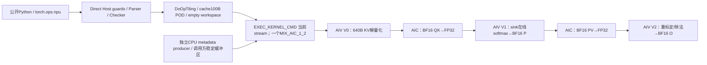
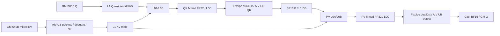
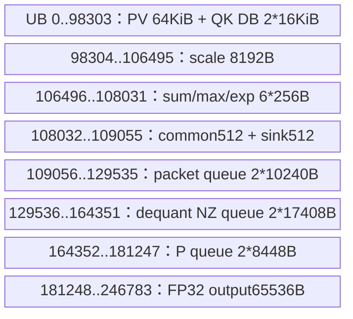
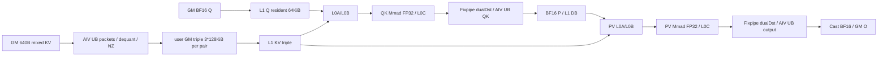

# 量化共享 KV 稀疏注意力 950 Direct Invoke 算子知识

## 算子速览

| 项目 | 内容 |
|---|---|
| 实际入口 | `torch.ops.npu.kv_quant_sparse_attn_sharedkv` → `sglang::npu_kernel::kv_quant_sparse_attn_sharedkv`；独立 Direct Invoke，没有 ACLNN pair |
| 计算语义 | 640字节KV包解成BF16的512维共享K/V；原始窗口或物理稀疏集合与压缩集合联合作QK/在线softmax/PV，sink只入分母 |
| 输入输出 | Q/O BF16 BSND或TND、G=64/128、D=512；KV FP8载体PA_ND、N2=1、packet640字节；O新分配，LSE为空 |
| 执行类型 | 一个 `KERNEL_TYPE_MIX_AIC_1_2` launch；AIV_VECTOR V0解量化、V1 softmax、V2归并，AIC_CUBE两次矩阵乘；逻辑五阶段不是五个kernel |
| Kernel 路线 | R-001…R-014；12个key，TND SWA按ori_sparse_indices再分；全部950 |
| 核心资源 | system workspace16MiB；G64 user0，G128每AIC对393216字节三槽；L1 backing512KiB、活跃491520字节；L0A/B各64KiB、C256KiB；每AIV显式UB246784字节 |
| 来源闭包 | direct_implementation_closed：公开注册、旧构建、Host/Checker/POD、12router、MIX全部实际body和当前SDK同步/workspace实例可追溯；metadata是独立输入producer，不是主入口自动launch |
| 静态风险 | AIC在初始化时求值未赋值的tilingData成员；G128部分head sink索引不对应goIdx；G128原始稀疏轮数可与metadata全AIV barrier次数失配。下文body为越过这些风险时的条件化调度，不承诺确定运行轨迹 |
| 验证状态 | 已完成源码闭包检查；本次知识提取未执行编译、真机、数值或性能测试。公开页本身注明公共API重构后待重新验证 |

## 接口与语义

### 计算语义

令请求b的有效Q/KV长度为Lq、Lkv，query局部位置r对应绝对位置p=Lkv−Lq+r。Q头h∈[0,G)，共享KV头数1。每个KV物理token的640字节为：前128字节是64个BF16 RoPE，随后448字节FP8 E4M3FN NoPE，偏移576开始7个E8M0 scale，每个scale覆盖64个NoPE元素，后续为padding。V0将scale转BF16再FP32、FP8转FP32相乘，以NO_SAT/CAST_RINT降到BF16，随后把64维RoPE接在448维NoPE后，形成D=512的K=V。Q必须与此维序一致；内核没有重新排列Q或应用旋转位置编码。

窗口body实际集合为W=[clip(p−left,0,Lkv),clip(p+1,0,Lkv))；left非负，**right虽然Host接受并复制，ComputeS2LoopInfo不使用**。SWA只有W；CFA另加入压缩KV序列[0,floor(end(W)/ratio))；SCFA使用该数量与topK的最小值作为读取压缩索引的长度，按索引映射KV。原始与压缩两部分以先原始后压缩的S2循环作为同一softmax域，未做内容去重。

TND/SWA有ori_sparse_indices时，按当前query行的非负前缀、最多min(K,Lkv)个物理slot取代W，遇首个负值终止；slot直接按物理page寻址、不经ori_block_table。该集合与文档窗口集合不同，不能用窗口参考覆盖替代此分支。

理想在线更新为m'=max(m,max(scale·QKᵀ))，a=exp(m−m')，l'=a·l+Σexp(score−m')，u'=a·u+P·V；初始m=sink[h]、l=1、u=0，sink不提供V，最后O=u/l。实际P先以BF16 CAST_ROUND存L1再PV，分母保持FP32指数和，因此并非全FP32权重参考。G128的sink取值存在下文按head子域限定的偏差，不能把理想公式当作全部源码输出保证。LSE关闭、输入cache不改写。

### 输入、输出与属性

| 参数 | shape/layout | dtype | 约束、默认值与语义 |
|---|---|---|---|
| query | BSND[B,S,G,512]或TND[T,G,512] | BF16 | NPU连续，非空；G=64或128；无自动Contiguous |
| ori_kv | [physical_pages,BSori,1,640] PA_ND | float8_e4m3fn carrier | 必需，packet含混合编码；BSori>0且≤1024、16对齐 |
| cmp_kv | [physical_pages,BScmp,1,640]或None | 同上 | 有则需cmp_block_table；BScmp相同16对齐范围 |
| ori_sparse_indices | [T,1,K]或None | int32 | 仅TND且无cmp_kv；公开K=512/1024，raw Host仅检查K>0；物理slot，负前缀终止 |
| cmp_sparse_indices | BSND[B,S,1,K]或TND[T,1,K]或None | int32 | 有则需cmp_kv；有效Checker要求K=512/1024并部分匹配S/T；逻辑压缩token索引，值域不校验 |
| ori_block_table | [B,max_ori_pages] | int32 | 必需，非空rank2；原始物理稀疏分支绕过其查表，但Host仍要求 |
| cmp_block_table | [B,max_cmp_pages]或None | int32 | cmp_kv存在时必需；rank2；实际跨表一致性校验不全 |
| cu_seqlens_q | [B+1]或None | int32 | TND必需；只检查numel，不在主Host读取值验证单调/末值 |
| cu_seqlens_ori_kv | None | — | 非None立即拒绝 |
| cu_seqlens_cmp_kv | None | — | 非None立即拒绝 |
| seqused_q | [B]或None | int32 | Device优先用其有效长度；Host未完整验证长度、值域 |
| seqused_kv | [B] | int32 | 必需；原始有效KV长度；值域/页容量由调用方保证 |
| sinks | [G] | float32 | 必需、numel=G；初始化在线softmax max，sum=1；有限性不检查 |
| metadata | [1024] | int32 | 必需；内容与本次参数、实际核数匹配；主入口只检查numel/dtype，不生成调度表 |
| kv_quant_mode | 标量 | int | 仅1；不是可选FP8整tensor量化 |
| tile_size | 标量 | int | 仅64；NoPE每scale覆盖64 |
| rope_head_dim | 标量 | int | 仅64；从packet复制RoPE，不计算RoPE |
| softmax_scale | 标量 | float | 转FP32写POD，参与QK logits缩放；没有有限性检查 |
| cmp_ratio | 标量 | int | SWA允许1/4/128；有cmp时4/128 |
| ori_mask_mode | 标量 | int | 仅4 |
| cmp_mask_mode | 标量 | int | 仅3 |
| ori_win_left | 标量 | int | 默认127；非负且int32可表示 |
| ori_win_right | 标量 | int | 默认0；非负且int32可表示，但实际Device窗口忽略其值 |
| layout_q | 字符串 | str | BSND/TND |
| layout_kv | 字符串 | str | 仅PA_ND |
| return_lse | 标量 | bool | 只能False；True拒绝 |
| attention_out | 与query相同shape | BF16 | empty_like新建；只被实际提交的任务写入，跳过域不总能保证初始化 |
| softmax_lse | [0] | float32 | 新建空tensor返回，Device不计算LSE |

### 入口与版本

公开Python `operators/attention/kv_quant_sparse_attn_sharedkv.py` 的auto/ascendc只注册ARCH35，转上述torch.ops.npu符号；C++schema在pytorch_extensions.cpp，声明在sgl_kenel_npu_ops.h，定义在本算子op_host.cpp。不是nonquant SharedKV的ACLNN入口，不是metadata_host的CPU调度入口，也没有新目录torch_adapter。公开中文页arch22不支持、arch35支持但重构待重新验证，Python README映射arch35为950，Host还明确ASCEND950。CANN9.1.0由README和固定CI配置指定；不意味着本次执行过该环境。

接口与独立元数据输入说明见[量化共享KV与元数据API](../../../../apis/sgl_kernel_npu/sgl_kv_quant_sharedkv_metadata.md)。旧非量化[共享KV源码卡](../../../aclnn/transformer/attention/sgl_sparse_attn_sharedkv.md)有不同dtype、资源及同步，不能套用到本量化body。

## Host/Launcher 执行流程

### 参数校验与前处理

1. 原生Host先检查Q为NPU、BF16、连续，layout_q=BSND/TND且rank相应4/3，layout_kv=PA_ND；验证必需输入。TND要求cuQ；cmpKV要求cmpBT，cmpIndices要求cmpKV；oriIndices只许TND且cmpKV空，shape[T,1,K]且K>0。return_lse=True以及两个cuKV非空立即抛出TORCH_CHECK。
2. 检查量化模式1、tile64、rope64、mask4/3、非负int32窗口、ratio1/4/128、各整数tensor int32、相同设备/连续、KV FP8载体、sink FP32、metadata int32/numel1024、KVstride0可表示int32。O=empty_like(Q)，LSE=empty([0],FP32)，不会预先全零。
3. 填OpDef：14输入/2输出和14属性。GetScalarAttr等按类型恢复；Parser::Parse校验950和非零AIC/AIV，恢复shape、有效长度存在性；Checker::Process依次Init→CheckSinglePara→CheckParaExistence→CheckFeature。**CheckMultiParaConsistency不在调用链**，不能把同文件族中其余验证当作实际guard。
4. Parser的BSND batch来自Q，TND来自sequsedKV.numel；Checker又用oriBT.dim0覆盖自己的bSize。BSND未强制Q批次数=BT批次数，有条件形成Device按POD批次读取短length/BT的风险。主Host不读NPU索引/长度值、页号、cum值、sink有限性；调用方必须提供一致合法内容。
5. DoOpTiling按cmpKV/cmpIndices存在性选mode、计算blockDim/workspace/POD/key，Host检查supported key。每个GraphStatus经TORCH_CHECK传播，错误消息使用Clear/GetLastErrorMessage；没有自动fallback到参考实现。

### 参数、Workspace 与生命周期

输入Tensor由调用方所有；O/LSE/workspace是本次ATen分配。系统workspace=SDK libapi 16MiB，user字节G64为0，G128为128·512·2·3·floor(AIC/2)。TilingContext::SetWorkspaceSizes加系统区；实际 `workspace=at::empty(total,byte)`。SDK3510 GetUserWorkspace跳过16MiB，Device切片以user基址为准；不能把system区算作KV槽或假定workspace已清零。

Host tiling是全字节memset的自然布局POD。ge_helper.h的GetTilingTensor以设备ID+完整POD字节为键，在mutex内缓存512个配置；按常见自然ABI100字节/项为51200字节slab，exact键命中返回持久slice。首次分配或未缓存配置遇graph capture抛错，需要eager预热。超过512配置的eager fallback复用一个overflowBuffer，H2D异步拷贝到当前stream后同步该stream，解决Host临时POD源寿命；但mutex不覆盖后续Device消费，不能据此证明不同stream复用overflow slab无覆盖。POD cached backing由from_blob deleter/aclrtFree管理，不能把裸tiling指针单独长期缓存。

EXEC_KERNEL_CMD从OpCommand提交当前stream，参数tuple保存裸GM指针和blockDim；没有逐Tensor owner捕获。ATen allocator/OpCommand的异步存活与capture属于框架边界，调用方不能提前释放/改写输入、metadata或缓存；workspace局部Tensor与输出返回的关系不在算子代码中产生独立event。不得把launch函数返回当作Device完成。没有ACLNN executor或额外workspace初始化kernel。

metadata_host是独立CPU API：CPU连续int32长度、shape/窗口/压缩属性和当前Runtime查询的实际核数生成pinned CPU int32[1024]零表，再non_blocking拷到当前NPU；主入口不调用它。graph外预生成，重放前复制进稳定地址。CPU数值调度不是Device数学kernel，不强行列为本launch前驱。其公开API已有完整输入/输出/限制，本卡只追溯当前消费的FA/FD字节ABI、当前producer配对及核心一致性前提。

### 启动图与失败传播



C为SDK实际AIC数、V为AIV数；blockDim=CalcTschBlockDim(V,C,V)，正常C36/V72映射36个AIC及72个AIV，不把blockDim误作总108个block。SDK异常核比存在返回V或0的分支，主Host未继续验证blockDim非零。active metadata和两AIV映射决定工作范围。entry18个GM按后文表顺序；cuKV/LSE在当前body关闭。

所有Host显式guard失败阻止提交；launch helper忽略kernel launch返回值，OpCommand handler返回0，无法保证异步设备错误同步回传。entry default未知key直接break，无输出；正常Host阻止该key。metadata空指针在Init早退后Process仍被调用，但公开Host必需metadata，因此仅raw失约边界。

`KvQuantSparseAttnSharedkvScfa::Init`只在AIV分支赋成员this->tilingData，随后两侧均以该成员作为InitVecBlock参数；AIC对象构造函数为空，参数求值发生在dummy方法体之前。按C++源码存在未初始化指针读取风险，**不推定该值、生成代码是否保留该读取或之后流程必定执行**。以下路由和资源描述的是固定body可见的条件化执行，不声称该静态风险被guard消除。
## Route 与参数设计

### 分核与资源计算

按Q布局和oriKV/BT先得到B、S/T、N1、N2、D、BS和每请求max pages，再G=N1/N2；mode来自cmp存在性，splitG=(G>64)。tile M64,N128,K128，数学QK K512、PV输出D512；每query一tile，G64一个AIC、两个AIV各32头；G128相邻AIC对分别go=0/64、四个AIV各32头。metadata调度BN和query连续区间，不按kernel block round-robin外推。

metadata producer限制实际AIC≤36、AIV≤72，G128要求核数可配对，主Host只确认非零950平台而没有完整重验metadata内容/配对。normal36/72的userW=7077888B、总workspace23855104B；G64总16777216B。输入shape维积/size_t→u32/int32窄化在若干getter没有完备溢出检查；不把合法rank当作任意大shape安全。

L1活跃P2×16KiB+KV3×128KiB+Q64KiB=491520B；额外K三view把逻辑分配cursor推到884736B，但没有后续Get/访存，实际backing仍512KiB。L0A64KiB内只使用2×16KiB，L0B2×32KiB=64KiB，L0C2×128KiB=256KiB。AIV显式UB总246784B；固定SDK950（3510）UB容量248KiB=253952B，扣除显式246784B后余7168B不是自动同步/编译临时变量的实测余量。寄存器由MicroAPI VF分配，源码没有最终编译寄存器数或spill字节。

### Route 选择

公共谓词P=950&&BF16 Q&&G∈{64,128}&&N2=1&&D512&&PA_ND packet640&&quant1/tile64/rope64&&mask4/3&&returnLSE=false&&必需张量/连续同设备。精确顺序是公共guard→mode存在性→layout编码→splitG→key；oriSparse不编码进key，而在相同SWA模板内按hasOriSparse运行时分支。公开oriSparse K限定512/1024；raw K>0虽可达但不升级公开合同。

| 顺序 | Route | Key/模板 | 精确选择条件与优先级 | 不适用去向 |
|---:|---|---|---|---|
| 1 | R-001 BSND SWA 64头 | 0 / (0,0,0) | P；G=64；BSND；cmpKV=null且cmpIndices=null；oriIndices=null | 其它合法tuple按相应行；不满足公共guard失败，无fallback |
| 2 | R-002 BSND SWA 128头 | 1 / (0,0,1) | P；G=128；BSND；cmpKV=null且cmpIndices=null；oriIndices=null | 其它合法tuple按相应行；不满足公共guard失败，无fallback |
| 3 | R-003 BSND CFA 64头 | 16 / (0,1,0) | P；G=64；BSND；cmpKV!=null且cmpIndices=null；oriIndices=null | 其它合法tuple按相应行；不满足公共guard失败，无fallback |
| 4 | R-004 BSND CFA 128头 | 17 / (0,1,1) | P；G=128；BSND；cmpKV!=null且cmpIndices=null；oriIndices=null | 其它合法tuple按相应行；不满足公共guard失败，无fallback |
| 5 | R-005 BSND SCFA 64头 | 32 / (0,2,0) | P；G=64；BSND；cmpKV!=null且cmpIndices!=null；oriIndices=null | 其它合法tuple按相应行；不满足公共guard失败，无fallback |
| 6 | R-006 BSND SCFA 128头 | 33 / (0,2,1) | P；G=128；BSND；cmpKV!=null且cmpIndices!=null；oriIndices=null | 其它合法tuple按相应行；不满足公共guard失败，无fallback |
| 7 | R-007 TND SWA 64头 | 256 / (1,0,0) | P；G=64；TND；cmpKV=null且cmpIndices=null；oriIndices=null | 其它合法tuple按相应行；不满足公共guard失败，无fallback |
| 8 | R-008 TND SWA原始物理稀疏 64头 | 256 / (1,0,0) | P；G=64；TND；cmpKV=null且cmpIndices=null；oriIndices!=null | 其它合法tuple按相应行；不满足公共guard失败，无fallback |
| 9 | R-009 TND SWA 128头 | 257 / (1,0,1) | P；G=128；TND；cmpKV=null且cmpIndices=null；oriIndices=null | 其它合法tuple按相应行；不满足公共guard失败，无fallback |
| 10 | R-010 TND SWA原始物理稀疏 128头 | 257 / (1,0,1) | P；G=128；TND；cmpKV=null且cmpIndices=null；oriIndices!=null | 其它合法tuple按相应行；不满足公共guard失败，无fallback |
| 11 | R-011 TND CFA 64头 | 272 / (1,1,0) | P；G=64；TND；cmpKV!=null且cmpIndices=null；oriIndices=null | 其它合法tuple按相应行；不满足公共guard失败，无fallback |
| 12 | R-012 TND CFA 128头 | 273 / (1,1,1) | P；G=128；TND；cmpKV!=null且cmpIndices=null；oriIndices=null | 其它合法tuple按相应行；不满足公共guard失败，无fallback |
| 13 | R-013 TND SCFA 64头 | 288 / (1,2,0) | P；G=64；TND；cmpKV!=null且cmpIndices!=null；oriIndices=null | 其它合法tuple按相应行；不满足公共guard失败，无fallback |
| 14 | R-014 TND SCFA 128头 | 289 / (1,2,1) | P；G=128；TND；cmpKV!=null且cmpIndices!=null；oriIndices=null | 其它合法tuple按相应行；不满足公共guard失败，无fallback |

```text
检查公共P；失败TORCH_CHECK/GraphStatus，停止
if cmpKV==null:
    require cmpIndices==null
    mode=0
else if cmpIndices!=null: mode=2
else: mode=1
layout = BSND ? 0 : 1
splitG = G>64
key=(layout<<8)|(mode<<4)|splitG
supported(key)，否则Host失败；Device default break无输出
mode0 && layout1 && oriIndices!=null -> TND物理稀疏子路线
其余 -> 对应布局/mode/G路线
```

### 模板/实现执行矩阵

所有行的实例共同前缀为 `SCFABlockCube/SCFABlockVec<bfloat16_t,fp8_e4m3fn_t,float,bfloat16_t,0,true,LAYOUT,PA_ND,MODE,SPLIT>`，组合进 `KvQuantSparseAttnSharedkvScfa<Cube,Vec>`；相反核侧为相同实参Dummy。isFd0、isPa=true不能变成FlashDecode或不分页模板。

| Route | key/selector | dtype/shape/platform 完整命中条件 | 执行族与 kernel 节点 | 实际模板/body | 内存与同步特征 | tail/fallback |
|---|---|---|---|---|---|---|
| R-001 BSND SWA 64头 | 0；ori=0 | P+上表完整BSND/SWA/G64谓词 | 单MIX：V0→QK→V1→PV→V2 | 前缀实例LAYOUT=0 MODE=0 SPLIT=0；ProcessMainLoop | user0；V0直L1，局部mode4；每AIV UB246784B | Ntail三VF；空S2 skip，未知key无输出；静态风险见限制 |
| R-002 BSND SWA 128头 | 1；ori=0 | P+上表完整BSND/SWA/G128谓词 | 单MIX：V0→QK→V1→PV→V2 | 前缀实例LAYOUT=0 MODE=0 SPLIT=1；ProcessMainLoop | 三GM槽/每AIC对；全AIV mode0+局部mode4；每AIV UB246784B | Ntail三VF；空S2 skip，未知key无输出；静态风险见限制 |
| R-003 BSND CFA 64头 | 16；ori=0 | P+上表完整BSND/CFA/G64谓词 | 单MIX：V0→QK→V1→PV→V2 | 前缀实例LAYOUT=0 MODE=1 SPLIT=0；ProcessMainLoop | user0；V0直L1，局部mode4；每AIV UB246784B | Ntail三VF；空S2 skip，未知key无输出；静态风险见限制 |
| R-004 BSND CFA 128头 | 17；ori=0 | P+上表完整BSND/CFA/G128谓词 | 单MIX：V0→QK→V1→PV→V2 | 前缀实例LAYOUT=0 MODE=1 SPLIT=1；ProcessMainLoop | 三GM槽/每AIC对；全AIV mode0+局部mode4；每AIV UB246784B | Ntail三VF；空S2 skip，未知key无输出；静态风险见限制 |
| R-005 BSND SCFA 64头 | 32；ori=0 | P+上表完整BSND/SCFA/G64谓词 | 单MIX：V0→QK→V1→PV→V2 | 前缀实例LAYOUT=0 MODE=2 SPLIT=0；ProcessMainLoop | user0；V0直L1，局部mode4；每AIV UB246784B | Ntail三VF；空S2 skip，未知key无输出；静态风险见限制 |
| R-006 BSND SCFA 128头 | 33；ori=0 | P+上表完整BSND/SCFA/G128谓词 | 单MIX：V0→QK→V1→PV→V2 | 前缀实例LAYOUT=0 MODE=2 SPLIT=1；ProcessMainLoop | 三GM槽/每AIC对；全AIV mode0+局部mode4；每AIV UB246784B | Ntail三VF；空S2 skip，未知key无输出；静态风险见限制 |
| R-007 TND SWA 64头 | 256；ori=0 | P+上表完整TND/SWA/G64谓词 | 单MIX：V0→QK→V1→PV→V2 | 前缀实例LAYOUT=1 MODE=0 SPLIT=0；ProcessMainLoop | user0；V0直L1，局部mode4；每AIV UB246784B | Ntail三VF；空S2 skip，未知key无输出；静态风险见限制 |
| R-008 TND SWA原始物理稀疏 64头 | 256；ori=1 | P+上表完整TND/SWA/G64谓词 | 单MIX：V0→QK→V1→PV→V2 | 前缀实例LAYOUT=1 MODE=0 SPLIT=0；ProcessMainLoop | user0；V0直L1，局部mode4；每AIV UB246784B | Ntail三VF；空S2 skip，未知key无输出；静态风险见限制 |
| R-009 TND SWA 128头 | 257；ori=0 | P+上表完整TND/SWA/G128谓词 | 单MIX：V0→QK→V1→PV→V2 | 前缀实例LAYOUT=1 MODE=0 SPLIT=1；ProcessMainLoop | 三GM槽/每AIC对；全AIV mode0+局部mode4；每AIV UB246784B | Ntail三VF；空S2 skip，未知key无输出；静态风险见限制 |
| R-010 TND SWA原始物理稀疏 128头 | 257；ori=1 | P+上表完整TND/SWA/G128谓词 | 单MIX：V0→QK→V1→PV→V2 | 前缀实例LAYOUT=1 MODE=0 SPLIT=1；ProcessMainLoop | 三GM槽/每AIC对；全AIV mode0+局部mode4；每AIV UB246784B | Ntail三VF；空S2 skip，未知key无输出；静态风险见限制 |
| R-011 TND CFA 64头 | 272；ori=0 | P+上表完整TND/CFA/G64谓词 | 单MIX：V0→QK→V1→PV→V2 | 前缀实例LAYOUT=1 MODE=1 SPLIT=0；ProcessMainLoop | user0；V0直L1，局部mode4；每AIV UB246784B | Ntail三VF；空S2 skip，未知key无输出；静态风险见限制 |
| R-012 TND CFA 128头 | 273；ori=0 | P+上表完整TND/CFA/G128谓词 | 单MIX：V0→QK→V1→PV→V2 | 前缀实例LAYOUT=1 MODE=1 SPLIT=1；ProcessMainLoop | 三GM槽/每AIC对；全AIV mode0+局部mode4；每AIV UB246784B | Ntail三VF；空S2 skip，未知key无输出；静态风险见限制 |
| R-013 TND SCFA 64头 | 288；ori=0 | P+上表完整TND/SCFA/G64谓词 | 单MIX：V0→QK→V1→PV→V2 | 前缀实例LAYOUT=1 MODE=2 SPLIT=0；ProcessMainLoop | user0；V0直L1，局部mode4；每AIV UB246784B | Ntail三VF；空S2 skip，未知key无输出；静态风险见限制 |
| R-014 TND SCFA 128头 | 289；ori=0 | P+上表完整TND/SCFA/G128谓词 | 单MIX：V0→QK→V1→PV→V2 | 前缀实例LAYOUT=1 MODE=2 SPLIT=1；ProcessMainLoop | 三GM槽/每AIC对；全AIV mode0+局部mode4；每AIV UB246784B | Ntail三VF；空S2 skip，未知key无输出；静态风险见限制 |

### 隐藏性能 Guard

| Guard | Host/Tiling 条件 | Device/资源原因 | 影响 Route | 不满足时去向 | 源码符号 |
|---|---|---|---|---|---|
| 平台 | soc==ASCEND950 && C,V>0 | 3510 RegBase/MIX_1_2、512KiB L1/248KiB UB | 全部 | Parser失败 | GetNpuInfo |
| 头数/维度 | N2=1,G=64/128,D512,packet640 | M64/halfM32、D448+64包、固定VF/tile | 全部 | Checker失败 | CheckFeature |
| 页粒度 | 0<BS≤1024,BS%16=0 | BF16 NZ按16行对齐/page复制 | 全部 | CheckSingle失败 | CheckOriKv/CheckCmpKv |
| 固定量化 | quant1,tile64,rope64 | 每64元素一个E8M0、7scale和64BF16 | 全部 | Direct guard失败 | Host.cpp |
| 索引shape | CMP K512/1024；ori公开512/1024/raw只>0 | 每query rowstride、两行成对搬运 | SCFA/TND稀疏 | shape失败或调用方越界风险 | CheckExistance/GetRealCmpS2Idx |
| splitG资源 | G>64 | 两AIC复用解量化GM tile，每pair三槽 | 偶数Route及R009/R010/R012/R014 | 无低资源fallback | DoOpTiling/InitMMResBuf |
| topology/metadata | ≤36AIC/72AIV且G128可配对 | 固定4096B表/配对workspace和全AIV barrier | 全部，split更严格 | helper拒绝；主入口未完整检查，失约风险 | metadata_host ParamsInit |
| 值域前提 | 长度、页表、稀疏index合法，metadata参数匹配 | Device直接标量读取和DMA，不做完整界限验证 | 全部 | Host多数未检查，无安全fallback | GetkeyOffset/ProcessMainLoop |
| right窗口 | right≥0但body不读 | 实际S2右端p+1 | 全部 | 正right不报错且实际效果不同 | ComputeS2LoopInfo |
| TND原始稀疏与split | metadata maxS2必须等于actual前缀轮数上界且所有核补齐次数一致 | mode0需全AIV逐轮参与 | R010 | 不满足时存在条件性等待风险，无fallback | GetOriSparseActualSeqLen/FA8 |
| 缓存capture | tiling配置eager已缓存 | capture期不允许分配/uncached拷贝 | 全部 | TORCH_CHECK拒绝 | GetTilingTensor |

### POD/ABI

Host POD为自然布局，含bool及padding，构造函数memset整个对象；按32位标量4字节对齐的源码推导，base sizeof=96/alignof=4，outer sizeof=100/alignof=4，base位于outer+4。固定仓没有对此sizeof/offsetof的编译断言，本次未编译，以下offset为该自然ABI推导候选，不冒充实测ABI。AIV LoadKvQuantTilingData逐named field从GM复制，不依赖padding值；AIC不直接解base，而读AIV经SSBUF发来的sharedParams。

| 结构 | 字段 | 类型/位宽 | ABI 布局 | 单位 | Host/launcher producer | Device consumer | 边界 |
|---|---|---|---|---|---|---|---|
| TilingData | dispatchKey | u32 | outer+0 | enum | (layout<<8)\|(mode<<4)\|splitG | entry switch | 12exact keys |
| BaseParams | batchSize | u32 | base+0；outer+4 | 请求 | DoOpTiling：tilingInfo.bSize：BSND Qdim0；TND sequsedKV.numel | shared.bSize/BN循环 | BT batch一致性未全检查 |
| BaseParams | qSeqSize | u32 | base+4；outer+8 | token | DoOpTiling：s1Size：BSND S；TND T | shared.s1Size/BSND有效Q默认 | TND不是每请求最大长度 |
| BaseParams | kvSeqSize | u32 | base+8；outer+12 | token | DoOpTiling：s2Size=oriMaxBlockNumPerBatch*oriBlockSize | shared.s2Size/维积 | u32维积/窄化不补造overflow保护 |
| BaseParams | paOriBlockSize | u32 | base+12；outer+16 | token/page | DoOpTiling：oriKV shape BS | shared.oriBlockSize/GetkeyOffset | 16对齐、1..1024 |
| BaseParams | paCmpBlockSize | u32 | base+16；outer+20 | token/page | DoOpTiling：cmpKV shape BS或0 | shared.cmpBlockSize | SWA inactive0 |
| BaseParams | oriMaxBlockNumPerBatch | u32 | base+20；outer+24 | page/request | DoOpTiling：oriBT末维 | shared.oriMaxBlockNumPerBatch/BT索引 | 实际页号调用方有效 |
| BaseParams | cmpMaxBlockNumPerBatch | u32 | base+24；outer+28 | page/request | DoOpTiling：cmpBT末维或0 | shared.cmpMaxBlockNumPerBatch | SWA inactive0 |
| BaseParams | nNumOfQInOneGroup | u32 | base+28；outer+32 | head | DoOpTiling：G=N1/N2 | shared.gSize/分头 | 64/128，N2=1 |
| BaseParams | sparseBlockCount | u32 | base+32；outer+36 | token/query | DoOpTiling：cmpIndices末维或0 | shared.sparseBlockCount/SCFA min | SCFA512/1024；SWA/CFA0 |
| BaseParams | softmaxScale | float32 | base+36；outer+40 | logit倍率 | DoOpTiling：opAttrInfo.softmaxScale | V1 Mul logit | 有限性未检查 |
| BaseParams | oriKvStride | i32 | base+40；outer+44 | carrier元素/byte | DoOpTiling：oriKV.stride(0) | shared u32oriKvStride/GetkeyOffset | Host非负int32 |
| BaseParams | cmpKvStride | i32 | base+44；outer+48 | carrier元素/byte | DoOpTiling：cmpKV.stride(0)或0 | shared u32cmpKvStride | SWA0 |
| BaseParams | tileSize | u32 | base+48；outer+52 | NoPE元素/scale | DoOpTiling：attr tile64 | shared.tileSize/解量化 | 仅64 |
| BaseParams | ropeHeadDim | u32 | base+52；outer+56 | BF16元素 | DoOpTiling：attr rope64 | shared.dSizeRope/RoPE复制 | 64，非旋转计算 |
| BaseParams | cmpRatio | u32 | base+56；outer+60 | 原token/压缩token | DoOpTiling：attr ratio | shared.cmpRatio/可见压缩长度 | SWA1/4/128；CMP4/128 |
| BaseParams | oriMaskMode | u32 | base+60；outer+64 | enum | DoOpTiling：attr4 | shared.oriMaskMode；窗口body固定 | 只有4，非运行时多mask |
| BaseParams | cmpMaskMode | u32 | base+64；outer+68 | enum | DoOpTiling：attr3 | shared.cmpMaskMode；压缩body固定 | 只有3 |
| BaseParams | oriWinLeft | i32 | base+68；outer+72 | token | DoOpTiling：attr left | shared.left/preTokensPerBatch | 非负int32 |
| BaseParams | oriWinRight | i32 | base+72；outer+76 | token | DoOpTiling：attr right | shared.right复制，实际ComputeS2不消费 | 正值也不扩展Device右窗口 |
| BaseParams | sparseBlockSize | u32 | base+76；outer+80 | token/index | DoOpTiling：tilingInfo.sparseBlockSize | AIV named复制；ComputeConstexpr另硬编码1 | 当前索引token粒度，POD字段未用于改粒度 |
| BaseParams | hasOriSparseIndices | bool8 | base+80；outer+84 | 存在标志 | DoOpTiling：oriIndices!=nullptr | SWA GetOriSparseActualSeqLen/ProcessSparseKv | 后有3B自然padding已memset |
| BaseParams | oriSparseIndexWidth | u32 | base+84；outer+88 | index/query | DoOpTiling：oriIndices末维或0 | 稀疏行stride、前缀扫描上界 | raw K>0，公开512/1024 |
| BaseParams | dSize | u32 | base+88；outer+92 | BF16元素 | DoOpTiling：dSizeQ512 | shared.dSize/Matmul/输出 | 512 |
| BaseParams | dSizeVInput | u32 | base+92；outer+96 | byte/token | DoOpTiling：KV末维640 | shared.dSizeVInput/packet寻址 | 640 |

CVSharedParams是Device内部SSBUF逐u32拷贝的含bitfield结构；下表按常见同编译器连续u32位域布局给出80B/align4候选，**C++ bitfield位置及sizeof不能仅靠声明保证**，不是跨编译器ABI承诺。AIV InitCubeVecSharedParams是唯一producer，subBlock0从SSBUF地址0复制整个sizeof字节，mode4 PIPE_S flag15；AIC wait后读取。未赋值field/保留bit也被整word复制，源码没有清零，不能补造producer或宣称所有字节已初始化。

| 结构 | 字段 | 类型/位宽 | ABI 布局 | 单位 | Host/launcher producer | Device consumer | 边界 |
|---|---|---|---|---|---|---|---|
| CVSharedParams | s1BaseSize | u32 | 候选offset 0 | token×head | InitCubeVecSharedParams：无赋值 | 无有效读取；ConstInfo另设64 | 未初始化storage |
| CVSharedParams | s2BaseSize | u32 | 候选offset 4 | token | InitCubeVecSharedParams：无赋值 | 无有效读取；ConstInfo另设128 | 未初始化storage |
| CVSharedParams | bSize | u32 | 候选offset 8 | 请求 | InitCubeVecSharedParams：base.batchSize | ConstInfo.bSize/BN | 有效 |
| CVSharedParams | n2Size | u32 | 候选offset 12 | head | InitCubeVecSharedParams：硬编码1 | ConstInfo.n2Size | 有效 |
| CVSharedParams | gSize | u32 | 候选offset 16 | head | InitCubeVecSharedParams：base.nNumOfQInOneGroup | ConstInfo.gSize/分头 | 64/128 |
| CVSharedParams | s1Size | u32 | 候选offset 20 | token | InitCubeVecSharedParams：base.qSeqSize | ConstInfo.s1Size | layout限定 |
| CVSharedParams | s2Size | u32 | 候选offset 24 | token | InitCubeVecSharedParams：base.kvSeqSize | ConstInfo.s2Size | 有效 |
| CVSharedParams | dSize | u32 bit10 | 候选offset 28:0..9 | 元素 | InitCubeVecSharedParams：base.dSize | ConstInfo.dSize/dV | 512 |
| CVSharedParams | dSizeVInput | u32 bit12 | 候选offset 28:10..21 | byte | InitCubeVecSharedParams：base.dSizeVInput | ConstInfo.dVInput | 640 |
| CVSharedParams | needInit | u32 bit4 | 候选offset 28:22..25 | bool | InitCubeVecSharedParams：逐请求比较BSND物理S或TND cuQ相邻差与KV长度，任一Q长>KV即全局置1；不读sequsedQ | CleanOutput/SyncAll | 不是ori_sparse为空检测 |
| CVSharedParams | layoutType | u32 bit4 | 候选offset 28:26..29 | enum | InitCubeVecSharedParams：未赋值 | 无有效consumer，模板决定layout | 未初始化bits |
| CVSharedParams | isActualSeqLengthsNull | u32 bit1 | 候选offset 28:30 | bool | InitCubeVecSharedParams：未赋值 | 无有效consumer，指针决定Q长度 | 未初始化bit |
| CVSharedParams | isActualSeqLengthsKVNull | u32 bit1 | 候选offset 28:31 | bool | InitCubeVecSharedParams：硬编码0 | ConstInfo.isActualLenDimsKVNull | sequsedKV必需 |
| CVSharedParams | sparseBlockCount | u32 | 候选offset 32 | token | InitCubeVecSharedParams：base.sparseBlockCount | ConstInfo/SCFA | 见base |
| CVSharedParams | softmaxScale | float32 | 候选offset 36 | 倍率 | InitCubeVecSharedParams：base.softmaxScale | V1 | 见base |
| CVSharedParams | cmpRatio | u32 bit9 | 候选offset 40:0..8 | ratio | InitCubeVecSharedParams：base.cmpRatio | ComputeS2 | 1/4/128 |
| CVSharedParams | dSizeRope | u32 bit11 | 候选offset 40:9..19 | 元素 | InitCubeVecSharedParams：base.ropeHeadDim | dequant copy | 64 |
| CVSharedParams | oriMaskMode | u32 bit6 | 候选offset 40:20..25 | enum | InitCubeVecSharedParams：base.oriMaskMode | 固定模板约束 | 4 |
| CVSharedParams | cmpMaskMode | u32 bit6 | 候选offset 40:26..31 | enum | InitCubeVecSharedParams：base.cmpMaskMode | 固定模板约束 | 3 |
| CVSharedParams | oriWinLeft | i32 | 候选offset 44 | token | InitCubeVecSharedParams：base.oriWinLeft | ComputeS2 | 有效 |
| CVSharedParams | oriWinRight | i32 | 候选offset 48 | token | InitCubeVecSharedParams：base.oriWinRight | ConstInfo复制，无窗口consumer | 不能声称生效 |
| CVSharedParams | tileSize | u32 bit8 | 候选offset 52:0..7 | 元素 | InitCubeVecSharedParams：base.tileSize | 解量化 | 64 |
| CVSharedParams | oriBlockSize | u32 bit12 | 候选offset 52:8..19 | token/page | InitCubeVecSharedParams：base.paOriBlockSize | PA寻址 | 1..1024 |
| CVSharedParams | cmpBlockSize | u32 bit12 | 候选offset 52:20..31 | token/page | InitCubeVecSharedParams：base.paCmpBlockSize | CMP PA寻址 | SWA0 |
| CVSharedParams | oriMaxBlockNumPerBatch | u32 | 候选offset 56 | page/request | InitCubeVecSharedParams：base同名 | BT寻址 | 有效 |
| CVSharedParams | cmpMaxBlockNumPerBatch | u32 | 候选offset 60 | page/request | InitCubeVecSharedParams：base同名 | CMP BT寻址 | SWA inactive |
| CVSharedParams | oriKvStride | u32 | 候选offset 64 | byte/page | InitCubeVecSharedParams：base i32非负转u32 | packet GM | Host检查范围 |
| CVSharedParams | cmpKvStride | u32 | 候选offset 68 | byte/page | InitCubeVecSharedParams：base i32非负转u32 | CMP packet GM | SWA0 |
| CVSharedParams | hasOriSparseIndices | u32 bit1 | 候选offset 72:0 | bool | InitCubeVecSharedParams：base同名 | SWA sparse | word剩余31bit未初始化 |
| CVSharedParams | oriSparseIndexWidth | u32 | 候选offset 76 | index/query | InitCubeVecSharedParams：base同名 | sparse row offset | K |

metadata固定int32[1024]=4096B，不含Tensor对象：FA36×9=324int/1296B，FD72×8=576int/2304B，尾124int/496B保留。FA row地址为4·(9·aicIdx+j)，FD为4·(324+8·aivIdx+j)。Host GenMetaData在G128把逻辑任务复制到相邻物理AIC行，FA[8]写统一maxS2GBaseNum；无ori_sparse_indices参数。主Device isFd=0，不执行FD归并。metadata字段以下逐项列出，不能把未消费的FD/FA切分位置解释为当前Flash Decode。

| 结构 | 字段 | 类型/位宽 | ABI 布局 | 单位 | Host/launcher producer | Device consumer | 边界 |
|---|---|---|---|---|---|---|---|
| FA row | enable | i32 | row+0 | bool | GenMetaData分配任务 | ProcessMainLoop hasLoad | 0时G128仍补barrier |
| FA row | BN2start | i32 | row+4 | BN | startTask | BN起点 | N2=1 |
| FA row | Mstart | i32 | row+8 | query tile | startTask | gs1起点 | 每tile1Q |
| FA row | S2start | i32 | row+12 | S2 tile | splitter | 读取局部变量但不参与当前循环 | 非FD不切S2 |
| FA row | BN2end | i32 | row+16 | BN | next task boundary | BN终点 | MEnd!=0时+1 |
| FA row | Mend | i32 | row+20 | query tile | next task boundary | 最后BN gs1终点 | 0代表整BN |
| FA row | S2end | i32 | row+24 | S2 tile | splitter | 读取后无有效使用 | 非FD |
| FA row | firstFDworkspace | i32 | row+28 | slot | splitter/zero | 无consumer | isFd0 |
| FA row | maxS2 | i32 | row+32 | V0/barrier轮 | splitRes.maxS2GBaseNum | G128 maxS2LoopCnt及补齐 | 无原始稀疏前缀修正 |
| FD row | enable | i32 | row+0 | bool | CPU zeros/supportFd=false | 无 | 当前FD关闭 |
| FD row | BN2idx | i32 | row+4 | BN | zero/FD dormant | 无 | inactive |
| FD row | Midx | i32 | row+8 | tile | zero/FD dormant | 无 | inactive |
| FD row | workspaceIdx | i32 | row+12 | slot | zero/FD dormant | 无 | inactive |
| FD row | workspaceNum | i32 | row+16 | slot数 | zero/FD dormant | 无 | inactive |
| FD row | Mstart | i32 | row+20 | row | zero/FD dormant | 无 | inactive |
| FD row | Mnum | i32 | row+24 | row数 | zero/FD dormant | 无 | inactive |
| FD row | reserved7 | i32 | row+28 | reserved | zeros | 无 | 无已定义字段符号 |

entry的18个参数均为GM_ADDR，固定仓未给出最终编译参数包sizeof/offset；指针槽位顺序如下，SDK extract_host_stub生成wrapper属于编译器边界，不把指针宽度猜成已验证launch ABI。

| 结构 | 字段 | 类型/位宽 | ABI 布局 | 单位 | Host/launcher producer | Device consumer | 边界 |
|---|---|---|---|---|---|---|---|
| entry args | query | GM_ADDR | slot0；包offset未在固定仓证明 | pointer | Q.data_ptr | Cube Q | 当前stream有效期 |
| entry args | oriKV | GM_ADDR | slot1；包offset未在固定仓证明 | pointer | oriKV.data_ptr | V0 | 当前stream有效期 |
| entry args | cmpKV | GM_ADDR | slot2；包offset未在固定仓证明 | pointer | OptionalDataPtr | CMP V0，SWA null | 当前stream有效期 |
| entry args | oriSparseIndices | GM_ADDR | slot3；包offset未在固定仓证明 | pointer | OptionalDataPtr | TND SWA物理slot | 当前stream有效期 |
| entry args | cmpSparseIndices | GM_ADDR | slot4；包offset未在固定仓证明 | pointer | OptionalDataPtr | SCFA逻辑index | 当前stream有效期 |
| entry args | oriBlockTable | GM_ADDR | slot5；包offset未在固定仓证明 | pointer | 必需data_ptr | 原始窗口PA | 当前stream有效期 |
| entry args | cmpBlockTable | GM_ADDR | slot6；包offset未在固定仓证明 | pointer | OptionalDataPtr | CMP PA | 当前stream有效期 |
| entry args | cuSeqlensQ | GM_ADDR | slot7；包offset未在固定仓证明 | pointer | OptionalDataPtr | TND长度/offset | 当前stream有效期 |
| entry args | cuSeqlensOriKv | GM_ADDR | slot8；包offset未在固定仓证明 | pointer | null | 无 | 当前stream有效期 |
| entry args | cuSeqlensCmpKv | GM_ADDR | slot9；包offset未在固定仓证明 | pointer | null | 无 | 当前stream有效期 |
| entry args | seqUsedQ | GM_ADDR | slot10；包offset未在固定仓证明 | pointer | OptionalDataPtr | 有效Q长度 | 当前stream有效期 |
| entry args | seqUsedKV | GM_ADDR | slot11；包offset未在固定仓证明 | pointer | 必需data_ptr | 有效KV长度 | 当前stream有效期 |
| entry args | sinks | GM_ADDR | slot12；包offset未在固定仓证明 | pointer | 必需data_ptr | V1 init | 当前stream有效期 |
| entry args | metadata | GM_ADDR | slot13；包offset未在固定仓证明 | pointer | 必需data_ptr | FA调度 | 当前stream有效期 |
| entry args | attentionOut | GM_ADDR | slot14；包offset未在固定仓证明 | pointer | O.data_ptr | V2 BF16输出 | 当前stream有效期 |
| entry args | softmax_lse | GM_ADDR | slot15；包offset未在固定仓证明 | pointer | emptyLSE.data_ptr | 无consumer | 当前stream有效期 |
| entry args | workspace | GM_ADDR | slot16；包offset未在固定仓证明 | pointer | byteTensor.data_ptr | GetUserWorkspace/三槽 | 当前stream有效期 |
| entry args | tiling | GM_ADDR | slot17；包offset未在固定仓证明 | pointer | GetTilingTensor.data_ptr | key/AIV named copy | 当前stream有效期 |

ConstInfo、RunParamStr、RunInfo是每核内部对象，不作为Host wire ABI，不声明机器offset。COMMON_CONST_INFO的大量通用维积在当前body没有写/读；当前ComputeConstexpr逐项产生b/g/n2/s1/s2/d/dV/dInput/dNope/dRope/tile、mask/window/PA、scale、必要维积和stride，不得把其余残留成员当默认0。COMMON_RUN_PARAM的当前业务索引、actualS1/S2、M/halfM、s1、offset、ori/cmpLoop由ComputeParamBatch→ComputeS1LoopInfo→ComputeSouterParam→LoopSOuterOffsetInit→ComputeS2LoopInfo依序产生；RunInfo的taskmod2/3、innerIdx、isCmp、S2tail由SetRunInfo/ComputeBmm1Tail/InitTaskParamByRun产生。RunInfo默认multiCoreInnerIdx=0，首任务innerIdx=1能进入更新。RunParamStr.softmaxLseOffset没有producer，却在InitTaskParamByRun赋给RunInfo；LSE关闭不消费这个值，但源码层未初始化读取风险不能删去。AIC tilingData成员的未赋值参数求值边界见启动章节。

### Route 源码闭包

| Route | Key/selector | Host/Tiling producer | POD/参数 | Kernel entry/router | Kernel body/直接依赖 | 构建接线 |
|---|---|---|---|---|---|---|
| R-001 BSND SWA 64头 | 0/ori0 | op_host.cpp Direct→Parser::Parse→Checker::Process→DoOpTiling | 100B候选POD，18GM；FA metadata独立 | op_kernel.cpp KV_QUANT_CASE(0,0,0) | arch35 Scfa::Init/ProcessMainLoop、SCFABlockCube、SCFABlockVec、kvcache、common Matmul/Buffer、三update VF | cmake/legacy_kernels.cmake A5-only源列表/target/include/flags，Torch PrivateUse1注册 |
| R-002 BSND SWA 128头 | 1/ori0 | op_host.cpp Direct→Parser::Parse→Checker::Process→DoOpTiling | 100B候选POD，18GM；FA metadata独立 | op_kernel.cpp KV_QUANT_CASE(0,0,1) | arch35 Scfa::Init/ProcessMainLoop、SCFABlockCube、SCFABlockVec、kvcache、common Matmul/Buffer、三update VF | cmake/legacy_kernels.cmake A5-only源列表/target/include/flags，Torch PrivateUse1注册 |
| R-003 BSND CFA 64头 | 16/ori0 | op_host.cpp Direct→Parser::Parse→Checker::Process→DoOpTiling | 100B候选POD，18GM；FA metadata独立 | op_kernel.cpp KV_QUANT_CASE(0,1,0) | arch35 Scfa::Init/ProcessMainLoop、SCFABlockCube、SCFABlockVec、kvcache、common Matmul/Buffer、三update VF | cmake/legacy_kernels.cmake A5-only源列表/target/include/flags，Torch PrivateUse1注册 |
| R-004 BSND CFA 128头 | 17/ori0 | op_host.cpp Direct→Parser::Parse→Checker::Process→DoOpTiling | 100B候选POD，18GM；FA metadata独立 | op_kernel.cpp KV_QUANT_CASE(0,1,1) | arch35 Scfa::Init/ProcessMainLoop、SCFABlockCube、SCFABlockVec、kvcache、common Matmul/Buffer、三update VF | cmake/legacy_kernels.cmake A5-only源列表/target/include/flags，Torch PrivateUse1注册 |
| R-005 BSND SCFA 64头 | 32/ori0 | op_host.cpp Direct→Parser::Parse→Checker::Process→DoOpTiling | 100B候选POD，18GM；FA metadata独立 | op_kernel.cpp KV_QUANT_CASE(0,2,0) | arch35 Scfa::Init/ProcessMainLoop、SCFABlockCube、SCFABlockVec、kvcache、common Matmul/Buffer、三update VF | cmake/legacy_kernels.cmake A5-only源列表/target/include/flags，Torch PrivateUse1注册 |
| R-006 BSND SCFA 128头 | 33/ori0 | op_host.cpp Direct→Parser::Parse→Checker::Process→DoOpTiling | 100B候选POD，18GM；FA metadata独立 | op_kernel.cpp KV_QUANT_CASE(0,2,1) | arch35 Scfa::Init/ProcessMainLoop、SCFABlockCube、SCFABlockVec、kvcache、common Matmul/Buffer、三update VF | cmake/legacy_kernels.cmake A5-only源列表/target/include/flags，Torch PrivateUse1注册 |
| R-007 TND SWA 64头 | 256/ori0 | op_host.cpp Direct→Parser::Parse→Checker::Process→DoOpTiling | 100B候选POD，18GM；FA metadata独立 | op_kernel.cpp KV_QUANT_CASE(1,0,0) | arch35 Scfa::Init/ProcessMainLoop、SCFABlockCube、SCFABlockVec、kvcache、common Matmul/Buffer、三update VF | cmake/legacy_kernels.cmake A5-only源列表/target/include/flags，Torch PrivateUse1注册 |
| R-008 TND SWA原始物理稀疏 64头 | 256/ori1 | op_host.cpp Direct→Parser::Parse→Checker::Process→DoOpTiling | 100B候选POD，18GM；FA metadata独立 | op_kernel.cpp KV_QUANT_CASE(1,0,0) | arch35 Scfa::Init/ProcessMainLoop、SCFABlockCube、SCFABlockVec、kvcache、common Matmul/Buffer、三update VF | cmake/legacy_kernels.cmake A5-only源列表/target/include/flags，Torch PrivateUse1注册 |
| R-009 TND SWA 128头 | 257/ori0 | op_host.cpp Direct→Parser::Parse→Checker::Process→DoOpTiling | 100B候选POD，18GM；FA metadata独立 | op_kernel.cpp KV_QUANT_CASE(1,0,1) | arch35 Scfa::Init/ProcessMainLoop、SCFABlockCube、SCFABlockVec、kvcache、common Matmul/Buffer、三update VF | cmake/legacy_kernels.cmake A5-only源列表/target/include/flags，Torch PrivateUse1注册 |
| R-010 TND SWA原始物理稀疏 128头 | 257/ori1 | op_host.cpp Direct→Parser::Parse→Checker::Process→DoOpTiling | 100B候选POD，18GM；FA metadata独立 | op_kernel.cpp KV_QUANT_CASE(1,0,1) | arch35 Scfa::Init/ProcessMainLoop、SCFABlockCube、SCFABlockVec、kvcache、common Matmul/Buffer、三update VF | cmake/legacy_kernels.cmake A5-only源列表/target/include/flags，Torch PrivateUse1注册 |
| R-011 TND CFA 64头 | 272/ori0 | op_host.cpp Direct→Parser::Parse→Checker::Process→DoOpTiling | 100B候选POD，18GM；FA metadata独立 | op_kernel.cpp KV_QUANT_CASE(1,1,0) | arch35 Scfa::Init/ProcessMainLoop、SCFABlockCube、SCFABlockVec、kvcache、common Matmul/Buffer、三update VF | cmake/legacy_kernels.cmake A5-only源列表/target/include/flags，Torch PrivateUse1注册 |
| R-012 TND CFA 128头 | 273/ori0 | op_host.cpp Direct→Parser::Parse→Checker::Process→DoOpTiling | 100B候选POD，18GM；FA metadata独立 | op_kernel.cpp KV_QUANT_CASE(1,1,1) | arch35 Scfa::Init/ProcessMainLoop、SCFABlockCube、SCFABlockVec、kvcache、common Matmul/Buffer、三update VF | cmake/legacy_kernels.cmake A5-only源列表/target/include/flags，Torch PrivateUse1注册 |
| R-013 TND SCFA 64头 | 288/ori0 | op_host.cpp Direct→Parser::Parse→Checker::Process→DoOpTiling | 100B候选POD，18GM；FA metadata独立 | op_kernel.cpp KV_QUANT_CASE(1,2,0) | arch35 Scfa::Init/ProcessMainLoop、SCFABlockCube、SCFABlockVec、kvcache、common Matmul/Buffer、三update VF | cmake/legacy_kernels.cmake A5-only源列表/target/include/flags，Torch PrivateUse1注册 |
| R-014 TND SCFA 128头 | 289/ori0 | op_host.cpp Direct→Parser::Parse→Checker::Process→DoOpTiling | 100B候选POD，18GM；FA metadata独立 | op_kernel.cpp KV_QUANT_CASE(1,2,1) | arch35 Scfa::Init/ProcessMainLoop、SCFABlockCube、SCFABlockVec、kvcache、common Matmul/Buffer、三update VF | cmake/legacy_kernels.cmake A5-only源列表/target/include/flags，Torch PrivateUse1注册 |

## Kernel 实现

### 公共执行流程

entry在Host pass只保留可链接壳，Device类型/宏受__CCE_AICORE__守护；3510 Cube用__DAV_C310_CUBE__选择AIC实例、空VecDummy，Vector选择反向实例。AIV把100B候选POD named字段复制入本地对象，AIC传nullptr给Init但其未初始化成员参数求值问题仍存在；不能将dummy“未解引用”当成C++读前赋值证明。

Init的顺序为idCounter=0→aic/aiv/subIdx→metadata指针→base64/128→AIV构造sharedParams/必要清O→InitMMResBuf（P/KV L1、QK/PV UB、可选GM槽）→AIC InitCubeBlock与SSBUF wait15→ComputeConstexpr→GM指针/Cube输入→AIV本地队列。needInit按所有请求扫描：Q长度取BSND物理S或TND cuQ相邻差，不读取sequsedQ；任一请求的此Q长度大于对应KV长度即全局置1，CleanOutput按全局输出区域分给2C个AIV清零并SyncAll；Process对needInit再SyncAll<false>后执行任务。没有“任何skip都零输出”的保证。

每核ProcessMainLoop读取FA enable，splitG即使disabled也参与FA8次全AIV barrier。active行读取BN/M起终点；每BN读取Q/KV实际长度并设置query循环。每query按原始窗口和cmp长度建立S2序列，TND原始稀疏再覆盖为非负前缀长度；零域continue；末BN加入2次drain。每S2轮i：AIV做V0/AIC做QK_i；i>0时AIV做V1_{i−1}/AIC做PV_{i−1}；i>1时AIV做V2_{i−2}。RunInfo环3，sum/max按query innerIdx%2，exp按task%2，KV环3、QK UB/P L1环2、PV UB单槽。last/drain谓词决定实际调用，不能拿示意图代替条件。

AIC端Q首次S2全载到唯一64KiB L1Q，随后整个原始+压缩域复用，到该query最后S2后释放其MTE1→MTE2 event。QK MatmulK<B16,B16,F32,64,128,128,MK,KN>，M64/N=tail/K512，4个K128块、右转置；LoadData2DV2以16元素fractal、mStep4/kStep8加载Q，K按align16(N)的stride处理转置。每段Mmad init只首K，FP32累加。PV MatmulN相同类型/base，M64/N512/K=tail，4个N128块、无转置；P一次装L0A复用，V按Ktail和N块装L0B，每个N块独立初始化FP32，输出C偏移nBlock·64·128元素。无bias/activation/整tile scale，QK后Vector才乘softmaxScale。L0 policy事件由TPipe动态分配，不声明固定数字。

QK Fixpipe ROW_MAJOR_UB nSize=align8(N)，mSize=align2(M)=64，srcStride=align16(M)=64，dstStride128，dualDstCtl1各送32×128 FP32到两AIV；PV n512/m64/src64/dst512/dual1，各送32×512 FP32。cross-core flag按相同Init次序生成，固定id表见逐Route；3510 mode4对应intra-block set/wait，mode0是ffts全核同步，属于不同作用域。编译选项关闭auto-sync和VF membar保留，不能去掉显式同步。

### Route R-001：BSND SWA 64头

#### 适用条件

##### 选择证据

| 层级 | 文件 | 符号 | 源码谓词/参数 | 结果/下一跳 |
|---|---|---|---|---|
| API/Direct | op_host/kv_quant_sparse_attn_sharedkv.cpp | kv_quant_sparse_attn_sharedkv | 公共P；layout=BSND，G=64；oriIndices空；cmpKV和cmpIndices为空 | 无转换；Parser/Checker |
| Tiling | op_host/kv_quant_sparse_attn_sharedkv_tiling.cpp | DoOpTiling | mode0；layout0；splitG=0 | dispatchKey=0 |
| Router | op_kernel/kv_quant_sparse_attn_sharedkv.cpp | KV_QUANT_CASE(0,0,0) | B16,FP8,F32,B16,0,true,0,PA_ND,0,0 | Scfa<Cube,Vec>::Init→Process |
| Runtime | arch35/scfa_kernel / block_vector | ProcessMainLoop/ProcessVec0 | hasOriSparse=0；mode=SWA | 仅原始窗口ProcessNotSparseKv，经oriBT映射。 |

公共P含全部rank/dtype/连续/950/packet/attrs/metadata约束，详见Route选择和隐藏Guard；下述实际body以未初始化读取未阻止后续、metadata内容/指针有效为条件。源码可见风险不转化为假定成功执行。

#### Device 数据流

##### 函数级调用链

```text
kv_quant_sparse_attn_sharedkv(18 GM args, key=0)
 -> KV_QUANT_CASE(0,0,0)
 -> KvQuantSparseAttnSharedkvScfa<SCFABlockCube<...>,SCFABlockVec<...>>::Init / Process
    -> AIV InitVecBlock -> InitCubeVecSharedParams -> SSBUF / CleanOutput
    -> InitMMResBuf / AIC InitCubeBlock / ComputeConstexpr / InitGlobalBuffer
    -> ProcessMainLoop -> ComputeParamBatch / ComputeS1LoopInfo
       -> ComputeParamS1 / ComputeS2LoopInfo
       -> SetRunInfo / ComputeBmm1Tail / InitTaskParamByRun
       -> AIV ProcessVec0 -> ProcessNotSparseKv
          -> GetkeyOffset / CopyInKv* -> CastScale / AntiquantVFFp8D448 / RoPE copy
          -> CopyOutKvUb2L1 / ready
       -> AIC IterateBmm1SCFA -> CopyToL1Nd2Nz / MatmulK / QK Fixpipe
       -> AIV ProcessVec1 -> ProcessVec1Vf<...,true,OriginNRange>
          -> 三个update VF / SCFAUpdateExpSumAndExpMax / P DataCopy到L1
       -> AIC IterateBmm2SCFA -> MatmulN / PV Fixpipe
       -> AIV ProcessVec2 -> FlashUpdateNew / FlashUpdateLastNew或LastDivNew
          -> CopyOutAttentionOut / Bmm2DataCopyOut / Cast(BF16,CAST_ROUND) / DataCopyPad
```

##### 源码等价伪码

```text
源码等价伪码；偏移默认元素，workspace和packet注明byte
aic = AIC ? blockIdx : aivIdx>>1
go = 0; halfM=32
read metadata[aic*9]; if disabled:
    直接return; return
for b in FA BN区间:
    Lq = sequsedQ?sequsedQ[b]:S
    Lkv=sequsedKV[b]; history=Lkv-Lq
    for r in metadata指定Q区间及最后2个drain:
        if 有效r:
            pos=history+r; 若pos<0跳过
            start=clip(pos-left,0,Lkv); end=clip(pos+1,0,Lkv)
            nOri=end-start
            nCmp=0
            保持窗口/压缩长度
            if Lkv==0 or nOri+nCmp==0: continue
        for 当前S2块或drain轮 i:
            if 有效:
                isCmp=i>=ceil(nOri/128)
                localS2=(i-isCmp*ceil(nOri/128))*128
                N=min(128,选中域长度-localS2)
                token=选中域起点+localS2+row，page=BT[b*maxPages+token/BS]
                对最多16行/queue迭代：搬640B packet，448 FP8*7 E8M0 scale -> BF16，
                  输出NZ的D448NoPE+64RoPE，stride17以留1行padding
                直接写L1Right[taskId%3]，set L1 ready
                AIC首S2 load Q[b*S+r,go:go+64,:] -> L1Q；其余复用
                QK=MatmulK(BF16 Q, BF16 K, FP32acc,M64,N,K512)
                Fixpipe QK dualDst -> 两AIV UB各32*128 FP32
            if taskId>0 and notLast:
                wait QKready(i-1)
                首S2 max=sinks[sub0:0..31/sub1:32..63],sum=1
                scale/logit reduce/exp；按N==128 / N<=64 / 64<N<128选择update VF
                FP32exp -> BF16 P NZ stride33 -> L1P[task%2]；set ready
                FP32更新max/sum和exp因子
                AIC wait Pready；PV=MatmulN(P,同一KV,M64,N512,K=N)
                Fixpipe PV dualDst -> 两AIV UB各32*512 FP32
            if taskId>1:
                wait PVready(i-2)
                首S2 copy PV；后续u=expFactor*u+PV，最后除sum
                最后一S2时Cast BF16 CAST_ROUND并DataCopyPad 32行*512到O
                return UB槽，保持stage2Out直到当前query末块
            taskId++
无mode0跨AIC共享KV协议
```

仅原始窗口ProcessNotSparseKv，经oriBT映射。 V0各AIV把本半段解量化结果直接写该AIC L1 KV槽，不物化GM中间KV，mode4就绪后QK/PV。 每次V0对名义N的所有行解量化，尾部按align16物理NZ存储，SM按真实N mask。

#### 内存与数据搬运

##### 资源与搬运表

| 层级/缓冲区 | offset/地址公式 | extent/容量公式 | dtype/layout | producer | consumer | owner/lifetime | 对齐/复用 |
|---|---|---|---|---|---|---|---|
| GM Q/O | token=( b*S+r )；head=go+sub*32 | Q/O每token G*512*2B | BF16 ND | 调用方 / V2 | Cube / 调用方 | Tensor及stream存活 | 输出每AIV32行1024B，go=0 |
| GM KV packet | physicalPage*kvStride+slotInPage*640 | 每row640B | 混合BF16/FP8/E8M0 carrier | 调用方cache | V0 MTE2 | 输入只读 | pages16行对齐；slot/BT值合法 |
| 系统workspace | workspace+0 | 16777216B | SDK reserved | Host empty | SDK wrapper | ATen workspace/stream | 不是已初始化中间tensor |
| user KV三槽 | N/A | N/A，user0 | BF16 NZ | V0 | AIC MTE2→L1 | 无GM交接 | 实际写align16(N)*512*2≤131072 |
| L1 P | 0/16384 | 2*64*128*2=32768B | BF16 NZ | AIV V1 MTE3 | AIC PV | 本launch ping/pong | policy首Get为pong，再ping；两轮复用 |
| L1 KVright | 32768+j*131072 | 3*131072=393216B | BF16 NZ | AIV V0直写 | QK与PV | task mod3，PV后复用 | 和P/Q实际高水位491520 |
| L1 Q | 425984 | 64*512*2=65536B | BF16 NZ | AIC CopyToL1Nd2Nz | QK | 当前query所有S2复用 | 最后S2释放event |
| L1 dormant K views | 491520+j*131072 | 3*131072，cursor到884736 | BF16 view未被访存 | InitLocalBuffer仅创建 | 没有Get/实际consumer | 未使用view不是额外物理backing | backing512KiB；不可据此断言所有route活跃OOB |
| L0A | 0/16384 | backing65536，活跃32768B | BF16 fractal | LoadData | Mmad | QK/PV复用DB | baseM64,K128 |
| L0B | 0/32768 | backing65536=2*32768B | BF16 fractal | LoadData | Mmad | 同上 | baseN128,K128 |
| L0C | 0/131072 | backing262144=2*131072B | FP32 NZ | Mmad | Fixpipe | QK/PV交替DB | PV64*512*4=131072 |
| UB共享PV/QK | PV0..65535；QK65536/81920 | 65536+2*16384=98304B | FP32 rowmajor | dualFixpipe | V1/V2 | 每AIV；PV单槽/QK双槽 | 每AIC拆给两AIV |
| UB scale | 98304 | 8192B | FP32，2*16*64 | CastScale VF | antiquant VF | 每AIV/V0 queue | 每行仅7scale参与有效NoPE |
| UB softmax | 106496起6*256 | 1536B | FP32 sum/max/exp，各双份 | V1 | V1/V2 | query/task parity | 64FP32对齐，真实32heads |
| UB common/sinks | 108032 /108544 | 各512B | FP32 scratch/sink | VF / GM sink | V1 | 本launch | sinks G≤128 |
| UB stage0In | 109056 | depth2*10240=20480B | 16*640B packet | MTE2 | dequantVF | alloc/enq/deq/free | 每批≤16有效行 |
| UB stage0Out | 129536 | depth2*17408=34816B | BF16 NZ 512*17 | dequant/RoPE | MTE3 | alloc/enq/deq/free | stride17，多1行抗bank |
| UB stage1Out | 164352/172800 | 2*8448=16896B | BF16 NZ 128*33 | SM VF | MTE3→P L1 | 每parity queue depth1 | stride33，多1行 |
| UB stage2Out | 181248 | 32*512*4=65536B | FP32累加，末尾原址BF16 alias | V2 | V2/输出MTE3 | 当前query直到lastS2 | 总UB246784B |
| RegTensor | 编译器分配，无固定寄存器号 | 64 FP32 lane/Reg为VF常量；总体count不可见 | FP32/BF16/FP8/E8M0 | MicroAPI load/cast | reduce/exp/mul/store | VF局部 | 不伪造编译寄存器/溢出报告 |

##### 分层内存布局





##### 字节账、交接边与复用顺序

```text
workspace_total = 16777216 + 0 byte
无user KV中间槽
L1_backing=524288; active=2*16384+3*131072+65536=491520
L1_cursor_including_unused_K_views=491520+3*131072=884736（非活跃使用量）
L0A=65536（used2*16384）；L0B=2*32768=65536；L0C=2*131072=262144
UB=98304+8192+6*256+512+512+2*10240+2*17408+2*8448+65536=246784
UB_explicit=246784 <= SDK950 253952；静态差值7168B；未编译，不保证自动临时/寄存器spill预算
```

| 边/复用子区 | producer | offset/extent | dtype/layout | consumer | ordering/sync | owner/lifetime | 安全条件 |
|---|---|---|---|---|---|---|---|
| SSBUF params | AIV sub0 InitCubeVecSharedParams | SSBUF0/sizeof(CVSharedParams)候选80B | u32逐word含bitfield | AIC ComputeConstexpr | mode4 PIPE_S flag15 | init后全launch | inactive未初始化word不补造为0 |
| V0→QK/PV KV | ProcessVec0 | L1Right 32768+slot*131072 /131072B | BF16 NZ | IterateBmm1/2 | mode4 L1 3/4/5 | 三槽当前task到其PV读完 | 全名义N由V0实际生产；SCFA早负值违反 |
| QK→V1 | QK Fixpipe | 每AIV UB65536/81920，16384B/slot | FP32 [32,128] | ProcessVec1 | AICwait return9/11+16，setready8/10+16；AIVwait ready并return | 两槽环 | seed return在InitMMResBuf，首pong |
| V1→PV P | SM BF16→MTE3 | L1 P0/16384，16384B/slot | NZ [64,128] | IterateBmm2 | mode4 ready1/2及+16，AIC PIPE_MTE1 wait双AIV | 双槽，相同奇偶consumer | AIV无backward wait；task流水保证PV消费早于两轮覆盖 |
| PV→V2 | PV Fixpipe | 每AIV UB0/65536B | FP32 [32,512] | ProcessVec2 | AICwait return7/+16，setready6/+16；AIVwait6、return7 | 单槽 | consumer完成拷贝/更新后返还，不能提前覆盖 |
| V2输出alias | FlashUpdate/LastDiv→Cast | stage2Out65536B；BF16实际32768B | FP32→BF16 | DataCopyPad O | MTE3_V event0 / V_MTE3 event0 | query末次写完MTE3可再用 | output32×512B16；G偏移必须含go/sub |
| Q复用 | CopyToL1Nd2Nz | L1Q65536B | BF16 NZ | 每S2 QK | 本核MTE1_MTE2/MTE2_MTE1 | 首S2取、末S2释放 | 一个query全部S2共享，不能跨任务覆盖 |

本表与allocation offset均为源码公式静态账；TPipe内部管理、驱动执行和最终编译资源数属于明确primitive边界。BufferManager::FreeBuffer为空，policy未在主body调用UnInit；最终TPipe/launch资源收束由框架管理，不能声称显式每slice释放。

#### 同步、精度与尾块

##### 同步与数值边界表

| 阶段 | primitive/机制 | producer | consumer/等待点 | 保护对象 | 精度/尾块 |
|---|---|---|---|---|---|
| 清输出 | InitOutputSingleCore + SyncAll/SyncAll<false> | 全AIV，needInit1时 | Process前 | O全域 | 仅按BSND物理S/TND cuQ差与KV逐请求比较，任一超长即全域清零；不读sequsedQ，不能保证所有skip域为0 |
| init params | SSBUF mode4 PIPE_S15 | AIV sub0 | AICwait15 | sharedParams | 部分inactive成员无初始化 |
| V0 DMA | TQue enq/deq/free、DataCopy/Pad | MTE2→VF→MTE3 | 各queue等待 | packet和BF16 NZ | 每批≤16行，稀疏两行合并/单copy；padding不等于有效输入 |
| 解量化 | CastScale + AntiquantVFImplFp8D448 | E8M0/FP8 load | FP32mul→BF16 | 448NoPE | 每64同scale，3×128+尾64；NO_SAT CAST_RINT；RoPE64原样BF16 |
| KVready | mode4 L1 3/4/5 | AIV | AIC等待两subflag后搬/读 | KV当前slot | 单AIC两AIV配对 |
| AIC本地MM | MTE1_M、M_MTE1、M_FIX、FIX_M | LoadData/Mmad/Fixpipe | 各DB policy | L0A/B/C和Q | QK K512分4、PV N512分4，FP32acc，无HF32 |
| QK交接 | mode4 ready8/10 return9/11；AIV1+16 | AIC PIPE_FIX / AIV PIPE_V | AIV/AIC两向等待 | QK DB | Fixpipe Nalign8，真实N在VF mask |
| 在线SM | ProcessVec1Vf<...,true,OriginNRange> | FP32logit与sink | BF16P / FP32sum/max/exp | query双份状态 | N128/≤64/(64,128)三VF；sink必需使no-update分支dormant |
| Pready | mode4 ready1/2 | AIV PIPE_MTE3 | AIC PIPE_MTE1双wait | P L1 DB | BF16 CAST_ROUND/SAT；P stride33，L1stride64 |
| PV交接 | mode4 ready6 return7，AIV1+16 | AIC PIPE_FIX / AIV PIPE_V | V2 / AIC两向等待 | 单PV UB | FP32acc，same KV；V2不读额外V tensor |
| 重标定/输出 | FlashUpdateNew/LastDiv、MTE3_V/V_MTE3动态event | V2 | 输出MTE3 | stage2Out | FP32 MulDstAdd、分母FP32，无零/NaN guard，末Cast BF16 CAST_ROUND |
| 零/负前缀 | continue / sparse终止 | scalar长度/索引 | 不提交或只部分V0 | O/KV槽 | 原始KV0时skip；needInit1才事先清O |

G64两AIV的sink offset0/32与head域对应；不将G128偏移问题泛化到本Route。

#### 关键实现

##### 符号证据表

| 阶段 | 文件 | 符号/模板实例 | 实现事实 |
|---|---|---|---|
| Host/Tiling producer | op_host/kv_quant_sparse_attn_sharedkv.cpp / *_tiling.cpp | Direct / DoOpTiling | key0、BSND/SWA/G64；POD/workspace |
| Kernel entry/router | op_kernel/kv_quant_sparse_attn_sharedkv.cpp | KV_QUANT_CASE(0,0,0) | B16,FP8,F32,B16,isFd0,isPa1,0,PA_ND,0,0 |
| Device body/helper | arch35/kv_quant_sparse_attn_sharedkv_scfa_kernel.h | Init/ProcessMainLoop/SetRunInfo | 三slot、两步drain、metadata边界、AIC未初始化成员边界 |
| Device body/helper | arch35/kv_quant_sparse_attn_sharedkv_kvcache.h | ComputeS2LoopInfo/InitTaskParamByRun | SWA集合、right未使用、LSEoffset无producer |
| Device body/helper | arch35/kv_quant_sparse_attn_sharedkv_scfa_block_vector.h | ProcessVec0/1/2 | 仅原始窗口ProcessNotSparseKv，经oriBT映射。 |
| Device body/helper | arch35/kv_quant_sparse_attn_sharedkv_scfa_block_cube.h | IterateBmm1SCFA/IterateBmm2SCFA | Qresident、MatmulK/N、dualFixpipe |
| Device body/helper | arch35/common/matmul.h / CopyInL1.h / FixpipeOut.h | MatmulK/N / CopyToL1Nd2Nz / LoadData | 当前tile64/128/128、transpose、FP32acc与layout |
| Device body/helper | arch35/common/buffer.h / buffers_policy.h | Buffer Wait/SetCrossCore / DB/3buff | flag顺序与L1环复用 |
| Device body/helper | arch35/vf/vf_basic_block_*_update_scfa.h / vf_flashupdate_new_scfa.h | update三个OriginNRange / FlashUpdateNew | FP32reduce/exp、BF16P、FP32重标定与尾mask |


### Route R-002：BSND SWA 128头

#### 适用条件

##### 选择证据

| 层级 | 文件 | 符号 | 源码谓词/参数 | 结果/下一跳 |
|---|---|---|---|---|
| API/Direct | op_host/kv_quant_sparse_attn_sharedkv.cpp | kv_quant_sparse_attn_sharedkv | 公共P；layout=BSND，G=128；oriIndices空；cmpKV和cmpIndices为空 | 无转换；Parser/Checker |
| Tiling | op_host/kv_quant_sparse_attn_sharedkv_tiling.cpp | DoOpTiling | mode0；layout0；splitG=1 | dispatchKey=1 |
| Router | op_kernel/kv_quant_sparse_attn_sharedkv.cpp | KV_QUANT_CASE(0,0,1) | B16,FP8,F32,B16,0,true,0,PA_ND,0,1 | Scfa<Cube,Vec>::Init→Process |
| Runtime | arch35/scfa_kernel / block_vector | ProcessMainLoop/ProcessVec0 | hasOriSparse=0；mode=SWA | 仅原始窗口ProcessNotSparseKv，经oriBT映射。 |

公共P含全部rank/dtype/连续/950/packet/attrs/metadata约束，详见Route选择和隐藏Guard；下述实际body以未初始化读取未阻止后续、metadata内容/指针有效为条件。源码可见风险不转化为假定成功执行。

#### Device 数据流

##### 函数级调用链

```text
kv_quant_sparse_attn_sharedkv(18 GM args, key=1)
 -> KV_QUANT_CASE(0,0,1)
 -> KvQuantSparseAttnSharedkvScfa<SCFABlockCube<...>,SCFABlockVec<...>>::Init / Process
    -> AIV InitVecBlock -> InitCubeVecSharedParams -> SSBUF / CleanOutput
    -> InitMMResBuf / AIC InitCubeBlock / ComputeConstexpr / InitGlobalBuffer
    -> ProcessMainLoop -> ComputeParamBatch / ComputeS1LoopInfo
       -> ComputeParamS1 / ComputeS2LoopInfo
       -> SetRunInfo / ComputeBmm1Tail / InitTaskParamByRun
       -> AIV ProcessVec0 -> ProcessNotSparseKv
          -> GetkeyOffset / CopyInKv* -> CastScale / AntiquantVFFp8D448 / RoPE copy
          -> CopyOutKvUb2Gm / mode0 / ready
       -> AIC IterateBmm1SCFA -> CopyToL1Nd2Nz / MatmulK / QK Fixpipe
       -> AIV ProcessVec1 -> ProcessVec1Vf<...,true,OriginNRange>
          -> 三个update VF / SCFAUpdateExpSumAndExpMax / P DataCopy到L1
       -> AIC IterateBmm2SCFA -> MatmulN / PV Fixpipe
       -> AIV ProcessVec2 -> FlashUpdateNew / FlashUpdateLastNew或LastDivNew
          -> CopyOutAttentionOut / Bmm2DataCopyOut / Cast(BF16,CAST_ROUND) / DataCopyPad
```

##### 源码等价伪码

```text
源码等价伪码；偏移默认元素，workspace和packet注明byte
aic = AIC ? blockIdx : aivIdx>>1
go = (aic%2)*64; halfM=32
read metadata[aic*9]; if disabled:
    AIV重复FA8次mode0全核barrier; return
for b in FA BN区间:
    Lq = sequsedQ?sequsedQ[b]:S
    Lkv=sequsedKV[b]; history=Lkv-Lq
    for r in metadata指定Q区间及最后2个drain:
        if 有效r:
            pos=history+r; 若pos<0跳过
            start=clip(pos-left,0,Lkv); end=clip(pos+1,0,Lkv)
            nOri=end-start
            nCmp=0
            保持窗口/压缩长度
            if Lkv==0 or nOri+nCmp==0: continue
        for 当前S2块或drain轮 i:
            if 有效:
                isCmp=i>=ceil(nOri/128)
                localS2=(i-isCmp*ceil(nOri/128))*128
                N=min(128,选中域长度-localS2)
                token=选中域起点+localS2+row，page=BT[b*maxPages+token/BS]
                对最多16行/queue迭代：搬640B packet，448 FP8*7 E8M0 scale -> BF16，
                  输出NZ的D448NoPE+64RoPE，stride17以留1行padding
                写user[393216*(aic>>1)+131072*(taskId%3)]，全AIV mode0 barrier，set L1/GM ready
                AIC首S2 load Q[b*S+r,go:go+64,:] -> L1Q；其余复用
                QK=MatmulK(BF16 Q, BF16 K, FP32acc,M64,N,K512)
                Fixpipe QK dualDst -> 两AIV UB各32*128 FP32
            if taskId>0 and notLast:
                wait QKready(i-1)
                首S2 max=sinks[sub0:0..31/sub1:96..127（忽略go，有静态偏差）],sum=1
                scale/logit reduce/exp；按N==128 / N<=64 / 64<N<128选择update VF
                FP32exp -> BF16 P NZ stride33 -> L1P[task%2]；set ready
                FP32更新max/sum和exp因子
                AIC wait Pready；PV=MatmulN(P,同一KV,M64,N512,K=N)
                Fixpipe PV dualDst -> 两AIV UB各32*512 FP32
            if taskId>1:
                wait PVready(i-2)
                首S2 copy PV；后续u=expFactor*u+PV，最后除sum
                最后一S2时Cast BF16 CAST_ROUND并DataCopyPad 32行*512到O
                return UB槽，保持stage2Out直到当前query末块
            taskId++
其余disabled/尾部AIV按maxS2残量补mode0 barrier；稀疏前缀轮数与metadata不匹配时不能保证该协议结束
```

仅原始窗口ProcessNotSparseKv，经oriBT映射。 V0写user GM三槽，所有AIV mode0 PIPE_MTE3 flag15逐轮set/wait，然后每AIC对的两AIV分别通知本AIC，两个AIC都把同一槽完整BF16 NZ tile装L1再QK/PV。 每次V0对名义N的所有行解量化，尾部按align16物理NZ存储，SM按真实N mask。

#### 内存与数据搬运

##### 资源与搬运表

| 层级/缓冲区 | offset/地址公式 | extent/容量公式 | dtype/layout | producer | consumer | owner/lifetime | 对齐/复用 |
|---|---|---|---|---|---|---|---|
| GM Q/O | token=( b*S+r )；head=go+sub*32 | Q/O每token G*512*2B | BF16 ND | 调用方 / V2 | Cube / 调用方 | Tensor及stream存活 | 输出每AIV32行1024B，go=0/64 |
| GM KV packet | physicalPage*kvStride+slotInPage*640 | 每row640B | 混合BF16/FP8/E8M0 carrier | 调用方cache | V0 MTE2 | 输入只读 | pages16行对齐；slot/BT值合法 |
| 系统workspace | workspace+0 | 16777216B | SDK reserved | Host empty | SDK wrapper | ATen workspace/stream | 不是已初始化中间tensor |
| user KV三槽 | user+393216*(aic>>1)+131072*(taskId%3) | 每pair393216B，三槽 | BF16 NZ | V0 | AIC MTE2→L1 | 本launch/pair，3轮环 | 实际写align16(N)*512*2≤131072 |
| L1 P | 0/16384 | 2*64*128*2=32768B | BF16 NZ | AIV V1 MTE3 | AIC PV | 本launch ping/pong | policy首Get为pong，再ping；两轮复用 |
| L1 KVright | 32768+j*131072 | 3*131072=393216B | BF16 NZ | AIC从user复制 | QK与PV | task mod3，PV后复用 | 和P/Q实际高水位491520 |
| L1 Q | 425984 | 64*512*2=65536B | BF16 NZ | AIC CopyToL1Nd2Nz | QK | 当前query所有S2复用 | 最后S2释放event |
| L1 dormant K views | 491520+j*131072 | 3*131072，cursor到884736 | BF16 view未被访存 | InitLocalBuffer仅创建 | 没有Get/实际consumer | 未使用view不是额外物理backing | backing512KiB；不可据此断言所有route活跃OOB |
| L0A | 0/16384 | backing65536，活跃32768B | BF16 fractal | LoadData | Mmad | QK/PV复用DB | baseM64,K128 |
| L0B | 0/32768 | backing65536=2*32768B | BF16 fractal | LoadData | Mmad | 同上 | baseN128,K128 |
| L0C | 0/131072 | backing262144=2*131072B | FP32 NZ | Mmad | Fixpipe | QK/PV交替DB | PV64*512*4=131072 |
| UB共享PV/QK | PV0..65535；QK65536/81920 | 65536+2*16384=98304B | FP32 rowmajor | dualFixpipe | V1/V2 | 每AIV；PV单槽/QK双槽 | 每AIC拆给两AIV |
| UB scale | 98304 | 8192B | FP32，2*16*64 | CastScale VF | antiquant VF | 每AIV/V0 queue | 每行仅7scale参与有效NoPE |
| UB softmax | 106496起6*256 | 1536B | FP32 sum/max/exp，各双份 | V1 | V1/V2 | query/task parity | 64FP32对齐，真实32heads |
| UB common/sinks | 108032 /108544 | 各512B | FP32 scratch/sink | VF / GM sink | V1 | 本launch | sinks G≤128 |
| UB stage0In | 109056 | depth2*10240=20480B | 16*640B packet | MTE2 | dequantVF | alloc/enq/deq/free | 每批≤16有效行 |
| UB stage0Out | 129536 | depth2*17408=34816B | BF16 NZ 512*17 | dequant/RoPE | MTE3 | alloc/enq/deq/free | stride17，多1行抗bank |
| UB stage1Out | 164352/172800 | 2*8448=16896B | BF16 NZ 128*33 | SM VF | MTE3→P L1 | 每parity queue depth1 | stride33，多1行 |
| UB stage2Out | 181248 | 32*512*4=65536B | FP32累加，末尾原址BF16 alias | V2 | V2/输出MTE3 | 当前query直到lastS2 | 总UB246784B |
| RegTensor | 编译器分配，无固定寄存器号 | 64 FP32 lane/Reg为VF常量；总体count不可见 | FP32/BF16/FP8/E8M0 | MicroAPI load/cast | reduce/exp/mul/store | VF局部 | 不伪造编译寄存器/溢出报告 |

##### 分层内存布局




##### 字节账、交接边与复用顺序

```text
workspace_total = 16777216 + 393216*floor(C/2) byte
pairOffset=393216*(aic>>1); slotOffset=131072*(taskId%3)
L1_backing=524288; active=2*16384+3*131072+65536=491520
L1_cursor_including_unused_K_views=491520+3*131072=884736（非活跃使用量）
L0A=65536（used2*16384）；L0B=2*32768=65536；L0C=2*131072=262144
UB=98304+8192+6*256+512+512+2*10240+2*17408+2*8448+65536=246784
UB_explicit=246784 <= SDK950 253952；静态差值7168B；未编译，不保证自动临时/寄存器spill预算
```

| 边/复用子区 | producer | offset/extent | dtype/layout | consumer | ordering/sync | owner/lifetime | 安全条件 |
|---|---|---|---|---|---|---|---|
| SSBUF params | AIV sub0 InitCubeVecSharedParams | SSBUF0/sizeof(CVSharedParams)候选80B | u32逐word含bitfield | AIC ComputeConstexpr | mode4 PIPE_S flag15 | init后全launch | inactive未初始化word不补造为0 |
| V0→QK/PV KV | ProcessVec0 | user pair+slot /131072B，随后L1Right | BF16 NZ | IterateBmm1/2 | mode0 allAIV15，再mode4 L1 3/4/5与GM12/13/14 | 三槽当前task到其PV读完 | 全名义N由V0实际生产；SCFA早负值违反 |
| QK→V1 | QK Fixpipe | 每AIV UB65536/81920，16384B/slot | FP32 [32,128] | ProcessVec1 | AICwait return9/11+16，setready8/10+16；AIVwait ready并return | 两槽环 | seed return在InitMMResBuf，首pong |
| V1→PV P | SM BF16→MTE3 | L1 P0/16384，16384B/slot | NZ [64,128] | IterateBmm2 | mode4 ready1/2及+16，AIC PIPE_MTE1 wait双AIV | 双槽，相同奇偶consumer | AIV无backward wait；task流水保证PV消费早于两轮覆盖 |
| PV→V2 | PV Fixpipe | 每AIV UB0/65536B | FP32 [32,512] | ProcessVec2 | AICwait return7/+16，setready6/+16；AIVwait6、return7 | 单槽 | consumer完成拷贝/更新后返还，不能提前覆盖 |
| V2输出alias | FlashUpdate/LastDiv→Cast | stage2Out65536B；BF16实际32768B | FP32→BF16 | DataCopyPad O | MTE3_V event0 / V_MTE3 event0 | query末次写完MTE3可再用 | output32×512B16；G偏移必须含go/sub |
| Q复用 | CopyToL1Nd2Nz | L1Q65536B | BF16 NZ | 每S2 QK | 本核MTE1_MTE2/MTE2_MTE1 | 首S2取、末S2释放 | 一个query全部S2共享，不能跨任务覆盖 |

本表与allocation offset均为源码公式静态账；TPipe内部管理、驱动执行和最终编译资源数属于明确primitive边界。BufferManager::FreeBuffer为空，policy未在主body调用UnInit；最终TPipe/launch资源收束由框架管理，不能声称显式每slice释放。

#### 同步、精度与尾块

##### 同步与数值边界表

| 阶段 | primitive/机制 | producer | consumer/等待点 | 保护对象 | 精度/尾块 |
|---|---|---|---|---|---|
| 清输出 | InitOutputSingleCore + SyncAll/SyncAll<false> | 全AIV，needInit1时 | Process前 | O全域 | 仅按BSND物理S/TND cuQ差与KV逐请求比较，任一超长即全域清零；不读sequsedQ，不能保证所有skip域为0 |
| init params | SSBUF mode4 PIPE_S15 | AIV sub0 | AICwait15 | sharedParams | 部分inactive成员无初始化 |
| V0 DMA | TQue enq/deq/free、DataCopy/Pad | MTE2→VF→MTE3 | 各queue等待 | packet和BF16 NZ | 每批≤16行，稀疏两行合并/单copy；padding不等于有效输入 |
| 解量化 | CastScale + AntiquantVFImplFp8D448 | E8M0/FP8 load | FP32mul→BF16 | 448NoPE | 每64同scale，3×128+尾64；NO_SAT CAST_RINT；RoPE64原样BF16 |
| KVready | mode0 PIPE_MTE3 flag15、mode4 L1 3/4/5，GM12/13/14 | AIV | AIC等待两subflag后搬/读 | KV当前slot | 所有AIV每轮参加；disabled/drain补齐依赖FA8 |
| AIC本地MM | MTE1_M、M_MTE1、M_FIX、FIX_M | LoadData/Mmad/Fixpipe | 各DB policy | L0A/B/C和Q | QK K512分4、PV N512分4，FP32acc，无HF32 |
| QK交接 | mode4 ready8/10 return9/11；AIV1+16 | AIC PIPE_FIX / AIV PIPE_V | AIV/AIC两向等待 | QK DB | Fixpipe Nalign8，真实N在VF mask |
| 在线SM | ProcessVec1Vf<...,true,OriginNRange> | FP32logit与sink | BF16P / FP32sum/max/exp | query双份状态 | N128/≤64/(64,128)三VF；sink必需使no-update分支dormant |
| Pready | mode4 ready1/2 | AIV PIPE_MTE3 | AIC PIPE_MTE1双wait | P L1 DB | BF16 CAST_ROUND/SAT；P stride33，L1stride64 |
| PV交接 | mode4 ready6 return7，AIV1+16 | AIC PIPE_FIX / AIV PIPE_V | V2 / AIC两向等待 | 单PV UB | FP32acc，same KV；V2不读额外V tensor |
| 重标定/输出 | FlashUpdateNew/LastDiv、MTE3_V/V_MTE3动态event | V2 | 输出MTE3 | stage2Out | FP32 MulDstAdd、分母FP32，无零/NaN guard，末Cast BF16 CAST_ROUND |
| 零/负前缀 | continue / sparse终止 | scalar长度/索引 | 不提交或只部分V0 | O/KV槽 | 原始KV0时skip；needInit1才事先清O |

G128四个子域实际sink：go0/sub0的head0..31取0..31正确；go0/sub1的head32..63却取96..127；go64/sub0的head64..95却取0..31；go64/sub1的head96..127取96..127正确。是否产生数值差依赖sink/输入，不能直接推断每次输出一定错误。

#### 关键实现

##### 符号证据表

| 阶段 | 文件 | 符号/模板实例 | 实现事实 |
|---|---|---|---|
| Host/Tiling producer | op_host/kv_quant_sparse_attn_sharedkv.cpp / *_tiling.cpp | Direct / DoOpTiling | key1、BSND/SWA/G128；POD/workspace |
| Kernel entry/router | op_kernel/kv_quant_sparse_attn_sharedkv.cpp | KV_QUANT_CASE(0,0,1) | B16,FP8,F32,B16,isFd0,isPa1,0,PA_ND,0,1 |
| Device body/helper | arch35/kv_quant_sparse_attn_sharedkv_scfa_kernel.h | Init/ProcessMainLoop/SetRunInfo | 三slot、两步drain、metadata边界、AIC未初始化成员边界 |
| Device body/helper | arch35/kv_quant_sparse_attn_sharedkv_kvcache.h | ComputeS2LoopInfo/InitTaskParamByRun | SWA集合、right未使用、LSEoffset无producer |
| Device body/helper | arch35/kv_quant_sparse_attn_sharedkv_scfa_block_vector.h | ProcessVec0/1/2 | 仅原始窗口ProcessNotSparseKv，经oriBT映射。 |
| Device body/helper | arch35/kv_quant_sparse_attn_sharedkv_scfa_block_cube.h | IterateBmm1SCFA/IterateBmm2SCFA | Qresident、MatmulK/N、dualFixpipe |
| Device body/helper | arch35/common/matmul.h / CopyInL1.h / FixpipeOut.h | MatmulK/N / CopyToL1Nd2Nz / LoadData | 当前tile64/128/128、transpose、FP32acc与layout |
| Device body/helper | arch35/common/buffer.h / buffers_policy.h | Buffer Wait/SetCrossCore / DB/3buff | flag顺序与GM+L1环复用 |
| Device body/helper | arch35/vf/vf_basic_block_*_update_scfa.h / vf_flashupdate_new_scfa.h | update三个OriginNRange / FlashUpdateNew | FP32reduce/exp、BF16P、FP32重标定与尾mask |


### Route R-003：BSND CFA 64头

#### 适用条件

##### 选择证据

| 层级 | 文件 | 符号 | 源码谓词/参数 | 结果/下一跳 |
|---|---|---|---|---|
| API/Direct | op_host/kv_quant_sparse_attn_sharedkv.cpp | kv_quant_sparse_attn_sharedkv | 公共P；layout=BSND，G=64；oriIndices空；cmpKV非空、cmpIndices空 | 无转换；Parser/Checker |
| Tiling | op_host/kv_quant_sparse_attn_sharedkv_tiling.cpp | DoOpTiling | mode1；layout0；splitG=0 | dispatchKey=16 |
| Router | op_kernel/kv_quant_sparse_attn_sharedkv.cpp | KV_QUANT_CASE(0,1,0) | B16,FP8,F32,B16,0,true,0,PA_ND,1,0 | Scfa<Cube,Vec>::Init→Process |
| Runtime | arch35/scfa_kernel / block_vector | ProcessMainLoop/ProcessVec0 | hasOriSparse=0；mode=CFA | 原始窗口与压缩前缀均ProcessNotSparseKv，先ori后cmp，经各自BT映射。 |

公共P含全部rank/dtype/连续/950/packet/attrs/metadata约束，详见Route选择和隐藏Guard；下述实际body以未初始化读取未阻止后续、metadata内容/指针有效为条件。源码可见风险不转化为假定成功执行。

#### Device 数据流

##### 函数级调用链

```text
kv_quant_sparse_attn_sharedkv(18 GM args, key=16)
 -> KV_QUANT_CASE(0,1,0)
 -> KvQuantSparseAttnSharedkvScfa<SCFABlockCube<...>,SCFABlockVec<...>>::Init / Process
    -> AIV InitVecBlock -> InitCubeVecSharedParams -> SSBUF / CleanOutput
    -> InitMMResBuf / AIC InitCubeBlock / ComputeConstexpr / InitGlobalBuffer
    -> ProcessMainLoop -> ComputeParamBatch / ComputeS1LoopInfo
       -> ComputeParamS1 / ComputeS2LoopInfo
       -> SetRunInfo / ComputeBmm1Tail / InitTaskParamByRun
       -> AIV ProcessVec0 -> ProcessNotSparseKv
          -> GetkeyOffset / CopyInKv* -> CastScale / AntiquantVFFp8D448 / RoPE copy
          -> CopyOutKvUb2L1 / ready
       -> AIC IterateBmm1SCFA -> CopyToL1Nd2Nz / MatmulK / QK Fixpipe
       -> AIV ProcessVec1 -> ProcessVec1Vf<...,true,OriginNRange>
          -> 三个update VF / SCFAUpdateExpSumAndExpMax / P DataCopy到L1
       -> AIC IterateBmm2SCFA -> MatmulN / PV Fixpipe
       -> AIV ProcessVec2 -> FlashUpdateNew / FlashUpdateLastNew或LastDivNew
          -> CopyOutAttentionOut / Bmm2DataCopyOut / Cast(BF16,CAST_ROUND) / DataCopyPad
```

##### 源码等价伪码

```text
源码等价伪码；偏移默认元素，workspace和packet注明byte
aic = AIC ? blockIdx : aivIdx>>1
go = 0; halfM=32
read metadata[aic*9]; if disabled:
    直接return; return
for b in FA BN区间:
    Lq = sequsedQ?sequsedQ[b]:S
    Lkv=sequsedKV[b]; history=Lkv-Lq
    for r in metadata指定Q区间及最后2个drain:
        if 有效r:
            pos=history+r; 若pos<0跳过
            start=clip(pos-left,0,Lkv); end=clip(pos+1,0,Lkv)
            nOri=end-start
            nCmp=floor(end/ratio)
            保持窗口/压缩长度
            if Lkv==0 or nOri+nCmp==0: continue
        for 当前S2块或drain轮 i:
            if 有效:
                isCmp=i>=ceil(nOri/128)
                localS2=(i-isCmp*ceil(nOri/128))*128
                N=min(128,选中域长度-localS2)
                token=选中域起点+localS2+row，page=BT[b*maxPages+token/BS]
                对最多16行/queue迭代：搬640B packet，448 FP8*7 E8M0 scale -> BF16，
                  输出NZ的D448NoPE+64RoPE，stride17以留1行padding
                直接写L1Right[taskId%3]，set L1 ready
                AIC首S2 load Q[b*S+r,go:go+64,:] -> L1Q；其余复用
                QK=MatmulK(BF16 Q, BF16 K, FP32acc,M64,N,K512)
                Fixpipe QK dualDst -> 两AIV UB各32*128 FP32
            if taskId>0 and notLast:
                wait QKready(i-1)
                首S2 max=sinks[sub0:0..31/sub1:32..63],sum=1
                scale/logit reduce/exp；按N==128 / N<=64 / 64<N<128选择update VF
                FP32exp -> BF16 P NZ stride33 -> L1P[task%2]；set ready
                FP32更新max/sum和exp因子
                AIC wait Pready；PV=MatmulN(P,同一KV,M64,N512,K=N)
                Fixpipe PV dualDst -> 两AIV UB各32*512 FP32
            if taskId>1:
                wait PVready(i-2)
                首S2 copy PV；后续u=expFactor*u+PV，最后除sum
                最后一S2时Cast BF16 CAST_ROUND并DataCopyPad 32行*512到O
                return UB槽，保持stage2Out直到当前query末块
            taskId++
无mode0跨AIC共享KV协议
```

原始窗口与压缩前缀均ProcessNotSparseKv，先ori后cmp，经各自BT映射。 V0各AIV把本半段解量化结果直接写该AIC L1 KV槽，不物化GM中间KV，mode4就绪后QK/PV。 每次V0对名义N的所有行解量化，尾部按align16物理NZ存储，SM按真实N mask。

#### 内存与数据搬运

##### 资源与搬运表

| 层级/缓冲区 | offset/地址公式 | extent/容量公式 | dtype/layout | producer | consumer | owner/lifetime | 对齐/复用 |
|---|---|---|---|---|---|---|---|
| GM Q/O | token=( b*S+r )；head=go+sub*32 | Q/O每token G*512*2B | BF16 ND | 调用方 / V2 | Cube / 调用方 | Tensor及stream存活 | 输出每AIV32行1024B，go=0 |
| GM KV packet | physicalPage*kvStride+slotInPage*640 | 每row640B | 混合BF16/FP8/E8M0 carrier | 调用方cache | V0 MTE2 | 输入只读 | pages16行对齐；slot/BT值合法 |
| 系统workspace | workspace+0 | 16777216B | SDK reserved | Host empty | SDK wrapper | ATen workspace/stream | 不是已初始化中间tensor |
| user KV三槽 | N/A | N/A，user0 | BF16 NZ | V0 | AIC MTE2→L1 | 无GM交接 | 实际写align16(N)*512*2≤131072 |
| L1 P | 0/16384 | 2*64*128*2=32768B | BF16 NZ | AIV V1 MTE3 | AIC PV | 本launch ping/pong | policy首Get为pong，再ping；两轮复用 |
| L1 KVright | 32768+j*131072 | 3*131072=393216B | BF16 NZ | AIV V0直写 | QK与PV | task mod3，PV后复用 | 和P/Q实际高水位491520 |
| L1 Q | 425984 | 64*512*2=65536B | BF16 NZ | AIC CopyToL1Nd2Nz | QK | 当前query所有S2复用 | 最后S2释放event |
| L1 dormant K views | 491520+j*131072 | 3*131072，cursor到884736 | BF16 view未被访存 | InitLocalBuffer仅创建 | 没有Get/实际consumer | 未使用view不是额外物理backing | backing512KiB；不可据此断言所有route活跃OOB |
| L0A | 0/16384 | backing65536，活跃32768B | BF16 fractal | LoadData | Mmad | QK/PV复用DB | baseM64,K128 |
| L0B | 0/32768 | backing65536=2*32768B | BF16 fractal | LoadData | Mmad | 同上 | baseN128,K128 |
| L0C | 0/131072 | backing262144=2*131072B | FP32 NZ | Mmad | Fixpipe | QK/PV交替DB | PV64*512*4=131072 |
| UB共享PV/QK | PV0..65535；QK65536/81920 | 65536+2*16384=98304B | FP32 rowmajor | dualFixpipe | V1/V2 | 每AIV；PV单槽/QK双槽 | 每AIC拆给两AIV |
| UB scale | 98304 | 8192B | FP32，2*16*64 | CastScale VF | antiquant VF | 每AIV/V0 queue | 每行仅7scale参与有效NoPE |
| UB softmax | 106496起6*256 | 1536B | FP32 sum/max/exp，各双份 | V1 | V1/V2 | query/task parity | 64FP32对齐，真实32heads |
| UB common/sinks | 108032 /108544 | 各512B | FP32 scratch/sink | VF / GM sink | V1 | 本launch | sinks G≤128 |
| UB stage0In | 109056 | depth2*10240=20480B | 16*640B packet | MTE2 | dequantVF | alloc/enq/deq/free | 每批≤16有效行 |
| UB stage0Out | 129536 | depth2*17408=34816B | BF16 NZ 512*17 | dequant/RoPE | MTE3 | alloc/enq/deq/free | stride17，多1行抗bank |
| UB stage1Out | 164352/172800 | 2*8448=16896B | BF16 NZ 128*33 | SM VF | MTE3→P L1 | 每parity queue depth1 | stride33，多1行 |
| UB stage2Out | 181248 | 32*512*4=65536B | FP32累加，末尾原址BF16 alias | V2 | V2/输出MTE3 | 当前query直到lastS2 | 总UB246784B |
| RegTensor | 编译器分配，无固定寄存器号 | 64 FP32 lane/Reg为VF常量；总体count不可见 | FP32/BF16/FP8/E8M0 | MicroAPI load/cast | reduce/exp/mul/store | VF局部 | 不伪造编译寄存器/溢出报告 |

##### 分层内存布局


##### 字节账、交接边与复用顺序

```text
workspace_total = 16777216 + 0 byte
无user KV中间槽
L1_backing=524288; active=2*16384+3*131072+65536=491520
L1_cursor_including_unused_K_views=491520+3*131072=884736（非活跃使用量）
L0A=65536（used2*16384）；L0B=2*32768=65536；L0C=2*131072=262144
UB=98304+8192+6*256+512+512+2*10240+2*17408+2*8448+65536=246784
UB_explicit=246784 <= SDK950 253952；静态差值7168B；未编译，不保证自动临时/寄存器spill预算
```

| 边/复用子区 | producer | offset/extent | dtype/layout | consumer | ordering/sync | owner/lifetime | 安全条件 |
|---|---|---|---|---|---|---|---|
| SSBUF params | AIV sub0 InitCubeVecSharedParams | SSBUF0/sizeof(CVSharedParams)候选80B | u32逐word含bitfield | AIC ComputeConstexpr | mode4 PIPE_S flag15 | init后全launch | inactive未初始化word不补造为0 |
| V0→QK/PV KV | ProcessVec0 | L1Right 32768+slot*131072 /131072B | BF16 NZ | IterateBmm1/2 | mode4 L1 3/4/5 | 三槽当前task到其PV读完 | 全名义N由V0实际生产；SCFA早负值违反 |
| QK→V1 | QK Fixpipe | 每AIV UB65536/81920，16384B/slot | FP32 [32,128] | ProcessVec1 | AICwait return9/11+16，setready8/10+16；AIVwait ready并return | 两槽环 | seed return在InitMMResBuf，首pong |
| V1→PV P | SM BF16→MTE3 | L1 P0/16384，16384B/slot | NZ [64,128] | IterateBmm2 | mode4 ready1/2及+16，AIC PIPE_MTE1 wait双AIV | 双槽，相同奇偶consumer | AIV无backward wait；task流水保证PV消费早于两轮覆盖 |
| PV→V2 | PV Fixpipe | 每AIV UB0/65536B | FP32 [32,512] | ProcessVec2 | AICwait return7/+16，setready6/+16；AIVwait6、return7 | 单槽 | consumer完成拷贝/更新后返还，不能提前覆盖 |
| V2输出alias | FlashUpdate/LastDiv→Cast | stage2Out65536B；BF16实际32768B | FP32→BF16 | DataCopyPad O | MTE3_V event0 / V_MTE3 event0 | query末次写完MTE3可再用 | output32×512B16；G偏移必须含go/sub |
| Q复用 | CopyToL1Nd2Nz | L1Q65536B | BF16 NZ | 每S2 QK | 本核MTE1_MTE2/MTE2_MTE1 | 首S2取、末S2释放 | 一个query全部S2共享，不能跨任务覆盖 |

本表与allocation offset均为源码公式静态账；TPipe内部管理、驱动执行和最终编译资源数属于明确primitive边界。BufferManager::FreeBuffer为空，policy未在主body调用UnInit；最终TPipe/launch资源收束由框架管理，不能声称显式每slice释放。

#### 同步、精度与尾块

##### 同步与数值边界表

| 阶段 | primitive/机制 | producer | consumer/等待点 | 保护对象 | 精度/尾块 |
|---|---|---|---|---|---|
| 清输出 | InitOutputSingleCore + SyncAll/SyncAll<false> | 全AIV，needInit1时 | Process前 | O全域 | 仅按BSND物理S/TND cuQ差与KV逐请求比较，任一超长即全域清零；不读sequsedQ，不能保证所有skip域为0 |
| init params | SSBUF mode4 PIPE_S15 | AIV sub0 | AICwait15 | sharedParams | 部分inactive成员无初始化 |
| V0 DMA | TQue enq/deq/free、DataCopy/Pad | MTE2→VF→MTE3 | 各queue等待 | packet和BF16 NZ | 每批≤16行，稀疏两行合并/单copy；padding不等于有效输入 |
| 解量化 | CastScale + AntiquantVFImplFp8D448 | E8M0/FP8 load | FP32mul→BF16 | 448NoPE | 每64同scale，3×128+尾64；NO_SAT CAST_RINT；RoPE64原样BF16 |
| KVready | mode4 L1 3/4/5 | AIV | AIC等待两subflag后搬/读 | KV当前slot | 单AIC两AIV配对 |
| AIC本地MM | MTE1_M、M_MTE1、M_FIX、FIX_M | LoadData/Mmad/Fixpipe | 各DB policy | L0A/B/C和Q | QK K512分4、PV N512分4，FP32acc，无HF32 |
| QK交接 | mode4 ready8/10 return9/11；AIV1+16 | AIC PIPE_FIX / AIV PIPE_V | AIV/AIC两向等待 | QK DB | Fixpipe Nalign8，真实N在VF mask |
| 在线SM | ProcessVec1Vf<...,true,OriginNRange> | FP32logit与sink | BF16P / FP32sum/max/exp | query双份状态 | N128/≤64/(64,128)三VF；sink必需使no-update分支dormant |
| Pready | mode4 ready1/2 | AIV PIPE_MTE3 | AIC PIPE_MTE1双wait | P L1 DB | BF16 CAST_ROUND/SAT；P stride33，L1stride64 |
| PV交接 | mode4 ready6 return7，AIV1+16 | AIC PIPE_FIX / AIV PIPE_V | V2 / AIC两向等待 | 单PV UB | FP32acc，same KV；V2不读额外V tensor |
| 重标定/输出 | FlashUpdateNew/LastDiv、MTE3_V/V_MTE3动态event | V2 | 输出MTE3 | stage2Out | FP32 MulDstAdd、分母FP32，无零/NaN guard，末Cast BF16 CAST_ROUND |
| 零/负前缀 | continue / sparse终止 | scalar长度/索引 | 不提交或只部分V0 | O/KV槽 | 原始KV0时skip；needInit1才事先清O |

G64两AIV的sink offset0/32与head域对应；不将G128偏移问题泛化到本Route。

#### 关键实现

##### 符号证据表

| 阶段 | 文件 | 符号/模板实例 | 实现事实 |
|---|---|---|---|
| Host/Tiling producer | op_host/kv_quant_sparse_attn_sharedkv.cpp / *_tiling.cpp | Direct / DoOpTiling | key16、BSND/CFA/G64；POD/workspace |
| Kernel entry/router | op_kernel/kv_quant_sparse_attn_sharedkv.cpp | KV_QUANT_CASE(0,1,0) | B16,FP8,F32,B16,isFd0,isPa1,0,PA_ND,1,0 |
| Device body/helper | arch35/kv_quant_sparse_attn_sharedkv_scfa_kernel.h | Init/ProcessMainLoop/SetRunInfo | 三slot、两步drain、metadata边界、AIC未初始化成员边界 |
| Device body/helper | arch35/kv_quant_sparse_attn_sharedkv_kvcache.h | ComputeS2LoopInfo/InitTaskParamByRun | CFA集合、right未使用、LSEoffset无producer |
| Device body/helper | arch35/kv_quant_sparse_attn_sharedkv_scfa_block_vector.h | ProcessVec0/1/2 | 原始窗口与压缩前缀均ProcessNotSparseKv，先ori后cmp，经各自BT映射。 |
| Device body/helper | arch35/kv_quant_sparse_attn_sharedkv_scfa_block_cube.h | IterateBmm1SCFA/IterateBmm2SCFA | Qresident、MatmulK/N、dualFixpipe |
| Device body/helper | arch35/common/matmul.h / CopyInL1.h / FixpipeOut.h | MatmulK/N / CopyToL1Nd2Nz / LoadData | 当前tile64/128/128、transpose、FP32acc与layout |
| Device body/helper | arch35/common/buffer.h / buffers_policy.h | Buffer Wait/SetCrossCore / DB/3buff | flag顺序与L1环复用 |
| Device body/helper | arch35/vf/vf_basic_block_*_update_scfa.h / vf_flashupdate_new_scfa.h | update三个OriginNRange / FlashUpdateNew | FP32reduce/exp、BF16P、FP32重标定与尾mask |


### Route R-004：BSND CFA 128头

#### 适用条件

##### 选择证据

| 层级 | 文件 | 符号 | 源码谓词/参数 | 结果/下一跳 |
|---|---|---|---|---|
| API/Direct | op_host/kv_quant_sparse_attn_sharedkv.cpp | kv_quant_sparse_attn_sharedkv | 公共P；layout=BSND，G=128；oriIndices空；cmpKV非空、cmpIndices空 | 无转换；Parser/Checker |
| Tiling | op_host/kv_quant_sparse_attn_sharedkv_tiling.cpp | DoOpTiling | mode1；layout0；splitG=1 | dispatchKey=17 |
| Router | op_kernel/kv_quant_sparse_attn_sharedkv.cpp | KV_QUANT_CASE(0,1,1) | B16,FP8,F32,B16,0,true,0,PA_ND,1,1 | Scfa<Cube,Vec>::Init→Process |
| Runtime | arch35/scfa_kernel / block_vector | ProcessMainLoop/ProcessVec0 | hasOriSparse=0；mode=CFA | 原始窗口与压缩前缀均ProcessNotSparseKv，先ori后cmp，经各自BT映射。 |

公共P含全部rank/dtype/连续/950/packet/attrs/metadata约束，详见Route选择和隐藏Guard；下述实际body以未初始化读取未阻止后续、metadata内容/指针有效为条件。源码可见风险不转化为假定成功执行。

#### Device 数据流

##### 函数级调用链

```text
kv_quant_sparse_attn_sharedkv(18 GM args, key=17)
 -> KV_QUANT_CASE(0,1,1)
 -> KvQuantSparseAttnSharedkvScfa<SCFABlockCube<...>,SCFABlockVec<...>>::Init / Process
    -> AIV InitVecBlock -> InitCubeVecSharedParams -> SSBUF / CleanOutput
    -> InitMMResBuf / AIC InitCubeBlock / ComputeConstexpr / InitGlobalBuffer
    -> ProcessMainLoop -> ComputeParamBatch / ComputeS1LoopInfo
       -> ComputeParamS1 / ComputeS2LoopInfo
       -> SetRunInfo / ComputeBmm1Tail / InitTaskParamByRun
       -> AIV ProcessVec0 -> ProcessNotSparseKv
          -> GetkeyOffset / CopyInKv* -> CastScale / AntiquantVFFp8D448 / RoPE copy
          -> CopyOutKvUb2Gm / mode0 / ready
       -> AIC IterateBmm1SCFA -> CopyToL1Nd2Nz / MatmulK / QK Fixpipe
       -> AIV ProcessVec1 -> ProcessVec1Vf<...,true,OriginNRange>
          -> 三个update VF / SCFAUpdateExpSumAndExpMax / P DataCopy到L1
       -> AIC IterateBmm2SCFA -> MatmulN / PV Fixpipe
       -> AIV ProcessVec2 -> FlashUpdateNew / FlashUpdateLastNew或LastDivNew
          -> CopyOutAttentionOut / Bmm2DataCopyOut / Cast(BF16,CAST_ROUND) / DataCopyPad
```

##### 源码等价伪码

```text
源码等价伪码；偏移默认元素，workspace和packet注明byte
aic = AIC ? blockIdx : aivIdx>>1
go = (aic%2)*64; halfM=32
read metadata[aic*9]; if disabled:
    AIV重复FA8次mode0全核barrier; return
for b in FA BN区间:
    Lq = sequsedQ?sequsedQ[b]:S
    Lkv=sequsedKV[b]; history=Lkv-Lq
    for r in metadata指定Q区间及最后2个drain:
        if 有效r:
            pos=history+r; 若pos<0跳过
            start=clip(pos-left,0,Lkv); end=clip(pos+1,0,Lkv)
            nOri=end-start
            nCmp=floor(end/ratio)
            保持窗口/压缩长度
            if Lkv==0 or nOri+nCmp==0: continue
        for 当前S2块或drain轮 i:
            if 有效:
                isCmp=i>=ceil(nOri/128)
                localS2=(i-isCmp*ceil(nOri/128))*128
                N=min(128,选中域长度-localS2)
                token=选中域起点+localS2+row，page=BT[b*maxPages+token/BS]
                对最多16行/queue迭代：搬640B packet，448 FP8*7 E8M0 scale -> BF16，
                  输出NZ的D448NoPE+64RoPE，stride17以留1行padding
                写user[393216*(aic>>1)+131072*(taskId%3)]，全AIV mode0 barrier，set L1/GM ready
                AIC首S2 load Q[b*S+r,go:go+64,:] -> L1Q；其余复用
                QK=MatmulK(BF16 Q, BF16 K, FP32acc,M64,N,K512)
                Fixpipe QK dualDst -> 两AIV UB各32*128 FP32
            if taskId>0 and notLast:
                wait QKready(i-1)
                首S2 max=sinks[sub0:0..31/sub1:96..127（忽略go，有静态偏差）],sum=1
                scale/logit reduce/exp；按N==128 / N<=64 / 64<N<128选择update VF
                FP32exp -> BF16 P NZ stride33 -> L1P[task%2]；set ready
                FP32更新max/sum和exp因子
                AIC wait Pready；PV=MatmulN(P,同一KV,M64,N512,K=N)
                Fixpipe PV dualDst -> 两AIV UB各32*512 FP32
            if taskId>1:
                wait PVready(i-2)
                首S2 copy PV；后续u=expFactor*u+PV，最后除sum
                最后一S2时Cast BF16 CAST_ROUND并DataCopyPad 32行*512到O
                return UB槽，保持stage2Out直到当前query末块
            taskId++
其余disabled/尾部AIV按maxS2残量补mode0 barrier；稀疏前缀轮数与metadata不匹配时不能保证该协议结束
```

原始窗口与压缩前缀均ProcessNotSparseKv，先ori后cmp，经各自BT映射。 V0写user GM三槽，所有AIV mode0 PIPE_MTE3 flag15逐轮set/wait，然后每AIC对的两AIV分别通知本AIC，两个AIC都把同一槽完整BF16 NZ tile装L1再QK/PV。 每次V0对名义N的所有行解量化，尾部按align16物理NZ存储，SM按真实N mask。

#### 内存与数据搬运

##### 资源与搬运表

| 层级/缓冲区 | offset/地址公式 | extent/容量公式 | dtype/layout | producer | consumer | owner/lifetime | 对齐/复用 |
|---|---|---|---|---|---|---|---|
| GM Q/O | token=( b*S+r )；head=go+sub*32 | Q/O每token G*512*2B | BF16 ND | 调用方 / V2 | Cube / 调用方 | Tensor及stream存活 | 输出每AIV32行1024B，go=0/64 |
| GM KV packet | physicalPage*kvStride+slotInPage*640 | 每row640B | 混合BF16/FP8/E8M0 carrier | 调用方cache | V0 MTE2 | 输入只读 | pages16行对齐；slot/BT值合法 |
| 系统workspace | workspace+0 | 16777216B | SDK reserved | Host empty | SDK wrapper | ATen workspace/stream | 不是已初始化中间tensor |
| user KV三槽 | user+393216*(aic>>1)+131072*(taskId%3) | 每pair393216B，三槽 | BF16 NZ | V0 | AIC MTE2→L1 | 本launch/pair，3轮环 | 实际写align16(N)*512*2≤131072 |
| L1 P | 0/16384 | 2*64*128*2=32768B | BF16 NZ | AIV V1 MTE3 | AIC PV | 本launch ping/pong | policy首Get为pong，再ping；两轮复用 |
| L1 KVright | 32768+j*131072 | 3*131072=393216B | BF16 NZ | AIC从user复制 | QK与PV | task mod3，PV后复用 | 和P/Q实际高水位491520 |
| L1 Q | 425984 | 64*512*2=65536B | BF16 NZ | AIC CopyToL1Nd2Nz | QK | 当前query所有S2复用 | 最后S2释放event |
| L1 dormant K views | 491520+j*131072 | 3*131072，cursor到884736 | BF16 view未被访存 | InitLocalBuffer仅创建 | 没有Get/实际consumer | 未使用view不是额外物理backing | backing512KiB；不可据此断言所有route活跃OOB |
| L0A | 0/16384 | backing65536，活跃32768B | BF16 fractal | LoadData | Mmad | QK/PV复用DB | baseM64,K128 |
| L0B | 0/32768 | backing65536=2*32768B | BF16 fractal | LoadData | Mmad | 同上 | baseN128,K128 |
| L0C | 0/131072 | backing262144=2*131072B | FP32 NZ | Mmad | Fixpipe | QK/PV交替DB | PV64*512*4=131072 |
| UB共享PV/QK | PV0..65535；QK65536/81920 | 65536+2*16384=98304B | FP32 rowmajor | dualFixpipe | V1/V2 | 每AIV；PV单槽/QK双槽 | 每AIC拆给两AIV |
| UB scale | 98304 | 8192B | FP32，2*16*64 | CastScale VF | antiquant VF | 每AIV/V0 queue | 每行仅7scale参与有效NoPE |
| UB softmax | 106496起6*256 | 1536B | FP32 sum/max/exp，各双份 | V1 | V1/V2 | query/task parity | 64FP32对齐，真实32heads |
| UB common/sinks | 108032 /108544 | 各512B | FP32 scratch/sink | VF / GM sink | V1 | 本launch | sinks G≤128 |
| UB stage0In | 109056 | depth2*10240=20480B | 16*640B packet | MTE2 | dequantVF | alloc/enq/deq/free | 每批≤16有效行 |
| UB stage0Out | 129536 | depth2*17408=34816B | BF16 NZ 512*17 | dequant/RoPE | MTE3 | alloc/enq/deq/free | stride17，多1行抗bank |
| UB stage1Out | 164352/172800 | 2*8448=16896B | BF16 NZ 128*33 | SM VF | MTE3→P L1 | 每parity queue depth1 | stride33，多1行 |
| UB stage2Out | 181248 | 32*512*4=65536B | FP32累加，末尾原址BF16 alias | V2 | V2/输出MTE3 | 当前query直到lastS2 | 总UB246784B |
| RegTensor | 编译器分配，无固定寄存器号 | 64 FP32 lane/Reg为VF常量；总体count不可见 | FP32/BF16/FP8/E8M0 | MicroAPI load/cast | reduce/exp/mul/store | VF局部 | 不伪造编译寄存器/溢出报告 |

##### 分层内存布局


##### 字节账、交接边与复用顺序

```text
workspace_total = 16777216 + 393216*floor(C/2) byte
pairOffset=393216*(aic>>1); slotOffset=131072*(taskId%3)
L1_backing=524288; active=2*16384+3*131072+65536=491520
L1_cursor_including_unused_K_views=491520+3*131072=884736（非活跃使用量）
L0A=65536（used2*16384）；L0B=2*32768=65536；L0C=2*131072=262144
UB=98304+8192+6*256+512+512+2*10240+2*17408+2*8448+65536=246784
UB_explicit=246784 <= SDK950 253952；静态差值7168B；未编译，不保证自动临时/寄存器spill预算
```

| 边/复用子区 | producer | offset/extent | dtype/layout | consumer | ordering/sync | owner/lifetime | 安全条件 |
|---|---|---|---|---|---|---|---|
| SSBUF params | AIV sub0 InitCubeVecSharedParams | SSBUF0/sizeof(CVSharedParams)候选80B | u32逐word含bitfield | AIC ComputeConstexpr | mode4 PIPE_S flag15 | init后全launch | inactive未初始化word不补造为0 |
| V0→QK/PV KV | ProcessVec0 | user pair+slot /131072B，随后L1Right | BF16 NZ | IterateBmm1/2 | mode0 allAIV15，再mode4 L1 3/4/5与GM12/13/14 | 三槽当前task到其PV读完 | 全名义N由V0实际生产；SCFA早负值违反 |
| QK→V1 | QK Fixpipe | 每AIV UB65536/81920，16384B/slot | FP32 [32,128] | ProcessVec1 | AICwait return9/11+16，setready8/10+16；AIVwait ready并return | 两槽环 | seed return在InitMMResBuf，首pong |
| V1→PV P | SM BF16→MTE3 | L1 P0/16384，16384B/slot | NZ [64,128] | IterateBmm2 | mode4 ready1/2及+16，AIC PIPE_MTE1 wait双AIV | 双槽，相同奇偶consumer | AIV无backward wait；task流水保证PV消费早于两轮覆盖 |
| PV→V2 | PV Fixpipe | 每AIV UB0/65536B | FP32 [32,512] | ProcessVec2 | AICwait return7/+16，setready6/+16；AIVwait6、return7 | 单槽 | consumer完成拷贝/更新后返还，不能提前覆盖 |
| V2输出alias | FlashUpdate/LastDiv→Cast | stage2Out65536B；BF16实际32768B | FP32→BF16 | DataCopyPad O | MTE3_V event0 / V_MTE3 event0 | query末次写完MTE3可再用 | output32×512B16；G偏移必须含go/sub |
| Q复用 | CopyToL1Nd2Nz | L1Q65536B | BF16 NZ | 每S2 QK | 本核MTE1_MTE2/MTE2_MTE1 | 首S2取、末S2释放 | 一个query全部S2共享，不能跨任务覆盖 |

本表与allocation offset均为源码公式静态账；TPipe内部管理、驱动执行和最终编译资源数属于明确primitive边界。BufferManager::FreeBuffer为空，policy未在主body调用UnInit；最终TPipe/launch资源收束由框架管理，不能声称显式每slice释放。

#### 同步、精度与尾块

##### 同步与数值边界表

| 阶段 | primitive/机制 | producer | consumer/等待点 | 保护对象 | 精度/尾块 |
|---|---|---|---|---|---|
| 清输出 | InitOutputSingleCore + SyncAll/SyncAll<false> | 全AIV，needInit1时 | Process前 | O全域 | 仅按BSND物理S/TND cuQ差与KV逐请求比较，任一超长即全域清零；不读sequsedQ，不能保证所有skip域为0 |
| init params | SSBUF mode4 PIPE_S15 | AIV sub0 | AICwait15 | sharedParams | 部分inactive成员无初始化 |
| V0 DMA | TQue enq/deq/free、DataCopy/Pad | MTE2→VF→MTE3 | 各queue等待 | packet和BF16 NZ | 每批≤16行，稀疏两行合并/单copy；padding不等于有效输入 |
| 解量化 | CastScale + AntiquantVFImplFp8D448 | E8M0/FP8 load | FP32mul→BF16 | 448NoPE | 每64同scale，3×128+尾64；NO_SAT CAST_RINT；RoPE64原样BF16 |
| KVready | mode0 PIPE_MTE3 flag15、mode4 L1 3/4/5，GM12/13/14 | AIV | AIC等待两subflag后搬/读 | KV当前slot | 所有AIV每轮参加；disabled/drain补齐依赖FA8 |
| AIC本地MM | MTE1_M、M_MTE1、M_FIX、FIX_M | LoadData/Mmad/Fixpipe | 各DB policy | L0A/B/C和Q | QK K512分4、PV N512分4，FP32acc，无HF32 |
| QK交接 | mode4 ready8/10 return9/11；AIV1+16 | AIC PIPE_FIX / AIV PIPE_V | AIV/AIC两向等待 | QK DB | Fixpipe Nalign8，真实N在VF mask |
| 在线SM | ProcessVec1Vf<...,true,OriginNRange> | FP32logit与sink | BF16P / FP32sum/max/exp | query双份状态 | N128/≤64/(64,128)三VF；sink必需使no-update分支dormant |
| Pready | mode4 ready1/2 | AIV PIPE_MTE3 | AIC PIPE_MTE1双wait | P L1 DB | BF16 CAST_ROUND/SAT；P stride33，L1stride64 |
| PV交接 | mode4 ready6 return7，AIV1+16 | AIC PIPE_FIX / AIV PIPE_V | V2 / AIC两向等待 | 单PV UB | FP32acc，same KV；V2不读额外V tensor |
| 重标定/输出 | FlashUpdateNew/LastDiv、MTE3_V/V_MTE3动态event | V2 | 输出MTE3 | stage2Out | FP32 MulDstAdd、分母FP32，无零/NaN guard，末Cast BF16 CAST_ROUND |
| 零/负前缀 | continue / sparse终止 | scalar长度/索引 | 不提交或只部分V0 | O/KV槽 | 原始KV0时skip；needInit1才事先清O |

G128四个子域实际sink：go0/sub0的head0..31取0..31正确；go0/sub1的head32..63却取96..127；go64/sub0的head64..95却取0..31；go64/sub1的head96..127取96..127正确。是否产生数值差依赖sink/输入，不能直接推断每次输出一定错误。

#### 关键实现

##### 符号证据表

| 阶段 | 文件 | 符号/模板实例 | 实现事实 |
|---|---|---|---|
| Host/Tiling producer | op_host/kv_quant_sparse_attn_sharedkv.cpp / *_tiling.cpp | Direct / DoOpTiling | key17、BSND/CFA/G128；POD/workspace |
| Kernel entry/router | op_kernel/kv_quant_sparse_attn_sharedkv.cpp | KV_QUANT_CASE(0,1,1) | B16,FP8,F32,B16,isFd0,isPa1,0,PA_ND,1,1 |
| Device body/helper | arch35/kv_quant_sparse_attn_sharedkv_scfa_kernel.h | Init/ProcessMainLoop/SetRunInfo | 三slot、两步drain、metadata边界、AIC未初始化成员边界 |
| Device body/helper | arch35/kv_quant_sparse_attn_sharedkv_kvcache.h | ComputeS2LoopInfo/InitTaskParamByRun | CFA集合、right未使用、LSEoffset无producer |
| Device body/helper | arch35/kv_quant_sparse_attn_sharedkv_scfa_block_vector.h | ProcessVec0/1/2 | 原始窗口与压缩前缀均ProcessNotSparseKv，先ori后cmp，经各自BT映射。 |
| Device body/helper | arch35/kv_quant_sparse_attn_sharedkv_scfa_block_cube.h | IterateBmm1SCFA/IterateBmm2SCFA | Qresident、MatmulK/N、dualFixpipe |
| Device body/helper | arch35/common/matmul.h / CopyInL1.h / FixpipeOut.h | MatmulK/N / CopyToL1Nd2Nz / LoadData | 当前tile64/128/128、transpose、FP32acc与layout |
| Device body/helper | arch35/common/buffer.h / buffers_policy.h | Buffer Wait/SetCrossCore / DB/3buff | flag顺序与GM+L1环复用 |
| Device body/helper | arch35/vf/vf_basic_block_*_update_scfa.h / vf_flashupdate_new_scfa.h | update三个OriginNRange / FlashUpdateNew | FP32reduce/exp、BF16P、FP32重标定与尾mask |


### Route R-005：BSND SCFA 64头

#### 适用条件

##### 选择证据

| 层级 | 文件 | 符号 | 源码谓词/参数 | 结果/下一跳 |
|---|---|---|---|---|
| API/Direct | op_host/kv_quant_sparse_attn_sharedkv.cpp | kv_quant_sparse_attn_sharedkv | 公共P；layout=BSND，G=64；oriIndices空；cmpKV和cmpIndices均非空 | 无转换；Parser/Checker |
| Tiling | op_host/kv_quant_sparse_attn_sharedkv_tiling.cpp | DoOpTiling | mode2；layout0；splitG=0 | dispatchKey=32 |
| Router | op_kernel/kv_quant_sparse_attn_sharedkv.cpp | KV_QUANT_CASE(0,2,0) | B16,FP8,F32,B16,0,true,0,PA_ND,2,0 | Scfa<Cube,Vec>::Init→Process |
| Runtime | arch35/scfa_kernel / block_vector | ProcessMainLoop/ProcessVec0 | hasOriSparse=0；mode=SCFA | 原始段ProcessNotSparseKv按BT窗口读取；压缩段ProcessSparseKv按cmpIndices逻辑token→cmpBT映射，调度数量min(floor(end/ratio),K)，不因早−1降低Cube的s2RealSize。 |

公共P含全部rank/dtype/连续/950/packet/attrs/metadata约束，详见Route选择和隐藏Guard；下述实际body以未初始化读取未阻止后续、metadata内容/指针有效为条件。源码可见风险不转化为假定成功执行。

#### Device 数据流

##### 函数级调用链

```text
kv_quant_sparse_attn_sharedkv(18 GM args, key=32)
 -> KV_QUANT_CASE(0,2,0)
 -> KvQuantSparseAttnSharedkvScfa<SCFABlockCube<...>,SCFABlockVec<...>>::Init / Process
    -> AIV InitVecBlock -> InitCubeVecSharedParams -> SSBUF / CleanOutput
    -> InitMMResBuf / AIC InitCubeBlock / ComputeConstexpr / InitGlobalBuffer
    -> ProcessMainLoop -> ComputeParamBatch / ComputeS1LoopInfo
       -> ComputeParamS1 / ComputeS2LoopInfo
       -> SetRunInfo / ComputeBmm1Tail / InitTaskParamByRun
       -> AIV ProcessVec0 -> ProcessNotSparseKv(ori)或ProcessSparseKv(cmp)
          -> GetkeyOffset / CopyInKv* -> CastScale / AntiquantVFFp8D448 / RoPE copy
          -> CopyOutKvUb2L1 / ready
       -> AIC IterateBmm1SCFA -> CopyToL1Nd2Nz / MatmulK / QK Fixpipe
       -> AIV ProcessVec1 -> ProcessVec1Vf<...,true,OriginNRange>
          -> 三个update VF / SCFAUpdateExpSumAndExpMax / P DataCopy到L1
       -> AIC IterateBmm2SCFA -> MatmulN / PV Fixpipe
       -> AIV ProcessVec2 -> FlashUpdateNew / FlashUpdateLastNew或LastDivNew
          -> CopyOutAttentionOut / Bmm2DataCopyOut / Cast(BF16,CAST_ROUND) / DataCopyPad
```

##### 源码等价伪码

```text
源码等价伪码；偏移默认元素，workspace和packet注明byte
aic = AIC ? blockIdx : aivIdx>>1
go = 0; halfM=32
read metadata[aic*9]; if disabled:
    直接return; return
for b in FA BN区间:
    Lq = sequsedQ?sequsedQ[b]:S
    Lkv=sequsedKV[b]; history=Lkv-Lq
    for r in metadata指定Q区间及最后2个drain:
        if 有效r:
            pos=history+r; 若pos<0跳过
            start=clip(pos-left,0,Lkv); end=clip(pos+1,0,Lkv)
            nOri=end-start
            nCmp=min(floor(end/ratio),Kcmp)
            保持窗口/压缩长度
            if Lkv==0 or nOri+nCmp==0: continue
        for 当前S2块或drain轮 i:
            if 有效:
                isCmp=i>=ceil(nOri/128)
                localS2=(i-isCmp*ceil(nOri/128))*128
                N=min(128,选中域长度-localS2)
                ori按窗口逻辑token；cmp按cmpIdx读取token后经对应BT
                对最多16行/queue迭代：搬640B packet，448 FP8*7 E8M0 scale -> BF16，
                  输出NZ的D448NoPE+64RoPE，stride17以留1行padding
                直接写L1Right[taskId%3]，set L1 ready
                AIC首S2 load Q[b*S+r,go:go+64,:] -> L1Q；其余复用
                QK=MatmulK(BF16 Q, BF16 K, FP32acc,M64,N,K512)
                Fixpipe QK dualDst -> 两AIV UB各32*128 FP32
            if taskId>0 and notLast:
                wait QKready(i-1)
                首S2 max=sinks[sub0:0..31/sub1:32..63],sum=1
                scale/logit reduce/exp；按N==128 / N<=64 / 64<N<128选择update VF
                FP32exp -> BF16 P NZ stride33 -> L1P[task%2]；set ready
                FP32更新max/sum和exp因子
                AIC wait Pready；PV=MatmulN(P,同一KV,M64,N512,K=N)
                Fixpipe PV dualDst -> 两AIV UB各32*512 FP32
            if taskId>1:
                wait PVready(i-2)
                首S2 copy PV；后续u=expFactor*u+PV，最后除sum
                最后一S2时Cast BF16 CAST_ROUND并DataCopyPad 32行*512到O
                return UB槽，保持stage2Out直到当前query末块
            taskId++
无mode0跨AIC共享KV协议
```

原始段ProcessNotSparseKv按BT窗口读取；压缩段ProcessSparseKv按cmpIndices逻辑token→cmpBT映射，调度数量min(floor(end/ratio),K)，不因早−1降低Cube的s2RealSize。 V0各AIV把本半段解量化结果直接写该AIC L1 KV槽，不物化GM中间KV，mode4就绪后QK/PV。 压缩索引早遇−1只减少V0实际写行，后续Cube/SM仍使用名义N，可能读取未生产KV；不把负尾自动等价成mask。

#### 内存与数据搬运

##### 资源与搬运表

| 层级/缓冲区 | offset/地址公式 | extent/容量公式 | dtype/layout | producer | consumer | owner/lifetime | 对齐/复用 |
|---|---|---|---|---|---|---|---|
| GM Q/O | token=( b*S+r )；head=go+sub*32 | Q/O每token G*512*2B | BF16 ND | 调用方 / V2 | Cube / 调用方 | Tensor及stream存活 | 输出每AIV32行1024B，go=0 |
| GM KV packet | physicalPage*kvStride+slotInPage*640 | 每row640B | 混合BF16/FP8/E8M0 carrier | 调用方cache | V0 MTE2 | 输入只读 | pages16行对齐；slot/BT值合法 |
| 系统workspace | workspace+0 | 16777216B | SDK reserved | Host empty | SDK wrapper | ATen workspace/stream | 不是已初始化中间tensor |
| user KV三槽 | N/A | N/A，user0 | BF16 NZ | V0 | AIC MTE2→L1 | 无GM交接 | 实际写align16(N)*512*2≤131072 |
| L1 P | 0/16384 | 2*64*128*2=32768B | BF16 NZ | AIV V1 MTE3 | AIC PV | 本launch ping/pong | policy首Get为pong，再ping；两轮复用 |
| L1 KVright | 32768+j*131072 | 3*131072=393216B | BF16 NZ | AIV V0直写 | QK与PV | task mod3，PV后复用 | 和P/Q实际高水位491520 |
| L1 Q | 425984 | 64*512*2=65536B | BF16 NZ | AIC CopyToL1Nd2Nz | QK | 当前query所有S2复用 | 最后S2释放event |
| L1 dormant K views | 491520+j*131072 | 3*131072，cursor到884736 | BF16 view未被访存 | InitLocalBuffer仅创建 | 没有Get/实际consumer | 未使用view不是额外物理backing | backing512KiB；不可据此断言所有route活跃OOB |
| L0A | 0/16384 | backing65536，活跃32768B | BF16 fractal | LoadData | Mmad | QK/PV复用DB | baseM64,K128 |
| L0B | 0/32768 | backing65536=2*32768B | BF16 fractal | LoadData | Mmad | 同上 | baseN128,K128 |
| L0C | 0/131072 | backing262144=2*131072B | FP32 NZ | Mmad | Fixpipe | QK/PV交替DB | PV64*512*4=131072 |
| UB共享PV/QK | PV0..65535；QK65536/81920 | 65536+2*16384=98304B | FP32 rowmajor | dualFixpipe | V1/V2 | 每AIV；PV单槽/QK双槽 | 每AIC拆给两AIV |
| UB scale | 98304 | 8192B | FP32，2*16*64 | CastScale VF | antiquant VF | 每AIV/V0 queue | 每行仅7scale参与有效NoPE |
| UB softmax | 106496起6*256 | 1536B | FP32 sum/max/exp，各双份 | V1 | V1/V2 | query/task parity | 64FP32对齐，真实32heads |
| UB common/sinks | 108032 /108544 | 各512B | FP32 scratch/sink | VF / GM sink | V1 | 本launch | sinks G≤128 |
| UB stage0In | 109056 | depth2*10240=20480B | 16*640B packet | MTE2 | dequantVF | alloc/enq/deq/free | 每批≤16有效行 |
| UB stage0Out | 129536 | depth2*17408=34816B | BF16 NZ 512*17 | dequant/RoPE | MTE3 | alloc/enq/deq/free | stride17，多1行抗bank |
| UB stage1Out | 164352/172800 | 2*8448=16896B | BF16 NZ 128*33 | SM VF | MTE3→P L1 | 每parity queue depth1 | stride33，多1行 |
| UB stage2Out | 181248 | 32*512*4=65536B | FP32累加，末尾原址BF16 alias | V2 | V2/输出MTE3 | 当前query直到lastS2 | 总UB246784B |
| RegTensor | 编译器分配，无固定寄存器号 | 64 FP32 lane/Reg为VF常量；总体count不可见 | FP32/BF16/FP8/E8M0 | MicroAPI load/cast | reduce/exp/mul/store | VF局部 | 不伪造编译寄存器/溢出报告 |

##### 分层内存布局


##### 字节账、交接边与复用顺序

```text
workspace_total = 16777216 + 0 byte
无user KV中间槽
L1_backing=524288; active=2*16384+3*131072+65536=491520
L1_cursor_including_unused_K_views=491520+3*131072=884736（非活跃使用量）
L0A=65536（used2*16384）；L0B=2*32768=65536；L0C=2*131072=262144
UB=98304+8192+6*256+512+512+2*10240+2*17408+2*8448+65536=246784
UB_explicit=246784 <= SDK950 253952；静态差值7168B；未编译，不保证自动临时/寄存器spill预算
```

| 边/复用子区 | producer | offset/extent | dtype/layout | consumer | ordering/sync | owner/lifetime | 安全条件 |
|---|---|---|---|---|---|---|---|
| SSBUF params | AIV sub0 InitCubeVecSharedParams | SSBUF0/sizeof(CVSharedParams)候选80B | u32逐word含bitfield | AIC ComputeConstexpr | mode4 PIPE_S flag15 | init后全launch | inactive未初始化word不补造为0 |
| V0→QK/PV KV | ProcessVec0 | L1Right 32768+slot*131072 /131072B | BF16 NZ | IterateBmm1/2 | mode4 L1 3/4/5 | 三槽当前task到其PV读完 | 全名义N由V0实际生产；SCFA早负值违反 |
| QK→V1 | QK Fixpipe | 每AIV UB65536/81920，16384B/slot | FP32 [32,128] | ProcessVec1 | AICwait return9/11+16，setready8/10+16；AIVwait ready并return | 两槽环 | seed return在InitMMResBuf，首pong |
| V1→PV P | SM BF16→MTE3 | L1 P0/16384，16384B/slot | NZ [64,128] | IterateBmm2 | mode4 ready1/2及+16，AIC PIPE_MTE1 wait双AIV | 双槽，相同奇偶consumer | AIV无backward wait；task流水保证PV消费早于两轮覆盖 |
| PV→V2 | PV Fixpipe | 每AIV UB0/65536B | FP32 [32,512] | ProcessVec2 | AICwait return7/+16，setready6/+16；AIVwait6、return7 | 单槽 | consumer完成拷贝/更新后返还，不能提前覆盖 |
| V2输出alias | FlashUpdate/LastDiv→Cast | stage2Out65536B；BF16实际32768B | FP32→BF16 | DataCopyPad O | MTE3_V event0 / V_MTE3 event0 | query末次写完MTE3可再用 | output32×512B16；G偏移必须含go/sub |
| Q复用 | CopyToL1Nd2Nz | L1Q65536B | BF16 NZ | 每S2 QK | 本核MTE1_MTE2/MTE2_MTE1 | 首S2取、末S2释放 | 一个query全部S2共享，不能跨任务覆盖 |

本表与allocation offset均为源码公式静态账；TPipe内部管理、驱动执行和最终编译资源数属于明确primitive边界。BufferManager::FreeBuffer为空，policy未在主body调用UnInit；最终TPipe/launch资源收束由框架管理，不能声称显式每slice释放。

#### 同步、精度与尾块

##### 同步与数值边界表

| 阶段 | primitive/机制 | producer | consumer/等待点 | 保护对象 | 精度/尾块 |
|---|---|---|---|---|---|
| 清输出 | InitOutputSingleCore + SyncAll/SyncAll<false> | 全AIV，needInit1时 | Process前 | O全域 | 仅按BSND物理S/TND cuQ差与KV逐请求比较，任一超长即全域清零；不读sequsedQ，不能保证所有skip域为0 |
| init params | SSBUF mode4 PIPE_S15 | AIV sub0 | AICwait15 | sharedParams | 部分inactive成员无初始化 |
| V0 DMA | TQue enq/deq/free、DataCopy/Pad | MTE2→VF→MTE3 | 各queue等待 | packet和BF16 NZ | 每批≤16行，稀疏两行合并/单copy；padding不等于有效输入 |
| 解量化 | CastScale + AntiquantVFImplFp8D448 | E8M0/FP8 load | FP32mul→BF16 | 448NoPE | 每64同scale，3×128+尾64；NO_SAT CAST_RINT；RoPE64原样BF16 |
| KVready | mode4 L1 3/4/5 | AIV | AIC等待两subflag后搬/读 | KV当前slot | 单AIC两AIV配对 |
| AIC本地MM | MTE1_M、M_MTE1、M_FIX、FIX_M | LoadData/Mmad/Fixpipe | 各DB policy | L0A/B/C和Q | QK K512分4、PV N512分4，FP32acc，无HF32 |
| QK交接 | mode4 ready8/10 return9/11；AIV1+16 | AIC PIPE_FIX / AIV PIPE_V | AIV/AIC两向等待 | QK DB | Fixpipe Nalign8，真实N在VF mask |
| 在线SM | ProcessVec1Vf<...,true,OriginNRange> | FP32logit与sink | BF16P / FP32sum/max/exp | query双份状态 | N128/≤64/(64,128)三VF；sink必需使no-update分支dormant |
| Pready | mode4 ready1/2 | AIV PIPE_MTE3 | AIC PIPE_MTE1双wait | P L1 DB | BF16 CAST_ROUND/SAT；P stride33，L1stride64 |
| PV交接 | mode4 ready6 return7，AIV1+16 | AIC PIPE_FIX / AIV PIPE_V | V2 / AIC两向等待 | 单PV UB | FP32acc，same KV；V2不读额外V tensor |
| 重标定/输出 | FlashUpdateNew/LastDiv、MTE3_V/V_MTE3动态event | V2 | 输出MTE3 | stage2Out | FP32 MulDstAdd、分母FP32，无零/NaN guard，末Cast BF16 CAST_ROUND |
| 零/负前缀 | continue / sparse终止 | scalar长度/索引 | 不提交或只部分V0 | O/KV槽 | CMP早−1不修改名义N，可能消费旧KV |

G64两AIV的sink offset0/32与head域对应；不将G128偏移问题泛化到本Route。

#### 关键实现

##### 符号证据表

| 阶段 | 文件 | 符号/模板实例 | 实现事实 |
|---|---|---|---|
| Host/Tiling producer | op_host/kv_quant_sparse_attn_sharedkv.cpp / *_tiling.cpp | Direct / DoOpTiling | key32、BSND/SCFA/G64；POD/workspace |
| Kernel entry/router | op_kernel/kv_quant_sparse_attn_sharedkv.cpp | KV_QUANT_CASE(0,2,0) | B16,FP8,F32,B16,isFd0,isPa1,0,PA_ND,2,0 |
| Device body/helper | arch35/kv_quant_sparse_attn_sharedkv_scfa_kernel.h | Init/ProcessMainLoop/SetRunInfo | 三slot、两步drain、metadata边界、AIC未初始化成员边界 |
| Device body/helper | arch35/kv_quant_sparse_attn_sharedkv_kvcache.h | ComputeS2LoopInfo/InitTaskParamByRun | SCFA集合、right未使用、LSEoffset无producer |
| Device body/helper | arch35/kv_quant_sparse_attn_sharedkv_scfa_block_vector.h | ProcessVec0/1/2 | 原始段ProcessNotSparseKv按BT窗口读取；压缩段ProcessSparseKv按cmpIndices逻辑token→cmpBT映射，调度数量min(floor(end/ratio),K)，不因早−1降低Cube的s2RealSize。 |
| Device body/helper | arch35/kv_quant_sparse_attn_sharedkv_scfa_block_cube.h | IterateBmm1SCFA/IterateBmm2SCFA | Qresident、MatmulK/N、dualFixpipe |
| Device body/helper | arch35/common/matmul.h / CopyInL1.h / FixpipeOut.h | MatmulK/N / CopyToL1Nd2Nz / LoadData | 当前tile64/128/128、transpose、FP32acc与layout |
| Device body/helper | arch35/common/buffer.h / buffers_policy.h | Buffer Wait/SetCrossCore / DB/3buff | flag顺序与L1环复用 |
| Device body/helper | arch35/vf/vf_basic_block_*_update_scfa.h / vf_flashupdate_new_scfa.h | update三个OriginNRange / FlashUpdateNew | FP32reduce/exp、BF16P、FP32重标定与尾mask |


### Route R-006：BSND SCFA 128头

#### 适用条件

##### 选择证据

| 层级 | 文件 | 符号 | 源码谓词/参数 | 结果/下一跳 |
|---|---|---|---|---|
| API/Direct | op_host/kv_quant_sparse_attn_sharedkv.cpp | kv_quant_sparse_attn_sharedkv | 公共P；layout=BSND，G=128；oriIndices空；cmpKV和cmpIndices均非空 | 无转换；Parser/Checker |
| Tiling | op_host/kv_quant_sparse_attn_sharedkv_tiling.cpp | DoOpTiling | mode2；layout0；splitG=1 | dispatchKey=33 |
| Router | op_kernel/kv_quant_sparse_attn_sharedkv.cpp | KV_QUANT_CASE(0,2,1) | B16,FP8,F32,B16,0,true,0,PA_ND,2,1 | Scfa<Cube,Vec>::Init→Process |
| Runtime | arch35/scfa_kernel / block_vector | ProcessMainLoop/ProcessVec0 | hasOriSparse=0；mode=SCFA | 原始段ProcessNotSparseKv按BT窗口读取；压缩段ProcessSparseKv按cmpIndices逻辑token→cmpBT映射，调度数量min(floor(end/ratio),K)，不因早−1降低Cube的s2RealSize。 |

公共P含全部rank/dtype/连续/950/packet/attrs/metadata约束，详见Route选择和隐藏Guard；下述实际body以未初始化读取未阻止后续、metadata内容/指针有效为条件。源码可见风险不转化为假定成功执行。

#### Device 数据流

##### 函数级调用链

```text
kv_quant_sparse_attn_sharedkv(18 GM args, key=33)
 -> KV_QUANT_CASE(0,2,1)
 -> KvQuantSparseAttnSharedkvScfa<SCFABlockCube<...>,SCFABlockVec<...>>::Init / Process
    -> AIV InitVecBlock -> InitCubeVecSharedParams -> SSBUF / CleanOutput
    -> InitMMResBuf / AIC InitCubeBlock / ComputeConstexpr / InitGlobalBuffer
    -> ProcessMainLoop -> ComputeParamBatch / ComputeS1LoopInfo
       -> ComputeParamS1 / ComputeS2LoopInfo
       -> SetRunInfo / ComputeBmm1Tail / InitTaskParamByRun
       -> AIV ProcessVec0 -> ProcessNotSparseKv(ori)或ProcessSparseKv(cmp)
          -> GetkeyOffset / CopyInKv* -> CastScale / AntiquantVFFp8D448 / RoPE copy
          -> CopyOutKvUb2Gm / mode0 / ready
       -> AIC IterateBmm1SCFA -> CopyToL1Nd2Nz / MatmulK / QK Fixpipe
       -> AIV ProcessVec1 -> ProcessVec1Vf<...,true,OriginNRange>
          -> 三个update VF / SCFAUpdateExpSumAndExpMax / P DataCopy到L1
       -> AIC IterateBmm2SCFA -> MatmulN / PV Fixpipe
       -> AIV ProcessVec2 -> FlashUpdateNew / FlashUpdateLastNew或LastDivNew
          -> CopyOutAttentionOut / Bmm2DataCopyOut / Cast(BF16,CAST_ROUND) / DataCopyPad
```

##### 源码等价伪码

```text
源码等价伪码；偏移默认元素，workspace和packet注明byte
aic = AIC ? blockIdx : aivIdx>>1
go = (aic%2)*64; halfM=32
read metadata[aic*9]; if disabled:
    AIV重复FA8次mode0全核barrier; return
for b in FA BN区间:
    Lq = sequsedQ?sequsedQ[b]:S
    Lkv=sequsedKV[b]; history=Lkv-Lq
    for r in metadata指定Q区间及最后2个drain:
        if 有效r:
            pos=history+r; 若pos<0跳过
            start=clip(pos-left,0,Lkv); end=clip(pos+1,0,Lkv)
            nOri=end-start
            nCmp=min(floor(end/ratio),Kcmp)
            保持窗口/压缩长度
            if Lkv==0 or nOri+nCmp==0: continue
        for 当前S2块或drain轮 i:
            if 有效:
                isCmp=i>=ceil(nOri/128)
                localS2=(i-isCmp*ceil(nOri/128))*128
                N=min(128,选中域长度-localS2)
                ori按窗口逻辑token；cmp按cmpIdx读取token后经对应BT
                对最多16行/queue迭代：搬640B packet，448 FP8*7 E8M0 scale -> BF16，
                  输出NZ的D448NoPE+64RoPE，stride17以留1行padding
                写user[393216*(aic>>1)+131072*(taskId%3)]，全AIV mode0 barrier，set L1/GM ready
                AIC首S2 load Q[b*S+r,go:go+64,:] -> L1Q；其余复用
                QK=MatmulK(BF16 Q, BF16 K, FP32acc,M64,N,K512)
                Fixpipe QK dualDst -> 两AIV UB各32*128 FP32
            if taskId>0 and notLast:
                wait QKready(i-1)
                首S2 max=sinks[sub0:0..31/sub1:96..127（忽略go，有静态偏差）],sum=1
                scale/logit reduce/exp；按N==128 / N<=64 / 64<N<128选择update VF
                FP32exp -> BF16 P NZ stride33 -> L1P[task%2]；set ready
                FP32更新max/sum和exp因子
                AIC wait Pready；PV=MatmulN(P,同一KV,M64,N512,K=N)
                Fixpipe PV dualDst -> 两AIV UB各32*512 FP32
            if taskId>1:
                wait PVready(i-2)
                首S2 copy PV；后续u=expFactor*u+PV，最后除sum
                最后一S2时Cast BF16 CAST_ROUND并DataCopyPad 32行*512到O
                return UB槽，保持stage2Out直到当前query末块
            taskId++
其余disabled/尾部AIV按maxS2残量补mode0 barrier；稀疏前缀轮数与metadata不匹配时不能保证该协议结束
```

原始段ProcessNotSparseKv按BT窗口读取；压缩段ProcessSparseKv按cmpIndices逻辑token→cmpBT映射，调度数量min(floor(end/ratio),K)，不因早−1降低Cube的s2RealSize。 V0写user GM三槽，所有AIV mode0 PIPE_MTE3 flag15逐轮set/wait，然后每AIC对的两AIV分别通知本AIC，两个AIC都把同一槽完整BF16 NZ tile装L1再QK/PV。 压缩索引早遇−1只减少V0实际写行，后续Cube/SM仍使用名义N，可能读取未生产KV；不把负尾自动等价成mask。

#### 内存与数据搬运

##### 资源与搬运表

| 层级/缓冲区 | offset/地址公式 | extent/容量公式 | dtype/layout | producer | consumer | owner/lifetime | 对齐/复用 |
|---|---|---|---|---|---|---|---|
| GM Q/O | token=( b*S+r )；head=go+sub*32 | Q/O每token G*512*2B | BF16 ND | 调用方 / V2 | Cube / 调用方 | Tensor及stream存活 | 输出每AIV32行1024B，go=0/64 |
| GM KV packet | physicalPage*kvStride+slotInPage*640 | 每row640B | 混合BF16/FP8/E8M0 carrier | 调用方cache | V0 MTE2 | 输入只读 | pages16行对齐；slot/BT值合法 |
| 系统workspace | workspace+0 | 16777216B | SDK reserved | Host empty | SDK wrapper | ATen workspace/stream | 不是已初始化中间tensor |
| user KV三槽 | user+393216*(aic>>1)+131072*(taskId%3) | 每pair393216B，三槽 | BF16 NZ | V0 | AIC MTE2→L1 | 本launch/pair，3轮环 | 实际写align16(N)*512*2≤131072 |
| L1 P | 0/16384 | 2*64*128*2=32768B | BF16 NZ | AIV V1 MTE3 | AIC PV | 本launch ping/pong | policy首Get为pong，再ping；两轮复用 |
| L1 KVright | 32768+j*131072 | 3*131072=393216B | BF16 NZ | AIC从user复制 | QK与PV | task mod3，PV后复用 | 和P/Q实际高水位491520 |
| L1 Q | 425984 | 64*512*2=65536B | BF16 NZ | AIC CopyToL1Nd2Nz | QK | 当前query所有S2复用 | 最后S2释放event |
| L1 dormant K views | 491520+j*131072 | 3*131072，cursor到884736 | BF16 view未被访存 | InitLocalBuffer仅创建 | 没有Get/实际consumer | 未使用view不是额外物理backing | backing512KiB；不可据此断言所有route活跃OOB |
| L0A | 0/16384 | backing65536，活跃32768B | BF16 fractal | LoadData | Mmad | QK/PV复用DB | baseM64,K128 |
| L0B | 0/32768 | backing65536=2*32768B | BF16 fractal | LoadData | Mmad | 同上 | baseN128,K128 |
| L0C | 0/131072 | backing262144=2*131072B | FP32 NZ | Mmad | Fixpipe | QK/PV交替DB | PV64*512*4=131072 |
| UB共享PV/QK | PV0..65535；QK65536/81920 | 65536+2*16384=98304B | FP32 rowmajor | dualFixpipe | V1/V2 | 每AIV；PV单槽/QK双槽 | 每AIC拆给两AIV |
| UB scale | 98304 | 8192B | FP32，2*16*64 | CastScale VF | antiquant VF | 每AIV/V0 queue | 每行仅7scale参与有效NoPE |
| UB softmax | 106496起6*256 | 1536B | FP32 sum/max/exp，各双份 | V1 | V1/V2 | query/task parity | 64FP32对齐，真实32heads |
| UB common/sinks | 108032 /108544 | 各512B | FP32 scratch/sink | VF / GM sink | V1 | 本launch | sinks G≤128 |
| UB stage0In | 109056 | depth2*10240=20480B | 16*640B packet | MTE2 | dequantVF | alloc/enq/deq/free | 每批≤16有效行 |
| UB stage0Out | 129536 | depth2*17408=34816B | BF16 NZ 512*17 | dequant/RoPE | MTE3 | alloc/enq/deq/free | stride17，多1行抗bank |
| UB stage1Out | 164352/172800 | 2*8448=16896B | BF16 NZ 128*33 | SM VF | MTE3→P L1 | 每parity queue depth1 | stride33，多1行 |
| UB stage2Out | 181248 | 32*512*4=65536B | FP32累加，末尾原址BF16 alias | V2 | V2/输出MTE3 | 当前query直到lastS2 | 总UB246784B |
| RegTensor | 编译器分配，无固定寄存器号 | 64 FP32 lane/Reg为VF常量；总体count不可见 | FP32/BF16/FP8/E8M0 | MicroAPI load/cast | reduce/exp/mul/store | VF局部 | 不伪造编译寄存器/溢出报告 |

##### 分层内存布局


##### 字节账、交接边与复用顺序

```text
workspace_total = 16777216 + 393216*floor(C/2) byte
pairOffset=393216*(aic>>1); slotOffset=131072*(taskId%3)
L1_backing=524288; active=2*16384+3*131072+65536=491520
L1_cursor_including_unused_K_views=491520+3*131072=884736（非活跃使用量）
L0A=65536（used2*16384）；L0B=2*32768=65536；L0C=2*131072=262144
UB=98304+8192+6*256+512+512+2*10240+2*17408+2*8448+65536=246784
UB_explicit=246784 <= SDK950 253952；静态差值7168B；未编译，不保证自动临时/寄存器spill预算
```

| 边/复用子区 | producer | offset/extent | dtype/layout | consumer | ordering/sync | owner/lifetime | 安全条件 |
|---|---|---|---|---|---|---|---|
| SSBUF params | AIV sub0 InitCubeVecSharedParams | SSBUF0/sizeof(CVSharedParams)候选80B | u32逐word含bitfield | AIC ComputeConstexpr | mode4 PIPE_S flag15 | init后全launch | inactive未初始化word不补造为0 |
| V0→QK/PV KV | ProcessVec0 | user pair+slot /131072B，随后L1Right | BF16 NZ | IterateBmm1/2 | mode0 allAIV15，再mode4 L1 3/4/5与GM12/13/14 | 三槽当前task到其PV读完 | 全名义N由V0实际生产；SCFA早负值违反 |
| QK→V1 | QK Fixpipe | 每AIV UB65536/81920，16384B/slot | FP32 [32,128] | ProcessVec1 | AICwait return9/11+16，setready8/10+16；AIVwait ready并return | 两槽环 | seed return在InitMMResBuf，首pong |
| V1→PV P | SM BF16→MTE3 | L1 P0/16384，16384B/slot | NZ [64,128] | IterateBmm2 | mode4 ready1/2及+16，AIC PIPE_MTE1 wait双AIV | 双槽，相同奇偶consumer | AIV无backward wait；task流水保证PV消费早于两轮覆盖 |
| PV→V2 | PV Fixpipe | 每AIV UB0/65536B | FP32 [32,512] | ProcessVec2 | AICwait return7/+16，setready6/+16；AIVwait6、return7 | 单槽 | consumer完成拷贝/更新后返还，不能提前覆盖 |
| V2输出alias | FlashUpdate/LastDiv→Cast | stage2Out65536B；BF16实际32768B | FP32→BF16 | DataCopyPad O | MTE3_V event0 / V_MTE3 event0 | query末次写完MTE3可再用 | output32×512B16；G偏移必须含go/sub |
| Q复用 | CopyToL1Nd2Nz | L1Q65536B | BF16 NZ | 每S2 QK | 本核MTE1_MTE2/MTE2_MTE1 | 首S2取、末S2释放 | 一个query全部S2共享，不能跨任务覆盖 |

本表与allocation offset均为源码公式静态账；TPipe内部管理、驱动执行和最终编译资源数属于明确primitive边界。BufferManager::FreeBuffer为空，policy未在主body调用UnInit；最终TPipe/launch资源收束由框架管理，不能声称显式每slice释放。

#### 同步、精度与尾块

##### 同步与数值边界表

| 阶段 | primitive/机制 | producer | consumer/等待点 | 保护对象 | 精度/尾块 |
|---|---|---|---|---|---|
| 清输出 | InitOutputSingleCore + SyncAll/SyncAll<false> | 全AIV，needInit1时 | Process前 | O全域 | 仅按BSND物理S/TND cuQ差与KV逐请求比较，任一超长即全域清零；不读sequsedQ，不能保证所有skip域为0 |
| init params | SSBUF mode4 PIPE_S15 | AIV sub0 | AICwait15 | sharedParams | 部分inactive成员无初始化 |
| V0 DMA | TQue enq/deq/free、DataCopy/Pad | MTE2→VF→MTE3 | 各queue等待 | packet和BF16 NZ | 每批≤16行，稀疏两行合并/单copy；padding不等于有效输入 |
| 解量化 | CastScale + AntiquantVFImplFp8D448 | E8M0/FP8 load | FP32mul→BF16 | 448NoPE | 每64同scale，3×128+尾64；NO_SAT CAST_RINT；RoPE64原样BF16 |
| KVready | mode0 PIPE_MTE3 flag15、mode4 L1 3/4/5，GM12/13/14 | AIV | AIC等待两subflag后搬/读 | KV当前slot | 所有AIV每轮参加；disabled/drain补齐依赖FA8 |
| AIC本地MM | MTE1_M、M_MTE1、M_FIX、FIX_M | LoadData/Mmad/Fixpipe | 各DB policy | L0A/B/C和Q | QK K512分4、PV N512分4，FP32acc，无HF32 |
| QK交接 | mode4 ready8/10 return9/11；AIV1+16 | AIC PIPE_FIX / AIV PIPE_V | AIV/AIC两向等待 | QK DB | Fixpipe Nalign8，真实N在VF mask |
| 在线SM | ProcessVec1Vf<...,true,OriginNRange> | FP32logit与sink | BF16P / FP32sum/max/exp | query双份状态 | N128/≤64/(64,128)三VF；sink必需使no-update分支dormant |
| Pready | mode4 ready1/2 | AIV PIPE_MTE3 | AIC PIPE_MTE1双wait | P L1 DB | BF16 CAST_ROUND/SAT；P stride33，L1stride64 |
| PV交接 | mode4 ready6 return7，AIV1+16 | AIC PIPE_FIX / AIV PIPE_V | V2 / AIC两向等待 | 单PV UB | FP32acc，same KV；V2不读额外V tensor |
| 重标定/输出 | FlashUpdateNew/LastDiv、MTE3_V/V_MTE3动态event | V2 | 输出MTE3 | stage2Out | FP32 MulDstAdd、分母FP32，无零/NaN guard，末Cast BF16 CAST_ROUND |
| 零/负前缀 | continue / sparse终止 | scalar长度/索引 | 不提交或只部分V0 | O/KV槽 | CMP早−1不修改名义N，可能消费旧KV |

G128四个子域实际sink：go0/sub0的head0..31取0..31正确；go0/sub1的head32..63却取96..127；go64/sub0的head64..95却取0..31；go64/sub1的head96..127取96..127正确。是否产生数值差依赖sink/输入，不能直接推断每次输出一定错误。

#### 关键实现

##### 符号证据表

| 阶段 | 文件 | 符号/模板实例 | 实现事实 |
|---|---|---|---|
| Host/Tiling producer | op_host/kv_quant_sparse_attn_sharedkv.cpp / *_tiling.cpp | Direct / DoOpTiling | key33、BSND/SCFA/G128；POD/workspace |
| Kernel entry/router | op_kernel/kv_quant_sparse_attn_sharedkv.cpp | KV_QUANT_CASE(0,2,1) | B16,FP8,F32,B16,isFd0,isPa1,0,PA_ND,2,1 |
| Device body/helper | arch35/kv_quant_sparse_attn_sharedkv_scfa_kernel.h | Init/ProcessMainLoop/SetRunInfo | 三slot、两步drain、metadata边界、AIC未初始化成员边界 |
| Device body/helper | arch35/kv_quant_sparse_attn_sharedkv_kvcache.h | ComputeS2LoopInfo/InitTaskParamByRun | SCFA集合、right未使用、LSEoffset无producer |
| Device body/helper | arch35/kv_quant_sparse_attn_sharedkv_scfa_block_vector.h | ProcessVec0/1/2 | 原始段ProcessNotSparseKv按BT窗口读取；压缩段ProcessSparseKv按cmpIndices逻辑token→cmpBT映射，调度数量min(floor(end/ratio),K)，不因早−1降低Cube的s2RealSize。 |
| Device body/helper | arch35/kv_quant_sparse_attn_sharedkv_scfa_block_cube.h | IterateBmm1SCFA/IterateBmm2SCFA | Qresident、MatmulK/N、dualFixpipe |
| Device body/helper | arch35/common/matmul.h / CopyInL1.h / FixpipeOut.h | MatmulK/N / CopyToL1Nd2Nz / LoadData | 当前tile64/128/128、transpose、FP32acc与layout |
| Device body/helper | arch35/common/buffer.h / buffers_policy.h | Buffer Wait/SetCrossCore / DB/3buff | flag顺序与GM+L1环复用 |
| Device body/helper | arch35/vf/vf_basic_block_*_update_scfa.h / vf_flashupdate_new_scfa.h | update三个OriginNRange / FlashUpdateNew | FP32reduce/exp、BF16P、FP32重标定与尾mask |


### Route R-007：TND SWA 64头

#### 适用条件

##### 选择证据

| 层级 | 文件 | 符号 | 源码谓词/参数 | 结果/下一跳 |
|---|---|---|---|---|
| API/Direct | op_host/kv_quant_sparse_attn_sharedkv.cpp | kv_quant_sparse_attn_sharedkv | 公共P；layout=TND，G=64；oriIndices空；cmpKV和cmpIndices为空 | 无转换；Parser/Checker |
| Tiling | op_host/kv_quant_sparse_attn_sharedkv_tiling.cpp | DoOpTiling | mode0；layout1；splitG=0 | dispatchKey=256 |
| Router | op_kernel/kv_quant_sparse_attn_sharedkv.cpp | KV_QUANT_CASE(1,0,0) | B16,FP8,F32,B16,0,true,1,PA_ND,0,0 | Scfa<Cube,Vec>::Init→Process |
| Runtime | arch35/scfa_kernel / block_vector | ProcessMainLoop/ProcessVec0 | hasOriSparse=0；mode=SWA | 仅原始窗口ProcessNotSparseKv，经oriBT映射。 |

公共P含全部rank/dtype/连续/950/packet/attrs/metadata约束，详见Route选择和隐藏Guard；下述实际body以未初始化读取未阻止后续、metadata内容/指针有效为条件。源码可见风险不转化为假定成功执行。

#### Device 数据流

##### 函数级调用链

```text
kv_quant_sparse_attn_sharedkv(18 GM args, key=256)
 -> KV_QUANT_CASE(1,0,0)
 -> KvQuantSparseAttnSharedkvScfa<SCFABlockCube<...>,SCFABlockVec<...>>::Init / Process
    -> AIV InitVecBlock -> InitCubeVecSharedParams -> SSBUF / CleanOutput
    -> InitMMResBuf / AIC InitCubeBlock / ComputeConstexpr / InitGlobalBuffer
    -> ProcessMainLoop -> ComputeParamBatch / ComputeS1LoopInfo
       -> ComputeParamS1 / ComputeS2LoopInfo
       -> SetRunInfo / ComputeBmm1Tail / InitTaskParamByRun
       -> AIV ProcessVec0 -> ProcessNotSparseKv
          -> GetkeyOffset / CopyInKv* -> CastScale / AntiquantVFFp8D448 / RoPE copy
          -> CopyOutKvUb2L1 / ready
       -> AIC IterateBmm1SCFA -> CopyToL1Nd2Nz / MatmulK / QK Fixpipe
       -> AIV ProcessVec1 -> ProcessVec1Vf<...,true,OriginNRange>
          -> 三个update VF / SCFAUpdateExpSumAndExpMax / P DataCopy到L1
       -> AIC IterateBmm2SCFA -> MatmulN / PV Fixpipe
       -> AIV ProcessVec2 -> FlashUpdateNew / FlashUpdateLastNew或LastDivNew
          -> CopyOutAttentionOut / Bmm2DataCopyOut / Cast(BF16,CAST_ROUND) / DataCopyPad
```

##### 源码等价伪码

```text
源码等价伪码；偏移默认元素，workspace和packet注明byte
aic = AIC ? blockIdx : aivIdx>>1
go = 0; halfM=32
read metadata[aic*9]; if disabled:
    直接return; return
for b in FA BN区间:
    Lq = sequsedQ?sequsedQ[b]:cuQ[b+1]-cuQ[b]
    Lkv=sequsedKV[b]; history=Lkv-Lq
    for r in metadata指定Q区间及最后2个drain:
        if 有效r:
            pos=history+r; 若pos<0跳过
            start=clip(pos-left,0,Lkv); end=clip(pos+1,0,Lkv)
            nOri=end-start
            nCmp=0
            保持窗口/压缩长度
            if Lkv==0 or nOri+nCmp==0: continue
        for 当前S2块或drain轮 i:
            if 有效:
                isCmp=i>=ceil(nOri/128)
                localS2=(i-isCmp*ceil(nOri/128))*128
                N=min(128,选中域长度-localS2)
                token=选中域起点+localS2+row，page=BT[b*maxPages+token/BS]
                对最多16行/queue迭代：搬640B packet，448 FP8*7 E8M0 scale -> BF16，
                  输出NZ的D448NoPE+64RoPE，stride17以留1行padding
                直接写L1Right[taskId%3]，set L1 ready
                AIC首S2 load Q[cuQ[b]+r,go:go+64,:] -> L1Q；其余复用
                QK=MatmulK(BF16 Q, BF16 K, FP32acc,M64,N,K512)
                Fixpipe QK dualDst -> 两AIV UB各32*128 FP32
            if taskId>0 and notLast:
                wait QKready(i-1)
                首S2 max=sinks[sub0:0..31/sub1:32..63],sum=1
                scale/logit reduce/exp；按N==128 / N<=64 / 64<N<128选择update VF
                FP32exp -> BF16 P NZ stride33 -> L1P[task%2]；set ready
                FP32更新max/sum和exp因子
                AIC wait Pready；PV=MatmulN(P,同一KV,M64,N512,K=N)
                Fixpipe PV dualDst -> 两AIV UB各32*512 FP32
            if taskId>1:
                wait PVready(i-2)
                首S2 copy PV；后续u=expFactor*u+PV，最后除sum
                最后一S2时Cast BF16 CAST_ROUND并DataCopyPad 32行*512到O
                return UB槽，保持stage2Out直到当前query末块
            taskId++
无mode0跨AIC共享KV协议
```

仅原始窗口ProcessNotSparseKv，经oriBT映射。 V0各AIV把本半段解量化结果直接写该AIC L1 KV槽，不物化GM中间KV，mode4就绪后QK/PV。 每次V0对名义N的所有行解量化，尾部按align16物理NZ存储，SM按真实N mask。

#### 内存与数据搬运

##### 资源与搬运表

| 层级/缓冲区 | offset/地址公式 | extent/容量公式 | dtype/layout | producer | consumer | owner/lifetime | 对齐/复用 |
|---|---|---|---|---|---|---|---|
| GM Q/O | token=( cuQ[b]+r )；head=go+sub*32 | Q/O每token G*512*2B | BF16 ND | 调用方 / V2 | Cube / 调用方 | Tensor及stream存活 | 输出每AIV32行1024B，go=0 |
| GM KV packet | physicalPage*kvStride+slotInPage*640 | 每row640B | 混合BF16/FP8/E8M0 carrier | 调用方cache | V0 MTE2 | 输入只读 | pages16行对齐；slot/BT值合法 |
| 系统workspace | workspace+0 | 16777216B | SDK reserved | Host empty | SDK wrapper | ATen workspace/stream | 不是已初始化中间tensor |
| user KV三槽 | N/A | N/A，user0 | BF16 NZ | V0 | AIC MTE2→L1 | 无GM交接 | 实际写align16(N)*512*2≤131072 |
| L1 P | 0/16384 | 2*64*128*2=32768B | BF16 NZ | AIV V1 MTE3 | AIC PV | 本launch ping/pong | policy首Get为pong，再ping；两轮复用 |
| L1 KVright | 32768+j*131072 | 3*131072=393216B | BF16 NZ | AIV V0直写 | QK与PV | task mod3，PV后复用 | 和P/Q实际高水位491520 |
| L1 Q | 425984 | 64*512*2=65536B | BF16 NZ | AIC CopyToL1Nd2Nz | QK | 当前query所有S2复用 | 最后S2释放event |
| L1 dormant K views | 491520+j*131072 | 3*131072，cursor到884736 | BF16 view未被访存 | InitLocalBuffer仅创建 | 没有Get/实际consumer | 未使用view不是额外物理backing | backing512KiB；不可据此断言所有route活跃OOB |
| L0A | 0/16384 | backing65536，活跃32768B | BF16 fractal | LoadData | Mmad | QK/PV复用DB | baseM64,K128 |
| L0B | 0/32768 | backing65536=2*32768B | BF16 fractal | LoadData | Mmad | 同上 | baseN128,K128 |
| L0C | 0/131072 | backing262144=2*131072B | FP32 NZ | Mmad | Fixpipe | QK/PV交替DB | PV64*512*4=131072 |
| UB共享PV/QK | PV0..65535；QK65536/81920 | 65536+2*16384=98304B | FP32 rowmajor | dualFixpipe | V1/V2 | 每AIV；PV单槽/QK双槽 | 每AIC拆给两AIV |
| UB scale | 98304 | 8192B | FP32，2*16*64 | CastScale VF | antiquant VF | 每AIV/V0 queue | 每行仅7scale参与有效NoPE |
| UB softmax | 106496起6*256 | 1536B | FP32 sum/max/exp，各双份 | V1 | V1/V2 | query/task parity | 64FP32对齐，真实32heads |
| UB common/sinks | 108032 /108544 | 各512B | FP32 scratch/sink | VF / GM sink | V1 | 本launch | sinks G≤128 |
| UB stage0In | 109056 | depth2*10240=20480B | 16*640B packet | MTE2 | dequantVF | alloc/enq/deq/free | 每批≤16有效行 |
| UB stage0Out | 129536 | depth2*17408=34816B | BF16 NZ 512*17 | dequant/RoPE | MTE3 | alloc/enq/deq/free | stride17，多1行抗bank |
| UB stage1Out | 164352/172800 | 2*8448=16896B | BF16 NZ 128*33 | SM VF | MTE3→P L1 | 每parity queue depth1 | stride33，多1行 |
| UB stage2Out | 181248 | 32*512*4=65536B | FP32累加，末尾原址BF16 alias | V2 | V2/输出MTE3 | 当前query直到lastS2 | 总UB246784B |
| RegTensor | 编译器分配，无固定寄存器号 | 64 FP32 lane/Reg为VF常量；总体count不可见 | FP32/BF16/FP8/E8M0 | MicroAPI load/cast | reduce/exp/mul/store | VF局部 | 不伪造编译寄存器/溢出报告 |

##### 分层内存布局


##### 字节账、交接边与复用顺序

```text
workspace_total = 16777216 + 0 byte
无user KV中间槽
L1_backing=524288; active=2*16384+3*131072+65536=491520
L1_cursor_including_unused_K_views=491520+3*131072=884736（非活跃使用量）
L0A=65536（used2*16384）；L0B=2*32768=65536；L0C=2*131072=262144
UB=98304+8192+6*256+512+512+2*10240+2*17408+2*8448+65536=246784
UB_explicit=246784 <= SDK950 253952；静态差值7168B；未编译，不保证自动临时/寄存器spill预算
```

| 边/复用子区 | producer | offset/extent | dtype/layout | consumer | ordering/sync | owner/lifetime | 安全条件 |
|---|---|---|---|---|---|---|---|
| SSBUF params | AIV sub0 InitCubeVecSharedParams | SSBUF0/sizeof(CVSharedParams)候选80B | u32逐word含bitfield | AIC ComputeConstexpr | mode4 PIPE_S flag15 | init后全launch | inactive未初始化word不补造为0 |
| V0→QK/PV KV | ProcessVec0 | L1Right 32768+slot*131072 /131072B | BF16 NZ | IterateBmm1/2 | mode4 L1 3/4/5 | 三槽当前task到其PV读完 | 全名义N由V0实际生产；SCFA早负值违反 |
| QK→V1 | QK Fixpipe | 每AIV UB65536/81920，16384B/slot | FP32 [32,128] | ProcessVec1 | AICwait return9/11+16，setready8/10+16；AIVwait ready并return | 两槽环 | seed return在InitMMResBuf，首pong |
| V1→PV P | SM BF16→MTE3 | L1 P0/16384，16384B/slot | NZ [64,128] | IterateBmm2 | mode4 ready1/2及+16，AIC PIPE_MTE1 wait双AIV | 双槽，相同奇偶consumer | AIV无backward wait；task流水保证PV消费早于两轮覆盖 |
| PV→V2 | PV Fixpipe | 每AIV UB0/65536B | FP32 [32,512] | ProcessVec2 | AICwait return7/+16，setready6/+16；AIVwait6、return7 | 单槽 | consumer完成拷贝/更新后返还，不能提前覆盖 |
| V2输出alias | FlashUpdate/LastDiv→Cast | stage2Out65536B；BF16实际32768B | FP32→BF16 | DataCopyPad O | MTE3_V event0 / V_MTE3 event0 | query末次写完MTE3可再用 | output32×512B16；G偏移必须含go/sub |
| Q复用 | CopyToL1Nd2Nz | L1Q65536B | BF16 NZ | 每S2 QK | 本核MTE1_MTE2/MTE2_MTE1 | 首S2取、末S2释放 | 一个query全部S2共享，不能跨任务覆盖 |

本表与allocation offset均为源码公式静态账；TPipe内部管理、驱动执行和最终编译资源数属于明确primitive边界。BufferManager::FreeBuffer为空，policy未在主body调用UnInit；最终TPipe/launch资源收束由框架管理，不能声称显式每slice释放。

#### 同步、精度与尾块

##### 同步与数值边界表

| 阶段 | primitive/机制 | producer | consumer/等待点 | 保护对象 | 精度/尾块 |
|---|---|---|---|---|---|
| 清输出 | InitOutputSingleCore + SyncAll/SyncAll<false> | 全AIV，needInit1时 | Process前 | O全域 | 仅按BSND物理S/TND cuQ差与KV逐请求比较，任一超长即全域清零；不读sequsedQ，不能保证所有skip域为0 |
| init params | SSBUF mode4 PIPE_S15 | AIV sub0 | AICwait15 | sharedParams | 部分inactive成员无初始化 |
| V0 DMA | TQue enq/deq/free、DataCopy/Pad | MTE2→VF→MTE3 | 各queue等待 | packet和BF16 NZ | 每批≤16行，稀疏两行合并/单copy；padding不等于有效输入 |
| 解量化 | CastScale + AntiquantVFImplFp8D448 | E8M0/FP8 load | FP32mul→BF16 | 448NoPE | 每64同scale，3×128+尾64；NO_SAT CAST_RINT；RoPE64原样BF16 |
| KVready | mode4 L1 3/4/5 | AIV | AIC等待两subflag后搬/读 | KV当前slot | 单AIC两AIV配对 |
| AIC本地MM | MTE1_M、M_MTE1、M_FIX、FIX_M | LoadData/Mmad/Fixpipe | 各DB policy | L0A/B/C和Q | QK K512分4、PV N512分4，FP32acc，无HF32 |
| QK交接 | mode4 ready8/10 return9/11；AIV1+16 | AIC PIPE_FIX / AIV PIPE_V | AIV/AIC两向等待 | QK DB | Fixpipe Nalign8，真实N在VF mask |
| 在线SM | ProcessVec1Vf<...,true,OriginNRange> | FP32logit与sink | BF16P / FP32sum/max/exp | query双份状态 | N128/≤64/(64,128)三VF；sink必需使no-update分支dormant |
| Pready | mode4 ready1/2 | AIV PIPE_MTE3 | AIC PIPE_MTE1双wait | P L1 DB | BF16 CAST_ROUND/SAT；P stride33，L1stride64 |
| PV交接 | mode4 ready6 return7，AIV1+16 | AIC PIPE_FIX / AIV PIPE_V | V2 / AIC两向等待 | 单PV UB | FP32acc，same KV；V2不读额外V tensor |
| 重标定/输出 | FlashUpdateNew/LastDiv、MTE3_V/V_MTE3动态event | V2 | 输出MTE3 | stage2Out | FP32 MulDstAdd、分母FP32，无零/NaN guard，末Cast BF16 CAST_ROUND |
| 零/负前缀 | continue / sparse终止 | scalar长度/索引 | 不提交或只部分V0 | O/KV槽 | 原始KV0时skip；needInit1才事先清O |

G64两AIV的sink offset0/32与head域对应；不将G128偏移问题泛化到本Route。

#### 关键实现

##### 符号证据表

| 阶段 | 文件 | 符号/模板实例 | 实现事实 |
|---|---|---|---|
| Host/Tiling producer | op_host/kv_quant_sparse_attn_sharedkv.cpp / *_tiling.cpp | Direct / DoOpTiling | key256、TND/SWA/G64；POD/workspace |
| Kernel entry/router | op_kernel/kv_quant_sparse_attn_sharedkv.cpp | KV_QUANT_CASE(1,0,0) | B16,FP8,F32,B16,isFd0,isPa1,1,PA_ND,0,0 |
| Device body/helper | arch35/kv_quant_sparse_attn_sharedkv_scfa_kernel.h | Init/ProcessMainLoop/SetRunInfo | 三slot、两步drain、metadata边界、AIC未初始化成员边界 |
| Device body/helper | arch35/kv_quant_sparse_attn_sharedkv_kvcache.h | ComputeS2LoopInfo/InitTaskParamByRun | SWA集合、right未使用、LSEoffset无producer |
| Device body/helper | arch35/kv_quant_sparse_attn_sharedkv_scfa_block_vector.h | ProcessVec0/1/2 | 仅原始窗口ProcessNotSparseKv，经oriBT映射。 |
| Device body/helper | arch35/kv_quant_sparse_attn_sharedkv_scfa_block_cube.h | IterateBmm1SCFA/IterateBmm2SCFA | Qresident、MatmulK/N、dualFixpipe |
| Device body/helper | arch35/common/matmul.h / CopyInL1.h / FixpipeOut.h | MatmulK/N / CopyToL1Nd2Nz / LoadData | 当前tile64/128/128、transpose、FP32acc与layout |
| Device body/helper | arch35/common/buffer.h / buffers_policy.h | Buffer Wait/SetCrossCore / DB/3buff | flag顺序与L1环复用 |
| Device body/helper | arch35/vf/vf_basic_block_*_update_scfa.h / vf_flashupdate_new_scfa.h | update三个OriginNRange / FlashUpdateNew | FP32reduce/exp、BF16P、FP32重标定与尾mask |


### Route R-008：TND SWA原始物理稀疏 64头

#### 适用条件

##### 选择证据

| 层级 | 文件 | 符号 | 源码谓词/参数 | 结果/下一跳 |
|---|---|---|---|---|
| API/Direct | op_host/kv_quant_sparse_attn_sharedkv.cpp | kv_quant_sparse_attn_sharedkv | 公共P；layout=TND，G=64；oriIndices非空；cmpKV和cmpIndices为空 | 无转换；Parser/Checker |
| Tiling | op_host/kv_quant_sparse_attn_sharedkv_tiling.cpp | DoOpTiling | mode0；layout1；splitG=0 | dispatchKey=256 |
| Router | op_kernel/kv_quant_sparse_attn_sharedkv.cpp | KV_QUANT_CASE(1,0,0) | B16,FP8,F32,B16,0,true,1,PA_ND,0,0 | Scfa<Cube,Vec>::Init→Process |
| Runtime | arch35/scfa_kernel / block_vector | ProcessMainLoop/ProcessVec0 | hasOriSparse=1；mode=SWA | GetOriSparseActualSeqLen扫描当前TND行，n=min(K,Lkv)以内首负值终止；使用n替代窗口长度；V0 ProcessSparseKv按物理slot、绕过BT。 |

公共P含全部rank/dtype/连续/950/packet/attrs/metadata约束，详见Route选择和隐藏Guard；下述实际body以未初始化读取未阻止后续、metadata内容/指针有效为条件。源码可见风险不转化为假定成功执行。

#### Device 数据流

##### 函数级调用链

```text
kv_quant_sparse_attn_sharedkv(18 GM args, key=256)
 -> KV_QUANT_CASE(1,0,0)
 -> KvQuantSparseAttnSharedkvScfa<SCFABlockCube<...>,SCFABlockVec<...>>::Init / Process
    -> AIV InitVecBlock -> InitCubeVecSharedParams -> SSBUF / CleanOutput
    -> InitMMResBuf / AIC InitCubeBlock / ComputeConstexpr / InitGlobalBuffer
    -> ProcessMainLoop -> ComputeParamBatch / ComputeS1LoopInfo
       -> ComputeParamS1 / ComputeS2LoopInfo / GetOriSparseActualSeqLen
       -> SetRunInfo / ComputeBmm1Tail / InitTaskParamByRun
       -> AIV ProcessVec0 -> ProcessSparseKv
          -> GetkeyOffset / CopyInKv* -> CastScale / AntiquantVFFp8D448 / RoPE copy
          -> CopyOutKvUb2L1 / ready
       -> AIC IterateBmm1SCFA -> CopyToL1Nd2Nz / MatmulK / QK Fixpipe
       -> AIV ProcessVec1 -> ProcessVec1Vf<...,true,OriginNRange>
          -> 三个update VF / SCFAUpdateExpSumAndExpMax / P DataCopy到L1
       -> AIC IterateBmm2SCFA -> MatmulN / PV Fixpipe
       -> AIV ProcessVec2 -> FlashUpdateNew / FlashUpdateLastNew或LastDivNew
          -> CopyOutAttentionOut / Bmm2DataCopyOut / Cast(BF16,CAST_ROUND) / DataCopyPad
```

##### 源码等价伪码

```text
源码等价伪码；偏移默认元素，workspace和packet注明byte
aic = AIC ? blockIdx : aivIdx>>1
go = 0; halfM=32
read metadata[aic*9]; if disabled:
    直接return; return
for b in FA BN区间:
    Lq = sequsedQ?sequsedQ[b]:cuQ[b+1]-cuQ[b]
    Lkv=sequsedKV[b]; history=Lkv-Lq
    for r in metadata指定Q区间及最后2个drain:
        if 有效r:
            pos=history+r; 若pos<0跳过
            start=clip(pos-left,0,Lkv); end=clip(pos+1,0,Lkv)
            nOri=end-start
            nCmp=0
            nOri=scan_nonnegative_prefix(oriIdx[(cuQ[b]+r)*K],min(K,Lkv));start=0;nCmp=0
            if Lkv==0 or nOri+nCmp==0: continue
        for 当前S2块或drain轮 i:
            if 有效:
                isCmp=i>=ceil(nOri/128)
                localS2=(i-isCmp*ceil(nOri/128))*128
                N=min(128,选中域长度-localS2)
                slot=oriIdx[(cuQ[b]+r)*K+localS2+row];offset=(slot/BSori)*oriStride+(slot%BSori)*640
                对最多16行/queue迭代：搬640B packet，448 FP8*7 E8M0 scale -> BF16，
                  输出NZ的D448NoPE+64RoPE，stride17以留1行padding
                直接写L1Right[taskId%3]，set L1 ready
                AIC首S2 load Q[cuQ[b]+r,go:go+64,:] -> L1Q；其余复用
                QK=MatmulK(BF16 Q, BF16 K, FP32acc,M64,N,K512)
                Fixpipe QK dualDst -> 两AIV UB各32*128 FP32
            if taskId>0 and notLast:
                wait QKready(i-1)
                首S2 max=sinks[sub0:0..31/sub1:32..63],sum=1
                scale/logit reduce/exp；按N==128 / N<=64 / 64<N<128选择update VF
                FP32exp -> BF16 P NZ stride33 -> L1P[task%2]；set ready
                FP32更新max/sum和exp因子
                AIC wait Pready；PV=MatmulN(P,同一KV,M64,N512,K=N)
                Fixpipe PV dualDst -> 两AIV UB各32*512 FP32
            if taskId>1:
                wait PVready(i-2)
                首S2 copy PV；后续u=expFactor*u+PV，最后除sum
                最后一S2时Cast BF16 CAST_ROUND并DataCopyPad 32行*512到O
                return UB槽，保持stage2Out直到当前query末块
            taskId++
无mode0跨AIC共享KV协议
```

GetOriSparseActualSeqLen扫描当前TND行，n=min(K,Lkv)以内首负值终止；使用n替代窗口长度；V0 ProcessSparseKv按物理slot、绕过BT。 V0各AIV把本半段解量化结果直接写该AIC L1 KV槽，不物化GM中间KV，mode4就绪后QK/PV。 前缀扫描使正常负尾不进入Cube；若前缀空且needInit=0，query被continue而O仍empty未写。

#### 内存与数据搬运

##### 资源与搬运表

| 层级/缓冲区 | offset/地址公式 | extent/容量公式 | dtype/layout | producer | consumer | owner/lifetime | 对齐/复用 |
|---|---|---|---|---|---|---|---|
| GM Q/O | token=( cuQ[b]+r )；head=go+sub*32 | Q/O每token G*512*2B | BF16 ND | 调用方 / V2 | Cube / 调用方 | Tensor及stream存活 | 输出每AIV32行1024B，go=0 |
| GM KV packet | physicalPage*kvStride+slotInPage*640 | 每row640B | 混合BF16/FP8/E8M0 carrier | 调用方cache | V0 MTE2 | 输入只读 | pages16行对齐；slot/BT值合法 |
| 系统workspace | workspace+0 | 16777216B | SDK reserved | Host empty | SDK wrapper | ATen workspace/stream | 不是已初始化中间tensor |
| user KV三槽 | N/A | N/A，user0 | BF16 NZ | V0 | AIC MTE2→L1 | 无GM交接 | 实际写align16(N)*512*2≤131072 |
| L1 P | 0/16384 | 2*64*128*2=32768B | BF16 NZ | AIV V1 MTE3 | AIC PV | 本launch ping/pong | policy首Get为pong，再ping；两轮复用 |
| L1 KVright | 32768+j*131072 | 3*131072=393216B | BF16 NZ | AIV V0直写 | QK与PV | task mod3，PV后复用 | 和P/Q实际高水位491520 |
| L1 Q | 425984 | 64*512*2=65536B | BF16 NZ | AIC CopyToL1Nd2Nz | QK | 当前query所有S2复用 | 最后S2释放event |
| L1 dormant K views | 491520+j*131072 | 3*131072，cursor到884736 | BF16 view未被访存 | InitLocalBuffer仅创建 | 没有Get/实际consumer | 未使用view不是额外物理backing | backing512KiB；不可据此断言所有route活跃OOB |
| L0A | 0/16384 | backing65536，活跃32768B | BF16 fractal | LoadData | Mmad | QK/PV复用DB | baseM64,K128 |
| L0B | 0/32768 | backing65536=2*32768B | BF16 fractal | LoadData | Mmad | 同上 | baseN128,K128 |
| L0C | 0/131072 | backing262144=2*131072B | FP32 NZ | Mmad | Fixpipe | QK/PV交替DB | PV64*512*4=131072 |
| UB共享PV/QK | PV0..65535；QK65536/81920 | 65536+2*16384=98304B | FP32 rowmajor | dualFixpipe | V1/V2 | 每AIV；PV单槽/QK双槽 | 每AIC拆给两AIV |
| UB scale | 98304 | 8192B | FP32，2*16*64 | CastScale VF | antiquant VF | 每AIV/V0 queue | 每行仅7scale参与有效NoPE |
| UB softmax | 106496起6*256 | 1536B | FP32 sum/max/exp，各双份 | V1 | V1/V2 | query/task parity | 64FP32对齐，真实32heads |
| UB common/sinks | 108032 /108544 | 各512B | FP32 scratch/sink | VF / GM sink | V1 | 本launch | sinks G≤128 |
| UB stage0In | 109056 | depth2*10240=20480B | 16*640B packet | MTE2 | dequantVF | alloc/enq/deq/free | 每批≤16有效行 |
| UB stage0Out | 129536 | depth2*17408=34816B | BF16 NZ 512*17 | dequant/RoPE | MTE3 | alloc/enq/deq/free | stride17，多1行抗bank |
| UB stage1Out | 164352/172800 | 2*8448=16896B | BF16 NZ 128*33 | SM VF | MTE3→P L1 | 每parity queue depth1 | stride33，多1行 |
| UB stage2Out | 181248 | 32*512*4=65536B | FP32累加，末尾原址BF16 alias | V2 | V2/输出MTE3 | 当前query直到lastS2 | 总UB246784B |
| RegTensor | 编译器分配，无固定寄存器号 | 64 FP32 lane/Reg为VF常量；总体count不可见 | FP32/BF16/FP8/E8M0 | MicroAPI load/cast | reduce/exp/mul/store | VF局部 | 不伪造编译寄存器/溢出报告 |

##### 分层内存布局


##### 字节账、交接边与复用顺序

```text
workspace_total = 16777216 + 0 byte
无user KV中间槽
L1_backing=524288; active=2*16384+3*131072+65536=491520
L1_cursor_including_unused_K_views=491520+3*131072=884736（非活跃使用量）
L0A=65536（used2*16384）；L0B=2*32768=65536；L0C=2*131072=262144
UB=98304+8192+6*256+512+512+2*10240+2*17408+2*8448+65536=246784
UB_explicit=246784 <= SDK950 253952；静态差值7168B；未编译，不保证自动临时/寄存器spill预算
```

| 边/复用子区 | producer | offset/extent | dtype/layout | consumer | ordering/sync | owner/lifetime | 安全条件 |
|---|---|---|---|---|---|---|---|
| SSBUF params | AIV sub0 InitCubeVecSharedParams | SSBUF0/sizeof(CVSharedParams)候选80B | u32逐word含bitfield | AIC ComputeConstexpr | mode4 PIPE_S flag15 | init后全launch | inactive未初始化word不补造为0 |
| V0→QK/PV KV | ProcessVec0 | L1Right 32768+slot*131072 /131072B | BF16 NZ | IterateBmm1/2 | mode4 L1 3/4/5 | 三槽当前task到其PV读完 | 全名义N由V0实际生产；SCFA早负值违反 |
| QK→V1 | QK Fixpipe | 每AIV UB65536/81920，16384B/slot | FP32 [32,128] | ProcessVec1 | AICwait return9/11+16，setready8/10+16；AIVwait ready并return | 两槽环 | seed return在InitMMResBuf，首pong |
| V1→PV P | SM BF16→MTE3 | L1 P0/16384，16384B/slot | NZ [64,128] | IterateBmm2 | mode4 ready1/2及+16，AIC PIPE_MTE1 wait双AIV | 双槽，相同奇偶consumer | AIV无backward wait；task流水保证PV消费早于两轮覆盖 |
| PV→V2 | PV Fixpipe | 每AIV UB0/65536B | FP32 [32,512] | ProcessVec2 | AICwait return7/+16，setready6/+16；AIVwait6、return7 | 单槽 | consumer完成拷贝/更新后返还，不能提前覆盖 |
| V2输出alias | FlashUpdate/LastDiv→Cast | stage2Out65536B；BF16实际32768B | FP32→BF16 | DataCopyPad O | MTE3_V event0 / V_MTE3 event0 | query末次写完MTE3可再用 | output32×512B16；G偏移必须含go/sub |
| Q复用 | CopyToL1Nd2Nz | L1Q65536B | BF16 NZ | 每S2 QK | 本核MTE1_MTE2/MTE2_MTE1 | 首S2取、末S2释放 | 一个query全部S2共享，不能跨任务覆盖 |

本表与allocation offset均为源码公式静态账；TPipe内部管理、驱动执行和最终编译资源数属于明确primitive边界。BufferManager::FreeBuffer为空，policy未在主body调用UnInit；最终TPipe/launch资源收束由框架管理，不能声称显式每slice释放。

#### 同步、精度与尾块

##### 同步与数值边界表

| 阶段 | primitive/机制 | producer | consumer/等待点 | 保护对象 | 精度/尾块 |
|---|---|---|---|---|---|
| 清输出 | InitOutputSingleCore + SyncAll/SyncAll<false> | 全AIV，needInit1时 | Process前 | O全域 | 仅按BSND物理S/TND cuQ差与KV逐请求比较，任一超长即全域清零；不读sequsedQ，不能保证所有skip域为0 |
| init params | SSBUF mode4 PIPE_S15 | AIV sub0 | AICwait15 | sharedParams | 部分inactive成员无初始化 |
| V0 DMA | TQue enq/deq/free、DataCopy/Pad | MTE2→VF→MTE3 | 各queue等待 | packet和BF16 NZ | 每批≤16行，稀疏两行合并/单copy；padding不等于有效输入 |
| 解量化 | CastScale + AntiquantVFImplFp8D448 | E8M0/FP8 load | FP32mul→BF16 | 448NoPE | 每64同scale，3×128+尾64；NO_SAT CAST_RINT；RoPE64原样BF16 |
| KVready | mode4 L1 3/4/5 | AIV | AIC等待两subflag后搬/读 | KV当前slot | 单AIC两AIV配对 |
| AIC本地MM | MTE1_M、M_MTE1、M_FIX、FIX_M | LoadData/Mmad/Fixpipe | 各DB policy | L0A/B/C和Q | QK K512分4、PV N512分4，FP32acc，无HF32 |
| QK交接 | mode4 ready8/10 return9/11；AIV1+16 | AIC PIPE_FIX / AIV PIPE_V | AIV/AIC两向等待 | QK DB | Fixpipe Nalign8，真实N在VF mask |
| 在线SM | ProcessVec1Vf<...,true,OriginNRange> | FP32logit与sink | BF16P / FP32sum/max/exp | query双份状态 | N128/≤64/(64,128)三VF；sink必需使no-update分支dormant |
| Pready | mode4 ready1/2 | AIV PIPE_MTE3 | AIC PIPE_MTE1双wait | P L1 DB | BF16 CAST_ROUND/SAT；P stride33，L1stride64 |
| PV交接 | mode4 ready6 return7，AIV1+16 | AIC PIPE_FIX / AIV PIPE_V | V2 / AIC两向等待 | 单PV UB | FP32acc，same KV；V2不读额外V tensor |
| 重标定/输出 | FlashUpdateNew/LastDiv、MTE3_V/V_MTE3动态event | V2 | 输出MTE3 | stage2Out | FP32 MulDstAdd、分母FP32，无零/NaN guard，末Cast BF16 CAST_ROUND |
| 零/负前缀 | continue / sparse终止 | scalar长度/索引 | 不提交或只部分V0 | O/KV槽 | 空ori前缀可不写O，不能自动承诺sink-only0 |

G64两AIV的sink offset0/32与head域对应；不将G128偏移问题泛化到本Route。

#### 关键实现

##### 符号证据表

| 阶段 | 文件 | 符号/模板实例 | 实现事实 |
|---|---|---|---|
| Host/Tiling producer | op_host/kv_quant_sparse_attn_sharedkv.cpp / *_tiling.cpp | Direct / DoOpTiling | key256、TND/SWA/G64；POD/workspace |
| Kernel entry/router | op_kernel/kv_quant_sparse_attn_sharedkv.cpp | KV_QUANT_CASE(1,0,0) | B16,FP8,F32,B16,isFd0,isPa1,1,PA_ND,0,0 |
| Device body/helper | arch35/kv_quant_sparse_attn_sharedkv_scfa_kernel.h | Init/ProcessMainLoop/SetRunInfo | 三slot、两步drain、metadata边界、AIC未初始化成员边界 |
| Device body/helper | arch35/kv_quant_sparse_attn_sharedkv_kvcache.h | ComputeS2LoopInfo/InitTaskParamByRun | SWA集合、right未使用、LSEoffset无producer |
| Device body/helper | arch35/kv_quant_sparse_attn_sharedkv_scfa_block_vector.h | ProcessVec0/1/2 | GetOriSparseActualSeqLen扫描当前TND行，n=min(K,Lkv)以内首负值终止；使用n替代窗口长度；V0 ProcessSparseKv按物理slot、绕过BT。 |
| Device body/helper | arch35/kv_quant_sparse_attn_sharedkv_scfa_block_cube.h | IterateBmm1SCFA/IterateBmm2SCFA | Qresident、MatmulK/N、dualFixpipe |
| Device body/helper | arch35/common/matmul.h / CopyInL1.h / FixpipeOut.h | MatmulK/N / CopyToL1Nd2Nz / LoadData | 当前tile64/128/128、transpose、FP32acc与layout |
| Device body/helper | arch35/common/buffer.h / buffers_policy.h | Buffer Wait/SetCrossCore / DB/3buff | flag顺序与L1环复用 |
| Device body/helper | arch35/vf/vf_basic_block_*_update_scfa.h / vf_flashupdate_new_scfa.h | update三个OriginNRange / FlashUpdateNew | FP32reduce/exp、BF16P、FP32重标定与尾mask |


### Route R-009：TND SWA 128头

#### 适用条件

##### 选择证据

| 层级 | 文件 | 符号 | 源码谓词/参数 | 结果/下一跳 |
|---|---|---|---|---|
| API/Direct | op_host/kv_quant_sparse_attn_sharedkv.cpp | kv_quant_sparse_attn_sharedkv | 公共P；layout=TND，G=128；oriIndices空；cmpKV和cmpIndices为空 | 无转换；Parser/Checker |
| Tiling | op_host/kv_quant_sparse_attn_sharedkv_tiling.cpp | DoOpTiling | mode0；layout1；splitG=1 | dispatchKey=257 |
| Router | op_kernel/kv_quant_sparse_attn_sharedkv.cpp | KV_QUANT_CASE(1,0,1) | B16,FP8,F32,B16,0,true,1,PA_ND,0,1 | Scfa<Cube,Vec>::Init→Process |
| Runtime | arch35/scfa_kernel / block_vector | ProcessMainLoop/ProcessVec0 | hasOriSparse=0；mode=SWA | 仅原始窗口ProcessNotSparseKv，经oriBT映射。 |

公共P含全部rank/dtype/连续/950/packet/attrs/metadata约束，详见Route选择和隐藏Guard；下述实际body以未初始化读取未阻止后续、metadata内容/指针有效为条件。源码可见风险不转化为假定成功执行。

#### Device 数据流

##### 函数级调用链

```text
kv_quant_sparse_attn_sharedkv(18 GM args, key=257)
 -> KV_QUANT_CASE(1,0,1)
 -> KvQuantSparseAttnSharedkvScfa<SCFABlockCube<...>,SCFABlockVec<...>>::Init / Process
    -> AIV InitVecBlock -> InitCubeVecSharedParams -> SSBUF / CleanOutput
    -> InitMMResBuf / AIC InitCubeBlock / ComputeConstexpr / InitGlobalBuffer
    -> ProcessMainLoop -> ComputeParamBatch / ComputeS1LoopInfo
       -> ComputeParamS1 / ComputeS2LoopInfo
       -> SetRunInfo / ComputeBmm1Tail / InitTaskParamByRun
       -> AIV ProcessVec0 -> ProcessNotSparseKv
          -> GetkeyOffset / CopyInKv* -> CastScale / AntiquantVFFp8D448 / RoPE copy
          -> CopyOutKvUb2Gm / mode0 / ready
       -> AIC IterateBmm1SCFA -> CopyToL1Nd2Nz / MatmulK / QK Fixpipe
       -> AIV ProcessVec1 -> ProcessVec1Vf<...,true,OriginNRange>
          -> 三个update VF / SCFAUpdateExpSumAndExpMax / P DataCopy到L1
       -> AIC IterateBmm2SCFA -> MatmulN / PV Fixpipe
       -> AIV ProcessVec2 -> FlashUpdateNew / FlashUpdateLastNew或LastDivNew
          -> CopyOutAttentionOut / Bmm2DataCopyOut / Cast(BF16,CAST_ROUND) / DataCopyPad
```

##### 源码等价伪码

```text
源码等价伪码；偏移默认元素，workspace和packet注明byte
aic = AIC ? blockIdx : aivIdx>>1
go = (aic%2)*64; halfM=32
read metadata[aic*9]; if disabled:
    AIV重复FA8次mode0全核barrier; return
for b in FA BN区间:
    Lq = sequsedQ?sequsedQ[b]:cuQ[b+1]-cuQ[b]
    Lkv=sequsedKV[b]; history=Lkv-Lq
    for r in metadata指定Q区间及最后2个drain:
        if 有效r:
            pos=history+r; 若pos<0跳过
            start=clip(pos-left,0,Lkv); end=clip(pos+1,0,Lkv)
            nOri=end-start
            nCmp=0
            保持窗口/压缩长度
            if Lkv==0 or nOri+nCmp==0: continue
        for 当前S2块或drain轮 i:
            if 有效:
                isCmp=i>=ceil(nOri/128)
                localS2=(i-isCmp*ceil(nOri/128))*128
                N=min(128,选中域长度-localS2)
                token=选中域起点+localS2+row，page=BT[b*maxPages+token/BS]
                对最多16行/queue迭代：搬640B packet，448 FP8*7 E8M0 scale -> BF16，
                  输出NZ的D448NoPE+64RoPE，stride17以留1行padding
                写user[393216*(aic>>1)+131072*(taskId%3)]，全AIV mode0 barrier，set L1/GM ready
                AIC首S2 load Q[cuQ[b]+r,go:go+64,:] -> L1Q；其余复用
                QK=MatmulK(BF16 Q, BF16 K, FP32acc,M64,N,K512)
                Fixpipe QK dualDst -> 两AIV UB各32*128 FP32
            if taskId>0 and notLast:
                wait QKready(i-1)
                首S2 max=sinks[sub0:0..31/sub1:96..127（忽略go，有静态偏差）],sum=1
                scale/logit reduce/exp；按N==128 / N<=64 / 64<N<128选择update VF
                FP32exp -> BF16 P NZ stride33 -> L1P[task%2]；set ready
                FP32更新max/sum和exp因子
                AIC wait Pready；PV=MatmulN(P,同一KV,M64,N512,K=N)
                Fixpipe PV dualDst -> 两AIV UB各32*512 FP32
            if taskId>1:
                wait PVready(i-2)
                首S2 copy PV；后续u=expFactor*u+PV，最后除sum
                最后一S2时Cast BF16 CAST_ROUND并DataCopyPad 32行*512到O
                return UB槽，保持stage2Out直到当前query末块
            taskId++
其余disabled/尾部AIV按maxS2残量补mode0 barrier；稀疏前缀轮数与metadata不匹配时不能保证该协议结束
```

仅原始窗口ProcessNotSparseKv，经oriBT映射。 V0写user GM三槽，所有AIV mode0 PIPE_MTE3 flag15逐轮set/wait，然后每AIC对的两AIV分别通知本AIC，两个AIC都把同一槽完整BF16 NZ tile装L1再QK/PV。 每次V0对名义N的所有行解量化，尾部按align16物理NZ存储，SM按真实N mask。

#### 内存与数据搬运

##### 资源与搬运表

| 层级/缓冲区 | offset/地址公式 | extent/容量公式 | dtype/layout | producer | consumer | owner/lifetime | 对齐/复用 |
|---|---|---|---|---|---|---|---|
| GM Q/O | token=( cuQ[b]+r )；head=go+sub*32 | Q/O每token G*512*2B | BF16 ND | 调用方 / V2 | Cube / 调用方 | Tensor及stream存活 | 输出每AIV32行1024B，go=0/64 |
| GM KV packet | physicalPage*kvStride+slotInPage*640 | 每row640B | 混合BF16/FP8/E8M0 carrier | 调用方cache | V0 MTE2 | 输入只读 | pages16行对齐；slot/BT值合法 |
| 系统workspace | workspace+0 | 16777216B | SDK reserved | Host empty | SDK wrapper | ATen workspace/stream | 不是已初始化中间tensor |
| user KV三槽 | user+393216*(aic>>1)+131072*(taskId%3) | 每pair393216B，三槽 | BF16 NZ | V0 | AIC MTE2→L1 | 本launch/pair，3轮环 | 实际写align16(N)*512*2≤131072 |
| L1 P | 0/16384 | 2*64*128*2=32768B | BF16 NZ | AIV V1 MTE3 | AIC PV | 本launch ping/pong | policy首Get为pong，再ping；两轮复用 |
| L1 KVright | 32768+j*131072 | 3*131072=393216B | BF16 NZ | AIC从user复制 | QK与PV | task mod3，PV后复用 | 和P/Q实际高水位491520 |
| L1 Q | 425984 | 64*512*2=65536B | BF16 NZ | AIC CopyToL1Nd2Nz | QK | 当前query所有S2复用 | 最后S2释放event |
| L1 dormant K views | 491520+j*131072 | 3*131072，cursor到884736 | BF16 view未被访存 | InitLocalBuffer仅创建 | 没有Get/实际consumer | 未使用view不是额外物理backing | backing512KiB；不可据此断言所有route活跃OOB |
| L0A | 0/16384 | backing65536，活跃32768B | BF16 fractal | LoadData | Mmad | QK/PV复用DB | baseM64,K128 |
| L0B | 0/32768 | backing65536=2*32768B | BF16 fractal | LoadData | Mmad | 同上 | baseN128,K128 |
| L0C | 0/131072 | backing262144=2*131072B | FP32 NZ | Mmad | Fixpipe | QK/PV交替DB | PV64*512*4=131072 |
| UB共享PV/QK | PV0..65535；QK65536/81920 | 65536+2*16384=98304B | FP32 rowmajor | dualFixpipe | V1/V2 | 每AIV；PV单槽/QK双槽 | 每AIC拆给两AIV |
| UB scale | 98304 | 8192B | FP32，2*16*64 | CastScale VF | antiquant VF | 每AIV/V0 queue | 每行仅7scale参与有效NoPE |
| UB softmax | 106496起6*256 | 1536B | FP32 sum/max/exp，各双份 | V1 | V1/V2 | query/task parity | 64FP32对齐，真实32heads |
| UB common/sinks | 108032 /108544 | 各512B | FP32 scratch/sink | VF / GM sink | V1 | 本launch | sinks G≤128 |
| UB stage0In | 109056 | depth2*10240=20480B | 16*640B packet | MTE2 | dequantVF | alloc/enq/deq/free | 每批≤16有效行 |
| UB stage0Out | 129536 | depth2*17408=34816B | BF16 NZ 512*17 | dequant/RoPE | MTE3 | alloc/enq/deq/free | stride17，多1行抗bank |
| UB stage1Out | 164352/172800 | 2*8448=16896B | BF16 NZ 128*33 | SM VF | MTE3→P L1 | 每parity queue depth1 | stride33，多1行 |
| UB stage2Out | 181248 | 32*512*4=65536B | FP32累加，末尾原址BF16 alias | V2 | V2/输出MTE3 | 当前query直到lastS2 | 总UB246784B |
| RegTensor | 编译器分配，无固定寄存器号 | 64 FP32 lane/Reg为VF常量；总体count不可见 | FP32/BF16/FP8/E8M0 | MicroAPI load/cast | reduce/exp/mul/store | VF局部 | 不伪造编译寄存器/溢出报告 |

##### 分层内存布局


##### 字节账、交接边与复用顺序

```text
workspace_total = 16777216 + 393216*floor(C/2) byte
pairOffset=393216*(aic>>1); slotOffset=131072*(taskId%3)
L1_backing=524288; active=2*16384+3*131072+65536=491520
L1_cursor_including_unused_K_views=491520+3*131072=884736（非活跃使用量）
L0A=65536（used2*16384）；L0B=2*32768=65536；L0C=2*131072=262144
UB=98304+8192+6*256+512+512+2*10240+2*17408+2*8448+65536=246784
UB_explicit=246784 <= SDK950 253952；静态差值7168B；未编译，不保证自动临时/寄存器spill预算
```

| 边/复用子区 | producer | offset/extent | dtype/layout | consumer | ordering/sync | owner/lifetime | 安全条件 |
|---|---|---|---|---|---|---|---|
| SSBUF params | AIV sub0 InitCubeVecSharedParams | SSBUF0/sizeof(CVSharedParams)候选80B | u32逐word含bitfield | AIC ComputeConstexpr | mode4 PIPE_S flag15 | init后全launch | inactive未初始化word不补造为0 |
| V0→QK/PV KV | ProcessVec0 | user pair+slot /131072B，随后L1Right | BF16 NZ | IterateBmm1/2 | mode0 allAIV15，再mode4 L1 3/4/5与GM12/13/14 | 三槽当前task到其PV读完 | 全名义N由V0实际生产；SCFA早负值违反 |
| QK→V1 | QK Fixpipe | 每AIV UB65536/81920，16384B/slot | FP32 [32,128] | ProcessVec1 | AICwait return9/11+16，setready8/10+16；AIVwait ready并return | 两槽环 | seed return在InitMMResBuf，首pong |
| V1→PV P | SM BF16→MTE3 | L1 P0/16384，16384B/slot | NZ [64,128] | IterateBmm2 | mode4 ready1/2及+16，AIC PIPE_MTE1 wait双AIV | 双槽，相同奇偶consumer | AIV无backward wait；task流水保证PV消费早于两轮覆盖 |
| PV→V2 | PV Fixpipe | 每AIV UB0/65536B | FP32 [32,512] | ProcessVec2 | AICwait return7/+16，setready6/+16；AIVwait6、return7 | 单槽 | consumer完成拷贝/更新后返还，不能提前覆盖 |
| V2输出alias | FlashUpdate/LastDiv→Cast | stage2Out65536B；BF16实际32768B | FP32→BF16 | DataCopyPad O | MTE3_V event0 / V_MTE3 event0 | query末次写完MTE3可再用 | output32×512B16；G偏移必须含go/sub |
| Q复用 | CopyToL1Nd2Nz | L1Q65536B | BF16 NZ | 每S2 QK | 本核MTE1_MTE2/MTE2_MTE1 | 首S2取、末S2释放 | 一个query全部S2共享，不能跨任务覆盖 |

本表与allocation offset均为源码公式静态账；TPipe内部管理、驱动执行和最终编译资源数属于明确primitive边界。BufferManager::FreeBuffer为空，policy未在主body调用UnInit；最终TPipe/launch资源收束由框架管理，不能声称显式每slice释放。

#### 同步、精度与尾块

##### 同步与数值边界表

| 阶段 | primitive/机制 | producer | consumer/等待点 | 保护对象 | 精度/尾块 |
|---|---|---|---|---|---|
| 清输出 | InitOutputSingleCore + SyncAll/SyncAll<false> | 全AIV，needInit1时 | Process前 | O全域 | 仅按BSND物理S/TND cuQ差与KV逐请求比较，任一超长即全域清零；不读sequsedQ，不能保证所有skip域为0 |
| init params | SSBUF mode4 PIPE_S15 | AIV sub0 | AICwait15 | sharedParams | 部分inactive成员无初始化 |
| V0 DMA | TQue enq/deq/free、DataCopy/Pad | MTE2→VF→MTE3 | 各queue等待 | packet和BF16 NZ | 每批≤16行，稀疏两行合并/单copy；padding不等于有效输入 |
| 解量化 | CastScale + AntiquantVFImplFp8D448 | E8M0/FP8 load | FP32mul→BF16 | 448NoPE | 每64同scale，3×128+尾64；NO_SAT CAST_RINT；RoPE64原样BF16 |
| KVready | mode0 PIPE_MTE3 flag15、mode4 L1 3/4/5，GM12/13/14 | AIV | AIC等待两subflag后搬/读 | KV当前slot | 所有AIV每轮参加；disabled/drain补齐依赖FA8 |
| AIC本地MM | MTE1_M、M_MTE1、M_FIX、FIX_M | LoadData/Mmad/Fixpipe | 各DB policy | L0A/B/C和Q | QK K512分4、PV N512分4，FP32acc，无HF32 |
| QK交接 | mode4 ready8/10 return9/11；AIV1+16 | AIC PIPE_FIX / AIV PIPE_V | AIV/AIC两向等待 | QK DB | Fixpipe Nalign8，真实N在VF mask |
| 在线SM | ProcessVec1Vf<...,true,OriginNRange> | FP32logit与sink | BF16P / FP32sum/max/exp | query双份状态 | N128/≤64/(64,128)三VF；sink必需使no-update分支dormant |
| Pready | mode4 ready1/2 | AIV PIPE_MTE3 | AIC PIPE_MTE1双wait | P L1 DB | BF16 CAST_ROUND/SAT；P stride33，L1stride64 |
| PV交接 | mode4 ready6 return7，AIV1+16 | AIC PIPE_FIX / AIV PIPE_V | V2 / AIC两向等待 | 单PV UB | FP32acc，same KV；V2不读额外V tensor |
| 重标定/输出 | FlashUpdateNew/LastDiv、MTE3_V/V_MTE3动态event | V2 | 输出MTE3 | stage2Out | FP32 MulDstAdd、分母FP32，无零/NaN guard，末Cast BF16 CAST_ROUND |
| 零/负前缀 | continue / sparse终止 | scalar长度/索引 | 不提交或只部分V0 | O/KV槽 | 原始KV0时skip；needInit1才事先清O |

G128四个子域实际sink：go0/sub0的head0..31取0..31正确；go0/sub1的head32..63却取96..127；go64/sub0的head64..95却取0..31；go64/sub1的head96..127取96..127正确。是否产生数值差依赖sink/输入，不能直接推断每次输出一定错误。

#### 关键实现

##### 符号证据表

| 阶段 | 文件 | 符号/模板实例 | 实现事实 |
|---|---|---|---|
| Host/Tiling producer | op_host/kv_quant_sparse_attn_sharedkv.cpp / *_tiling.cpp | Direct / DoOpTiling | key257、TND/SWA/G128；POD/workspace |
| Kernel entry/router | op_kernel/kv_quant_sparse_attn_sharedkv.cpp | KV_QUANT_CASE(1,0,1) | B16,FP8,F32,B16,isFd0,isPa1,1,PA_ND,0,1 |
| Device body/helper | arch35/kv_quant_sparse_attn_sharedkv_scfa_kernel.h | Init/ProcessMainLoop/SetRunInfo | 三slot、两步drain、metadata边界、AIC未初始化成员边界 |
| Device body/helper | arch35/kv_quant_sparse_attn_sharedkv_kvcache.h | ComputeS2LoopInfo/InitTaskParamByRun | SWA集合、right未使用、LSEoffset无producer |
| Device body/helper | arch35/kv_quant_sparse_attn_sharedkv_scfa_block_vector.h | ProcessVec0/1/2 | 仅原始窗口ProcessNotSparseKv，经oriBT映射。 |
| Device body/helper | arch35/kv_quant_sparse_attn_sharedkv_scfa_block_cube.h | IterateBmm1SCFA/IterateBmm2SCFA | Qresident、MatmulK/N、dualFixpipe |
| Device body/helper | arch35/common/matmul.h / CopyInL1.h / FixpipeOut.h | MatmulK/N / CopyToL1Nd2Nz / LoadData | 当前tile64/128/128、transpose、FP32acc与layout |
| Device body/helper | arch35/common/buffer.h / buffers_policy.h | Buffer Wait/SetCrossCore / DB/3buff | flag顺序与GM+L1环复用 |
| Device body/helper | arch35/vf/vf_basic_block_*_update_scfa.h / vf_flashupdate_new_scfa.h | update三个OriginNRange / FlashUpdateNew | FP32reduce/exp、BF16P、FP32重标定与尾mask |


### Route R-010：TND SWA原始物理稀疏 128头

#### 适用条件

##### 选择证据

| 层级 | 文件 | 符号 | 源码谓词/参数 | 结果/下一跳 |
|---|---|---|---|---|
| API/Direct | op_host/kv_quant_sparse_attn_sharedkv.cpp | kv_quant_sparse_attn_sharedkv | 公共P；layout=TND，G=128；oriIndices非空；cmpKV和cmpIndices为空 | 无转换；Parser/Checker |
| Tiling | op_host/kv_quant_sparse_attn_sharedkv_tiling.cpp | DoOpTiling | mode0；layout1；splitG=1 | dispatchKey=257 |
| Router | op_kernel/kv_quant_sparse_attn_sharedkv.cpp | KV_QUANT_CASE(1,0,1) | B16,FP8,F32,B16,0,true,1,PA_ND,0,1 | Scfa<Cube,Vec>::Init→Process |
| Runtime | arch35/scfa_kernel / block_vector | ProcessMainLoop/ProcessVec0 | hasOriSparse=1；mode=SWA | GetOriSparseActualSeqLen扫描当前TND行，n=min(K,Lkv)以内首负值终止；使用n替代窗口长度；V0 ProcessSparseKv按物理slot、绕过BT。 |

公共P含全部rank/dtype/连续/950/packet/attrs/metadata约束，详见Route选择和隐藏Guard；下述实际body以未初始化读取未阻止后续、metadata内容/指针有效为条件。源码可见风险不转化为假定成功执行。

#### Device 数据流

##### 函数级调用链

```text
kv_quant_sparse_attn_sharedkv(18 GM args, key=257)
 -> KV_QUANT_CASE(1,0,1)
 -> KvQuantSparseAttnSharedkvScfa<SCFABlockCube<...>,SCFABlockVec<...>>::Init / Process
    -> AIV InitVecBlock -> InitCubeVecSharedParams -> SSBUF / CleanOutput
    -> InitMMResBuf / AIC InitCubeBlock / ComputeConstexpr / InitGlobalBuffer
    -> ProcessMainLoop -> ComputeParamBatch / ComputeS1LoopInfo
       -> ComputeParamS1 / ComputeS2LoopInfo / GetOriSparseActualSeqLen
       -> SetRunInfo / ComputeBmm1Tail / InitTaskParamByRun
       -> AIV ProcessVec0 -> ProcessSparseKv
          -> GetkeyOffset / CopyInKv* -> CastScale / AntiquantVFFp8D448 / RoPE copy
          -> CopyOutKvUb2Gm / mode0 / ready
       -> AIC IterateBmm1SCFA -> CopyToL1Nd2Nz / MatmulK / QK Fixpipe
       -> AIV ProcessVec1 -> ProcessVec1Vf<...,true,OriginNRange>
          -> 三个update VF / SCFAUpdateExpSumAndExpMax / P DataCopy到L1
       -> AIC IterateBmm2SCFA -> MatmulN / PV Fixpipe
       -> AIV ProcessVec2 -> FlashUpdateNew / FlashUpdateLastNew或LastDivNew
          -> CopyOutAttentionOut / Bmm2DataCopyOut / Cast(BF16,CAST_ROUND) / DataCopyPad
```

##### 源码等价伪码

```text
源码等价伪码；偏移默认元素，workspace和packet注明byte
aic = AIC ? blockIdx : aivIdx>>1
go = (aic%2)*64; halfM=32
read metadata[aic*9]; if disabled:
    AIV重复FA8次mode0全核barrier; return
for b in FA BN区间:
    Lq = sequsedQ?sequsedQ[b]:cuQ[b+1]-cuQ[b]
    Lkv=sequsedKV[b]; history=Lkv-Lq
    for r in metadata指定Q区间及最后2个drain:
        if 有效r:
            pos=history+r; 若pos<0跳过
            start=clip(pos-left,0,Lkv); end=clip(pos+1,0,Lkv)
            nOri=end-start
            nCmp=0
            nOri=scan_nonnegative_prefix(oriIdx[(cuQ[b]+r)*K],min(K,Lkv));start=0;nCmp=0
            if Lkv==0 or nOri+nCmp==0: continue
        for 当前S2块或drain轮 i:
            if 有效:
                isCmp=i>=ceil(nOri/128)
                localS2=(i-isCmp*ceil(nOri/128))*128
                N=min(128,选中域长度-localS2)
                slot=oriIdx[(cuQ[b]+r)*K+localS2+row];offset=(slot/BSori)*oriStride+(slot%BSori)*640
                对最多16行/queue迭代：搬640B packet，448 FP8*7 E8M0 scale -> BF16，
                  输出NZ的D448NoPE+64RoPE，stride17以留1行padding
                写user[393216*(aic>>1)+131072*(taskId%3)]，全AIV mode0 barrier，set L1/GM ready
                AIC首S2 load Q[cuQ[b]+r,go:go+64,:] -> L1Q；其余复用
                QK=MatmulK(BF16 Q, BF16 K, FP32acc,M64,N,K512)
                Fixpipe QK dualDst -> 两AIV UB各32*128 FP32
            if taskId>0 and notLast:
                wait QKready(i-1)
                首S2 max=sinks[sub0:0..31/sub1:96..127（忽略go，有静态偏差）],sum=1
                scale/logit reduce/exp；按N==128 / N<=64 / 64<N<128选择update VF
                FP32exp -> BF16 P NZ stride33 -> L1P[task%2]；set ready
                FP32更新max/sum和exp因子
                AIC wait Pready；PV=MatmulN(P,同一KV,M64,N512,K=N)
                Fixpipe PV dualDst -> 两AIV UB各32*512 FP32
            if taskId>1:
                wait PVready(i-2)
                首S2 copy PV；后续u=expFactor*u+PV，最后除sum
                最后一S2时Cast BF16 CAST_ROUND并DataCopyPad 32行*512到O
                return UB槽，保持stage2Out直到当前query末块
            taskId++
其余disabled/尾部AIV按maxS2残量补mode0 barrier；稀疏前缀轮数与metadata不匹配时不能保证该协议结束
```

GetOriSparseActualSeqLen扫描当前TND行，n=min(K,Lkv)以内首负值终止；使用n替代窗口长度；V0 ProcessSparseKv按物理slot、绕过BT。 V0写user GM三槽，所有AIV mode0 PIPE_MTE3 flag15逐轮set/wait，然后每AIC对的两AIV分别通知本AIC，两个AIC都把同一槽完整BF16 NZ tile装L1再QK/PV。 前缀扫描使正常负尾不进入Cube；若前缀空且needInit=0，query被continue而O仍empty未写。

#### 内存与数据搬运

##### 资源与搬运表

| 层级/缓冲区 | offset/地址公式 | extent/容量公式 | dtype/layout | producer | consumer | owner/lifetime | 对齐/复用 |
|---|---|---|---|---|---|---|---|
| GM Q/O | token=( cuQ[b]+r )；head=go+sub*32 | Q/O每token G*512*2B | BF16 ND | 调用方 / V2 | Cube / 调用方 | Tensor及stream存活 | 输出每AIV32行1024B，go=0/64 |
| GM KV packet | physicalPage*kvStride+slotInPage*640 | 每row640B | 混合BF16/FP8/E8M0 carrier | 调用方cache | V0 MTE2 | 输入只读 | pages16行对齐；slot/BT值合法 |
| 系统workspace | workspace+0 | 16777216B | SDK reserved | Host empty | SDK wrapper | ATen workspace/stream | 不是已初始化中间tensor |
| user KV三槽 | user+393216*(aic>>1)+131072*(taskId%3) | 每pair393216B，三槽 | BF16 NZ | V0 | AIC MTE2→L1 | 本launch/pair，3轮环 | 实际写align16(N)*512*2≤131072 |
| L1 P | 0/16384 | 2*64*128*2=32768B | BF16 NZ | AIV V1 MTE3 | AIC PV | 本launch ping/pong | policy首Get为pong，再ping；两轮复用 |
| L1 KVright | 32768+j*131072 | 3*131072=393216B | BF16 NZ | AIC从user复制 | QK与PV | task mod3，PV后复用 | 和P/Q实际高水位491520 |
| L1 Q | 425984 | 64*512*2=65536B | BF16 NZ | AIC CopyToL1Nd2Nz | QK | 当前query所有S2复用 | 最后S2释放event |
| L1 dormant K views | 491520+j*131072 | 3*131072，cursor到884736 | BF16 view未被访存 | InitLocalBuffer仅创建 | 没有Get/实际consumer | 未使用view不是额外物理backing | backing512KiB；不可据此断言所有route活跃OOB |
| L0A | 0/16384 | backing65536，活跃32768B | BF16 fractal | LoadData | Mmad | QK/PV复用DB | baseM64,K128 |
| L0B | 0/32768 | backing65536=2*32768B | BF16 fractal | LoadData | Mmad | 同上 | baseN128,K128 |
| L0C | 0/131072 | backing262144=2*131072B | FP32 NZ | Mmad | Fixpipe | QK/PV交替DB | PV64*512*4=131072 |
| UB共享PV/QK | PV0..65535；QK65536/81920 | 65536+2*16384=98304B | FP32 rowmajor | dualFixpipe | V1/V2 | 每AIV；PV单槽/QK双槽 | 每AIC拆给两AIV |
| UB scale | 98304 | 8192B | FP32，2*16*64 | CastScale VF | antiquant VF | 每AIV/V0 queue | 每行仅7scale参与有效NoPE |
| UB softmax | 106496起6*256 | 1536B | FP32 sum/max/exp，各双份 | V1 | V1/V2 | query/task parity | 64FP32对齐，真实32heads |
| UB common/sinks | 108032 /108544 | 各512B | FP32 scratch/sink | VF / GM sink | V1 | 本launch | sinks G≤128 |
| UB stage0In | 109056 | depth2*10240=20480B | 16*640B packet | MTE2 | dequantVF | alloc/enq/deq/free | 每批≤16有效行 |
| UB stage0Out | 129536 | depth2*17408=34816B | BF16 NZ 512*17 | dequant/RoPE | MTE3 | alloc/enq/deq/free | stride17，多1行抗bank |
| UB stage1Out | 164352/172800 | 2*8448=16896B | BF16 NZ 128*33 | SM VF | MTE3→P L1 | 每parity queue depth1 | stride33，多1行 |
| UB stage2Out | 181248 | 32*512*4=65536B | FP32累加，末尾原址BF16 alias | V2 | V2/输出MTE3 | 当前query直到lastS2 | 总UB246784B |
| RegTensor | 编译器分配，无固定寄存器号 | 64 FP32 lane/Reg为VF常量；总体count不可见 | FP32/BF16/FP8/E8M0 | MicroAPI load/cast | reduce/exp/mul/store | VF局部 | 不伪造编译寄存器/溢出报告 |

##### 分层内存布局


```mermaid
block-beta
 columns 1
 shared["UB 0..98303：PV 64KiB + QK DB 2*16KiB"]
 scale["98304..106495：scale 8192B"]
 sm["106496..108031：sum/max/exp 6*256B"]
 misc["108032..109055：common512 + sink512"]
 inq["109056..129535：packet queue 2*10240B"]
 outq["129536..164351：dequant NZ queue 2*17408B"]
 pq["164352..181247：P queue 2*8448B"]
 oq["181248..246783：FP32 output65536B"]
```

##### 字节账、交接边与复用顺序

```text
workspace_total = 16777216 + 393216*floor(C/2) byte
pairOffset=393216*(aic>>1); slotOffset=131072*(taskId%3)
L1_backing=524288; active=2*16384+3*131072+65536=491520
L1_cursor_including_unused_K_views=491520+3*131072=884736（非活跃使用量）
L0A=65536（used2*16384）；L0B=2*32768=65536；L0C=2*131072=262144
UB=98304+8192+6*256+512+512+2*10240+2*17408+2*8448+65536=246784
UB_explicit=246784 <= SDK950 253952；静态差值7168B；未编译，不保证自动临时/寄存器spill预算
```

| 边/复用子区 | producer | offset/extent | dtype/layout | consumer | ordering/sync | owner/lifetime | 安全条件 |
|---|---|---|---|---|---|---|---|
| SSBUF params | AIV sub0 InitCubeVecSharedParams | SSBUF0/sizeof(CVSharedParams)候选80B | u32逐word含bitfield | AIC ComputeConstexpr | mode4 PIPE_S flag15 | init后全launch | inactive未初始化word不补造为0 |
| V0→QK/PV KV | ProcessVec0 | user pair+slot /131072B，随后L1Right | BF16 NZ | IterateBmm1/2 | mode0 allAIV15，再mode4 L1 3/4/5与GM12/13/14 | 三槽当前task到其PV读完 | metadata轮次必须与稀疏重算一致；已知可失配 |
| QK→V1 | QK Fixpipe | 每AIV UB65536/81920，16384B/slot | FP32 [32,128] | ProcessVec1 | AICwait return9/11+16，setready8/10+16；AIVwait ready并return | 两槽环 | seed return在InitMMResBuf，首pong |
| V1→PV P | SM BF16→MTE3 | L1 P0/16384，16384B/slot | NZ [64,128] | IterateBmm2 | mode4 ready1/2及+16，AIC PIPE_MTE1 wait双AIV | 双槽，相同奇偶consumer | AIV无backward wait；task流水保证PV消费早于两轮覆盖 |
| PV→V2 | PV Fixpipe | 每AIV UB0/65536B | FP32 [32,512] | ProcessVec2 | AICwait return7/+16，setready6/+16；AIVwait6、return7 | 单槽 | consumer完成拷贝/更新后返还，不能提前覆盖 |
| V2输出alias | FlashUpdate/LastDiv→Cast | stage2Out65536B；BF16实际32768B | FP32→BF16 | DataCopyPad O | MTE3_V event0 / V_MTE3 event0 | query末次写完MTE3可再用 | output32×512B16；G偏移必须含go/sub |
| Q复用 | CopyToL1Nd2Nz | L1Q65536B | BF16 NZ | 每S2 QK | 本核MTE1_MTE2/MTE2_MTE1 | 首S2取、末S2释放 | 一个query全部S2共享，不能跨任务覆盖 |

本表与allocation offset均为源码公式静态账；TPipe内部管理、驱动执行和最终编译资源数属于明确primitive边界。BufferManager::FreeBuffer为空，policy未在主body调用UnInit；最终TPipe/launch资源收束由框架管理，不能声称显式每slice释放。

#### 同步、精度与尾块

##### 同步与数值边界表

| 阶段 | primitive/机制 | producer | consumer/等待点 | 保护对象 | 精度/尾块 |
|---|---|---|---|---|---|
| 清输出 | InitOutputSingleCore + SyncAll/SyncAll<false> | 全AIV，needInit1时 | Process前 | O全域 | 仅按BSND物理S/TND cuQ差与KV逐请求比较，任一超长即全域清零；不读sequsedQ，不能保证所有skip域为0 |
| init params | SSBUF mode4 PIPE_S15 | AIV sub0 | AICwait15 | sharedParams | 部分inactive成员无初始化 |
| V0 DMA | TQue enq/deq/free、DataCopy/Pad | MTE2→VF→MTE3 | 各queue等待 | packet和BF16 NZ | 每批≤16行，稀疏两行合并/单copy；padding不等于有效输入 |
| 解量化 | CastScale + AntiquantVFImplFp8D448 | E8M0/FP8 load | FP32mul→BF16 | 448NoPE | 每64同scale，3×128+尾64；NO_SAT CAST_RINT；RoPE64原样BF16 |
| KVready | mode0 PIPE_MTE3 flag15、mode4 L1 3/4/5，GM12/13/14 | AIV | AIC等待两subflag后搬/读 | KV当前slot | 所有AIV每轮参加；disabled/drain补齐依赖FA8 |
| AIC本地MM | MTE1_M、M_MTE1、M_FIX、FIX_M | LoadData/Mmad/Fixpipe | 各DB policy | L0A/B/C和Q | QK K512分4、PV N512分4，FP32acc，无HF32 |
| QK交接 | mode4 ready8/10 return9/11；AIV1+16 | AIC PIPE_FIX / AIV PIPE_V | AIV/AIC两向等待 | QK DB | Fixpipe Nalign8，真实N在VF mask |
| 在线SM | ProcessVec1Vf<...,true,OriginNRange> | FP32logit与sink | BF16P / FP32sum/max/exp | query双份状态 | N128/≤64/(64,128)三VF；sink必需使no-update分支dormant |
| Pready | mode4 ready1/2 | AIV PIPE_MTE3 | AIC PIPE_MTE1双wait | P L1 DB | BF16 CAST_ROUND/SAT；P stride33，L1stride64 |
| PV交接 | mode4 ready6 return7，AIV1+16 | AIC PIPE_FIX / AIV PIPE_V | V2 / AIC两向等待 | 单PV UB | FP32acc，same KV；V2不读额外V tensor |
| 重标定/输出 | FlashUpdateNew/LastDiv、MTE3_V/V_MTE3动态event | V2 | 输出MTE3 | stage2Out | FP32 MulDstAdd、分母FP32，无零/NaN guard，末Cast BF16 CAST_ROUND |
| 零/负前缀 | continue / sparse终止 | scalar长度/索引 | 不提交或只部分V0 | O/KV槽 | 空ori前缀可不写O，不能自动承诺sink-only0 |

G128四个子域实际sink：go0/sub0的head0..31取0..31正确；go0/sub1的head32..63却取96..127；go64/sub0的head64..95却取0..31；go64/sub1的head96..127取96..127正确。是否产生数值差依赖sink/输入，不能直接推断每次输出一定错误。 本Route还存在metadata窗口轮数与原始稀疏实际轮数不匹配的条件性全核等待，详见限制；不能把G64或所有SWA一起判为必死锁。

#### 关键实现

##### 符号证据表

| 阶段 | 文件 | 符号/模板实例 | 实现事实 |
|---|---|---|---|
| Host/Tiling producer | op_host/kv_quant_sparse_attn_sharedkv.cpp / *_tiling.cpp | Direct / DoOpTiling | key257、TND/SWA/G128；POD/workspace |
| Kernel entry/router | op_kernel/kv_quant_sparse_attn_sharedkv.cpp | KV_QUANT_CASE(1,0,1) | B16,FP8,F32,B16,isFd0,isPa1,1,PA_ND,0,1 |
| Device body/helper | arch35/kv_quant_sparse_attn_sharedkv_scfa_kernel.h | Init/ProcessMainLoop/SetRunInfo | 三slot、两步drain、metadata边界、AIC未初始化成员边界 |
| Device body/helper | arch35/kv_quant_sparse_attn_sharedkv_kvcache.h | ComputeS2LoopInfo/InitTaskParamByRun | SWA集合、right未使用、LSEoffset无producer |
| Device body/helper | arch35/kv_quant_sparse_attn_sharedkv_scfa_block_vector.h | ProcessVec0/1/2 | GetOriSparseActualSeqLen扫描当前TND行，n=min(K,Lkv)以内首负值终止；使用n替代窗口长度；V0 ProcessSparseKv按物理slot、绕过BT。 |
| Device body/helper | arch35/kv_quant_sparse_attn_sharedkv_scfa_block_cube.h | IterateBmm1SCFA/IterateBmm2SCFA | Qresident、MatmulK/N、dualFixpipe |
| Device body/helper | arch35/common/matmul.h / CopyInL1.h / FixpipeOut.h | MatmulK/N / CopyToL1Nd2Nz / LoadData | 当前tile64/128/128、transpose、FP32acc与layout |
| Device body/helper | arch35/common/buffer.h / buffers_policy.h | Buffer Wait/SetCrossCore / DB/3buff | flag顺序与GM+L1环复用 |
| Device body/helper | arch35/vf/vf_basic_block_*_update_scfa.h / vf_flashupdate_new_scfa.h | update三个OriginNRange / FlashUpdateNew | FP32reduce/exp、BF16P、FP32重标定与尾mask |


### Route R-011：TND CFA 64头

#### 适用条件

##### 选择证据

| 层级 | 文件 | 符号 | 源码谓词/参数 | 结果/下一跳 |
|---|---|---|---|---|
| API/Direct | op_host/kv_quant_sparse_attn_sharedkv.cpp | kv_quant_sparse_attn_sharedkv | 公共P；layout=TND，G=64；oriIndices空；cmpKV非空、cmpIndices空 | 无转换；Parser/Checker |
| Tiling | op_host/kv_quant_sparse_attn_sharedkv_tiling.cpp | DoOpTiling | mode1；layout1；splitG=0 | dispatchKey=272 |
| Router | op_kernel/kv_quant_sparse_attn_sharedkv.cpp | KV_QUANT_CASE(1,1,0) | B16,FP8,F32,B16,0,true,1,PA_ND,1,0 | Scfa<Cube,Vec>::Init→Process |
| Runtime | arch35/scfa_kernel / block_vector | ProcessMainLoop/ProcessVec0 | hasOriSparse=0；mode=CFA | 原始窗口与压缩前缀均ProcessNotSparseKv，先ori后cmp，经各自BT映射。 |

公共P含全部rank/dtype/连续/950/packet/attrs/metadata约束，详见Route选择和隐藏Guard；下述实际body以未初始化读取未阻止后续、metadata内容/指针有效为条件。源码可见风险不转化为假定成功执行。

#### Device 数据流

##### 函数级调用链

```text
kv_quant_sparse_attn_sharedkv(18 GM args, key=272)
 -> KV_QUANT_CASE(1,1,0)
 -> KvQuantSparseAttnSharedkvScfa<SCFABlockCube<...>,SCFABlockVec<...>>::Init / Process
    -> AIV InitVecBlock -> InitCubeVecSharedParams -> SSBUF / CleanOutput
    -> InitMMResBuf / AIC InitCubeBlock / ComputeConstexpr / InitGlobalBuffer
    -> ProcessMainLoop -> ComputeParamBatch / ComputeS1LoopInfo
       -> ComputeParamS1 / ComputeS2LoopInfo
       -> SetRunInfo / ComputeBmm1Tail / InitTaskParamByRun
       -> AIV ProcessVec0 -> ProcessNotSparseKv
          -> GetkeyOffset / CopyInKv* -> CastScale / AntiquantVFFp8D448 / RoPE copy
          -> CopyOutKvUb2L1 / ready
       -> AIC IterateBmm1SCFA -> CopyToL1Nd2Nz / MatmulK / QK Fixpipe
       -> AIV ProcessVec1 -> ProcessVec1Vf<...,true,OriginNRange>
          -> 三个update VF / SCFAUpdateExpSumAndExpMax / P DataCopy到L1
       -> AIC IterateBmm2SCFA -> MatmulN / PV Fixpipe
       -> AIV ProcessVec2 -> FlashUpdateNew / FlashUpdateLastNew或LastDivNew
          -> CopyOutAttentionOut / Bmm2DataCopyOut / Cast(BF16,CAST_ROUND) / DataCopyPad
```

##### 源码等价伪码

```text
源码等价伪码；偏移默认元素，workspace和packet注明byte
aic = AIC ? blockIdx : aivIdx>>1
go = 0; halfM=32
read metadata[aic*9]; if disabled:
    直接return; return
for b in FA BN区间:
    Lq = sequsedQ?sequsedQ[b]:cuQ[b+1]-cuQ[b]
    Lkv=sequsedKV[b]; history=Lkv-Lq
    for r in metadata指定Q区间及最后2个drain:
        if 有效r:
            pos=history+r; 若pos<0跳过
            start=clip(pos-left,0,Lkv); end=clip(pos+1,0,Lkv)
            nOri=end-start
            nCmp=floor(end/ratio)
            保持窗口/压缩长度
            if Lkv==0 or nOri+nCmp==0: continue
        for 当前S2块或drain轮 i:
            if 有效:
                isCmp=i>=ceil(nOri/128)
                localS2=(i-isCmp*ceil(nOri/128))*128
                N=min(128,选中域长度-localS2)
                token=选中域起点+localS2+row，page=BT[b*maxPages+token/BS]
                对最多16行/queue迭代：搬640B packet，448 FP8*7 E8M0 scale -> BF16，
                  输出NZ的D448NoPE+64RoPE，stride17以留1行padding
                直接写L1Right[taskId%3]，set L1 ready
                AIC首S2 load Q[cuQ[b]+r,go:go+64,:] -> L1Q；其余复用
                QK=MatmulK(BF16 Q, BF16 K, FP32acc,M64,N,K512)
                Fixpipe QK dualDst -> 两AIV UB各32*128 FP32
            if taskId>0 and notLast:
                wait QKready(i-1)
                首S2 max=sinks[sub0:0..31/sub1:32..63],sum=1
                scale/logit reduce/exp；按N==128 / N<=64 / 64<N<128选择update VF
                FP32exp -> BF16 P NZ stride33 -> L1P[task%2]；set ready
                FP32更新max/sum和exp因子
                AIC wait Pready；PV=MatmulN(P,同一KV,M64,N512,K=N)
                Fixpipe PV dualDst -> 两AIV UB各32*512 FP32
            if taskId>1:
                wait PVready(i-2)
                首S2 copy PV；后续u=expFactor*u+PV，最后除sum
                最后一S2时Cast BF16 CAST_ROUND并DataCopyPad 32行*512到O
                return UB槽，保持stage2Out直到当前query末块
            taskId++
无mode0跨AIC共享KV协议
```

原始窗口与压缩前缀均ProcessNotSparseKv，先ori后cmp，经各自BT映射。 V0各AIV把本半段解量化结果直接写该AIC L1 KV槽，不物化GM中间KV，mode4就绪后QK/PV。 每次V0对名义N的所有行解量化，尾部按align16物理NZ存储，SM按真实N mask。

#### 内存与数据搬运

##### 资源与搬运表

| 层级/缓冲区 | offset/地址公式 | extent/容量公式 | dtype/layout | producer | consumer | owner/lifetime | 对齐/复用 |
|---|---|---|---|---|---|---|---|
| GM Q/O | token=( cuQ[b]+r )；head=go+sub*32 | Q/O每token G*512*2B | BF16 ND | 调用方 / V2 | Cube / 调用方 | Tensor及stream存活 | 输出每AIV32行1024B，go=0 |
| GM KV packet | physicalPage*kvStride+slotInPage*640 | 每row640B | 混合BF16/FP8/E8M0 carrier | 调用方cache | V0 MTE2 | 输入只读 | pages16行对齐；slot/BT值合法 |
| 系统workspace | workspace+0 | 16777216B | SDK reserved | Host empty | SDK wrapper | ATen workspace/stream | 不是已初始化中间tensor |
| user KV三槽 | N/A | N/A，user0 | BF16 NZ | V0 | AIC MTE2→L1 | 无GM交接 | 实际写align16(N)*512*2≤131072 |
| L1 P | 0/16384 | 2*64*128*2=32768B | BF16 NZ | AIV V1 MTE3 | AIC PV | 本launch ping/pong | policy首Get为pong，再ping；两轮复用 |
| L1 KVright | 32768+j*131072 | 3*131072=393216B | BF16 NZ | AIV V0直写 | QK与PV | task mod3，PV后复用 | 和P/Q实际高水位491520 |
| L1 Q | 425984 | 64*512*2=65536B | BF16 NZ | AIC CopyToL1Nd2Nz | QK | 当前query所有S2复用 | 最后S2释放event |
| L1 dormant K views | 491520+j*131072 | 3*131072，cursor到884736 | BF16 view未被访存 | InitLocalBuffer仅创建 | 没有Get/实际consumer | 未使用view不是额外物理backing | backing512KiB；不可据此断言所有route活跃OOB |
| L0A | 0/16384 | backing65536，活跃32768B | BF16 fractal | LoadData | Mmad | QK/PV复用DB | baseM64,K128 |
| L0B | 0/32768 | backing65536=2*32768B | BF16 fractal | LoadData | Mmad | 同上 | baseN128,K128 |
| L0C | 0/131072 | backing262144=2*131072B | FP32 NZ | Mmad | Fixpipe | QK/PV交替DB | PV64*512*4=131072 |
| UB共享PV/QK | PV0..65535；QK65536/81920 | 65536+2*16384=98304B | FP32 rowmajor | dualFixpipe | V1/V2 | 每AIV；PV单槽/QK双槽 | 每AIC拆给两AIV |
| UB scale | 98304 | 8192B | FP32，2*16*64 | CastScale VF | antiquant VF | 每AIV/V0 queue | 每行仅7scale参与有效NoPE |
| UB softmax | 106496起6*256 | 1536B | FP32 sum/max/exp，各双份 | V1 | V1/V2 | query/task parity | 64FP32对齐，真实32heads |
| UB common/sinks | 108032 /108544 | 各512B | FP32 scratch/sink | VF / GM sink | V1 | 本launch | sinks G≤128 |
| UB stage0In | 109056 | depth2*10240=20480B | 16*640B packet | MTE2 | dequantVF | alloc/enq/deq/free | 每批≤16有效行 |
| UB stage0Out | 129536 | depth2*17408=34816B | BF16 NZ 512*17 | dequant/RoPE | MTE3 | alloc/enq/deq/free | stride17，多1行抗bank |
| UB stage1Out | 164352/172800 | 2*8448=16896B | BF16 NZ 128*33 | SM VF | MTE3→P L1 | 每parity queue depth1 | stride33，多1行 |
| UB stage2Out | 181248 | 32*512*4=65536B | FP32累加，末尾原址BF16 alias | V2 | V2/输出MTE3 | 当前query直到lastS2 | 总UB246784B |
| RegTensor | 编译器分配，无固定寄存器号 | 64 FP32 lane/Reg为VF常量；总体count不可见 | FP32/BF16/FP8/E8M0 | MicroAPI load/cast | reduce/exp/mul/store | VF局部 | 不伪造编译寄存器/溢出报告 |

##### 分层内存布局

```mermaid
flowchart LR
 Q["GM BF16 Q"] --> QL["L1 Q resident 64KiB"]
 KV["GM 640B mixed KV"] --> U0["AIV UB packets / dequant / NZ"]
 U0 --> KL["L1 KV triple"]
 QL --> AB["L0A/L0B"]
 KL --> AB
 AB --> MM["QK Mmad FP32 / L0C"]
 MM --> U1["Fixpipe dualDst / AIV UB QK"]
 U1 --> PL["BF16 P / L1 DB"]
 PL --> AB2["PV L0A/L0B"]
 KL --> AB2
 AB2 --> C2["PV Mmad FP32 / L0C"]
 C2 --> U2["Fixpipe dualDst / AIV UB output"]
 U2 --> O["Cast BF16 / GM O"]
```

```mermaid
block-beta
 columns 1
 shared["UB 0..98303：PV 64KiB + QK DB 2*16KiB"]
 scale["98304..106495：scale 8192B"]
 sm["106496..108031：sum/max/exp 6*256B"]
 misc["108032..109055：common512 + sink512"]
 inq["109056..129535：packet queue 2*10240B"]
 outq["129536..164351：dequant NZ queue 2*17408B"]
 pq["164352..181247：P queue 2*8448B"]
 oq["181248..246783：FP32 output65536B"]
```

##### 字节账、交接边与复用顺序

```text
workspace_total = 16777216 + 0 byte
无user KV中间槽
L1_backing=524288; active=2*16384+3*131072+65536=491520
L1_cursor_including_unused_K_views=491520+3*131072=884736（非活跃使用量）
L0A=65536（used2*16384）；L0B=2*32768=65536；L0C=2*131072=262144
UB=98304+8192+6*256+512+512+2*10240+2*17408+2*8448+65536=246784
UB_explicit=246784 <= SDK950 253952；静态差值7168B；未编译，不保证自动临时/寄存器spill预算
```

| 边/复用子区 | producer | offset/extent | dtype/layout | consumer | ordering/sync | owner/lifetime | 安全条件 |
|---|---|---|---|---|---|---|---|
| SSBUF params | AIV sub0 InitCubeVecSharedParams | SSBUF0/sizeof(CVSharedParams)候选80B | u32逐word含bitfield | AIC ComputeConstexpr | mode4 PIPE_S flag15 | init后全launch | inactive未初始化word不补造为0 |
| V0→QK/PV KV | ProcessVec0 | L1Right 32768+slot*131072 /131072B | BF16 NZ | IterateBmm1/2 | mode4 L1 3/4/5 | 三槽当前task到其PV读完 | 全名义N由V0实际生产；SCFA早负值违反 |
| QK→V1 | QK Fixpipe | 每AIV UB65536/81920，16384B/slot | FP32 [32,128] | ProcessVec1 | AICwait return9/11+16，setready8/10+16；AIVwait ready并return | 两槽环 | seed return在InitMMResBuf，首pong |
| V1→PV P | SM BF16→MTE3 | L1 P0/16384，16384B/slot | NZ [64,128] | IterateBmm2 | mode4 ready1/2及+16，AIC PIPE_MTE1 wait双AIV | 双槽，相同奇偶consumer | AIV无backward wait；task流水保证PV消费早于两轮覆盖 |
| PV→V2 | PV Fixpipe | 每AIV UB0/65536B | FP32 [32,512] | ProcessVec2 | AICwait return7/+16，setready6/+16；AIVwait6、return7 | 单槽 | consumer完成拷贝/更新后返还，不能提前覆盖 |
| V2输出alias | FlashUpdate/LastDiv→Cast | stage2Out65536B；BF16实际32768B | FP32→BF16 | DataCopyPad O | MTE3_V event0 / V_MTE3 event0 | query末次写完MTE3可再用 | output32×512B16；G偏移必须含go/sub |
| Q复用 | CopyToL1Nd2Nz | L1Q65536B | BF16 NZ | 每S2 QK | 本核MTE1_MTE2/MTE2_MTE1 | 首S2取、末S2释放 | 一个query全部S2共享，不能跨任务覆盖 |

本表与allocation offset均为源码公式静态账；TPipe内部管理、驱动执行和最终编译资源数属于明确primitive边界。BufferManager::FreeBuffer为空，policy未在主body调用UnInit；最终TPipe/launch资源收束由框架管理，不能声称显式每slice释放。

#### 同步、精度与尾块

##### 同步与数值边界表

| 阶段 | primitive/机制 | producer | consumer/等待点 | 保护对象 | 精度/尾块 |
|---|---|---|---|---|---|
| 清输出 | InitOutputSingleCore + SyncAll/SyncAll<false> | 全AIV，needInit1时 | Process前 | O全域 | 仅按BSND物理S/TND cuQ差与KV逐请求比较，任一超长即全域清零；不读sequsedQ，不能保证所有skip域为0 |
| init params | SSBUF mode4 PIPE_S15 | AIV sub0 | AICwait15 | sharedParams | 部分inactive成员无初始化 |
| V0 DMA | TQue enq/deq/free、DataCopy/Pad | MTE2→VF→MTE3 | 各queue等待 | packet和BF16 NZ | 每批≤16行，稀疏两行合并/单copy；padding不等于有效输入 |
| 解量化 | CastScale + AntiquantVFImplFp8D448 | E8M0/FP8 load | FP32mul→BF16 | 448NoPE | 每64同scale，3×128+尾64；NO_SAT CAST_RINT；RoPE64原样BF16 |
| KVready | mode4 L1 3/4/5 | AIV | AIC等待两subflag后搬/读 | KV当前slot | 单AIC两AIV配对 |
| AIC本地MM | MTE1_M、M_MTE1、M_FIX、FIX_M | LoadData/Mmad/Fixpipe | 各DB policy | L0A/B/C和Q | QK K512分4、PV N512分4，FP32acc，无HF32 |
| QK交接 | mode4 ready8/10 return9/11；AIV1+16 | AIC PIPE_FIX / AIV PIPE_V | AIV/AIC两向等待 | QK DB | Fixpipe Nalign8，真实N在VF mask |
| 在线SM | ProcessVec1Vf<...,true,OriginNRange> | FP32logit与sink | BF16P / FP32sum/max/exp | query双份状态 | N128/≤64/(64,128)三VF；sink必需使no-update分支dormant |
| Pready | mode4 ready1/2 | AIV PIPE_MTE3 | AIC PIPE_MTE1双wait | P L1 DB | BF16 CAST_ROUND/SAT；P stride33，L1stride64 |
| PV交接 | mode4 ready6 return7，AIV1+16 | AIC PIPE_FIX / AIV PIPE_V | V2 / AIC两向等待 | 单PV UB | FP32acc，same KV；V2不读额外V tensor |
| 重标定/输出 | FlashUpdateNew/LastDiv、MTE3_V/V_MTE3动态event | V2 | 输出MTE3 | stage2Out | FP32 MulDstAdd、分母FP32，无零/NaN guard，末Cast BF16 CAST_ROUND |
| 零/负前缀 | continue / sparse终止 | scalar长度/索引 | 不提交或只部分V0 | O/KV槽 | 原始KV0时skip；needInit1才事先清O |

G64两AIV的sink offset0/32与head域对应；不将G128偏移问题泛化到本Route。

#### 关键实现

##### 符号证据表

| 阶段 | 文件 | 符号/模板实例 | 实现事实 |
|---|---|---|---|
| Host/Tiling producer | op_host/kv_quant_sparse_attn_sharedkv.cpp / *_tiling.cpp | Direct / DoOpTiling | key272、TND/CFA/G64；POD/workspace |
| Kernel entry/router | op_kernel/kv_quant_sparse_attn_sharedkv.cpp | KV_QUANT_CASE(1,1,0) | B16,FP8,F32,B16,isFd0,isPa1,1,PA_ND,1,0 |
| Device body/helper | arch35/kv_quant_sparse_attn_sharedkv_scfa_kernel.h | Init/ProcessMainLoop/SetRunInfo | 三slot、两步drain、metadata边界、AIC未初始化成员边界 |
| Device body/helper | arch35/kv_quant_sparse_attn_sharedkv_kvcache.h | ComputeS2LoopInfo/InitTaskParamByRun | CFA集合、right未使用、LSEoffset无producer |
| Device body/helper | arch35/kv_quant_sparse_attn_sharedkv_scfa_block_vector.h | ProcessVec0/1/2 | 原始窗口与压缩前缀均ProcessNotSparseKv，先ori后cmp，经各自BT映射。 |
| Device body/helper | arch35/kv_quant_sparse_attn_sharedkv_scfa_block_cube.h | IterateBmm1SCFA/IterateBmm2SCFA | Qresident、MatmulK/N、dualFixpipe |
| Device body/helper | arch35/common/matmul.h / CopyInL1.h / FixpipeOut.h | MatmulK/N / CopyToL1Nd2Nz / LoadData | 当前tile64/128/128、transpose、FP32acc与layout |
| Device body/helper | arch35/common/buffer.h / buffers_policy.h | Buffer Wait/SetCrossCore / DB/3buff | flag顺序与L1环复用 |
| Device body/helper | arch35/vf/vf_basic_block_*_update_scfa.h / vf_flashupdate_new_scfa.h | update三个OriginNRange / FlashUpdateNew | FP32reduce/exp、BF16P、FP32重标定与尾mask |


### Route R-012：TND CFA 128头

#### 适用条件

##### 选择证据

| 层级 | 文件 | 符号 | 源码谓词/参数 | 结果/下一跳 |
|---|---|---|---|---|
| API/Direct | op_host/kv_quant_sparse_attn_sharedkv.cpp | kv_quant_sparse_attn_sharedkv | 公共P；layout=TND，G=128；oriIndices空；cmpKV非空、cmpIndices空 | 无转换；Parser/Checker |
| Tiling | op_host/kv_quant_sparse_attn_sharedkv_tiling.cpp | DoOpTiling | mode1；layout1；splitG=1 | dispatchKey=273 |
| Router | op_kernel/kv_quant_sparse_attn_sharedkv.cpp | KV_QUANT_CASE(1,1,1) | B16,FP8,F32,B16,0,true,1,PA_ND,1,1 | Scfa<Cube,Vec>::Init→Process |
| Runtime | arch35/scfa_kernel / block_vector | ProcessMainLoop/ProcessVec0 | hasOriSparse=0；mode=CFA | 原始窗口与压缩前缀均ProcessNotSparseKv，先ori后cmp，经各自BT映射。 |

公共P含全部rank/dtype/连续/950/packet/attrs/metadata约束，详见Route选择和隐藏Guard；下述实际body以未初始化读取未阻止后续、metadata内容/指针有效为条件。源码可见风险不转化为假定成功执行。

#### Device 数据流

##### 函数级调用链

```text
kv_quant_sparse_attn_sharedkv(18 GM args, key=273)
 -> KV_QUANT_CASE(1,1,1)
 -> KvQuantSparseAttnSharedkvScfa<SCFABlockCube<...>,SCFABlockVec<...>>::Init / Process
    -> AIV InitVecBlock -> InitCubeVecSharedParams -> SSBUF / CleanOutput
    -> InitMMResBuf / AIC InitCubeBlock / ComputeConstexpr / InitGlobalBuffer
    -> ProcessMainLoop -> ComputeParamBatch / ComputeS1LoopInfo
       -> ComputeParamS1 / ComputeS2LoopInfo
       -> SetRunInfo / ComputeBmm1Tail / InitTaskParamByRun
       -> AIV ProcessVec0 -> ProcessNotSparseKv
          -> GetkeyOffset / CopyInKv* -> CastScale / AntiquantVFFp8D448 / RoPE copy
          -> CopyOutKvUb2Gm / mode0 / ready
       -> AIC IterateBmm1SCFA -> CopyToL1Nd2Nz / MatmulK / QK Fixpipe
       -> AIV ProcessVec1 -> ProcessVec1Vf<...,true,OriginNRange>
          -> 三个update VF / SCFAUpdateExpSumAndExpMax / P DataCopy到L1
       -> AIC IterateBmm2SCFA -> MatmulN / PV Fixpipe
       -> AIV ProcessVec2 -> FlashUpdateNew / FlashUpdateLastNew或LastDivNew
          -> CopyOutAttentionOut / Bmm2DataCopyOut / Cast(BF16,CAST_ROUND) / DataCopyPad
```

##### 源码等价伪码

```text
源码等价伪码；偏移默认元素，workspace和packet注明byte
aic = AIC ? blockIdx : aivIdx>>1
go = (aic%2)*64; halfM=32
read metadata[aic*9]; if disabled:
    AIV重复FA8次mode0全核barrier; return
for b in FA BN区间:
    Lq = sequsedQ?sequsedQ[b]:cuQ[b+1]-cuQ[b]
    Lkv=sequsedKV[b]; history=Lkv-Lq
    for r in metadata指定Q区间及最后2个drain:
        if 有效r:
            pos=history+r; 若pos<0跳过
            start=clip(pos-left,0,Lkv); end=clip(pos+1,0,Lkv)
            nOri=end-start
            nCmp=floor(end/ratio)
            保持窗口/压缩长度
            if Lkv==0 or nOri+nCmp==0: continue
        for 当前S2块或drain轮 i:
            if 有效:
                isCmp=i>=ceil(nOri/128)
                localS2=(i-isCmp*ceil(nOri/128))*128
                N=min(128,选中域长度-localS2)
                token=选中域起点+localS2+row，page=BT[b*maxPages+token/BS]
                对最多16行/queue迭代：搬640B packet，448 FP8*7 E8M0 scale -> BF16，
                  输出NZ的D448NoPE+64RoPE，stride17以留1行padding
                写user[393216*(aic>>1)+131072*(taskId%3)]，全AIV mode0 barrier，set L1/GM ready
                AIC首S2 load Q[cuQ[b]+r,go:go+64,:] -> L1Q；其余复用
                QK=MatmulK(BF16 Q, BF16 K, FP32acc,M64,N,K512)
                Fixpipe QK dualDst -> 两AIV UB各32*128 FP32
            if taskId>0 and notLast:
                wait QKready(i-1)
                首S2 max=sinks[sub0:0..31/sub1:96..127（忽略go，有静态偏差）],sum=1
                scale/logit reduce/exp；按N==128 / N<=64 / 64<N<128选择update VF
                FP32exp -> BF16 P NZ stride33 -> L1P[task%2]；set ready
                FP32更新max/sum和exp因子
                AIC wait Pready；PV=MatmulN(P,同一KV,M64,N512,K=N)
                Fixpipe PV dualDst -> 两AIV UB各32*512 FP32
            if taskId>1:
                wait PVready(i-2)
                首S2 copy PV；后续u=expFactor*u+PV，最后除sum
                最后一S2时Cast BF16 CAST_ROUND并DataCopyPad 32行*512到O
                return UB槽，保持stage2Out直到当前query末块
            taskId++
其余disabled/尾部AIV按maxS2残量补mode0 barrier；稀疏前缀轮数与metadata不匹配时不能保证该协议结束
```

原始窗口与压缩前缀均ProcessNotSparseKv，先ori后cmp，经各自BT映射。 V0写user GM三槽，所有AIV mode0 PIPE_MTE3 flag15逐轮set/wait，然后每AIC对的两AIV分别通知本AIC，两个AIC都把同一槽完整BF16 NZ tile装L1再QK/PV。 每次V0对名义N的所有行解量化，尾部按align16物理NZ存储，SM按真实N mask。

#### 内存与数据搬运

##### 资源与搬运表

| 层级/缓冲区 | offset/地址公式 | extent/容量公式 | dtype/layout | producer | consumer | owner/lifetime | 对齐/复用 |
|---|---|---|---|---|---|---|---|
| GM Q/O | token=( cuQ[b]+r )；head=go+sub*32 | Q/O每token G*512*2B | BF16 ND | 调用方 / V2 | Cube / 调用方 | Tensor及stream存活 | 输出每AIV32行1024B，go=0/64 |
| GM KV packet | physicalPage*kvStride+slotInPage*640 | 每row640B | 混合BF16/FP8/E8M0 carrier | 调用方cache | V0 MTE2 | 输入只读 | pages16行对齐；slot/BT值合法 |
| 系统workspace | workspace+0 | 16777216B | SDK reserved | Host empty | SDK wrapper | ATen workspace/stream | 不是已初始化中间tensor |
| user KV三槽 | user+393216*(aic>>1)+131072*(taskId%3) | 每pair393216B，三槽 | BF16 NZ | V0 | AIC MTE2→L1 | 本launch/pair，3轮环 | 实际写align16(N)*512*2≤131072 |
| L1 P | 0/16384 | 2*64*128*2=32768B | BF16 NZ | AIV V1 MTE3 | AIC PV | 本launch ping/pong | policy首Get为pong，再ping；两轮复用 |
| L1 KVright | 32768+j*131072 | 3*131072=393216B | BF16 NZ | AIC从user复制 | QK与PV | task mod3，PV后复用 | 和P/Q实际高水位491520 |
| L1 Q | 425984 | 64*512*2=65536B | BF16 NZ | AIC CopyToL1Nd2Nz | QK | 当前query所有S2复用 | 最后S2释放event |
| L1 dormant K views | 491520+j*131072 | 3*131072，cursor到884736 | BF16 view未被访存 | InitLocalBuffer仅创建 | 没有Get/实际consumer | 未使用view不是额外物理backing | backing512KiB；不可据此断言所有route活跃OOB |
| L0A | 0/16384 | backing65536，活跃32768B | BF16 fractal | LoadData | Mmad | QK/PV复用DB | baseM64,K128 |
| L0B | 0/32768 | backing65536=2*32768B | BF16 fractal | LoadData | Mmad | 同上 | baseN128,K128 |
| L0C | 0/131072 | backing262144=2*131072B | FP32 NZ | Mmad | Fixpipe | QK/PV交替DB | PV64*512*4=131072 |
| UB共享PV/QK | PV0..65535；QK65536/81920 | 65536+2*16384=98304B | FP32 rowmajor | dualFixpipe | V1/V2 | 每AIV；PV单槽/QK双槽 | 每AIC拆给两AIV |
| UB scale | 98304 | 8192B | FP32，2*16*64 | CastScale VF | antiquant VF | 每AIV/V0 queue | 每行仅7scale参与有效NoPE |
| UB softmax | 106496起6*256 | 1536B | FP32 sum/max/exp，各双份 | V1 | V1/V2 | query/task parity | 64FP32对齐，真实32heads |
| UB common/sinks | 108032 /108544 | 各512B | FP32 scratch/sink | VF / GM sink | V1 | 本launch | sinks G≤128 |
| UB stage0In | 109056 | depth2*10240=20480B | 16*640B packet | MTE2 | dequantVF | alloc/enq/deq/free | 每批≤16有效行 |
| UB stage0Out | 129536 | depth2*17408=34816B | BF16 NZ 512*17 | dequant/RoPE | MTE3 | alloc/enq/deq/free | stride17，多1行抗bank |
| UB stage1Out | 164352/172800 | 2*8448=16896B | BF16 NZ 128*33 | SM VF | MTE3→P L1 | 每parity queue depth1 | stride33，多1行 |
| UB stage2Out | 181248 | 32*512*4=65536B | FP32累加，末尾原址BF16 alias | V2 | V2/输出MTE3 | 当前query直到lastS2 | 总UB246784B |
| RegTensor | 编译器分配，无固定寄存器号 | 64 FP32 lane/Reg为VF常量；总体count不可见 | FP32/BF16/FP8/E8M0 | MicroAPI load/cast | reduce/exp/mul/store | VF局部 | 不伪造编译寄存器/溢出报告 |

##### 分层内存布局

```mermaid
flowchart LR
 Q["GM BF16 Q"] --> QL["L1 Q resident 64KiB"]
 KV["GM 640B mixed KV"] --> U0["AIV UB packets / dequant / NZ"]
 U0 --> WG["user GM triple 3*128KiB per pair"]
 WG --> KL["L1 KV triple"]
 QL --> AB["L0A/L0B"]
 KL --> AB
 AB --> MM["QK Mmad FP32 / L0C"]
 MM --> U1["Fixpipe dualDst / AIV UB QK"]
 U1 --> PL["BF16 P / L1 DB"]
 PL --> AB2["PV L0A/L0B"]
 KL --> AB2
 AB2 --> C2["PV Mmad FP32 / L0C"]
 C2 --> U2["Fixpipe dualDst / AIV UB output"]
 U2 --> O["Cast BF16 / GM O"]
```

```mermaid
block-beta
 columns 1
 shared["UB 0..98303：PV 64KiB + QK DB 2*16KiB"]
 scale["98304..106495：scale 8192B"]
 sm["106496..108031：sum/max/exp 6*256B"]
 misc["108032..109055：common512 + sink512"]
 inq["109056..129535：packet queue 2*10240B"]
 outq["129536..164351：dequant NZ queue 2*17408B"]
 pq["164352..181247：P queue 2*8448B"]
 oq["181248..246783：FP32 output65536B"]
```

##### 字节账、交接边与复用顺序

```text
workspace_total = 16777216 + 393216*floor(C/2) byte
pairOffset=393216*(aic>>1); slotOffset=131072*(taskId%3)
L1_backing=524288; active=2*16384+3*131072+65536=491520
L1_cursor_including_unused_K_views=491520+3*131072=884736（非活跃使用量）
L0A=65536（used2*16384）；L0B=2*32768=65536；L0C=2*131072=262144
UB=98304+8192+6*256+512+512+2*10240+2*17408+2*8448+65536=246784
UB_explicit=246784 <= SDK950 253952；静态差值7168B；未编译，不保证自动临时/寄存器spill预算
```

| 边/复用子区 | producer | offset/extent | dtype/layout | consumer | ordering/sync | owner/lifetime | 安全条件 |
|---|---|---|---|---|---|---|---|
| SSBUF params | AIV sub0 InitCubeVecSharedParams | SSBUF0/sizeof(CVSharedParams)候选80B | u32逐word含bitfield | AIC ComputeConstexpr | mode4 PIPE_S flag15 | init后全launch | inactive未初始化word不补造为0 |
| V0→QK/PV KV | ProcessVec0 | user pair+slot /131072B，随后L1Right | BF16 NZ | IterateBmm1/2 | mode0 allAIV15，再mode4 L1 3/4/5与GM12/13/14 | 三槽当前task到其PV读完 | 全名义N由V0实际生产；SCFA早负值违反 |
| QK→V1 | QK Fixpipe | 每AIV UB65536/81920，16384B/slot | FP32 [32,128] | ProcessVec1 | AICwait return9/11+16，setready8/10+16；AIVwait ready并return | 两槽环 | seed return在InitMMResBuf，首pong |
| V1→PV P | SM BF16→MTE3 | L1 P0/16384，16384B/slot | NZ [64,128] | IterateBmm2 | mode4 ready1/2及+16，AIC PIPE_MTE1 wait双AIV | 双槽，相同奇偶consumer | AIV无backward wait；task流水保证PV消费早于两轮覆盖 |
| PV→V2 | PV Fixpipe | 每AIV UB0/65536B | FP32 [32,512] | ProcessVec2 | AICwait return7/+16，setready6/+16；AIVwait6、return7 | 单槽 | consumer完成拷贝/更新后返还，不能提前覆盖 |
| V2输出alias | FlashUpdate/LastDiv→Cast | stage2Out65536B；BF16实际32768B | FP32→BF16 | DataCopyPad O | MTE3_V event0 / V_MTE3 event0 | query末次写完MTE3可再用 | output32×512B16；G偏移必须含go/sub |
| Q复用 | CopyToL1Nd2Nz | L1Q65536B | BF16 NZ | 每S2 QK | 本核MTE1_MTE2/MTE2_MTE1 | 首S2取、末S2释放 | 一个query全部S2共享，不能跨任务覆盖 |

本表与allocation offset均为源码公式静态账；TPipe内部管理、驱动执行和最终编译资源数属于明确primitive边界。BufferManager::FreeBuffer为空，policy未在主body调用UnInit；最终TPipe/launch资源收束由框架管理，不能声称显式每slice释放。

#### 同步、精度与尾块

##### 同步与数值边界表

| 阶段 | primitive/机制 | producer | consumer/等待点 | 保护对象 | 精度/尾块 |
|---|---|---|---|---|---|
| 清输出 | InitOutputSingleCore + SyncAll/SyncAll<false> | 全AIV，needInit1时 | Process前 | O全域 | 仅按BSND物理S/TND cuQ差与KV逐请求比较，任一超长即全域清零；不读sequsedQ，不能保证所有skip域为0 |
| init params | SSBUF mode4 PIPE_S15 | AIV sub0 | AICwait15 | sharedParams | 部分inactive成员无初始化 |
| V0 DMA | TQue enq/deq/free、DataCopy/Pad | MTE2→VF→MTE3 | 各queue等待 | packet和BF16 NZ | 每批≤16行，稀疏两行合并/单copy；padding不等于有效输入 |
| 解量化 | CastScale + AntiquantVFImplFp8D448 | E8M0/FP8 load | FP32mul→BF16 | 448NoPE | 每64同scale，3×128+尾64；NO_SAT CAST_RINT；RoPE64原样BF16 |
| KVready | mode0 PIPE_MTE3 flag15、mode4 L1 3/4/5，GM12/13/14 | AIV | AIC等待两subflag后搬/读 | KV当前slot | 所有AIV每轮参加；disabled/drain补齐依赖FA8 |
| AIC本地MM | MTE1_M、M_MTE1、M_FIX、FIX_M | LoadData/Mmad/Fixpipe | 各DB policy | L0A/B/C和Q | QK K512分4、PV N512分4，FP32acc，无HF32 |
| QK交接 | mode4 ready8/10 return9/11；AIV1+16 | AIC PIPE_FIX / AIV PIPE_V | AIV/AIC两向等待 | QK DB | Fixpipe Nalign8，真实N在VF mask |
| 在线SM | ProcessVec1Vf<...,true,OriginNRange> | FP32logit与sink | BF16P / FP32sum/max/exp | query双份状态 | N128/≤64/(64,128)三VF；sink必需使no-update分支dormant |
| Pready | mode4 ready1/2 | AIV PIPE_MTE3 | AIC PIPE_MTE1双wait | P L1 DB | BF16 CAST_ROUND/SAT；P stride33，L1stride64 |
| PV交接 | mode4 ready6 return7，AIV1+16 | AIC PIPE_FIX / AIV PIPE_V | V2 / AIC两向等待 | 单PV UB | FP32acc，same KV；V2不读额外V tensor |
| 重标定/输出 | FlashUpdateNew/LastDiv、MTE3_V/V_MTE3动态event | V2 | 输出MTE3 | stage2Out | FP32 MulDstAdd、分母FP32，无零/NaN guard，末Cast BF16 CAST_ROUND |
| 零/负前缀 | continue / sparse终止 | scalar长度/索引 | 不提交或只部分V0 | O/KV槽 | 原始KV0时skip；needInit1才事先清O |

G128四个子域实际sink：go0/sub0的head0..31取0..31正确；go0/sub1的head32..63却取96..127；go64/sub0的head64..95却取0..31；go64/sub1的head96..127取96..127正确。是否产生数值差依赖sink/输入，不能直接推断每次输出一定错误。

#### 关键实现

##### 符号证据表

| 阶段 | 文件 | 符号/模板实例 | 实现事实 |
|---|---|---|---|
| Host/Tiling producer | op_host/kv_quant_sparse_attn_sharedkv.cpp / *_tiling.cpp | Direct / DoOpTiling | key273、TND/CFA/G128；POD/workspace |
| Kernel entry/router | op_kernel/kv_quant_sparse_attn_sharedkv.cpp | KV_QUANT_CASE(1,1,1) | B16,FP8,F32,B16,isFd0,isPa1,1,PA_ND,1,1 |
| Device body/helper | arch35/kv_quant_sparse_attn_sharedkv_scfa_kernel.h | Init/ProcessMainLoop/SetRunInfo | 三slot、两步drain、metadata边界、AIC未初始化成员边界 |
| Device body/helper | arch35/kv_quant_sparse_attn_sharedkv_kvcache.h | ComputeS2LoopInfo/InitTaskParamByRun | CFA集合、right未使用、LSEoffset无producer |
| Device body/helper | arch35/kv_quant_sparse_attn_sharedkv_scfa_block_vector.h | ProcessVec0/1/2 | 原始窗口与压缩前缀均ProcessNotSparseKv，先ori后cmp，经各自BT映射。 |
| Device body/helper | arch35/kv_quant_sparse_attn_sharedkv_scfa_block_cube.h | IterateBmm1SCFA/IterateBmm2SCFA | Qresident、MatmulK/N、dualFixpipe |
| Device body/helper | arch35/common/matmul.h / CopyInL1.h / FixpipeOut.h | MatmulK/N / CopyToL1Nd2Nz / LoadData | 当前tile64/128/128、transpose、FP32acc与layout |
| Device body/helper | arch35/common/buffer.h / buffers_policy.h | Buffer Wait/SetCrossCore / DB/3buff | flag顺序与GM+L1环复用 |
| Device body/helper | arch35/vf/vf_basic_block_*_update_scfa.h / vf_flashupdate_new_scfa.h | update三个OriginNRange / FlashUpdateNew | FP32reduce/exp、BF16P、FP32重标定与尾mask |


### Route R-013：TND SCFA 64头

#### 适用条件

##### 选择证据

| 层级 | 文件 | 符号 | 源码谓词/参数 | 结果/下一跳 |
|---|---|---|---|---|
| API/Direct | op_host/kv_quant_sparse_attn_sharedkv.cpp | kv_quant_sparse_attn_sharedkv | 公共P；layout=TND，G=64；oriIndices空；cmpKV和cmpIndices均非空 | 无转换；Parser/Checker |
| Tiling | op_host/kv_quant_sparse_attn_sharedkv_tiling.cpp | DoOpTiling | mode2；layout1；splitG=0 | dispatchKey=288 |
| Router | op_kernel/kv_quant_sparse_attn_sharedkv.cpp | KV_QUANT_CASE(1,2,0) | B16,FP8,F32,B16,0,true,1,PA_ND,2,0 | Scfa<Cube,Vec>::Init→Process |
| Runtime | arch35/scfa_kernel / block_vector | ProcessMainLoop/ProcessVec0 | hasOriSparse=0；mode=SCFA | 原始段ProcessNotSparseKv按BT窗口读取；压缩段ProcessSparseKv按cmpIndices逻辑token→cmpBT映射，调度数量min(floor(end/ratio),K)，不因早−1降低Cube的s2RealSize。 |

公共P含全部rank/dtype/连续/950/packet/attrs/metadata约束，详见Route选择和隐藏Guard；下述实际body以未初始化读取未阻止后续、metadata内容/指针有效为条件。源码可见风险不转化为假定成功执行。

#### Device 数据流

##### 函数级调用链

```text
kv_quant_sparse_attn_sharedkv(18 GM args, key=288)
 -> KV_QUANT_CASE(1,2,0)
 -> KvQuantSparseAttnSharedkvScfa<SCFABlockCube<...>,SCFABlockVec<...>>::Init / Process
    -> AIV InitVecBlock -> InitCubeVecSharedParams -> SSBUF / CleanOutput
    -> InitMMResBuf / AIC InitCubeBlock / ComputeConstexpr / InitGlobalBuffer
    -> ProcessMainLoop -> ComputeParamBatch / ComputeS1LoopInfo
       -> ComputeParamS1 / ComputeS2LoopInfo
       -> SetRunInfo / ComputeBmm1Tail / InitTaskParamByRun
       -> AIV ProcessVec0 -> ProcessNotSparseKv(ori)或ProcessSparseKv(cmp)
          -> GetkeyOffset / CopyInKv* -> CastScale / AntiquantVFFp8D448 / RoPE copy
          -> CopyOutKvUb2L1 / ready
       -> AIC IterateBmm1SCFA -> CopyToL1Nd2Nz / MatmulK / QK Fixpipe
       -> AIV ProcessVec1 -> ProcessVec1Vf<...,true,OriginNRange>
          -> 三个update VF / SCFAUpdateExpSumAndExpMax / P DataCopy到L1
       -> AIC IterateBmm2SCFA -> MatmulN / PV Fixpipe
       -> AIV ProcessVec2 -> FlashUpdateNew / FlashUpdateLastNew或LastDivNew
          -> CopyOutAttentionOut / Bmm2DataCopyOut / Cast(BF16,CAST_ROUND) / DataCopyPad
```

##### 源码等价伪码

```text
源码等价伪码；偏移默认元素，workspace和packet注明byte
aic = AIC ? blockIdx : aivIdx>>1
go = 0; halfM=32
read metadata[aic*9]; if disabled:
    直接return; return
for b in FA BN区间:
    Lq = sequsedQ?sequsedQ[b]:cuQ[b+1]-cuQ[b]
    Lkv=sequsedKV[b]; history=Lkv-Lq
    for r in metadata指定Q区间及最后2个drain:
        if 有效r:
            pos=history+r; 若pos<0跳过
            start=clip(pos-left,0,Lkv); end=clip(pos+1,0,Lkv)
            nOri=end-start
            nCmp=min(floor(end/ratio),Kcmp)
            保持窗口/压缩长度
            if Lkv==0 or nOri+nCmp==0: continue
        for 当前S2块或drain轮 i:
            if 有效:
                isCmp=i>=ceil(nOri/128)
                localS2=(i-isCmp*ceil(nOri/128))*128
                N=min(128,选中域长度-localS2)
                ori按窗口逻辑token；cmp按cmpIdx读取token后经对应BT
                对最多16行/queue迭代：搬640B packet，448 FP8*7 E8M0 scale -> BF16，
                  输出NZ的D448NoPE+64RoPE，stride17以留1行padding
                直接写L1Right[taskId%3]，set L1 ready
                AIC首S2 load Q[cuQ[b]+r,go:go+64,:] -> L1Q；其余复用
                QK=MatmulK(BF16 Q, BF16 K, FP32acc,M64,N,K512)
                Fixpipe QK dualDst -> 两AIV UB各32*128 FP32
            if taskId>0 and notLast:
                wait QKready(i-1)
                首S2 max=sinks[sub0:0..31/sub1:32..63],sum=1
                scale/logit reduce/exp；按N==128 / N<=64 / 64<N<128选择update VF
                FP32exp -> BF16 P NZ stride33 -> L1P[task%2]；set ready
                FP32更新max/sum和exp因子
                AIC wait Pready；PV=MatmulN(P,同一KV,M64,N512,K=N)
                Fixpipe PV dualDst -> 两AIV UB各32*512 FP32
            if taskId>1:
                wait PVready(i-2)
                首S2 copy PV；后续u=expFactor*u+PV，最后除sum
                最后一S2时Cast BF16 CAST_ROUND并DataCopyPad 32行*512到O
                return UB槽，保持stage2Out直到当前query末块
            taskId++
无mode0跨AIC共享KV协议
```

原始段ProcessNotSparseKv按BT窗口读取；压缩段ProcessSparseKv按cmpIndices逻辑token→cmpBT映射，调度数量min(floor(end/ratio),K)，不因早−1降低Cube的s2RealSize。 V0各AIV把本半段解量化结果直接写该AIC L1 KV槽，不物化GM中间KV，mode4就绪后QK/PV。 压缩索引早遇−1只减少V0实际写行，后续Cube/SM仍使用名义N，可能读取未生产KV；不把负尾自动等价成mask。

#### 内存与数据搬运

##### 资源与搬运表

| 层级/缓冲区 | offset/地址公式 | extent/容量公式 | dtype/layout | producer | consumer | owner/lifetime | 对齐/复用 |
|---|---|---|---|---|---|---|---|
| GM Q/O | token=( cuQ[b]+r )；head=go+sub*32 | Q/O每token G*512*2B | BF16 ND | 调用方 / V2 | Cube / 调用方 | Tensor及stream存活 | 输出每AIV32行1024B，go=0 |
| GM KV packet | physicalPage*kvStride+slotInPage*640 | 每row640B | 混合BF16/FP8/E8M0 carrier | 调用方cache | V0 MTE2 | 输入只读 | pages16行对齐；slot/BT值合法 |
| 系统workspace | workspace+0 | 16777216B | SDK reserved | Host empty | SDK wrapper | ATen workspace/stream | 不是已初始化中间tensor |
| user KV三槽 | N/A | N/A，user0 | BF16 NZ | V0 | AIC MTE2→L1 | 无GM交接 | 实际写align16(N)*512*2≤131072 |
| L1 P | 0/16384 | 2*64*128*2=32768B | BF16 NZ | AIV V1 MTE3 | AIC PV | 本launch ping/pong | policy首Get为pong，再ping；两轮复用 |
| L1 KVright | 32768+j*131072 | 3*131072=393216B | BF16 NZ | AIV V0直写 | QK与PV | task mod3，PV后复用 | 和P/Q实际高水位491520 |
| L1 Q | 425984 | 64*512*2=65536B | BF16 NZ | AIC CopyToL1Nd2Nz | QK | 当前query所有S2复用 | 最后S2释放event |
| L1 dormant K views | 491520+j*131072 | 3*131072，cursor到884736 | BF16 view未被访存 | InitLocalBuffer仅创建 | 没有Get/实际consumer | 未使用view不是额外物理backing | backing512KiB；不可据此断言所有route活跃OOB |
| L0A | 0/16384 | backing65536，活跃32768B | BF16 fractal | LoadData | Mmad | QK/PV复用DB | baseM64,K128 |
| L0B | 0/32768 | backing65536=2*32768B | BF16 fractal | LoadData | Mmad | 同上 | baseN128,K128 |
| L0C | 0/131072 | backing262144=2*131072B | FP32 NZ | Mmad | Fixpipe | QK/PV交替DB | PV64*512*4=131072 |
| UB共享PV/QK | PV0..65535；QK65536/81920 | 65536+2*16384=98304B | FP32 rowmajor | dualFixpipe | V1/V2 | 每AIV；PV单槽/QK双槽 | 每AIC拆给两AIV |
| UB scale | 98304 | 8192B | FP32，2*16*64 | CastScale VF | antiquant VF | 每AIV/V0 queue | 每行仅7scale参与有效NoPE |
| UB softmax | 106496起6*256 | 1536B | FP32 sum/max/exp，各双份 | V1 | V1/V2 | query/task parity | 64FP32对齐，真实32heads |
| UB common/sinks | 108032 /108544 | 各512B | FP32 scratch/sink | VF / GM sink | V1 | 本launch | sinks G≤128 |
| UB stage0In | 109056 | depth2*10240=20480B | 16*640B packet | MTE2 | dequantVF | alloc/enq/deq/free | 每批≤16有效行 |
| UB stage0Out | 129536 | depth2*17408=34816B | BF16 NZ 512*17 | dequant/RoPE | MTE3 | alloc/enq/deq/free | stride17，多1行抗bank |
| UB stage1Out | 164352/172800 | 2*8448=16896B | BF16 NZ 128*33 | SM VF | MTE3→P L1 | 每parity queue depth1 | stride33，多1行 |
| UB stage2Out | 181248 | 32*512*4=65536B | FP32累加，末尾原址BF16 alias | V2 | V2/输出MTE3 | 当前query直到lastS2 | 总UB246784B |
| RegTensor | 编译器分配，无固定寄存器号 | 64 FP32 lane/Reg为VF常量；总体count不可见 | FP32/BF16/FP8/E8M0 | MicroAPI load/cast | reduce/exp/mul/store | VF局部 | 不伪造编译寄存器/溢出报告 |

##### 分层内存布局

```mermaid
flowchart LR
 Q["GM BF16 Q"] --> QL["L1 Q resident 64KiB"]
 KV["GM 640B mixed KV"] --> U0["AIV UB packets / dequant / NZ"]
 U0 --> KL["L1 KV triple"]
 QL --> AB["L0A/L0B"]
 KL --> AB
 AB --> MM["QK Mmad FP32 / L0C"]
 MM --> U1["Fixpipe dualDst / AIV UB QK"]
 U1 --> PL["BF16 P / L1 DB"]
 PL --> AB2["PV L0A/L0B"]
 KL --> AB2
 AB2 --> C2["PV Mmad FP32 / L0C"]
 C2 --> U2["Fixpipe dualDst / AIV UB output"]
 U2 --> O["Cast BF16 / GM O"]
```

```mermaid
block-beta
 columns 1
 shared["UB 0..98303：PV 64KiB + QK DB 2*16KiB"]
 scale["98304..106495：scale 8192B"]
 sm["106496..108031：sum/max/exp 6*256B"]
 misc["108032..109055：common512 + sink512"]
 inq["109056..129535：packet queue 2*10240B"]
 outq["129536..164351：dequant NZ queue 2*17408B"]
 pq["164352..181247：P queue 2*8448B"]
 oq["181248..246783：FP32 output65536B"]
```

##### 字节账、交接边与复用顺序

```text
workspace_total = 16777216 + 0 byte
无user KV中间槽
L1_backing=524288; active=2*16384+3*131072+65536=491520
L1_cursor_including_unused_K_views=491520+3*131072=884736（非活跃使用量）
L0A=65536（used2*16384）；L0B=2*32768=65536；L0C=2*131072=262144
UB=98304+8192+6*256+512+512+2*10240+2*17408+2*8448+65536=246784
UB_explicit=246784 <= SDK950 253952；静态差值7168B；未编译，不保证自动临时/寄存器spill预算
```

| 边/复用子区 | producer | offset/extent | dtype/layout | consumer | ordering/sync | owner/lifetime | 安全条件 |
|---|---|---|---|---|---|---|---|
| SSBUF params | AIV sub0 InitCubeVecSharedParams | SSBUF0/sizeof(CVSharedParams)候选80B | u32逐word含bitfield | AIC ComputeConstexpr | mode4 PIPE_S flag15 | init后全launch | inactive未初始化word不补造为0 |
| V0→QK/PV KV | ProcessVec0 | L1Right 32768+slot*131072 /131072B | BF16 NZ | IterateBmm1/2 | mode4 L1 3/4/5 | 三槽当前task到其PV读完 | 全名义N由V0实际生产；SCFA早负值违反 |
| QK→V1 | QK Fixpipe | 每AIV UB65536/81920，16384B/slot | FP32 [32,128] | ProcessVec1 | AICwait return9/11+16，setready8/10+16；AIVwait ready并return | 两槽环 | seed return在InitMMResBuf，首pong |
| V1→PV P | SM BF16→MTE3 | L1 P0/16384，16384B/slot | NZ [64,128] | IterateBmm2 | mode4 ready1/2及+16，AIC PIPE_MTE1 wait双AIV | 双槽，相同奇偶consumer | AIV无backward wait；task流水保证PV消费早于两轮覆盖 |
| PV→V2 | PV Fixpipe | 每AIV UB0/65536B | FP32 [32,512] | ProcessVec2 | AICwait return7/+16，setready6/+16；AIVwait6、return7 | 单槽 | consumer完成拷贝/更新后返还，不能提前覆盖 |
| V2输出alias | FlashUpdate/LastDiv→Cast | stage2Out65536B；BF16实际32768B | FP32→BF16 | DataCopyPad O | MTE3_V event0 / V_MTE3 event0 | query末次写完MTE3可再用 | output32×512B16；G偏移必须含go/sub |
| Q复用 | CopyToL1Nd2Nz | L1Q65536B | BF16 NZ | 每S2 QK | 本核MTE1_MTE2/MTE2_MTE1 | 首S2取、末S2释放 | 一个query全部S2共享，不能跨任务覆盖 |

本表与allocation offset均为源码公式静态账；TPipe内部管理、驱动执行和最终编译资源数属于明确primitive边界。BufferManager::FreeBuffer为空，policy未在主body调用UnInit；最终TPipe/launch资源收束由框架管理，不能声称显式每slice释放。

#### 同步、精度与尾块

##### 同步与数值边界表

| 阶段 | primitive/机制 | producer | consumer/等待点 | 保护对象 | 精度/尾块 |
|---|---|---|---|---|---|
| 清输出 | InitOutputSingleCore + SyncAll/SyncAll<false> | 全AIV，needInit1时 | Process前 | O全域 | 仅按BSND物理S/TND cuQ差与KV逐请求比较，任一超长即全域清零；不读sequsedQ，不能保证所有skip域为0 |
| init params | SSBUF mode4 PIPE_S15 | AIV sub0 | AICwait15 | sharedParams | 部分inactive成员无初始化 |
| V0 DMA | TQue enq/deq/free、DataCopy/Pad | MTE2→VF→MTE3 | 各queue等待 | packet和BF16 NZ | 每批≤16行，稀疏两行合并/单copy；padding不等于有效输入 |
| 解量化 | CastScale + AntiquantVFImplFp8D448 | E8M0/FP8 load | FP32mul→BF16 | 448NoPE | 每64同scale，3×128+尾64；NO_SAT CAST_RINT；RoPE64原样BF16 |
| KVready | mode4 L1 3/4/5 | AIV | AIC等待两subflag后搬/读 | KV当前slot | 单AIC两AIV配对 |
| AIC本地MM | MTE1_M、M_MTE1、M_FIX、FIX_M | LoadData/Mmad/Fixpipe | 各DB policy | L0A/B/C和Q | QK K512分4、PV N512分4，FP32acc，无HF32 |
| QK交接 | mode4 ready8/10 return9/11；AIV1+16 | AIC PIPE_FIX / AIV PIPE_V | AIV/AIC两向等待 | QK DB | Fixpipe Nalign8，真实N在VF mask |
| 在线SM | ProcessVec1Vf<...,true,OriginNRange> | FP32logit与sink | BF16P / FP32sum/max/exp | query双份状态 | N128/≤64/(64,128)三VF；sink必需使no-update分支dormant |
| Pready | mode4 ready1/2 | AIV PIPE_MTE3 | AIC PIPE_MTE1双wait | P L1 DB | BF16 CAST_ROUND/SAT；P stride33，L1stride64 |
| PV交接 | mode4 ready6 return7，AIV1+16 | AIC PIPE_FIX / AIV PIPE_V | V2 / AIC两向等待 | 单PV UB | FP32acc，same KV；V2不读额外V tensor |
| 重标定/输出 | FlashUpdateNew/LastDiv、MTE3_V/V_MTE3动态event | V2 | 输出MTE3 | stage2Out | FP32 MulDstAdd、分母FP32，无零/NaN guard，末Cast BF16 CAST_ROUND |
| 零/负前缀 | continue / sparse终止 | scalar长度/索引 | 不提交或只部分V0 | O/KV槽 | CMP早−1不修改名义N，可能消费旧KV |

G64两AIV的sink offset0/32与head域对应；不将G128偏移问题泛化到本Route。

#### 关键实现

##### 符号证据表

| 阶段 | 文件 | 符号/模板实例 | 实现事实 |
|---|---|---|---|
| Host/Tiling producer | op_host/kv_quant_sparse_attn_sharedkv.cpp / *_tiling.cpp | Direct / DoOpTiling | key288、TND/SCFA/G64；POD/workspace |
| Kernel entry/router | op_kernel/kv_quant_sparse_attn_sharedkv.cpp | KV_QUANT_CASE(1,2,0) | B16,FP8,F32,B16,isFd0,isPa1,1,PA_ND,2,0 |
| Device body/helper | arch35/kv_quant_sparse_attn_sharedkv_scfa_kernel.h | Init/ProcessMainLoop/SetRunInfo | 三slot、两步drain、metadata边界、AIC未初始化成员边界 |
| Device body/helper | arch35/kv_quant_sparse_attn_sharedkv_kvcache.h | ComputeS2LoopInfo/InitTaskParamByRun | SCFA集合、right未使用、LSEoffset无producer |
| Device body/helper | arch35/kv_quant_sparse_attn_sharedkv_scfa_block_vector.h | ProcessVec0/1/2 | 原始段ProcessNotSparseKv按BT窗口读取；压缩段ProcessSparseKv按cmpIndices逻辑token→cmpBT映射，调度数量min(floor(end/ratio),K)，不因早−1降低Cube的s2RealSize。 |
| Device body/helper | arch35/kv_quant_sparse_attn_sharedkv_scfa_block_cube.h | IterateBmm1SCFA/IterateBmm2SCFA | Qresident、MatmulK/N、dualFixpipe |
| Device body/helper | arch35/common/matmul.h / CopyInL1.h / FixpipeOut.h | MatmulK/N / CopyToL1Nd2Nz / LoadData | 当前tile64/128/128、transpose、FP32acc与layout |
| Device body/helper | arch35/common/buffer.h / buffers_policy.h | Buffer Wait/SetCrossCore / DB/3buff | flag顺序与L1环复用 |
| Device body/helper | arch35/vf/vf_basic_block_*_update_scfa.h / vf_flashupdate_new_scfa.h | update三个OriginNRange / FlashUpdateNew | FP32reduce/exp、BF16P、FP32重标定与尾mask |


### Route R-014：TND SCFA 128头

#### 适用条件

##### 选择证据

| 层级 | 文件 | 符号 | 源码谓词/参数 | 结果/下一跳 |
|---|---|---|---|---|
| API/Direct | op_host/kv_quant_sparse_attn_sharedkv.cpp | kv_quant_sparse_attn_sharedkv | 公共P；layout=TND，G=128；oriIndices空；cmpKV和cmpIndices均非空 | 无转换；Parser/Checker |
| Tiling | op_host/kv_quant_sparse_attn_sharedkv_tiling.cpp | DoOpTiling | mode2；layout1；splitG=1 | dispatchKey=289 |
| Router | op_kernel/kv_quant_sparse_attn_sharedkv.cpp | KV_QUANT_CASE(1,2,1) | B16,FP8,F32,B16,0,true,1,PA_ND,2,1 | Scfa<Cube,Vec>::Init→Process |
| Runtime | arch35/scfa_kernel / block_vector | ProcessMainLoop/ProcessVec0 | hasOriSparse=0；mode=SCFA | 原始段ProcessNotSparseKv按BT窗口读取；压缩段ProcessSparseKv按cmpIndices逻辑token→cmpBT映射，调度数量min(floor(end/ratio),K)，不因早−1降低Cube的s2RealSize。 |

公共P含全部rank/dtype/连续/950/packet/attrs/metadata约束，详见Route选择和隐藏Guard；下述实际body以未初始化读取未阻止后续、metadata内容/指针有效为条件。源码可见风险不转化为假定成功执行。

#### Device 数据流

##### 函数级调用链

```text
kv_quant_sparse_attn_sharedkv(18 GM args, key=289)
 -> KV_QUANT_CASE(1,2,1)
 -> KvQuantSparseAttnSharedkvScfa<SCFABlockCube<...>,SCFABlockVec<...>>::Init / Process
    -> AIV InitVecBlock -> InitCubeVecSharedParams -> SSBUF / CleanOutput
    -> InitMMResBuf / AIC InitCubeBlock / ComputeConstexpr / InitGlobalBuffer
    -> ProcessMainLoop -> ComputeParamBatch / ComputeS1LoopInfo
       -> ComputeParamS1 / ComputeS2LoopInfo
       -> SetRunInfo / ComputeBmm1Tail / InitTaskParamByRun
       -> AIV ProcessVec0 -> ProcessNotSparseKv(ori)或ProcessSparseKv(cmp)
          -> GetkeyOffset / CopyInKv* -> CastScale / AntiquantVFFp8D448 / RoPE copy
          -> CopyOutKvUb2Gm / mode0 / ready
       -> AIC IterateBmm1SCFA -> CopyToL1Nd2Nz / MatmulK / QK Fixpipe
       -> AIV ProcessVec1 -> ProcessVec1Vf<...,true,OriginNRange>
          -> 三个update VF / SCFAUpdateExpSumAndExpMax / P DataCopy到L1
       -> AIC IterateBmm2SCFA -> MatmulN / PV Fixpipe
       -> AIV ProcessVec2 -> FlashUpdateNew / FlashUpdateLastNew或LastDivNew
          -> CopyOutAttentionOut / Bmm2DataCopyOut / Cast(BF16,CAST_ROUND) / DataCopyPad
```

##### 源码等价伪码

```text
源码等价伪码；偏移默认元素，workspace和packet注明byte
aic = AIC ? blockIdx : aivIdx>>1
go = (aic%2)*64; halfM=32
read metadata[aic*9]; if disabled:
    AIV重复FA8次mode0全核barrier; return
for b in FA BN区间:
    Lq = sequsedQ?sequsedQ[b]:cuQ[b+1]-cuQ[b]
    Lkv=sequsedKV[b]; history=Lkv-Lq
    for r in metadata指定Q区间及最后2个drain:
        if 有效r:
            pos=history+r; 若pos<0跳过
            start=clip(pos-left,0,Lkv); end=clip(pos+1,0,Lkv)
            nOri=end-start
            nCmp=min(floor(end/ratio),Kcmp)
            保持窗口/压缩长度
            if Lkv==0 or nOri+nCmp==0: continue
        for 当前S2块或drain轮 i:
            if 有效:
                isCmp=i>=ceil(nOri/128)
                localS2=(i-isCmp*ceil(nOri/128))*128
                N=min(128,选中域长度-localS2)
                ori按窗口逻辑token；cmp按cmpIdx读取token后经对应BT
                对最多16行/queue迭代：搬640B packet，448 FP8*7 E8M0 scale -> BF16，
                  输出NZ的D448NoPE+64RoPE，stride17以留1行padding
                写user[393216*(aic>>1)+131072*(taskId%3)]，全AIV mode0 barrier，set L1/GM ready
                AIC首S2 load Q[cuQ[b]+r,go:go+64,:] -> L1Q；其余复用
                QK=MatmulK(BF16 Q, BF16 K, FP32acc,M64,N,K512)
                Fixpipe QK dualDst -> 两AIV UB各32*128 FP32
            if taskId>0 and notLast:
                wait QKready(i-1)
                首S2 max=sinks[sub0:0..31/sub1:96..127（忽略go，有静态偏差）],sum=1
                scale/logit reduce/exp；按N==128 / N<=64 / 64<N<128选择update VF
                FP32exp -> BF16 P NZ stride33 -> L1P[task%2]；set ready
                FP32更新max/sum和exp因子
                AIC wait Pready；PV=MatmulN(P,同一KV,M64,N512,K=N)
                Fixpipe PV dualDst -> 两AIV UB各32*512 FP32
            if taskId>1:
                wait PVready(i-2)
                首S2 copy PV；后续u=expFactor*u+PV，最后除sum
                最后一S2时Cast BF16 CAST_ROUND并DataCopyPad 32行*512到O
                return UB槽，保持stage2Out直到当前query末块
            taskId++
其余disabled/尾部AIV按maxS2残量补mode0 barrier；稀疏前缀轮数与metadata不匹配时不能保证该协议结束
```

原始段ProcessNotSparseKv按BT窗口读取；压缩段ProcessSparseKv按cmpIndices逻辑token→cmpBT映射，调度数量min(floor(end/ratio),K)，不因早−1降低Cube的s2RealSize。 V0写user GM三槽，所有AIV mode0 PIPE_MTE3 flag15逐轮set/wait，然后每AIC对的两AIV分别通知本AIC，两个AIC都把同一槽完整BF16 NZ tile装L1再QK/PV。 压缩索引早遇−1只减少V0实际写行，后续Cube/SM仍使用名义N，可能读取未生产KV；不把负尾自动等价成mask。

#### 内存与数据搬运

##### 资源与搬运表

| 层级/缓冲区 | offset/地址公式 | extent/容量公式 | dtype/layout | producer | consumer | owner/lifetime | 对齐/复用 |
|---|---|---|---|---|---|---|---|
| GM Q/O | token=( cuQ[b]+r )；head=go+sub*32 | Q/O每token G*512*2B | BF16 ND | 调用方 / V2 | Cube / 调用方 | Tensor及stream存活 | 输出每AIV32行1024B，go=0/64 |
| GM KV packet | physicalPage*kvStride+slotInPage*640 | 每row640B | 混合BF16/FP8/E8M0 carrier | 调用方cache | V0 MTE2 | 输入只读 | pages16行对齐；slot/BT值合法 |
| 系统workspace | workspace+0 | 16777216B | SDK reserved | Host empty | SDK wrapper | ATen workspace/stream | 不是已初始化中间tensor |
| user KV三槽 | user+393216*(aic>>1)+131072*(taskId%3) | 每pair393216B，三槽 | BF16 NZ | V0 | AIC MTE2→L1 | 本launch/pair，3轮环 | 实际写align16(N)*512*2≤131072 |
| L1 P | 0/16384 | 2*64*128*2=32768B | BF16 NZ | AIV V1 MTE3 | AIC PV | 本launch ping/pong | policy首Get为pong，再ping；两轮复用 |
| L1 KVright | 32768+j*131072 | 3*131072=393216B | BF16 NZ | AIC从user复制 | QK与PV | task mod3，PV后复用 | 和P/Q实际高水位491520 |
| L1 Q | 425984 | 64*512*2=65536B | BF16 NZ | AIC CopyToL1Nd2Nz | QK | 当前query所有S2复用 | 最后S2释放event |
| L1 dormant K views | 491520+j*131072 | 3*131072，cursor到884736 | BF16 view未被访存 | InitLocalBuffer仅创建 | 没有Get/实际consumer | 未使用view不是额外物理backing | backing512KiB；不可据此断言所有route活跃OOB |
| L0A | 0/16384 | backing65536，活跃32768B | BF16 fractal | LoadData | Mmad | QK/PV复用DB | baseM64,K128 |
| L0B | 0/32768 | backing65536=2*32768B | BF16 fractal | LoadData | Mmad | 同上 | baseN128,K128 |
| L0C | 0/131072 | backing262144=2*131072B | FP32 NZ | Mmad | Fixpipe | QK/PV交替DB | PV64*512*4=131072 |
| UB共享PV/QK | PV0..65535；QK65536/81920 | 65536+2*16384=98304B | FP32 rowmajor | dualFixpipe | V1/V2 | 每AIV；PV单槽/QK双槽 | 每AIC拆给两AIV |
| UB scale | 98304 | 8192B | FP32，2*16*64 | CastScale VF | antiquant VF | 每AIV/V0 queue | 每行仅7scale参与有效NoPE |
| UB softmax | 106496起6*256 | 1536B | FP32 sum/max/exp，各双份 | V1 | V1/V2 | query/task parity | 64FP32对齐，真实32heads |
| UB common/sinks | 108032 /108544 | 各512B | FP32 scratch/sink | VF / GM sink | V1 | 本launch | sinks G≤128 |
| UB stage0In | 109056 | depth2*10240=20480B | 16*640B packet | MTE2 | dequantVF | alloc/enq/deq/free | 每批≤16有效行 |
| UB stage0Out | 129536 | depth2*17408=34816B | BF16 NZ 512*17 | dequant/RoPE | MTE3 | alloc/enq/deq/free | stride17，多1行抗bank |
| UB stage1Out | 164352/172800 | 2*8448=16896B | BF16 NZ 128*33 | SM VF | MTE3→P L1 | 每parity queue depth1 | stride33，多1行 |
| UB stage2Out | 181248 | 32*512*4=65536B | FP32累加，末尾原址BF16 alias | V2 | V2/输出MTE3 | 当前query直到lastS2 | 总UB246784B |
| RegTensor | 编译器分配，无固定寄存器号 | 64 FP32 lane/Reg为VF常量；总体count不可见 | FP32/BF16/FP8/E8M0 | MicroAPI load/cast | reduce/exp/mul/store | VF局部 | 不伪造编译寄存器/溢出报告 |

##### 分层内存布局

```mermaid
flowchart LR
 Q["GM BF16 Q"] --> QL["L1 Q resident 64KiB"]
 KV["GM 640B mixed KV"] --> U0["AIV UB packets / dequant / NZ"]
 U0 --> WG["user GM triple 3*128KiB per pair"]
 WG --> KL["L1 KV triple"]
 QL --> AB["L0A/L0B"]
 KL --> AB
 AB --> MM["QK Mmad FP32 / L0C"]
 MM --> U1["Fixpipe dualDst / AIV UB QK"]
 U1 --> PL["BF16 P / L1 DB"]
 PL --> AB2["PV L0A/L0B"]
 KL --> AB2
 AB2 --> C2["PV Mmad FP32 / L0C"]
 C2 --> U2["Fixpipe dualDst / AIV UB output"]
 U2 --> O["Cast BF16 / GM O"]
```

```mermaid
block-beta
 columns 1
 shared["UB 0..98303：PV 64KiB + QK DB 2*16KiB"]
 scale["98304..106495：scale 8192B"]
 sm["106496..108031：sum/max/exp 6*256B"]
 misc["108032..109055：common512 + sink512"]
 inq["109056..129535：packet queue 2*10240B"]
 outq["129536..164351：dequant NZ queue 2*17408B"]
 pq["164352..181247：P queue 2*8448B"]
 oq["181248..246783：FP32 output65536B"]
```

##### 字节账、交接边与复用顺序

```text
workspace_total = 16777216 + 393216*floor(C/2) byte
pairOffset=393216*(aic>>1); slotOffset=131072*(taskId%3)
L1_backing=524288; active=2*16384+3*131072+65536=491520
L1_cursor_including_unused_K_views=491520+3*131072=884736（非活跃使用量）
L0A=65536（used2*16384）；L0B=2*32768=65536；L0C=2*131072=262144
UB=98304+8192+6*256+512+512+2*10240+2*17408+2*8448+65536=246784
UB_explicit=246784 <= SDK950 253952；静态差值7168B；未编译，不保证自动临时/寄存器spill预算
```

| 边/复用子区 | producer | offset/extent | dtype/layout | consumer | ordering/sync | owner/lifetime | 安全条件 |
|---|---|---|---|---|---|---|---|
| SSBUF params | AIV sub0 InitCubeVecSharedParams | SSBUF0/sizeof(CVSharedParams)候选80B | u32逐word含bitfield | AIC ComputeConstexpr | mode4 PIPE_S flag15 | init后全launch | inactive未初始化word不补造为0 |
| V0→QK/PV KV | ProcessVec0 | user pair+slot /131072B，随后L1Right | BF16 NZ | IterateBmm1/2 | mode0 allAIV15，再mode4 L1 3/4/5与GM12/13/14 | 三槽当前task到其PV读完 | 全名义N由V0实际生产；SCFA早负值违反 |
| QK→V1 | QK Fixpipe | 每AIV UB65536/81920，16384B/slot | FP32 [32,128] | ProcessVec1 | AICwait return9/11+16，setready8/10+16；AIVwait ready并return | 两槽环 | seed return在InitMMResBuf，首pong |
| V1→PV P | SM BF16→MTE3 | L1 P0/16384，16384B/slot | NZ [64,128] | IterateBmm2 | mode4 ready1/2及+16，AIC PIPE_MTE1 wait双AIV | 双槽，相同奇偶consumer | AIV无backward wait；task流水保证PV消费早于两轮覆盖 |
| PV→V2 | PV Fixpipe | 每AIV UB0/65536B | FP32 [32,512] | ProcessVec2 | AICwait return7/+16，setready6/+16；AIVwait6、return7 | 单槽 | consumer完成拷贝/更新后返还，不能提前覆盖 |
| V2输出alias | FlashUpdate/LastDiv→Cast | stage2Out65536B；BF16实际32768B | FP32→BF16 | DataCopyPad O | MTE3_V event0 / V_MTE3 event0 | query末次写完MTE3可再用 | output32×512B16；G偏移必须含go/sub |
| Q复用 | CopyToL1Nd2Nz | L1Q65536B | BF16 NZ | 每S2 QK | 本核MTE1_MTE2/MTE2_MTE1 | 首S2取、末S2释放 | 一个query全部S2共享，不能跨任务覆盖 |

本表与allocation offset均为源码公式静态账；TPipe内部管理、驱动执行和最终编译资源数属于明确primitive边界。BufferManager::FreeBuffer为空，policy未在主body调用UnInit；最终TPipe/launch资源收束由框架管理，不能声称显式每slice释放。

#### 同步、精度与尾块

##### 同步与数值边界表

| 阶段 | primitive/机制 | producer | consumer/等待点 | 保护对象 | 精度/尾块 |
|---|---|---|---|---|---|
| 清输出 | InitOutputSingleCore + SyncAll/SyncAll<false> | 全AIV，needInit1时 | Process前 | O全域 | 仅按BSND物理S/TND cuQ差与KV逐请求比较，任一超长即全域清零；不读sequsedQ，不能保证所有skip域为0 |
| init params | SSBUF mode4 PIPE_S15 | AIV sub0 | AICwait15 | sharedParams | 部分inactive成员无初始化 |
| V0 DMA | TQue enq/deq/free、DataCopy/Pad | MTE2→VF→MTE3 | 各queue等待 | packet和BF16 NZ | 每批≤16行，稀疏两行合并/单copy；padding不等于有效输入 |
| 解量化 | CastScale + AntiquantVFImplFp8D448 | E8M0/FP8 load | FP32mul→BF16 | 448NoPE | 每64同scale，3×128+尾64；NO_SAT CAST_RINT；RoPE64原样BF16 |
| KVready | mode0 PIPE_MTE3 flag15、mode4 L1 3/4/5，GM12/13/14 | AIV | AIC等待两subflag后搬/读 | KV当前slot | 所有AIV每轮参加；disabled/drain补齐依赖FA8 |
| AIC本地MM | MTE1_M、M_MTE1、M_FIX、FIX_M | LoadData/Mmad/Fixpipe | 各DB policy | L0A/B/C和Q | QK K512分4、PV N512分4，FP32acc，无HF32 |
| QK交接 | mode4 ready8/10 return9/11；AIV1+16 | AIC PIPE_FIX / AIV PIPE_V | AIV/AIC两向等待 | QK DB | Fixpipe Nalign8，真实N在VF mask |
| 在线SM | ProcessVec1Vf<...,true,OriginNRange> | FP32logit与sink | BF16P / FP32sum/max/exp | query双份状态 | N128/≤64/(64,128)三VF；sink必需使no-update分支dormant |
| Pready | mode4 ready1/2 | AIV PIPE_MTE3 | AIC PIPE_MTE1双wait | P L1 DB | BF16 CAST_ROUND/SAT；P stride33，L1stride64 |
| PV交接 | mode4 ready6 return7，AIV1+16 | AIC PIPE_FIX / AIV PIPE_V | V2 / AIC两向等待 | 单PV UB | FP32acc，same KV；V2不读额外V tensor |
| 重标定/输出 | FlashUpdateNew/LastDiv、MTE3_V/V_MTE3动态event | V2 | 输出MTE3 | stage2Out | FP32 MulDstAdd、分母FP32，无零/NaN guard，末Cast BF16 CAST_ROUND |
| 零/负前缀 | continue / sparse终止 | scalar长度/索引 | 不提交或只部分V0 | O/KV槽 | CMP早−1不修改名义N，可能消费旧KV |

G128四个子域实际sink：go0/sub0的head0..31取0..31正确；go0/sub1的head32..63却取96..127；go64/sub0的head64..95却取0..31；go64/sub1的head96..127取96..127正确。是否产生数值差依赖sink/输入，不能直接推断每次输出一定错误。

#### 关键实现

##### 符号证据表

| 阶段 | 文件 | 符号/模板实例 | 实现事实 |
|---|---|---|---|
| Host/Tiling producer | op_host/kv_quant_sparse_attn_sharedkv.cpp / *_tiling.cpp | Direct / DoOpTiling | key289、TND/SCFA/G128；POD/workspace |
| Kernel entry/router | op_kernel/kv_quant_sparse_attn_sharedkv.cpp | KV_QUANT_CASE(1,2,1) | B16,FP8,F32,B16,isFd0,isPa1,1,PA_ND,2,1 |
| Device body/helper | arch35/kv_quant_sparse_attn_sharedkv_scfa_kernel.h | Init/ProcessMainLoop/SetRunInfo | 三slot、两步drain、metadata边界、AIC未初始化成员边界 |
| Device body/helper | arch35/kv_quant_sparse_attn_sharedkv_kvcache.h | ComputeS2LoopInfo/InitTaskParamByRun | SCFA集合、right未使用、LSEoffset无producer |
| Device body/helper | arch35/kv_quant_sparse_attn_sharedkv_scfa_block_vector.h | ProcessVec0/1/2 | 原始段ProcessNotSparseKv按BT窗口读取；压缩段ProcessSparseKv按cmpIndices逻辑token→cmpBT映射，调度数量min(floor(end/ratio),K)，不因早−1降低Cube的s2RealSize。 |
| Device body/helper | arch35/kv_quant_sparse_attn_sharedkv_scfa_block_cube.h | IterateBmm1SCFA/IterateBmm2SCFA | Qresident、MatmulK/N、dualFixpipe |
| Device body/helper | arch35/common/matmul.h / CopyInL1.h / FixpipeOut.h | MatmulK/N / CopyToL1Nd2Nz / LoadData | 当前tile64/128/128、transpose、FP32acc与layout |
| Device body/helper | arch35/common/buffer.h / buffers_policy.h | Buffer Wait/SetCrossCore / DB/3buff | flag顺序与GM+L1环复用 |
| Device body/helper | arch35/vf/vf_basic_block_*_update_scfa.h / vf_flashupdate_new_scfa.h | update三个OriginNRange / FlashUpdateNew | FP32reduce/exp、BF16P、FP32重标定与尾mask |

## 算子特定优化

### Trick T-001：混合KV包一次解量化并写NZ

#### 触发与源码依据

- 适用 Route：全部Route；quant1/tile64/rope64；每V0批≤16行。
- 触发条件：公共P与所列selector同时成立；不是额外公开功能。
- Golden 来源：[csrc/kv_quant_sparse_attn_sharedkv/op_kernel/arch35/kv_quant_sparse_attn_sharedkv_scfa_block_vector.h:465–484](https://github.com/sgl-project/sgl-kernel-npu/blob/dda6d36b0cdb4081e102d14c0a2fb276fc416e69/csrc/kv_quant_sparse_attn_sharedkv/op_kernel/arch35/kv_quant_sparse_attn_sharedkv_scfa_block_vector.h#L465-L484)。

**官方源码（固定 Commit 连续逐字摘录）**：

```cpp
__aicore__ inline void SCFABlockVec<TEMPLATE_ARGS>::DequantKv(LocalTensor<Q_T> antiKvTensorAsB16,
                                                              LocalTensor<KV_T> srcTensor, int64_t dealRow,
                                                              int64_t s2ProcessBaseSize, ConstInfo &constInfo)
{
    // srcTensor是rope(448) + nope(64) + scale + pad, dstTensor是nope(448) + rope(64)
    LocalTensor<float> floatScale = dequantScaleBuff.Get<float>();
    CastScale<Q_T, KV_T>(floatScale, srcTensor, dealRow);
    AntiquantVFFp8D448<Q_T, KV_T>(antiKvTensorAsB16, srcTensor, floatScale, dealRow);

    LocalTensor<Q_T> kRopeUb = srcTensor.template ReinterpretCast<Q_T>();
    LocalTensor<Q_T> kRopeUbNz = antiKvTensorAsB16[constInfo.dSizeNope * (16 + 1)];  // V0单次处理16行数据
    Copy(kRopeUbNz, kRopeUb,
         constInfo.dSizeRope,            // mask 处理多少列数据
         static_cast<uint8_t>(dealRow),  // repeatTime, 每次处理多少个block
         {
             17,  // dst stride
             1,   // src stride
             1,   // dst repeat stride
             20   // src repeat stride, 640 / 32
         });
```

#### 机制与设计原因

CastScale从packet偏移576读E8M0；FP8 NoPE乘scale后BF16化，Copy将前128B RoPE写到D448之后，输出NZ rowstride17。源码注释首行rope/nope维度写反，以实际offset、VF常量和Copy参数为准。不是对640个元素做统一FP8反量化。

#### 迁移边界

- 适用：相同packet合同、BF16中间量及17行padding的实现。
- 前提：950、CANN9.1任务版本、本文固定ABI和同步/资源约束。
- 失效：不同缓存编码/scale维度需重写V0，不能复用普通FP8 gemm解码。
- 未验证：本次知识提取未执行编译、真机、数值或性能测试。

#### 错误做法

把每个640B视作640维FP8会把BF16/scale/padding当数值，违反此固定布局。

### Trick T-002：单份Q全载跨原始和压缩S2复用

#### 触发与源码依据

- 适用 Route：全部Route；每query M64、D512，首s2LoopCount0。
- 触发条件：公共P与所列selector同时成立；不是额外公开功能。
- Golden 来源：[csrc/kv_quant_sparse_attn_sharedkv/op_kernel/arch35/kv_quant_sparse_attn_sharedkv_scfa_block_cube.h:218–234](https://github.com/sgl-project/sgl-kernel-npu/blob/dda6d36b0cdb4081e102d14c0a2fb276fc416e69/csrc/kv_quant_sparse_attn_sharedkv/op_kernel/arch35/kv_quant_sparse_attn_sharedkv_scfa_block_cube.h#L218-L234)。

**官方源码（固定 Commit 连续逐字摘录）**：

```cpp
    // query对ori_kv, cmp_kv都一样，无需区分
    if (unlikely(runInfo.s2LoopCount == 0)) {  // sOuter循环第一个基本块：搬运Q
        inputLeftBuf = l1QBuffers.Get();
        inputLeftBuf.Wait<HardEvent::MTE1_MTE2>();  // 占用L1A
        LocalTensor<Q_T> inputLeftTensor = inputLeftBuf.GetTensor<Q_T>();

        uint64_t gmOffset = this->queryGm.offsetCalculator.GetOffset(runInfo.boIdx, runInfo.n2oIdx, runInfo.goIdx,
                                                                     coordInfo[runInfo.taskIdMod3].s1Coord, 0);
        CopyToL1Nd2Nz<Q_T>(inputLeftTensor, this->queryGm.gmTensor[gmOffset], runInfo.mRealSize, constInfo.dSize,
                           constInfo.mm1Ka);

        inputLeftBuf.Set<HardEvent::MTE2_MTE1>();  // 通知
    } else {                                       // 非S2的第一次循环直接复用Q
        inputLeftBuf = l1QBuffers.GetPre();
        // 左矩阵复用时，sinner循环内不需要MTE2同步等待
        inputLeftBuf.Set<HardEvent::MTE2_MTE1>();  // 通知
    }
```

#### 机制与设计原因

唯一L1Q64KiB首S2 ND2NZ加载，后续GetPre复用到本query最后S2释放。G128每AIC只加载本go64头；不能把两AIC视作共享同一L1Q。

#### 迁移边界

- 适用：同query多S2且Q保持不变。
- 前提：950、CANN9.1任务版本、本文固定ABI和同步/资源约束。
- 失效：增加M/D会破坏固定64KiB；任务交织必须重新审计Q释放。
- 未验证：本次知识提取未执行编译、真机、数值或性能测试。

#### 错误做法

固定仓未提供可验证反例。

### Trick T-003：三任务流水延后PV与输出归并

#### 触发与源码依据

- 适用 Route：全部Route；S2迭代和最后2次drain。
- 触发条件：公共P与所列selector同时成立；不是额外公开功能。
- Golden 来源：[csrc/kv_quant_sparse_attn_sharedkv/op_kernel/arch35/kv_quant_sparse_attn_sharedkv_scfa_kernel.h:430–447](https://github.com/sgl-project/sgl-kernel-npu/blob/dda6d36b0cdb4081e102d14c0a2fb276fc416e69/csrc/kv_quant_sparse_attn_sharedkv/op_kernel/arch35/kv_quant_sparse_attn_sharedkv_scfa_kernel.h#L430-L447)。

**官方源码（固定 Commit 连续逐字摘录）**：

```cpp
                }
                if (taskId > 0 && notLast) {
                    auto &runInfo2 = runInfo[(taskId + 2) % 3];
                    if ASCEND_IS_AIV {
                        this->vecBlock.ProcessVec1(this->l1PBuffers.Get(), this->bmm1Buffers.Get(), runInfo2,
                                                   this->constInfo);
                    } else {
                        RunInfo &runInfo2 = runInfo[(taskId + 2) % 3];
                        this->cubeBlock.IterateBmm2(this->bmm2Buffers.Get(), this->l1PBuffers,
                                                    this->l1RightBuffers.GetReused(), runInfo2, this->constInfo);
                    }
                }
                if (taskId > 1) {
                    if ASCEND_IS_AIV {
                        RunInfo &runInfo3 = runInfo[(taskId + 1) % 3];
                        this->vecBlock.ProcessVec2(this->bmm2Buffers.Get(), runInfo3, this->constInfo);
                    }
                }
```

#### 机制与设计原因

task i做V0/QK，前一task做SM/PV，前二task做V2。RunInfo3slot与P/QK双槽、KV三槽及单PV UB配合，以显式flag维护跨族读写。并非多个Host kernel或无同步软件流水。

#### 迁移边界

- 适用：相同MIX1:2与buffer消费节奏。
- 前提：950、CANN9.1任务版本、本文固定ABI和同步/资源约束。
- 失效：减少槽数或提前return/漏drain需重新证明每条边；空域continue不总写O。
- 未验证：本次知识提取未执行编译、真机、数值或性能测试。

#### 错误做法

固定仓未提供可验证反例。

### Trick T-004：按N尾块选择带sink的三种softmax VF

#### 触发与源码依据

- 适用 Route：全部Route；sink公开必需；N=128、0<N≤64、64<N<128。
- 触发条件：公共P与所列selector同时成立；不是额外公开功能。
- Golden 来源：[csrc/kv_quant_sparse_attn_sharedkv/op_kernel/arch35/kv_quant_sparse_attn_sharedkv_scfa_block_vector.h:786–801](https://github.com/sgl-project/sgl-kernel-npu/blob/dda6d36b0cdb4081e102d14c0a2fb276fc416e69/csrc/kv_quant_sparse_attn_sharedkv/op_kernel/arch35/kv_quant_sparse_attn_sharedkv_scfa_block_vector.h#L786-L801)。

**官方源码（固定 Commit 连续逐字摘录）**：

```cpp
            int64_t sinksOffset = GetBlockIdx() % 2 == 0 ? 0 : constInfo.gSize - runInfo.halfMRealSize;
            LocalTensor<T> sinksUb = this->sinksBuf.template Get<T>();
            DataCopy(maxUb, sinksUb[sinksOffset], runInfo.halfMRealSize);
            DuplicateSumWithR0<T>(sumUb, R0, runInfo.halfMRealSize);
        }
        if (likely(runInfo.s2RealSize == 128)) {  // s2RealSize等于128分档, VF内常量化减少if判断
            ProcessVec1Vf<T, Q_T, true, s1BaseSize, s2BaseSize, SCFaVectorApi::OriginNRange::EQ_128_SCFA>(
                stage1CastTensor, mmRes, sumUb, maxUb, maxUb, apiTmpBuffer, runInfo.halfMRealSize, runInfo.s2RealSize,
                static_cast<T>(constInfo.softmaxScale), negativeFloatScalar);
        } else if (runInfo.s2RealSize <= 64) {  // s2RealSize小于等于64分档, VF内常量化减少if判断
            ProcessVec1Vf<T, Q_T, true, s1BaseSize, s2BaseSize, SCFaVectorApi::OriginNRange::GT_0_AND_LTE_64_SCFA>(
                stage1CastTensor, mmRes, sumUb, maxUb, maxUb, apiTmpBuffer, runInfo.halfMRealSize, runInfo.s2RealSize,
                static_cast<T>(constInfo.softmaxScale), negativeFloatScalar);
        } else if (runInfo.s2RealSize < 128) {  // s2RealSize小于128分档, VF内常量化减少if判断
            ProcessVec1Vf<T, Q_T, true, s1BaseSize, s2BaseSize, SCFaVectorApi::OriginNRange::GT_64_AND_LTE_128_SCFA>(
                stage1CastTensor, mmRes, sumUb, maxUb, maxUb, apiTmpBuffer, runInfo.halfMRealSize, runInfo.s2RealSize,
```

#### 机制与设计原因

三种update VF把scale/rowmax/exp/reduce与BF16 NZ P打包相连；小N mask和第二reg尾mask不同，FP32sum/max再由SCFAUpdateExpSumAndExpMax更新。G128首sink offset并未包含go，源码机制附带缺陷而非安全可直接迁移技巧。

#### 迁移边界

- 适用：G64且合法tail/finite输入；G128需先修正sink/head映射并验证。
- 前提：950、CANN9.1任务版本、本文固定ABI和同步/资源约束。
- 失效：不能用no-update无sink VF代替当前实例，不能只看N128省略尾块。
- 未验证：本次知识提取未执行编译、真机、数值或性能测试。

#### 错误做法

G128的head32..63与64..95取错sink域，详见限制；不推定输入任意时都有数值差。

### Trick T-005：V0/P用加一行NZ stride分隔UB

#### 触发与源码依据

- 适用 Route：全部Route；D512、batch16、halfM32、N128。
- 触发条件：公共P与所列selector同时成立；不是额外公开功能。
- Golden 来源：[csrc/kv_quant_sparse_attn_sharedkv/op_kernel/arch35/kv_quant_sparse_attn_sharedkv_scfa_block_vector.h:998–1014](https://github.com/sgl-project/sgl-kernel-npu/blob/dda6d36b0cdb4081e102d14c0a2fb276fc416e69/csrc/kv_quant_sparse_attn_sharedkv/op_kernel/arch35/kv_quant_sparse_attn_sharedkv_scfa_block_vector.h#L998-L1014)。

**官方源码（固定 Commit 连续逐字摘录）**：

```cpp
__aicore__ inline void SCFABlockVec<TEMPLATE_ARGS>::InitLocalBuffer(TPipe *pipe, ConstInfo &constInfo)
{
    // ub buffer
    pipe->InitBuffer(dequantScaleBuff, 64 * 16 * 2 * sizeof(float));  // v0阶段每次处理16行，每行64个元素，开2 buffer

    SoftmaxInitBuffer();

    tPipe->InitBuffer(commonTBuf, 512);  // commonTBuf内存申请512B
    tPipe->InitBuffer(sinksBuf, 512);    // sinksBuf内存申请512B

    tPipe->InitBuffer(stage0InQue, 2, dVTemplateTypeInput * 16 * sizeof(KV_T));  // V0阶段每次处理16个seq, 开2 buffer
    tPipe->InitBuffer(stage0OutQue, 2,
                      dVTemplateType * (16 + 1) * sizeof(Q_T));  // kv输入D轴640, V0阶段每次处理16个seq, 开2 buffer

    tPipe->InitBuffer(stage1OutQue[0], 1, vec1Srcstride * s2BaseSize * sizeof(Q_T));
    tPipe->InitBuffer(stage1OutQue[1], 1, vec1Srcstride * s2BaseSize * sizeof(Q_T));
    tPipe->InitBuffer(stage2OutBuf, (s1BaseSize / CV_RATIO) * dTemplateAlign64 * sizeof(T));
```

#### 机制与设计原因

stage0Out为512×17×2B、depth2；stage1Out为128×33×2B、双parity队列。多1行改变bank访问与copy gap，不是少算一行；精确UB包含共享98304B、scale和softmax等。

#### 迁移边界

- 适用：固定D512/16行V0/32head每AIV。
- 前提：950、CANN9.1任务版本、本文固定ABI和同步/资源约束。
- 失效：调M/N/D或queue depth后必须重算246784B；不能把queuedepth2按1份计。
- 未验证：本次知识提取未执行编译、真机、数值或性能测试。

#### 错误做法

固定仓未提供可验证反例。

### Trick T-006：稀疏两token合并为strided DMA

#### 触发与源码依据

- 适用 Route：SCFA压缩段和TND原始物理稀疏；两offset有效性、差值可表达。
- 触发条件：公共P与所列selector同时成立；不是额外公开功能。
- Golden 来源：[csrc/kv_quant_sparse_attn_sharedkv/op_kernel/arch35/kv_quant_sparse_attn_sharedkv_scfa_block_vector.h:290–317](https://github.com/sgl-project/sgl-kernel-npu/blob/dda6d36b0cdb4081e102d14c0a2fb276fc416e69/csrc/kv_quant_sparse_attn_sharedkv/op_kernel/arch35/kv_quant_sparse_attn_sharedkv_scfa_block_vector.h#L290-L317)。

**官方源码（固定 Commit 连续逐字摘录）**：

```cpp
    int64_t keySrcStride =
        (keyOffset0 > keyOffset1 ? (keyOffset0 - keyOffset1) : (keyOffset1 - keyOffset0)) - combineBytes;
    if (unlikely(keySrcStride >= INT32_MAX || keySrcStride < 0) || constInfo.sparseBlockSize > 1) {
        // stride溢出、stride为负数、s2超长等异常场景，还原成2条搬运指令
        CopyInSingleKv(kvInUb, startRow, keyOffset0);
        CopyInSingleKv(kvInUb, startRow + 1, keyOffset1);
    } else {
        DataCopyExtParams intriParams;
        intriParams.blockCount = (keyOffset0 >= 0) + (keyOffset1 >= 0);
        intriParams.blockLen = combineBytes;
        intriParams.dstStride = 0;
        intriParams.srcStride = keySrcStride;
        DataCopyPadExtParams<KV_T> padParams;

        int64_t keyOffset = keyOffset0 > -1 ? keyOffset0 : keyOffset1;
        if (keyOffset1 > -1 && keyOffset1 < keyOffset0) {
            keyOffset = keyOffset1;
        }

        // 当前仅支持COMBINE模式
        uint32_t combineDim = combineBytes / sizeof(KV_T);
        uint32_t combineDimAlign = CeilAlign(combineBytes, BUFFER_SIZE_BYTE_32B) / sizeof(KV_T);
        padParams.isPad = true;
        padParams.leftPadding = 0;
        padParams.rightPadding = combineDimAlign - combineDim;
        padParams.paddingValue = 0;
        DataCopyPad(kvInUb[startRow * combineDimAlign], keyGm[keyOffset], intriParams, padParams);
    }
```

#### 机制与设计原因

两KV offset差减640作为srcStride；合法时较小物理地址为起点，一条DataCopyPad复制1/2行；负stride或≥INT32_MAX回到两次单copy。按物理地址排序的两行QK/PV一致使用；不能把DMA自动视作任意index重排框架。

#### 迁移边界

- 适用：相同640B packet，目标每行640B。
- 前提：950、CANN9.1任务版本、本文固定ABI和同步/资源约束。
- 失效：index/page合法性仍需调用方；早−1不会自动缩短SCFA名义N。
- 未验证：本次知识提取未执行编译、真机、数值或性能测试。

#### 错误做法

固定source明确负/过大stride回退两条搬运；删除该分支会失去对应参数界限处理。

### Trick T-007：128头跨AIC对共享BF16 KV三槽

#### 触发与源码依据

- 适用 Route：全部G128 Route；splitG=true且metadata逐轮全核参与。
- 触发条件：公共P与所列selector同时成立；不是额外公开功能。
- Golden 来源：[csrc/kv_quant_sparse_attn_sharedkv/op_kernel/arch35/kv_quant_sparse_attn_sharedkv_scfa_block_vector.h:680–689](https://github.com/sgl-project/sgl-kernel-npu/blob/dda6d36b0cdb4081e102d14c0a2fb276fc416e69/csrc/kv_quant_sparse_attn_sharedkv/op_kernel/arch35/kv_quant_sparse_attn_sharedkv_scfa_block_vector.h#L680-L689)。

**官方源码（固定 Commit 连续逐字摘录）**：

```cpp
    }
    if constexpr (IS_SPLIT_G) {
        CrossCoreSetFlag<0, PIPE_MTE3>(15);
        CrossCoreWaitFlag<0, PIPE_MTE3>(15);
    }
    outputL1.SetCrossCore();  // 核间同步
    if constexpr (IS_SPLIT_G) {
        v0ResGm.SetCrossCore();
    }
}
```

#### 机制与设计原因

AIV完成V0后mode0 PIPE_MTE3 flag15等待所有AIV，再向本AIC发mode4 L1/GM ready；相邻AIC都从每pair GM同slot装L1。G64走直L1不需要该全局协议；128头省重复dequant的目标不能被写成已验证性能收益，连续非稀疏源中两个AIC对同GM范围有重复同值写。

#### 迁移边界

- 适用：正确配对核数与相同S2轮数metadata。
- 前提：950、CANN9.1任务版本、本文固定ABI和同步/资源约束。
- 失效：原始稀疏前缀改变轮数而CPU metadata未感知时可能失配；不能照搬为任意稀疏调度安全方案。
- 未验证：本次知识提取未执行编译、真机、数值或性能测试。

#### 错误做法

R010前缀512/窗口128的可达反例使active需要4轮而disabled仅FA8=1轮，无运行证明。

## 模板与实现对比

| 对比维度 | SWA窗口 R001/002/007/009 | TND SWA原始稀疏 R008/010 | CFA R003/004/011/012 | SCFA R005/006/013/014 | 设计选择依据 |
|---|---|---|---|---|---|
| 命中条件/优先级 | cmpKV/indices空，oriIndices空 | TND/oriIndices非空且cmpKV空 | cmpKV非空/indices空 | cmpKV和indices非空 | mode先按存在性；ori为runtime同key分支 |
| 执行族/节点图 | 单MIX五阶段 | 同 | 同 | 同 | V0/QK/SM/PV/V2，不是五launch |
| M/N/K、tile 与 scheduler | M64,N≤128,QK K512，PV N512/Ktail | N由实际非负前缀 | 原始窗口+压缩前缀 | 窗口+压缩index指定prefix | metadata分query，G128两AIC分头 |
| workspace/L1/L0/UB | 依G64/128 | 同，G128轮次额外风险 | 同 | 同 | G64user0，G128perpair393216；其余固定账 |
| AIC/AIV 或 kernel 交接 | G64直L1，G128GM三槽 | 同；metadata无ori index输入 | 同 | 同 | mode4 local / mode0全AIV |
| 同步、精度与 tail | BF16 dequant/P、FP32acc/SM、三tail VF | 空prefix可能O未写 | 正right仍ignored | 早−1实际V0写行可少于名义N | 不同visibility/producer长度必须分别审计 |
| fallback/失败边界 | 公共guard失败；Q>KV时清O | raw K>0不提升公开支持 | ratio4/128 | index值域及负尾不完整guard | 无safe numerical fallback |

| 对比维度 | G64 Route R001/003/005/007/008/011/013 | G128 Route R002/004/006/009/010/012/014 | 设计选择依据 |
|---|---|---|---|
| 命中条件/优先级 | splitG0 | splitG1 | G>64 key bit0 |
| 执行族/节点图 | 1AIC:2AIV，单query64头 | 2AIC:4AIV，同query128头 | 每AIC M64不变 |
| M/N/K、tile 与 scheduler | go0；sub各32 | go0/64；sub各32 | 保持相同Cube/VF tile |
| workspace/L1/L0/UB | user0 | perpair3×131072B | KV共享跨AIC需GM |
| AIC/AIV 或 kernel 交接 | V0直L1，mode4 | V0GM+mode0全AIV，再mode4 | 必须逐核轮数相同 |
| 同步、精度与 tail | sink0/32与head对应 | sink0/96忽略go，两个子域不对应 | 不能仅凭模板名推等价数值 |
| fallback/失败边界 | 不受split专属全局barrier风险影响 | metadata配对/maxS2与有效loop需一致 | main Host未完整复验内容 |

## 平台差异

| 项目 | A2 | A3 | Ascend 950 |
|---|---|---|---|
| 支持状态 | 公开arch22不支持 | 公开arch22不支持 | arch35支持、公共重构后待重新验证 |
| Host/Launcher | 本入口无支持路径 | 本入口无支持路径 | Direct Host GetNpuInfo要求ASCEND950；Python ARCH35注册；旧A5构建 |
| Kernel/资源 | 不外推arch35 | 不外推arch35 | 3510 MIX_AIC_1_2、RegBase、L1 backing512KiB、L0C256KiB、UB248KiB |

固定旧构建CMakeLists/csrcCMake→cmake/legacy_kernels.cmake的A5分支加入op_host.cpp、op_kernel.cpp和metadata Host；Host TU接Torch include/library，Device target接实际kv_quant目录/arch35/common及优先attentions util include，选Ascend950并链接ASCENDC device library；config_ascend提供SDK编译。entry Host-pass不include Device-only bodies。不能根据文件名arch35单独宣布平台支持，也不把Python参考当native Device闭包。

## 限制与失败边界

- **初始化静态边界**：Scfa类构造空、AIC不赋tilingData成员，但Init向VecDummy实参求值该成员，存在C++读前未初始化风险。不能假定指针值、断定编译器保留读取或推演一个必然执行的后续轨迹。SharedParams未赋值inactive位/word整体SSBUF复制；RunParam.softmaxLseOffset未赋值却被复制，虽然LSE关闭仍须记录源码问题。
- **G128 sink域**：M64、halfM32、go0/64；AIV GetBlockIdx%2只得到offset0或G−32=96。head32..63取96..127、head64..95取0..31，两个其余域正确；G64 offset0/32正确。实际数值影响取决于输入sink差异与softmax，不报告真机数值结果。
- **G128/TND原始稀疏mode0轮次**：CPU metadata producer没有oriSparseIndices输入，FA8按窗口/压缩成本maxS2GBaseNum估计，disabled AIV只参加该次数；Device在SWA用非负物理slot前缀覆盖S2循环。可达条件例：一请求、Qlen1、KV至少512、G128、TND、cmpKV空、默认left127/right0、oriIdx512个合法非负slot。窗口成本1轮，active AIC对执行4轮V0；其余disabled AIV只补1轮后返回，后续mode0全AIV wait可能无法满足。此为固定source的条件性同步推导，依赖有效metadata和越过初始化风险，不声称已运行证明。G64没有此splitG全局协议，不泛化。
- **原始稀疏空前缀**：当前请求有效Lkv>0且Lq≤Lkv不足以推出needInit=0：初始化逐请求用BSND物理S或TND cuQ相邻差与KV长比较，不读sequsedQ，任一请求超长即全局置1。仅在已确认全局needInit=0时，oriIdx首负值使S2skip；O来自empty_like，未提交该query输出，不保证sink-only全零。needInit1才全域先清零；不能把其它空域一概当成随机或零。
- **SCFA压缩负尾/值域**：循环数量按min(floor(windowEnd/ratio),topK)确定，V0遇−1会提前停但没有给未生产的KV尾行补零/给SM降N。若负尾落在名义有效范围，Cube可读旧/未初始化KV，不能借助索引说明中的−1终止就宣称该子域安全。页号/slot越界、重复、未排序、超可见逻辑token未由主Host完整过滤。
- **属性与文档冲突边界**：非负oriWinRight由Direct接受且POD复制，实际窗口右端固定p+1；正right不能写成生效。没有sum零/NaN/sink有限性保护。P BF16而FP32分母带来与全FP32参考不同的舍入路径。
- **Host验证局限**：CheckMultiParaConsistency方法存在但不被Process调用；BSND Qbatch/BTbatch一致性、sequsedQ长度值、cuQ单调与T末值、实际页容量未完整验证。Parser/Cheker使用不同batch来源应由调用方保证相等。不以dormant校验推导安全合同。
- **资源局限**：L1额外三K view超物理backing但未被访问；这里只报告逻辑cursor异常，不把它推为全部路线确定活跃越界。UB246784为显式申请静态和，不是编译器最终资源报告。所有shape维积、int32/u32窄化不具有完整overflow guard。
- **metadata生命周期**：独立Host CPU producer无Device数学body。CPU连续长度、窗口/CMP/topK、布局、G及实际核数必须与主算子一致；输入表4096B合法dtype/numel不证明其调度内容正确。G128需even核对及容量36/72，graph外生成并copy到稳定NPU地址；不能把Host新返回临时表当长期stable replay地址。
- **异步与失败传播**：首次/新tiling graph capture会拒绝；overflow单buffer不保证不同stream并行消费安全。当前launcher raw pointer参数tuple不显式持有每Tensor owner，launch错误返回未传播，Device完成依赖当前stream与框架allocator契约；不能伪造ACLNN workspace/executor或确定早释放结果。
- 所有owned核心body/当前specialization和固定SDK接口均已可追溯，无缺失外部数学核心。ASC编译器lowering、RegBase intrinsic、TPipe allocator及Torch runtime是标注的primitive/框架边界。本次未执行编译、真机、数值或性能测试，未记录verified，也无性能收益测量。

## 源码索引

### 链路索引

文件均相对各自固定仓库；kernel仓除SDK标记外都绑定同一40位commit。某些check/helper是dormant，来源保留用于说明不被调用，不能作为active guard。

| 链路阶段 | 文件 | 关键符号 | 支撑内容 |
|---|---|---|---|
| primary | docs/api/zh/operators/attention/kv_quant_sparse_attn_sharedkv.md | kv_quant_sparse_attn_sharedkv.md | 950公开支持、打包合同、重构待重新验证 |
| supporting | docs/api/zh/operators/attention/kv_quant_sparse_attn_sharedkv_metadata_host.md | kv_quant_sparse_attn_sharedkv_metadata_host.md | 独立metadata输入producer合同 |
| implementation | python/sgl_kernel_npu/sgl_kernel_npu/operators/attention/kv_quant_sparse_attn_sharedkv.py | kv_quant_sparse_attn_sharedkv.py | auto/ascendc注册为ARCH35，转发Direct |
| supporting | python/sgl_kernel_npu/README.md | README.md | arch35/950映射 |
| supporting | README.md | README.md | CANN9.1固定配置依据 |
| supporting | .github/workflows/pr-test-kernels.yml | pr-test-kernels.yml | CI版本记录；非本次运行 |
| implementation | CMakeLists.txt | CMakeLists.txt | 原根Torch构建入口 |
| implementation | csrc/CMakeLists.txt | CMakeLists.txt | 嵌套时转legacy构建 |
| implementation | cmake/legacy_kernels.cmake | legacy_kernels.cmake | A5-only Host/TU/target/include/options/link |
| implementation | cmake/config_ascend.cmake | config_ascend.cmake | SDK加载和AscendC direct编译边界 |
| header | include/sgl_kenel_npu_ops.h | sgl_kenel_npu_ops.h | Direct C++声明 |
| implementation | csrc/pytorch_extensions.cpp | pytorch_extensions.cpp | schema/PrivateUse1 native注册 |
| implementation | csrc/utils/torch_helper.h | torch_helper.h | 裸GM指针、stream、EXEC_KERNEL_CMD与返回传播边界 |
| implementation | csrc/utils/ge_helper.h | ge_helper.h | OpDef/RuntimeAttrs/TilingContext与固定POD缓存 |
| implementation | csrc/attentions/csrc/ops/utils/inc/kernel/util.h | util.h | 实际首命中util，Align/CeilDiv/Min/Max |
| supporting | csrc/kv_quant_sparse_attn_sharedkv/README.md | README.md | 量化格式和Direct接口 |
| implementation | csrc/kv_quant_sparse_attn_sharedkv/op_host/kv_quant_sparse_attn_sharedkv.cpp | kv_quant_sparse_attn_sharedkv.cpp | 全部guard、参数、workspace和18GM启动 |
| header | csrc/kv_quant_sparse_attn_sharedkv/op_host/kv_quant_sparse_attn_sharedkv_def.h | kv_quant_sparse_attn_sharedkv_def.h | 14输入/2输出/14属性顺序 |
| header | csrc/kv_quant_sparse_attn_sharedkv/op_host/kv_quant_sparse_attn_sharedkv_check.h | kv_quant_sparse_attn_sharedkv_check.h | Info/Parser/Checker字段和有效日志宏 |
| implementation | csrc/kv_quant_sparse_attn_sharedkv/op_host/kv_quant_sparse_attn_sharedkv_check.cpp | kv_quant_sparse_attn_sharedkv_check.cpp | Checker::Init/Process真实调用顺序 |
| implementation | csrc/kv_quant_sparse_attn_sharedkv/op_host/kv_quant_sparse_attn_sharedkv_check_feature.cpp | kv_quant_sparse_attn_sharedkv_check_feature.cpp | 实际950/64或128头/D512/打包640 guard |
| implementation | csrc/kv_quant_sparse_attn_sharedkv/op_host/kv_quant_sparse_attn_sharedkv_check_single_para.cpp | kv_quant_sparse_attn_sharedkv_check_single_para.cpp | 单参shape/dtype/长度/索引 guard |
| implementation | csrc/kv_quant_sparse_attn_sharedkv/op_host/kv_quant_sparse_attn_sharedkv_check_existance.cpp | kv_quant_sparse_attn_sharedkv_check_existance.cpp | SWA/CFA/SCFA存在性和压缩比 |
| implementation | csrc/kv_quant_sparse_attn_sharedkv/op_host/kv_quant_sparse_attn_sharedkv_check_consistancy.cpp | kv_quant_sparse_attn_sharedkv_check_consistancy.cpp | 当前Process未调用的multi-check，不作已执行guard |
| header | csrc/kv_quant_sparse_attn_sharedkv/op_host/kv_quant_sparse_attn_sharedkv_tiling.h | kv_quant_sparse_attn_sharedkv_tiling.h | Host POD全字节memset与Tiling接口 |
| implementation | csrc/kv_quant_sparse_attn_sharedkv/op_host/kv_quant_sparse_attn_sharedkv_tiling.cpp | kv_quant_sparse_attn_sharedkv_tiling.cpp | 实际Parser、三mode×两layout×splitG selector |
| header | csrc/kv_quant_sparse_attn_sharedkv/op_host/kv_quant_sparse_attn_sharedkv_tiling_data.h | kv_quant_sparse_attn_sharedkv_tiling_data.h | dispatchKey+baseParams自然布局 |
| implementation | csrc/kv_quant_sparse_attn_sharedkv/op_kernel/kv_quant_sparse_attn_sharedkv.cpp | kv_quant_sparse_attn_sharedkv.cpp | Host-pass guard、AIV localPOD复制、12router |
| header | csrc/kv_quant_sparse_attn_sharedkv/op_kernel/kv_quant_sparse_attn_sharedkv_common.h | kv_quant_sparse_attn_sharedkv_common.h | layout/mode enum |
| header | csrc/kv_quant_sparse_attn_sharedkv/op_kernel/kv_quant_sparse_attn_sharedkv_metadata.h | kv_quant_sparse_attn_sharedkv_metadata.h | 36×9/72×8元数据consumer ABI |
| implementation | csrc/kv_quant_sparse_attn_sharedkv/op_kernel/arch35/kv_quant_sparse_attn_sharedkv_common_arch35.h | kv_quant_sparse_attn_sharedkv_common_arch35.h | 实际解量化/MIX调度/缓冲/Matmul/VF依赖 |
| implementation | csrc/kv_quant_sparse_attn_sharedkv/op_kernel/arch35/kv_quant_sparse_attn_sharedkv_scfa_kernel.h | kv_quant_sparse_attn_sharedkv_scfa_kernel.h | 实际解量化/MIX调度/缓冲/Matmul/VF依赖 |
| implementation | csrc/kv_quant_sparse_attn_sharedkv/op_kernel/arch35/kv_quant_sparse_attn_sharedkv_scfa_block_cube.h | kv_quant_sparse_attn_sharedkv_scfa_block_cube.h | 实际解量化/MIX调度/缓冲/Matmul/VF依赖 |
| implementation | csrc/kv_quant_sparse_attn_sharedkv/op_kernel/arch35/kv_quant_sparse_attn_sharedkv_scfa_block_vector.h | kv_quant_sparse_attn_sharedkv_scfa_block_vector.h | 实际解量化/MIX调度/缓冲/Matmul/VF依赖 |
| implementation | csrc/kv_quant_sparse_attn_sharedkv/op_kernel/arch35/kv_quant_sparse_attn_sharedkv_kvcache.h | kv_quant_sparse_attn_sharedkv_kvcache.h | 实际解量化/MIX调度/缓冲/Matmul/VF依赖 |
| implementation | csrc/kv_quant_sparse_attn_sharedkv/op_kernel/arch35/util_regbase.h | util_regbase.h | 实际解量化/MIX调度/缓冲/Matmul/VF依赖 |
| implementation | csrc/kv_quant_sparse_attn_sharedkv/op_kernel/arch35/common/buffer.h | buffer.h | 实际解量化/MIX调度/缓冲/Matmul/VF依赖 |
| implementation | csrc/kv_quant_sparse_attn_sharedkv/op_kernel/arch35/common/buffer_manager.h | buffer_manager.h | 实际解量化/MIX调度/缓冲/Matmul/VF依赖 |
| implementation | csrc/kv_quant_sparse_attn_sharedkv/op_kernel/arch35/common/buffers_policy.h | buffers_policy.h | 实际解量化/MIX调度/缓冲/Matmul/VF依赖 |
| implementation | csrc/kv_quant_sparse_attn_sharedkv/op_kernel/arch35/common/matmul.h | matmul.h | 实际解量化/MIX调度/缓冲/Matmul/VF依赖 |
| implementation | csrc/kv_quant_sparse_attn_sharedkv/op_kernel/arch35/common/CopyInL1.h | CopyInL1.h | 实际解量化/MIX调度/缓冲/Matmul/VF依赖 |
| implementation | csrc/kv_quant_sparse_attn_sharedkv/op_kernel/arch35/common/FixpipeOut.h | FixpipeOut.h | 实际解量化/MIX调度/缓冲/Matmul/VF依赖 |
| implementation | csrc/kv_quant_sparse_attn_sharedkv/op_kernel/arch35/common/offset_calculator.h | offset_calculator.h | 实际解量化/MIX调度/缓冲/Matmul/VF依赖 |
| implementation | csrc/kv_quant_sparse_attn_sharedkv/op_kernel/arch35/vf/vf_basic_block_utils.h | vf_basic_block_utils.h | 实际解量化/MIX调度/缓冲/Matmul/VF依赖 |
| implementation | csrc/kv_quant_sparse_attn_sharedkv/op_kernel/arch35/vf/vf_mul_sel_softmaxflashv2_cast_nz_scfa.h | vf_mul_sel_softmaxflashv2_cast_nz_scfa.h | 实际解量化/MIX调度/缓冲/Matmul/VF依赖 |
| implementation | csrc/kv_quant_sparse_attn_sharedkv/op_kernel/arch35/vf/vf_basic_block_aligned128_update_scfa.h | vf_basic_block_aligned128_update_scfa.h | 实际解量化/MIX调度/缓冲/Matmul/VF依赖 |
| implementation | csrc/kv_quant_sparse_attn_sharedkv/op_kernel/arch35/vf/vf_basic_block_unaligned64_update_scfa.h | vf_basic_block_unaligned64_update_scfa.h | 实际解量化/MIX调度/缓冲/Matmul/VF依赖 |
| implementation | csrc/kv_quant_sparse_attn_sharedkv/op_kernel/arch35/vf/vf_basic_block_unaligned128_update_scfa.h | vf_basic_block_unaligned128_update_scfa.h | 实际解量化/MIX调度/缓冲/Matmul/VF依赖 |
| implementation | csrc/kv_quant_sparse_attn_sharedkv/op_kernel/arch35/vf/vf_flashupdate_new_scfa.h | vf_flashupdate_new_scfa.h | 实际解量化/MIX调度/缓冲/Matmul/VF依赖 |
| header | csrc/kv_quant_sparse_attn_sharedkv_metadata/op_host/kv_quant_sparse_attn_sharedkv_metadata.h | kv_quant_sparse_attn_sharedkv_metadata.h | 独立producer的FA/FD固定布局和容量 |
| supporting | csrc/kv_quant_sparse_attn_sharedkv_metadata/op_host/kv_quant_sparse_attn_sharedkv_metadata.cpp | kv_quant_sparse_attn_sharedkv_metadata.cpp | GenMetaData/core配对/maxS2 producer；不是主入口必经launch |
| SDK primary | include/utils/tiling/platform/platform_ascendc.h | platform_ascendc.h | ASCEND950及平台资源接口 |
| SDK implementation | impl/utils/tiling/platform/platform_ascendc.cpp | platform_ascendc.cpp | AIC/AIV→blockDim、16MiB libapi |
| SDK implementation | impl/basic_api/dav_3510/kernel_operator_common_impl.h | kernel_operator_common_impl.h | user系统reserved基址 |
| SDK header | impl/basic_api/utils/kernel_utils_constants.h | kernel_utils_constants.h | 3510 RESERVED_WORKSPACE16MiB |
| SDK implementation | impl/basic_api/dav_3510/kernel_operator_sync_impl.h | kernel_operator_sync_impl.h | mode4 set/wait intra，mode0 ffts全核，SyncAll |
| SDK implementation | impl/basic_api/kernel_operator_block_sync_intf_impl.h | kernel_operator_block_sync_intf_impl.h | CrossCoreSet/Wait转发 |
| SDK implementation | cmake/asc/legacy_modules/util/extract_host_stub.py | extract_host_stub.py | 18GM参数包/系统workspace wrapper边界 |
| SDK supporting | examples/01_simd_cpp_api/03_basic_api/05_sync_control/cross_core_set_wait_flag/README.md | README.md | mode0所有AIV同步语义，不引用性能/实测 |

### 实现复用检查

| 检查项 | 可复用事实 | 不得改变的约束 | 源码符号 |
|---|---|---|---|
| ABI/POD | natural base96/outer100候选；AIV named copy；SSBUF候选80B | bitfield布局不可跨编译器承诺；inactive未赋值不能当0；FA/FD1024int固定 | TilingData/LoadKvQuantTilingData/CVSharedParams/metadata.h |
| 调用顺序 | guard→Parser→三类activeChecker→Tiling→cache→单MIX | 不加不存在metadata launch，不把所有helper当已执行 | Direct Host/Checker::Process/EXEC_KERNEL_CMD |
| workspace/内存 | system16MiB；G128perpair3×128KiB；L1活跃491520；UB246784 | 区分dormant K view与实际内存；cache和Tensor owner/stream保持 | GetUserWorkspace/InitMMResBuf/InitLocalBuffer |
| 同步 | mode4 flag1..14及sub+16、init15；G128mode0全AIV15 | mode作用域不可互换；maxS2要与actualloop一致；不省略drain | Buffer Wait/SetCrossCore/ProcessMainLoop |
| 精度与尾块 | BF16解量化/P、FP32MM/SM/归并，三Ntail VF | sink/head映射和NoPE/RoPE顺序；P与分母精度不同 | AntiquantVF/ProcessVec1Vf/FlashUpdate |
| 失败边界 | source_closed仅表示可追溯；draft保留静态风险 | 不推荐直接安全复用，不把未初始化参数值或后续路径写成确定事实 | Scfa::Init/ProcessVec1/FA8 |
