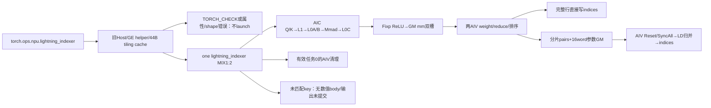
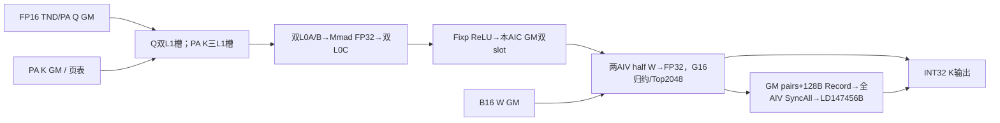
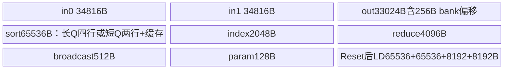
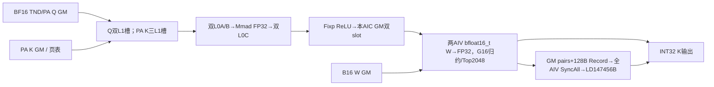
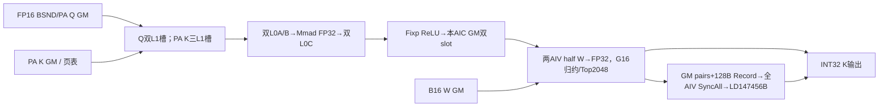
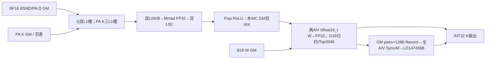
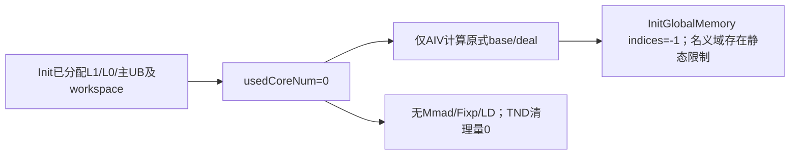
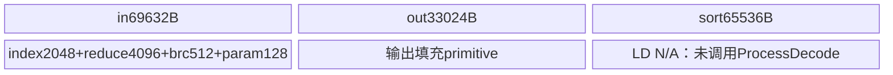

# 旧版 LightningIndexer A3 Direct Invoke 算子知识

## 算子速览

| 项目 | 内容 |
|---|---|
| 实际入口 | Direct Invoke：torch.ops.npu.lightning_indexer → sglang::npu_kernel::lightning_indexer → ACLRT_LAUNCH_KERNEL(lightning_indexer)，不是ACLNN pair |
| 计算语义 | FP16/BF16 QKᵀ以FP32累加、Fixp先ReLU，再乘同B16头权重转FP32求和，按batch内逻辑Key位置取TopK |
| 输入输出 | Q [Tq,64,128]或[B,Sq,64,128]；K [pages,P,1,128]；W与Q去末轴同shape/同B16；输出[Tq,1,K]或[B,Sq,1,K] INT32 |
| 执行类型 | 一个lightning_indexer，KERNEL_TYPE_MIX_AIC_1_2；AIC_CUBE自有LIMatmul、两AIV_VECTOR归约/排序/LD；没有SIMT、NDDMA或通信节点 |
| Kernel 路线 | R-001..004：FP16/BF16×TND/BSND四个PA key；R-005有效工作0；R-006 Host允许但Device无case的非PA终点；Host缺省字符串失败也明确保留 |
| 核心资源 | L1 327680B；L0A/B各65536B，L0C131072B；主UB174976B，Reset后LD147456B；Host实际2Wlib+C×2361344B，Device业务区从传入workspace首址开始 |
| 来源闭包 | direct_implementation_closed：旧Torch注册/Host/helper/11字段packed POD/全部4个Device实例、分核、Cube、Vector、排序、LD、失败终点及构建接线已闭合；静态缺陷不代表可安全复用 |
| 验证状态 | 本次知识提取未执行编译、真机、数值或性能测试。status=draft，无verified事件 |

## 接口与语义

### 计算语义

定义B为batch数，Q_b为batch有效Query行数，K_b为有效Key行数，G=64、D=128、K为sparse_count（1..2048）。分页Key用block_table选物理页，但输出仍是batch内逻辑token位置j，不是物理页号。对有效Query行i：

```text
dot[g,j]   = FP32_Mmad(Q[i,g,0:128], Kpaged[b,j,0,0:128])
score[i,j] = sum_g( FP32(W[i,g]) * ReLU(dot[g,j]) )
visible(i) = K_b                                  if sparse_mode=0
           = max(0,min(K_b,K_b-Q_b+i+1))           if sparse_mode=3，语义域
out[i,:]   = logical-j TopK(score[i,0:visible(i)]), 缺项预期-1
```

源码在Fixp的reluPre=1阶段完成ReLU，之后Vector乘权；权重可以改变分数符号，不能把ReLU移动到加权和之后。Dot为B16乘法/FP32累加，W先CAST_NONE转FP32、分组16头先逐lane累积再树形归约；不承诺任意求和顺序、同分索引顺序或非有限输入的逐位结果。TopK内部保留2048项，最后仅写K项；没有返回values、candidate blocks、metadata或压缩ratio。

上式visible是公开数学意图；Device调度的因果组末长度实际先在uint32计算K_b-Q_b+8(gS1+1)，再Min(K_b)/Max(0)，不是有符号饱和减法。Vector逐行用int32 cuRealAcSeq/cuS2Len再决定计算和无效输出；所有长度、差值、乘积和窄化的有效域必须独立保留，不能据实数公式证明任意shape安全。

### 输入、输出与属性

| 参数 | shape/layout | dtype | 约束、默认值与语义 |
|---|---|---|---|
| query | TND [Tq,64,128]；BSND [B,Sq,64,128]，ND连续 | FP16/BF16 | ConstructOutput先要求query每维>0；G64/D128/N2=1由parser约束；无空物理query快捷返回 |
| key | PA_BSND [pages,P,1,128] | 与Q同B16 | P为16倍数且1..1024；pages经int32窄化后非0；真实页号与storage覆盖由caller保证 |
| weights | [Tq,64]或[B,Sq,64] | 与Q同B16 | 旧接口与vendor V2/V3的FP32 W合同不同；Device按Q选定B16类型读取后转FP32 |
| actual_seq_lengths_query | TND必须，INT32 [B]；BSND可选[B] | INT32 | TND是各batch累计结束位置aQ[b]，首batch起点0，后批起点aQ[b-1]；不是vendor的[B+1]首0边界。BSND为逐batch长度 |
| actual_seq_lengths_key | PA必须[B] | INT32 | 每batch有效K长度，非累计；非负且≤页表容量，并需真实页表/Key覆盖。Host只看shape，不读值 |
| block_table | [B,maxPages] | INT32 | PA必须；页号不得负且小于pages；Host不扫描页号或逐batch所需页数 |
| sparse_indices | [Tq,1,K]或[B,Sq,1,K] | INT32 | at::empty拥有本次输出；无效域预期-1，实际提交边界与清理缺陷见R-005/限制 |
| layout_query/layout_key | Torch schema默认为None | string optional | OpDef声明TND/PA_BSND，README原型写BSND/BSND；固定helper未把String默认写入GetString所读成员，实际缺省空串导致Host拒绝。显式TND或BSND加PA_BSND才选4个计算case |
| sparse_count | 1..2048 | int64入口→int32属性→uint32 POD | OpDef默认2048；先按原int64分配输出再窄化属性，不能宣称超大整数在分配前已被range guard保护 |
| sparse_mode | 0或3 | 同上 | OpDef默认3；0无因果，3右下因果；实际cache key遗漏该字段，切换时存在复用旧POD边界 |
| layout_key非PA | BSND/BSND或TND/TND | — | README/parser接受；Device仅有4个PA case，非PA进入R-006无数值body。不能据文档扩充成功实现域 |

表中dtype、连续、同设备、合法长度/页号是调用合同；固定Host的实际检查弱于合同：SetToContext按query类型从OpDef表统一制造各输入desc，RegisterTensor只登记shape，没有读取每个Tensor实际dtype/stride；AutoContiguous只保存bool，没有执行contiguous。parser对desc的dtype相等检查不等于真实Tensor检查，也不自动搬迁CPU或其它设备输入。

### 入口与版本

固定SGL commit dda6d36b0cdb4081e102d14c0a2fb276fc416e69的README只公开A3。CMake的A3开关覆盖arch22家族，Host也接受910B/910_93；这些更宽接线不扩大本卡的公开平台范围，950默认关闭该Host/Device/impl。

CANN9.2证据是同提交.github/workflows/build_and_release.yml的a3×9.2.0矩阵及A3的build.sh -a kernels步骤；build.sh设置BUILD_KERNELS_MODULE，根CMake add_subdirectory(csrc)，csrc根Torch分支include legacy_kernels.cmake，从而编入本旧Host和lightning_indexer_kernel.cpp。不是把新的独立CANN operator目录或ops-transformer wheel当旧实现。固定SDK为官方asc-devkit a63d5261c7c8077a0081e867f43a0e884fec066b、version.cmake=9.2.0；本地源码不证明所有同版本安装二进制逐字一致。

与[厂商V2/V3接入API](../../../../apis/sgl_kernel_npu/sgl_lightning_indexer_v2_candidates.md)及[最新V3完整实现](../../../aclnn/transformer/attention/sgl_lightning_indexer_v3_candidates.md)比较后保留独立旧实现卡：旧入口返回单Tensor、W为B16、累计长度[B]、packed44B、4个字面key；vendor经ACLNN V2/V3/InnerV2、W为FP32、累计边界[B+1]、21字段POD、8个模板key并扩展候选/值输出。共享QK/TopK思想不能替代旧ABI、Host cache或Device提交事实。

## Host/Launcher 执行流程

### 参数校验与前处理

Torch schema在TORCH_LIBRARY_FRAGMENT(npu)定义，PrivateUse1注册受SGL_KERNEL_ENABLE_A3_ONLY_OPS控制，调用sglang::npu_kernel::lightning_indexer。Host构造LightningIndexer/共享TilingContext，取默认属性，再以显式可选参数覆盖；ConstructOutput按layout/原int64 K分配INT32输出。None的Q长度、K长度或页表另被替换为query dtype/device上的at::empty({1})占位Tensor；TilingContext仍登记原optional，而launch传的是替换后的非空Tensor，这是两条不同路径。

SetToContext建立desc/属性表，再RegisterTensor登记原Q/K/W、原optional和输出。LIInfoParser按顺序GetOpName/GetNpuInfo/GetOpParaInfo/required→desc dtype→layout/optional→rank、N1/N2/G→B/S1/D/S2→形状匹配→GenerateInfo。GetNpuInfo要求C/AIV非0及SoC910B/910_93；GetAndCheckAttr检查非PA同名、布局枚举、K范围、mask0/3；PA必须lengthK与table、TND必须lengthQ，length项desc要求INT32，表rank2。此层没有实际值的单调/非负/最后累计值匹配Tq验证。

PA的S2=maxPages*P先用int64计算并检查≤UINT32_MAX；其它shape多直接窄化。TND的B=aQ.numel>0，aK.numel/table.axis0须与B匹配；BSND的B/Sq由Q获得，W/O同轴一致，lengthQ/K长度若提供也须B。N1/N2=64、D128。Host不执行Q/K核心Torch数学，不调用vendor LightningIndexer，也没有自动数值fallback。

### 参数、Workspace 与生命周期

记C=平台物理AIC数，V=物理AIV数，N=CalcTschBlockDim(V,C,V)。固定SDK转CalcTschNumBlocks：正常MIX比例V=2C得N=C；异常平台参数有其它返回路径，旧Host未额外验证N>0/N≤C。launch blockDim=N，POD.usedCoreNum初值N；Device SplitCore可将本核局部usedCoreNum缩成min(N,totalTasks)，workspace仍按GetBlockNum=N分区。

```text
Wlib = Platform.GetLibApiWorkSpaceSize()；SDK DAV_2201返回16MiB
Wuser_arg = Wlib + C*(2*512*512*4 + 2*8*2*2048*4 + 2*8*16*8)
          = Wlib + C*2361344
TilingContext.SetWorkspaceSizes(Wuser_arg)另保存system=Wlib
实际Torch分配 = system + user = 2*Wlib + C*2361344 bytes

Device不调用GetUserWorkspace：userWorkspace = workspace，业务从传入GM首址开始。
Wmm  = N*2097152
Wld  = N*262144
Wpar = N*2048
Device布局 = mm@0，LD@Wmm，param@Wmm+Wld，总N*2361344B。
覆盖推导的前提：正常MIX N≤C、所有算术/窄化无溢出，真实allocation可用。
```

Host tiling是packed44B。旧专用cache把(B,N2,G,S1,S2,P,maxPages,key)的TupleHasher结果映射到1024个槽，静态NPU byte Tensor大小45056B；命中直接用原槽，未命中且未满则aclrtMemcpy同步H2D44B，满后重用单个静态44B fallback buffer。key中没有sparseCount/sparseMode/usedCoreNum、device/stream或完整POD字节，也不对hash碰撞比较原tuple；它没有调用ge_helper中较新的TilingTensorCache。from_blob只暴露静态allocation内地址；shape/hash map和设备选择为进程静态状态，无互斥、无本入口的跨stream隔离保证。原K用于输出分配而旧POD的K用于Device stride，缓存错误会改变地址/写域，不能当纯性能问题。

Q/K/W、lengths/table由调用方持有，输出/workspace由本次at::Tensor持有；静态tiling由旧cache持有。EXEC_KERNEL_CMD捕获的converted_params只有data_ptr裸指针，选当前NPU stream，在OpCommand::RunOpApi回调中ACLRT_LAUNCH_KERNEL；忽略launch返回并返回0，不能宣称此宏检查全部设备提交失败。异步Tensor保活/allocator和生成launch wrapper为框架边界；本源码没有显式设备完成等待，不能把Host return等同Device已完成，也不能脱离框架延迟消费这些裸指针。

### 启动图与失败传播



entry参数顺序是Q,K,W,aQ,aK,table,out,workspace,tiling。没有多kernel数据边；上述图中Cube/Vector/LD都在同一launch，依赖CrossCore/局部event/全AIV barrier，不由Host stream顺序替代。Host parser失败经TORCH_CHECK抛出；DoTiling返回状态未检查但当前函数末尾总GRAPH_SUCCESS。aclrtMemcpy返回未检查；不编造拷贝/launch错误自动回滚输出。

## Route 与参数设计

### 分核与资源计算

M基本块512（8个Query×64头），S2基本块512，D128。对每batch/Query组，mask0用ceil(K_b/512)任务，mask3用组末可见列按源码uint32运算求任务；totalTasks也是uint32，sum和ceil加法没有统一溢出保护。SplitCore按total/N商余给前remainder核多一块，记录inclusive(bN2,gS1,s2)首尾，必要时让最后任务核覆盖末尾零长batch以清理输出。若一Query组被横切S2，只有从s2Idx=0开始且该核终点未到组末者置isLD；LD不是由Host另一个key选择。

Cube每512列分2个≤256 Key-L1片，每≤512行分2个≤256 Q-L1片，再按≤128行/列进L0；D一次128，不存在split-K或generic Matmul库隐藏tiling。两个Q-L1槽覆盖本Query组，首个本核S2加载，后续S2复用；Key-L1三槽，L0A/B/C各双槽。

```text
L1 = Q2*256*128*2 + K3*256*128*2 = 327680B
L0A=L0B=2*128*128*2=65536B；L0C=2*128*128*4=131072B

主UB按InitBuffer调用次序排：
inQueue: 2*(16*512*4+512*4)=69632B，两个34816B buffer
outQueue: max(2048*2*2*4,256+16*512*4)=33024B
sortOut: ceil(8/2)*2048*2*4=65536B
index:512*4=2048B；reduce:512*2*4=4096B
broadcast:16*8*4=512B；param:16*8=128B
合计174976B。REDUCE_BANK_CONFLICT_OFFSETS=256B，属于outQueue容量之内。

LD阶段Reset后：toMerge=65536B、tmp=65536B、
outValue8192B、outIndex8192B，总147456B，非与主UB相加。
SDK2201常量UB=192KiB、TOTAL_VEC_LOCAL_SIZE=184KiB，
L1=512KiB-KFC_L1_RESERVER_SIZE（默认128B），L0A/B各64KiB、L0C128KiB。
Host没有比较当前UB/L1/L0所需量，也没有缩tilefallback。
```

### Route 选择

| 顺序 | Route | Key/模板 | 精确选择条件与优先级 | 不适用去向 |
|---:|---|---|---|---|
| 1 | R-001 FP16 TND/PA | 0x01013112 | 显式TND/PA_BSND、Q选FP16、公共guard；正有效任务 | 工作0→R-005；非法Host失败 |
| 2 | R-002 BF16 TND/PA | 0x0c0c3112 | 同上、Q选BF16 | 同上 |
| 3 | R-003 FP16 BSND/PA | 0x01013102 | 显式BSND/PA_BSND、Q选FP16、公共guard；正任务 | 工作0→R-005；长度None边界另列 |
| 4 | R-004 BF16 BSND/PA | 0x0c0c3102 | 同上、Q选BF16 | 同上 |
| 5 | R-005 零有效工作 | 前4个key之一 | Init/SplitCore后usedCoreNum=0 | ProcessInvalid后return，不进LD |
| 6 | R-006 非PA无case | FP16 0x01013000/0x01013011；BF16 0x0c0c3000/0x0c0c3011 | Host接受同名BSND/BSND或TND/TND且前置检查通过 | switch无default，不执行Init/Process、不提交out |

```text
Torch schema optional layouts=None
 -> 固定helper GetString为空；未显式覆盖的layout由Host枚举检查拒绝
 -> 显式layout：非PA必须同名，PA允许Q TND/BSND
 -> dtype/key=(Qkey<<24)|(Kkey<<16)|(3<<12)|(PA<<8)|(Qlayout<<4)|Klayout
 -> 4个PA key：Init -> SplitCore -> used0清理 / main+decode
 -> 合法非PA key：switch不匹配，返回尚未初始化的empty输出
```

### 模板/实现执行矩阵

| Route | key/selector | dtype/shape/platform 完整命中条件 | 执行族与 kernel 节点 | 实际模板/body | 内存与同步特征 | tail/fallback |
|---|---|---|---|---|---|---|
| R-001 | 0x01013112 | A3、公共PA合同、TND、Q/K/W FP16意图域、G64/D128/K≤2048 | one MIX AIC1:AIV2 | LIPreload&lt;LIType&lt;half,half,int32_t,true,TND,PA_BSND&gt;&gt; | GM双槽、packed44B、main174976→LD147456B | 累计Q结束位置[B]，有效K逐batch；无fallback |
| R-002 | 0x0c0c3112 | 同R-001但BF16 | 同图 | LIPreload&lt;LIType&lt;bfloat16_t,bfloat16_t,int32_t,true,TND,PA_BSND&gt;&gt; | B16读入种类不同，其余字节/调度同族 | 同R-001，FP32权重转换/累加 |
| R-003 | 0x01013102 | A3、PA、BSND、FP16意图域、同公共约束 | 同图 | LIPreload&lt;LIType&lt;half,half,int32_t,true,BSND,PA_BSND&gt;&gt; | Qprefix=b*Sq，Q无效行清理；其余共同管线 | 可选aQ的Host替代不等于Device null |
| R-004 | 0x0c0c3102 | 同R-003但BF16 | 同图 | LIPreload&lt;LIType&lt;bfloat16_t,bfloat16_t,int32_t,true,BSND,PA_BSND&gt;&gt; | 同R-003，BF16→FP32 | 同R-003 |
| R-005 | used0 | 前4个typed key，物理Q>0但有效任务0 | 同MIX入口，只有AIV清理，无Cube数学 | LIPreload::ProcessInvalid | 初始化资源仍存在，清理长度静态错误见正文 | TND qSeqSize0、BSND dealSize反向 |
| R-006 | 非PA4 key | Host可能接受；无对应Device实例 | 无核心数学，不补造Cube | switch无case/default | 仅Host输出/workspace/tiling分配 | 未初始化输出无自动fallback |

### 隐藏性能 Guard

| Guard | Host/Tiling 条件 | Device/资源原因 | 影响 Route | 不满足时去向 | 源码符号 |
|---|---|---|---|---|---|
| 设备与版本 | README A3；Host SoC910B/910_93、C/V非0；CI A3×9.2 | 旧raw Cube/Vector MIX1:2 | 全部 | Host失败；950默认不注册impl | GetNpuInfo/legacy_kernels.cmake |
| G/D/P | G=64,D128,N2=1；P%16=0且0<P≤1024 | M512→8Q，B16 D128整K；PA分段 | R-001..005 | Host失败 | GetGSize/GetHeadDim/GetAndCheckBlockSize |
| TopK | 1≤K≤2048 | 固定2048 pairs累加器和LD容量 | 计算/清理 | Host失败；属性窄化前输出已分配 | GetAndCheckAttrParaInfo |
| 短Q排序 | Device actS1Size≤4 | 每AIV≤2行，sortOut后半可缓存4×512 pairs/行 | R-001..004 | >4走SortAll+MergeSort | ProcessVec/SortedBasicBlock_ |
| 跨核LD | s2Idx=0且本段end+1<组s2BaseNum | 单行S2跨核，需要2048局部TopK二次归并 | 同上 | 完整行直接写；非leader无LD工作 | SplitCore::isLD |
| 真实layout/dtype | parser检查的是fabricated desc，AutoContiguous未执行 | 原data_ptr按紧凑B16/INT32地址解释 | 全部 | 无可见自动修正 | SetToContext/RegisterTensor |
| 长度/页号值 | Host不扫描；调用方非负单调/覆盖真实storage | uint32读取、页号乘P*128、循环/地址依赖值 | 计算/零域 | 无设备范围fallback | GetActualSeqLen/KeyNd2NzForPA |
| cache一致性 | 相同8字段hash复用；未含K/mask/N/device | POD控制输出stride/launch实际消费 | 全部 | 命中旧槽，不重新校正；1024满后单槽覆盖 | captureMap/TupleHasher |
| 容量/整数 | 固定内存账、N>0/N≤C/合法MIX，所有乘加与u32/int32/u16转换可表示 | workspace切片、SplitCore除数、DMA长度 | 全部 | 没有统一资源/溢出保护或缩tile路线 | DoTiling/InitBuffers/SplitCore |

### POD/ABI

LITilingData由#pragma pack(push,1)定义，无注册生成宏；11×uint32=44B、alignof=1、offset均为4倍序号，这是固定声明的静态布局推导，未编译测ABI。H2D整体44B，Device直接reinterpret GM指针。字段不是vendor LIV2TilingData的21字段。Host的LITilingInfo/LiParaInfo只保留本地desc/shape指针；ConstInfo/TempLoopInfo/RunInfo/SplitCoreInfo是各核局部状态，不作为Host/GM传输ABI。

| 结构 | 字段 | 类型/位宽 | ABI 布局 | 单位 | Host/launcher producer | Device consumer | 边界 |
|---|---|---|---|---|---|---|---|
| LITilingData | bSize | uint32 | 0B/4B | batch | BSND Q.axis0；TND aQ.numel | Init.batchSize/GetTotalBaseBlockNum | aQ是[B]累计结束位置 |
| LITilingData | n2Size | uint32 | 4B/4B | heads | GetAndCheckN2Size=1 | POD hash；Device用常量K_HEAD_NUM=1 | 不得删字段 |
| LITilingData | gSize | uint32 | 8B/4B | heads | n1/n2=64 | qHeadNum/gSize/s1Base=ceil512/G | 正常固定64 |
| LITilingData | s1Size | uint32 | 12B/4B | Q行 | BSND dim1；TND保留0 | qSeqSize/清理域/BSND默认长度 | TND有正任务时仍读aQ；不等所有TND无计算 |
| LITilingData | s2Size | uint32 | 16B/4B | K容量 | PA maxPages*P；非PA shape轴 | kSeqSize/default length | 仅PA有乘积上界guard |
| LITilingData | sparseCount | uint32 | 20B/4B | 输出槽 | int64→int32 attr→range check | sparseCount/CopyOut/stride/清理 | cache hash遗漏 |
| LITilingData | usedCoreNum | uint32 | 24B/4B | MIX组 | CalcTschBlockDim(V,C,V) | Host blockDim、Init局部后SplitCore缩减 | 原始launch N与有效used不同；cache遗漏 |
| LITilingData | blockSize | uint32 | 28B/4B | token/页 | Key dim1校验后保存 | kCacheBlockSize/PA divide/mod | PA>0；非PA默认0但无case |
| LITilingData | maxBlockNumPerBatch | uint32 | 32B/4B | 页表列 | block_table.axis1 | table[b*maxPages+logicalPage] | Host不扫描页号/长度覆盖 |
| LITilingData | sparseMode | uint32 | 36B/4B | 枚举 | int32 attr0/3 | attenMaskFlag=(==3)、分核/逐行可见域 | cache hash遗漏 |
| LITilingData | tilingKey | uint32 | 40B/4B | bitfield | dtype/layout/PA位拼接 | switch4 case | 无default/unknown key无写回 |

LD的GM参数记录是int64[16]，每记录128B、自然8字节元素布局，首址随per-AIC/Query行/头尾公式计算。Init把所有GM记录填-1；写回时使用独立paramBuf，只有0..8写入，9..15未见赋值，不能把GM初始-1扩大为随后128B DMA中这些保留word也有效。

| 结构 | 字段 | 类型/位宽 | ABI 布局 | 单位 | Host/launcher producer | Device consumer | 边界 |
|---|---|---|---|---|---|---|---|
| LDRecord int64[16] | 0 needFd | int64/64 | 0B/8B | 标记 | Device ProcessVec=1 | ProcessLD判链 | 其余GM初始化-1 |
| LDRecord int64[16] | 1 s2AcSeq | int64/64 | 8B/8B | 列 | Device cuRealAcSeq | 当前LD未消费 | 记录可见域 |
| LDRecord int64[16] | 2 s2Start | int64/64 | 16B/8B | tile | Device blockS2StartIdx_ | 当前LD未消费 | 不是token数 |
| LDRecord int64[16] | 3 s2End | int64/64 | 24B/8B | token end | Device cuBaseS2Idx+cuS2Len | 当前LD未消费 | 与slot范围对应 |
| LDRecord int64[16] | 4 isS2End | int64/64 | 32B/8B | bool值 | Device isS2End | LD链停止 | 0/1 |
| LDRecord int64[16] | 5 bn2Idx | int64/64 | 40B/8B | batch/head | Device info.bN2Idx | 当前LD未消费 | 未作链身份校验 |
| LDRecord int64[16] | 6 s1Idx | int64/64 | 48B/8B | 行 | Device cuS1Idx | LD读取局部变量 | 后续未用于身份比较 |
| LDRecord int64[16] | 7 S1ProcNum | int64/64 | 56B/8B | 行 | Device cuS1ProcNum | 当前LD未消费 | 与leader扫描得行数区别 |
| LDRecord int64[16] | 8 outputOffset | int64/64 | 64B/8B | INT32元素 | Device info.indiceOutOffset+cuS1Idx*K | LD最终indices写址 | 后继记录提供 |
| LDRecord int64[16] | 9 reserved | int64/64 | 72B/8B | 保留 | Device 未见paramBuf赋值 | 未消费 | 128B DMA仍覆盖；不承诺初始化 |
| LDRecord int64[16] | 10 reserved | int64/64 | 80B/8B | 保留 | Device 未见paramBuf赋值 | 未消费 | 128B DMA仍覆盖；不承诺初始化 |
| LDRecord int64[16] | 11 reserved | int64/64 | 88B/8B | 保留 | Device 未见paramBuf赋值 | 未消费 | 128B DMA仍覆盖；不承诺初始化 |
| LDRecord int64[16] | 12 reserved | int64/64 | 96B/8B | 保留 | Device 未见paramBuf赋值 | 未消费 | 128B DMA仍覆盖；不承诺初始化 |
| LDRecord int64[16] | 13 reserved | int64/64 | 104B/8B | 保留 | Device 未见paramBuf赋值 | 未消费 | 128B DMA仍覆盖；不承诺初始化 |
| LDRecord int64[16] | 14 reserved | int64/64 | 112B/8B | 保留 | Device 未见paramBuf赋值 | 未消费 | 128B DMA仍覆盖；不承诺初始化 |
| LDRecord int64[16] | 15 reserved | int64/64 | 120B/8B | 保留 | Device 未见paramBuf赋值 | 未消费 | 128B DMA仍覆盖；不承诺初始化 |

### Route 源码闭包

| Route | Key/selector | Host/Tiling producer | POD/参数 | Kernel entry/router | Kernel body/直接依赖 | 构建接线 |
|---|---|---|---|---|---|---|
| R-001..004 | 四PA字面key分别保留 | lightning_indexer.cpp→LIInfoParser/LightningIndexerTiling | packed44B；Q/K/W/length/table/out原data_ptr | lightning_indexer_kernel.cpp::lightning_indexer | LIPreload/SplitCore/ProcessMain/Decode；LIMatmul、LIVector、vector helpers；SDK2201 Sort/Sync实例 | root→csrc legacy；OP_SRCS/workspace_kernel/HAVE_WORKSPACE+HAVE_TILING→sgl_kernel_npu |
| R-005 | 四key的totalTasks0 | 同Host，长度值到Device才读取 | 同POD；Init已分配资源 | 同entry→ProcessInvalid | AIV InitGlobalMemory、静态清理域边界 | 同一MIX target |
| R-006 | 非PA4 key | Host允许的同名非PA检查 | 仍分配POD/WS/out | switch未匹配、无default | 没有被选择的数值body；这是精确终点，不补造非PA实例 | 同target无额外实例 |

## Kernel 实现

### 公共执行流程

下列P-1管线是R-001..004的完整共同函数级实现；四Route分别实例化dtype/layout、给出精确地址与清理差异。不能把参数化理解为删除某个key。页表、实际长度、K属性、cache和数值/内存约束全部沿当前旧ABI解释。

```text
lightning_indexer -> LIPreload<LIType<...>>::Init
 -> InitTilingData -> InitActualSeqLen -> SplitCore(aiCoreIdx,usedCoreNum,splitCoreInfo)
 -> 绑定mm/ld/param workspace、Q/K/W/table/out -> AIC/AIV各InitBuffers
Process -> used0 ? ProcessInvalid : ProcessMain + ProcessDecode
ProcessMain -> AIV预置V→C flag0两次；AIC AllocEventID
 -> 按inclusive bN2/gS1/s2区间，CalcGS1LoopParams/CalcS2LoopParams/CalcRunInfo
 -> 零长度时DealActSeqLenIsZero；正常ProcessBaseBlock
 -> AIC: Wait V→C0 -> LIMatmul.ComputeMm1 -> Set C→V0(PIPE_FIX,mode2)
 -> AIV: Wait C→V0 -> LIVector.ProcessVec -> Set V→C0(PIPE_MTE2,mode2)
 -> 核内gloop连续、GM slot=gloop%2；free/drain AIC L1/L0 events并等两credit
ProcessDecode -> 所有AIV TPipe.Reset -> LD buffers -> ICachePreLoad(2) -> SyncAll()
 -> isLD的leader两AIV按行分配ProcessLD，归并后写出indices
```

实际constInfo.syncC1V1/syncV1C1由ConstInfo{}初始化为0、没有改成类中另列的闲置常量4/5。固定SDK CrossCoreSet将mode2/pipe/flag编码到ffts_cross_core_sync；CrossCoreWait默认mode0，但WaitEventImpl忽略modeId、只wait_flag_dev(flagId)，不能据默认模板参数推成模式不匹配。硬件MIX组内flag计数为primitive合同边界；SDK GetBlockIdx在AIV上是raw_block*taskRatio+subblock，当前1:2中aiCoreIdx=AIVid/2，不能用raw AIV号替代扁平化id。

Cube P-1：LIMatmul::ComputeMm1外循环N≤256 Key片、M≤256 Q片，L0 N/M各≤128；KeyNd2NzForPA按页和128列子块边界截断。物理K元素地址=(table[b*maxPages+floor(j/P)]*P+j%P)*128；n2固定0。Nd2Nz ndNum1、d/srcDValue128、srcNdMatrixStride=dstNzMatrixStride=0，dstNzC0Stride为当前128子块尾按16对齐、dstNzNStride1；Q用nValue=Mtail、d128、dstNzC0Stride=A16(Mtail)。Q首个本核S2首K片加载，随后复用两个Q-L1槽，最后S2才归还其MTE1_MTE2 credit。LoadQueryToL0a用LoadData3DV2，M=A16(Mtail),K128,padding末255、1×1 stride/dilation、transpose0；Key LoadData2D repeat=ceil(Ntail/16)*8、srcStride1,dstGap0,transposefalse。Mmad(m=A16(Mtail),n=Ntail,k128,cmatrixInitVal=true,cmatrixSource=false,unitFlag3)，小于10个16×16块附加PIPE_M。Fixp FP32 NoQuant、nz2nd、unitFlag3、reluPre1；dstStride=A32(n)个FP32元素、srcStride=A16(Mtail)，写入本AIC当前GM slot。

Cube局部event：Key-L1三槽MTE1_MTE2 2/3/4，Q-L1两槽5/6；MTE2_MTE1和MTE1_M用2；L0双槽M_MTE1用3/4，开始预置、每次消费/归还、结束逐项Wait并关闭MMLayoutTransform。方向/pipe域不同的同数字event不能混成一个状态。L0C/GM写的有效M/N由本tile界限决定，G64使Query有效M为64倍数；不宣称任意G可套用。

Vector P-1：每组两AIV分别处理ceil(qRows/2)与floor(qRows/2)，每AIV最多4Q行。CopyIn按16头读取FP32 mm，blockCount16、blockLen=A32(n)*4B，dstStride=(512-A32(n))/8个32B块；W读取16*sizeof(B16)到inQueue尾部的B16视图，再CAST_NONE到FP32视图。两视图存在尾部重叠，使用当前AscendC Cast/queue合同，不推导任意alias可替代。Brcb将每权重广播8个float，16×512逐行Mul；第一个G片写outQueue+256B，后3个G片Mul后Add到相同16行槽；DoReduce先折叠到最近2次幂再二分归约，本G64/inner16实际是16行树。PIPE_V保护V内读写，inQueue EnQue/DeQue/Free与outQueue逐阶段Alloc/Free控制局部lifetime。

每行sortScore[512]先用0xff800000填−inf，有效cuS2Len覆盖；索引0..511加512*s2Idx，tail索引−1。Q有效行数>4：Sort32+自有MrgSort4层级全排512，再MergeSort旧2048和新512，截取2048 pairs。Q≤4：sortOut前半存两行Top2048、后半SortedBasicBlock_存每行4×512 pairs；各512先Sort<float,true>，每4tile、行末或核末精归并，首4tile直接覆盖、随后SparseTopK归并。Sort<float,true>在固定SDK2201先vbitsort32，再DoFullSort的4路merge层级，当前repeat=512/32=16；不是仅一次局部sort32。MrgSort长度2048/512等、validBit3/7/15、exhausted标记按当前helper传值，最后到vmrgsort4；Sort/硬件同分与非有限规则不由本提取另造。自有旧UB→UB DataCopy回拷和PIPE_V按原样保留，不擅自加新fence或宣称其V barrier等同MTE完成。

写出条件blockS2StartIdx_=0且本行isS2End：ExtractIndex以GatherMask pattern2提取pair奇数word，按K个INT32写出，重置该行累加器。分片在行末/核末将2048 pairs写LD头/尾，另写int64[16]参数；头尾由blockS2StartIdx_=0与否决定。LD前所有启动AIV Reset主pool（SDK等待FREE buffer关联event）、重建147456B、SyncAll默认isAIVOnly=true且先PIPE_ALL，统一发布主阶段GM。leader读取尾记录needFd=1的行范围，再沿连续后继AIC的头记录needFd==1链：每4个2048list MrgSort、保留2048，剩2/3按validBit再merge，Extract后按后继记录outputOffset写K。没有跨核atomic数值归约，也没有检查链的batch/行身份或显式tmpCubeId<N上界；需真实SplitCore/metadata producer合同成立。

共同地址/交接（a为逻辑AIC，v=2a+sub，A_q为元素向上对齐）：

| 边/缓冲区 | 地址/extent（字节） | dtype/layout | producer→consumer | ordering/sync | owner/lifetime |
|---|---|---|---|---|---|
| mm双GM | a*2097152+(gloop%2)*1048576；tile rowStride=A32(n) | FP32 ND | Fixp→同组两AIV CopyIn | mode2 C→V0 / V→C0，两初始credit及末尾drain | 本次workspace，消费前不可覆写slot |
| LD pairs | Wmm+a*262144+r*32768+headTail*16384 | 2048个(valueFP32,index位型)交错pair | ProcessVec→ProcessLD | 主尾MTE3完成/TPipe Reset/全AIV SyncAll后读 | workspace到LD完成 |
| LD params | Wmm+Wld+a*2048+r*256+headTail*128 | int64[16] | ParamBuf→LD GetValue | S_MTE3/V_MTE3、MTE3_V及全AIV barrier | 每行头/尾记录 |
| 输出 | (Qprefix+i)*K*4 | INT32逻辑j | Extract/CopyOut→后续同stream消费者 | queue/V_MTE3/MTE3_V；无跨kernel内部边 | output Tensor |
| L1/L0槽 | Qslot*65536B、Kslot*65536B；L0A/Bslot*32768、Cslot*65536 | NZ/ZZ、FP32 | GM2L1→LoadData→Mmad→Fixp | 上述各方向event | 每AIC TPipe |
| 主/LD UB复用 | [0,174976)→Reset→[0,147456) | 队列/排序/归并 | 各阶段helper | FREE event drain、PIPE_ALL/SyncAll | 旧LocalTensor引用Reset后不再消费 |


### Route R-001：FP16 TND/PA

#### 适用条件

##### 选择证据

| 层级 | 文件 | 符号 | 源码谓词/参数 | 结果/下一跳 |
|---|---|---|---|---|
| Torch/Host | pytorch_extensions.cpp / op_host/lightning_indexer.cpp | lightning_indexer | 显式layout_query=TND、layout_key=PA_BSND，query half、公共Host guard | 新输出[Tq,1,K]、packed44B |
| Tiling | op_host/tiling/lightning_indexer_tiling.cpp | DoTiling | dtype/key位拼接、PA1、Qlayout=TND | 0x01013112，N MIX组 |
| Device | op_kernel/lightning_indexer_kernel.cpp | switch | tilingKey==0x01013112 | LIPreload&lt;LIType&lt;half,half,int32_t,true,LI_LAYOUT::TND,LI_LAYOUT::PA_BSND&gt;&gt;::Init/Process；used0转R-005 |

#### Device 数据流

##### 函数级调用链

```text
lightning_indexer -> LIPreload<LIType<half,half,int32_t,true,LI_LAYOUT::TND,LI_LAYOUT::PA_BSND>>::Init
 -> InitTilingData/InitActualSeqLen/SplitCore/InitBuffers
 -> ProcessMain/ProcessBaseBlock
    AIC: LIMatmul<同LIType>::ComputeMm1
      -> KeyNd2NzForPA/QueryNd2Nz -> LoadQueryToL0a/LoadKeyToL0b -> ComuteL0c -> Fixp
    AIV: LIVector<同LIType>::ProcessVec
      -> CopyIn<half>/DoScale<half>/DoReduce
      -> actS1Size>4 ? SortAll+MergeSort : Sort<float,true>+MrgBasicBlock/SparseTopK
      -> ExtractIndex/CopyOut 或LD头尾pairs+Record
 -> ProcessDecode -> Reset/InitLDBuffers/SyncAll -> leader ProcessLD/Extract/CopyOut
```

##### 源码等价伪码

```text
# R-001参数化P-1；所有循环/搬运/同步的完整定义见公共流程
Qprefix = b==0?0:aQ[b-1]
Qvalid  = b==0?aQ[0]:aQ[b]-aQ[b-1]
Kvalid  = uint32(aK[b]); PA地址按table而非连续Key前缀
Qelem   = (Qprefix*64 + gS1*512)*128
Welem   = Qprefix*64 + row*64
Oelem   = (Qprefix+row)*K
split inclusive(b,gS1,S2), gloop从本核0开始、跨组连续：
  本核首S2加载Q两L1槽；每S2按页/128边界加载K三L1槽
  AIC wait V→C0 -> M/N≤128,K128 Mmad FP32 -> Fixp ReLU到mm[core,slot] -> set C→V0
  两AIV wait0，各自ceil/floor有效Q行；G分4×16：
    queue DMA mm行+half weights -> Cast W FP32 -> Brcb/Mul/Add -> 16行树归约
    score/idx补−inf/−1，mask0/3只保留当前cuS2Len；
    长Q逐512归并，短Q缓存4×512再归并2048
    完整行写K个indices；否则行/核末保存2048pairs和16word LD参数
  AIV return V→C0；AIC尾部排空两credit和L1/L0事件
所有启动AIV Reset主UB -> LD147456B -> PIPE_ALL+SyncAll()
isLD leader从本核尾记录接后继头记录链，4路逐批归并，最终写K个INT32
```

#### 内存与数据搬运

##### 资源与搬运表

| 层级/缓冲区 | offset/地址公式 | extent/容量公式 | dtype/layout | producer | consumer | owner/lifetime | 对齐/复用 |
|---|---|---|---|---|---|---|---|
| Q/W GM | Qelem*2 / Welem*2 | Qvalid*64*128*2 / Qvalid*64*2 | half ND | caller | MTE2/Vector | 到stream消费完成 | 紧凑storage合同；Host不做contiguous |
| PA K GM | (pageId*P+j%P)*128*2 | 有效页/列*128*2 | half ND | caller | KeyNd2NzForPA | 同上 | 页号和真实storage覆盖未扫描 |
| 输出GM | Oelem*4 | 每有效/清理行K*4 | INT32 | 直接输出或LD | caller/后续stream | output Tensor | 不是物理页号；无效域不能凭empty假定已初始化 |
| workspace GM | mm@0/ld@N*2097152/param@N*(2097152+262144) | N*2361344B业务；Host另有2Wlib | FP32 pairs/INT64参数 | AIC/AIV | AIV/LD | 本次Tensor | 双mm slot、LD头尾；P-1边表完整 |
| L1/L0 | Q/K各65536B槽；A/B各32768B槽、C各65536B槽 | L1 327680B；A/B65536B各；C131072B | half NZ/FP32 | DMA/LoadData/Mmad | Mmad/Fixp | 每AIC TPipe | Q2/K3/L0各2，事件见P-1 |
| AIV UB | 按P-1 InitBuffer顺序 | 主174976B；Reset后147456B | FP32/int32/half视图 | queues/Vector | sort/CopyOut/LD | 每物理AIV TPipe | 阶段互斥取max，不相加 |
| 寄存器/其它族 | 标量offset、循环、排序参数 | 编译后精确寄存器字节不可见；SIMT/NDDMA/通信N/A | scalar | 编译器 | 本body | 活跃期 | 不编造动态UB或通信节点 |

##### 分层内存布局





##### 字节账、交接边与复用顺序

```text
Host=2Wlib+C*2361344；Device=N*(2097152+262144+2048)
L1=2*65536+3*65536=327680；L0A/B=2*32768各；L0C=2*65536
UBpeak=max(174976,147456)=174976，必须满足真实TPipe可用预算
```

| 边/复用子区 | producer | offset/extent | dtype/layout | consumer | ordering/sync | owner/lifetime | 安全条件 |
|---|---|---|---|---|---|---|---|
| Cube→Vector | Fixp | a*2097152+slot1048576，stride=A32(n) | FP32 ND | 两AIV CopyIn | C→V0 PIPE_FIX；V→C0 PIPE_MTE2；末尾drain | workspace | 保持a=AIVid/2、slot=gloop%2 |
| Vector→LD | ProcessVec | LD@Wmm+a262144+r32768+headTail16384 | 2048 value/index pairs | ProcessLD | Record/pairs MTE3后、全AIV SyncAll | workspace | 同一S1行与连续S2分片，真实head/tail链 |
| UB阶段复用 | queues/Vector→Reset | 主174976 / LD147456 | TQue/TBuf | LD buffers | Reset等待FREE事件；SyncAll先PIPE_ALL | 每AIV TPipe | 不使用Reset前LocalTensor引用 |
| 输出 | Extract/GatherMask | (Qprefix+row)*K*4，K*4B | INT32 | 后续stream | V_MTE3/queue，LD另MTE3_V | output Tensor | 真实有效/清理行范围；缓存POD与输出K一致 |

#### 同步、精度与尾块

##### 同步与数值边界表

| 阶段 | primitive/机制 | producer | consumer/等待点 | 保护对象 | 精度/尾块 |
|---|---|---|---|---|---|
| Cube | Key2/3/4、Q5/6 MTE1_MTE2；M_MTE1 3/4，MTE2_MTE1/MTE1_M2 | GM/LoadData/Mmad | 各slot复用点 | L1/L0 | half×half→FP32；D128；M16对齐/N有效tail；Fixp先ReLU |
| AIC/AIV | 双向flag0、初始两permit、末尾两Wait | PIPE_FIX/PIPE_MTE2 | 对端WaitFlag | mm双slot | P-1完整credit；不是闲置4/5 |
| Vector | queues/PIPE_V、V_MTE3/MTE3_V、SDK Sort/MrgSort | MTE2/FP32归约 | 排序/写回 | UB及LD记录 | W CAST_NONE→FP32，G16树归约；score−inf、idx−1；无逐位同分保证 |
| LD/无效行 | Reset、PIPE_ALL、AIV SyncAll，MTE2_V/V_MTE3/MTE3_V | 各分片pairs/Record | leader ProcessLD | 头尾链与输出 | TND仅输出有效累计范围；aQ[B-1]须等于实际Tq是caller合同，Host未读值。Qvalid=0时局部清理循环为0；Kvalid=0时DealActSeqLenIsZero会按当前被遍历batch的Qvalid清理，不能推广到未被分核遍历的所有batch。 |

#### 关键实现

##### 符号证据表

| 阶段 | 文件 | 符号/模板实例 | 实现事实 |
|---|---|---|---|
| Host/Tiling producer | op_host/lightning_indexer.cpp / tiling/lightning_indexer_tiling.cpp | lightning_indexer/DoTiling | 0x01013112、44B、N blockDim，缓存边界不省略 |
| Kernel entry/router | op_kernel/lightning_indexer_kernel.cpp | LIPreload&lt;LIType&lt;half,half,int32_t,true,LI_LAYOUT::TND,LI_LAYOUT::PA_BSND&gt;&gt; | TND/PA与half实际实例 |
| Device body/helper | 同目录service_cube.h/service_vector.h/vector.h | LIMatmul/LIVector/DoScale&lt;half&gt;/Sort/LD | 公共P-1全部函数、地址/循环/字节/event均用于本实例 |
| SDK实例 | basic_api proposal / dav_c220 / block_sync | Sort&lt;float,true&gt;、MrgSort、NotifyEvent/WaitEvent、SyncAll | full512排序→四路merge、局部flag/全AIV barrier真实实现 |

### Route R-002：BF16 TND/PA

#### 适用条件

##### 选择证据

| 层级 | 文件 | 符号 | 源码谓词/参数 | 结果/下一跳 |
|---|---|---|---|---|
| Torch/Host | pytorch_extensions.cpp / op_host/lightning_indexer.cpp | lightning_indexer | 显式layout_query=TND、layout_key=PA_BSND，query bfloat16_t、公共Host guard | 新输出[Tq,1,K]、packed44B |
| Tiling | op_host/tiling/lightning_indexer_tiling.cpp | DoTiling | dtype/key位拼接、PA1、Qlayout=TND | 0x0c0c3112，N MIX组 |
| Device | op_kernel/lightning_indexer_kernel.cpp | switch | tilingKey==0x0c0c3112 | LIPreload&lt;LIType&lt;bfloat16_t,bfloat16_t,int32_t,true,LI_LAYOUT::TND,LI_LAYOUT::PA_BSND&gt;&gt;::Init/Process；used0转R-005 |

#### Device 数据流

##### 函数级调用链

```text
lightning_indexer -> LIPreload<LIType<bfloat16_t,bfloat16_t,int32_t,true,LI_LAYOUT::TND,LI_LAYOUT::PA_BSND>>::Init
 -> InitTilingData/InitActualSeqLen/SplitCore/InitBuffers
 -> ProcessMain/ProcessBaseBlock
    AIC: LIMatmul<同LIType>::ComputeMm1
      -> KeyNd2NzForPA/QueryNd2Nz -> LoadQueryToL0a/LoadKeyToL0b -> ComuteL0c -> Fixp
    AIV: LIVector<同LIType>::ProcessVec
      -> CopyIn<bfloat16_t>/DoScale<bfloat16_t>/DoReduce
      -> actS1Size>4 ? SortAll+MergeSort : Sort<float,true>+MrgBasicBlock/SparseTopK
      -> ExtractIndex/CopyOut 或LD头尾pairs+Record
 -> ProcessDecode -> Reset/InitLDBuffers/SyncAll -> leader ProcessLD/Extract/CopyOut
```

##### 源码等价伪码

```text
# R-002参数化P-1；所有循环/搬运/同步的完整定义见公共流程
Qprefix = b==0?0:aQ[b-1]
Qvalid  = b==0?aQ[0]:aQ[b]-aQ[b-1]
Kvalid  = uint32(aK[b]); PA地址按table而非连续Key前缀
Qelem   = (Qprefix*64 + gS1*512)*128
Welem   = Qprefix*64 + row*64
Oelem   = (Qprefix+row)*K
split inclusive(b,gS1,S2), gloop从本核0开始、跨组连续：
  本核首S2加载Q两L1槽；每S2按页/128边界加载K三L1槽
  AIC wait V→C0 -> M/N≤128,K128 Mmad FP32 -> Fixp ReLU到mm[core,slot] -> set C→V0
  两AIV wait0，各自ceil/floor有效Q行；G分4×16：
    queue DMA mm行+bfloat16_t weights -> Cast W FP32 -> Brcb/Mul/Add -> 16行树归约
    score/idx补−inf/−1，mask0/3只保留当前cuS2Len；
    长Q逐512归并，短Q缓存4×512再归并2048
    完整行写K个indices；否则行/核末保存2048pairs和16word LD参数
  AIV return V→C0；AIC尾部排空两credit和L1/L0事件
所有启动AIV Reset主UB -> LD147456B -> PIPE_ALL+SyncAll()
isLD leader从本核尾记录接后继头记录链，4路逐批归并，最终写K个INT32
```

#### 内存与数据搬运

##### 资源与搬运表

| 层级/缓冲区 | offset/地址公式 | extent/容量公式 | dtype/layout | producer | consumer | owner/lifetime | 对齐/复用 |
|---|---|---|---|---|---|---|---|
| Q/W GM | Qelem*2 / Welem*2 | Qvalid*64*128*2 / Qvalid*64*2 | bfloat16_t ND | caller | MTE2/Vector | 到stream消费完成 | 紧凑storage合同；Host不做contiguous |
| PA K GM | (pageId*P+j%P)*128*2 | 有效页/列*128*2 | bfloat16_t ND | caller | KeyNd2NzForPA | 同上 | 页号和真实storage覆盖未扫描 |
| 输出GM | Oelem*4 | 每有效/清理行K*4 | INT32 | 直接输出或LD | caller/后续stream | output Tensor | 不是物理页号；无效域不能凭empty假定已初始化 |
| workspace GM | mm@0/ld@N*2097152/param@N*(2097152+262144) | N*2361344B业务；Host另有2Wlib | FP32 pairs/INT64参数 | AIC/AIV | AIV/LD | 本次Tensor | 双mm slot、LD头尾；P-1边表完整 |
| L1/L0 | Q/K各65536B槽；A/B各32768B槽、C各65536B槽 | L1 327680B；A/B65536B各；C131072B | bfloat16_t NZ/FP32 | DMA/LoadData/Mmad | Mmad/Fixp | 每AIC TPipe | Q2/K3/L0各2，事件见P-1 |
| AIV UB | 按P-1 InitBuffer顺序 | 主174976B；Reset后147456B | FP32/int32/bfloat16_t视图 | queues/Vector | sort/CopyOut/LD | 每物理AIV TPipe | 阶段互斥取max，不相加 |
| 寄存器/其它族 | 标量offset、循环、排序参数 | 编译后精确寄存器字节不可见；SIMT/NDDMA/通信N/A | scalar | 编译器 | 本body | 活跃期 | 不编造动态UB或通信节点 |

##### 分层内存布局




##### 字节账、交接边与复用顺序

```text
Host=2Wlib+C*2361344；Device=N*(2097152+262144+2048)
L1=2*65536+3*65536=327680；L0A/B=2*32768各；L0C=2*65536
UBpeak=max(174976,147456)=174976，必须满足真实TPipe可用预算
```

| 边/复用子区 | producer | offset/extent | dtype/layout | consumer | ordering/sync | owner/lifetime | 安全条件 |
|---|---|---|---|---|---|---|---|
| Cube→Vector | Fixp | a*2097152+slot1048576，stride=A32(n) | FP32 ND | 两AIV CopyIn | C→V0 PIPE_FIX；V→C0 PIPE_MTE2；末尾drain | workspace | 保持a=AIVid/2、slot=gloop%2 |
| Vector→LD | ProcessVec | LD@Wmm+a262144+r32768+headTail16384 | 2048 value/index pairs | ProcessLD | Record/pairs MTE3后、全AIV SyncAll | workspace | 同一S1行与连续S2分片，真实head/tail链 |
| UB阶段复用 | queues/Vector→Reset | 主174976 / LD147456 | TQue/TBuf | LD buffers | Reset等待FREE事件；SyncAll先PIPE_ALL | 每AIV TPipe | 不使用Reset前LocalTensor引用 |
| 输出 | Extract/GatherMask | (Qprefix+row)*K*4，K*4B | INT32 | 后续stream | V_MTE3/queue，LD另MTE3_V | output Tensor | 真实有效/清理行范围；缓存POD与输出K一致 |

#### 同步、精度与尾块

##### 同步与数值边界表

| 阶段 | primitive/机制 | producer | consumer/等待点 | 保护对象 | 精度/尾块 |
|---|---|---|---|---|---|
| Cube | Key2/3/4、Q5/6 MTE1_MTE2；M_MTE1 3/4，MTE2_MTE1/MTE1_M2 | GM/LoadData/Mmad | 各slot复用点 | L1/L0 | bfloat16_t×bfloat16_t→FP32；D128；M16对齐/N有效tail；Fixp先ReLU |
| AIC/AIV | 双向flag0、初始两permit、末尾两Wait | PIPE_FIX/PIPE_MTE2 | 对端WaitFlag | mm双slot | P-1完整credit；不是闲置4/5 |
| Vector | queues/PIPE_V、V_MTE3/MTE3_V、SDK Sort/MrgSort | MTE2/FP32归约 | 排序/写回 | UB及LD记录 | W CAST_NONE→FP32，G16树归约；score−inf、idx−1；无逐位同分保证 |
| LD/无效行 | Reset、PIPE_ALL、AIV SyncAll，MTE2_V/V_MTE3/MTE3_V | 各分片pairs/Record | leader ProcessLD | 头尾链与输出 | 与R-001相同的累计结束位置[B]和遍历/零域边界；BF16权重CAST_NONE到FP32，不能按vendor FP32权重直接加载。 |

#### 关键实现

##### 符号证据表

| 阶段 | 文件 | 符号/模板实例 | 实现事实 |
|---|---|---|---|
| Host/Tiling producer | op_host/lightning_indexer.cpp / tiling/lightning_indexer_tiling.cpp | lightning_indexer/DoTiling | 0x0c0c3112、44B、N blockDim，缓存边界不省略 |
| Kernel entry/router | op_kernel/lightning_indexer_kernel.cpp | LIPreload&lt;LIType&lt;bfloat16_t,bfloat16_t,int32_t,true,LI_LAYOUT::TND,LI_LAYOUT::PA_BSND&gt;&gt; | TND/PA与bfloat16_t实际实例 |
| Device body/helper | 同目录service_cube.h/service_vector.h/vector.h | LIMatmul/LIVector/DoScale&lt;bfloat16_t&gt;/Sort/LD | 公共P-1全部函数、地址/循环/字节/event均用于本实例 |
| SDK实例 | basic_api proposal / dav_c220 / block_sync | Sort&lt;float,true&gt;、MrgSort、NotifyEvent/WaitEvent、SyncAll | full512排序→四路merge、局部flag/全AIV barrier真实实现 |

### Route R-003：FP16 BSND/PA

#### 适用条件

##### 选择证据

| 层级 | 文件 | 符号 | 源码谓词/参数 | 结果/下一跳 |
|---|---|---|---|---|
| Torch/Host | pytorch_extensions.cpp / op_host/lightning_indexer.cpp | lightning_indexer | 显式layout_query=BSND、layout_key=PA_BSND，query half、公共Host guard | 新输出[B,Sq,1,K]、packed44B |
| Tiling | op_host/tiling/lightning_indexer_tiling.cpp | DoTiling | dtype/key位拼接、PA1、Qlayout=BSND | 0x01013102，N MIX组 |
| Device | op_kernel/lightning_indexer_kernel.cpp | switch | tilingKey==0x01013102 | LIPreload&lt;LIType&lt;half,half,int32_t,true,LI_LAYOUT::BSND,LI_LAYOUT::PA_BSND&gt;&gt;::Init/Process；used0转R-005 |

#### Device 数据流

##### 函数级调用链

```text
lightning_indexer -> LIPreload<LIType<half,half,int32_t,true,LI_LAYOUT::BSND,LI_LAYOUT::PA_BSND>>::Init
 -> InitTilingData/InitActualSeqLen/SplitCore/InitBuffers
 -> ProcessMain/ProcessBaseBlock
    AIC: LIMatmul<同LIType>::ComputeMm1
      -> KeyNd2NzForPA/QueryNd2Nz -> LoadQueryToL0a/LoadKeyToL0b -> ComuteL0c -> Fixp
    AIV: LIVector<同LIType>::ProcessVec
      -> CopyIn<half>/DoScale<half>/DoReduce
      -> actS1Size>4 ? SortAll+MergeSort : Sort<float,true>+MrgBasicBlock/SparseTopK
      -> ExtractIndex/CopyOut 或LD头尾pairs+Record
 -> ProcessDecode -> Reset/InitLDBuffers/SyncAll -> leader ProcessLD/Extract/CopyOut
```

##### 源码等价伪码

```text
# R-003参数化P-1；所有循环/搬运/同步的完整定义见公共流程
Qprefix = b*Sq
Qvalid  = Device按aQ是否为null选择Sq或aQ[b]；本Host缺省替换后非null
Kvalid  = uint32(aK[b]); PA地址按table而非连续Key前缀
Qelem   = (Qprefix*64 + gS1*512)*128
Welem   = Qprefix*64 + row*64
Oelem   = (Qprefix+row)*K
split inclusive(b,gS1,S2), gloop从本核0开始、跨组连续：
  本核首S2加载Q两L1槽；每S2按页/128边界加载K三L1槽
  AIC wait V→C0 -> M/N≤128,K128 Mmad FP32 -> Fixp ReLU到mm[core,slot] -> set C→V0
  两AIV wait0，各自ceil/floor有效Q行；G分4×16：
    queue DMA mm行+half weights -> Cast W FP32 -> Brcb/Mul/Add -> 16行树归约
    score/idx补−inf/−1，mask0/3只保留当前cuS2Len；
    长Q逐512归并，短Q缓存4×512再归并2048
    完整行写K个indices；否则行/核末保存2048pairs和16word LD参数
  AIV return V→C0；AIC尾部排空两credit和L1/L0事件
所有启动AIV Reset主UB -> LD147456B -> PIPE_ALL+SyncAll()
isLD leader从本核尾记录接后继头记录链，4路逐批归并，最终写K个INT32
```

#### 内存与数据搬运

##### 资源与搬运表

| 层级/缓冲区 | offset/地址公式 | extent/容量公式 | dtype/layout | producer | consumer | owner/lifetime | 对齐/复用 |
|---|---|---|---|---|---|---|---|
| Q/W GM | Qelem*2 / Welem*2 | Qvalid*64*128*2 / Qvalid*64*2 | half ND | caller | MTE2/Vector | 到stream消费完成 | 紧凑storage合同；Host不做contiguous |
| PA K GM | (pageId*P+j%P)*128*2 | 有效页/列*128*2 | half ND | caller | KeyNd2NzForPA | 同上 | 页号和真实storage覆盖未扫描 |
| 输出GM | Oelem*4 | 每有效/清理行K*4 | INT32 | 直接输出或LD | caller/后续stream | output Tensor | 不是物理页号；无效域不能凭empty假定已初始化 |
| workspace GM | mm@0/ld@N*2097152/param@N*(2097152+262144) | N*2361344B业务；Host另有2Wlib | FP32 pairs/INT64参数 | AIC/AIV | AIV/LD | 本次Tensor | 双mm slot、LD头尾；P-1边表完整 |
| L1/L0 | Q/K各65536B槽；A/B各32768B槽、C各65536B槽 | L1 327680B；A/B65536B各；C131072B | half NZ/FP32 | DMA/LoadData/Mmad | Mmad/Fixp | 每AIC TPipe | Q2/K3/L0各2，事件见P-1 |
| AIV UB | 按P-1 InitBuffer顺序 | 主174976B；Reset后147456B | FP32/int32/half视图 | queues/Vector | sort/CopyOut/LD | 每物理AIV TPipe | 阶段互斥取max，不相加 |
| 寄存器/其它族 | 标量offset、循环、排序参数 | 编译后精确寄存器字节不可见；SIMT/NDDMA/通信N/A | scalar | 编译器 | 本body | 活跃期 | 不编造动态UB或通信节点 |

##### 分层内存布局




##### 字节账、交接边与复用顺序

```text
Host=2Wlib+C*2361344；Device=N*(2097152+262144+2048)
L1=2*65536+3*65536=327680；L0A/B=2*32768各；L0C=2*65536
UBpeak=max(174976,147456)=174976，必须满足真实TPipe可用预算
```

| 边/复用子区 | producer | offset/extent | dtype/layout | consumer | ordering/sync | owner/lifetime | 安全条件 |
|---|---|---|---|---|---|---|---|
| Cube→Vector | Fixp | a*2097152+slot1048576，stride=A32(n) | FP32 ND | 两AIV CopyIn | C→V0 PIPE_FIX；V→C0 PIPE_MTE2；末尾drain | workspace | 保持a=AIVid/2、slot=gloop%2 |
| Vector→LD | ProcessVec | LD@Wmm+a262144+r32768+headTail16384 | 2048 value/index pairs | ProcessLD | Record/pairs MTE3后、全AIV SyncAll | workspace | 同一S1行与连续S2分片，真实head/tail链 |
| UB阶段复用 | queues/Vector→Reset | 主174976 / LD147456 | TQue/TBuf | LD buffers | Reset等待FREE事件；SyncAll先PIPE_ALL | 每AIV TPipe | 不使用Reset前LocalTensor引用 |
| 输出 | Extract/GatherMask | (Qprefix+row)*K*4，K*4B | INT32 | 后续stream | V_MTE3/queue，LD另MTE3_V | output Tensor | 真实有效/清理行范围；缓存POD与输出K一致 |

#### 同步、精度与尾块

##### 同步与数值边界表

| 阶段 | primitive/机制 | producer | consumer/等待点 | 保护对象 | 精度/尾块 |
|---|---|---|---|---|---|
| Cube | Key2/3/4、Q5/6 MTE1_MTE2；M_MTE1 3/4，MTE2_MTE1/MTE1_M2 | GM/LoadData/Mmad | 各slot复用点 | L1/L0 | half×half→FP32；D128；M16对齐/N有效tail；Fixp先ReLU |
| AIC/AIV | 双向flag0、初始两permit、末尾两Wait | PIPE_FIX/PIPE_MTE2 | 对端WaitFlag | mm双slot | P-1完整credit；不是闲置4/5 |
| Vector | queues/PIPE_V、V_MTE3/MTE3_V、SDK Sort/MrgSort | MTE2/FP32归约 | 排序/写回 | UB及LD记录 | W CAST_NONE→FP32，G16树归约；score−inf、idx−1；无逐位同分保证 |
| LD/无效行 | Reset、PIPE_ALL、AIV SyncAll，MTE2_V/V_MTE3/MTE3_V | 各分片pairs/Record | leader ProcessLD | 头尾链与输出 | BSND物理Sq之外没有输出，实际Qvalid<Sq时末组及DealActSeqLenIsZero填无效行-1；长度None的非空未初始化占位不等于Device默认Sq。因果Qvalid>Kvalid时Vector还会分摊清理开头不可见行。 |

#### 关键实现

##### 符号证据表

| 阶段 | 文件 | 符号/模板实例 | 实现事实 |
|---|---|---|---|
| Host/Tiling producer | op_host/lightning_indexer.cpp / tiling/lightning_indexer_tiling.cpp | lightning_indexer/DoTiling | 0x01013102、44B、N blockDim，缓存边界不省略 |
| Kernel entry/router | op_kernel/lightning_indexer_kernel.cpp | LIPreload&lt;LIType&lt;half,half,int32_t,true,LI_LAYOUT::BSND,LI_LAYOUT::PA_BSND&gt;&gt; | BSND/PA与half实际实例 |
| Device body/helper | 同目录service_cube.h/service_vector.h/vector.h | LIMatmul/LIVector/DoScale&lt;half&gt;/Sort/LD | 公共P-1全部函数、地址/循环/字节/event均用于本实例 |
| SDK实例 | basic_api proposal / dav_c220 / block_sync | Sort&lt;float,true&gt;、MrgSort、NotifyEvent/WaitEvent、SyncAll | full512排序→四路merge、局部flag/全AIV barrier真实实现 |

### Route R-004：BF16 BSND/PA

#### 适用条件

##### 选择证据

| 层级 | 文件 | 符号 | 源码谓词/参数 | 结果/下一跳 |
|---|---|---|---|---|
| Torch/Host | pytorch_extensions.cpp / op_host/lightning_indexer.cpp | lightning_indexer | 显式layout_query=BSND、layout_key=PA_BSND，query bfloat16_t、公共Host guard | 新输出[B,Sq,1,K]、packed44B |
| Tiling | op_host/tiling/lightning_indexer_tiling.cpp | DoTiling | dtype/key位拼接、PA1、Qlayout=BSND | 0x0c0c3102，N MIX组 |
| Device | op_kernel/lightning_indexer_kernel.cpp | switch | tilingKey==0x0c0c3102 | LIPreload&lt;LIType&lt;bfloat16_t,bfloat16_t,int32_t,true,LI_LAYOUT::BSND,LI_LAYOUT::PA_BSND&gt;&gt;::Init/Process；used0转R-005 |

#### Device 数据流

##### 函数级调用链

```text
lightning_indexer -> LIPreload<LIType<bfloat16_t,bfloat16_t,int32_t,true,LI_LAYOUT::BSND,LI_LAYOUT::PA_BSND>>::Init
 -> InitTilingData/InitActualSeqLen/SplitCore/InitBuffers
 -> ProcessMain/ProcessBaseBlock
    AIC: LIMatmul<同LIType>::ComputeMm1
      -> KeyNd2NzForPA/QueryNd2Nz -> LoadQueryToL0a/LoadKeyToL0b -> ComuteL0c -> Fixp
    AIV: LIVector<同LIType>::ProcessVec
      -> CopyIn<bfloat16_t>/DoScale<bfloat16_t>/DoReduce
      -> actS1Size>4 ? SortAll+MergeSort : Sort<float,true>+MrgBasicBlock/SparseTopK
      -> ExtractIndex/CopyOut 或LD头尾pairs+Record
 -> ProcessDecode -> Reset/InitLDBuffers/SyncAll -> leader ProcessLD/Extract/CopyOut
```

##### 源码等价伪码

```text
# R-004参数化P-1；所有循环/搬运/同步的完整定义见公共流程
Qprefix = b*Sq
Qvalid  = Device按aQ是否为null选择Sq或aQ[b]；本Host缺省替换后非null
Kvalid  = uint32(aK[b]); PA地址按table而非连续Key前缀
Qelem   = (Qprefix*64 + gS1*512)*128
Welem   = Qprefix*64 + row*64
Oelem   = (Qprefix+row)*K
split inclusive(b,gS1,S2), gloop从本核0开始、跨组连续：
  本核首S2加载Q两L1槽；每S2按页/128边界加载K三L1槽
  AIC wait V→C0 -> M/N≤128,K128 Mmad FP32 -> Fixp ReLU到mm[core,slot] -> set C→V0
  两AIV wait0，各自ceil/floor有效Q行；G分4×16：
    queue DMA mm行+bfloat16_t weights -> Cast W FP32 -> Brcb/Mul/Add -> 16行树归约
    score/idx补−inf/−1，mask0/3只保留当前cuS2Len；
    长Q逐512归并，短Q缓存4×512再归并2048
    完整行写K个indices；否则行/核末保存2048pairs和16word LD参数
  AIV return V→C0；AIC尾部排空两credit和L1/L0事件
所有启动AIV Reset主UB -> LD147456B -> PIPE_ALL+SyncAll()
isLD leader从本核尾记录接后继头记录链，4路逐批归并，最终写K个INT32
```

#### 内存与数据搬运

##### 资源与搬运表

| 层级/缓冲区 | offset/地址公式 | extent/容量公式 | dtype/layout | producer | consumer | owner/lifetime | 对齐/复用 |
|---|---|---|---|---|---|---|---|
| Q/W GM | Qelem*2 / Welem*2 | Qvalid*64*128*2 / Qvalid*64*2 | bfloat16_t ND | caller | MTE2/Vector | 到stream消费完成 | 紧凑storage合同；Host不做contiguous |
| PA K GM | (pageId*P+j%P)*128*2 | 有效页/列*128*2 | bfloat16_t ND | caller | KeyNd2NzForPA | 同上 | 页号和真实storage覆盖未扫描 |
| 输出GM | Oelem*4 | 每有效/清理行K*4 | INT32 | 直接输出或LD | caller/后续stream | output Tensor | 不是物理页号；无效域不能凭empty假定已初始化 |
| workspace GM | mm@0/ld@N*2097152/param@N*(2097152+262144) | N*2361344B业务；Host另有2Wlib | FP32 pairs/INT64参数 | AIC/AIV | AIV/LD | 本次Tensor | 双mm slot、LD头尾；P-1边表完整 |
| L1/L0 | Q/K各65536B槽；A/B各32768B槽、C各65536B槽 | L1 327680B；A/B65536B各；C131072B | bfloat16_t NZ/FP32 | DMA/LoadData/Mmad | Mmad/Fixp | 每AIC TPipe | Q2/K3/L0各2，事件见P-1 |
| AIV UB | 按P-1 InitBuffer顺序 | 主174976B；Reset后147456B | FP32/int32/bfloat16_t视图 | queues/Vector | sort/CopyOut/LD | 每物理AIV TPipe | 阶段互斥取max，不相加 |
| 寄存器/其它族 | 标量offset、循环、排序参数 | 编译后精确寄存器字节不可见；SIMT/NDDMA/通信N/A | scalar | 编译器 | 本body | 活跃期 | 不编造动态UB或通信节点 |

##### 分层内存布局




##### 字节账、交接边与复用顺序

```text
Host=2Wlib+C*2361344；Device=N*(2097152+262144+2048)
L1=2*65536+3*65536=327680；L0A/B=2*32768各；L0C=2*65536
UBpeak=max(174976,147456)=174976，必须满足真实TPipe可用预算
```

| 边/复用子区 | producer | offset/extent | dtype/layout | consumer | ordering/sync | owner/lifetime | 安全条件 |
|---|---|---|---|---|---|---|---|
| Cube→Vector | Fixp | a*2097152+slot1048576，stride=A32(n) | FP32 ND | 两AIV CopyIn | C→V0 PIPE_FIX；V→C0 PIPE_MTE2；末尾drain | workspace | 保持a=AIVid/2、slot=gloop%2 |
| Vector→LD | ProcessVec | LD@Wmm+a262144+r32768+headTail16384 | 2048 value/index pairs | ProcessLD | Record/pairs MTE3后、全AIV SyncAll | workspace | 同一S1行与连续S2分片，真实head/tail链 |
| UB阶段复用 | queues/Vector→Reset | 主174976 / LD147456 | TQue/TBuf | LD buffers | Reset等待FREE事件；SyncAll先PIPE_ALL | 每AIV TPipe | 不使用Reset前LocalTensor引用 |
| 输出 | Extract/GatherMask | (Qprefix+row)*K*4，K*4B | INT32 | 后续stream | V_MTE3/queue，LD另MTE3_V | output Tensor | 真实有效/清理行范围；缓存POD与输出K一致 |

#### 同步、精度与尾块

##### 同步与数值边界表

| 阶段 | primitive/机制 | producer | consumer/等待点 | 保护对象 | 精度/尾块 |
|---|---|---|---|---|---|
| Cube | Key2/3/4、Q5/6 MTE1_MTE2；M_MTE1 3/4，MTE2_MTE1/MTE1_M2 | GM/LoadData/Mmad | 各slot复用点 | L1/L0 | bfloat16_t×bfloat16_t→FP32；D128；M16对齐/N有效tail；Fixp先ReLU |
| AIC/AIV | 双向flag0、初始两permit、末尾两Wait | PIPE_FIX/PIPE_MTE2 | 对端WaitFlag | mm双slot | P-1完整credit；不是闲置4/5 |
| Vector | queues/PIPE_V、V_MTE3/MTE3_V、SDK Sort/MrgSort | MTE2/FP32归约 | 排序/写回 | UB及LD记录 | W CAST_NONE→FP32，G16树归约；score−inf、idx−1；无逐位同分保证 |
| LD/无效行 | Reset、PIPE_ALL、AIV SyncAll，MTE2_V/V_MTE3/MTE3_V | 各分片pairs/Record | leader ProcessLD | 头尾链与输出 | 同R-003的物理Sq、有效行/前部因果无效行清理；BF16输入与权重按2B读取，归约/排序均FP32。 |

#### 关键实现

##### 符号证据表

| 阶段 | 文件 | 符号/模板实例 | 实现事实 |
|---|---|---|---|
| Host/Tiling producer | op_host/lightning_indexer.cpp / tiling/lightning_indexer_tiling.cpp | lightning_indexer/DoTiling | 0x0c0c3102、44B、N blockDim，缓存边界不省略 |
| Kernel entry/router | op_kernel/lightning_indexer_kernel.cpp | LIPreload&lt;LIType&lt;bfloat16_t,bfloat16_t,int32_t,true,LI_LAYOUT::BSND,LI_LAYOUT::PA_BSND&gt;&gt; | BSND/PA与bfloat16_t实际实例 |
| Device body/helper | 同目录service_cube.h/service_vector.h/vector.h | LIMatmul/LIVector/DoScale&lt;bfloat16_t&gt;/Sort/LD | 公共P-1全部函数、地址/循环/字节/event均用于本实例 |
| SDK实例 | basic_api proposal / dav_c220 / block_sync | Sort&lt;float,true&gt;、MrgSort、NotifyEvent/WaitEvent、SyncAll | full512排序→四路merge、局部flag/全AIV barrier真实实现 |

### Route R-005：零有效任务与清理边界

#### 适用条件

##### 选择证据

| 层级 | 文件 | 符号 | 源码谓词/参数 | 结果/下一跳 |
|---|---|---|---|---|
| Host | 旧Host/parser | ConstructOutput/DoTiling | 物理Q每维>0，合法4个PA key；有效长度Tensor值未读回 | 非空输出仍可进入Device零任务 |
| Device | lightning_indexer_kernel.cpp | Init/SplitCore | totalTasks=0将局部usedCoreNum改0 | InitBuffers仍先执行 |
| Process | 同文件 | Process | usedCoreNum==0 | ProcessInvalid后return，不进ProcessMain/Decode/LD |

#### Device 数据流

##### 函数级调用链

```text
4个PA key -> LIPreload::Init -> SplitCore -> InitBuffers
 -> Process -> usedCoreNum==0 -> ProcessInvalid（仅AIV InitGlobalMemory）-> return
```

##### 源码等价伪码

```text
# 源码原式；不是修正后的算法
aivCoreNum = 2*GetBlockNum()
totalOutputSize = B*qSeqSize*1*K
singleCoreSize = align128elements(ceil(totalOutputSize/aivCoreNum))
baseSize = flatAIVid*singleCoreSize
if baseSize < totalOutputSize:
    dealSize = (baseSize+singleCoreSize > totalOutputSize)
                 ? singleCoreSize : totalOutputSize-baseSize
    InitGlobalMemory(out+baseSize, dealSize, -1)
# TND Host s1Size=0 -> qSeqSize=0 -> totalOutputSize=0，无输出清理
# BSND ternary反向：一般不等min(chunk,total-base)，名义写域可能重叠/超逻辑输出
```

对BSND部分尾，base+chunk>total时原式仍取chunk，可能超过逻辑尾；对其它核取total-base，可能覆盖后续核范围。此结论限N>0、公式/乘积可表示和base<total，描述名义GM请求extent，不保证实际成功传输，也不推断allocator实际padding或已发生越界故障。对TND物理Tq>0、Q累计合法而所有K有效长0，Host仍保留s1Size0，此路径不初始化物理输出。正常ProcessMain在其分配的batch范围内确实会调用DealActSeqLenIsZero，不能将本全零分支的事实扩大为所有零K都从不清理。

#### 内存与数据搬运

##### 资源与搬运表

| 层级/缓冲区 | offset/地址公式 | extent/容量公式 | dtype/layout | producer | consumer | owner/lifetime | 对齐/复用 |
|---|---|---|---|---|---|---|---|
| 输出GM | flatAIVid*singleCoreSize*4 | 原式dealSize*4，非理想tail | INT32 -1 | InitGlobalMemory | caller | output Tensor | chunk按512B；静态边界保留 |
| workspace GM | 与当前PA key同P-1 | N*2361344B业务 | FP32/INT64 | Init参数记录填-1 | 无LD数值消费者 | workspace Tensor | 初始化不等数值有效结果 |
| L1/L0 | Init仍照常分配 | L1 327680B，A/B各65536B、C131072B | 所选B16/FP32 | TPipe | 本分支无Mmad/Fixp | 每AIC pipe | 不能因工作0删除初始化账 |
| UB | 主阶段布局 | 174976B/AIV | queue/FP32/int64 | InitBuffers | 初始化/填充primitive | 每AIV | 没有Reset重建LD |
| 寄存器/其它族 | 标量清理范围 | 固定寄存器bytes不可见；SIMT/NDDMA/通信N/A | scalar | 编译器 | ProcessInvalid | 活跃期 | 不存在Cube数值边 |

##### 分层内存布局





##### 字节账、交接边与复用顺序

```text
已初始化资源=主UB174976、L1 327680、L0A/B65536各、C131072
Host allocation仍2Wlib+C*2361344；没有追加LD147456
实际清理名义请求字节=Σ(base<total ? dealSize*4 : 0)
TND total=0时请求0；不能替换成4*Tq*K。
```

| 边/复用子区 | producer | offset/extent | dtype/layout | consumer | ordering/sync | owner/lifetime | 安全条件 |
|---|---|---|---|---|---|---|---|
| 输出填充 | AIV InitGlobalMemory | 上述原式 | INT32 -1 | 后续同stream | intrinsic/launch框架 | output Tensor | deal原式的静态范围限制；未证明安全tail |
| 初始化param | InitBuffers | N*2048B，填-1 | INT64记录 | 无LD消费者 | queue与V_MTE3/MTE3_V | workspace | 不是最终indices初始化 |
| Cube→Vector | N/A | N/A | N/A | N/A | 不进ProcessMain，无cross-core业务握手 | N/A | 初始化L1/L0不等执行Cube |

#### 同步、精度与尾块

##### 同步与数值边界表

| 阶段 | primitive/机制 | producer | consumer/等待点 | 保护对象 | 精度/尾块 |
|---|---|---|---|---|---|
| Init | queue/hardevent | 主UB/param初始化 | 本分支 | 参数区 | 无数值TopK |
| 清理 | InitGlobalMemory | 各AIV | 输出 | 指定dealSize | INT32 -1；实际tail原式不当成成功清理保证 |
| 退出 | return | ProcessInvalid | Host后续stream | 无LD数据边 | 不伪造本分支SyncAll/多kernel同步 |

#### 关键实现

##### 符号证据表

| 阶段 | 文件 | 符号/模板实例 | 实现事实 |
|---|---|---|---|
| Host/Tiling producer | tiling/lightning_indexer_tiling.cpp | GetS1Size | TND保留s1Size0 |
| Kernel entry/router | lightning_indexer_kernel.cpp | Process/SplitCore | used0在Init之后判定 |
| Device body/helper | 同文件 | ProcessInvalid/DealActSeqLenIsZero | 全零清理与普通遍历局部清理不同；原式dealSize保持 |

### Route R-006：Host非PA通过后的无body终点

#### 适用条件

##### 选择证据

| 层级 | 文件 | 符号 | 源码谓词/参数 | 结果/下一跳 |
|---|---|---|---|---|
| Host | tiling/lightning_indexer_tiling.cpp | GetAndCheckAttrParaInfo/ParseAndCheck | BSND/BSND或TND/TND同名、必要长度及shape检查通过 | PA bit0，非PA key |
| Tiling | 同文件 | DoTiling | FP16/BF16与layout位拼接 | 0x01013000/0x0c0c3000、0x01013011/0x0c0c3011 |
| Device | lightning_indexer_kernel.cpp | switch | 四个case全是PA bit1，没有default | 不调用任何LIPreload.Init/Process |

#### Device 数据流

##### 函数级调用链

```text
torch旧Host -> 同44B cache/输出/workspace -> lightning_indexer entry
 -> 构造TPipe及四个PA对象（构造函数不做InitBuffer）
 -> tilingKey不等四PA常量 -> switch结束 -> return未提交indices
```

##### 源码等价伪码

```text
switch key:
  case 四PA key: Init+Process
# 非PA key没有case/default；没有调用KeyNd2Nz的非PA模板实例
return empty-allocated out     # 不承诺任何元素值或无效-1
```

#### 内存与数据搬运

##### 资源与搬运表

| 层级/缓冲区 | offset/地址公式 | extent/容量公式 | dtype/layout | producer | consumer | owner/lifetime | 对齐/复用 |
|---|---|---|---|---|---|---|---|
| Host输出GM | 输出shape由Q/layout/K构造 | 4*output.numel | INT32 empty | at::empty | 无Device提交 | output Tensor | 未初始化不等全-1 |
| Host workspace/tiling | 同Host allocation/cache | 2Wlib+C*2361344及44B | byte/POD | Host | entry只读key | Tensor/static cache | 其它POD不被业务Init消费 |
| L1/L0A/B/C/UB | N/A | 无InitBuffer调用 | N/A | N/A | N/A | 仅TPipe对象 | 不将公共模板存在当选中实现 |
| 寄存器/其它族 | key/switch对象状态 | 精确bytes不可见 | scalar | 编译器 | switch | entry | 无SIMT/NDDMA/通信或核心数学 |

##### 分层内存布局


Vector UB布局N/A：未调用任何Vector InitBuffers；不得为此终点补画不存在的UB管线。

##### 字节账、交接边与复用顺序

```text
Host仍分配output_bytes + 2Wlib+C*2361344；
Device业务GM写回0B，L1/L0/UB业务InitBuffer为N/A。
```

| 边/复用子区 | producer | offset/extent | dtype/layout | consumer | ordering/sync | owner/lifetime | 安全条件 |
|---|---|---|---|---|---|---|---|
| tiling→entry | Host cache | 44B中的key@40 | uint32 | switch | H2D/launch框架 | static cache | 可见cache缺陷仍适用 |
| 数值/输出边 | N/A | 0 | N/A | N/A | 无body同步 | output Tensor仅分配 | 不得读取为有效TopK结果 |

#### 同步、精度与尾块

##### 同步与数值边界表

| 阶段 | primitive/机制 | producer | consumer/等待点 | 保护对象 | 精度/尾块 |
|---|---|---|---|---|---|
| Host接入 | 当前stream launch | Host | entry | POD | 不等数值计算支持 |
| Device | 无业务Init/Process | N/A | N/A | N/A | 无精度或tail结果可声明，无fallback |

#### 关键实现

##### 符号证据表

| 阶段 | 文件 | 符号/模板实例 | 实现事实 |
|---|---|---|---|
| Host/Tiling producer | tiling/lightning_indexer_tiling.cpp | GetAndCheckAttrParaInfo/DoTiling | 非PA同名布局可产生4个PA0 key |
| Kernel entry/router | lightning_indexer_kernel.cpp | lightning_indexer switch | 只列4 PA1 case |
| Device body/helper | 同目录service_cube.h | KeyNd2Nz | helper定义存在，但当前入口未实例化PAGE_ATTENTION=false，不能当此终点实现 |

## 算子特定优化


### Trick T-001：Query-L1跨S2复用

#### 触发与源码依据

- 适用Route与完整触发：R-001..004；每本核Query组首S2、首256列Key片时加载Q，随后复用。
- Golden 来源：[连续源码 csrc/lightning_indexer/op_kernel/lightning_indexer_service_cube.h:180–190](https://github.com/sgl-project/sgl-kernel-npu/blob/dda6d36b0cdb4081e102d14c0a2fb276fc416e69/csrc/lightning_indexer/op_kernel/lightning_indexer_service_cube.h#L180-L190)。

**官方源码（固定 Commit 连续逐字摘录）**：

```cpp
            if (runInfo.isFirstS2InnerLoop && s2GmOffset == 0) {
                queryL1Mte2BufIdx_++;
                queryL1Mte1BufIdx_ = queryL1Mte2BufIdx_;
                WaitFlag<HardEvent::MTE1_MTE2>(QUERY_MTE1_MTE2_EVENT + queryL1Mte2BufIdx_ % QUERY_BUF_NUM);
                QueryNd2Nz(s1gL1RealSize, s1gGmOffset, runInfo);
                SetFlag<HardEvent::MTE2_MTE1>(MTE2_MTE1_EVENT);
                WaitFlag<HardEvent::MTE2_MTE1>(MTE2_MTE1_EVENT);
            } else {
                queryL1Mte1BufIdx_ =
                    queryL1Mte2BufIdx_ - (CeilDiv(s1gProcessSize, M_BASIC_BLOCK) - 1 - (s1gGmOffset > 0));
            }
```

#### 机制与设计原因

Q两65536B槽覆盖≤512行，Key独立三槽；Q5/6 credit在当前组最后S2才归还，避免每个512列tile重复GM读。PA页尾分段不改变Q复用。

#### 迁移边界

- 前提与失效：G64/D128与真实分片起点、L1 327680B；新Query组重新加载。
- 未验证：本次知识提取未执行编译、真机、数值或性能测试。

#### 错误做法

仅按全局s2Idx==0加载会让非零S2起点的分片没有自己的Q；不能丢本核isFirstS2InnerLoop。 未做运行复现或性能测量。

### Trick T-002：短Q四tile缓存精归并

#### 触发与源码依据

- 适用Route与完整触发：R-001..004；Device actS1Size≤4，单AIV≤2Query行。
- Golden 来源：[连续源码 csrc/lightning_indexer/op_kernel/lightning_indexer_service_vector.h:319–339](https://github.com/sgl-project/sgl-kernel-npu/blob/dda6d36b0cdb4081e102d14c0a2fb276fc416e69/csrc/lightning_indexer/op_kernel/lightning_indexer_service_vector.h#L319-L339)。

**官方源码（固定 Commit 连续逐字摘录）**：

```cpp
            LocalTensor<float> tmpSortBuf = outQueue_.AllocTensor<float>();
            if (info.actS1Size > 4) {
                // info.actS1Size > 4 则单个vector核内处理的 s1>2，缓存方案无法处理
                LIServiceVec::SortAll(reduceOutBuff, tmpSortBuf,
                                      cuS2LenVecAlign);  //  cuS2LenVecAlign <= s2BaseSize_, fill -inf
                PipeBarrier<PIPE_V>();
                LIServiceVec::MergeSort(globalTopkUb_[innerS1Idx * BASE_TOPK * 2], BASE_TOPK, reduceOutBuff,
                                        cuS2LenVecAlign, tmpSortBuf);
            } else {
                int64_t globalTopkUbCacheIdx = (info.s2Idx - blockS2StartIdx_) % 4;
                Sort<float, true>(
                    SortedBasicBlock_[innerS1Idx * BASE_TOPK * 2 + globalTopkUbCacheIdx * s2BaseSize_ * 2],
                    reduceOutBuff, sortIndiceUbInt.template ReinterpretCast<uint32_t>(), tmpSortBuf,
                    cuS2LenVecAlign / 32);
                // 缓存4块512或者S2结束, 需要进行精排
                if (globalTopkUbCacheIdx == 3 || isS2End || info.isAllLoopEnd) {
                    LocalTensor<float> tt = SortedBasicBlock_[innerS1Idx * BASE_TOPK * 2];
                    // 前4块直接精排覆盖到globalTopkUb_
                    if (info.s2Idx - blockS2StartIdx_ < 4) {
                        MrgBasicBlock(globalTopkUb_[innerS1Idx * BASE_TOPK * 2], tt,
                                      static_cast<int64_t>(globalTopkUbCacheIdx + 1), s2BaseSize_);
```

#### 机制与设计原因

sortOut64KiB前半存两行2048 pairs、后半存两行4×512 pairs；每tile先full512排序，到第4tile/行末/核末再精归并，长Q则四行直接用整个64KiB存Top2048。这是复用同一分配，不是另加缓存。

#### 迁移边界

- 前提与失效：BASE_TOPK2048、S2tile512、两AIV分行；actS1Size>4回SortAll+MergeSort。
- 未验证：本次知识提取未执行编译、真机、数值或性能测试。

#### 错误做法

将短Q缓存推广到每AIV四行会让后半视图与结果区冲突；源码有明确>4分支。 未做运行复现或性能测量。

### Trick T-003：单MIX中的双GM槽握手

#### 触发与源码依据

- 适用Route与完整触发：R-001..004正任务，gloop核内连续，mm slot=gloop%2。
- Golden 来源：[连续源码 csrc/lightning_indexer/op_kernel/lightning_indexer_kernel.cpp:618–627](https://github.com/sgl-project/sgl-kernel-npu/blob/dda6d36b0cdb4081e102d14c0a2fb276fc416e69/csrc/lightning_indexer/op_kernel/lightning_indexer_kernel.cpp#L618-L627)。

**官方源码（固定 Commit 连续逐字摘录）**：

```cpp
    CalcRunInfo(loop, s2LoopIdx, runInfo);
    if ASCEND_IS_AIC {
        CrossCoreWaitFlag(constInfo.syncV1C1);
        matmulService.ComputeMm1(runInfo);
        CrossCoreSetFlag<LICommon::ConstInfo::FIA_SYNC_MODE2, PIPE_FIX>(constInfo.syncC1V1);
    } else {
        CrossCoreWaitFlag(constInfo.syncC1V1);
        vectorService.ProcessVec(runInfo);
        CrossCoreSetFlag<LICommon::ConstInfo::FIA_SYNC_MODE2, PIPE_MTE2>(constInfo.syncV1C1);
    }
```

#### 机制与设计原因

AIC等V→C许可，Fixp发布C→V；两AIV读GM、做FP32归约/TopK并归还许可。预置两permit与AIC收尾两wait成对，保护GM两slot复用；传递的是GM FP32结果，不是L0C共享。

#### 迁移边界

- 前提与失效：保持实际flag0、mode2、PIPE_FIX/PIPE_MTE2和MIX1:2编号；改变group/slot必须重建协议。
- 未验证：本次知识提取未执行编译、真机、数值或性能测试。

#### 错误做法

不能把闲置常量4/5写成实际flag，或因同stream删除kernel内部ready/credit。 未做运行复现或性能测量。

### Trick T-004：44B tiling分槽缓存与完整身份边界

#### 触发与源码依据

- 适用Route与完整触发：所有Host可达key；hash命中、未满1024或满后fallback三分支。
- Golden 来源：[连续源码 csrc/lightning_indexer/op_host/lightning_indexer.cpp:136–147](https://github.com/sgl-project/sgl-kernel-npu/blob/dda6d36b0cdb4081e102d14c0a2fb276fc416e69/csrc/lightning_indexer/op_host/lightning_indexer.cpp#L136-L147)。

**官方源码（固定 Commit 连续逐字摘录）**：

```cpp
    auto tup =
        std::make_tuple(tilingData.bSize, tilingData.n2Size, tilingData.gSize, tilingData.s1Size, tilingData.s2Size,
                        tilingData.blockSize, tilingData.maxBlockNumPerBatch, tilingData.tilingKey);
    auto hashValue = host_utils::TupleHasher::Hash(tup);

    static auto globalTilingBuffer = at::empty({tilingSize * MAX_CAPTURE_NUM},
                                               at::TensorOptions().dtype(at::kByte).device(query.options().device()));

    if (captureMap.find(hashValue) != captureMap.end()) {
        // For decode replay phase and part of prefill phase, get cached tiling data from globalTilingBuffer
        tilingTensor = at::from_blob(globalTilingBuffer.data_ptr<uint8_t>() + (tilingSize * captureMap[hashValue]),
                                     tilingSize, at::kByte);
```

#### 机制与设计原因

1024×44B静态GM分槽在命中时避免重新H2D；但tuple不是完整POD身份：遗漏K/mask/核数/device且无碰撞验证。记录缓存优化及其静态失败条件，不能只推荐其命中收益。

#### 迁移边界

- 前提与失效：只有缓存字段足以唯一决定POD且同device/生命周期/并发受控才可讨论复用；当前源缺这些守卫，故draft。
- 未验证：本次知识提取未执行编译、真机、数值或性能测试。

#### 错误做法

把相同shape视作相同POD会在K/mask变化时复用旧输出stride/可见域；新helper完整字节cache没有被本入口使用。 未做运行复现或性能测量。

## 模板与实现对比

| 对比维度 | TND/PA R-001/002 | BSND/PA R-003/004 | 零任务R-005 | 非PA R-006 | 设计选择依据 |
|---|---|---|---|---|---|
| 命中条件/优先级 | PA1、Qlayout1、half/BF16 | PA1、Qlayout0、half/BF16 | 上述key Init后used0 | PA0同名Host通过 | 4个实际case、2个精确终点；不按README补case |
| 执行族/节点图 | AIC Mmad/Fixp→GM双槽→AIV归约排序→可选LD | 同图 | 仅AIV填充，无Cube数学 | 无业务body | one MIX，不造独立LD launch |
| M/N/K、tile 与 scheduler | 固定M512/S2512/D128，Q累计差分 | 同tile，Qprefix=bSq，末尾无效行清理 | SplitCore total0 | 不Init | actual长度在Device读取 |
| workspace/L1/L0/UB | Host2Wlib+C*2361344；L1/L0固定；main174976/LD147456B | 同字节账 | 主资源已初始化；不加LD | 只有Host分配 | B16两格式各2B；不是vendor V3的W/UB账 |
| AIC/AIV 或 kernel 交接 | flag0双向/2permit；LD GM pairs+record | 同 | 没有数值边 | 没有数值边 | Init/Process的真实调用域 |
| 同步、精度与 tail | FP16或BF16→FP32，长度[B]累计结束位置 | 同数值；lengthNone替代有静态风险 | 清理名义extent与TND0域问题 | output未提交 | 不以source_closed/Direct闭包当安全验证 |
| fallback/失败边界 | Host/check/cache与未验证primitive条件 | 同并加BSND缺省长度 | 原式deal反向 | 无case/default | 无Torch/vendor自动fallback |

## 平台差异

| 项目 | A2 | A3 | Ascend 950 |
|---|---|---|---|
| 支持状态 | Host/CMake接受arch22部分A2，但旧README仅列A3；不纳入本卡公开范围 | 本卡唯一平台；README支持，CI有9.2矩阵 | A3_ONLY开关默认OFF，不编旧Host/Device或注册impl；本卡不支持域 |
| Host/Launcher | 未声称A2部署验收 | 旧Torch namespace/Direct launch、44B自有POD | 无对应默认旧impl，不能移用vendor新接口 |
| Kernel/资源 | 本卡未生产A2结论 | SDK2201 MIX1:2与完整raw Cube/Vector/LD | 不能由共享CMake/同名API推950旧body |

## 限制与失败边界

- direct_implementation_closed表示已定位全部选中自有实现与实际失败终点，不表示构建、数值或多stream安全。全部风险保留在draft；没有更改上游或以其它版本补造算法。
- **默认layout失效**：AttrDef::String写anyValue_，GetString读取未设置的strValue_；layout_query/layout_key=None并不使用声明默认TND/PA_BSND。显式SetAttrStr才设置正确成员，未覆盖的空串被Host拒绝。README还写BSND/BSND默认，不能把三种默认混为一项可执行承诺。
- **非PA无body**：parser允许非PA同名布局，Device没有其4个key的case/default；核心输出仍是at::empty未初始化。不能把KeyNd2Nz helper存在当实际PAGE_ATTENTION=false实例。
- **缺省Q长度**：BSND的aQ=None在Host登记为optional空，却以query dtype的未初始化at::empty({1})替代传GM；InitActualSeqLen只按指针null判断，有非空指针就读取B个uint32。名义读取4B*B，替代逻辑Tensor只有一个B16元素/2B且未初始化，既没有有效长度值，也没有按B准备storage padding合同。不凭allocator隐藏padding推为安全或已复现故障。aK/table的缺省替代同构，但PA前置检查本来拒缺失。
- **真实Tensor检查弱**：OpDef fabricated desc、shape-only RegisterTensor和无执行的AutoContiguous不能证明真实dtype、stride、device合法。所有地址公式依赖紧凑B16/INT32存储及同NPU；错误输入不自动变成连续或完成dtype转换。
- **缓存身份遗漏**：K/mask/N/device/stream及完整POD不在hash，hash碰撞无原tuple验证，global map无互斥，满后44B fallback也无跨stream隔离。切K时Host按新K分配输出而Device可能读取旧K stride；不能把cache命中当配置等价。from_blob未显式指定device，Tensor视图元数据与实际NPU指针所有权分开，宏仅取data_ptr；本次未验证部署框架对此视图的额外行为。
- **零任务边界**：TND s1Size0使全零工作清理量0；BSND ProcessInvalid的dealSize ternary反向，名义请求可能重叠或超逻辑尾。该静态推导限无溢出/窄化的非空清理域，不代表实际成功DMA或已观测越界。普通ProcessMain局部零长度清理存在，但其遍历不能证明所有未分配batch都覆盖。
- **值域/整数**：Host不扫描aQ单调、最后累计值等于Tq、aK上界、页表值；Device把length INT32解释为uint32。因果调度uint32减法、int32可见列、totalTasks累加、shape/属性窄化、u16 DMA长度及指针乘积都要受真实机器范围约束，不按数学无界公式外推。Host N>0/N≤C/正常MIX资源、SplitCore除数有效也是复用前提。
- **LD记录**：9..15未见写入paramBuf但随128B搬出；LD仅消费实际字段。链归并未见每次核号上界或batch/行身份校验，靠对应SplitCore生产者；不能接受任意外部构造的LD记录。sort/value与index位型、MTE/PIPE_V顺序保持原实现，不把浮点“加0”或V barrier任意替代DMA/整数位型复制。
- **workspace与生命周期**：Host实际计两次Wlib，Device业务从传入首址开始；不借vendor GetUserWorkspace/KFC保留偏移替换旧实现。launch宏忽略返回、H2D返回也未检查，converted_params捕获裸指针；框架OpCommand/allocator/生成wrapper/硬件Mmad、DMA、vbitsort、vmrgsort4为明确primitive边界，不承诺Host返回等于设备完成。
- 本次知识提取未执行安装、上游、编译、真机、数值或性能测试；CI固定9.2配置只作为版本/接线证据，不伪造本次运行或verified。

## 源码索引

### 链路索引

| 链路阶段 | 文件 | 关键符号 | 支撑内容 |
|---|---|---|---|
| SGL旧实现 primary | [csrc/lightning_indexer/README.md](https://github.com/sgl-project/sgl-kernel-npu/blob/dda6d36b0cdb4081e102d14c0a2fb276fc416e69/csrc/lightning_indexer/README.md) | 旧Torch API、A3公开合同 | 正文对应入口、Host/POD、实际body/库参数、资源、同步或构建边界 |
| SGL旧实现 supporting | [.github/workflows/build_and_release.yml](https://github.com/sgl-project/sgl-kernel-npu/blob/dda6d36b0cdb4081e102d14c0a2fb276fc416e69/.github/workflows/build_and_release.yml) | A3/CANN9.2构建矩阵 | 正文对应入口、Host/POD、实际body/库参数、资源、同步或构建边界 |
| SGL旧实现 implementation | [build.sh](https://github.com/sgl-project/sgl-kernel-npu/blob/dda6d36b0cdb4081e102d14c0a2fb276fc416e69/build.sh) | kernels根工程构建 | 正文对应入口、Host/POD、实际body/库参数、资源、同步或构建边界 |
| SGL旧实现 implementation | [CMakeLists.txt](https://github.com/sgl-project/sgl-kernel-npu/blob/dda6d36b0cdb4081e102d14c0a2fb276fc416e69/CMakeLists.txt) | BUILD_KERNELS_MODULE及csrc子目录 | 正文对应入口、Host/POD、实际body/库参数、资源、同步或构建边界 |
| SGL旧实现 implementation | [csrc/CMakeLists.txt](https://github.com/sgl-project/sgl-kernel-npu/blob/dda6d36b0cdb4081e102d14c0a2fb276fc416e69/csrc/CMakeLists.txt) | 根Torch构建转legacy分支 | 正文对应入口、Host/POD、实际body/库参数、资源、同步或构建边界 |
| SGL旧实现 implementation | [cmake/legacy_kernels.cmake](https://github.com/sgl-project/sgl-kernel-npu/blob/dda6d36b0cdb4081e102d14c0a2fb276fc416e69/cmake/legacy_kernels.cmake) | A3 Host/Device与workspace_kernel链接 | 正文对应入口、Host/POD、实际body/库参数、资源、同步或构建边界 |
| SGL旧实现 implementation | [cmake/config_ascend.cmake](https://github.com/sgl-project/sgl-kernel-npu/blob/dda6d36b0cdb4081e102d14c0a2fb276fc416e69/cmake/config_ascend.cmake) | 选定CANN SDK的AscendC CMake | 正文对应入口、Host/POD、实际body/库参数、资源、同步或构建边界 |
| SGL旧实现 header | [include/sgl_kenel_npu_ops.h](https://github.com/sgl-project/sgl-kernel-npu/blob/dda6d36b0cdb4081e102d14c0a2fb276fc416e69/include/sgl_kenel_npu_ops.h) | 旧lightning_indexer原型 | 正文对应入口、Host/POD、实际body/库参数、资源、同步或构建边界 |
| SGL旧实现 implementation | [csrc/pytorch_extensions.cpp](https://github.com/sgl-project/sgl-kernel-npu/blob/dda6d36b0cdb4081e102d14c0a2fb276fc416e69/csrc/pytorch_extensions.cpp) | npu namespace schema/PrivateUse1注册 | 正文对应入口、Host/POD、实际body/库参数、资源、同步或构建边界 |
| SGL旧实现 implementation | [csrc/utils/torch_helper.h](https://github.com/sgl-project/sgl-kernel-npu/blob/dda6d36b0cdb4081e102d14c0a2fb276fc416e69/csrc/utils/torch_helper.h) | EXEC_KERNEL_CMD/current stream/裸指针 | 正文对应入口、Host/POD、实际body/库参数、资源、同步或构建边界 |
| SGL旧实现 implementation | [csrc/utils/ge_helper.h](https://github.com/sgl-project/sgl-kernel-npu/blob/dda6d36b0cdb4081e102d14c0a2fb276fc416e69/csrc/utils/ge_helper.h) | OpDef默认值、描述符、workspace和Tensor注册 | 正文对应入口、Host/POD、实际body/库参数、资源、同步或构建边界 |
| SGL旧实现 implementation | [csrc/utils/common.h](https://github.com/sgl-project/sgl-kernel-npu/blob/dda6d36b0cdb4081e102d14c0a2fb276fc416e69/csrc/utils/common.h) | TupleHasher | 正文对应入口、Host/POD、实际body/库参数、资源、同步或构建边界 |
| SGL旧实现 supporting | [csrc/utils/common_tiling.h](https://github.com/sgl-project/sgl-kernel-npu/blob/dda6d36b0cdb4081e102d14c0a2fb276fc416e69/csrc/utils/common_tiling.h) | Host公共include；通用Matmul tiling不被本入口调用 | 正文对应入口、Host/POD、实际body/库参数、资源、同步或构建边界 |
| SGL旧实现 header | [csrc/lightning_indexer/op_host/lightning_indexer_def.h](https://github.com/sgl-project/sgl-kernel-npu/blob/dda6d36b0cdb4081e102d14c0a2fb276fc416e69/csrc/lightning_indexer/op_host/lightning_indexer_def.h) | 旧属性/输入输出声明 | 正文对应入口、Host/POD、实际body/库参数、资源、同步或构建边界 |
| SGL旧实现 implementation | [csrc/lightning_indexer/op_host/lightning_indexer.cpp](https://github.com/sgl-project/sgl-kernel-npu/blob/dda6d36b0cdb4081e102d14c0a2fb276fc416e69/csrc/lightning_indexer/op_host/lightning_indexer.cpp) | 输出分配、parser、44B缓存、launch | 正文对应入口、Host/POD、实际body/库参数、资源、同步或构建边界 |
| SGL旧实现 header | [csrc/lightning_indexer/op_host/tiling/lightning_indexer_tiling.h](https://github.com/sgl-project/sgl-kernel-npu/blob/dda6d36b0cdb4081e102d14c0a2fb276fc416e69/csrc/lightning_indexer/op_host/tiling/lightning_indexer_tiling.h) | Host parser/runtime参数 | 正文对应入口、Host/POD、实际body/库参数、资源、同步或构建边界 |
| SGL旧实现 implementation | [csrc/lightning_indexer/op_host/tiling/lightning_indexer_tiling.cpp](https://github.com/sgl-project/sgl-kernel-npu/blob/dda6d36b0cdb4081e102d14c0a2fb276fc416e69/csrc/lightning_indexer/op_host/tiling/lightning_indexer_tiling.cpp) | 全部guard、key、workspace和POD producer | 正文对应入口、Host/POD、实际body/库参数、资源、同步或构建边界 |
| SGL旧实现 header | [csrc/lightning_indexer/op_host/tiling/lightning_tiling_data.h](https://github.com/sgl-project/sgl-kernel-npu/blob/dda6d36b0cdb4081e102d14c0a2fb276fc416e69/csrc/lightning_indexer/op_host/tiling/lightning_tiling_data.h) | packed 44B LITilingData | 正文对应入口、Host/POD、实际body/库参数、资源、同步或构建边界 |
| SGL旧实现 implementation | [csrc/lightning_indexer/op_kernel/lightning_indexer_kernel.cpp](https://github.com/sgl-project/sgl-kernel-npu/blob/dda6d36b0cdb4081e102d14c0a2fb276fc416e69/csrc/lightning_indexer/op_kernel/lightning_indexer_kernel.cpp) | 4 keys、SplitCore、MIX调度、零任务、LD启动 | 正文对应入口、Host/POD、实际body/库参数、资源、同步或构建边界 |
| SGL旧实现 header | [csrc/lightning_indexer/op_kernel/lightning_indexer_common.h](https://github.com/sgl-project/sgl-kernel-npu/blob/dda6d36b0cdb4081e102d14c0a2fb276fc416e69/csrc/lightning_indexer/op_kernel/lightning_indexer_common.h) | LIType/ConstInfo/RunInfo/SplitCoreInfo | 正文对应入口、Host/POD、实际body/库参数、资源、同步或构建边界 |
| SGL旧实现 implementation | [csrc/lightning_indexer/op_kernel/lightning_indexer_service_cube.h](https://github.com/sgl-project/sgl-kernel-npu/blob/dda6d36b0cdb4081e102d14c0a2fb276fc416e69/csrc/lightning_indexer/op_kernel/lightning_indexer_service_cube.h) | LIMatmul Q/K搬运、Mmad/Fixp及event | 正文对应入口、Host/POD、实际body/库参数、资源、同步或构建边界 |
| SGL旧实现 implementation | [csrc/lightning_indexer/op_kernel/lightning_indexer_service_vector.h](https://github.com/sgl-project/sgl-kernel-npu/blob/dda6d36b0cdb4081e102d14c0a2fb276fc416e69/csrc/lightning_indexer/op_kernel/lightning_indexer_service_vector.h) | LIVector加权归约、TopK、LD和UB | 正文对应入口、Host/POD、实际body/库参数、资源、同步或构建边界 |
| SGL旧实现 implementation | [csrc/lightning_indexer/op_kernel/lightning_indexer_vector.h](https://github.com/sgl-project/sgl-kernel-npu/blob/dda6d36b0cdb4081e102d14c0a2fb276fc416e69/csrc/lightning_indexer/op_kernel/lightning_indexer_vector.h) | CopyIn/DoScale/DoReduce/Sort/Merge/ExtractIndex | 正文对应入口、Host/POD、实际body/库参数、资源、同步或构建边界 |
| SDK9.2 primitive primary | [include/basic_api/kernel_operator_proposal_intf.h](https://gitcode.com/cann/asc-devkit/blob/a63d5261c7c8077a0081e867f43a0e884fec066b/include/basic_api/kernel_operator_proposal_intf.h) | Sort/MrgSort/Extract公共primitive | 正文对应入口、Host/POD、实际body/库参数、资源、同步或构建边界 |
| SDK9.2 primitive implementation | [impl/basic_api/kernel_operator_proposal_intf_impl.h](https://gitcode.com/cann/asc-devkit/blob/a63d5261c7c8077a0081e867f43a0e884fec066b/impl/basic_api/kernel_operator_proposal_intf_impl.h) | Sort<float,true>及MrgSort实际转发 | 正文对应入口、Host/POD、实际body/库参数、资源、同步或构建边界 |
| SDK9.2 primitive implementation | [impl/basic_api/dav_c220/kernel_operator_proposal_impl.h](https://gitcode.com/cann/asc-devkit/blob/a63d5261c7c8077a0081e867f43a0e884fec066b/impl/basic_api/dav_c220/kernel_operator_proposal_impl.h) | Sort32/full四路merge至vbitsort/vmrgsort4 | 正文对应入口、Host/POD、实际body/库参数、资源、同步或构建边界 |
| SDK9.2 primitive header | [include/basic_api/kernel_operator_block_sync_intf.h](https://gitcode.com/cann/asc-devkit/blob/a63d5261c7c8077a0081e867f43a0e884fec066b/include/basic_api/kernel_operator_block_sync_intf.h) | CrossCore/SyncAll签名 | 正文对应入口、Host/POD、实际body/库参数、资源、同步或构建边界 |
| SDK9.2 primitive implementation | [impl/basic_api/kernel_operator_block_sync_intf_impl.h](https://gitcode.com/cann/asc-devkit/blob/a63d5261c7c8077a0081e867f43a0e884fec066b/impl/basic_api/kernel_operator_block_sync_intf_impl.h) | SyncAll/CrossCore转发 | 正文对应入口、Host/POD、实际body/库参数、资源、同步或构建边界 |
| SDK9.2 primitive implementation | [impl/basic_api/dav_c220/kernel_operator_sync_impl.h](https://gitcode.com/cann/asc-devkit/blob/a63d5261c7c8077a0081e867f43a0e884fec066b/impl/basic_api/dav_c220/kernel_operator_sync_impl.h) | PIPE_ALL/AIV硬件同步/Notify/Wait | 正文对应入口、Host/POD、实际body/库参数、资源、同步或构建边界 |
| SDK9.2 primitive implementation | [impl/basic_api/dav_c220/kernel_operator_sys_var_impl.h](https://gitcode.com/cann/asc-devkit/blob/a63d5261c7c8077a0081e867f43a0e884fec066b/impl/basic_api/dav_c220/kernel_operator_sys_var_impl.h) | MIX GetBlockIdx/TaskRatio | 正文对应入口、Host/POD、实际body/库参数、资源、同步或构建边界 |
| SDK9.2 primitive header | [include/basic_api/kernel_tpipe.h](https://gitcode.com/cann/asc-devkit/blob/a63d5261c7c8077a0081e867f43a0e884fec066b/include/basic_api/kernel_tpipe.h) | TPipe/InitBuffer/Reset | 正文对应入口、Host/POD、实际body/库参数、资源、同步或构建边界 |
| SDK9.2 primitive implementation | [impl/basic_api/kernel_tpipe_impl.h](https://gitcode.com/cann/asc-devkit/blob/a63d5261c7c8077a0081e867f43a0e884fec066b/impl/basic_api/kernel_tpipe_impl.h) | Reset等待free event并重置pool | 正文对应入口、Host/POD、实际body/库参数、资源、同步或构建边界 |
| SDK9.2 primitive header | [impl/basic_api/utils/kernel_utils_constants.h](https://gitcode.com/cann/asc-devkit/blob/a63d5261c7c8077a0081e867f43a0e884fec066b/impl/basic_api/utils/kernel_utils_constants.h) | 2201 L1/L0/UB静态容量 | 正文对应入口、Host/POD、实际body/库参数、资源、同步或构建边界 |
| SDK9.2 primitive header | [include/utils/tiling/platform/platform_ascendc.h](https://gitcode.com/cann/asc-devkit/blob/a63d5261c7c8077a0081e867f43a0e884fec066b/include/utils/tiling/platform/platform_ascendc.h) | 平台核数/CalcTsch/Wlib接口 | 正文对应入口、Host/POD、实际body/库参数、资源、同步或构建边界 |
| SDK9.2 primitive implementation | [impl/utils/tiling/platform/platform_ascendc.cpp](https://gitcode.com/cann/asc-devkit/blob/a63d5261c7c8077a0081e867f43a0e884fec066b/impl/utils/tiling/platform/platform_ascendc.cpp) | CalcTschNumBlocks与2201 Wlib16MiB | 正文对应入口、Host/POD、实际body/库参数、资源、同步或构建边界 |
| SDK9.2 primitive supporting | [version.cmake](https://gitcode.com/cann/asc-devkit/blob/a63d5261c7c8077a0081e867f43a0e884fec066b/version.cmake) | 固定官方9.2源码版本 | 正文对应入口、Host/POD、实际body/库参数、资源、同步或构建边界 |
| SGL旧实现 header | [csrc/utils/defines.h](https://github.com/sgl-project/sgl-kernel-npu/blob/dda6d36b0cdb4081e102d14c0a2fb276fc416e69/csrc/utils/defines.h) | HOST_API可见性 | 正文对应入口、Host/POD、实际body/库参数、资源、同步或构建边界 |

### 实现复用检查

| 检查项 | 可复用事实 | 不得改变的约束 | 源码符号 |
|---|---|---|---|
| ABI/POD | 11个U32 packed44B、LD int64[16] | offset/字段类型、B长度累计结束位置、未赋值保留word与cache身份 | LITilingData/InitActualSeqLen/ProcessVec |
| 调用顺序 | one MIX中的Cube→GM→Vector，主阶段后AIV LD | 不是ACLNN/V3、不自动vendor fallback；只4个PA case | Torch impl/LIPreload::Process |
| workspace/内存 | 2Wlib+C*2361344、N2361344业务、L1/L0/主174976→LD147456 | N与C、raw workspace首址、2/3/2slot深度、Reset前后lifetime | DoTiling/SetWorkspaceSizes/InitBuffers |
| 同步 | 本地event、双flag0/两credit、LD全AIV硬件barrier | raw/扁平AIV编号区别、unused4/5不作实际flag、不能以stream代替内部协议 | ProcessBaseBlock/SyncAllImpl/LIMatmul |
| 精度与尾块 | B16点积FP32 ReLU→B16权重转FP32→G16归约→Top2048→K indices | 正确PA地址/逻辑j、Q/K长度合同、短Q缓存适用域、零任务静态限制 | Fixp/DoScale/DoReduce/SortAll/ProcessInvalid |
| 失败边界 | 默认属性/非PA终点/缺省长度/cache/清理事实可复验 | 未运行，不把闭包或fixed SDK当安全推荐，不修上游掩盖问题 | AttrDef::String/GetString/captureMap/switch |
