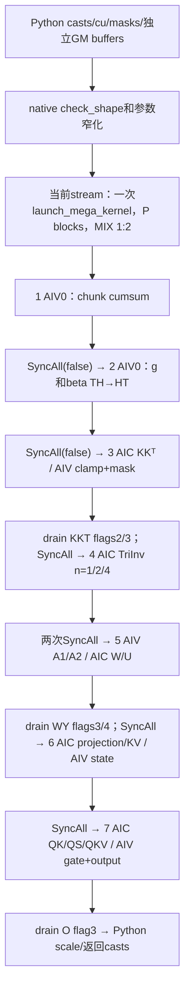
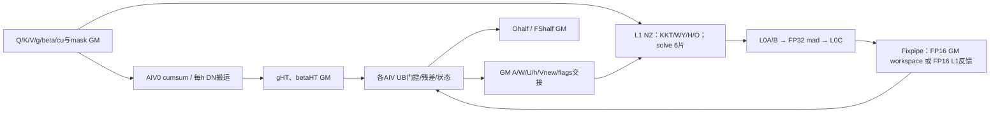
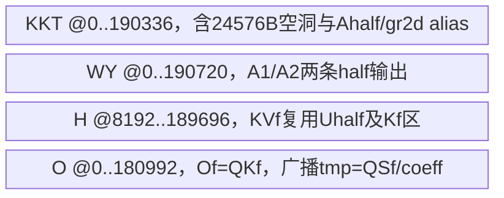
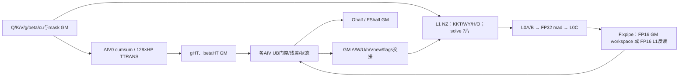

# Mega分块 GDN A3 Direct Invoke 算子知识

## 算子速览

| 项目 | 内容 |
|---|---|
| 实际入口 | `torch.ops.npu.mega_chunk_gdn` → `sglang::npu_kernel::mega_chunk_gdn` → `launch_mega_kernel`；Direct Invoke，无 ACLNN pair |
| 计算语义 | packed 标量门控 GDN：chunk 内 cumsum、带截断指数的 KKT、单位下三角逆、WY 重算、K×V 状态递推及因果输出；原生 out 未乘 scale |
| 输入输出 | Q/K `[1,T,Hg,128]`，V `[1,T,H,128]`，g/β `[1,T,H]`；native QKV/β/状态 FP16、g FP32、cu INT32、连续 |
| 执行类型 | 单 Kernel **MIX_CV**；KKT/WY/H/O 含 AIC_CUBE 与 AIV_VECTOR，solve 为 AIC_CUBE，cumsum/转置为 AIV_VECTOR；七阶段不是七次 Host launch |
| Kernel 路线 | R-001…R-006：每 Cube 轮1/2/4矩阵 × 小H逐head搬运/大H分块转置；每族精确 H、初态子选择与资源见后文 |
| 核心资源 | GM显式stage工作区 `22P·128²` 字节；L1峰值 `(5+n)·32768` B；L0A/B各最多65536 B、L0C131072 B；每AIV手工UB地址上界190720 B |
| 来源闭包 | `direct_implementation_closed`：本仓Host/注册/七阶段/本地helper、PTO当前a2a3实例及SDK9.1构建参数可追溯；框架Tensor、编译器 intrinsic 和Runtime执行为明确primitive边界 |
| 风险与状态 | draft；Hg=0的Host取模、零长序列的H快照写入、未校验cu内容/缓冲容量与窄化均有静态边界，不能据闭包推定安全复用 |
| 验证状态 | 本次知识提取未执行编译、真机、数值或性能测试；来源中的测试定义和CI接线不代表本次运行结果 |

## 接口与语义

### 计算语义

令 `C=D=128`，H为value heads，Hg为Q/K heads，`G=H/Hg`，value head h读取Q/K head `floor(h/G)`。每条序列按自己的起点分chunk；第j个chunk有效行数 `r=min(C,length-jC)`。状态S的行是key、列是value，均128；不能与其它native入口的V×K状态交换。下面公式描述**当前操作顺序**，`f16`为存储或转换截点，Cube乘数均FP16、累加FP32，PTO数学intrinsic误差未量化。

1. AIV按时间串行相加，得到chunk局部FP32 `s_i=Σ_{t=0..i}g_t`，跨chunk重置。g_sum保持TH，随后将g_sum和β转为HT。
2. KKT先 `B=f16(KKᵀ)`，再在FP32构造 `L_ij=f16(B_ij·exp(min(s_i+ln(β_i)-s_j,0))·1[i>j])`。β先FP16→FP32再log，strict-lower mask由调用方提供。这是实际clamp公式；只有满足对应指数不触发clamp等条件时才能与未截断GDN公式等同，Host不检查β正值、gate符号或有限性。
3. solve计算单位下三角系统 `R≈(I+L)^−1`：16×16对角fractals的幂级数技巧，再递归合并16→32→64→128块；负单位阵由Python准备。中间L0C FP32结果经TMOV回FP16 L1，最终直接Fixpipe到FP16 A_inv；**A_inv_f32未参与计算**。
4. WY按列广播：`A2=f16(R·β_j)`、`A1=f16(R·exp(s_j)β_j)`；`U=f16(A2V)`、`W=f16(A1K)`，写回THD。
5. H在每个(sequence,h)中顺序推进chunk：初态S先FP16→FP32或置零；发布`f16(S)`的chunk入口快照。计算 `Pj=f16(W·f16(S))`、`Vnew=f16(U-Pj)`、`Ktilde=f16(exp(s_last-s_i)·K)`、`Δ=f16(KtildeᵀVnew)`，再用FP32 `S←exp(s_last)S+float(Δ)`。下一chunk的Cube读FP16快照，但AIV运行态S保持FP32；final_state最终FP16。
6. O用入口快照：`QK=f16(QKᵀ)`、`QS=f16(Q·f16(S))`；`Aq=f16(QK·exp(min(s_i-s_j,0))·1[i>=j])`；`QKV=f16(Aq·Vnew)`；`out=f16(float(QKV)+float(QS)·exp(s_i))`。
7. `run_mega_chunk_gdn`才执行Torch `out*scale`及返回cast。默认scale为原K末维的负二分之一次方。Torch标量类型提升与转换由框架primitive负责；不能用最后转回BF16/FP32宣称恢复FP16内部已损失的信息，也不能把Python scale归给native Device。

### 输入、输出与属性

| 参数 | shape/layout | dtype | 约束、默认值与语义 |
|---|---|---|---|
| q / k | `[1,T,Hg,128]` THD连续 | native FP16 | q/k完整shape相同；Hg应为正且整除H。Host在取模前没有Hg>0检查 |
| v | 意图`[1,T,H,128]` THD连续 | native FP16 | Host检查rank、T、D、head pair；**未检查v.size(0)==1**，wrapper按empty_like产生v形状缓冲，不能把额外batch当已计算 |
| g | `[1,T,H]` TH连续 | FP32 | wrapper不cast g；自然对数域gate，当前核心执行cumsum/exp，不执行sigmoid或L2norm |
| beta | `[1,T,H]` TH连续 | native FP16 | wrapper先.half；无β范围/有限性检查；KKT取logβ，WY按列乘β |
| cu_seqlens | `[N+1]`意图一维packed边界 | native INT32 | wrapper None生成[0,T]，否则.to(INT32)，并.cpu().tolist计算Z；native仅dtype/连续性/numel相关检查，未验证rank、端点、单调性及非零长度 |
| initial_state | `[N,H,128,128]` KV连续 | native FP16 | has_initial_state=true时校验shape/dtype/连续；false时指针不读，wrapper令其与zero final_state别名 |
| masks / minus_identity | `[128,128]` ND | 两mask FP32；−I FP16 | wrapper构造严格下三角/含对角下三角及−I，并按设备键lru_cache16；raw调用方自备，native不验证内容/形状/dtype |
| out / g_sum / A_inv / w / h / v_new / final_state | 详见逐字段ABI与GM表 | native out/A_inv/w/h/v_new/final FP16，g_sum FP32 | raw op原地填预分配Tensor，返回()；Python返回七元组(g_sum,scaled_out,A_inv,final_or_None,w,h,v_new) |
| scale | Python float/None | 框架标量 | **不进入native ABI**；先默认D^-0.5，最后乘out |
| output_final_state | Python bool | bool | 仅控制返回final的FP32视图转换或None；两种情况均分配和计算native FP16 final_state |
| block_dim=P | launch元数据 | Host int64→uint32 | wrapper从cube_core_num取max(1,值)，缺属性默认24；指定异常RuntimeError/AttributeError/AssertionError也回24；没有P<=实际核数的Host guard |

### 入口与版本

本卡只覆盖固定提交的legacy Direct入口及其`run_mega_chunk_gdn`参数生产；没有把新ACLNN chunk GDN、旧raw native chunk、Triton chunk64或KDA逐通道gate合并。入口层级、chunk几何、状态方向和返回值需分别核对。已有[legacy GDN集成指南](../../../../guides/integration/sgl_kernel_npu/sgl_legacy_gdn_chunk_mega.md)保留上层`GDN_USE_MEGA_GDN`分派背景；其纯Torch reference不是本卡Device替代物。

固定PTO为gitlink `af66b6ada43c40ad9583731883fb9bef65ac840a`，由.gitmodules指向GitCode cann/pto-isa；只使用其a2a3当前实例。CANN9.1.0依据FLA CI矩阵和组任务容器，SDK源码固定v9.1提交`e5451c7feba11f9e259f4fbc19c4bf82f8c0496c`。这表示提取的源码/构建上下文，未声称本次实际运行该环境。

## Host/Launcher 执行流程

### 参数校验与前处理

Python顺序为：确定scale→保存原Q/K/V dtype→Q/K/V/β.half→读取T/H/D→生成或转换cu32→D2H计算Z→获取设备缓存masks/−I→分配GM→初态.half或与final别名→取得P→一次Torch native调用→h.view→可选final.to(FP32)→输出scale/casts。没有独立.contiguous调用；转换在dtype不变时可能返回原对象，非连续数据仍可能在native校验处被拒绝。wrapper本身不进入device context guard，也不检查所有Tensor位于同一NPU。

Native `check_shape`按rank→packed q.B=1→Q=K shape/T/head pair→D128→g/β B/T/H→dtype→输入连续性→可选初态检查。随后检查P在正uint32范围、batch_size==cu.numel−1、seq_len==q.T、total_tokens==q.T、num_matrices在非负uint32范围，再转换四个uint32变量和has_initial_state的int64值。缺失项没有隐式TORCH_CHECK：v.B、cu内容/位置/维数、buffers/masks的容量/dtype/设备、M等于Z·H均未核验。`is_supported_head_pair`先求`value_heads % key_heads`，Hg=0为可达C++未定义行为边界，不能描述为正常抛错回退。

### 参数、Workspace 与生命周期

定义 `N=cu.numel−1`、`l_s=cu[s+1]−cu[s]`、`Z=Σceil(l_s/128)`、`M=Z·H`、`E=128²=16384`。正长、单调、[0,T]完整覆盖且INT32可表示的cu是下文正常数据流前提，**不等同源码已拒绝所有反例**。Python `cpu().tolist()`属于边界内容回读；没有按Tensor对象身份缓存cu结果。lru_cache只缓存每个设备的masks和−I，键(type,index)，不按T/H/P。

| GM缓冲区 | 元素/字节容量 | 初值与owner | 活跃期/消费者 |
|---|---|---|---|
| g_sum / g_t / beta_t | 各TH；4TH / 4TH / 2TH B | g_sum空，gt/bt空；wrapper持有 | cumsum→转置→KKT/WY/H/O；g_sum返回 |
| A / A_inv_f32 / A_inv | 各THC；2THC / 4THC / 2THC B | 全零、独立分配 | A由KKT写→solve；A_inv由solve写→WY且返回；A_inv_f32仅分配/传参，**本Device无producer/consumer** |
| w / u / v_new / out | 各THD；各2THD B | empty_like(v)，独立Tensor | WY→H，H→O，out最终；u不在Python七元组中返回 |
| h / final_state | ZHDD / NHDD；2ZHDD / 2NHDD B | zeros | H写入口快照→O；h返回reshape[1,Z,H,D,D]；final即使不返回仍计算 |
| kkt_workspace | 2PE half；4PE B | zeros | 每core两个slot，KKT内部AIC↔AIV，结束后无下游别名 |
| wy_workspace_a1 / a2 | 各PE half；各2PE B | zeros | WY内部AIV→AIC，独立单slot/各core |
| h_workspace | 4PDD half；8PDD B | zeros | 每core WS/K/S/KV四片，不与其它stage Tensor别名 |
| o_workspace_qk / qs / gated | 各PE half；各2PE B | zeros | O内部qk、QS/QKV复用、gated三片 |
| mask_lower / mask_full / minus_identity | 4E / 4E / 2E B | 设备缓存，三者独立 | 所有调用可复用，只读；raw caller须维护相同合同 |
| cu32 / initial_state工作副本 | 4(N+1) / 可选2NHDD B | cu转换及初态.half可能复制或别名 | kernel结束前有效；原输入cast副本不属于stage workspace |

`stage_workspace=4PE+4PE+8PDD+6PE=22PE=360448P` B（C=D）。其它显式中间/输出分配合计 `10TH+8THC+8THD+2(Z+N)HDD` B；另加cu、mask缓存、条件初态转换和QKV/β转换。该数包含未使用的A_inv_f32，不能为了算法不读就从实际Python分配账删掉；不包含原输入、Torch allocator对齐/缓存开销、最终scale/cast副本。各分配独立，没有一块总workspace由Host切片，不能跨Tensor扣除所谓stage复用。

`TorchNpuHelper::ConvertType(Tensor)`取data_ptr并丢弃Tensor owner，`EXEC_KERNEL_CMD`捕获当前stream、blockDim和转换后的指针/标量tuple，再`OpCommand::RunOpApi`调用生成launcher。捕获tuple不保有Tensor。wrapper局部Tensor和缓存Tensor的异步释放/allocator记录属于Torch-NPU边界；raw调用者必须让所有输入/输出/临时buffer存活至stream完成，固定本仓无显式同步后free或recordStream实现可供替代。返回Tensor不表示kernel已经完成。

SDK生成参数结构为每字段`alignas(ceil(alignof(T)/4)*4)`，MIX额外插ffts_addr、尾部overflow指针；8B overflow状态由SDK Alloc/Free，ffts地址由GetAscendCoreSyncAddr管理。具体Runtime分配/stream安全释放与编译后packed字节offset属于生成/Runtime边界，本卡不冒充算法自有workspace，也不推导整块ABI总size。GetSyncAddr失败返回时及launcher错误可能阻止native输出；本仓宏未传播launcher返回值。

### 启动图与失败传播

根Torch CMake→csrc早期legacy include→A3宏内Host源和`mega_chunk_gdn_kernel`静态目标→PTO include，定义`GDN_KERNEL_NAME=launch_mega_kernel,GDN_D=128,GDN_C=128`→Torch schema与PrivateUse1注册→共享库加载。950默认关闭A3开关且无注册；强开宏不是平台证明。本卡不扩A2。

固定SDK将Ascend910_9382映射c220/DYNAMIC，分别编译dav-c220-cube与vec再合并MIX；无显式kernel type时依据两侧实际指令判MIX，默认metadata AIC:AIV=1:2。源码AIV用vid0/1分半行，cumsum/转置仅vid0。这里是静态构建链推导，未读取实际编译产物。SDK c220默认有`--cce-auto-sync`；**此mega目标没有像邻居chunk_kda一样显式关闭它**。因此显式flags是源码协议，最终插入的同核自动同步仍是编译器边界。



无额外cast kernel：solve之后代码保留两次SyncAll，`mega_cast_fp32_to_fp16_bsnd`虽有定义但未调用。`MEGA_STOP_AFTER_CUMSUM/SYNC1/TRANSPOSE/KKT/SOLVE/CAST/SYNC_BEFORE_WY/WY/H`仅调试预处理终点，当前CMake不定义；若外部另编这些宏则输出不完整，不属于下面正常Route。

TORCH_CHECK在launch前抛错。Device Hg guard/unknown H直接return，不产生fallback；正常Host已限制H但raw不良元数据仍能穿过其它检查。宏lambda无条件返回0且未检查ACLRT_LAUNCH_KERNEL的返回值；不能把Host返回()当成功或把提示文字中的`GDN_ATTN_BACKEND_TRITON=1`当自动回退。本入口不调用该后备算法。

## Route 与参数设计

### 分核与资源计算

令P为实际get_block_num，M为传入num_matrices。正常wrapper生成M=ZH。全局chunk索引 `z=Σ_{s'<s}ceil(l_s'/C)+c`，packed行 `b=cu[s]+cC`。每stage重新分核，不能把前一stage的cid绑定到后续相同sequence：

| 阶段 | 工作与分核 | tile/loop与输出地址 |
|---|---|---|
| cumsum | 按全局chunk z，`z%P=cid`；仅AIV vid0 | 一次读取r×H，UB padded C×HTC；逐行TADD；输出`(b·H)`，行pitchH |
| 转置 | tokenblock t0=128·bi，bi=cid+kP；仅AIV vid0 | g/beta分别TH→HT；小H走每head DN，H>=16先补HP/128再TTRANS；存每head有效r |
| KKT | pid=sH+h，pid=cid+kP；同pid内部c顺序 | AIC C×D与转置D×C；AIV vid处理`[64vid,64(vid+1))`行；A存`((b+64vid)H+h)C` |
| solve | gid=(iter·P+cid)n+j，j<n且gid<M | gid/H定位globalchunk，gid%H定位head；扫描cu找序列；只处理有效r×r，TLOAD零填充，输出同THC |
| WY | gi=zH+h，gi%P=cid | AIV两半行造A1/A2，AIC做两个128³ GEMM，THD写w/u |
| H | pid=sH+h，pid=cid+kP；所有chunk串行 | vid按64个key行持有S；K/V token条带64行；h按zH+h存进入chunk的KV状态 |
| O | gi=zH+h，gi%P=cid | AIC三个128³ GEMM；vid按64个token行组装O；THD pitchHD |

| H精确key | GQA映射 | HTC=ceil(H/8)8 | 转置实现与HP | cumsum UB地址上界/B | g转置 / β转置 UB地址上界/B |
|---|---|---:|---|---:|---:|
| 8 | h/G，Hg为8的正因数 | 8 | 小H逐head DN load/store | 8224 | 4096 / 4096 |
| 12 | h/G，Hg为12的正因数 | 16 | 小H逐head DN load/store | 16448 | 4096 / 4096 |
| 16 | h/G，Hg为16的正因数 | 16 | HP=16，128×HP TTRANS | 16448 | 24576 / 12288 |
| 24 | h/G，Hg为24的正因数 | 24 | HP=32，128×HP TTRANS | 24672 | 49152 / 24576 |
| 32 | h/G，Hg为32的正因数 | 32 | HP=32，128×HP TTRANS | 32896 | 49152 / 24576 |
| 48 | h/G，Hg为48的正因数 | 48 | HP=48，128×HP TTRANS | 49344 | 73728 / 36864 |
| 64 | h/G，Hg为64的正因数 | 64 | HP=64，128×HP TTRANS | 65792 | 98304 / 49152 |

小H的UBHeadDyn物理tile为`AlignRows×128`，AlignRows=32/sizeof(T)，有效区1×r、DN存储，容量4096 B；不是将有效r个元素误算成4r/2r B。大H三片src/dst/tmp各128HP元素。Cumsum两C×HTC加一HTC行，`(2C+1)HTC·4=1028HTC` B。两转置顺次复用同AIV UB地址，无并存相加。

求逆n影响L1 Y预取数，**不改变L0两套数组深度**：I、−I、Zero、−M、X共5片 + n片Y，每片32768 B；n=1/2/4的L1地址上界196608/229376/294912 B。L0A/B均2×32768=65536 B；L0C2×65536=131072 B。所有GEMM M/N/K均128；16×16fractal子提取用于solve对角及奇偶块复制。无通用Matmul Tiling、splitK或CATLASS scheduler。

### Route 选择

共同正常前提F：A3默认legacy注册存在、native dtype/shape/连续检查通过、P有效、Hg>0且整除H、完整正长packed cu及足够且同设备的buffers；后两项是实现使用前提，Host并未全部验证。Route以**源码selector**分类，F外终点单独保留，不添加虚构fallback。每族内逐H实例只参数化相同地址角色/分核公式，所有数值资源差异已在上表列出；小H与TTRANS执行图不同故分成不同族。

| 顺序 | Route | Key/模板 | 精确选择条件与优先级 | 不适用去向 |
|---:|---|---|---|---|
| 1 | R-001 求逆1矩阵批与小H逐head搬运 | H∈{8,12}，TriInv n=1 | F；switch先选H，solve按M<=P；转置H<16 | 下一个n域或另一转置族；未知H Device return |
| 2 | R-002 求逆1矩阵批与分块转置 | H∈{16,24,32,48,64}，TriInv n=1 | F；switch先选H，solve按M<=P；转置H>=16 | 下一个n域或另一转置族；未知H Device return |
| 3 | R-003 求逆2矩阵批与小H逐head搬运 | H∈{8,12}，TriInv n=2 | F；switch先选H，solve按P<M<=2P；转置H<16 | 下一个n域或另一转置族；未知H Device return |
| 4 | R-004 求逆2矩阵批与分块转置 | H∈{16,24,32,48,64}，TriInv n=2 | F；switch先选H，solve按P<M<=2P；转置H>=16 | 下一个n域或另一转置族；未知H Device return |
| 5 | R-005 求逆4矩阵批与小H逐head搬运 | H∈{8,12}，TriInv n=4 | F；switch先选H，solve按M>2P；转置H<16 | 下一个n域或另一转置族；未知H Device return |
| 6 | R-006 求逆4矩阵批与分块转置 | H∈{16,24,32,48,64}，TriInv n=4 | F；switch先选H，solve按M>2P；转置H>=16 | 下一个n域或另一转置族；未知H Device return |
| — | 前置失败终点 | native check_shape/TORCH_CHECK | rank/dtype/连续/已实现shape/标量检查失败 | launch前抛错；无Device资源 |
| — | Hg=0静态终点 | value_heads%key_heads | native在Hg正值guard之前取模 | C++未定义行为，不能给出后续调度保证 |
| — | 不良cu/M/buffer终点 | 缺Host内容/容量校验 | 非单调/越界/空序列、M不等于ZH、容量不足等 | 可能越界/漏算/flag不匹配；非自动回退，逐条件见限制 |

```text
check_shape按原顺序；Hg=0在head_pair取模处已失去C++定义保证
if TORCH_CHECK失败: throw
P/batch/T/M范围检查 → pointer/scalar tuple → 同stream一次launch
switch H: 8,12,16,24,32,48,64 → mega_kernel_impl<H>；default return
  Device Hg==0或H%Hg!=0: return
  cumsum → SyncAll(false)
  transpose(H<16逐head；否则TTRANS) → SyncAll(false)
  KKT → AIC drain flags2,3 → SyncAll(false)
  if M<=P: n=1
  else if M<=2u*P: n=2
  else: n=4
  TriInv<half,float,128,n,true,half>(is_lower=1)
  SyncAll(false) → SyncAll(false)
  WY → AIV cid<M时drain3,4 → SyncAll(false)
  H → SyncAll(false)
  O → AIC cid<M时drain3 → return
```

### 模板/实现执行矩阵

| Route | key/selector | dtype/shape/platform 完整命中条件 | 执行族与 kernel 节点 | 实际模板/body | 内存与同步特征 | tail/fallback |
|---|---|---|---|---|---|---|
| R-001 | H={8,12}，M<=P | F；C=D128；FP16QKVβ/F32g/I32cu | 单MIX七阶段；solve AIC，其余按启动图 | mega_kernel_impl<H>；TriInv<half,float,128,1,true,half>；TH→HT DN逐head | L1solve=196608 B；UB按H精确表+共同stage表；stage全局barrier及局部flags0..4 | r=min(128,l−c128)；AIV两半tail；无后备kernel |
| R-002 | H={16,24,32,48,64}，M<=P | F；C=D128；FP16QKVβ/F32g/I32cu | 单MIX七阶段；solve AIC，其余按启动图 | mega_kernel_impl<H>；TriInv<half,float,128,1,true,half>；TH→HT TTRANS分块 | L1solve=196608 B；UB按H精确表+共同stage表；stage全局barrier及局部flags0..4 | r=min(128,l−c128)；AIV两半tail；无后备kernel |
| R-003 | H={8,12}，P<M<=2P | F；C=D128；FP16QKVβ/F32g/I32cu | 单MIX七阶段；solve AIC，其余按启动图 | mega_kernel_impl<H>；TriInv<half,float,128,2,true,half>；TH→HT DN逐head | L1solve=229376 B；UB按H精确表+共同stage表；stage全局barrier及局部flags0..4 | r=min(128,l−c128)；AIV两半tail；无后备kernel |
| R-004 | H={16,24,32,48,64}，P<M<=2P | F；C=D128；FP16QKVβ/F32g/I32cu | 单MIX七阶段；solve AIC，其余按启动图 | mega_kernel_impl<H>；TriInv<half,float,128,2,true,half>；TH→HT TTRANS分块 | L1solve=229376 B；UB按H精确表+共同stage表；stage全局barrier及局部flags0..4 | r=min(128,l−c128)；AIV两半tail；无后备kernel |
| R-005 | H={8,12}，M>2P | F；C=D128；FP16QKVβ/F32g/I32cu | 单MIX七阶段；solve AIC，其余按启动图 | mega_kernel_impl<H>；TriInv<half,float,128,4,true,half>；TH→HT DN逐head | L1solve=294912 B；UB按H精确表+共同stage表；stage全局barrier及局部flags0..4 | r=min(128,l−c128)；AIV两半tail；无后备kernel |
| R-006 | H={16,24,32,48,64}，M>2P | F；C=D128；FP16QKVβ/F32g/I32cu | 单MIX七阶段；solve AIC，其余按启动图 | mega_kernel_impl<H>；TriInv<half,float,128,4,true,half>；TH→HT TTRANS分块 | L1solve=294912 B；UB按H精确表+共同stage表；stage全局barrier及局部flags0..4 | r=min(128,l−c128)；AIV两半tail；无后备kernel |

初态不是新增独立数学算子，但必须保留两个实际子分支：I0=`has_initial_state==0`，AIV S及S_half置零，H0 inactive；I1=`!=0`，每vid从`(sH+h)DD+vid·64D`加载H0并转FP32。两分支工作区相同，入口快照写入和后续flag相同；final返回开关为Python后处理，既不省略H阶段也不省略final写入。

### 隐藏性能 Guard

| Guard | Host/Tiling 条件 | Device/资源原因 | 影响 Route | 不满足时去向 | 源码符号 |
|---|---|---|---|---|---|
| packed B | q.B==1；g/β.B==1；v.B缺检查 | 所有地址只按单packed token轴 | 全部 | 前两者throw；v额外batch不计算，不是扩域 | check_shape |
| head group | H白名单且H%Hg==0；无先验Hg>0 | 有限编译H与runtime Hg stride/group | 全部 | 非白名单throw；Hg0为Host UB；Device guard不补救 | is_supported_head_pair / mega_kernel_impl |
| 固定128 | q.D/v.D==128 | 所有硬编码offset、64行条带及128³GEMM | 全部 | throw；无更小tile fallback | check_shape / GDN_C,D |
| 正长合法cu | Host仅INT32连续；wrapper按差分ceil分配 | H初始化无num_chunks>0包围；solve无限扫描cu找所属tile | 全部 | 重复尾边界可越h容量；错误M可扫描出N；不是安全empty路线 | chunk_h_kernel / GetBSNDVarlenTileInfoFromCuSeqlens |
| M与P | P>0≤UINT32_MAX；M≥0≤UINT32_MAX | n1/2/4、末尾drain使用M；Host未校验M=ZH或P≤硬件核数 | 六族 | 无自动修复；M不一致可能漏inverse或等待轮次不同 | mega_solve_tril / Host |
| 32位地址 | 未验证T·H·128等乘积 | solve tile_id/bsnd_offset/累计chunk为uint32；cu负值被转uint32 | 全部 | 溢出/截断风险，不能只以输入T int64作范围保证 | BSNDVarlenTileInfo |
| UB地址 | 无运行容量selector | KKT/WY/H/O使用固定手工地址，上界分别190336/190720/189696/180992 B | 全部 | 无小tilefallback；迁移增加scratch需重做账 | 各TASSIGN |
| SDK本地容量 | 无本算子查询；2201 SDK参照UB192KiB/L0A,B64KiB/L0C128KiB/L1=512KiB−128 | 当前地址span及n4 L1满足该参照，不是任意新增buffer均可 | 全部 | 固定实现无资源失败路由 | kernel_utils_constants.h |
| 临时8KiB区 | PTO TMP_UB_OFFSET184KiB常量 | 某些通用primitive可用固定尾scratch；**当前F16/F32、vexp/vln、broadcast不使用它** | 全部 | 增加INT8/其它primitive时不能直接复用高地址片 | constants / TCvt / TUnaryOp |
| β/g有限性 | Host不检查 | logβ、clamp指数及0×NaN等改变结果 | 全部 | 无fallback；只列静态操作不宣称所有浮点域数学正确 | KKT/WY/H/O |
| 自动同步编译 | mega目标未--cce-auto-sync=off | 同核部分邻接TCVT/TMUL依赖编译器自动同步；跨核flags显式 | 全部 | 不可照搬成auto-sync关而不审计 | SDK bisheng_intf / legacy target |

### POD/ABI

本算法没有自有packed Tiling POD；生成launcher携带36个位置参数，另有P/stream launch元数据。GM_ADDR在本TU声明为`__gm__ uint8_t*`，Device按下列类型reinterpret；指针实际宽度/align和整块offsetof由生成ABI决定，**不臆填packed offset**。下表每个字段独占一行，指针单位为byte地址、所指元素/容量按边界栏。native的35个参数去掉P并插入H/Hg后得到36字段。

| 结构 | 字段 | 类型/位宽 | ABI 布局 | 单位 | Host/launcher producer | Device consumer | 边界 |
|---|---|---|---|---|---|---|---|
| launch参数 | 1. q_ptr | half* | 位置1；非自有struct，sizeof/align/offsetof由SDK生成ABI | GM地址，容量按字节栏 | q.data_ptr | Q：((bos+cC)·Hg+h/G)·D | 2THgD B，只读；native q FP16连续 |
| launch参数 | 2. k_ptr | half* | 位置2；非自有struct，sizeof/align/offsetof由SDK生成ABI | GM地址，容量按字节栏 | k.data_ptr | KKT/WY/H/O按group读K | 2THgD B，只读 |
| launch参数 | 3. v_ptr | half* | 位置3；非自有struct，sizeof/align/offsetof由SDK生成ABI | GM地址，容量按字节栏 | v.data_ptr | WY A2×V | 2THD B，只读；正常v.B=1 |
| launch参数 | 4. g_in_ptr | float* | 位置4；非自有struct，sizeof/align/offsetof由SDK生成ABI | GM地址，容量按字节栏 | g.data_ptr | cumsum [t·H+h] | 4TH B |
| launch参数 | 5. beta_ptr | half* | 位置5；非自有struct，sizeof/align/offsetof由SDK生成ABI | GM地址，容量按字节栏 | beta.data_ptr | 转置TH→HT | 2TH B |
| launch参数 | 6. msk_lower_ptr | float* | 位置6；非自有struct，sizeof/align/offsetof由SDK生成ABI | GM地址，容量按字节栏 | mask_lower.data_ptr | KKT每vid半mask | 4C² B，strict lower；raw无校验 |
| launch参数 | 7. msk_full_ptr | float* | 位置7；非自有struct，sizeof/align/offsetof由SDK生成ABI | GM地址，容量按字节栏 | mask_full.data_ptr | O每vid半mask | 4C² B，含对角下三角 |
| launch参数 | 8. minus_id_ptr | half* | 位置8；非自有struct，sizeof/align/offsetof由SDK生成ABI | GM地址，容量按字节栏 | minus_identity.data_ptr | solve辅助−I | 2C² B，raw无内容校验 |
| launch参数 | 9. cu_seqlens_ptr | int32_t* | 位置9；非自有struct，sizeof/align/offsetof由SDK生成ABI | GM地址，容量按字节栏 | cu32或raw cu.data_ptr | 全部stage读取序列边界；solve扫描归属 | 4(N+1) B，非空packed cu；INT32内容需调用者保证 |
| launch参数 | 10. o_ptr | half* | 位置10；非自有struct，sizeof/align/offsetof由SDK生成ABI | GM地址，容量按字节栏 | out.data_ptr | O向THD写输出 | 2THD B；未scale |
| launch参数 | 11. g_sum_ptr | float* | 位置11；非自有struct，sizeof/align/offsetof由SDK生成ABI | GM地址，容量按字节栏 | g_sum.data_ptr | cumsum写→transpose读 | 4TH B |
| launch参数 | 12. g_t_ptr | float* | 位置12；非自有struct，sizeof/align/offsetof由SDK生成ABI | GM地址，容量按字节栏 | g_t.data_ptr | transpose写HT→四后续stage读 | 4HT B |
| launch参数 | 13. beta_t_ptr | half* | 位置13；非自有struct，sizeof/align/offsetof由SDK生成ABI | GM地址，容量按字节栏 | beta_t.data_ptr | transpose写HT→KKT/WY | 2HT B |
| launch参数 | 14. A_ptr | half* | 位置14；非自有struct，sizeof/align/offsetof由SDK生成ABI | GM地址，容量按字节栏 | a.data_ptr | KKT写THC→solve | 2THC B |
| launch参数 | 15. A_inv_f32_ptr | float* | 位置15；非自有struct，sizeof/align/offsetof由SDK生成ABI | GM地址，容量按字节栏 | a_inv_f32.data_ptr | 当前entry仅转传，body不解引用 | 4THC B包装实际分配；不能声称含FP32 inverse |
| launch参数 | 16. A_inv_ptr | half* | 位置16；非自有struct，sizeof/align/offsetof由SDK生成ABI | GM地址，容量按字节栏 | a_inv.data_ptr | solve写THC→WY | 2THC B |
| launch参数 | 17. w_ptr | half* | 位置17；非自有struct，sizeof/align/offsetof由SDK生成ABI | GM地址，容量按字节栏 | w.data_ptr | WY写→H | 2THD B |
| launch参数 | 18. u_ptr | half* | 位置18；非自有struct，sizeof/align/offsetof由SDK生成ABI | GM地址，容量按字节栏 | u.data_ptr | WY写→H | 2THD B |
| launch参数 | 19. s_ptr | half* | 位置19；非自有struct，sizeof/align/offsetof由SDK生成ABI | GM地址，容量按字节栏 | s/h.data_ptr | H入口snapshot[(chunkglobal·H+h)·DD]→O | 2ZHDD B，KV；非每token状态 |
| launch参数 | 20. v_new_ptr | half* | 位置20；非自有struct，sizeof/align/offsetof由SDK生成ABI | GM地址，容量按字节栏 | v_new.data_ptr | H residual写→O第三matmul | 2THD B |
| launch参数 | 21. fs_ptr | half* | 位置21；非自有struct，sizeof/align/offsetof由SDK生成ABI | GM地址，容量按字节栏 | final_state.data_ptr | H每sequence最终状态写 | 2NHDD B；output_final_state不进入此ABI |
| launch参数 | 22. h0_ptr | half* | 位置22；非自有struct，sizeof/align/offsetof由SDK生成ABI | GM地址，容量按字节栏 | initial_state.half或final_state别名 | H has_initial_state!=0读取 | 2NHDD B；flag0时inactive，不从传了指针推导读取 |
| launch参数 | 23. has_initial_state | int64_t / 64 | 位置23；非自有struct，sizeof/align/offsetof由SDK生成ABI | 计数/布尔标量 | bool ? 1 : 0 | H初态load或zero | 值0/1；Device按!=0，native类型bool |
| launch参数 | 24. kkt_ws_ptr | half* | 位置24；非自有struct，sizeof/align/offsetof由SDK生成ABI | GM地址，容量按字节栏 | kkt_workspace.data_ptr | cid两slot KKᵀ中转 | 4PC² B |
| launch参数 | 25. wy_ws_a1_ptr | half* | 位置25；非自有struct，sizeof/align/offsetof由SDK生成ABI | GM地址，容量按字节栏 | wy_workspace_a1.data_ptr | Vec写A1→Cube读 | 2PC² B |
| launch参数 | 26. wy_ws_a2_ptr | half* | 位置26；非自有struct，sizeof/align/offsetof由SDK生成ABI | GM地址，容量按字节栏 | wy_workspace_a2.data_ptr | Vec写A2→Cube读 | 2PC² B |
| launch参数 | 27. h_ws_ptr | half* | 位置27；非自有struct，sizeof/align/offsetof由SDK生成ABI | GM地址，容量按字节栏 | h_workspace.data_ptr | 四slice状态往返 | 8PDD B |
| launch参数 | 28. o_ws_qk_ptr | half* | 位置28；非自有struct，sizeof/align/offsetof由SDK生成ABI | GM地址，容量按字节栏 | o_workspace_qk.data_ptr | Cube QK→Vec | 2PC² B |
| launch参数 | 29. o_ws_qs_ptr | half* | 位置29；非自有struct，sizeof/align/offsetof由SDK生成ABI | GM地址，容量按字节栏 | o_workspace_qs.data_ptr | Cube QS再QKV→Vec | 2PCD B |
| launch参数 | 30. o_ws_gated_ptr | half* | 位置30；非自有struct，sizeof/align/offsetof由SDK生成ABI | GM地址，容量按字节栏 | o_workspace_gated.data_ptr | Vec gatedQK→Cube | 2PC² B |
| launch参数 | 31. num_heads | uint32_t / 32 | 位置31；非自有struct，sizeof/align/offsetof由SDK生成ABI | 计数/布尔标量 | uint32(v.size(2)) | switch H specialization | 8/12/16/24/32/48/64；unknown直接return |
| launch参数 | 32. num_key_heads | uint32_t / 32 | 位置32；非自有struct，sizeof/align/offsetof由SDK生成ABI | 计数/布尔标量 | uint32(q.size(2)) | Hg与GROUP、QK stride | 正Hg整除H；Device先guard<=0/不整除，不能修复Host先前%0 |
| launch参数 | 33. batch_size | int64_t / 64 | 位置33；非自有struct，sizeof/align/offsetof由SDK生成ABI | 计数/布尔标量 | cu.numel−1 | num_seqs=N | 未独立N>0 guard |
| launch参数 | 34. seq_len | int64_t / 64 | 位置34；非自有struct，sizeof/align/offsetof由SDK生成ABI | 计数/布尔标量 | q.size(1) | 仅cu==null dormant等长branch用 | 本选中cu非空；保留ABI producer T |
| launch参数 | 35. total_tokens | int64_t / 64 | 位置35；非自有struct，sizeof/align/offsetof由SDK生成ABI | 计数/布尔标量 | q.size(1) | HT head pitch和转置tokenblocks | T；外层int64但cu/solve offset较窄 |
| launch参数 | 36. num_matrices | uint32_t / 32 | 位置36；非自有struct，sizeof/align/offsetof由SDK生成ABI | 计数/布尔标量 | uint32(raw M);wrapper Z·H | solve n分派/遍历、WY/O末尾drain条件cid<M | Host只范围校验，不核实M=实际chunk数·H |
| launch元数据 | blockDim | uint32 / 32 | 参数包外 | Cube block个数 | block_dim范围检查后cast | get_block_num/idx | wrapper P来自cube_core_num，不能固定为24 |
| launch元数据 | stream | void* | 参数包外 | Runtime流句柄 | getCurrentNPUStream().stream(false) | 生成ACLRT launcher | 当前流，不新建流 |
| Device局部BSNDVarlenTileInfo | bsnd_offset | uint32 / 32 | 两uint32成员的首成员；非Host POD，未做ABI实测 | half元素 | cu扫描,row_start·H·C+h·C | solve load/store地址 | uint32乘法可能回绕 |
| Device局部BSNDVarlenTileInfo | valid_size | uint32 / 32 | 第二成员；不跨Host/Device传递，无需生成offsetof | 有效行/列数 | min(seq_end−row_start,C) | solve动态r×r | 要求找到合法正长所属sequence |
| SDK生成参数 | ffts_addr | void* | 由generate_args_declare_code插入，在用户参数之前 | 同步控制地址 | GetAscendCoreSyncAddr | MIX同步Runtime/compiler | 框架管理，不是算法stage workspace |
| SDK生成参数 | __ascendc_overflow | void* | 用户参数之后，按类型alignas至少4 | 8B状态地址 | AllocAscendMemDevice(8) | overflow记录与生成launcher清理 | Free为SDK调用；Runtime释放语义为外部边界 |

### Route 源码闭包

| Route | Key/selector | Host/Tiling producer | POD/参数 | Kernel entry/router | Kernel body/直接依赖 | 构建接线 |
|---|---|---|---|---|---|---|
| R-001 | H={8,12}；M<=P | mega_chunk_gdn.cpp::check_shape / mega_chunk_gdn；Python wrapper生产M/P/buffers | 上表36字段；初态I0/I1完整保留 | mega_kernel.cpp::launch_mega_kernel→mega_kernel_impl<H>→mega_solve_tril | 同目录六stage include + 转置/helper；TriInv n=1；PTO af66 a2a3当前Tile/Load/Extract/Matmul/Store/Vector | legacy_kernels.cmake::mega_chunk_gdn_kernel；SDK c220 MIX |
| R-002 | H={16,24,32,48,64}；M<=P | mega_chunk_gdn.cpp::check_shape / mega_chunk_gdn；Python wrapper生产M/P/buffers | 上表36字段；初态I0/I1完整保留 | mega_kernel.cpp::launch_mega_kernel→mega_kernel_impl<H>→mega_solve_tril | 同目录六stage include + 转置/helper；TriInv n=1；PTO af66 a2a3当前Tile/Load/Extract/Matmul/Store/Vector | legacy_kernels.cmake::mega_chunk_gdn_kernel；SDK c220 MIX |
| R-003 | H={8,12}；P<M<=2P | mega_chunk_gdn.cpp::check_shape / mega_chunk_gdn；Python wrapper生产M/P/buffers | 上表36字段；初态I0/I1完整保留 | mega_kernel.cpp::launch_mega_kernel→mega_kernel_impl<H>→mega_solve_tril | 同目录六stage include + 转置/helper；TriInv n=2；PTO af66 a2a3当前Tile/Load/Extract/Matmul/Store/Vector | legacy_kernels.cmake::mega_chunk_gdn_kernel；SDK c220 MIX |
| R-004 | H={16,24,32,48,64}；P<M<=2P | mega_chunk_gdn.cpp::check_shape / mega_chunk_gdn；Python wrapper生产M/P/buffers | 上表36字段；初态I0/I1完整保留 | mega_kernel.cpp::launch_mega_kernel→mega_kernel_impl<H>→mega_solve_tril | 同目录六stage include + 转置/helper；TriInv n=2；PTO af66 a2a3当前Tile/Load/Extract/Matmul/Store/Vector | legacy_kernels.cmake::mega_chunk_gdn_kernel；SDK c220 MIX |
| R-005 | H={8,12}；M>2P | mega_chunk_gdn.cpp::check_shape / mega_chunk_gdn；Python wrapper生产M/P/buffers | 上表36字段；初态I0/I1完整保留 | mega_kernel.cpp::launch_mega_kernel→mega_kernel_impl<H>→mega_solve_tril | 同目录六stage include + 转置/helper；TriInv n=4；PTO af66 a2a3当前Tile/Load/Extract/Matmul/Store/Vector | legacy_kernels.cmake::mega_chunk_gdn_kernel；SDK c220 MIX |
| R-006 | H={16,24,32,48,64}；M>2P | mega_chunk_gdn.cpp::check_shape / mega_chunk_gdn；Python wrapper生产M/P/buffers | 上表36字段；初态I0/I1完整保留 | mega_kernel.cpp::launch_mega_kernel→mega_kernel_impl<H>→mega_solve_tril | 同目录六stage include + 转置/helper；TriInv n=4；PTO af66 a2a3当前Tile/Load/Extract/Matmul/Store/Vector | legacy_kernels.cmake::mega_chunk_gdn_kernel；SDK c220 MIX |

## Kernel 实现

### 公共执行流程

所有Route严格共享入口36字段和七阶段，差异只有H转置实现及solve的n；本节把共享body完整列出，后续每Route填写自己的具体实例、容量、selector、流程和交接。每个AIV是独立物理local memory，vid用于同一逻辑Cube block的两条AIV条带；不采用文件注释中“两个subblock共享UB”的字面解释来把两份工作相互覆盖。

**当前PTO实例。** A3 `__NPU_ARCH__=2201`选择`PTO_NPU_ARCH_A2A3`，`pto_instr_impl.hpp`命中a2a3实现。所有手工分配是`TASSIGN(tile,byte_address)`运行参数形式：当前TAssign仅assignData，不分配或调整地址；不是带编译期检查的`TASSIGN<Addr>`。Vec为`Tile<Vec,T,R,C,RowMajor,RV,CV,NoneBox,512,PadVal>`，DN行广播为ColMajor；L1为`Tile<Mat,half,R,C,ColMajor,RV,CV,RowMajor,512,Zero或Null>` NZ，转置view为BRowMajor/SColMajor的ZN。L0A `TileLeft<half,128,128>`为BRow/SRow512，L0B `TileRight<half,128,128>`为BRow/SCol512，L0C `TileAcc<float,128,128>`为BCol/SRow1024，全部非compact。valid/tail只变有效域，**物理tile容量仍128²**。

| primitive当前选择 | 当前实例与实际行为 | 容量/同步/精度边界 |
|---|---|---|
| TLOAD Vec ND/DN | ND→ND/DN→DN aligned DMA；nBurst分别有效行/有效列，lenBurst按有效col/row×sizeof(T)，GM gap按原stride | 32B物理行pitch，r≤128；补齐由PadValue/TFILLPAD_INPLACE及显式空条带零填充负责 |
| TLOAD Mat | GM ND→L1 NZ，`copy_gm_to_cbuf_multi_nd2nz_b16`；nValue=r或128、dValue=128或r、srcDValue=H·128/Hg·128/128 | srcDValue窄化uint16前提≤65535；当前最大8192；TFILLPAD将L1有效域外补零 |
| TEXTRACT / TMOV Mat→Left/Right | FP16整128 tile及solve16倍fractal子块；NZ→Left普通load3D、NZ→Right转置搬运，ZN view改变分派 | L1→L0A/B；MTE1，offset必须16对齐；TRESHAPE只别名同地址，不执行数据转置 |
| TMATMUL / ACC | `TMATMUL_IMPL<AccPhase::Unspecified>`，half×half→float；M/N/K128，kDirectionAlign=false；首乘cmatrixInitVal=true，ACC=false | 到`mad` intrinsic；无bias/量化/HF32路径。L0阵列与pipe/event由算子手工安排 |
| TMOV Acc→Mat | `GetCastPreQuantMode<float,half>=F322F16`，NoRelu，`copy_matrix_cc_to_cbuf` | solve递归每次回L1均损失到FP16；不能称F32全程求逆 |
| TSTORE Acc→GM | Acc FP32→GM FP16，F322F16、NoRelu、STPhase::Unspecified；ND output `copy_matrix_cc_to_gm`，dstD按实际pitch | Fixpipe，validM/N限读写；算法中没有外部scalar量化scale |
| TCVT | half→float `vconv_f162f32`；float→half CAST_NONE落default `vconv_f322f16r` | 64FP32元素/repeat，当前宽128为两repeat；无INT8 non-sat临时scratch，不调用TMP_UB_OFFSET |
| TEXP/TLOG | 默认Exp/LogAlgorithm，F32 `vexp/vln`，连续tile采用norm mask重复/尾mask | 无高精度外部库、无额外UB scratch；编译器intrinsic精度/指令调度边界 |
| TROWEXPAND | 源DN [64,1]、目标ND[64,128]；目标128列≠elemPerBlock8，命中逐行scalar load+vector_dup，而非vbrcb特例 | 每row V→S/S→V EVENT0；无16行隐式扩展scratch |
| TCOLEXPAND | ND[1,128]→ND[64,128]，逐row UB copy，burst16个32B块（F32） | copy_ubuf_to_ubuf intrinsic路径，源/目标pitch128，无额外scratch；不能把它当纯寄存器广播 |
| TTRANS | H>=16的g/F32或β/F16，128×HP→HP×128，tile显式tmp同容量 | F32 scatter_vnchwconv_b32按16×8，F16 b16按16×16，tmpStride128，最后UB copy到dst；均非scalar tail fallback |
| TFILLPAD | Mat NZ用create_cbuf_matrix补tail；Vec按动态源有效域补行列 | 不是仅靠逻辑mask保证；PTO_ASSERT仅_DEBUG有效，Release展开为空，不能作runtime guard |

**阶段1/2。** `cumsum_kernel<H,128>`只AIV0执行，按cu每序列枚举chunk。TLOAD r×H→padded128×HTC；MTE2→V EVENT0后copy首行至acc、逐行TADD/PIPE_V，再输出每有效行，未用行UB显式zero。V→MTE3 EVENT0→TSTORE r×H→MTE3→V EVENT0后复用。转置不按cu分块而按全局T128tile；这是TH→HT布局变换，无数学cumsum重置动作。小H逐head每次DN TLOAD/TSTORE，MTE2→MTE3 EVENT0、再MTE3→MTE2；大H TLOAD动态r/H→TFILLPAD到128/HP→MTE2→V EVENT0→TTRANS→V→MTE3 EVENT0→逐head TSTORE r→MTE3→V EVENT0。g和beta顺序执行，随后全局barrier。

**阶段3 KKT。** 每core round-robin分配sequence-head，块内按ci顺序。Cube每次先wait(2+slot)，slot=ci&1，load K r×128→L1@0并补128行；MTE2→MTE1 / M→MTE1 EVENT1→Left/Right extract（Kᵀ通过ZN view）→MTE1→M EVENT1→mad到L0C@0→M→FIX EVENT1，写整128² FP16 KKᵀ到`(2cid+slot)E`。FIX发布flag slot(0/1)。两AIV各64行，先读strict mask，初始化发布空闲flags2、3；逐chunk读取整有效g和自己local_valid的β，等待对应flag0/1，即使local_valid=0也必须等待/回发空闲。有效条带先β扩F32/log，造row=(g+logβ)、col=g，broadcast→差→min0→exp；再DMA读KKᵀ自己的半片→扩F32→乘coeff/mask→round F16→只存有效token行、C列A。PIPE_ALL后MTE3发布2+slot归还；body返回后AIC drain最后flags2/3。

**阶段4 solve。** `runKernelTriInvRecUnroll<half,float,128,n,true,half>`只Cube执行；`cid*n>=M`直接返回该stage。L1装入−I，用两个Cube乘法生成I与Zero，均经FP16回L1；预取本轮≤n个A tile Y。BSND变长定位将tile_id/H当全局chunk，扫描cu累计ceil(length/C)，得到r和uint32 offset；没有N上界参数，M不匹配不能安全结束。尾tile只load r×r，TFILLPAD NZ余域；完整tile直接load128²。InvertSingleTile先复制16×16对角fractals到zero L0数组、构造−M及X/Y；小块Inv Trick先X=I−diag(M)、Y=diag(M)²，block_size1/2/4阶段累乘/加至16块逆；再以block_size16/32/64的odd/even互补块递归合并。is_lower=1使swap_parity=true。所有TMOV回L1为F16截点；最终取c_l0[1]，只store尾r×r或完整128²至A_inv TH pitchHC。MTE2→MTE1、M→MTE2、MTE1→M、M→FIX、FIX→M/MTE1的events为`j`与`j+n`，最大n4用0..7；跨cube_iter的FIX→M token允许下一tile覆盖c。无独立cast阶段、无外部solver。

**阶段5 WY。** 以gi=zH+h modulo P分配，两AIV各local_rows=clamp(r−vid64,0,64)。每条带读整r的beta，读取A_inv自己的有效local_rows×128并显式补64行；全空条带直接构造全零A tile。A_inv→F32乘按列β得到A2，再round/store整64×128至a2_ws的cidE+vidE/2；非首次先wait3，MTE3发布ready2。继续读g，构造exp(g)β列并乘原A得到A1，非首次先wait4，store至a1_ws并发布ready1。Cube先装K/V（group映射和tail零填充），wait2加载A2，`gemm_v0<half,float,128,128,128,128,128,128,128,false,false>`写U有效r行并FIX发布3；wait1加载A1、同实例写W再发布4。helper kL0Size128，因此只有一个K-slice、clear=true命中一次TMATMUL，未走通用非tail split的额外分支。末尾AIV cid<M时drain3/4，再进stage全局barrier。

**阶段6 H。** 每core固定sequence/head、按chunk串行；两AIV分别在UB存64×128的状态**key行条带**，此处同样64行token条带的K/U是另一逻辑域。初始化I0/I1后写S_half到WS_S和该序列第一个h snapshot，发布3；Cube每chunk wait3→装S/W→W·S→WS_WS→发布0；wait1→装WS_K及已生成Vnew→KtildeᵀVnew→WS_KV→发布2。AIV预取K/g，算g_last、exp(g_last−g_i)并缩放K，装U→wait0读WS_WS→residual→F16写Vnew有效行、整64行写Ktilde到WS_K并发布1；同时用exp(g_last)乘F32 S，预取下一K/g后wait2读half KV→扩F32累加S→round S_half。非最后chunk写WS_S和下个h snapshot，再发布3；最后不发布下一轮3，直接写final_state。每sequence重新从H0/0开始，**不跨sequence承接UB状态**。K/G下一chunk的prefetch和当前KV载入复用不同已释放区域。零长序列在循环外仍有初始化snapshot/G load，见限制。

**阶段7 O。** 以gi=zH+h modulo P分配；Cube首chunk无需等3，后续wait3后加载Q/K→QK（L0C0）；加载snapshot S→QS（L0C65536），分别Fixpipe到qk_ws、qs_ws并发布0；wait1加载gated_ws和Vnew→QKV（复用L0C0），写回**原qs_ws**并发布2。AIV预先读g与full-mask，算exp(min(grow−gcol,0))mask、exp(grow)，wait0后读QK和QS；QK乘门控round后只存local_rows到gated_ws、发布1；再将QS扩F32乘exp(grow)，wait2读取QKV到Ohalf→F32与QS相加→round Ohalf→只写local_rows行out，发布3。local_rows=0时不读写条带数据，但仍wait0→send1→wait2→send3。当前wrapper三个O工作区初始为zero，但同core复用后未写tail行可以保留前一chunk内容，不能称每轮全零。Cube V尾行补零，正式out仅存r行；完整128²中间tile的无效输出行不是承诺返回域，不能根据其物化存在声称所有行都有效。

O显式文本在发flag1前已发起QS的MTE2读，但其`MTE2→V EVENT0`等待写在flag1之后；仅按显式flag图，不能证明QS的GM读完成一定先于Cube覆盖同qs_ws。当前构建auto-sync开启，最终是否由编译器补齐涉及该跨核复用的等待未执行编译核实；这是**源码顺序保证的局限**，不声称已观测到竞争/数值故障。迁移时需审查该handoff，不能只照搬注释“Vec已读QS”当完成信号。

**共同地址与资源表。** 以下是每阶段真实手工地址范围，不将不同阶段叠加，也不将UB逻辑有效长度当物理容量。所有Mat/Left/Right FP16 128²片32768 B，Acc FP32片65536 B；UB半矩阵FP32片32768 B、FP16片16384 B。

| 层级/阶段 | offset字节与物理容量 | dtype/layout | producer→consumer | 生命周期/复用 |
|---|---|---|---|---|
| L1 KKT | K@0，32768 B | FP16 NZ；Kᵀ ZN alias | TLOAD→TEXTRACT→mad | 单K副本给两乘数 |
| L1 solve | I@0，−I@32768，Zero@65536，−M@98304，X@131072，Yj@(5+j)32768 | FP16 NZ，128² | GM/Acc回写→Left/Right | n片Y仅跨本轮prefetch；5公共片复用 |
| L1 WY | K@0，V@32768，A2@65536，A1@98304 | FP16 NZ，各32768 | GM→两GEMM | 131072 B地址上界 |
| L1 H | S@0，W@32768，Ktilde@65536，Vnew@98304 | FP16 NZ，各32768 | workspace/GM→两GEMM | 131072 B |
| L1 O | Q@0，K@32768，S@65536，gated@98304，Vnew@131072 | FP16 NZ，各32768 | GM→三个GEMM | Q给前两个乘法；163840 B |
| L0A/L0B | KKT/WY/H/O：各@0单片32768；solve每侧@0和32768两片 | Left/Right FP16 | L1→mad | M→MTE1 WAR后覆盖；非跨stage并存 |
| L0C KKT | @0，65536 | FP32 Acc | mad→FIX→GM | 一片 |
| L0C solve | @0与65536，各65536 | FP32 Acc | mad/ACC→FIX→L1/GM | 两片；final index1 |
| L0C WY | U@0、W@65536 | FP32 Acc | mad→GM | 131072 B |
| L0C H | WS@0、KV@65536 | FP32 Acc | mad→half GM workspace | 131072 B |
| L0C O | QK/QKV@0，QS@65536 | FP32 Acc | mad→half workspace | QK阶段已Fixpipe后复用0 |
| UB cumsum | g@0 Bc、sum@Bc Bc、acc@2Bc 4HTC；Bc=512HTC | FP32 ND | load→串行TADD→store | 每chunk/event后复用 |
| UB转置小H | row@0，4096 B物理DN tile | F32或F16 DN | stridedload→contiguousstore | 同一片逐head、两dtype顺次复用 |
| UB转置大H | src@0、dst@Bt、tmp@2Bt，各Bt=128HP·sizeof(T) | F32/F16 ND | load→scatter transpose/tmp→store | g后β顺序；最大98304 B |
| UB KKT | G0:512；βhalf512:128；β640:256；gv896:256；A1152:32768；gr33920:256；gc34176:512；mask34688:32768；gr2d67456:32768；gc2d124800:32768；coeff157568:32768 | FP32除halfβ；矩阵ND，gr DN alias | g/logβ→broadcast→coeff→A×coeff×mask | [100224,124800)为24576 B空洞；输出Ahalf@67456容量16384与gr2d时间复用 |
| UB WY | βhalf0:256；A1half256:16384；β16640:512；βr17152:512；β2d17664:32768；tmp50432:24576；A1f75008:32768；A2f107776:32768；A2half140544:16384；g156928:512；gr157440:512；g2d157952:32768 | β/Ahalf为F16，其它F32ND；tmp为uint8句柄 | two diagonal scalings→half workspace | tmp/GBlock/BetaBlock当前仅声明未读写；跨度190720，不能凭句柄推导额外计算 |
| UB H | zero8192:256；S8448:32768；Khalf41216:16384；g57600:512；Uhalf58112:16384；Kf74496:32768；gv107264:256；coeff107520:256；Uf107776:32768；WSf140544:32768；S_half173312:16384 | F32状态及math、F16输入/快照，ND | K/U/g/WS/KV→S/Vnew | KVf@58112容量32768，覆盖已失活Uhalf及Kf前部；coeff2d复用WSf；最高189696 |
| UB O | g0:512；mask512:32768；QKf33280:32768；gv66048:256；coeff66304:32768；QKhalf99072:16384；QShalf115456:16384；QSf131840:32768；Ohalf164608:16384 | F32 math/F16读写，ND；gv DN alias | gate→gatedQK→QSscaled+QKV→O | row-broadcast临时复用QSf，exp广播复用coeff，Of复用QKf；最高180992 |
| scalar/寄存器 | cid/vid、b/r/offset、g_last/exp_g_last、mask/VA地址等 | 编译器寄存器/标量 | 分核与intrinsic参数 | 无显式动态寄存器数组分配；不能由tile长度编造寄存器数/溢出量 |
| dynamic UB / SIMT / NDDMA /通信 | N/A | 无这些执行节点 | 实际替代为PTO DMA+Cube/Vector | 无额外线程grid/dynUB属性 |

手工UB地址均以32B基本对齐，但“512”是tile fractal实参，不表示所有TASSIGN必须512对齐。本实例各矩阵D/C对齐128，Tensor行pitch按H/Hg；把片段提取到任意新维度会破坏硬编码布局。

| 跨stage/跨族边 | producer | offset/extent（元素；乘2/4得字节） | consumer | ordering/sync | owner/lifetime及防覆盖 |
|---|---|---|---|---|---|
| g_sum→g_t | cumsum AIV0 | TH F32→HT F32；head h基址hT | 转置AIV0及后续math | cumsum后SyncAll(false)，转置后再次SyncAll | 各独立Tensor，HT阶段后只读 |
| β→beta_t | transpose AIV0 | HT half，head h基址hT | KKT/WY | 同转置后全局barrier | 无覆盖源β |
| KKᵀ slot | KKT AIC FIX | ((2cid+slot)E, E) half；vid消费+vidE/2 | KKT AIV | AIV初始化release2/3；AIC wait2+slot→FIX send slot；AIV wait slot→MTE3 release2+slot | 两slot总4PE B；body后AIC drain2/3，使flag不污染后继 |
| A→A_inv | KKT AIV→solve AIC | (bHC+hC)，THC；solve tail仅r² | TriInv→WY | KKT drain及SyncAll，solve后两次SyncAll | A与A_inv独立；尾部保持Python初零 |
| A2/A1 | WY AIV | cidE+vidE/2，half64×128条带 | WY AIC | A2 send2/wait2→Cube send3；A1 send1/wait1→send4；非首次Vec wait3/4 | 两独立PE Tensor；末尾Vec drain3/4 |
| W/U→state stage | WY AIC | ((bH+h)D)，r×D | H AIC/AIV | WY drain后SyncAll | W/U独立正式中间Tensor |
| WS_S | H AIV MTE3 | cid·4DD+2DD+vidDD/2，半DD | H AIC | Vec send3→Cube wait3 | 首态或非末chunk更新；Cube下一轮projection先consume |
| WS_WS | H AIC FIX | cid·4DD+0，CD | H AIV | Cube send0→Vec wait0 | Vec residual消费后发1，Cube才进入KV |
| WS_K/Vnew | H AIV MTE3 | WS_K=cid·4DD+DD+vidDD/2；Vnew在THD | H AIC | Vec send1→Cube wait1 | Ktilde整stripe，Vnew有效rows；后续prefetch仅复用已完成MTE3的UB |
| WS_KV | H AIC FIX | cid·4DD+3DD，DD | H AIV | Cube send2→Vec wait2 | 收入F32 S后S_half供下一chunk，或最终输出 |
| h/Vnew→O | H AIV | h[(zH+h)DD]、Vnew THD | O AIC | H后SyncAll(false) | h为进入chunk状态，最终FS不是O输入 |
| O qk | O AIC FIX | cidE+vidE/2，half64×128 | O AIV | Cube send0→Vec wait0 | 下一chunkwait3后覆写 |
| O gated | O AIV MTE3 | cidE+vidE/2，仅local_rows×128写入 | O AIC | Vec send1→Cube wait1 | 无效rows可能保留先前内容，正式output只写r行；read完后的send2/3保护下轮 |
| O QS/QKV | O AIC FIX | cidCD+vidCD/2，同一half slice先QS再QKV | O AIV | QSready0；Vec发1允许Cube QKV；QKVready2；Vecdone3 | QS读取完成与flag1显式等待位置见上述局限；不能单凭发起DMA认定已消费 |
| 输出返回 | O AIV→Python Torch op | out THD，随后scale/cast | 同stream Torch primitive | 宏取当前stream；外部异步allocator/stream保证 | 保留所有Tensor owner至流完成，非Host函数return即释放裸指针 |

全局`SyncAllImpl<false>`统一先PIPE_ALL；AIV以MTE3/mode2发布12，AIC等12后FIX/mode0发布11、等11，再MTE3/mode2发13，AIV等13。它让所有Cube完成阶段及Vector writes之后进入后继；vid1虽不做cumsum/transpose仍参与此barrier。flag14仅true模板分支，当前无调用。局部flags0..4在不同stage重用，必须保留各stage末尾drain，不能删除为“重复同步”。


### Route R-001：求逆1矩阵批与小H逐head搬运

#### 适用条件

##### 选择证据

| 层级 | 文件 | 符号 | 源码谓词/参数 | 结果/下一跳 |
|---|---|---|---|---|
| Python owner | python/sgl_kernel_npu/sgl_kernel_npu/fla/mega_chunk_gdn.py | run_mega_chunk_gdn | q/k/v/β.half，g保持F32；cu32非空；正长packed前提；M=ZH | 分配全部GM，原始dtype只控制最后cast |
| native Host | csrc/mega_chunk_gdn/op_host/mega_chunk_gdn.cpp | check_shape / mega_chunk_gdn | A3；q.B=1；Q=K；D128；g/β B/T/H；dtype/连续；P>0≤u32；batch=N；seq=total=T；M∈u32；Hg正且整除H为使用前提 | 36字段经当前stream launcher |
| Router | csrc/mega_chunk_gdn/op_kernel/mega_kernel.cpp | launch_mega_kernel / mega_kernel_impl | H逐key={8,12}；Hg!=0且H%Hg==0 | 编译H实例，先完成1/2/3阶段 |
| 转置selector | 同上 | mega_transpose_TH_to_HT<float,H> / <half,H> | H<16 | 每h DN搬运，两dtype顺次复用UB |
| 求逆selector | 同上 | mega_solve_tril | M<=P，按if/else顺序；C128、is_lower1 | runKernelTriInvRecUnroll<half,float,128,1,true,half> |
| POD consumer | 同目录chunk_h.cpp | chunk_h_kernel | I0=has_initial_state0 / I1=1 | 0初态或读KV H0，后续body/flag相同 |

每个H仍分别实例化，上节H精确表给出HTC/HP/转置物理容量，不能把本族写成任意H。每轮每core至多1个矩阵，尾轮j仅在gid<M时有效。 两个初态子分支I0/I1与两个Python最终状态返回分支F0/F1均保留：I决定Device首态读取，F0返回None/F1把已计算half final转FP32；F不改变Device任务图。

#### Device 数据流

##### 函数级调用链

```text
torch.ops.npu.mega_chunk_gdn(args35)
 -> sglang::npu_kernel::mega_chunk_gdn
 -> EXEC_KERNEL_CMD/current stream/ACLRT generated launcher(P)
 -> launch_mega_kernel(args36)
 -> mega_kernel_impl<H>, H={8,12}, Hg runtime
    -> mk_cumsum::cumsum_kernel<H,128>                         [AIV vid0]
    -> SyncAllImpl<false>
    -> mega_transpose_TH_to_HT<float,H>; <half,H> (每h DN搬运) [AIV vid0]
    -> SyncAllImpl<false>
    -> mk_kkt::kkt_kernel<H,128,128>                           [AIC+AIV]
       -> own TEXTRACT/TRESHAPE/TMATMUL plus gating body
    -> AIC wait2,wait3 -> SyncAllImpl<false>
    -> mega_solve_tril
       -> mk_solve::runKernelTriInvRecUnroll<half,float,128,1,true,half>
          -> TriInvRecUnrollKernel
             -> GetBSNDVarlenTileInfoFromCuSeqlens
             -> PrepareAuxiliaryMatrices
             -> InvertSingleTile
                -> CopyDiagonalFractalsL1ToL0
                -> CopyOddOrEvenBlocksL1ToL0(swap_parity=true)
    -> SyncAllImpl<false> -> SyncAllImpl<false>
    -> mk_wy::wy_fast_kernel<H,128,128>
       -> own gemm_v0<half,float,128,128,128,128,128,128,128,false,false>
    -> AIV cid<M wait3,wait4 -> SyncAllImpl<false>
    -> mk_h::chunk_h_kernel<H,128,128>
       -> own gemm_v0<half,float,128,128,128,128,128,128,128,false,false> [W*S]
       -> own gemm_v0<half,float,128,128,128,128,128,128,128,true,false>  [Ktildeᵀ*Vnew]
    -> SyncAllImpl<false>
    -> mk_o::chunk_o_kernel<H,128,128> [own3个128³Cube段+Vector body]
    -> AIC cid<M wait3 -> return
 -> Python view/scale/casts（框架primitive边界）
```

##### 源码等价伪码

```text
# 伪码；所有offset以元素给出，UB/L1/TASSIGN地址仍按字节表
H in {8,12}; G=H/Hg; C=D=128; n=1
# cumsum：AIV0每core处理z=cid+kP，按cu边界重置acc
for each assigned (s,c): r=min(128,l_s-c128)
    load_zero_pad(g[(cu[s]+c128)*H], r,H -> C,HTC)
    acc=row0; sum0=acc; for i=1..r-1: acc+=row_i; sum_i=acc
    zero unused UB rows; store r,H; event后复用
global_barrier_12_11_13()
# 转置：按全局T的128token tile；不是按sequence切
for bi=cid+kP:
    r=min(128,T-bi128)
    for h=0..H-1:
        DN TLOAD(valid1×r, physical32/sizeof(Ty)×128) from src[bi128H+h], strideH
        MTE2->MTE3 EVT0; TSTORE dst[hT+bi128] DN valid1×r
        MTE3->MTE2 EVT0
# 顺序float g_sum与half beta，两次均同UB@0
global_barrier_12_11_13()
# KKT：pid=sH+h=cid+kP；每pid逐chunk；两AIV先release flags2和3
for assigned pid:
    for c=0..ceil(l_s/128)-1:
        slot=c&1; AIC wait(2+slot); loadK(r,128) padded to128²
        mad(K,Kᵀ)->F32 L0C; FIX to half kkt_ws[(2cid+slot)*E]; send slot
        each AIV: local=clamp(r-64vid,0,64); wait slot
            if local>0:
                beta=F32(betaHT[hT+b+64vid]); coeff=exp(min(grow+lnbeta-gcol,0))
                loadhalf KKᵀstripe; expandF32; multiply coeff/strictmask
                roundF16; store A[((b+64vid)H+h)C],local×C
            PIPE_ALL; send(2+slot) even when local==0
AIC drain2,3; global_barrier()
# solve：本Route固定n=1，全局tile粒度为chunk×H
prepare I,-I,Zero in L1 via mad/F16 feedback
for it=0..ceil(M/(nP))-1:
    for j=0..n-1 where gid=(itP+cid)n+j < M:
        (off,r)=scan_cu_for_global_chunk(gid/H), head=gid%H
        wait M->MTE2 event j; prefetch A[off] r×r -> Yj NZ,zero_pad
    for j valid:
        wait previous FIX->M token j; wait MTE2->MTE1 j
        invert16_diagonal_with_powers(X,Yj); recurse blocks16,32,64 with lower parity
        # two L0 banks; event IDs j and j+n; every L1 feedback converts F32->half
        TSTORE A_inv[off] final c_l0[1],valid r×r
        publish next tile's FIX->M token; release M->MTE2 j
drain local events; global_barrier(); global_barrier()
# WY：gi=zH+h=cid+kP；AIV stripes组成两个完整half 128² workspace
for assigned gi:
    Vec: load betaHT and local A_inv rows; explicitly zero full empty stripe
         A2half=round(A_inv*beta_columns)
         if not first: wait3; store a2_ws[cidE+vidE/2]; send2
         A1half=round(A_inv*(exp(gHT)*beta)_columns)
         if not first: wait4; store a1_ws[cidE+vidE/2]; send1
    Cube: loadzero K/V; wait2; loadA2; mad(A2,V)->half Uvalid; send3
          wait1; loadA1; mad(A1,K)->half Wvalid; send4
Vec cid<M drain3,4; global_barrier()
# H：sequence-head pid=cid+kP，chunk必须串行
for assigned (s,h):
    Sfloat = I1 ? float(load H0[(sH+h)DD+vidDD/2]) : zeros(64,128)
    Shalf=round(Sfloat); write WS_S and h[first_z,h]; send3
    prefetch first K/g  # 正长前提，零长无skip guard
    for c in sequence:
        Cube wait3: mad(W,WS_S)->half WS_WS; send0
        Vec compute Ktilde; wait0; Vnew=round(U-WS_WS)
        Vec store Vnewvalid and fullhalf Ktilde WS_K; send1
        Cube wait1: mad(Ktildeᵀ,Vnew)->half WS_KV; send2
        Vec Sfloat*=exp(g_last); prefetch nextK/g; wait2
        Vec Sfloat+=float(WS_KV); Shalf=round(Sfloat)
        if another_chunk: write WS_S and h[next_z,h]; send3
    store FS[(sH+h)DD+vidDD/2] from Shalf
global_barrier()
# O：gi=zH+h=cid+kP，每core QS与QKV共享一GM workspace
for assigned gi:
    Cube if not first wait3
    Cube mad(Q,Kᵀ)->qk_ws; mad(Q,h[z,h])->qs_ws; send0
    Vec wait0
    if local>0:
        load QK/QS stripes; applyclamp/mask; round+store gated_ws; send1
        # QS的MTE2 completion显式等待在send1后：保留源码局限
        scale QS by exp(grow)
    else: send1
    Cube wait1: mad(gated,Vnew)->same qs_ws as QKV; send2
    Vec wait2: if local>0: out=round(float(QKV)+scaledQS); store local rows
    Vec send3 including emptystripe
Cube cid<M final wait3; return
```

#### 内存与数据搬运

##### 资源与搬运表

| 层级/缓冲区 | offset/地址公式 | extent/容量公式 | dtype/layout | producer | consumer | owner/lifetime | 对齐/复用 |
|---|---|---|---|---|---|---|---|
| GM formal/intermediate | TH/HT/THC/THD、h=(zH+h)DD、FS=(sH+h)DD | 共同GM逐片表；包含实际分配但inactive A_inv_f32 | FP16/FP32/I32按ABI逐字段 | Python及七stage producer | 启动图全部consumer | wrapper Tensor；流完成前保持owner | 不合并独立Tensor，I0 H0与final别名不读 |
| GM stage workspace | KKT(2cid+slot)E；WY cidE；H cid4DD+{0,DD,2DD,3DD}；O cidE | 22PE B；其中H8PDD、其余14PE | half ND | Cube/Vec逐边表 | 同stage对侧 | 各Tensor独立，flag0..4轮次 | KKT两slot；O QS/QKV单片时间复用 |
| L1 solve | Yj@(5+j)32768，j<1，其余5片固定 | **196608 B** | FP16 NZ | TLOAD/Acc TMOV | solve Left/Right | stage4当前core | n=1；其余stage L1峰值163840，不相加 |
| L0A/L0B | solve两片@0/32768，其它单片@0 | 每侧65536 B峰值 | half Left/Right | MTE1 | mad | 双bank在solve中交替用途 | EVENT j / j+n；M→MTE1 WAR |
| L0C | solve c[0]/c[1] @0/65536；WY/H/O同偏移不同角色 | 131072 B峰值 | F32 Acc | mad/ACC | FIX/GM/L1 | 当前stage，SYNC后下一stage复用 | O QK/QKV@0 alias；不是两份额外分配 |
| UB cumsum/转置 | 本族H表的HTC/HP及src/dst/tmp | cumsum H8=8224/H12=16448；转置两dtype均4096 B | F32/F16 ND/DN | DMA | cumsum/transpose store | AIV0；vid1仅barrier | 32Btile对齐，r只缩有效域 |
| UB KKT/WY/H/O | 本节共同UB表所有实际offset | 190336 / 190720 / 189696 / 180992 B地址上界 | FP32 math/FP16 spill | DMA/Vector | 对侧Cube或输出 | 每物理AIV私有；阶段序复用 | 峰值190720 B；alias仅按已说明生命周期 |
| 寄存器/标量 | pid/z/b/r、g_last、tile句柄 | compiler-managed；无源码固定物理数量 | scalar/VA/指针 | 分核/TCVT/broadcast | intrinsic | 每线程执行段 | 不把UB tile长度换算为寄存器预算 |
| dynamicUB、SIMT、NDDMA | N/A | N/A | N/A | 无对应node | 实际为PTO DMA/Cube/Vector | 无dynamic launch属性 | 不补造线程/warp |

##### 分层内存布局





图中四行是不同阶段的**地址视图**，不是同一时刻四份UB相加；逐tile边界、字节和producer/consumer见共同UB表。小H转置只有4096B行tile，不存在该分支中的src/dst/tmp三片。

##### 字节账、交接边与复用顺序

```text
stage_GM_workspace = 4PE(KKT)+4PE(WY)+8PDD(H)+6PE(O)
                   = 22PE = 360448P bytes，E=DD=16384
L1_route_peak = max(32768, (5+1)32768, 131072, 163840) = 196608 bytes
L0A_peak = 2*32768 = 65536 bytes；L0B相同
L0C_peak = 2*65536 = 131072 bytes
UB_route_address_span = max(cumsum(H), transpose(H),190336,190720,189696,180992)
                      = 190720 bytes < 192*1024 (SDK2201总UB参照)
# 184KiB是SDK常见Vec/临时边界，不能称190720 <=184KiB
# 当前PTO实例未调用固定8KiB scratch；新增primitive需重新审计
```

| 边/复用子区 | producer | offset/extent | dtype/layout | consumer | ordering/sync | owner/lifetime | 安全条件 |
|---|---|---|---|---|---|---|---|
| stage g/A/R/W/U/h/Vnew链 | 七stage表的对应写方 | 共同GM表精确TH/HT/THC/THD/ZHDD容量 | ABI dtype/layout | 后继stage指定读方 | flag12/11/13全局barrier，KKT/WY/O各自drain | 各GM Tensor独立，末次读取后释放由框架处理 | 正长合法cu、M=ZH；不能由Host返回当同步 |
| KKT两slot | AIC FIX | (2cid+slot)E与vidE/2 | half ND | 对应两AIV | 2+slot free → slot ready → free，末尾AIC drain | 当前core两个E | 两AIV空stripe也归还token |
| WY A2/A1 | AIV MTE3 | cidE+vidE/2，每stripe E/2 | half ND | AIC两个GEMM | 2→3，1→4；末尾AIV drain3/4 | 两独立single-slot Tensor | 下一轮先waitfree，不按名字虚构双buffer |
| H四slice | AIV S/K及AIC WS/KV | cid4DD+2DD/DD/0/3DD，extentDD | half ND，S为KV | 对侧stage6 body | 3→0→1→2；非末chunk再3 | 当前sequence/head，后续pid复用 | 假定l_s>0；I0/I1只改变首态来源 |
| O QS/QKV | AIC QS后QKV | cidCD+vidCD/2，同一slice | half ND | AIV | 0→1→2→3 | 单core当前chunk | 显式QS load completion不在send1前，编译后保证未验证；保留风险 |
| UB alias | KKT gr2d/Ahalf；H Uhalf/KVf；O QKf/Of及QSf/广播 | 共同UB表精确地址/容量 | F32/F16复用 | 后继math | 各stage管线事件和PIPE_V/ALL | 角色失活后才按源码复用 | 不将下一stage顺序复用当作跨Tensor别名 |

#### 同步、精度与尾块

##### 同步与数值边界表

| 阶段 | primitive/机制 | producer | consumer/等待点 | 保护对象 | 精度/尾块 |
|---|---|---|---|---|---|
| cumsum/转置 | 共同EVENT0序列；每stage后SyncAll | MTE2/V/MTE3 | 对应V或DMA等待，vid1仍进全局barrier | padded HTC/HP tile及GM HT输出 | cumsum F32顺序；每h DN搬运；store有效r/H |
| KKT | local EVENT1 Cube WAR链；ready0/1/free2/3 | AIC FIX与两AIV MTE3 | slot waits及最终AIC drain | KKᵀ两slot与L1/L0覆盖 | mad F32→spillF16→F32 log/clamp/exp→F16 A；local_valid0仍握手 |
| solve | j及j+n事件，j<1；后继两次SyncAll | GM load、M、FIX | MTE1/M/下一tile | 6片L1/两L0bank | j+n最大1，r×r tail load/store；L1回写F16，不是F32 solver |
| WY | ready2→free3 / ready1→free4，末尾AIV drain | Vec A2/A1与Cube U/W | 对侧wait | 两PE workspace及UD/W写出 | 半条带全空也zero后store完整stripe，Cube K/V尾补0、只存r行 |
| H I0/I1 | 首send3；每chunk 3→0→1→2；下一chunk再3 | Vec state/K/Vnew；Cube WS/KV | 对侧wait | 四slice+F32运行态 | I0 zero或I1halfH0→F32；KV/projection/GMsnapshot截到half；tail stripe显式补0 |
| O | 0→1→2→3，空stripe同token序列，末尾Cube drain | Cube QK/QS/QKV；Vec gated/O | 对侧wait | 三workspace，QS/QKV时间复用 | clamp G差，全部matmul spillhalf；输出只local_rows；QS完成显式顺序局限保留 |
| 所有TCVT | CAST_NONE→PTO默认f322f16r，half→float f162f32 | UB math | 后续math/store | FP16物化边界 | 同核auto-sync开启，不能独立声称所有邻接无显式barrier段可在关闭auto-sync后复用 |

#### 关键实现

##### 符号证据表

| 阶段 | 文件 | 符号/模板实例 | 实现事实 |
|---|---|---|---|
| Host/Tiling producer | csrc/mega_chunk_gdn/op_host/mega_chunk_gdn.cpp | mega_chunk_gdn | 原始35参数、four uint32生成及36字段launch |
| Kernel entry/router | csrc/mega_chunk_gdn/op_kernel/mega_kernel.cpp | mega_kernel_impl<H>/mega_solve_tril | H={8,12}、M<=P、n=1及七阶段/drain |
| Device Vector helper | 同上 | mega_transpose_TH_to_HT<float,H>/<half,H> | 本族每h DN搬运，物理tile/HT pitch如H表 |
| Device Vector stage | csrc/mega_chunk_gdn/op_kernel/chunk_cumsum.cpp | cumsum_kernel<H,128> | chunk重置、逐时间F32 sum、HTC对齐 |
| Device Cube/Vector stage | csrc/mega_chunk_gdn/op_kernel/scaled_dot_kkt.cpp | kkt_kernel<H,128,128> | 分组K、clamp/logβ、双slot握手 |
| Device Cube stage | csrc/mega_chunk_gdn/op_kernel/tri_inverse_impl.cpp | TriInvRecUnrollKernel<half,float,128,1,true,half> | 当前n的Y布局、对角fractal/递归、half反馈和tail |
| Device Vector/Cube stage | csrc/mega_chunk_gdn/op_kernel/wy_fast.cpp | wy_fast_kernel / gemm_v0 | A1/A2按列、两个128³乘法和flags |
| Device state stage | csrc/mega_chunk_gdn/op_kernel/chunk_h.cpp | chunk_h_kernel / gemm_v0 | KV状态条带、I0/I1、四workspace、顺序递推 |
| Device output stage | csrc/mega_chunk_gdn/op_kernel/chunk_o.cpp | chunk_o_kernel | 三个128³乘法、QS/QKV复用与tail握手 |
| 当前PTO specialization | include/pto/npu/a2a3/TMatmul.hpp | TMATMUL_IMPL / ACC → TMatmul | half×half→F32 mad，phase unspecified，fresh/accum区分 |

### Route R-002：求逆1矩阵批与分块转置

#### 适用条件

##### 选择证据

| 层级 | 文件 | 符号 | 源码谓词/参数 | 结果/下一跳 |
|---|---|---|---|---|
| Python owner | python/sgl_kernel_npu/sgl_kernel_npu/fla/mega_chunk_gdn.py | run_mega_chunk_gdn | q/k/v/β.half，g保持F32；cu32非空；正长packed前提；M=ZH | 分配全部GM，原始dtype只控制最后cast |
| native Host | csrc/mega_chunk_gdn/op_host/mega_chunk_gdn.cpp | check_shape / mega_chunk_gdn | A3；q.B=1；Q=K；D128；g/β B/T/H；dtype/连续；P>0≤u32；batch=N；seq=total=T；M∈u32；Hg正且整除H为使用前提 | 36字段经当前stream launcher |
| Router | csrc/mega_chunk_gdn/op_kernel/mega_kernel.cpp | launch_mega_kernel / mega_kernel_impl | H逐key={16,24,32,48,64}；Hg!=0且H%Hg==0 | 编译H实例，先完成1/2/3阶段 |
| 转置selector | 同上 | mega_transpose_TH_to_HT<float,H> / <half,H> | H>=16 | 128×HP TTRANS，两dtype顺次复用UB |
| 求逆selector | 同上 | mega_solve_tril | M<=P，按if/else顺序；C128、is_lower1 | runKernelTriInvRecUnroll<half,float,128,1,true,half> |
| POD consumer | 同目录chunk_h.cpp | chunk_h_kernel | I0=has_initial_state0 / I1=1 | 0初态或读KV H0，后续body/flag相同 |

每个H仍分别实例化，上节H精确表给出HTC/HP/转置物理容量，不能把本族写成任意H。每轮每core至多1个矩阵，尾轮j仅在gid<M时有效。 两个初态子分支I0/I1与两个Python最终状态返回分支F0/F1均保留：I决定Device首态读取，F0返回None/F1把已计算half final转FP32；F不改变Device任务图。

#### Device 数据流

##### 函数级调用链

```text
torch.ops.npu.mega_chunk_gdn(args35)
 -> sglang::npu_kernel::mega_chunk_gdn
 -> EXEC_KERNEL_CMD/current stream/ACLRT generated launcher(P)
 -> launch_mega_kernel(args36)
 -> mega_kernel_impl<H>, H={16,24,32,48,64}, Hg runtime
    -> mk_cumsum::cumsum_kernel<H,128>                         [AIV vid0]
    -> SyncAllImpl<false>
    -> mega_transpose_TH_to_HT<float,H>; <half,H> (128×HP TTRANS) [AIV vid0]
    -> SyncAllImpl<false>
    -> mk_kkt::kkt_kernel<H,128,128>                           [AIC+AIV]
       -> own TEXTRACT/TRESHAPE/TMATMUL plus gating body
    -> AIC wait2,wait3 -> SyncAllImpl<false>
    -> mega_solve_tril
       -> mk_solve::runKernelTriInvRecUnroll<half,float,128,1,true,half>
          -> TriInvRecUnrollKernel
             -> GetBSNDVarlenTileInfoFromCuSeqlens
             -> PrepareAuxiliaryMatrices
             -> InvertSingleTile
                -> CopyDiagonalFractalsL1ToL0
                -> CopyOddOrEvenBlocksL1ToL0(swap_parity=true)
    -> SyncAllImpl<false> -> SyncAllImpl<false>
    -> mk_wy::wy_fast_kernel<H,128,128>
       -> own gemm_v0<half,float,128,128,128,128,128,128,128,false,false>
    -> AIV cid<M wait3,wait4 -> SyncAllImpl<false>
    -> mk_h::chunk_h_kernel<H,128,128>
       -> own gemm_v0<half,float,128,128,128,128,128,128,128,false,false> [W*S]
       -> own gemm_v0<half,float,128,128,128,128,128,128,128,true,false>  [Ktildeᵀ*Vnew]
    -> SyncAllImpl<false>
    -> mk_o::chunk_o_kernel<H,128,128> [own3个128³Cube段+Vector body]
    -> AIC cid<M wait3 -> return
 -> Python view/scale/casts（框架primitive边界）
```

##### 源码等价伪码

```text
# 伪码；所有offset以元素给出，UB/L1/TASSIGN地址仍按字节表
H in {16,24,32,48,64}; G=H/Hg; C=D=128; n=1
# cumsum：AIV0每core处理z=cid+kP，按cu边界重置acc
for each assigned (s,c): r=min(128,l_s-c128)
    load_zero_pad(g[(cu[s]+c128)*H], r,H -> C,HTC)
    acc=row0; sum0=acc; for i=1..r-1: acc+=row_i; sum_i=acc
    zero unused UB rows; store r,H; event后复用
global_barrier_12_11_13()
# 转置：按全局T的128token tile；不是按sequence切
for bi=cid+kP:
    r=min(128,T-bi128)
    TLOAD r×H -> UBsrc[128,HP], TFILLPAD有效域外
    MTE2->V EVT0; TTRANS(dst,src,tmp)
    V->MTE3 EVT0; for h=0..H-1: TSTORE dst[hT+bi128],r
    MTE3->V EVT0
# float与half各有HP=ceil(H/16)16，源/目的/tmp等大并顺序复用
global_barrier_12_11_13()
# KKT：pid=sH+h=cid+kP；每pid逐chunk；两AIV先release flags2和3
for assigned pid:
    for c=0..ceil(l_s/128)-1:
        slot=c&1; AIC wait(2+slot); loadK(r,128) padded to128²
        mad(K,Kᵀ)->F32 L0C; FIX to half kkt_ws[(2cid+slot)*E]; send slot
        each AIV: local=clamp(r-64vid,0,64); wait slot
            if local>0:
                beta=F32(betaHT[hT+b+64vid]); coeff=exp(min(grow+lnbeta-gcol,0))
                loadhalf KKᵀstripe; expandF32; multiply coeff/strictmask
                roundF16; store A[((b+64vid)H+h)C],local×C
            PIPE_ALL; send(2+slot) even when local==0
AIC drain2,3; global_barrier()
# solve：本Route固定n=1，全局tile粒度为chunk×H
prepare I,-I,Zero in L1 via mad/F16 feedback
for it=0..ceil(M/(nP))-1:
    for j=0..n-1 where gid=(itP+cid)n+j < M:
        (off,r)=scan_cu_for_global_chunk(gid/H), head=gid%H
        wait M->MTE2 event j; prefetch A[off] r×r -> Yj NZ,zero_pad
    for j valid:
        wait previous FIX->M token j; wait MTE2->MTE1 j
        invert16_diagonal_with_powers(X,Yj); recurse blocks16,32,64 with lower parity
        # two L0 banks; event IDs j and j+n; every L1 feedback converts F32->half
        TSTORE A_inv[off] final c_l0[1],valid r×r
        publish next tile's FIX->M token; release M->MTE2 j
drain local events; global_barrier(); global_barrier()
# WY：gi=zH+h=cid+kP；AIV stripes组成两个完整half 128² workspace
for assigned gi:
    Vec: load betaHT and local A_inv rows; explicitly zero full empty stripe
         A2half=round(A_inv*beta_columns)
         if not first: wait3; store a2_ws[cidE+vidE/2]; send2
         A1half=round(A_inv*(exp(gHT)*beta)_columns)
         if not first: wait4; store a1_ws[cidE+vidE/2]; send1
    Cube: loadzero K/V; wait2; loadA2; mad(A2,V)->half Uvalid; send3
          wait1; loadA1; mad(A1,K)->half Wvalid; send4
Vec cid<M drain3,4; global_barrier()
# H：sequence-head pid=cid+kP，chunk必须串行
for assigned (s,h):
    Sfloat = I1 ? float(load H0[(sH+h)DD+vidDD/2]) : zeros(64,128)
    Shalf=round(Sfloat); write WS_S and h[first_z,h]; send3
    prefetch first K/g  # 正长前提，零长无skip guard
    for c in sequence:
        Cube wait3: mad(W,WS_S)->half WS_WS; send0
        Vec compute Ktilde; wait0; Vnew=round(U-WS_WS)
        Vec store Vnewvalid and fullhalf Ktilde WS_K; send1
        Cube wait1: mad(Ktildeᵀ,Vnew)->half WS_KV; send2
        Vec Sfloat*=exp(g_last); prefetch nextK/g; wait2
        Vec Sfloat+=float(WS_KV); Shalf=round(Sfloat)
        if another_chunk: write WS_S and h[next_z,h]; send3
    store FS[(sH+h)DD+vidDD/2] from Shalf
global_barrier()
# O：gi=zH+h=cid+kP，每core QS与QKV共享一GM workspace
for assigned gi:
    Cube if not first wait3
    Cube mad(Q,Kᵀ)->qk_ws; mad(Q,h[z,h])->qs_ws; send0
    Vec wait0
    if local>0:
        load QK/QS stripes; applyclamp/mask; round+store gated_ws; send1
        # QS的MTE2 completion显式等待在send1后：保留源码局限
        scale QS by exp(grow)
    else: send1
    Cube wait1: mad(gated,Vnew)->same qs_ws as QKV; send2
    Vec wait2: if local>0: out=round(float(QKV)+scaledQS); store local rows
    Vec send3 including emptystripe
Cube cid<M final wait3; return
```

#### 内存与数据搬运

##### 资源与搬运表

| 层级/缓冲区 | offset/地址公式 | extent/容量公式 | dtype/layout | producer | consumer | owner/lifetime | 对齐/复用 |
|---|---|---|---|---|---|---|---|
| GM formal/intermediate | TH/HT/THC/THD、h=(zH+h)DD、FS=(sH+h)DD | 共同GM逐片表；包含实际分配但inactive A_inv_f32 | FP16/FP32/I32按ABI逐字段 | Python及七stage producer | 启动图全部consumer | wrapper Tensor；流完成前保持owner | 不合并独立Tensor，I0 H0与final别名不读 |
| GM stage workspace | KKT(2cid+slot)E；WY cidE；H cid4DD+{0,DD,2DD,3DD}；O cidE | 22PE B；其中H8PDD、其余14PE | half ND | Cube/Vec逐边表 | 同stage对侧 | 各Tensor独立，flag0..4轮次 | KKT两slot；O QS/QKV单片时间复用 |
| L1 solve | Yj@(5+j)32768，j<1，其余5片固定 | **196608 B** | FP16 NZ | TLOAD/Acc TMOV | solve Left/Right | stage4当前core | n=1；其余stage L1峰值163840，不相加 |
| L0A/L0B | solve两片@0/32768，其它单片@0 | 每侧65536 B峰值 | half Left/Right | MTE1 | mad | 双bank在solve中交替用途 | EVENT j / j+n；M→MTE1 WAR |
| L0C | solve c[0]/c[1] @0/65536；WY/H/O同偏移不同角色 | 131072 B峰值 | F32 Acc | mad/ACC | FIX/GM/L1 | 当前stage，SYNC后下一stage复用 | O QK/QKV@0 alias；不是两份额外分配 |
| UB cumsum/转置 | 本族H表的HTC/HP及src/dst/tmp | H16/24/32/48/64按精确表；g转置最大98304 B | F32/F16 ND/DN | DMA | cumsum/transpose store | AIV0；vid1仅barrier | 32Btile对齐，r只缩有效域 |
| UB KKT/WY/H/O | 本节共同UB表所有实际offset | 190336 / 190720 / 189696 / 180992 B地址上界 | FP32 math/FP16 spill | DMA/Vector | 对侧Cube或输出 | 每物理AIV私有；阶段序复用 | 峰值190720 B；alias仅按已说明生命周期 |
| 寄存器/标量 | pid/z/b/r、g_last、tile句柄 | compiler-managed；无源码固定物理数量 | scalar/VA/指针 | 分核/TCVT/broadcast | intrinsic | 每线程执行段 | 不把UB tile长度换算为寄存器预算 |
| dynamicUB、SIMT、NDDMA | N/A | N/A | N/A | 无对应node | 实际为PTO DMA/Cube/Vector | 无dynamic launch属性 | 不补造线程/warp |

##### 分层内存布局


图中四行是不同阶段的**地址视图**，不是同一时刻四份UB相加；逐tile边界、字节和producer/consumer见共同UB表。大H转置的三片均实际TASSIGN，H24的HP32与H32相同容量，但有效head数/GM pitch分别24/32，不可互换。

##### 字节账、交接边与复用顺序

```text
stage_GM_workspace = 4PE(KKT)+4PE(WY)+8PDD(H)+6PE(O)
                   = 22PE = 360448P bytes，E=DD=16384
L1_route_peak = max(32768, (5+1)32768, 131072, 163840) = 196608 bytes
L0A_peak = 2*32768 = 65536 bytes；L0B相同
L0C_peak = 2*65536 = 131072 bytes
UB_route_address_span = max(cumsum(H), transpose(H),190336,190720,189696,180992)
                      = 190720 bytes < 192*1024 (SDK2201总UB参照)
# 184KiB是SDK常见Vec/临时边界，不能称190720 <=184KiB
# 当前PTO实例未调用固定8KiB scratch；新增primitive需重新审计
```

| 边/复用子区 | producer | offset/extent | dtype/layout | consumer | ordering/sync | owner/lifetime | 安全条件 |
|---|---|---|---|---|---|---|---|
| stage g/A/R/W/U/h/Vnew链 | 七stage表的对应写方 | 共同GM表精确TH/HT/THC/THD/ZHDD容量 | ABI dtype/layout | 后继stage指定读方 | flag12/11/13全局barrier，KKT/WY/O各自drain | 各GM Tensor独立，末次读取后释放由框架处理 | 正长合法cu、M=ZH；不能由Host返回当同步 |
| KKT两slot | AIC FIX | (2cid+slot)E与vidE/2 | half ND | 对应两AIV | 2+slot free → slot ready → free，末尾AIC drain | 当前core两个E | 两AIV空stripe也归还token |
| WY A2/A1 | AIV MTE3 | cidE+vidE/2，每stripe E/2 | half ND | AIC两个GEMM | 2→3，1→4；末尾AIV drain3/4 | 两独立single-slot Tensor | 下一轮先waitfree，不按名字虚构双buffer |
| H四slice | AIV S/K及AIC WS/KV | cid4DD+2DD/DD/0/3DD，extentDD | half ND，S为KV | 对侧stage6 body | 3→0→1→2；非末chunk再3 | 当前sequence/head，后续pid复用 | 假定l_s>0；I0/I1只改变首态来源 |
| O QS/QKV | AIC QS后QKV | cidCD+vidCD/2，同一slice | half ND | AIV | 0→1→2→3 | 单core当前chunk | 显式QS load completion不在send1前，编译后保证未验证；保留风险 |
| UB alias | KKT gr2d/Ahalf；H Uhalf/KVf；O QKf/Of及QSf/广播 | 共同UB表精确地址/容量 | F32/F16复用 | 后继math | 各stage管线事件和PIPE_V/ALL | 角色失活后才按源码复用 | 不将下一stage顺序复用当作跨Tensor别名 |

#### 同步、精度与尾块

##### 同步与数值边界表

| 阶段 | primitive/机制 | producer | consumer/等待点 | 保护对象 | 精度/尾块 |
|---|---|---|---|---|---|
| cumsum/转置 | 共同EVENT0序列；每stage后SyncAll | MTE2/V/MTE3 | 对应V或DMA等待，vid1仍进全局barrier | padded HTC/HP tile及GM HT输出 | cumsum F32顺序；128×HP TTRANS；store有效r/H |
| KKT | local EVENT1 Cube WAR链；ready0/1/free2/3 | AIC FIX与两AIV MTE3 | slot waits及最终AIC drain | KKᵀ两slot与L1/L0覆盖 | mad F32→spillF16→F32 log/clamp/exp→F16 A；local_valid0仍握手 |
| solve | j及j+n事件，j<1；后继两次SyncAll | GM load、M、FIX | MTE1/M/下一tile | 6片L1/两L0bank | j+n最大1，r×r tail load/store；L1回写F16，不是F32 solver |
| WY | ready2→free3 / ready1→free4，末尾AIV drain | Vec A2/A1与Cube U/W | 对侧wait | 两PE workspace及UD/W写出 | 半条带全空也zero后store完整stripe，Cube K/V尾补0、只存r行 |
| H I0/I1 | 首send3；每chunk 3→0→1→2；下一chunk再3 | Vec state/K/Vnew；Cube WS/KV | 对侧wait | 四slice+F32运行态 | I0 zero或I1halfH0→F32；KV/projection/GMsnapshot截到half；tail stripe显式补0 |
| O | 0→1→2→3，空stripe同token序列，末尾Cube drain | Cube QK/QS/QKV；Vec gated/O | 对侧wait | 三workspace，QS/QKV时间复用 | clamp G差，全部matmul spillhalf；输出只local_rows；QS完成显式顺序局限保留 |
| 所有TCVT | CAST_NONE→PTO默认f322f16r，half→float f162f32 | UB math | 后续math/store | FP16物化边界 | 同核auto-sync开启，不能独立声称所有邻接无显式barrier段可在关闭auto-sync后复用 |

#### 关键实现

##### 符号证据表

| 阶段 | 文件 | 符号/模板实例 | 实现事实 |
|---|---|---|---|
| Host/Tiling producer | csrc/mega_chunk_gdn/op_host/mega_chunk_gdn.cpp | mega_chunk_gdn | 原始35参数、four uint32生成及36字段launch |
| Kernel entry/router | csrc/mega_chunk_gdn/op_kernel/mega_kernel.cpp | mega_kernel_impl<H>/mega_solve_tril | H={16,24,32,48,64}、M<=P、n=1及七阶段/drain |
| Device Vector helper | 同上 | mega_transpose_TH_to_HT<float,H>/<half,H> | 本族128×HP TTRANS，物理tile/HT pitch如H表 |
| Device Vector stage | csrc/mega_chunk_gdn/op_kernel/chunk_cumsum.cpp | cumsum_kernel<H,128> | chunk重置、逐时间F32 sum、HTC对齐 |
| Device Cube/Vector stage | csrc/mega_chunk_gdn/op_kernel/scaled_dot_kkt.cpp | kkt_kernel<H,128,128> | 分组K、clamp/logβ、双slot握手 |
| Device Cube stage | csrc/mega_chunk_gdn/op_kernel/tri_inverse_impl.cpp | TriInvRecUnrollKernel<half,float,128,1,true,half> | 当前n的Y布局、对角fractal/递归、half反馈和tail |
| Device Vector/Cube stage | csrc/mega_chunk_gdn/op_kernel/wy_fast.cpp | wy_fast_kernel / gemm_v0 | A1/A2按列、两个128³乘法和flags |
| Device state stage | csrc/mega_chunk_gdn/op_kernel/chunk_h.cpp | chunk_h_kernel / gemm_v0 | KV状态条带、I0/I1、四workspace、顺序递推 |
| Device output stage | csrc/mega_chunk_gdn/op_kernel/chunk_o.cpp | chunk_o_kernel | 三个128³乘法、QS/QKV复用与tail握手 |
| 当前PTO specialization | include/pto/npu/a2a3/TMatmul.hpp | TMATMUL_IMPL / ACC → TMatmul | half×half→F32 mad，phase unspecified，fresh/accum区分 |

### Route R-003：求逆2矩阵批与小H逐head搬运

#### 适用条件

##### 选择证据

| 层级 | 文件 | 符号 | 源码谓词/参数 | 结果/下一跳 |
|---|---|---|---|---|
| Python owner | python/sgl_kernel_npu/sgl_kernel_npu/fla/mega_chunk_gdn.py | run_mega_chunk_gdn | q/k/v/β.half，g保持F32；cu32非空；正长packed前提；M=ZH | 分配全部GM，原始dtype只控制最后cast |
| native Host | csrc/mega_chunk_gdn/op_host/mega_chunk_gdn.cpp | check_shape / mega_chunk_gdn | A3；q.B=1；Q=K；D128；g/β B/T/H；dtype/连续；P>0≤u32；batch=N；seq=total=T；M∈u32；Hg正且整除H为使用前提 | 36字段经当前stream launcher |
| Router | csrc/mega_chunk_gdn/op_kernel/mega_kernel.cpp | launch_mega_kernel / mega_kernel_impl | H逐key={8,12}；Hg!=0且H%Hg==0 | 编译H实例，先完成1/2/3阶段 |
| 转置selector | 同上 | mega_transpose_TH_to_HT<float,H> / <half,H> | H<16 | 每h DN搬运，两dtype顺次复用UB |
| 求逆selector | 同上 | mega_solve_tril | P<M<=2P，按if/else顺序；C128、is_lower1 | runKernelTriInvRecUnroll<half,float,128,2,true,half> |
| POD consumer | 同目录chunk_h.cpp | chunk_h_kernel | I0=has_initial_state0 / I1=1 | 0初态或读KV H0，后续body/flag相同 |

每个H仍分别实例化，上节H精确表给出HTC/HP/转置物理容量，不能把本族写成任意H。每轮每core至多2个矩阵，尾轮j仅在gid<M时有效。 两个初态子分支I0/I1与两个Python最终状态返回分支F0/F1均保留：I决定Device首态读取，F0返回None/F1把已计算half final转FP32；F不改变Device任务图。

#### Device 数据流

##### 函数级调用链

```text
torch.ops.npu.mega_chunk_gdn(args35)
 -> sglang::npu_kernel::mega_chunk_gdn
 -> EXEC_KERNEL_CMD/current stream/ACLRT generated launcher(P)
 -> launch_mega_kernel(args36)
 -> mega_kernel_impl<H>, H={8,12}, Hg runtime
    -> mk_cumsum::cumsum_kernel<H,128>                         [AIV vid0]
    -> SyncAllImpl<false>
    -> mega_transpose_TH_to_HT<float,H>; <half,H> (每h DN搬运) [AIV vid0]
    -> SyncAllImpl<false>
    -> mk_kkt::kkt_kernel<H,128,128>                           [AIC+AIV]
       -> own TEXTRACT/TRESHAPE/TMATMUL plus gating body
    -> AIC wait2,wait3 -> SyncAllImpl<false>
    -> mega_solve_tril
       -> mk_solve::runKernelTriInvRecUnroll<half,float,128,2,true,half>
          -> TriInvRecUnrollKernel
             -> GetBSNDVarlenTileInfoFromCuSeqlens
             -> PrepareAuxiliaryMatrices
             -> InvertSingleTile
                -> CopyDiagonalFractalsL1ToL0
                -> CopyOddOrEvenBlocksL1ToL0(swap_parity=true)
    -> SyncAllImpl<false> -> SyncAllImpl<false>
    -> mk_wy::wy_fast_kernel<H,128,128>
       -> own gemm_v0<half,float,128,128,128,128,128,128,128,false,false>
    -> AIV cid<M wait3,wait4 -> SyncAllImpl<false>
    -> mk_h::chunk_h_kernel<H,128,128>
       -> own gemm_v0<half,float,128,128,128,128,128,128,128,false,false> [W*S]
       -> own gemm_v0<half,float,128,128,128,128,128,128,128,true,false>  [Ktildeᵀ*Vnew]
    -> SyncAllImpl<false>
    -> mk_o::chunk_o_kernel<H,128,128> [own3个128³Cube段+Vector body]
    -> AIC cid<M wait3 -> return
 -> Python view/scale/casts（框架primitive边界）
```

##### 源码等价伪码

```text
# 伪码；所有offset以元素给出，UB/L1/TASSIGN地址仍按字节表
H in {8,12}; G=H/Hg; C=D=128; n=2
# cumsum：AIV0每core处理z=cid+kP，按cu边界重置acc
for each assigned (s,c): r=min(128,l_s-c128)
    load_zero_pad(g[(cu[s]+c128)*H], r,H -> C,HTC)
    acc=row0; sum0=acc; for i=1..r-1: acc+=row_i; sum_i=acc
    zero unused UB rows; store r,H; event后复用
global_barrier_12_11_13()
# 转置：按全局T的128token tile；不是按sequence切
for bi=cid+kP:
    r=min(128,T-bi128)
    for h=0..H-1:
        DN TLOAD(valid1×r, physical32/sizeof(Ty)×128) from src[bi128H+h], strideH
        MTE2->MTE3 EVT0; TSTORE dst[hT+bi128] DN valid1×r
        MTE3->MTE2 EVT0
# 顺序float g_sum与half beta，两次均同UB@0
global_barrier_12_11_13()
# KKT：pid=sH+h=cid+kP；每pid逐chunk；两AIV先release flags2和3
for assigned pid:
    for c=0..ceil(l_s/128)-1:
        slot=c&1; AIC wait(2+slot); loadK(r,128) padded to128²
        mad(K,Kᵀ)->F32 L0C; FIX to half kkt_ws[(2cid+slot)*E]; send slot
        each AIV: local=clamp(r-64vid,0,64); wait slot
            if local>0:
                beta=F32(betaHT[hT+b+64vid]); coeff=exp(min(grow+lnbeta-gcol,0))
                loadhalf KKᵀstripe; expandF32; multiply coeff/strictmask
                roundF16; store A[((b+64vid)H+h)C],local×C
            PIPE_ALL; send(2+slot) even when local==0
AIC drain2,3; global_barrier()
# solve：本Route固定n=2，全局tile粒度为chunk×H
prepare I,-I,Zero in L1 via mad/F16 feedback
for it=0..ceil(M/(nP))-1:
    for j=0..n-1 where gid=(itP+cid)n+j < M:
        (off,r)=scan_cu_for_global_chunk(gid/H), head=gid%H
        wait M->MTE2 event j; prefetch A[off] r×r -> Yj NZ,zero_pad
    for j valid:
        wait previous FIX->M token j; wait MTE2->MTE1 j
        invert16_diagonal_with_powers(X,Yj); recurse blocks16,32,64 with lower parity
        # two L0 banks; event IDs j and j+n; every L1 feedback converts F32->half
        TSTORE A_inv[off] final c_l0[1],valid r×r
        publish next tile's FIX->M token; release M->MTE2 j
drain local events; global_barrier(); global_barrier()
# WY：gi=zH+h=cid+kP；AIV stripes组成两个完整half 128² workspace
for assigned gi:
    Vec: load betaHT and local A_inv rows; explicitly zero full empty stripe
         A2half=round(A_inv*beta_columns)
         if not first: wait3; store a2_ws[cidE+vidE/2]; send2
         A1half=round(A_inv*(exp(gHT)*beta)_columns)
         if not first: wait4; store a1_ws[cidE+vidE/2]; send1
    Cube: loadzero K/V; wait2; loadA2; mad(A2,V)->half Uvalid; send3
          wait1; loadA1; mad(A1,K)->half Wvalid; send4
Vec cid<M drain3,4; global_barrier()
# H：sequence-head pid=cid+kP，chunk必须串行
for assigned (s,h):
    Sfloat = I1 ? float(load H0[(sH+h)DD+vidDD/2]) : zeros(64,128)
    Shalf=round(Sfloat); write WS_S and h[first_z,h]; send3
    prefetch first K/g  # 正长前提，零长无skip guard
    for c in sequence:
        Cube wait3: mad(W,WS_S)->half WS_WS; send0
        Vec compute Ktilde; wait0; Vnew=round(U-WS_WS)
        Vec store Vnewvalid and fullhalf Ktilde WS_K; send1
        Cube wait1: mad(Ktildeᵀ,Vnew)->half WS_KV; send2
        Vec Sfloat*=exp(g_last); prefetch nextK/g; wait2
        Vec Sfloat+=float(WS_KV); Shalf=round(Sfloat)
        if another_chunk: write WS_S and h[next_z,h]; send3
    store FS[(sH+h)DD+vidDD/2] from Shalf
global_barrier()
# O：gi=zH+h=cid+kP，每core QS与QKV共享一GM workspace
for assigned gi:
    Cube if not first wait3
    Cube mad(Q,Kᵀ)->qk_ws; mad(Q,h[z,h])->qs_ws; send0
    Vec wait0
    if local>0:
        load QK/QS stripes; applyclamp/mask; round+store gated_ws; send1
        # QS的MTE2 completion显式等待在send1后：保留源码局限
        scale QS by exp(grow)
    else: send1
    Cube wait1: mad(gated,Vnew)->same qs_ws as QKV; send2
    Vec wait2: if local>0: out=round(float(QKV)+scaledQS); store local rows
    Vec send3 including emptystripe
Cube cid<M final wait3; return
```

#### 内存与数据搬运

##### 资源与搬运表

| 层级/缓冲区 | offset/地址公式 | extent/容量公式 | dtype/layout | producer | consumer | owner/lifetime | 对齐/复用 |
|---|---|---|---|---|---|---|---|
| GM formal/intermediate | TH/HT/THC/THD、h=(zH+h)DD、FS=(sH+h)DD | 共同GM逐片表；包含实际分配但inactive A_inv_f32 | FP16/FP32/I32按ABI逐字段 | Python及七stage producer | 启动图全部consumer | wrapper Tensor；流完成前保持owner | 不合并独立Tensor，I0 H0与final别名不读 |
| GM stage workspace | KKT(2cid+slot)E；WY cidE；H cid4DD+{0,DD,2DD,3DD}；O cidE | 22PE B；其中H8PDD、其余14PE | half ND | Cube/Vec逐边表 | 同stage对侧 | 各Tensor独立，flag0..4轮次 | KKT两slot；O QS/QKV单片时间复用 |
| L1 solve | Yj@(5+j)32768，j<2，其余5片固定 | **229376 B** | FP16 NZ | TLOAD/Acc TMOV | solve Left/Right | stage4当前core | n=2；其余stage L1峰值163840，不相加 |
| L0A/L0B | solve两片@0/32768，其它单片@0 | 每侧65536 B峰值 | half Left/Right | MTE1 | mad | 双bank在solve中交替用途 | EVENT j / j+n；M→MTE1 WAR |
| L0C | solve c[0]/c[1] @0/65536；WY/H/O同偏移不同角色 | 131072 B峰值 | F32 Acc | mad/ACC | FIX/GM/L1 | 当前stage，SYNC后下一stage复用 | O QK/QKV@0 alias；不是两份额外分配 |
| UB cumsum/转置 | 本族H表的HTC/HP及src/dst/tmp | cumsum H8=8224/H12=16448；转置两dtype均4096 B | F32/F16 ND/DN | DMA | cumsum/transpose store | AIV0；vid1仅barrier | 32Btile对齐，r只缩有效域 |
| UB KKT/WY/H/O | 本节共同UB表所有实际offset | 190336 / 190720 / 189696 / 180992 B地址上界 | FP32 math/FP16 spill | DMA/Vector | 对侧Cube或输出 | 每物理AIV私有；阶段序复用 | 峰值190720 B；alias仅按已说明生命周期 |
| 寄存器/标量 | pid/z/b/r、g_last、tile句柄 | compiler-managed；无源码固定物理数量 | scalar/VA/指针 | 分核/TCVT/broadcast | intrinsic | 每线程执行段 | 不把UB tile长度换算为寄存器预算 |
| dynamicUB、SIMT、NDDMA | N/A | N/A | N/A | 无对应node | 实际为PTO DMA/Cube/Vector | 无dynamic launch属性 | 不补造线程/warp |

##### 分层内存布局


图中四行是不同阶段的**地址视图**，不是同一时刻四份UB相加；逐tile边界、字节和producer/consumer见共同UB表。小H转置只有4096B行tile，不存在该分支中的src/dst/tmp三片。

##### 字节账、交接边与复用顺序

```text
stage_GM_workspace = 4PE(KKT)+4PE(WY)+8PDD(H)+6PE(O)
                   = 22PE = 360448P bytes，E=DD=16384
L1_route_peak = max(32768, (5+2)32768, 131072, 163840) = 229376 bytes
L0A_peak = 2*32768 = 65536 bytes；L0B相同
L0C_peak = 2*65536 = 131072 bytes
UB_route_address_span = max(cumsum(H), transpose(H),190336,190720,189696,180992)
                      = 190720 bytes < 192*1024 (SDK2201总UB参照)
# 184KiB是SDK常见Vec/临时边界，不能称190720 <=184KiB
# 当前PTO实例未调用固定8KiB scratch；新增primitive需重新审计
```

| 边/复用子区 | producer | offset/extent | dtype/layout | consumer | ordering/sync | owner/lifetime | 安全条件 |
|---|---|---|---|---|---|---|---|
| stage g/A/R/W/U/h/Vnew链 | 七stage表的对应写方 | 共同GM表精确TH/HT/THC/THD/ZHDD容量 | ABI dtype/layout | 后继stage指定读方 | flag12/11/13全局barrier，KKT/WY/O各自drain | 各GM Tensor独立，末次读取后释放由框架处理 | 正长合法cu、M=ZH；不能由Host返回当同步 |
| KKT两slot | AIC FIX | (2cid+slot)E与vidE/2 | half ND | 对应两AIV | 2+slot free → slot ready → free，末尾AIC drain | 当前core两个E | 两AIV空stripe也归还token |
| WY A2/A1 | AIV MTE3 | cidE+vidE/2，每stripe E/2 | half ND | AIC两个GEMM | 2→3，1→4；末尾AIV drain3/4 | 两独立single-slot Tensor | 下一轮先waitfree，不按名字虚构双buffer |
| H四slice | AIV S/K及AIC WS/KV | cid4DD+2DD/DD/0/3DD，extentDD | half ND，S为KV | 对侧stage6 body | 3→0→1→2；非末chunk再3 | 当前sequence/head，后续pid复用 | 假定l_s>0；I0/I1只改变首态来源 |
| O QS/QKV | AIC QS后QKV | cidCD+vidCD/2，同一slice | half ND | AIV | 0→1→2→3 | 单core当前chunk | 显式QS load completion不在send1前，编译后保证未验证；保留风险 |
| UB alias | KKT gr2d/Ahalf；H Uhalf/KVf；O QKf/Of及QSf/广播 | 共同UB表精确地址/容量 | F32/F16复用 | 后继math | 各stage管线事件和PIPE_V/ALL | 角色失活后才按源码复用 | 不将下一stage顺序复用当作跨Tensor别名 |

#### 同步、精度与尾块

##### 同步与数值边界表

| 阶段 | primitive/机制 | producer | consumer/等待点 | 保护对象 | 精度/尾块 |
|---|---|---|---|---|---|
| cumsum/转置 | 共同EVENT0序列；每stage后SyncAll | MTE2/V/MTE3 | 对应V或DMA等待，vid1仍进全局barrier | padded HTC/HP tile及GM HT输出 | cumsum F32顺序；每h DN搬运；store有效r/H |
| KKT | local EVENT1 Cube WAR链；ready0/1/free2/3 | AIC FIX与两AIV MTE3 | slot waits及最终AIC drain | KKᵀ两slot与L1/L0覆盖 | mad F32→spillF16→F32 log/clamp/exp→F16 A；local_valid0仍握手 |
| solve | j及j+n事件，j<2；后继两次SyncAll | GM load、M、FIX | MTE1/M/下一tile | 7片L1/两L0bank | j+n最大3，r×r tail load/store；L1回写F16，不是F32 solver |
| WY | ready2→free3 / ready1→free4，末尾AIV drain | Vec A2/A1与Cube U/W | 对侧wait | 两PE workspace及UD/W写出 | 半条带全空也zero后store完整stripe，Cube K/V尾补0、只存r行 |
| H I0/I1 | 首send3；每chunk 3→0→1→2；下一chunk再3 | Vec state/K/Vnew；Cube WS/KV | 对侧wait | 四slice+F32运行态 | I0 zero或I1halfH0→F32；KV/projection/GMsnapshot截到half；tail stripe显式补0 |
| O | 0→1→2→3，空stripe同token序列，末尾Cube drain | Cube QK/QS/QKV；Vec gated/O | 对侧wait | 三workspace，QS/QKV时间复用 | clamp G差，全部matmul spillhalf；输出只local_rows；QS完成显式顺序局限保留 |
| 所有TCVT | CAST_NONE→PTO默认f322f16r，half→float f162f32 | UB math | 后续math/store | FP16物化边界 | 同核auto-sync开启，不能独立声称所有邻接无显式barrier段可在关闭auto-sync后复用 |

#### 关键实现

##### 符号证据表

| 阶段 | 文件 | 符号/模板实例 | 实现事实 |
|---|---|---|---|
| Host/Tiling producer | csrc/mega_chunk_gdn/op_host/mega_chunk_gdn.cpp | mega_chunk_gdn | 原始35参数、four uint32生成及36字段launch |
| Kernel entry/router | csrc/mega_chunk_gdn/op_kernel/mega_kernel.cpp | mega_kernel_impl<H>/mega_solve_tril | H={8,12}、P<M<=2P、n=2及七阶段/drain |
| Device Vector helper | 同上 | mega_transpose_TH_to_HT<float,H>/<half,H> | 本族每h DN搬运，物理tile/HT pitch如H表 |
| Device Vector stage | csrc/mega_chunk_gdn/op_kernel/chunk_cumsum.cpp | cumsum_kernel<H,128> | chunk重置、逐时间F32 sum、HTC对齐 |
| Device Cube/Vector stage | csrc/mega_chunk_gdn/op_kernel/scaled_dot_kkt.cpp | kkt_kernel<H,128,128> | 分组K、clamp/logβ、双slot握手 |
| Device Cube stage | csrc/mega_chunk_gdn/op_kernel/tri_inverse_impl.cpp | TriInvRecUnrollKernel<half,float,128,2,true,half> | 当前n的Y布局、对角fractal/递归、half反馈和tail |
| Device Vector/Cube stage | csrc/mega_chunk_gdn/op_kernel/wy_fast.cpp | wy_fast_kernel / gemm_v0 | A1/A2按列、两个128³乘法和flags |
| Device state stage | csrc/mega_chunk_gdn/op_kernel/chunk_h.cpp | chunk_h_kernel / gemm_v0 | KV状态条带、I0/I1、四workspace、顺序递推 |
| Device output stage | csrc/mega_chunk_gdn/op_kernel/chunk_o.cpp | chunk_o_kernel | 三个128³乘法、QS/QKV复用与tail握手 |
| 当前PTO specialization | include/pto/npu/a2a3/TMatmul.hpp | TMATMUL_IMPL / ACC → TMatmul | half×half→F32 mad，phase unspecified，fresh/accum区分 |

### Route R-004：求逆2矩阵批与分块转置

#### 适用条件

##### 选择证据

| 层级 | 文件 | 符号 | 源码谓词/参数 | 结果/下一跳 |
|---|---|---|---|---|
| Python owner | python/sgl_kernel_npu/sgl_kernel_npu/fla/mega_chunk_gdn.py | run_mega_chunk_gdn | q/k/v/β.half，g保持F32；cu32非空；正长packed前提；M=ZH | 分配全部GM，原始dtype只控制最后cast |
| native Host | csrc/mega_chunk_gdn/op_host/mega_chunk_gdn.cpp | check_shape / mega_chunk_gdn | A3；q.B=1；Q=K；D128；g/β B/T/H；dtype/连续；P>0≤u32；batch=N；seq=total=T；M∈u32；Hg正且整除H为使用前提 | 36字段经当前stream launcher |
| Router | csrc/mega_chunk_gdn/op_kernel/mega_kernel.cpp | launch_mega_kernel / mega_kernel_impl | H逐key={16,24,32,48,64}；Hg!=0且H%Hg==0 | 编译H实例，先完成1/2/3阶段 |
| 转置selector | 同上 | mega_transpose_TH_to_HT<float,H> / <half,H> | H>=16 | 128×HP TTRANS，两dtype顺次复用UB |
| 求逆selector | 同上 | mega_solve_tril | P<M<=2P，按if/else顺序；C128、is_lower1 | runKernelTriInvRecUnroll<half,float,128,2,true,half> |
| POD consumer | 同目录chunk_h.cpp | chunk_h_kernel | I0=has_initial_state0 / I1=1 | 0初态或读KV H0，后续body/flag相同 |

每个H仍分别实例化，上节H精确表给出HTC/HP/转置物理容量，不能把本族写成任意H。每轮每core至多2个矩阵，尾轮j仅在gid<M时有效。 两个初态子分支I0/I1与两个Python最终状态返回分支F0/F1均保留：I决定Device首态读取，F0返回None/F1把已计算half final转FP32；F不改变Device任务图。

#### Device 数据流

##### 函数级调用链

```text
torch.ops.npu.mega_chunk_gdn(args35)
 -> sglang::npu_kernel::mega_chunk_gdn
 -> EXEC_KERNEL_CMD/current stream/ACLRT generated launcher(P)
 -> launch_mega_kernel(args36)
 -> mega_kernel_impl<H>, H={16,24,32,48,64}, Hg runtime
    -> mk_cumsum::cumsum_kernel<H,128>                         [AIV vid0]
    -> SyncAllImpl<false>
    -> mega_transpose_TH_to_HT<float,H>; <half,H> (128×HP TTRANS) [AIV vid0]
    -> SyncAllImpl<false>
    -> mk_kkt::kkt_kernel<H,128,128>                           [AIC+AIV]
       -> own TEXTRACT/TRESHAPE/TMATMUL plus gating body
    -> AIC wait2,wait3 -> SyncAllImpl<false>
    -> mega_solve_tril
       -> mk_solve::runKernelTriInvRecUnroll<half,float,128,2,true,half>
          -> TriInvRecUnrollKernel
             -> GetBSNDVarlenTileInfoFromCuSeqlens
             -> PrepareAuxiliaryMatrices
             -> InvertSingleTile
                -> CopyDiagonalFractalsL1ToL0
                -> CopyOddOrEvenBlocksL1ToL0(swap_parity=true)
    -> SyncAllImpl<false> -> SyncAllImpl<false>
    -> mk_wy::wy_fast_kernel<H,128,128>
       -> own gemm_v0<half,float,128,128,128,128,128,128,128,false,false>
    -> AIV cid<M wait3,wait4 -> SyncAllImpl<false>
    -> mk_h::chunk_h_kernel<H,128,128>
       -> own gemm_v0<half,float,128,128,128,128,128,128,128,false,false> [W*S]
       -> own gemm_v0<half,float,128,128,128,128,128,128,128,true,false>  [Ktildeᵀ*Vnew]
    -> SyncAllImpl<false>
    -> mk_o::chunk_o_kernel<H,128,128> [own3个128³Cube段+Vector body]
    -> AIC cid<M wait3 -> return
 -> Python view/scale/casts（框架primitive边界）
```

##### 源码等价伪码

```text
# 伪码；所有offset以元素给出，UB/L1/TASSIGN地址仍按字节表
H in {16,24,32,48,64}; G=H/Hg; C=D=128; n=2
# cumsum：AIV0每core处理z=cid+kP，按cu边界重置acc
for each assigned (s,c): r=min(128,l_s-c128)
    load_zero_pad(g[(cu[s]+c128)*H], r,H -> C,HTC)
    acc=row0; sum0=acc; for i=1..r-1: acc+=row_i; sum_i=acc
    zero unused UB rows; store r,H; event后复用
global_barrier_12_11_13()
# 转置：按全局T的128token tile；不是按sequence切
for bi=cid+kP:
    r=min(128,T-bi128)
    TLOAD r×H -> UBsrc[128,HP], TFILLPAD有效域外
    MTE2->V EVT0; TTRANS(dst,src,tmp)
    V->MTE3 EVT0; for h=0..H-1: TSTORE dst[hT+bi128],r
    MTE3->V EVT0
# float与half各有HP=ceil(H/16)16，源/目的/tmp等大并顺序复用
global_barrier_12_11_13()
# KKT：pid=sH+h=cid+kP；每pid逐chunk；两AIV先release flags2和3
for assigned pid:
    for c=0..ceil(l_s/128)-1:
        slot=c&1; AIC wait(2+slot); loadK(r,128) padded to128²
        mad(K,Kᵀ)->F32 L0C; FIX to half kkt_ws[(2cid+slot)*E]; send slot
        each AIV: local=clamp(r-64vid,0,64); wait slot
            if local>0:
                beta=F32(betaHT[hT+b+64vid]); coeff=exp(min(grow+lnbeta-gcol,0))
                loadhalf KKᵀstripe; expandF32; multiply coeff/strictmask
                roundF16; store A[((b+64vid)H+h)C],local×C
            PIPE_ALL; send(2+slot) even when local==0
AIC drain2,3; global_barrier()
# solve：本Route固定n=2，全局tile粒度为chunk×H
prepare I,-I,Zero in L1 via mad/F16 feedback
for it=0..ceil(M/(nP))-1:
    for j=0..n-1 where gid=(itP+cid)n+j < M:
        (off,r)=scan_cu_for_global_chunk(gid/H), head=gid%H
        wait M->MTE2 event j; prefetch A[off] r×r -> Yj NZ,zero_pad
    for j valid:
        wait previous FIX->M token j; wait MTE2->MTE1 j
        invert16_diagonal_with_powers(X,Yj); recurse blocks16,32,64 with lower parity
        # two L0 banks; event IDs j and j+n; every L1 feedback converts F32->half
        TSTORE A_inv[off] final c_l0[1],valid r×r
        publish next tile's FIX->M token; release M->MTE2 j
drain local events; global_barrier(); global_barrier()
# WY：gi=zH+h=cid+kP；AIV stripes组成两个完整half 128² workspace
for assigned gi:
    Vec: load betaHT and local A_inv rows; explicitly zero full empty stripe
         A2half=round(A_inv*beta_columns)
         if not first: wait3; store a2_ws[cidE+vidE/2]; send2
         A1half=round(A_inv*(exp(gHT)*beta)_columns)
         if not first: wait4; store a1_ws[cidE+vidE/2]; send1
    Cube: loadzero K/V; wait2; loadA2; mad(A2,V)->half Uvalid; send3
          wait1; loadA1; mad(A1,K)->half Wvalid; send4
Vec cid<M drain3,4; global_barrier()
# H：sequence-head pid=cid+kP，chunk必须串行
for assigned (s,h):
    Sfloat = I1 ? float(load H0[(sH+h)DD+vidDD/2]) : zeros(64,128)
    Shalf=round(Sfloat); write WS_S and h[first_z,h]; send3
    prefetch first K/g  # 正长前提，零长无skip guard
    for c in sequence:
        Cube wait3: mad(W,WS_S)->half WS_WS; send0
        Vec compute Ktilde; wait0; Vnew=round(U-WS_WS)
        Vec store Vnewvalid and fullhalf Ktilde WS_K; send1
        Cube wait1: mad(Ktildeᵀ,Vnew)->half WS_KV; send2
        Vec Sfloat*=exp(g_last); prefetch nextK/g; wait2
        Vec Sfloat+=float(WS_KV); Shalf=round(Sfloat)
        if another_chunk: write WS_S and h[next_z,h]; send3
    store FS[(sH+h)DD+vidDD/2] from Shalf
global_barrier()
# O：gi=zH+h=cid+kP，每core QS与QKV共享一GM workspace
for assigned gi:
    Cube if not first wait3
    Cube mad(Q,Kᵀ)->qk_ws; mad(Q,h[z,h])->qs_ws; send0
    Vec wait0
    if local>0:
        load QK/QS stripes; applyclamp/mask; round+store gated_ws; send1
        # QS的MTE2 completion显式等待在send1后：保留源码局限
        scale QS by exp(grow)
    else: send1
    Cube wait1: mad(gated,Vnew)->same qs_ws as QKV; send2
    Vec wait2: if local>0: out=round(float(QKV)+scaledQS); store local rows
    Vec send3 including emptystripe
Cube cid<M final wait3; return
```

#### 内存与数据搬运

##### 资源与搬运表

| 层级/缓冲区 | offset/地址公式 | extent/容量公式 | dtype/layout | producer | consumer | owner/lifetime | 对齐/复用 |
|---|---|---|---|---|---|---|---|
| GM formal/intermediate | TH/HT/THC/THD、h=(zH+h)DD、FS=(sH+h)DD | 共同GM逐片表；包含实际分配但inactive A_inv_f32 | FP16/FP32/I32按ABI逐字段 | Python及七stage producer | 启动图全部consumer | wrapper Tensor；流完成前保持owner | 不合并独立Tensor，I0 H0与final别名不读 |
| GM stage workspace | KKT(2cid+slot)E；WY cidE；H cid4DD+{0,DD,2DD,3DD}；O cidE | 22PE B；其中H8PDD、其余14PE | half ND | Cube/Vec逐边表 | 同stage对侧 | 各Tensor独立，flag0..4轮次 | KKT两slot；O QS/QKV单片时间复用 |
| L1 solve | Yj@(5+j)32768，j<2，其余5片固定 | **229376 B** | FP16 NZ | TLOAD/Acc TMOV | solve Left/Right | stage4当前core | n=2；其余stage L1峰值163840，不相加 |
| L0A/L0B | solve两片@0/32768，其它单片@0 | 每侧65536 B峰值 | half Left/Right | MTE1 | mad | 双bank在solve中交替用途 | EVENT j / j+n；M→MTE1 WAR |
| L0C | solve c[0]/c[1] @0/65536；WY/H/O同偏移不同角色 | 131072 B峰值 | F32 Acc | mad/ACC | FIX/GM/L1 | 当前stage，SYNC后下一stage复用 | O QK/QKV@0 alias；不是两份额外分配 |
| UB cumsum/转置 | 本族H表的HTC/HP及src/dst/tmp | H16/24/32/48/64按精确表；g转置最大98304 B | F32/F16 ND/DN | DMA | cumsum/transpose store | AIV0；vid1仅barrier | 32Btile对齐，r只缩有效域 |
| UB KKT/WY/H/O | 本节共同UB表所有实际offset | 190336 / 190720 / 189696 / 180992 B地址上界 | FP32 math/FP16 spill | DMA/Vector | 对侧Cube或输出 | 每物理AIV私有；阶段序复用 | 峰值190720 B；alias仅按已说明生命周期 |
| 寄存器/标量 | pid/z/b/r、g_last、tile句柄 | compiler-managed；无源码固定物理数量 | scalar/VA/指针 | 分核/TCVT/broadcast | intrinsic | 每线程执行段 | 不把UB tile长度换算为寄存器预算 |
| dynamicUB、SIMT、NDDMA | N/A | N/A | N/A | 无对应node | 实际为PTO DMA/Cube/Vector | 无dynamic launch属性 | 不补造线程/warp |

##### 分层内存布局




图中四行是不同阶段的**地址视图**，不是同一时刻四份UB相加；逐tile边界、字节和producer/consumer见共同UB表。大H转置的三片均实际TASSIGN，H24的HP32与H32相同容量，但有效head数/GM pitch分别24/32，不可互换。

##### 字节账、交接边与复用顺序

```text
stage_GM_workspace = 4PE(KKT)+4PE(WY)+8PDD(H)+6PE(O)
                   = 22PE = 360448P bytes，E=DD=16384
L1_route_peak = max(32768, (5+2)32768, 131072, 163840) = 229376 bytes
L0A_peak = 2*32768 = 65536 bytes；L0B相同
L0C_peak = 2*65536 = 131072 bytes
UB_route_address_span = max(cumsum(H), transpose(H),190336,190720,189696,180992)
                      = 190720 bytes < 192*1024 (SDK2201总UB参照)
# 184KiB是SDK常见Vec/临时边界，不能称190720 <=184KiB
# 当前PTO实例未调用固定8KiB scratch；新增primitive需重新审计
```

| 边/复用子区 | producer | offset/extent | dtype/layout | consumer | ordering/sync | owner/lifetime | 安全条件 |
|---|---|---|---|---|---|---|---|
| stage g/A/R/W/U/h/Vnew链 | 七stage表的对应写方 | 共同GM表精确TH/HT/THC/THD/ZHDD容量 | ABI dtype/layout | 后继stage指定读方 | flag12/11/13全局barrier，KKT/WY/O各自drain | 各GM Tensor独立，末次读取后释放由框架处理 | 正长合法cu、M=ZH；不能由Host返回当同步 |
| KKT两slot | AIC FIX | (2cid+slot)E与vidE/2 | half ND | 对应两AIV | 2+slot free → slot ready → free，末尾AIC drain | 当前core两个E | 两AIV空stripe也归还token |
| WY A2/A1 | AIV MTE3 | cidE+vidE/2，每stripe E/2 | half ND | AIC两个GEMM | 2→3，1→4；末尾AIV drain3/4 | 两独立single-slot Tensor | 下一轮先waitfree，不按名字虚构双buffer |
| H四slice | AIV S/K及AIC WS/KV | cid4DD+2DD/DD/0/3DD，extentDD | half ND，S为KV | 对侧stage6 body | 3→0→1→2；非末chunk再3 | 当前sequence/head，后续pid复用 | 假定l_s>0；I0/I1只改变首态来源 |
| O QS/QKV | AIC QS后QKV | cidCD+vidCD/2，同一slice | half ND | AIV | 0→1→2→3 | 单core当前chunk | 显式QS load completion不在send1前，编译后保证未验证；保留风险 |
| UB alias | KKT gr2d/Ahalf；H Uhalf/KVf；O QKf/Of及QSf/广播 | 共同UB表精确地址/容量 | F32/F16复用 | 后继math | 各stage管线事件和PIPE_V/ALL | 角色失活后才按源码复用 | 不将下一stage顺序复用当作跨Tensor别名 |

#### 同步、精度与尾块

##### 同步与数值边界表

| 阶段 | primitive/机制 | producer | consumer/等待点 | 保护对象 | 精度/尾块 |
|---|---|---|---|---|---|
| cumsum/转置 | 共同EVENT0序列；每stage后SyncAll | MTE2/V/MTE3 | 对应V或DMA等待，vid1仍进全局barrier | padded HTC/HP tile及GM HT输出 | cumsum F32顺序；128×HP TTRANS；store有效r/H |
| KKT | local EVENT1 Cube WAR链；ready0/1/free2/3 | AIC FIX与两AIV MTE3 | slot waits及最终AIC drain | KKᵀ两slot与L1/L0覆盖 | mad F32→spillF16→F32 log/clamp/exp→F16 A；local_valid0仍握手 |
| solve | j及j+n事件，j<2；后继两次SyncAll | GM load、M、FIX | MTE1/M/下一tile | 7片L1/两L0bank | j+n最大3，r×r tail load/store；L1回写F16，不是F32 solver |
| WY | ready2→free3 / ready1→free4，末尾AIV drain | Vec A2/A1与Cube U/W | 对侧wait | 两PE workspace及UD/W写出 | 半条带全空也zero后store完整stripe，Cube K/V尾补0、只存r行 |
| H I0/I1 | 首send3；每chunk 3→0→1→2；下一chunk再3 | Vec state/K/Vnew；Cube WS/KV | 对侧wait | 四slice+F32运行态 | I0 zero或I1halfH0→F32；KV/projection/GMsnapshot截到half；tail stripe显式补0 |
| O | 0→1→2→3，空stripe同token序列，末尾Cube drain | Cube QK/QS/QKV；Vec gated/O | 对侧wait | 三workspace，QS/QKV时间复用 | clamp G差，全部matmul spillhalf；输出只local_rows；QS完成显式顺序局限保留 |
| 所有TCVT | CAST_NONE→PTO默认f322f16r，half→float f162f32 | UB math | 后续math/store | FP16物化边界 | 同核auto-sync开启，不能独立声称所有邻接无显式barrier段可在关闭auto-sync后复用 |

#### 关键实现

##### 符号证据表

| 阶段 | 文件 | 符号/模板实例 | 实现事实 |
|---|---|---|---|
| Host/Tiling producer | csrc/mega_chunk_gdn/op_host/mega_chunk_gdn.cpp | mega_chunk_gdn | 原始35参数、four uint32生成及36字段launch |
| Kernel entry/router | csrc/mega_chunk_gdn/op_kernel/mega_kernel.cpp | mega_kernel_impl<H>/mega_solve_tril | H={16,24,32,48,64}、P<M<=2P、n=2及七阶段/drain |
| Device Vector helper | 同上 | mega_transpose_TH_to_HT<float,H>/<half,H> | 本族128×HP TTRANS，物理tile/HT pitch如H表 |
| Device Vector stage | csrc/mega_chunk_gdn/op_kernel/chunk_cumsum.cpp | cumsum_kernel<H,128> | chunk重置、逐时间F32 sum、HTC对齐 |
| Device Cube/Vector stage | csrc/mega_chunk_gdn/op_kernel/scaled_dot_kkt.cpp | kkt_kernel<H,128,128> | 分组K、clamp/logβ、双slot握手 |
| Device Cube stage | csrc/mega_chunk_gdn/op_kernel/tri_inverse_impl.cpp | TriInvRecUnrollKernel<half,float,128,2,true,half> | 当前n的Y布局、对角fractal/递归、half反馈和tail |
| Device Vector/Cube stage | csrc/mega_chunk_gdn/op_kernel/wy_fast.cpp | wy_fast_kernel / gemm_v0 | A1/A2按列、两个128³乘法和flags |
| Device state stage | csrc/mega_chunk_gdn/op_kernel/chunk_h.cpp | chunk_h_kernel / gemm_v0 | KV状态条带、I0/I1、四workspace、顺序递推 |
| Device output stage | csrc/mega_chunk_gdn/op_kernel/chunk_o.cpp | chunk_o_kernel | 三个128³乘法、QS/QKV复用与tail握手 |
| 当前PTO specialization | include/pto/npu/a2a3/TMatmul.hpp | TMATMUL_IMPL / ACC → TMatmul | half×half→F32 mad，phase unspecified，fresh/accum区分 |

### Route R-005：求逆4矩阵批与小H逐head搬运

#### 适用条件

##### 选择证据

| 层级 | 文件 | 符号 | 源码谓词/参数 | 结果/下一跳 |
|---|---|---|---|---|
| Python owner | python/sgl_kernel_npu/sgl_kernel_npu/fla/mega_chunk_gdn.py | run_mega_chunk_gdn | q/k/v/β.half，g保持F32；cu32非空；正长packed前提；M=ZH | 分配全部GM，原始dtype只控制最后cast |
| native Host | csrc/mega_chunk_gdn/op_host/mega_chunk_gdn.cpp | check_shape / mega_chunk_gdn | A3；q.B=1；Q=K；D128；g/β B/T/H；dtype/连续；P>0≤u32；batch=N；seq=total=T；M∈u32；Hg正且整除H为使用前提 | 36字段经当前stream launcher |
| Router | csrc/mega_chunk_gdn/op_kernel/mega_kernel.cpp | launch_mega_kernel / mega_kernel_impl | H逐key={8,12}；Hg!=0且H%Hg==0 | 编译H实例，先完成1/2/3阶段 |
| 转置selector | 同上 | mega_transpose_TH_to_HT<float,H> / <half,H> | H<16 | 每h DN搬运，两dtype顺次复用UB |
| 求逆selector | 同上 | mega_solve_tril | M>2P，按if/else顺序；C128、is_lower1 | runKernelTriInvRecUnroll<half,float,128,4,true,half> |
| POD consumer | 同目录chunk_h.cpp | chunk_h_kernel | I0=has_initial_state0 / I1=1 | 0初态或读KV H0，后续body/flag相同 |

每个H仍分别实例化，上节H精确表给出HTC/HP/转置物理容量，不能把本族写成任意H。n4不是ceil(M/P)的任意值，而是固定4并通过cube_iter循环覆盖更大M。 两个初态子分支I0/I1与两个Python最终状态返回分支F0/F1均保留：I决定Device首态读取，F0返回None/F1把已计算half final转FP32；F不改变Device任务图。

#### Device 数据流

##### 函数级调用链

```text
torch.ops.npu.mega_chunk_gdn(args35)
 -> sglang::npu_kernel::mega_chunk_gdn
 -> EXEC_KERNEL_CMD/current stream/ACLRT generated launcher(P)
 -> launch_mega_kernel(args36)
 -> mega_kernel_impl<H>, H={8,12}, Hg runtime
    -> mk_cumsum::cumsum_kernel<H,128>                         [AIV vid0]
    -> SyncAllImpl<false>
    -> mega_transpose_TH_to_HT<float,H>; <half,H> (每h DN搬运) [AIV vid0]
    -> SyncAllImpl<false>
    -> mk_kkt::kkt_kernel<H,128,128>                           [AIC+AIV]
       -> own TEXTRACT/TRESHAPE/TMATMUL plus gating body
    -> AIC wait2,wait3 -> SyncAllImpl<false>
    -> mega_solve_tril
       -> mk_solve::runKernelTriInvRecUnroll<half,float,128,4,true,half>
          -> TriInvRecUnrollKernel
             -> GetBSNDVarlenTileInfoFromCuSeqlens
             -> PrepareAuxiliaryMatrices
             -> InvertSingleTile
                -> CopyDiagonalFractalsL1ToL0
                -> CopyOddOrEvenBlocksL1ToL0(swap_parity=true)
    -> SyncAllImpl<false> -> SyncAllImpl<false>
    -> mk_wy::wy_fast_kernel<H,128,128>
       -> own gemm_v0<half,float,128,128,128,128,128,128,128,false,false>
    -> AIV cid<M wait3,wait4 -> SyncAllImpl<false>
    -> mk_h::chunk_h_kernel<H,128,128>
       -> own gemm_v0<half,float,128,128,128,128,128,128,128,false,false> [W*S]
       -> own gemm_v0<half,float,128,128,128,128,128,128,128,true,false>  [Ktildeᵀ*Vnew]
    -> SyncAllImpl<false>
    -> mk_o::chunk_o_kernel<H,128,128> [own3个128³Cube段+Vector body]
    -> AIC cid<M wait3 -> return
 -> Python view/scale/casts（框架primitive边界）
```

##### 源码等价伪码

```text
# 伪码；所有offset以元素给出，UB/L1/TASSIGN地址仍按字节表
H in {8,12}; G=H/Hg; C=D=128; n=4
# cumsum：AIV0每core处理z=cid+kP，按cu边界重置acc
for each assigned (s,c): r=min(128,l_s-c128)
    load_zero_pad(g[(cu[s]+c128)*H], r,H -> C,HTC)
    acc=row0; sum0=acc; for i=1..r-1: acc+=row_i; sum_i=acc
    zero unused UB rows; store r,H; event后复用
global_barrier_12_11_13()
# 转置：按全局T的128token tile；不是按sequence切
for bi=cid+kP:
    r=min(128,T-bi128)
    for h=0..H-1:
        DN TLOAD(valid1×r, physical32/sizeof(Ty)×128) from src[bi128H+h], strideH
        MTE2->MTE3 EVT0; TSTORE dst[hT+bi128] DN valid1×r
        MTE3->MTE2 EVT0
# 顺序float g_sum与half beta，两次均同UB@0
global_barrier_12_11_13()
# KKT：pid=sH+h=cid+kP；每pid逐chunk；两AIV先release flags2和3
for assigned pid:
    for c=0..ceil(l_s/128)-1:
        slot=c&1; AIC wait(2+slot); loadK(r,128) padded to128²
        mad(K,Kᵀ)->F32 L0C; FIX to half kkt_ws[(2cid+slot)*E]; send slot
        each AIV: local=clamp(r-64vid,0,64); wait slot
            if local>0:
                beta=F32(betaHT[hT+b+64vid]); coeff=exp(min(grow+lnbeta-gcol,0))
                loadhalf KKᵀstripe; expandF32; multiply coeff/strictmask
                roundF16; store A[((b+64vid)H+h)C],local×C
            PIPE_ALL; send(2+slot) even when local==0
AIC drain2,3; global_barrier()
# solve：本Route固定n=4，全局tile粒度为chunk×H
prepare I,-I,Zero in L1 via mad/F16 feedback
for it=0..ceil(M/(nP))-1:
    for j=0..n-1 where gid=(itP+cid)n+j < M:
        (off,r)=scan_cu_for_global_chunk(gid/H), head=gid%H
        wait M->MTE2 event j; prefetch A[off] r×r -> Yj NZ,zero_pad
    for j valid:
        wait previous FIX->M token j; wait MTE2->MTE1 j
        invert16_diagonal_with_powers(X,Yj); recurse blocks16,32,64 with lower parity
        # two L0 banks; event IDs j and j+n; every L1 feedback converts F32->half
        TSTORE A_inv[off] final c_l0[1],valid r×r
        publish next tile's FIX->M token; release M->MTE2 j
drain local events; global_barrier(); global_barrier()
# WY：gi=zH+h=cid+kP；AIV stripes组成两个完整half 128² workspace
for assigned gi:
    Vec: load betaHT and local A_inv rows; explicitly zero full empty stripe
         A2half=round(A_inv*beta_columns)
         if not first: wait3; store a2_ws[cidE+vidE/2]; send2
         A1half=round(A_inv*(exp(gHT)*beta)_columns)
         if not first: wait4; store a1_ws[cidE+vidE/2]; send1
    Cube: loadzero K/V; wait2; loadA2; mad(A2,V)->half Uvalid; send3
          wait1; loadA1; mad(A1,K)->half Wvalid; send4
Vec cid<M drain3,4; global_barrier()
# H：sequence-head pid=cid+kP，chunk必须串行
for assigned (s,h):
    Sfloat = I1 ? float(load H0[(sH+h)DD+vidDD/2]) : zeros(64,128)
    Shalf=round(Sfloat); write WS_S and h[first_z,h]; send3
    prefetch first K/g  # 正长前提，零长无skip guard
    for c in sequence:
        Cube wait3: mad(W,WS_S)->half WS_WS; send0
        Vec compute Ktilde; wait0; Vnew=round(U-WS_WS)
        Vec store Vnewvalid and fullhalf Ktilde WS_K; send1
        Cube wait1: mad(Ktildeᵀ,Vnew)->half WS_KV; send2
        Vec Sfloat*=exp(g_last); prefetch nextK/g; wait2
        Vec Sfloat+=float(WS_KV); Shalf=round(Sfloat)
        if another_chunk: write WS_S and h[next_z,h]; send3
    store FS[(sH+h)DD+vidDD/2] from Shalf
global_barrier()
# O：gi=zH+h=cid+kP，每core QS与QKV共享一GM workspace
for assigned gi:
    Cube if not first wait3
    Cube mad(Q,Kᵀ)->qk_ws; mad(Q,h[z,h])->qs_ws; send0
    Vec wait0
    if local>0:
        load QK/QS stripes; applyclamp/mask; round+store gated_ws; send1
        # QS的MTE2 completion显式等待在send1后：保留源码局限
        scale QS by exp(grow)
    else: send1
    Cube wait1: mad(gated,Vnew)->same qs_ws as QKV; send2
    Vec wait2: if local>0: out=round(float(QKV)+scaledQS); store local rows
    Vec send3 including emptystripe
Cube cid<M final wait3; return
```

#### 内存与数据搬运

##### 资源与搬运表

| 层级/缓冲区 | offset/地址公式 | extent/容量公式 | dtype/layout | producer | consumer | owner/lifetime | 对齐/复用 |
|---|---|---|---|---|---|---|---|
| GM formal/intermediate | TH/HT/THC/THD、h=(zH+h)DD、FS=(sH+h)DD | 共同GM逐片表；包含实际分配但inactive A_inv_f32 | FP16/FP32/I32按ABI逐字段 | Python及七stage producer | 启动图全部consumer | wrapper Tensor；流完成前保持owner | 不合并独立Tensor，I0 H0与final别名不读 |
| GM stage workspace | KKT(2cid+slot)E；WY cidE；H cid4DD+{0,DD,2DD,3DD}；O cidE | 22PE B；其中H8PDD、其余14PE | half ND | Cube/Vec逐边表 | 同stage对侧 | 各Tensor独立，flag0..4轮次 | KKT两slot；O QS/QKV单片时间复用 |
| L1 solve | Yj@(5+j)32768，j<4，其余5片固定 | **294912 B** | FP16 NZ | TLOAD/Acc TMOV | solve Left/Right | stage4当前core | n=4；其余stage L1峰值163840，不相加 |
| L0A/L0B | solve两片@0/32768，其它单片@0 | 每侧65536 B峰值 | half Left/Right | MTE1 | mad | 双bank在solve中交替用途 | EVENT j / j+n；M→MTE1 WAR |
| L0C | solve c[0]/c[1] @0/65536；WY/H/O同偏移不同角色 | 131072 B峰值 | F32 Acc | mad/ACC | FIX/GM/L1 | 当前stage，SYNC后下一stage复用 | O QK/QKV@0 alias；不是两份额外分配 |
| UB cumsum/转置 | 本族H表的HTC/HP及src/dst/tmp | cumsum H8=8224/H12=16448；转置两dtype均4096 B | F32/F16 ND/DN | DMA | cumsum/transpose store | AIV0；vid1仅barrier | 32Btile对齐，r只缩有效域 |
| UB KKT/WY/H/O | 本节共同UB表所有实际offset | 190336 / 190720 / 189696 / 180992 B地址上界 | FP32 math/FP16 spill | DMA/Vector | 对侧Cube或输出 | 每物理AIV私有；阶段序复用 | 峰值190720 B；alias仅按已说明生命周期 |
| 寄存器/标量 | pid/z/b/r、g_last、tile句柄 | compiler-managed；无源码固定物理数量 | scalar/VA/指针 | 分核/TCVT/broadcast | intrinsic | 每线程执行段 | 不把UB tile长度换算为寄存器预算 |
| dynamicUB、SIMT、NDDMA | N/A | N/A | N/A | 无对应node | 实际为PTO DMA/Cube/Vector | 无dynamic launch属性 | 不补造线程/warp |

##### 分层内存布局


图中四行是不同阶段的**地址视图**，不是同一时刻四份UB相加；逐tile边界、字节和producer/consumer见共同UB表。小H转置只有4096B行tile，不存在该分支中的src/dst/tmp三片。

##### 字节账、交接边与复用顺序

```text
stage_GM_workspace = 4PE(KKT)+4PE(WY)+8PDD(H)+6PE(O)
                   = 22PE = 360448P bytes，E=DD=16384
L1_route_peak = max(32768, (5+4)32768, 131072, 163840) = 294912 bytes
L0A_peak = 2*32768 = 65536 bytes；L0B相同
L0C_peak = 2*65536 = 131072 bytes
UB_route_address_span = max(cumsum(H), transpose(H),190336,190720,189696,180992)
                      = 190720 bytes < 192*1024 (SDK2201总UB参照)
# 184KiB是SDK常见Vec/临时边界，不能称190720 <=184KiB
# 当前PTO实例未调用固定8KiB scratch；新增primitive需重新审计
```

| 边/复用子区 | producer | offset/extent | dtype/layout | consumer | ordering/sync | owner/lifetime | 安全条件 |
|---|---|---|---|---|---|---|---|
| stage g/A/R/W/U/h/Vnew链 | 七stage表的对应写方 | 共同GM表精确TH/HT/THC/THD/ZHDD容量 | ABI dtype/layout | 后继stage指定读方 | flag12/11/13全局barrier，KKT/WY/O各自drain | 各GM Tensor独立，末次读取后释放由框架处理 | 正长合法cu、M=ZH；不能由Host返回当同步 |
| KKT两slot | AIC FIX | (2cid+slot)E与vidE/2 | half ND | 对应两AIV | 2+slot free → slot ready → free，末尾AIC drain | 当前core两个E | 两AIV空stripe也归还token |
| WY A2/A1 | AIV MTE3 | cidE+vidE/2，每stripe E/2 | half ND | AIC两个GEMM | 2→3，1→4；末尾AIV drain3/4 | 两独立single-slot Tensor | 下一轮先waitfree，不按名字虚构双buffer |
| H四slice | AIV S/K及AIC WS/KV | cid4DD+2DD/DD/0/3DD，extentDD | half ND，S为KV | 对侧stage6 body | 3→0→1→2；非末chunk再3 | 当前sequence/head，后续pid复用 | 假定l_s>0；I0/I1只改变首态来源 |
| O QS/QKV | AIC QS后QKV | cidCD+vidCD/2，同一slice | half ND | AIV | 0→1→2→3 | 单core当前chunk | 显式QS load completion不在send1前，编译后保证未验证；保留风险 |
| UB alias | KKT gr2d/Ahalf；H Uhalf/KVf；O QKf/Of及QSf/广播 | 共同UB表精确地址/容量 | F32/F16复用 | 后继math | 各stage管线事件和PIPE_V/ALL | 角色失活后才按源码复用 | 不将下一stage顺序复用当作跨Tensor别名 |

#### 同步、精度与尾块

##### 同步与数值边界表

| 阶段 | primitive/机制 | producer | consumer/等待点 | 保护对象 | 精度/尾块 |
|---|---|---|---|---|---|
| cumsum/转置 | 共同EVENT0序列；每stage后SyncAll | MTE2/V/MTE3 | 对应V或DMA等待，vid1仍进全局barrier | padded HTC/HP tile及GM HT输出 | cumsum F32顺序；每h DN搬运；store有效r/H |
| KKT | local EVENT1 Cube WAR链；ready0/1/free2/3 | AIC FIX与两AIV MTE3 | slot waits及最终AIC drain | KKᵀ两slot与L1/L0覆盖 | mad F32→spillF16→F32 log/clamp/exp→F16 A；local_valid0仍握手 |
| solve | j及j+n事件，j<4；后继两次SyncAll | GM load、M、FIX | MTE1/M/下一tile | 9片L1/两L0bank | j+n最大7，r×r tail load/store；L1回写F16，不是F32 solver |
| WY | ready2→free3 / ready1→free4，末尾AIV drain | Vec A2/A1与Cube U/W | 对侧wait | 两PE workspace及UD/W写出 | 半条带全空也zero后store完整stripe，Cube K/V尾补0、只存r行 |
| H I0/I1 | 首send3；每chunk 3→0→1→2；下一chunk再3 | Vec state/K/Vnew；Cube WS/KV | 对侧wait | 四slice+F32运行态 | I0 zero或I1halfH0→F32；KV/projection/GMsnapshot截到half；tail stripe显式补0 |
| O | 0→1→2→3，空stripe同token序列，末尾Cube drain | Cube QK/QS/QKV；Vec gated/O | 对侧wait | 三workspace，QS/QKV时间复用 | clamp G差，全部matmul spillhalf；输出只local_rows；QS完成显式顺序局限保留 |
| 所有TCVT | CAST_NONE→PTO默认f322f16r，half→float f162f32 | UB math | 后续math/store | FP16物化边界 | 同核auto-sync开启，不能独立声称所有邻接无显式barrier段可在关闭auto-sync后复用 |

#### 关键实现

##### 符号证据表

| 阶段 | 文件 | 符号/模板实例 | 实现事实 |
|---|---|---|---|
| Host/Tiling producer | csrc/mega_chunk_gdn/op_host/mega_chunk_gdn.cpp | mega_chunk_gdn | 原始35参数、four uint32生成及36字段launch |
| Kernel entry/router | csrc/mega_chunk_gdn/op_kernel/mega_kernel.cpp | mega_kernel_impl<H>/mega_solve_tril | H={8,12}、M>2P、n=4及七阶段/drain |
| Device Vector helper | 同上 | mega_transpose_TH_to_HT<float,H>/<half,H> | 本族每h DN搬运，物理tile/HT pitch如H表 |
| Device Vector stage | csrc/mega_chunk_gdn/op_kernel/chunk_cumsum.cpp | cumsum_kernel<H,128> | chunk重置、逐时间F32 sum、HTC对齐 |
| Device Cube/Vector stage | csrc/mega_chunk_gdn/op_kernel/scaled_dot_kkt.cpp | kkt_kernel<H,128,128> | 分组K、clamp/logβ、双slot握手 |
| Device Cube stage | csrc/mega_chunk_gdn/op_kernel/tri_inverse_impl.cpp | TriInvRecUnrollKernel<half,float,128,4,true,half> | 当前n的Y布局、对角fractal/递归、half反馈和tail |
| Device Vector/Cube stage | csrc/mega_chunk_gdn/op_kernel/wy_fast.cpp | wy_fast_kernel / gemm_v0 | A1/A2按列、两个128³乘法和flags |
| Device state stage | csrc/mega_chunk_gdn/op_kernel/chunk_h.cpp | chunk_h_kernel / gemm_v0 | KV状态条带、I0/I1、四workspace、顺序递推 |
| Device output stage | csrc/mega_chunk_gdn/op_kernel/chunk_o.cpp | chunk_o_kernel | 三个128³乘法、QS/QKV复用与tail握手 |
| 当前PTO specialization | include/pto/npu/a2a3/TMatmul.hpp | TMATMUL_IMPL / ACC → TMatmul | half×half→F32 mad，phase unspecified，fresh/accum区分 |

### Route R-006：求逆4矩阵批与分块转置

#### 适用条件

##### 选择证据

| 层级 | 文件 | 符号 | 源码谓词/参数 | 结果/下一跳 |
|---|---|---|---|---|
| Python owner | python/sgl_kernel_npu/sgl_kernel_npu/fla/mega_chunk_gdn.py | run_mega_chunk_gdn | q/k/v/β.half，g保持F32；cu32非空；正长packed前提；M=ZH | 分配全部GM，原始dtype只控制最后cast |
| native Host | csrc/mega_chunk_gdn/op_host/mega_chunk_gdn.cpp | check_shape / mega_chunk_gdn | A3；q.B=1；Q=K；D128；g/β B/T/H；dtype/连续；P>0≤u32；batch=N；seq=total=T；M∈u32；Hg正且整除H为使用前提 | 36字段经当前stream launcher |
| Router | csrc/mega_chunk_gdn/op_kernel/mega_kernel.cpp | launch_mega_kernel / mega_kernel_impl | H逐key={16,24,32,48,64}；Hg!=0且H%Hg==0 | 编译H实例，先完成1/2/3阶段 |
| 转置selector | 同上 | mega_transpose_TH_to_HT<float,H> / <half,H> | H>=16 | 128×HP TTRANS，两dtype顺次复用UB |
| 求逆selector | 同上 | mega_solve_tril | M>2P，按if/else顺序；C128、is_lower1 | runKernelTriInvRecUnroll<half,float,128,4,true,half> |
| POD consumer | 同目录chunk_h.cpp | chunk_h_kernel | I0=has_initial_state0 / I1=1 | 0初态或读KV H0，后续body/flag相同 |

每个H仍分别实例化，上节H精确表给出HTC/HP/转置物理容量，不能把本族写成任意H。n4不是ceil(M/P)的任意值，而是固定4并通过cube_iter循环覆盖更大M。 两个初态子分支I0/I1与两个Python最终状态返回分支F0/F1均保留：I决定Device首态读取，F0返回None/F1把已计算half final转FP32；F不改变Device任务图。

#### Device 数据流

##### 函数级调用链

```text
torch.ops.npu.mega_chunk_gdn(args35)
 -> sglang::npu_kernel::mega_chunk_gdn
 -> EXEC_KERNEL_CMD/current stream/ACLRT generated launcher(P)
 -> launch_mega_kernel(args36)
 -> mega_kernel_impl<H>, H={16,24,32,48,64}, Hg runtime
    -> mk_cumsum::cumsum_kernel<H,128>                         [AIV vid0]
    -> SyncAllImpl<false>
    -> mega_transpose_TH_to_HT<float,H>; <half,H> (128×HP TTRANS) [AIV vid0]
    -> SyncAllImpl<false>
    -> mk_kkt::kkt_kernel<H,128,128>                           [AIC+AIV]
       -> own TEXTRACT/TRESHAPE/TMATMUL plus gating body
    -> AIC wait2,wait3 -> SyncAllImpl<false>
    -> mega_solve_tril
       -> mk_solve::runKernelTriInvRecUnroll<half,float,128,4,true,half>
          -> TriInvRecUnrollKernel
             -> GetBSNDVarlenTileInfoFromCuSeqlens
             -> PrepareAuxiliaryMatrices
             -> InvertSingleTile
                -> CopyDiagonalFractalsL1ToL0
                -> CopyOddOrEvenBlocksL1ToL0(swap_parity=true)
    -> SyncAllImpl<false> -> SyncAllImpl<false>
    -> mk_wy::wy_fast_kernel<H,128,128>
       -> own gemm_v0<half,float,128,128,128,128,128,128,128,false,false>
    -> AIV cid<M wait3,wait4 -> SyncAllImpl<false>
    -> mk_h::chunk_h_kernel<H,128,128>
       -> own gemm_v0<half,float,128,128,128,128,128,128,128,false,false> [W*S]
       -> own gemm_v0<half,float,128,128,128,128,128,128,128,true,false>  [Ktildeᵀ*Vnew]
    -> SyncAllImpl<false>
    -> mk_o::chunk_o_kernel<H,128,128> [own3个128³Cube段+Vector body]
    -> AIC cid<M wait3 -> return
 -> Python view/scale/casts（框架primitive边界）
```

##### 源码等价伪码

```text
# 伪码；所有offset以元素给出，UB/L1/TASSIGN地址仍按字节表
H in {16,24,32,48,64}; G=H/Hg; C=D=128; n=4
# cumsum：AIV0每core处理z=cid+kP，按cu边界重置acc
for each assigned (s,c): r=min(128,l_s-c128)
    load_zero_pad(g[(cu[s]+c128)*H], r,H -> C,HTC)
    acc=row0; sum0=acc; for i=1..r-1: acc+=row_i; sum_i=acc
    zero unused UB rows; store r,H; event后复用
global_barrier_12_11_13()
# 转置：按全局T的128token tile；不是按sequence切
for bi=cid+kP:
    r=min(128,T-bi128)
    TLOAD r×H -> UBsrc[128,HP], TFILLPAD有效域外
    MTE2->V EVT0; TTRANS(dst,src,tmp)
    V->MTE3 EVT0; for h=0..H-1: TSTORE dst[hT+bi128],r
    MTE3->V EVT0
# float与half各有HP=ceil(H/16)16，源/目的/tmp等大并顺序复用
global_barrier_12_11_13()
# KKT：pid=sH+h=cid+kP；每pid逐chunk；两AIV先release flags2和3
for assigned pid:
    for c=0..ceil(l_s/128)-1:
        slot=c&1; AIC wait(2+slot); loadK(r,128) padded to128²
        mad(K,Kᵀ)->F32 L0C; FIX to half kkt_ws[(2cid+slot)*E]; send slot
        each AIV: local=clamp(r-64vid,0,64); wait slot
            if local>0:
                beta=F32(betaHT[hT+b+64vid]); coeff=exp(min(grow+lnbeta-gcol,0))
                loadhalf KKᵀstripe; expandF32; multiply coeff/strictmask
                roundF16; store A[((b+64vid)H+h)C],local×C
            PIPE_ALL; send(2+slot) even when local==0
AIC drain2,3; global_barrier()
# solve：本Route固定n=4，全局tile粒度为chunk×H
prepare I,-I,Zero in L1 via mad/F16 feedback
for it=0..ceil(M/(nP))-1:
    for j=0..n-1 where gid=(itP+cid)n+j < M:
        (off,r)=scan_cu_for_global_chunk(gid/H), head=gid%H
        wait M->MTE2 event j; prefetch A[off] r×r -> Yj NZ,zero_pad
    for j valid:
        wait previous FIX->M token j; wait MTE2->MTE1 j
        invert16_diagonal_with_powers(X,Yj); recurse blocks16,32,64 with lower parity
        # two L0 banks; event IDs j and j+n; every L1 feedback converts F32->half
        TSTORE A_inv[off] final c_l0[1],valid r×r
        publish next tile's FIX->M token; release M->MTE2 j
drain local events; global_barrier(); global_barrier()
# WY：gi=zH+h=cid+kP；AIV stripes组成两个完整half 128² workspace
for assigned gi:
    Vec: load betaHT and local A_inv rows; explicitly zero full empty stripe
         A2half=round(A_inv*beta_columns)
         if not first: wait3; store a2_ws[cidE+vidE/2]; send2
         A1half=round(A_inv*(exp(gHT)*beta)_columns)
         if not first: wait4; store a1_ws[cidE+vidE/2]; send1
    Cube: loadzero K/V; wait2; loadA2; mad(A2,V)->half Uvalid; send3
          wait1; loadA1; mad(A1,K)->half Wvalid; send4
Vec cid<M drain3,4; global_barrier()
# H：sequence-head pid=cid+kP，chunk必须串行
for assigned (s,h):
    Sfloat = I1 ? float(load H0[(sH+h)DD+vidDD/2]) : zeros(64,128)
    Shalf=round(Sfloat); write WS_S and h[first_z,h]; send3
    prefetch first K/g  # 正长前提，零长无skip guard
    for c in sequence:
        Cube wait3: mad(W,WS_S)->half WS_WS; send0
        Vec compute Ktilde; wait0; Vnew=round(U-WS_WS)
        Vec store Vnewvalid and fullhalf Ktilde WS_K; send1
        Cube wait1: mad(Ktildeᵀ,Vnew)->half WS_KV; send2
        Vec Sfloat*=exp(g_last); prefetch nextK/g; wait2
        Vec Sfloat+=float(WS_KV); Shalf=round(Sfloat)
        if another_chunk: write WS_S and h[next_z,h]; send3
    store FS[(sH+h)DD+vidDD/2] from Shalf
global_barrier()
# O：gi=zH+h=cid+kP，每core QS与QKV共享一GM workspace
for assigned gi:
    Cube if not first wait3
    Cube mad(Q,Kᵀ)->qk_ws; mad(Q,h[z,h])->qs_ws; send0
    Vec wait0
    if local>0:
        load QK/QS stripes; applyclamp/mask; round+store gated_ws; send1
        # QS的MTE2 completion显式等待在send1后：保留源码局限
        scale QS by exp(grow)
    else: send1
    Cube wait1: mad(gated,Vnew)->same qs_ws as QKV; send2
    Vec wait2: if local>0: out=round(float(QKV)+scaledQS); store local rows
    Vec send3 including emptystripe
Cube cid<M final wait3; return
```

#### 内存与数据搬运

##### 资源与搬运表

| 层级/缓冲区 | offset/地址公式 | extent/容量公式 | dtype/layout | producer | consumer | owner/lifetime | 对齐/复用 |
|---|---|---|---|---|---|---|---|
| GM formal/intermediate | TH/HT/THC/THD、h=(zH+h)DD、FS=(sH+h)DD | 共同GM逐片表；包含实际分配但inactive A_inv_f32 | FP16/FP32/I32按ABI逐字段 | Python及七stage producer | 启动图全部consumer | wrapper Tensor；流完成前保持owner | 不合并独立Tensor，I0 H0与final别名不读 |
| GM stage workspace | KKT(2cid+slot)E；WY cidE；H cid4DD+{0,DD,2DD,3DD}；O cidE | 22PE B；其中H8PDD、其余14PE | half ND | Cube/Vec逐边表 | 同stage对侧 | 各Tensor独立，flag0..4轮次 | KKT两slot；O QS/QKV单片时间复用 |
| L1 solve | Yj@(5+j)32768，j<4，其余5片固定 | **294912 B** | FP16 NZ | TLOAD/Acc TMOV | solve Left/Right | stage4当前core | n=4；其余stage L1峰值163840，不相加 |
| L0A/L0B | solve两片@0/32768，其它单片@0 | 每侧65536 B峰值 | half Left/Right | MTE1 | mad | 双bank在solve中交替用途 | EVENT j / j+n；M→MTE1 WAR |
| L0C | solve c[0]/c[1] @0/65536；WY/H/O同偏移不同角色 | 131072 B峰值 | F32 Acc | mad/ACC | FIX/GM/L1 | 当前stage，SYNC后下一stage复用 | O QK/QKV@0 alias；不是两份额外分配 |
| UB cumsum/转置 | 本族H表的HTC/HP及src/dst/tmp | H16/24/32/48/64按精确表；g转置最大98304 B | F32/F16 ND/DN | DMA | cumsum/transpose store | AIV0；vid1仅barrier | 32Btile对齐，r只缩有效域 |
| UB KKT/WY/H/O | 本节共同UB表所有实际offset | 190336 / 190720 / 189696 / 180992 B地址上界 | FP32 math/FP16 spill | DMA/Vector | 对侧Cube或输出 | 每物理AIV私有；阶段序复用 | 峰值190720 B；alias仅按已说明生命周期 |
| 寄存器/标量 | pid/z/b/r、g_last、tile句柄 | compiler-managed；无源码固定物理数量 | scalar/VA/指针 | 分核/TCVT/broadcast | intrinsic | 每线程执行段 | 不把UB tile长度换算为寄存器预算 |
| dynamicUB、SIMT、NDDMA | N/A | N/A | N/A | 无对应node | 实际为PTO DMA/Cube/Vector | 无dynamic launch属性 | 不补造线程/warp |

##### 分层内存布局


图中四行是不同阶段的**地址视图**，不是同一时刻四份UB相加；逐tile边界、字节和producer/consumer见共同UB表。大H转置的三片均实际TASSIGN，H24的HP32与H32相同容量，但有效head数/GM pitch分别24/32，不可互换。

##### 字节账、交接边与复用顺序

```text
stage_GM_workspace = 4PE(KKT)+4PE(WY)+8PDD(H)+6PE(O)
                   = 22PE = 360448P bytes，E=DD=16384
L1_route_peak = max(32768, (5+4)32768, 131072, 163840) = 294912 bytes
L0A_peak = 2*32768 = 65536 bytes；L0B相同
L0C_peak = 2*65536 = 131072 bytes
UB_route_address_span = max(cumsum(H), transpose(H),190336,190720,189696,180992)
                      = 190720 bytes < 192*1024 (SDK2201总UB参照)
# 184KiB是SDK常见Vec/临时边界，不能称190720 <=184KiB
# 当前PTO实例未调用固定8KiB scratch；新增primitive需重新审计
```

| 边/复用子区 | producer | offset/extent | dtype/layout | consumer | ordering/sync | owner/lifetime | 安全条件 |
|---|---|---|---|---|---|---|---|
| stage g/A/R/W/U/h/Vnew链 | 七stage表的对应写方 | 共同GM表精确TH/HT/THC/THD/ZHDD容量 | ABI dtype/layout | 后继stage指定读方 | flag12/11/13全局barrier，KKT/WY/O各自drain | 各GM Tensor独立，末次读取后释放由框架处理 | 正长合法cu、M=ZH；不能由Host返回当同步 |
| KKT两slot | AIC FIX | (2cid+slot)E与vidE/2 | half ND | 对应两AIV | 2+slot free → slot ready → free，末尾AIC drain | 当前core两个E | 两AIV空stripe也归还token |
| WY A2/A1 | AIV MTE3 | cidE+vidE/2，每stripe E/2 | half ND | AIC两个GEMM | 2→3，1→4；末尾AIV drain3/4 | 两独立single-slot Tensor | 下一轮先waitfree，不按名字虚构双buffer |
| H四slice | AIV S/K及AIC WS/KV | cid4DD+2DD/DD/0/3DD，extentDD | half ND，S为KV | 对侧stage6 body | 3→0→1→2；非末chunk再3 | 当前sequence/head，后续pid复用 | 假定l_s>0；I0/I1只改变首态来源 |
| O QS/QKV | AIC QS后QKV | cidCD+vidCD/2，同一slice | half ND | AIV | 0→1→2→3 | 单core当前chunk | 显式QS load completion不在send1前，编译后保证未验证；保留风险 |
| UB alias | KKT gr2d/Ahalf；H Uhalf/KVf；O QKf/Of及QSf/广播 | 共同UB表精确地址/容量 | F32/F16复用 | 后继math | 各stage管线事件和PIPE_V/ALL | 角色失活后才按源码复用 | 不将下一stage顺序复用当作跨Tensor别名 |

#### 同步、精度与尾块

##### 同步与数值边界表

| 阶段 | primitive/机制 | producer | consumer/等待点 | 保护对象 | 精度/尾块 |
|---|---|---|---|---|---|
| cumsum/转置 | 共同EVENT0序列；每stage后SyncAll | MTE2/V/MTE3 | 对应V或DMA等待，vid1仍进全局barrier | padded HTC/HP tile及GM HT输出 | cumsum F32顺序；128×HP TTRANS；store有效r/H |
| KKT | local EVENT1 Cube WAR链；ready0/1/free2/3 | AIC FIX与两AIV MTE3 | slot waits及最终AIC drain | KKᵀ两slot与L1/L0覆盖 | mad F32→spillF16→F32 log/clamp/exp→F16 A；local_valid0仍握手 |
| solve | j及j+n事件，j<4；后继两次SyncAll | GM load、M、FIX | MTE1/M/下一tile | 9片L1/两L0bank | j+n最大7，r×r tail load/store；L1回写F16，不是F32 solver |
| WY | ready2→free3 / ready1→free4，末尾AIV drain | Vec A2/A1与Cube U/W | 对侧wait | 两PE workspace及UD/W写出 | 半条带全空也zero后store完整stripe，Cube K/V尾补0、只存r行 |
| H I0/I1 | 首send3；每chunk 3→0→1→2；下一chunk再3 | Vec state/K/Vnew；Cube WS/KV | 对侧wait | 四slice+F32运行态 | I0 zero或I1halfH0→F32；KV/projection/GMsnapshot截到half；tail stripe显式补0 |
| O | 0→1→2→3，空stripe同token序列，末尾Cube drain | Cube QK/QS/QKV；Vec gated/O | 对侧wait | 三workspace，QS/QKV时间复用 | clamp G差，全部matmul spillhalf；输出只local_rows；QS完成显式顺序局限保留 |
| 所有TCVT | CAST_NONE→PTO默认f322f16r，half→float f162f32 | UB math | 后续math/store | FP16物化边界 | 同核auto-sync开启，不能独立声称所有邻接无显式barrier段可在关闭auto-sync后复用 |

#### 关键实现

##### 符号证据表

| 阶段 | 文件 | 符号/模板实例 | 实现事实 |
|---|---|---|---|
| Host/Tiling producer | csrc/mega_chunk_gdn/op_host/mega_chunk_gdn.cpp | mega_chunk_gdn | 原始35参数、four uint32生成及36字段launch |
| Kernel entry/router | csrc/mega_chunk_gdn/op_kernel/mega_kernel.cpp | mega_kernel_impl<H>/mega_solve_tril | H={16,24,32,48,64}、M>2P、n=4及七阶段/drain |
| Device Vector helper | 同上 | mega_transpose_TH_to_HT<float,H>/<half,H> | 本族128×HP TTRANS，物理tile/HT pitch如H表 |
| Device Vector stage | csrc/mega_chunk_gdn/op_kernel/chunk_cumsum.cpp | cumsum_kernel<H,128> | chunk重置、逐时间F32 sum、HTC对齐 |
| Device Cube/Vector stage | csrc/mega_chunk_gdn/op_kernel/scaled_dot_kkt.cpp | kkt_kernel<H,128,128> | 分组K、clamp/logβ、双slot握手 |
| Device Cube stage | csrc/mega_chunk_gdn/op_kernel/tri_inverse_impl.cpp | TriInvRecUnrollKernel<half,float,128,4,true,half> | 当前n的Y布局、对角fractal/递归、half反馈和tail |
| Device Vector/Cube stage | csrc/mega_chunk_gdn/op_kernel/wy_fast.cpp | wy_fast_kernel / gemm_v0 | A1/A2按列、两个128³乘法和flags |
| Device state stage | csrc/mega_chunk_gdn/op_kernel/chunk_h.cpp | chunk_h_kernel / gemm_v0 | KV状态条带、I0/I1、四workspace、顺序递推 |
| Device output stage | csrc/mega_chunk_gdn/op_kernel/chunk_o.cpp | chunk_o_kernel | 三个128³乘法、QS/QKV复用与tail握手 |
| 当前PTO specialization | include/pto/npu/a2a3/TMatmul.hpp | TMATMUL_IMPL / ACC → TMatmul | half×half→F32 mad，phase unspecified，fresh/accum区分 |

## 算子特定优化

### Trick T-001：阶段末尾以三组flag闭合全局AIC/AIV边界

#### 触发与源码依据

- 适用 Route：全部。
- 触发条件：当前单次MIX七阶段，SyncAllImpl<false>，AIC:AIV 1:2。
- Golden 来源：[csrc/mega_chunk_gdn/op_kernel/mega_kernel.cpp:56–74](https://github.com/sgl-project/sgl-kernel-npu/blob/dda6d36b0cdb4081e102d14c0a2fb276fc416e69/csrc/mega_chunk_gdn/op_kernel/mega_kernel.cpp#L56-L74)。

**官方源码（固定 Commit 连续逐字摘录）**：

```cpp
template <bool isAIVOnly = true>
AICORE inline void SyncAllImpl()
{
    pipe_barrier(PIPE_ALL);
    if constexpr (isAIVOnly) {
        ffts_cross_core_sync(PIPE_MTE3, GetffstMsg(0x0, GDN_SYNC_AIV_ONLY_ALL));
        wait_flag_dev(GDN_SYNC_AIV_ONLY_ALL);
        return;
    }
#if defined(__DAV_C220_CUBE__)
    wait_flag_dev(GDN_SYNC_AIV_FLAG);
    ffts_cross_core_sync(PIPE_FIX, GetffstMsg(0x0, GDN_SYNC_AIC_FLAG));
    wait_flag_dev(GDN_SYNC_AIC_FLAG);
    ffts_cross_core_sync(PIPE_MTE3, GetffstMsg(0x02, GDN_SYNC_AIC_AIV_FLAG));
#elif defined(__DAV_C220_VEC__)
    ffts_cross_core_sync(PIPE_MTE3, GetffstMsg(0x02, GDN_SYNC_AIV_FLAG));
    wait_flag_dev(GDN_SYNC_AIC_AIV_FLAG);
#endif
}
```

#### 机制与设计原因

AIV MTE3先通知12；AIC汇合11后发13放行AIV。前置PIPE_ALL与stage局部drain分别保护不同层级，不能互相代替。flag14是未调用的AIV-only模板，不能把默认模板参数当当前调用。

#### 迁移边界

- 适用：相同标量gate packed GDN七阶段，全部。
- 前提：c220模式、所有block/两条AIV参与相同barrier；只能在合法metadata下比较轮次。
- 失效：改变C/D、PTO架构、raw workspace、分核或同步轮次时不沿用本结论；不支持域没有自动fallback。
- 未验证：本次知识提取未执行编译、真机、数值或性能测试。

#### 错误做法

只保留Host单次launch或PIPE_ALL会丢失跨物理核/跨stage可见性；源码明确使用ffts三flag协议。

### Trick T-002：按矩阵总数固定选择1/2/4个Y预取片

#### 触发与源码依据

- 适用 Route：R-001…R-006。
- 触发条件：M<=P选1；P<M<=2P选2；M>2P固定选4，C128/BSND/lower。
- Golden 来源：[csrc/mega_chunk_gdn/op_kernel/mega_kernel.cpp:286–299](https://github.com/sgl-project/sgl-kernel-npu/blob/dda6d36b0cdb4081e102d14c0a2fb276fc416e69/csrc/mega_chunk_gdn/op_kernel/mega_kernel.cpp#L286-L299)。

**官方源码（固定 Commit 连续逐字摘录）**：

```cpp
AICORE inline void mega_solve_tril(__gm__ half *out, __gm__ half *in, __gm__ half *minus_id, uint32_t matrix_size,
                                   uint32_t num_matrices, uint32_t num_bsnd_heads, __gm__ int32_t *cu_seqlens,
                                   uint32_t is_lower)
{
    if (num_matrices <= get_block_num())
        mk_solve::runKernelTriInvRecUnroll<half, float, GDN_C, 1, true, half>(out, in, minus_id, num_matrices,
                                                                              num_bsnd_heads, cu_seqlens, is_lower);
    else if (num_matrices <= 2u * get_block_num())
        mk_solve::runKernelTriInvRecUnroll<half, float, GDN_C, 2, true, half>(out, in, minus_id, num_matrices,
                                                                              num_bsnd_heads, cu_seqlens, is_lower);
    else
        mk_solve::runKernelTriInvRecUnroll<half, float, GDN_C, 4, true, half>(out, in, minus_id, num_matrices,
                                                                              num_bsnd_heads, cu_seqlens, is_lower);
}
```

#### 机制与设计原因

有限n让Y数组、event j/j+n和批预取成为编译期结构；n增大只增加L1片，L0仍两套65536/131072字节峰值。最后一族通过迭代覆盖更大M，不把n改成任意ceil(M/P)。

#### 迁移边界

- 适用：相同标量gate packed GDN七阶段，R-001…R-006。
- 前提：H白名单、M匹配真实ZH，n4事件最大7；L1为(5+n)32768B。
- 失效：改变C/D、PTO架构、raw workspace、分核或同步轮次时不沿用本结论；不支持域没有自动fallback。
- 未验证：本次知识提取未执行编译、真机、数值或性能测试。

#### 错误做法

固定仓未提供可验证的性能反例；不能推测分批必然提升吞吐，也不能擅自改n并让event越过0..7。

### Trick T-003：把H阶段前置slack固定在历史16-head大小并复用失活缓冲

#### 触发与源码依据

- 适用 Route：全部。
- 触发条件：C=D128、H白名单，H阶段current地址布局。
- Golden 来源：[csrc/mega_chunk_gdn/op_kernel/chunk_h.cpp:325–339](https://github.com/sgl-project/sgl-kernel-npu/blob/dda6d36b0cdb4081e102d14c0a2fb276fc416e69/csrc/mega_chunk_gdn/op_kernel/chunk_h.cpp#L325-L339)。

**官方源码（固定 Commit 连续逐字摘录）**：

```cpp
    constexpr int32_t G_BLOCK_UB = 0;
    // Leading UB scratch: legacy kernels used ``C * NumHeads * sizeof(float)``, which overflows UB when
    // ``NumHeads`` is 32/48/64. Keep the same slack as the historical ``GDN_H=16`` build (8192 bytes).
    constexpr int32_t ZERO_UB = ChunkSize * 16 * static_cast<int32_t>(sizeof(float));
    constexpr int32_t S_UB = ZERO_UB + 64 * sizeof(float);
    constexpr int32_t K_UB_HALF = S_UB + HalfC * D * sizeof(float);
    constexpr int32_t G_UB = K_UB_HALF + HalfC * D * sizeof(half);
    constexpr int32_t U_UB_HALF = G_UB + C * sizeof(float);
    constexpr int32_t K_UB = U_UB_HALF + HalfC * D * sizeof(half);
    constexpr int32_t G_V_UB = K_UB + HalfC * D * sizeof(float);
    constexpr int32_t COEFF_UB = G_V_UB + 64 * sizeof(float);
    constexpr int32_t U_UB = COEFF_UB + 64 * sizeof(float);
    constexpr int32_t WS_UB = U_UB + HalfC * D * sizeof(float);
    constexpr int32_t KV_UB = U_UB_HALF;
    constexpr int32_t S_UB_HALF = WS_UB + HalfC * D * sizeof(float);
```

#### 机制与设计原因

ZERO_UB使用128·16·4=8192B，不随H32/48/64增长；KV_UB复用Uhalf及部分已失活Kf。当前地址上界189696B。若机械恢复C·H·4前置区，H32/48/64的上界分别197888/206080/214272B，超过SDK2201总UB196608B；这是相同后续布局下的静态算式，非执行结果。

#### 迁移边界

- 适用：相同标量gate packed GDN七阶段，全部。
- 前提：全部tile尺寸与生命周期依当前body；KV写入发生在residual/Ktilde已物化后，下一chunk Khalf与G预取不使用已失活Kf内容。
- 失效：改变C/D、PTO架构、raw workspace、分核或同步轮次时不沿用本结论；不支持域没有自动fallback。
- 未验证：本次知识提取未执行编译、真机、数值或性能测试。

#### 错误做法

把G_BLOCK_UB/Tmp句柄当实际当前计算或增加新live数据却继续复用同地址，会破坏现有活跃域；需重新证明每个producer/consumer。

### Trick T-004：WY空条带也构造全零A，保持完整Cube tile

#### 触发与源码依据

- 适用 Route：全部。
- 触发条件：varlen最后chunk r<=64使vid1 local_rows=0，或其它不足64的条带。
- Golden 来源：[csrc/mega_chunk_gdn/op_kernel/wy_fast.cpp:559–571](https://github.com/sgl-project/sgl-kernel-npu/blob/dda6d36b0cdb4081e102d14c0a2fb276fc416e69/csrc/mega_chunk_gdn/op_kernel/wy_fast.cpp#L559-L571)。

**官方源码（固定 Commit 连续逐字摘录）**：

```cpp
                        } else {
                            // Empty stripe for this sub-block: write zeros so the downstream
                            // full-tile Cube GEMM sees valid padding rather than old workspace.
                            TEXPANDS(a1_ub, 0.0f);
                            pipe_barrier(PIPE_V);
                            TCVT(a1_ub_half, a1_ub, pto::RoundMode::CAST_NONE);
                        }

                        set_flag(PIPE_MTE2, PIPE_V, EVENT_ID0);
                        wait_flag(PIPE_MTE2, PIPE_V, EVENT_ID0);

                        TCVT(beta_ub, beta_ub_half, pto::RoundMode::CAST_NONE);
                        pipe_barrier(PIPE_V);
```

#### 机制与设计原因

两个AIV始终为Cube提供完整128² A1/A2 workspace；没有有效输入行的条带通过TEXPANDS和TCVT显式零化。局部行动态load不会跨到下一packed sequence，Cube只写回r行W/U。

#### 迁移边界

- 适用：相同标量gate packed GDN七阶段，全部。
- 前提：r正且<=128，A_inv/β/g按本chunk边界；空stripe仍执行ready/free协议。
- 失效：改变C/D、PTO架构、raw workspace、分核或同步轮次时不沿用本结论；不支持域没有自动fallback。
- 未验证：本次知识提取未执行编译、真机、数值或性能测试。

#### 错误做法

跳过空stripe且保留上轮workspace会失去源码的显式零填充；测试定义包含短22与非整chunk序列，但本次没有执行数值比较。

### Trick T-005：O空条带跳过数据处理但保留双向握手

#### 触发与源码依据

- 适用 Route：全部。
- 触发条件：local_rows=clamp(r-64vid,0,64)==0，当前varlen body。
- Golden 来源：[csrc/mega_chunk_gdn/op_kernel/chunk_o.cpp:1055–1061](https://github.com/sgl-project/sgl-kernel-npu/blob/dda6d36b0cdb4081e102d14c0a2fb276fc416e69/csrc/mega_chunk_gdn/op_kernel/chunk_o.cpp#L1055-L1061)。

**官方源码（固定 Commit 连续逐字摘录）**：

```cpp
                        wait_flag_dev(0);
                        if (local_rows == 0) {
                            ffts_cross_core_sync(PIPE_MTE3, 1 | (2 << 4) | (1 << 8));
                            wait_flag_dev(2);
                            ffts_cross_core_sync(PIPE_MTE3, 1 | (2 << 4) | (3 << 8));
                        } else {
                            // Load QK from workspace
```

#### 机制与设计原因

该AIV仍wait0→发1→wait2→发3，确保Cube三个GEMM与单slot复用计数一致；不需要为空输出row伪造数据store。

#### 迁移边界

- 适用：相同标量gate packed GDN七阶段，全部。
- 前提：相同gi分核、每AIC配两AIV；正式O仅r行。QS/QKV显式读完成等待局限仍需保留，握手存在不自动证明所有DMA排序。
- 失效：改变C/D、PTO架构、raw workspace、分核或同步轮次时不沿用本结论；不支持域没有自动fallback。
- 未验证：本次知识提取未执行编译、真机、数值或性能测试。

#### 错误做法

把local_rows==0分支直接return会删除Cube等待的flag producer，改变当前协议；这是静态控制流对照，不声称本次观察到死锁。

### Trick T-006：KKT用两个GM slot回压Cube与两条AIV

#### 触发与源码依据

- 适用 Route：全部。
- 触发条件：每sequence-head按ci顺序，slot=ci&1，两slot/每core。
- Golden 来源：[csrc/mega_chunk_gdn/op_kernel/scaled_dot_kkt.cpp:266–270](https://github.com/sgl-project/sgl-kernel-npu/blob/dda6d36b0cdb4081e102d14c0a2fb276fc416e69/csrc/mega_chunk_gdn/op_kernel/scaled_dot_kkt.cpp#L266-L270)。

**官方源码（固定 Commit 连续逐字摘录）**：

```cpp
        for (int64_t ci = 0; ci < num_chunks; ++ci) {
            int32_t slot = static_cast<int32_t>(ci & 1);
            // Wait for Vec to finish reading the previous KK^T from this slot
            wait_flag_dev(2 + slot);
            pipe_barrier(PIPE_ALL);
```

#### 机制与设计原因

Cube在复用slot前先等2+slot，FIX写好发布slot；两AIV读/处理后以MTE3返回2+slot。两个slot是实际GM容量4PE B，允许前后chunk使用不同片；不能仅因slot交替就宣称测得重叠或加速。

#### 迁移边界

- 适用：相同标量gate packed GDN七阶段，全部。
- 前提：两AIV的local_valid0仍归还，entry在stage末尾AIC drain2/3；下一sequence复用slot时消费相应free token。
- 失效：改变C/D、PTO架构、raw workspace、分核或同步轮次时不沿用本结论；不支持域没有自动fallback。
- 未验证：本次知识提取未执行编译、真机、数值或性能测试。

#### 错误做法

只用一片GM却继续按两个slot地址/flag交替会改变容量及防覆盖协议；固定仓未提供此改法的运行反例。

## 模板与实现对比

| 对比维度 | R-001/R-002：n1 | R-003/R-004：n2 | R-005/R-006：n4 | 设计选择依据 |
|---|---|---|---|---|
| 命中条件/优先级 | M<=P | P<M<=2P | M>2P | 按mega_solve_tril if/else顺序，无IsCapable后备 |
| 执行族/节点图 | 单MIX七阶段 | 同七阶段，Y两片 | 同七阶段，Y四片且多iter | 各stage AIC/AIV与barrier不裁剪 |
| M/N/K、tile 与 scheduler | C=D128；n1矩阵/core/iter | C=D128；n2 | C=D128；n4 | solve global_id=(iterP+cid)n+j；其它stage分核不变 |
| workspace/L1/L0/UB | 22PE GM；L1peak196608 B | GM相同公式；L1peak229376 B | GM相同公式；L1peak294912 B | solve5+n片；L0两bank固定，UBpeak190720 B |
| AIC/AIV 或 kernel 交接 | KKT双slot、WY双分支、H四片、O三片 | 同协议，每n只影响solve | 同协议，每n只影响solve | 无跨kernel多launch，stage全局12/11/13 |
| 同步、精度与 tail | solve事件j,j+1；half L1反馈；r² | j,j+2 | j,j+4，最大7 | shared body精度截点相同；r/64stripe明确处理 |
| fallback/失败边界 | H不合法、Hg0、cu/容量等 | 同，M不匹配仍可能错路 | 同，n不再随M增大 | 无自动Triton/普通GDN回退 |

| 转置子族 | R-001/R-003/R-005 | R-002/R-004/R-006 |
|---|---|---|
| H逐key | 8、12 | 16、24、32、48、64 |
| 数据路径 | DN按head strided load/store，物理row tile4096 B | 128×HP source/transpose/tmp三片；HP16/32/32/48/64 |
| gate/β workspace | 相同HT分配公式，H有效列不同 | 相同HT公式，头对齐padding仅在UB |
| synchronization | MTE2→MTE3→MTE2 EVENT0 | MTE2→V→MTE3→V EVENT0 |
| 精度 | 布局搬运不改变FP32g/FP16β | 同，但使用scatter_vnchwconv转置及tmp |
| 资源上界 | 两dtype均4096 B | g最多98304 B，β最多49152 B |
| 不能混用 | 不能把H8/12描述成TTRANS分支 | 不能删除HP padding或把H24/32有效pitch混同 |

## 平台差异

| 项目 | A2 | A3 | Ascend 950 |
|---|---|---|---|
| 支持状态 | 本卡不声明；legacy arch22可编译开关本身不足以扩大精确公开平台 | 本卡目标：公开FLA CI选择PTO精确测试，CANN9.1.0，draft源码闭包 | 默认A3宏关闭、Host/Device/schema不加入；本卡不支持声明 |
| Host/Launcher | 未冻结独立A2适用证据 | torch.ops.npu.mega_chunk_gdn→当前stream direct launch | require_npu_op可因缺注册跳过，不能因CI矩阵列950推定实际执行PTO |
| Kernel/资源 | 不从a2a3库目录名推导产品覆盖 | c220 AIC/AIV MIX，H白名单、C/D128，固定PTO和SDK参照容量 | 不将arch35其它GDN、950源码或强开宏并入本卡 |

精确支持证据链为FLA组CI `cann_version=['9.1.0'],npu_hardware=[a3,'950']`→prepare脚本legacy构建→run_kernel_tests FLA_TESTS含`test_chunk_gdn_pto.py`，9.1过滤只移除另外两个测试→该测试直接调用run_mega_chunk_gdn；950 require_npu_op解释A3-only缺注册跳过。测试定义包括无初态T129/H16/Hg4、12组head pairs及变长[0,22,1333]/有初态，对照out/final误差；没有据此证明所有Hg正因数、空序列、不良元数据或中间结果均已测试通过。本次未执行这些测试。

## 限制与失败边界

- **源可追溯不表示实现正确性或运行安全。** 本卡draft只保留固定Source可证明的当前native body与外层Torch边界，不能作为未验证部署的安全承诺。
- Native取模前不检查Hg>0。Q/K可具有零head轴，`value_heads % key_heads`在Host成为未定义行为；此处之后的TORCH_CHECK、Device Hg guard或fallback均不能当作确定会执行的保护。
- 正常域需cu为INT32、正长、单调、首0末T、完整不重叠覆盖并与实际T/状态/GM容量一致。Host未核验这些值，Python.to(INT32)也不是范围验证。错误或越界差分还影响Python Z分配，可能先出现框架分配/shape错误；不能编造所有此类输入都进入Device同一故障轨迹。
- **零长序列静态边界：** 条件为某个`cu[s+1]==cu[s]`且执行到H阶段。chunk_h.cpp在num_chunks循环之外先写`h[(chunk_offset·H+h)DD]`并构造valid0=0的G load；若该空序列的chunk_offset等于总Z（例如尾部空序列），写入地址已位于仅ZHDD容量之外。若空序列位于前面，则可能与后续序列首snapshot共享地址/写入，不能无条件说所有重复边界都同样越界。此推导限定源码可达及该条件，不声称观察到真机故障；PTO_ASSERT在非_DEBUG可为空，不能作拒绝保证。
- M只检查uint32范围，不检查M=ZH。M过小会跳过部分inverse，WY/O仍按cu执行；M过大可使solve扫描cu超过N，因helper无N边界。WY末尾AIV与O末尾AIC用cid<M决定drain，M不一致可能改变flag消费轮次。M=0也不是公开安全empty入口：其它stage仍按cu，H有上述循环外操作。
- cu中的位置/长度被solve转uint32，其`row_start·H·C+h·C`和累计chunk也是uint32。即便T是int64、INT32 cu为正，THC仍可能溢出32位offset。native不提供保护或安全fallback。P≤硬件核数也未检查；wrapper硬件属性默认24是异常回退值，不能当所有A3配置的确定核数。
- v.size(0)==1未被check_shape显式校验，native地址只计算单packed序列域。raw输出/工作区/masks的dtype、device、shape、容量未检查，不能把Python默认分配的合同自动扩展为任意raw buffers。跨Tensor非预期别名也无检查。
- O的QS/QKV复用按源码flag0/1/2/3描述，但QS的MTE2完成显式等待在send1后；当前auto-sync开启，最终跨核复用的完成保证未编译核实。不能把这个排序缺口写成已验证无race，也不能将其升级为已观测数值故障。关闭auto-sync、改变管线或增加in-flight chunks需重新审计。
- 没有公开保证β任意实数、g任意非有限值：logβ、clamp、exp、零mask乘NaN的当前操作顺序均保留。参考用logsigmoid gate和随机0..1β，不能外推为所有域与未clamp reference严格等价。核心未做Q/K norm或gate sigmoid。
- FP16是内部乘数、工作区、inverse反馈、快照和out的真实精度。Python返回原dtype或FP32 final只是后cast，不能恢复内部FP16截断。PTO默认Vector cast与Fixpipe转换不能统称“全程FP32/无损”。
- H的snapshot是每chunk入口K×V状态，final是该sequence处理所有chunk后状态；O读snapshot，不读final。I0时H0指针不读，I1读取初态但不原地更新调用者的H0。原地cache/move/rollback/其它entry不属于本逻辑算子。
- L1/L0/UB数字是当前手工tile物理地址账；所有stage顺序复用，最大值不相加。PTO184KiB临时常量与高地址tile不能仅按重叠即判故障；当前使用的F16/F32 cast、基础Vector和广播不使用固定8KiB scratch。迁移到量化/其它primitive可能改变这一事实。
- 生成launcher、Torch scalar cast/mask/view/scale、异步allocator与Runtime/编译器intrinsic保留为primitive边界；不存在缺失的自有数学stage。SDK生成ABI加ffts/8B overflow，与原生36字段及算法stage workspace分别记账，未测定编译后二进制offset、寄存器量、自动同步插入、Runtime峰值和性能。
- `EXEC_KERNEL_CMD`丢弃launcher返回值并lambda返回0，既无数值有效性检查也无自动Triton切换。调用提示旧环境名不是失败传播实现。未实例化`mega_cast_fp32_to_fp16_bsnd`、AIV-only SyncAll true、cu==null等长body、其它尺寸tri_inv wrapper及调试MEGA_STOP宏均未伪造为正常Route。

## 源码索引

### 链路索引

下表各行只列一个文件；PTO行固定af66，SDK行固定v9.1提交，其它固定kernel提交。源码范围是当前body/被选primitive与构建节点，不要求整库未实例化模板成为算子事实。

| 链路阶段 | 文件 | 关键符号 | 支撑内容 |
|---|---|---|---|
| 本仓入口/实现/支持 | [csrc/mega_chunk_gdn/op_host/mega_chunk_gdn.cpp](https://github.com/sgl-project/sgl-kernel-npu/blob/dda6d36b0cdb4081e102d14c0a2fb276fc416e69/csrc/mega_chunk_gdn/op_host/mega_chunk_gdn.cpp) | Direct Host/check_shape/35参数与launch | primary；具体producer/consumer及资源见正文 |
| 本仓入口/实现/支持 | [python/sgl_kernel_npu/sgl_kernel_npu/fla/mega_chunk_gdn.py](https://github.com/sgl-project/sgl-kernel-npu/blob/dda6d36b0cdb4081e102d14c0a2fb276fc416e69/python/sgl_kernel_npu/sgl_kernel_npu/fla/mega_chunk_gdn.py) | run_mega_chunk_gdn、cast/mask/owner/scale | implementation；具体producer/consumer及资源见正文 |
| 本仓入口/实现/支持 | [include/sgl_kenel_npu_ops.h](https://github.com/sgl-project/sgl-kernel-npu/blob/dda6d36b0cdb4081e102d14c0a2fb276fc416e69/include/sgl_kenel_npu_ops.h) | native声明 | header；具体producer/consumer及资源见正文 |
| 本仓入口/实现/支持 | [csrc/pytorch_extensions.cpp](https://github.com/sgl-project/sgl-kernel-npu/blob/dda6d36b0cdb4081e102d14c0a2fb276fc416e69/csrc/pytorch_extensions.cpp) | A3宏内Torch schema与PrivateUse1注册 | implementation；具体producer/consumer及资源见正文 |
| 本仓入口/实现/支持 | [python/sgl_kernel_npu/sgl_kernel_npu/__init__.py](https://github.com/sgl-project/sgl-kernel-npu/blob/dda6d36b0cdb4081e102d14c0a2fb276fc416e69/python/sgl_kernel_npu/sgl_kernel_npu/__init__.py) | 共享库加载 | implementation；具体producer/consumer及资源见正文 |
| 本仓入口/实现/支持 | [csrc/mega_chunk_gdn/op_kernel/mega_kernel.cpp](https://github.com/sgl-project/sgl-kernel-npu/blob/dda6d36b0cdb4081e102d14c0a2fb276fc416e69/csrc/mega_chunk_gdn/op_kernel/mega_kernel.cpp) | mega_kernel当前body及本地helper | implementation；具体producer/consumer及资源见正文 |
| 本仓入口/实现/支持 | [csrc/mega_chunk_gdn/op_kernel/chunk_cumsum.cpp](https://github.com/sgl-project/sgl-kernel-npu/blob/dda6d36b0cdb4081e102d14c0a2fb276fc416e69/csrc/mega_chunk_gdn/op_kernel/chunk_cumsum.cpp) | chunk_cumsum当前body及本地helper | implementation；具体producer/consumer及资源见正文 |
| 本仓入口/实现/支持 | [csrc/mega_chunk_gdn/op_kernel/scaled_dot_kkt.cpp](https://github.com/sgl-project/sgl-kernel-npu/blob/dda6d36b0cdb4081e102d14c0a2fb276fc416e69/csrc/mega_chunk_gdn/op_kernel/scaled_dot_kkt.cpp) | scaled_dot_kkt当前body及本地helper | implementation；具体producer/consumer及资源见正文 |
| 本仓入口/实现/支持 | [csrc/mega_chunk_gdn/op_kernel/tri_inverse_impl.cpp](https://github.com/sgl-project/sgl-kernel-npu/blob/dda6d36b0cdb4081e102d14c0a2fb276fc416e69/csrc/mega_chunk_gdn/op_kernel/tri_inverse_impl.cpp) | tri_inverse_impl当前body及本地helper | implementation；具体producer/consumer及资源见正文 |
| 本仓入口/实现/支持 | [csrc/mega_chunk_gdn/op_kernel/wy_fast.cpp](https://github.com/sgl-project/sgl-kernel-npu/blob/dda6d36b0cdb4081e102d14c0a2fb276fc416e69/csrc/mega_chunk_gdn/op_kernel/wy_fast.cpp) | wy_fast当前body及本地helper | implementation；具体producer/consumer及资源见正文 |
| 本仓入口/实现/支持 | [csrc/mega_chunk_gdn/op_kernel/chunk_h.cpp](https://github.com/sgl-project/sgl-kernel-npu/blob/dda6d36b0cdb4081e102d14c0a2fb276fc416e69/csrc/mega_chunk_gdn/op_kernel/chunk_h.cpp) | chunk_h当前body及本地helper | implementation；具体producer/consumer及资源见正文 |
| 本仓入口/实现/支持 | [csrc/mega_chunk_gdn/op_kernel/chunk_o.cpp](https://github.com/sgl-project/sgl-kernel-npu/blob/dda6d36b0cdb4081e102d14c0a2fb276fc416e69/csrc/mega_chunk_gdn/op_kernel/chunk_o.cpp) | chunk_o当前body及本地helper | implementation；具体producer/consumer及资源见正文 |
| 本仓入口/实现/支持 | [cmake/legacy_kernels.cmake](https://github.com/sgl-project/sgl-kernel-npu/blob/dda6d36b0cdb4081e102d14c0a2fb276fc416e69/cmake/legacy_kernels.cmake) | 目标/宏/PTO路径/C=D=128 | implementation；具体producer/consumer及资源见正文 |
| 本仓入口/实现/支持 | [csrc/CMakeLists.txt](https://github.com/sgl-project/sgl-kernel-npu/blob/dda6d36b0cdb4081e102d14c0a2fb276fc416e69/csrc/CMakeLists.txt) | 根Torch构建转legacy入口 | implementation；具体producer/consumer及资源见正文 |
| 本仓入口/实现/支持 | [CMakeLists.txt](https://github.com/sgl-project/sgl-kernel-npu/blob/dda6d36b0cdb4081e102d14c0a2fb276fc416e69/CMakeLists.txt) | 根构建依赖顺序 | supporting；具体producer/consumer及资源见正文 |
| 本仓入口/实现/支持 | [cmake/config_ascend.cmake](https://github.com/sgl-project/sgl-kernel-npu/blob/dda6d36b0cdb4081e102d14c0a2fb276fc416e69/cmake/config_ascend.cmake) | 固定SDK入口发现 | implementation；具体producer/consumer及资源见正文 |
| 本仓入口/实现/支持 | [cmake/config_envs.cmake](https://github.com/sgl-project/sgl-kernel-npu/blob/dda6d36b0cdb4081e102d14c0a2fb276fc416e69/cmake/config_envs.cmake) | Torch ABI及include生产 | supporting；具体producer/consumer及资源见正文 |
| 本仓入口/实现/支持 | [build.sh](https://github.com/sgl-project/sgl-kernel-npu/blob/dda6d36b0cdb4081e102d14c0a2fb276fc416e69/build.sh) | A3 SoC和构建参数 | supporting；具体producer/consumer及资源见正文 |
| 本仓入口/实现/支持 | [csrc/utils/torch_helper.h](https://github.com/sgl-project/sgl-kernel-npu/blob/dda6d36b0cdb4081e102d14c0a2fb276fc416e69/csrc/utils/torch_helper.h) | ConvertTypes/current stream/错误传播 | implementation；具体producer/consumer及资源见正文 |
| 本仓入口/实现/支持 | [csrc/utils/defines.h](https://github.com/sgl-project/sgl-kernel-npu/blob/dda6d36b0cdb4081e102d14c0a2fb276fc416e69/csrc/utils/defines.h) | HOST_API | header；具体producer/consumer及资源见正文 |
| 本仓入口/实现/支持 | [.gitmodules](https://github.com/sgl-project/sgl-kernel-npu/blob/dda6d36b0cdb4081e102d14c0a2fb276fc416e69/.gitmodules) | PTO来源接线 | supporting；具体producer/consumer及资源见正文 |
| 本仓入口/实现/支持 | [.github/workflows/pr-test-kernels.yml](https://github.com/sgl-project/sgl-kernel-npu/blob/dda6d36b0cdb4081e102d14c0a2fb276fc416e69/.github/workflows/pr-test-kernels.yml) | A3/CANN9.1 FLA公开CI | supporting；具体producer/consumer及资源见正文 |
| 本仓入口/实现/支持 | [.github/workflows/pr-test-kernel-group.yml](https://github.com/sgl-project/sgl-kernel-npu/blob/dda6d36b0cdb4081e102d14c0a2fb276fc416e69/.github/workflows/pr-test-kernel-group.yml) | 组任务容器与准备/运行脚本接线 | supporting；具体producer/consumer及资源见正文 |
| 本仓入口/实现/支持 | [scripts/prepare_kernel_tests.sh](https://github.com/sgl-project/sgl-kernel-npu/blob/dda6d36b0cdb4081e102d14c0a2fb276fc416e69/scripts/prepare_kernel_tests.sh) | CI真实legacy构建选择 | supporting；具体producer/consumer及资源见正文 |
| 本仓入口/实现/支持 | [scripts/run_kernel_tests.sh](https://github.com/sgl-project/sgl-kernel-npu/blob/dda6d36b0cdb4081e102d14c0a2fb276fc416e69/scripts/run_kernel_tests.sh) | PTO测试选择、9.1/950过滤 | supporting；具体producer/consumer及资源见正文 |
| 本仓入口/实现/支持 | [tests/python/sgl_kernel_npu/test_chunk_gdn_pto.py](https://github.com/sgl-project/sgl-kernel-npu/blob/dda6d36b0cdb4081e102d14c0a2fb276fc416e69/tests/python/sgl_kernel_npu/test_chunk_gdn_pto.py) | 公开测试形状/参考定义，非本次执行结果 | supporting；具体producer/consumer及资源见正文 |
| 本仓入口/实现/支持 | [tests/python/sgl_kernel_npu/utils.py](https://github.com/sgl-project/sgl-kernel-npu/blob/dda6d36b0cdb4081e102d14c0a2fb276fc416e69/tests/python/sgl_kernel_npu/utils.py) | require_npu_op缺注册跳过 | supporting；具体producer/consumer及资源见正文 |
| PTO当前实例 | [include/pto/pto-inst.hpp](https://gitcode.com/cann/pto-isa/blob/af66b6ada43c40ad9583731883fb9bef65ac840a/include/pto/pto-inst.hpp) | PTO入口 | primary；具体producer/consumer及资源见正文 |
| PTO当前实例 | [include/pto/common/type.hpp](https://gitcode.com/cann/pto-isa/blob/af66b6ada43c40ad9583731883fb9bef65ac840a/include/pto/common/type.hpp) | 当前类型、架构、容量/宏或primitive分派 | header；具体producer/consumer及资源见正文 |
| PTO当前实例 | [include/pto/common/memory.hpp](https://gitcode.com/cann/pto-isa/blob/af66b6ada43c40ad9583731883fb9bef65ac840a/include/pto/common/memory.hpp) | 当前类型、架构、容量/宏或primitive分派 | header；具体producer/consumer及资源见正文 |
| PTO当前实例 | [include/pto/common/arch_macro.hpp](https://gitcode.com/cann/pto-isa/blob/af66b6ada43c40ad9583731883fb9bef65ac840a/include/pto/common/arch_macro.hpp) | 当前类型、架构、容量/宏或primitive分派 | header；具体producer/consumer及资源见正文 |
| PTO当前实例 | [include/pto/common/arch_cce_intrinsic.hpp](https://gitcode.com/cann/pto-isa/blob/af66b6ada43c40ad9583731883fb9bef65ac840a/include/pto/common/arch_cce_intrinsic.hpp) | 当前类型、架构、容量/宏或primitive分派 | header；具体producer/consumer及资源见正文 |
| PTO当前实例 | [include/pto/common/constants.hpp](https://gitcode.com/cann/pto-isa/blob/af66b6ada43c40ad9583731883fb9bef65ac840a/include/pto/common/constants.hpp) | 当前类型、架构、容量/宏或primitive分派 | header；具体producer/consumer及资源见正文 |
| PTO当前实例 | [include/pto/common/debug.h](https://gitcode.com/cann/pto-isa/blob/af66b6ada43c40ad9583731883fb9bef65ac840a/include/pto/common/debug.h) | 当前类型、架构、容量/宏或primitive分派 | header；具体producer/consumer及资源见正文 |
| PTO当前实例 | [include/pto/common/pto_tile.hpp](https://gitcode.com/cann/pto-isa/blob/af66b6ada43c40ad9583731883fb9bef65ac840a/include/pto/common/pto_tile.hpp) | 当前类型、架构、容量/宏或primitive分派 | header；具体producer/consumer及资源见正文 |
| PTO当前实例 | [include/pto/common/pto_instr.hpp](https://gitcode.com/cann/pto-isa/blob/af66b6ada43c40ad9583731883fb9bef65ac840a/include/pto/common/pto_instr.hpp) | 当前类型、架构、容量/宏或primitive分派 | header；具体producer/consumer及资源见正文 |
| PTO当前实例 | [include/pto/common/pto_instr_impl.hpp](https://gitcode.com/cann/pto-isa/blob/af66b6ada43c40ad9583731883fb9bef65ac840a/include/pto/common/pto_instr_impl.hpp) | 当前类型、架构、容量/宏或primitive分派 | header；具体producer/consumer及资源见正文 |
| PTO当前实例 | [include/pto/npu/a2a3/TAssign.hpp](https://gitcode.com/cann/pto-isa/blob/af66b6ada43c40ad9583731883fb9bef65ac840a/include/pto/npu/a2a3/TAssign.hpp) | 当前a2a3 specialization及相关类型/精度/搬运/尾部 | implementation；具体producer/consumer及资源见正文 |
| PTO当前实例 | [include/pto/npu/a2a3/TMatmul.hpp](https://gitcode.com/cann/pto-isa/blob/af66b6ada43c40ad9583731883fb9bef65ac840a/include/pto/npu/a2a3/TMatmul.hpp) | 当前a2a3 specialization及相关类型/精度/搬运/尾部 | implementation；具体producer/consumer及资源见正文 |
| PTO当前实例 | [include/pto/npu/a2a3/TLoad.hpp](https://gitcode.com/cann/pto-isa/blob/af66b6ada43c40ad9583731883fb9bef65ac840a/include/pto/npu/a2a3/TLoad.hpp) | 当前a2a3 specialization及相关类型/精度/搬运/尾部 | implementation；具体producer/consumer及资源见正文 |
| PTO当前实例 | [include/pto/npu/a2a3/TStore.hpp](https://gitcode.com/cann/pto-isa/blob/af66b6ada43c40ad9583731883fb9bef65ac840a/include/pto/npu/a2a3/TStore.hpp) | 当前a2a3 specialization及相关类型/精度/搬运/尾部 | implementation；具体producer/consumer及资源见正文 |
| PTO当前实例 | [include/pto/npu/a2a3/TCvt.hpp](https://gitcode.com/cann/pto-isa/blob/af66b6ada43c40ad9583731883fb9bef65ac840a/include/pto/npu/a2a3/TCvt.hpp) | 当前a2a3 specialization及相关类型/精度/搬运/尾部 | implementation；具体producer/consumer及资源见正文 |
| PTO当前实例 | [include/pto/npu/a2a3/TTrans.hpp](https://gitcode.com/cann/pto-isa/blob/af66b6ada43c40ad9583731883fb9bef65ac840a/include/pto/npu/a2a3/TTrans.hpp) | 当前a2a3 specialization及相关类型/精度/搬运/尾部 | implementation；具体producer/consumer及资源见正文 |
| PTO当前实例 | [include/pto/npu/a2a3/TExtract.hpp](https://gitcode.com/cann/pto-isa/blob/af66b6ada43c40ad9583731883fb9bef65ac840a/include/pto/npu/a2a3/TExtract.hpp) | 当前a2a3 specialization及相关类型/精度/搬运/尾部 | implementation；具体producer/consumer及资源见正文 |
| PTO当前实例 | [include/pto/npu/a2a3/TMov.hpp](https://gitcode.com/cann/pto-isa/blob/af66b6ada43c40ad9583731883fb9bef65ac840a/include/pto/npu/a2a3/TMov.hpp) | 当前a2a3 specialization及相关类型/精度/搬运/尾部 | implementation；具体producer/consumer及资源见正文 |
| PTO当前实例 | [include/pto/npu/a2a3/TFillPad.hpp](https://gitcode.com/cann/pto-isa/blob/af66b6ada43c40ad9583731883fb9bef65ac840a/include/pto/npu/a2a3/TFillPad.hpp) | 当前a2a3 specialization及相关类型/精度/搬运/尾部 | implementation；具体producer/consumer及资源见正文 |
| PTO当前实例 | [include/pto/npu/a2a3/TReshape.hpp](https://gitcode.com/cann/pto-isa/blob/af66b6ada43c40ad9583731883fb9bef65ac840a/include/pto/npu/a2a3/TReshape.hpp) | 当前a2a3 specialization及相关类型/精度/搬运/尾部 | implementation；具体producer/consumer及资源见正文 |
| PTO当前实例 | [include/pto/npu/a2a3/TRowExpand.hpp](https://gitcode.com/cann/pto-isa/blob/af66b6ada43c40ad9583731883fb9bef65ac840a/include/pto/npu/a2a3/TRowExpand.hpp) | 当前a2a3 specialization及相关类型/精度/搬运/尾部 | implementation；具体producer/consumer及资源见正文 |
| PTO当前实例 | [include/pto/npu/a2a3/TColExpand.hpp](https://gitcode.com/cann/pto-isa/blob/af66b6ada43c40ad9583731883fb9bef65ac840a/include/pto/npu/a2a3/TColExpand.hpp) | 当前a2a3 specialization及相关类型/精度/搬运/尾部 | implementation；具体producer/consumer及资源见正文 |
| PTO当前实例 | [include/pto/npu/a2a3/TUnaryOp.hpp](https://gitcode.com/cann/pto-isa/blob/af66b6ada43c40ad9583731883fb9bef65ac840a/include/pto/npu/a2a3/TUnaryOp.hpp) | 当前a2a3 specialization及相关类型/精度/搬运/尾部 | implementation；具体producer/consumer及资源见正文 |
| PTO当前实例 | [include/pto/npu/a2a3/TBinOp.hpp](https://gitcode.com/cann/pto-isa/blob/af66b6ada43c40ad9583731883fb9bef65ac840a/include/pto/npu/a2a3/TBinOp.hpp) | 当前a2a3 specialization及相关类型/精度/搬运/尾部 | implementation；具体producer/consumer及资源见正文 |
| PTO当前实例 | [include/pto/npu/a2a3/TBinSOp.hpp](https://gitcode.com/cann/pto-isa/blob/af66b6ada43c40ad9583731883fb9bef65ac840a/include/pto/npu/a2a3/TBinSOp.hpp) | 当前a2a3 specialization及相关类型/精度/搬运/尾部 | implementation；具体producer/consumer及资源见正文 |
| PTO当前实例 | [include/pto/npu/a2a3/TAdd.hpp](https://gitcode.com/cann/pto-isa/blob/af66b6ada43c40ad9583731883fb9bef65ac840a/include/pto/npu/a2a3/TAdd.hpp) | 当前a2a3 specialization及相关类型/精度/搬运/尾部 | implementation；具体producer/consumer及资源见正文 |
| PTO当前实例 | [include/pto/npu/a2a3/TSub.hpp](https://gitcode.com/cann/pto-isa/blob/af66b6ada43c40ad9583731883fb9bef65ac840a/include/pto/npu/a2a3/TSub.hpp) | 当前a2a3 specialization及相关类型/精度/搬运/尾部 | implementation；具体producer/consumer及资源见正文 |
| PTO当前实例 | [include/pto/npu/a2a3/TMul.hpp](https://gitcode.com/cann/pto-isa/blob/af66b6ada43c40ad9583731883fb9bef65ac840a/include/pto/npu/a2a3/TMul.hpp) | 当前a2a3 specialization及相关类型/精度/搬运/尾部 | implementation；具体producer/consumer及资源见正文 |
| PTO当前实例 | [include/pto/npu/a2a3/TAddS.hpp](https://gitcode.com/cann/pto-isa/blob/af66b6ada43c40ad9583731883fb9bef65ac840a/include/pto/npu/a2a3/TAddS.hpp) | 当前a2a3 specialization及相关类型/精度/搬运/尾部 | implementation；具体producer/consumer及资源见正文 |
| PTO当前实例 | [include/pto/npu/a2a3/TMulS.hpp](https://gitcode.com/cann/pto-isa/blob/af66b6ada43c40ad9583731883fb9bef65ac840a/include/pto/npu/a2a3/TMulS.hpp) | 当前a2a3 specialization及相关类型/精度/搬运/尾部 | implementation；具体producer/consumer及资源见正文 |
| PTO当前实例 | [include/pto/npu/a2a3/TMins.hpp](https://gitcode.com/cann/pto-isa/blob/af66b6ada43c40ad9583731883fb9bef65ac840a/include/pto/npu/a2a3/TMins.hpp) | 当前a2a3 specialization及相关类型/精度/搬运/尾部 | implementation；具体producer/consumer及资源见正文 |
| PTO当前实例 | [include/pto/npu/a2a3/TExpandS.hpp](https://gitcode.com/cann/pto-isa/blob/af66b6ada43c40ad9583731883fb9bef65ac840a/include/pto/npu/a2a3/TExpandS.hpp) | 当前a2a3 specialization及相关类型/精度/搬运/尾部 | implementation；具体producer/consumer及资源见正文 |
| PTO当前实例 | [include/pto/npu/a2a3/common.hpp](https://gitcode.com/cann/pto-isa/blob/af66b6ada43c40ad9583731883fb9bef65ac840a/include/pto/npu/a2a3/common.hpp) | 当前a2a3 specialization及相关类型/精度/搬运/尾部 | implementation；具体producer/consumer及资源见正文 |
| PTO当前实例 | [include/pto/common/utils.hpp](https://gitcode.com/cann/pto-isa/blob/af66b6ada43c40ad9583731883fb9bef65ac840a/include/pto/common/utils.hpp) | 当前mask计数、restore与普通helper | header；具体producer/consumer及资源见正文 |
| SDK9.1构建/容量 | [cmake/asc/ascendc.cmake](https://gitcode.com/cann/asc-devkit/blob/e5451c7feba11f9e259f4fbc19c4bf82f8c0496c/cmake/asc/ascendc.cmake) | SDK9.1 legacy构建入口 | primary；具体producer/consumer及资源见正文 |
| SDK9.1构建/容量 | [cmake/asc/legacy_modules/host_config.cmake](https://gitcode.com/cann/asc-devkit/blob/e5451c7feba11f9e259f4fbc19c4bf82f8c0496c/cmake/asc/legacy_modules/host_config.cmake) | A3→c220/DYNAMIC | implementation；具体producer/consumer及资源见正文 |
| SDK9.1构建/容量 | [cmake/asc/legacy_modules/function.cmake](https://gitcode.com/cann/asc-devkit/blob/e5451c7feba11f9e259f4fbc19c4bf82f8c0496c/cmake/asc/legacy_modules/function.cmake) | AIC/AIV编译、MIX合并和Host stub | implementation；具体producer/consumer及资源见正文 |
| SDK9.1构建/容量 | [cmake/asc/legacy_modules/bisheng_intf.cmake](https://gitcode.com/cann/asc-devkit/blob/e5451c7feba11f9e259f4fbc19c4bf82f8c0496c/cmake/asc/legacy_modules/bisheng_intf.cmake) | c220 Cube/Vec编译与auto-sync默认 | supporting；具体producer/consumer及资源见正文 |
| SDK9.1构建/容量 | [cmake/asc/legacy_modules/util/extract_host_stub.py](https://gitcode.com/cann/asc-devkit/blob/e5451c7feba11f9e259f4fbc19c4bf82f8c0496c/cmake/asc/legacy_modules/util/extract_host_stub.py) | 生成ABI/ffts/overflow与MIX1:2元数据 | implementation；具体producer/consumer及资源见正文 |
| SDK9.1构建/容量 | [cmake/asc/legacy_modules/util/host_stub_util.py](https://gitcode.com/cann/asc-devkit/blob/e5451c7feba11f9e259f4fbc19c4bf82f8c0496c/cmake/asc/legacy_modules/util/host_stub_util.py) | CodeMode枚举 | header；具体producer/consumer及资源见正文 |
| SDK9.1构建/容量 | [impl/basic_api/utils/kernel_utils_constants.h](https://gitcode.com/cann/asc-devkit/blob/e5451c7feba11f9e259f4fbc19c4bf82f8c0496c/impl/basic_api/utils/kernel_utils_constants.h) | 2201 UB/L1/L0参照容量 | supporting；具体producer/consumer及资源见正文 |

### 实现复用检查

| 检查项 | 可复用事实 | 不得改变的约束 | 源码符号 |
|---|---|---|---|
| ABI/POD | native35参数→Device36字段，SDK加同步/overflow参数 | 次序、uint32窄化、has_initial_state int64、inactive A_inv_f32/H0条件；无伪packed tiling | mega_chunk_gdn / launch_mega_kernel / generate_args_declare_code |
| 调用顺序 | 一次MIX七阶段，solve后有两次barrier，无cast节点 | 不能合并为新ACLNN或遗漏cumsum/transpose/inverse；不加入旧native/KDA域 | mega_kernel_impl |
| workspace/内存 | 22PE独立GM stage workspace，L1(5+n)、两L0bank及逐UB地址/alias | 每core/vid extent、packed pitch、HT transpose、完整owner存活；无跨Tensor别名扣减 | Python allocations / TASSIGN |
| 同步 | stage12/11/13、KKT0/1↔2/3、WY2↔3和1↔4、H3→0→1→2、O0→1→2→3 | 空条带握手和阶段末drain，QS读完成顺序局限及auto-sync边界 | SyncAllImpl / ffts_cross_core_sync / SDK compile options |
| 精度与尾块 | half乘数/F32累加，多处F16物化；chunk-localF32 cumsum、clamp/logβ | 当前round、valid r/64stripe、NZ padding、h入口状态；不能称fullFP32 | TMatmul / TMov / TStore / TCvt / 各stage |
| 失败边界 | Host已实现guard、Hg0、cu/M/容量/零长和窄化风险 | 已知源码缺陷以条件化draft事实保留，不补造检测/回退或真机结果 | check_shape / BSNDVarlenTileInfo / H init / EXEC_KERNEL_CMD |
