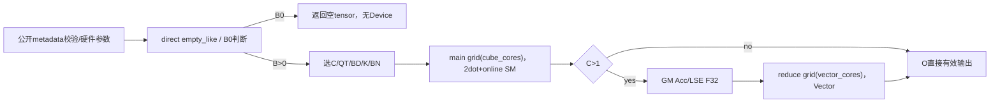
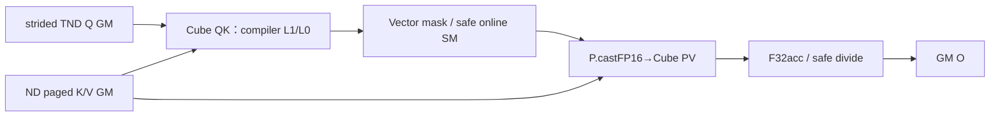
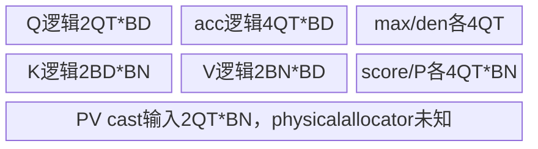
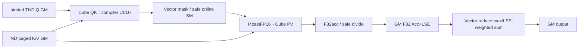

# SGL 分页MTP注意力 Ascend 950 Direct Invoke 算子知识

## 算子速览

| 项目 | 内容 |
|---|---|
| 实际入口 | Direct Invoke：sgl_kernel_npu.implementation.triton.attention.paged_mtp_attention.paged_mtp_attention_decode，当前is_arch22=false；公开wrapper据硬件生成此参数 |
| 计算语义 | 固定gamma query宽度、右对齐causal可选的分页GQA attention，读取设备动态KV长度；不是ragged query或滑窗算子 |
| 输入输出 | Q[B*gamma,Hq,D] TND；K/V[pages,PAGE,Hkv*D] ND，FP16/BF16；seq I32[B]、CuQ I32[B+1]、page table I32/I64；输出同Q |
| 执行类型 | main每step两个tl.dot/CV及Vector SM；SPLITS>1接纯Vector reduce Kernel；B0只分配/返回无Device launch |
| Kernel 路线 | R-001..R-032逐dtype/tile/split/causal；R-033 B0；R-034失败/非法域 |
| 核心资源 | Q/acc[QT,BD]，K[BD,BN]、V[BN,BD]，score/prob[QT,BN]；split workspace全FP32 tasks*C*QT*(D+1)*4B；无Q打包 |
| 来源闭包 | direct_implementation_closed：公开metadata校验/硬件映射、direct launcher、设备属性helper、main/reduce JIT完整body、参数/owned分支/GMbyte/live-range闭合；Triton物理lowering为明确primitive边界 |
| 验证状态 | 本次知识提取未执行编译、真机、数值或性能测试。draft：具体compiler物理资源、有限输入中间溢出与caller设备值合同未运行验证，不声称真机复核。 |

## 接口与语义

### 计算语义

R=Hq/Hkv，固定G=gamma；request b的query i对应Q[bG+i,h,d]，kvHead=floor(h/R)。KV position j映射physical=block_tables[b,floor(j/PAGE)]，页内r=j%PAGE，K/V起点physical*outerStride+r*tokenStride+kvHead*D。score=softmax_scale*sum_d(Q*K)。非causal可见0≤j<seq_lens[b]；causal再要求j≤seq_lens[b]−G+i，query向有效KV末端右对齐。KV长度包含当前query块，无其它position输入/滑窗。max_kv_len只参与Host SPLITS选择，Device完整扫描实际seq_lens，绝不截断有效KV到max_kv_len。

每主核program把G×R个query/head行打成QT padded矩阵。在线状态maximum=−inf，denominator0，accF32零；每步先取next_max=max(旧maximum,当前score行最大值)，仅next_max==−inf（截至当前仍无有效score）时safe_max=0、概率0、correction=0；已有有效历史而当前块全mask时safe_max保留旧maximum、correction=1，保护空可见集合。FP32在线acc与sum，PV前probability.cast(keys.dtype)，输出直接路径castQdtype。split路径在GM存**FP32已归一partial**和FP32LSE，reduce先取跨split max、safe_max再重权partial/分母，最后castQdtype。与全FP32参考或不同split求和顺序不保证逐位一致；不是GQA另卡的低精partial路径。

### 输入、输出与属性

| 参数 | shape/layout | dtype | 约束、默认值与语义 |
|---|---|---|---|
| query | [B*G,Hq,D] TND | FP16/BF16 | 公开支持任意stride；当前direct使用源stride或packed affine布局 |
| k_cache/v_cache | [pages,PAGE,Hkv*D] ND | 同Q | 末维stride1；外层可非连续，K/Vshape相同但分别stride |
| seq_lens | [B] contiguous | I32 | 非负、≤每行page capacity；device load，不取CPU值；0为padding |
| cu_q_lens | [B+1] contiguous | I32 | 内容必须b*G；metadata只查shape/dtype，值由caller；不是ragged分段 |
| block_tables | [B,maxPages] strided | I32/I64 | 只有被有效KV访问的page需合法；长度0整行可无效 |
| page_size | positivepower2≥16 | Pythonint | 必须cache dim1相等；保证KV_BLOCK整除PAGE/不跨页 |
| num_q_heads/num_kv_heads | Hq/Hkv | Pythonint | 正且Hq%Hkv0；R=Hq/Hkv |
| head_dim | D16..256 | Pythonint | 与Q和cache逻辑D一致，BD由平台规则padPOT |
| gamma | G>0固定 | Pythonint | 每请求恰好G行，query不能ragged |
| softmax_scale | finiteReal，非bool | scalarfloat | 显式必传，通常D^−0.5；不自动归一 |
| max_kv_len | ≥0 | Pythonint | 仅调度提示，可能小于实际KV仍读完整实际域 |
| causal | bool默认False | constexpr | 右对齐mask，不是从page表推position |
| is_arch22 | 本卡固定false | Hostbool→meta/配置 | 公开wrapper由get_hardware generation提供；raw故意传错不扩平台 |
| output | Q同shape/dtype/device | 新tensor | empty_like，输出stride非接口承诺；B0直接返回空tensor |

### 入口与版本

公开paged_mtp_attention_decode所有参数keyword-only，auto/triton惰性import当前Direct函数，无错误fallback到torch_native。torch_native为显式独立参考入口，本卡不摄入其Torch attention核心。公开支持表明确A3(arch22)/A5(arch35)，本卡只Ascend 950，不把源码注释“A2/A3”升级成公开A2支持；[接口知识卡](../../../../apis/sgl_kernel_npu/sgl_paged_mtp_attention_decode.md)可复用合同。

固定提交dda6d36b0cdb4081e102d14c0a2fb276fc416e69与CANN9.1.0证据；源码注释提到A5/Triton3.2.0某种row-mask曾误编译，属于固定source注释事实，不表示本次运行该版本/复现。未指定Triton确切build，JIT/layout/通用tl primitive作为明确编译框架边界，不伪造物理UB/寄存器报告。

## Host/Launcher 执行流程

### 参数校验与前处理

公开wrapper先检查6个tensor、维度属性均严格type int（bool不算）、gamma/Hq/Hkv正与整除、PAGE≥16且POT、D16..256、maxKV≥0、scale为finiteReal非bool、causal为bool。然后seq1D定B，Qshape恰[B*G,Hq,D]，K/V3Dshape及最后stride1，lengthsI32/连续、CuQ[B+1]、page2D/B行/dtype，Q/K/V半精同dtype及全部同device。_triton_impl要求query.device.type='npu'，据generation传is_arch22。没有Host读取length/page/Q值，非负/offset内容/页号/输入finite由caller。直接调用实现函数不重复上述wrapper校验，须携带同合同。

direct函数先B=seq_lens.numel，output=empty_like(query)，B0立刻return；B>0后get_device_properties取当前device的cube/vectorcore并assert均>0，R=Hq/Hkv。is_arch22False，PACKED_QUERY恒false；没有Q打包，保留源Qstride。 output始终按自己的实际stride传，不能拿savedquerystrides替代out。

### 参数、Workspace 与生命周期

tasks=B*Hkv；SPLITS初值1。若tasks<cube_cores且maxKV≥(R1?256:2048)，SPLITS=max(1,min(cube_cores//tasks,maxKV//256))；可以非POT，不误套其它算子的POT约束。QT=max(16,nextpow2(GR))，BD=nextpow2(D)，K=BN=min(128,PAGE)，不做arch22宽tile cap。

SPLITS>1分配Acc[tasks*C,QT,D] F32与LSE[tasks*C,QT] F32，合4*tasks*C*QT*(D+1)B。C1用output作为两个**typed但未消费**占位pointer，不另分配Acc/LSE；该specialization不读/写这两个角色。没有packed额外GM。 output有效2B*G*Hq*D B，paddingQT只在split workspace物化。

Tensor由Python/Torch allocator与当前device stream的Triton runtime持有至相应consumer完成，main→reduce按同流enqueue；source无Host同步、手写event/record_stream或跨stream协议。原Q、packedQ如存在、cache/metadata/out以及Acc/LSE须在其最后使用前保活；不能用函数return声称跨stream就绪。普通reshape/permute/contiguous为框架预处理边界，FP32attention主/归约数学均为本地JIT body。

### 启动图与失败传播



main/reduce launch均只显式grid，没有num_warps/num_stages实参；具体默认值由Triton后端决定，不补4/2。main grid-stride遍历B*Hkv*C任务，reduce grid-stride遍历B*Hkv任务。metadata/import/property/JIT/launch错误直接传播，无重试另一后端或自动缩tile。source无NDDMA/SIMT/通信owned节点；CV由可达两次tl.dot判定，多Kernel是拓扑而非执行族。

## Route 与参数设计

### 分核与资源计算

main for task=pid0;task<B*Hkv*C;task+=numPrograms：split=task%C，kvHead=(task//C)%Hkv，b=task//(C*Hkv)。动态load L=seq_lens[b]，q_start=CuQ[b]；chunk=ceil(ceil(L/C)/PAGE)*PAGE，start=split*chunk，end=min(start+chunk,L)。后续扫描ceil(max(end−start,0)/K)块，K≤PAGE且整除PAGE，故每次load一个page可覆盖有效count而不跨物理页。**不从maxKV读边界**。页号仅在实际循环内load，所以L0空请求不会触碰其无效page表。

rows0..QT−1→q_index=floor(rows/R)，q_head=kvHead*R+rows%R；Q load/scoremask用q_index<G，outputstore用rows<G*R，保留这两个写法的源码差异。D维Dpadded补0，K/V block_ptr shape=(D,count)/(count,D)与boundary_check0/1补0。BN=K，只按position<end及query行mask。 causal再叠position≤L−G+q_index。

逻辑字节域Q=2QT*BD、K/V各2BD*BN、score/prob各4QT*BN、PV输入castP=2QT*BN、acc=4QT*BD，maximum/denominator各4QT B；K/V均在QK前载入，本体不是lateV路径。reduce result/partial各4QT*BD、rowLSE/weight各4QT，先扫C求max再第二轮扫C加权；这些是source值域，**不等于物理UBpeak**。Triton physical L1/L0/UB、microtile/db/bankpadding/spill及寄存器分配不在Python源可见；保留真实源规则和显式GM账，不造硬件allocation或flag编号。

### Route 选择

| 顺序 | Route | Key/模板 | 精确选择条件与优先级 | 不适用去向 |
|---:|---|---|---|---|
| 1 | R-001 | dtypeFP16/PACKfalse/K16/C1/CAUSALfalse | FP16；B>0，is_arch22=false，packed=False；PAGE16，K=N=16；SPLITS=1；CAUSAL=false；公开metadata/caller值合同 | 相应轴其它Route或失败 |
| 2 | R-002 | dtypeFP16/PACKfalse/K16/C1/CAUSALtrue | FP16；B>0，is_arch22=false，packed=False；PAGE16，K=N=16；SPLITS=1；CAUSAL=true；公开metadata/caller值合同 | 相应轴其它Route或失败 |
| 3 | R-003 | dtypeFP16/PACKfalse/K16/C>1/CAUSALfalse | FP16；B>0，is_arch22=false，packed=False；PAGE16，K=N=16；SPLITS>1；CAUSAL=false；公开metadata/caller值合同 | 相应轴其它Route或失败 |
| 4 | R-004 | dtypeFP16/PACKfalse/K16/C>1/CAUSALtrue | FP16；B>0，is_arch22=false，packed=False；PAGE16，K=N=16；SPLITS>1；CAUSAL=true；公开metadata/caller值合同 | 相应轴其它Route或失败 |
| 5 | R-005 | dtypeFP16/PACKfalse/K32/C1/CAUSALfalse | FP16；B>0，is_arch22=false，packed=False；PAGE32，K=N=32；SPLITS=1；CAUSAL=false；公开metadata/caller值合同 | 相应轴其它Route或失败 |
| 6 | R-006 | dtypeFP16/PACKfalse/K32/C1/CAUSALtrue | FP16；B>0，is_arch22=false，packed=False；PAGE32，K=N=32；SPLITS=1；CAUSAL=true；公开metadata/caller值合同 | 相应轴其它Route或失败 |
| 7 | R-007 | dtypeFP16/PACKfalse/K32/C>1/CAUSALfalse | FP16；B>0，is_arch22=false，packed=False；PAGE32，K=N=32；SPLITS>1；CAUSAL=false；公开metadata/caller值合同 | 相应轴其它Route或失败 |
| 8 | R-008 | dtypeFP16/PACKfalse/K32/C>1/CAUSALtrue | FP16；B>0，is_arch22=false，packed=False；PAGE32，K=N=32；SPLITS>1；CAUSAL=true；公开metadata/caller值合同 | 相应轴其它Route或失败 |
| 9 | R-009 | dtypeFP16/PACKfalse/K64/C1/CAUSALfalse | FP16；B>0，is_arch22=false，packed=False；PAGE64，K=N=64；SPLITS=1；CAUSAL=false；公开metadata/caller值合同 | 相应轴其它Route或失败 |
| 10 | R-010 | dtypeFP16/PACKfalse/K64/C1/CAUSALtrue | FP16；B>0，is_arch22=false，packed=False；PAGE64，K=N=64；SPLITS=1；CAUSAL=true；公开metadata/caller值合同 | 相应轴其它Route或失败 |
| 11 | R-011 | dtypeFP16/PACKfalse/K64/C>1/CAUSALfalse | FP16；B>0，is_arch22=false，packed=False；PAGE64，K=N=64；SPLITS>1；CAUSAL=false；公开metadata/caller值合同 | 相应轴其它Route或失败 |
| 12 | R-012 | dtypeFP16/PACKfalse/K64/C>1/CAUSALtrue | FP16；B>0，is_arch22=false，packed=False；PAGE64，K=N=64；SPLITS>1；CAUSAL=true；公开metadata/caller值合同 | 相应轴其它Route或失败 |
| 13 | R-013 | dtypeFP16/PACKfalse/K128/C1/CAUSALfalse | FP16；B>0，is_arch22=false，packed=False；PAGE≥128，K=N=128；SPLITS=1；CAUSAL=false；公开metadata/caller值合同 | 相应轴其它Route或失败 |
| 14 | R-014 | dtypeFP16/PACKfalse/K128/C1/CAUSALtrue | FP16；B>0，is_arch22=false，packed=False；PAGE≥128，K=N=128；SPLITS=1；CAUSAL=true；公开metadata/caller值合同 | 相应轴其它Route或失败 |
| 15 | R-015 | dtypeFP16/PACKfalse/K128/C>1/CAUSALfalse | FP16；B>0，is_arch22=false，packed=False；PAGE≥128，K=N=128；SPLITS>1；CAUSAL=false；公开metadata/caller值合同 | 相应轴其它Route或失败 |
| 16 | R-016 | dtypeFP16/PACKfalse/K128/C>1/CAUSALtrue | FP16；B>0，is_arch22=false，packed=False；PAGE≥128，K=N=128；SPLITS>1；CAUSAL=true；公开metadata/caller值合同 | 相应轴其它Route或失败 |
| 17 | R-017 | dtypeBF16/PACKfalse/K16/C1/CAUSALfalse | BF16；B>0，is_arch22=false，packed=False；PAGE16，K=N=16；SPLITS=1；CAUSAL=false；公开metadata/caller值合同 | 相应轴其它Route或失败 |
| 18 | R-018 | dtypeBF16/PACKfalse/K16/C1/CAUSALtrue | BF16；B>0，is_arch22=false，packed=False；PAGE16，K=N=16；SPLITS=1；CAUSAL=true；公开metadata/caller值合同 | 相应轴其它Route或失败 |
| 19 | R-019 | dtypeBF16/PACKfalse/K16/C>1/CAUSALfalse | BF16；B>0，is_arch22=false，packed=False；PAGE16，K=N=16；SPLITS>1；CAUSAL=false；公开metadata/caller值合同 | 相应轴其它Route或失败 |
| 20 | R-020 | dtypeBF16/PACKfalse/K16/C>1/CAUSALtrue | BF16；B>0，is_arch22=false，packed=False；PAGE16，K=N=16；SPLITS>1；CAUSAL=true；公开metadata/caller值合同 | 相应轴其它Route或失败 |
| 21 | R-021 | dtypeBF16/PACKfalse/K32/C1/CAUSALfalse | BF16；B>0，is_arch22=false，packed=False；PAGE32，K=N=32；SPLITS=1；CAUSAL=false；公开metadata/caller值合同 | 相应轴其它Route或失败 |
| 22 | R-022 | dtypeBF16/PACKfalse/K32/C1/CAUSALtrue | BF16；B>0，is_arch22=false，packed=False；PAGE32，K=N=32；SPLITS=1；CAUSAL=true；公开metadata/caller值合同 | 相应轴其它Route或失败 |
| 23 | R-023 | dtypeBF16/PACKfalse/K32/C>1/CAUSALfalse | BF16；B>0，is_arch22=false，packed=False；PAGE32，K=N=32；SPLITS>1；CAUSAL=false；公开metadata/caller值合同 | 相应轴其它Route或失败 |
| 24 | R-024 | dtypeBF16/PACKfalse/K32/C>1/CAUSALtrue | BF16；B>0，is_arch22=false，packed=False；PAGE32，K=N=32；SPLITS>1；CAUSAL=true；公开metadata/caller值合同 | 相应轴其它Route或失败 |
| 25 | R-025 | dtypeBF16/PACKfalse/K64/C1/CAUSALfalse | BF16；B>0，is_arch22=false，packed=False；PAGE64，K=N=64；SPLITS=1；CAUSAL=false；公开metadata/caller值合同 | 相应轴其它Route或失败 |
| 26 | R-026 | dtypeBF16/PACKfalse/K64/C1/CAUSALtrue | BF16；B>0，is_arch22=false，packed=False；PAGE64，K=N=64；SPLITS=1；CAUSAL=true；公开metadata/caller值合同 | 相应轴其它Route或失败 |
| 27 | R-027 | dtypeBF16/PACKfalse/K64/C>1/CAUSALfalse | BF16；B>0，is_arch22=false，packed=False；PAGE64，K=N=64；SPLITS>1；CAUSAL=false；公开metadata/caller值合同 | 相应轴其它Route或失败 |
| 28 | R-028 | dtypeBF16/PACKfalse/K64/C>1/CAUSALtrue | BF16；B>0，is_arch22=false，packed=False；PAGE64，K=N=64；SPLITS>1；CAUSAL=true；公开metadata/caller值合同 | 相应轴其它Route或失败 |
| 29 | R-029 | dtypeBF16/PACKfalse/K128/C1/CAUSALfalse | BF16；B>0，is_arch22=false，packed=False；PAGE≥128，K=N=128；SPLITS=1；CAUSAL=false；公开metadata/caller值合同 | 相应轴其它Route或失败 |
| 30 | R-030 | dtypeBF16/PACKfalse/K128/C1/CAUSALtrue | BF16；B>0，is_arch22=false，packed=False；PAGE≥128，K=N=128；SPLITS=1；CAUSAL=true；公开metadata/caller值合同 | 相应轴其它Route或失败 |
| 31 | R-031 | dtypeBF16/PACKfalse/K128/C>1/CAUSALfalse | BF16；B>0，is_arch22=false，packed=False；PAGE≥128，K=N=128；SPLITS>1；CAUSAL=false；公开metadata/caller值合同 | 相应轴其它Route或失败 |
| 32 | R-032 | dtypeBF16/PACKfalse/K128/C>1/CAUSALtrue | BF16；B>0，is_arch22=false，packed=False；PAGE≥128，K=N=128；SPLITS>1；CAUSAL=true；公开metadata/caller值合同 | 相应轴其它Route或失败 |
| 33 | R-033 B0 | outputempty | B=seq_lens.numel0，先分配empty_like再return | 无property/pack/Device节点 |
| 34 | R-034失败 | metadata/JIT/caller非法 | 显式失败或未守卫非法设备值，不补fallback | 异常/未知非法行为 |

```text
B0→emptyreturn；B>0→properties/R/PACK=False
 tasks/C threshold→C1或C>1
 QT≥16、BD=POTD、K=BN=min128PAGE
 dtypeFP16/BF16、CAUSALfalse/true→精确Route→main→可选reduce
 assert/JIT/launch失败不retry；maxKV只选C，不能当Device mask
```

### 模板/实现执行矩阵

| Route | key/selector | dtype/shape/platform 完整命中条件 | 执行族与 kernel 节点 | 实际模板/body | 内存与同步特征 | tail/fallback |
|---|---|---|---|---|---|---|
| R-001 | FP16/PACKfalse/K16/C1/causalfalse | FP16；B>0，is_arch22=false，packed=False；PAGE16，K=N=16；SPLITS=1；CAUSAL=false | CVmain单main | _paged_mtp_kernel(PACKED_QUERY=false,KV_BLOCK=16,BLOCK_N=16,CAUSAL=false) | O直写，Acc/LSEplaceholder不读 | query/D/physicalpage尾/emptycausal保护；无fallback |
| R-002 | FP16/PACKfalse/K16/C1/causaltrue | FP16；B>0，is_arch22=false，packed=False；PAGE16，K=N=16；SPLITS=1；CAUSAL=true | CVmain单main | _paged_mtp_kernel(PACKED_QUERY=false,KV_BLOCK=16,BLOCK_N=16,CAUSAL=true) | O直写，Acc/LSEplaceholder不读 | query/D/physicalpage尾/emptycausal保护；无fallback |
| R-003 | FP16/PACKfalse/K16/C>1/causalfalse | FP16；B>0，is_arch22=false，packed=False；PAGE16，K=N=16；SPLITS>1；CAUSAL=false | CVmain→Vector reduce | _paged_mtp_kernel(PACKED_QUERY=false,KV_BLOCK=16,BLOCK_N=16,CAUSAL=false)；_reduce_mtp_kernel | FP32 Acc/LSE跨同流 | query/D/physicalpage尾/emptycausal保护；无fallback |
| R-004 | FP16/PACKfalse/K16/C>1/causaltrue | FP16；B>0，is_arch22=false，packed=False；PAGE16，K=N=16；SPLITS>1；CAUSAL=true | CVmain→Vector reduce | _paged_mtp_kernel(PACKED_QUERY=false,KV_BLOCK=16,BLOCK_N=16,CAUSAL=true)；_reduce_mtp_kernel | FP32 Acc/LSE跨同流 | query/D/physicalpage尾/emptycausal保护；无fallback |
| R-005 | FP16/PACKfalse/K32/C1/causalfalse | FP16；B>0，is_arch22=false，packed=False；PAGE32，K=N=32；SPLITS=1；CAUSAL=false | CVmain单main | _paged_mtp_kernel(PACKED_QUERY=false,KV_BLOCK=32,BLOCK_N=32,CAUSAL=false) | O直写，Acc/LSEplaceholder不读 | query/D/physicalpage尾/emptycausal保护；无fallback |
| R-006 | FP16/PACKfalse/K32/C1/causaltrue | FP16；B>0，is_arch22=false，packed=False；PAGE32，K=N=32；SPLITS=1；CAUSAL=true | CVmain单main | _paged_mtp_kernel(PACKED_QUERY=false,KV_BLOCK=32,BLOCK_N=32,CAUSAL=true) | O直写，Acc/LSEplaceholder不读 | query/D/physicalpage尾/emptycausal保护；无fallback |
| R-007 | FP16/PACKfalse/K32/C>1/causalfalse | FP16；B>0，is_arch22=false，packed=False；PAGE32，K=N=32；SPLITS>1；CAUSAL=false | CVmain→Vector reduce | _paged_mtp_kernel(PACKED_QUERY=false,KV_BLOCK=32,BLOCK_N=32,CAUSAL=false)；_reduce_mtp_kernel | FP32 Acc/LSE跨同流 | query/D/physicalpage尾/emptycausal保护；无fallback |
| R-008 | FP16/PACKfalse/K32/C>1/causaltrue | FP16；B>0，is_arch22=false，packed=False；PAGE32，K=N=32；SPLITS>1；CAUSAL=true | CVmain→Vector reduce | _paged_mtp_kernel(PACKED_QUERY=false,KV_BLOCK=32,BLOCK_N=32,CAUSAL=true)；_reduce_mtp_kernel | FP32 Acc/LSE跨同流 | query/D/physicalpage尾/emptycausal保护；无fallback |
| R-009 | FP16/PACKfalse/K64/C1/causalfalse | FP16；B>0，is_arch22=false，packed=False；PAGE64，K=N=64；SPLITS=1；CAUSAL=false | CVmain单main | _paged_mtp_kernel(PACKED_QUERY=false,KV_BLOCK=64,BLOCK_N=64,CAUSAL=false) | O直写，Acc/LSEplaceholder不读 | query/D/physicalpage尾/emptycausal保护；无fallback |
| R-010 | FP16/PACKfalse/K64/C1/causaltrue | FP16；B>0，is_arch22=false，packed=False；PAGE64，K=N=64；SPLITS=1；CAUSAL=true | CVmain单main | _paged_mtp_kernel(PACKED_QUERY=false,KV_BLOCK=64,BLOCK_N=64,CAUSAL=true) | O直写，Acc/LSEplaceholder不读 | query/D/physicalpage尾/emptycausal保护；无fallback |
| R-011 | FP16/PACKfalse/K64/C>1/causalfalse | FP16；B>0，is_arch22=false，packed=False；PAGE64，K=N=64；SPLITS>1；CAUSAL=false | CVmain→Vector reduce | _paged_mtp_kernel(PACKED_QUERY=false,KV_BLOCK=64,BLOCK_N=64,CAUSAL=false)；_reduce_mtp_kernel | FP32 Acc/LSE跨同流 | query/D/physicalpage尾/emptycausal保护；无fallback |
| R-012 | FP16/PACKfalse/K64/C>1/causaltrue | FP16；B>0，is_arch22=false，packed=False；PAGE64，K=N=64；SPLITS>1；CAUSAL=true | CVmain→Vector reduce | _paged_mtp_kernel(PACKED_QUERY=false,KV_BLOCK=64,BLOCK_N=64,CAUSAL=true)；_reduce_mtp_kernel | FP32 Acc/LSE跨同流 | query/D/physicalpage尾/emptycausal保护；无fallback |
| R-013 | FP16/PACKfalse/K128/C1/causalfalse | FP16；B>0，is_arch22=false，packed=False；PAGE≥128，K=N=128；SPLITS=1；CAUSAL=false | CVmain单main | _paged_mtp_kernel(PACKED_QUERY=false,KV_BLOCK=128,BLOCK_N=128,CAUSAL=false) | O直写，Acc/LSEplaceholder不读 | query/D/physicalpage尾/emptycausal保护；无fallback |
| R-014 | FP16/PACKfalse/K128/C1/causaltrue | FP16；B>0，is_arch22=false，packed=False；PAGE≥128，K=N=128；SPLITS=1；CAUSAL=true | CVmain单main | _paged_mtp_kernel(PACKED_QUERY=false,KV_BLOCK=128,BLOCK_N=128,CAUSAL=true) | O直写，Acc/LSEplaceholder不读 | query/D/physicalpage尾/emptycausal保护；无fallback |
| R-015 | FP16/PACKfalse/K128/C>1/causalfalse | FP16；B>0，is_arch22=false，packed=False；PAGE≥128，K=N=128；SPLITS>1；CAUSAL=false | CVmain→Vector reduce | _paged_mtp_kernel(PACKED_QUERY=false,KV_BLOCK=128,BLOCK_N=128,CAUSAL=false)；_reduce_mtp_kernel | FP32 Acc/LSE跨同流 | query/D/physicalpage尾/emptycausal保护；无fallback |
| R-016 | FP16/PACKfalse/K128/C>1/causaltrue | FP16；B>0，is_arch22=false，packed=False；PAGE≥128，K=N=128；SPLITS>1；CAUSAL=true | CVmain→Vector reduce | _paged_mtp_kernel(PACKED_QUERY=false,KV_BLOCK=128,BLOCK_N=128,CAUSAL=true)；_reduce_mtp_kernel | FP32 Acc/LSE跨同流 | query/D/physicalpage尾/emptycausal保护；无fallback |
| R-017 | BF16/PACKfalse/K16/C1/causalfalse | BF16；B>0，is_arch22=false，packed=False；PAGE16，K=N=16；SPLITS=1；CAUSAL=false | CVmain单main | _paged_mtp_kernel(PACKED_QUERY=false,KV_BLOCK=16,BLOCK_N=16,CAUSAL=false) | O直写，Acc/LSEplaceholder不读 | query/D/physicalpage尾/emptycausal保护；无fallback |
| R-018 | BF16/PACKfalse/K16/C1/causaltrue | BF16；B>0，is_arch22=false，packed=False；PAGE16，K=N=16；SPLITS=1；CAUSAL=true | CVmain单main | _paged_mtp_kernel(PACKED_QUERY=false,KV_BLOCK=16,BLOCK_N=16,CAUSAL=true) | O直写，Acc/LSEplaceholder不读 | query/D/physicalpage尾/emptycausal保护；无fallback |
| R-019 | BF16/PACKfalse/K16/C>1/causalfalse | BF16；B>0，is_arch22=false，packed=False；PAGE16，K=N=16；SPLITS>1；CAUSAL=false | CVmain→Vector reduce | _paged_mtp_kernel(PACKED_QUERY=false,KV_BLOCK=16,BLOCK_N=16,CAUSAL=false)；_reduce_mtp_kernel | FP32 Acc/LSE跨同流 | query/D/physicalpage尾/emptycausal保护；无fallback |
| R-020 | BF16/PACKfalse/K16/C>1/causaltrue | BF16；B>0，is_arch22=false，packed=False；PAGE16，K=N=16；SPLITS>1；CAUSAL=true | CVmain→Vector reduce | _paged_mtp_kernel(PACKED_QUERY=false,KV_BLOCK=16,BLOCK_N=16,CAUSAL=true)；_reduce_mtp_kernel | FP32 Acc/LSE跨同流 | query/D/physicalpage尾/emptycausal保护；无fallback |
| R-021 | BF16/PACKfalse/K32/C1/causalfalse | BF16；B>0，is_arch22=false，packed=False；PAGE32，K=N=32；SPLITS=1；CAUSAL=false | CVmain单main | _paged_mtp_kernel(PACKED_QUERY=false,KV_BLOCK=32,BLOCK_N=32,CAUSAL=false) | O直写，Acc/LSEplaceholder不读 | query/D/physicalpage尾/emptycausal保护；无fallback |
| R-022 | BF16/PACKfalse/K32/C1/causaltrue | BF16；B>0，is_arch22=false，packed=False；PAGE32，K=N=32；SPLITS=1；CAUSAL=true | CVmain单main | _paged_mtp_kernel(PACKED_QUERY=false,KV_BLOCK=32,BLOCK_N=32,CAUSAL=true) | O直写，Acc/LSEplaceholder不读 | query/D/physicalpage尾/emptycausal保护；无fallback |
| R-023 | BF16/PACKfalse/K32/C>1/causalfalse | BF16；B>0，is_arch22=false，packed=False；PAGE32，K=N=32；SPLITS>1；CAUSAL=false | CVmain→Vector reduce | _paged_mtp_kernel(PACKED_QUERY=false,KV_BLOCK=32,BLOCK_N=32,CAUSAL=false)；_reduce_mtp_kernel | FP32 Acc/LSE跨同流 | query/D/physicalpage尾/emptycausal保护；无fallback |
| R-024 | BF16/PACKfalse/K32/C>1/causaltrue | BF16；B>0，is_arch22=false，packed=False；PAGE32，K=N=32；SPLITS>1；CAUSAL=true | CVmain→Vector reduce | _paged_mtp_kernel(PACKED_QUERY=false,KV_BLOCK=32,BLOCK_N=32,CAUSAL=true)；_reduce_mtp_kernel | FP32 Acc/LSE跨同流 | query/D/physicalpage尾/emptycausal保护；无fallback |
| R-025 | BF16/PACKfalse/K64/C1/causalfalse | BF16；B>0，is_arch22=false，packed=False；PAGE64，K=N=64；SPLITS=1；CAUSAL=false | CVmain单main | _paged_mtp_kernel(PACKED_QUERY=false,KV_BLOCK=64,BLOCK_N=64,CAUSAL=false) | O直写，Acc/LSEplaceholder不读 | query/D/physicalpage尾/emptycausal保护；无fallback |
| R-026 | BF16/PACKfalse/K64/C1/causaltrue | BF16；B>0，is_arch22=false，packed=False；PAGE64，K=N=64；SPLITS=1；CAUSAL=true | CVmain单main | _paged_mtp_kernel(PACKED_QUERY=false,KV_BLOCK=64,BLOCK_N=64,CAUSAL=true) | O直写，Acc/LSEplaceholder不读 | query/D/physicalpage尾/emptycausal保护；无fallback |
| R-027 | BF16/PACKfalse/K64/C>1/causalfalse | BF16；B>0，is_arch22=false，packed=False；PAGE64，K=N=64；SPLITS>1；CAUSAL=false | CVmain→Vector reduce | _paged_mtp_kernel(PACKED_QUERY=false,KV_BLOCK=64,BLOCK_N=64,CAUSAL=false)；_reduce_mtp_kernel | FP32 Acc/LSE跨同流 | query/D/physicalpage尾/emptycausal保护；无fallback |
| R-028 | BF16/PACKfalse/K64/C>1/causaltrue | BF16；B>0，is_arch22=false，packed=False；PAGE64，K=N=64；SPLITS>1；CAUSAL=true | CVmain→Vector reduce | _paged_mtp_kernel(PACKED_QUERY=false,KV_BLOCK=64,BLOCK_N=64,CAUSAL=true)；_reduce_mtp_kernel | FP32 Acc/LSE跨同流 | query/D/physicalpage尾/emptycausal保护；无fallback |
| R-029 | BF16/PACKfalse/K128/C1/causalfalse | BF16；B>0，is_arch22=false，packed=False；PAGE≥128，K=N=128；SPLITS=1；CAUSAL=false | CVmain单main | _paged_mtp_kernel(PACKED_QUERY=false,KV_BLOCK=128,BLOCK_N=128,CAUSAL=false) | O直写，Acc/LSEplaceholder不读 | query/D/physicalpage尾/emptycausal保护；无fallback |
| R-030 | BF16/PACKfalse/K128/C1/causaltrue | BF16；B>0，is_arch22=false，packed=False；PAGE≥128，K=N=128；SPLITS=1；CAUSAL=true | CVmain单main | _paged_mtp_kernel(PACKED_QUERY=false,KV_BLOCK=128,BLOCK_N=128,CAUSAL=true) | O直写，Acc/LSEplaceholder不读 | query/D/physicalpage尾/emptycausal保护；无fallback |
| R-031 | BF16/PACKfalse/K128/C>1/causalfalse | BF16；B>0，is_arch22=false，packed=False；PAGE≥128，K=N=128；SPLITS>1；CAUSAL=false | CVmain→Vector reduce | _paged_mtp_kernel(PACKED_QUERY=false,KV_BLOCK=128,BLOCK_N=128,CAUSAL=false)；_reduce_mtp_kernel | FP32 Acc/LSE跨同流 | query/D/physicalpage尾/emptycausal保护；无fallback |
| R-032 | BF16/PACKfalse/K128/C>1/causaltrue | BF16；B>0，is_arch22=false，packed=False；PAGE≥128，K=N=128；SPLITS>1；CAUSAL=true | CVmain→Vector reduce | _paged_mtp_kernel(PACKED_QUERY=false,KV_BLOCK=128,BLOCK_N=128,CAUSAL=true)；_reduce_mtp_kernel | FP32 Acc/LSE跨同流 | query/D/physicalpage尾/emptycausal保护；无fallback |
| R-033 | B0 | metadata有效B0 | 无Device | empty_like/return | 无workspace | 空tensor |
| R-034 | failure | 元数据/caller/JIT非法 | 未保证 | source显式异常或无guard非法域 | 不补结果 | 无重试 |

### 隐藏性能 Guard

| Guard | Host/Tiling 条件 | Device/资源原因 | 影响 Route | 不满足时去向 | 源码符号 |
|---|---|---|---|---|---|
| metadata | 公开wrapper真实if/raise，非空宏 | 固定G/R/D/page布局与Device参数 | 全部 | TypeError/ValueError | operators paged_mtp_attention.py |
| length/page值 | 仅metadata检查，CuQ值bG/非负seq/page域caller保证 | Device动态load/地址 | 正常Route | 未guard错误/OOB，不以compiler补救 | main loadSeq/CuQ/Pages |
| split | tasks<cubeC且maxKV≥R阈值 | 提供更多任务；page对齐动态chunk | 全部 | 不命中即C1，无其它fallback | directlauncher |
| 常规tile | K=min128PAGE，QT至少16 | 限制source逻辑局部域；非完整compiler资源证明 | 当前平台 | 无自动失败重选 | launcher |
| 小page | PAGE≥16 POT，K整除PAGE；K=BN | 每step只读一个physical页、block_ptr边界 | 全部 | public拒非法page；caller直调需同合同 | public/main |
| Qmask | load/score用rows//R<G，store用rows<G*R | source注释保留A5某版本compiler敏感写法 | 全部 | 不替换为未验证等价代码 | main/reduce |
| empty | safe_max/safe_denominator、L0循环0 | 防−inf−−inf与0/0 | 全部 | 不补fallback，直接按body输出0 | main/reduce |
| 精度/容量 | Pcast输入dtype，acc/workspaceF32；局部张量域随QT/BD/BN增长 | physicalUB/L0等由compilerlowering决定 | 全部 | 未运行编译不填物理上界或寄存器数 | tl.dot/body |
| current流owner | main→reduce同流依赖 | Acc/LSE可见/不提前释放 | split | 无跨stream协议 | launcher |

### POD/ABI

没有自有C结构/序列化POD/固定offsetof。下面逐个参数是Python→Triton JIT ABI槽，指针取实际Tensor类型，scalar整型位宽/打包对齐/physical地址由编译器生成，源码未给sizeof/alignof/offsetof，不伪造。所有stride单位元素；constexpr是编译参数，不是GM字段。main使用35项、reduce15项；无显式num_warps/num_stages。

| 结构 | 字段 | 类型/位宽 | ABI 布局 | 单位 | Host/launcher producer | Device consumer | 边界 |
|---|---|---|---|---|---|---|---|
| _paged_mtp_kernel args | Q | 低精Tensor pointer | JIT源码槽0；生成ABI sizeof/align/offset未给 | 元素 | packed?packedQ:query | 主核Q load，PACKED affine或原stride | caller合同/shape/容量由Host与Route限定 |
| _paged_mtp_kernel args | K | 低精Tensor pointer | JIT源码槽1；生成ABI sizeof/align/offset未给 | 元素 | k_cache | K block_ptr，[D,count]，head offset=kvh*D | caller合同/shape/容量由Host与Route限定 |
| _paged_mtp_kernel args | V | 低精Tensor pointer | JIT源码槽2；生成ABI sizeof/align/offset未给 | 元素 | v_cache | V block_ptr，[count,D] | caller合同/shape/容量由Host与Route限定 |
| _paged_mtp_kernel args | O | 低精Tensor pointer | JIT源码槽3；生成ABI sizeof/align/offset未给 | 元素 | empty_like(originalquery) | 主核C1或reduce最终store | caller合同/shape/容量由Host与Route限定 |
| _paged_mtp_kernel args | SeqLens | I32 pointer | JIT源码槽4；生成ABI sizeof/align/offset未给 | token | seq_lens contiguous | 主核每taskload[b]，非负/值域caller | caller合同/shape/容量由Host与Route限定 |
| _paged_mtp_kernel args | CuQ | I32 pointer | JIT源码槽5；生成ABI sizeof/align/offset未给 | queryrow | cu_q_lens contiguous | load[b] query起点，必须b*G | caller合同/shape/容量由Host与Route限定 |
| _paged_mtp_kernel args | Pages | I32/I64 pointer | JIT源码槽6；生成ABI sizeof/align/offset未给 | physicalpage | block_tables | loop内按(start//PAGE)loadphysical | caller合同/shape/容量由Host与Route限定 |
| _paged_mtp_kernel args | Acc | C>1 F32 pointer；C1低精unusedplaceholder | JIT源码槽7；生成ABI sizeof/align/offset未给 | F32元素 | C>1 empty(tasks*C,QT,D)，elseoutput | mainwrite FP32partial/reduce read；C1不访问 | caller合同/shape/容量由Host与Route限定 |
| _paged_mtp_kernel args | Lse | C>1 F32 pointer；C1低精unusedplaceholder | JIT源码槽8；生成ABI sizeof/align/offset未给 | F32元素 | C>1 empty(tasks*C,QT)，elseoutput | mainstore LSE/reduce read；C1不访问 | caller合同/shape/容量由Host与Route限定 |
| _paged_mtp_kernel args | stride_qt | JITinteger scalar | JIT源码槽9；生成ABI sizeof/align/offset未给 | 元素stride | originalquery.stride(0)（pack前保存） | 当前输入/输出/页地址式乘索引 | PACKED_QUERYTrue忽略本原stride；否则必用 |
| _paged_mtp_kernel args | stride_qh | JITinteger scalar | JIT源码槽10；生成ABI sizeof/align/offset未给 | 元素stride | originalquery.stride(1)（pack前保存） | 当前输入/输出/页地址式乘索引 | PACKED_QUERYTrue忽略本原stride；否则必用 |
| _paged_mtp_kernel args | stride_qd | JITinteger scalar | JIT源码槽11；生成ABI sizeof/align/offset未给 | 元素stride | originalquery.stride(2)（pack前保存） | 当前输入/输出/页地址式乘索引 | PACKED_QUERYTrue忽略本原stride；否则必用 |
| _paged_mtp_kernel args | stride_kp | JITinteger scalar | JIT源码槽12；生成ABI sizeof/align/offset未给 | 元素stride | k_cache.stride(0) | 当前输入/输出/页地址式乘索引 | caller合同/shape/容量由Host与Route限定 |
| _paged_mtp_kernel args | stride_kt | JITinteger scalar | JIT源码槽13；生成ABI sizeof/align/offset未给 | 元素stride | k_cache.stride(1) | 当前输入/输出/页地址式乘索引 | caller合同/shape/容量由Host与Route限定 |
| _paged_mtp_kernel args | stride_vp | JITinteger scalar | JIT源码槽14；生成ABI sizeof/align/offset未给 | 元素stride | v_cache.stride(0) | 当前输入/输出/页地址式乘索引 | caller合同/shape/容量由Host与Route限定 |
| _paged_mtp_kernel args | stride_vt | JITinteger scalar | JIT源码槽15；生成ABI sizeof/align/offset未给 | 元素stride | v_cache.stride(1) | 当前输入/输出/页地址式乘索引 | caller合同/shape/容量由Host与Route限定 |
| _paged_mtp_kernel args | stride_ot | JITinteger scalar | JIT源码槽16；生成ABI sizeof/align/offset未给 | 元素stride | output.stride(0) | 当前输入/输出/页地址式乘索引 | caller合同/shape/容量由Host与Route限定 |
| _paged_mtp_kernel args | stride_oh | JITinteger scalar | JIT源码槽17；生成ABI sizeof/align/offset未给 | 元素stride | output.stride(1) | 当前输入/输出/页地址式乘索引 | caller合同/shape/容量由Host与Route限定 |
| _paged_mtp_kernel args | stride_od | JITinteger scalar | JIT源码槽18；生成ABI sizeof/align/offset未给 | 元素stride | output.stride(2) | 当前输入/输出/页地址式乘索引 | caller合同/shape/容量由Host与Route限定 |
| _paged_mtp_kernel args | stride_pb | JITinteger scalar | JIT源码槽19；生成ABI sizeof/align/offset未给 | 元素stride | block_tables.stride(0) | 当前输入/输出/页地址式乘索引 | caller合同/shape/容量由Host与Route限定 |
| _paged_mtp_kernel args | stride_pp | JITinteger scalar | JIT源码槽20；生成ABI sizeof/align/offset未给 | 元素stride | block_tables.stride(1) | 当前输入/输出/页地址式乘索引 | caller合同/shape/容量由Host与Route限定 |
| _paged_mtp_kernel args | scale | JIT scalar，PythonReal | JIT源码槽21；生成ABI sizeof/align/offset未给 | 数值 | softmax_scale | QK score乘数 | caller合同/shape/容量由Host与Route限定 |
| _paged_mtp_kernel args | BATCH | constexprint | JIT源码槽22；生成ABI sizeof/align/offset未给 | request | seq_lens.numel B | 任务上界B*Hkv*C或B*Hkv | constexpr选择不占自有GM POD |
| _paged_mtp_kernel args | HQ | constexprint | JIT源码槽23；生成ABI sizeof/align/offset未给 | heads | num_q_heads | GROUP=HQ/HKV | constexpr选择不占自有GM POD |
| _paged_mtp_kernel args | HKV | constexprint | JIT源码槽24；生成ABI sizeof/align/offset未给 | heads | num_kv_heads | task映射/kvhead/packedstride | constexpr选择不占自有GM POD |
| _paged_mtp_kernel args | DIM | constexprint | JIT源码槽25；生成ABI sizeof/align/offset未给 | 元素 | head_dim D | headoffset/Acc rowstride/Dmask | constexpr选择不占自有GM POD |
| _paged_mtp_kernel args | PAGE | constexprint | JIT源码槽26；生成ABI sizeof/align/offset未给 | token | page_size | 动态chunk page对齐/physical表索引 | constexpr选择不占自有GM POD |
| _paged_mtp_kernel args | GAMMA | constexprint | JIT源码槽27；生成ABI sizeof/align/offset未给 | queryrow | gamma G | q_index尾mask/causal右对齐 | constexpr选择不占自有GM POD |
| _paged_mtp_kernel args | SPLITS | constexprint | JIT源码槽28；生成ABI sizeof/align/offset未给 | split | Host C公式 | task→split/chunk、ifC1/多片、reduce staticC | constexpr选择不占自有GM POD |
| _paged_mtp_kernel args | Q_TILE | constexprint | JIT源码槽29；生成ABI sizeof/align/offset未给 | row | 平台min32/16与pow2ceil(GR) | arange rows/workspaceQT行 | constexpr选择不占自有GM POD |
| _paged_mtp_kernel args | BLOCK_D | constexprint | JIT源码槽30；生成ABI sizeof/align/offset未给 | 元素 | A3max32pow2ceilD；950pow2ceilD | arangedim/blockptrtilesize | constexpr选择不占自有GM POD |
| _paged_mtp_kernel args | BLOCK_N | constexprint | JIT源码槽31；生成ABI sizeof/align/offset未给 | token | A3max32K；950K | arange token/blockptrtilesize | constexpr选择不占自有GM POD |
| _paged_mtp_kernel args | CAUSAL | constexprbool | JIT源码槽32；生成ABI sizeof/align/offset未给 | bool | causal原bool | allowed再叠position≤L−G+i | constexpr选择不占自有GM POD |
| _paged_mtp_kernel args | PACKED_QUERY | constexprbool | JIT源码槽33；生成ABI sizeof/align/offset未给 | bool | is_arch22 && G>1 &&R>1 | Q affine/originaladdress分支 | constexpr选择不占自有GM POD |
| _paged_mtp_kernel args | KV_BLOCK | constexprint | JIT源码槽34；生成ABI sizeof/align/offset未给 | token | min128PAGE，A3宽tile cap64 | scanstep/count与K<BNmask分支 | constexpr选择不占自有GM POD |
| _reduce_mtp_kernel args | Acc | C>1 F32 pointer；C1低精unusedplaceholder | JIT源码槽0；生成ABI sizeof/align/offset未给 | F32元素 | C>1 empty(tasks*C,QT,D)，elseoutput | mainwrite FP32partial/reduce read；C1不访问 | caller合同/shape/容量由Host与Route限定 |
| _reduce_mtp_kernel args | Lse | C>1 F32 pointer；C1低精unusedplaceholder | JIT源码槽1；生成ABI sizeof/align/offset未给 | F32元素 | C>1 empty(tasks*C,QT)，elseoutput | mainstore LSE/reduce read；C1不访问 | caller合同/shape/容量由Host与Route限定 |
| _reduce_mtp_kernel args | O | 低精Tensor pointer | JIT源码槽2；生成ABI sizeof/align/offset未给 | 元素 | empty_like(originalquery) | 主核C1或reduce最终store | caller合同/shape/容量由Host与Route限定 |
| _reduce_mtp_kernel args | CuQ | I32 pointer | JIT源码槽3；生成ABI sizeof/align/offset未给 | queryrow | cu_q_lens contiguous | load[b] query起点，必须b*G | caller合同/shape/容量由Host与Route限定 |
| _reduce_mtp_kernel args | stride_ot | JITinteger scalar | JIT源码槽4；生成ABI sizeof/align/offset未给 | 元素stride | output.stride(0) | 当前输入/输出/页地址式乘索引 | caller合同/shape/容量由Host与Route限定 |
| _reduce_mtp_kernel args | stride_oh | JITinteger scalar | JIT源码槽5；生成ABI sizeof/align/offset未给 | 元素stride | output.stride(1) | 当前输入/输出/页地址式乘索引 | caller合同/shape/容量由Host与Route限定 |
| _reduce_mtp_kernel args | stride_od | JITinteger scalar | JIT源码槽6；生成ABI sizeof/align/offset未给 | 元素stride | output.stride(2) | 当前输入/输出/页地址式乘索引 | caller合同/shape/容量由Host与Route限定 |
| _reduce_mtp_kernel args | BATCH | constexprint | JIT源码槽7；生成ABI sizeof/align/offset未给 | request | seq_lens.numel B | 任务上界B*Hkv*C或B*Hkv | constexpr选择不占自有GM POD |
| _reduce_mtp_kernel args | HQ | constexprint | JIT源码槽8；生成ABI sizeof/align/offset未给 | heads | num_q_heads | GROUP=HQ/HKV | constexpr选择不占自有GM POD |
| _reduce_mtp_kernel args | HKV | constexprint | JIT源码槽9；生成ABI sizeof/align/offset未给 | heads | num_kv_heads | task映射/kvhead/packedstride | constexpr选择不占自有GM POD |
| _reduce_mtp_kernel args | DIM | constexprint | JIT源码槽10；生成ABI sizeof/align/offset未给 | 元素 | head_dim D | headoffset/Acc rowstride/Dmask | constexpr选择不占自有GM POD |
| _reduce_mtp_kernel args | GAMMA | constexprint | JIT源码槽11；生成ABI sizeof/align/offset未给 | queryrow | gamma G | q_index尾mask/causal右对齐 | constexpr选择不占自有GM POD |
| _reduce_mtp_kernel args | SPLITS | constexprint | JIT源码槽12；生成ABI sizeof/align/offset未给 | split | Host C公式 | task→split/chunk、ifC1/多片、reduce staticC | constexpr选择不占自有GM POD |
| _reduce_mtp_kernel args | Q_TILE | constexprint | JIT源码槽13；生成ABI sizeof/align/offset未给 | row | 平台min32/16与pow2ceil(GR) | arange rows/workspaceQT行 | constexpr选择不占自有GM POD |
| _reduce_mtp_kernel args | BLOCK_D | constexprint | JIT源码槽14；生成ABI sizeof/align/offset未给 | 元素 | A3max32pow2ceilD；950pow2ceilD | arangedim/blockptrtilesize | constexpr选择不占自有GM POD |

主核Q/K/V/output与page表分别stride，cache最后一维隐式stride1由公开metadata检查，不存在隐藏stride_kd/stride_vd参数。seq/CuQ只有pointer，无stride，因此必须连续。get_device_properties的cube/vector数为Host loopgrid参数，不是Device POD；没有编译器资源报告不能填硬件framebuffer大小。

### Route 源码闭包

| Route | Key/selector | Host/Tiling producer | POD/参数 | Kernel entry/router | Kernel body/直接依赖 | 构建接线 |
|---|---|---|---|---|---|---|
| R-001 | FP16/PACKfalse/K16/C1/CAUSALfalse | direct paged_mtp_attention_decode metadata→C/QT/BD/K/BN/pack | main35args | _paged_mtp_kernel constexpr分支 | 当前main完整body，utils get_device_properties | operators._triton_impl→当前.py导入，无CANNnative target |
| R-002 | FP16/PACKfalse/K16/C1/CAUSALtrue | direct paged_mtp_attention_decode metadata→C/QT/BD/K/BN/pack | main35args | _paged_mtp_kernel constexpr分支 | 当前main完整body，utils get_device_properties | operators._triton_impl→当前.py导入，无CANNnative target |
| R-003 | FP16/PACKfalse/K16/C>1/CAUSALfalse | direct paged_mtp_attention_decode metadata→C/QT/BD/K/BN/pack | main35args/reduce15args | _paged_mtp_kernel constexpr分支 | 当前main完整body→_reduce_mtp_kernel完整body，utils get_device_properties | operators._triton_impl→当前.py导入，无CANNnative target |
| R-004 | FP16/PACKfalse/K16/C>1/CAUSALtrue | direct paged_mtp_attention_decode metadata→C/QT/BD/K/BN/pack | main35args/reduce15args | _paged_mtp_kernel constexpr分支 | 当前main完整body→_reduce_mtp_kernel完整body，utils get_device_properties | operators._triton_impl→当前.py导入，无CANNnative target |
| R-005 | FP16/PACKfalse/K32/C1/CAUSALfalse | direct paged_mtp_attention_decode metadata→C/QT/BD/K/BN/pack | main35args | _paged_mtp_kernel constexpr分支 | 当前main完整body，utils get_device_properties | operators._triton_impl→当前.py导入，无CANNnative target |
| R-006 | FP16/PACKfalse/K32/C1/CAUSALtrue | direct paged_mtp_attention_decode metadata→C/QT/BD/K/BN/pack | main35args | _paged_mtp_kernel constexpr分支 | 当前main完整body，utils get_device_properties | operators._triton_impl→当前.py导入，无CANNnative target |
| R-007 | FP16/PACKfalse/K32/C>1/CAUSALfalse | direct paged_mtp_attention_decode metadata→C/QT/BD/K/BN/pack | main35args/reduce15args | _paged_mtp_kernel constexpr分支 | 当前main完整body→_reduce_mtp_kernel完整body，utils get_device_properties | operators._triton_impl→当前.py导入，无CANNnative target |
| R-008 | FP16/PACKfalse/K32/C>1/CAUSALtrue | direct paged_mtp_attention_decode metadata→C/QT/BD/K/BN/pack | main35args/reduce15args | _paged_mtp_kernel constexpr分支 | 当前main完整body→_reduce_mtp_kernel完整body，utils get_device_properties | operators._triton_impl→当前.py导入，无CANNnative target |
| R-009 | FP16/PACKfalse/K64/C1/CAUSALfalse | direct paged_mtp_attention_decode metadata→C/QT/BD/K/BN/pack | main35args | _paged_mtp_kernel constexpr分支 | 当前main完整body，utils get_device_properties | operators._triton_impl→当前.py导入，无CANNnative target |
| R-010 | FP16/PACKfalse/K64/C1/CAUSALtrue | direct paged_mtp_attention_decode metadata→C/QT/BD/K/BN/pack | main35args | _paged_mtp_kernel constexpr分支 | 当前main完整body，utils get_device_properties | operators._triton_impl→当前.py导入，无CANNnative target |
| R-011 | FP16/PACKfalse/K64/C>1/CAUSALfalse | direct paged_mtp_attention_decode metadata→C/QT/BD/K/BN/pack | main35args/reduce15args | _paged_mtp_kernel constexpr分支 | 当前main完整body→_reduce_mtp_kernel完整body，utils get_device_properties | operators._triton_impl→当前.py导入，无CANNnative target |
| R-012 | FP16/PACKfalse/K64/C>1/CAUSALtrue | direct paged_mtp_attention_decode metadata→C/QT/BD/K/BN/pack | main35args/reduce15args | _paged_mtp_kernel constexpr分支 | 当前main完整body→_reduce_mtp_kernel完整body，utils get_device_properties | operators._triton_impl→当前.py导入，无CANNnative target |
| R-013 | FP16/PACKfalse/K128/C1/CAUSALfalse | direct paged_mtp_attention_decode metadata→C/QT/BD/K/BN/pack | main35args | _paged_mtp_kernel constexpr分支 | 当前main完整body，utils get_device_properties | operators._triton_impl→当前.py导入，无CANNnative target |
| R-014 | FP16/PACKfalse/K128/C1/CAUSALtrue | direct paged_mtp_attention_decode metadata→C/QT/BD/K/BN/pack | main35args | _paged_mtp_kernel constexpr分支 | 当前main完整body，utils get_device_properties | operators._triton_impl→当前.py导入，无CANNnative target |
| R-015 | FP16/PACKfalse/K128/C>1/CAUSALfalse | direct paged_mtp_attention_decode metadata→C/QT/BD/K/BN/pack | main35args/reduce15args | _paged_mtp_kernel constexpr分支 | 当前main完整body→_reduce_mtp_kernel完整body，utils get_device_properties | operators._triton_impl→当前.py导入，无CANNnative target |
| R-016 | FP16/PACKfalse/K128/C>1/CAUSALtrue | direct paged_mtp_attention_decode metadata→C/QT/BD/K/BN/pack | main35args/reduce15args | _paged_mtp_kernel constexpr分支 | 当前main完整body→_reduce_mtp_kernel完整body，utils get_device_properties | operators._triton_impl→当前.py导入，无CANNnative target |
| R-017 | BF16/PACKfalse/K16/C1/CAUSALfalse | direct paged_mtp_attention_decode metadata→C/QT/BD/K/BN/pack | main35args | _paged_mtp_kernel constexpr分支 | 当前main完整body，utils get_device_properties | operators._triton_impl→当前.py导入，无CANNnative target |
| R-018 | BF16/PACKfalse/K16/C1/CAUSALtrue | direct paged_mtp_attention_decode metadata→C/QT/BD/K/BN/pack | main35args | _paged_mtp_kernel constexpr分支 | 当前main完整body，utils get_device_properties | operators._triton_impl→当前.py导入，无CANNnative target |
| R-019 | BF16/PACKfalse/K16/C>1/CAUSALfalse | direct paged_mtp_attention_decode metadata→C/QT/BD/K/BN/pack | main35args/reduce15args | _paged_mtp_kernel constexpr分支 | 当前main完整body→_reduce_mtp_kernel完整body，utils get_device_properties | operators._triton_impl→当前.py导入，无CANNnative target |
| R-020 | BF16/PACKfalse/K16/C>1/CAUSALtrue | direct paged_mtp_attention_decode metadata→C/QT/BD/K/BN/pack | main35args/reduce15args | _paged_mtp_kernel constexpr分支 | 当前main完整body→_reduce_mtp_kernel完整body，utils get_device_properties | operators._triton_impl→当前.py导入，无CANNnative target |
| R-021 | BF16/PACKfalse/K32/C1/CAUSALfalse | direct paged_mtp_attention_decode metadata→C/QT/BD/K/BN/pack | main35args | _paged_mtp_kernel constexpr分支 | 当前main完整body，utils get_device_properties | operators._triton_impl→当前.py导入，无CANNnative target |
| R-022 | BF16/PACKfalse/K32/C1/CAUSALtrue | direct paged_mtp_attention_decode metadata→C/QT/BD/K/BN/pack | main35args | _paged_mtp_kernel constexpr分支 | 当前main完整body，utils get_device_properties | operators._triton_impl→当前.py导入，无CANNnative target |
| R-023 | BF16/PACKfalse/K32/C>1/CAUSALfalse | direct paged_mtp_attention_decode metadata→C/QT/BD/K/BN/pack | main35args/reduce15args | _paged_mtp_kernel constexpr分支 | 当前main完整body→_reduce_mtp_kernel完整body，utils get_device_properties | operators._triton_impl→当前.py导入，无CANNnative target |
| R-024 | BF16/PACKfalse/K32/C>1/CAUSALtrue | direct paged_mtp_attention_decode metadata→C/QT/BD/K/BN/pack | main35args/reduce15args | _paged_mtp_kernel constexpr分支 | 当前main完整body→_reduce_mtp_kernel完整body，utils get_device_properties | operators._triton_impl→当前.py导入，无CANNnative target |
| R-025 | BF16/PACKfalse/K64/C1/CAUSALfalse | direct paged_mtp_attention_decode metadata→C/QT/BD/K/BN/pack | main35args | _paged_mtp_kernel constexpr分支 | 当前main完整body，utils get_device_properties | operators._triton_impl→当前.py导入，无CANNnative target |
| R-026 | BF16/PACKfalse/K64/C1/CAUSALtrue | direct paged_mtp_attention_decode metadata→C/QT/BD/K/BN/pack | main35args | _paged_mtp_kernel constexpr分支 | 当前main完整body，utils get_device_properties | operators._triton_impl→当前.py导入，无CANNnative target |
| R-027 | BF16/PACKfalse/K64/C>1/CAUSALfalse | direct paged_mtp_attention_decode metadata→C/QT/BD/K/BN/pack | main35args/reduce15args | _paged_mtp_kernel constexpr分支 | 当前main完整body→_reduce_mtp_kernel完整body，utils get_device_properties | operators._triton_impl→当前.py导入，无CANNnative target |
| R-028 | BF16/PACKfalse/K64/C>1/CAUSALtrue | direct paged_mtp_attention_decode metadata→C/QT/BD/K/BN/pack | main35args/reduce15args | _paged_mtp_kernel constexpr分支 | 当前main完整body→_reduce_mtp_kernel完整body，utils get_device_properties | operators._triton_impl→当前.py导入，无CANNnative target |
| R-029 | BF16/PACKfalse/K128/C1/CAUSALfalse | direct paged_mtp_attention_decode metadata→C/QT/BD/K/BN/pack | main35args | _paged_mtp_kernel constexpr分支 | 当前main完整body，utils get_device_properties | operators._triton_impl→当前.py导入，无CANNnative target |
| R-030 | BF16/PACKfalse/K128/C1/CAUSALtrue | direct paged_mtp_attention_decode metadata→C/QT/BD/K/BN/pack | main35args | _paged_mtp_kernel constexpr分支 | 当前main完整body，utils get_device_properties | operators._triton_impl→当前.py导入，无CANNnative target |
| R-031 | BF16/PACKfalse/K128/C>1/CAUSALfalse | direct paged_mtp_attention_decode metadata→C/QT/BD/K/BN/pack | main35args/reduce15args | _paged_mtp_kernel constexpr分支 | 当前main完整body→_reduce_mtp_kernel完整body，utils get_device_properties | operators._triton_impl→当前.py导入，无CANNnative target |
| R-032 | BF16/PACKfalse/K128/C>1/CAUSALtrue | direct paged_mtp_attention_decode metadata→C/QT/BD/K/BN/pack | main35args/reduce15args | _paged_mtp_kernel constexpr分支 | 当前main完整body→_reduce_mtp_kernel完整body，utils get_device_properties | operators._triton_impl→当前.py导入，无CANNnative target |
| R-033 | B0 | direct earlyreturn | outputshape | 无Device | empty_like/return | 同模块 |
| R-034 | failure/illegal | metadata/JIT/caller边界 | 无有效输出保证 | 不补fallback | 显式raise或未guard非法域 | 同模块 |

## Kernel 实现

### 公共执行流程

main grid为当前设备cube core数，program按grid stride重演task映射，单任务负责一request/KVhead/split的完整QT行，不拆G×R行到不同program。每step使用同一physical页的block_ptr，先load keys/values，再QK dot/Vector SM/PV dot，积累FP32。C1归一后直接写O，C>1写全部QT行的F32 Acc/LSE（padding行也有确定零/−inf），同流reduce先扫所有片求max，再扫所有片重权输出。tile内部AIC/Cube与Vector数据依赖、物理layout/event由Tritonlowering产生，source没有自有数字flag。

分层资源表明确区分GM真实allocation与编译局部tensor字节域。没有自有TCubeTiling/POD或InitBuffer，不伪造L1/L0/UB绝对offset/db数量/寄存器报告。Triton primitive边界不省略当前block_ptr shape/stride/order/boundary_check、两个dot形状、源mask/causal/empty保护与真实分配owner。

### Route R-001：FP16 原Q布局 K16/N16 单片 非因果

#### 适用条件

FP16；B>0，is_arch22=false，packed=False；PAGE16，K=N=16；SPLITS=1；CAUSAL=false；公开metadata与caller设备值合同成立。主核使用原始Q三stride及CuQ[b]，没有pack copy。 maxKV只选SPLITS，实际scan由device seq控制；不把调度提示当有效KV上界。

##### 选择证据

| 层级 | 文件 | 符号 | 源码谓词/参数 | 结果/下一跳 |
|---|---|---|---|---|
| 公开 | operators/attention/paged_mtp_attention.py | metadata/_triton_impl | 支持950/arch35；sameNPU，固定gamma；is_arch22=false | directlauncher |
| Host | implementation/triton/attention/paged_mtp_attention.py | paged_mtp_attention_decode | FP16；B>0，is_arch22=false，packed=False；PAGE16，K=N=16；SPLITS=1；CAUSAL=false | maingridcube；out直接写 |
| Kernel | 同.py | _paged_mtp_kernel | PACKED_QUERY=false，KV_BLOCK=16，BLOCK_N=16，CAUSAL=false | 2dot/online SM/O |
| 后继 | 同.py | _reduce_mtp_kernel | SPLITS1 | 不launch，Acc/LSEplaceholder不消费 |

#### Device 数据流

##### 函数级调用链

```text
publicmetadata / get_hardware→directlauncher(is_arch22=false)
 -> output empty_like / B>0 properties
 -> 保持Q原stride / C/QT/BD/K/BN
 -> Acc=LSE=output typed unused
 -> main(gridcube):
     gridstride task→b/kvhead/split→deviceL/CuQ→page-rounded chunk
     Q load→perphysical-page blockptr K/V→QKdot/scale/mask
     →safe online max/sum/FP32acc + PVdot(prob.castFP16,V)
     →safe divide→有效Ostore
 -> return output，无第二Kernel
```

##### 源码等价伪码

```text
// 当前source等价伪码；地址单位元素，资源物理lowering未运行
R=HQ/HKV; K=16;BN=16
for task=pid;task<B*HKV*C;task+=numPrograms:
 split=task%C;kvh=(task//C)%HKV;b=task//(C*HKV)
 L=load Seq[b];qs=load CuQ[b]
 chunk=ceil(ceil(L/C)/PAGE)*PAGE
 kvStart=split*chunk;kvEnd=min(kvStart+chunk,L)
 rows=arange(QT);qi=rows//R;qh=kvh*R+rows%R;d=arange(BD)
 Q=load Q[(qs+qi)*sqt+qh*sqh+d*sqd]
   mask(qi<G && d<D),other0
 maximum=−inf;denom=0;acc[QT,BD]=F32zero
 for blk<ceil(max(kvEnd-kvStart,0)/K):
  start=kvStart+blk*K;count=min(K,kvEnd-start)
  physical=load Pages[b*spb+(start//PAGE)*spp] // 只真正loop才读page表
  pageOffset=start%PAGE
  Kptr=make_block_ptr(KGM+physical*skp+kvh*D+pageOffset*skt,
      shape(D,count),strides(1,skt),offsets0,blockshape(BD,BN),order(0,1))
  Vptr=make_block_ptr(VGM+physical*svp+kvh*D+pageOffset*svt,
      shape(count,D),strides(svt,1),offsets0,blockshape(BN,BD),order(1,0))
  keys/values=load blockptr,boundary_check(0,1),paddingzero
  score=dotFP16(Q,keys)*scale
  allowed=(start+offN<kvEnd)&&(qi<G)
  不叠causal
  score=where(allowed,score,−inf)
  nextMax=max(maximum,rowmax(score));safeMax=where(nextMax==−inf,0,nextMax)
  p=exp(score-safeMax);correction=exp(maximum-safeMax)
  denom=denom*correction+rowsum(p)
  acc=acc*correction+dot(p.to(keys.dtype),values);maximum=nextMax
 safeDen=where(denom>0,denom,1);acc/=safeDen
 store O[(qs+qi)*sot+qh*soh+d*sod],mask rows<G*R &&d<D
Acc/LSE在此specialization完全不访问；只作为typed placeholder传入
```

K≤PAGE且整除PAGE，page对齐chunk及K步长使每step位于单页；尾count限制block_ptr真实shape。 L0无page loop，acc0经den1后写0，允许空请求整行无效page表。

#### 内存与数据搬运

##### 资源与搬运表

| 层级/缓冲区 | offset/地址公式 | extent/容量公式 | dtype/layout | producer | consumer | owner/lifetime | 对齐/复用 |
|---|---|---|---|---|---|---|---|
| GM Q | (CuQ[b]+qi)*sqt+qh*sqh+d*sqd | 2B*G*HQ*D B | FP16 TND strided | caller | main Q | 至main完成 | 使用真实源stride |
| GM K/V | phys*outerStride+inPage*tokenStride+kvh*D+d | 每tensor2NB*PAGE*HKV*D B | FP16 ND；末维stride1 | caller | block_ptr load→2dot | caller/stream | K/V独立outer/token stride；boundary_check0/1 |
| GM lengths/pages | Seq[b]、CuQ[b]、Pages[b*spb+(start/PAGE)*spp] | I32 B/I32(B+1)/page表I32或I64 | scalarindex | caller | main/reduce | 跨重放保留buffers | seq/CuQ连续，page表可strided；不读unusedpage |
| GM output | (CuQ[b]+rows/R)*sot+(kvhR+rows%R)*soh+d*sod | 2B*G*HQ*D B | FP16 | main | caller | outputowner | rows<G*R与d<D mask；outstride非承诺 |
| GM Acc | task*QT*D+rows*D+d | 0额外，outputunusedplaceholder | placeholder低精 | 无 | 无 | 不访问此角色 | SPLITS==1只写有效O，不访问Acc/LSE占位指针 |
| GM LSE | task*QT+rows | 0额外，outputunusedplaceholder | placeholder低精 | 无 | 无 | 同Acc | C1无LSEstore |
| L1/L0A/B/C | compilerlowering两dot(QT,BN,BD)/(QT,BD,BN) | 逻辑低精A/B2QT*BD/2BD*BN、2QT*BN/2BN*BD；C域F32 | Cube typed inputs/F32acc | loads/dot | SM/PV | compiler currenttask | 无自有offset/db/物理容量报告，不能称整matrix全部入单L0 |
| UB/编译局部 Q/acc | Q低精2QT*BD，accF324QT*BD | 每task值域 | FP16/F32 | Qload/online PV | perstepdot/最终divide | Q/acc跨该task全部step | 物理UB/寄存器分区由compiler |
| UB/编译局部 K/V | keys2BD*BN，values2BN*BD | 两者都在QK前load | FP16 | block_ptr | QK/PV | 当前pageStep | 不是lateV；并行live-domain需纳入source账 |
| UB/编译局部 scores/P | scores4QT*BN，probability4QT*BN，PVcast2QT*BN | 每taskstep值域 | F32→FP16 | QK/Vector/cast | SM/PV | 当前step | 不能删除cast后仍声称相同精度/资源 |
| UB/编译局部 max/den | 各4QT B，safe/nextMax/correction等另相应vector域 | 真实tl.full/zeros/expr | F32 | online SM | nextstep/final | 每task | 安全空集合保护不分配GMstats |
| reduce局部 | N/A无reduce | 0 | F32 | N/A | finaloutput | reduceTask | firstpassmax/secondpassweight，paddingrow最终mask |
| register | task/b/head/split/offset/loop | 没编译报告 | scalar/vector | JIT/body | 所有阶段 | task/program | 不以logicalbytes填寄存器占用 |

##### 分层内存布局





图为编译局部张量值域，不是物理UB地址/容量图；K/V同时live，source没有显式double buffer或本地硬件eventID，不补造。

##### 字节账、交接边与复用顺序

```text
output=2B*G*HQ*D B
packedQ额外=0
Acc+LSE额外=0；同output两个typedunusedplaceholder，无store
局部源值域Q2QTBD、K2BDBN、V2BNBD、scores/P各4QTBN、castP2QTBN、acc4QTBD
physical L1/L0/UB_peak = compiler layout/tiling/padding/spill，不是以上简单和；未运行编译取得数值
```

| 边/复用子区 | producer | offset/extent | dtype/layout | consumer | ordering/sync | owner/lifetime | 安全条件 |
|---|---|---|---|---|---|---|---|
| page→K/V | loadPages | start//PAGE，inPage=start%PAGE | index→typedblock | 2dot | program数据依赖 | step | 真正loop才读页；有效page合法caller |
| QK→SM→PV | dot/Vector/cast | QT*BN分数/P域 | F32→FP16 | PVdot | program/loop依赖由compilerlowering | step | causal/query/tokenmask和safeMax保护不能删 |
| online accumulator | 旧max/den/acc | F32 QT/ QTBD域 | F32 | 下step/finaldivide | loop-carrieddependency | 全task | 每task重新init，不跨task复用旧stats |
| main→output | main | output有效域2B*G*HQ*D | 输出低精 | caller | 当前流后继等待runtime完成 | tensorowner至最后使用 | 函数return不等于跨流同步 |
| workspace→cleanup | Pythonallocator | 已分配Acc/LSE | typedGM | lastconsumer/runtime | framework streamowner边界 | 自动对象生存期 | 无自有提前free/跨stream协议 |

#### 同步、精度与尾块

##### 同步与数值边界表

| 阶段 | primitive/机制 | producer | consumer/等待点 | 保护对象 | 精度/尾块 |
|---|---|---|---|---|---|
| Q rows | quotientbased q_index<G load/scoremask | caller/packed | QKdot | QT*BD | 输出改用flat rows<G*R，保留source形式不随意等价改写 |
| NDpagecopy | make_block_ptr+boundary_check(0,1),paddingzero | actualpage | K/Vtyped矩阵 | [D,count]/[count,D] | 实际尾count、Dtail补0；lastdimstride1 |
| score/mask | dot*scale→where−inf | FP16Q/K | SM | scoresQTBN | 无causal，querypaddingmask；maxKV不参与mask |
| online SM | safe_max=where(nextmax−inf,0,nextmax) | score/oldstats | exp/den/PV | F32state | allmasked p0，不出现−inf−−inf；den0最终用1 |
| PV | dot(probability.to(keys.dtype),values) | P F32→FP16 | F32acc | QTBD | typed权重先舍入；F32acc，输出最终cast |
| KVsplit | chunk=ceil(ceil(L/C)/PAGE)*PAGE | DeviceL | start/end/page loop | actualKV | C可非POT，空split零任务/den0；不读空请求无效page |
| C1输出 | safe divide→masked Ostore | main | caller | 有效query域 | 无LSE额外store，Acc占位pointer不读 |
| 内部/跨核同步 | tl数据依赖/编译器dotpipeline | nodes | 后继nodes | 当前task | 无owned数字flag/寄存器报告；C>1跨Kernel同流GM边 |
| cleanup | runtimeallocator | tensors | lastconsumer | allocations | 不声称本次Graph验证；source无Host devicevalue抽取 |

#### 关键实现

##### 符号证据表

| 阶段 | 文件 | 符号/模板实例 | 实现事实 |
|---|---|---|---|
| Host/Tiling producer | implementation/triton/attention/paged_mtp_attention.py | paged_mtp_attention_decode | FP16；B>0，is_arch22=false，packed=False；PAGE16，K=N=16；SPLITS=1；CAUSAL=false，workspace/pack/grid |
| Kernel entry/router | 同.py | _paged_mtp_kernel<当前meta> | K16/BN16、PACKfalse/CAUSALfalse/SPLITS选择 |
| Device body/helper | 同.py | gridstrideMain/block_ptr/2dot/online SM | 当前physicalpage/stride/query与token尾，safeMax/den |
| 后继body | 同.py | _reduce_mtp_kernel | 当前C1不launch |
| 公共/依赖 | operators/attention/paged_mtp_attention.py；utils/triton_utils.py | 真实metadata guard/get_device_properties | 平台predicate/输入合同及Host core来源 |


### Route R-002：FP16 原Q布局 K16/N16 单片 因果

#### 适用条件

FP16；B>0，is_arch22=false，packed=False；PAGE16，K=N=16；SPLITS=1；CAUSAL=true；公开metadata与caller设备值合同成立。主核使用原始Q三stride及CuQ[b]，没有pack copy。 maxKV只选SPLITS，实际scan由device seq控制；不把调度提示当有效KV上界。

##### 选择证据

| 层级 | 文件 | 符号 | 源码谓词/参数 | 结果/下一跳 |
|---|---|---|---|---|
| 公开 | operators/attention/paged_mtp_attention.py | metadata/_triton_impl | 支持950/arch35；sameNPU，固定gamma；is_arch22=false | directlauncher |
| Host | implementation/triton/attention/paged_mtp_attention.py | paged_mtp_attention_decode | FP16；B>0，is_arch22=false，packed=False；PAGE16，K=N=16；SPLITS=1；CAUSAL=true | maingridcube；out直接写 |
| Kernel | 同.py | _paged_mtp_kernel | PACKED_QUERY=false，KV_BLOCK=16，BLOCK_N=16，CAUSAL=true | 2dot/online SM/O |
| 后继 | 同.py | _reduce_mtp_kernel | SPLITS1 | 不launch，Acc/LSEplaceholder不消费 |

#### Device 数据流

##### 函数级调用链

```text
publicmetadata / get_hardware→directlauncher(is_arch22=false)
 -> output empty_like / B>0 properties
 -> 保持Q原stride / C/QT/BD/K/BN
 -> Acc=LSE=output typed unused
 -> main(gridcube):
     gridstride task→b/kvhead/split→deviceL/CuQ→page-rounded chunk
     Q load→perphysical-page blockptr K/V→QKdot/scale/mask
     →safe online max/sum/FP32acc + PVdot(prob.castFP16,V)
     →safe divide→有效Ostore
 -> return output，无第二Kernel
```

##### 源码等价伪码

```text
// 当前source等价伪码；地址单位元素，资源物理lowering未运行
R=HQ/HKV; K=16;BN=16
for task=pid;task<B*HKV*C;task+=numPrograms:
 split=task%C;kvh=(task//C)%HKV;b=task//(C*HKV)
 L=load Seq[b];qs=load CuQ[b]
 chunk=ceil(ceil(L/C)/PAGE)*PAGE
 kvStart=split*chunk;kvEnd=min(kvStart+chunk,L)
 rows=arange(QT);qi=rows//R;qh=kvh*R+rows%R;d=arange(BD)
 Q=load Q[(qs+qi)*sqt+qh*sqh+d*sqd]
   mask(qi<G && d<D),other0
 maximum=−inf;denom=0;acc[QT,BD]=F32zero
 for blk<ceil(max(kvEnd-kvStart,0)/K):
  start=kvStart+blk*K;count=min(K,kvEnd-start)
  physical=load Pages[b*spb+(start//PAGE)*spp] // 只真正loop才读page表
  pageOffset=start%PAGE
  Kptr=make_block_ptr(KGM+physical*skp+kvh*D+pageOffset*skt,
      shape(D,count),strides(1,skt),offsets0,blockshape(BD,BN),order(0,1))
  Vptr=make_block_ptr(VGM+physical*svp+kvh*D+pageOffset*svt,
      shape(count,D),strides(svt,1),offsets0,blockshape(BN,BD),order(1,0))
  keys/values=load blockptr,boundary_check(0,1),paddingzero
  score=dotFP16(Q,keys)*scale
  allowed=(start+offN<kvEnd)&&(qi<G)
  allowed &= start+offN <= L-G+qi
  score=where(allowed,score,−inf)
  nextMax=max(maximum,rowmax(score));safeMax=where(nextMax==−inf,0,nextMax)
  p=exp(score-safeMax);correction=exp(maximum-safeMax)
  denom=denom*correction+rowsum(p)
  acc=acc*correction+dot(p.to(keys.dtype),values);maximum=nextMax
 safeDen=where(denom>0,denom,1);acc/=safeDen
 store O[(qs+qi)*sot+qh*soh+d*sod],mask rows<G*R &&d<D
Acc/LSE在此specialization完全不访问；只作为typed placeholder传入
```

K≤PAGE且整除PAGE，page对齐chunk及K步长使每step位于单页；尾count限制block_ptr真实shape。 L<G可使前query无可见KV，safe_max/safe_denominator处理为精确0；不裁成另一窗口。

#### 内存与数据搬运

##### 资源与搬运表

| 层级/缓冲区 | offset/地址公式 | extent/容量公式 | dtype/layout | producer | consumer | owner/lifetime | 对齐/复用 |
|---|---|---|---|---|---|---|---|
| GM Q | (CuQ[b]+qi)*sqt+qh*sqh+d*sqd | 2B*G*HQ*D B | FP16 TND strided | caller | main Q | 至main完成 | 使用真实源stride |
| GM K/V | phys*outerStride+inPage*tokenStride+kvh*D+d | 每tensor2NB*PAGE*HKV*D B | FP16 ND；末维stride1 | caller | block_ptr load→2dot | caller/stream | K/V独立outer/token stride；boundary_check0/1 |
| GM lengths/pages | Seq[b]、CuQ[b]、Pages[b*spb+(start/PAGE)*spp] | I32 B/I32(B+1)/page表I32或I64 | scalarindex | caller | main/reduce | 跨重放保留buffers | seq/CuQ连续，page表可strided；不读unusedpage |
| GM output | (CuQ[b]+rows/R)*sot+(kvhR+rows%R)*soh+d*sod | 2B*G*HQ*D B | FP16 | main | caller | outputowner | rows<G*R与d<D mask；outstride非承诺 |
| GM Acc | task*QT*D+rows*D+d | 0额外，outputunusedplaceholder | placeholder低精 | 无 | 无 | 不访问此角色 | SPLITS==1只写有效O，不访问Acc/LSE占位指针 |
| GM LSE | task*QT+rows | 0额外，outputunusedplaceholder | placeholder低精 | 无 | 无 | 同Acc | C1无LSEstore |
| L1/L0A/B/C | compilerlowering两dot(QT,BN,BD)/(QT,BD,BN) | 逻辑低精A/B2QT*BD/2BD*BN、2QT*BN/2BN*BD；C域F32 | Cube typed inputs/F32acc | loads/dot | SM/PV | compiler currenttask | 无自有offset/db/物理容量报告，不能称整matrix全部入单L0 |
| UB/编译局部 Q/acc | Q低精2QT*BD，accF324QT*BD | 每task值域 | FP16/F32 | Qload/online PV | perstepdot/最终divide | Q/acc跨该task全部step | 物理UB/寄存器分区由compiler |
| UB/编译局部 K/V | keys2BD*BN，values2BN*BD | 两者都在QK前load | FP16 | block_ptr | QK/PV | 当前pageStep | 不是lateV；并行live-domain需纳入source账 |
| UB/编译局部 scores/P | scores4QT*BN，probability4QT*BN，PVcast2QT*BN | 每taskstep值域 | F32→FP16 | QK/Vector/cast | SM/PV | 当前step | 不能删除cast后仍声称相同精度/资源 |
| UB/编译局部 max/den | 各4QT B，safe/nextMax/correction等另相应vector域 | 真实tl.full/zeros/expr | F32 | online SM | nextstep/final | 每task | 安全空集合保护不分配GMstats |
| reduce局部 | N/A无reduce | 0 | F32 | N/A | finaloutput | reduceTask | firstpassmax/secondpassweight，paddingrow最终mask |
| register | task/b/head/split/offset/loop | 没编译报告 | scalar/vector | JIT/body | 所有阶段 | task/program | 不以logicalbytes填寄存器占用 |

##### 分层内存布局


图为编译局部张量值域，不是物理UB地址/容量图；K/V同时live，source没有显式double buffer或本地硬件eventID，不补造。

##### 字节账、交接边与复用顺序

```text
output=2B*G*HQ*D B
packedQ额外=0
Acc+LSE额外=0；同output两个typedunusedplaceholder，无store
局部源值域Q2QTBD、K2BDBN、V2BNBD、scores/P各4QTBN、castP2QTBN、acc4QTBD
physical L1/L0/UB_peak = compiler layout/tiling/padding/spill，不是以上简单和；未运行编译取得数值
```

| 边/复用子区 | producer | offset/extent | dtype/layout | consumer | ordering/sync | owner/lifetime | 安全条件 |
|---|---|---|---|---|---|---|---|
| page→K/V | loadPages | start//PAGE，inPage=start%PAGE | index→typedblock | 2dot | program数据依赖 | step | 真正loop才读页；有效page合法caller |
| QK→SM→PV | dot/Vector/cast | QT*BN分数/P域 | F32→FP16 | PVdot | program/loop依赖由compilerlowering | step | causal/query/tokenmask和safeMax保护不能删 |
| online accumulator | 旧max/den/acc | F32 QT/ QTBD域 | F32 | 下step/finaldivide | loop-carrieddependency | 全task | 每task重新init，不跨task复用旧stats |
| main→output | main | output有效域2B*G*HQ*D | 输出低精 | caller | 当前流后继等待runtime完成 | tensorowner至最后使用 | 函数return不等于跨流同步 |
| workspace→cleanup | Pythonallocator | 已分配Acc/LSE | typedGM | lastconsumer/runtime | framework streamowner边界 | 自动对象生存期 | 无自有提前free/跨stream协议 |

#### 同步、精度与尾块

##### 同步与数值边界表

| 阶段 | primitive/机制 | producer | consumer/等待点 | 保护对象 | 精度/尾块 |
|---|---|---|---|---|---|
| Q rows | quotientbased q_index<G load/scoremask | caller/packed | QKdot | QT*BD | 输出改用flat rows<G*R，保留source形式不随意等价改写 |
| NDpagecopy | make_block_ptr+boundary_check(0,1),paddingzero | actualpage | K/Vtyped矩阵 | [D,count]/[count,D] | 实际尾count、Dtail补0；lastdimstride1 |
| score/mask | dot*scale→where−inf | FP16Q/K | SM | scoresQTBN | 额外pos≤L−G+qi，querypaddingmask；maxKV不参与mask |
| online SM | safe_max=where(nextmax−inf,0,nextmax) | score/oldstats | exp/den/PV | F32state | allmasked p0，不出现−inf−−inf；den0最终用1 |
| PV | dot(probability.to(keys.dtype),values) | P F32→FP16 | F32acc | QTBD | typed权重先舍入；F32acc，输出最终cast |
| KVsplit | chunk=ceil(ceil(L/C)/PAGE)*PAGE | DeviceL | start/end/page loop | actualKV | C可非POT，空split零任务/den0；不读空请求无效page |
| C1输出 | safe divide→masked Ostore | main | caller | 有效query域 | 无LSE额外store，Acc占位pointer不读 |
| 内部/跨核同步 | tl数据依赖/编译器dotpipeline | nodes | 后继nodes | 当前task | 无owned数字flag/寄存器报告；C>1跨Kernel同流GM边 |
| cleanup | runtimeallocator | tensors | lastconsumer | allocations | 不声称本次Graph验证；source无Host devicevalue抽取 |

#### 关键实现

##### 符号证据表

| 阶段 | 文件 | 符号/模板实例 | 实现事实 |
|---|---|---|---|
| Host/Tiling producer | implementation/triton/attention/paged_mtp_attention.py | paged_mtp_attention_decode | FP16；B>0，is_arch22=false，packed=False；PAGE16，K=N=16；SPLITS=1；CAUSAL=true，workspace/pack/grid |
| Kernel entry/router | 同.py | _paged_mtp_kernel<当前meta> | K16/BN16、PACKfalse/CAUSALtrue/SPLITS选择 |
| Device body/helper | 同.py | gridstrideMain/block_ptr/2dot/online SM | 当前physicalpage/stride/query与token尾，safeMax/den |
| 后继body | 同.py | _reduce_mtp_kernel | 当前C1不launch |
| 公共/依赖 | operators/attention/paged_mtp_attention.py；utils/triton_utils.py | 真实metadata guard/get_device_properties | 平台predicate/输入合同及Host core来源 |


### Route R-003：FP16 原Q布局 K16/N16 KV分块 非因果

#### 适用条件

FP16；B>0，is_arch22=false，packed=False；PAGE16，K=N=16；SPLITS>1；CAUSAL=false；公开metadata与caller设备值合同成立。主核使用原始Q三stride及CuQ[b]，没有pack copy。 maxKV只选SPLITS，实际scan由device seq控制；不把调度提示当有效KV上界。

##### 选择证据

| 层级 | 文件 | 符号 | 源码谓词/参数 | 结果/下一跳 |
|---|---|---|---|---|
| 公开 | operators/attention/paged_mtp_attention.py | metadata/_triton_impl | 支持950/arch35；sameNPU，固定gamma；is_arch22=false | directlauncher |
| Host | implementation/triton/attention/paged_mtp_attention.py | paged_mtp_attention_decode | FP16；B>0，is_arch22=false，packed=False；PAGE16，K=N=16；SPLITS>1；CAUSAL=false | maingridcube；再reducegridvector |
| Kernel | 同.py | _paged_mtp_kernel | PACKED_QUERY=false，KV_BLOCK=16，BLOCK_N=16，CAUSAL=false | 2dot/online SM/F32workspace |
| 后继 | 同.py | _reduce_mtp_kernel | SPLITS>1 | 完整Vector reduce |

#### Device 数据流

##### 函数级调用链

```text
publicmetadata / get_hardware→directlauncher(is_arch22=false)
 -> output empty_like / B>0 properties
 -> 保持Q原stride / C/QT/BD/K/BN
 -> allocate F32Acc/LSE
 -> main(gridcube):
     gridstride task→b/kvhead/split→deviceL/CuQ→page-rounded chunk
     Q load→perphysical-page blockptr K/V→QKdot/scale/mask
     →safe online max/sum/FP32acc + PVdot(prob.castFP16,V)
     →safe divide→F32 Acc/LSE
 -> reduce(gridvector): max acrossC→safe_max→weighted Acc/LSE sum→safe divide→O
```

##### 源码等价伪码

```text
// 当前source等价伪码；地址单位元素，资源物理lowering未运行
R=HQ/HKV; K=16;BN=16
for task=pid;task<B*HKV*C;task+=numPrograms:
 split=task%C;kvh=(task//C)%HKV;b=task//(C*HKV)
 L=load Seq[b];qs=load CuQ[b]
 chunk=ceil(ceil(L/C)/PAGE)*PAGE
 kvStart=split*chunk;kvEnd=min(kvStart+chunk,L)
 rows=arange(QT);qi=rows//R;qh=kvh*R+rows%R;d=arange(BD)
 Q=load Q[(qs+qi)*sqt+qh*sqh+d*sqd]
   mask(qi<G && d<D),other0
 maximum=−inf;denom=0;acc[QT,BD]=F32zero
 for blk<ceil(max(kvEnd-kvStart,0)/K):
  start=kvStart+blk*K;count=min(K,kvEnd-start)
  physical=load Pages[b*spb+(start//PAGE)*spp] // 只真正loop才读page表
  pageOffset=start%PAGE
  Kptr=make_block_ptr(KGM+physical*skp+kvh*D+pageOffset*skt,
      shape(D,count),strides(1,skt),offsets0,blockshape(BD,BN),order(0,1))
  Vptr=make_block_ptr(VGM+physical*svp+kvh*D+pageOffset*svt,
      shape(count,D),strides(svt,1),offsets0,blockshape(BN,BD),order(1,0))
  keys/values=load blockptr,boundary_check(0,1),paddingzero
  score=dotFP16(Q,keys)*scale
  allowed=(start+offN<kvEnd)&&(qi<G)
  不叠causal
  score=where(allowed,score,−inf)
  nextMax=max(maximum,rowmax(score));safeMax=where(nextMax==−inf,0,nextMax)
  p=exp(score-safeMax);correction=exp(maximum-safeMax)
  denom=denom*correction+rowsum(p)
  acc=acc*correction+dot(p.to(keys.dtype),values);maximum=nextMax
 safeDen=where(denom>0,denom,1);acc/=safeDen
 store Acc[task*QT*D+rows*D+d],mask d<D；包含全部QTpadding行
 store Lse[task*QT+rows]=where(denom>0,maximum+log(safeDen),−inf)
reduce gridstride task0<B*HKV:
 b=task0//HKV;kvh=task0%HKV;qs=loadCuQ[b]
 max[QT]=max across C Lse[(task0*C+s)*QT+rows]
 safeMax=where(max==−inf,0,max);den0;resultF32[QT,BD]0
 for s in staticC:
  z=loadLse;weight=exp(z-safeMax)
  partial=loadAcc[(task0*C+s)*QT*D+rows*D+d],d<D,other0
  result+=weight*partial;den+=weight
 result/=where(den>0,den,1)
 storeFP16 O[(qs+rows//R)*sot+(kvh*R+rows%R)*soh+d*sod],
       mask rows<G*R && d<D
```

K≤PAGE且整除PAGE，page对齐chunk及K步长使每step位于单页；尾count限制block_ptr真实shape。 L0无page loop，acc0经den1后写0，允许空请求整行无效page表。

#### 内存与数据搬运

##### 资源与搬运表

| 层级/缓冲区 | offset/地址公式 | extent/容量公式 | dtype/layout | producer | consumer | owner/lifetime | 对齐/复用 |
|---|---|---|---|---|---|---|---|
| GM Q | (CuQ[b]+qi)*sqt+qh*sqh+d*sqd | 2B*G*HQ*D B | FP16 TND strided | caller | main Q | 至main完成 | 使用真实源stride |
| GM K/V | phys*outerStride+inPage*tokenStride+kvh*D+d | 每tensor2NB*PAGE*HKV*D B | FP16 ND；末维stride1 | caller | block_ptr load→2dot | caller/stream | K/V独立outer/token stride；boundary_check0/1 |
| GM lengths/pages | Seq[b]、CuQ[b]、Pages[b*spb+(start/PAGE)*spp] | I32 B/I32(B+1)/page表I32或I64 | scalarindex | caller | main/reduce | 跨重放保留buffers | seq/CuQ连续，page表可strided；不读unusedpage |
| GM output | (CuQ[b]+rows/R)*sot+(kvhR+rows%R)*soh+d*sod | 2B*G*HQ*D B | FP16 | reduce | caller | outputowner | rows<G*R与d<D mask；outstride非承诺 |
| GM Acc | task*QT*D+rows*D+d | 4B*HKV*C*QT*D B | F32 | main归一partial | reduce | 至reduce完成 | padding行也写零，不能缩成仅G*R却保留旧offset |
| GM LSE | task*QT+rows | 4B*HKV*C*QT B | F32 | main | reduce | 同Acc | den0行−inf，非finitefloor |
| L1/L0A/B/C | compilerlowering两dot(QT,BN,BD)/(QT,BD,BN) | 逻辑低精A/B2QT*BD/2BD*BN、2QT*BN/2BN*BD；C域F32 | Cube typed inputs/F32acc | loads/dot | SM/PV | compiler currenttask | 无自有offset/db/物理容量报告，不能称整matrix全部入单L0 |
| UB/编译局部 Q/acc | Q低精2QT*BD，accF324QT*BD | 每task值域 | FP16/F32 | Qload/online PV | perstepdot/最终divide | Q/acc跨该task全部step | 物理UB/寄存器分区由compiler |
| UB/编译局部 K/V | keys2BD*BN，values2BN*BD | 两者都在QK前load | FP16 | block_ptr | QK/PV | 当前pageStep | 不是lateV；并行live-domain需纳入source账 |
| UB/编译局部 scores/P | scores4QT*BN，probability4QT*BN，PVcast2QT*BN | 每taskstep值域 | F32→FP16 | QK/Vector/cast | SM/PV | 当前step | 不能删除cast后仍声称相同精度/资源 |
| UB/编译局部 max/den | 各4QT B，safe/nextMax/correction等另相应vector域 | 真实tl.full/zeros/expr | F32 | online SM | nextstep/final | 每task | 安全空集合保护不分配GMstats |
| reduce局部 | result4QT*BD、partial4QT*BD，max/den/LSE/weight各4QT域 | 按源码typed域，不称物理峰值 | F32 | Acc/LSE | finaloutput | reduceTask | firstpassmax/secondpassweight，paddingrow最终mask |
| register | task/b/head/split/offset/loop | 没编译报告 | scalar/vector | JIT/body | 所有阶段 | task/program | 不以logicalbytes填寄存器占用 |

##### 分层内存布局




图为编译局部张量值域，不是物理UB地址/容量图；K/V同时live，source没有显式double buffer或本地硬件eventID，不补造。

##### 字节账、交接边与复用顺序

```text
output=2B*G*HQ*D B
packedQ额外=0
Acc+LSE=4B*HKV*C*QT*(D+1) B；两片独立allocation，F32
局部源值域Q2QTBD、K2BDBN、V2BNBD、scores/P各4QTBN、castP2QTBN、acc4QTBD
physical L1/L0/UB_peak = compiler layout/tiling/padding/spill，不是以上简单和；未运行编译取得数值
```

| 边/复用子区 | producer | offset/extent | dtype/layout | consumer | ordering/sync | owner/lifetime | 安全条件 |
|---|---|---|---|---|---|---|---|
| page→K/V | loadPages | start//PAGE，inPage=start%PAGE | index→typedblock | 2dot | program数据依赖 | step | 真正loop才读页；有效page合法caller |
| QK→SM→PV | dot/Vector/cast | QT*BN分数/P域 | F32→FP16 | PVdot | program/loop依赖由compilerlowering | step | causal/query/tokenmask和safeMax保护不能删 |
| online accumulator | 旧max/den/acc | F32 QT/ QTBD域 | F32 | 下step/finaldivide | loop-carrieddependency | 全task | 每task重新init，不跨task复用旧stats |
| main→reduce | main | F32 Acc/LSE如上完整stride | F32 | reduce | 同当前流kernel顺序/GM可见性 | tensorowner至最后使用 | 函数return不等于跨流同步 |
| workspace→cleanup | Pythonallocator | 已分配Acc/LSE | typedGM | lastconsumer/runtime | framework streamowner边界 | 自动对象生存期 | 无自有提前free/跨stream协议 |

#### 同步、精度与尾块

##### 同步与数值边界表

| 阶段 | primitive/机制 | producer | consumer/等待点 | 保护对象 | 精度/尾块 |
|---|---|---|---|---|---|
| Q rows | quotientbased q_index<G load/scoremask | caller/packed | QKdot | QT*BD | 输出改用flat rows<G*R，保留source形式不随意等价改写 |
| NDpagecopy | make_block_ptr+boundary_check(0,1),paddingzero | actualpage | K/Vtyped矩阵 | [D,count]/[count,D] | 实际尾count、Dtail补0；lastdimstride1 |
| score/mask | dot*scale→where−inf | FP16Q/K | SM | scoresQTBN | 无causal，querypaddingmask；maxKV不参与mask |
| online SM | safe_max=where(nextmax−inf,0,nextmax) | score/oldstats | exp/den/PV | F32state | allmasked p0，不出现−inf−−inf；den0最终用1 |
| PV | dot(probability.to(keys.dtype),values) | P F32→FP16 | F32acc | QTBD | typed权重先舍入；F32acc，输出最终cast |
| KVsplit | chunk=ceil(ceil(L/C)/PAGE)*PAGE | DeviceL | start/end/page loop | actualKV | C可非POT，空split零任务/den0；不读空请求无效page |
| LSE/reduce | F32 partial/LSE→maxPass→weightPass→safe divide | main | reduce/output | QTpadding也初始化 | emptyLSE−inf，weight0、den0→1保证空visible结果0 |
| 内部/跨核同步 | tl数据依赖/编译器dotpipeline | nodes | 后继nodes | 当前task | 无owned数字flag/寄存器报告；C>1跨Kernel同流GM边 |
| cleanup | runtimeallocator | tensors | lastconsumer | allocations | 不声称本次Graph验证；source无Host devicevalue抽取 |

#### 关键实现

##### 符号证据表

| 阶段 | 文件 | 符号/模板实例 | 实现事实 |
|---|---|---|---|
| Host/Tiling producer | implementation/triton/attention/paged_mtp_attention.py | paged_mtp_attention_decode | FP16；B>0，is_arch22=false，packed=False；PAGE16，K=N=16；SPLITS>1；CAUSAL=false，workspace/pack/grid |
| Kernel entry/router | 同.py | _paged_mtp_kernel<当前meta> | K16/BN16、PACKfalse/CAUSALfalse/SPLITS选择 |
| Device body/helper | 同.py | gridstrideMain/block_ptr/2dot/online SM | 当前physicalpage/stride/query与token尾，safeMax/den |
| 后继body | 同.py | _reduce_mtp_kernel | 两pass F32LSE加权，gridvector |
| 公共/依赖 | operators/attention/paged_mtp_attention.py；utils/triton_utils.py | 真实metadata guard/get_device_properties | 平台predicate/输入合同及Host core来源 |


### Route R-004：FP16 原Q布局 K16/N16 KV分块 因果

#### 适用条件

FP16；B>0，is_arch22=false，packed=False；PAGE16，K=N=16；SPLITS>1；CAUSAL=true；公开metadata与caller设备值合同成立。主核使用原始Q三stride及CuQ[b]，没有pack copy。 maxKV只选SPLITS，实际scan由device seq控制；不把调度提示当有效KV上界。

##### 选择证据

| 层级 | 文件 | 符号 | 源码谓词/参数 | 结果/下一跳 |
|---|---|---|---|---|
| 公开 | operators/attention/paged_mtp_attention.py | metadata/_triton_impl | 支持950/arch35；sameNPU，固定gamma；is_arch22=false | directlauncher |
| Host | implementation/triton/attention/paged_mtp_attention.py | paged_mtp_attention_decode | FP16；B>0，is_arch22=false，packed=False；PAGE16，K=N=16；SPLITS>1；CAUSAL=true | maingridcube；再reducegridvector |
| Kernel | 同.py | _paged_mtp_kernel | PACKED_QUERY=false，KV_BLOCK=16，BLOCK_N=16，CAUSAL=true | 2dot/online SM/F32workspace |
| 后继 | 同.py | _reduce_mtp_kernel | SPLITS>1 | 完整Vector reduce |

#### Device 数据流

##### 函数级调用链

```text
publicmetadata / get_hardware→directlauncher(is_arch22=false)
 -> output empty_like / B>0 properties
 -> 保持Q原stride / C/QT/BD/K/BN
 -> allocate F32Acc/LSE
 -> main(gridcube):
     gridstride task→b/kvhead/split→deviceL/CuQ→page-rounded chunk
     Q load→perphysical-page blockptr K/V→QKdot/scale/mask
     →safe online max/sum/FP32acc + PVdot(prob.castFP16,V)
     →safe divide→F32 Acc/LSE
 -> reduce(gridvector): max acrossC→safe_max→weighted Acc/LSE sum→safe divide→O
```

##### 源码等价伪码

```text
// 当前source等价伪码；地址单位元素，资源物理lowering未运行
R=HQ/HKV; K=16;BN=16
for task=pid;task<B*HKV*C;task+=numPrograms:
 split=task%C;kvh=(task//C)%HKV;b=task//(C*HKV)
 L=load Seq[b];qs=load CuQ[b]
 chunk=ceil(ceil(L/C)/PAGE)*PAGE
 kvStart=split*chunk;kvEnd=min(kvStart+chunk,L)
 rows=arange(QT);qi=rows//R;qh=kvh*R+rows%R;d=arange(BD)
 Q=load Q[(qs+qi)*sqt+qh*sqh+d*sqd]
   mask(qi<G && d<D),other0
 maximum=−inf;denom=0;acc[QT,BD]=F32zero
 for blk<ceil(max(kvEnd-kvStart,0)/K):
  start=kvStart+blk*K;count=min(K,kvEnd-start)
  physical=load Pages[b*spb+(start//PAGE)*spp] // 只真正loop才读page表
  pageOffset=start%PAGE
  Kptr=make_block_ptr(KGM+physical*skp+kvh*D+pageOffset*skt,
      shape(D,count),strides(1,skt),offsets0,blockshape(BD,BN),order(0,1))
  Vptr=make_block_ptr(VGM+physical*svp+kvh*D+pageOffset*svt,
      shape(count,D),strides(svt,1),offsets0,blockshape(BN,BD),order(1,0))
  keys/values=load blockptr,boundary_check(0,1),paddingzero
  score=dotFP16(Q,keys)*scale
  allowed=(start+offN<kvEnd)&&(qi<G)
  allowed &= start+offN <= L-G+qi
  score=where(allowed,score,−inf)
  nextMax=max(maximum,rowmax(score));safeMax=where(nextMax==−inf,0,nextMax)
  p=exp(score-safeMax);correction=exp(maximum-safeMax)
  denom=denom*correction+rowsum(p)
  acc=acc*correction+dot(p.to(keys.dtype),values);maximum=nextMax
 safeDen=where(denom>0,denom,1);acc/=safeDen
 store Acc[task*QT*D+rows*D+d],mask d<D；包含全部QTpadding行
 store Lse[task*QT+rows]=where(denom>0,maximum+log(safeDen),−inf)
reduce gridstride task0<B*HKV:
 b=task0//HKV;kvh=task0%HKV;qs=loadCuQ[b]
 max[QT]=max across C Lse[(task0*C+s)*QT+rows]
 safeMax=where(max==−inf,0,max);den0;resultF32[QT,BD]0
 for s in staticC:
  z=loadLse;weight=exp(z-safeMax)
  partial=loadAcc[(task0*C+s)*QT*D+rows*D+d],d<D,other0
  result+=weight*partial;den+=weight
 result/=where(den>0,den,1)
 storeFP16 O[(qs+rows//R)*sot+(kvh*R+rows%R)*soh+d*sod],
       mask rows<G*R && d<D
```

K≤PAGE且整除PAGE，page对齐chunk及K步长使每step位于单页；尾count限制block_ptr真实shape。 L<G可使前query无可见KV，safe_max/safe_denominator处理为精确0；不裁成另一窗口。

#### 内存与数据搬运

##### 资源与搬运表

| 层级/缓冲区 | offset/地址公式 | extent/容量公式 | dtype/layout | producer | consumer | owner/lifetime | 对齐/复用 |
|---|---|---|---|---|---|---|---|
| GM Q | (CuQ[b]+qi)*sqt+qh*sqh+d*sqd | 2B*G*HQ*D B | FP16 TND strided | caller | main Q | 至main完成 | 使用真实源stride |
| GM K/V | phys*outerStride+inPage*tokenStride+kvh*D+d | 每tensor2NB*PAGE*HKV*D B | FP16 ND；末维stride1 | caller | block_ptr load→2dot | caller/stream | K/V独立outer/token stride；boundary_check0/1 |
| GM lengths/pages | Seq[b]、CuQ[b]、Pages[b*spb+(start/PAGE)*spp] | I32 B/I32(B+1)/page表I32或I64 | scalarindex | caller | main/reduce | 跨重放保留buffers | seq/CuQ连续，page表可strided；不读unusedpage |
| GM output | (CuQ[b]+rows/R)*sot+(kvhR+rows%R)*soh+d*sod | 2B*G*HQ*D B | FP16 | reduce | caller | outputowner | rows<G*R与d<D mask；outstride非承诺 |
| GM Acc | task*QT*D+rows*D+d | 4B*HKV*C*QT*D B | F32 | main归一partial | reduce | 至reduce完成 | padding行也写零，不能缩成仅G*R却保留旧offset |
| GM LSE | task*QT+rows | 4B*HKV*C*QT B | F32 | main | reduce | 同Acc | den0行−inf，非finitefloor |
| L1/L0A/B/C | compilerlowering两dot(QT,BN,BD)/(QT,BD,BN) | 逻辑低精A/B2QT*BD/2BD*BN、2QT*BN/2BN*BD；C域F32 | Cube typed inputs/F32acc | loads/dot | SM/PV | compiler currenttask | 无自有offset/db/物理容量报告，不能称整matrix全部入单L0 |
| UB/编译局部 Q/acc | Q低精2QT*BD，accF324QT*BD | 每task值域 | FP16/F32 | Qload/online PV | perstepdot/最终divide | Q/acc跨该task全部step | 物理UB/寄存器分区由compiler |
| UB/编译局部 K/V | keys2BD*BN，values2BN*BD | 两者都在QK前load | FP16 | block_ptr | QK/PV | 当前pageStep | 不是lateV；并行live-domain需纳入source账 |
| UB/编译局部 scores/P | scores4QT*BN，probability4QT*BN，PVcast2QT*BN | 每taskstep值域 | F32→FP16 | QK/Vector/cast | SM/PV | 当前step | 不能删除cast后仍声称相同精度/资源 |
| UB/编译局部 max/den | 各4QT B，safe/nextMax/correction等另相应vector域 | 真实tl.full/zeros/expr | F32 | online SM | nextstep/final | 每task | 安全空集合保护不分配GMstats |
| reduce局部 | result4QT*BD、partial4QT*BD，max/den/LSE/weight各4QT域 | 按源码typed域，不称物理峰值 | F32 | Acc/LSE | finaloutput | reduceTask | firstpassmax/secondpassweight，paddingrow最终mask |
| register | task/b/head/split/offset/loop | 没编译报告 | scalar/vector | JIT/body | 所有阶段 | task/program | 不以logicalbytes填寄存器占用 |

##### 分层内存布局


图为编译局部张量值域，不是物理UB地址/容量图；K/V同时live，source没有显式double buffer或本地硬件eventID，不补造。

##### 字节账、交接边与复用顺序

```text
output=2B*G*HQ*D B
packedQ额外=0
Acc+LSE=4B*HKV*C*QT*(D+1) B；两片独立allocation，F32
局部源值域Q2QTBD、K2BDBN、V2BNBD、scores/P各4QTBN、castP2QTBN、acc4QTBD
physical L1/L0/UB_peak = compiler layout/tiling/padding/spill，不是以上简单和；未运行编译取得数值
```

| 边/复用子区 | producer | offset/extent | dtype/layout | consumer | ordering/sync | owner/lifetime | 安全条件 |
|---|---|---|---|---|---|---|---|
| page→K/V | loadPages | start//PAGE，inPage=start%PAGE | index→typedblock | 2dot | program数据依赖 | step | 真正loop才读页；有效page合法caller |
| QK→SM→PV | dot/Vector/cast | QT*BN分数/P域 | F32→FP16 | PVdot | program/loop依赖由compilerlowering | step | causal/query/tokenmask和safeMax保护不能删 |
| online accumulator | 旧max/den/acc | F32 QT/ QTBD域 | F32 | 下step/finaldivide | loop-carrieddependency | 全task | 每task重新init，不跨task复用旧stats |
| main→reduce | main | F32 Acc/LSE如上完整stride | F32 | reduce | 同当前流kernel顺序/GM可见性 | tensorowner至最后使用 | 函数return不等于跨流同步 |
| workspace→cleanup | Pythonallocator | 已分配Acc/LSE | typedGM | lastconsumer/runtime | framework streamowner边界 | 自动对象生存期 | 无自有提前free/跨stream协议 |

#### 同步、精度与尾块

##### 同步与数值边界表

| 阶段 | primitive/机制 | producer | consumer/等待点 | 保护对象 | 精度/尾块 |
|---|---|---|---|---|---|
| Q rows | quotientbased q_index<G load/scoremask | caller/packed | QKdot | QT*BD | 输出改用flat rows<G*R，保留source形式不随意等价改写 |
| NDpagecopy | make_block_ptr+boundary_check(0,1),paddingzero | actualpage | K/Vtyped矩阵 | [D,count]/[count,D] | 实际尾count、Dtail补0；lastdimstride1 |
| score/mask | dot*scale→where−inf | FP16Q/K | SM | scoresQTBN | 额外pos≤L−G+qi，querypaddingmask；maxKV不参与mask |
| online SM | safe_max=where(nextmax−inf,0,nextmax) | score/oldstats | exp/den/PV | F32state | allmasked p0，不出现−inf−−inf；den0最终用1 |
| PV | dot(probability.to(keys.dtype),values) | P F32→FP16 | F32acc | QTBD | typed权重先舍入；F32acc，输出最终cast |
| KVsplit | chunk=ceil(ceil(L/C)/PAGE)*PAGE | DeviceL | start/end/page loop | actualKV | C可非POT，空split零任务/den0；不读空请求无效page |
| LSE/reduce | F32 partial/LSE→maxPass→weightPass→safe divide | main | reduce/output | QTpadding也初始化 | emptyLSE−inf，weight0、den0→1保证空visible结果0 |
| 内部/跨核同步 | tl数据依赖/编译器dotpipeline | nodes | 后继nodes | 当前task | 无owned数字flag/寄存器报告；C>1跨Kernel同流GM边 |
| cleanup | runtimeallocator | tensors | lastconsumer | allocations | 不声称本次Graph验证；source无Host devicevalue抽取 |

#### 关键实现

##### 符号证据表

| 阶段 | 文件 | 符号/模板实例 | 实现事实 |
|---|---|---|---|
| Host/Tiling producer | implementation/triton/attention/paged_mtp_attention.py | paged_mtp_attention_decode | FP16；B>0，is_arch22=false，packed=False；PAGE16，K=N=16；SPLITS>1；CAUSAL=true，workspace/pack/grid |
| Kernel entry/router | 同.py | _paged_mtp_kernel<当前meta> | K16/BN16、PACKfalse/CAUSALtrue/SPLITS选择 |
| Device body/helper | 同.py | gridstrideMain/block_ptr/2dot/online SM | 当前physicalpage/stride/query与token尾，safeMax/den |
| 后继body | 同.py | _reduce_mtp_kernel | 两pass F32LSE加权，gridvector |
| 公共/依赖 | operators/attention/paged_mtp_attention.py；utils/triton_utils.py | 真实metadata guard/get_device_properties | 平台predicate/输入合同及Host core来源 |


### Route R-005：FP16 原Q布局 K32/N32 单片 非因果

#### 适用条件

FP16；B>0，is_arch22=false，packed=False；PAGE32，K=N=32；SPLITS=1；CAUSAL=false；公开metadata与caller设备值合同成立。主核使用原始Q三stride及CuQ[b]，没有pack copy。 maxKV只选SPLITS，实际scan由device seq控制；不把调度提示当有效KV上界。

##### 选择证据

| 层级 | 文件 | 符号 | 源码谓词/参数 | 结果/下一跳 |
|---|---|---|---|---|
| 公开 | operators/attention/paged_mtp_attention.py | metadata/_triton_impl | 支持950/arch35；sameNPU，固定gamma；is_arch22=false | directlauncher |
| Host | implementation/triton/attention/paged_mtp_attention.py | paged_mtp_attention_decode | FP16；B>0，is_arch22=false，packed=False；PAGE32，K=N=32；SPLITS=1；CAUSAL=false | maingridcube；out直接写 |
| Kernel | 同.py | _paged_mtp_kernel | PACKED_QUERY=false，KV_BLOCK=32，BLOCK_N=32，CAUSAL=false | 2dot/online SM/O |
| 后继 | 同.py | _reduce_mtp_kernel | SPLITS1 | 不launch，Acc/LSEplaceholder不消费 |

#### Device 数据流

##### 函数级调用链

```text
publicmetadata / get_hardware→directlauncher(is_arch22=false)
 -> output empty_like / B>0 properties
 -> 保持Q原stride / C/QT/BD/K/BN
 -> Acc=LSE=output typed unused
 -> main(gridcube):
     gridstride task→b/kvhead/split→deviceL/CuQ→page-rounded chunk
     Q load→perphysical-page blockptr K/V→QKdot/scale/mask
     →safe online max/sum/FP32acc + PVdot(prob.castFP16,V)
     →safe divide→有效Ostore
 -> return output，无第二Kernel
```

##### 源码等价伪码

```text
// 当前source等价伪码；地址单位元素，资源物理lowering未运行
R=HQ/HKV; K=32;BN=32
for task=pid;task<B*HKV*C;task+=numPrograms:
 split=task%C;kvh=(task//C)%HKV;b=task//(C*HKV)
 L=load Seq[b];qs=load CuQ[b]
 chunk=ceil(ceil(L/C)/PAGE)*PAGE
 kvStart=split*chunk;kvEnd=min(kvStart+chunk,L)
 rows=arange(QT);qi=rows//R;qh=kvh*R+rows%R;d=arange(BD)
 Q=load Q[(qs+qi)*sqt+qh*sqh+d*sqd]
   mask(qi<G && d<D),other0
 maximum=−inf;denom=0;acc[QT,BD]=F32zero
 for blk<ceil(max(kvEnd-kvStart,0)/K):
  start=kvStart+blk*K;count=min(K,kvEnd-start)
  physical=load Pages[b*spb+(start//PAGE)*spp] // 只真正loop才读page表
  pageOffset=start%PAGE
  Kptr=make_block_ptr(KGM+physical*skp+kvh*D+pageOffset*skt,
      shape(D,count),strides(1,skt),offsets0,blockshape(BD,BN),order(0,1))
  Vptr=make_block_ptr(VGM+physical*svp+kvh*D+pageOffset*svt,
      shape(count,D),strides(svt,1),offsets0,blockshape(BN,BD),order(1,0))
  keys/values=load blockptr,boundary_check(0,1),paddingzero
  score=dotFP16(Q,keys)*scale
  allowed=(start+offN<kvEnd)&&(qi<G)
  不叠causal
  score=where(allowed,score,−inf)
  nextMax=max(maximum,rowmax(score));safeMax=where(nextMax==−inf,0,nextMax)
  p=exp(score-safeMax);correction=exp(maximum-safeMax)
  denom=denom*correction+rowsum(p)
  acc=acc*correction+dot(p.to(keys.dtype),values);maximum=nextMax
 safeDen=where(denom>0,denom,1);acc/=safeDen
 store O[(qs+qi)*sot+qh*soh+d*sod],mask rows<G*R &&d<D
Acc/LSE在此specialization完全不访问；只作为typed placeholder传入
```

K≤PAGE且整除PAGE，page对齐chunk及K步长使每step位于单页；尾count限制block_ptr真实shape。 L0无page loop，acc0经den1后写0，允许空请求整行无效page表。

#### 内存与数据搬运

##### 资源与搬运表

| 层级/缓冲区 | offset/地址公式 | extent/容量公式 | dtype/layout | producer | consumer | owner/lifetime | 对齐/复用 |
|---|---|---|---|---|---|---|---|
| GM Q | (CuQ[b]+qi)*sqt+qh*sqh+d*sqd | 2B*G*HQ*D B | FP16 TND strided | caller | main Q | 至main完成 | 使用真实源stride |
| GM K/V | phys*outerStride+inPage*tokenStride+kvh*D+d | 每tensor2NB*PAGE*HKV*D B | FP16 ND；末维stride1 | caller | block_ptr load→2dot | caller/stream | K/V独立outer/token stride；boundary_check0/1 |
| GM lengths/pages | Seq[b]、CuQ[b]、Pages[b*spb+(start/PAGE)*spp] | I32 B/I32(B+1)/page表I32或I64 | scalarindex | caller | main/reduce | 跨重放保留buffers | seq/CuQ连续，page表可strided；不读unusedpage |
| GM output | (CuQ[b]+rows/R)*sot+(kvhR+rows%R)*soh+d*sod | 2B*G*HQ*D B | FP16 | main | caller | outputowner | rows<G*R与d<D mask；outstride非承诺 |
| GM Acc | task*QT*D+rows*D+d | 0额外，outputunusedplaceholder | placeholder低精 | 无 | 无 | 不访问此角色 | SPLITS==1只写有效O，不访问Acc/LSE占位指针 |
| GM LSE | task*QT+rows | 0额外，outputunusedplaceholder | placeholder低精 | 无 | 无 | 同Acc | C1无LSEstore |
| L1/L0A/B/C | compilerlowering两dot(QT,BN,BD)/(QT,BD,BN) | 逻辑低精A/B2QT*BD/2BD*BN、2QT*BN/2BN*BD；C域F32 | Cube typed inputs/F32acc | loads/dot | SM/PV | compiler currenttask | 无自有offset/db/物理容量报告，不能称整matrix全部入单L0 |
| UB/编译局部 Q/acc | Q低精2QT*BD，accF324QT*BD | 每task值域 | FP16/F32 | Qload/online PV | perstepdot/最终divide | Q/acc跨该task全部step | 物理UB/寄存器分区由compiler |
| UB/编译局部 K/V | keys2BD*BN，values2BN*BD | 两者都在QK前load | FP16 | block_ptr | QK/PV | 当前pageStep | 不是lateV；并行live-domain需纳入source账 |
| UB/编译局部 scores/P | scores4QT*BN，probability4QT*BN，PVcast2QT*BN | 每taskstep值域 | F32→FP16 | QK/Vector/cast | SM/PV | 当前step | 不能删除cast后仍声称相同精度/资源 |
| UB/编译局部 max/den | 各4QT B，safe/nextMax/correction等另相应vector域 | 真实tl.full/zeros/expr | F32 | online SM | nextstep/final | 每task | 安全空集合保护不分配GMstats |
| reduce局部 | N/A无reduce | 0 | F32 | N/A | finaloutput | reduceTask | firstpassmax/secondpassweight，paddingrow最终mask |
| register | task/b/head/split/offset/loop | 没编译报告 | scalar/vector | JIT/body | 所有阶段 | task/program | 不以logicalbytes填寄存器占用 |

##### 分层内存布局


图为编译局部张量值域，不是物理UB地址/容量图；K/V同时live，source没有显式double buffer或本地硬件eventID，不补造。

##### 字节账、交接边与复用顺序

```text
output=2B*G*HQ*D B
packedQ额外=0
Acc+LSE额外=0；同output两个typedunusedplaceholder，无store
局部源值域Q2QTBD、K2BDBN、V2BNBD、scores/P各4QTBN、castP2QTBN、acc4QTBD
physical L1/L0/UB_peak = compiler layout/tiling/padding/spill，不是以上简单和；未运行编译取得数值
```

| 边/复用子区 | producer | offset/extent | dtype/layout | consumer | ordering/sync | owner/lifetime | 安全条件 |
|---|---|---|---|---|---|---|---|
| page→K/V | loadPages | start//PAGE，inPage=start%PAGE | index→typedblock | 2dot | program数据依赖 | step | 真正loop才读页；有效page合法caller |
| QK→SM→PV | dot/Vector/cast | QT*BN分数/P域 | F32→FP16 | PVdot | program/loop依赖由compilerlowering | step | causal/query/tokenmask和safeMax保护不能删 |
| online accumulator | 旧max/den/acc | F32 QT/ QTBD域 | F32 | 下step/finaldivide | loop-carrieddependency | 全task | 每task重新init，不跨task复用旧stats |
| main→output | main | output有效域2B*G*HQ*D | 输出低精 | caller | 当前流后继等待runtime完成 | tensorowner至最后使用 | 函数return不等于跨流同步 |
| workspace→cleanup | Pythonallocator | 已分配Acc/LSE | typedGM | lastconsumer/runtime | framework streamowner边界 | 自动对象生存期 | 无自有提前free/跨stream协议 |

#### 同步、精度与尾块

##### 同步与数值边界表

| 阶段 | primitive/机制 | producer | consumer/等待点 | 保护对象 | 精度/尾块 |
|---|---|---|---|---|---|
| Q rows | quotientbased q_index<G load/scoremask | caller/packed | QKdot | QT*BD | 输出改用flat rows<G*R，保留source形式不随意等价改写 |
| NDpagecopy | make_block_ptr+boundary_check(0,1),paddingzero | actualpage | K/Vtyped矩阵 | [D,count]/[count,D] | 实际尾count、Dtail补0；lastdimstride1 |
| score/mask | dot*scale→where−inf | FP16Q/K | SM | scoresQTBN | 无causal，querypaddingmask；maxKV不参与mask |
| online SM | safe_max=where(nextmax−inf,0,nextmax) | score/oldstats | exp/den/PV | F32state | allmasked p0，不出现−inf−−inf；den0最终用1 |
| PV | dot(probability.to(keys.dtype),values) | P F32→FP16 | F32acc | QTBD | typed权重先舍入；F32acc，输出最终cast |
| KVsplit | chunk=ceil(ceil(L/C)/PAGE)*PAGE | DeviceL | start/end/page loop | actualKV | C可非POT，空split零任务/den0；不读空请求无效page |
| C1输出 | safe divide→masked Ostore | main | caller | 有效query域 | 无LSE额外store，Acc占位pointer不读 |
| 内部/跨核同步 | tl数据依赖/编译器dotpipeline | nodes | 后继nodes | 当前task | 无owned数字flag/寄存器报告；C>1跨Kernel同流GM边 |
| cleanup | runtimeallocator | tensors | lastconsumer | allocations | 不声称本次Graph验证；source无Host devicevalue抽取 |

#### 关键实现

##### 符号证据表

| 阶段 | 文件 | 符号/模板实例 | 实现事实 |
|---|---|---|---|
| Host/Tiling producer | implementation/triton/attention/paged_mtp_attention.py | paged_mtp_attention_decode | FP16；B>0，is_arch22=false，packed=False；PAGE32，K=N=32；SPLITS=1；CAUSAL=false，workspace/pack/grid |
| Kernel entry/router | 同.py | _paged_mtp_kernel<当前meta> | K32/BN32、PACKfalse/CAUSALfalse/SPLITS选择 |
| Device body/helper | 同.py | gridstrideMain/block_ptr/2dot/online SM | 当前physicalpage/stride/query与token尾，safeMax/den |
| 后继body | 同.py | _reduce_mtp_kernel | 当前C1不launch |
| 公共/依赖 | operators/attention/paged_mtp_attention.py；utils/triton_utils.py | 真实metadata guard/get_device_properties | 平台predicate/输入合同及Host core来源 |


### Route R-006：FP16 原Q布局 K32/N32 单片 因果

#### 适用条件

FP16；B>0，is_arch22=false，packed=False；PAGE32，K=N=32；SPLITS=1；CAUSAL=true；公开metadata与caller设备值合同成立。主核使用原始Q三stride及CuQ[b]，没有pack copy。 maxKV只选SPLITS，实际scan由device seq控制；不把调度提示当有效KV上界。

##### 选择证据

| 层级 | 文件 | 符号 | 源码谓词/参数 | 结果/下一跳 |
|---|---|---|---|---|
| 公开 | operators/attention/paged_mtp_attention.py | metadata/_triton_impl | 支持950/arch35；sameNPU，固定gamma；is_arch22=false | directlauncher |
| Host | implementation/triton/attention/paged_mtp_attention.py | paged_mtp_attention_decode | FP16；B>0，is_arch22=false，packed=False；PAGE32，K=N=32；SPLITS=1；CAUSAL=true | maingridcube；out直接写 |
| Kernel | 同.py | _paged_mtp_kernel | PACKED_QUERY=false，KV_BLOCK=32，BLOCK_N=32，CAUSAL=true | 2dot/online SM/O |
| 后继 | 同.py | _reduce_mtp_kernel | SPLITS1 | 不launch，Acc/LSEplaceholder不消费 |

#### Device 数据流

##### 函数级调用链

```text
publicmetadata / get_hardware→directlauncher(is_arch22=false)
 -> output empty_like / B>0 properties
 -> 保持Q原stride / C/QT/BD/K/BN
 -> Acc=LSE=output typed unused
 -> main(gridcube):
     gridstride task→b/kvhead/split→deviceL/CuQ→page-rounded chunk
     Q load→perphysical-page blockptr K/V→QKdot/scale/mask
     →safe online max/sum/FP32acc + PVdot(prob.castFP16,V)
     →safe divide→有效Ostore
 -> return output，无第二Kernel
```

##### 源码等价伪码

```text
// 当前source等价伪码；地址单位元素，资源物理lowering未运行
R=HQ/HKV; K=32;BN=32
for task=pid;task<B*HKV*C;task+=numPrograms:
 split=task%C;kvh=(task//C)%HKV;b=task//(C*HKV)
 L=load Seq[b];qs=load CuQ[b]
 chunk=ceil(ceil(L/C)/PAGE)*PAGE
 kvStart=split*chunk;kvEnd=min(kvStart+chunk,L)
 rows=arange(QT);qi=rows//R;qh=kvh*R+rows%R;d=arange(BD)
 Q=load Q[(qs+qi)*sqt+qh*sqh+d*sqd]
   mask(qi<G && d<D),other0
 maximum=−inf;denom=0;acc[QT,BD]=F32zero
 for blk<ceil(max(kvEnd-kvStart,0)/K):
  start=kvStart+blk*K;count=min(K,kvEnd-start)
  physical=load Pages[b*spb+(start//PAGE)*spp] // 只真正loop才读page表
  pageOffset=start%PAGE
  Kptr=make_block_ptr(KGM+physical*skp+kvh*D+pageOffset*skt,
      shape(D,count),strides(1,skt),offsets0,blockshape(BD,BN),order(0,1))
  Vptr=make_block_ptr(VGM+physical*svp+kvh*D+pageOffset*svt,
      shape(count,D),strides(svt,1),offsets0,blockshape(BN,BD),order(1,0))
  keys/values=load blockptr,boundary_check(0,1),paddingzero
  score=dotFP16(Q,keys)*scale
  allowed=(start+offN<kvEnd)&&(qi<G)
  allowed &= start+offN <= L-G+qi
  score=where(allowed,score,−inf)
  nextMax=max(maximum,rowmax(score));safeMax=where(nextMax==−inf,0,nextMax)
  p=exp(score-safeMax);correction=exp(maximum-safeMax)
  denom=denom*correction+rowsum(p)
  acc=acc*correction+dot(p.to(keys.dtype),values);maximum=nextMax
 safeDen=where(denom>0,denom,1);acc/=safeDen
 store O[(qs+qi)*sot+qh*soh+d*sod],mask rows<G*R &&d<D
Acc/LSE在此specialization完全不访问；只作为typed placeholder传入
```

K≤PAGE且整除PAGE，page对齐chunk及K步长使每step位于单页；尾count限制block_ptr真实shape。 L<G可使前query无可见KV，safe_max/safe_denominator处理为精确0；不裁成另一窗口。

#### 内存与数据搬运

##### 资源与搬运表

| 层级/缓冲区 | offset/地址公式 | extent/容量公式 | dtype/layout | producer | consumer | owner/lifetime | 对齐/复用 |
|---|---|---|---|---|---|---|---|
| GM Q | (CuQ[b]+qi)*sqt+qh*sqh+d*sqd | 2B*G*HQ*D B | FP16 TND strided | caller | main Q | 至main完成 | 使用真实源stride |
| GM K/V | phys*outerStride+inPage*tokenStride+kvh*D+d | 每tensor2NB*PAGE*HKV*D B | FP16 ND；末维stride1 | caller | block_ptr load→2dot | caller/stream | K/V独立outer/token stride；boundary_check0/1 |
| GM lengths/pages | Seq[b]、CuQ[b]、Pages[b*spb+(start/PAGE)*spp] | I32 B/I32(B+1)/page表I32或I64 | scalarindex | caller | main/reduce | 跨重放保留buffers | seq/CuQ连续，page表可strided；不读unusedpage |
| GM output | (CuQ[b]+rows/R)*sot+(kvhR+rows%R)*soh+d*sod | 2B*G*HQ*D B | FP16 | main | caller | outputowner | rows<G*R与d<D mask；outstride非承诺 |
| GM Acc | task*QT*D+rows*D+d | 0额外，outputunusedplaceholder | placeholder低精 | 无 | 无 | 不访问此角色 | SPLITS==1只写有效O，不访问Acc/LSE占位指针 |
| GM LSE | task*QT+rows | 0额外，outputunusedplaceholder | placeholder低精 | 无 | 无 | 同Acc | C1无LSEstore |
| L1/L0A/B/C | compilerlowering两dot(QT,BN,BD)/(QT,BD,BN) | 逻辑低精A/B2QT*BD/2BD*BN、2QT*BN/2BN*BD；C域F32 | Cube typed inputs/F32acc | loads/dot | SM/PV | compiler currenttask | 无自有offset/db/物理容量报告，不能称整matrix全部入单L0 |
| UB/编译局部 Q/acc | Q低精2QT*BD，accF324QT*BD | 每task值域 | FP16/F32 | Qload/online PV | perstepdot/最终divide | Q/acc跨该task全部step | 物理UB/寄存器分区由compiler |
| UB/编译局部 K/V | keys2BD*BN，values2BN*BD | 两者都在QK前load | FP16 | block_ptr | QK/PV | 当前pageStep | 不是lateV；并行live-domain需纳入source账 |
| UB/编译局部 scores/P | scores4QT*BN，probability4QT*BN，PVcast2QT*BN | 每taskstep值域 | F32→FP16 | QK/Vector/cast | SM/PV | 当前step | 不能删除cast后仍声称相同精度/资源 |
| UB/编译局部 max/den | 各4QT B，safe/nextMax/correction等另相应vector域 | 真实tl.full/zeros/expr | F32 | online SM | nextstep/final | 每task | 安全空集合保护不分配GMstats |
| reduce局部 | N/A无reduce | 0 | F32 | N/A | finaloutput | reduceTask | firstpassmax/secondpassweight，paddingrow最终mask |
| register | task/b/head/split/offset/loop | 没编译报告 | scalar/vector | JIT/body | 所有阶段 | task/program | 不以logicalbytes填寄存器占用 |

##### 分层内存布局


图为编译局部张量值域，不是物理UB地址/容量图；K/V同时live，source没有显式double buffer或本地硬件eventID，不补造。

##### 字节账、交接边与复用顺序

```text
output=2B*G*HQ*D B
packedQ额外=0
Acc+LSE额外=0；同output两个typedunusedplaceholder，无store
局部源值域Q2QTBD、K2BDBN、V2BNBD、scores/P各4QTBN、castP2QTBN、acc4QTBD
physical L1/L0/UB_peak = compiler layout/tiling/padding/spill，不是以上简单和；未运行编译取得数值
```

| 边/复用子区 | producer | offset/extent | dtype/layout | consumer | ordering/sync | owner/lifetime | 安全条件 |
|---|---|---|---|---|---|---|---|
| page→K/V | loadPages | start//PAGE，inPage=start%PAGE | index→typedblock | 2dot | program数据依赖 | step | 真正loop才读页；有效page合法caller |
| QK→SM→PV | dot/Vector/cast | QT*BN分数/P域 | F32→FP16 | PVdot | program/loop依赖由compilerlowering | step | causal/query/tokenmask和safeMax保护不能删 |
| online accumulator | 旧max/den/acc | F32 QT/ QTBD域 | F32 | 下step/finaldivide | loop-carrieddependency | 全task | 每task重新init，不跨task复用旧stats |
| main→output | main | output有效域2B*G*HQ*D | 输出低精 | caller | 当前流后继等待runtime完成 | tensorowner至最后使用 | 函数return不等于跨流同步 |
| workspace→cleanup | Pythonallocator | 已分配Acc/LSE | typedGM | lastconsumer/runtime | framework streamowner边界 | 自动对象生存期 | 无自有提前free/跨stream协议 |

#### 同步、精度与尾块

##### 同步与数值边界表

| 阶段 | primitive/机制 | producer | consumer/等待点 | 保护对象 | 精度/尾块 |
|---|---|---|---|---|---|
| Q rows | quotientbased q_index<G load/scoremask | caller/packed | QKdot | QT*BD | 输出改用flat rows<G*R，保留source形式不随意等价改写 |
| NDpagecopy | make_block_ptr+boundary_check(0,1),paddingzero | actualpage | K/Vtyped矩阵 | [D,count]/[count,D] | 实际尾count、Dtail补0；lastdimstride1 |
| score/mask | dot*scale→where−inf | FP16Q/K | SM | scoresQTBN | 额外pos≤L−G+qi，querypaddingmask；maxKV不参与mask |
| online SM | safe_max=where(nextmax−inf,0,nextmax) | score/oldstats | exp/den/PV | F32state | allmasked p0，不出现−inf−−inf；den0最终用1 |
| PV | dot(probability.to(keys.dtype),values) | P F32→FP16 | F32acc | QTBD | typed权重先舍入；F32acc，输出最终cast |
| KVsplit | chunk=ceil(ceil(L/C)/PAGE)*PAGE | DeviceL | start/end/page loop | actualKV | C可非POT，空split零任务/den0；不读空请求无效page |
| C1输出 | safe divide→masked Ostore | main | caller | 有效query域 | 无LSE额外store，Acc占位pointer不读 |
| 内部/跨核同步 | tl数据依赖/编译器dotpipeline | nodes | 后继nodes | 当前task | 无owned数字flag/寄存器报告；C>1跨Kernel同流GM边 |
| cleanup | runtimeallocator | tensors | lastconsumer | allocations | 不声称本次Graph验证；source无Host devicevalue抽取 |

#### 关键实现

##### 符号证据表

| 阶段 | 文件 | 符号/模板实例 | 实现事实 |
|---|---|---|---|
| Host/Tiling producer | implementation/triton/attention/paged_mtp_attention.py | paged_mtp_attention_decode | FP16；B>0，is_arch22=false，packed=False；PAGE32，K=N=32；SPLITS=1；CAUSAL=true，workspace/pack/grid |
| Kernel entry/router | 同.py | _paged_mtp_kernel<当前meta> | K32/BN32、PACKfalse/CAUSALtrue/SPLITS选择 |
| Device body/helper | 同.py | gridstrideMain/block_ptr/2dot/online SM | 当前physicalpage/stride/query与token尾，safeMax/den |
| 后继body | 同.py | _reduce_mtp_kernel | 当前C1不launch |
| 公共/依赖 | operators/attention/paged_mtp_attention.py；utils/triton_utils.py | 真实metadata guard/get_device_properties | 平台predicate/输入合同及Host core来源 |


### Route R-007：FP16 原Q布局 K32/N32 KV分块 非因果

#### 适用条件

FP16；B>0，is_arch22=false，packed=False；PAGE32，K=N=32；SPLITS>1；CAUSAL=false；公开metadata与caller设备值合同成立。主核使用原始Q三stride及CuQ[b]，没有pack copy。 maxKV只选SPLITS，实际scan由device seq控制；不把调度提示当有效KV上界。

##### 选择证据

| 层级 | 文件 | 符号 | 源码谓词/参数 | 结果/下一跳 |
|---|---|---|---|---|
| 公开 | operators/attention/paged_mtp_attention.py | metadata/_triton_impl | 支持950/arch35；sameNPU，固定gamma；is_arch22=false | directlauncher |
| Host | implementation/triton/attention/paged_mtp_attention.py | paged_mtp_attention_decode | FP16；B>0，is_arch22=false，packed=False；PAGE32，K=N=32；SPLITS>1；CAUSAL=false | maingridcube；再reducegridvector |
| Kernel | 同.py | _paged_mtp_kernel | PACKED_QUERY=false，KV_BLOCK=32，BLOCK_N=32，CAUSAL=false | 2dot/online SM/F32workspace |
| 后继 | 同.py | _reduce_mtp_kernel | SPLITS>1 | 完整Vector reduce |

#### Device 数据流

##### 函数级调用链

```text
publicmetadata / get_hardware→directlauncher(is_arch22=false)
 -> output empty_like / B>0 properties
 -> 保持Q原stride / C/QT/BD/K/BN
 -> allocate F32Acc/LSE
 -> main(gridcube):
     gridstride task→b/kvhead/split→deviceL/CuQ→page-rounded chunk
     Q load→perphysical-page blockptr K/V→QKdot/scale/mask
     →safe online max/sum/FP32acc + PVdot(prob.castFP16,V)
     →safe divide→F32 Acc/LSE
 -> reduce(gridvector): max acrossC→safe_max→weighted Acc/LSE sum→safe divide→O
```

##### 源码等价伪码

```text
// 当前source等价伪码；地址单位元素，资源物理lowering未运行
R=HQ/HKV; K=32;BN=32
for task=pid;task<B*HKV*C;task+=numPrograms:
 split=task%C;kvh=(task//C)%HKV;b=task//(C*HKV)
 L=load Seq[b];qs=load CuQ[b]
 chunk=ceil(ceil(L/C)/PAGE)*PAGE
 kvStart=split*chunk;kvEnd=min(kvStart+chunk,L)
 rows=arange(QT);qi=rows//R;qh=kvh*R+rows%R;d=arange(BD)
 Q=load Q[(qs+qi)*sqt+qh*sqh+d*sqd]
   mask(qi<G && d<D),other0
 maximum=−inf;denom=0;acc[QT,BD]=F32zero
 for blk<ceil(max(kvEnd-kvStart,0)/K):
  start=kvStart+blk*K;count=min(K,kvEnd-start)
  physical=load Pages[b*spb+(start//PAGE)*spp] // 只真正loop才读page表
  pageOffset=start%PAGE
  Kptr=make_block_ptr(KGM+physical*skp+kvh*D+pageOffset*skt,
      shape(D,count),strides(1,skt),offsets0,blockshape(BD,BN),order(0,1))
  Vptr=make_block_ptr(VGM+physical*svp+kvh*D+pageOffset*svt,
      shape(count,D),strides(svt,1),offsets0,blockshape(BN,BD),order(1,0))
  keys/values=load blockptr,boundary_check(0,1),paddingzero
  score=dotFP16(Q,keys)*scale
  allowed=(start+offN<kvEnd)&&(qi<G)
  不叠causal
  score=where(allowed,score,−inf)
  nextMax=max(maximum,rowmax(score));safeMax=where(nextMax==−inf,0,nextMax)
  p=exp(score-safeMax);correction=exp(maximum-safeMax)
  denom=denom*correction+rowsum(p)
  acc=acc*correction+dot(p.to(keys.dtype),values);maximum=nextMax
 safeDen=where(denom>0,denom,1);acc/=safeDen
 store Acc[task*QT*D+rows*D+d],mask d<D；包含全部QTpadding行
 store Lse[task*QT+rows]=where(denom>0,maximum+log(safeDen),−inf)
reduce gridstride task0<B*HKV:
 b=task0//HKV;kvh=task0%HKV;qs=loadCuQ[b]
 max[QT]=max across C Lse[(task0*C+s)*QT+rows]
 safeMax=where(max==−inf,0,max);den0;resultF32[QT,BD]0
 for s in staticC:
  z=loadLse;weight=exp(z-safeMax)
  partial=loadAcc[(task0*C+s)*QT*D+rows*D+d],d<D,other0
  result+=weight*partial;den+=weight
 result/=where(den>0,den,1)
 storeFP16 O[(qs+rows//R)*sot+(kvh*R+rows%R)*soh+d*sod],
       mask rows<G*R && d<D
```

K≤PAGE且整除PAGE，page对齐chunk及K步长使每step位于单页；尾count限制block_ptr真实shape。 L0无page loop，acc0经den1后写0，允许空请求整行无效page表。

#### 内存与数据搬运

##### 资源与搬运表

| 层级/缓冲区 | offset/地址公式 | extent/容量公式 | dtype/layout | producer | consumer | owner/lifetime | 对齐/复用 |
|---|---|---|---|---|---|---|---|
| GM Q | (CuQ[b]+qi)*sqt+qh*sqh+d*sqd | 2B*G*HQ*D B | FP16 TND strided | caller | main Q | 至main完成 | 使用真实源stride |
| GM K/V | phys*outerStride+inPage*tokenStride+kvh*D+d | 每tensor2NB*PAGE*HKV*D B | FP16 ND；末维stride1 | caller | block_ptr load→2dot | caller/stream | K/V独立outer/token stride；boundary_check0/1 |
| GM lengths/pages | Seq[b]、CuQ[b]、Pages[b*spb+(start/PAGE)*spp] | I32 B/I32(B+1)/page表I32或I64 | scalarindex | caller | main/reduce | 跨重放保留buffers | seq/CuQ连续，page表可strided；不读unusedpage |
| GM output | (CuQ[b]+rows/R)*sot+(kvhR+rows%R)*soh+d*sod | 2B*G*HQ*D B | FP16 | reduce | caller | outputowner | rows<G*R与d<D mask；outstride非承诺 |
| GM Acc | task*QT*D+rows*D+d | 4B*HKV*C*QT*D B | F32 | main归一partial | reduce | 至reduce完成 | padding行也写零，不能缩成仅G*R却保留旧offset |
| GM LSE | task*QT+rows | 4B*HKV*C*QT B | F32 | main | reduce | 同Acc | den0行−inf，非finitefloor |
| L1/L0A/B/C | compilerlowering两dot(QT,BN,BD)/(QT,BD,BN) | 逻辑低精A/B2QT*BD/2BD*BN、2QT*BN/2BN*BD；C域F32 | Cube typed inputs/F32acc | loads/dot | SM/PV | compiler currenttask | 无自有offset/db/物理容量报告，不能称整matrix全部入单L0 |
| UB/编译局部 Q/acc | Q低精2QT*BD，accF324QT*BD | 每task值域 | FP16/F32 | Qload/online PV | perstepdot/最终divide | Q/acc跨该task全部step | 物理UB/寄存器分区由compiler |
| UB/编译局部 K/V | keys2BD*BN，values2BN*BD | 两者都在QK前load | FP16 | block_ptr | QK/PV | 当前pageStep | 不是lateV；并行live-domain需纳入source账 |
| UB/编译局部 scores/P | scores4QT*BN，probability4QT*BN，PVcast2QT*BN | 每taskstep值域 | F32→FP16 | QK/Vector/cast | SM/PV | 当前step | 不能删除cast后仍声称相同精度/资源 |
| UB/编译局部 max/den | 各4QT B，safe/nextMax/correction等另相应vector域 | 真实tl.full/zeros/expr | F32 | online SM | nextstep/final | 每task | 安全空集合保护不分配GMstats |
| reduce局部 | result4QT*BD、partial4QT*BD，max/den/LSE/weight各4QT域 | 按源码typed域，不称物理峰值 | F32 | Acc/LSE | finaloutput | reduceTask | firstpassmax/secondpassweight，paddingrow最终mask |
| register | task/b/head/split/offset/loop | 没编译报告 | scalar/vector | JIT/body | 所有阶段 | task/program | 不以logicalbytes填寄存器占用 |

##### 分层内存布局


图为编译局部张量值域，不是物理UB地址/容量图；K/V同时live，source没有显式double buffer或本地硬件eventID，不补造。

##### 字节账、交接边与复用顺序

```text
output=2B*G*HQ*D B
packedQ额外=0
Acc+LSE=4B*HKV*C*QT*(D+1) B；两片独立allocation，F32
局部源值域Q2QTBD、K2BDBN、V2BNBD、scores/P各4QTBN、castP2QTBN、acc4QTBD
physical L1/L0/UB_peak = compiler layout/tiling/padding/spill，不是以上简单和；未运行编译取得数值
```

| 边/复用子区 | producer | offset/extent | dtype/layout | consumer | ordering/sync | owner/lifetime | 安全条件 |
|---|---|---|---|---|---|---|---|
| page→K/V | loadPages | start//PAGE，inPage=start%PAGE | index→typedblock | 2dot | program数据依赖 | step | 真正loop才读页；有效page合法caller |
| QK→SM→PV | dot/Vector/cast | QT*BN分数/P域 | F32→FP16 | PVdot | program/loop依赖由compilerlowering | step | causal/query/tokenmask和safeMax保护不能删 |
| online accumulator | 旧max/den/acc | F32 QT/ QTBD域 | F32 | 下step/finaldivide | loop-carrieddependency | 全task | 每task重新init，不跨task复用旧stats |
| main→reduce | main | F32 Acc/LSE如上完整stride | F32 | reduce | 同当前流kernel顺序/GM可见性 | tensorowner至最后使用 | 函数return不等于跨流同步 |
| workspace→cleanup | Pythonallocator | 已分配Acc/LSE | typedGM | lastconsumer/runtime | framework streamowner边界 | 自动对象生存期 | 无自有提前free/跨stream协议 |

#### 同步、精度与尾块

##### 同步与数值边界表

| 阶段 | primitive/机制 | producer | consumer/等待点 | 保护对象 | 精度/尾块 |
|---|---|---|---|---|---|
| Q rows | quotientbased q_index<G load/scoremask | caller/packed | QKdot | QT*BD | 输出改用flat rows<G*R，保留source形式不随意等价改写 |
| NDpagecopy | make_block_ptr+boundary_check(0,1),paddingzero | actualpage | K/Vtyped矩阵 | [D,count]/[count,D] | 实际尾count、Dtail补0；lastdimstride1 |
| score/mask | dot*scale→where−inf | FP16Q/K | SM | scoresQTBN | 无causal，querypaddingmask；maxKV不参与mask |
| online SM | safe_max=where(nextmax−inf,0,nextmax) | score/oldstats | exp/den/PV | F32state | allmasked p0，不出现−inf−−inf；den0最终用1 |
| PV | dot(probability.to(keys.dtype),values) | P F32→FP16 | F32acc | QTBD | typed权重先舍入；F32acc，输出最终cast |
| KVsplit | chunk=ceil(ceil(L/C)/PAGE)*PAGE | DeviceL | start/end/page loop | actualKV | C可非POT，空split零任务/den0；不读空请求无效page |
| LSE/reduce | F32 partial/LSE→maxPass→weightPass→safe divide | main | reduce/output | QTpadding也初始化 | emptyLSE−inf，weight0、den0→1保证空visible结果0 |
| 内部/跨核同步 | tl数据依赖/编译器dotpipeline | nodes | 后继nodes | 当前task | 无owned数字flag/寄存器报告；C>1跨Kernel同流GM边 |
| cleanup | runtimeallocator | tensors | lastconsumer | allocations | 不声称本次Graph验证；source无Host devicevalue抽取 |

#### 关键实现

##### 符号证据表

| 阶段 | 文件 | 符号/模板实例 | 实现事实 |
|---|---|---|---|
| Host/Tiling producer | implementation/triton/attention/paged_mtp_attention.py | paged_mtp_attention_decode | FP16；B>0，is_arch22=false，packed=False；PAGE32，K=N=32；SPLITS>1；CAUSAL=false，workspace/pack/grid |
| Kernel entry/router | 同.py | _paged_mtp_kernel<当前meta> | K32/BN32、PACKfalse/CAUSALfalse/SPLITS选择 |
| Device body/helper | 同.py | gridstrideMain/block_ptr/2dot/online SM | 当前physicalpage/stride/query与token尾，safeMax/den |
| 后继body | 同.py | _reduce_mtp_kernel | 两pass F32LSE加权，gridvector |
| 公共/依赖 | operators/attention/paged_mtp_attention.py；utils/triton_utils.py | 真实metadata guard/get_device_properties | 平台predicate/输入合同及Host core来源 |


### Route R-008：FP16 原Q布局 K32/N32 KV分块 因果

#### 适用条件

FP16；B>0，is_arch22=false，packed=False；PAGE32，K=N=32；SPLITS>1；CAUSAL=true；公开metadata与caller设备值合同成立。主核使用原始Q三stride及CuQ[b]，没有pack copy。 maxKV只选SPLITS，实际scan由device seq控制；不把调度提示当有效KV上界。

##### 选择证据

| 层级 | 文件 | 符号 | 源码谓词/参数 | 结果/下一跳 |
|---|---|---|---|---|
| 公开 | operators/attention/paged_mtp_attention.py | metadata/_triton_impl | 支持950/arch35；sameNPU，固定gamma；is_arch22=false | directlauncher |
| Host | implementation/triton/attention/paged_mtp_attention.py | paged_mtp_attention_decode | FP16；B>0，is_arch22=false，packed=False；PAGE32，K=N=32；SPLITS>1；CAUSAL=true | maingridcube；再reducegridvector |
| Kernel | 同.py | _paged_mtp_kernel | PACKED_QUERY=false，KV_BLOCK=32，BLOCK_N=32，CAUSAL=true | 2dot/online SM/F32workspace |
| 后继 | 同.py | _reduce_mtp_kernel | SPLITS>1 | 完整Vector reduce |

#### Device 数据流

##### 函数级调用链

```text
publicmetadata / get_hardware→directlauncher(is_arch22=false)
 -> output empty_like / B>0 properties
 -> 保持Q原stride / C/QT/BD/K/BN
 -> allocate F32Acc/LSE
 -> main(gridcube):
     gridstride task→b/kvhead/split→deviceL/CuQ→page-rounded chunk
     Q load→perphysical-page blockptr K/V→QKdot/scale/mask
     →safe online max/sum/FP32acc + PVdot(prob.castFP16,V)
     →safe divide→F32 Acc/LSE
 -> reduce(gridvector): max acrossC→safe_max→weighted Acc/LSE sum→safe divide→O
```

##### 源码等价伪码

```text
// 当前source等价伪码；地址单位元素，资源物理lowering未运行
R=HQ/HKV; K=32;BN=32
for task=pid;task<B*HKV*C;task+=numPrograms:
 split=task%C;kvh=(task//C)%HKV;b=task//(C*HKV)
 L=load Seq[b];qs=load CuQ[b]
 chunk=ceil(ceil(L/C)/PAGE)*PAGE
 kvStart=split*chunk;kvEnd=min(kvStart+chunk,L)
 rows=arange(QT);qi=rows//R;qh=kvh*R+rows%R;d=arange(BD)
 Q=load Q[(qs+qi)*sqt+qh*sqh+d*sqd]
   mask(qi<G && d<D),other0
 maximum=−inf;denom=0;acc[QT,BD]=F32zero
 for blk<ceil(max(kvEnd-kvStart,0)/K):
  start=kvStart+blk*K;count=min(K,kvEnd-start)
  physical=load Pages[b*spb+(start//PAGE)*spp] // 只真正loop才读page表
  pageOffset=start%PAGE
  Kptr=make_block_ptr(KGM+physical*skp+kvh*D+pageOffset*skt,
      shape(D,count),strides(1,skt),offsets0,blockshape(BD,BN),order(0,1))
  Vptr=make_block_ptr(VGM+physical*svp+kvh*D+pageOffset*svt,
      shape(count,D),strides(svt,1),offsets0,blockshape(BN,BD),order(1,0))
  keys/values=load blockptr,boundary_check(0,1),paddingzero
  score=dotFP16(Q,keys)*scale
  allowed=(start+offN<kvEnd)&&(qi<G)
  allowed &= start+offN <= L-G+qi
  score=where(allowed,score,−inf)
  nextMax=max(maximum,rowmax(score));safeMax=where(nextMax==−inf,0,nextMax)
  p=exp(score-safeMax);correction=exp(maximum-safeMax)
  denom=denom*correction+rowsum(p)
  acc=acc*correction+dot(p.to(keys.dtype),values);maximum=nextMax
 safeDen=where(denom>0,denom,1);acc/=safeDen
 store Acc[task*QT*D+rows*D+d],mask d<D；包含全部QTpadding行
 store Lse[task*QT+rows]=where(denom>0,maximum+log(safeDen),−inf)
reduce gridstride task0<B*HKV:
 b=task0//HKV;kvh=task0%HKV;qs=loadCuQ[b]
 max[QT]=max across C Lse[(task0*C+s)*QT+rows]
 safeMax=where(max==−inf,0,max);den0;resultF32[QT,BD]0
 for s in staticC:
  z=loadLse;weight=exp(z-safeMax)
  partial=loadAcc[(task0*C+s)*QT*D+rows*D+d],d<D,other0
  result+=weight*partial;den+=weight
 result/=where(den>0,den,1)
 storeFP16 O[(qs+rows//R)*sot+(kvh*R+rows%R)*soh+d*sod],
       mask rows<G*R && d<D
```

K≤PAGE且整除PAGE，page对齐chunk及K步长使每step位于单页；尾count限制block_ptr真实shape。 L<G可使前query无可见KV，safe_max/safe_denominator处理为精确0；不裁成另一窗口。

#### 内存与数据搬运

##### 资源与搬运表

| 层级/缓冲区 | offset/地址公式 | extent/容量公式 | dtype/layout | producer | consumer | owner/lifetime | 对齐/复用 |
|---|---|---|---|---|---|---|---|
| GM Q | (CuQ[b]+qi)*sqt+qh*sqh+d*sqd | 2B*G*HQ*D B | FP16 TND strided | caller | main Q | 至main完成 | 使用真实源stride |
| GM K/V | phys*outerStride+inPage*tokenStride+kvh*D+d | 每tensor2NB*PAGE*HKV*D B | FP16 ND；末维stride1 | caller | block_ptr load→2dot | caller/stream | K/V独立outer/token stride；boundary_check0/1 |
| GM lengths/pages | Seq[b]、CuQ[b]、Pages[b*spb+(start/PAGE)*spp] | I32 B/I32(B+1)/page表I32或I64 | scalarindex | caller | main/reduce | 跨重放保留buffers | seq/CuQ连续，page表可strided；不读unusedpage |
| GM output | (CuQ[b]+rows/R)*sot+(kvhR+rows%R)*soh+d*sod | 2B*G*HQ*D B | FP16 | reduce | caller | outputowner | rows<G*R与d<D mask；outstride非承诺 |
| GM Acc | task*QT*D+rows*D+d | 4B*HKV*C*QT*D B | F32 | main归一partial | reduce | 至reduce完成 | padding行也写零，不能缩成仅G*R却保留旧offset |
| GM LSE | task*QT+rows | 4B*HKV*C*QT B | F32 | main | reduce | 同Acc | den0行−inf，非finitefloor |
| L1/L0A/B/C | compilerlowering两dot(QT,BN,BD)/(QT,BD,BN) | 逻辑低精A/B2QT*BD/2BD*BN、2QT*BN/2BN*BD；C域F32 | Cube typed inputs/F32acc | loads/dot | SM/PV | compiler currenttask | 无自有offset/db/物理容量报告，不能称整matrix全部入单L0 |
| UB/编译局部 Q/acc | Q低精2QT*BD，accF324QT*BD | 每task值域 | FP16/F32 | Qload/online PV | perstepdot/最终divide | Q/acc跨该task全部step | 物理UB/寄存器分区由compiler |
| UB/编译局部 K/V | keys2BD*BN，values2BN*BD | 两者都在QK前load | FP16 | block_ptr | QK/PV | 当前pageStep | 不是lateV；并行live-domain需纳入source账 |
| UB/编译局部 scores/P | scores4QT*BN，probability4QT*BN，PVcast2QT*BN | 每taskstep值域 | F32→FP16 | QK/Vector/cast | SM/PV | 当前step | 不能删除cast后仍声称相同精度/资源 |
| UB/编译局部 max/den | 各4QT B，safe/nextMax/correction等另相应vector域 | 真实tl.full/zeros/expr | F32 | online SM | nextstep/final | 每task | 安全空集合保护不分配GMstats |
| reduce局部 | result4QT*BD、partial4QT*BD，max/den/LSE/weight各4QT域 | 按源码typed域，不称物理峰值 | F32 | Acc/LSE | finaloutput | reduceTask | firstpassmax/secondpassweight，paddingrow最终mask |
| register | task/b/head/split/offset/loop | 没编译报告 | scalar/vector | JIT/body | 所有阶段 | task/program | 不以logicalbytes填寄存器占用 |

##### 分层内存布局


图为编译局部张量值域，不是物理UB地址/容量图；K/V同时live，source没有显式double buffer或本地硬件eventID，不补造。

##### 字节账、交接边与复用顺序

```text
output=2B*G*HQ*D B
packedQ额外=0
Acc+LSE=4B*HKV*C*QT*(D+1) B；两片独立allocation，F32
局部源值域Q2QTBD、K2BDBN、V2BNBD、scores/P各4QTBN、castP2QTBN、acc4QTBD
physical L1/L0/UB_peak = compiler layout/tiling/padding/spill，不是以上简单和；未运行编译取得数值
```

| 边/复用子区 | producer | offset/extent | dtype/layout | consumer | ordering/sync | owner/lifetime | 安全条件 |
|---|---|---|---|---|---|---|---|
| page→K/V | loadPages | start//PAGE，inPage=start%PAGE | index→typedblock | 2dot | program数据依赖 | step | 真正loop才读页；有效page合法caller |
| QK→SM→PV | dot/Vector/cast | QT*BN分数/P域 | F32→FP16 | PVdot | program/loop依赖由compilerlowering | step | causal/query/tokenmask和safeMax保护不能删 |
| online accumulator | 旧max/den/acc | F32 QT/ QTBD域 | F32 | 下step/finaldivide | loop-carrieddependency | 全task | 每task重新init，不跨task复用旧stats |
| main→reduce | main | F32 Acc/LSE如上完整stride | F32 | reduce | 同当前流kernel顺序/GM可见性 | tensorowner至最后使用 | 函数return不等于跨流同步 |
| workspace→cleanup | Pythonallocator | 已分配Acc/LSE | typedGM | lastconsumer/runtime | framework streamowner边界 | 自动对象生存期 | 无自有提前free/跨stream协议 |

#### 同步、精度与尾块

##### 同步与数值边界表

| 阶段 | primitive/机制 | producer | consumer/等待点 | 保护对象 | 精度/尾块 |
|---|---|---|---|---|---|
| Q rows | quotientbased q_index<G load/scoremask | caller/packed | QKdot | QT*BD | 输出改用flat rows<G*R，保留source形式不随意等价改写 |
| NDpagecopy | make_block_ptr+boundary_check(0,1),paddingzero | actualpage | K/Vtyped矩阵 | [D,count]/[count,D] | 实际尾count、Dtail补0；lastdimstride1 |
| score/mask | dot*scale→where−inf | FP16Q/K | SM | scoresQTBN | 额外pos≤L−G+qi，querypaddingmask；maxKV不参与mask |
| online SM | safe_max=where(nextmax−inf,0,nextmax) | score/oldstats | exp/den/PV | F32state | allmasked p0，不出现−inf−−inf；den0最终用1 |
| PV | dot(probability.to(keys.dtype),values) | P F32→FP16 | F32acc | QTBD | typed权重先舍入；F32acc，输出最终cast |
| KVsplit | chunk=ceil(ceil(L/C)/PAGE)*PAGE | DeviceL | start/end/page loop | actualKV | C可非POT，空split零任务/den0；不读空请求无效page |
| LSE/reduce | F32 partial/LSE→maxPass→weightPass→safe divide | main | reduce/output | QTpadding也初始化 | emptyLSE−inf，weight0、den0→1保证空visible结果0 |
| 内部/跨核同步 | tl数据依赖/编译器dotpipeline | nodes | 后继nodes | 当前task | 无owned数字flag/寄存器报告；C>1跨Kernel同流GM边 |
| cleanup | runtimeallocator | tensors | lastconsumer | allocations | 不声称本次Graph验证；source无Host devicevalue抽取 |

#### 关键实现

##### 符号证据表

| 阶段 | 文件 | 符号/模板实例 | 实现事实 |
|---|---|---|---|
| Host/Tiling producer | implementation/triton/attention/paged_mtp_attention.py | paged_mtp_attention_decode | FP16；B>0，is_arch22=false，packed=False；PAGE32，K=N=32；SPLITS>1；CAUSAL=true，workspace/pack/grid |
| Kernel entry/router | 同.py | _paged_mtp_kernel<当前meta> | K32/BN32、PACKfalse/CAUSALtrue/SPLITS选择 |
| Device body/helper | 同.py | gridstrideMain/block_ptr/2dot/online SM | 当前physicalpage/stride/query与token尾，safeMax/den |
| 后继body | 同.py | _reduce_mtp_kernel | 两pass F32LSE加权，gridvector |
| 公共/依赖 | operators/attention/paged_mtp_attention.py；utils/triton_utils.py | 真实metadata guard/get_device_properties | 平台predicate/输入合同及Host core来源 |


### Route R-009：FP16 原Q布局 K64/N64 单片 非因果

#### 适用条件

FP16；B>0，is_arch22=false，packed=False；PAGE64，K=N=64；SPLITS=1；CAUSAL=false；公开metadata与caller设备值合同成立。主核使用原始Q三stride及CuQ[b]，没有pack copy。 maxKV只选SPLITS，实际scan由device seq控制；不把调度提示当有效KV上界。

##### 选择证据

| 层级 | 文件 | 符号 | 源码谓词/参数 | 结果/下一跳 |
|---|---|---|---|---|
| 公开 | operators/attention/paged_mtp_attention.py | metadata/_triton_impl | 支持950/arch35；sameNPU，固定gamma；is_arch22=false | directlauncher |
| Host | implementation/triton/attention/paged_mtp_attention.py | paged_mtp_attention_decode | FP16；B>0，is_arch22=false，packed=False；PAGE64，K=N=64；SPLITS=1；CAUSAL=false | maingridcube；out直接写 |
| Kernel | 同.py | _paged_mtp_kernel | PACKED_QUERY=false，KV_BLOCK=64，BLOCK_N=64，CAUSAL=false | 2dot/online SM/O |
| 后继 | 同.py | _reduce_mtp_kernel | SPLITS1 | 不launch，Acc/LSEplaceholder不消费 |

#### Device 数据流

##### 函数级调用链

```text
publicmetadata / get_hardware→directlauncher(is_arch22=false)
 -> output empty_like / B>0 properties
 -> 保持Q原stride / C/QT/BD/K/BN
 -> Acc=LSE=output typed unused
 -> main(gridcube):
     gridstride task→b/kvhead/split→deviceL/CuQ→page-rounded chunk
     Q load→perphysical-page blockptr K/V→QKdot/scale/mask
     →safe online max/sum/FP32acc + PVdot(prob.castFP16,V)
     →safe divide→有效Ostore
 -> return output，无第二Kernel
```

##### 源码等价伪码

```text
// 当前source等价伪码；地址单位元素，资源物理lowering未运行
R=HQ/HKV; K=64;BN=64
for task=pid;task<B*HKV*C;task+=numPrograms:
 split=task%C;kvh=(task//C)%HKV;b=task//(C*HKV)
 L=load Seq[b];qs=load CuQ[b]
 chunk=ceil(ceil(L/C)/PAGE)*PAGE
 kvStart=split*chunk;kvEnd=min(kvStart+chunk,L)
 rows=arange(QT);qi=rows//R;qh=kvh*R+rows%R;d=arange(BD)
 Q=load Q[(qs+qi)*sqt+qh*sqh+d*sqd]
   mask(qi<G && d<D),other0
 maximum=−inf;denom=0;acc[QT,BD]=F32zero
 for blk<ceil(max(kvEnd-kvStart,0)/K):
  start=kvStart+blk*K;count=min(K,kvEnd-start)
  physical=load Pages[b*spb+(start//PAGE)*spp] // 只真正loop才读page表
  pageOffset=start%PAGE
  Kptr=make_block_ptr(KGM+physical*skp+kvh*D+pageOffset*skt,
      shape(D,count),strides(1,skt),offsets0,blockshape(BD,BN),order(0,1))
  Vptr=make_block_ptr(VGM+physical*svp+kvh*D+pageOffset*svt,
      shape(count,D),strides(svt,1),offsets0,blockshape(BN,BD),order(1,0))
  keys/values=load blockptr,boundary_check(0,1),paddingzero
  score=dotFP16(Q,keys)*scale
  allowed=(start+offN<kvEnd)&&(qi<G)
  不叠causal
  score=where(allowed,score,−inf)
  nextMax=max(maximum,rowmax(score));safeMax=where(nextMax==−inf,0,nextMax)
  p=exp(score-safeMax);correction=exp(maximum-safeMax)
  denom=denom*correction+rowsum(p)
  acc=acc*correction+dot(p.to(keys.dtype),values);maximum=nextMax
 safeDen=where(denom>0,denom,1);acc/=safeDen
 store O[(qs+qi)*sot+qh*soh+d*sod],mask rows<G*R &&d<D
Acc/LSE在此specialization完全不访问；只作为typed placeholder传入
```

K≤PAGE且整除PAGE，page对齐chunk及K步长使每step位于单页；尾count限制block_ptr真实shape。 L0无page loop，acc0经den1后写0，允许空请求整行无效page表。

#### 内存与数据搬运

##### 资源与搬运表

| 层级/缓冲区 | offset/地址公式 | extent/容量公式 | dtype/layout | producer | consumer | owner/lifetime | 对齐/复用 |
|---|---|---|---|---|---|---|---|
| GM Q | (CuQ[b]+qi)*sqt+qh*sqh+d*sqd | 2B*G*HQ*D B | FP16 TND strided | caller | main Q | 至main完成 | 使用真实源stride |
| GM K/V | phys*outerStride+inPage*tokenStride+kvh*D+d | 每tensor2NB*PAGE*HKV*D B | FP16 ND；末维stride1 | caller | block_ptr load→2dot | caller/stream | K/V独立outer/token stride；boundary_check0/1 |
| GM lengths/pages | Seq[b]、CuQ[b]、Pages[b*spb+(start/PAGE)*spp] | I32 B/I32(B+1)/page表I32或I64 | scalarindex | caller | main/reduce | 跨重放保留buffers | seq/CuQ连续，page表可strided；不读unusedpage |
| GM output | (CuQ[b]+rows/R)*sot+(kvhR+rows%R)*soh+d*sod | 2B*G*HQ*D B | FP16 | main | caller | outputowner | rows<G*R与d<D mask；outstride非承诺 |
| GM Acc | task*QT*D+rows*D+d | 0额外，outputunusedplaceholder | placeholder低精 | 无 | 无 | 不访问此角色 | SPLITS==1只写有效O，不访问Acc/LSE占位指针 |
| GM LSE | task*QT+rows | 0额外，outputunusedplaceholder | placeholder低精 | 无 | 无 | 同Acc | C1无LSEstore |
| L1/L0A/B/C | compilerlowering两dot(QT,BN,BD)/(QT,BD,BN) | 逻辑低精A/B2QT*BD/2BD*BN、2QT*BN/2BN*BD；C域F32 | Cube typed inputs/F32acc | loads/dot | SM/PV | compiler currenttask | 无自有offset/db/物理容量报告，不能称整matrix全部入单L0 |
| UB/编译局部 Q/acc | Q低精2QT*BD，accF324QT*BD | 每task值域 | FP16/F32 | Qload/online PV | perstepdot/最终divide | Q/acc跨该task全部step | 物理UB/寄存器分区由compiler |
| UB/编译局部 K/V | keys2BD*BN，values2BN*BD | 两者都在QK前load | FP16 | block_ptr | QK/PV | 当前pageStep | 不是lateV；并行live-domain需纳入source账 |
| UB/编译局部 scores/P | scores4QT*BN，probability4QT*BN，PVcast2QT*BN | 每taskstep值域 | F32→FP16 | QK/Vector/cast | SM/PV | 当前step | 不能删除cast后仍声称相同精度/资源 |
| UB/编译局部 max/den | 各4QT B，safe/nextMax/correction等另相应vector域 | 真实tl.full/zeros/expr | F32 | online SM | nextstep/final | 每task | 安全空集合保护不分配GMstats |
| reduce局部 | N/A无reduce | 0 | F32 | N/A | finaloutput | reduceTask | firstpassmax/secondpassweight，paddingrow最终mask |
| register | task/b/head/split/offset/loop | 没编译报告 | scalar/vector | JIT/body | 所有阶段 | task/program | 不以logicalbytes填寄存器占用 |

##### 分层内存布局


图为编译局部张量值域，不是物理UB地址/容量图；K/V同时live，source没有显式double buffer或本地硬件eventID，不补造。

##### 字节账、交接边与复用顺序

```text
output=2B*G*HQ*D B
packedQ额外=0
Acc+LSE额外=0；同output两个typedunusedplaceholder，无store
局部源值域Q2QTBD、K2BDBN、V2BNBD、scores/P各4QTBN、castP2QTBN、acc4QTBD
physical L1/L0/UB_peak = compiler layout/tiling/padding/spill，不是以上简单和；未运行编译取得数值
```

| 边/复用子区 | producer | offset/extent | dtype/layout | consumer | ordering/sync | owner/lifetime | 安全条件 |
|---|---|---|---|---|---|---|---|
| page→K/V | loadPages | start//PAGE，inPage=start%PAGE | index→typedblock | 2dot | program数据依赖 | step | 真正loop才读页；有效page合法caller |
| QK→SM→PV | dot/Vector/cast | QT*BN分数/P域 | F32→FP16 | PVdot | program/loop依赖由compilerlowering | step | causal/query/tokenmask和safeMax保护不能删 |
| online accumulator | 旧max/den/acc | F32 QT/ QTBD域 | F32 | 下step/finaldivide | loop-carrieddependency | 全task | 每task重新init，不跨task复用旧stats |
| main→output | main | output有效域2B*G*HQ*D | 输出低精 | caller | 当前流后继等待runtime完成 | tensorowner至最后使用 | 函数return不等于跨流同步 |
| workspace→cleanup | Pythonallocator | 已分配Acc/LSE | typedGM | lastconsumer/runtime | framework streamowner边界 | 自动对象生存期 | 无自有提前free/跨stream协议 |

#### 同步、精度与尾块

##### 同步与数值边界表

| 阶段 | primitive/机制 | producer | consumer/等待点 | 保护对象 | 精度/尾块 |
|---|---|---|---|---|---|
| Q rows | quotientbased q_index<G load/scoremask | caller/packed | QKdot | QT*BD | 输出改用flat rows<G*R，保留source形式不随意等价改写 |
| NDpagecopy | make_block_ptr+boundary_check(0,1),paddingzero | actualpage | K/Vtyped矩阵 | [D,count]/[count,D] | 实际尾count、Dtail补0；lastdimstride1 |
| score/mask | dot*scale→where−inf | FP16Q/K | SM | scoresQTBN | 无causal，querypaddingmask；maxKV不参与mask |
| online SM | safe_max=where(nextmax−inf,0,nextmax) | score/oldstats | exp/den/PV | F32state | allmasked p0，不出现−inf−−inf；den0最终用1 |
| PV | dot(probability.to(keys.dtype),values) | P F32→FP16 | F32acc | QTBD | typed权重先舍入；F32acc，输出最终cast |
| KVsplit | chunk=ceil(ceil(L/C)/PAGE)*PAGE | DeviceL | start/end/page loop | actualKV | C可非POT，空split零任务/den0；不读空请求无效page |
| C1输出 | safe divide→masked Ostore | main | caller | 有效query域 | 无LSE额外store，Acc占位pointer不读 |
| 内部/跨核同步 | tl数据依赖/编译器dotpipeline | nodes | 后继nodes | 当前task | 无owned数字flag/寄存器报告；C>1跨Kernel同流GM边 |
| cleanup | runtimeallocator | tensors | lastconsumer | allocations | 不声称本次Graph验证；source无Host devicevalue抽取 |

#### 关键实现

##### 符号证据表

| 阶段 | 文件 | 符号/模板实例 | 实现事实 |
|---|---|---|---|
| Host/Tiling producer | implementation/triton/attention/paged_mtp_attention.py | paged_mtp_attention_decode | FP16；B>0，is_arch22=false，packed=False；PAGE64，K=N=64；SPLITS=1；CAUSAL=false，workspace/pack/grid |
| Kernel entry/router | 同.py | _paged_mtp_kernel<当前meta> | K64/BN64、PACKfalse/CAUSALfalse/SPLITS选择 |
| Device body/helper | 同.py | gridstrideMain/block_ptr/2dot/online SM | 当前physicalpage/stride/query与token尾，safeMax/den |
| 后继body | 同.py | _reduce_mtp_kernel | 当前C1不launch |
| 公共/依赖 | operators/attention/paged_mtp_attention.py；utils/triton_utils.py | 真实metadata guard/get_device_properties | 平台predicate/输入合同及Host core来源 |


### Route R-010：FP16 原Q布局 K64/N64 单片 因果

#### 适用条件

FP16；B>0，is_arch22=false，packed=False；PAGE64，K=N=64；SPLITS=1；CAUSAL=true；公开metadata与caller设备值合同成立。主核使用原始Q三stride及CuQ[b]，没有pack copy。 maxKV只选SPLITS，实际scan由device seq控制；不把调度提示当有效KV上界。

##### 选择证据

| 层级 | 文件 | 符号 | 源码谓词/参数 | 结果/下一跳 |
|---|---|---|---|---|
| 公开 | operators/attention/paged_mtp_attention.py | metadata/_triton_impl | 支持950/arch35；sameNPU，固定gamma；is_arch22=false | directlauncher |
| Host | implementation/triton/attention/paged_mtp_attention.py | paged_mtp_attention_decode | FP16；B>0，is_arch22=false，packed=False；PAGE64，K=N=64；SPLITS=1；CAUSAL=true | maingridcube；out直接写 |
| Kernel | 同.py | _paged_mtp_kernel | PACKED_QUERY=false，KV_BLOCK=64，BLOCK_N=64，CAUSAL=true | 2dot/online SM/O |
| 后继 | 同.py | _reduce_mtp_kernel | SPLITS1 | 不launch，Acc/LSEplaceholder不消费 |

#### Device 数据流

##### 函数级调用链

```text
publicmetadata / get_hardware→directlauncher(is_arch22=false)
 -> output empty_like / B>0 properties
 -> 保持Q原stride / C/QT/BD/K/BN
 -> Acc=LSE=output typed unused
 -> main(gridcube):
     gridstride task→b/kvhead/split→deviceL/CuQ→page-rounded chunk
     Q load→perphysical-page blockptr K/V→QKdot/scale/mask
     →safe online max/sum/FP32acc + PVdot(prob.castFP16,V)
     →safe divide→有效Ostore
 -> return output，无第二Kernel
```

##### 源码等价伪码

```text
// 当前source等价伪码；地址单位元素，资源物理lowering未运行
R=HQ/HKV; K=64;BN=64
for task=pid;task<B*HKV*C;task+=numPrograms:
 split=task%C;kvh=(task//C)%HKV;b=task//(C*HKV)
 L=load Seq[b];qs=load CuQ[b]
 chunk=ceil(ceil(L/C)/PAGE)*PAGE
 kvStart=split*chunk;kvEnd=min(kvStart+chunk,L)
 rows=arange(QT);qi=rows//R;qh=kvh*R+rows%R;d=arange(BD)
 Q=load Q[(qs+qi)*sqt+qh*sqh+d*sqd]
   mask(qi<G && d<D),other0
 maximum=−inf;denom=0;acc[QT,BD]=F32zero
 for blk<ceil(max(kvEnd-kvStart,0)/K):
  start=kvStart+blk*K;count=min(K,kvEnd-start)
  physical=load Pages[b*spb+(start//PAGE)*spp] // 只真正loop才读page表
  pageOffset=start%PAGE
  Kptr=make_block_ptr(KGM+physical*skp+kvh*D+pageOffset*skt,
      shape(D,count),strides(1,skt),offsets0,blockshape(BD,BN),order(0,1))
  Vptr=make_block_ptr(VGM+physical*svp+kvh*D+pageOffset*svt,
      shape(count,D),strides(svt,1),offsets0,blockshape(BN,BD),order(1,0))
  keys/values=load blockptr,boundary_check(0,1),paddingzero
  score=dotFP16(Q,keys)*scale
  allowed=(start+offN<kvEnd)&&(qi<G)
  allowed &= start+offN <= L-G+qi
  score=where(allowed,score,−inf)
  nextMax=max(maximum,rowmax(score));safeMax=where(nextMax==−inf,0,nextMax)
  p=exp(score-safeMax);correction=exp(maximum-safeMax)
  denom=denom*correction+rowsum(p)
  acc=acc*correction+dot(p.to(keys.dtype),values);maximum=nextMax
 safeDen=where(denom>0,denom,1);acc/=safeDen
 store O[(qs+qi)*sot+qh*soh+d*sod],mask rows<G*R &&d<D
Acc/LSE在此specialization完全不访问；只作为typed placeholder传入
```

K≤PAGE且整除PAGE，page对齐chunk及K步长使每step位于单页；尾count限制block_ptr真实shape。 L<G可使前query无可见KV，safe_max/safe_denominator处理为精确0；不裁成另一窗口。

#### 内存与数据搬运

##### 资源与搬运表

| 层级/缓冲区 | offset/地址公式 | extent/容量公式 | dtype/layout | producer | consumer | owner/lifetime | 对齐/复用 |
|---|---|---|---|---|---|---|---|
| GM Q | (CuQ[b]+qi)*sqt+qh*sqh+d*sqd | 2B*G*HQ*D B | FP16 TND strided | caller | main Q | 至main完成 | 使用真实源stride |
| GM K/V | phys*outerStride+inPage*tokenStride+kvh*D+d | 每tensor2NB*PAGE*HKV*D B | FP16 ND；末维stride1 | caller | block_ptr load→2dot | caller/stream | K/V独立outer/token stride；boundary_check0/1 |
| GM lengths/pages | Seq[b]、CuQ[b]、Pages[b*spb+(start/PAGE)*spp] | I32 B/I32(B+1)/page表I32或I64 | scalarindex | caller | main/reduce | 跨重放保留buffers | seq/CuQ连续，page表可strided；不读unusedpage |
| GM output | (CuQ[b]+rows/R)*sot+(kvhR+rows%R)*soh+d*sod | 2B*G*HQ*D B | FP16 | main | caller | outputowner | rows<G*R与d<D mask；outstride非承诺 |
| GM Acc | task*QT*D+rows*D+d | 0额外，outputunusedplaceholder | placeholder低精 | 无 | 无 | 不访问此角色 | SPLITS==1只写有效O，不访问Acc/LSE占位指针 |
| GM LSE | task*QT+rows | 0额外，outputunusedplaceholder | placeholder低精 | 无 | 无 | 同Acc | C1无LSEstore |
| L1/L0A/B/C | compilerlowering两dot(QT,BN,BD)/(QT,BD,BN) | 逻辑低精A/B2QT*BD/2BD*BN、2QT*BN/2BN*BD；C域F32 | Cube typed inputs/F32acc | loads/dot | SM/PV | compiler currenttask | 无自有offset/db/物理容量报告，不能称整matrix全部入单L0 |
| UB/编译局部 Q/acc | Q低精2QT*BD，accF324QT*BD | 每task值域 | FP16/F32 | Qload/online PV | perstepdot/最终divide | Q/acc跨该task全部step | 物理UB/寄存器分区由compiler |
| UB/编译局部 K/V | keys2BD*BN，values2BN*BD | 两者都在QK前load | FP16 | block_ptr | QK/PV | 当前pageStep | 不是lateV；并行live-domain需纳入source账 |
| UB/编译局部 scores/P | scores4QT*BN，probability4QT*BN，PVcast2QT*BN | 每taskstep值域 | F32→FP16 | QK/Vector/cast | SM/PV | 当前step | 不能删除cast后仍声称相同精度/资源 |
| UB/编译局部 max/den | 各4QT B，safe/nextMax/correction等另相应vector域 | 真实tl.full/zeros/expr | F32 | online SM | nextstep/final | 每task | 安全空集合保护不分配GMstats |
| reduce局部 | N/A无reduce | 0 | F32 | N/A | finaloutput | reduceTask | firstpassmax/secondpassweight，paddingrow最终mask |
| register | task/b/head/split/offset/loop | 没编译报告 | scalar/vector | JIT/body | 所有阶段 | task/program | 不以logicalbytes填寄存器占用 |

##### 分层内存布局


```mermaid
block-beta
 columns 3
 Q["Q逻辑2QT*BD"]:1 A["acc逻辑4QT*BD"]:1 S["max/den各4QT"]:1
 K["K逻辑2BD*BN"]:1 V["V逻辑2BN*BD"]:1 P["score/P各4QT*BN"]:1
 C["PV cast输入2QT*BN，physicalallocator未知"]:3
```

图为编译局部张量值域，不是物理UB地址/容量图；K/V同时live，source没有显式double buffer或本地硬件eventID，不补造。

##### 字节账、交接边与复用顺序

```text
output=2B*G*HQ*D B
packedQ额外=0
Acc+LSE额外=0；同output两个typedunusedplaceholder，无store
局部源值域Q2QTBD、K2BDBN、V2BNBD、scores/P各4QTBN、castP2QTBN、acc4QTBD
physical L1/L0/UB_peak = compiler layout/tiling/padding/spill，不是以上简单和；未运行编译取得数值
```

| 边/复用子区 | producer | offset/extent | dtype/layout | consumer | ordering/sync | owner/lifetime | 安全条件 |
|---|---|---|---|---|---|---|---|
| page→K/V | loadPages | start//PAGE，inPage=start%PAGE | index→typedblock | 2dot | program数据依赖 | step | 真正loop才读页；有效page合法caller |
| QK→SM→PV | dot/Vector/cast | QT*BN分数/P域 | F32→FP16 | PVdot | program/loop依赖由compilerlowering | step | causal/query/tokenmask和safeMax保护不能删 |
| online accumulator | 旧max/den/acc | F32 QT/ QTBD域 | F32 | 下step/finaldivide | loop-carrieddependency | 全task | 每task重新init，不跨task复用旧stats |
| main→output | main | output有效域2B*G*HQ*D | 输出低精 | caller | 当前流后继等待runtime完成 | tensorowner至最后使用 | 函数return不等于跨流同步 |
| workspace→cleanup | Pythonallocator | 已分配Acc/LSE | typedGM | lastconsumer/runtime | framework streamowner边界 | 自动对象生存期 | 无自有提前free/跨stream协议 |

#### 同步、精度与尾块

##### 同步与数值边界表

| 阶段 | primitive/机制 | producer | consumer/等待点 | 保护对象 | 精度/尾块 |
|---|---|---|---|---|---|
| Q rows | quotientbased q_index<G load/scoremask | caller/packed | QKdot | QT*BD | 输出改用flat rows<G*R，保留source形式不随意等价改写 |
| NDpagecopy | make_block_ptr+boundary_check(0,1),paddingzero | actualpage | K/Vtyped矩阵 | [D,count]/[count,D] | 实际尾count、Dtail补0；lastdimstride1 |
| score/mask | dot*scale→where−inf | FP16Q/K | SM | scoresQTBN | 额外pos≤L−G+qi，querypaddingmask；maxKV不参与mask |
| online SM | safe_max=where(nextmax−inf,0,nextmax) | score/oldstats | exp/den/PV | F32state | allmasked p0，不出现−inf−−inf；den0最终用1 |
| PV | dot(probability.to(keys.dtype),values) | P F32→FP16 | F32acc | QTBD | typed权重先舍入；F32acc，输出最终cast |
| KVsplit | chunk=ceil(ceil(L/C)/PAGE)*PAGE | DeviceL | start/end/page loop | actualKV | C可非POT，空split零任务/den0；不读空请求无效page |
| C1输出 | safe divide→masked Ostore | main | caller | 有效query域 | 无LSE额外store，Acc占位pointer不读 |
| 内部/跨核同步 | tl数据依赖/编译器dotpipeline | nodes | 后继nodes | 当前task | 无owned数字flag/寄存器报告；C>1跨Kernel同流GM边 |
| cleanup | runtimeallocator | tensors | lastconsumer | allocations | 不声称本次Graph验证；source无Host devicevalue抽取 |

#### 关键实现

##### 符号证据表

| 阶段 | 文件 | 符号/模板实例 | 实现事实 |
|---|---|---|---|
| Host/Tiling producer | implementation/triton/attention/paged_mtp_attention.py | paged_mtp_attention_decode | FP16；B>0，is_arch22=false，packed=False；PAGE64，K=N=64；SPLITS=1；CAUSAL=true，workspace/pack/grid |
| Kernel entry/router | 同.py | _paged_mtp_kernel<当前meta> | K64/BN64、PACKfalse/CAUSALtrue/SPLITS选择 |
| Device body/helper | 同.py | gridstrideMain/block_ptr/2dot/online SM | 当前physicalpage/stride/query与token尾，safeMax/den |
| 后继body | 同.py | _reduce_mtp_kernel | 当前C1不launch |
| 公共/依赖 | operators/attention/paged_mtp_attention.py；utils/triton_utils.py | 真实metadata guard/get_device_properties | 平台predicate/输入合同及Host core来源 |


### Route R-011：FP16 原Q布局 K64/N64 KV分块 非因果

#### 适用条件

FP16；B>0，is_arch22=false，packed=False；PAGE64，K=N=64；SPLITS>1；CAUSAL=false；公开metadata与caller设备值合同成立。主核使用原始Q三stride及CuQ[b]，没有pack copy。 maxKV只选SPLITS，实际scan由device seq控制；不把调度提示当有效KV上界。

##### 选择证据

| 层级 | 文件 | 符号 | 源码谓词/参数 | 结果/下一跳 |
|---|---|---|---|---|
| 公开 | operators/attention/paged_mtp_attention.py | metadata/_triton_impl | 支持950/arch35；sameNPU，固定gamma；is_arch22=false | directlauncher |
| Host | implementation/triton/attention/paged_mtp_attention.py | paged_mtp_attention_decode | FP16；B>0，is_arch22=false，packed=False；PAGE64，K=N=64；SPLITS>1；CAUSAL=false | maingridcube；再reducegridvector |
| Kernel | 同.py | _paged_mtp_kernel | PACKED_QUERY=false，KV_BLOCK=64，BLOCK_N=64，CAUSAL=false | 2dot/online SM/F32workspace |
| 后继 | 同.py | _reduce_mtp_kernel | SPLITS>1 | 完整Vector reduce |

#### Device 数据流

##### 函数级调用链

```text
publicmetadata / get_hardware→directlauncher(is_arch22=false)
 -> output empty_like / B>0 properties
 -> 保持Q原stride / C/QT/BD/K/BN
 -> allocate F32Acc/LSE
 -> main(gridcube):
     gridstride task→b/kvhead/split→deviceL/CuQ→page-rounded chunk
     Q load→perphysical-page blockptr K/V→QKdot/scale/mask
     →safe online max/sum/FP32acc + PVdot(prob.castFP16,V)
     →safe divide→F32 Acc/LSE
 -> reduce(gridvector): max acrossC→safe_max→weighted Acc/LSE sum→safe divide→O
```

##### 源码等价伪码

```text
// 当前source等价伪码；地址单位元素，资源物理lowering未运行
R=HQ/HKV; K=64;BN=64
for task=pid;task<B*HKV*C;task+=numPrograms:
 split=task%C;kvh=(task//C)%HKV;b=task//(C*HKV)
 L=load Seq[b];qs=load CuQ[b]
 chunk=ceil(ceil(L/C)/PAGE)*PAGE
 kvStart=split*chunk;kvEnd=min(kvStart+chunk,L)
 rows=arange(QT);qi=rows//R;qh=kvh*R+rows%R;d=arange(BD)
 Q=load Q[(qs+qi)*sqt+qh*sqh+d*sqd]
   mask(qi<G && d<D),other0
 maximum=−inf;denom=0;acc[QT,BD]=F32zero
 for blk<ceil(max(kvEnd-kvStart,0)/K):
  start=kvStart+blk*K;count=min(K,kvEnd-start)
  physical=load Pages[b*spb+(start//PAGE)*spp] // 只真正loop才读page表
  pageOffset=start%PAGE
  Kptr=make_block_ptr(KGM+physical*skp+kvh*D+pageOffset*skt,
      shape(D,count),strides(1,skt),offsets0,blockshape(BD,BN),order(0,1))
  Vptr=make_block_ptr(VGM+physical*svp+kvh*D+pageOffset*svt,
      shape(count,D),strides(svt,1),offsets0,blockshape(BN,BD),order(1,0))
  keys/values=load blockptr,boundary_check(0,1),paddingzero
  score=dotFP16(Q,keys)*scale
  allowed=(start+offN<kvEnd)&&(qi<G)
  不叠causal
  score=where(allowed,score,−inf)
  nextMax=max(maximum,rowmax(score));safeMax=where(nextMax==−inf,0,nextMax)
  p=exp(score-safeMax);correction=exp(maximum-safeMax)
  denom=denom*correction+rowsum(p)
  acc=acc*correction+dot(p.to(keys.dtype),values);maximum=nextMax
 safeDen=where(denom>0,denom,1);acc/=safeDen
 store Acc[task*QT*D+rows*D+d],mask d<D；包含全部QTpadding行
 store Lse[task*QT+rows]=where(denom>0,maximum+log(safeDen),−inf)
reduce gridstride task0<B*HKV:
 b=task0//HKV;kvh=task0%HKV;qs=loadCuQ[b]
 max[QT]=max across C Lse[(task0*C+s)*QT+rows]
 safeMax=where(max==−inf,0,max);den0;resultF32[QT,BD]0
 for s in staticC:
  z=loadLse;weight=exp(z-safeMax)
  partial=loadAcc[(task0*C+s)*QT*D+rows*D+d],d<D,other0
  result+=weight*partial;den+=weight
 result/=where(den>0,den,1)
 storeFP16 O[(qs+rows//R)*sot+(kvh*R+rows%R)*soh+d*sod],
       mask rows<G*R && d<D
```

K≤PAGE且整除PAGE，page对齐chunk及K步长使每step位于单页；尾count限制block_ptr真实shape。 L0无page loop，acc0经den1后写0，允许空请求整行无效page表。

#### 内存与数据搬运

##### 资源与搬运表

| 层级/缓冲区 | offset/地址公式 | extent/容量公式 | dtype/layout | producer | consumer | owner/lifetime | 对齐/复用 |
|---|---|---|---|---|---|---|---|
| GM Q | (CuQ[b]+qi)*sqt+qh*sqh+d*sqd | 2B*G*HQ*D B | FP16 TND strided | caller | main Q | 至main完成 | 使用真实源stride |
| GM K/V | phys*outerStride+inPage*tokenStride+kvh*D+d | 每tensor2NB*PAGE*HKV*D B | FP16 ND；末维stride1 | caller | block_ptr load→2dot | caller/stream | K/V独立outer/token stride；boundary_check0/1 |
| GM lengths/pages | Seq[b]、CuQ[b]、Pages[b*spb+(start/PAGE)*spp] | I32 B/I32(B+1)/page表I32或I64 | scalarindex | caller | main/reduce | 跨重放保留buffers | seq/CuQ连续，page表可strided；不读unusedpage |
| GM output | (CuQ[b]+rows/R)*sot+(kvhR+rows%R)*soh+d*sod | 2B*G*HQ*D B | FP16 | reduce | caller | outputowner | rows<G*R与d<D mask；outstride非承诺 |
| GM Acc | task*QT*D+rows*D+d | 4B*HKV*C*QT*D B | F32 | main归一partial | reduce | 至reduce完成 | padding行也写零，不能缩成仅G*R却保留旧offset |
| GM LSE | task*QT+rows | 4B*HKV*C*QT B | F32 | main | reduce | 同Acc | den0行−inf，非finitefloor |
| L1/L0A/B/C | compilerlowering两dot(QT,BN,BD)/(QT,BD,BN) | 逻辑低精A/B2QT*BD/2BD*BN、2QT*BN/2BN*BD；C域F32 | Cube typed inputs/F32acc | loads/dot | SM/PV | compiler currenttask | 无自有offset/db/物理容量报告，不能称整matrix全部入单L0 |
| UB/编译局部 Q/acc | Q低精2QT*BD，accF324QT*BD | 每task值域 | FP16/F32 | Qload/online PV | perstepdot/最终divide | Q/acc跨该task全部step | 物理UB/寄存器分区由compiler |
| UB/编译局部 K/V | keys2BD*BN，values2BN*BD | 两者都在QK前load | FP16 | block_ptr | QK/PV | 当前pageStep | 不是lateV；并行live-domain需纳入source账 |
| UB/编译局部 scores/P | scores4QT*BN，probability4QT*BN，PVcast2QT*BN | 每taskstep值域 | F32→FP16 | QK/Vector/cast | SM/PV | 当前step | 不能删除cast后仍声称相同精度/资源 |
| UB/编译局部 max/den | 各4QT B，safe/nextMax/correction等另相应vector域 | 真实tl.full/zeros/expr | F32 | online SM | nextstep/final | 每task | 安全空集合保护不分配GMstats |
| reduce局部 | result4QT*BD、partial4QT*BD，max/den/LSE/weight各4QT域 | 按源码typed域，不称物理峰值 | F32 | Acc/LSE | finaloutput | reduceTask | firstpassmax/secondpassweight，paddingrow最终mask |
| register | task/b/head/split/offset/loop | 没编译报告 | scalar/vector | JIT/body | 所有阶段 | task/program | 不以logicalbytes填寄存器占用 |

##### 分层内存布局

```mermaid
flowchart LR
 Q["strided TND Q GM"] --> D1["Cube QK：compiler L1/L0"]
 KV["ND paged K/V GM"] --> D1
 D1 --> S["Vector mask / safe online SM"]
 S --> D2["P.castFP16→Cube PV"]
 KV --> D2
 D2 --> A["F32acc / safe divide"]
 A --> O["GM F32 Acc+LSE"]
 O --> R["Vector reduce max/LSE-weighted sum"]
 R --> F["GM output"]
```

```mermaid
block-beta
 columns 3
 Q["Q逻辑2QT*BD"]:1 A["acc逻辑4QT*BD"]:1 S["max/den各4QT"]:1
 K["K逻辑2BD*BN"]:1 V["V逻辑2BN*BD"]:1 P["score/P各4QT*BN"]:1
 C["PV cast输入2QT*BN，physicalallocator未知"]:3
```

图为编译局部张量值域，不是物理UB地址/容量图；K/V同时live，source没有显式double buffer或本地硬件eventID，不补造。

##### 字节账、交接边与复用顺序

```text
output=2B*G*HQ*D B
packedQ额外=0
Acc+LSE=4B*HKV*C*QT*(D+1) B；两片独立allocation，F32
局部源值域Q2QTBD、K2BDBN、V2BNBD、scores/P各4QTBN、castP2QTBN、acc4QTBD
physical L1/L0/UB_peak = compiler layout/tiling/padding/spill，不是以上简单和；未运行编译取得数值
```

| 边/复用子区 | producer | offset/extent | dtype/layout | consumer | ordering/sync | owner/lifetime | 安全条件 |
|---|---|---|---|---|---|---|---|
| page→K/V | loadPages | start//PAGE，inPage=start%PAGE | index→typedblock | 2dot | program数据依赖 | step | 真正loop才读页；有效page合法caller |
| QK→SM→PV | dot/Vector/cast | QT*BN分数/P域 | F32→FP16 | PVdot | program/loop依赖由compilerlowering | step | causal/query/tokenmask和safeMax保护不能删 |
| online accumulator | 旧max/den/acc | F32 QT/ QTBD域 | F32 | 下step/finaldivide | loop-carrieddependency | 全task | 每task重新init，不跨task复用旧stats |
| main→reduce | main | F32 Acc/LSE如上完整stride | F32 | reduce | 同当前流kernel顺序/GM可见性 | tensorowner至最后使用 | 函数return不等于跨流同步 |
| workspace→cleanup | Pythonallocator | 已分配Acc/LSE | typedGM | lastconsumer/runtime | framework streamowner边界 | 自动对象生存期 | 无自有提前free/跨stream协议 |

#### 同步、精度与尾块

##### 同步与数值边界表

| 阶段 | primitive/机制 | producer | consumer/等待点 | 保护对象 | 精度/尾块 |
|---|---|---|---|---|---|
| Q rows | quotientbased q_index<G load/scoremask | caller/packed | QKdot | QT*BD | 输出改用flat rows<G*R，保留source形式不随意等价改写 |
| NDpagecopy | make_block_ptr+boundary_check(0,1),paddingzero | actualpage | K/Vtyped矩阵 | [D,count]/[count,D] | 实际尾count、Dtail补0；lastdimstride1 |
| score/mask | dot*scale→where−inf | FP16Q/K | SM | scoresQTBN | 无causal，querypaddingmask；maxKV不参与mask |
| online SM | safe_max=where(nextmax−inf,0,nextmax) | score/oldstats | exp/den/PV | F32state | allmasked p0，不出现−inf−−inf；den0最终用1 |
| PV | dot(probability.to(keys.dtype),values) | P F32→FP16 | F32acc | QTBD | typed权重先舍入；F32acc，输出最终cast |
| KVsplit | chunk=ceil(ceil(L/C)/PAGE)*PAGE | DeviceL | start/end/page loop | actualKV | C可非POT，空split零任务/den0；不读空请求无效page |
| LSE/reduce | F32 partial/LSE→maxPass→weightPass→safe divide | main | reduce/output | QTpadding也初始化 | emptyLSE−inf，weight0、den0→1保证空visible结果0 |
| 内部/跨核同步 | tl数据依赖/编译器dotpipeline | nodes | 后继nodes | 当前task | 无owned数字flag/寄存器报告；C>1跨Kernel同流GM边 |
| cleanup | runtimeallocator | tensors | lastconsumer | allocations | 不声称本次Graph验证；source无Host devicevalue抽取 |

#### 关键实现

##### 符号证据表

| 阶段 | 文件 | 符号/模板实例 | 实现事实 |
|---|---|---|---|
| Host/Tiling producer | implementation/triton/attention/paged_mtp_attention.py | paged_mtp_attention_decode | FP16；B>0，is_arch22=false，packed=False；PAGE64，K=N=64；SPLITS>1；CAUSAL=false，workspace/pack/grid |
| Kernel entry/router | 同.py | _paged_mtp_kernel<当前meta> | K64/BN64、PACKfalse/CAUSALfalse/SPLITS选择 |
| Device body/helper | 同.py | gridstrideMain/block_ptr/2dot/online SM | 当前physicalpage/stride/query与token尾，safeMax/den |
| 后继body | 同.py | _reduce_mtp_kernel | 两pass F32LSE加权，gridvector |
| 公共/依赖 | operators/attention/paged_mtp_attention.py；utils/triton_utils.py | 真实metadata guard/get_device_properties | 平台predicate/输入合同及Host core来源 |


### Route R-012：FP16 原Q布局 K64/N64 KV分块 因果

#### 适用条件

FP16；B>0，is_arch22=false，packed=False；PAGE64，K=N=64；SPLITS>1；CAUSAL=true；公开metadata与caller设备值合同成立。主核使用原始Q三stride及CuQ[b]，没有pack copy。 maxKV只选SPLITS，实际scan由device seq控制；不把调度提示当有效KV上界。

##### 选择证据

| 层级 | 文件 | 符号 | 源码谓词/参数 | 结果/下一跳 |
|---|---|---|---|---|
| 公开 | operators/attention/paged_mtp_attention.py | metadata/_triton_impl | 支持950/arch35；sameNPU，固定gamma；is_arch22=false | directlauncher |
| Host | implementation/triton/attention/paged_mtp_attention.py | paged_mtp_attention_decode | FP16；B>0，is_arch22=false，packed=False；PAGE64，K=N=64；SPLITS>1；CAUSAL=true | maingridcube；再reducegridvector |
| Kernel | 同.py | _paged_mtp_kernel | PACKED_QUERY=false，KV_BLOCK=64，BLOCK_N=64，CAUSAL=true | 2dot/online SM/F32workspace |
| 后继 | 同.py | _reduce_mtp_kernel | SPLITS>1 | 完整Vector reduce |

#### Device 数据流

##### 函数级调用链

```text
publicmetadata / get_hardware→directlauncher(is_arch22=false)
 -> output empty_like / B>0 properties
 -> 保持Q原stride / C/QT/BD/K/BN
 -> allocate F32Acc/LSE
 -> main(gridcube):
     gridstride task→b/kvhead/split→deviceL/CuQ→page-rounded chunk
     Q load→perphysical-page blockptr K/V→QKdot/scale/mask
     →safe online max/sum/FP32acc + PVdot(prob.castFP16,V)
     →safe divide→F32 Acc/LSE
 -> reduce(gridvector): max acrossC→safe_max→weighted Acc/LSE sum→safe divide→O
```

##### 源码等价伪码

```text
// 当前source等价伪码；地址单位元素，资源物理lowering未运行
R=HQ/HKV; K=64;BN=64
for task=pid;task<B*HKV*C;task+=numPrograms:
 split=task%C;kvh=(task//C)%HKV;b=task//(C*HKV)
 L=load Seq[b];qs=load CuQ[b]
 chunk=ceil(ceil(L/C)/PAGE)*PAGE
 kvStart=split*chunk;kvEnd=min(kvStart+chunk,L)
 rows=arange(QT);qi=rows//R;qh=kvh*R+rows%R;d=arange(BD)
 Q=load Q[(qs+qi)*sqt+qh*sqh+d*sqd]
   mask(qi<G && d<D),other0
 maximum=−inf;denom=0;acc[QT,BD]=F32zero
 for blk<ceil(max(kvEnd-kvStart,0)/K):
  start=kvStart+blk*K;count=min(K,kvEnd-start)
  physical=load Pages[b*spb+(start//PAGE)*spp] // 只真正loop才读page表
  pageOffset=start%PAGE
  Kptr=make_block_ptr(KGM+physical*skp+kvh*D+pageOffset*skt,
      shape(D,count),strides(1,skt),offsets0,blockshape(BD,BN),order(0,1))
  Vptr=make_block_ptr(VGM+physical*svp+kvh*D+pageOffset*svt,
      shape(count,D),strides(svt,1),offsets0,blockshape(BN,BD),order(1,0))
  keys/values=load blockptr,boundary_check(0,1),paddingzero
  score=dotFP16(Q,keys)*scale
  allowed=(start+offN<kvEnd)&&(qi<G)
  allowed &= start+offN <= L-G+qi
  score=where(allowed,score,−inf)
  nextMax=max(maximum,rowmax(score));safeMax=where(nextMax==−inf,0,nextMax)
  p=exp(score-safeMax);correction=exp(maximum-safeMax)
  denom=denom*correction+rowsum(p)
  acc=acc*correction+dot(p.to(keys.dtype),values);maximum=nextMax
 safeDen=where(denom>0,denom,1);acc/=safeDen
 store Acc[task*QT*D+rows*D+d],mask d<D；包含全部QTpadding行
 store Lse[task*QT+rows]=where(denom>0,maximum+log(safeDen),−inf)
reduce gridstride task0<B*HKV:
 b=task0//HKV;kvh=task0%HKV;qs=loadCuQ[b]
 max[QT]=max across C Lse[(task0*C+s)*QT+rows]
 safeMax=where(max==−inf,0,max);den0;resultF32[QT,BD]0
 for s in staticC:
  z=loadLse;weight=exp(z-safeMax)
  partial=loadAcc[(task0*C+s)*QT*D+rows*D+d],d<D,other0
  result+=weight*partial;den+=weight
 result/=where(den>0,den,1)
 storeFP16 O[(qs+rows//R)*sot+(kvh*R+rows%R)*soh+d*sod],
       mask rows<G*R && d<D
```

K≤PAGE且整除PAGE，page对齐chunk及K步长使每step位于单页；尾count限制block_ptr真实shape。 L<G可使前query无可见KV，safe_max/safe_denominator处理为精确0；不裁成另一窗口。

#### 内存与数据搬运

##### 资源与搬运表

| 层级/缓冲区 | offset/地址公式 | extent/容量公式 | dtype/layout | producer | consumer | owner/lifetime | 对齐/复用 |
|---|---|---|---|---|---|---|---|
| GM Q | (CuQ[b]+qi)*sqt+qh*sqh+d*sqd | 2B*G*HQ*D B | FP16 TND strided | caller | main Q | 至main完成 | 使用真实源stride |
| GM K/V | phys*outerStride+inPage*tokenStride+kvh*D+d | 每tensor2NB*PAGE*HKV*D B | FP16 ND；末维stride1 | caller | block_ptr load→2dot | caller/stream | K/V独立outer/token stride；boundary_check0/1 |
| GM lengths/pages | Seq[b]、CuQ[b]、Pages[b*spb+(start/PAGE)*spp] | I32 B/I32(B+1)/page表I32或I64 | scalarindex | caller | main/reduce | 跨重放保留buffers | seq/CuQ连续，page表可strided；不读unusedpage |
| GM output | (CuQ[b]+rows/R)*sot+(kvhR+rows%R)*soh+d*sod | 2B*G*HQ*D B | FP16 | reduce | caller | outputowner | rows<G*R与d<D mask；outstride非承诺 |
| GM Acc | task*QT*D+rows*D+d | 4B*HKV*C*QT*D B | F32 | main归一partial | reduce | 至reduce完成 | padding行也写零，不能缩成仅G*R却保留旧offset |
| GM LSE | task*QT+rows | 4B*HKV*C*QT B | F32 | main | reduce | 同Acc | den0行−inf，非finitefloor |
| L1/L0A/B/C | compilerlowering两dot(QT,BN,BD)/(QT,BD,BN) | 逻辑低精A/B2QT*BD/2BD*BN、2QT*BN/2BN*BD；C域F32 | Cube typed inputs/F32acc | loads/dot | SM/PV | compiler currenttask | 无自有offset/db/物理容量报告，不能称整matrix全部入单L0 |
| UB/编译局部 Q/acc | Q低精2QT*BD，accF324QT*BD | 每task值域 | FP16/F32 | Qload/online PV | perstepdot/最终divide | Q/acc跨该task全部step | 物理UB/寄存器分区由compiler |
| UB/编译局部 K/V | keys2BD*BN，values2BN*BD | 两者都在QK前load | FP16 | block_ptr | QK/PV | 当前pageStep | 不是lateV；并行live-domain需纳入source账 |
| UB/编译局部 scores/P | scores4QT*BN，probability4QT*BN，PVcast2QT*BN | 每taskstep值域 | F32→FP16 | QK/Vector/cast | SM/PV | 当前step | 不能删除cast后仍声称相同精度/资源 |
| UB/编译局部 max/den | 各4QT B，safe/nextMax/correction等另相应vector域 | 真实tl.full/zeros/expr | F32 | online SM | nextstep/final | 每task | 安全空集合保护不分配GMstats |
| reduce局部 | result4QT*BD、partial4QT*BD，max/den/LSE/weight各4QT域 | 按源码typed域，不称物理峰值 | F32 | Acc/LSE | finaloutput | reduceTask | firstpassmax/secondpassweight，paddingrow最终mask |
| register | task/b/head/split/offset/loop | 没编译报告 | scalar/vector | JIT/body | 所有阶段 | task/program | 不以logicalbytes填寄存器占用 |

##### 分层内存布局

```mermaid
flowchart LR
 Q["strided TND Q GM"] --> D1["Cube QK：compiler L1/L0"]
 KV["ND paged K/V GM"] --> D1
 D1 --> S["Vector mask / safe online SM"]
 S --> D2["P.castFP16→Cube PV"]
 KV --> D2
 D2 --> A["F32acc / safe divide"]
 A --> O["GM F32 Acc+LSE"]
 O --> R["Vector reduce max/LSE-weighted sum"]
 R --> F["GM output"]
```

```mermaid
block-beta
 columns 3
 Q["Q逻辑2QT*BD"]:1 A["acc逻辑4QT*BD"]:1 S["max/den各4QT"]:1
 K["K逻辑2BD*BN"]:1 V["V逻辑2BN*BD"]:1 P["score/P各4QT*BN"]:1
 C["PV cast输入2QT*BN，physicalallocator未知"]:3
```

图为编译局部张量值域，不是物理UB地址/容量图；K/V同时live，source没有显式double buffer或本地硬件eventID，不补造。

##### 字节账、交接边与复用顺序

```text
output=2B*G*HQ*D B
packedQ额外=0
Acc+LSE=4B*HKV*C*QT*(D+1) B；两片独立allocation，F32
局部源值域Q2QTBD、K2BDBN、V2BNBD、scores/P各4QTBN、castP2QTBN、acc4QTBD
physical L1/L0/UB_peak = compiler layout/tiling/padding/spill，不是以上简单和；未运行编译取得数值
```

| 边/复用子区 | producer | offset/extent | dtype/layout | consumer | ordering/sync | owner/lifetime | 安全条件 |
|---|---|---|---|---|---|---|---|
| page→K/V | loadPages | start//PAGE，inPage=start%PAGE | index→typedblock | 2dot | program数据依赖 | step | 真正loop才读页；有效page合法caller |
| QK→SM→PV | dot/Vector/cast | QT*BN分数/P域 | F32→FP16 | PVdot | program/loop依赖由compilerlowering | step | causal/query/tokenmask和safeMax保护不能删 |
| online accumulator | 旧max/den/acc | F32 QT/ QTBD域 | F32 | 下step/finaldivide | loop-carrieddependency | 全task | 每task重新init，不跨task复用旧stats |
| main→reduce | main | F32 Acc/LSE如上完整stride | F32 | reduce | 同当前流kernel顺序/GM可见性 | tensorowner至最后使用 | 函数return不等于跨流同步 |
| workspace→cleanup | Pythonallocator | 已分配Acc/LSE | typedGM | lastconsumer/runtime | framework streamowner边界 | 自动对象生存期 | 无自有提前free/跨stream协议 |

#### 同步、精度与尾块

##### 同步与数值边界表

| 阶段 | primitive/机制 | producer | consumer/等待点 | 保护对象 | 精度/尾块 |
|---|---|---|---|---|---|
| Q rows | quotientbased q_index<G load/scoremask | caller/packed | QKdot | QT*BD | 输出改用flat rows<G*R，保留source形式不随意等价改写 |
| NDpagecopy | make_block_ptr+boundary_check(0,1),paddingzero | actualpage | K/Vtyped矩阵 | [D,count]/[count,D] | 实际尾count、Dtail补0；lastdimstride1 |
| score/mask | dot*scale→where−inf | FP16Q/K | SM | scoresQTBN | 额外pos≤L−G+qi，querypaddingmask；maxKV不参与mask |
| online SM | safe_max=where(nextmax−inf,0,nextmax) | score/oldstats | exp/den/PV | F32state | allmasked p0，不出现−inf−−inf；den0最终用1 |
| PV | dot(probability.to(keys.dtype),values) | P F32→FP16 | F32acc | QTBD | typed权重先舍入；F32acc，输出最终cast |
| KVsplit | chunk=ceil(ceil(L/C)/PAGE)*PAGE | DeviceL | start/end/page loop | actualKV | C可非POT，空split零任务/den0；不读空请求无效page |
| LSE/reduce | F32 partial/LSE→maxPass→weightPass→safe divide | main | reduce/output | QTpadding也初始化 | emptyLSE−inf，weight0、den0→1保证空visible结果0 |
| 内部/跨核同步 | tl数据依赖/编译器dotpipeline | nodes | 后继nodes | 当前task | 无owned数字flag/寄存器报告；C>1跨Kernel同流GM边 |
| cleanup | runtimeallocator | tensors | lastconsumer | allocations | 不声称本次Graph验证；source无Host devicevalue抽取 |

#### 关键实现

##### 符号证据表

| 阶段 | 文件 | 符号/模板实例 | 实现事实 |
|---|---|---|---|
| Host/Tiling producer | implementation/triton/attention/paged_mtp_attention.py | paged_mtp_attention_decode | FP16；B>0，is_arch22=false，packed=False；PAGE64，K=N=64；SPLITS>1；CAUSAL=true，workspace/pack/grid |
| Kernel entry/router | 同.py | _paged_mtp_kernel<当前meta> | K64/BN64、PACKfalse/CAUSALtrue/SPLITS选择 |
| Device body/helper | 同.py | gridstrideMain/block_ptr/2dot/online SM | 当前physicalpage/stride/query与token尾，safeMax/den |
| 后继body | 同.py | _reduce_mtp_kernel | 两pass F32LSE加权，gridvector |
| 公共/依赖 | operators/attention/paged_mtp_attention.py；utils/triton_utils.py | 真实metadata guard/get_device_properties | 平台predicate/输入合同及Host core来源 |


### Route R-013：FP16 原Q布局 K128/N128 单片 非因果

#### 适用条件

FP16；B>0，is_arch22=false，packed=False；PAGE≥128，K=N=128；SPLITS=1；CAUSAL=false；公开metadata与caller设备值合同成立。主核使用原始Q三stride及CuQ[b]，没有pack copy。 maxKV只选SPLITS，实际scan由device seq控制；不把调度提示当有效KV上界。

##### 选择证据

| 层级 | 文件 | 符号 | 源码谓词/参数 | 结果/下一跳 |
|---|---|---|---|---|
| 公开 | operators/attention/paged_mtp_attention.py | metadata/_triton_impl | 支持950/arch35；sameNPU，固定gamma；is_arch22=false | directlauncher |
| Host | implementation/triton/attention/paged_mtp_attention.py | paged_mtp_attention_decode | FP16；B>0，is_arch22=false，packed=False；PAGE≥128，K=N=128；SPLITS=1；CAUSAL=false | maingridcube；out直接写 |
| Kernel | 同.py | _paged_mtp_kernel | PACKED_QUERY=false，KV_BLOCK=128，BLOCK_N=128，CAUSAL=false | 2dot/online SM/O |
| 后继 | 同.py | _reduce_mtp_kernel | SPLITS1 | 不launch，Acc/LSEplaceholder不消费 |

#### Device 数据流

##### 函数级调用链

```text
publicmetadata / get_hardware→directlauncher(is_arch22=false)
 -> output empty_like / B>0 properties
 -> 保持Q原stride / C/QT/BD/K/BN
 -> Acc=LSE=output typed unused
 -> main(gridcube):
     gridstride task→b/kvhead/split→deviceL/CuQ→page-rounded chunk
     Q load→perphysical-page blockptr K/V→QKdot/scale/mask
     →safe online max/sum/FP32acc + PVdot(prob.castFP16,V)
     →safe divide→有效Ostore
 -> return output，无第二Kernel
```

##### 源码等价伪码

```text
// 当前source等价伪码；地址单位元素，资源物理lowering未运行
R=HQ/HKV; K=128;BN=128
for task=pid;task<B*HKV*C;task+=numPrograms:
 split=task%C;kvh=(task//C)%HKV;b=task//(C*HKV)
 L=load Seq[b];qs=load CuQ[b]
 chunk=ceil(ceil(L/C)/PAGE)*PAGE
 kvStart=split*chunk;kvEnd=min(kvStart+chunk,L)
 rows=arange(QT);qi=rows//R;qh=kvh*R+rows%R;d=arange(BD)
 Q=load Q[(qs+qi)*sqt+qh*sqh+d*sqd]
   mask(qi<G && d<D),other0
 maximum=−inf;denom=0;acc[QT,BD]=F32zero
 for blk<ceil(max(kvEnd-kvStart,0)/K):
  start=kvStart+blk*K;count=min(K,kvEnd-start)
  physical=load Pages[b*spb+(start//PAGE)*spp] // 只真正loop才读page表
  pageOffset=start%PAGE
  Kptr=make_block_ptr(KGM+physical*skp+kvh*D+pageOffset*skt,
      shape(D,count),strides(1,skt),offsets0,blockshape(BD,BN),order(0,1))
  Vptr=make_block_ptr(VGM+physical*svp+kvh*D+pageOffset*svt,
      shape(count,D),strides(svt,1),offsets0,blockshape(BN,BD),order(1,0))
  keys/values=load blockptr,boundary_check(0,1),paddingzero
  score=dotFP16(Q,keys)*scale
  allowed=(start+offN<kvEnd)&&(qi<G)
  不叠causal
  score=where(allowed,score,−inf)
  nextMax=max(maximum,rowmax(score));safeMax=where(nextMax==−inf,0,nextMax)
  p=exp(score-safeMax);correction=exp(maximum-safeMax)
  denom=denom*correction+rowsum(p)
  acc=acc*correction+dot(p.to(keys.dtype),values);maximum=nextMax
 safeDen=where(denom>0,denom,1);acc/=safeDen
 store O[(qs+qi)*sot+qh*soh+d*sod],mask rows<G*R &&d<D
Acc/LSE在此specialization完全不访问；只作为typed placeholder传入
```

K≤PAGE且整除PAGE，page对齐chunk及K步长使每step位于单页；尾count限制block_ptr真实shape。 L0无page loop，acc0经den1后写0，允许空请求整行无效page表。

#### 内存与数据搬运

##### 资源与搬运表

| 层级/缓冲区 | offset/地址公式 | extent/容量公式 | dtype/layout | producer | consumer | owner/lifetime | 对齐/复用 |
|---|---|---|---|---|---|---|---|
| GM Q | (CuQ[b]+qi)*sqt+qh*sqh+d*sqd | 2B*G*HQ*D B | FP16 TND strided | caller | main Q | 至main完成 | 使用真实源stride |
| GM K/V | phys*outerStride+inPage*tokenStride+kvh*D+d | 每tensor2NB*PAGE*HKV*D B | FP16 ND；末维stride1 | caller | block_ptr load→2dot | caller/stream | K/V独立outer/token stride；boundary_check0/1 |
| GM lengths/pages | Seq[b]、CuQ[b]、Pages[b*spb+(start/PAGE)*spp] | I32 B/I32(B+1)/page表I32或I64 | scalarindex | caller | main/reduce | 跨重放保留buffers | seq/CuQ连续，page表可strided；不读unusedpage |
| GM output | (CuQ[b]+rows/R)*sot+(kvhR+rows%R)*soh+d*sod | 2B*G*HQ*D B | FP16 | main | caller | outputowner | rows<G*R与d<D mask；outstride非承诺 |
| GM Acc | task*QT*D+rows*D+d | 0额外，outputunusedplaceholder | placeholder低精 | 无 | 无 | 不访问此角色 | SPLITS==1只写有效O，不访问Acc/LSE占位指针 |
| GM LSE | task*QT+rows | 0额外，outputunusedplaceholder | placeholder低精 | 无 | 无 | 同Acc | C1无LSEstore |
| L1/L0A/B/C | compilerlowering两dot(QT,BN,BD)/(QT,BD,BN) | 逻辑低精A/B2QT*BD/2BD*BN、2QT*BN/2BN*BD；C域F32 | Cube typed inputs/F32acc | loads/dot | SM/PV | compiler currenttask | 无自有offset/db/物理容量报告，不能称整matrix全部入单L0 |
| UB/编译局部 Q/acc | Q低精2QT*BD，accF324QT*BD | 每task值域 | FP16/F32 | Qload/online PV | perstepdot/最终divide | Q/acc跨该task全部step | 物理UB/寄存器分区由compiler |
| UB/编译局部 K/V | keys2BD*BN，values2BN*BD | 两者都在QK前load | FP16 | block_ptr | QK/PV | 当前pageStep | 不是lateV；并行live-domain需纳入source账 |
| UB/编译局部 scores/P | scores4QT*BN，probability4QT*BN，PVcast2QT*BN | 每taskstep值域 | F32→FP16 | QK/Vector/cast | SM/PV | 当前step | 不能删除cast后仍声称相同精度/资源 |
| UB/编译局部 max/den | 各4QT B，safe/nextMax/correction等另相应vector域 | 真实tl.full/zeros/expr | F32 | online SM | nextstep/final | 每task | 安全空集合保护不分配GMstats |
| reduce局部 | N/A无reduce | 0 | F32 | N/A | finaloutput | reduceTask | firstpassmax/secondpassweight，paddingrow最终mask |
| register | task/b/head/split/offset/loop | 没编译报告 | scalar/vector | JIT/body | 所有阶段 | task/program | 不以logicalbytes填寄存器占用 |

##### 分层内存布局

```mermaid
flowchart LR
 Q["strided TND Q GM"] --> D1["Cube QK：compiler L1/L0"]
 KV["ND paged K/V GM"] --> D1
 D1 --> S["Vector mask / safe online SM"]
 S --> D2["P.castFP16→Cube PV"]
 KV --> D2
 D2 --> A["F32acc / safe divide"]
 A --> O["GM O"]

```

```mermaid
block-beta
 columns 3
 Q["Q逻辑2QT*BD"]:1 A["acc逻辑4QT*BD"]:1 S["max/den各4QT"]:1
 K["K逻辑2BD*BN"]:1 V["V逻辑2BN*BD"]:1 P["score/P各4QT*BN"]:1
 C["PV cast输入2QT*BN，physicalallocator未知"]:3
```

图为编译局部张量值域，不是物理UB地址/容量图；K/V同时live，source没有显式double buffer或本地硬件eventID，不补造。

##### 字节账、交接边与复用顺序

```text
output=2B*G*HQ*D B
packedQ额外=0
Acc+LSE额外=0；同output两个typedunusedplaceholder，无store
局部源值域Q2QTBD、K2BDBN、V2BNBD、scores/P各4QTBN、castP2QTBN、acc4QTBD
physical L1/L0/UB_peak = compiler layout/tiling/padding/spill，不是以上简单和；未运行编译取得数值
```

| 边/复用子区 | producer | offset/extent | dtype/layout | consumer | ordering/sync | owner/lifetime | 安全条件 |
|---|---|---|---|---|---|---|---|
| page→K/V | loadPages | start//PAGE，inPage=start%PAGE | index→typedblock | 2dot | program数据依赖 | step | 真正loop才读页；有效page合法caller |
| QK→SM→PV | dot/Vector/cast | QT*BN分数/P域 | F32→FP16 | PVdot | program/loop依赖由compilerlowering | step | causal/query/tokenmask和safeMax保护不能删 |
| online accumulator | 旧max/den/acc | F32 QT/ QTBD域 | F32 | 下step/finaldivide | loop-carrieddependency | 全task | 每task重新init，不跨task复用旧stats |
| main→output | main | output有效域2B*G*HQ*D | 输出低精 | caller | 当前流后继等待runtime完成 | tensorowner至最后使用 | 函数return不等于跨流同步 |
| workspace→cleanup | Pythonallocator | 已分配Acc/LSE | typedGM | lastconsumer/runtime | framework streamowner边界 | 自动对象生存期 | 无自有提前free/跨stream协议 |

#### 同步、精度与尾块

##### 同步与数值边界表

| 阶段 | primitive/机制 | producer | consumer/等待点 | 保护对象 | 精度/尾块 |
|---|---|---|---|---|---|
| Q rows | quotientbased q_index<G load/scoremask | caller/packed | QKdot | QT*BD | 输出改用flat rows<G*R，保留source形式不随意等价改写 |
| NDpagecopy | make_block_ptr+boundary_check(0,1),paddingzero | actualpage | K/Vtyped矩阵 | [D,count]/[count,D] | 实际尾count、Dtail补0；lastdimstride1 |
| score/mask | dot*scale→where−inf | FP16Q/K | SM | scoresQTBN | 无causal，querypaddingmask；maxKV不参与mask |
| online SM | safe_max=where(nextmax−inf,0,nextmax) | score/oldstats | exp/den/PV | F32state | allmasked p0，不出现−inf−−inf；den0最终用1 |
| PV | dot(probability.to(keys.dtype),values) | P F32→FP16 | F32acc | QTBD | typed权重先舍入；F32acc，输出最终cast |
| KVsplit | chunk=ceil(ceil(L/C)/PAGE)*PAGE | DeviceL | start/end/page loop | actualKV | C可非POT，空split零任务/den0；不读空请求无效page |
| C1输出 | safe divide→masked Ostore | main | caller | 有效query域 | 无LSE额外store，Acc占位pointer不读 |
| 内部/跨核同步 | tl数据依赖/编译器dotpipeline | nodes | 后继nodes | 当前task | 无owned数字flag/寄存器报告；C>1跨Kernel同流GM边 |
| cleanup | runtimeallocator | tensors | lastconsumer | allocations | 不声称本次Graph验证；source无Host devicevalue抽取 |

#### 关键实现

##### 符号证据表

| 阶段 | 文件 | 符号/模板实例 | 实现事实 |
|---|---|---|---|
| Host/Tiling producer | implementation/triton/attention/paged_mtp_attention.py | paged_mtp_attention_decode | FP16；B>0，is_arch22=false，packed=False；PAGE≥128，K=N=128；SPLITS=1；CAUSAL=false，workspace/pack/grid |
| Kernel entry/router | 同.py | _paged_mtp_kernel<当前meta> | K128/BN128、PACKfalse/CAUSALfalse/SPLITS选择 |
| Device body/helper | 同.py | gridstrideMain/block_ptr/2dot/online SM | 当前physicalpage/stride/query与token尾，safeMax/den |
| 后继body | 同.py | _reduce_mtp_kernel | 当前C1不launch |
| 公共/依赖 | operators/attention/paged_mtp_attention.py；utils/triton_utils.py | 真实metadata guard/get_device_properties | 平台predicate/输入合同及Host core来源 |


### Route R-014：FP16 原Q布局 K128/N128 单片 因果

#### 适用条件

FP16；B>0，is_arch22=false，packed=False；PAGE≥128，K=N=128；SPLITS=1；CAUSAL=true；公开metadata与caller设备值合同成立。主核使用原始Q三stride及CuQ[b]，没有pack copy。 maxKV只选SPLITS，实际scan由device seq控制；不把调度提示当有效KV上界。

##### 选择证据

| 层级 | 文件 | 符号 | 源码谓词/参数 | 结果/下一跳 |
|---|---|---|---|---|
| 公开 | operators/attention/paged_mtp_attention.py | metadata/_triton_impl | 支持950/arch35；sameNPU，固定gamma；is_arch22=false | directlauncher |
| Host | implementation/triton/attention/paged_mtp_attention.py | paged_mtp_attention_decode | FP16；B>0，is_arch22=false，packed=False；PAGE≥128，K=N=128；SPLITS=1；CAUSAL=true | maingridcube；out直接写 |
| Kernel | 同.py | _paged_mtp_kernel | PACKED_QUERY=false，KV_BLOCK=128，BLOCK_N=128，CAUSAL=true | 2dot/online SM/O |
| 后继 | 同.py | _reduce_mtp_kernel | SPLITS1 | 不launch，Acc/LSEplaceholder不消费 |

#### Device 数据流

##### 函数级调用链

```text
publicmetadata / get_hardware→directlauncher(is_arch22=false)
 -> output empty_like / B>0 properties
 -> 保持Q原stride / C/QT/BD/K/BN
 -> Acc=LSE=output typed unused
 -> main(gridcube):
     gridstride task→b/kvhead/split→deviceL/CuQ→page-rounded chunk
     Q load→perphysical-page blockptr K/V→QKdot/scale/mask
     →safe online max/sum/FP32acc + PVdot(prob.castFP16,V)
     →safe divide→有效Ostore
 -> return output，无第二Kernel
```

##### 源码等价伪码

```text
// 当前source等价伪码；地址单位元素，资源物理lowering未运行
R=HQ/HKV; K=128;BN=128
for task=pid;task<B*HKV*C;task+=numPrograms:
 split=task%C;kvh=(task//C)%HKV;b=task//(C*HKV)
 L=load Seq[b];qs=load CuQ[b]
 chunk=ceil(ceil(L/C)/PAGE)*PAGE
 kvStart=split*chunk;kvEnd=min(kvStart+chunk,L)
 rows=arange(QT);qi=rows//R;qh=kvh*R+rows%R;d=arange(BD)
 Q=load Q[(qs+qi)*sqt+qh*sqh+d*sqd]
   mask(qi<G && d<D),other0
 maximum=−inf;denom=0;acc[QT,BD]=F32zero
 for blk<ceil(max(kvEnd-kvStart,0)/K):
  start=kvStart+blk*K;count=min(K,kvEnd-start)
  physical=load Pages[b*spb+(start//PAGE)*spp] // 只真正loop才读page表
  pageOffset=start%PAGE
  Kptr=make_block_ptr(KGM+physical*skp+kvh*D+pageOffset*skt,
      shape(D,count),strides(1,skt),offsets0,blockshape(BD,BN),order(0,1))
  Vptr=make_block_ptr(VGM+physical*svp+kvh*D+pageOffset*svt,
      shape(count,D),strides(svt,1),offsets0,blockshape(BN,BD),order(1,0))
  keys/values=load blockptr,boundary_check(0,1),paddingzero
  score=dotFP16(Q,keys)*scale
  allowed=(start+offN<kvEnd)&&(qi<G)
  allowed &= start+offN <= L-G+qi
  score=where(allowed,score,−inf)
  nextMax=max(maximum,rowmax(score));safeMax=where(nextMax==−inf,0,nextMax)
  p=exp(score-safeMax);correction=exp(maximum-safeMax)
  denom=denom*correction+rowsum(p)
  acc=acc*correction+dot(p.to(keys.dtype),values);maximum=nextMax
 safeDen=where(denom>0,denom,1);acc/=safeDen
 store O[(qs+qi)*sot+qh*soh+d*sod],mask rows<G*R &&d<D
Acc/LSE在此specialization完全不访问；只作为typed placeholder传入
```

K≤PAGE且整除PAGE，page对齐chunk及K步长使每step位于单页；尾count限制block_ptr真实shape。 L<G可使前query无可见KV，safe_max/safe_denominator处理为精确0；不裁成另一窗口。

#### 内存与数据搬运

##### 资源与搬运表

| 层级/缓冲区 | offset/地址公式 | extent/容量公式 | dtype/layout | producer | consumer | owner/lifetime | 对齐/复用 |
|---|---|---|---|---|---|---|---|
| GM Q | (CuQ[b]+qi)*sqt+qh*sqh+d*sqd | 2B*G*HQ*D B | FP16 TND strided | caller | main Q | 至main完成 | 使用真实源stride |
| GM K/V | phys*outerStride+inPage*tokenStride+kvh*D+d | 每tensor2NB*PAGE*HKV*D B | FP16 ND；末维stride1 | caller | block_ptr load→2dot | caller/stream | K/V独立outer/token stride；boundary_check0/1 |
| GM lengths/pages | Seq[b]、CuQ[b]、Pages[b*spb+(start/PAGE)*spp] | I32 B/I32(B+1)/page表I32或I64 | scalarindex | caller | main/reduce | 跨重放保留buffers | seq/CuQ连续，page表可strided；不读unusedpage |
| GM output | (CuQ[b]+rows/R)*sot+(kvhR+rows%R)*soh+d*sod | 2B*G*HQ*D B | FP16 | main | caller | outputowner | rows<G*R与d<D mask；outstride非承诺 |
| GM Acc | task*QT*D+rows*D+d | 0额外，outputunusedplaceholder | placeholder低精 | 无 | 无 | 不访问此角色 | SPLITS==1只写有效O，不访问Acc/LSE占位指针 |
| GM LSE | task*QT+rows | 0额外，outputunusedplaceholder | placeholder低精 | 无 | 无 | 同Acc | C1无LSEstore |
| L1/L0A/B/C | compilerlowering两dot(QT,BN,BD)/(QT,BD,BN) | 逻辑低精A/B2QT*BD/2BD*BN、2QT*BN/2BN*BD；C域F32 | Cube typed inputs/F32acc | loads/dot | SM/PV | compiler currenttask | 无自有offset/db/物理容量报告，不能称整matrix全部入单L0 |
| UB/编译局部 Q/acc | Q低精2QT*BD，accF324QT*BD | 每task值域 | FP16/F32 | Qload/online PV | perstepdot/最终divide | Q/acc跨该task全部step | 物理UB/寄存器分区由compiler |
| UB/编译局部 K/V | keys2BD*BN，values2BN*BD | 两者都在QK前load | FP16 | block_ptr | QK/PV | 当前pageStep | 不是lateV；并行live-domain需纳入source账 |
| UB/编译局部 scores/P | scores4QT*BN，probability4QT*BN，PVcast2QT*BN | 每taskstep值域 | F32→FP16 | QK/Vector/cast | SM/PV | 当前step | 不能删除cast后仍声称相同精度/资源 |
| UB/编译局部 max/den | 各4QT B，safe/nextMax/correction等另相应vector域 | 真实tl.full/zeros/expr | F32 | online SM | nextstep/final | 每task | 安全空集合保护不分配GMstats |
| reduce局部 | N/A无reduce | 0 | F32 | N/A | finaloutput | reduceTask | firstpassmax/secondpassweight，paddingrow最终mask |
| register | task/b/head/split/offset/loop | 没编译报告 | scalar/vector | JIT/body | 所有阶段 | task/program | 不以logicalbytes填寄存器占用 |

##### 分层内存布局

```mermaid
flowchart LR
 Q["strided TND Q GM"] --> D1["Cube QK：compiler L1/L0"]
 KV["ND paged K/V GM"] --> D1
 D1 --> S["Vector mask / safe online SM"]
 S --> D2["P.castFP16→Cube PV"]
 KV --> D2
 D2 --> A["F32acc / safe divide"]
 A --> O["GM O"]

```

```mermaid
block-beta
 columns 3
 Q["Q逻辑2QT*BD"]:1 A["acc逻辑4QT*BD"]:1 S["max/den各4QT"]:1
 K["K逻辑2BD*BN"]:1 V["V逻辑2BN*BD"]:1 P["score/P各4QT*BN"]:1
 C["PV cast输入2QT*BN，physicalallocator未知"]:3
```

图为编译局部张量值域，不是物理UB地址/容量图；K/V同时live，source没有显式double buffer或本地硬件eventID，不补造。

##### 字节账、交接边与复用顺序

```text
output=2B*G*HQ*D B
packedQ额外=0
Acc+LSE额外=0；同output两个typedunusedplaceholder，无store
局部源值域Q2QTBD、K2BDBN、V2BNBD、scores/P各4QTBN、castP2QTBN、acc4QTBD
physical L1/L0/UB_peak = compiler layout/tiling/padding/spill，不是以上简单和；未运行编译取得数值
```

| 边/复用子区 | producer | offset/extent | dtype/layout | consumer | ordering/sync | owner/lifetime | 安全条件 |
|---|---|---|---|---|---|---|---|
| page→K/V | loadPages | start//PAGE，inPage=start%PAGE | index→typedblock | 2dot | program数据依赖 | step | 真正loop才读页；有效page合法caller |
| QK→SM→PV | dot/Vector/cast | QT*BN分数/P域 | F32→FP16 | PVdot | program/loop依赖由compilerlowering | step | causal/query/tokenmask和safeMax保护不能删 |
| online accumulator | 旧max/den/acc | F32 QT/ QTBD域 | F32 | 下step/finaldivide | loop-carrieddependency | 全task | 每task重新init，不跨task复用旧stats |
| main→output | main | output有效域2B*G*HQ*D | 输出低精 | caller | 当前流后继等待runtime完成 | tensorowner至最后使用 | 函数return不等于跨流同步 |
| workspace→cleanup | Pythonallocator | 已分配Acc/LSE | typedGM | lastconsumer/runtime | framework streamowner边界 | 自动对象生存期 | 无自有提前free/跨stream协议 |

#### 同步、精度与尾块

##### 同步与数值边界表

| 阶段 | primitive/机制 | producer | consumer/等待点 | 保护对象 | 精度/尾块 |
|---|---|---|---|---|---|
| Q rows | quotientbased q_index<G load/scoremask | caller/packed | QKdot | QT*BD | 输出改用flat rows<G*R，保留source形式不随意等价改写 |
| NDpagecopy | make_block_ptr+boundary_check(0,1),paddingzero | actualpage | K/Vtyped矩阵 | [D,count]/[count,D] | 实际尾count、Dtail补0；lastdimstride1 |
| score/mask | dot*scale→where−inf | FP16Q/K | SM | scoresQTBN | 额外pos≤L−G+qi，querypaddingmask；maxKV不参与mask |
| online SM | safe_max=where(nextmax−inf,0,nextmax) | score/oldstats | exp/den/PV | F32state | allmasked p0，不出现−inf−−inf；den0最终用1 |
| PV | dot(probability.to(keys.dtype),values) | P F32→FP16 | F32acc | QTBD | typed权重先舍入；F32acc，输出最终cast |
| KVsplit | chunk=ceil(ceil(L/C)/PAGE)*PAGE | DeviceL | start/end/page loop | actualKV | C可非POT，空split零任务/den0；不读空请求无效page |
| C1输出 | safe divide→masked Ostore | main | caller | 有效query域 | 无LSE额外store，Acc占位pointer不读 |
| 内部/跨核同步 | tl数据依赖/编译器dotpipeline | nodes | 后继nodes | 当前task | 无owned数字flag/寄存器报告；C>1跨Kernel同流GM边 |
| cleanup | runtimeallocator | tensors | lastconsumer | allocations | 不声称本次Graph验证；source无Host devicevalue抽取 |

#### 关键实现

##### 符号证据表

| 阶段 | 文件 | 符号/模板实例 | 实现事实 |
|---|---|---|---|
| Host/Tiling producer | implementation/triton/attention/paged_mtp_attention.py | paged_mtp_attention_decode | FP16；B>0，is_arch22=false，packed=False；PAGE≥128，K=N=128；SPLITS=1；CAUSAL=true，workspace/pack/grid |
| Kernel entry/router | 同.py | _paged_mtp_kernel<当前meta> | K128/BN128、PACKfalse/CAUSALtrue/SPLITS选择 |
| Device body/helper | 同.py | gridstrideMain/block_ptr/2dot/online SM | 当前physicalpage/stride/query与token尾，safeMax/den |
| 后继body | 同.py | _reduce_mtp_kernel | 当前C1不launch |
| 公共/依赖 | operators/attention/paged_mtp_attention.py；utils/triton_utils.py | 真实metadata guard/get_device_properties | 平台predicate/输入合同及Host core来源 |


### Route R-015：FP16 原Q布局 K128/N128 KV分块 非因果

#### 适用条件

FP16；B>0，is_arch22=false，packed=False；PAGE≥128，K=N=128；SPLITS>1；CAUSAL=false；公开metadata与caller设备值合同成立。主核使用原始Q三stride及CuQ[b]，没有pack copy。 maxKV只选SPLITS，实际scan由device seq控制；不把调度提示当有效KV上界。

##### 选择证据

| 层级 | 文件 | 符号 | 源码谓词/参数 | 结果/下一跳 |
|---|---|---|---|---|
| 公开 | operators/attention/paged_mtp_attention.py | metadata/_triton_impl | 支持950/arch35；sameNPU，固定gamma；is_arch22=false | directlauncher |
| Host | implementation/triton/attention/paged_mtp_attention.py | paged_mtp_attention_decode | FP16；B>0，is_arch22=false，packed=False；PAGE≥128，K=N=128；SPLITS>1；CAUSAL=false | maingridcube；再reducegridvector |
| Kernel | 同.py | _paged_mtp_kernel | PACKED_QUERY=false，KV_BLOCK=128，BLOCK_N=128，CAUSAL=false | 2dot/online SM/F32workspace |
| 后继 | 同.py | _reduce_mtp_kernel | SPLITS>1 | 完整Vector reduce |

#### Device 数据流

##### 函数级调用链

```text
publicmetadata / get_hardware→directlauncher(is_arch22=false)
 -> output empty_like / B>0 properties
 -> 保持Q原stride / C/QT/BD/K/BN
 -> allocate F32Acc/LSE
 -> main(gridcube):
     gridstride task→b/kvhead/split→deviceL/CuQ→page-rounded chunk
     Q load→perphysical-page blockptr K/V→QKdot/scale/mask
     →safe online max/sum/FP32acc + PVdot(prob.castFP16,V)
     →safe divide→F32 Acc/LSE
 -> reduce(gridvector): max acrossC→safe_max→weighted Acc/LSE sum→safe divide→O
```

##### 源码等价伪码

```text
// 当前source等价伪码；地址单位元素，资源物理lowering未运行
R=HQ/HKV; K=128;BN=128
for task=pid;task<B*HKV*C;task+=numPrograms:
 split=task%C;kvh=(task//C)%HKV;b=task//(C*HKV)
 L=load Seq[b];qs=load CuQ[b]
 chunk=ceil(ceil(L/C)/PAGE)*PAGE
 kvStart=split*chunk;kvEnd=min(kvStart+chunk,L)
 rows=arange(QT);qi=rows//R;qh=kvh*R+rows%R;d=arange(BD)
 Q=load Q[(qs+qi)*sqt+qh*sqh+d*sqd]
   mask(qi<G && d<D),other0
 maximum=−inf;denom=0;acc[QT,BD]=F32zero
 for blk<ceil(max(kvEnd-kvStart,0)/K):
  start=kvStart+blk*K;count=min(K,kvEnd-start)
  physical=load Pages[b*spb+(start//PAGE)*spp] // 只真正loop才读page表
  pageOffset=start%PAGE
  Kptr=make_block_ptr(KGM+physical*skp+kvh*D+pageOffset*skt,
      shape(D,count),strides(1,skt),offsets0,blockshape(BD,BN),order(0,1))
  Vptr=make_block_ptr(VGM+physical*svp+kvh*D+pageOffset*svt,
      shape(count,D),strides(svt,1),offsets0,blockshape(BN,BD),order(1,0))
  keys/values=load blockptr,boundary_check(0,1),paddingzero
  score=dotFP16(Q,keys)*scale
  allowed=(start+offN<kvEnd)&&(qi<G)
  不叠causal
  score=where(allowed,score,−inf)
  nextMax=max(maximum,rowmax(score));safeMax=where(nextMax==−inf,0,nextMax)
  p=exp(score-safeMax);correction=exp(maximum-safeMax)
  denom=denom*correction+rowsum(p)
  acc=acc*correction+dot(p.to(keys.dtype),values);maximum=nextMax
 safeDen=where(denom>0,denom,1);acc/=safeDen
 store Acc[task*QT*D+rows*D+d],mask d<D；包含全部QTpadding行
 store Lse[task*QT+rows]=where(denom>0,maximum+log(safeDen),−inf)
reduce gridstride task0<B*HKV:
 b=task0//HKV;kvh=task0%HKV;qs=loadCuQ[b]
 max[QT]=max across C Lse[(task0*C+s)*QT+rows]
 safeMax=where(max==−inf,0,max);den0;resultF32[QT,BD]0
 for s in staticC:
  z=loadLse;weight=exp(z-safeMax)
  partial=loadAcc[(task0*C+s)*QT*D+rows*D+d],d<D,other0
  result+=weight*partial;den+=weight
 result/=where(den>0,den,1)
 storeFP16 O[(qs+rows//R)*sot+(kvh*R+rows%R)*soh+d*sod],
       mask rows<G*R && d<D
```

K≤PAGE且整除PAGE，page对齐chunk及K步长使每step位于单页；尾count限制block_ptr真实shape。 L0无page loop，acc0经den1后写0，允许空请求整行无效page表。

#### 内存与数据搬运

##### 资源与搬运表

| 层级/缓冲区 | offset/地址公式 | extent/容量公式 | dtype/layout | producer | consumer | owner/lifetime | 对齐/复用 |
|---|---|---|---|---|---|---|---|
| GM Q | (CuQ[b]+qi)*sqt+qh*sqh+d*sqd | 2B*G*HQ*D B | FP16 TND strided | caller | main Q | 至main完成 | 使用真实源stride |
| GM K/V | phys*outerStride+inPage*tokenStride+kvh*D+d | 每tensor2NB*PAGE*HKV*D B | FP16 ND；末维stride1 | caller | block_ptr load→2dot | caller/stream | K/V独立outer/token stride；boundary_check0/1 |
| GM lengths/pages | Seq[b]、CuQ[b]、Pages[b*spb+(start/PAGE)*spp] | I32 B/I32(B+1)/page表I32或I64 | scalarindex | caller | main/reduce | 跨重放保留buffers | seq/CuQ连续，page表可strided；不读unusedpage |
| GM output | (CuQ[b]+rows/R)*sot+(kvhR+rows%R)*soh+d*sod | 2B*G*HQ*D B | FP16 | reduce | caller | outputowner | rows<G*R与d<D mask；outstride非承诺 |
| GM Acc | task*QT*D+rows*D+d | 4B*HKV*C*QT*D B | F32 | main归一partial | reduce | 至reduce完成 | padding行也写零，不能缩成仅G*R却保留旧offset |
| GM LSE | task*QT+rows | 4B*HKV*C*QT B | F32 | main | reduce | 同Acc | den0行−inf，非finitefloor |
| L1/L0A/B/C | compilerlowering两dot(QT,BN,BD)/(QT,BD,BN) | 逻辑低精A/B2QT*BD/2BD*BN、2QT*BN/2BN*BD；C域F32 | Cube typed inputs/F32acc | loads/dot | SM/PV | compiler currenttask | 无自有offset/db/物理容量报告，不能称整matrix全部入单L0 |
| UB/编译局部 Q/acc | Q低精2QT*BD，accF324QT*BD | 每task值域 | FP16/F32 | Qload/online PV | perstepdot/最终divide | Q/acc跨该task全部step | 物理UB/寄存器分区由compiler |
| UB/编译局部 K/V | keys2BD*BN，values2BN*BD | 两者都在QK前load | FP16 | block_ptr | QK/PV | 当前pageStep | 不是lateV；并行live-domain需纳入source账 |
| UB/编译局部 scores/P | scores4QT*BN，probability4QT*BN，PVcast2QT*BN | 每taskstep值域 | F32→FP16 | QK/Vector/cast | SM/PV | 当前step | 不能删除cast后仍声称相同精度/资源 |
| UB/编译局部 max/den | 各4QT B，safe/nextMax/correction等另相应vector域 | 真实tl.full/zeros/expr | F32 | online SM | nextstep/final | 每task | 安全空集合保护不分配GMstats |
| reduce局部 | result4QT*BD、partial4QT*BD，max/den/LSE/weight各4QT域 | 按源码typed域，不称物理峰值 | F32 | Acc/LSE | finaloutput | reduceTask | firstpassmax/secondpassweight，paddingrow最终mask |
| register | task/b/head/split/offset/loop | 没编译报告 | scalar/vector | JIT/body | 所有阶段 | task/program | 不以logicalbytes填寄存器占用 |

##### 分层内存布局

```mermaid
flowchart LR
 Q["strided TND Q GM"] --> D1["Cube QK：compiler L1/L0"]
 KV["ND paged K/V GM"] --> D1
 D1 --> S["Vector mask / safe online SM"]
 S --> D2["P.castFP16→Cube PV"]
 KV --> D2
 D2 --> A["F32acc / safe divide"]
 A --> O["GM F32 Acc+LSE"]
 O --> R["Vector reduce max/LSE-weighted sum"]
 R --> F["GM output"]
```

```mermaid
block-beta
 columns 3
 Q["Q逻辑2QT*BD"]:1 A["acc逻辑4QT*BD"]:1 S["max/den各4QT"]:1
 K["K逻辑2BD*BN"]:1 V["V逻辑2BN*BD"]:1 P["score/P各4QT*BN"]:1
 C["PV cast输入2QT*BN，physicalallocator未知"]:3
```

图为编译局部张量值域，不是物理UB地址/容量图；K/V同时live，source没有显式double buffer或本地硬件eventID，不补造。

##### 字节账、交接边与复用顺序

```text
output=2B*G*HQ*D B
packedQ额外=0
Acc+LSE=4B*HKV*C*QT*(D+1) B；两片独立allocation，F32
局部源值域Q2QTBD、K2BDBN、V2BNBD、scores/P各4QTBN、castP2QTBN、acc4QTBD
physical L1/L0/UB_peak = compiler layout/tiling/padding/spill，不是以上简单和；未运行编译取得数值
```

| 边/复用子区 | producer | offset/extent | dtype/layout | consumer | ordering/sync | owner/lifetime | 安全条件 |
|---|---|---|---|---|---|---|---|
| page→K/V | loadPages | start//PAGE，inPage=start%PAGE | index→typedblock | 2dot | program数据依赖 | step | 真正loop才读页；有效page合法caller |
| QK→SM→PV | dot/Vector/cast | QT*BN分数/P域 | F32→FP16 | PVdot | program/loop依赖由compilerlowering | step | causal/query/tokenmask和safeMax保护不能删 |
| online accumulator | 旧max/den/acc | F32 QT/ QTBD域 | F32 | 下step/finaldivide | loop-carrieddependency | 全task | 每task重新init，不跨task复用旧stats |
| main→reduce | main | F32 Acc/LSE如上完整stride | F32 | reduce | 同当前流kernel顺序/GM可见性 | tensorowner至最后使用 | 函数return不等于跨流同步 |
| workspace→cleanup | Pythonallocator | 已分配Acc/LSE | typedGM | lastconsumer/runtime | framework streamowner边界 | 自动对象生存期 | 无自有提前free/跨stream协议 |

#### 同步、精度与尾块

##### 同步与数值边界表

| 阶段 | primitive/机制 | producer | consumer/等待点 | 保护对象 | 精度/尾块 |
|---|---|---|---|---|---|
| Q rows | quotientbased q_index<G load/scoremask | caller/packed | QKdot | QT*BD | 输出改用flat rows<G*R，保留source形式不随意等价改写 |
| NDpagecopy | make_block_ptr+boundary_check(0,1),paddingzero | actualpage | K/Vtyped矩阵 | [D,count]/[count,D] | 实际尾count、Dtail补0；lastdimstride1 |
| score/mask | dot*scale→where−inf | FP16Q/K | SM | scoresQTBN | 无causal，querypaddingmask；maxKV不参与mask |
| online SM | safe_max=where(nextmax−inf,0,nextmax) | score/oldstats | exp/den/PV | F32state | allmasked p0，不出现−inf−−inf；den0最终用1 |
| PV | dot(probability.to(keys.dtype),values) | P F32→FP16 | F32acc | QTBD | typed权重先舍入；F32acc，输出最终cast |
| KVsplit | chunk=ceil(ceil(L/C)/PAGE)*PAGE | DeviceL | start/end/page loop | actualKV | C可非POT，空split零任务/den0；不读空请求无效page |
| LSE/reduce | F32 partial/LSE→maxPass→weightPass→safe divide | main | reduce/output | QTpadding也初始化 | emptyLSE−inf，weight0、den0→1保证空visible结果0 |
| 内部/跨核同步 | tl数据依赖/编译器dotpipeline | nodes | 后继nodes | 当前task | 无owned数字flag/寄存器报告；C>1跨Kernel同流GM边 |
| cleanup | runtimeallocator | tensors | lastconsumer | allocations | 不声称本次Graph验证；source无Host devicevalue抽取 |

#### 关键实现

##### 符号证据表

| 阶段 | 文件 | 符号/模板实例 | 实现事实 |
|---|---|---|---|
| Host/Tiling producer | implementation/triton/attention/paged_mtp_attention.py | paged_mtp_attention_decode | FP16；B>0，is_arch22=false，packed=False；PAGE≥128，K=N=128；SPLITS>1；CAUSAL=false，workspace/pack/grid |
| Kernel entry/router | 同.py | _paged_mtp_kernel<当前meta> | K128/BN128、PACKfalse/CAUSALfalse/SPLITS选择 |
| Device body/helper | 同.py | gridstrideMain/block_ptr/2dot/online SM | 当前physicalpage/stride/query与token尾，safeMax/den |
| 后继body | 同.py | _reduce_mtp_kernel | 两pass F32LSE加权，gridvector |
| 公共/依赖 | operators/attention/paged_mtp_attention.py；utils/triton_utils.py | 真实metadata guard/get_device_properties | 平台predicate/输入合同及Host core来源 |


### Route R-016：FP16 原Q布局 K128/N128 KV分块 因果

#### 适用条件

FP16；B>0，is_arch22=false，packed=False；PAGE≥128，K=N=128；SPLITS>1；CAUSAL=true；公开metadata与caller设备值合同成立。主核使用原始Q三stride及CuQ[b]，没有pack copy。 maxKV只选SPLITS，实际scan由device seq控制；不把调度提示当有效KV上界。

##### 选择证据

| 层级 | 文件 | 符号 | 源码谓词/参数 | 结果/下一跳 |
|---|---|---|---|---|
| 公开 | operators/attention/paged_mtp_attention.py | metadata/_triton_impl | 支持950/arch35；sameNPU，固定gamma；is_arch22=false | directlauncher |
| Host | implementation/triton/attention/paged_mtp_attention.py | paged_mtp_attention_decode | FP16；B>0，is_arch22=false，packed=False；PAGE≥128，K=N=128；SPLITS>1；CAUSAL=true | maingridcube；再reducegridvector |
| Kernel | 同.py | _paged_mtp_kernel | PACKED_QUERY=false，KV_BLOCK=128，BLOCK_N=128，CAUSAL=true | 2dot/online SM/F32workspace |
| 后继 | 同.py | _reduce_mtp_kernel | SPLITS>1 | 完整Vector reduce |

#### Device 数据流

##### 函数级调用链

```text
publicmetadata / get_hardware→directlauncher(is_arch22=false)
 -> output empty_like / B>0 properties
 -> 保持Q原stride / C/QT/BD/K/BN
 -> allocate F32Acc/LSE
 -> main(gridcube):
     gridstride task→b/kvhead/split→deviceL/CuQ→page-rounded chunk
     Q load→perphysical-page blockptr K/V→QKdot/scale/mask
     →safe online max/sum/FP32acc + PVdot(prob.castFP16,V)
     →safe divide→F32 Acc/LSE
 -> reduce(gridvector): max acrossC→safe_max→weighted Acc/LSE sum→safe divide→O
```

##### 源码等价伪码

```text
// 当前source等价伪码；地址单位元素，资源物理lowering未运行
R=HQ/HKV; K=128;BN=128
for task=pid;task<B*HKV*C;task+=numPrograms:
 split=task%C;kvh=(task//C)%HKV;b=task//(C*HKV)
 L=load Seq[b];qs=load CuQ[b]
 chunk=ceil(ceil(L/C)/PAGE)*PAGE
 kvStart=split*chunk;kvEnd=min(kvStart+chunk,L)
 rows=arange(QT);qi=rows//R;qh=kvh*R+rows%R;d=arange(BD)
 Q=load Q[(qs+qi)*sqt+qh*sqh+d*sqd]
   mask(qi<G && d<D),other0
 maximum=−inf;denom=0;acc[QT,BD]=F32zero
 for blk<ceil(max(kvEnd-kvStart,0)/K):
  start=kvStart+blk*K;count=min(K,kvEnd-start)
  physical=load Pages[b*spb+(start//PAGE)*spp] // 只真正loop才读page表
  pageOffset=start%PAGE
  Kptr=make_block_ptr(KGM+physical*skp+kvh*D+pageOffset*skt,
      shape(D,count),strides(1,skt),offsets0,blockshape(BD,BN),order(0,1))
  Vptr=make_block_ptr(VGM+physical*svp+kvh*D+pageOffset*svt,
      shape(count,D),strides(svt,1),offsets0,blockshape(BN,BD),order(1,0))
  keys/values=load blockptr,boundary_check(0,1),paddingzero
  score=dotFP16(Q,keys)*scale
  allowed=(start+offN<kvEnd)&&(qi<G)
  allowed &= start+offN <= L-G+qi
  score=where(allowed,score,−inf)
  nextMax=max(maximum,rowmax(score));safeMax=where(nextMax==−inf,0,nextMax)
  p=exp(score-safeMax);correction=exp(maximum-safeMax)
  denom=denom*correction+rowsum(p)
  acc=acc*correction+dot(p.to(keys.dtype),values);maximum=nextMax
 safeDen=where(denom>0,denom,1);acc/=safeDen
 store Acc[task*QT*D+rows*D+d],mask d<D；包含全部QTpadding行
 store Lse[task*QT+rows]=where(denom>0,maximum+log(safeDen),−inf)
reduce gridstride task0<B*HKV:
 b=task0//HKV;kvh=task0%HKV;qs=loadCuQ[b]
 max[QT]=max across C Lse[(task0*C+s)*QT+rows]
 safeMax=where(max==−inf,0,max);den0;resultF32[QT,BD]0
 for s in staticC:
  z=loadLse;weight=exp(z-safeMax)
  partial=loadAcc[(task0*C+s)*QT*D+rows*D+d],d<D,other0
  result+=weight*partial;den+=weight
 result/=where(den>0,den,1)
 storeFP16 O[(qs+rows//R)*sot+(kvh*R+rows%R)*soh+d*sod],
       mask rows<G*R && d<D
```

K≤PAGE且整除PAGE，page对齐chunk及K步长使每step位于单页；尾count限制block_ptr真实shape。 L<G可使前query无可见KV，safe_max/safe_denominator处理为精确0；不裁成另一窗口。

#### 内存与数据搬运

##### 资源与搬运表

| 层级/缓冲区 | offset/地址公式 | extent/容量公式 | dtype/layout | producer | consumer | owner/lifetime | 对齐/复用 |
|---|---|---|---|---|---|---|---|
| GM Q | (CuQ[b]+qi)*sqt+qh*sqh+d*sqd | 2B*G*HQ*D B | FP16 TND strided | caller | main Q | 至main完成 | 使用真实源stride |
| GM K/V | phys*outerStride+inPage*tokenStride+kvh*D+d | 每tensor2NB*PAGE*HKV*D B | FP16 ND；末维stride1 | caller | block_ptr load→2dot | caller/stream | K/V独立outer/token stride；boundary_check0/1 |
| GM lengths/pages | Seq[b]、CuQ[b]、Pages[b*spb+(start/PAGE)*spp] | I32 B/I32(B+1)/page表I32或I64 | scalarindex | caller | main/reduce | 跨重放保留buffers | seq/CuQ连续，page表可strided；不读unusedpage |
| GM output | (CuQ[b]+rows/R)*sot+(kvhR+rows%R)*soh+d*sod | 2B*G*HQ*D B | FP16 | reduce | caller | outputowner | rows<G*R与d<D mask；outstride非承诺 |
| GM Acc | task*QT*D+rows*D+d | 4B*HKV*C*QT*D B | F32 | main归一partial | reduce | 至reduce完成 | padding行也写零，不能缩成仅G*R却保留旧offset |
| GM LSE | task*QT+rows | 4B*HKV*C*QT B | F32 | main | reduce | 同Acc | den0行−inf，非finitefloor |
| L1/L0A/B/C | compilerlowering两dot(QT,BN,BD)/(QT,BD,BN) | 逻辑低精A/B2QT*BD/2BD*BN、2QT*BN/2BN*BD；C域F32 | Cube typed inputs/F32acc | loads/dot | SM/PV | compiler currenttask | 无自有offset/db/物理容量报告，不能称整matrix全部入单L0 |
| UB/编译局部 Q/acc | Q低精2QT*BD，accF324QT*BD | 每task值域 | FP16/F32 | Qload/online PV | perstepdot/最终divide | Q/acc跨该task全部step | 物理UB/寄存器分区由compiler |
| UB/编译局部 K/V | keys2BD*BN，values2BN*BD | 两者都在QK前load | FP16 | block_ptr | QK/PV | 当前pageStep | 不是lateV；并行live-domain需纳入source账 |
| UB/编译局部 scores/P | scores4QT*BN，probability4QT*BN，PVcast2QT*BN | 每taskstep值域 | F32→FP16 | QK/Vector/cast | SM/PV | 当前step | 不能删除cast后仍声称相同精度/资源 |
| UB/编译局部 max/den | 各4QT B，safe/nextMax/correction等另相应vector域 | 真实tl.full/zeros/expr | F32 | online SM | nextstep/final | 每task | 安全空集合保护不分配GMstats |
| reduce局部 | result4QT*BD、partial4QT*BD，max/den/LSE/weight各4QT域 | 按源码typed域，不称物理峰值 | F32 | Acc/LSE | finaloutput | reduceTask | firstpassmax/secondpassweight，paddingrow最终mask |
| register | task/b/head/split/offset/loop | 没编译报告 | scalar/vector | JIT/body | 所有阶段 | task/program | 不以logicalbytes填寄存器占用 |

##### 分层内存布局

```mermaid
flowchart LR
 Q["strided TND Q GM"] --> D1["Cube QK：compiler L1/L0"]
 KV["ND paged K/V GM"] --> D1
 D1 --> S["Vector mask / safe online SM"]
 S --> D2["P.castFP16→Cube PV"]
 KV --> D2
 D2 --> A["F32acc / safe divide"]
 A --> O["GM F32 Acc+LSE"]
 O --> R["Vector reduce max/LSE-weighted sum"]
 R --> F["GM output"]
```

```mermaid
block-beta
 columns 3
 Q["Q逻辑2QT*BD"]:1 A["acc逻辑4QT*BD"]:1 S["max/den各4QT"]:1
 K["K逻辑2BD*BN"]:1 V["V逻辑2BN*BD"]:1 P["score/P各4QT*BN"]:1
 C["PV cast输入2QT*BN，physicalallocator未知"]:3
```

图为编译局部张量值域，不是物理UB地址/容量图；K/V同时live，source没有显式double buffer或本地硬件eventID，不补造。

##### 字节账、交接边与复用顺序

```text
output=2B*G*HQ*D B
packedQ额外=0
Acc+LSE=4B*HKV*C*QT*(D+1) B；两片独立allocation，F32
局部源值域Q2QTBD、K2BDBN、V2BNBD、scores/P各4QTBN、castP2QTBN、acc4QTBD
physical L1/L0/UB_peak = compiler layout/tiling/padding/spill，不是以上简单和；未运行编译取得数值
```

| 边/复用子区 | producer | offset/extent | dtype/layout | consumer | ordering/sync | owner/lifetime | 安全条件 |
|---|---|---|---|---|---|---|---|
| page→K/V | loadPages | start//PAGE，inPage=start%PAGE | index→typedblock | 2dot | program数据依赖 | step | 真正loop才读页；有效page合法caller |
| QK→SM→PV | dot/Vector/cast | QT*BN分数/P域 | F32→FP16 | PVdot | program/loop依赖由compilerlowering | step | causal/query/tokenmask和safeMax保护不能删 |
| online accumulator | 旧max/den/acc | F32 QT/ QTBD域 | F32 | 下step/finaldivide | loop-carrieddependency | 全task | 每task重新init，不跨task复用旧stats |
| main→reduce | main | F32 Acc/LSE如上完整stride | F32 | reduce | 同当前流kernel顺序/GM可见性 | tensorowner至最后使用 | 函数return不等于跨流同步 |
| workspace→cleanup | Pythonallocator | 已分配Acc/LSE | typedGM | lastconsumer/runtime | framework streamowner边界 | 自动对象生存期 | 无自有提前free/跨stream协议 |

#### 同步、精度与尾块

##### 同步与数值边界表

| 阶段 | primitive/机制 | producer | consumer/等待点 | 保护对象 | 精度/尾块 |
|---|---|---|---|---|---|
| Q rows | quotientbased q_index<G load/scoremask | caller/packed | QKdot | QT*BD | 输出改用flat rows<G*R，保留source形式不随意等价改写 |
| NDpagecopy | make_block_ptr+boundary_check(0,1),paddingzero | actualpage | K/Vtyped矩阵 | [D,count]/[count,D] | 实际尾count、Dtail补0；lastdimstride1 |
| score/mask | dot*scale→where−inf | FP16Q/K | SM | scoresQTBN | 额外pos≤L−G+qi，querypaddingmask；maxKV不参与mask |
| online SM | safe_max=where(nextmax−inf,0,nextmax) | score/oldstats | exp/den/PV | F32state | allmasked p0，不出现−inf−−inf；den0最终用1 |
| PV | dot(probability.to(keys.dtype),values) | P F32→FP16 | F32acc | QTBD | typed权重先舍入；F32acc，输出最终cast |
| KVsplit | chunk=ceil(ceil(L/C)/PAGE)*PAGE | DeviceL | start/end/page loop | actualKV | C可非POT，空split零任务/den0；不读空请求无效page |
| LSE/reduce | F32 partial/LSE→maxPass→weightPass→safe divide | main | reduce/output | QTpadding也初始化 | emptyLSE−inf，weight0、den0→1保证空visible结果0 |
| 内部/跨核同步 | tl数据依赖/编译器dotpipeline | nodes | 后继nodes | 当前task | 无owned数字flag/寄存器报告；C>1跨Kernel同流GM边 |
| cleanup | runtimeallocator | tensors | lastconsumer | allocations | 不声称本次Graph验证；source无Host devicevalue抽取 |

#### 关键实现

##### 符号证据表

| 阶段 | 文件 | 符号/模板实例 | 实现事实 |
|---|---|---|---|
| Host/Tiling producer | implementation/triton/attention/paged_mtp_attention.py | paged_mtp_attention_decode | FP16；B>0，is_arch22=false，packed=False；PAGE≥128，K=N=128；SPLITS>1；CAUSAL=true，workspace/pack/grid |
| Kernel entry/router | 同.py | _paged_mtp_kernel<当前meta> | K128/BN128、PACKfalse/CAUSALtrue/SPLITS选择 |
| Device body/helper | 同.py | gridstrideMain/block_ptr/2dot/online SM | 当前physicalpage/stride/query与token尾，safeMax/den |
| 后继body | 同.py | _reduce_mtp_kernel | 两pass F32LSE加权，gridvector |
| 公共/依赖 | operators/attention/paged_mtp_attention.py；utils/triton_utils.py | 真实metadata guard/get_device_properties | 平台predicate/输入合同及Host core来源 |


### Route R-017：BF16 原Q布局 K16/N16 单片 非因果

#### 适用条件

BF16；B>0，is_arch22=false，packed=False；PAGE16，K=N=16；SPLITS=1；CAUSAL=false；公开metadata与caller设备值合同成立。主核使用原始Q三stride及CuQ[b]，没有pack copy。 maxKV只选SPLITS，实际scan由device seq控制；不把调度提示当有效KV上界。

##### 选择证据

| 层级 | 文件 | 符号 | 源码谓词/参数 | 结果/下一跳 |
|---|---|---|---|---|
| 公开 | operators/attention/paged_mtp_attention.py | metadata/_triton_impl | 支持950/arch35；sameNPU，固定gamma；is_arch22=false | directlauncher |
| Host | implementation/triton/attention/paged_mtp_attention.py | paged_mtp_attention_decode | BF16；B>0，is_arch22=false，packed=False；PAGE16，K=N=16；SPLITS=1；CAUSAL=false | maingridcube；out直接写 |
| Kernel | 同.py | _paged_mtp_kernel | PACKED_QUERY=false，KV_BLOCK=16，BLOCK_N=16，CAUSAL=false | 2dot/online SM/O |
| 后继 | 同.py | _reduce_mtp_kernel | SPLITS1 | 不launch，Acc/LSEplaceholder不消费 |

#### Device 数据流

##### 函数级调用链

```text
publicmetadata / get_hardware→directlauncher(is_arch22=false)
 -> output empty_like / B>0 properties
 -> 保持Q原stride / C/QT/BD/K/BN
 -> Acc=LSE=output typed unused
 -> main(gridcube):
     gridstride task→b/kvhead/split→deviceL/CuQ→page-rounded chunk
     Q load→perphysical-page blockptr K/V→QKdot/scale/mask
     →safe online max/sum/FP32acc + PVdot(prob.castBF16,V)
     →safe divide→有效Ostore
 -> return output，无第二Kernel
```

##### 源码等价伪码

```text
// 当前source等价伪码；地址单位元素，资源物理lowering未运行
R=HQ/HKV; K=16;BN=16
for task=pid;task<B*HKV*C;task+=numPrograms:
 split=task%C;kvh=(task//C)%HKV;b=task//(C*HKV)
 L=load Seq[b];qs=load CuQ[b]
 chunk=ceil(ceil(L/C)/PAGE)*PAGE
 kvStart=split*chunk;kvEnd=min(kvStart+chunk,L)
 rows=arange(QT);qi=rows//R;qh=kvh*R+rows%R;d=arange(BD)
 Q=load Q[(qs+qi)*sqt+qh*sqh+d*sqd]
   mask(qi<G && d<D),other0
 maximum=−inf;denom=0;acc[QT,BD]=F32zero
 for blk<ceil(max(kvEnd-kvStart,0)/K):
  start=kvStart+blk*K;count=min(K,kvEnd-start)
  physical=load Pages[b*spb+(start//PAGE)*spp] // 只真正loop才读page表
  pageOffset=start%PAGE
  Kptr=make_block_ptr(KGM+physical*skp+kvh*D+pageOffset*skt,
      shape(D,count),strides(1,skt),offsets0,blockshape(BD,BN),order(0,1))
  Vptr=make_block_ptr(VGM+physical*svp+kvh*D+pageOffset*svt,
      shape(count,D),strides(svt,1),offsets0,blockshape(BN,BD),order(1,0))
  keys/values=load blockptr,boundary_check(0,1),paddingzero
  score=dotBF16(Q,keys)*scale
  allowed=(start+offN<kvEnd)&&(qi<G)
  不叠causal
  score=where(allowed,score,−inf)
  nextMax=max(maximum,rowmax(score));safeMax=where(nextMax==−inf,0,nextMax)
  p=exp(score-safeMax);correction=exp(maximum-safeMax)
  denom=denom*correction+rowsum(p)
  acc=acc*correction+dot(p.to(keys.dtype),values);maximum=nextMax
 safeDen=where(denom>0,denom,1);acc/=safeDen
 store O[(qs+qi)*sot+qh*soh+d*sod],mask rows<G*R &&d<D
Acc/LSE在此specialization完全不访问；只作为typed placeholder传入
```

K≤PAGE且整除PAGE，page对齐chunk及K步长使每step位于单页；尾count限制block_ptr真实shape。 L0无page loop，acc0经den1后写0，允许空请求整行无效page表。

#### 内存与数据搬运

##### 资源与搬运表

| 层级/缓冲区 | offset/地址公式 | extent/容量公式 | dtype/layout | producer | consumer | owner/lifetime | 对齐/复用 |
|---|---|---|---|---|---|---|---|
| GM Q | (CuQ[b]+qi)*sqt+qh*sqh+d*sqd | 2B*G*HQ*D B | BF16 TND strided | caller | main Q | 至main完成 | 使用真实源stride |
| GM K/V | phys*outerStride+inPage*tokenStride+kvh*D+d | 每tensor2NB*PAGE*HKV*D B | BF16 ND；末维stride1 | caller | block_ptr load→2dot | caller/stream | K/V独立outer/token stride；boundary_check0/1 |
| GM lengths/pages | Seq[b]、CuQ[b]、Pages[b*spb+(start/PAGE)*spp] | I32 B/I32(B+1)/page表I32或I64 | scalarindex | caller | main/reduce | 跨重放保留buffers | seq/CuQ连续，page表可strided；不读unusedpage |
| GM output | (CuQ[b]+rows/R)*sot+(kvhR+rows%R)*soh+d*sod | 2B*G*HQ*D B | BF16 | main | caller | outputowner | rows<G*R与d<D mask；outstride非承诺 |
| GM Acc | task*QT*D+rows*D+d | 0额外，outputunusedplaceholder | placeholder低精 | 无 | 无 | 不访问此角色 | SPLITS==1只写有效O，不访问Acc/LSE占位指针 |
| GM LSE | task*QT+rows | 0额外，outputunusedplaceholder | placeholder低精 | 无 | 无 | 同Acc | C1无LSEstore |
| L1/L0A/B/C | compilerlowering两dot(QT,BN,BD)/(QT,BD,BN) | 逻辑低精A/B2QT*BD/2BD*BN、2QT*BN/2BN*BD；C域F32 | Cube typed inputs/F32acc | loads/dot | SM/PV | compiler currenttask | 无自有offset/db/物理容量报告，不能称整matrix全部入单L0 |
| UB/编译局部 Q/acc | Q低精2QT*BD，accF324QT*BD | 每task值域 | BF16/F32 | Qload/online PV | perstepdot/最终divide | Q/acc跨该task全部step | 物理UB/寄存器分区由compiler |
| UB/编译局部 K/V | keys2BD*BN，values2BN*BD | 两者都在QK前load | BF16 | block_ptr | QK/PV | 当前pageStep | 不是lateV；并行live-domain需纳入source账 |
| UB/编译局部 scores/P | scores4QT*BN，probability4QT*BN，PVcast2QT*BN | 每taskstep值域 | F32→BF16 | QK/Vector/cast | SM/PV | 当前step | 不能删除cast后仍声称相同精度/资源 |
| UB/编译局部 max/den | 各4QT B，safe/nextMax/correction等另相应vector域 | 真实tl.full/zeros/expr | F32 | online SM | nextstep/final | 每task | 安全空集合保护不分配GMstats |
| reduce局部 | N/A无reduce | 0 | F32 | N/A | finaloutput | reduceTask | firstpassmax/secondpassweight，paddingrow最终mask |
| register | task/b/head/split/offset/loop | 没编译报告 | scalar/vector | JIT/body | 所有阶段 | task/program | 不以logicalbytes填寄存器占用 |

##### 分层内存布局

```mermaid
flowchart LR
 Q["strided TND Q GM"] --> D1["Cube QK：compiler L1/L0"]
 KV["ND paged K/V GM"] --> D1
 D1 --> S["Vector mask / safe online SM"]
 S --> D2["P.castBF16→Cube PV"]
 KV --> D2
 D2 --> A["F32acc / safe divide"]
 A --> O["GM O"]

```

```mermaid
block-beta
 columns 3
 Q["Q逻辑2QT*BD"]:1 A["acc逻辑4QT*BD"]:1 S["max/den各4QT"]:1
 K["K逻辑2BD*BN"]:1 V["V逻辑2BN*BD"]:1 P["score/P各4QT*BN"]:1
 C["PV cast输入2QT*BN，physicalallocator未知"]:3
```

图为编译局部张量值域，不是物理UB地址/容量图；K/V同时live，source没有显式double buffer或本地硬件eventID，不补造。

##### 字节账、交接边与复用顺序

```text
output=2B*G*HQ*D B
packedQ额外=0
Acc+LSE额外=0；同output两个typedunusedplaceholder，无store
局部源值域Q2QTBD、K2BDBN、V2BNBD、scores/P各4QTBN、castP2QTBN、acc4QTBD
physical L1/L0/UB_peak = compiler layout/tiling/padding/spill，不是以上简单和；未运行编译取得数值
```

| 边/复用子区 | producer | offset/extent | dtype/layout | consumer | ordering/sync | owner/lifetime | 安全条件 |
|---|---|---|---|---|---|---|---|
| page→K/V | loadPages | start//PAGE，inPage=start%PAGE | index→typedblock | 2dot | program数据依赖 | step | 真正loop才读页；有效page合法caller |
| QK→SM→PV | dot/Vector/cast | QT*BN分数/P域 | F32→BF16 | PVdot | program/loop依赖由compilerlowering | step | causal/query/tokenmask和safeMax保护不能删 |
| online accumulator | 旧max/den/acc | F32 QT/ QTBD域 | F32 | 下step/finaldivide | loop-carrieddependency | 全task | 每task重新init，不跨task复用旧stats |
| main→output | main | output有效域2B*G*HQ*D | 输出低精 | caller | 当前流后继等待runtime完成 | tensorowner至最后使用 | 函数return不等于跨流同步 |
| workspace→cleanup | Pythonallocator | 已分配Acc/LSE | typedGM | lastconsumer/runtime | framework streamowner边界 | 自动对象生存期 | 无自有提前free/跨stream协议 |

#### 同步、精度与尾块

##### 同步与数值边界表

| 阶段 | primitive/机制 | producer | consumer/等待点 | 保护对象 | 精度/尾块 |
|---|---|---|---|---|---|
| Q rows | quotientbased q_index<G load/scoremask | caller/packed | QKdot | QT*BD | 输出改用flat rows<G*R，保留source形式不随意等价改写 |
| NDpagecopy | make_block_ptr+boundary_check(0,1),paddingzero | actualpage | K/Vtyped矩阵 | [D,count]/[count,D] | 实际尾count、Dtail补0；lastdimstride1 |
| score/mask | dot*scale→where−inf | BF16Q/K | SM | scoresQTBN | 无causal，querypaddingmask；maxKV不参与mask |
| online SM | safe_max=where(nextmax−inf,0,nextmax) | score/oldstats | exp/den/PV | F32state | allmasked p0，不出现−inf−−inf；den0最终用1 |
| PV | dot(probability.to(keys.dtype),values) | P F32→BF16 | F32acc | QTBD | typed权重先舍入；F32acc，输出最终cast |
| KVsplit | chunk=ceil(ceil(L/C)/PAGE)*PAGE | DeviceL | start/end/page loop | actualKV | C可非POT，空split零任务/den0；不读空请求无效page |
| C1输出 | safe divide→masked Ostore | main | caller | 有效query域 | 无LSE额外store，Acc占位pointer不读 |
| 内部/跨核同步 | tl数据依赖/编译器dotpipeline | nodes | 后继nodes | 当前task | 无owned数字flag/寄存器报告；C>1跨Kernel同流GM边 |
| cleanup | runtimeallocator | tensors | lastconsumer | allocations | 不声称本次Graph验证；source无Host devicevalue抽取 |

#### 关键实现

##### 符号证据表

| 阶段 | 文件 | 符号/模板实例 | 实现事实 |
|---|---|---|---|
| Host/Tiling producer | implementation/triton/attention/paged_mtp_attention.py | paged_mtp_attention_decode | BF16；B>0，is_arch22=false，packed=False；PAGE16，K=N=16；SPLITS=1；CAUSAL=false，workspace/pack/grid |
| Kernel entry/router | 同.py | _paged_mtp_kernel<当前meta> | K16/BN16、PACKfalse/CAUSALfalse/SPLITS选择 |
| Device body/helper | 同.py | gridstrideMain/block_ptr/2dot/online SM | 当前physicalpage/stride/query与token尾，safeMax/den |
| 后继body | 同.py | _reduce_mtp_kernel | 当前C1不launch |
| 公共/依赖 | operators/attention/paged_mtp_attention.py；utils/triton_utils.py | 真实metadata guard/get_device_properties | 平台predicate/输入合同及Host core来源 |


### Route R-018：BF16 原Q布局 K16/N16 单片 因果

#### 适用条件

BF16；B>0，is_arch22=false，packed=False；PAGE16，K=N=16；SPLITS=1；CAUSAL=true；公开metadata与caller设备值合同成立。主核使用原始Q三stride及CuQ[b]，没有pack copy。 maxKV只选SPLITS，实际scan由device seq控制；不把调度提示当有效KV上界。

##### 选择证据

| 层级 | 文件 | 符号 | 源码谓词/参数 | 结果/下一跳 |
|---|---|---|---|---|
| 公开 | operators/attention/paged_mtp_attention.py | metadata/_triton_impl | 支持950/arch35；sameNPU，固定gamma；is_arch22=false | directlauncher |
| Host | implementation/triton/attention/paged_mtp_attention.py | paged_mtp_attention_decode | BF16；B>0，is_arch22=false，packed=False；PAGE16，K=N=16；SPLITS=1；CAUSAL=true | maingridcube；out直接写 |
| Kernel | 同.py | _paged_mtp_kernel | PACKED_QUERY=false，KV_BLOCK=16，BLOCK_N=16，CAUSAL=true | 2dot/online SM/O |
| 后继 | 同.py | _reduce_mtp_kernel | SPLITS1 | 不launch，Acc/LSEplaceholder不消费 |

#### Device 数据流

##### 函数级调用链

```text
publicmetadata / get_hardware→directlauncher(is_arch22=false)
 -> output empty_like / B>0 properties
 -> 保持Q原stride / C/QT/BD/K/BN
 -> Acc=LSE=output typed unused
 -> main(gridcube):
     gridstride task→b/kvhead/split→deviceL/CuQ→page-rounded chunk
     Q load→perphysical-page blockptr K/V→QKdot/scale/mask
     →safe online max/sum/FP32acc + PVdot(prob.castBF16,V)
     →safe divide→有效Ostore
 -> return output，无第二Kernel
```

##### 源码等价伪码

```text
// 当前source等价伪码；地址单位元素，资源物理lowering未运行
R=HQ/HKV; K=16;BN=16
for task=pid;task<B*HKV*C;task+=numPrograms:
 split=task%C;kvh=(task//C)%HKV;b=task//(C*HKV)
 L=load Seq[b];qs=load CuQ[b]
 chunk=ceil(ceil(L/C)/PAGE)*PAGE
 kvStart=split*chunk;kvEnd=min(kvStart+chunk,L)
 rows=arange(QT);qi=rows//R;qh=kvh*R+rows%R;d=arange(BD)
 Q=load Q[(qs+qi)*sqt+qh*sqh+d*sqd]
   mask(qi<G && d<D),other0
 maximum=−inf;denom=0;acc[QT,BD]=F32zero
 for blk<ceil(max(kvEnd-kvStart,0)/K):
  start=kvStart+blk*K;count=min(K,kvEnd-start)
  physical=load Pages[b*spb+(start//PAGE)*spp] // 只真正loop才读page表
  pageOffset=start%PAGE
  Kptr=make_block_ptr(KGM+physical*skp+kvh*D+pageOffset*skt,
      shape(D,count),strides(1,skt),offsets0,blockshape(BD,BN),order(0,1))
  Vptr=make_block_ptr(VGM+physical*svp+kvh*D+pageOffset*svt,
      shape(count,D),strides(svt,1),offsets0,blockshape(BN,BD),order(1,0))
  keys/values=load blockptr,boundary_check(0,1),paddingzero
  score=dotBF16(Q,keys)*scale
  allowed=(start+offN<kvEnd)&&(qi<G)
  allowed &= start+offN <= L-G+qi
  score=where(allowed,score,−inf)
  nextMax=max(maximum,rowmax(score));safeMax=where(nextMax==−inf,0,nextMax)
  p=exp(score-safeMax);correction=exp(maximum-safeMax)
  denom=denom*correction+rowsum(p)
  acc=acc*correction+dot(p.to(keys.dtype),values);maximum=nextMax
 safeDen=where(denom>0,denom,1);acc/=safeDen
 store O[(qs+qi)*sot+qh*soh+d*sod],mask rows<G*R &&d<D
Acc/LSE在此specialization完全不访问；只作为typed placeholder传入
```

K≤PAGE且整除PAGE，page对齐chunk及K步长使每step位于单页；尾count限制block_ptr真实shape。 L<G可使前query无可见KV，safe_max/safe_denominator处理为精确0；不裁成另一窗口。

#### 内存与数据搬运

##### 资源与搬运表

| 层级/缓冲区 | offset/地址公式 | extent/容量公式 | dtype/layout | producer | consumer | owner/lifetime | 对齐/复用 |
|---|---|---|---|---|---|---|---|
| GM Q | (CuQ[b]+qi)*sqt+qh*sqh+d*sqd | 2B*G*HQ*D B | BF16 TND strided | caller | main Q | 至main完成 | 使用真实源stride |
| GM K/V | phys*outerStride+inPage*tokenStride+kvh*D+d | 每tensor2NB*PAGE*HKV*D B | BF16 ND；末维stride1 | caller | block_ptr load→2dot | caller/stream | K/V独立outer/token stride；boundary_check0/1 |
| GM lengths/pages | Seq[b]、CuQ[b]、Pages[b*spb+(start/PAGE)*spp] | I32 B/I32(B+1)/page表I32或I64 | scalarindex | caller | main/reduce | 跨重放保留buffers | seq/CuQ连续，page表可strided；不读unusedpage |
| GM output | (CuQ[b]+rows/R)*sot+(kvhR+rows%R)*soh+d*sod | 2B*G*HQ*D B | BF16 | main | caller | outputowner | rows<G*R与d<D mask；outstride非承诺 |
| GM Acc | task*QT*D+rows*D+d | 0额外，outputunusedplaceholder | placeholder低精 | 无 | 无 | 不访问此角色 | SPLITS==1只写有效O，不访问Acc/LSE占位指针 |
| GM LSE | task*QT+rows | 0额外，outputunusedplaceholder | placeholder低精 | 无 | 无 | 同Acc | C1无LSEstore |
| L1/L0A/B/C | compilerlowering两dot(QT,BN,BD)/(QT,BD,BN) | 逻辑低精A/B2QT*BD/2BD*BN、2QT*BN/2BN*BD；C域F32 | Cube typed inputs/F32acc | loads/dot | SM/PV | compiler currenttask | 无自有offset/db/物理容量报告，不能称整matrix全部入单L0 |
| UB/编译局部 Q/acc | Q低精2QT*BD，accF324QT*BD | 每task值域 | BF16/F32 | Qload/online PV | perstepdot/最终divide | Q/acc跨该task全部step | 物理UB/寄存器分区由compiler |
| UB/编译局部 K/V | keys2BD*BN，values2BN*BD | 两者都在QK前load | BF16 | block_ptr | QK/PV | 当前pageStep | 不是lateV；并行live-domain需纳入source账 |
| UB/编译局部 scores/P | scores4QT*BN，probability4QT*BN，PVcast2QT*BN | 每taskstep值域 | F32→BF16 | QK/Vector/cast | SM/PV | 当前step | 不能删除cast后仍声称相同精度/资源 |
| UB/编译局部 max/den | 各4QT B，safe/nextMax/correction等另相应vector域 | 真实tl.full/zeros/expr | F32 | online SM | nextstep/final | 每task | 安全空集合保护不分配GMstats |
| reduce局部 | N/A无reduce | 0 | F32 | N/A | finaloutput | reduceTask | firstpassmax/secondpassweight，paddingrow最终mask |
| register | task/b/head/split/offset/loop | 没编译报告 | scalar/vector | JIT/body | 所有阶段 | task/program | 不以logicalbytes填寄存器占用 |

##### 分层内存布局

```mermaid
flowchart LR
 Q["strided TND Q GM"] --> D1["Cube QK：compiler L1/L0"]
 KV["ND paged K/V GM"] --> D1
 D1 --> S["Vector mask / safe online SM"]
 S --> D2["P.castBF16→Cube PV"]
 KV --> D2
 D2 --> A["F32acc / safe divide"]
 A --> O["GM O"]

```

```mermaid
block-beta
 columns 3
 Q["Q逻辑2QT*BD"]:1 A["acc逻辑4QT*BD"]:1 S["max/den各4QT"]:1
 K["K逻辑2BD*BN"]:1 V["V逻辑2BN*BD"]:1 P["score/P各4QT*BN"]:1
 C["PV cast输入2QT*BN，physicalallocator未知"]:3
```

图为编译局部张量值域，不是物理UB地址/容量图；K/V同时live，source没有显式double buffer或本地硬件eventID，不补造。

##### 字节账、交接边与复用顺序

```text
output=2B*G*HQ*D B
packedQ额外=0
Acc+LSE额外=0；同output两个typedunusedplaceholder，无store
局部源值域Q2QTBD、K2BDBN、V2BNBD、scores/P各4QTBN、castP2QTBN、acc4QTBD
physical L1/L0/UB_peak = compiler layout/tiling/padding/spill，不是以上简单和；未运行编译取得数值
```

| 边/复用子区 | producer | offset/extent | dtype/layout | consumer | ordering/sync | owner/lifetime | 安全条件 |
|---|---|---|---|---|---|---|---|
| page→K/V | loadPages | start//PAGE，inPage=start%PAGE | index→typedblock | 2dot | program数据依赖 | step | 真正loop才读页；有效page合法caller |
| QK→SM→PV | dot/Vector/cast | QT*BN分数/P域 | F32→BF16 | PVdot | program/loop依赖由compilerlowering | step | causal/query/tokenmask和safeMax保护不能删 |
| online accumulator | 旧max/den/acc | F32 QT/ QTBD域 | F32 | 下step/finaldivide | loop-carrieddependency | 全task | 每task重新init，不跨task复用旧stats |
| main→output | main | output有效域2B*G*HQ*D | 输出低精 | caller | 当前流后继等待runtime完成 | tensorowner至最后使用 | 函数return不等于跨流同步 |
| workspace→cleanup | Pythonallocator | 已分配Acc/LSE | typedGM | lastconsumer/runtime | framework streamowner边界 | 自动对象生存期 | 无自有提前free/跨stream协议 |

#### 同步、精度与尾块

##### 同步与数值边界表

| 阶段 | primitive/机制 | producer | consumer/等待点 | 保护对象 | 精度/尾块 |
|---|---|---|---|---|---|
| Q rows | quotientbased q_index<G load/scoremask | caller/packed | QKdot | QT*BD | 输出改用flat rows<G*R，保留source形式不随意等价改写 |
| NDpagecopy | make_block_ptr+boundary_check(0,1),paddingzero | actualpage | K/Vtyped矩阵 | [D,count]/[count,D] | 实际尾count、Dtail补0；lastdimstride1 |
| score/mask | dot*scale→where−inf | BF16Q/K | SM | scoresQTBN | 额外pos≤L−G+qi，querypaddingmask；maxKV不参与mask |
| online SM | safe_max=where(nextmax−inf,0,nextmax) | score/oldstats | exp/den/PV | F32state | allmasked p0，不出现−inf−−inf；den0最终用1 |
| PV | dot(probability.to(keys.dtype),values) | P F32→BF16 | F32acc | QTBD | typed权重先舍入；F32acc，输出最终cast |
| KVsplit | chunk=ceil(ceil(L/C)/PAGE)*PAGE | DeviceL | start/end/page loop | actualKV | C可非POT，空split零任务/den0；不读空请求无效page |
| C1输出 | safe divide→masked Ostore | main | caller | 有效query域 | 无LSE额外store，Acc占位pointer不读 |
| 内部/跨核同步 | tl数据依赖/编译器dotpipeline | nodes | 后继nodes | 当前task | 无owned数字flag/寄存器报告；C>1跨Kernel同流GM边 |
| cleanup | runtimeallocator | tensors | lastconsumer | allocations | 不声称本次Graph验证；source无Host devicevalue抽取 |

#### 关键实现

##### 符号证据表

| 阶段 | 文件 | 符号/模板实例 | 实现事实 |
|---|---|---|---|
| Host/Tiling producer | implementation/triton/attention/paged_mtp_attention.py | paged_mtp_attention_decode | BF16；B>0，is_arch22=false，packed=False；PAGE16，K=N=16；SPLITS=1；CAUSAL=true，workspace/pack/grid |
| Kernel entry/router | 同.py | _paged_mtp_kernel<当前meta> | K16/BN16、PACKfalse/CAUSALtrue/SPLITS选择 |
| Device body/helper | 同.py | gridstrideMain/block_ptr/2dot/online SM | 当前physicalpage/stride/query与token尾，safeMax/den |
| 后继body | 同.py | _reduce_mtp_kernel | 当前C1不launch |
| 公共/依赖 | operators/attention/paged_mtp_attention.py；utils/triton_utils.py | 真实metadata guard/get_device_properties | 平台predicate/输入合同及Host core来源 |


### Route R-019：BF16 原Q布局 K16/N16 KV分块 非因果

#### 适用条件

BF16；B>0，is_arch22=false，packed=False；PAGE16，K=N=16；SPLITS>1；CAUSAL=false；公开metadata与caller设备值合同成立。主核使用原始Q三stride及CuQ[b]，没有pack copy。 maxKV只选SPLITS，实际scan由device seq控制；不把调度提示当有效KV上界。

##### 选择证据

| 层级 | 文件 | 符号 | 源码谓词/参数 | 结果/下一跳 |
|---|---|---|---|---|
| 公开 | operators/attention/paged_mtp_attention.py | metadata/_triton_impl | 支持950/arch35；sameNPU，固定gamma；is_arch22=false | directlauncher |
| Host | implementation/triton/attention/paged_mtp_attention.py | paged_mtp_attention_decode | BF16；B>0，is_arch22=false，packed=False；PAGE16，K=N=16；SPLITS>1；CAUSAL=false | maingridcube；再reducegridvector |
| Kernel | 同.py | _paged_mtp_kernel | PACKED_QUERY=false，KV_BLOCK=16，BLOCK_N=16，CAUSAL=false | 2dot/online SM/F32workspace |
| 后继 | 同.py | _reduce_mtp_kernel | SPLITS>1 | 完整Vector reduce |

#### Device 数据流

##### 函数级调用链

```text
publicmetadata / get_hardware→directlauncher(is_arch22=false)
 -> output empty_like / B>0 properties
 -> 保持Q原stride / C/QT/BD/K/BN
 -> allocate F32Acc/LSE
 -> main(gridcube):
     gridstride task→b/kvhead/split→deviceL/CuQ→page-rounded chunk
     Q load→perphysical-page blockptr K/V→QKdot/scale/mask
     →safe online max/sum/FP32acc + PVdot(prob.castBF16,V)
     →safe divide→F32 Acc/LSE
 -> reduce(gridvector): max acrossC→safe_max→weighted Acc/LSE sum→safe divide→O
```

##### 源码等价伪码

```text
// 当前source等价伪码；地址单位元素，资源物理lowering未运行
R=HQ/HKV; K=16;BN=16
for task=pid;task<B*HKV*C;task+=numPrograms:
 split=task%C;kvh=(task//C)%HKV;b=task//(C*HKV)
 L=load Seq[b];qs=load CuQ[b]
 chunk=ceil(ceil(L/C)/PAGE)*PAGE
 kvStart=split*chunk;kvEnd=min(kvStart+chunk,L)
 rows=arange(QT);qi=rows//R;qh=kvh*R+rows%R;d=arange(BD)
 Q=load Q[(qs+qi)*sqt+qh*sqh+d*sqd]
   mask(qi<G && d<D),other0
 maximum=−inf;denom=0;acc[QT,BD]=F32zero
 for blk<ceil(max(kvEnd-kvStart,0)/K):
  start=kvStart+blk*K;count=min(K,kvEnd-start)
  physical=load Pages[b*spb+(start//PAGE)*spp] // 只真正loop才读page表
  pageOffset=start%PAGE
  Kptr=make_block_ptr(KGM+physical*skp+kvh*D+pageOffset*skt,
      shape(D,count),strides(1,skt),offsets0,blockshape(BD,BN),order(0,1))
  Vptr=make_block_ptr(VGM+physical*svp+kvh*D+pageOffset*svt,
      shape(count,D),strides(svt,1),offsets0,blockshape(BN,BD),order(1,0))
  keys/values=load blockptr,boundary_check(0,1),paddingzero
  score=dotBF16(Q,keys)*scale
  allowed=(start+offN<kvEnd)&&(qi<G)
  不叠causal
  score=where(allowed,score,−inf)
  nextMax=max(maximum,rowmax(score));safeMax=where(nextMax==−inf,0,nextMax)
  p=exp(score-safeMax);correction=exp(maximum-safeMax)
  denom=denom*correction+rowsum(p)
  acc=acc*correction+dot(p.to(keys.dtype),values);maximum=nextMax
 safeDen=where(denom>0,denom,1);acc/=safeDen
 store Acc[task*QT*D+rows*D+d],mask d<D；包含全部QTpadding行
 store Lse[task*QT+rows]=where(denom>0,maximum+log(safeDen),−inf)
reduce gridstride task0<B*HKV:
 b=task0//HKV;kvh=task0%HKV;qs=loadCuQ[b]
 max[QT]=max across C Lse[(task0*C+s)*QT+rows]
 safeMax=where(max==−inf,0,max);den0;resultF32[QT,BD]0
 for s in staticC:
  z=loadLse;weight=exp(z-safeMax)
  partial=loadAcc[(task0*C+s)*QT*D+rows*D+d],d<D,other0
  result+=weight*partial;den+=weight
 result/=where(den>0,den,1)
 storeBF16 O[(qs+rows//R)*sot+(kvh*R+rows%R)*soh+d*sod],
       mask rows<G*R && d<D
```

K≤PAGE且整除PAGE，page对齐chunk及K步长使每step位于单页；尾count限制block_ptr真实shape。 L0无page loop，acc0经den1后写0，允许空请求整行无效page表。

#### 内存与数据搬运

##### 资源与搬运表

| 层级/缓冲区 | offset/地址公式 | extent/容量公式 | dtype/layout | producer | consumer | owner/lifetime | 对齐/复用 |
|---|---|---|---|---|---|---|---|
| GM Q | (CuQ[b]+qi)*sqt+qh*sqh+d*sqd | 2B*G*HQ*D B | BF16 TND strided | caller | main Q | 至main完成 | 使用真实源stride |
| GM K/V | phys*outerStride+inPage*tokenStride+kvh*D+d | 每tensor2NB*PAGE*HKV*D B | BF16 ND；末维stride1 | caller | block_ptr load→2dot | caller/stream | K/V独立outer/token stride；boundary_check0/1 |
| GM lengths/pages | Seq[b]、CuQ[b]、Pages[b*spb+(start/PAGE)*spp] | I32 B/I32(B+1)/page表I32或I64 | scalarindex | caller | main/reduce | 跨重放保留buffers | seq/CuQ连续，page表可strided；不读unusedpage |
| GM output | (CuQ[b]+rows/R)*sot+(kvhR+rows%R)*soh+d*sod | 2B*G*HQ*D B | BF16 | reduce | caller | outputowner | rows<G*R与d<D mask；outstride非承诺 |
| GM Acc | task*QT*D+rows*D+d | 4B*HKV*C*QT*D B | F32 | main归一partial | reduce | 至reduce完成 | padding行也写零，不能缩成仅G*R却保留旧offset |
| GM LSE | task*QT+rows | 4B*HKV*C*QT B | F32 | main | reduce | 同Acc | den0行−inf，非finitefloor |
| L1/L0A/B/C | compilerlowering两dot(QT,BN,BD)/(QT,BD,BN) | 逻辑低精A/B2QT*BD/2BD*BN、2QT*BN/2BN*BD；C域F32 | Cube typed inputs/F32acc | loads/dot | SM/PV | compiler currenttask | 无自有offset/db/物理容量报告，不能称整matrix全部入单L0 |
| UB/编译局部 Q/acc | Q低精2QT*BD，accF324QT*BD | 每task值域 | BF16/F32 | Qload/online PV | perstepdot/最终divide | Q/acc跨该task全部step | 物理UB/寄存器分区由compiler |
| UB/编译局部 K/V | keys2BD*BN，values2BN*BD | 两者都在QK前load | BF16 | block_ptr | QK/PV | 当前pageStep | 不是lateV；并行live-domain需纳入source账 |
| UB/编译局部 scores/P | scores4QT*BN，probability4QT*BN，PVcast2QT*BN | 每taskstep值域 | F32→BF16 | QK/Vector/cast | SM/PV | 当前step | 不能删除cast后仍声称相同精度/资源 |
| UB/编译局部 max/den | 各4QT B，safe/nextMax/correction等另相应vector域 | 真实tl.full/zeros/expr | F32 | online SM | nextstep/final | 每task | 安全空集合保护不分配GMstats |
| reduce局部 | result4QT*BD、partial4QT*BD，max/den/LSE/weight各4QT域 | 按源码typed域，不称物理峰值 | F32 | Acc/LSE | finaloutput | reduceTask | firstpassmax/secondpassweight，paddingrow最终mask |
| register | task/b/head/split/offset/loop | 没编译报告 | scalar/vector | JIT/body | 所有阶段 | task/program | 不以logicalbytes填寄存器占用 |

##### 分层内存布局

```mermaid
flowchart LR
 Q["strided TND Q GM"] --> D1["Cube QK：compiler L1/L0"]
 KV["ND paged K/V GM"] --> D1
 D1 --> S["Vector mask / safe online SM"]
 S --> D2["P.castBF16→Cube PV"]
 KV --> D2
 D2 --> A["F32acc / safe divide"]
 A --> O["GM F32 Acc+LSE"]
 O --> R["Vector reduce max/LSE-weighted sum"]
 R --> F["GM output"]
```

```mermaid
block-beta
 columns 3
 Q["Q逻辑2QT*BD"]:1 A["acc逻辑4QT*BD"]:1 S["max/den各4QT"]:1
 K["K逻辑2BD*BN"]:1 V["V逻辑2BN*BD"]:1 P["score/P各4QT*BN"]:1
 C["PV cast输入2QT*BN，physicalallocator未知"]:3
```

图为编译局部张量值域，不是物理UB地址/容量图；K/V同时live，source没有显式double buffer或本地硬件eventID，不补造。

##### 字节账、交接边与复用顺序

```text
output=2B*G*HQ*D B
packedQ额外=0
Acc+LSE=4B*HKV*C*QT*(D+1) B；两片独立allocation，F32
局部源值域Q2QTBD、K2BDBN、V2BNBD、scores/P各4QTBN、castP2QTBN、acc4QTBD
physical L1/L0/UB_peak = compiler layout/tiling/padding/spill，不是以上简单和；未运行编译取得数值
```

| 边/复用子区 | producer | offset/extent | dtype/layout | consumer | ordering/sync | owner/lifetime | 安全条件 |
|---|---|---|---|---|---|---|---|
| page→K/V | loadPages | start//PAGE，inPage=start%PAGE | index→typedblock | 2dot | program数据依赖 | step | 真正loop才读页；有效page合法caller |
| QK→SM→PV | dot/Vector/cast | QT*BN分数/P域 | F32→BF16 | PVdot | program/loop依赖由compilerlowering | step | causal/query/tokenmask和safeMax保护不能删 |
| online accumulator | 旧max/den/acc | F32 QT/ QTBD域 | F32 | 下step/finaldivide | loop-carrieddependency | 全task | 每task重新init，不跨task复用旧stats |
| main→reduce | main | F32 Acc/LSE如上完整stride | F32 | reduce | 同当前流kernel顺序/GM可见性 | tensorowner至最后使用 | 函数return不等于跨流同步 |
| workspace→cleanup | Pythonallocator | 已分配Acc/LSE | typedGM | lastconsumer/runtime | framework streamowner边界 | 自动对象生存期 | 无自有提前free/跨stream协议 |

#### 同步、精度与尾块

##### 同步与数值边界表

| 阶段 | primitive/机制 | producer | consumer/等待点 | 保护对象 | 精度/尾块 |
|---|---|---|---|---|---|
| Q rows | quotientbased q_index<G load/scoremask | caller/packed | QKdot | QT*BD | 输出改用flat rows<G*R，保留source形式不随意等价改写 |
| NDpagecopy | make_block_ptr+boundary_check(0,1),paddingzero | actualpage | K/Vtyped矩阵 | [D,count]/[count,D] | 实际尾count、Dtail补0；lastdimstride1 |
| score/mask | dot*scale→where−inf | BF16Q/K | SM | scoresQTBN | 无causal，querypaddingmask；maxKV不参与mask |
| online SM | safe_max=where(nextmax−inf,0,nextmax) | score/oldstats | exp/den/PV | F32state | allmasked p0，不出现−inf−−inf；den0最终用1 |
| PV | dot(probability.to(keys.dtype),values) | P F32→BF16 | F32acc | QTBD | typed权重先舍入；F32acc，输出最终cast |
| KVsplit | chunk=ceil(ceil(L/C)/PAGE)*PAGE | DeviceL | start/end/page loop | actualKV | C可非POT，空split零任务/den0；不读空请求无效page |
| LSE/reduce | F32 partial/LSE→maxPass→weightPass→safe divide | main | reduce/output | QTpadding也初始化 | emptyLSE−inf，weight0、den0→1保证空visible结果0 |
| 内部/跨核同步 | tl数据依赖/编译器dotpipeline | nodes | 后继nodes | 当前task | 无owned数字flag/寄存器报告；C>1跨Kernel同流GM边 |
| cleanup | runtimeallocator | tensors | lastconsumer | allocations | 不声称本次Graph验证；source无Host devicevalue抽取 |

#### 关键实现

##### 符号证据表

| 阶段 | 文件 | 符号/模板实例 | 实现事实 |
|---|---|---|---|
| Host/Tiling producer | implementation/triton/attention/paged_mtp_attention.py | paged_mtp_attention_decode | BF16；B>0，is_arch22=false，packed=False；PAGE16，K=N=16；SPLITS>1；CAUSAL=false，workspace/pack/grid |
| Kernel entry/router | 同.py | _paged_mtp_kernel<当前meta> | K16/BN16、PACKfalse/CAUSALfalse/SPLITS选择 |
| Device body/helper | 同.py | gridstrideMain/block_ptr/2dot/online SM | 当前physicalpage/stride/query与token尾，safeMax/den |
| 后继body | 同.py | _reduce_mtp_kernel | 两pass F32LSE加权，gridvector |
| 公共/依赖 | operators/attention/paged_mtp_attention.py；utils/triton_utils.py | 真实metadata guard/get_device_properties | 平台predicate/输入合同及Host core来源 |


### Route R-020：BF16 原Q布局 K16/N16 KV分块 因果

#### 适用条件

BF16；B>0，is_arch22=false，packed=False；PAGE16，K=N=16；SPLITS>1；CAUSAL=true；公开metadata与caller设备值合同成立。主核使用原始Q三stride及CuQ[b]，没有pack copy。 maxKV只选SPLITS，实际scan由device seq控制；不把调度提示当有效KV上界。

##### 选择证据

| 层级 | 文件 | 符号 | 源码谓词/参数 | 结果/下一跳 |
|---|---|---|---|---|
| 公开 | operators/attention/paged_mtp_attention.py | metadata/_triton_impl | 支持950/arch35；sameNPU，固定gamma；is_arch22=false | directlauncher |
| Host | implementation/triton/attention/paged_mtp_attention.py | paged_mtp_attention_decode | BF16；B>0，is_arch22=false，packed=False；PAGE16，K=N=16；SPLITS>1；CAUSAL=true | maingridcube；再reducegridvector |
| Kernel | 同.py | _paged_mtp_kernel | PACKED_QUERY=false，KV_BLOCK=16，BLOCK_N=16，CAUSAL=true | 2dot/online SM/F32workspace |
| 后继 | 同.py | _reduce_mtp_kernel | SPLITS>1 | 完整Vector reduce |

#### Device 数据流

##### 函数级调用链

```text
publicmetadata / get_hardware→directlauncher(is_arch22=false)
 -> output empty_like / B>0 properties
 -> 保持Q原stride / C/QT/BD/K/BN
 -> allocate F32Acc/LSE
 -> main(gridcube):
     gridstride task→b/kvhead/split→deviceL/CuQ→page-rounded chunk
     Q load→perphysical-page blockptr K/V→QKdot/scale/mask
     →safe online max/sum/FP32acc + PVdot(prob.castBF16,V)
     →safe divide→F32 Acc/LSE
 -> reduce(gridvector): max acrossC→safe_max→weighted Acc/LSE sum→safe divide→O
```

##### 源码等价伪码

```text
// 当前source等价伪码；地址单位元素，资源物理lowering未运行
R=HQ/HKV; K=16;BN=16
for task=pid;task<B*HKV*C;task+=numPrograms:
 split=task%C;kvh=(task//C)%HKV;b=task//(C*HKV)
 L=load Seq[b];qs=load CuQ[b]
 chunk=ceil(ceil(L/C)/PAGE)*PAGE
 kvStart=split*chunk;kvEnd=min(kvStart+chunk,L)
 rows=arange(QT);qi=rows//R;qh=kvh*R+rows%R;d=arange(BD)
 Q=load Q[(qs+qi)*sqt+qh*sqh+d*sqd]
   mask(qi<G && d<D),other0
 maximum=−inf;denom=0;acc[QT,BD]=F32zero
 for blk<ceil(max(kvEnd-kvStart,0)/K):
  start=kvStart+blk*K;count=min(K,kvEnd-start)
  physical=load Pages[b*spb+(start//PAGE)*spp] // 只真正loop才读page表
  pageOffset=start%PAGE
  Kptr=make_block_ptr(KGM+physical*skp+kvh*D+pageOffset*skt,
      shape(D,count),strides(1,skt),offsets0,blockshape(BD,BN),order(0,1))
  Vptr=make_block_ptr(VGM+physical*svp+kvh*D+pageOffset*svt,
      shape(count,D),strides(svt,1),offsets0,blockshape(BN,BD),order(1,0))
  keys/values=load blockptr,boundary_check(0,1),paddingzero
  score=dotBF16(Q,keys)*scale
  allowed=(start+offN<kvEnd)&&(qi<G)
  allowed &= start+offN <= L-G+qi
  score=where(allowed,score,−inf)
  nextMax=max(maximum,rowmax(score));safeMax=where(nextMax==−inf,0,nextMax)
  p=exp(score-safeMax);correction=exp(maximum-safeMax)
  denom=denom*correction+rowsum(p)
  acc=acc*correction+dot(p.to(keys.dtype),values);maximum=nextMax
 safeDen=where(denom>0,denom,1);acc/=safeDen
 store Acc[task*QT*D+rows*D+d],mask d<D；包含全部QTpadding行
 store Lse[task*QT+rows]=where(denom>0,maximum+log(safeDen),−inf)
reduce gridstride task0<B*HKV:
 b=task0//HKV;kvh=task0%HKV;qs=loadCuQ[b]
 max[QT]=max across C Lse[(task0*C+s)*QT+rows]
 safeMax=where(max==−inf,0,max);den0;resultF32[QT,BD]0
 for s in staticC:
  z=loadLse;weight=exp(z-safeMax)
  partial=loadAcc[(task0*C+s)*QT*D+rows*D+d],d<D,other0
  result+=weight*partial;den+=weight
 result/=where(den>0,den,1)
 storeBF16 O[(qs+rows//R)*sot+(kvh*R+rows%R)*soh+d*sod],
       mask rows<G*R && d<D
```

K≤PAGE且整除PAGE，page对齐chunk及K步长使每step位于单页；尾count限制block_ptr真实shape。 L<G可使前query无可见KV，safe_max/safe_denominator处理为精确0；不裁成另一窗口。

#### 内存与数据搬运

##### 资源与搬运表

| 层级/缓冲区 | offset/地址公式 | extent/容量公式 | dtype/layout | producer | consumer | owner/lifetime | 对齐/复用 |
|---|---|---|---|---|---|---|---|
| GM Q | (CuQ[b]+qi)*sqt+qh*sqh+d*sqd | 2B*G*HQ*D B | BF16 TND strided | caller | main Q | 至main完成 | 使用真实源stride |
| GM K/V | phys*outerStride+inPage*tokenStride+kvh*D+d | 每tensor2NB*PAGE*HKV*D B | BF16 ND；末维stride1 | caller | block_ptr load→2dot | caller/stream | K/V独立outer/token stride；boundary_check0/1 |
| GM lengths/pages | Seq[b]、CuQ[b]、Pages[b*spb+(start/PAGE)*spp] | I32 B/I32(B+1)/page表I32或I64 | scalarindex | caller | main/reduce | 跨重放保留buffers | seq/CuQ连续，page表可strided；不读unusedpage |
| GM output | (CuQ[b]+rows/R)*sot+(kvhR+rows%R)*soh+d*sod | 2B*G*HQ*D B | BF16 | reduce | caller | outputowner | rows<G*R与d<D mask；outstride非承诺 |
| GM Acc | task*QT*D+rows*D+d | 4B*HKV*C*QT*D B | F32 | main归一partial | reduce | 至reduce完成 | padding行也写零，不能缩成仅G*R却保留旧offset |
| GM LSE | task*QT+rows | 4B*HKV*C*QT B | F32 | main | reduce | 同Acc | den0行−inf，非finitefloor |
| L1/L0A/B/C | compilerlowering两dot(QT,BN,BD)/(QT,BD,BN) | 逻辑低精A/B2QT*BD/2BD*BN、2QT*BN/2BN*BD；C域F32 | Cube typed inputs/F32acc | loads/dot | SM/PV | compiler currenttask | 无自有offset/db/物理容量报告，不能称整matrix全部入单L0 |
| UB/编译局部 Q/acc | Q低精2QT*BD，accF324QT*BD | 每task值域 | BF16/F32 | Qload/online PV | perstepdot/最终divide | Q/acc跨该task全部step | 物理UB/寄存器分区由compiler |
| UB/编译局部 K/V | keys2BD*BN，values2BN*BD | 两者都在QK前load | BF16 | block_ptr | QK/PV | 当前pageStep | 不是lateV；并行live-domain需纳入source账 |
| UB/编译局部 scores/P | scores4QT*BN，probability4QT*BN，PVcast2QT*BN | 每taskstep值域 | F32→BF16 | QK/Vector/cast | SM/PV | 当前step | 不能删除cast后仍声称相同精度/资源 |
| UB/编译局部 max/den | 各4QT B，safe/nextMax/correction等另相应vector域 | 真实tl.full/zeros/expr | F32 | online SM | nextstep/final | 每task | 安全空集合保护不分配GMstats |
| reduce局部 | result4QT*BD、partial4QT*BD，max/den/LSE/weight各4QT域 | 按源码typed域，不称物理峰值 | F32 | Acc/LSE | finaloutput | reduceTask | firstpassmax/secondpassweight，paddingrow最终mask |
| register | task/b/head/split/offset/loop | 没编译报告 | scalar/vector | JIT/body | 所有阶段 | task/program | 不以logicalbytes填寄存器占用 |

##### 分层内存布局

```mermaid
flowchart LR
 Q["strided TND Q GM"] --> D1["Cube QK：compiler L1/L0"]
 KV["ND paged K/V GM"] --> D1
 D1 --> S["Vector mask / safe online SM"]
 S --> D2["P.castBF16→Cube PV"]
 KV --> D2
 D2 --> A["F32acc / safe divide"]
 A --> O["GM F32 Acc+LSE"]
 O --> R["Vector reduce max/LSE-weighted sum"]
 R --> F["GM output"]
```

```mermaid
block-beta
 columns 3
 Q["Q逻辑2QT*BD"]:1 A["acc逻辑4QT*BD"]:1 S["max/den各4QT"]:1
 K["K逻辑2BD*BN"]:1 V["V逻辑2BN*BD"]:1 P["score/P各4QT*BN"]:1
 C["PV cast输入2QT*BN，physicalallocator未知"]:3
```

图为编译局部张量值域，不是物理UB地址/容量图；K/V同时live，source没有显式double buffer或本地硬件eventID，不补造。

##### 字节账、交接边与复用顺序

```text
output=2B*G*HQ*D B
packedQ额外=0
Acc+LSE=4B*HKV*C*QT*(D+1) B；两片独立allocation，F32
局部源值域Q2QTBD、K2BDBN、V2BNBD、scores/P各4QTBN、castP2QTBN、acc4QTBD
physical L1/L0/UB_peak = compiler layout/tiling/padding/spill，不是以上简单和；未运行编译取得数值
```

| 边/复用子区 | producer | offset/extent | dtype/layout | consumer | ordering/sync | owner/lifetime | 安全条件 |
|---|---|---|---|---|---|---|---|
| page→K/V | loadPages | start//PAGE，inPage=start%PAGE | index→typedblock | 2dot | program数据依赖 | step | 真正loop才读页；有效page合法caller |
| QK→SM→PV | dot/Vector/cast | QT*BN分数/P域 | F32→BF16 | PVdot | program/loop依赖由compilerlowering | step | causal/query/tokenmask和safeMax保护不能删 |
| online accumulator | 旧max/den/acc | F32 QT/ QTBD域 | F32 | 下step/finaldivide | loop-carrieddependency | 全task | 每task重新init，不跨task复用旧stats |
| main→reduce | main | F32 Acc/LSE如上完整stride | F32 | reduce | 同当前流kernel顺序/GM可见性 | tensorowner至最后使用 | 函数return不等于跨流同步 |
| workspace→cleanup | Pythonallocator | 已分配Acc/LSE | typedGM | lastconsumer/runtime | framework streamowner边界 | 自动对象生存期 | 无自有提前free/跨stream协议 |

#### 同步、精度与尾块

##### 同步与数值边界表

| 阶段 | primitive/机制 | producer | consumer/等待点 | 保护对象 | 精度/尾块 |
|---|---|---|---|---|---|
| Q rows | quotientbased q_index<G load/scoremask | caller/packed | QKdot | QT*BD | 输出改用flat rows<G*R，保留source形式不随意等价改写 |
| NDpagecopy | make_block_ptr+boundary_check(0,1),paddingzero | actualpage | K/Vtyped矩阵 | [D,count]/[count,D] | 实际尾count、Dtail补0；lastdimstride1 |
| score/mask | dot*scale→where−inf | BF16Q/K | SM | scoresQTBN | 额外pos≤L−G+qi，querypaddingmask；maxKV不参与mask |
| online SM | safe_max=where(nextmax−inf,0,nextmax) | score/oldstats | exp/den/PV | F32state | allmasked p0，不出现−inf−−inf；den0最终用1 |
| PV | dot(probability.to(keys.dtype),values) | P F32→BF16 | F32acc | QTBD | typed权重先舍入；F32acc，输出最终cast |
| KVsplit | chunk=ceil(ceil(L/C)/PAGE)*PAGE | DeviceL | start/end/page loop | actualKV | C可非POT，空split零任务/den0；不读空请求无效page |
| LSE/reduce | F32 partial/LSE→maxPass→weightPass→safe divide | main | reduce/output | QTpadding也初始化 | emptyLSE−inf，weight0、den0→1保证空visible结果0 |
| 内部/跨核同步 | tl数据依赖/编译器dotpipeline | nodes | 后继nodes | 当前task | 无owned数字flag/寄存器报告；C>1跨Kernel同流GM边 |
| cleanup | runtimeallocator | tensors | lastconsumer | allocations | 不声称本次Graph验证；source无Host devicevalue抽取 |

#### 关键实现

##### 符号证据表

| 阶段 | 文件 | 符号/模板实例 | 实现事实 |
|---|---|---|---|
| Host/Tiling producer | implementation/triton/attention/paged_mtp_attention.py | paged_mtp_attention_decode | BF16；B>0，is_arch22=false，packed=False；PAGE16，K=N=16；SPLITS>1；CAUSAL=true，workspace/pack/grid |
| Kernel entry/router | 同.py | _paged_mtp_kernel<当前meta> | K16/BN16、PACKfalse/CAUSALtrue/SPLITS选择 |
| Device body/helper | 同.py | gridstrideMain/block_ptr/2dot/online SM | 当前physicalpage/stride/query与token尾，safeMax/den |
| 后继body | 同.py | _reduce_mtp_kernel | 两pass F32LSE加权，gridvector |
| 公共/依赖 | operators/attention/paged_mtp_attention.py；utils/triton_utils.py | 真实metadata guard/get_device_properties | 平台predicate/输入合同及Host core来源 |


### Route R-021：BF16 原Q布局 K32/N32 单片 非因果

#### 适用条件

BF16；B>0，is_arch22=false，packed=False；PAGE32，K=N=32；SPLITS=1；CAUSAL=false；公开metadata与caller设备值合同成立。主核使用原始Q三stride及CuQ[b]，没有pack copy。 maxKV只选SPLITS，实际scan由device seq控制；不把调度提示当有效KV上界。

##### 选择证据

| 层级 | 文件 | 符号 | 源码谓词/参数 | 结果/下一跳 |
|---|---|---|---|---|
| 公开 | operators/attention/paged_mtp_attention.py | metadata/_triton_impl | 支持950/arch35；sameNPU，固定gamma；is_arch22=false | directlauncher |
| Host | implementation/triton/attention/paged_mtp_attention.py | paged_mtp_attention_decode | BF16；B>0，is_arch22=false，packed=False；PAGE32，K=N=32；SPLITS=1；CAUSAL=false | maingridcube；out直接写 |
| Kernel | 同.py | _paged_mtp_kernel | PACKED_QUERY=false，KV_BLOCK=32，BLOCK_N=32，CAUSAL=false | 2dot/online SM/O |
| 后继 | 同.py | _reduce_mtp_kernel | SPLITS1 | 不launch，Acc/LSEplaceholder不消费 |

#### Device 数据流

##### 函数级调用链

```text
publicmetadata / get_hardware→directlauncher(is_arch22=false)
 -> output empty_like / B>0 properties
 -> 保持Q原stride / C/QT/BD/K/BN
 -> Acc=LSE=output typed unused
 -> main(gridcube):
     gridstride task→b/kvhead/split→deviceL/CuQ→page-rounded chunk
     Q load→perphysical-page blockptr K/V→QKdot/scale/mask
     →safe online max/sum/FP32acc + PVdot(prob.castBF16,V)
     →safe divide→有效Ostore
 -> return output，无第二Kernel
```

##### 源码等价伪码

```text
// 当前source等价伪码；地址单位元素，资源物理lowering未运行
R=HQ/HKV; K=32;BN=32
for task=pid;task<B*HKV*C;task+=numPrograms:
 split=task%C;kvh=(task//C)%HKV;b=task//(C*HKV)
 L=load Seq[b];qs=load CuQ[b]
 chunk=ceil(ceil(L/C)/PAGE)*PAGE
 kvStart=split*chunk;kvEnd=min(kvStart+chunk,L)
 rows=arange(QT);qi=rows//R;qh=kvh*R+rows%R;d=arange(BD)
 Q=load Q[(qs+qi)*sqt+qh*sqh+d*sqd]
   mask(qi<G && d<D),other0
 maximum=−inf;denom=0;acc[QT,BD]=F32zero
 for blk<ceil(max(kvEnd-kvStart,0)/K):
  start=kvStart+blk*K;count=min(K,kvEnd-start)
  physical=load Pages[b*spb+(start//PAGE)*spp] // 只真正loop才读page表
  pageOffset=start%PAGE
  Kptr=make_block_ptr(KGM+physical*skp+kvh*D+pageOffset*skt,
      shape(D,count),strides(1,skt),offsets0,blockshape(BD,BN),order(0,1))
  Vptr=make_block_ptr(VGM+physical*svp+kvh*D+pageOffset*svt,
      shape(count,D),strides(svt,1),offsets0,blockshape(BN,BD),order(1,0))
  keys/values=load blockptr,boundary_check(0,1),paddingzero
  score=dotBF16(Q,keys)*scale
  allowed=(start+offN<kvEnd)&&(qi<G)
  不叠causal
  score=where(allowed,score,−inf)
  nextMax=max(maximum,rowmax(score));safeMax=where(nextMax==−inf,0,nextMax)
  p=exp(score-safeMax);correction=exp(maximum-safeMax)
  denom=denom*correction+rowsum(p)
  acc=acc*correction+dot(p.to(keys.dtype),values);maximum=nextMax
 safeDen=where(denom>0,denom,1);acc/=safeDen
 store O[(qs+qi)*sot+qh*soh+d*sod],mask rows<G*R &&d<D
Acc/LSE在此specialization完全不访问；只作为typed placeholder传入
```

K≤PAGE且整除PAGE，page对齐chunk及K步长使每step位于单页；尾count限制block_ptr真实shape。 L0无page loop，acc0经den1后写0，允许空请求整行无效page表。

#### 内存与数据搬运

##### 资源与搬运表

| 层级/缓冲区 | offset/地址公式 | extent/容量公式 | dtype/layout | producer | consumer | owner/lifetime | 对齐/复用 |
|---|---|---|---|---|---|---|---|
| GM Q | (CuQ[b]+qi)*sqt+qh*sqh+d*sqd | 2B*G*HQ*D B | BF16 TND strided | caller | main Q | 至main完成 | 使用真实源stride |
| GM K/V | phys*outerStride+inPage*tokenStride+kvh*D+d | 每tensor2NB*PAGE*HKV*D B | BF16 ND；末维stride1 | caller | block_ptr load→2dot | caller/stream | K/V独立outer/token stride；boundary_check0/1 |
| GM lengths/pages | Seq[b]、CuQ[b]、Pages[b*spb+(start/PAGE)*spp] | I32 B/I32(B+1)/page表I32或I64 | scalarindex | caller | main/reduce | 跨重放保留buffers | seq/CuQ连续，page表可strided；不读unusedpage |
| GM output | (CuQ[b]+rows/R)*sot+(kvhR+rows%R)*soh+d*sod | 2B*G*HQ*D B | BF16 | main | caller | outputowner | rows<G*R与d<D mask；outstride非承诺 |
| GM Acc | task*QT*D+rows*D+d | 0额外，outputunusedplaceholder | placeholder低精 | 无 | 无 | 不访问此角色 | SPLITS==1只写有效O，不访问Acc/LSE占位指针 |
| GM LSE | task*QT+rows | 0额外，outputunusedplaceholder | placeholder低精 | 无 | 无 | 同Acc | C1无LSEstore |
| L1/L0A/B/C | compilerlowering两dot(QT,BN,BD)/(QT,BD,BN) | 逻辑低精A/B2QT*BD/2BD*BN、2QT*BN/2BN*BD；C域F32 | Cube typed inputs/F32acc | loads/dot | SM/PV | compiler currenttask | 无自有offset/db/物理容量报告，不能称整matrix全部入单L0 |
| UB/编译局部 Q/acc | Q低精2QT*BD，accF324QT*BD | 每task值域 | BF16/F32 | Qload/online PV | perstepdot/最终divide | Q/acc跨该task全部step | 物理UB/寄存器分区由compiler |
| UB/编译局部 K/V | keys2BD*BN，values2BN*BD | 两者都在QK前load | BF16 | block_ptr | QK/PV | 当前pageStep | 不是lateV；并行live-domain需纳入source账 |
| UB/编译局部 scores/P | scores4QT*BN，probability4QT*BN，PVcast2QT*BN | 每taskstep值域 | F32→BF16 | QK/Vector/cast | SM/PV | 当前step | 不能删除cast后仍声称相同精度/资源 |
| UB/编译局部 max/den | 各4QT B，safe/nextMax/correction等另相应vector域 | 真实tl.full/zeros/expr | F32 | online SM | nextstep/final | 每task | 安全空集合保护不分配GMstats |
| reduce局部 | N/A无reduce | 0 | F32 | N/A | finaloutput | reduceTask | firstpassmax/secondpassweight，paddingrow最终mask |
| register | task/b/head/split/offset/loop | 没编译报告 | scalar/vector | JIT/body | 所有阶段 | task/program | 不以logicalbytes填寄存器占用 |

##### 分层内存布局

```mermaid
flowchart LR
 Q["strided TND Q GM"] --> D1["Cube QK：compiler L1/L0"]
 KV["ND paged K/V GM"] --> D1
 D1 --> S["Vector mask / safe online SM"]
 S --> D2["P.castBF16→Cube PV"]
 KV --> D2
 D2 --> A["F32acc / safe divide"]
 A --> O["GM O"]

```

```mermaid
block-beta
 columns 3
 Q["Q逻辑2QT*BD"]:1 A["acc逻辑4QT*BD"]:1 S["max/den各4QT"]:1
 K["K逻辑2BD*BN"]:1 V["V逻辑2BN*BD"]:1 P["score/P各4QT*BN"]:1
 C["PV cast输入2QT*BN，physicalallocator未知"]:3
```

图为编译局部张量值域，不是物理UB地址/容量图；K/V同时live，source没有显式double buffer或本地硬件eventID，不补造。

##### 字节账、交接边与复用顺序

```text
output=2B*G*HQ*D B
packedQ额外=0
Acc+LSE额外=0；同output两个typedunusedplaceholder，无store
局部源值域Q2QTBD、K2BDBN、V2BNBD、scores/P各4QTBN、castP2QTBN、acc4QTBD
physical L1/L0/UB_peak = compiler layout/tiling/padding/spill，不是以上简单和；未运行编译取得数值
```

| 边/复用子区 | producer | offset/extent | dtype/layout | consumer | ordering/sync | owner/lifetime | 安全条件 |
|---|---|---|---|---|---|---|---|
| page→K/V | loadPages | start//PAGE，inPage=start%PAGE | index→typedblock | 2dot | program数据依赖 | step | 真正loop才读页；有效page合法caller |
| QK→SM→PV | dot/Vector/cast | QT*BN分数/P域 | F32→BF16 | PVdot | program/loop依赖由compilerlowering | step | causal/query/tokenmask和safeMax保护不能删 |
| online accumulator | 旧max/den/acc | F32 QT/ QTBD域 | F32 | 下step/finaldivide | loop-carrieddependency | 全task | 每task重新init，不跨task复用旧stats |
| main→output | main | output有效域2B*G*HQ*D | 输出低精 | caller | 当前流后继等待runtime完成 | tensorowner至最后使用 | 函数return不等于跨流同步 |
| workspace→cleanup | Pythonallocator | 已分配Acc/LSE | typedGM | lastconsumer/runtime | framework streamowner边界 | 自动对象生存期 | 无自有提前free/跨stream协议 |

#### 同步、精度与尾块

##### 同步与数值边界表

| 阶段 | primitive/机制 | producer | consumer/等待点 | 保护对象 | 精度/尾块 |
|---|---|---|---|---|---|
| Q rows | quotientbased q_index<G load/scoremask | caller/packed | QKdot | QT*BD | 输出改用flat rows<G*R，保留source形式不随意等价改写 |
| NDpagecopy | make_block_ptr+boundary_check(0,1),paddingzero | actualpage | K/Vtyped矩阵 | [D,count]/[count,D] | 实际尾count、Dtail补0；lastdimstride1 |
| score/mask | dot*scale→where−inf | BF16Q/K | SM | scoresQTBN | 无causal，querypaddingmask；maxKV不参与mask |
| online SM | safe_max=where(nextmax−inf,0,nextmax) | score/oldstats | exp/den/PV | F32state | allmasked p0，不出现−inf−−inf；den0最终用1 |
| PV | dot(probability.to(keys.dtype),values) | P F32→BF16 | F32acc | QTBD | typed权重先舍入；F32acc，输出最终cast |
| KVsplit | chunk=ceil(ceil(L/C)/PAGE)*PAGE | DeviceL | start/end/page loop | actualKV | C可非POT，空split零任务/den0；不读空请求无效page |
| C1输出 | safe divide→masked Ostore | main | caller | 有效query域 | 无LSE额外store，Acc占位pointer不读 |
| 内部/跨核同步 | tl数据依赖/编译器dotpipeline | nodes | 后继nodes | 当前task | 无owned数字flag/寄存器报告；C>1跨Kernel同流GM边 |
| cleanup | runtimeallocator | tensors | lastconsumer | allocations | 不声称本次Graph验证；source无Host devicevalue抽取 |

#### 关键实现

##### 符号证据表

| 阶段 | 文件 | 符号/模板实例 | 实现事实 |
|---|---|---|---|
| Host/Tiling producer | implementation/triton/attention/paged_mtp_attention.py | paged_mtp_attention_decode | BF16；B>0，is_arch22=false，packed=False；PAGE32，K=N=32；SPLITS=1；CAUSAL=false，workspace/pack/grid |
| Kernel entry/router | 同.py | _paged_mtp_kernel<当前meta> | K32/BN32、PACKfalse/CAUSALfalse/SPLITS选择 |
| Device body/helper | 同.py | gridstrideMain/block_ptr/2dot/online SM | 当前physicalpage/stride/query与token尾，safeMax/den |
| 后继body | 同.py | _reduce_mtp_kernel | 当前C1不launch |
| 公共/依赖 | operators/attention/paged_mtp_attention.py；utils/triton_utils.py | 真实metadata guard/get_device_properties | 平台predicate/输入合同及Host core来源 |


### Route R-022：BF16 原Q布局 K32/N32 单片 因果

#### 适用条件

BF16；B>0，is_arch22=false，packed=False；PAGE32，K=N=32；SPLITS=1；CAUSAL=true；公开metadata与caller设备值合同成立。主核使用原始Q三stride及CuQ[b]，没有pack copy。 maxKV只选SPLITS，实际scan由device seq控制；不把调度提示当有效KV上界。

##### 选择证据

| 层级 | 文件 | 符号 | 源码谓词/参数 | 结果/下一跳 |
|---|---|---|---|---|
| 公开 | operators/attention/paged_mtp_attention.py | metadata/_triton_impl | 支持950/arch35；sameNPU，固定gamma；is_arch22=false | directlauncher |
| Host | implementation/triton/attention/paged_mtp_attention.py | paged_mtp_attention_decode | BF16；B>0，is_arch22=false，packed=False；PAGE32，K=N=32；SPLITS=1；CAUSAL=true | maingridcube；out直接写 |
| Kernel | 同.py | _paged_mtp_kernel | PACKED_QUERY=false，KV_BLOCK=32，BLOCK_N=32，CAUSAL=true | 2dot/online SM/O |
| 后继 | 同.py | _reduce_mtp_kernel | SPLITS1 | 不launch，Acc/LSEplaceholder不消费 |

#### Device 数据流

##### 函数级调用链

```text
publicmetadata / get_hardware→directlauncher(is_arch22=false)
 -> output empty_like / B>0 properties
 -> 保持Q原stride / C/QT/BD/K/BN
 -> Acc=LSE=output typed unused
 -> main(gridcube):
     gridstride task→b/kvhead/split→deviceL/CuQ→page-rounded chunk
     Q load→perphysical-page blockptr K/V→QKdot/scale/mask
     →safe online max/sum/FP32acc + PVdot(prob.castBF16,V)
     →safe divide→有效Ostore
 -> return output，无第二Kernel
```

##### 源码等价伪码

```text
// 当前source等价伪码；地址单位元素，资源物理lowering未运行
R=HQ/HKV; K=32;BN=32
for task=pid;task<B*HKV*C;task+=numPrograms:
 split=task%C;kvh=(task//C)%HKV;b=task//(C*HKV)
 L=load Seq[b];qs=load CuQ[b]
 chunk=ceil(ceil(L/C)/PAGE)*PAGE
 kvStart=split*chunk;kvEnd=min(kvStart+chunk,L)
 rows=arange(QT);qi=rows//R;qh=kvh*R+rows%R;d=arange(BD)
 Q=load Q[(qs+qi)*sqt+qh*sqh+d*sqd]
   mask(qi<G && d<D),other0
 maximum=−inf;denom=0;acc[QT,BD]=F32zero
 for blk<ceil(max(kvEnd-kvStart,0)/K):
  start=kvStart+blk*K;count=min(K,kvEnd-start)
  physical=load Pages[b*spb+(start//PAGE)*spp] // 只真正loop才读page表
  pageOffset=start%PAGE
  Kptr=make_block_ptr(KGM+physical*skp+kvh*D+pageOffset*skt,
      shape(D,count),strides(1,skt),offsets0,blockshape(BD,BN),order(0,1))
  Vptr=make_block_ptr(VGM+physical*svp+kvh*D+pageOffset*svt,
      shape(count,D),strides(svt,1),offsets0,blockshape(BN,BD),order(1,0))
  keys/values=load blockptr,boundary_check(0,1),paddingzero
  score=dotBF16(Q,keys)*scale
  allowed=(start+offN<kvEnd)&&(qi<G)
  allowed &= start+offN <= L-G+qi
  score=where(allowed,score,−inf)
  nextMax=max(maximum,rowmax(score));safeMax=where(nextMax==−inf,0,nextMax)
  p=exp(score-safeMax);correction=exp(maximum-safeMax)
  denom=denom*correction+rowsum(p)
  acc=acc*correction+dot(p.to(keys.dtype),values);maximum=nextMax
 safeDen=where(denom>0,denom,1);acc/=safeDen
 store O[(qs+qi)*sot+qh*soh+d*sod],mask rows<G*R &&d<D
Acc/LSE在此specialization完全不访问；只作为typed placeholder传入
```

K≤PAGE且整除PAGE，page对齐chunk及K步长使每step位于单页；尾count限制block_ptr真实shape。 L<G可使前query无可见KV，safe_max/safe_denominator处理为精确0；不裁成另一窗口。

#### 内存与数据搬运

##### 资源与搬运表

| 层级/缓冲区 | offset/地址公式 | extent/容量公式 | dtype/layout | producer | consumer | owner/lifetime | 对齐/复用 |
|---|---|---|---|---|---|---|---|
| GM Q | (CuQ[b]+qi)*sqt+qh*sqh+d*sqd | 2B*G*HQ*D B | BF16 TND strided | caller | main Q | 至main完成 | 使用真实源stride |
| GM K/V | phys*outerStride+inPage*tokenStride+kvh*D+d | 每tensor2NB*PAGE*HKV*D B | BF16 ND；末维stride1 | caller | block_ptr load→2dot | caller/stream | K/V独立outer/token stride；boundary_check0/1 |
| GM lengths/pages | Seq[b]、CuQ[b]、Pages[b*spb+(start/PAGE)*spp] | I32 B/I32(B+1)/page表I32或I64 | scalarindex | caller | main/reduce | 跨重放保留buffers | seq/CuQ连续，page表可strided；不读unusedpage |
| GM output | (CuQ[b]+rows/R)*sot+(kvhR+rows%R)*soh+d*sod | 2B*G*HQ*D B | BF16 | main | caller | outputowner | rows<G*R与d<D mask；outstride非承诺 |
| GM Acc | task*QT*D+rows*D+d | 0额外，outputunusedplaceholder | placeholder低精 | 无 | 无 | 不访问此角色 | SPLITS==1只写有效O，不访问Acc/LSE占位指针 |
| GM LSE | task*QT+rows | 0额外，outputunusedplaceholder | placeholder低精 | 无 | 无 | 同Acc | C1无LSEstore |
| L1/L0A/B/C | compilerlowering两dot(QT,BN,BD)/(QT,BD,BN) | 逻辑低精A/B2QT*BD/2BD*BN、2QT*BN/2BN*BD；C域F32 | Cube typed inputs/F32acc | loads/dot | SM/PV | compiler currenttask | 无自有offset/db/物理容量报告，不能称整matrix全部入单L0 |
| UB/编译局部 Q/acc | Q低精2QT*BD，accF324QT*BD | 每task值域 | BF16/F32 | Qload/online PV | perstepdot/最终divide | Q/acc跨该task全部step | 物理UB/寄存器分区由compiler |
| UB/编译局部 K/V | keys2BD*BN，values2BN*BD | 两者都在QK前load | BF16 | block_ptr | QK/PV | 当前pageStep | 不是lateV；并行live-domain需纳入source账 |
| UB/编译局部 scores/P | scores4QT*BN，probability4QT*BN，PVcast2QT*BN | 每taskstep值域 | F32→BF16 | QK/Vector/cast | SM/PV | 当前step | 不能删除cast后仍声称相同精度/资源 |
| UB/编译局部 max/den | 各4QT B，safe/nextMax/correction等另相应vector域 | 真实tl.full/zeros/expr | F32 | online SM | nextstep/final | 每task | 安全空集合保护不分配GMstats |
| reduce局部 | N/A无reduce | 0 | F32 | N/A | finaloutput | reduceTask | firstpassmax/secondpassweight，paddingrow最终mask |
| register | task/b/head/split/offset/loop | 没编译报告 | scalar/vector | JIT/body | 所有阶段 | task/program | 不以logicalbytes填寄存器占用 |

##### 分层内存布局

```mermaid
flowchart LR
 Q["strided TND Q GM"] --> D1["Cube QK：compiler L1/L0"]
 KV["ND paged K/V GM"] --> D1
 D1 --> S["Vector mask / safe online SM"]
 S --> D2["P.castBF16→Cube PV"]
 KV --> D2
 D2 --> A["F32acc / safe divide"]
 A --> O["GM O"]

```

```mermaid
block-beta
 columns 3
 Q["Q逻辑2QT*BD"]:1 A["acc逻辑4QT*BD"]:1 S["max/den各4QT"]:1
 K["K逻辑2BD*BN"]:1 V["V逻辑2BN*BD"]:1 P["score/P各4QT*BN"]:1
 C["PV cast输入2QT*BN，physicalallocator未知"]:3
```

图为编译局部张量值域，不是物理UB地址/容量图；K/V同时live，source没有显式double buffer或本地硬件eventID，不补造。

##### 字节账、交接边与复用顺序

```text
output=2B*G*HQ*D B
packedQ额外=0
Acc+LSE额外=0；同output两个typedunusedplaceholder，无store
局部源值域Q2QTBD、K2BDBN、V2BNBD、scores/P各4QTBN、castP2QTBN、acc4QTBD
physical L1/L0/UB_peak = compiler layout/tiling/padding/spill，不是以上简单和；未运行编译取得数值
```

| 边/复用子区 | producer | offset/extent | dtype/layout | consumer | ordering/sync | owner/lifetime | 安全条件 |
|---|---|---|---|---|---|---|---|
| page→K/V | loadPages | start//PAGE，inPage=start%PAGE | index→typedblock | 2dot | program数据依赖 | step | 真正loop才读页；有效page合法caller |
| QK→SM→PV | dot/Vector/cast | QT*BN分数/P域 | F32→BF16 | PVdot | program/loop依赖由compilerlowering | step | causal/query/tokenmask和safeMax保护不能删 |
| online accumulator | 旧max/den/acc | F32 QT/ QTBD域 | F32 | 下step/finaldivide | loop-carrieddependency | 全task | 每task重新init，不跨task复用旧stats |
| main→output | main | output有效域2B*G*HQ*D | 输出低精 | caller | 当前流后继等待runtime完成 | tensorowner至最后使用 | 函数return不等于跨流同步 |
| workspace→cleanup | Pythonallocator | 已分配Acc/LSE | typedGM | lastconsumer/runtime | framework streamowner边界 | 自动对象生存期 | 无自有提前free/跨stream协议 |

#### 同步、精度与尾块

##### 同步与数值边界表

| 阶段 | primitive/机制 | producer | consumer/等待点 | 保护对象 | 精度/尾块 |
|---|---|---|---|---|---|
| Q rows | quotientbased q_index<G load/scoremask | caller/packed | QKdot | QT*BD | 输出改用flat rows<G*R，保留source形式不随意等价改写 |
| NDpagecopy | make_block_ptr+boundary_check(0,1),paddingzero | actualpage | K/Vtyped矩阵 | [D,count]/[count,D] | 实际尾count、Dtail补0；lastdimstride1 |
| score/mask | dot*scale→where−inf | BF16Q/K | SM | scoresQTBN | 额外pos≤L−G+qi，querypaddingmask；maxKV不参与mask |
| online SM | safe_max=where(nextmax−inf,0,nextmax) | score/oldstats | exp/den/PV | F32state | allmasked p0，不出现−inf−−inf；den0最终用1 |
| PV | dot(probability.to(keys.dtype),values) | P F32→BF16 | F32acc | QTBD | typed权重先舍入；F32acc，输出最终cast |
| KVsplit | chunk=ceil(ceil(L/C)/PAGE)*PAGE | DeviceL | start/end/page loop | actualKV | C可非POT，空split零任务/den0；不读空请求无效page |
| C1输出 | safe divide→masked Ostore | main | caller | 有效query域 | 无LSE额外store，Acc占位pointer不读 |
| 内部/跨核同步 | tl数据依赖/编译器dotpipeline | nodes | 后继nodes | 当前task | 无owned数字flag/寄存器报告；C>1跨Kernel同流GM边 |
| cleanup | runtimeallocator | tensors | lastconsumer | allocations | 不声称本次Graph验证；source无Host devicevalue抽取 |

#### 关键实现

##### 符号证据表

| 阶段 | 文件 | 符号/模板实例 | 实现事实 |
|---|---|---|---|
| Host/Tiling producer | implementation/triton/attention/paged_mtp_attention.py | paged_mtp_attention_decode | BF16；B>0，is_arch22=false，packed=False；PAGE32，K=N=32；SPLITS=1；CAUSAL=true，workspace/pack/grid |
| Kernel entry/router | 同.py | _paged_mtp_kernel<当前meta> | K32/BN32、PACKfalse/CAUSALtrue/SPLITS选择 |
| Device body/helper | 同.py | gridstrideMain/block_ptr/2dot/online SM | 当前physicalpage/stride/query与token尾，safeMax/den |
| 后继body | 同.py | _reduce_mtp_kernel | 当前C1不launch |
| 公共/依赖 | operators/attention/paged_mtp_attention.py；utils/triton_utils.py | 真实metadata guard/get_device_properties | 平台predicate/输入合同及Host core来源 |


### Route R-023：BF16 原Q布局 K32/N32 KV分块 非因果

#### 适用条件

BF16；B>0，is_arch22=false，packed=False；PAGE32，K=N=32；SPLITS>1；CAUSAL=false；公开metadata与caller设备值合同成立。主核使用原始Q三stride及CuQ[b]，没有pack copy。 maxKV只选SPLITS，实际scan由device seq控制；不把调度提示当有效KV上界。

##### 选择证据

| 层级 | 文件 | 符号 | 源码谓词/参数 | 结果/下一跳 |
|---|---|---|---|---|
| 公开 | operators/attention/paged_mtp_attention.py | metadata/_triton_impl | 支持950/arch35；sameNPU，固定gamma；is_arch22=false | directlauncher |
| Host | implementation/triton/attention/paged_mtp_attention.py | paged_mtp_attention_decode | BF16；B>0，is_arch22=false，packed=False；PAGE32，K=N=32；SPLITS>1；CAUSAL=false | maingridcube；再reducegridvector |
| Kernel | 同.py | _paged_mtp_kernel | PACKED_QUERY=false，KV_BLOCK=32，BLOCK_N=32，CAUSAL=false | 2dot/online SM/F32workspace |
| 后继 | 同.py | _reduce_mtp_kernel | SPLITS>1 | 完整Vector reduce |

#### Device 数据流

##### 函数级调用链

```text
publicmetadata / get_hardware→directlauncher(is_arch22=false)
 -> output empty_like / B>0 properties
 -> 保持Q原stride / C/QT/BD/K/BN
 -> allocate F32Acc/LSE
 -> main(gridcube):
     gridstride task→b/kvhead/split→deviceL/CuQ→page-rounded chunk
     Q load→perphysical-page blockptr K/V→QKdot/scale/mask
     →safe online max/sum/FP32acc + PVdot(prob.castBF16,V)
     →safe divide→F32 Acc/LSE
 -> reduce(gridvector): max acrossC→safe_max→weighted Acc/LSE sum→safe divide→O
```

##### 源码等价伪码

```text
// 当前source等价伪码；地址单位元素，资源物理lowering未运行
R=HQ/HKV; K=32;BN=32
for task=pid;task<B*HKV*C;task+=numPrograms:
 split=task%C;kvh=(task//C)%HKV;b=task//(C*HKV)
 L=load Seq[b];qs=load CuQ[b]
 chunk=ceil(ceil(L/C)/PAGE)*PAGE
 kvStart=split*chunk;kvEnd=min(kvStart+chunk,L)
 rows=arange(QT);qi=rows//R;qh=kvh*R+rows%R;d=arange(BD)
 Q=load Q[(qs+qi)*sqt+qh*sqh+d*sqd]
   mask(qi<G && d<D),other0
 maximum=−inf;denom=0;acc[QT,BD]=F32zero
 for blk<ceil(max(kvEnd-kvStart,0)/K):
  start=kvStart+blk*K;count=min(K,kvEnd-start)
  physical=load Pages[b*spb+(start//PAGE)*spp] // 只真正loop才读page表
  pageOffset=start%PAGE
  Kptr=make_block_ptr(KGM+physical*skp+kvh*D+pageOffset*skt,
      shape(D,count),strides(1,skt),offsets0,blockshape(BD,BN),order(0,1))
  Vptr=make_block_ptr(VGM+physical*svp+kvh*D+pageOffset*svt,
      shape(count,D),strides(svt,1),offsets0,blockshape(BN,BD),order(1,0))
  keys/values=load blockptr,boundary_check(0,1),paddingzero
  score=dotBF16(Q,keys)*scale
  allowed=(start+offN<kvEnd)&&(qi<G)
  不叠causal
  score=where(allowed,score,−inf)
  nextMax=max(maximum,rowmax(score));safeMax=where(nextMax==−inf,0,nextMax)
  p=exp(score-safeMax);correction=exp(maximum-safeMax)
  denom=denom*correction+rowsum(p)
  acc=acc*correction+dot(p.to(keys.dtype),values);maximum=nextMax
 safeDen=where(denom>0,denom,1);acc/=safeDen
 store Acc[task*QT*D+rows*D+d],mask d<D；包含全部QTpadding行
 store Lse[task*QT+rows]=where(denom>0,maximum+log(safeDen),−inf)
reduce gridstride task0<B*HKV:
 b=task0//HKV;kvh=task0%HKV;qs=loadCuQ[b]
 max[QT]=max across C Lse[(task0*C+s)*QT+rows]
 safeMax=where(max==−inf,0,max);den0;resultF32[QT,BD]0
 for s in staticC:
  z=loadLse;weight=exp(z-safeMax)
  partial=loadAcc[(task0*C+s)*QT*D+rows*D+d],d<D,other0
  result+=weight*partial;den+=weight
 result/=where(den>0,den,1)
 storeBF16 O[(qs+rows//R)*sot+(kvh*R+rows%R)*soh+d*sod],
       mask rows<G*R && d<D
```

K≤PAGE且整除PAGE，page对齐chunk及K步长使每step位于单页；尾count限制block_ptr真实shape。 L0无page loop，acc0经den1后写0，允许空请求整行无效page表。

#### 内存与数据搬运

##### 资源与搬运表

| 层级/缓冲区 | offset/地址公式 | extent/容量公式 | dtype/layout | producer | consumer | owner/lifetime | 对齐/复用 |
|---|---|---|---|---|---|---|---|
| GM Q | (CuQ[b]+qi)*sqt+qh*sqh+d*sqd | 2B*G*HQ*D B | BF16 TND strided | caller | main Q | 至main完成 | 使用真实源stride |
| GM K/V | phys*outerStride+inPage*tokenStride+kvh*D+d | 每tensor2NB*PAGE*HKV*D B | BF16 ND；末维stride1 | caller | block_ptr load→2dot | caller/stream | K/V独立outer/token stride；boundary_check0/1 |
| GM lengths/pages | Seq[b]、CuQ[b]、Pages[b*spb+(start/PAGE)*spp] | I32 B/I32(B+1)/page表I32或I64 | scalarindex | caller | main/reduce | 跨重放保留buffers | seq/CuQ连续，page表可strided；不读unusedpage |
| GM output | (CuQ[b]+rows/R)*sot+(kvhR+rows%R)*soh+d*sod | 2B*G*HQ*D B | BF16 | reduce | caller | outputowner | rows<G*R与d<D mask；outstride非承诺 |
| GM Acc | task*QT*D+rows*D+d | 4B*HKV*C*QT*D B | F32 | main归一partial | reduce | 至reduce完成 | padding行也写零，不能缩成仅G*R却保留旧offset |
| GM LSE | task*QT+rows | 4B*HKV*C*QT B | F32 | main | reduce | 同Acc | den0行−inf，非finitefloor |
| L1/L0A/B/C | compilerlowering两dot(QT,BN,BD)/(QT,BD,BN) | 逻辑低精A/B2QT*BD/2BD*BN、2QT*BN/2BN*BD；C域F32 | Cube typed inputs/F32acc | loads/dot | SM/PV | compiler currenttask | 无自有offset/db/物理容量报告，不能称整matrix全部入单L0 |
| UB/编译局部 Q/acc | Q低精2QT*BD，accF324QT*BD | 每task值域 | BF16/F32 | Qload/online PV | perstepdot/最终divide | Q/acc跨该task全部step | 物理UB/寄存器分区由compiler |
| UB/编译局部 K/V | keys2BD*BN，values2BN*BD | 两者都在QK前load | BF16 | block_ptr | QK/PV | 当前pageStep | 不是lateV；并行live-domain需纳入source账 |
| UB/编译局部 scores/P | scores4QT*BN，probability4QT*BN，PVcast2QT*BN | 每taskstep值域 | F32→BF16 | QK/Vector/cast | SM/PV | 当前step | 不能删除cast后仍声称相同精度/资源 |
| UB/编译局部 max/den | 各4QT B，safe/nextMax/correction等另相应vector域 | 真实tl.full/zeros/expr | F32 | online SM | nextstep/final | 每task | 安全空集合保护不分配GMstats |
| reduce局部 | result4QT*BD、partial4QT*BD，max/den/LSE/weight各4QT域 | 按源码typed域，不称物理峰值 | F32 | Acc/LSE | finaloutput | reduceTask | firstpassmax/secondpassweight，paddingrow最终mask |
| register | task/b/head/split/offset/loop | 没编译报告 | scalar/vector | JIT/body | 所有阶段 | task/program | 不以logicalbytes填寄存器占用 |

##### 分层内存布局

```mermaid
flowchart LR
 Q["strided TND Q GM"] --> D1["Cube QK：compiler L1/L0"]
 KV["ND paged K/V GM"] --> D1
 D1 --> S["Vector mask / safe online SM"]
 S --> D2["P.castBF16→Cube PV"]
 KV --> D2
 D2 --> A["F32acc / safe divide"]
 A --> O["GM F32 Acc+LSE"]
 O --> R["Vector reduce max/LSE-weighted sum"]
 R --> F["GM output"]
```

```mermaid
block-beta
 columns 3
 Q["Q逻辑2QT*BD"]:1 A["acc逻辑4QT*BD"]:1 S["max/den各4QT"]:1
 K["K逻辑2BD*BN"]:1 V["V逻辑2BN*BD"]:1 P["score/P各4QT*BN"]:1
 C["PV cast输入2QT*BN，physicalallocator未知"]:3
```

图为编译局部张量值域，不是物理UB地址/容量图；K/V同时live，source没有显式double buffer或本地硬件eventID，不补造。

##### 字节账、交接边与复用顺序

```text
output=2B*G*HQ*D B
packedQ额外=0
Acc+LSE=4B*HKV*C*QT*(D+1) B；两片独立allocation，F32
局部源值域Q2QTBD、K2BDBN、V2BNBD、scores/P各4QTBN、castP2QTBN、acc4QTBD
physical L1/L0/UB_peak = compiler layout/tiling/padding/spill，不是以上简单和；未运行编译取得数值
```

| 边/复用子区 | producer | offset/extent | dtype/layout | consumer | ordering/sync | owner/lifetime | 安全条件 |
|---|---|---|---|---|---|---|---|
| page→K/V | loadPages | start//PAGE，inPage=start%PAGE | index→typedblock | 2dot | program数据依赖 | step | 真正loop才读页；有效page合法caller |
| QK→SM→PV | dot/Vector/cast | QT*BN分数/P域 | F32→BF16 | PVdot | program/loop依赖由compilerlowering | step | causal/query/tokenmask和safeMax保护不能删 |
| online accumulator | 旧max/den/acc | F32 QT/ QTBD域 | F32 | 下step/finaldivide | loop-carrieddependency | 全task | 每task重新init，不跨task复用旧stats |
| main→reduce | main | F32 Acc/LSE如上完整stride | F32 | reduce | 同当前流kernel顺序/GM可见性 | tensorowner至最后使用 | 函数return不等于跨流同步 |
| workspace→cleanup | Pythonallocator | 已分配Acc/LSE | typedGM | lastconsumer/runtime | framework streamowner边界 | 自动对象生存期 | 无自有提前free/跨stream协议 |

#### 同步、精度与尾块

##### 同步与数值边界表

| 阶段 | primitive/机制 | producer | consumer/等待点 | 保护对象 | 精度/尾块 |
|---|---|---|---|---|---|
| Q rows | quotientbased q_index<G load/scoremask | caller/packed | QKdot | QT*BD | 输出改用flat rows<G*R，保留source形式不随意等价改写 |
| NDpagecopy | make_block_ptr+boundary_check(0,1),paddingzero | actualpage | K/Vtyped矩阵 | [D,count]/[count,D] | 实际尾count、Dtail补0；lastdimstride1 |
| score/mask | dot*scale→where−inf | BF16Q/K | SM | scoresQTBN | 无causal，querypaddingmask；maxKV不参与mask |
| online SM | safe_max=where(nextmax−inf,0,nextmax) | score/oldstats | exp/den/PV | F32state | allmasked p0，不出现−inf−−inf；den0最终用1 |
| PV | dot(probability.to(keys.dtype),values) | P F32→BF16 | F32acc | QTBD | typed权重先舍入；F32acc，输出最终cast |
| KVsplit | chunk=ceil(ceil(L/C)/PAGE)*PAGE | DeviceL | start/end/page loop | actualKV | C可非POT，空split零任务/den0；不读空请求无效page |
| LSE/reduce | F32 partial/LSE→maxPass→weightPass→safe divide | main | reduce/output | QTpadding也初始化 | emptyLSE−inf，weight0、den0→1保证空visible结果0 |
| 内部/跨核同步 | tl数据依赖/编译器dotpipeline | nodes | 后继nodes | 当前task | 无owned数字flag/寄存器报告；C>1跨Kernel同流GM边 |
| cleanup | runtimeallocator | tensors | lastconsumer | allocations | 不声称本次Graph验证；source无Host devicevalue抽取 |

#### 关键实现

##### 符号证据表

| 阶段 | 文件 | 符号/模板实例 | 实现事实 |
|---|---|---|---|
| Host/Tiling producer | implementation/triton/attention/paged_mtp_attention.py | paged_mtp_attention_decode | BF16；B>0，is_arch22=false，packed=False；PAGE32，K=N=32；SPLITS>1；CAUSAL=false，workspace/pack/grid |
| Kernel entry/router | 同.py | _paged_mtp_kernel<当前meta> | K32/BN32、PACKfalse/CAUSALfalse/SPLITS选择 |
| Device body/helper | 同.py | gridstrideMain/block_ptr/2dot/online SM | 当前physicalpage/stride/query与token尾，safeMax/den |
| 后继body | 同.py | _reduce_mtp_kernel | 两pass F32LSE加权，gridvector |
| 公共/依赖 | operators/attention/paged_mtp_attention.py；utils/triton_utils.py | 真实metadata guard/get_device_properties | 平台predicate/输入合同及Host core来源 |


### Route R-024：BF16 原Q布局 K32/N32 KV分块 因果

#### 适用条件

BF16；B>0，is_arch22=false，packed=False；PAGE32，K=N=32；SPLITS>1；CAUSAL=true；公开metadata与caller设备值合同成立。主核使用原始Q三stride及CuQ[b]，没有pack copy。 maxKV只选SPLITS，实际scan由device seq控制；不把调度提示当有效KV上界。

##### 选择证据

| 层级 | 文件 | 符号 | 源码谓词/参数 | 结果/下一跳 |
|---|---|---|---|---|
| 公开 | operators/attention/paged_mtp_attention.py | metadata/_triton_impl | 支持950/arch35；sameNPU，固定gamma；is_arch22=false | directlauncher |
| Host | implementation/triton/attention/paged_mtp_attention.py | paged_mtp_attention_decode | BF16；B>0，is_arch22=false，packed=False；PAGE32，K=N=32；SPLITS>1；CAUSAL=true | maingridcube；再reducegridvector |
| Kernel | 同.py | _paged_mtp_kernel | PACKED_QUERY=false，KV_BLOCK=32，BLOCK_N=32，CAUSAL=true | 2dot/online SM/F32workspace |
| 后继 | 同.py | _reduce_mtp_kernel | SPLITS>1 | 完整Vector reduce |

#### Device 数据流

##### 函数级调用链

```text
publicmetadata / get_hardware→directlauncher(is_arch22=false)
 -> output empty_like / B>0 properties
 -> 保持Q原stride / C/QT/BD/K/BN
 -> allocate F32Acc/LSE
 -> main(gridcube):
     gridstride task→b/kvhead/split→deviceL/CuQ→page-rounded chunk
     Q load→perphysical-page blockptr K/V→QKdot/scale/mask
     →safe online max/sum/FP32acc + PVdot(prob.castBF16,V)
     →safe divide→F32 Acc/LSE
 -> reduce(gridvector): max acrossC→safe_max→weighted Acc/LSE sum→safe divide→O
```

##### 源码等价伪码

```text
// 当前source等价伪码；地址单位元素，资源物理lowering未运行
R=HQ/HKV; K=32;BN=32
for task=pid;task<B*HKV*C;task+=numPrograms:
 split=task%C;kvh=(task//C)%HKV;b=task//(C*HKV)
 L=load Seq[b];qs=load CuQ[b]
 chunk=ceil(ceil(L/C)/PAGE)*PAGE
 kvStart=split*chunk;kvEnd=min(kvStart+chunk,L)
 rows=arange(QT);qi=rows//R;qh=kvh*R+rows%R;d=arange(BD)
 Q=load Q[(qs+qi)*sqt+qh*sqh+d*sqd]
   mask(qi<G && d<D),other0
 maximum=−inf;denom=0;acc[QT,BD]=F32zero
 for blk<ceil(max(kvEnd-kvStart,0)/K):
  start=kvStart+blk*K;count=min(K,kvEnd-start)
  physical=load Pages[b*spb+(start//PAGE)*spp] // 只真正loop才读page表
  pageOffset=start%PAGE
  Kptr=make_block_ptr(KGM+physical*skp+kvh*D+pageOffset*skt,
      shape(D,count),strides(1,skt),offsets0,blockshape(BD,BN),order(0,1))
  Vptr=make_block_ptr(VGM+physical*svp+kvh*D+pageOffset*svt,
      shape(count,D),strides(svt,1),offsets0,blockshape(BN,BD),order(1,0))
  keys/values=load blockptr,boundary_check(0,1),paddingzero
  score=dotBF16(Q,keys)*scale
  allowed=(start+offN<kvEnd)&&(qi<G)
  allowed &= start+offN <= L-G+qi
  score=where(allowed,score,−inf)
  nextMax=max(maximum,rowmax(score));safeMax=where(nextMax==−inf,0,nextMax)
  p=exp(score-safeMax);correction=exp(maximum-safeMax)
  denom=denom*correction+rowsum(p)
  acc=acc*correction+dot(p.to(keys.dtype),values);maximum=nextMax
 safeDen=where(denom>0,denom,1);acc/=safeDen
 store Acc[task*QT*D+rows*D+d],mask d<D；包含全部QTpadding行
 store Lse[task*QT+rows]=where(denom>0,maximum+log(safeDen),−inf)
reduce gridstride task0<B*HKV:
 b=task0//HKV;kvh=task0%HKV;qs=loadCuQ[b]
 max[QT]=max across C Lse[(task0*C+s)*QT+rows]
 safeMax=where(max==−inf,0,max);den0;resultF32[QT,BD]0
 for s in staticC:
  z=loadLse;weight=exp(z-safeMax)
  partial=loadAcc[(task0*C+s)*QT*D+rows*D+d],d<D,other0
  result+=weight*partial;den+=weight
 result/=where(den>0,den,1)
 storeBF16 O[(qs+rows//R)*sot+(kvh*R+rows%R)*soh+d*sod],
       mask rows<G*R && d<D
```

K≤PAGE且整除PAGE，page对齐chunk及K步长使每step位于单页；尾count限制block_ptr真实shape。 L<G可使前query无可见KV，safe_max/safe_denominator处理为精确0；不裁成另一窗口。

#### 内存与数据搬运

##### 资源与搬运表

| 层级/缓冲区 | offset/地址公式 | extent/容量公式 | dtype/layout | producer | consumer | owner/lifetime | 对齐/复用 |
|---|---|---|---|---|---|---|---|
| GM Q | (CuQ[b]+qi)*sqt+qh*sqh+d*sqd | 2B*G*HQ*D B | BF16 TND strided | caller | main Q | 至main完成 | 使用真实源stride |
| GM K/V | phys*outerStride+inPage*tokenStride+kvh*D+d | 每tensor2NB*PAGE*HKV*D B | BF16 ND；末维stride1 | caller | block_ptr load→2dot | caller/stream | K/V独立outer/token stride；boundary_check0/1 |
| GM lengths/pages | Seq[b]、CuQ[b]、Pages[b*spb+(start/PAGE)*spp] | I32 B/I32(B+1)/page表I32或I64 | scalarindex | caller | main/reduce | 跨重放保留buffers | seq/CuQ连续，page表可strided；不读unusedpage |
| GM output | (CuQ[b]+rows/R)*sot+(kvhR+rows%R)*soh+d*sod | 2B*G*HQ*D B | BF16 | reduce | caller | outputowner | rows<G*R与d<D mask；outstride非承诺 |
| GM Acc | task*QT*D+rows*D+d | 4B*HKV*C*QT*D B | F32 | main归一partial | reduce | 至reduce完成 | padding行也写零，不能缩成仅G*R却保留旧offset |
| GM LSE | task*QT+rows | 4B*HKV*C*QT B | F32 | main | reduce | 同Acc | den0行−inf，非finitefloor |
| L1/L0A/B/C | compilerlowering两dot(QT,BN,BD)/(QT,BD,BN) | 逻辑低精A/B2QT*BD/2BD*BN、2QT*BN/2BN*BD；C域F32 | Cube typed inputs/F32acc | loads/dot | SM/PV | compiler currenttask | 无自有offset/db/物理容量报告，不能称整matrix全部入单L0 |
| UB/编译局部 Q/acc | Q低精2QT*BD，accF324QT*BD | 每task值域 | BF16/F32 | Qload/online PV | perstepdot/最终divide | Q/acc跨该task全部step | 物理UB/寄存器分区由compiler |
| UB/编译局部 K/V | keys2BD*BN，values2BN*BD | 两者都在QK前load | BF16 | block_ptr | QK/PV | 当前pageStep | 不是lateV；并行live-domain需纳入source账 |
| UB/编译局部 scores/P | scores4QT*BN，probability4QT*BN，PVcast2QT*BN | 每taskstep值域 | F32→BF16 | QK/Vector/cast | SM/PV | 当前step | 不能删除cast后仍声称相同精度/资源 |
| UB/编译局部 max/den | 各4QT B，safe/nextMax/correction等另相应vector域 | 真实tl.full/zeros/expr | F32 | online SM | nextstep/final | 每task | 安全空集合保护不分配GMstats |
| reduce局部 | result4QT*BD、partial4QT*BD，max/den/LSE/weight各4QT域 | 按源码typed域，不称物理峰值 | F32 | Acc/LSE | finaloutput | reduceTask | firstpassmax/secondpassweight，paddingrow最终mask |
| register | task/b/head/split/offset/loop | 没编译报告 | scalar/vector | JIT/body | 所有阶段 | task/program | 不以logicalbytes填寄存器占用 |

##### 分层内存布局

```mermaid
flowchart LR
 Q["strided TND Q GM"] --> D1["Cube QK：compiler L1/L0"]
 KV["ND paged K/V GM"] --> D1
 D1 --> S["Vector mask / safe online SM"]
 S --> D2["P.castBF16→Cube PV"]
 KV --> D2
 D2 --> A["F32acc / safe divide"]
 A --> O["GM F32 Acc+LSE"]
 O --> R["Vector reduce max/LSE-weighted sum"]
 R --> F["GM output"]
```

```mermaid
block-beta
 columns 3
 Q["Q逻辑2QT*BD"]:1 A["acc逻辑4QT*BD"]:1 S["max/den各4QT"]:1
 K["K逻辑2BD*BN"]:1 V["V逻辑2BN*BD"]:1 P["score/P各4QT*BN"]:1
 C["PV cast输入2QT*BN，physicalallocator未知"]:3
```

图为编译局部张量值域，不是物理UB地址/容量图；K/V同时live，source没有显式double buffer或本地硬件eventID，不补造。

##### 字节账、交接边与复用顺序

```text
output=2B*G*HQ*D B
packedQ额外=0
Acc+LSE=4B*HKV*C*QT*(D+1) B；两片独立allocation，F32
局部源值域Q2QTBD、K2BDBN、V2BNBD、scores/P各4QTBN、castP2QTBN、acc4QTBD
physical L1/L0/UB_peak = compiler layout/tiling/padding/spill，不是以上简单和；未运行编译取得数值
```

| 边/复用子区 | producer | offset/extent | dtype/layout | consumer | ordering/sync | owner/lifetime | 安全条件 |
|---|---|---|---|---|---|---|---|
| page→K/V | loadPages | start//PAGE，inPage=start%PAGE | index→typedblock | 2dot | program数据依赖 | step | 真正loop才读页；有效page合法caller |
| QK→SM→PV | dot/Vector/cast | QT*BN分数/P域 | F32→BF16 | PVdot | program/loop依赖由compilerlowering | step | causal/query/tokenmask和safeMax保护不能删 |
| online accumulator | 旧max/den/acc | F32 QT/ QTBD域 | F32 | 下step/finaldivide | loop-carrieddependency | 全task | 每task重新init，不跨task复用旧stats |
| main→reduce | main | F32 Acc/LSE如上完整stride | F32 | reduce | 同当前流kernel顺序/GM可见性 | tensorowner至最后使用 | 函数return不等于跨流同步 |
| workspace→cleanup | Pythonallocator | 已分配Acc/LSE | typedGM | lastconsumer/runtime | framework streamowner边界 | 自动对象生存期 | 无自有提前free/跨stream协议 |

#### 同步、精度与尾块

##### 同步与数值边界表

| 阶段 | primitive/机制 | producer | consumer/等待点 | 保护对象 | 精度/尾块 |
|---|---|---|---|---|---|
| Q rows | quotientbased q_index<G load/scoremask | caller/packed | QKdot | QT*BD | 输出改用flat rows<G*R，保留source形式不随意等价改写 |
| NDpagecopy | make_block_ptr+boundary_check(0,1),paddingzero | actualpage | K/Vtyped矩阵 | [D,count]/[count,D] | 实际尾count、Dtail补0；lastdimstride1 |
| score/mask | dot*scale→where−inf | BF16Q/K | SM | scoresQTBN | 额外pos≤L−G+qi，querypaddingmask；maxKV不参与mask |
| online SM | safe_max=where(nextmax−inf,0,nextmax) | score/oldstats | exp/den/PV | F32state | allmasked p0，不出现−inf−−inf；den0最终用1 |
| PV | dot(probability.to(keys.dtype),values) | P F32→BF16 | F32acc | QTBD | typed权重先舍入；F32acc，输出最终cast |
| KVsplit | chunk=ceil(ceil(L/C)/PAGE)*PAGE | DeviceL | start/end/page loop | actualKV | C可非POT，空split零任务/den0；不读空请求无效page |
| LSE/reduce | F32 partial/LSE→maxPass→weightPass→safe divide | main | reduce/output | QTpadding也初始化 | emptyLSE−inf，weight0、den0→1保证空visible结果0 |
| 内部/跨核同步 | tl数据依赖/编译器dotpipeline | nodes | 后继nodes | 当前task | 无owned数字flag/寄存器报告；C>1跨Kernel同流GM边 |
| cleanup | runtimeallocator | tensors | lastconsumer | allocations | 不声称本次Graph验证；source无Host devicevalue抽取 |

#### 关键实现

##### 符号证据表

| 阶段 | 文件 | 符号/模板实例 | 实现事实 |
|---|---|---|---|
| Host/Tiling producer | implementation/triton/attention/paged_mtp_attention.py | paged_mtp_attention_decode | BF16；B>0，is_arch22=false，packed=False；PAGE32，K=N=32；SPLITS>1；CAUSAL=true，workspace/pack/grid |
| Kernel entry/router | 同.py | _paged_mtp_kernel<当前meta> | K32/BN32、PACKfalse/CAUSALtrue/SPLITS选择 |
| Device body/helper | 同.py | gridstrideMain/block_ptr/2dot/online SM | 当前physicalpage/stride/query与token尾，safeMax/den |
| 后继body | 同.py | _reduce_mtp_kernel | 两pass F32LSE加权，gridvector |
| 公共/依赖 | operators/attention/paged_mtp_attention.py；utils/triton_utils.py | 真实metadata guard/get_device_properties | 平台predicate/输入合同及Host core来源 |


### Route R-025：BF16 原Q布局 K64/N64 单片 非因果

#### 适用条件

BF16；B>0，is_arch22=false，packed=False；PAGE64，K=N=64；SPLITS=1；CAUSAL=false；公开metadata与caller设备值合同成立。主核使用原始Q三stride及CuQ[b]，没有pack copy。 maxKV只选SPLITS，实际scan由device seq控制；不把调度提示当有效KV上界。

##### 选择证据

| 层级 | 文件 | 符号 | 源码谓词/参数 | 结果/下一跳 |
|---|---|---|---|---|
| 公开 | operators/attention/paged_mtp_attention.py | metadata/_triton_impl | 支持950/arch35；sameNPU，固定gamma；is_arch22=false | directlauncher |
| Host | implementation/triton/attention/paged_mtp_attention.py | paged_mtp_attention_decode | BF16；B>0，is_arch22=false，packed=False；PAGE64，K=N=64；SPLITS=1；CAUSAL=false | maingridcube；out直接写 |
| Kernel | 同.py | _paged_mtp_kernel | PACKED_QUERY=false，KV_BLOCK=64，BLOCK_N=64，CAUSAL=false | 2dot/online SM/O |
| 后继 | 同.py | _reduce_mtp_kernel | SPLITS1 | 不launch，Acc/LSEplaceholder不消费 |

#### Device 数据流

##### 函数级调用链

```text
publicmetadata / get_hardware→directlauncher(is_arch22=false)
 -> output empty_like / B>0 properties
 -> 保持Q原stride / C/QT/BD/K/BN
 -> Acc=LSE=output typed unused
 -> main(gridcube):
     gridstride task→b/kvhead/split→deviceL/CuQ→page-rounded chunk
     Q load→perphysical-page blockptr K/V→QKdot/scale/mask
     →safe online max/sum/FP32acc + PVdot(prob.castBF16,V)
     →safe divide→有效Ostore
 -> return output，无第二Kernel
```

##### 源码等价伪码

```text
// 当前source等价伪码；地址单位元素，资源物理lowering未运行
R=HQ/HKV; K=64;BN=64
for task=pid;task<B*HKV*C;task+=numPrograms:
 split=task%C;kvh=(task//C)%HKV;b=task//(C*HKV)
 L=load Seq[b];qs=load CuQ[b]
 chunk=ceil(ceil(L/C)/PAGE)*PAGE
 kvStart=split*chunk;kvEnd=min(kvStart+chunk,L)
 rows=arange(QT);qi=rows//R;qh=kvh*R+rows%R;d=arange(BD)
 Q=load Q[(qs+qi)*sqt+qh*sqh+d*sqd]
   mask(qi<G && d<D),other0
 maximum=−inf;denom=0;acc[QT,BD]=F32zero
 for blk<ceil(max(kvEnd-kvStart,0)/K):
  start=kvStart+blk*K;count=min(K,kvEnd-start)
  physical=load Pages[b*spb+(start//PAGE)*spp] // 只真正loop才读page表
  pageOffset=start%PAGE
  Kptr=make_block_ptr(KGM+physical*skp+kvh*D+pageOffset*skt,
      shape(D,count),strides(1,skt),offsets0,blockshape(BD,BN),order(0,1))
  Vptr=make_block_ptr(VGM+physical*svp+kvh*D+pageOffset*svt,
      shape(count,D),strides(svt,1),offsets0,blockshape(BN,BD),order(1,0))
  keys/values=load blockptr,boundary_check(0,1),paddingzero
  score=dotBF16(Q,keys)*scale
  allowed=(start+offN<kvEnd)&&(qi<G)
  不叠causal
  score=where(allowed,score,−inf)
  nextMax=max(maximum,rowmax(score));safeMax=where(nextMax==−inf,0,nextMax)
  p=exp(score-safeMax);correction=exp(maximum-safeMax)
  denom=denom*correction+rowsum(p)
  acc=acc*correction+dot(p.to(keys.dtype),values);maximum=nextMax
 safeDen=where(denom>0,denom,1);acc/=safeDen
 store O[(qs+qi)*sot+qh*soh+d*sod],mask rows<G*R &&d<D
Acc/LSE在此specialization完全不访问；只作为typed placeholder传入
```

K≤PAGE且整除PAGE，page对齐chunk及K步长使每step位于单页；尾count限制block_ptr真实shape。 L0无page loop，acc0经den1后写0，允许空请求整行无效page表。

#### 内存与数据搬运

##### 资源与搬运表

| 层级/缓冲区 | offset/地址公式 | extent/容量公式 | dtype/layout | producer | consumer | owner/lifetime | 对齐/复用 |
|---|---|---|---|---|---|---|---|
| GM Q | (CuQ[b]+qi)*sqt+qh*sqh+d*sqd | 2B*G*HQ*D B | BF16 TND strided | caller | main Q | 至main完成 | 使用真实源stride |
| GM K/V | phys*outerStride+inPage*tokenStride+kvh*D+d | 每tensor2NB*PAGE*HKV*D B | BF16 ND；末维stride1 | caller | block_ptr load→2dot | caller/stream | K/V独立outer/token stride；boundary_check0/1 |
| GM lengths/pages | Seq[b]、CuQ[b]、Pages[b*spb+(start/PAGE)*spp] | I32 B/I32(B+1)/page表I32或I64 | scalarindex | caller | main/reduce | 跨重放保留buffers | seq/CuQ连续，page表可strided；不读unusedpage |
| GM output | (CuQ[b]+rows/R)*sot+(kvhR+rows%R)*soh+d*sod | 2B*G*HQ*D B | BF16 | main | caller | outputowner | rows<G*R与d<D mask；outstride非承诺 |
| GM Acc | task*QT*D+rows*D+d | 0额外，outputunusedplaceholder | placeholder低精 | 无 | 无 | 不访问此角色 | SPLITS==1只写有效O，不访问Acc/LSE占位指针 |
| GM LSE | task*QT+rows | 0额外，outputunusedplaceholder | placeholder低精 | 无 | 无 | 同Acc | C1无LSEstore |
| L1/L0A/B/C | compilerlowering两dot(QT,BN,BD)/(QT,BD,BN) | 逻辑低精A/B2QT*BD/2BD*BN、2QT*BN/2BN*BD；C域F32 | Cube typed inputs/F32acc | loads/dot | SM/PV | compiler currenttask | 无自有offset/db/物理容量报告，不能称整matrix全部入单L0 |
| UB/编译局部 Q/acc | Q低精2QT*BD，accF324QT*BD | 每task值域 | BF16/F32 | Qload/online PV | perstepdot/最终divide | Q/acc跨该task全部step | 物理UB/寄存器分区由compiler |
| UB/编译局部 K/V | keys2BD*BN，values2BN*BD | 两者都在QK前load | BF16 | block_ptr | QK/PV | 当前pageStep | 不是lateV；并行live-domain需纳入source账 |
| UB/编译局部 scores/P | scores4QT*BN，probability4QT*BN，PVcast2QT*BN | 每taskstep值域 | F32→BF16 | QK/Vector/cast | SM/PV | 当前step | 不能删除cast后仍声称相同精度/资源 |
| UB/编译局部 max/den | 各4QT B，safe/nextMax/correction等另相应vector域 | 真实tl.full/zeros/expr | F32 | online SM | nextstep/final | 每task | 安全空集合保护不分配GMstats |
| reduce局部 | N/A无reduce | 0 | F32 | N/A | finaloutput | reduceTask | firstpassmax/secondpassweight，paddingrow最终mask |
| register | task/b/head/split/offset/loop | 没编译报告 | scalar/vector | JIT/body | 所有阶段 | task/program | 不以logicalbytes填寄存器占用 |

##### 分层内存布局

```mermaid
flowchart LR
 Q["strided TND Q GM"] --> D1["Cube QK：compiler L1/L0"]
 KV["ND paged K/V GM"] --> D1
 D1 --> S["Vector mask / safe online SM"]
 S --> D2["P.castBF16→Cube PV"]
 KV --> D2
 D2 --> A["F32acc / safe divide"]
 A --> O["GM O"]

```

```mermaid
block-beta
 columns 3
 Q["Q逻辑2QT*BD"]:1 A["acc逻辑4QT*BD"]:1 S["max/den各4QT"]:1
 K["K逻辑2BD*BN"]:1 V["V逻辑2BN*BD"]:1 P["score/P各4QT*BN"]:1
 C["PV cast输入2QT*BN，physicalallocator未知"]:3
```

图为编译局部张量值域，不是物理UB地址/容量图；K/V同时live，source没有显式double buffer或本地硬件eventID，不补造。

##### 字节账、交接边与复用顺序

```text
output=2B*G*HQ*D B
packedQ额外=0
Acc+LSE额外=0；同output两个typedunusedplaceholder，无store
局部源值域Q2QTBD、K2BDBN、V2BNBD、scores/P各4QTBN、castP2QTBN、acc4QTBD
physical L1/L0/UB_peak = compiler layout/tiling/padding/spill，不是以上简单和；未运行编译取得数值
```

| 边/复用子区 | producer | offset/extent | dtype/layout | consumer | ordering/sync | owner/lifetime | 安全条件 |
|---|---|---|---|---|---|---|---|
| page→K/V | loadPages | start//PAGE，inPage=start%PAGE | index→typedblock | 2dot | program数据依赖 | step | 真正loop才读页；有效page合法caller |
| QK→SM→PV | dot/Vector/cast | QT*BN分数/P域 | F32→BF16 | PVdot | program/loop依赖由compilerlowering | step | causal/query/tokenmask和safeMax保护不能删 |
| online accumulator | 旧max/den/acc | F32 QT/ QTBD域 | F32 | 下step/finaldivide | loop-carrieddependency | 全task | 每task重新init，不跨task复用旧stats |
| main→output | main | output有效域2B*G*HQ*D | 输出低精 | caller | 当前流后继等待runtime完成 | tensorowner至最后使用 | 函数return不等于跨流同步 |
| workspace→cleanup | Pythonallocator | 已分配Acc/LSE | typedGM | lastconsumer/runtime | framework streamowner边界 | 自动对象生存期 | 无自有提前free/跨stream协议 |

#### 同步、精度与尾块

##### 同步与数值边界表

| 阶段 | primitive/机制 | producer | consumer/等待点 | 保护对象 | 精度/尾块 |
|---|---|---|---|---|---|
| Q rows | quotientbased q_index<G load/scoremask | caller/packed | QKdot | QT*BD | 输出改用flat rows<G*R，保留source形式不随意等价改写 |
| NDpagecopy | make_block_ptr+boundary_check(0,1),paddingzero | actualpage | K/Vtyped矩阵 | [D,count]/[count,D] | 实际尾count、Dtail补0；lastdimstride1 |
| score/mask | dot*scale→where−inf | BF16Q/K | SM | scoresQTBN | 无causal，querypaddingmask；maxKV不参与mask |
| online SM | safe_max=where(nextmax−inf,0,nextmax) | score/oldstats | exp/den/PV | F32state | allmasked p0，不出现−inf−−inf；den0最终用1 |
| PV | dot(probability.to(keys.dtype),values) | P F32→BF16 | F32acc | QTBD | typed权重先舍入；F32acc，输出最终cast |
| KVsplit | chunk=ceil(ceil(L/C)/PAGE)*PAGE | DeviceL | start/end/page loop | actualKV | C可非POT，空split零任务/den0；不读空请求无效page |
| C1输出 | safe divide→masked Ostore | main | caller | 有效query域 | 无LSE额外store，Acc占位pointer不读 |
| 内部/跨核同步 | tl数据依赖/编译器dotpipeline | nodes | 后继nodes | 当前task | 无owned数字flag/寄存器报告；C>1跨Kernel同流GM边 |
| cleanup | runtimeallocator | tensors | lastconsumer | allocations | 不声称本次Graph验证；source无Host devicevalue抽取 |

#### 关键实现

##### 符号证据表

| 阶段 | 文件 | 符号/模板实例 | 实现事实 |
|---|---|---|---|
| Host/Tiling producer | implementation/triton/attention/paged_mtp_attention.py | paged_mtp_attention_decode | BF16；B>0，is_arch22=false，packed=False；PAGE64，K=N=64；SPLITS=1；CAUSAL=false，workspace/pack/grid |
| Kernel entry/router | 同.py | _paged_mtp_kernel<当前meta> | K64/BN64、PACKfalse/CAUSALfalse/SPLITS选择 |
| Device body/helper | 同.py | gridstrideMain/block_ptr/2dot/online SM | 当前physicalpage/stride/query与token尾，safeMax/den |
| 后继body | 同.py | _reduce_mtp_kernel | 当前C1不launch |
| 公共/依赖 | operators/attention/paged_mtp_attention.py；utils/triton_utils.py | 真实metadata guard/get_device_properties | 平台predicate/输入合同及Host core来源 |


### Route R-026：BF16 原Q布局 K64/N64 单片 因果

#### 适用条件

BF16；B>0，is_arch22=false，packed=False；PAGE64，K=N=64；SPLITS=1；CAUSAL=true；公开metadata与caller设备值合同成立。主核使用原始Q三stride及CuQ[b]，没有pack copy。 maxKV只选SPLITS，实际scan由device seq控制；不把调度提示当有效KV上界。

##### 选择证据

| 层级 | 文件 | 符号 | 源码谓词/参数 | 结果/下一跳 |
|---|---|---|---|---|
| 公开 | operators/attention/paged_mtp_attention.py | metadata/_triton_impl | 支持950/arch35；sameNPU，固定gamma；is_arch22=false | directlauncher |
| Host | implementation/triton/attention/paged_mtp_attention.py | paged_mtp_attention_decode | BF16；B>0，is_arch22=false，packed=False；PAGE64，K=N=64；SPLITS=1；CAUSAL=true | maingridcube；out直接写 |
| Kernel | 同.py | _paged_mtp_kernel | PACKED_QUERY=false，KV_BLOCK=64，BLOCK_N=64，CAUSAL=true | 2dot/online SM/O |
| 后继 | 同.py | _reduce_mtp_kernel | SPLITS1 | 不launch，Acc/LSEplaceholder不消费 |

#### Device 数据流

##### 函数级调用链

```text
publicmetadata / get_hardware→directlauncher(is_arch22=false)
 -> output empty_like / B>0 properties
 -> 保持Q原stride / C/QT/BD/K/BN
 -> Acc=LSE=output typed unused
 -> main(gridcube):
     gridstride task→b/kvhead/split→deviceL/CuQ→page-rounded chunk
     Q load→perphysical-page blockptr K/V→QKdot/scale/mask
     →safe online max/sum/FP32acc + PVdot(prob.castBF16,V)
     →safe divide→有效Ostore
 -> return output，无第二Kernel
```

##### 源码等价伪码

```text
// 当前source等价伪码；地址单位元素，资源物理lowering未运行
R=HQ/HKV; K=64;BN=64
for task=pid;task<B*HKV*C;task+=numPrograms:
 split=task%C;kvh=(task//C)%HKV;b=task//(C*HKV)
 L=load Seq[b];qs=load CuQ[b]
 chunk=ceil(ceil(L/C)/PAGE)*PAGE
 kvStart=split*chunk;kvEnd=min(kvStart+chunk,L)
 rows=arange(QT);qi=rows//R;qh=kvh*R+rows%R;d=arange(BD)
 Q=load Q[(qs+qi)*sqt+qh*sqh+d*sqd]
   mask(qi<G && d<D),other0
 maximum=−inf;denom=0;acc[QT,BD]=F32zero
 for blk<ceil(max(kvEnd-kvStart,0)/K):
  start=kvStart+blk*K;count=min(K,kvEnd-start)
  physical=load Pages[b*spb+(start//PAGE)*spp] // 只真正loop才读page表
  pageOffset=start%PAGE
  Kptr=make_block_ptr(KGM+physical*skp+kvh*D+pageOffset*skt,
      shape(D,count),strides(1,skt),offsets0,blockshape(BD,BN),order(0,1))
  Vptr=make_block_ptr(VGM+physical*svp+kvh*D+pageOffset*svt,
      shape(count,D),strides(svt,1),offsets0,blockshape(BN,BD),order(1,0))
  keys/values=load blockptr,boundary_check(0,1),paddingzero
  score=dotBF16(Q,keys)*scale
  allowed=(start+offN<kvEnd)&&(qi<G)
  allowed &= start+offN <= L-G+qi
  score=where(allowed,score,−inf)
  nextMax=max(maximum,rowmax(score));safeMax=where(nextMax==−inf,0,nextMax)
  p=exp(score-safeMax);correction=exp(maximum-safeMax)
  denom=denom*correction+rowsum(p)
  acc=acc*correction+dot(p.to(keys.dtype),values);maximum=nextMax
 safeDen=where(denom>0,denom,1);acc/=safeDen
 store O[(qs+qi)*sot+qh*soh+d*sod],mask rows<G*R &&d<D
Acc/LSE在此specialization完全不访问；只作为typed placeholder传入
```

K≤PAGE且整除PAGE，page对齐chunk及K步长使每step位于单页；尾count限制block_ptr真实shape。 L<G可使前query无可见KV，safe_max/safe_denominator处理为精确0；不裁成另一窗口。

#### 内存与数据搬运

##### 资源与搬运表

| 层级/缓冲区 | offset/地址公式 | extent/容量公式 | dtype/layout | producer | consumer | owner/lifetime | 对齐/复用 |
|---|---|---|---|---|---|---|---|
| GM Q | (CuQ[b]+qi)*sqt+qh*sqh+d*sqd | 2B*G*HQ*D B | BF16 TND strided | caller | main Q | 至main完成 | 使用真实源stride |
| GM K/V | phys*outerStride+inPage*tokenStride+kvh*D+d | 每tensor2NB*PAGE*HKV*D B | BF16 ND；末维stride1 | caller | block_ptr load→2dot | caller/stream | K/V独立outer/token stride；boundary_check0/1 |
| GM lengths/pages | Seq[b]、CuQ[b]、Pages[b*spb+(start/PAGE)*spp] | I32 B/I32(B+1)/page表I32或I64 | scalarindex | caller | main/reduce | 跨重放保留buffers | seq/CuQ连续，page表可strided；不读unusedpage |
| GM output | (CuQ[b]+rows/R)*sot+(kvhR+rows%R)*soh+d*sod | 2B*G*HQ*D B | BF16 | main | caller | outputowner | rows<G*R与d<D mask；outstride非承诺 |
| GM Acc | task*QT*D+rows*D+d | 0额外，outputunusedplaceholder | placeholder低精 | 无 | 无 | 不访问此角色 | SPLITS==1只写有效O，不访问Acc/LSE占位指针 |
| GM LSE | task*QT+rows | 0额外，outputunusedplaceholder | placeholder低精 | 无 | 无 | 同Acc | C1无LSEstore |
| L1/L0A/B/C | compilerlowering两dot(QT,BN,BD)/(QT,BD,BN) | 逻辑低精A/B2QT*BD/2BD*BN、2QT*BN/2BN*BD；C域F32 | Cube typed inputs/F32acc | loads/dot | SM/PV | compiler currenttask | 无自有offset/db/物理容量报告，不能称整matrix全部入单L0 |
| UB/编译局部 Q/acc | Q低精2QT*BD，accF324QT*BD | 每task值域 | BF16/F32 | Qload/online PV | perstepdot/最终divide | Q/acc跨该task全部step | 物理UB/寄存器分区由compiler |
| UB/编译局部 K/V | keys2BD*BN，values2BN*BD | 两者都在QK前load | BF16 | block_ptr | QK/PV | 当前pageStep | 不是lateV；并行live-domain需纳入source账 |
| UB/编译局部 scores/P | scores4QT*BN，probability4QT*BN，PVcast2QT*BN | 每taskstep值域 | F32→BF16 | QK/Vector/cast | SM/PV | 当前step | 不能删除cast后仍声称相同精度/资源 |
| UB/编译局部 max/den | 各4QT B，safe/nextMax/correction等另相应vector域 | 真实tl.full/zeros/expr | F32 | online SM | nextstep/final | 每task | 安全空集合保护不分配GMstats |
| reduce局部 | N/A无reduce | 0 | F32 | N/A | finaloutput | reduceTask | firstpassmax/secondpassweight，paddingrow最终mask |
| register | task/b/head/split/offset/loop | 没编译报告 | scalar/vector | JIT/body | 所有阶段 | task/program | 不以logicalbytes填寄存器占用 |

##### 分层内存布局

```mermaid
flowchart LR
 Q["strided TND Q GM"] --> D1["Cube QK：compiler L1/L0"]
 KV["ND paged K/V GM"] --> D1
 D1 --> S["Vector mask / safe online SM"]
 S --> D2["P.castBF16→Cube PV"]
 KV --> D2
 D2 --> A["F32acc / safe divide"]
 A --> O["GM O"]

```

```mermaid
block-beta
 columns 3
 Q["Q逻辑2QT*BD"]:1 A["acc逻辑4QT*BD"]:1 S["max/den各4QT"]:1
 K["K逻辑2BD*BN"]:1 V["V逻辑2BN*BD"]:1 P["score/P各4QT*BN"]:1
 C["PV cast输入2QT*BN，physicalallocator未知"]:3
```

图为编译局部张量值域，不是物理UB地址/容量图；K/V同时live，source没有显式double buffer或本地硬件eventID，不补造。

##### 字节账、交接边与复用顺序

```text
output=2B*G*HQ*D B
packedQ额外=0
Acc+LSE额外=0；同output两个typedunusedplaceholder，无store
局部源值域Q2QTBD、K2BDBN、V2BNBD、scores/P各4QTBN、castP2QTBN、acc4QTBD
physical L1/L0/UB_peak = compiler layout/tiling/padding/spill，不是以上简单和；未运行编译取得数值
```

| 边/复用子区 | producer | offset/extent | dtype/layout | consumer | ordering/sync | owner/lifetime | 安全条件 |
|---|---|---|---|---|---|---|---|
| page→K/V | loadPages | start//PAGE，inPage=start%PAGE | index→typedblock | 2dot | program数据依赖 | step | 真正loop才读页；有效page合法caller |
| QK→SM→PV | dot/Vector/cast | QT*BN分数/P域 | F32→BF16 | PVdot | program/loop依赖由compilerlowering | step | causal/query/tokenmask和safeMax保护不能删 |
| online accumulator | 旧max/den/acc | F32 QT/ QTBD域 | F32 | 下step/finaldivide | loop-carrieddependency | 全task | 每task重新init，不跨task复用旧stats |
| main→output | main | output有效域2B*G*HQ*D | 输出低精 | caller | 当前流后继等待runtime完成 | tensorowner至最后使用 | 函数return不等于跨流同步 |
| workspace→cleanup | Pythonallocator | 已分配Acc/LSE | typedGM | lastconsumer/runtime | framework streamowner边界 | 自动对象生存期 | 无自有提前free/跨stream协议 |

#### 同步、精度与尾块

##### 同步与数值边界表

| 阶段 | primitive/机制 | producer | consumer/等待点 | 保护对象 | 精度/尾块 |
|---|---|---|---|---|---|
| Q rows | quotientbased q_index<G load/scoremask | caller/packed | QKdot | QT*BD | 输出改用flat rows<G*R，保留source形式不随意等价改写 |
| NDpagecopy | make_block_ptr+boundary_check(0,1),paddingzero | actualpage | K/Vtyped矩阵 | [D,count]/[count,D] | 实际尾count、Dtail补0；lastdimstride1 |
| score/mask | dot*scale→where−inf | BF16Q/K | SM | scoresQTBN | 额外pos≤L−G+qi，querypaddingmask；maxKV不参与mask |
| online SM | safe_max=where(nextmax−inf,0,nextmax) | score/oldstats | exp/den/PV | F32state | allmasked p0，不出现−inf−−inf；den0最终用1 |
| PV | dot(probability.to(keys.dtype),values) | P F32→BF16 | F32acc | QTBD | typed权重先舍入；F32acc，输出最终cast |
| KVsplit | chunk=ceil(ceil(L/C)/PAGE)*PAGE | DeviceL | start/end/page loop | actualKV | C可非POT，空split零任务/den0；不读空请求无效page |
| C1输出 | safe divide→masked Ostore | main | caller | 有效query域 | 无LSE额外store，Acc占位pointer不读 |
| 内部/跨核同步 | tl数据依赖/编译器dotpipeline | nodes | 后继nodes | 当前task | 无owned数字flag/寄存器报告；C>1跨Kernel同流GM边 |
| cleanup | runtimeallocator | tensors | lastconsumer | allocations | 不声称本次Graph验证；source无Host devicevalue抽取 |

#### 关键实现

##### 符号证据表

| 阶段 | 文件 | 符号/模板实例 | 实现事实 |
|---|---|---|---|
| Host/Tiling producer | implementation/triton/attention/paged_mtp_attention.py | paged_mtp_attention_decode | BF16；B>0，is_arch22=false，packed=False；PAGE64，K=N=64；SPLITS=1；CAUSAL=true，workspace/pack/grid |
| Kernel entry/router | 同.py | _paged_mtp_kernel<当前meta> | K64/BN64、PACKfalse/CAUSALtrue/SPLITS选择 |
| Device body/helper | 同.py | gridstrideMain/block_ptr/2dot/online SM | 当前physicalpage/stride/query与token尾，safeMax/den |
| 后继body | 同.py | _reduce_mtp_kernel | 当前C1不launch |
| 公共/依赖 | operators/attention/paged_mtp_attention.py；utils/triton_utils.py | 真实metadata guard/get_device_properties | 平台predicate/输入合同及Host core来源 |


### Route R-027：BF16 原Q布局 K64/N64 KV分块 非因果

#### 适用条件

BF16；B>0，is_arch22=false，packed=False；PAGE64，K=N=64；SPLITS>1；CAUSAL=false；公开metadata与caller设备值合同成立。主核使用原始Q三stride及CuQ[b]，没有pack copy。 maxKV只选SPLITS，实际scan由device seq控制；不把调度提示当有效KV上界。

##### 选择证据

| 层级 | 文件 | 符号 | 源码谓词/参数 | 结果/下一跳 |
|---|---|---|---|---|
| 公开 | operators/attention/paged_mtp_attention.py | metadata/_triton_impl | 支持950/arch35；sameNPU，固定gamma；is_arch22=false | directlauncher |
| Host | implementation/triton/attention/paged_mtp_attention.py | paged_mtp_attention_decode | BF16；B>0，is_arch22=false，packed=False；PAGE64，K=N=64；SPLITS>1；CAUSAL=false | maingridcube；再reducegridvector |
| Kernel | 同.py | _paged_mtp_kernel | PACKED_QUERY=false，KV_BLOCK=64，BLOCK_N=64，CAUSAL=false | 2dot/online SM/F32workspace |
| 后继 | 同.py | _reduce_mtp_kernel | SPLITS>1 | 完整Vector reduce |

#### Device 数据流

##### 函数级调用链

```text
publicmetadata / get_hardware→directlauncher(is_arch22=false)
 -> output empty_like / B>0 properties
 -> 保持Q原stride / C/QT/BD/K/BN
 -> allocate F32Acc/LSE
 -> main(gridcube):
     gridstride task→b/kvhead/split→deviceL/CuQ→page-rounded chunk
     Q load→perphysical-page blockptr K/V→QKdot/scale/mask
     →safe online max/sum/FP32acc + PVdot(prob.castBF16,V)
     →safe divide→F32 Acc/LSE
 -> reduce(gridvector): max acrossC→safe_max→weighted Acc/LSE sum→safe divide→O
```

##### 源码等价伪码

```text
// 当前source等价伪码；地址单位元素，资源物理lowering未运行
R=HQ/HKV; K=64;BN=64
for task=pid;task<B*HKV*C;task+=numPrograms:
 split=task%C;kvh=(task//C)%HKV;b=task//(C*HKV)
 L=load Seq[b];qs=load CuQ[b]
 chunk=ceil(ceil(L/C)/PAGE)*PAGE
 kvStart=split*chunk;kvEnd=min(kvStart+chunk,L)
 rows=arange(QT);qi=rows//R;qh=kvh*R+rows%R;d=arange(BD)
 Q=load Q[(qs+qi)*sqt+qh*sqh+d*sqd]
   mask(qi<G && d<D),other0
 maximum=−inf;denom=0;acc[QT,BD]=F32zero
 for blk<ceil(max(kvEnd-kvStart,0)/K):
  start=kvStart+blk*K;count=min(K,kvEnd-start)
  physical=load Pages[b*spb+(start//PAGE)*spp] // 只真正loop才读page表
  pageOffset=start%PAGE
  Kptr=make_block_ptr(KGM+physical*skp+kvh*D+pageOffset*skt,
      shape(D,count),strides(1,skt),offsets0,blockshape(BD,BN),order(0,1))
  Vptr=make_block_ptr(VGM+physical*svp+kvh*D+pageOffset*svt,
      shape(count,D),strides(svt,1),offsets0,blockshape(BN,BD),order(1,0))
  keys/values=load blockptr,boundary_check(0,1),paddingzero
  score=dotBF16(Q,keys)*scale
  allowed=(start+offN<kvEnd)&&(qi<G)
  不叠causal
  score=where(allowed,score,−inf)
  nextMax=max(maximum,rowmax(score));safeMax=where(nextMax==−inf,0,nextMax)
  p=exp(score-safeMax);correction=exp(maximum-safeMax)
  denom=denom*correction+rowsum(p)
  acc=acc*correction+dot(p.to(keys.dtype),values);maximum=nextMax
 safeDen=where(denom>0,denom,1);acc/=safeDen
 store Acc[task*QT*D+rows*D+d],mask d<D；包含全部QTpadding行
 store Lse[task*QT+rows]=where(denom>0,maximum+log(safeDen),−inf)
reduce gridstride task0<B*HKV:
 b=task0//HKV;kvh=task0%HKV;qs=loadCuQ[b]
 max[QT]=max across C Lse[(task0*C+s)*QT+rows]
 safeMax=where(max==−inf,0,max);den0;resultF32[QT,BD]0
 for s in staticC:
  z=loadLse;weight=exp(z-safeMax)
  partial=loadAcc[(task0*C+s)*QT*D+rows*D+d],d<D,other0
  result+=weight*partial;den+=weight
 result/=where(den>0,den,1)
 storeBF16 O[(qs+rows//R)*sot+(kvh*R+rows%R)*soh+d*sod],
       mask rows<G*R && d<D
```

K≤PAGE且整除PAGE，page对齐chunk及K步长使每step位于单页；尾count限制block_ptr真实shape。 L0无page loop，acc0经den1后写0，允许空请求整行无效page表。

#### 内存与数据搬运

##### 资源与搬运表

| 层级/缓冲区 | offset/地址公式 | extent/容量公式 | dtype/layout | producer | consumer | owner/lifetime | 对齐/复用 |
|---|---|---|---|---|---|---|---|
| GM Q | (CuQ[b]+qi)*sqt+qh*sqh+d*sqd | 2B*G*HQ*D B | BF16 TND strided | caller | main Q | 至main完成 | 使用真实源stride |
| GM K/V | phys*outerStride+inPage*tokenStride+kvh*D+d | 每tensor2NB*PAGE*HKV*D B | BF16 ND；末维stride1 | caller | block_ptr load→2dot | caller/stream | K/V独立outer/token stride；boundary_check0/1 |
| GM lengths/pages | Seq[b]、CuQ[b]、Pages[b*spb+(start/PAGE)*spp] | I32 B/I32(B+1)/page表I32或I64 | scalarindex | caller | main/reduce | 跨重放保留buffers | seq/CuQ连续，page表可strided；不读unusedpage |
| GM output | (CuQ[b]+rows/R)*sot+(kvhR+rows%R)*soh+d*sod | 2B*G*HQ*D B | BF16 | reduce | caller | outputowner | rows<G*R与d<D mask；outstride非承诺 |
| GM Acc | task*QT*D+rows*D+d | 4B*HKV*C*QT*D B | F32 | main归一partial | reduce | 至reduce完成 | padding行也写零，不能缩成仅G*R却保留旧offset |
| GM LSE | task*QT+rows | 4B*HKV*C*QT B | F32 | main | reduce | 同Acc | den0行−inf，非finitefloor |
| L1/L0A/B/C | compilerlowering两dot(QT,BN,BD)/(QT,BD,BN) | 逻辑低精A/B2QT*BD/2BD*BN、2QT*BN/2BN*BD；C域F32 | Cube typed inputs/F32acc | loads/dot | SM/PV | compiler currenttask | 无自有offset/db/物理容量报告，不能称整matrix全部入单L0 |
| UB/编译局部 Q/acc | Q低精2QT*BD，accF324QT*BD | 每task值域 | BF16/F32 | Qload/online PV | perstepdot/最终divide | Q/acc跨该task全部step | 物理UB/寄存器分区由compiler |
| UB/编译局部 K/V | keys2BD*BN，values2BN*BD | 两者都在QK前load | BF16 | block_ptr | QK/PV | 当前pageStep | 不是lateV；并行live-domain需纳入source账 |
| UB/编译局部 scores/P | scores4QT*BN，probability4QT*BN，PVcast2QT*BN | 每taskstep值域 | F32→BF16 | QK/Vector/cast | SM/PV | 当前step | 不能删除cast后仍声称相同精度/资源 |
| UB/编译局部 max/den | 各4QT B，safe/nextMax/correction等另相应vector域 | 真实tl.full/zeros/expr | F32 | online SM | nextstep/final | 每task | 安全空集合保护不分配GMstats |
| reduce局部 | result4QT*BD、partial4QT*BD，max/den/LSE/weight各4QT域 | 按源码typed域，不称物理峰值 | F32 | Acc/LSE | finaloutput | reduceTask | firstpassmax/secondpassweight，paddingrow最终mask |
| register | task/b/head/split/offset/loop | 没编译报告 | scalar/vector | JIT/body | 所有阶段 | task/program | 不以logicalbytes填寄存器占用 |

##### 分层内存布局

```mermaid
flowchart LR
 Q["strided TND Q GM"] --> D1["Cube QK：compiler L1/L0"]
 KV["ND paged K/V GM"] --> D1
 D1 --> S["Vector mask / safe online SM"]
 S --> D2["P.castBF16→Cube PV"]
 KV --> D2
 D2 --> A["F32acc / safe divide"]
 A --> O["GM F32 Acc+LSE"]
 O --> R["Vector reduce max/LSE-weighted sum"]
 R --> F["GM output"]
```

```mermaid
block-beta
 columns 3
 Q["Q逻辑2QT*BD"]:1 A["acc逻辑4QT*BD"]:1 S["max/den各4QT"]:1
 K["K逻辑2BD*BN"]:1 V["V逻辑2BN*BD"]:1 P["score/P各4QT*BN"]:1
 C["PV cast输入2QT*BN，physicalallocator未知"]:3
```

图为编译局部张量值域，不是物理UB地址/容量图；K/V同时live，source没有显式double buffer或本地硬件eventID，不补造。

##### 字节账、交接边与复用顺序

```text
output=2B*G*HQ*D B
packedQ额外=0
Acc+LSE=4B*HKV*C*QT*(D+1) B；两片独立allocation，F32
局部源值域Q2QTBD、K2BDBN、V2BNBD、scores/P各4QTBN、castP2QTBN、acc4QTBD
physical L1/L0/UB_peak = compiler layout/tiling/padding/spill，不是以上简单和；未运行编译取得数值
```

| 边/复用子区 | producer | offset/extent | dtype/layout | consumer | ordering/sync | owner/lifetime | 安全条件 |
|---|---|---|---|---|---|---|---|
| page→K/V | loadPages | start//PAGE，inPage=start%PAGE | index→typedblock | 2dot | program数据依赖 | step | 真正loop才读页；有效page合法caller |
| QK→SM→PV | dot/Vector/cast | QT*BN分数/P域 | F32→BF16 | PVdot | program/loop依赖由compilerlowering | step | causal/query/tokenmask和safeMax保护不能删 |
| online accumulator | 旧max/den/acc | F32 QT/ QTBD域 | F32 | 下step/finaldivide | loop-carrieddependency | 全task | 每task重新init，不跨task复用旧stats |
| main→reduce | main | F32 Acc/LSE如上完整stride | F32 | reduce | 同当前流kernel顺序/GM可见性 | tensorowner至最后使用 | 函数return不等于跨流同步 |
| workspace→cleanup | Pythonallocator | 已分配Acc/LSE | typedGM | lastconsumer/runtime | framework streamowner边界 | 自动对象生存期 | 无自有提前free/跨stream协议 |

#### 同步、精度与尾块

##### 同步与数值边界表

| 阶段 | primitive/机制 | producer | consumer/等待点 | 保护对象 | 精度/尾块 |
|---|---|---|---|---|---|
| Q rows | quotientbased q_index<G load/scoremask | caller/packed | QKdot | QT*BD | 输出改用flat rows<G*R，保留source形式不随意等价改写 |
| NDpagecopy | make_block_ptr+boundary_check(0,1),paddingzero | actualpage | K/Vtyped矩阵 | [D,count]/[count,D] | 实际尾count、Dtail补0；lastdimstride1 |
| score/mask | dot*scale→where−inf | BF16Q/K | SM | scoresQTBN | 无causal，querypaddingmask；maxKV不参与mask |
| online SM | safe_max=where(nextmax−inf,0,nextmax) | score/oldstats | exp/den/PV | F32state | allmasked p0，不出现−inf−−inf；den0最终用1 |
| PV | dot(probability.to(keys.dtype),values) | P F32→BF16 | F32acc | QTBD | typed权重先舍入；F32acc，输出最终cast |
| KVsplit | chunk=ceil(ceil(L/C)/PAGE)*PAGE | DeviceL | start/end/page loop | actualKV | C可非POT，空split零任务/den0；不读空请求无效page |
| LSE/reduce | F32 partial/LSE→maxPass→weightPass→safe divide | main | reduce/output | QTpadding也初始化 | emptyLSE−inf，weight0、den0→1保证空visible结果0 |
| 内部/跨核同步 | tl数据依赖/编译器dotpipeline | nodes | 后继nodes | 当前task | 无owned数字flag/寄存器报告；C>1跨Kernel同流GM边 |
| cleanup | runtimeallocator | tensors | lastconsumer | allocations | 不声称本次Graph验证；source无Host devicevalue抽取 |

#### 关键实现

##### 符号证据表

| 阶段 | 文件 | 符号/模板实例 | 实现事实 |
|---|---|---|---|
| Host/Tiling producer | implementation/triton/attention/paged_mtp_attention.py | paged_mtp_attention_decode | BF16；B>0，is_arch22=false，packed=False；PAGE64，K=N=64；SPLITS>1；CAUSAL=false，workspace/pack/grid |
| Kernel entry/router | 同.py | _paged_mtp_kernel<当前meta> | K64/BN64、PACKfalse/CAUSALfalse/SPLITS选择 |
| Device body/helper | 同.py | gridstrideMain/block_ptr/2dot/online SM | 当前physicalpage/stride/query与token尾，safeMax/den |
| 后继body | 同.py | _reduce_mtp_kernel | 两pass F32LSE加权，gridvector |
| 公共/依赖 | operators/attention/paged_mtp_attention.py；utils/triton_utils.py | 真实metadata guard/get_device_properties | 平台predicate/输入合同及Host core来源 |


### Route R-028：BF16 原Q布局 K64/N64 KV分块 因果

#### 适用条件

BF16；B>0，is_arch22=false，packed=False；PAGE64，K=N=64；SPLITS>1；CAUSAL=true；公开metadata与caller设备值合同成立。主核使用原始Q三stride及CuQ[b]，没有pack copy。 maxKV只选SPLITS，实际scan由device seq控制；不把调度提示当有效KV上界。

##### 选择证据

| 层级 | 文件 | 符号 | 源码谓词/参数 | 结果/下一跳 |
|---|---|---|---|---|
| 公开 | operators/attention/paged_mtp_attention.py | metadata/_triton_impl | 支持950/arch35；sameNPU，固定gamma；is_arch22=false | directlauncher |
| Host | implementation/triton/attention/paged_mtp_attention.py | paged_mtp_attention_decode | BF16；B>0，is_arch22=false，packed=False；PAGE64，K=N=64；SPLITS>1；CAUSAL=true | maingridcube；再reducegridvector |
| Kernel | 同.py | _paged_mtp_kernel | PACKED_QUERY=false，KV_BLOCK=64，BLOCK_N=64，CAUSAL=true | 2dot/online SM/F32workspace |
| 后继 | 同.py | _reduce_mtp_kernel | SPLITS>1 | 完整Vector reduce |

#### Device 数据流

##### 函数级调用链

```text
publicmetadata / get_hardware→directlauncher(is_arch22=false)
 -> output empty_like / B>0 properties
 -> 保持Q原stride / C/QT/BD/K/BN
 -> allocate F32Acc/LSE
 -> main(gridcube):
     gridstride task→b/kvhead/split→deviceL/CuQ→page-rounded chunk
     Q load→perphysical-page blockptr K/V→QKdot/scale/mask
     →safe online max/sum/FP32acc + PVdot(prob.castBF16,V)
     →safe divide→F32 Acc/LSE
 -> reduce(gridvector): max acrossC→safe_max→weighted Acc/LSE sum→safe divide→O
```

##### 源码等价伪码

```text
// 当前source等价伪码；地址单位元素，资源物理lowering未运行
R=HQ/HKV; K=64;BN=64
for task=pid;task<B*HKV*C;task+=numPrograms:
 split=task%C;kvh=(task//C)%HKV;b=task//(C*HKV)
 L=load Seq[b];qs=load CuQ[b]
 chunk=ceil(ceil(L/C)/PAGE)*PAGE
 kvStart=split*chunk;kvEnd=min(kvStart+chunk,L)
 rows=arange(QT);qi=rows//R;qh=kvh*R+rows%R;d=arange(BD)
 Q=load Q[(qs+qi)*sqt+qh*sqh+d*sqd]
   mask(qi<G && d<D),other0
 maximum=−inf;denom=0;acc[QT,BD]=F32zero
 for blk<ceil(max(kvEnd-kvStart,0)/K):
  start=kvStart+blk*K;count=min(K,kvEnd-start)
  physical=load Pages[b*spb+(start//PAGE)*spp] // 只真正loop才读page表
  pageOffset=start%PAGE
  Kptr=make_block_ptr(KGM+physical*skp+kvh*D+pageOffset*skt,
      shape(D,count),strides(1,skt),offsets0,blockshape(BD,BN),order(0,1))
  Vptr=make_block_ptr(VGM+physical*svp+kvh*D+pageOffset*svt,
      shape(count,D),strides(svt,1),offsets0,blockshape(BN,BD),order(1,0))
  keys/values=load blockptr,boundary_check(0,1),paddingzero
  score=dotBF16(Q,keys)*scale
  allowed=(start+offN<kvEnd)&&(qi<G)
  allowed &= start+offN <= L-G+qi
  score=where(allowed,score,−inf)
  nextMax=max(maximum,rowmax(score));safeMax=where(nextMax==−inf,0,nextMax)
  p=exp(score-safeMax);correction=exp(maximum-safeMax)
  denom=denom*correction+rowsum(p)
  acc=acc*correction+dot(p.to(keys.dtype),values);maximum=nextMax
 safeDen=where(denom>0,denom,1);acc/=safeDen
 store Acc[task*QT*D+rows*D+d],mask d<D；包含全部QTpadding行
 store Lse[task*QT+rows]=where(denom>0,maximum+log(safeDen),−inf)
reduce gridstride task0<B*HKV:
 b=task0//HKV;kvh=task0%HKV;qs=loadCuQ[b]
 max[QT]=max across C Lse[(task0*C+s)*QT+rows]
 safeMax=where(max==−inf,0,max);den0;resultF32[QT,BD]0
 for s in staticC:
  z=loadLse;weight=exp(z-safeMax)
  partial=loadAcc[(task0*C+s)*QT*D+rows*D+d],d<D,other0
  result+=weight*partial;den+=weight
 result/=where(den>0,den,1)
 storeBF16 O[(qs+rows//R)*sot+(kvh*R+rows%R)*soh+d*sod],
       mask rows<G*R && d<D
```

K≤PAGE且整除PAGE，page对齐chunk及K步长使每step位于单页；尾count限制block_ptr真实shape。 L<G可使前query无可见KV，safe_max/safe_denominator处理为精确0；不裁成另一窗口。

#### 内存与数据搬运

##### 资源与搬运表

| 层级/缓冲区 | offset/地址公式 | extent/容量公式 | dtype/layout | producer | consumer | owner/lifetime | 对齐/复用 |
|---|---|---|---|---|---|---|---|
| GM Q | (CuQ[b]+qi)*sqt+qh*sqh+d*sqd | 2B*G*HQ*D B | BF16 TND strided | caller | main Q | 至main完成 | 使用真实源stride |
| GM K/V | phys*outerStride+inPage*tokenStride+kvh*D+d | 每tensor2NB*PAGE*HKV*D B | BF16 ND；末维stride1 | caller | block_ptr load→2dot | caller/stream | K/V独立outer/token stride；boundary_check0/1 |
| GM lengths/pages | Seq[b]、CuQ[b]、Pages[b*spb+(start/PAGE)*spp] | I32 B/I32(B+1)/page表I32或I64 | scalarindex | caller | main/reduce | 跨重放保留buffers | seq/CuQ连续，page表可strided；不读unusedpage |
| GM output | (CuQ[b]+rows/R)*sot+(kvhR+rows%R)*soh+d*sod | 2B*G*HQ*D B | BF16 | reduce | caller | outputowner | rows<G*R与d<D mask；outstride非承诺 |
| GM Acc | task*QT*D+rows*D+d | 4B*HKV*C*QT*D B | F32 | main归一partial | reduce | 至reduce完成 | padding行也写零，不能缩成仅G*R却保留旧offset |
| GM LSE | task*QT+rows | 4B*HKV*C*QT B | F32 | main | reduce | 同Acc | den0行−inf，非finitefloor |
| L1/L0A/B/C | compilerlowering两dot(QT,BN,BD)/(QT,BD,BN) | 逻辑低精A/B2QT*BD/2BD*BN、2QT*BN/2BN*BD；C域F32 | Cube typed inputs/F32acc | loads/dot | SM/PV | compiler currenttask | 无自有offset/db/物理容量报告，不能称整matrix全部入单L0 |
| UB/编译局部 Q/acc | Q低精2QT*BD，accF324QT*BD | 每task值域 | BF16/F32 | Qload/online PV | perstepdot/最终divide | Q/acc跨该task全部step | 物理UB/寄存器分区由compiler |
| UB/编译局部 K/V | keys2BD*BN，values2BN*BD | 两者都在QK前load | BF16 | block_ptr | QK/PV | 当前pageStep | 不是lateV；并行live-domain需纳入source账 |
| UB/编译局部 scores/P | scores4QT*BN，probability4QT*BN，PVcast2QT*BN | 每taskstep值域 | F32→BF16 | QK/Vector/cast | SM/PV | 当前step | 不能删除cast后仍声称相同精度/资源 |
| UB/编译局部 max/den | 各4QT B，safe/nextMax/correction等另相应vector域 | 真实tl.full/zeros/expr | F32 | online SM | nextstep/final | 每task | 安全空集合保护不分配GMstats |
| reduce局部 | result4QT*BD、partial4QT*BD，max/den/LSE/weight各4QT域 | 按源码typed域，不称物理峰值 | F32 | Acc/LSE | finaloutput | reduceTask | firstpassmax/secondpassweight，paddingrow最终mask |
| register | task/b/head/split/offset/loop | 没编译报告 | scalar/vector | JIT/body | 所有阶段 | task/program | 不以logicalbytes填寄存器占用 |

##### 分层内存布局

```mermaid
flowchart LR
 Q["strided TND Q GM"] --> D1["Cube QK：compiler L1/L0"]
 KV["ND paged K/V GM"] --> D1
 D1 --> S["Vector mask / safe online SM"]
 S --> D2["P.castBF16→Cube PV"]
 KV --> D2
 D2 --> A["F32acc / safe divide"]
 A --> O["GM F32 Acc+LSE"]
 O --> R["Vector reduce max/LSE-weighted sum"]
 R --> F["GM output"]
```

```mermaid
block-beta
 columns 3
 Q["Q逻辑2QT*BD"]:1 A["acc逻辑4QT*BD"]:1 S["max/den各4QT"]:1
 K["K逻辑2BD*BN"]:1 V["V逻辑2BN*BD"]:1 P["score/P各4QT*BN"]:1
 C["PV cast输入2QT*BN，physicalallocator未知"]:3
```

图为编译局部张量值域，不是物理UB地址/容量图；K/V同时live，source没有显式double buffer或本地硬件eventID，不补造。

##### 字节账、交接边与复用顺序

```text
output=2B*G*HQ*D B
packedQ额外=0
Acc+LSE=4B*HKV*C*QT*(D+1) B；两片独立allocation，F32
局部源值域Q2QTBD、K2BDBN、V2BNBD、scores/P各4QTBN、castP2QTBN、acc4QTBD
physical L1/L0/UB_peak = compiler layout/tiling/padding/spill，不是以上简单和；未运行编译取得数值
```

| 边/复用子区 | producer | offset/extent | dtype/layout | consumer | ordering/sync | owner/lifetime | 安全条件 |
|---|---|---|---|---|---|---|---|
| page→K/V | loadPages | start//PAGE，inPage=start%PAGE | index→typedblock | 2dot | program数据依赖 | step | 真正loop才读页；有效page合法caller |
| QK→SM→PV | dot/Vector/cast | QT*BN分数/P域 | F32→BF16 | PVdot | program/loop依赖由compilerlowering | step | causal/query/tokenmask和safeMax保护不能删 |
| online accumulator | 旧max/den/acc | F32 QT/ QTBD域 | F32 | 下step/finaldivide | loop-carrieddependency | 全task | 每task重新init，不跨task复用旧stats |
| main→reduce | main | F32 Acc/LSE如上完整stride | F32 | reduce | 同当前流kernel顺序/GM可见性 | tensorowner至最后使用 | 函数return不等于跨流同步 |
| workspace→cleanup | Pythonallocator | 已分配Acc/LSE | typedGM | lastconsumer/runtime | framework streamowner边界 | 自动对象生存期 | 无自有提前free/跨stream协议 |

#### 同步、精度与尾块

##### 同步与数值边界表

| 阶段 | primitive/机制 | producer | consumer/等待点 | 保护对象 | 精度/尾块 |
|---|---|---|---|---|---|
| Q rows | quotientbased q_index<G load/scoremask | caller/packed | QKdot | QT*BD | 输出改用flat rows<G*R，保留source形式不随意等价改写 |
| NDpagecopy | make_block_ptr+boundary_check(0,1),paddingzero | actualpage | K/Vtyped矩阵 | [D,count]/[count,D] | 实际尾count、Dtail补0；lastdimstride1 |
| score/mask | dot*scale→where−inf | BF16Q/K | SM | scoresQTBN | 额外pos≤L−G+qi，querypaddingmask；maxKV不参与mask |
| online SM | safe_max=where(nextmax−inf,0,nextmax) | score/oldstats | exp/den/PV | F32state | allmasked p0，不出现−inf−−inf；den0最终用1 |
| PV | dot(probability.to(keys.dtype),values) | P F32→BF16 | F32acc | QTBD | typed权重先舍入；F32acc，输出最终cast |
| KVsplit | chunk=ceil(ceil(L/C)/PAGE)*PAGE | DeviceL | start/end/page loop | actualKV | C可非POT，空split零任务/den0；不读空请求无效page |
| LSE/reduce | F32 partial/LSE→maxPass→weightPass→safe divide | main | reduce/output | QTpadding也初始化 | emptyLSE−inf，weight0、den0→1保证空visible结果0 |
| 内部/跨核同步 | tl数据依赖/编译器dotpipeline | nodes | 后继nodes | 当前task | 无owned数字flag/寄存器报告；C>1跨Kernel同流GM边 |
| cleanup | runtimeallocator | tensors | lastconsumer | allocations | 不声称本次Graph验证；source无Host devicevalue抽取 |

#### 关键实现

##### 符号证据表

| 阶段 | 文件 | 符号/模板实例 | 实现事实 |
|---|---|---|---|
| Host/Tiling producer | implementation/triton/attention/paged_mtp_attention.py | paged_mtp_attention_decode | BF16；B>0，is_arch22=false，packed=False；PAGE64，K=N=64；SPLITS>1；CAUSAL=true，workspace/pack/grid |
| Kernel entry/router | 同.py | _paged_mtp_kernel<当前meta> | K64/BN64、PACKfalse/CAUSALtrue/SPLITS选择 |
| Device body/helper | 同.py | gridstrideMain/block_ptr/2dot/online SM | 当前physicalpage/stride/query与token尾，safeMax/den |
| 后继body | 同.py | _reduce_mtp_kernel | 两pass F32LSE加权，gridvector |
| 公共/依赖 | operators/attention/paged_mtp_attention.py；utils/triton_utils.py | 真实metadata guard/get_device_properties | 平台predicate/输入合同及Host core来源 |


### Route R-029：BF16 原Q布局 K128/N128 单片 非因果

#### 适用条件

BF16；B>0，is_arch22=false，packed=False；PAGE≥128，K=N=128；SPLITS=1；CAUSAL=false；公开metadata与caller设备值合同成立。主核使用原始Q三stride及CuQ[b]，没有pack copy。 maxKV只选SPLITS，实际scan由device seq控制；不把调度提示当有效KV上界。

##### 选择证据

| 层级 | 文件 | 符号 | 源码谓词/参数 | 结果/下一跳 |
|---|---|---|---|---|
| 公开 | operators/attention/paged_mtp_attention.py | metadata/_triton_impl | 支持950/arch35；sameNPU，固定gamma；is_arch22=false | directlauncher |
| Host | implementation/triton/attention/paged_mtp_attention.py | paged_mtp_attention_decode | BF16；B>0，is_arch22=false，packed=False；PAGE≥128，K=N=128；SPLITS=1；CAUSAL=false | maingridcube；out直接写 |
| Kernel | 同.py | _paged_mtp_kernel | PACKED_QUERY=false，KV_BLOCK=128，BLOCK_N=128，CAUSAL=false | 2dot/online SM/O |
| 后继 | 同.py | _reduce_mtp_kernel | SPLITS1 | 不launch，Acc/LSEplaceholder不消费 |

#### Device 数据流

##### 函数级调用链

```text
publicmetadata / get_hardware→directlauncher(is_arch22=false)
 -> output empty_like / B>0 properties
 -> 保持Q原stride / C/QT/BD/K/BN
 -> Acc=LSE=output typed unused
 -> main(gridcube):
     gridstride task→b/kvhead/split→deviceL/CuQ→page-rounded chunk
     Q load→perphysical-page blockptr K/V→QKdot/scale/mask
     →safe online max/sum/FP32acc + PVdot(prob.castBF16,V)
     →safe divide→有效Ostore
 -> return output，无第二Kernel
```

##### 源码等价伪码

```text
// 当前source等价伪码；地址单位元素，资源物理lowering未运行
R=HQ/HKV; K=128;BN=128
for task=pid;task<B*HKV*C;task+=numPrograms:
 split=task%C;kvh=(task//C)%HKV;b=task//(C*HKV)
 L=load Seq[b];qs=load CuQ[b]
 chunk=ceil(ceil(L/C)/PAGE)*PAGE
 kvStart=split*chunk;kvEnd=min(kvStart+chunk,L)
 rows=arange(QT);qi=rows//R;qh=kvh*R+rows%R;d=arange(BD)
 Q=load Q[(qs+qi)*sqt+qh*sqh+d*sqd]
   mask(qi<G && d<D),other0
 maximum=−inf;denom=0;acc[QT,BD]=F32zero
 for blk<ceil(max(kvEnd-kvStart,0)/K):
  start=kvStart+blk*K;count=min(K,kvEnd-start)
  physical=load Pages[b*spb+(start//PAGE)*spp] // 只真正loop才读page表
  pageOffset=start%PAGE
  Kptr=make_block_ptr(KGM+physical*skp+kvh*D+pageOffset*skt,
      shape(D,count),strides(1,skt),offsets0,blockshape(BD,BN),order(0,1))
  Vptr=make_block_ptr(VGM+physical*svp+kvh*D+pageOffset*svt,
      shape(count,D),strides(svt,1),offsets0,blockshape(BN,BD),order(1,0))
  keys/values=load blockptr,boundary_check(0,1),paddingzero
  score=dotBF16(Q,keys)*scale
  allowed=(start+offN<kvEnd)&&(qi<G)
  不叠causal
  score=where(allowed,score,−inf)
  nextMax=max(maximum,rowmax(score));safeMax=where(nextMax==−inf,0,nextMax)
  p=exp(score-safeMax);correction=exp(maximum-safeMax)
  denom=denom*correction+rowsum(p)
  acc=acc*correction+dot(p.to(keys.dtype),values);maximum=nextMax
 safeDen=where(denom>0,denom,1);acc/=safeDen
 store O[(qs+qi)*sot+qh*soh+d*sod],mask rows<G*R &&d<D
Acc/LSE在此specialization完全不访问；只作为typed placeholder传入
```

K≤PAGE且整除PAGE，page对齐chunk及K步长使每step位于单页；尾count限制block_ptr真实shape。 L0无page loop，acc0经den1后写0，允许空请求整行无效page表。

#### 内存与数据搬运

##### 资源与搬运表

| 层级/缓冲区 | offset/地址公式 | extent/容量公式 | dtype/layout | producer | consumer | owner/lifetime | 对齐/复用 |
|---|---|---|---|---|---|---|---|
| GM Q | (CuQ[b]+qi)*sqt+qh*sqh+d*sqd | 2B*G*HQ*D B | BF16 TND strided | caller | main Q | 至main完成 | 使用真实源stride |
| GM K/V | phys*outerStride+inPage*tokenStride+kvh*D+d | 每tensor2NB*PAGE*HKV*D B | BF16 ND；末维stride1 | caller | block_ptr load→2dot | caller/stream | K/V独立outer/token stride；boundary_check0/1 |
| GM lengths/pages | Seq[b]、CuQ[b]、Pages[b*spb+(start/PAGE)*spp] | I32 B/I32(B+1)/page表I32或I64 | scalarindex | caller | main/reduce | 跨重放保留buffers | seq/CuQ连续，page表可strided；不读unusedpage |
| GM output | (CuQ[b]+rows/R)*sot+(kvhR+rows%R)*soh+d*sod | 2B*G*HQ*D B | BF16 | main | caller | outputowner | rows<G*R与d<D mask；outstride非承诺 |
| GM Acc | task*QT*D+rows*D+d | 0额外，outputunusedplaceholder | placeholder低精 | 无 | 无 | 不访问此角色 | SPLITS==1只写有效O，不访问Acc/LSE占位指针 |
| GM LSE | task*QT+rows | 0额外，outputunusedplaceholder | placeholder低精 | 无 | 无 | 同Acc | C1无LSEstore |
| L1/L0A/B/C | compilerlowering两dot(QT,BN,BD)/(QT,BD,BN) | 逻辑低精A/B2QT*BD/2BD*BN、2QT*BN/2BN*BD；C域F32 | Cube typed inputs/F32acc | loads/dot | SM/PV | compiler currenttask | 无自有offset/db/物理容量报告，不能称整matrix全部入单L0 |
| UB/编译局部 Q/acc | Q低精2QT*BD，accF324QT*BD | 每task值域 | BF16/F32 | Qload/online PV | perstepdot/最终divide | Q/acc跨该task全部step | 物理UB/寄存器分区由compiler |
| UB/编译局部 K/V | keys2BD*BN，values2BN*BD | 两者都在QK前load | BF16 | block_ptr | QK/PV | 当前pageStep | 不是lateV；并行live-domain需纳入source账 |
| UB/编译局部 scores/P | scores4QT*BN，probability4QT*BN，PVcast2QT*BN | 每taskstep值域 | F32→BF16 | QK/Vector/cast | SM/PV | 当前step | 不能删除cast后仍声称相同精度/资源 |
| UB/编译局部 max/den | 各4QT B，safe/nextMax/correction等另相应vector域 | 真实tl.full/zeros/expr | F32 | online SM | nextstep/final | 每task | 安全空集合保护不分配GMstats |
| reduce局部 | N/A无reduce | 0 | F32 | N/A | finaloutput | reduceTask | firstpassmax/secondpassweight，paddingrow最终mask |
| register | task/b/head/split/offset/loop | 没编译报告 | scalar/vector | JIT/body | 所有阶段 | task/program | 不以logicalbytes填寄存器占用 |

##### 分层内存布局

```mermaid
flowchart LR
 Q["strided TND Q GM"] --> D1["Cube QK：compiler L1/L0"]
 KV["ND paged K/V GM"] --> D1
 D1 --> S["Vector mask / safe online SM"]
 S --> D2["P.castBF16→Cube PV"]
 KV --> D2
 D2 --> A["F32acc / safe divide"]
 A --> O["GM O"]

```

```mermaid
block-beta
 columns 3
 Q["Q逻辑2QT*BD"]:1 A["acc逻辑4QT*BD"]:1 S["max/den各4QT"]:1
 K["K逻辑2BD*BN"]:1 V["V逻辑2BN*BD"]:1 P["score/P各4QT*BN"]:1
 C["PV cast输入2QT*BN，physicalallocator未知"]:3
```

图为编译局部张量值域，不是物理UB地址/容量图；K/V同时live，source没有显式double buffer或本地硬件eventID，不补造。

##### 字节账、交接边与复用顺序

```text
output=2B*G*HQ*D B
packedQ额外=0
Acc+LSE额外=0；同output两个typedunusedplaceholder，无store
局部源值域Q2QTBD、K2BDBN、V2BNBD、scores/P各4QTBN、castP2QTBN、acc4QTBD
physical L1/L0/UB_peak = compiler layout/tiling/padding/spill，不是以上简单和；未运行编译取得数值
```

| 边/复用子区 | producer | offset/extent | dtype/layout | consumer | ordering/sync | owner/lifetime | 安全条件 |
|---|---|---|---|---|---|---|---|
| page→K/V | loadPages | start//PAGE，inPage=start%PAGE | index→typedblock | 2dot | program数据依赖 | step | 真正loop才读页；有效page合法caller |
| QK→SM→PV | dot/Vector/cast | QT*BN分数/P域 | F32→BF16 | PVdot | program/loop依赖由compilerlowering | step | causal/query/tokenmask和safeMax保护不能删 |
| online accumulator | 旧max/den/acc | F32 QT/ QTBD域 | F32 | 下step/finaldivide | loop-carrieddependency | 全task | 每task重新init，不跨task复用旧stats |
| main→output | main | output有效域2B*G*HQ*D | 输出低精 | caller | 当前流后继等待runtime完成 | tensorowner至最后使用 | 函数return不等于跨流同步 |
| workspace→cleanup | Pythonallocator | 已分配Acc/LSE | typedGM | lastconsumer/runtime | framework streamowner边界 | 自动对象生存期 | 无自有提前free/跨stream协议 |

#### 同步、精度与尾块

##### 同步与数值边界表

| 阶段 | primitive/机制 | producer | consumer/等待点 | 保护对象 | 精度/尾块 |
|---|---|---|---|---|---|
| Q rows | quotientbased q_index<G load/scoremask | caller/packed | QKdot | QT*BD | 输出改用flat rows<G*R，保留source形式不随意等价改写 |
| NDpagecopy | make_block_ptr+boundary_check(0,1),paddingzero | actualpage | K/Vtyped矩阵 | [D,count]/[count,D] | 实际尾count、Dtail补0；lastdimstride1 |
| score/mask | dot*scale→where−inf | BF16Q/K | SM | scoresQTBN | 无causal，querypaddingmask；maxKV不参与mask |
| online SM | safe_max=where(nextmax−inf,0,nextmax) | score/oldstats | exp/den/PV | F32state | allmasked p0，不出现−inf−−inf；den0最终用1 |
| PV | dot(probability.to(keys.dtype),values) | P F32→BF16 | F32acc | QTBD | typed权重先舍入；F32acc，输出最终cast |
| KVsplit | chunk=ceil(ceil(L/C)/PAGE)*PAGE | DeviceL | start/end/page loop | actualKV | C可非POT，空split零任务/den0；不读空请求无效page |
| C1输出 | safe divide→masked Ostore | main | caller | 有效query域 | 无LSE额外store，Acc占位pointer不读 |
| 内部/跨核同步 | tl数据依赖/编译器dotpipeline | nodes | 后继nodes | 当前task | 无owned数字flag/寄存器报告；C>1跨Kernel同流GM边 |
| cleanup | runtimeallocator | tensors | lastconsumer | allocations | 不声称本次Graph验证；source无Host devicevalue抽取 |

#### 关键实现

##### 符号证据表

| 阶段 | 文件 | 符号/模板实例 | 实现事实 |
|---|---|---|---|
| Host/Tiling producer | implementation/triton/attention/paged_mtp_attention.py | paged_mtp_attention_decode | BF16；B>0，is_arch22=false，packed=False；PAGE≥128，K=N=128；SPLITS=1；CAUSAL=false，workspace/pack/grid |
| Kernel entry/router | 同.py | _paged_mtp_kernel<当前meta> | K128/BN128、PACKfalse/CAUSALfalse/SPLITS选择 |
| Device body/helper | 同.py | gridstrideMain/block_ptr/2dot/online SM | 当前physicalpage/stride/query与token尾，safeMax/den |
| 后继body | 同.py | _reduce_mtp_kernel | 当前C1不launch |
| 公共/依赖 | operators/attention/paged_mtp_attention.py；utils/triton_utils.py | 真实metadata guard/get_device_properties | 平台predicate/输入合同及Host core来源 |


### Route R-030：BF16 原Q布局 K128/N128 单片 因果

#### 适用条件

BF16；B>0，is_arch22=false，packed=False；PAGE≥128，K=N=128；SPLITS=1；CAUSAL=true；公开metadata与caller设备值合同成立。主核使用原始Q三stride及CuQ[b]，没有pack copy。 maxKV只选SPLITS，实际scan由device seq控制；不把调度提示当有效KV上界。

##### 选择证据

| 层级 | 文件 | 符号 | 源码谓词/参数 | 结果/下一跳 |
|---|---|---|---|---|
| 公开 | operators/attention/paged_mtp_attention.py | metadata/_triton_impl | 支持950/arch35；sameNPU，固定gamma；is_arch22=false | directlauncher |
| Host | implementation/triton/attention/paged_mtp_attention.py | paged_mtp_attention_decode | BF16；B>0，is_arch22=false，packed=False；PAGE≥128，K=N=128；SPLITS=1；CAUSAL=true | maingridcube；out直接写 |
| Kernel | 同.py | _paged_mtp_kernel | PACKED_QUERY=false，KV_BLOCK=128，BLOCK_N=128，CAUSAL=true | 2dot/online SM/O |
| 后继 | 同.py | _reduce_mtp_kernel | SPLITS1 | 不launch，Acc/LSEplaceholder不消费 |

#### Device 数据流

##### 函数级调用链

```text
publicmetadata / get_hardware→directlauncher(is_arch22=false)
 -> output empty_like / B>0 properties
 -> 保持Q原stride / C/QT/BD/K/BN
 -> Acc=LSE=output typed unused
 -> main(gridcube):
     gridstride task→b/kvhead/split→deviceL/CuQ→page-rounded chunk
     Q load→perphysical-page blockptr K/V→QKdot/scale/mask
     →safe online max/sum/FP32acc + PVdot(prob.castBF16,V)
     →safe divide→有效Ostore
 -> return output，无第二Kernel
```

##### 源码等价伪码

```text
// 当前source等价伪码；地址单位元素，资源物理lowering未运行
R=HQ/HKV; K=128;BN=128
for task=pid;task<B*HKV*C;task+=numPrograms:
 split=task%C;kvh=(task//C)%HKV;b=task//(C*HKV)
 L=load Seq[b];qs=load CuQ[b]
 chunk=ceil(ceil(L/C)/PAGE)*PAGE
 kvStart=split*chunk;kvEnd=min(kvStart+chunk,L)
 rows=arange(QT);qi=rows//R;qh=kvh*R+rows%R;d=arange(BD)
 Q=load Q[(qs+qi)*sqt+qh*sqh+d*sqd]
   mask(qi<G && d<D),other0
 maximum=−inf;denom=0;acc[QT,BD]=F32zero
 for blk<ceil(max(kvEnd-kvStart,0)/K):
  start=kvStart+blk*K;count=min(K,kvEnd-start)
  physical=load Pages[b*spb+(start//PAGE)*spp] // 只真正loop才读page表
  pageOffset=start%PAGE
  Kptr=make_block_ptr(KGM+physical*skp+kvh*D+pageOffset*skt,
      shape(D,count),strides(1,skt),offsets0,blockshape(BD,BN),order(0,1))
  Vptr=make_block_ptr(VGM+physical*svp+kvh*D+pageOffset*svt,
      shape(count,D),strides(svt,1),offsets0,blockshape(BN,BD),order(1,0))
  keys/values=load blockptr,boundary_check(0,1),paddingzero
  score=dotBF16(Q,keys)*scale
  allowed=(start+offN<kvEnd)&&(qi<G)
  allowed &= start+offN <= L-G+qi
  score=where(allowed,score,−inf)
  nextMax=max(maximum,rowmax(score));safeMax=where(nextMax==−inf,0,nextMax)
  p=exp(score-safeMax);correction=exp(maximum-safeMax)
  denom=denom*correction+rowsum(p)
  acc=acc*correction+dot(p.to(keys.dtype),values);maximum=nextMax
 safeDen=where(denom>0,denom,1);acc/=safeDen
 store O[(qs+qi)*sot+qh*soh+d*sod],mask rows<G*R &&d<D
Acc/LSE在此specialization完全不访问；只作为typed placeholder传入
```

K≤PAGE且整除PAGE，page对齐chunk及K步长使每step位于单页；尾count限制block_ptr真实shape。 L<G可使前query无可见KV，safe_max/safe_denominator处理为精确0；不裁成另一窗口。

#### 内存与数据搬运

##### 资源与搬运表

| 层级/缓冲区 | offset/地址公式 | extent/容量公式 | dtype/layout | producer | consumer | owner/lifetime | 对齐/复用 |
|---|---|---|---|---|---|---|---|
| GM Q | (CuQ[b]+qi)*sqt+qh*sqh+d*sqd | 2B*G*HQ*D B | BF16 TND strided | caller | main Q | 至main完成 | 使用真实源stride |
| GM K/V | phys*outerStride+inPage*tokenStride+kvh*D+d | 每tensor2NB*PAGE*HKV*D B | BF16 ND；末维stride1 | caller | block_ptr load→2dot | caller/stream | K/V独立outer/token stride；boundary_check0/1 |
| GM lengths/pages | Seq[b]、CuQ[b]、Pages[b*spb+(start/PAGE)*spp] | I32 B/I32(B+1)/page表I32或I64 | scalarindex | caller | main/reduce | 跨重放保留buffers | seq/CuQ连续，page表可strided；不读unusedpage |
| GM output | (CuQ[b]+rows/R)*sot+(kvhR+rows%R)*soh+d*sod | 2B*G*HQ*D B | BF16 | main | caller | outputowner | rows<G*R与d<D mask；outstride非承诺 |
| GM Acc | task*QT*D+rows*D+d | 0额外，outputunusedplaceholder | placeholder低精 | 无 | 无 | 不访问此角色 | SPLITS==1只写有效O，不访问Acc/LSE占位指针 |
| GM LSE | task*QT+rows | 0额外，outputunusedplaceholder | placeholder低精 | 无 | 无 | 同Acc | C1无LSEstore |
| L1/L0A/B/C | compilerlowering两dot(QT,BN,BD)/(QT,BD,BN) | 逻辑低精A/B2QT*BD/2BD*BN、2QT*BN/2BN*BD；C域F32 | Cube typed inputs/F32acc | loads/dot | SM/PV | compiler currenttask | 无自有offset/db/物理容量报告，不能称整matrix全部入单L0 |
| UB/编译局部 Q/acc | Q低精2QT*BD，accF324QT*BD | 每task值域 | BF16/F32 | Qload/online PV | perstepdot/最终divide | Q/acc跨该task全部step | 物理UB/寄存器分区由compiler |
| UB/编译局部 K/V | keys2BD*BN，values2BN*BD | 两者都在QK前load | BF16 | block_ptr | QK/PV | 当前pageStep | 不是lateV；并行live-domain需纳入source账 |
| UB/编译局部 scores/P | scores4QT*BN，probability4QT*BN，PVcast2QT*BN | 每taskstep值域 | F32→BF16 | QK/Vector/cast | SM/PV | 当前step | 不能删除cast后仍声称相同精度/资源 |
| UB/编译局部 max/den | 各4QT B，safe/nextMax/correction等另相应vector域 | 真实tl.full/zeros/expr | F32 | online SM | nextstep/final | 每task | 安全空集合保护不分配GMstats |
| reduce局部 | N/A无reduce | 0 | F32 | N/A | finaloutput | reduceTask | firstpassmax/secondpassweight，paddingrow最终mask |
| register | task/b/head/split/offset/loop | 没编译报告 | scalar/vector | JIT/body | 所有阶段 | task/program | 不以logicalbytes填寄存器占用 |

##### 分层内存布局

```mermaid
flowchart LR
 Q["strided TND Q GM"] --> D1["Cube QK：compiler L1/L0"]
 KV["ND paged K/V GM"] --> D1
 D1 --> S["Vector mask / safe online SM"]
 S --> D2["P.castBF16→Cube PV"]
 KV --> D2
 D2 --> A["F32acc / safe divide"]
 A --> O["GM O"]

```

```mermaid
block-beta
 columns 3
 Q["Q逻辑2QT*BD"]:1 A["acc逻辑4QT*BD"]:1 S["max/den各4QT"]:1
 K["K逻辑2BD*BN"]:1 V["V逻辑2BN*BD"]:1 P["score/P各4QT*BN"]:1
 C["PV cast输入2QT*BN，physicalallocator未知"]:3
```

图为编译局部张量值域，不是物理UB地址/容量图；K/V同时live，source没有显式double buffer或本地硬件eventID，不补造。

##### 字节账、交接边与复用顺序

```text
output=2B*G*HQ*D B
packedQ额外=0
Acc+LSE额外=0；同output两个typedunusedplaceholder，无store
局部源值域Q2QTBD、K2BDBN、V2BNBD、scores/P各4QTBN、castP2QTBN、acc4QTBD
physical L1/L0/UB_peak = compiler layout/tiling/padding/spill，不是以上简单和；未运行编译取得数值
```

| 边/复用子区 | producer | offset/extent | dtype/layout | consumer | ordering/sync | owner/lifetime | 安全条件 |
|---|---|---|---|---|---|---|---|
| page→K/V | loadPages | start//PAGE，inPage=start%PAGE | index→typedblock | 2dot | program数据依赖 | step | 真正loop才读页；有效page合法caller |
| QK→SM→PV | dot/Vector/cast | QT*BN分数/P域 | F32→BF16 | PVdot | program/loop依赖由compilerlowering | step | causal/query/tokenmask和safeMax保护不能删 |
| online accumulator | 旧max/den/acc | F32 QT/ QTBD域 | F32 | 下step/finaldivide | loop-carrieddependency | 全task | 每task重新init，不跨task复用旧stats |
| main→output | main | output有效域2B*G*HQ*D | 输出低精 | caller | 当前流后继等待runtime完成 | tensorowner至最后使用 | 函数return不等于跨流同步 |
| workspace→cleanup | Pythonallocator | 已分配Acc/LSE | typedGM | lastconsumer/runtime | framework streamowner边界 | 自动对象生存期 | 无自有提前free/跨stream协议 |

#### 同步、精度与尾块

##### 同步与数值边界表

| 阶段 | primitive/机制 | producer | consumer/等待点 | 保护对象 | 精度/尾块 |
|---|---|---|---|---|---|
| Q rows | quotientbased q_index<G load/scoremask | caller/packed | QKdot | QT*BD | 输出改用flat rows<G*R，保留source形式不随意等价改写 |
| NDpagecopy | make_block_ptr+boundary_check(0,1),paddingzero | actualpage | K/Vtyped矩阵 | [D,count]/[count,D] | 实际尾count、Dtail补0；lastdimstride1 |
| score/mask | dot*scale→where−inf | BF16Q/K | SM | scoresQTBN | 额外pos≤L−G+qi，querypaddingmask；maxKV不参与mask |
| online SM | safe_max=where(nextmax−inf,0,nextmax) | score/oldstats | exp/den/PV | F32state | allmasked p0，不出现−inf−−inf；den0最终用1 |
| PV | dot(probability.to(keys.dtype),values) | P F32→BF16 | F32acc | QTBD | typed权重先舍入；F32acc，输出最终cast |
| KVsplit | chunk=ceil(ceil(L/C)/PAGE)*PAGE | DeviceL | start/end/page loop | actualKV | C可非POT，空split零任务/den0；不读空请求无效page |
| C1输出 | safe divide→masked Ostore | main | caller | 有效query域 | 无LSE额外store，Acc占位pointer不读 |
| 内部/跨核同步 | tl数据依赖/编译器dotpipeline | nodes | 后继nodes | 当前task | 无owned数字flag/寄存器报告；C>1跨Kernel同流GM边 |
| cleanup | runtimeallocator | tensors | lastconsumer | allocations | 不声称本次Graph验证；source无Host devicevalue抽取 |

#### 关键实现

##### 符号证据表

| 阶段 | 文件 | 符号/模板实例 | 实现事实 |
|---|---|---|---|
| Host/Tiling producer | implementation/triton/attention/paged_mtp_attention.py | paged_mtp_attention_decode | BF16；B>0，is_arch22=false，packed=False；PAGE≥128，K=N=128；SPLITS=1；CAUSAL=true，workspace/pack/grid |
| Kernel entry/router | 同.py | _paged_mtp_kernel<当前meta> | K128/BN128、PACKfalse/CAUSALtrue/SPLITS选择 |
| Device body/helper | 同.py | gridstrideMain/block_ptr/2dot/online SM | 当前physicalpage/stride/query与token尾，safeMax/den |
| 后继body | 同.py | _reduce_mtp_kernel | 当前C1不launch |
| 公共/依赖 | operators/attention/paged_mtp_attention.py；utils/triton_utils.py | 真实metadata guard/get_device_properties | 平台predicate/输入合同及Host core来源 |


### Route R-031：BF16 原Q布局 K128/N128 KV分块 非因果

#### 适用条件

BF16；B>0，is_arch22=false，packed=False；PAGE≥128，K=N=128；SPLITS>1；CAUSAL=false；公开metadata与caller设备值合同成立。主核使用原始Q三stride及CuQ[b]，没有pack copy。 maxKV只选SPLITS，实际scan由device seq控制；不把调度提示当有效KV上界。

##### 选择证据

| 层级 | 文件 | 符号 | 源码谓词/参数 | 结果/下一跳 |
|---|---|---|---|---|
| 公开 | operators/attention/paged_mtp_attention.py | metadata/_triton_impl | 支持950/arch35；sameNPU，固定gamma；is_arch22=false | directlauncher |
| Host | implementation/triton/attention/paged_mtp_attention.py | paged_mtp_attention_decode | BF16；B>0，is_arch22=false，packed=False；PAGE≥128，K=N=128；SPLITS>1；CAUSAL=false | maingridcube；再reducegridvector |
| Kernel | 同.py | _paged_mtp_kernel | PACKED_QUERY=false，KV_BLOCK=128，BLOCK_N=128，CAUSAL=false | 2dot/online SM/F32workspace |
| 后继 | 同.py | _reduce_mtp_kernel | SPLITS>1 | 完整Vector reduce |

#### Device 数据流

##### 函数级调用链

```text
publicmetadata / get_hardware→directlauncher(is_arch22=false)
 -> output empty_like / B>0 properties
 -> 保持Q原stride / C/QT/BD/K/BN
 -> allocate F32Acc/LSE
 -> main(gridcube):
     gridstride task→b/kvhead/split→deviceL/CuQ→page-rounded chunk
     Q load→perphysical-page blockptr K/V→QKdot/scale/mask
     →safe online max/sum/FP32acc + PVdot(prob.castBF16,V)
     →safe divide→F32 Acc/LSE
 -> reduce(gridvector): max acrossC→safe_max→weighted Acc/LSE sum→safe divide→O
```

##### 源码等价伪码

```text
// 当前source等价伪码；地址单位元素，资源物理lowering未运行
R=HQ/HKV; K=128;BN=128
for task=pid;task<B*HKV*C;task+=numPrograms:
 split=task%C;kvh=(task//C)%HKV;b=task//(C*HKV)
 L=load Seq[b];qs=load CuQ[b]
 chunk=ceil(ceil(L/C)/PAGE)*PAGE
 kvStart=split*chunk;kvEnd=min(kvStart+chunk,L)
 rows=arange(QT);qi=rows//R;qh=kvh*R+rows%R;d=arange(BD)
 Q=load Q[(qs+qi)*sqt+qh*sqh+d*sqd]
   mask(qi<G && d<D),other0
 maximum=−inf;denom=0;acc[QT,BD]=F32zero
 for blk<ceil(max(kvEnd-kvStart,0)/K):
  start=kvStart+blk*K;count=min(K,kvEnd-start)
  physical=load Pages[b*spb+(start//PAGE)*spp] // 只真正loop才读page表
  pageOffset=start%PAGE
  Kptr=make_block_ptr(KGM+physical*skp+kvh*D+pageOffset*skt,
      shape(D,count),strides(1,skt),offsets0,blockshape(BD,BN),order(0,1))
  Vptr=make_block_ptr(VGM+physical*svp+kvh*D+pageOffset*svt,
      shape(count,D),strides(svt,1),offsets0,blockshape(BN,BD),order(1,0))
  keys/values=load blockptr,boundary_check(0,1),paddingzero
  score=dotBF16(Q,keys)*scale
  allowed=(start+offN<kvEnd)&&(qi<G)
  不叠causal
  score=where(allowed,score,−inf)
  nextMax=max(maximum,rowmax(score));safeMax=where(nextMax==−inf,0,nextMax)
  p=exp(score-safeMax);correction=exp(maximum-safeMax)
  denom=denom*correction+rowsum(p)
  acc=acc*correction+dot(p.to(keys.dtype),values);maximum=nextMax
 safeDen=where(denom>0,denom,1);acc/=safeDen
 store Acc[task*QT*D+rows*D+d],mask d<D；包含全部QTpadding行
 store Lse[task*QT+rows]=where(denom>0,maximum+log(safeDen),−inf)
reduce gridstride task0<B*HKV:
 b=task0//HKV;kvh=task0%HKV;qs=loadCuQ[b]
 max[QT]=max across C Lse[(task0*C+s)*QT+rows]
 safeMax=where(max==−inf,0,max);den0;resultF32[QT,BD]0
 for s in staticC:
  z=loadLse;weight=exp(z-safeMax)
  partial=loadAcc[(task0*C+s)*QT*D+rows*D+d],d<D,other0
  result+=weight*partial;den+=weight
 result/=where(den>0,den,1)
 storeBF16 O[(qs+rows//R)*sot+(kvh*R+rows%R)*soh+d*sod],
       mask rows<G*R && d<D
```

K≤PAGE且整除PAGE，page对齐chunk及K步长使每step位于单页；尾count限制block_ptr真实shape。 L0无page loop，acc0经den1后写0，允许空请求整行无效page表。

#### 内存与数据搬运

##### 资源与搬运表

| 层级/缓冲区 | offset/地址公式 | extent/容量公式 | dtype/layout | producer | consumer | owner/lifetime | 对齐/复用 |
|---|---|---|---|---|---|---|---|
| GM Q | (CuQ[b]+qi)*sqt+qh*sqh+d*sqd | 2B*G*HQ*D B | BF16 TND strided | caller | main Q | 至main完成 | 使用真实源stride |
| GM K/V | phys*outerStride+inPage*tokenStride+kvh*D+d | 每tensor2NB*PAGE*HKV*D B | BF16 ND；末维stride1 | caller | block_ptr load→2dot | caller/stream | K/V独立outer/token stride；boundary_check0/1 |
| GM lengths/pages | Seq[b]、CuQ[b]、Pages[b*spb+(start/PAGE)*spp] | I32 B/I32(B+1)/page表I32或I64 | scalarindex | caller | main/reduce | 跨重放保留buffers | seq/CuQ连续，page表可strided；不读unusedpage |
| GM output | (CuQ[b]+rows/R)*sot+(kvhR+rows%R)*soh+d*sod | 2B*G*HQ*D B | BF16 | reduce | caller | outputowner | rows<G*R与d<D mask；outstride非承诺 |
| GM Acc | task*QT*D+rows*D+d | 4B*HKV*C*QT*D B | F32 | main归一partial | reduce | 至reduce完成 | padding行也写零，不能缩成仅G*R却保留旧offset |
| GM LSE | task*QT+rows | 4B*HKV*C*QT B | F32 | main | reduce | 同Acc | den0行−inf，非finitefloor |
| L1/L0A/B/C | compilerlowering两dot(QT,BN,BD)/(QT,BD,BN) | 逻辑低精A/B2QT*BD/2BD*BN、2QT*BN/2BN*BD；C域F32 | Cube typed inputs/F32acc | loads/dot | SM/PV | compiler currenttask | 无自有offset/db/物理容量报告，不能称整matrix全部入单L0 |
| UB/编译局部 Q/acc | Q低精2QT*BD，accF324QT*BD | 每task值域 | BF16/F32 | Qload/online PV | perstepdot/最终divide | Q/acc跨该task全部step | 物理UB/寄存器分区由compiler |
| UB/编译局部 K/V | keys2BD*BN，values2BN*BD | 两者都在QK前load | BF16 | block_ptr | QK/PV | 当前pageStep | 不是lateV；并行live-domain需纳入source账 |
| UB/编译局部 scores/P | scores4QT*BN，probability4QT*BN，PVcast2QT*BN | 每taskstep值域 | F32→BF16 | QK/Vector/cast | SM/PV | 当前step | 不能删除cast后仍声称相同精度/资源 |
| UB/编译局部 max/den | 各4QT B，safe/nextMax/correction等另相应vector域 | 真实tl.full/zeros/expr | F32 | online SM | nextstep/final | 每task | 安全空集合保护不分配GMstats |
| reduce局部 | result4QT*BD、partial4QT*BD，max/den/LSE/weight各4QT域 | 按源码typed域，不称物理峰值 | F32 | Acc/LSE | finaloutput | reduceTask | firstpassmax/secondpassweight，paddingrow最终mask |
| register | task/b/head/split/offset/loop | 没编译报告 | scalar/vector | JIT/body | 所有阶段 | task/program | 不以logicalbytes填寄存器占用 |

##### 分层内存布局

```mermaid
flowchart LR
 Q["strided TND Q GM"] --> D1["Cube QK：compiler L1/L0"]
 KV["ND paged K/V GM"] --> D1
 D1 --> S["Vector mask / safe online SM"]
 S --> D2["P.castBF16→Cube PV"]
 KV --> D2
 D2 --> A["F32acc / safe divide"]
 A --> O["GM F32 Acc+LSE"]
 O --> R["Vector reduce max/LSE-weighted sum"]
 R --> F["GM output"]
```

```mermaid
block-beta
 columns 3
 Q["Q逻辑2QT*BD"]:1 A["acc逻辑4QT*BD"]:1 S["max/den各4QT"]:1
 K["K逻辑2BD*BN"]:1 V["V逻辑2BN*BD"]:1 P["score/P各4QT*BN"]:1
 C["PV cast输入2QT*BN，physicalallocator未知"]:3
```

图为编译局部张量值域，不是物理UB地址/容量图；K/V同时live，source没有显式double buffer或本地硬件eventID，不补造。

##### 字节账、交接边与复用顺序

```text
output=2B*G*HQ*D B
packedQ额外=0
Acc+LSE=4B*HKV*C*QT*(D+1) B；两片独立allocation，F32
局部源值域Q2QTBD、K2BDBN、V2BNBD、scores/P各4QTBN、castP2QTBN、acc4QTBD
physical L1/L0/UB_peak = compiler layout/tiling/padding/spill，不是以上简单和；未运行编译取得数值
```

| 边/复用子区 | producer | offset/extent | dtype/layout | consumer | ordering/sync | owner/lifetime | 安全条件 |
|---|---|---|---|---|---|---|---|
| page→K/V | loadPages | start//PAGE，inPage=start%PAGE | index→typedblock | 2dot | program数据依赖 | step | 真正loop才读页；有效page合法caller |
| QK→SM→PV | dot/Vector/cast | QT*BN分数/P域 | F32→BF16 | PVdot | program/loop依赖由compilerlowering | step | causal/query/tokenmask和safeMax保护不能删 |
| online accumulator | 旧max/den/acc | F32 QT/ QTBD域 | F32 | 下step/finaldivide | loop-carrieddependency | 全task | 每task重新init，不跨task复用旧stats |
| main→reduce | main | F32 Acc/LSE如上完整stride | F32 | reduce | 同当前流kernel顺序/GM可见性 | tensorowner至最后使用 | 函数return不等于跨流同步 |
| workspace→cleanup | Pythonallocator | 已分配Acc/LSE | typedGM | lastconsumer/runtime | framework streamowner边界 | 自动对象生存期 | 无自有提前free/跨stream协议 |

#### 同步、精度与尾块

##### 同步与数值边界表

| 阶段 | primitive/机制 | producer | consumer/等待点 | 保护对象 | 精度/尾块 |
|---|---|---|---|---|---|
| Q rows | quotientbased q_index<G load/scoremask | caller/packed | QKdot | QT*BD | 输出改用flat rows<G*R，保留source形式不随意等价改写 |
| NDpagecopy | make_block_ptr+boundary_check(0,1),paddingzero | actualpage | K/Vtyped矩阵 | [D,count]/[count,D] | 实际尾count、Dtail补0；lastdimstride1 |
| score/mask | dot*scale→where−inf | BF16Q/K | SM | scoresQTBN | 无causal，querypaddingmask；maxKV不参与mask |
| online SM | safe_max=where(nextmax−inf,0,nextmax) | score/oldstats | exp/den/PV | F32state | allmasked p0，不出现−inf−−inf；den0最终用1 |
| PV | dot(probability.to(keys.dtype),values) | P F32→BF16 | F32acc | QTBD | typed权重先舍入；F32acc，输出最终cast |
| KVsplit | chunk=ceil(ceil(L/C)/PAGE)*PAGE | DeviceL | start/end/page loop | actualKV | C可非POT，空split零任务/den0；不读空请求无效page |
| LSE/reduce | F32 partial/LSE→maxPass→weightPass→safe divide | main | reduce/output | QTpadding也初始化 | emptyLSE−inf，weight0、den0→1保证空visible结果0 |
| 内部/跨核同步 | tl数据依赖/编译器dotpipeline | nodes | 后继nodes | 当前task | 无owned数字flag/寄存器报告；C>1跨Kernel同流GM边 |
| cleanup | runtimeallocator | tensors | lastconsumer | allocations | 不声称本次Graph验证；source无Host devicevalue抽取 |

#### 关键实现

##### 符号证据表

| 阶段 | 文件 | 符号/模板实例 | 实现事实 |
|---|---|---|---|
| Host/Tiling producer | implementation/triton/attention/paged_mtp_attention.py | paged_mtp_attention_decode | BF16；B>0，is_arch22=false，packed=False；PAGE≥128，K=N=128；SPLITS>1；CAUSAL=false，workspace/pack/grid |
| Kernel entry/router | 同.py | _paged_mtp_kernel<当前meta> | K128/BN128、PACKfalse/CAUSALfalse/SPLITS选择 |
| Device body/helper | 同.py | gridstrideMain/block_ptr/2dot/online SM | 当前physicalpage/stride/query与token尾，safeMax/den |
| 后继body | 同.py | _reduce_mtp_kernel | 两pass F32LSE加权，gridvector |
| 公共/依赖 | operators/attention/paged_mtp_attention.py；utils/triton_utils.py | 真实metadata guard/get_device_properties | 平台predicate/输入合同及Host core来源 |


### Route R-032：BF16 原Q布局 K128/N128 KV分块 因果

#### 适用条件

BF16；B>0，is_arch22=false，packed=False；PAGE≥128，K=N=128；SPLITS>1；CAUSAL=true；公开metadata与caller设备值合同成立。主核使用原始Q三stride及CuQ[b]，没有pack copy。 maxKV只选SPLITS，实际scan由device seq控制；不把调度提示当有效KV上界。

##### 选择证据

| 层级 | 文件 | 符号 | 源码谓词/参数 | 结果/下一跳 |
|---|---|---|---|---|
| 公开 | operators/attention/paged_mtp_attention.py | metadata/_triton_impl | 支持950/arch35；sameNPU，固定gamma；is_arch22=false | directlauncher |
| Host | implementation/triton/attention/paged_mtp_attention.py | paged_mtp_attention_decode | BF16；B>0，is_arch22=false，packed=False；PAGE≥128，K=N=128；SPLITS>1；CAUSAL=true | maingridcube；再reducegridvector |
| Kernel | 同.py | _paged_mtp_kernel | PACKED_QUERY=false，KV_BLOCK=128，BLOCK_N=128，CAUSAL=true | 2dot/online SM/F32workspace |
| 后继 | 同.py | _reduce_mtp_kernel | SPLITS>1 | 完整Vector reduce |

#### Device 数据流

##### 函数级调用链

```text
publicmetadata / get_hardware→directlauncher(is_arch22=false)
 -> output empty_like / B>0 properties
 -> 保持Q原stride / C/QT/BD/K/BN
 -> allocate F32Acc/LSE
 -> main(gridcube):
     gridstride task→b/kvhead/split→deviceL/CuQ→page-rounded chunk
     Q load→perphysical-page blockptr K/V→QKdot/scale/mask
     →safe online max/sum/FP32acc + PVdot(prob.castBF16,V)
     →safe divide→F32 Acc/LSE
 -> reduce(gridvector): max acrossC→safe_max→weighted Acc/LSE sum→safe divide→O
```

##### 源码等价伪码

```text
// 当前source等价伪码；地址单位元素，资源物理lowering未运行
R=HQ/HKV; K=128;BN=128
for task=pid;task<B*HKV*C;task+=numPrograms:
 split=task%C;kvh=(task//C)%HKV;b=task//(C*HKV)
 L=load Seq[b];qs=load CuQ[b]
 chunk=ceil(ceil(L/C)/PAGE)*PAGE
 kvStart=split*chunk;kvEnd=min(kvStart+chunk,L)
 rows=arange(QT);qi=rows//R;qh=kvh*R+rows%R;d=arange(BD)
 Q=load Q[(qs+qi)*sqt+qh*sqh+d*sqd]
   mask(qi<G && d<D),other0
 maximum=−inf;denom=0;acc[QT,BD]=F32zero
 for blk<ceil(max(kvEnd-kvStart,0)/K):
  start=kvStart+blk*K;count=min(K,kvEnd-start)
  physical=load Pages[b*spb+(start//PAGE)*spp] // 只真正loop才读page表
  pageOffset=start%PAGE
  Kptr=make_block_ptr(KGM+physical*skp+kvh*D+pageOffset*skt,
      shape(D,count),strides(1,skt),offsets0,blockshape(BD,BN),order(0,1))
  Vptr=make_block_ptr(VGM+physical*svp+kvh*D+pageOffset*svt,
      shape(count,D),strides(svt,1),offsets0,blockshape(BN,BD),order(1,0))
  keys/values=load blockptr,boundary_check(0,1),paddingzero
  score=dotBF16(Q,keys)*scale
  allowed=(start+offN<kvEnd)&&(qi<G)
  allowed &= start+offN <= L-G+qi
  score=where(allowed,score,−inf)
  nextMax=max(maximum,rowmax(score));safeMax=where(nextMax==−inf,0,nextMax)
  p=exp(score-safeMax);correction=exp(maximum-safeMax)
  denom=denom*correction+rowsum(p)
  acc=acc*correction+dot(p.to(keys.dtype),values);maximum=nextMax
 safeDen=where(denom>0,denom,1);acc/=safeDen
 store Acc[task*QT*D+rows*D+d],mask d<D；包含全部QTpadding行
 store Lse[task*QT+rows]=where(denom>0,maximum+log(safeDen),−inf)
reduce gridstride task0<B*HKV:
 b=task0//HKV;kvh=task0%HKV;qs=loadCuQ[b]
 max[QT]=max across C Lse[(task0*C+s)*QT+rows]
 safeMax=where(max==−inf,0,max);den0;resultF32[QT,BD]0
 for s in staticC:
  z=loadLse;weight=exp(z-safeMax)
  partial=loadAcc[(task0*C+s)*QT*D+rows*D+d],d<D,other0
  result+=weight*partial;den+=weight
 result/=where(den>0,den,1)
 storeBF16 O[(qs+rows//R)*sot+(kvh*R+rows%R)*soh+d*sod],
       mask rows<G*R && d<D
```

K≤PAGE且整除PAGE，page对齐chunk及K步长使每step位于单页；尾count限制block_ptr真实shape。 L<G可使前query无可见KV，safe_max/safe_denominator处理为精确0；不裁成另一窗口。

#### 内存与数据搬运

##### 资源与搬运表

| 层级/缓冲区 | offset/地址公式 | extent/容量公式 | dtype/layout | producer | consumer | owner/lifetime | 对齐/复用 |
|---|---|---|---|---|---|---|---|
| GM Q | (CuQ[b]+qi)*sqt+qh*sqh+d*sqd | 2B*G*HQ*D B | BF16 TND strided | caller | main Q | 至main完成 | 使用真实源stride |
| GM K/V | phys*outerStride+inPage*tokenStride+kvh*D+d | 每tensor2NB*PAGE*HKV*D B | BF16 ND；末维stride1 | caller | block_ptr load→2dot | caller/stream | K/V独立outer/token stride；boundary_check0/1 |
| GM lengths/pages | Seq[b]、CuQ[b]、Pages[b*spb+(start/PAGE)*spp] | I32 B/I32(B+1)/page表I32或I64 | scalarindex | caller | main/reduce | 跨重放保留buffers | seq/CuQ连续，page表可strided；不读unusedpage |
| GM output | (CuQ[b]+rows/R)*sot+(kvhR+rows%R)*soh+d*sod | 2B*G*HQ*D B | BF16 | reduce | caller | outputowner | rows<G*R与d<D mask；outstride非承诺 |
| GM Acc | task*QT*D+rows*D+d | 4B*HKV*C*QT*D B | F32 | main归一partial | reduce | 至reduce完成 | padding行也写零，不能缩成仅G*R却保留旧offset |
| GM LSE | task*QT+rows | 4B*HKV*C*QT B | F32 | main | reduce | 同Acc | den0行−inf，非finitefloor |
| L1/L0A/B/C | compilerlowering两dot(QT,BN,BD)/(QT,BD,BN) | 逻辑低精A/B2QT*BD/2BD*BN、2QT*BN/2BN*BD；C域F32 | Cube typed inputs/F32acc | loads/dot | SM/PV | compiler currenttask | 无自有offset/db/物理容量报告，不能称整matrix全部入单L0 |
| UB/编译局部 Q/acc | Q低精2QT*BD，accF324QT*BD | 每task值域 | BF16/F32 | Qload/online PV | perstepdot/最终divide | Q/acc跨该task全部step | 物理UB/寄存器分区由compiler |
| UB/编译局部 K/V | keys2BD*BN，values2BN*BD | 两者都在QK前load | BF16 | block_ptr | QK/PV | 当前pageStep | 不是lateV；并行live-domain需纳入source账 |
| UB/编译局部 scores/P | scores4QT*BN，probability4QT*BN，PVcast2QT*BN | 每taskstep值域 | F32→BF16 | QK/Vector/cast | SM/PV | 当前step | 不能删除cast后仍声称相同精度/资源 |
| UB/编译局部 max/den | 各4QT B，safe/nextMax/correction等另相应vector域 | 真实tl.full/zeros/expr | F32 | online SM | nextstep/final | 每task | 安全空集合保护不分配GMstats |
| reduce局部 | result4QT*BD、partial4QT*BD，max/den/LSE/weight各4QT域 | 按源码typed域，不称物理峰值 | F32 | Acc/LSE | finaloutput | reduceTask | firstpassmax/secondpassweight，paddingrow最终mask |
| register | task/b/head/split/offset/loop | 没编译报告 | scalar/vector | JIT/body | 所有阶段 | task/program | 不以logicalbytes填寄存器占用 |

##### 分层内存布局

```mermaid
flowchart LR
 Q["strided TND Q GM"] --> D1["Cube QK：compiler L1/L0"]
 KV["ND paged K/V GM"] --> D1
 D1 --> S["Vector mask / safe online SM"]
 S --> D2["P.castBF16→Cube PV"]
 KV --> D2
 D2 --> A["F32acc / safe divide"]
 A --> O["GM F32 Acc+LSE"]
 O --> R["Vector reduce max/LSE-weighted sum"]
 R --> F["GM output"]
```

```mermaid
block-beta
 columns 3
 Q["Q逻辑2QT*BD"]:1 A["acc逻辑4QT*BD"]:1 S["max/den各4QT"]:1
 K["K逻辑2BD*BN"]:1 V["V逻辑2BN*BD"]:1 P["score/P各4QT*BN"]:1
 C["PV cast输入2QT*BN，physicalallocator未知"]:3
```

图为编译局部张量值域，不是物理UB地址/容量图；K/V同时live，source没有显式double buffer或本地硬件eventID，不补造。

##### 字节账、交接边与复用顺序

```text
output=2B*G*HQ*D B
packedQ额外=0
Acc+LSE=4B*HKV*C*QT*(D+1) B；两片独立allocation，F32
局部源值域Q2QTBD、K2BDBN、V2BNBD、scores/P各4QTBN、castP2QTBN、acc4QTBD
physical L1/L0/UB_peak = compiler layout/tiling/padding/spill，不是以上简单和；未运行编译取得数值
```

| 边/复用子区 | producer | offset/extent | dtype/layout | consumer | ordering/sync | owner/lifetime | 安全条件 |
|---|---|---|---|---|---|---|---|
| page→K/V | loadPages | start//PAGE，inPage=start%PAGE | index→typedblock | 2dot | program数据依赖 | step | 真正loop才读页；有效page合法caller |
| QK→SM→PV | dot/Vector/cast | QT*BN分数/P域 | F32→BF16 | PVdot | program/loop依赖由compilerlowering | step | causal/query/tokenmask和safeMax保护不能删 |
| online accumulator | 旧max/den/acc | F32 QT/ QTBD域 | F32 | 下step/finaldivide | loop-carrieddependency | 全task | 每task重新init，不跨task复用旧stats |
| main→reduce | main | F32 Acc/LSE如上完整stride | F32 | reduce | 同当前流kernel顺序/GM可见性 | tensorowner至最后使用 | 函数return不等于跨流同步 |
| workspace→cleanup | Pythonallocator | 已分配Acc/LSE | typedGM | lastconsumer/runtime | framework streamowner边界 | 自动对象生存期 | 无自有提前free/跨stream协议 |

#### 同步、精度与尾块

##### 同步与数值边界表

| 阶段 | primitive/机制 | producer | consumer/等待点 | 保护对象 | 精度/尾块 |
|---|---|---|---|---|---|
| Q rows | quotientbased q_index<G load/scoremask | caller/packed | QKdot | QT*BD | 输出改用flat rows<G*R，保留source形式不随意等价改写 |
| NDpagecopy | make_block_ptr+boundary_check(0,1),paddingzero | actualpage | K/Vtyped矩阵 | [D,count]/[count,D] | 实际尾count、Dtail补0；lastdimstride1 |
| score/mask | dot*scale→where−inf | BF16Q/K | SM | scoresQTBN | 额外pos≤L−G+qi，querypaddingmask；maxKV不参与mask |
| online SM | safe_max=where(nextmax−inf,0,nextmax) | score/oldstats | exp/den/PV | F32state | allmasked p0，不出现−inf−−inf；den0最终用1 |
| PV | dot(probability.to(keys.dtype),values) | P F32→BF16 | F32acc | QTBD | typed权重先舍入；F32acc，输出最终cast |
| KVsplit | chunk=ceil(ceil(L/C)/PAGE)*PAGE | DeviceL | start/end/page loop | actualKV | C可非POT，空split零任务/den0；不读空请求无效page |
| LSE/reduce | F32 partial/LSE→maxPass→weightPass→safe divide | main | reduce/output | QTpadding也初始化 | emptyLSE−inf，weight0、den0→1保证空visible结果0 |
| 内部/跨核同步 | tl数据依赖/编译器dotpipeline | nodes | 后继nodes | 当前task | 无owned数字flag/寄存器报告；C>1跨Kernel同流GM边 |
| cleanup | runtimeallocator | tensors | lastconsumer | allocations | 不声称本次Graph验证；source无Host devicevalue抽取 |

#### 关键实现

##### 符号证据表

| 阶段 | 文件 | 符号/模板实例 | 实现事实 |
|---|---|---|---|
| Host/Tiling producer | implementation/triton/attention/paged_mtp_attention.py | paged_mtp_attention_decode | BF16；B>0，is_arch22=false，packed=False；PAGE≥128，K=N=128；SPLITS>1；CAUSAL=true，workspace/pack/grid |
| Kernel entry/router | 同.py | _paged_mtp_kernel<当前meta> | K128/BN128、PACKfalse/CAUSALtrue/SPLITS选择 |
| Device body/helper | 同.py | gridstrideMain/block_ptr/2dot/online SM | 当前physicalpage/stride/query与token尾，safeMax/den |
| 后继body | 同.py | _reduce_mtp_kernel | 两pass F32LSE加权，gridvector |
| 公共/依赖 | operators/attention/paged_mtp_attention.py；utils/triton_utils.py | 真实metadata guard/get_device_properties | 平台predicate/输入合同及Host core来源 |

### Route R-033：B0空张量返回

#### 适用条件

B=seq_lens.numel0，公开metadata/直接调用caller合同使query.shape=[0,Hq,D]。direct先empty_like再if notbatch return，因此不查询core、不pack、不生成workspace或launch。若raw caller传B0但非空Q，那不满足本Route接口合同，源码只返回未初始化empty_like，不能称正确空tensor。

##### 选择证据

| 层级 | 文件 | 符号 | 源码谓词/参数 | 结果/下一跳 |
|---|---|---|---|---|
| publicmetadata | operators paged_mtp_attention.py | query shape guard | B0→Q第一维0 | 元数据有效 |
| launcher | implementation paged_mtp_attention.py | direct earlyreturn | output=empty_like; ifnotbatch | 立即returnoutput |

#### Device 数据流

##### 函数级调用链

```text
metadata→direct B=seq.numel0→empty_likeQ→return；无get_device_properties/Device
```

##### 源码等价伪码

```text
B=0;output=empty_like(query);if notB:returnoutput
```

#### 内存与数据搬运

##### 资源与搬运表

| 层级/缓冲区 | offset/地址公式 | extent/容量公式 | dtype/layout | producer | consumer | owner/lifetime | 对齐/复用 |
|---|---|---|---|---|---|---|---|
| GM output | empty_likeQ | 有效0元素 | FP16/BF16 | 框架allocator | caller | outowner | 无数值写入需要 |
| workspace/packedQ | N/A | 无分配 | N/A | N/A | N/A | N/A | 先return |
| L1/L0A/B/C/UB | N/A | 无Device节点 | N/A | N/A | N/A | N/A | 不补Cube |
| register | PythonB/ptr | 框架未知 | Hostscalar | launcher | earlyreturn | 调用 | 无Device报告 |

##### 分层内存布局

```mermaid
flowchart LR
 B["B0"] --> E["empty_like有效0"] --> R["return，无Device"]
```

Vector/UB块图N/A，没有执行节点。

##### 字节账、交接边与复用顺序

```text
有效outputbytes0；Acc/LSE/packedQ0；无Kernel间边
```

| 边/复用子区 | producer | offset/extent | dtype/layout | consumer | ordering/sync | owner/lifetime | 安全条件 |
|---|---|---|---|---|---|---|---|
| emptyoutput | 框架 | 0有效元素 | q.dtype | caller | 无ownedDevice同步 | outowner | Q第一维为0接口合同 |

#### 同步、精度与尾块

##### 同步与数值边界表

| 阶段 | primitive/机制 | producer | consumer/等待点 | 保护对象 | 精度/尾块 |
|---|---|---|---|---|---|
| earlyreturn | Hostif | empty tensor | caller | 0元素 | 无数值/尾处理 |
| 同步 | N/A | N/A | N/A | N/A | 不构造Device任务 |

#### 关键实现

##### 符号证据表

| 阶段 | 文件 | 符号/模板实例 | 实现事实 |
|---|---|---|---|
| Host/Tiling producer | implementation paged_mtp_attention.py | paged_mtp_attention_decode | B0在core/pack前返回 |
| Kernel entry/router | 同.py | _paged_mtp_kernel | 当前不launch |
| Device body/helper | 同.py | _reduce_mtp_kernel | 当前不launch |

### Route R-034：元数据失败与非法设备值边界

#### 适用条件

公开wrapper的类型/dim/PAGE/GQA/D/scale/dtype/stride/device条件不满足，设备属性query失败，或Triton JIT/launch报错。Device数值合同（seq非负/容量、CuQ=bG、page真实、Q/KVfinite）没有复制到Host检查，违反不等于安全报错。直接调用实现绕过公共metadata须caller自守，不以入口存在伪造额外检查。

##### 选择证据

| 层级 | 文件 | 符号 | 源码谓词/参数 | 结果/下一跳 |
|---|---|---|---|---|
| publicwrapper | operators paged_mtp_attention.py | if/raise | metadata条件 | TypeError/ValueError |
| helper | utils/triton_utils.py | property assert | cube/vectorcore≤0 | assert |
| launcher/JIT | implementation paged_mtp_attention.py | main/reduce launch | 编译/运行错误 | 自然传播，无tryretry |
| Device值 | main/reduce | Seq/CuQ/Pages | 非法index/值域 | 未保证，不补fallback |

#### Device 数据流

##### 函数级调用链

```text
metadata/helper/JIT失败→exception→caller
设备值非法→owned body没有通用正确fallback
```

##### 源码等价伪码

```text
if publicmetadata invalid: raise
if backenderror: propagate
caller非法Seq/CuQ/Pages/QKfinite: 不保证地址/数值，不能补返回0
```

#### 内存与数据搬运

##### 资源与搬运表

| 层级/缓冲区 | offset/地址公式 | extent/容量公式 | dtype/layout | producer | consumer | owner/lifetime | 对齐/复用 |
|---|---|---|---|---|---|---|---|
| GM | 取决失败阶段，可能尚未分配/已empty | Host已发生allocation | typed | caller/allocator | 无正确结果保证 | Python/Torch | 未完成内容不当0 |
| L1/L0/UB | prelaunch失败N/A；非法值无保证 | 不造编译资源值 | N/A/当前typed | 未完成节点 | 未保证 | backend | 无可靠fallback |
| register | guard/meta/异常 | 未报告 | scalar | launcher/JIT | raise | 调用 | 无测量 |

##### 分层内存布局

```mermaid
flowchart LR
 A["metadata/JIT guard"] --> E["异常传播，无自动参考重试"]
 I["非法Device值"] --> U["地址/数值未保证"]
```

没有成功Vector输出域，UB block-beta N/A。

##### 字节账、交接边与复用顺序

```text
prelaunch失败没有固定workspace；若已分配Acc/LSE，按真实owner交给runtime清理，
不能把未完成内容交给正确性consumer。
```

| 边/复用子区 | producer | offset/extent | dtype/layout | consumer | ordering/sync | owner/lifetime | 安全条件 |
|---|---|---|---|---|---|---|---|
| error | metadata/JIT | N/A | exception | caller | 调用栈/runtime | 框架 | 无fallback算术 |

#### 同步、精度与尾块

##### 同步与数值边界表

| 阶段 | primitive/机制 | producer | consumer/等待点 | 保护对象 | 精度/尾块 |
|---|---|---|---|---|---|
| failure | raise/backend异常 | guard/JIT | caller | N/A | 不补运行结果/错误码 |
| 非法值 | 无通用guard | caller | body | 未保证 | 不称安全tail |

#### 关键实现

##### 符号证据表

| 阶段 | 文件 | 符号/模板实例 | 实现事实 |
|---|---|---|---|
| Host/Tiling producer | operators paged_mtp_attention.py | metadata if/raise | 真实参数检查 |
| Kernel entry/router | implementation paged_mtp_attention.py | JIT launch | 无try/except更换后端 |
| Device body/helper | main/loadSeq/loadCuQ/loadPages | 未守卫值域 | caller合同，不补错误结果 |

## 算子特定优化

### Trick T-001：按平台打包Q并限制宽矩阵扫描块

#### 触发与源码依据

- 适用 Route：本平台不打包/不做arch22 cap，与该固定选择比较。
- 触发条件：A3使用QT/BD至少32，G>1/R>1打包Q；950保持原Q、QT至少16。
- Golden 来源：[python/sgl_kernel_npu/sgl_kernel_npu/implementation/triton/attention/paged_mtp_attention.py:274–298](https://github.com/sgl-project/sgl-kernel-npu/blob/dda6d36b0cdb4081e102d14c0a2fb276fc416e69/python/sgl_kernel_npu/sgl_kernel_npu/implementation/triton/attention/paged_mtp_attention.py#L274-L298)。

**官方源码（固定 Commit 连续逐字摘录）**：

```python
        query = (
            query.reshape(batch_size, gamma, num_kv_heads, group_size, head_dim)
            .permute(0, 2, 1, 3, 4)
            .contiguous()
        )
    tasks = batch_size * num_kv_heads
    splits = 1
    if tasks < cube_cores and max_kv_len >= (256 if group_size == 1 else 2048):
        splits = max(1, min(cube_cores // tasks, max_kv_len // 256))
    q_tile = max(
        32 if is_arch22 else 16,
        triton.next_power_of_2(gamma * group_size),
    )
    block_d = (
        max(32, triton.next_power_of_2(head_dim))
        if is_arch22
        else triton.next_power_of_2(head_dim)
    )
    kv_block = min(128, page_size)
    if is_arch22 and q_tile * block_d >= 8192:
        # Bound the wide-head tile's arch22 local-memory footprint.
        kv_block = min(kv_block, 64)
    # Arch22 uses at least 32 matrix rows/columns for small-head transfers.
    # KV_BLOCK still advances by the physical page width for pages below 32.
    block_n = max(32, kv_block) if is_arch22 else kv_block
```

#### 机制与设计原因

A3把query排列为[B,Hkv,G,R,D]以获得每KVhead仿射二维Q来源，避免将原不连续group多query视图直接当affine；QT*BD≥8192时Kcap64。950走明确另一组静态参数，不依据文件名字选择平台。

#### 迁移边界

- 适用：当前Ascend 950固定实现及对应selector子域。
- 前提：原Qstride在pack前保存并传入但PACKED branch不用；outstride仍取原output。PAGE16/K16步长不能误改为BN32。source规则只控制逻辑域，不证明任意G/R/tile编译资源可行。
- 失效：不满足metadata/caller/device/编译资源/stream条件时，没有自动可靠fallback。
- 未验证：本次知识提取未执行编译、真机、数值或性能测试。

#### 错误做法

原Qstride在pack前保存并传入但PACKED branch不用；outstride仍取原output。PAGE16/K16步长不能误改为BN32。source规则只控制逻辑域，不证明任意G/R/tile编译资源可行。

### Trick T-002：保留Q load/score的商形式行mask

#### 触发与源码依据

- 适用 Route：全部非空Route。
- 触发条件：q_index=rows//R；load/score用q_index<G，store用rows<G*R。
- Golden 来源：[python/sgl_kernel_npu/sgl_kernel_npu/implementation/triton/attention/paged_mtp_attention.py:73–95](https://github.com/sgl-project/sgl-kernel-npu/blob/dda6d36b0cdb4081e102d14c0a2fb276fc416e69/python/sgl_kernel_npu/sgl_kernel_npu/implementation/triton/attention/paged_mtp_attention.py#L73-L95)。

**官方源码（固定 Commit 连续逐字摘录）**：

```python
        # Row bounds stay quotient-based for the Q load and score mask: on A5
        # Triton 3.2.0 the equivalent flat rows < GAMMA * GROUP form
        # miscompiles when the tile is exactly full, producing NaNs. The output
        # stores keep the flat form to avoid tail writes past the request.
        # Preserve A5 query addressing; packed Q only changes the input layout.
        if PACKED_QUERY:
            q = tl.load(
                Q
                + (batch * HKV + kv_head) * GAMMA * GROUP * DIM
                + rows[:, None] * DIM
                + dims[None, :],
                mask=(q_index[:, None] < GAMMA) & (dims[None, :] < DIM),
                other=0.0,
            )
        else:
            q = tl.load(
                Q
                + (q_start + q_index[:, None]) * stride_qt
                + q_head[:, None] * stride_qh
                + dims[None, :] * stride_qd,
                mask=(q_index[:, None] < GAMMA) & (dims[None, :] < DIM),
                other=0.0,
            )
```

#### 机制与设计原因

固定注释记录A5/Triton3.2.0全tile情形flatloadmask可能误编译，因此输入路径保留商形式，而store保留flat避免越界写；打包只改指针布局，不改这一rowguard。

#### 迁移边界

- 适用：当前Ascend 950固定实现及对应selector子域。
- 前提：这是源注释中的历史现象，不是本次复现。迁移须连同Q寻址/行映射/输出mask验证，不能将数学等价断言当编译行为保证。
- 失效：不满足metadata/caller/device/编译资源/stream条件时，没有自动可靠fallback。
- 未验证：本次知识提取未执行编译、真机、数值或性能测试。

#### 错误做法

这是源注释中的历史现象，不是本次复现。迁移须连同Q寻址/行映射/输出mask验证，不能将数学等价断言当编译行为保证。

### Trick T-003：safe_max与safe_denominator处理空可见集合

#### 触发与源码依据

- 适用 Route：全部非空Route，尤其causal早行/空split。
- 触发条件：next_max=max(旧maximum,当前score行最大值)为−inf，即截至当前仍无有效score时safe_max=0；仅当前块全mask而历史有效时保留旧maximum、correction=1。den0时除数1。
- Golden 来源：[python/sgl_kernel_npu/sgl_kernel_npu/implementation/triton/attention/paged_mtp_attention.py:139–154](https://github.com/sgl-project/sgl-kernel-npu/blob/dda6d36b0cdb4081e102d14c0a2fb276fc416e69/python/sgl_kernel_npu/sgl_kernel_npu/implementation/triton/attention/paged_mtp_attention.py#L139-L154)。

**官方源码（固定 Commit 连续逐字摘录）**：

```python
            if CAUSAL:
                allowed = allowed & (
                    kv_positions[None, :] <= kv_len - GAMMA + q_index[:, None]
                )
            scores = tl.where(allowed, scores, float("-inf"))
            next_max = tl.maximum(maximum, tl.max(scores, 1))
            # A split can be empty for a causal query or a padded request.
            safe_max = tl.where(next_max == float("-inf"), 0.0, next_max)
            probability = tl.exp(scores - safe_max[:, None])
            correction = tl.exp(maximum - safe_max)
            denominator = denominator * correction + tl.sum(probability, 1)
            acc = acc * correction[:, None] + tl.dot(probability.to(keys.dtype), values)
            maximum = next_max

        safe_denominator = tl.where(denominator > 0, denominator, 1.0)
        acc = acc / safe_denominator[:, None]
```

#### 机制与设计原因

避免exp(−inf−−inf)和0/0，acc初值0；全mask概率0，保留max−inf便于后续非空片或最终LSE表达。空request不进入page loop，输出有效query行0。

#### 迁移边界

- 适用：当前Ascend 950固定实现及对应selector子域。
- 前提：不能用finite负floor替代后仍声称严格空质量0；必须同时保留probability mask、max/sum更新、safeDen和reduce端同类保护。finite有效输入仍可能中间dot溢出，未运行验证。
- 失效：不满足metadata/caller/device/编译资源/stream条件时，没有自动可靠fallback。
- 未验证：本次知识提取未执行编译、真机、数值或性能测试。

#### 错误做法

不能用finite负floor替代后仍声称严格空质量0；必须同时保留probability mask、max/sum更新、safeDen和reduce端同类保护。finite有效输入仍可能中间dot溢出，未运行验证。

### Trick T-004：按实际Device长度做page对齐split

#### 触发与源码依据

- 适用 Route：全部非空Route；splitC>1时并行意义。
- 触发条件：chunk=ceil(ceil(L/C)/PAGE)*PAGE，start=split*chunk/endminL。
- Golden 来源：[python/sgl_kernel_npu/sgl_kernel_npu/implementation/triton/attention/paged_mtp_attention.py:57–67](https://github.com/sgl-project/sgl-kernel-npu/blob/dda6d36b0cdb4081e102d14c0a2fb276fc416e69/python/sgl_kernel_npu/sgl_kernel_npu/implementation/triton/attention/paged_mtp_attention.py#L57-L67)。

**官方源码（固定 Commit 连续逐字摘录）**：

```python
):
    GROUP: tl.constexpr = HQ // HKV
    for task in range(tl.program_id(0), BATCH * HKV * SPLITS, tl.num_programs(0)):
        split = task % SPLITS
        kv_head = (task // SPLITS) % HKV
        batch = task // (SPLITS * HKV)
        kv_len = tl.load(SeqLens + batch)
        q_start = tl.load(CuQ + batch)
        chunk = tl.cdiv(tl.cdiv(kv_len, SPLITS), PAGE) * PAGE
        kv_start = split * chunk
        kv_end = tl.minimum(kv_start + chunk, kv_len)
```

#### 机制与设计原因

Host只用maxKV选C，Device重新读seqL并页对齐切分，最后空/尾片通过max(end−start,0)保护。每step K整除PAGE且不超过PAGE，singlephysical页加block_ptr count即可描述真实K/V，无GM拼接。

#### 迁移边界

- 适用：当前Ascend 950固定实现及对应selector子域。
- 前提：maxKV不可拿来截实际KV或设Device loop上界；有效page必须在真实seq范围内合法，L0请求整行无效表则因零loop不读。CuQ固定bG，不扩ragged。
- 失效：不满足metadata/caller/device/编译资源/stream条件时，没有自动可靠fallback。
- 未验证：本次知识提取未执行编译、真机、数值或性能测试。

#### 错误做法

maxKV不可拿来截实际KV或设Device loop上界；有效page必须在真实seq范围内合法，L0请求整行无效表则因零loop不读。CuQ固定bG，不扩ragged。

### Trick T-005：分块工作区保存FP32归一partial并两pass归约

#### 触发与源码依据

- 适用 Route：C>1的全部Route。
- 触发条件：Acc/LSE均F32、QTpadding行也有初始化写入。
- Golden 来源：[python/sgl_kernel_npu/sgl_kernel_npu/implementation/triton/attention/paged_mtp_attention.py:201–223](https://github.com/sgl-project/sgl-kernel-npu/blob/dda6d36b0cdb4081e102d14c0a2fb276fc416e69/python/sgl_kernel_npu/sgl_kernel_npu/implementation/triton/attention/paged_mtp_attention.py#L201-L223)。

**官方源码（固定 Commit 连续逐字摘录）**：

```python
        maximum = tl.full((Q_TILE,), float("-inf"), tl.float32)
        for split in tl.static_range(SPLITS):
            lse = tl.load(Lse + (task * SPLITS + split) * Q_TILE + rows)
            maximum = tl.maximum(maximum, lse)
        safe_max = tl.where(maximum == float("-inf"), 0.0, maximum)
        denominator = tl.zeros((Q_TILE,), tl.float32)
        result = tl.zeros((Q_TILE, BLOCK_D), tl.float32)
        for split in tl.static_range(SPLITS):
            workspace_task = task * SPLITS + split
            lse = tl.load(Lse + workspace_task * Q_TILE + rows)
            weight = tl.exp(lse - safe_max)
            partial = tl.load(
                Acc
                + workspace_task * Q_TILE * DIM
                + rows[:, None] * DIM
                + dims[None, :],
                mask=dims[None, :] < DIM,
                other=0.0,
            )
            result += weight[:, None] * partial
            denominator += weight
        result /= tl.where(denominator > 0, denominator, 1.0)[:, None]
        q_index = rows // GROUP
```

#### 机制与设计原因

main先按本片den归一acc并存FP32、LSE=max+logden；reduce先找跨片max再计算exp(LSE−safeMax)加权sum/den，对空−inf片质量0，最后castq.dtype。中间不低精舍入partial。

#### 迁移边界

- 适用：当前Ascend 950固定实现及对应selector子域。
- 前提：不能照搬另一个算子的q.dtype partial布局或删QTpadding行；两pass地址task*C+split/owner/同流边须一起保留。C可非POT，勿添加错误POTguard。
- 失效：不满足metadata/caller/device/编译资源/stream条件时，没有自动可靠fallback。
- 未验证：本次知识提取未执行编译、真机、数值或性能测试。

#### 错误做法

不能照搬另一个算子的q.dtype partial布局或删QTpadding行；两pass地址task*C+split/owner/同流边须一起保留。C可非POT，勿添加错误POTguard。

### Trick T-006：单片用typed unused指针避免额外工作区

#### 触发与源码依据

- 适用 Route：C1全部Route。
- 触发条件：Acc=LSE=output，只在SPLITS1编译dead分支不访问这些角色。
- Golden 来源：[python/sgl_kernel_npu/sgl_kernel_npu/implementation/triton/attention/paged_mtp_attention.py:299–309](https://github.com/sgl-project/sgl-kernel-npu/blob/dda6d36b0cdb4081e102d14c0a2fb276fc416e69/python/sgl_kernel_npu/sgl_kernel_npu/implementation/triton/attention/paged_mtp_attention.py#L299-L309)。

**官方源码（固定 Commit 连续逐字摘录）**：

```python
    if splits > 1:
        acc = torch.empty(
            (tasks * splits, q_tile, head_dim), dtype=torch.float32, device=query.device
        )
        lse = torch.empty(
            (tasks * splits, q_tile), dtype=torch.float32, device=query.device
        )
    else:
        acc = lse = output  # Unused pointer arguments in the unsplit specialization.
    _paged_mtp_kernel[(cube_cores,)](
        query,
```

#### 机制与设计原因

主核直接safeDivide后写有效O，避免分配Acc/LSE和reduce launch。两个placeholder指针仍有合法Tensor类型；它们的低精dtype不意味着split工作区也低精。

#### 迁移边界

- 适用：当前Ascend 950固定实现及对应selector子域。
- 前提：C>1必须分配F32两个独立Tensor，不能仍aliasoutput；C1也不能把dead分支当有效LSEstore来源。source只显式grid，未指定num_warps/stages，不补他算子设置。
- 失效：不满足metadata/caller/device/编译资源/stream条件时，没有自动可靠fallback。
- 未验证：本次知识提取未执行编译、真机、数值或性能测试。

#### 错误做法

C>1必须分配F32两个独立Tensor，不能仍aliasoutput；C1也不能把dead分支当有效LSEstore来源。source只显式grid，未指定num_warps/stages，不补他算子设置。

## 模板与实现对比

| 对比维度 | 单片C1 | 分块C>1 | 950原Q/常规page扫描 | 设计选择依据 |
|---|---|---|---|---|
| 命中条件/优先级 | split条件不命中或min结果1 | tasks<cube且maxKV≥R阈值后C>1 | packFalse；K=min128PAGE | Host完整顺序 |
| 执行族/节点图 | CVmain | CVmain→Vectorreduce | 同main真实两dot | 多Kernel不当执行族 |
| M/N/K、tile与scheduler | QT×BN×BD，gridstrideTask | 同dot，task域×C，动态chunk页对齐 | QT至少16、BD=POTD、BN=K | source参数，不推物理microtile |
| workspace/L1/L0/UB | 无额外Acc/LSE | F32 4B*HKV*C*QT*(D+1) | 无packGM | physicalUB未知，logical域给byte |
| AIC/AIV或Kernel交接 | compiler内部dot/Vector依赖 | GM Acc/LSE同当前流交接 | 没自有数字flag | source/runtimelowring边界 |
| 同步、精度与tail | 低精P进入PV，F32state，最终cast | 同且F32partial/LSE与两pass归约 | 商形式Qmask、flatstore、K/V boundarycheck | 空集合保护与compiler敏感原形 |
| fallback/失败边界 | 无retry参考 | 无失败降C | A2不因arch22 source而宣称支持 | 公开A3/950产品表优先 |

## 平台差异

| 项目 | A2 | A3 | Ascend 950 |
|---|---|---|---|
| 支持状态 | 公开此算子表未列，本文不声明 | publictriton Supported | publictriton Supported（A5/arch35） |
| Host/Launcher | sourcearch22注释非公开支持证据 | is_arch22True，条件pack，QT/BD≥32，宽tilecap64 | is_arch22False，不pack，QT≥16，无该宽tilecap |
| Kernel/资源 | 不外推 | PAGE16/K16/BN32特殊columnmask；共同safeSM/动态Device长度 | K=BN≤128；共同safeSM/动态长度 |
| 本卡平台 | 不覆盖 | 另见A3卡 | 覆盖 |

CANN9.1.0只绑定固定来源和任务版本；source关于A5/Triton3.2.0的comment不是本次编译/真机验证，不伪造verified。

## 限制与失败边界

- 固定gamma，每请求恰G行、CuQ值bG，不支持ragged query/滑窗。metadata只查CuQshape/I32/连续，不读值；直接调用实现还须自守公共metadata。
- maxKV仅调度，真实L可能大于提示仍完整读seq长度；caller必须保证L非负且≤页表容量、实际引用page合法。L0请求无KVloop，允许整行page表无效；不能推成有L时所有未参与某querycausal的页都可无效，因为page load发生在行mask之前。
- Q/K/V有效值finite与scale finite是合同，只有scale在Host检查；不能由输入finite保证所有dot中间不会溢出。低精PV权重cast、split归约次序使结果不逐位等同参考。
- K/V末维隐式stride1，外层分别可strided；seq/CuQ无stride必须连续；output按自身stride写但不承诺特定stride。A3packedQ必须保留reshape/permute/contiguous与PACKED affine地址配对，原Qstride保存但dead，不可混用。
- 当前source未提供物理L1/L0/UB分配、db、microtile、bankpadding/spill或寄存器报告；logicaltensor字节不能冒充物理峰值。A3宽tilecap与小页BNpad是固定调度事实，不是所有G/R都资源可行的证明。没有编译所得资源值，不给虚构安全上界。
- 公开只A3/950；源码arch22注释或get_hardware ARCH22识别不能单独扩A2。错误is_arch22原始参数也不构成跨平台支持。
- public声明支持NPU Graph，source每次Device读length/page/QKV、无.item/cpu提取；这只是可追溯设计/公开合同，本次没有实际capture/replay验证。main→reduce同当前流，不额外承诺跨stream同步/早释放安全。
- Ascend 950的正常Route与B0/失败终点已闭合；没有native/torch_native fallback，外部普通allocation/viewcopy/driver/JIT/tl primitive是明确框架边界，核心attention与reduce body均在固定源码可见。
- 本次知识提取未执行编译、真机、数值或性能测试；draft/direct_implementation_closed仅说明源链可追溯。

## 源码索引

### 链路索引

| 链路阶段 | 文件 | 关键符号 | 支撑内容 |
|---|---|---|---|
| 公开合同 | [docs/api/en/operators/attention/paged_mtp_attention_decode.md](https://github.com/sgl-project/sgl-kernel-npu/blob/dda6d36b0cdb4081e102d14c0a2fb276fc416e69/docs/api/en/operators/attention/paged_mtp_attention_decode.md) | paged_mtp_attention_decode.md | 固定当前参数/执行/支持来源；未运行性能或设备测试 |
| 公开校验 | [python/sgl_kernel_npu/sgl_kernel_npu/operators/attention/paged_mtp_attention.py](https://github.com/sgl-project/sgl-kernel-npu/blob/dda6d36b0cdb4081e102d14c0a2fb276fc416e69/python/sgl_kernel_npu/sgl_kernel_npu/operators/attention/paged_mtp_attention.py) | paged_mtp_attention.py | 固定当前参数/执行/支持来源；未运行性能或设备测试 |
| Host/Device | [python/sgl_kernel_npu/sgl_kernel_npu/implementation/triton/attention/paged_mtp_attention.py](https://github.com/sgl-project/sgl-kernel-npu/blob/dda6d36b0cdb4081e102d14c0a2fb276fc416e69/python/sgl_kernel_npu/sgl_kernel_npu/implementation/triton/attention/paged_mtp_attention.py) | paged_mtp_attention_decode/_paged_mtp_kernel/_reduce_mtp_kernel | 固定当前参数/执行/支持来源；未运行性能或设备测试 |
| 设备属性 | [python/sgl_kernel_npu/sgl_kernel_npu/utils/triton_utils.py](https://github.com/sgl-project/sgl-kernel-npu/blob/dda6d36b0cdb4081e102d14c0a2fb276fc416e69/python/sgl_kernel_npu/sgl_kernel_npu/utils/triton_utils.py) | get_device_properties | 固定当前参数/执行/支持来源；未运行性能或设备测试 |
| 硬件映射 | [python/sgl_kernel_npu/sgl_kernel_npu/operators/utils/generation.py](https://github.com/sgl-project/sgl-kernel-npu/blob/dda6d36b0cdb4081e102d14c0a2fb276fc416e69/python/sgl_kernel_npu/sgl_kernel_npu/operators/utils/generation.py) | get_hardware/ARCH_TO_GENERATION | 固定当前参数/执行/支持来源；未运行性能或设备测试 |
| 平台/版本 | [python/sgl_kernel_npu/README.md](https://github.com/sgl-project/sgl-kernel-npu/blob/dda6d36b0cdb4081e102d14c0a2fb276fc416e69/python/sgl_kernel_npu/README.md) | README.md | 固定当前参数/执行/支持来源；未运行性能或设备测试 |
| 平台/版本 | [csrc/cmake/architectures.json](https://github.com/sgl-project/sgl-kernel-npu/blob/dda6d36b0cdb4081e102d14c0a2fb276fc416e69/csrc/cmake/architectures.json) | architectures.json | 固定当前参数/执行/支持来源；未运行性能或设备测试 |
| 平台/版本 | [README.md](https://github.com/sgl-project/sgl-kernel-npu/blob/dda6d36b0cdb4081e102d14c0a2fb276fc416e69/README.md) | README.md | 固定当前参数/执行/支持来源；未运行性能或设备测试 |
| 平台/版本 | [.github/workflows/pr-test-kernels.yml](https://github.com/sgl-project/sgl-kernel-npu/blob/dda6d36b0cdb4081e102d14c0a2fb276fc416e69/.github/workflows/pr-test-kernels.yml) | pr-test-kernels.yml | 固定当前参数/执行/支持来源；未运行性能或设备测试 |

每行一个固定文件，均列sources；kernel repo恰好一个primary。相关API只作接口导航，不替代完整主/归约body。

### 实现复用检查

| 检查项 | 可复用事实 | 不得改变的约束 | 源码符号 |
|---|---|---|---|
| ABI/POD | main35/reduce15逐个Python/JIT参数与meta | pointer真实dtype、stride元素单位、生成ABI不造Coffsetof；C1placeholdersdead | signatures/launch |
| 调用顺序 | metadata→B0或properties/pack/C→main→可选reduce | 两pass归约与同流owner，不用maxKV截Device长度 | launcher/main/reduce |
| workspace/内存 | F32Acc/LSE exactbytes与QTpadding，平台Q/BN规则 | physicalUB未知不假填、packaffine配对、K≤PAGE分块 | allocate/make_block_ptr |
| 同步 | compiler数据/loop依赖、同流GM边 | 无sourceflag编号，不移入其它算子的硬件sync | main/reduce launches |
| 精度与尾块 | −inf/safeMax/den1、低精P/F32state/partial、query与D/page尾 | quotientloadmask与flatstore、emptyLSE−inf；不删paddingrow初始化 | onlineSM/stores/reduce |
| 失败边界 | 真实metadataraise、caller值域、无retry | 不扩A2或ragged/滑窗/验证结论 | wrapper/launcher |
