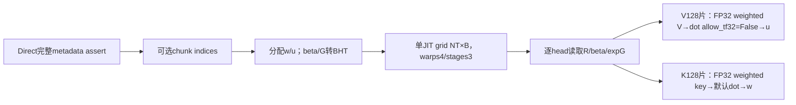
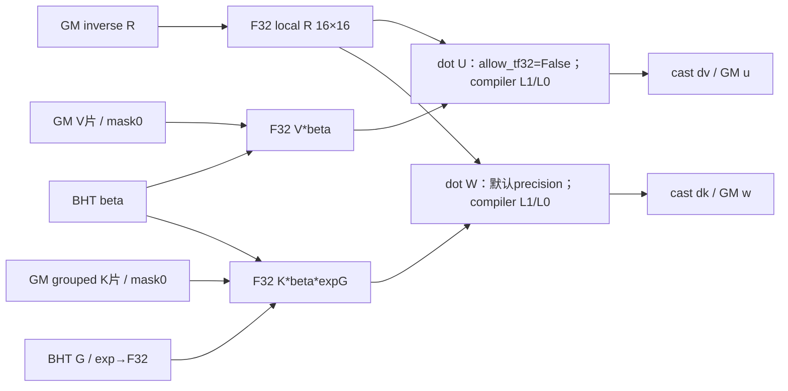
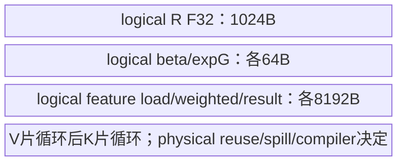
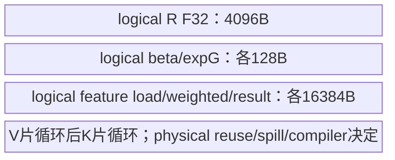
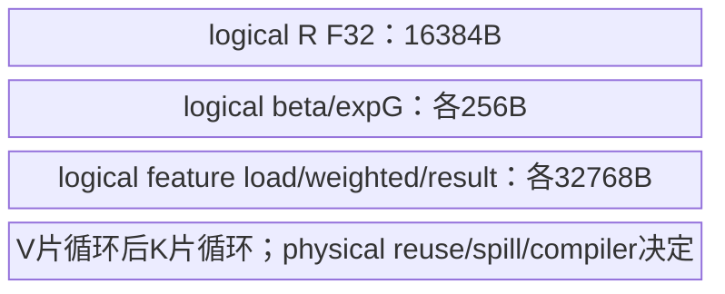

# GDN 分块 WY 重算 950 Direct Invoke 算子知识

## 算子速览

| 项目 | 内容 |
|---|---|
| 实际入口 | `sgl_kernel_npu.implementation.triton.attention.gdn.recompute_w_u_fwd.recompute_w_u_fwd`，Direct Invoke |
| 计算语义 | W=R·diag(beta·exp(G))·K↑，U=R·diag(beta)·V，R是solve_tril输出逆，形参名A |
| 输入输出 | k[B,T,Hg,K]、v[B,T,H,V]、beta/G[B,T,H]、A[B,T,H,C]，各独立FP16/BF16/FP32；返回(w,u)，各沿k/v dtype |
| 执行类型 | 一个JIT每chunk/batch串行head，含AIC_CUBE语义FP32 dot与Vector加权/cast；不推物理MIX比例 |
| Kernel 路线 | R001…R006=C16/32/64×等/变长；BK=BV128；dtype组合完整参数化 |
| 核心资源 | 输出w=BTHK*sK，u=BTHV*sV；beta/G各至多BTH*sBeta/sG布局临时；逻辑FP32 A=C²*4、feature tile=C*128*4；无owned workspace |
| 来源闭包 | direct_implementation_closed：公开/Direct校验、当前JIT全循环/参数、索引cache、打包与旧差异可追溯；Triton物理lowering明确为primitive边界 |
| 精度边界 | U dot显式allow_tf32=False，W dot未显式设置；不能统称两者IEEE；exp输入先load后调用、结果再转FP32，依primitive类型规则 |
| 验证状态 | 本次知识提取未执行编译、真机、数值或性能测试；draft未给精度误差/资源安全或性能验收保证 |

## 接口与语义

### 计算语义

每sequence按C16/32/64分chunk，R=A是单位下三角系统逆而非求逆前严格下三角矩阵。价值头h读取key头floor(h/(H/Hg))。对本chunk矩阵R与token向量beta/G，U=R·(diag(beta)·V)，W=R·(diag(beta·exp(G))·K_group)。G已经是chunk累计log gate，内核不再次cumsum，也不使用safe_exp差值屏蔽；exp(G)可能溢出，调用方负责finite与数值范围。

A、beta、k/v加载后显式转FP32；beta乘v形成FP32矩阵，U路径tl.dot(A,vbeta,allow_tf32=False)。Kbeta乘exp(G)形成FP32矩阵，W路径tl.dot(A,kbeta)没有显式input_precision/allow_tf32。不能把默认后端精度推成与U相同或IEEE。G表达式是tl.exp(tl.load(...)).to(FP32)，源码未显式先转FP32再exp；输入G允许三浮点型，primitive内部类型提升由实际compiler决定，不补造精度步骤。

所有time/feature load显式mask+other0，A只需row mask（列BT整块在每有效row物理分配中）；缺失time行在V/K/Beta中为0，G masked输入0对应exp0=1，不会凭空产生有效贡献。最后仅有效row/feature store，w/u转k/v dtype，to未显式round参数。返回顺序(w,u)；inputs不改。

### 输入、输出与属性

| 参数 | shape/layout | dtype | 约束、默认值与语义 |
|---|---|---|---|
| k | [B,T,Hg,K]连续NPU | FP16/BF16/FP32 | 所有维正，grouped key；不复制到H头 |
| v | [B,T,H,V]连续同NPU | 三浮点型 | 与k共享B/T，H%Hg0；dtype可不同于k |
| beta | [B,T,H]同NPU | 三浮点型 | shape检查，允许非连续，Host转BHT contiguous |
| g_cumsum | [B,T,H]同NPU | 三浮点型 | shape检查，Host转BHT contiguous；累计量非原始gate |
| A | [B,T,H,C]连续同NPU | 三浮点型 | C16/32/64，调用方传solve_tril的逆R；不检查逆关系/finite |
| cu_seqlens | [N+1]或None | int32/int64 | packed B1、连续同设备、至少2项；从0至T严格递增/正长度调用方负责 |
| w | [B,T,H,K]新Tensor | k.dtype | k设备，非k原地更新 |
| u | [B,T,H,V]新Tensor | v.dtype | v设备（与k相同），非v原地更新 |

### 入口与版本

公共auto/triton懒导入当前Direct，registry不自动参考fallback；torch_native是独立PyTorch数学参考，不在本图。逐算子产品表声明arch22/arch35支持，README/generation确认平台映射；本卡仅Frontmatter平台，CANN9.1.0为固定配置，未指定/运行具体Triton build。

旧fla/wy_fast.py的Host名recompute_w_u_fwd_npu且没有当前完整_validate_inputs。旧JIT忽略pid1、for i_bh in range(H)令i_b始终0；equal分支未定义i_t却后续使用，var分支才赋值。当前JIT i_b=pid1、每head先i_t=i_t_o，并对equal beta/G使用gate_bos=i_b*H*T_max，修复batch/headmajor地址。不能认定旧equal路线与当前等价；旧packed B1共同域主要矩阵体可映射，但各module metadata cache独立。旧额外exp/safe_exp imports在此kernel不使用；当前直接tl.exp，不受FLA_USE_FAST_OPS影响。

公开合同可复用[块内线性系统API](../../../../apis/sgl_kernel_npu/sgl_gdn_chunk_linear_system.md)，R来源见[三角求逆源码卡](sgl_solve_tril_950.md)，输出供[状态更新源码卡](sgl_chunk_delta_h_950.md)消费。不同入口/旧Host范围的风险不直接外推到当前修正body。

## Host/Launcher 执行流程

### 参数校验与前处理

_validate_inputs依序assert k/v/A rank4及各维正，v前两维=B/T，H%Hg0，A前三维=B/T/H，beta/G shape=B/T/H，C16/32/64，k为NPU；五输入各dtype属于FP16/BF16/FP32、同k设备；只要求k/v/A contiguous。cu非空检查B1、一维/至少2项、I32/I64、同设备连续。没有逐值验证finite/A是逆/cu边界；Python优化模式可移除assert，不把失约raw输入当新支持域。

获取BT=A末维、BK=BV128。cu有则prepare_chunk_indices(cu,BT)并取NT，否则NT=ceil(T/BT)。u=empty_like(v)，w=k.new_empty(B,T,H,K)；beta与G各transpose(1,2).contiguous为[B,H,T]。launch grid=(NT,B)，每程序内部for h in range(H)串行所有头；不是(NT,BH)，也不再忽略batch维。warps4/stages3，T do_not_specialize，其余业务tile constexpr。

### 参数、Workspace 与生命周期

输出w/u各新Tensor，bytes BTHK*sK/BTHV*sV。beta/G contiguous至多各BTH*sBeta/BTH*sG临时，dtype各自独立；是否原storage别名由框架决定。A与k/v只读，A一次每head加载后供所有V/K片复用。没有自有CANN system/user workspace、executor、GM中间乘积或额外数学kernel。

varlen helper先将cu转I64相减，ceil长度tolist（NPU→Host同步）、CPU arange/cumsum/stack两列，再.to(cu)。table [NT,2]沿cu dtype、2NT*sCu字节；cache每helper4项，以Tensor identity而非内容/version匹配，原地改cu可复用陈旧indices。Device把sequence/tile/bos/eos转I32，cu I64不等于任意范围安全。

所有输出/临时由ATen与currentstream/Triton allocator协议管理，源码无自有record_event或裸参数包owner实现；调用方保持输入/metadata直到stream消费。JIT返回不等于Device完成，packed预处理不是纯异步/无Host同步的graph保证。

### 启动图与失败传播



shape/allocator/helper/transpose/JIT异常直接传播，无catch或参考fallback；assert/JIT编译失败阻止Device提交，异步Device错误依runtime同步。当前body没有外部核心数学调用或多Kernel交接；Torch元数据/layout/分配与Triton primitives为明确边界。
## Route 与参数设计

### 分核与资源计算

grid首轴chunk、次轴batch，每程序串行head。equal i_t=pid0、bos=pid1*Traw、gate_bos=pid1*H*Traw；packed从indices/cu恢复sequence/localtile，bos=cu[n]、gate_bos=bos。T_max在head循环前保存rawT，T在packed分支改为局部L。每head加载R[C,C]FP32、beta[C]FP32、expG结果[C]FP32，一次复用于全部输出feature片。

V按BV128片得到U，K按BK128片得到W；每次dot形状M=C,N=128,Kdot=C。这里“key feature K片”是dot输出列N的分块，不是将key特征作为收缩轴累加。每片是独立输出，不存在splitK workspace或跨片加和。

GM w=BTHK*sK、u=BTHV*sV、beta/G前处理各≤BTH*sBeta/sG，var表2NT*sCu。编译局部逻辑R=4C²B、每featuretile/weighted/dotresult各4C*128B、beta/expG各4CB。V循环先于K循环，compiler可复用局部表达式存储，不能把这些域简单相加为UB峰值；无自有L1/L0/UB/寄存器offset或容量guard。

### Route 选择

P=_validate_inputs全部shape/nonempty/设备/dtype/contiguous/C集合条件，varlen再含B1/cu的metadata约束。调用方另外保证A为逆、finite/exp不溢出、cu从0至T严格递增。dtype各自独立，不强制k=v=beta=G=A。

| 顺序 | Route | Key/模板 | 精确选择条件与优先级 | 不适用去向 |
|---:|---|---|---|---|
| 1 | R-001 C16等长WY重算 | BT16/IS_VARLEN0，BK=BV128 | P且C=16，cuNone；dtype参数见下表 | 其它合法tuple对应行；P不满足assert，无fallback |
| 2 | R-002 C16变长WY重算 | BT16/IS_VARLEN1，BK=BV128 | P且C=16，cu非空、B1/连续同设备I32或I64；dtype参数见下表 | 其它合法tuple对应行；P不满足assert，无fallback |
| 3 | R-003 C32等长WY重算 | BT32/IS_VARLEN0，BK=BV128 | P且C=32，cuNone；dtype参数见下表 | 其它合法tuple对应行；P不满足assert，无fallback |
| 4 | R-004 C32变长WY重算 | BT32/IS_VARLEN1，BK=BV128 | P且C=32，cu非空、B1/连续同设备I32或I64；dtype参数见下表 | 其它合法tuple对应行；P不满足assert，无fallback |
| 5 | R-005 C64等长WY重算 | BT64/IS_VARLEN0，BK=BV128 | P且C=64，cuNone；dtype参数见下表 | 其它合法tuple对应行；P不满足assert，无fallback |
| 6 | R-006 C64变长WY重算 | BT64/IS_VARLEN1，BK=BV128 | P且C=64，cu非空、B1/连续同设备I32或I64；dtype参数见下表 | 其它合法tuple对应行；P不满足assert，无fallback |

```text
_validate_inputs；失败assert
BT=A.shape[-1] in {16,32,64}
VAR=(cu!=None)；NT=VAR?len(indices):ceil(T/BT)
BK=BV=128；w/u新分配，beta/G转BHT
单JIT[(NT,B)]，warps4/stages3；每head先i_t=pid0
equal gate_bos=batch*H*Traw；packed gate_bos=bos
先V输出片，再K输出片；无按dtype平台另行Host fallback
```

### 模板/实现执行矩阵

| Route | key/selector | dtype/shape/platform 完整命中条件 | 执行族与 kernel 节点 | 实际模板/body | 内存与同步特征 | tail/fallback |
|---|---|---|---|---|---|---|
| R-001 C16等长WY重算 | C16/VAR0 | P及选择行；独立五dtype∈{FP16,BF16,FP32}^5 | 单JIT Cube FP32 dot+Vector加权/转换 | recompute_w_u_fwd_kernel_npu_kernel，BT16,BK/BV128，VAR0 | R逻辑1024B；featuretile8192B；无表；无ownedworkspace | mask other0明确time/feature尾，输出masked；cu内容失约无fallback |
| R-002 C16变长WY重算 | C16/VAR1 | P及选择行；独立五dtype∈{FP16,BF16,FP32}^5 | 单JIT Cube FP32 dot+Vector加权/转换 | recompute_w_u_fwd_kernel_npu_kernel，BT16,BK/BV128，VAR1 | R逻辑1024B；featuretile8192B；metadata table；无ownedworkspace | mask other0明确time/feature尾，输出masked；cu内容失约无fallback |
| R-003 C32等长WY重算 | C32/VAR0 | P及选择行；独立五dtype∈{FP16,BF16,FP32}^5 | 单JIT Cube FP32 dot+Vector加权/转换 | recompute_w_u_fwd_kernel_npu_kernel，BT32,BK/BV128，VAR0 | R逻辑4096B；featuretile16384B；无表；无ownedworkspace | mask other0明确time/feature尾，输出masked；cu内容失约无fallback |
| R-004 C32变长WY重算 | C32/VAR1 | P及选择行；独立五dtype∈{FP16,BF16,FP32}^5 | 单JIT Cube FP32 dot+Vector加权/转换 | recompute_w_u_fwd_kernel_npu_kernel，BT32,BK/BV128，VAR1 | R逻辑4096B；featuretile16384B；metadata table；无ownedworkspace | mask other0明确time/feature尾，输出masked；cu内容失约无fallback |
| R-005 C64等长WY重算 | C64/VAR0 | P及选择行；独立五dtype∈{FP16,BF16,FP32}^5 | 单JIT Cube FP32 dot+Vector加权/转换 | recompute_w_u_fwd_kernel_npu_kernel，BT64,BK/BV128，VAR0 | R逻辑16384B；featuretile32768B；无表；无ownedworkspace | mask other0明确time/feature尾，输出masked；cu内容失约无fallback |
| R-006 C64变长WY重算 | C64/VAR1 | P及选择行；独立五dtype∈{FP16,BF16,FP32}^5 | 单JIT Cube FP32 dot+Vector加权/转换 | recompute_w_u_fwd_kernel_npu_kernel，BT64,BK/BV128，VAR1 | R逻辑16384B；featuretile32768B；metadata table；无ownedworkspace | mask other0明确time/feature尾，输出masked；cu内容失约无fallback |

| 类型参数 | 完整可选集合 | 字节 | 进入计算的转换 | 输出/精度边界 |
|---|---|---|---|---|
| dk | FP16/BF16/FP32 | sK2/2/4 | k load→FP32 | w最终转dk |
| dv | FP16/BF16/FP32 | sV2/2/4 | v load→FP32 | u最终转dv |
| dbeta | FP16/BF16/FP32 | sBeta2/2/4 | beta load→FP32 | headmajor临时保留其dtype |
| dg | FP16/BF16/FP32 | sG2/2/4 | exp(load g)结果→FP32 | 未显式先cast再exp，primitive类型提升边界 |
| dA | FP16/BF16/FP32 | sA2/2/4 | A load→FP32 | R值的输入舍入保留 |

每控制Route完整允许上述243个类型tuple，不将独立dtype误缩成“所有输入同类型”。共同dot参数结构、layout与算法相同，加载/输出字节参数化；U显式allow_tf32=False、W默认precision的差别每条Route均保留，不补成统一IEEE承诺。

### 隐藏性能 Guard

| Guard | Host/Tiling 条件 | Device/资源原因 | 影响 Route | 不满足时去向 | 源码符号 |
|---|---|---|---|---|---|
| C集合 | assertC16/32/64 | R方块/时间收缩轴constexpr | 全部 | assert | _validate_inputs |
| 维度匹配/正值 | assert k/v/A rank4、nonempty、B/T/H一致 | 固定stride与完整row物理C列 | 全部 | assert | validate |
| H%Hg0 | assert | grouped key head映射 | 全部 | assert | validate/group |
| 设备/dtype/连续 | 五输入同NPU/三浮点型；k/v/A contiguous | TL硬编码stride；beta/G另copy | 全部 | assert，无k/v/A自动copy | validate |
| packed | B1、cu连续同设备I32/I64至少2项 | table映射全局sequence，Device castI32 | var | metadata guard失败/非法值无内容guard | validate/helper |
| beta/G布局 | transpose(1,2).contiguous | BHT时间向量连续，equal需batch*H跨度 | 全部 | Torch前处理异常 | Host/gate_bos |
| feature尾 | masktime && feature<K/V，other0 | 固定128列，补零参与dot | 全部 | 无额外Route，当前mask处理 | b_k/b_v |
| time尾 | A rowmask0、beta/v/k rowmask0 | 收缩轴C包含末chunk padding行 | 全部 | currentmask/valid store | body |
| 数值值域 | finite与exp(G)不溢出由caller | exp无safe_exp裁剪，R可放大误差 | 全部 | 不逐值验证，无safe fallback | b_g/dot |
| cache不可变 | Tensor identity cache | 原地改cu不读version | var | 可能陈旧，无自动失效 | tensor_cache |
| 容量/precision | 无owned物理容量guard，U allowFalse/W default | compiler选择FP32dot实现/资源 | 全部 | 具体build未编译验证 | dot/options |

### POD/ABI

无C POD/TCubeTiling/固定sizeof/alignof/offsetof；下表逐项为18个Python→JIT typed参数。物理arg pack offset及runtime scalar位宽由compiler生成，固定Python不可见。constexpr是编译参数不在GM结构；B只给Host grid，不传kernel；T显式do_not_specialize，T_max保留rawT。

| 结构 | 字段 | 类型/位宽 | ABI 布局 | 单位 | Host/launcher producer | Device consumer | 边界 |
|---|---|---|---|---|---|---|---|
| JIT args | k | dk typed GM pointer | slot0；物理offset不可见 | 元素 | caller k | grouped K outputfeature片 | contiguous |
| JIT args | v | dv typed GM pointer | slot1；物理offset不可见 | 元素 | caller v | V outputfeature片 | contiguous |
| JIT args | beta | dbeta typed GM pointer | slot2；物理offset不可见 | 元素 | transpose.contiguous BHT | beta vector→F32 | 允许原非连续 |
| JIT args | w | dk typed GM pointer | slot3；物理offset不可见 | 元素 | k.new_empty(B,T,H,K) | W store | 新Tensor |
| JIT args | u | dv typed GM pointer | slot4；物理offset不可见 | 元素 | empty_like(v) | U store | 新Tensor |
| JIT args | A | dA typed GM pointer | slot5；物理offset不可见 | 元素 | caller R | R rowmaskload→F32 | 逆关系不检查 |
| JIT args | g | dg typed GM pointer | slot6；物理offset不可见 | 元素 | G transpose.contiguous BHT | exp(load)->F32 | 值域caller |
| JIT args | cu_seqlens | I32/I64 pointer或None | slot7；物理offset不可见 | token | caller | var bos/eos.toI32 | 非var inactive |
| JIT args | chunk_indices | cu同dtype pointer或None | slot8；物理offset不可见 | 2列pair | prepare_chunk_indices(cu,C) | var sequence/tile.toI32 | cache owner |
| JIT args | T | runtime Python int | slot9，位宽未固定；物理offset不可见 | token | k.shape1 | T_max rawT、var后localT | do_not_specialize |
| JIT args | H | constexpr int | compile；物理offset不可见 | valuehead | v.shape2 | for head/stride | H%Hg0 |
| JIT args | Hg | constexpr int | compile；物理offset不可见 | keyhead | k.shape2 | group key/stride | 正 |
| JIT args | K | constexpr int | compile；物理offset不可见 | keyfeature | k.shape3 | ceilK/BK，output W bound | 正，无128上限 |
| JIT args | V | constexpr int | compile；物理offset不可见 | valuefeature | v.shape3 | ceilV/BV，output U bound | 正，无128上限 |
| JIT args | BT | constexpr int | compile；物理offset不可见 | chunk token | A.shape3 | Rshape/dotK/time range | 16/32/64 |
| JIT args | BK | constexpr int | compile；物理offset不可见 | W outputfeature/tile | 128 | K output片N128 | 不是dot收缩轴 |
| JIT args | BV | constexpr int | compile；物理offset不可见 | U outputfeature/tile | 128 | V output片N128 | 固定128 |
| JIT args | IS_VARLEN | constexpr bool | heuristics；物理offset不可见 | bool | cu!=None | indices/cu/gate_bos分支 | 存在性非内容guard |

table每row字段sequence/tile位于(2i)*sCu与(2i+1)*sCu，dtype沿cu；Tensor owner由helper cache保留，不形成内容快照。gate_bos与T_max是Device标量producer：equal分别batch*H*Traw/Traw，packed分别cu[n]/Traw。i_t每head先pid0再由var表覆盖，避免旧equal未赋值路径；它们不是Host新增POD字段。warps4/stages3不意味着物理线程数或三份缓冲。

### Route 源码闭包

| Route | Key/selector | Host/Tiling producer | POD/参数 | Kernel entry/router | Kernel body/直接依赖 | 构建接线 |
|---|---|---|---|---|---|---|
| R-001 | C16/VAR0、243dtype tuple | Direct_validate/allocate/transpose | 18typed/constexpr参数，无C POD | recompute_w_u_fwd_kernel_npu_kernel[(NT,B)] | forhead→R/beta/expG→V128片allowFalse dot→K128片默认dot→maskedstore；gdn_utils metadata | root setup→stage_runtime共同Python→triton.jit，无独立ACLNN |
| R-002 | C16/VAR1、243dtype tuple | Direct_validate/allocate/transpose+prepare indices | 18typed/constexpr参数，无C POD | recompute_w_u_fwd_kernel_npu_kernel[(NT,B)] | forhead→R/beta/expG→V128片allowFalse dot→K128片默认dot→maskedstore；gdn_utils metadata | root setup→stage_runtime共同Python→triton.jit，无独立ACLNN |
| R-003 | C32/VAR0、243dtype tuple | Direct_validate/allocate/transpose | 18typed/constexpr参数，无C POD | recompute_w_u_fwd_kernel_npu_kernel[(NT,B)] | forhead→R/beta/expG→V128片allowFalse dot→K128片默认dot→maskedstore；gdn_utils metadata | root setup→stage_runtime共同Python→triton.jit，无独立ACLNN |
| R-004 | C32/VAR1、243dtype tuple | Direct_validate/allocate/transpose+prepare indices | 18typed/constexpr参数，无C POD | recompute_w_u_fwd_kernel_npu_kernel[(NT,B)] | forhead→R/beta/expG→V128片allowFalse dot→K128片默认dot→maskedstore；gdn_utils metadata | root setup→stage_runtime共同Python→triton.jit，无独立ACLNN |
| R-005 | C64/VAR0、243dtype tuple | Direct_validate/allocate/transpose | 18typed/constexpr参数，无C POD | recompute_w_u_fwd_kernel_npu_kernel[(NT,B)] | forhead→R/beta/expG→V128片allowFalse dot→K128片默认dot→maskedstore；gdn_utils metadata | root setup→stage_runtime共同Python→triton.jit，无独立ACLNN |
| R-006 | C64/VAR1、243dtype tuple | Direct_validate/allocate/transpose+prepare indices | 18typed/constexpr参数，无C POD | recompute_w_u_fwd_kernel_npu_kernel[(NT,B)] | forhead→R/beta/expG→V128片allowFalse dot→K128片默认dot→maskedstore；gdn_utils metadata | root setup→stage_runtime共同Python→triton.jit，无独立ACLNN |

## Kernel 实现

### 公共执行流程

每程序chunk/batch，for head串行；head循环开始i_t=pid0，var映射sequence/localtile，equal按pid1批次处理。R rowmaskload other0→F32；gate_bos按当前修复公式寻BHT beta/G。先所有V128片：load other0→F32、乘beta、FP32 dot(U禁TF32)、转v.dtype maskedstore。再所有K128片：grouped k load other0→F32、乘beta与expG、FP32默认dot、转k.dtype maskedstore。R/beta/expG跨片复用，没有GM权重中间物化。

TL依赖和compiler pipeline提供片内/跨族数据可见性，物理L1/L0/UB/register/db/flag不可从Python推导；无自有跨kernel GM边或原子归并。当前kernel使用tl.exp，不读gdn_utils.exp/safe_exp的环境选项，不能额外制造fast Route。
### Route R-001：C16等长WY重算

#### 适用条件

##### 选择证据

| 层级 | 文件 | 符号 | 源码谓词/参数 | 结果/下一跳 |
|---|---|---|---|---|
| Direct | implementation/triton/attention/gdn/recompute_w_u_fwd.py | _validate_inputs / recompute_w_u_fwd | P；C=16，cuNone；五dtype独立三选 | BK=BV128、w/u新分配、beta/G转BHT |
| Host launch | 同文件 | kernel[(NT,B)] | BT16、VAR0、warps4/stages3 | 每chunk/batch程序，head串行 |
| JIT | 同文件 | forhead / gate_bos | i_b=pid1，i_t=pid0，gate_bos=i_b*H*T_max | U allowFalse dot、W默认dot，尾mask0 |

#### Device 数据流

##### 函数级调用链

```text
recompute_w_u_fwd -> _validate_inputs
 -> NT=ceil(T/16)
 -> u empty_like / w new_empty / beta,G transpose.contiguous
 -> kernel[(NT,B)](BT16,BK128,BV128,VAR0)
    -> T_max=Traw；batch=pid1
    -> for head0..H-1:
       -> i_t=pid0 / bos=batch*Traw
       -> R load rowmask other0→F32
       -> exp(Gload)→F32 / beta load→F32（正确BHT gate_bos）
       -> for V128片：Vload0→F32 / multiply beta / dot allow_tf32=False / cast maskedstore U
       -> for K128片：grouped Kload0→F32 / multiply beta,expG / dot默认precision / cast maskedstore W
 -> return (w,u)
```

##### 源码等价伪码

```text
源码等价伪码；offset单位元素，dtype/字节参数沿完整类型tuple
Tmax=HostTraw; batch=pid1
for head in0..H-1:
    tile=pid0
    bos=batch*Traw;L=Traw;gate_bos=batch*H*Traw
    rows=tile*16+arange(16); valid=rows<L
    R=load A+(bos*H+head)*16+rows[:,None]*(H*16)+arange(16)[None,:],
           maskvalid[:,None],other0 ->F32  #完整C列都在输入有效row分配内
    eg=exp(load G_BHT+gate_bos+head*Tmax+rows,maskvalid,other0).toF32
    b=load beta_BHT+gate_bos+head*Tmax+rows,maskvalid,other0 ->F32
    for iv in0..ceil(V/128)-1:
        cols=iv*128+arange128;mask=valid[:,None]&&(cols<V)
        X=load v+(bos*H+head)*V+rows[:,None]*H*V+cols[None,:],mask,other0 ->F32
        weighted=X*b[:,None]
        Y=dot(R,weighted,allow_tf32=False)  #M16,N128,Kdot16
        store u同ND地址,Y.to(vdtype),mask
    for ik in0..ceil(K/128)-1:
        cols=ik*128+arange128;mask=valid[:,None]&&(cols<K)
        X=load k+(bos*Hg+head//(H//Hg))*K+rows[:,None]*Hg*K+cols[None,:],
               mask,other0 ->F32
        weighted=X*b[:,None]*eg[:,None]
        Y=dot(R,weighted)                  #默认precision，非显式IEEE声明
        store w+(bos*H+head)*K+rows[:,None]*H*K+cols[None,:],Y.to(kdtype),mask
```

每head R与两个权重向量只load一次，先V循环再K循环。两输出feature维独立按128片扩展，支持K/V尾片，不将feature K误当dot收缩维。当前equal从pid1取batch，BHT基址batch*H*Traw正确，不继承旧kernel忽略pid1/未赋i_t的路径。 允许混合五dtype，load后FP32转换与output各自目标类型明确，G的exp输入类型提升/默认W dot精度不伪造。

#### 内存与数据搬运

##### 资源与搬运表

| 层级/缓冲区 | offset/地址公式 | extent/容量公式 | dtype/layout | producer | consumer | owner/lifetime | 对齐/复用 |
|---|---|---|---|---|---|---|---|
| GM k | (bos*Hg+head//(H//Hg))*K+row*Hg*K+col | BTHgK*sK B | dk ND | caller | W output片load | readonly | 连续，最后dim stride1 |
| GM v | (bos*H+head)*V+row*H*V+col | BTHV*sV B | dv ND | caller | U output片load | readonly | row/feature mask other0 |
| GM A/R | (bos*H+head)*C+row*H*C+col | BTHC*sA B | dA ND | caller/solve | 两类dot共同左矩阵 | readonly | rowmask0，C列完整分配 |
| GM beta/G | batch*H*Traw+head*Traw+row | 各≤BTH*sBeta/sG临时 | 各自typed BHT contiguous | Hosttranspose/copy | vectorweights | runtime临时owner | 当前equal/packed公式分别正确 |
| GM w | (bos*H+head)*K+row*H*K+col | BTHK*sK B | dk ND | W dot caststore | caller | 新返回Tensor | 只有效row/feature |
| GM u | (bos*H+head)*V+row*H*V+col | BTHV*sV B | dv ND | U dot caststore | caller | 新返回Tensor | 不与v原地alias |
| GM indices/cu | N/A | 0新增 | I32/I64 | helper/caller | mapping | cache/调用方 | loaded toI32，原地改cu可陈旧 |
| L1/L0A/B/C | compiler currentdot layout | dot(16,128,16) | FP32 operands/acc | R/weighted | U或W dot | perprogram | 无自有offset/db/物理容量 |
| UB/register R | compiler local tensor | 16*16*4=1024B逻辑域 | FP32 | load dA→F32 | 所有V/K片dot | 每head | 不因feature片重读R |
| UB/register weights | beta/expG各C*4 | 各64B逻辑域 | FP32 | load/exp/postcast | 加权feature | 每head跨片 | exp内部类型规则由primitive |
| UB/register feature | [C,128] load/weighted/result各域 | 各8192B逻辑域 | FP32 | maskedload/mul/dot | 后dot/store | 每片，V后K | source表达式域不当物理peak |
| UB/register mask/index | C行、128列、C*128predicate | 元素域，物理位宽不可见 | int/predicate | arange/comparisons | load/store | 每片 | 不假设predicate1B/元素 |
| workspace | N/A | 0 owned bytes | N/A | N/A | N/A | 仅输出/布局临时/table | 不套CANN系统区 |

##### 分层内存布局





图为编译局部tensor值域，不是硬件UB offset/峰值；源无classic队列、手工数字flag或已验证L0容量报告。

##### 字节账、交接边与复用顺序

```text
w_bytes=B*T*H*K*sK；u_bytes=B*T*H*V*sV
beta_preprocess<=B*T*H*sBeta；G_preprocess<=B*T*H*sG
table_bytes=0
owned_workspace_total=0
R_domain=1024；weights各64
feature_load/weighted/dotresult_domain各8192B
physical_L1/L0/UB_peak/registers = compiler layout/tiling/reuse/padding/spill，未编译取得
```

| 边/复用子区 | producer | offset/extent | dtype/layout | consumer | ordering/sync | owner/lifetime | 安全条件 |
|---|---|---|---|---|---|---|---|
| beta/G布局 | transpose.contiguous | ≤BTH*sBeta/sG B | BHT各自dtype | current JIT | 同current stream/runtimecopy | 临时Tensor | 允许原beta/G非连续，不省实际copy |
| metadata | lens→tolist→CPU pair→to(cu) | N/A | cu整数 | mapping | 不执行 | cache | 正边界、不可原地改同cu |
| R共享 | dA load→FP32 | C²*4B逻辑域 | FP32 | 所有V/K片dot | compiler数据依赖 | 单head | R是逆caller合同，非KKT原矩阵 |
| beta weighted V→U | F32 mul | C*128*4B逻辑域 | FP32 | dot allowFalse | compiler pipeline | 当前V片 | 所有missing row/feature other0 |
| beta/exp weighted K→W | F32 mul | 同逻辑域 | FP32 | dot默认precision | compiler pipeline | 当前K片 | 不能推同U的精度属性 |
| 两输出 | dot→to目标dtype→maskstore | w/u各真实allocation | dk/dv ND | caller/后续stage | currentstream | 新返回owner | 无跨kernel临时/atomic；合法chunk/head写域不重叠 |

#### 同步、精度与尾块

##### 同步与数值边界表

| 阶段 | primitive/机制 | producer | consumer/等待点 | 保护对象 | 精度/尾块 |
|---|---|---|---|---|---|
| Hostassert/layout | assert/transpose.contiguous | 输入metadata | JIT | k/v/A以及BHT weights | 五dtype独立，beta/G可原非连续 |
| mapping | pid0/pid1 | Host/helper | perhead地址 | sequence/chunk | 当前i_t每head显式初始化，batch未忽略 |
| Rload | maskrow other0→F32 | inverse GM | dot左矩阵 | C*C | 缺失row0，列完整C |
| weights | beta load→F32，exp(loadG)→F32 | BHT | 加权 | C vectors | 不再cumsum/不safe_exp正差屏蔽；exp溢出caller负责 |
| Udot | tl.dot allow_tf32=False | R与F32 Vbeta | F32result | C*128 | feature/time loadother0，最终to dv |
| Wdot | tl.dot无显式precision | R与F32 KbetaExpG | F32result | C*128 | 不宣称IEEE或禁TF32，最终to dk |
| storetail | validtime&&feature<K/V | resultcast | w/u GM | 有效输出域 | 无显式round参数，不抄rtne |
| 内部同步 | TL数据依赖/compiler pipeline | loads/muls/dot | 后继ops | compiler locals | 无owned event/flag/atomic、单kernel |

#### 关键实现

##### 符号证据表

| 阶段 | 文件 | 符号/模板实例 | 实现事实 |
|---|---|---|---|
| Host/Tiling producer | implementation/triton/attention/gdn/recompute_w_u_fwd.py | validate/Direct | C16/VAR0；BK/BV128；shape/设备/type检查与BHT copy |
| Kernel entry/router | 同文件 | kernel[(NT,B)]/IS_VARLEN | grid第二维实际batch，head串行 |
| Device body/helper | 同文件 | i_t初始化/gate_bos | equal batch*H*Tmax，已修旧忽略batch问题 |
| Device body/helper | 同文件 | Vloop / Kloop | 两类FP32 dot精度属性不同，R共享、尾maskother0 |
| 依赖 | gdn_utils.py | prepare_chunk_indices/tensor_cache | None分支不执行；identitycache、无safe_exp/fast分支 |
| 旧映射 | fla/wy_fast.py | recompute_w_u_fwd_npu / oldJIT | oldequal i_t未赋/忽略pid1；packed共同域可映射，不全域等价 |


### Route R-002：C16变长WY重算

#### 适用条件

##### 选择证据

| 层级 | 文件 | 符号 | 源码谓词/参数 | 结果/下一跳 |
|---|---|---|---|---|
| Direct | implementation/triton/attention/gdn/recompute_w_u_fwd.py | _validate_inputs / recompute_w_u_fwd | P；C=16，cu非空且B1/metadata条件；五dtype独立三选 | BK=BV128、w/u新分配、beta/G转BHT |
| Host launch | 同文件 | kernel[(NT,B)] | BT16、VAR1、warps4/stages3 | 每chunk/batch程序，head串行 |
| JIT | 同文件 | forhead / gate_bos | sequence/localtile从表；gate_bos=bos | U allowFalse dot、W默认dot，尾mask0 |

#### Device 数据流

##### 函数级调用链

```text
recompute_w_u_fwd -> _validate_inputs
 -> prepare_chunk_indices / prepare_lens / tensor_cache / tolist / CPU pair table
 -> u empty_like / w new_empty / beta,G transpose.contiguous
 -> kernel[(NT,B)](BT16,BK128,BV128,VAR1)
    -> T_max=Traw；batch=pid1
    -> for head0..H-1:
       -> i_t=pid0 / indices/cu mapping
       -> R load rowmask other0→F32
       -> exp(Gload)→F32 / beta load→F32（正确BHT gate_bos）
       -> for V128片：Vload0→F32 / multiply beta / dot allow_tf32=False / cast maskedstore U
       -> for K128片：grouped Kload0→F32 / multiply beta,expG / dot默认precision / cast maskedstore W
 -> return (w,u)
```

##### 源码等价伪码

```text
源码等价伪码；offset单位元素，dtype/字节参数沿完整类型tuple
Tmax=HostTraw; batch=pid1
for head in0..H-1:
    tile=pid0
    seq,tile=table[pid0,0/1].toI32;bos,eos=cu[seq/seq+1].toI32;L=eos-bos;gate_bos=bos
    rows=tile*16+arange(16); valid=rows<L
    R=load A+(bos*H+head)*16+rows[:,None]*(H*16)+arange(16)[None,:],
           maskvalid[:,None],other0 ->F32  #完整C列都在输入有效row分配内
    eg=exp(load G_BHT+gate_bos+head*Tmax+rows,maskvalid,other0).toF32
    b=load beta_BHT+gate_bos+head*Tmax+rows,maskvalid,other0 ->F32
    for iv in0..ceil(V/128)-1:
        cols=iv*128+arange128;mask=valid[:,None]&&(cols<V)
        X=load v+(bos*H+head)*V+rows[:,None]*H*V+cols[None,:],mask,other0 ->F32
        weighted=X*b[:,None]
        Y=dot(R,weighted,allow_tf32=False)  #M16,N128,Kdot16
        store u同ND地址,Y.to(vdtype),mask
    for ik in0..ceil(K/128)-1:
        cols=ik*128+arange128;mask=valid[:,None]&&(cols<K)
        X=load k+(bos*Hg+head//(H//Hg))*K+rows[:,None]*Hg*K+cols[None,:],
               mask,other0 ->F32
        weighted=X*b[:,None]*eg[:,None]
        Y=dot(R,weighted)                  #默认precision，非显式IEEE声明
        store w+(bos*H+head)*K+rows[:,None]*H*K+cols[None,:],Y.to(kdtype),mask
```

每head R与两个权重向量只load一次，先V循环再K循环。两输出feature维独立按128片扩展，支持K/V尾片，不将feature K误当dot收缩维。packed B1把每sequence局部tile重启，Tmax保留全packed T供head跨度，gate_bos=bos。 允许混合五dtype，load后FP32转换与output各自目标类型明确，G的exp输入类型提升/默认W dot精度不伪造。

#### 内存与数据搬运

##### 资源与搬运表

| 层级/缓冲区 | offset/地址公式 | extent/容量公式 | dtype/layout | producer | consumer | owner/lifetime | 对齐/复用 |
|---|---|---|---|---|---|---|---|
| GM k | (bos*Hg+head//(H//Hg))*K+row*Hg*K+col | BTHgK*sK B | dk ND | caller | W output片load | readonly | 连续，最后dim stride1 |
| GM v | (bos*H+head)*V+row*H*V+col | BTHV*sV B | dv ND | caller | U output片load | readonly | row/feature mask other0 |
| GM A/R | (bos*H+head)*C+row*H*C+col | BTHC*sA B | dA ND | caller/solve | 两类dot共同左矩阵 | readonly | rowmask0，C列完整分配 |
| GM beta/G | bos+head*Traw+row | 各≤BTH*sBeta/sG临时 | 各自typed BHT contiguous | Hosttranspose/copy | vectorweights | runtime临时owner | 当前equal/packed公式分别正确 |
| GM w | (bos*H+head)*K+row*H*K+col | BTHK*sK B | dk ND | W dot caststore | caller | 新返回Tensor | 只有效row/feature |
| GM u | (bos*H+head)*V+row*H*V+col | BTHV*sV B | dv ND | U dot caststore | caller | 新返回Tensor | 不与v原地alias |
| GM indices/cu | table[2pid0/2pid0+1]、cu[seq/seq+1] | 2NT*sCu新增表 | I32/I64 | helper/caller | mapping | cache/调用方 | loaded toI32，原地改cu可陈旧 |
| L1/L0A/B/C | compiler currentdot layout | dot(16,128,16) | FP32 operands/acc | R/weighted | U或W dot | perprogram | 无自有offset/db/物理容量 |
| UB/register R | compiler local tensor | 16*16*4=1024B逻辑域 | FP32 | load dA→F32 | 所有V/K片dot | 每head | 不因feature片重读R |
| UB/register weights | beta/expG各C*4 | 各64B逻辑域 | FP32 | load/exp/postcast | 加权feature | 每head跨片 | exp内部类型规则由primitive |
| UB/register feature | [C,128] load/weighted/result各域 | 各8192B逻辑域 | FP32 | maskedload/mul/dot | 后dot/store | 每片，V后K | source表达式域不当物理peak |
| UB/register mask/index | C行、128列、C*128predicate | 元素域，物理位宽不可见 | int/predicate | arange/comparisons | load/store | 每片 | 不假设predicate1B/元素 |
| workspace | N/A | 0 owned bytes | N/A | N/A | N/A | 仅输出/布局临时/table | 不套CANN系统区 |

##### 分层内存布局


图为编译局部tensor值域，不是硬件UB offset/峰值；源无classic队列、手工数字flag或已验证L0容量报告。

##### 字节账、交接边与复用顺序

```text
w_bytes=B*T*H*K*sK；u_bytes=B*T*H*V*sV
beta_preprocess<=B*T*H*sBeta；G_preprocess<=B*T*H*sG
table_bytes=2*NT*sCu
owned_workspace_total=0
R_domain=1024；weights各64
feature_load/weighted/dotresult_domain各8192B
physical_L1/L0/UB_peak/registers = compiler layout/tiling/reuse/padding/spill，未编译取得
```

| 边/复用子区 | producer | offset/extent | dtype/layout | consumer | ordering/sync | owner/lifetime | 安全条件 |
|---|---|---|---|---|---|---|---|
| beta/G布局 | transpose.contiguous | ≤BTH*sBeta/sG B | BHT各自dtype | current JIT | 同current stream/runtimecopy | 临时Tensor | 允许原beta/G非连续，不省实际copy |
| metadata | lens→tolist→CPU pair→to(cu) | 2NT*sCu | cu整数 | mapping | Host同步/拷贝 | cache | 正边界、不可原地改同cu |
| R共享 | dA load→FP32 | C²*4B逻辑域 | FP32 | 所有V/K片dot | compiler数据依赖 | 单head | R是逆caller合同，非KKT原矩阵 |
| beta weighted V→U | F32 mul | C*128*4B逻辑域 | FP32 | dot allowFalse | compiler pipeline | 当前V片 | 所有missing row/feature other0 |
| beta/exp weighted K→W | F32 mul | 同逻辑域 | FP32 | dot默认precision | compiler pipeline | 当前K片 | 不能推同U的精度属性 |
| 两输出 | dot→to目标dtype→maskstore | w/u各真实allocation | dk/dv ND | caller/后续stage | currentstream | 新返回owner | 无跨kernel临时/atomic；合法chunk/head写域不重叠 |

#### 同步、精度与尾块

##### 同步与数值边界表

| 阶段 | primitive/机制 | producer | consumer/等待点 | 保护对象 | 精度/尾块 |
|---|---|---|---|---|---|
| Hostassert/layout | assert/transpose.contiguous | 输入metadata | JIT | k/v/A以及BHT weights | 五dtype独立，beta/G可原非连续 |
| mapping | table/cu toI32 | Host/helper | perhead地址 | sequence/chunk | 正边界/identitycache |
| Rload | maskrow other0→F32 | inverse GM | dot左矩阵 | C*C | 缺失row0，列完整C |
| weights | beta load→F32，exp(loadG)→F32 | BHT | 加权 | C vectors | 不再cumsum/不safe_exp正差屏蔽；exp溢出caller负责 |
| Udot | tl.dot allow_tf32=False | R与F32 Vbeta | F32result | C*128 | feature/time loadother0，最终to dv |
| Wdot | tl.dot无显式precision | R与F32 KbetaExpG | F32result | C*128 | 不宣称IEEE或禁TF32，最终to dk |
| storetail | validtime&&feature<K/V | resultcast | w/u GM | 有效输出域 | 无显式round参数，不抄rtne |
| 内部同步 | TL数据依赖/compiler pipeline | loads/muls/dot | 后继ops | compiler locals | 无owned event/flag/atomic、单kernel |

#### 关键实现

##### 符号证据表

| 阶段 | 文件 | 符号/模板实例 | 实现事实 |
|---|---|---|---|
| Host/Tiling producer | implementation/triton/attention/gdn/recompute_w_u_fwd.py | validate/Direct | C16/VAR1；BK/BV128；shape/设备/type检查与BHT copy |
| Kernel entry/router | 同文件 | kernel[(NT,B)]/IS_VARLEN | grid第二维实际batch，head串行 |
| Device body/helper | 同文件 | i_t初始化/gate_bos | packed bos，Tmax原总T |
| Device body/helper | 同文件 | Vloop / Kloop | 两类FP32 dot精度属性不同，R共享、尾maskother0 |
| 依赖 | gdn_utils.py | prepare_chunk_indices/tensor_cache | 当前indicesproducer；identitycache、无safe_exp/fast分支 |
| 旧映射 | fla/wy_fast.py | recompute_w_u_fwd_npu / oldJIT | oldequal i_t未赋/忽略pid1；packed共同域可映射，不全域等价 |


### Route R-003：C32等长WY重算

#### 适用条件

##### 选择证据

| 层级 | 文件 | 符号 | 源码谓词/参数 | 结果/下一跳 |
|---|---|---|---|---|
| Direct | implementation/triton/attention/gdn/recompute_w_u_fwd.py | _validate_inputs / recompute_w_u_fwd | P；C=32，cuNone；五dtype独立三选 | BK=BV128、w/u新分配、beta/G转BHT |
| Host launch | 同文件 | kernel[(NT,B)] | BT32、VAR0、warps4/stages3 | 每chunk/batch程序，head串行 |
| JIT | 同文件 | forhead / gate_bos | i_b=pid1，i_t=pid0，gate_bos=i_b*H*T_max | U allowFalse dot、W默认dot，尾mask0 |

#### Device 数据流

##### 函数级调用链

```text
recompute_w_u_fwd -> _validate_inputs
 -> NT=ceil(T/32)
 -> u empty_like / w new_empty / beta,G transpose.contiguous
 -> kernel[(NT,B)](BT32,BK128,BV128,VAR0)
    -> T_max=Traw；batch=pid1
    -> for head0..H-1:
       -> i_t=pid0 / bos=batch*Traw
       -> R load rowmask other0→F32
       -> exp(Gload)→F32 / beta load→F32（正确BHT gate_bos）
       -> for V128片：Vload0→F32 / multiply beta / dot allow_tf32=False / cast maskedstore U
       -> for K128片：grouped Kload0→F32 / multiply beta,expG / dot默认precision / cast maskedstore W
 -> return (w,u)
```

##### 源码等价伪码

```text
源码等价伪码；offset单位元素，dtype/字节参数沿完整类型tuple
Tmax=HostTraw; batch=pid1
for head in0..H-1:
    tile=pid0
    bos=batch*Traw;L=Traw;gate_bos=batch*H*Traw
    rows=tile*32+arange(32); valid=rows<L
    R=load A+(bos*H+head)*32+rows[:,None]*(H*32)+arange(32)[None,:],
           maskvalid[:,None],other0 ->F32  #完整C列都在输入有效row分配内
    eg=exp(load G_BHT+gate_bos+head*Tmax+rows,maskvalid,other0).toF32
    b=load beta_BHT+gate_bos+head*Tmax+rows,maskvalid,other0 ->F32
    for iv in0..ceil(V/128)-1:
        cols=iv*128+arange128;mask=valid[:,None]&&(cols<V)
        X=load v+(bos*H+head)*V+rows[:,None]*H*V+cols[None,:],mask,other0 ->F32
        weighted=X*b[:,None]
        Y=dot(R,weighted,allow_tf32=False)  #M32,N128,Kdot32
        store u同ND地址,Y.to(vdtype),mask
    for ik in0..ceil(K/128)-1:
        cols=ik*128+arange128;mask=valid[:,None]&&(cols<K)
        X=load k+(bos*Hg+head//(H//Hg))*K+rows[:,None]*Hg*K+cols[None,:],
               mask,other0 ->F32
        weighted=X*b[:,None]*eg[:,None]
        Y=dot(R,weighted)                  #默认precision，非显式IEEE声明
        store w+(bos*H+head)*K+rows[:,None]*H*K+cols[None,:],Y.to(kdtype),mask
```

每head R与两个权重向量只load一次，先V循环再K循环。两输出feature维独立按128片扩展，支持K/V尾片，不将feature K误当dot收缩维。当前equal从pid1取batch，BHT基址batch*H*Traw正确，不继承旧kernel忽略pid1/未赋i_t的路径。 允许混合五dtype，load后FP32转换与output各自目标类型明确，G的exp输入类型提升/默认W dot精度不伪造。

#### 内存与数据搬运

##### 资源与搬运表

| 层级/缓冲区 | offset/地址公式 | extent/容量公式 | dtype/layout | producer | consumer | owner/lifetime | 对齐/复用 |
|---|---|---|---|---|---|---|---|
| GM k | (bos*Hg+head//(H//Hg))*K+row*Hg*K+col | BTHgK*sK B | dk ND | caller | W output片load | readonly | 连续，最后dim stride1 |
| GM v | (bos*H+head)*V+row*H*V+col | BTHV*sV B | dv ND | caller | U output片load | readonly | row/feature mask other0 |
| GM A/R | (bos*H+head)*C+row*H*C+col | BTHC*sA B | dA ND | caller/solve | 两类dot共同左矩阵 | readonly | rowmask0，C列完整分配 |
| GM beta/G | batch*H*Traw+head*Traw+row | 各≤BTH*sBeta/sG临时 | 各自typed BHT contiguous | Hosttranspose/copy | vectorweights | runtime临时owner | 当前equal/packed公式分别正确 |
| GM w | (bos*H+head)*K+row*H*K+col | BTHK*sK B | dk ND | W dot caststore | caller | 新返回Tensor | 只有效row/feature |
| GM u | (bos*H+head)*V+row*H*V+col | BTHV*sV B | dv ND | U dot caststore | caller | 新返回Tensor | 不与v原地alias |
| GM indices/cu | N/A | 0新增 | I32/I64 | helper/caller | mapping | cache/调用方 | loaded toI32，原地改cu可陈旧 |
| L1/L0A/B/C | compiler currentdot layout | dot(32,128,32) | FP32 operands/acc | R/weighted | U或W dot | perprogram | 无自有offset/db/物理容量 |
| UB/register R | compiler local tensor | 32*32*4=4096B逻辑域 | FP32 | load dA→F32 | 所有V/K片dot | 每head | 不因feature片重读R |
| UB/register weights | beta/expG各C*4 | 各128B逻辑域 | FP32 | load/exp/postcast | 加权feature | 每head跨片 | exp内部类型规则由primitive |
| UB/register feature | [C,128] load/weighted/result各域 | 各16384B逻辑域 | FP32 | maskedload/mul/dot | 后dot/store | 每片，V后K | source表达式域不当物理peak |
| UB/register mask/index | C行、128列、C*128predicate | 元素域，物理位宽不可见 | int/predicate | arange/comparisons | load/store | 每片 | 不假设predicate1B/元素 |
| workspace | N/A | 0 owned bytes | N/A | N/A | N/A | 仅输出/布局临时/table | 不套CANN系统区 |

##### 分层内存布局




图为编译局部tensor值域，不是硬件UB offset/峰值；源无classic队列、手工数字flag或已验证L0容量报告。

##### 字节账、交接边与复用顺序

```text
w_bytes=B*T*H*K*sK；u_bytes=B*T*H*V*sV
beta_preprocess<=B*T*H*sBeta；G_preprocess<=B*T*H*sG
table_bytes=0
owned_workspace_total=0
R_domain=4096；weights各128
feature_load/weighted/dotresult_domain各16384B
physical_L1/L0/UB_peak/registers = compiler layout/tiling/reuse/padding/spill，未编译取得
```

| 边/复用子区 | producer | offset/extent | dtype/layout | consumer | ordering/sync | owner/lifetime | 安全条件 |
|---|---|---|---|---|---|---|---|
| beta/G布局 | transpose.contiguous | ≤BTH*sBeta/sG B | BHT各自dtype | current JIT | 同current stream/runtimecopy | 临时Tensor | 允许原beta/G非连续，不省实际copy |
| metadata | lens→tolist→CPU pair→to(cu) | N/A | cu整数 | mapping | 不执行 | cache | 正边界、不可原地改同cu |
| R共享 | dA load→FP32 | C²*4B逻辑域 | FP32 | 所有V/K片dot | compiler数据依赖 | 单head | R是逆caller合同，非KKT原矩阵 |
| beta weighted V→U | F32 mul | C*128*4B逻辑域 | FP32 | dot allowFalse | compiler pipeline | 当前V片 | 所有missing row/feature other0 |
| beta/exp weighted K→W | F32 mul | 同逻辑域 | FP32 | dot默认precision | compiler pipeline | 当前K片 | 不能推同U的精度属性 |
| 两输出 | dot→to目标dtype→maskstore | w/u各真实allocation | dk/dv ND | caller/后续stage | currentstream | 新返回owner | 无跨kernel临时/atomic；合法chunk/head写域不重叠 |

#### 同步、精度与尾块

##### 同步与数值边界表

| 阶段 | primitive/机制 | producer | consumer/等待点 | 保护对象 | 精度/尾块 |
|---|---|---|---|---|---|
| Hostassert/layout | assert/transpose.contiguous | 输入metadata | JIT | k/v/A以及BHT weights | 五dtype独立，beta/G可原非连续 |
| mapping | pid0/pid1 | Host/helper | perhead地址 | sequence/chunk | 当前i_t每head显式初始化，batch未忽略 |
| Rload | maskrow other0→F32 | inverse GM | dot左矩阵 | C*C | 缺失row0，列完整C |
| weights | beta load→F32，exp(loadG)→F32 | BHT | 加权 | C vectors | 不再cumsum/不safe_exp正差屏蔽；exp溢出caller负责 |
| Udot | tl.dot allow_tf32=False | R与F32 Vbeta | F32result | C*128 | feature/time loadother0，最终to dv |
| Wdot | tl.dot无显式precision | R与F32 KbetaExpG | F32result | C*128 | 不宣称IEEE或禁TF32，最终to dk |
| storetail | validtime&&feature<K/V | resultcast | w/u GM | 有效输出域 | 无显式round参数，不抄rtne |
| 内部同步 | TL数据依赖/compiler pipeline | loads/muls/dot | 后继ops | compiler locals | 无owned event/flag/atomic、单kernel |

#### 关键实现

##### 符号证据表

| 阶段 | 文件 | 符号/模板实例 | 实现事实 |
|---|---|---|---|
| Host/Tiling producer | implementation/triton/attention/gdn/recompute_w_u_fwd.py | validate/Direct | C32/VAR0；BK/BV128；shape/设备/type检查与BHT copy |
| Kernel entry/router | 同文件 | kernel[(NT,B)]/IS_VARLEN | grid第二维实际batch，head串行 |
| Device body/helper | 同文件 | i_t初始化/gate_bos | equal batch*H*Tmax，已修旧忽略batch问题 |
| Device body/helper | 同文件 | Vloop / Kloop | 两类FP32 dot精度属性不同，R共享、尾maskother0 |
| 依赖 | gdn_utils.py | prepare_chunk_indices/tensor_cache | None分支不执行；identitycache、无safe_exp/fast分支 |
| 旧映射 | fla/wy_fast.py | recompute_w_u_fwd_npu / oldJIT | oldequal i_t未赋/忽略pid1；packed共同域可映射，不全域等价 |


### Route R-004：C32变长WY重算

#### 适用条件

##### 选择证据

| 层级 | 文件 | 符号 | 源码谓词/参数 | 结果/下一跳 |
|---|---|---|---|---|
| Direct | implementation/triton/attention/gdn/recompute_w_u_fwd.py | _validate_inputs / recompute_w_u_fwd | P；C=32，cu非空且B1/metadata条件；五dtype独立三选 | BK=BV128、w/u新分配、beta/G转BHT |
| Host launch | 同文件 | kernel[(NT,B)] | BT32、VAR1、warps4/stages3 | 每chunk/batch程序，head串行 |
| JIT | 同文件 | forhead / gate_bos | sequence/localtile从表；gate_bos=bos | U allowFalse dot、W默认dot，尾mask0 |

#### Device 数据流

##### 函数级调用链

```text
recompute_w_u_fwd -> _validate_inputs
 -> prepare_chunk_indices / prepare_lens / tensor_cache / tolist / CPU pair table
 -> u empty_like / w new_empty / beta,G transpose.contiguous
 -> kernel[(NT,B)](BT32,BK128,BV128,VAR1)
    -> T_max=Traw；batch=pid1
    -> for head0..H-1:
       -> i_t=pid0 / indices/cu mapping
       -> R load rowmask other0→F32
       -> exp(Gload)→F32 / beta load→F32（正确BHT gate_bos）
       -> for V128片：Vload0→F32 / multiply beta / dot allow_tf32=False / cast maskedstore U
       -> for K128片：grouped Kload0→F32 / multiply beta,expG / dot默认precision / cast maskedstore W
 -> return (w,u)
```

##### 源码等价伪码

```text
源码等价伪码；offset单位元素，dtype/字节参数沿完整类型tuple
Tmax=HostTraw; batch=pid1
for head in0..H-1:
    tile=pid0
    seq,tile=table[pid0,0/1].toI32;bos,eos=cu[seq/seq+1].toI32;L=eos-bos;gate_bos=bos
    rows=tile*32+arange(32); valid=rows<L
    R=load A+(bos*H+head)*32+rows[:,None]*(H*32)+arange(32)[None,:],
           maskvalid[:,None],other0 ->F32  #完整C列都在输入有效row分配内
    eg=exp(load G_BHT+gate_bos+head*Tmax+rows,maskvalid,other0).toF32
    b=load beta_BHT+gate_bos+head*Tmax+rows,maskvalid,other0 ->F32
    for iv in0..ceil(V/128)-1:
        cols=iv*128+arange128;mask=valid[:,None]&&(cols<V)
        X=load v+(bos*H+head)*V+rows[:,None]*H*V+cols[None,:],mask,other0 ->F32
        weighted=X*b[:,None]
        Y=dot(R,weighted,allow_tf32=False)  #M32,N128,Kdot32
        store u同ND地址,Y.to(vdtype),mask
    for ik in0..ceil(K/128)-1:
        cols=ik*128+arange128;mask=valid[:,None]&&(cols<K)
        X=load k+(bos*Hg+head//(H//Hg))*K+rows[:,None]*Hg*K+cols[None,:],
               mask,other0 ->F32
        weighted=X*b[:,None]*eg[:,None]
        Y=dot(R,weighted)                  #默认precision，非显式IEEE声明
        store w+(bos*H+head)*K+rows[:,None]*H*K+cols[None,:],Y.to(kdtype),mask
```

每head R与两个权重向量只load一次，先V循环再K循环。两输出feature维独立按128片扩展，支持K/V尾片，不将feature K误当dot收缩维。packed B1把每sequence局部tile重启，Tmax保留全packed T供head跨度，gate_bos=bos。 允许混合五dtype，load后FP32转换与output各自目标类型明确，G的exp输入类型提升/默认W dot精度不伪造。

#### 内存与数据搬运

##### 资源与搬运表

| 层级/缓冲区 | offset/地址公式 | extent/容量公式 | dtype/layout | producer | consumer | owner/lifetime | 对齐/复用 |
|---|---|---|---|---|---|---|---|
| GM k | (bos*Hg+head//(H//Hg))*K+row*Hg*K+col | BTHgK*sK B | dk ND | caller | W output片load | readonly | 连续，最后dim stride1 |
| GM v | (bos*H+head)*V+row*H*V+col | BTHV*sV B | dv ND | caller | U output片load | readonly | row/feature mask other0 |
| GM A/R | (bos*H+head)*C+row*H*C+col | BTHC*sA B | dA ND | caller/solve | 两类dot共同左矩阵 | readonly | rowmask0，C列完整分配 |
| GM beta/G | bos+head*Traw+row | 各≤BTH*sBeta/sG临时 | 各自typed BHT contiguous | Hosttranspose/copy | vectorweights | runtime临时owner | 当前equal/packed公式分别正确 |
| GM w | (bos*H+head)*K+row*H*K+col | BTHK*sK B | dk ND | W dot caststore | caller | 新返回Tensor | 只有效row/feature |
| GM u | (bos*H+head)*V+row*H*V+col | BTHV*sV B | dv ND | U dot caststore | caller | 新返回Tensor | 不与v原地alias |
| GM indices/cu | table[2pid0/2pid0+1]、cu[seq/seq+1] | 2NT*sCu新增表 | I32/I64 | helper/caller | mapping | cache/调用方 | loaded toI32，原地改cu可陈旧 |
| L1/L0A/B/C | compiler currentdot layout | dot(32,128,32) | FP32 operands/acc | R/weighted | U或W dot | perprogram | 无自有offset/db/物理容量 |
| UB/register R | compiler local tensor | 32*32*4=4096B逻辑域 | FP32 | load dA→F32 | 所有V/K片dot | 每head | 不因feature片重读R |
| UB/register weights | beta/expG各C*4 | 各128B逻辑域 | FP32 | load/exp/postcast | 加权feature | 每head跨片 | exp内部类型规则由primitive |
| UB/register feature | [C,128] load/weighted/result各域 | 各16384B逻辑域 | FP32 | maskedload/mul/dot | 后dot/store | 每片，V后K | source表达式域不当物理peak |
| UB/register mask/index | C行、128列、C*128predicate | 元素域，物理位宽不可见 | int/predicate | arange/comparisons | load/store | 每片 | 不假设predicate1B/元素 |
| workspace | N/A | 0 owned bytes | N/A | N/A | N/A | 仅输出/布局临时/table | 不套CANN系统区 |

##### 分层内存布局


图为编译局部tensor值域，不是硬件UB offset/峰值；源无classic队列、手工数字flag或已验证L0容量报告。

##### 字节账、交接边与复用顺序

```text
w_bytes=B*T*H*K*sK；u_bytes=B*T*H*V*sV
beta_preprocess<=B*T*H*sBeta；G_preprocess<=B*T*H*sG
table_bytes=2*NT*sCu
owned_workspace_total=0
R_domain=4096；weights各128
feature_load/weighted/dotresult_domain各16384B
physical_L1/L0/UB_peak/registers = compiler layout/tiling/reuse/padding/spill，未编译取得
```

| 边/复用子区 | producer | offset/extent | dtype/layout | consumer | ordering/sync | owner/lifetime | 安全条件 |
|---|---|---|---|---|---|---|---|
| beta/G布局 | transpose.contiguous | ≤BTH*sBeta/sG B | BHT各自dtype | current JIT | 同current stream/runtimecopy | 临时Tensor | 允许原beta/G非连续，不省实际copy |
| metadata | lens→tolist→CPU pair→to(cu) | 2NT*sCu | cu整数 | mapping | Host同步/拷贝 | cache | 正边界、不可原地改同cu |
| R共享 | dA load→FP32 | C²*4B逻辑域 | FP32 | 所有V/K片dot | compiler数据依赖 | 单head | R是逆caller合同，非KKT原矩阵 |
| beta weighted V→U | F32 mul | C*128*4B逻辑域 | FP32 | dot allowFalse | compiler pipeline | 当前V片 | 所有missing row/feature other0 |
| beta/exp weighted K→W | F32 mul | 同逻辑域 | FP32 | dot默认precision | compiler pipeline | 当前K片 | 不能推同U的精度属性 |
| 两输出 | dot→to目标dtype→maskstore | w/u各真实allocation | dk/dv ND | caller/后续stage | currentstream | 新返回owner | 无跨kernel临时/atomic；合法chunk/head写域不重叠 |

#### 同步、精度与尾块

##### 同步与数值边界表

| 阶段 | primitive/机制 | producer | consumer/等待点 | 保护对象 | 精度/尾块 |
|---|---|---|---|---|---|
| Hostassert/layout | assert/transpose.contiguous | 输入metadata | JIT | k/v/A以及BHT weights | 五dtype独立，beta/G可原非连续 |
| mapping | table/cu toI32 | Host/helper | perhead地址 | sequence/chunk | 正边界/identitycache |
| Rload | maskrow other0→F32 | inverse GM | dot左矩阵 | C*C | 缺失row0，列完整C |
| weights | beta load→F32，exp(loadG)→F32 | BHT | 加权 | C vectors | 不再cumsum/不safe_exp正差屏蔽；exp溢出caller负责 |
| Udot | tl.dot allow_tf32=False | R与F32 Vbeta | F32result | C*128 | feature/time loadother0，最终to dv |
| Wdot | tl.dot无显式precision | R与F32 KbetaExpG | F32result | C*128 | 不宣称IEEE或禁TF32，最终to dk |
| storetail | validtime&&feature<K/V | resultcast | w/u GM | 有效输出域 | 无显式round参数，不抄rtne |
| 内部同步 | TL数据依赖/compiler pipeline | loads/muls/dot | 后继ops | compiler locals | 无owned event/flag/atomic、单kernel |

#### 关键实现

##### 符号证据表

| 阶段 | 文件 | 符号/模板实例 | 实现事实 |
|---|---|---|---|
| Host/Tiling producer | implementation/triton/attention/gdn/recompute_w_u_fwd.py | validate/Direct | C32/VAR1；BK/BV128；shape/设备/type检查与BHT copy |
| Kernel entry/router | 同文件 | kernel[(NT,B)]/IS_VARLEN | grid第二维实际batch，head串行 |
| Device body/helper | 同文件 | i_t初始化/gate_bos | packed bos，Tmax原总T |
| Device body/helper | 同文件 | Vloop / Kloop | 两类FP32 dot精度属性不同，R共享、尾maskother0 |
| 依赖 | gdn_utils.py | prepare_chunk_indices/tensor_cache | 当前indicesproducer；identitycache、无safe_exp/fast分支 |
| 旧映射 | fla/wy_fast.py | recompute_w_u_fwd_npu / oldJIT | oldequal i_t未赋/忽略pid1；packed共同域可映射，不全域等价 |


### Route R-005：C64等长WY重算

#### 适用条件

##### 选择证据

| 层级 | 文件 | 符号 | 源码谓词/参数 | 结果/下一跳 |
|---|---|---|---|---|
| Direct | implementation/triton/attention/gdn/recompute_w_u_fwd.py | _validate_inputs / recompute_w_u_fwd | P；C=64，cuNone；五dtype独立三选 | BK=BV128、w/u新分配、beta/G转BHT |
| Host launch | 同文件 | kernel[(NT,B)] | BT64、VAR0、warps4/stages3 | 每chunk/batch程序，head串行 |
| JIT | 同文件 | forhead / gate_bos | i_b=pid1，i_t=pid0，gate_bos=i_b*H*T_max | U allowFalse dot、W默认dot，尾mask0 |

#### Device 数据流

##### 函数级调用链

```text
recompute_w_u_fwd -> _validate_inputs
 -> NT=ceil(T/64)
 -> u empty_like / w new_empty / beta,G transpose.contiguous
 -> kernel[(NT,B)](BT64,BK128,BV128,VAR0)
    -> T_max=Traw；batch=pid1
    -> for head0..H-1:
       -> i_t=pid0 / bos=batch*Traw
       -> R load rowmask other0→F32
       -> exp(Gload)→F32 / beta load→F32（正确BHT gate_bos）
       -> for V128片：Vload0→F32 / multiply beta / dot allow_tf32=False / cast maskedstore U
       -> for K128片：grouped Kload0→F32 / multiply beta,expG / dot默认precision / cast maskedstore W
 -> return (w,u)
```

##### 源码等价伪码

```text
源码等价伪码；offset单位元素，dtype/字节参数沿完整类型tuple
Tmax=HostTraw; batch=pid1
for head in0..H-1:
    tile=pid0
    bos=batch*Traw;L=Traw;gate_bos=batch*H*Traw
    rows=tile*64+arange(64); valid=rows<L
    R=load A+(bos*H+head)*64+rows[:,None]*(H*64)+arange(64)[None,:],
           maskvalid[:,None],other0 ->F32  #完整C列都在输入有效row分配内
    eg=exp(load G_BHT+gate_bos+head*Tmax+rows,maskvalid,other0).toF32
    b=load beta_BHT+gate_bos+head*Tmax+rows,maskvalid,other0 ->F32
    for iv in0..ceil(V/128)-1:
        cols=iv*128+arange128;mask=valid[:,None]&&(cols<V)
        X=load v+(bos*H+head)*V+rows[:,None]*H*V+cols[None,:],mask,other0 ->F32
        weighted=X*b[:,None]
        Y=dot(R,weighted,allow_tf32=False)  #M64,N128,Kdot64
        store u同ND地址,Y.to(vdtype),mask
    for ik in0..ceil(K/128)-1:
        cols=ik*128+arange128;mask=valid[:,None]&&(cols<K)
        X=load k+(bos*Hg+head//(H//Hg))*K+rows[:,None]*Hg*K+cols[None,:],
               mask,other0 ->F32
        weighted=X*b[:,None]*eg[:,None]
        Y=dot(R,weighted)                  #默认precision，非显式IEEE声明
        store w+(bos*H+head)*K+rows[:,None]*H*K+cols[None,:],Y.to(kdtype),mask
```

每head R与两个权重向量只load一次，先V循环再K循环。两输出feature维独立按128片扩展，支持K/V尾片，不将feature K误当dot收缩维。当前equal从pid1取batch，BHT基址batch*H*Traw正确，不继承旧kernel忽略pid1/未赋i_t的路径。 允许混合五dtype，load后FP32转换与output各自目标类型明确，G的exp输入类型提升/默认W dot精度不伪造。

#### 内存与数据搬运

##### 资源与搬运表

| 层级/缓冲区 | offset/地址公式 | extent/容量公式 | dtype/layout | producer | consumer | owner/lifetime | 对齐/复用 |
|---|---|---|---|---|---|---|---|
| GM k | (bos*Hg+head//(H//Hg))*K+row*Hg*K+col | BTHgK*sK B | dk ND | caller | W output片load | readonly | 连续，最后dim stride1 |
| GM v | (bos*H+head)*V+row*H*V+col | BTHV*sV B | dv ND | caller | U output片load | readonly | row/feature mask other0 |
| GM A/R | (bos*H+head)*C+row*H*C+col | BTHC*sA B | dA ND | caller/solve | 两类dot共同左矩阵 | readonly | rowmask0，C列完整分配 |
| GM beta/G | batch*H*Traw+head*Traw+row | 各≤BTH*sBeta/sG临时 | 各自typed BHT contiguous | Hosttranspose/copy | vectorweights | runtime临时owner | 当前equal/packed公式分别正确 |
| GM w | (bos*H+head)*K+row*H*K+col | BTHK*sK B | dk ND | W dot caststore | caller | 新返回Tensor | 只有效row/feature |
| GM u | (bos*H+head)*V+row*H*V+col | BTHV*sV B | dv ND | U dot caststore | caller | 新返回Tensor | 不与v原地alias |
| GM indices/cu | N/A | 0新增 | I32/I64 | helper/caller | mapping | cache/调用方 | loaded toI32，原地改cu可陈旧 |
| L1/L0A/B/C | compiler currentdot layout | dot(64,128,64) | FP32 operands/acc | R/weighted | U或W dot | perprogram | 无自有offset/db/物理容量 |
| UB/register R | compiler local tensor | 64*64*4=16384B逻辑域 | FP32 | load dA→F32 | 所有V/K片dot | 每head | 不因feature片重读R |
| UB/register weights | beta/expG各C*4 | 各256B逻辑域 | FP32 | load/exp/postcast | 加权feature | 每head跨片 | exp内部类型规则由primitive |
| UB/register feature | [C,128] load/weighted/result各域 | 各32768B逻辑域 | FP32 | maskedload/mul/dot | 后dot/store | 每片，V后K | source表达式域不当物理peak |
| UB/register mask/index | C行、128列、C*128predicate | 元素域，物理位宽不可见 | int/predicate | arange/comparisons | load/store | 每片 | 不假设predicate1B/元素 |
| workspace | N/A | 0 owned bytes | N/A | N/A | N/A | 仅输出/布局临时/table | 不套CANN系统区 |

##### 分层内存布局




图为编译局部tensor值域，不是硬件UB offset/峰值；源无classic队列、手工数字flag或已验证L0容量报告。

##### 字节账、交接边与复用顺序

```text
w_bytes=B*T*H*K*sK；u_bytes=B*T*H*V*sV
beta_preprocess<=B*T*H*sBeta；G_preprocess<=B*T*H*sG
table_bytes=0
owned_workspace_total=0
R_domain=16384；weights各256
feature_load/weighted/dotresult_domain各32768B
physical_L1/L0/UB_peak/registers = compiler layout/tiling/reuse/padding/spill，未编译取得
```

| 边/复用子区 | producer | offset/extent | dtype/layout | consumer | ordering/sync | owner/lifetime | 安全条件 |
|---|---|---|---|---|---|---|---|
| beta/G布局 | transpose.contiguous | ≤BTH*sBeta/sG B | BHT各自dtype | current JIT | 同current stream/runtimecopy | 临时Tensor | 允许原beta/G非连续，不省实际copy |
| metadata | lens→tolist→CPU pair→to(cu) | N/A | cu整数 | mapping | 不执行 | cache | 正边界、不可原地改同cu |
| R共享 | dA load→FP32 | C²*4B逻辑域 | FP32 | 所有V/K片dot | compiler数据依赖 | 单head | R是逆caller合同，非KKT原矩阵 |
| beta weighted V→U | F32 mul | C*128*4B逻辑域 | FP32 | dot allowFalse | compiler pipeline | 当前V片 | 所有missing row/feature other0 |
| beta/exp weighted K→W | F32 mul | 同逻辑域 | FP32 | dot默认precision | compiler pipeline | 当前K片 | 不能推同U的精度属性 |
| 两输出 | dot→to目标dtype→maskstore | w/u各真实allocation | dk/dv ND | caller/后续stage | currentstream | 新返回owner | 无跨kernel临时/atomic；合法chunk/head写域不重叠 |

#### 同步、精度与尾块

##### 同步与数值边界表

| 阶段 | primitive/机制 | producer | consumer/等待点 | 保护对象 | 精度/尾块 |
|---|---|---|---|---|---|
| Hostassert/layout | assert/transpose.contiguous | 输入metadata | JIT | k/v/A以及BHT weights | 五dtype独立，beta/G可原非连续 |
| mapping | pid0/pid1 | Host/helper | perhead地址 | sequence/chunk | 当前i_t每head显式初始化，batch未忽略 |
| Rload | maskrow other0→F32 | inverse GM | dot左矩阵 | C*C | 缺失row0，列完整C |
| weights | beta load→F32，exp(loadG)→F32 | BHT | 加权 | C vectors | 不再cumsum/不safe_exp正差屏蔽；exp溢出caller负责 |
| Udot | tl.dot allow_tf32=False | R与F32 Vbeta | F32result | C*128 | feature/time loadother0，最终to dv |
| Wdot | tl.dot无显式precision | R与F32 KbetaExpG | F32result | C*128 | 不宣称IEEE或禁TF32，最终to dk |
| storetail | validtime&&feature<K/V | resultcast | w/u GM | 有效输出域 | 无显式round参数，不抄rtne |
| 内部同步 | TL数据依赖/compiler pipeline | loads/muls/dot | 后继ops | compiler locals | 无owned event/flag/atomic、单kernel |

#### 关键实现

##### 符号证据表

| 阶段 | 文件 | 符号/模板实例 | 实现事实 |
|---|---|---|---|
| Host/Tiling producer | implementation/triton/attention/gdn/recompute_w_u_fwd.py | validate/Direct | C64/VAR0；BK/BV128；shape/设备/type检查与BHT copy |
| Kernel entry/router | 同文件 | kernel[(NT,B)]/IS_VARLEN | grid第二维实际batch，head串行 |
| Device body/helper | 同文件 | i_t初始化/gate_bos | equal batch*H*Tmax，已修旧忽略batch问题 |
| Device body/helper | 同文件 | Vloop / Kloop | 两类FP32 dot精度属性不同，R共享、尾maskother0 |
| 依赖 | gdn_utils.py | prepare_chunk_indices/tensor_cache | None分支不执行；identitycache、无safe_exp/fast分支 |
| 旧映射 | fla/wy_fast.py | recompute_w_u_fwd_npu / oldJIT | oldequal i_t未赋/忽略pid1；packed共同域可映射，不全域等价 |


### Route R-006：C64变长WY重算

#### 适用条件

##### 选择证据

| 层级 | 文件 | 符号 | 源码谓词/参数 | 结果/下一跳 |
|---|---|---|---|---|
| Direct | implementation/triton/attention/gdn/recompute_w_u_fwd.py | _validate_inputs / recompute_w_u_fwd | P；C=64，cu非空且B1/metadata条件；五dtype独立三选 | BK=BV128、w/u新分配、beta/G转BHT |
| Host launch | 同文件 | kernel[(NT,B)] | BT64、VAR1、warps4/stages3 | 每chunk/batch程序，head串行 |
| JIT | 同文件 | forhead / gate_bos | sequence/localtile从表；gate_bos=bos | U allowFalse dot、W默认dot，尾mask0 |

#### Device 数据流

##### 函数级调用链

```text
recompute_w_u_fwd -> _validate_inputs
 -> prepare_chunk_indices / prepare_lens / tensor_cache / tolist / CPU pair table
 -> u empty_like / w new_empty / beta,G transpose.contiguous
 -> kernel[(NT,B)](BT64,BK128,BV128,VAR1)
    -> T_max=Traw；batch=pid1
    -> for head0..H-1:
       -> i_t=pid0 / indices/cu mapping
       -> R load rowmask other0→F32
       -> exp(Gload)→F32 / beta load→F32（正确BHT gate_bos）
       -> for V128片：Vload0→F32 / multiply beta / dot allow_tf32=False / cast maskedstore U
       -> for K128片：grouped Kload0→F32 / multiply beta,expG / dot默认precision / cast maskedstore W
 -> return (w,u)
```

##### 源码等价伪码

```text
源码等价伪码；offset单位元素，dtype/字节参数沿完整类型tuple
Tmax=HostTraw; batch=pid1
for head in0..H-1:
    tile=pid0
    seq,tile=table[pid0,0/1].toI32;bos,eos=cu[seq/seq+1].toI32;L=eos-bos;gate_bos=bos
    rows=tile*64+arange(64); valid=rows<L
    R=load A+(bos*H+head)*64+rows[:,None]*(H*64)+arange(64)[None,:],
           maskvalid[:,None],other0 ->F32  #完整C列都在输入有效row分配内
    eg=exp(load G_BHT+gate_bos+head*Tmax+rows,maskvalid,other0).toF32
    b=load beta_BHT+gate_bos+head*Tmax+rows,maskvalid,other0 ->F32
    for iv in0..ceil(V/128)-1:
        cols=iv*128+arange128;mask=valid[:,None]&&(cols<V)
        X=load v+(bos*H+head)*V+rows[:,None]*H*V+cols[None,:],mask,other0 ->F32
        weighted=X*b[:,None]
        Y=dot(R,weighted,allow_tf32=False)  #M64,N128,Kdot64
        store u同ND地址,Y.to(vdtype),mask
    for ik in0..ceil(K/128)-1:
        cols=ik*128+arange128;mask=valid[:,None]&&(cols<K)
        X=load k+(bos*Hg+head//(H//Hg))*K+rows[:,None]*Hg*K+cols[None,:],
               mask,other0 ->F32
        weighted=X*b[:,None]*eg[:,None]
        Y=dot(R,weighted)                  #默认precision，非显式IEEE声明
        store w+(bos*H+head)*K+rows[:,None]*H*K+cols[None,:],Y.to(kdtype),mask
```

每head R与两个权重向量只load一次，先V循环再K循环。两输出feature维独立按128片扩展，支持K/V尾片，不将feature K误当dot收缩维。packed B1把每sequence局部tile重启，Tmax保留全packed T供head跨度，gate_bos=bos。 允许混合五dtype，load后FP32转换与output各自目标类型明确，G的exp输入类型提升/默认W dot精度不伪造。

#### 内存与数据搬运

##### 资源与搬运表

| 层级/缓冲区 | offset/地址公式 | extent/容量公式 | dtype/layout | producer | consumer | owner/lifetime | 对齐/复用 |
|---|---|---|---|---|---|---|---|
| GM k | (bos*Hg+head//(H//Hg))*K+row*Hg*K+col | BTHgK*sK B | dk ND | caller | W output片load | readonly | 连续，最后dim stride1 |
| GM v | (bos*H+head)*V+row*H*V+col | BTHV*sV B | dv ND | caller | U output片load | readonly | row/feature mask other0 |
| GM A/R | (bos*H+head)*C+row*H*C+col | BTHC*sA B | dA ND | caller/solve | 两类dot共同左矩阵 | readonly | rowmask0，C列完整分配 |
| GM beta/G | bos+head*Traw+row | 各≤BTH*sBeta/sG临时 | 各自typed BHT contiguous | Hosttranspose/copy | vectorweights | runtime临时owner | 当前equal/packed公式分别正确 |
| GM w | (bos*H+head)*K+row*H*K+col | BTHK*sK B | dk ND | W dot caststore | caller | 新返回Tensor | 只有效row/feature |
| GM u | (bos*H+head)*V+row*H*V+col | BTHV*sV B | dv ND | U dot caststore | caller | 新返回Tensor | 不与v原地alias |
| GM indices/cu | table[2pid0/2pid0+1]、cu[seq/seq+1] | 2NT*sCu新增表 | I32/I64 | helper/caller | mapping | cache/调用方 | loaded toI32，原地改cu可陈旧 |
| L1/L0A/B/C | compiler currentdot layout | dot(64,128,64) | FP32 operands/acc | R/weighted | U或W dot | perprogram | 无自有offset/db/物理容量 |
| UB/register R | compiler local tensor | 64*64*4=16384B逻辑域 | FP32 | load dA→F32 | 所有V/K片dot | 每head | 不因feature片重读R |
| UB/register weights | beta/expG各C*4 | 各256B逻辑域 | FP32 | load/exp/postcast | 加权feature | 每head跨片 | exp内部类型规则由primitive |
| UB/register feature | [C,128] load/weighted/result各域 | 各32768B逻辑域 | FP32 | maskedload/mul/dot | 后dot/store | 每片，V后K | source表达式域不当物理peak |
| UB/register mask/index | C行、128列、C*128predicate | 元素域，物理位宽不可见 | int/predicate | arange/comparisons | load/store | 每片 | 不假设predicate1B/元素 |
| workspace | N/A | 0 owned bytes | N/A | N/A | N/A | 仅输出/布局临时/table | 不套CANN系统区 |

##### 分层内存布局


图为编译局部tensor值域，不是硬件UB offset/峰值；源无classic队列、手工数字flag或已验证L0容量报告。

##### 字节账、交接边与复用顺序

```text
w_bytes=B*T*H*K*sK；u_bytes=B*T*H*V*sV
beta_preprocess<=B*T*H*sBeta；G_preprocess<=B*T*H*sG
table_bytes=2*NT*sCu
owned_workspace_total=0
R_domain=16384；weights各256
feature_load/weighted/dotresult_domain各32768B
physical_L1/L0/UB_peak/registers = compiler layout/tiling/reuse/padding/spill，未编译取得
```

| 边/复用子区 | producer | offset/extent | dtype/layout | consumer | ordering/sync | owner/lifetime | 安全条件 |
|---|---|---|---|---|---|---|---|
| beta/G布局 | transpose.contiguous | ≤BTH*sBeta/sG B | BHT各自dtype | current JIT | 同current stream/runtimecopy | 临时Tensor | 允许原beta/G非连续，不省实际copy |
| metadata | lens→tolist→CPU pair→to(cu) | 2NT*sCu | cu整数 | mapping | Host同步/拷贝 | cache | 正边界、不可原地改同cu |
| R共享 | dA load→FP32 | C²*4B逻辑域 | FP32 | 所有V/K片dot | compiler数据依赖 | 单head | R是逆caller合同，非KKT原矩阵 |
| beta weighted V→U | F32 mul | C*128*4B逻辑域 | FP32 | dot allowFalse | compiler pipeline | 当前V片 | 所有missing row/feature other0 |
| beta/exp weighted K→W | F32 mul | 同逻辑域 | FP32 | dot默认precision | compiler pipeline | 当前K片 | 不能推同U的精度属性 |
| 两输出 | dot→to目标dtype→maskstore | w/u各真实allocation | dk/dv ND | caller/后续stage | currentstream | 新返回owner | 无跨kernel临时/atomic；合法chunk/head写域不重叠 |

#### 同步、精度与尾块

##### 同步与数值边界表

| 阶段 | primitive/机制 | producer | consumer/等待点 | 保护对象 | 精度/尾块 |
|---|---|---|---|---|---|
| Hostassert/layout | assert/transpose.contiguous | 输入metadata | JIT | k/v/A以及BHT weights | 五dtype独立，beta/G可原非连续 |
| mapping | table/cu toI32 | Host/helper | perhead地址 | sequence/chunk | 正边界/identitycache |
| Rload | maskrow other0→F32 | inverse GM | dot左矩阵 | C*C | 缺失row0，列完整C |
| weights | beta load→F32，exp(loadG)→F32 | BHT | 加权 | C vectors | 不再cumsum/不safe_exp正差屏蔽；exp溢出caller负责 |
| Udot | tl.dot allow_tf32=False | R与F32 Vbeta | F32result | C*128 | feature/time loadother0，最终to dv |
| Wdot | tl.dot无显式precision | R与F32 KbetaExpG | F32result | C*128 | 不宣称IEEE或禁TF32，最终to dk |
| storetail | validtime&&feature<K/V | resultcast | w/u GM | 有效输出域 | 无显式round参数，不抄rtne |
| 内部同步 | TL数据依赖/compiler pipeline | loads/muls/dot | 后继ops | compiler locals | 无owned event/flag/atomic、单kernel |

#### 关键实现

##### 符号证据表

| 阶段 | 文件 | 符号/模板实例 | 实现事实 |
|---|---|---|---|
| Host/Tiling producer | implementation/triton/attention/gdn/recompute_w_u_fwd.py | validate/Direct | C64/VAR1；BK/BV128；shape/设备/type检查与BHT copy |
| Kernel entry/router | 同文件 | kernel[(NT,B)]/IS_VARLEN | grid第二维实际batch，head串行 |
| Device body/helper | 同文件 | i_t初始化/gate_bos | packed bos，Tmax原总T |
| Device body/helper | 同文件 | Vloop / Kloop | 两类FP32 dot精度属性不同，R共享、尾maskother0 |
| 依赖 | gdn_utils.py | prepare_chunk_indices/tensor_cache | 当前indicesproducer；identitycache、无safe_exp/fast分支 |
| 旧映射 | fla/wy_fast.py | recompute_w_u_fwd_npu / oldJIT | oldequal i_t未赋/忽略pid1；packed共同域可映射，不全域等价 |

## 算子特定优化

### Trick T-001：BHT向量权重的batch/sequence地址

#### 触发与源码依据

- 适用 Route：全部Route，beta/G Host转BHT。
- 触发条件：对应C/VAR的完整P和五dtype参数tuple。
- Golden 来源：[python/sgl_kernel_npu/sgl_kernel_npu/implementation/triton/attention/gdn/recompute_w_u_fwd.py:91–99](https://github.com/sgl-project/sgl-kernel-npu/blob/dda6d36b0cdb4081e102d14c0a2fb276fc416e69/python/sgl_kernel_npu/sgl_kernel_npu/implementation/triton/attention/gdn/recompute_w_u_fwd.py#L91-L99)。

**官方源码（固定 Commit 连续逐字摘录）**：

```python

        # Gates are [B, H, T] after the wrapper transpose; k/v/A remain
        # [B, T, H, ...]. Packed sequences share batch zero.
        gate_bos = bos if IS_VARLEN else i_b * H * T_max
        ptr_g = g + gate_bos + i_h * T_max + global_offs_t
        b_g = tl.exp(tl.load(ptr_g, mask=mask_t, other=0.0)).to(tl.float32)

        ptr_beta = beta + gate_bos + i_h * T_max + global_offs_t
        b_beta = tl.load(ptr_beta, mask=mask_t, other=0.0).to(tl.float32)
```

#### 机制与设计原因

equal gate_bos=batch*H*Traw，packed gate_bos=bos，配合head*Traw读取连续时间向量。这个producer/consumer合同修正旧kernel的batch忽略；不能把BHT布局与k/v/A的BTH布局混用。

#### 迁移边界

- 适用：同布局、B/T/head映射和合法packed边界。
- 前提：本卡平台/CANN任务版本，R inverse语义、FP32局部值和实际precision/stream合同。
- 失效：旧fla equal i_t未赋/忽略pid1，不可直接拷旧寻址替代当前。
- 未验证：本次知识提取未执行编译、真机、数值或性能测试。

#### 错误做法

固定旧源码与当前gate_bos显式区别是可核查反例，未声称本次运行。

### Trick T-002：V128片加权与显式关闭TF32的U dot

#### 触发与源码依据

- 适用 Route：全部Route，BV128，M/Kdot=C16/32/64。
- 触发条件：对应C/VAR的完整P和五dtype参数tuple。
- Golden 来源：[python/sgl_kernel_npu/sgl_kernel_npu/implementation/triton/attention/gdn/recompute_w_u_fwd.py:101–112](https://github.com/sgl-project/sgl-kernel-npu/blob/dda6d36b0cdb4081e102d14c0a2fb276fc416e69/python/sgl_kernel_npu/sgl_kernel_npu/implementation/triton/attention/gdn/recompute_w_u_fwd.py#L101-L112)。

**官方源码（固定 Commit 连续逐字摘录）**：

```python
        for i_v in range(tl.cdiv(V, BV)):
            # --- load v (BTxBV) ---
            offs_v = i_v * BV + tl.arange(0, BV)[None, :]
            mask_v = (mask_t[:, None]) & (offs_v < V)
            # orig strides (H * V, 1)
            ptr_v = v + (bos * H + i_h) * V + offs_t_2d * (H * V) + offs_v * 1
            b_v = tl.load(ptr_v, mask=mask_v, other=0.0).to(tl.float32)

            b_vb = b_v * b_beta[:, None]
            b_u = tl.dot(b_A, b_vb, allow_tf32=False)
            ptr_u = u + (bos * H + i_h) * V + offs_t_2d * (H * V) + offs_v * 1
            tl.store(ptr_u, b_u.to(ptr_u.dtype.element_ty), mask=mask_v)
```

#### 机制与设计原因

先v/beta转FP32并逐行乘，R左乘得到U，每片独立输出128列、尾特征mask other0。allow_tf32=False是这个dot的真实属性，不从W路径默认precision推相同保证。

#### 迁移边界

- 适用：R是solve逆、时间mask/featuremask、输出dv转换保留。
- 前提：本卡平台/CANN任务版本，R inverse语义、FP32局部值和实际precision/stream合同。
- 失效：把vbeta降输入低精或取消allow_tf32属性会改变当前精度设计；不能称两路径皆IEEE。
- 未验证：本次知识提取未执行编译、真机、数值或性能测试。

#### 错误做法

固定仓未提供可验证反例。

### Trick T-003：Grouped K128片与门控WY融合

#### 触发与源码依据

- 适用 Route：全部Route，BK128、H%Hg0。
- 触发条件：对应C/VAR的完整P和五dtype参数tuple。
- Golden 来源：[python/sgl_kernel_npu/sgl_kernel_npu/implementation/triton/attention/gdn/recompute_w_u_fwd.py:114–129](https://github.com/sgl-project/sgl-kernel-npu/blob/dda6d36b0cdb4081e102d14c0a2fb276fc416e69/python/sgl_kernel_npu/sgl_kernel_npu/implementation/triton/attention/gdn/recompute_w_u_fwd.py#L114-L129)。

**官方源码（固定 Commit 连续逐字摘录）**：

```python
        for i_k in range(tl.cdiv(K, BK)):
            offs_k = i_k * BK + tl.arange(0, BK)[None, :]
            mask_k = (mask_t[:, None]) & (offs_k < K)
            # orig strides (Hg * K, 1)
            ptr_k = (
                k
                + (bos * Hg + i_h // (H // Hg)) * K
                + offs_t_2d * (Hg * K)
                + offs_k * 1
            )
            b_k = tl.load(ptr_k, mask=mask_k, other=0.0).to(tl.float32)

            b_kb = b_k * b_beta[:, None] * b_g[:, None]
            b_w = tl.dot(b_A, b_kb)
            ptr_w = w + (bos * H + i_h) * K + offs_t_2d * (H * K) + offs_k * 1
            tl.store(ptr_w, b_w.to(ptr_w.dtype.element_ty), mask=mask_k)
```

#### 机制与设计原因

按h//(H//Hg)共享key，不复制到H头；load→FP32，按token乘beta和expG，再R左乘，最终转dk。权重不物化GM中间矩阵，feature K分块是dot输出N，不是归约splitK。W dot没有显式precision属性，必须保留该边界。

#### 迁移边界

- 适用：相同key/head分组及R/weight合同，K任意正特征尾由mask0覆盖。
- 前提：本卡平台/CANN任务版本，R inverse语义、FP32局部值和实际precision/stream合同。
- 失效：用K原始feature数作为dot收缩轴会错解公式；不能借下游DeltaH128上限限制此循环本身。
- 未验证：本次知识提取未执行编译、真机、数值或性能测试。

#### 错误做法

固定仓未提供可验证反例。

### Trick T-004：Chunk与batch并行、head串行共享模板

#### 触发与源码依据

- 适用 Route：全部Route，gridNT×B，每head先初始化i_t。
- 触发条件：对应C/VAR的完整P和五dtype参数tuple。
- Golden 来源：[python/sgl_kernel_npu/sgl_kernel_npu/implementation/triton/attention/gdn/recompute_w_u_fwd.py:68–83](https://github.com/sgl-project/sgl-kernel-npu/blob/dda6d36b0cdb4081e102d14c0a2fb276fc416e69/python/sgl_kernel_npu/sgl_kernel_npu/implementation/triton/attention/gdn/recompute_w_u_fwd.py#L68-L83)。

**官方源码（固定 Commit 连续逐字摘录）**：

```python
    i_t_o, i_b = tl.program_id(0), tl.program_id(1)
    for i_h in range(H):
        i_t = i_t_o
        if IS_VARLEN:
            i_n, i_t = tl.load(chunk_indices + i_t_o * 2).to(tl.int32), tl.load(
                chunk_indices + i_t_o * 2 + 1
            ).to(tl.int32)
            bos, eos = tl.load(cu_seqlens + i_n).to(tl.int32), tl.load(
                cu_seqlens + i_n + 1
            ).to(tl.int32)
            T = eos - bos
        else:
            bos, eos = i_b * T, i_b * T + T

        offs_t = tl.arange(0, BT)
        global_offs_t = i_t * BT + offs_t
```

#### 机制与设计原因

batch来自pid1，tile每head重新从pid0开始，再按var表覆盖；每headR与beta/expG复用所有V/K片。source没有把H放进grid，能保留固定二维调度和当前局部复用，但无性能测量。

#### 迁移边界

- 适用：同NT/table和batch/head唯一写域，Tmax保留rawT。
- 前提：本卡平台/CANN任务版本，R inverse语义、FP32局部值和实际precision/stream合同。
- 失效：改gridNT×BH又保留forH会重复输出；旧忽略pid1代码不等价。
- 未验证：本次知识提取未执行编译、真机、数值或性能测试。

#### 错误做法

旧equal仅var分支赋i_t，当前显式i_t=i_t_o与pid1读取是固定源码修正。

### Trick T-005：Host布局转换保留输入并准备输出owner

#### 触发与源码依据

- 适用 Route：全部Route，beta/G可非连续，k/v/A连续。
- 触发条件：对应C/VAR的完整P和五dtype参数tuple。
- Golden 来源：[python/sgl_kernel_npu/sgl_kernel_npu/implementation/triton/attention/gdn/recompute_w_u_fwd.py:151–158](https://github.com/sgl-project/sgl-kernel-npu/blob/dda6d36b0cdb4081e102d14c0a2fb276fc416e69/python/sgl_kernel_npu/sgl_kernel_npu/implementation/triton/attention/gdn/recompute_w_u_fwd.py#L151-L158)。

**官方源码（固定 Commit 连续逐字摘录）**：

```python
    u = torch.empty_like(v)
    w = k.new_empty(B, T, H, K)
    # Pre-transpose tensors outside the kernel to ensure contiguous memory access within the kernel
    # avoiding scattered (non-contiguous) access that may lead to axis expansion
    beta = beta.transpose(1, 2).contiguous()
    g_cumsum = g_cumsum.transpose(1, 2).contiguous()
    recompute_w_u_fwd_kernel_npu_kernel[(NT, B)](
        k=k,
```

#### 机制与设计原因

beta/G transpose().contiguous形成BHT时间向量，w/u独立分配并沿k/v dtype；不同输入type的GM字节按各element_size，而非假定全FP32。临时copy/alias与异步存活由框架契约承担。

#### 迁移边界

- 适用：相同shape/设备guard、currentstream/allocator生命周期。
- 前提：本卡平台/CANN任务版本，R inverse语义、FP32局部值和实际precision/stream合同。
- 失效：不能省copy却沿用BHT地址，也不能把w/u改alias输入从而变成原地语义。
- 未验证：本次知识提取未执行编译、真机、数值或性能测试。

#### 错误做法

固定仓未提供可验证反例。

## 模板与实现对比

| 对比维度 | R001/002 C16 | R003/004 C32 | R005/006 C64 | 设计选择依据 |
|---|---|---|---|---|
| 命中条件/优先级 | A末维16 | 32 | 64 | _validate C集合，非autotune |
| 执行族/节点图 | 单JIT FP32 dot/Vector | 同 | 同 | U/W循环同body |
| M/N/K、tile 与 scheduler | dot16/128/16 | dot32/128/32 | dot64/128/64 | 收缩轴timeC，feature128输出片 |
| workspace/L1/L0/UB | R逻辑1024B，tile8192B | R4096B，tile16384B | R16384B，tile32768B | 物理compiler资源未知，不当UB峰值 |
| AIC/AIV 或 kernel 交接 | compiler内部，无owned GM临时 | 同 | 同 | R跨所有V/K片复用 |
| 同步、精度与 tail | maskother0/U禁TF32/W默认 | 同 | 同 | downcast各沿dk/dv，无显式round |
| fallback/失败边界 | shape/value/cache合同 | 同 | 同 | 无参考fallback |

| 对比维度 | 等长 R001/003/005 | 变长 R002/004/006 | 设计选择依据 |
|---|---|---|---|
| 命中条件/优先级 | cuNone，B可>1 | cu非空，B1 | IS_VARLEN |
| 执行族/节点图 | 无metadata构造 | indices/helper→同JIT | 非外部WY数学节点 |
| M/N/K、tile 与 scheduler | grid ceil(T/C)×B，bos=batch*T | gridNTtotal×1，table恢复localtile | chunk在边界重启 |
| workspace/L1/L0/UB | 无索引表 | 2NT*sCu | 其它输出/逻辑域相同 |
| AIC/AIV 或 kernel 交接 | gate_bos=batch*H*Traw | gate_bos=bos | 修正BHT批次与packedtoken偏移 |
| 同步、精度与 tail | 当前batch/grid完整 | 额外tolist同步/I32窄化/cache | 两种tail都mask other0 |
| fallback/失败边界 | 无batch忽略缺陷 | cu值/不可变前提 | 旧equal与当前不等价 |

## 平台差异

| 项目 | A2 | A3 | Ascend 950 |
|---|---|---|---|
| 支持状态 | 公开arch22支持 | 公开arch22支持 | 公开arch35支持；平台分别落卡 |
| Host/Launcher | 同当前Python/guard/JIT | 同 | 同 |
| Kernel/资源 | C16/32/64、128featuretile、warps4/stages3 | 同 | 同；不能借共同tile推断物理容量/默认dot实现相同 |

Frontmatter限定本卡平台。产品表+README/generation/architecture映射闭合；CANN9.1.0固定配置不代表实际编译/真机。具体Triton build/默认FP32dot精度与物理lowering为标注primitive边界。root setup→torch_wheel.stage_runtime复制全部共同Python到wheel，provider不替换本GDN模块，包导入已有Torch扩展为框架安装边界；无本算子独立CANN OpDef/ACLNN/CMake entry。

## 限制与失败边界

- A形参必须是solve_tril返回逆R，不能传原KKT严格下三角矩阵；source不验证逆关系、finite或exp范围。G不再cumsum，exp无safe差屏蔽，过大G可溢出，病态R可能放大误差。
- U dot显式allow_tf32=False，W dot未指定precision；FP32累加/输出类型不保证默认后端IEEE。G exp表达式在load之后、toFP32之前，不能补造显式先cast步骤。输出to无显式round参数。
- _validate_inputs要求k/v/A contiguous，beta/G可非连续并由Hostcopy；五输入各dtype独立三选，不额外强制相同。assert可能在Python优化模式移除，不把失约raw数据当支持Route。
- 所有time/feature load均有mask other0，K/V尾片支持来自当前body而非通用库猜测；A列C全部物理分配，rowmask足够地址界限，padding收缩行由输入右矩阵0消除。不把默认dot精度边界误说成缺失数学body。
- 变长B1/cu metadata检查不验证[0,…,T]正单调内容；cache按Tensor identity不读version，原地改cu可陈旧；JIT把I64输入值castI32。tolist同步使该前处理不承诺无Host同步graph捕获。
- 旧fla equal路径忽略pid1且未赋i_t，不与当前完整batch处理等价；当前gate_bos公式也已区分BHT batch与packedbos。旧packed共同域主体可映射，不把旧风险归到当前全部Route，也不重复创建同数学算子。
- 本WY按128输出feature片循环，没有K/V128上限；后续DeltaH公开入口的K/V1..128和BT64约束属于后续算子，不能互相外推。本卡不修改输入，也不新增grad/inplace/quant独立语义。
- physical L1/L0/UB/register/db/flag/microtile/spill由compiler决定，逻辑matrix域不当硬件安全预算；没有编译资源或误差/性能报告，不作虚构保证。
- 自有Host/JIT/helper均可追溯，无缺失外部核心WY源码；Torch前处理/分配和Triton primitives为明确框架边界。独立torch_native数学参考不在本Direct闭包。
- 本次知识提取未执行编译、真机、数值或性能测试，无verified；draft/direct_implementation_closed表示可追溯，不表示性能或安全验收。

## 源码索引

### 链路索引

| 链路阶段 | 文件 | 关键符号 | 支撑内容 |
|---|---|---|---|
| primary | docs/api/en/operators/attention/gdn/recompute_w_u_fwd.md | recompute_w_u_fwd.md | 公开WY数学合同、dtype/平台支持 |
| implementation | python/sgl_kernel_npu/sgl_kernel_npu/implementation/triton/attention/gdn/recompute_w_u_fwd.py | recompute_w_u_fwd.py | 当前Direct验证/Host/JIT，修复equal批次/时间索引 |
| implementation | python/sgl_kernel_npu/sgl_kernel_npu/operators/attention/gdn/recompute_w_u_fwd.py | recompute_w_u_fwd.py | 公开auto/triton懒导入注册 |
| implementation | python/sgl_kernel_npu/sgl_kernel_npu/fla/wy_fast.py | wy_fast.py | 旧WY Host/JIT，equal路径与当前不等价 |
| implementation | python/sgl_kernel_npu/sgl_kernel_npu/implementation/triton/attention/gdn/gdn_utils.py | gdn_utils.py | 索引/长度与identity cache producer |
| implementation | python/sgl_kernel_npu/sgl_kernel_npu/operators/utils/registry.py | registry.py | 注册及显式后端选择 |
| implementation | python/sgl_kernel_npu/sgl_kernel_npu/operators/utils/generation.py | generation.py | 2201/3510硬件映射 |
| implementation | python/sgl_kernel_npu/sgl_kernel_npu/fla/utils.py | utils.py | 旧prepare_chunk_indices/cache等价定义、独立状态 |
| supporting | python/sgl_kernel_npu/README.md | README.md | arch22 A2/A3、arch35 950与Python打包 |
| supporting | README.md | README.md | CANN9.1任务固定配置 |
| supporting | .github/workflows/pr-test-kernels.yml | pr-test-kernels.yml | 固定CI配置，非运行证明 |
| implementation | setup.py | setup.py | refactor wheel coordinator |
| implementation | python/sgl_kernel_npu/build_tools/torch_wheel.py | torch_wheel.py | stage_runtime复制全部Python和JIT |
| implementation | python/sgl_kernel_npu/build_tools/target_provider.py | target_provider.py | 构建目标provider接线；本GDN为共同模块 |
| supporting | csrc/cmake/architectures.json | architectures.json | 2201/3510对应计算目标 |
| implementation | python/sgl_kernel_npu/sgl_kernel_npu/__init__.py | __init__.py | 包导入加载已构建Torch扩展，框架边界 |

### 实现复用检查

| 检查项 | 可复用事实 | 不得改变的约束 | 源码符号 |
|---|---|---|---|
| ABI/POD | 18typed/constexpr参数，无C POD | dk/dv/dbeta/dg/dA独立；Traw/localT/gate_bos单位区分 | kernel signature |
| 调用顺序 | validate→metadata→输出/layout→单JIT，head串行/V后K | R只一次每headload；输入不改；return(w,u) | Direct/kernel |
| workspace/内存 | w/u独立owner，weights至多BTH各自字节，logicalR/tile明确 | 不套CANN系统workspace/物理UBpeak，不造alias | allocate/load/store |
| 同步 | TL依赖/currentstream，packed helper tolist同步 | 无ownedcrosscore flag或多kernelGM中间 | helper/JIT |
| 精度与尾块 | F32局部、U禁TF32/W默认、maskother0 | exp转换先后/输出to实际属性不改，featureK非收缩轴 | dot/exp/masks |
| 失败边界 | 输入inverse/finite/cu合同、cacheidentity、旧新不同 | 不用sourceclosed推安全，不将旧equal终点归到新 | validate/oldWY/currentgate_bos |
