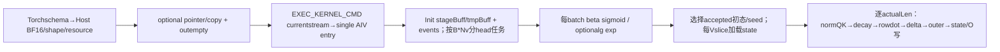
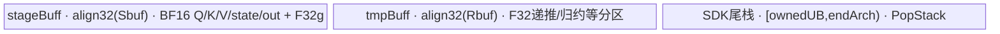

# SGL 原生逐 token GDN 状态递推 950 Direct Invoke 算子知识


## 算子速览

| 项目 | 内容 |
|---|---|
| 实际入口 | torch.ops.npu.recurrent_gated_delta_rule → sglang::npu_kernel::recurrent_gated_delta_rule，Direct Invoke |
| 计算语义 | BF16 mixedQKV先Q/K L2norm、beta logit内sigmoid，可选scalar g.exp衰减；FP32 VK状态递推，各步BF16写状态与输出 |
| 输入输出 | mix[B,S,2NkDk+NvDv]、β[B,S,Nv]、pool[slots,Nv,Dv,Dk] BF16；新O[B,S,Nv,Dv]；可变scratch取代pool写目标 |
| 执行类型 | 单AIV_VECTOR；950局部MicroAPI寄存器归约/outer，A3 Vector API；没有可达Cube/Matmul，include不作CV证据 |
| Kernel 路线 | R001…R004=无/有intermediate×无/有g；accepted0/1与scratch seed/alias子selector逐项保留 |
| 核心资源 | MAX_MTP8预算，Dk/Dv/Nv align16，vStep动态且align8；stageBuff/tmpBuff真实UB，SDK尾栈与工作subview分开 |
| 来源闭包 | direct_implementation_closed：Direct注册/24launch参数/11指针局部POD/完整两arch body、SDK9.1当前实例、build闭合 |
| 静态边界 | BF16-only；gk未消费；actualLen/S/槽/连续性校验弱，A3固定repeatStride16与V/8尾、scratch私有copy不可无条件安全复用 |
| 验证状态 | draft；本次知识提取未执行编译、真机、数值或性能测试；CI计划及source闭包不表示正确性验收 |

## 接口与语义

### 计算语义

mix token按Q(Nk*Dk)、K(Nk*Dk)、V(Nv*Dv)拼接；valuehead h的q/k头qh=h//(Nv/Nk)。Q/K从BF16转F32，norm=x*rsqrt(sum(x²)+1e−6)，不是Tritondecode的x/(sqrt(sum)+1e−6)，epsilon位置不能互换。Q再乘caller scale（Host无默认计算，Torchschema该scalar必填）。

对于当前value slice，进入状态S[Dv,Dk]F32：提供g时S←S*exp(g[t,h])，没有g时不衰减；δ=(V−rowDot(S,K))*sigmoid(beta[t,h])；S←S+δ⊗K；O=rowDot(S,Qscaled)。state在同program该序列token循环中保持F32，逐步另cast BF16 CAST_RINT写各ssm索引槽，O也CAST_RINT转BF16；下一token计算沿未舍入localstate，不是重新读回BF16每步快照。跨调用初态是BF16存储，不能宣称一条全F32永久池。

g是已成形逐head log-decay，不内算softplus/A_log；beta是logit，不应预sigmoid再传。Host仍接gk并转F32/连续，Deviceentry保留gk但RGDRInitParams和所有body不消费，故无逐key KDA衰减语义。无g时Host分配ones但hasGama=false，body不对这份ones做Exp，不是exp(1)衰减。

状态读/写目标：无scratch时同recurrentpool；有intermediate时初态/每步写目标为intermediate.contiguous，persistentpool只在seed条件读取。从accepted选择初态槽不等于接受后提交，scratch路径不自动回写persistentpool。每token写ssmStateIndices[t]，这些indices是输出slot而不是batch序号。数学意图还受下文A3资源/stride静态边界限定，不把未经保护维度写成已验证正确域。

### 输入、输出与属性

| 参数 | shape/layout | dtype | 约束、默认值与语义 |
|---|---|---|---|
| mix_qkv | [B,S,Dmix]dense | BF16强制 | Dmix=2NkDk+NvDv；Host查defined/rank/宽，不查contiguous/device一致 |
| recurrent_state | [slots,Nv,Dv,Dk]dense | BF16强制 | rank4/Nv一致检查；末轴V,K，原地或seed只读依Route |
| beta | [B,S,Nv]dense | BF16强制 | logit；shape显式查，连续/设备caller合同 |
| scale | scalar | schema double→DeviceF32 | 必填，Host没有positive/defaultguard |
| actual_seq_lengths | [B]连续 | Device读int32 | 每request有效token数；Host无rank/dtype/值域全面校验 |
| ssm_state_indices | [B,S]dense | Device读int32 | Host查rank/shape；不查dtype/容量/负值/冲突 |
| nk / nv | scalarheadcounts | Hostint64→Deviceuint32 | Nv应为Nk正整数倍；Host未完整验证除法域 |
| intermediate_state | optional [scratch,Nv,Dv,Dk]或可dense展平相同storage | BF16强制 | .contiguous；当前写目标，可变别名schema；非连续copy无copyback |
| cache_indices | optional[B] | 转int32/连续 | scratch模式无条件读取映射；缺省nullptr不是合法seed保障 |
| num_accepted_tokens | optional[B] | 转int32/连续 | 有则初态索引ssm[batch*S+accepted−1]；不是候选长度自动裁剪 |
| g | optional[B,S,Nv] | 转F32/连续 | 提供且defined→hasGama1；不校shape，scalar每headdecay |
| gk | optional | 转F32/连续 | entry保留但实际忽略，无数学作用 |
| out | [B,S,Nv,Dv]新empty | BF16 | 只写各actualLen有效token，剩余padding未初始化域不定义 |

Torchschema标记recurrent_state和intermediate_state为不同可变alias集合；真实source不额外检查两storage重叠。非法互alias、重复写槽、跨request写读交叉须由caller避免，否则source无atomic或跨核序列化。要求输入metadata同device/dtype/连续且合法值，不以缺少TORCH_CHECK升级支持范围。

### 入口与版本

固定kernel提交/CANN9.1按Frontmatter；SDK取匹配v9.1.0提交e5451c7feba11f9e259f4fbc19c4bf82f8c0496c。真实Torchnamespace无sgl_前缀，不造ACLNN pair。csrc/pytorch_extensions.cpp schema与m.impl均不受A3_ONLY包围；legacy_kernels把Host加入基础OP_SRCS，Device加入no_workspace_kernel，arch35 Host取AIV核数、entry在__CCE_AICORE__310编入本地regbase helper。

公开平台依据是活动FLA精确test_recurrent_gated_delta_rule.py、9.1×A3/950矩阵及两过滤均不排该文件，结合真实dualarch编译和950body；这是计划支持证据，不是本次运行pass。A2本轮未得到同强度入口证据，Frontmatter不加入。

已全文阅读[legacy状态集成Guide](../../../../guides/integration/sgl_kernel_npu/sgl_legacy_causal_conv_recurrent.md)。[950官方recurrent Guide](../../../../../../ops/catlass-dsl/guides/operator_playbooks/linear_attention/gdn/recurrent_gated_delta_rule.md)绑定另一个ops-transformer提交/ACLNN、分离QKV、BF16/FP32state及实际gk，不替代本Direct。[A3 MIX生成范式](../../../../../../ops/ascendc/examples/gated_delta_rule_a3_recurrence.md)为另一手写chunk示例，不作为本AIV验证记录。

## Host/Launcher 执行流程

### 参数校验与前处理

先defined/rank、mix/state/beta BF16、Dmix/Nv/β与索引shape检查，读取B/S/Nk/Nv/Dk/Dv；t=int(B*S)仅供缺g ones分配。随后PlatformAscendCManager::GetInstance取UB/core（无nullguard），A3GetCoreNum、950GetCoreNumAiv；这些资源读取发生在c10_npu::set_device(mix.device.index)之前，平台manager本身有全局初始化状态，不编造按inputdevice重新探测的保证。

依原顺序用align16和MAX8算U/vStep/restUB，vStep<8时TORCH_CHECK(false)立即失败，第二同块检查不可达；其余整除/正维/unsignedsub/窄化未全面guard。optional scratch若defined检查BF16并contiguous，更换init/final指针；cache/accepted各转I32/连续；g提供转F32/连续，否则ones([int(B*S),nv])但hasGama0；gk提供转F32/连续但Device不用。最后empty[B,S,nv,dv]与EXEC_KERNEL_CMD提交，返回out。

普通框架cast/contiguous/ones/empty为明确框架边界，不把核心递推委给外部算子。缺g时ones有分配成本但没有数学decay；gk即使ignored也可能触发copy成本或conversion异常。scratch非连续的私有copy本次被写但没有copyback/state返回，caller原view不更新，这与“所有mutabletensor都原地生效”的泛化不同。

### 参数、Workspace 与生命周期

自有GM workspace=0；不构造TilingData或ACLNNexecutor。out owner是返回Tensor；recurrentpool/inputmetadata owner为caller；scratch.contiguous若alias原storage则原对象可见，否则是Host局部私有copy；castedcache/accepted/g/gk和缺gones为局部Tensor。所有rawpointer在Host提交时来自这些liveTensor；异步Device消费的分配/stream安全是TorchNPUallocator/OpCommand框架合同，源码没有record_stream/device同步或显式延长Tensor引用。

EXEC_KERNEL_CMD在currentNPUstream(false)上ConvertTypes：Tensor转void*、scalar保持数值，tuple按值捕获给OpCommand RunOpApi，生成ACLRT_LAUNCH_KERNEL(coreNum,stream,params...)。lambda内部无论launch返回值都return0，未在本宏消费launch状态；不声称所有异步错误都同步返回或已有fallback。正式输出之外scratchcopy没有被返回，不能把调用方原pool看成自动更新。

### 启动图与失败传播



Host检查/分配/cast失败不launch；source没有fallback。所有Device任务仅AIV，事件为本核pipeline依赖；同head序列不跨core，无跨AIC/AIV/跨kernel交接。idlecore仍先InitBuffer/事件，再Process检查工作域返回；不能因idle就删其资源分配。运行期无显式非法metadata错误码，paddingout未写域不保证zero。

## Route 与参数设计

### 分核与资源计算

记A=align16(Dk)、D=align16(Dv)、Na=align16(Nv)、U=Platform GetCoreMemSize返回字节，v=vStep。Host按源顺序：
```text
used0=8*(4A+2D)+128+8*(4Na+2Na)=32A+16D+48Na+128
rest0=U-used0
used1=used0+8*(8A+4D+4Na)=96A+48D+80Na+128
coeff=(2+2)A+4+(4+4)A+4+4=12A+12
v_pre=((U-used1)/coeff)/8*8; if v_pre<8: Host失败
rptime=ceil(Dv,uint32(v_pre))
v=align8(ceil(Dv,uint32(rptime)))
ubRestBytes=rest0-(4A+4)*v
```

U是uint64而used是int64，减法受C++usual arithmetic conversions影响：当U不足时不能把公式当负数安全退出保证，存在unsigned回绕/到int64及uint32窄化边界；v_pre/ubRest、B/S/Nk/Nv/Dk/Dv转Deviceuint32前无完整范围检查。零Dv还会进入rptime0的除数域，正维caller合同不能替代不存在的guard。

实际资源不是Host估算每项名称：BUFFER_NUM=1，stageBuff raw字节Sbuf=32A+16D+48Nv+(4A+2)v，tmpBuff raw容量Rbuf=ubRestBytes。SDK9.1 InitBuffer分别round32，所以physicalownedUB=align32(Sbuf)+align32(Rbuf)，stagebase0，tmpbasealign32(Sbuf)。GetWithOffset不再align各子view、不独立分配，下面表为rawoffset；stage+tmp未round和=U−128−48(Na−Nv)−2v。不能把注释double buffered当depth2，也不能把tmp内部未用间隙当外部SDKstack。

| UB子区 | byte offset/容量（相对各TBuf） | dtype/元素 | 生命周期与consumer |
|---|---|---|---|
| stage qLocal | 0 /16A | BF16 8A | 每head首Vslice载入全有效seq，norm后qInUb跨Vslice复用 |
| stage kLocal | 16A /16A | BF16 8A | 同上 |
| stage vLocal | 32A /16D | BF16 8D | 首Vslice读整个Dv各token，vInUb跨Vslice索引v_i |
| stage stateLocal | 32A+16D /2Av | BF16 A*v | 每Vslice seed读一次→F32state |
| stage gamaLocal | 32A+16D+2Av /32Nv | F32 8Nv | 每batch读g并原地Exp；G0不消费 |
| stage betaLocal | 32A+16D+2Av+32Nv /16Nv | BF16 8Nv | 每batch load→F32β；source未按aNv分配 |
| stage stateOutLocal | 32A+16D+2Av+48Nv /2Av | BF16 A*v | 每token CAST_RINT→stateGM，V_MTE3/MTE3_V保护 |
| stage attnOutLocal | 32A+16D+4Av+48Nv /2v | BF16 v | 每token写O |
| tmp deltaInUb | 0 /4v | F32 v | matvec后残差乘sigmoidβ，再outer |
| tmp attnInUb | 4v /4v | F32 v | state×q归约→outcast |
| tmp vInUb | 8v /32D | F32 8D | 全head有效seq，跨Vslice读取不同v_i |
| tmp qInUb | 8v+32D /32A | F32 8A | norm/scale后复用 |
| tmp kInUb | 8v+32D+32A /32A | F32 8A | norm后复用 |
| tmp qTempInUb | A3:8v+32D+64A /32A；950不分配 | F32 8A | A3 norm平方临时 |
| tmp kTempInUb | A3:8v+32D+96A /32A；950不分配 | F32 8A | 同上 |
| tmp stateInUb | A3:8v+32D+128A；950:8v+32D+64A /4Av | F32 A*v | 当前Vslice整段token递推常驻，跨token不重读BF16 |
| tmp broadTmpInUb | stateOffset+4Av /4Av | F32 A*v | A3matvec乘积/源码reuseReduce/outer广播；950分配但localhelper不消费 |
| tmp qSumLocal | A3:broadEnd /32；950不分配 | F32 8 | A3norm每token平方和→rsqrt |
| tmp kSumLocal | A3:broadEnd+32 /32；950不分配 | F32 8 | 同上 |
| tmp betaInUb | A3:broadEnd+64；950:broadEnd /4*Nβ | F32 Nβ=align16(8Nv) | cast与sigmoid后scalarGetValue |


令Nβ=align16(8Nv)，broadEnd为当前arch state/broad两矩形结束地址，则tmp真正使用上界：
```text
tmpNeed_A3 = 8v+32D+128A+8Av+64+4Nβ
tmpNeed_950= 8v+32D+64A +8Av+4Nβ
required: tmpNeed_arch <= Rbuf；各rawsubview满足API对齐
ownedUB=align32(Sbuf)+align32(Rbuf)
SDK PopStackStart=ownedUB
SDK PopStackEnd_A3=192KiB-sizeof(KfcMsg)
SDK PopStackEnd_950=248KiB (TMP_UB_OFFSET)
SDKstackbytes=end-start>0；不得把tmpBuf里unused余量加入
workspace_total=0；L1/L0/Cube资源=N/A（实际Vector→UB→GM）
```

SDK Sum<float>、Sigmoid<float,false>与普通ReduceSum<AR,true>无显式tmp overload会取得相同剩余尾栈，不推进queueEnd，串行使用由barrier保护。A3 Sum的n=Dk、inner=A、outer=actualLen，n≤64用Whole/Repeat单轮，n>64先ceil(n/64)个F32partial再继续归约，各row串行复用；ReduceSum<AR,true>实际以broadTmp自身作为计算tmp，但wrapper仍PopStack；special64×128本地helper不Pop该reduce栈。A3 Sigmoid按floor(stackbytes/4)分calCount循环，1tmp矩形常数1与Exp结果Div；950Sigmoid为寄存器VF（F32lane64），不读传入sharedTmp，但上层仍PopStack。所有余量/大小必须按实际固定SDK判断，不套其它版本库。

分核：W=B*Nv，C=launchcore，avg=ceil(W/C)，core b负责[block*avg,min((block+1)*avg,W))；workIdx//Nv为batch、%Nv为valuehead，同head所有token串行。无按T分核或跨head reduce。每head按Vslice宽v分块，tail m=min(v,Dv−v_i)，一次seedload后遍历actualLen；Q/K/V全有效seq在首Vslice载入、后续Vslice复用normQ/K与全V（curVOffset=step*D+v_i），state每Vslice独立。metadata及indices全部按下文协议访问，未验证空/冲突。

### Route 选择

| 顺序 | Route | Key/模板 | 精确选择条件与优先级 | 不适用去向 |
|---:|---|---|---|---|
| 1 | R-001 持久池无衰减 | RGDR<BF16,BF16>;I0/G0 | intermediate optional缺省或undefined；g optional缺省或undefined；Host全部检查/资源成功、caller合法域、本卡平台 | 另一I/G或失败；无fallback |
| 2 | R-002 持久池标量衰减 | RGDR<BF16,BF16>;I0/G1 | intermediate optional缺省或undefined；g optional存在且defined；Host全部检查/资源成功、caller合法域、本卡平台 | 另一I/G或失败；无fallback |
| 3 | R-003 中间快照无衰减 | RGDR<BF16,BF16>;I1/G0 | intermediate optional存在且defined；g optional缺省或undefined；Host全部检查/资源成功、caller合法域、本卡平台 | 另一I/G或失败；无fallback |
| 4 | R-004 中间快照标量衰减 | RGDR<BF16,BF16>;I1/G1 | intermediate optional存在且defined；g optional存在且defined；Host全部检查/资源成功、caller合法域、本卡平台 | 另一I/G或失败；无fallback |

```text
伪码（实际Host无TilingKey/router表）：
BF16/shapeguard -> UB/vStepguard -> I=defined(intermediate)
I0: init=outState=recurrentPool; I1: init=outState=intermediate.contiguous; recurrentSeed=recurrentPool
A=defined(accepted); G=defined(g); preparecopies -> launch RGDR<BF16,BF16>
I0G0 R001 / I0G1 R002 / I1G0 R003 / I1G1 R004
within eachbatch:
  stateOffset=ssm[b*S+accepted[b]-1] if A1 else ssm[b*S]
  I1 reads cache[b] unconditionally; seedPersistent=I1&&(stateOffset%S==0)
  actualLen determines effective tokenloop, not accepted counter
```

### 模板/实现执行矩阵

| Route | key/selector | dtype/shape/platform 完整命中条件 | 执行拓扑与 Kernel 节点 | 实际模板/body | 内存与同步特征 | tail/fallback |
|---|---|---|---|---|---|---|
| R-001 | I0,G0,A0/A1（子矩阵保留） | mix/β/poolBF16，mix/β/ssm shapes通过，I0G0精确defined谓词；正维/Nv%Nk0/有效len≤8/合法dense元数据/槽caller前提，本卡平台 | 单AIV entry；A3普通Vector或950MicroAPI | RGDR<BF16,BF16>::Init→Process→CopyInGamaBeta/ProcessHead→Compute | stage/tmp/SDK尾栈；persistent原地；无decay；gamma分区仍分配 | A3固定repeatstride与V/8需限定；950realKmask；异常直传 |
| R-002 | I0,G1,A0/A1（子矩阵保留） | mix/β/poolBF16，mix/β/ssm shapes通过，I0G1精确defined谓词；正维/Nv%Nk0/有效len≤8/合法dense元数据/槽caller前提，本卡平台 | 单AIV entry；A3普通Vector或950MicroAPI | RGDR<BF16,BF16>::Init→Process→CopyInGamaBeta/ProcessHead→Compute | stage/tmp/SDK尾栈；persistent原地；gF32 Exp→stateMuls | A3固定repeatstride与V/8需限定；950realKmask；异常直传 |
| R-003 | I1,G0,A0/A1（子矩阵保留） | mix/β/poolBF16，mix/β/ssm shapes通过，I1G0精确defined谓词；正维/Nv%Nk0/有效len≤8/合法dense元数据/槽caller前提，本卡平台 | 单AIV entry；A3普通Vector或950MicroAPI | RGDR<BF16,BF16>::Init→Process→CopyInGamaBeta/ProcessHead→Compute | stage/tmp/SDK尾栈；scratch别名/私有copy按selector；无decay；gamma分区仍分配 | A3固定repeatstride与V/8需限定；950realKmask；异常直传 |
| R-004 | I1,G1,A0/A1（子矩阵保留） | mix/β/poolBF16，mix/β/ssm shapes通过，I1G1精确defined谓词；正维/Nv%Nk0/有效len≤8/合法dense元数据/槽caller前提，本卡平台 | 单AIV entry；A3普通Vector或950MicroAPI | RGDR<BF16,BF16>::Init→Process→CopyInGamaBeta/ProcessHead→Compute | stage/tmp/SDK尾栈；scratch别名/私有copy按selector；gF32 Exp→stateMuls | A3固定repeatstride与V/8需限定；950realKmask；异常直传 |

A3各Route明确保留reduce子selector：m==64且A==128调用本地ReduceSum_AR_64x128_ReuseSource；否则调用SDK ReduceSum<float,AR,true>，shape[m,A]、srcInnerPad=true。两者共享同broadTmp容量/同序consumer/同owner，不隐藏SDK PopStack差别；精确运算树见实现段。950同源宏直接调用RowDotRegbase，不调用这两个A3helper。A3的Mul/MulAddDst固定repeatStride16（128F32行距）且Kloopfloor(A/64)不是Host验证过的任意A实例；只把A128/m有效8倍数当可审查常见几何，其他raw可达域保留为静态风险而非假安全Route。

### 隐藏性能 Guard

| Guard | Host/Tiling 条件 | Device/资源原因 | 影响 Route | 不满足时去向 | 源码符号 |
|---|---|---|---|---|---|
| BF16 | mix/β/pool及I1scratch显式typecheck | 单BF16实例/2B资源 | 全部 | TORCH_CHECK拒绝 | Host |
| vStep | vpre<8拒绝；其余unsigned/窄化无完整guard | v分片UB上界 | 全部 | 拒绝或raw不保证，不造fallback | HostusedUbBytes |
| MAX8 | 仅预算8，无actualLen≤min(S,8)check；S本身不直接决定UBload长度 | q/k/v/gamma/beta capacities | 全部 | metadata超过8可越过subview；静态边界 | InitLocalBuffers/seqLen |
| Nk/Nv/正维 | 未完整check | NV/NK、ceil、%S依赖非零 | 全部 | caller合同，不能假设Host全拦 | Compute/Process |
| scratch/cache | I1会无条件GetValue(cache[b]) | seed来源映射 | R003/4 | nullptr/非法值无源码保护 | Process |
| A3行距 | Host仅align16，bodyrepeatstride16 | Vector按128元素行跨度 | 本卡A3 | A≠128/尾几何不保证，非另安全实现 | Compute |
| A3Vtail | Brcb repeats=m/8向下取整 | outer广播须覆盖m行 | 本卡A3 | m%8!=0尾未由该参数覆盖 | Brcb |
| stage对齐 | NV按raw数分区无pad | NVodd可使stateOut/attnOut offset为16mod32 | 全部需API对齐，A3SDK明确32B | 无Host拒绝，不能宣称DMA合法 | InitLocalBuffers/GetWithOffset |
| indices/alias | 无slotbounds/冲突检查 | 同slot跨head/request潜在并发 | 全部 | caller保证合法互不冲突 | Process/CopyOutState |
| scratch contiguous | I1.contiguous，无copyback | 原view可能不被写 | R003/4 | 私有copy生命周期；不是提交persistent | Host |
| SDK尾栈 | 无单独剩余guard | PopStack start/end及各API临时 | 全部 | 不足时静态资源前提缺失；未造真机故障 | SDK PopStackBuffer |

### POD/ABI

Host→Device不是serializedTiling，而是生成aclrtlaunch的24参数call ABI；下表按entry源顺序。pointer物理位宽/参数packoffset未在固定源码显式给出，不补造生成bridge字节布局；标量类型是entry明确声明，Host大整数/float到该类型的窄化不能省略。RGDR对象为Device局部类，构造scalar来自该tuple；另有11指针的局部RGDRInitParams结构，逐字段列出但不当成Host GMtilingblob。

| 结构 | 字段 | 类型/位宽 | ABI 布局 | 单位 | Host/launcher producer | Device consumer | 边界 |
|---|---|---|---|---|---|---|---|
| launch tuple | mixqkv | GM_ADDR pointer | arg0；packoffset由生成ABI | GM byteaddr | csrc/recurrent_gated_delta_rule/op_host/recurrent_gated_delta_rule.cpp:mix_qkv.data_ptr | csrc/recurrent_gated_delta_rule/op_kernel/recurrent_gated_delta_rule_kernel.cpp:mixqkvGm BF16；QKV拼接 | nonnulldensecaller |
| launch tuple | beta | GM_ADDR pointer | arg1；packoffset由生成ABI | GM byteaddr | csrc/recurrent_gated_delta_rule/op_host/recurrent_gated_delta_rule.cpp:beta.data_ptr | csrc/recurrent_gated_delta_rule/op_kernel/recurrent_gated_delta_rule_kernel.cpp:betaGm BF16→sigmoid | shape检查，dtypeBF16 |
| launch tuple | initState | GM_ADDR pointer | arg2；packoffset由生成ABI | GM byteaddr | csrc/recurrent_gated_delta_rule/op_host/recurrent_gated_delta_rule.cpp:I0recurrent，I1scratch.contiguous | csrc/recurrent_gated_delta_rule/op_kernel/recurrent_gated_delta_rule_kernel.cpp:initStateGm BF16 seed | I1privatecopy无回拷 |
| launch tuple | cuSeqlens | GM_ADDR pointer | arg3；packoffset由生成ABI | GM byteaddr | csrc/recurrent_gated_delta_rule/op_host/recurrent_gated_delta_rule.cpp:actual_seq_lengths raw | csrc/recurrent_gated_delta_rule/op_kernel/recurrent_gated_delta_rule_kernel.cpp:I32 actualLen[b] | 不是cu边界数组，名称易混 |
| launch tuple | ssmStateIndices | GM_ADDR pointer | arg4；packoffset由生成ABI | GM byteaddr | csrc/recurrent_gated_delta_rule/op_host/recurrent_gated_delta_rule.cpp:ssm_state_indices raw | csrc/recurrent_gated_delta_rule/op_kernel/recurrent_gated_delta_rule_kernel.cpp:I32初态/每token写槽 | Host仅shape |
| launch tuple | mtpRecurrentState | GM_ADDR pointer | arg5；packoffset由生成ABI | GM byteaddr | csrc/recurrent_gated_delta_rule/op_host/recurrent_gated_delta_rule.cpp:I1 recurrentpool，I0nullptr | csrc/recurrent_gated_delta_rule/op_kernel/recurrent_gated_delta_rule_kernel.cpp:I1 seed读取 | I0inactive |
| launch tuple | cacheIndices | GM_ADDR pointer | arg6；packoffset由生成ABI | GM byteaddr | csrc/recurrent_gated_delta_rule/op_host/recurrent_gated_delta_rule.cpp:optional .toI32.contiguous/ nullptr | csrc/recurrent_gated_delta_rule/op_kernel/recurrent_gated_delta_rule_kernel.cpp:I1cache[b] | I1实际无condition保护缺省 |
| launch tuple | g | GM_ADDR pointer | arg7；packoffset由生成ABI | GM byteaddr | csrc/recurrent_gated_delta_rule/op_host/recurrent_gated_delta_rule.cpp:G1F32copy，G0ones | csrc/recurrent_gated_delta_rule/op_kernel/recurrent_gated_delta_rule_kernel.cpp:gammaGlobal，G1Exp | G0不读数学 |
| launch tuple | gk | GM_ADDR pointer | arg8；packoffset由生成ABI | GM byteaddr | csrc/recurrent_gated_delta_rule/op_host/recurrent_gated_delta_rule.cpp:optionalF32copy/null | csrc/recurrent_gated_delta_rule/op_kernel/recurrent_gated_delta_rule_kernel.cpp:entry未传入RGDRInitParams | 所有Routeinactive |
| launch tuple | numAcceptedTokens | GM_ADDR pointer | arg9；packoffset由生成ABI | GM byteaddr | csrc/recurrent_gated_delta_rule/op_host/recurrent_gated_delta_rule.cpp:A1I32copy，A0nullptr | csrc/recurrent_gated_delta_rule/op_kernel/recurrent_gated_delta_rule_kernel.cpp:A1accepted[b]−1选槽 | A0inactive |
| launch tuple | out | GM_ADDR pointer | arg10；packoffset由生成ABI | GM byteaddr | csrc/recurrent_gated_delta_rule/op_host/recurrent_gated_delta_rule.cpp:out.emptyBF16 | csrc/recurrent_gated_delta_rule/op_kernel/recurrent_gated_delta_rule_kernel.cpp:attnOutGm | padding未写 |
| launch tuple | stateOut | GM_ADDR pointer | arg11；packoffset由生成ABI | GM byteaddr | csrc/recurrent_gated_delta_rule/op_host/recurrent_gated_delta_rule.cpp:I0recurrent，I1scratch | csrc/recurrent_gated_delta_rule/op_kernel/recurrent_gated_delta_rule_kernel.cpp:finalStateGm BF16 | 各步ssm写槽 |
| launch tuple | b | uint32_t | arg12；packoffset由生成ABI | 元素/计数 | csrc/recurrent_gated_delta_rule/op_host/recurrent_gated_delta_rule.cpp:Hostint64 B窄化 | csrc/recurrent_gated_delta_rule/op_kernel/recurrent_gated_delta_rule_kernel.cpp:B_；workload | 未guarduint32范围 |
| launch tuple | s | uint32_t | arg13；packoffset由生成ABI | 元素/计数 | csrc/recurrent_gated_delta_rule/op_host/recurrent_gated_delta_rule.cpp:Hostint64 S窄化 | csrc/recurrent_gated_delta_rule/op_kernel/recurrent_gated_delta_rule_kernel.cpp:S_、seq0=b*S、stateOffset%S | 正Scaller |
| launch tuple | nk | uint32_t | arg14；packoffset由生成ABI | 元素/计数 | csrc/recurrent_gated_delta_rule/op_host/recurrent_gated_delta_rule.cpp:Hostint64 nk窄化 | csrc/recurrent_gated_delta_rule/op_kernel/recurrent_gated_delta_rule_kernel.cpp:NK_、qkhead/拼接stride | 正/整除未全检 |
| launch tuple | dk | uint32_t | arg15；packoffset由生成ABI | 元素/计数 | csrc/recurrent_gated_delta_rule/op_host/recurrent_gated_delta_rule.cpp:state.size3 int64窄化 | csrc/recurrent_gated_delta_rule/op_kernel/recurrent_gated_delta_rule_kernel.cpp:realK_/alignK_/Vector列 | A3固定行距限制 |
| launch tuple | nv | uint32_t | arg16；packoffset由生成ABI | 元素/计数 | csrc/recurrent_gated_delta_rule/op_host/recurrent_gated_delta_rule.cpp:Hostint64 nv窄化 | csrc/recurrent_gated_delta_rule/op_kernel/recurrent_gated_delta_rule_kernel.cpp:NV_、workload/gbstride | shape一致检查 |
| launch tuple | dv | uint32_t | arg17；packoffset由生成ABI | 元素/计数 | csrc/recurrent_gated_delta_rule/op_host/recurrent_gated_delta_rule.cpp:state.size2 int64窄化 | csrc/recurrent_gated_delta_rule/op_kernel/recurrent_gated_delta_rule_kernel.cpp:realV_/alignV_/Vslice | 正维caller |
| launch tuple | hasIntermediateState | bool | arg18；packoffset由生成ABI | boolean | csrc/recurrent_gated_delta_rule/op_host/recurrent_gated_delta_rule.cpp:optional存在且defined | csrc/recurrent_gated_delta_rule/op_kernel/recurrent_gated_delta_rule_kernel.cpp:I，选择seedGMs/ptr | 不等同cache存在 |
| launch tuple | hasAcceptedTokens | bool | arg19；packoffset由生成ABI | boolean | csrc/recurrent_gated_delta_rule/op_host/recurrent_gated_delta_rule.cpp:accepted存在且defined | csrc/recurrent_gated_delta_rule/op_kernel/recurrent_gated_delta_rule_kernel.cpp:A，索引accepted−1 | 不裁actualLen |
| launch tuple | hasGama | bool | arg20；packoffset由生成ABI | boolean | csrc/recurrent_gated_delta_rule/op_host/recurrent_gated_delta_rule.cpp:g存在且defined | csrc/recurrent_gated_delta_rule/op_kernel/recurrent_gated_delta_rule_kernel.cpp:G，CopyGama/Exp/stateMuls | gk不影响 |
| launch tuple | vStep | uint32_t | arg21；packoffset由生成ABI | 元素/计数 | csrc/recurrent_gated_delta_rule/op_host/recurrent_gated_delta_rule.cpp:Hostint64 vStep窄化 | csrc/recurrent_gated_delta_rule/op_kernel/recurrent_gated_delta_rule_kernel.cpp:vStep_分片/UB | >=8guard在重平衡之前 |
| launch tuple | ubRestBytes | uint32_t | arg22；packoffset由生成ABI | B | csrc/recurrent_gated_delta_rule/op_host/recurrent_gated_delta_rule.cpp:Hostint64 ubRestBytes窄化 | csrc/recurrent_gated_delta_rule/op_kernel/recurrent_gated_delta_rule_kernel.cpp:restUbSize_/tmpBuff | 需正并足tmpNeed |
| launch tuple | scale | float | arg23；packoffset由生成ABI | 数值 | csrc/recurrent_gated_delta_rule/op_host/recurrent_gated_delta_rule.cpp:Hostdouble scale转换 | csrc/recurrent_gated_delta_rule/op_kernel/recurrent_gated_delta_rule_kernel.cpp:scale_/q norm后Muls | 无positive/defaultguard |
| RGDRInitParams | mixqkv | GM_ADDR pointer，位宽依targetABI | 声明序0；offsetof/sizeof/alignof未编译测量 | GM byteaddr | entry aggregate由launch.mixqkv赋值 | SetGlobalTensors:mixqkvGm BF16 | 保持源字段次序 |
| RGDRInitParams | gama | GM_ADDR pointer，位宽依targetABI | 声明序1；offsetof/sizeof/alignof未编译测量 | GM byteaddr | entry aggregate由launch.g赋值 | SetGlobalTensors:gamaGm F32 | 保持源字段次序 |
| RGDRInitParams | beta | GM_ADDR pointer，位宽依targetABI | 声明序2；offsetof/sizeof/alignof未编译测量 | GM byteaddr | entry aggregate由launch.beta赋值 | SetGlobalTensors:betaGm BF16 | 保持源字段次序 |
| RGDRInitParams | initState | GM_ADDR pointer，位宽依targetABI | 声明序3；offsetof/sizeof/alignof未编译测量 | GM byteaddr | entry aggregate由launch.initState赋值 | SetGlobalTensors:initStateGm BF16 | 保持源字段次序 |
| RGDRInitParams | cuSeqlens | GM_ADDR pointer，位宽依targetABI | 声明序4；offsetof/sizeof/alignof未编译测量 | GM byteaddr | entry aggregate由launch.cuSeqlens赋值 | SetGlobalTensors:cuSeqlensGm I32 | 保持源字段次序 |
| RGDRInitParams | ssmStateIndices | GM_ADDR pointer，位宽依targetABI | 声明序5；offsetof/sizeof/alignof未编译测量 | GM byteaddr | entry aggregate由launch.ssmStateIndices赋值 | SetGlobalTensors:ssmStateIndicesGm I32 | 保持源字段次序 |
| RGDRInitParams | numAcceptedTokens | GM_ADDR pointer，位宽依targetABI | 声明序6；offsetof/sizeof/alignof未编译测量 | GM byteaddr | entry aggregate由launch.numAcceptedTokens赋值 | SetGlobalTensors:numAcceptedTokensGm I32 | 保持源字段次序 |
| RGDRInitParams | attnOut | GM_ADDR pointer，位宽依targetABI | 声明序7；offsetof/sizeof/alignof未编译测量 | GM byteaddr | entry aggregate由launch.out赋值 | SetGlobalTensors:attnOutGm BF16 | 保持源字段次序 |
| RGDRInitParams | finalState | GM_ADDR pointer，位宽依targetABI | 声明序8；offsetof/sizeof/alignof未编译测量 | GM byteaddr | entry aggregate由launch.stateOut赋值 | SetGlobalTensors:finalStateGm BF16 | 保持源字段次序 |
| RGDRInitParams | recurrentState | GM_ADDR pointer，位宽依targetABI | 声明序9；offsetof/sizeof/alignof未编译测量 | GM byteaddr | entry aggregate由launch.mtpRecurrentState赋值 | SetGlobalTensors:I1 recurrentStateGm BF16 | I1专用；I0不消费 |
| RGDRInitParams | cacheIndices | GM_ADDR pointer，位宽依targetABI | 声明序10；offsetof/sizeof/alignof未编译测量 | GM byteaddr | entry aggregate由launch.cacheIndices赋值 | SetGlobalTensors:I1 cacheIndicesGm I32 | I1专用；I0不消费 |

无额外CANNworkspace/POD字段；flags I/A/G传RGDR构造，A/D由dk/dv重新align16，B*S及tokenstride在Device重算。SEvent内部id1是AllocEventID返回event_t，由Init调用产生、不跨Host ABI；这里没有自造固定event数字。

### Route 源码闭包

| Route | Key/selector | Host/Tiling producer | POD/参数 | Kernel entry/router 节点 | Kernel body/直接依赖 | 构建接线 |
|---|---|---|---|---|---|---|
| R-001 | I0G0,A0/A1及seed/copy子矩阵 | csrc/recurrent_gated_delta_rule/op_host/recurrent_gated_delta_rule.cpp:recurrent_gated_delta_rule | 24tuple、11localpointerPOD；Sbuf/Rbuf/v | csrc/recurrent_gated_delta_rule/op_kernel/recurrent_gated_delta_rule_kernel.cpp:recurrent_gated_delta_rule→RGDR<BF16,BF16> | RGDR完整body、tensorutils:SEvent；950regbase三个helper；SDK9.1selectedSum/Sigmoid/ReduceSum/allocator | pytorch_extensions schema/m.impl→legacy_kernels OP_SRCS/no_workspace_kernel→librarylink与包加载 |
| R-002 | I0G1,A0/A1及seed/copy子矩阵 | csrc/recurrent_gated_delta_rule/op_host/recurrent_gated_delta_rule.cpp:recurrent_gated_delta_rule | 24tuple、11localpointerPOD；Sbuf/Rbuf/v | csrc/recurrent_gated_delta_rule/op_kernel/recurrent_gated_delta_rule_kernel.cpp:recurrent_gated_delta_rule→RGDR<BF16,BF16> | RGDR完整body、tensorutils:SEvent；950regbase三个helper；SDK9.1selectedSum/Sigmoid/ReduceSum/allocator | pytorch_extensions schema/m.impl→legacy_kernels OP_SRCS/no_workspace_kernel→librarylink与包加载 |
| R-003 | I1G0,A0/A1及seed/copy子矩阵 | csrc/recurrent_gated_delta_rule/op_host/recurrent_gated_delta_rule.cpp:recurrent_gated_delta_rule | 24tuple、11localpointerPOD；Sbuf/Rbuf/v | csrc/recurrent_gated_delta_rule/op_kernel/recurrent_gated_delta_rule_kernel.cpp:recurrent_gated_delta_rule→RGDR<BF16,BF16> | RGDR完整body、tensorutils:SEvent；950regbase三个helper；SDK9.1selectedSum/Sigmoid/ReduceSum/allocator | pytorch_extensions schema/m.impl→legacy_kernels OP_SRCS/no_workspace_kernel→librarylink与包加载 |
| R-004 | I1G1,A0/A1及seed/copy子矩阵 | csrc/recurrent_gated_delta_rule/op_host/recurrent_gated_delta_rule.cpp:recurrent_gated_delta_rule | 24tuple、11localpointerPOD；Sbuf/Rbuf/v | csrc/recurrent_gated_delta_rule/op_kernel/recurrent_gated_delta_rule_kernel.cpp:recurrent_gated_delta_rule→RGDR<BF16,BF16> | RGDR完整body、tensorutils:SEvent；950regbase三个helper；SDK9.1selectedSum/Sigmoid/ReduceSum/allocator | pytorch_extensions schema/m.impl→legacy_kernels OP_SRCS/no_workspace_kernel→librarylink与包加载 |

## Kernel 实现

### 公共执行流程

entry声明AIV_ONLY，构造TPipe和RGDR<BF16,BF16>，把11pointer赋到InitParams、Init绑定GlobalTensor/两TBuf/事件、Process按B*Nv切workload。每core每新batch读取β及可选g；同batch多head复用其scalar表。ProcessHead先reset qkvcopyFlag，Vslice循环seedloadF32state，token循环Compute。首Vslice首token从mix搬全序列K/V后normK，再异步搬Q，先做当前state/K残差，等待Q并norm/scale；后续token/Vslice复用Q/K/V。每token先CAST_RINT快照写stateOut，再以仍FP32的state算output并CAST_RINT写O。

SEvent有四个独立同corehardevent：in_ready_Beta=MTE2_V，in_empty_Beta=V_MTE2，out_ready_Attn=V_MTE3，out_empty_Attn=MTE3_V。实际编号由allocator产生；setall只是set一次，release只是wait一次，不是FreeEvent或跨corebarrier。Process开头prime in_empty/out_empty；每head waitin_empty、ProcessHead、setin_empty；Compute在复用out buffers前waitout_empty，state/attn各set/waitout_ready，再store、setout_empty；结束release等待。PipeBarrier<V/MTE2>、V_S/S_V保护scalarGetValue与norm因子，不虚构跨核同步。

A3当前实例：
Mul(broad[index],state[index],k[curQK+index],mask_placeholder,repeat=m,{1,1,1,16,16,0})；index=z*64,z<floor(A/64)。Reduce shape[m,A]；m64&A128用local特殊helper，将每行后64加到前64（repeat64,stride16），DataCopy 64行×8blocks、srcStride8、dstStride0压紧，再4096lane BlockReduceSum和512lane第二次BlockReduceSum；src被复用覆盖。其它形状SDK AR reuse=true按源码splitK/tail/whole/pair/block归约。δ=(v−sum)*β后Brcb(broad,δ,m/8,{1,8})，outer用MulAddDst(...,{1,0,1,16,1,0})。最终outputmatvec再同样Mul/Reduce。固定repeatstride与floor循环必须受前述几何警示限制。

950当前实例：
RowDotRegbase按rows=m,rowStride=A,cols=Dk；VL=VECTOR_REG_WIDTH/sizeof(float)=64，逐row归约，每K64片UpdateMask，maskedMul、acc merging、全regReduceSum、首元素store。RankOneUpdate按K64片maskedbroadcastδ/乘k/加state/store；L2NormalizeRows每row先sumSquare、加1e−6、sqrt并把第一个root广播全reg，再maskedDiv，padding不参与math。row/loopcount窄化uint16未在Host上界充分保证。RegDataCopy读整VL、计算/写使用mask；不凭mask宣称任意小subview的整VLread都由独立allocation支持，实际UB backing与相邻分区必须结合源布局核对。source没有Mmad/Matmul调用。

### Route R-001：持久池无衰减

#### 适用条件

##### 选择证据

| 层级 | 文件 | 符号 | 源码谓词/参数 | 结果/下一跳 |
|---|---|---|---|---|
| Torch Direct | csrc/pytorch_extensions.cpp | recurrent_gated_delta_rule schema/m.impl | BF16mixedQKV ABI与mutablestate | csrc/recurrent_gated_delta_rule/op_host/recurrent_gated_delta_rule.cpp |
| Host | csrc/recurrent_gated_delta_rule/op_host/recurrent_gated_delta_rule.cpp | recurrent_gated_delta_rule | I0G0精确defined谓词、校验/资源通过 | init/out=recurrentpool；gones但G0 |
| launch | csrc/utils/torch_helper.h | EXEC_KERNEL_CMD | core=GetCoreNumAiv，currentstream，24tuple | 单AIV entry |
| Device | csrc/recurrent_gated_delta_rule/op_kernel/recurrent_gated_delta_rule_kernel.cpp | RGDR<BF16,BF16> | __CCE_AICORE__310；I0G0、A子selector | MicroAPI Norm/RowDot/RankOne |

精确生命周期/初态子selector如下，全部属于同实际RGDR类、同参数化资源和同管线；只改变源中显式指针/索引选择，未把None或copy路径隐藏。Z为初态槽整除S，C为scratch连续性。

| 子selector | 完整附加条件 | stateOffset producer | 初态读取 | 每token状态写目标 | owner/返回含义 |
|---|---|---|---|---|---|
| A0 | 缺省/undefined | ssm[b*S] | recurrent[stateOffset,h] | recurrent[ssm[seq_i],h] | caller池原地；无scratch/cache消费 |
| A1 | accepted存在defined | ssm[b*S+accepted[b]−1] | recurrent[stateOffset,h] | recurrent[ssm[seq_i],h] | caller池原地；无scratch/cache消费 |

A0不消费acceptednullptr；I0不消费cache或mtpRecurrentnullptr。A1只是换初态槽，不改变本次actualLen tokenloop，也不替caller执行接受后提交。
gk0/1都不进入Device数学；defined gk经历Host .to(FP32).contiguous()；最终逻辑缓冲为4*numel(gk) B，新增GM按实际转换/连续化分配计，已为连续FP32时可别名输入、新增0；不能将最终缓冲大小固定计作额外分配。任何非法slot/alias/metadata以及资源边界保持精确限制，不宣称被Host拦截。

#### Device 数据流

##### 函数级调用链

```text
Host recurrent_gated_delta_rule -> EXEC_KERNEL_CMD
 -> entry recurrent_gated_delta_rule(24args) -> RGDR<BF16,BF16>
  -> Init: SetGlobalTensors + InitLocalBuffers + fourSEvent.Init
  -> Process: avgload; primeV_MTE2/MTE3_V; rangeownB*Nv
   -> newbatch CopyInGamaBeta -> beta Cast/Sigmoid (G0不读g)
   -> selectstateOffset(A); poolstate
   -> ProcessHead: resetqkvcopyFlag; forv_i
    -> CopyInState -> BF16→FP32
    -> foreachactualtoken Compute:
       firstV/firsttoken loadsK/V,normK,prefetchQ
       RowDotRegbase
       SubV/Mulsβ; waitQ,normQ/scale onfirstcopy
       RankOneUpdateRegbase
       CAST_RINTstate -> V_MTE3/MTE3_V -> stateGM
       RowDotRegbase -> CAST_RINTO -> GM
   -> eventrelease(wait)
```

##### 源码等价伪码

```text
伪码；同head序列不跨core
init(stageBuff,tmpBuff,events); W=B*Nv; avg=ceil(W,blockNum)
if block*avg>=W: return # buffers已Init
prime in_empty/out_empty
for work=block*avg .. min((block+1)*avg,W)-1:
 b=work//Nv; h=work%Nv; t0=b*S; t1=t0+actualLen[b]
 s0=ssm[t0+accepted[b]-1] if A1 else ssm[t0]
 seed=pool[s0]
 ifnewbatch: CopyBeta/Cast/Sigmoid; skipg; V_Swait
 in_empty.wait()
 firstcopy=False
 for vi=0..Dv stepvStep:
  m=min(vStep,Dv-vi)
  BF16state=load recurrent[s0] [h,vi:vi+m,:]
  stateF32=Cast(BF16state)
  for t=t0..t1-1:
   if !firstcopy: loadwholeeffectiveQK/V; normK; startQcopy
   # no state decay
   delta=(V[t,vi:]-rowdot(stateF32,K[t]))*sigmoidβ[t,h]
   if !firstcopy: waitQcopy; normQ/scale; firstcopy=True
   stateF32 += outer(delta,K[t])
   out_empty.wait(); snapshotBF16=CAST_RINT(stateF32)
   V_MTE3set/wait; store pool[ssm[t],h,vi:]
   O=CAST_RINT(rowdot(stateF32,Qscaled[t])); V_MTE3set/wait; storeO
   out_empty.set()
 in_empty.set()
release in_empty/out_empty(wait)
```

norm/rowdot/outer全部按当前平台前文实参展开；A3固定stride16/floorK与m/8边界不能从伪码数学rowdot抹去。actualLen0仍会执行metadata/βprep与每Vslice seedload，tokenloop0；输出没有写，不把整个调用称为纯no-op。各boolbranch未触发的pointer不读，I1cache例外为unconditionalconsumer。

#### 内存与数据搬运

##### 资源与搬运表

| 层级/缓冲区 | offset/地址公式 | extent/容量公式 | dtype/layout | producer | consumer | owner/lifetime | 对齐/复用 |
|---|---|---|---|---|---|---|---|
| GM mixedQKV | t*Dmix + qh*Dk；K再+NkDk；V再+2NkDk+hDv | 2B*S*Dmix B | BF16 dense | caller | Q/K/V DataCopyPad | caller到Device消费 | tokenstrideDmix*2；只有效token |
| GM β/g | t*Nv+h | β2BSNv；gHostones4*int(BS)*Nv但不读 | βBF16/gF32 | caller/Hostcopy | CopyInGamaBeta | ownercaller/局部copy | βpadding非明确zero；有效scalarindex才消费 |
| GM inputstate | ((slot*Nv+h)*Dv+vi)*Dk | pool2slots*NvDvDk或scratch容量 | BF16 VK | caller/已有快照 | CopyInState | persistent读写 | rawdensecaller；Dk补到A时显式pad0 |
| GM outputstate | ((ssm[t]*Nv+h)*Dv+vi)*Dk | 每token有效m*Dk*2 | BF16 VK | stateF32CAST_RINT | laterconsumer | callerpool | 同槽冲突无atomic |
| GM O | (t*Nv+h)*Dv+vi | 新2B*S*NvDv | BF16 | Hostempty/Compute | caller | 返回Tensor | only t<t1/m实际写，paddingundef |
| GM metadata | actual[b]，ssm[b*S+a−1]/ssm[t]，cache[b] | caller/castTensor原capacity | I32 | caller/HosttoI32 | Process scalar GetValue | 到消费 | actual/ssm不主动cast；负idx无mask |
| UB stage qLocal | 0 /16A | 见容量式；offset在对应TBuf内，byte | BF16 8A | load/cast/Vector | 每head首Vslice载入全有效seq，norm后qInUb跨Vslice复用 | TPipe当前head/Vslice，分区全launch驻留 | InitBuffer整体32对齐；GetWithOffset子区不自动对齐 |
| UB stage kLocal | 16A /16A | 见容量式；offset在对应TBuf内，byte | BF16 8A | load/cast/Vector | 同上 | TPipe当前head/Vslice，分区全launch驻留 | InitBuffer整体32对齐；GetWithOffset子区不自动对齐 |
| UB stage vLocal | 32A /16D | 见容量式；offset在对应TBuf内，byte | BF16 8D | load/cast/Vector | 首Vslice读整个Dv各token，vInUb跨Vslice索引v_i | TPipe当前head/Vslice，分区全launch驻留 | InitBuffer整体32对齐；GetWithOffset子区不自动对齐 |
| UB stage stateLocal | 32A+16D /2Av | 见容量式；offset在对应TBuf内，byte | BF16 A*v | load/cast/Vector | 每Vslice seed读一次→F32state | TPipe当前head/Vslice，分区全launch驻留 | InitBuffer整体32对齐；GetWithOffset子区不自动对齐 |
| UB stage gamaLocal | 32A+16D+2Av /32Nv | 见容量式；offset在对应TBuf内，byte | F32 8Nv | load/cast/Vector | 每batch读g并原地Exp；G0不消费 | TPipe当前head/Vslice，分区全launch驻留 | InitBuffer整体32对齐；GetWithOffset子区不自动对齐 |
| UB stage betaLocal | 32A+16D+2Av+32Nv /16Nv | 见容量式；offset在对应TBuf内，byte | BF16 8Nv | load/cast/Vector | 每batch load→F32β；source未按aNv分配 | TPipe当前head/Vslice，分区全launch驻留 | InitBuffer整体32对齐；GetWithOffset子区不自动对齐 |
| UB stage stateOutLocal | 32A+16D+2Av+48Nv /2Av | 见容量式；offset在对应TBuf内，byte | BF16 A*v | load/cast/Vector | 每token CAST_RINT→stateGM，V_MTE3/MTE3_V保护 | TPipe当前head/Vslice，分区全launch驻留 | InitBuffer整体32对齐；GetWithOffset子区不自动对齐 |
| UB stage attnOutLocal | 32A+16D+4Av+48Nv /2v | 见容量式；offset在对应TBuf内，byte | BF16 v | load/cast/Vector | 每token写O | TPipe当前head/Vslice，分区全launch驻留 | InitBuffer整体32对齐；GetWithOffset子区不自动对齐 |
| UB tmp deltaInUb | 0 /4v | 见容量式；offset在对应TBuf内，byte | F32 v | load/cast/Vector | matvec后残差乘sigmoidβ，再outer | TPipe当前head/Vslice，分区全launch驻留 | InitBuffer整体32对齐；GetWithOffset子区不自动对齐 |
| UB tmp attnInUb | 4v /4v | 见容量式；offset在对应TBuf内，byte | F32 v | load/cast/Vector | state×q归约→outcast | TPipe当前head/Vslice，分区全launch驻留 | InitBuffer整体32对齐；GetWithOffset子区不自动对齐 |
| UB tmp vInUb | 8v /32D | 见容量式；offset在对应TBuf内，byte | F32 8D | load/cast/Vector | 全head有效seq，跨Vslice读取不同v_i | TPipe当前head/Vslice，分区全launch驻留 | InitBuffer整体32对齐；GetWithOffset子区不自动对齐 |
| UB tmp qInUb | 8v+32D /32A | 见容量式；offset在对应TBuf内，byte | F32 8A | load/cast/Vector | norm/scale后复用 | TPipe当前head/Vslice，分区全launch驻留 | InitBuffer整体32对齐；GetWithOffset子区不自动对齐 |
| UB tmp kInUb | 8v+32D+32A /32A | 见容量式；offset在对应TBuf内，byte | F32 8A | load/cast/Vector | norm后复用 | TPipe当前head/Vslice，分区全launch驻留 | InitBuffer整体32对齐；GetWithOffset子区不自动对齐 |
| UB tmp qTempInUb | A3:8v+32D+64A /32A；950不分配 | 见容量式；offset在对应TBuf内，byte | F32 8A | load/cast/Vector | A3 norm平方临时 | TPipe当前head/Vslice，分区全launch驻留 | InitBuffer整体32对齐；GetWithOffset子区不自动对齐 |
| UB tmp kTempInUb | A3:8v+32D+96A /32A；950不分配 | 见容量式；offset在对应TBuf内，byte | F32 8A | load/cast/Vector | 同上 | TPipe当前head/Vslice，分区全launch驻留 | InitBuffer整体32对齐；GetWithOffset子区不自动对齐 |
| UB tmp stateInUb | A3:8v+32D+128A；950:8v+32D+64A /4Av | 见容量式；offset在对应TBuf内，byte | F32 A*v | load/cast/Vector | 当前Vslice整段token递推常驻，跨token不重读BF16 | TPipe当前head/Vslice，分区全launch驻留 | InitBuffer整体32对齐；GetWithOffset子区不自动对齐 |
| UB tmp broadTmpInUb | stateOffset+4Av /4Av | 见容量式；offset在对应TBuf内，byte | F32 A*v | load/cast/Vector | A3matvec乘积/源码reuseReduce/outer广播；950分配但localhelper不消费 | TPipe当前head/Vslice，分区全launch驻留 | InitBuffer整体32对齐；GetWithOffset子区不自动对齐 |
| UB tmp qSumLocal | A3:broadEnd /32；950不分配 | 见容量式；offset在对应TBuf内，byte | F32 8 | load/cast/Vector | A3norm每token平方和→rsqrt | TPipe当前head/Vslice，分区全launch驻留 | InitBuffer整体32对齐；GetWithOffset子区不自动对齐 |
| UB tmp kSumLocal | A3:broadEnd+32 /32；950不分配 | 见容量式；offset在对应TBuf内，byte | F32 8 | load/cast/Vector | 同上 | TPipe当前head/Vslice，分区全launch驻留 | InitBuffer整体32对齐；GetWithOffset子区不自动对齐 |
| UB tmp betaInUb | A3:broadEnd+64；950:broadEnd /4*Nβ | 见容量式；offset在对应TBuf内，byte | F32 Nβ=align16(8Nv) | load/cast/Vector | cast与sigmoid后scalarGetValue | TPipe当前head/Vslice，分区全launch驻留 | InitBuffer整体32对齐；GetWithOffset子区不自动对齐 |
| SDK剩余UB尾栈 | [ownedUB,endArch) | endArch−ownedUB；需正并满足API | uint8→F32 | PopStackBuffer view | Sigmoid/Sum/SDKReduceSum | 不新增TBuf、不推进queueEnd；串行reuse | tmpBuff内部空洞不在此片 |
| 自有workspace/L1/L0 | N/A | workspace0；L1/L0 N/A | AIV UB实际路径 | 无 | 无Cubeconsumer | 无 | include matmul不实例化 |

##### 分层内存布局



实际subview offset/size已在两处表逐项列出，950qTemp/kTemp/qSum/kSum不分配；broadTmp仍分配但localMicroAPI不用。stage/tmp独立TBuf全launch驻留，不能按逻辑live范围扣减所分容量。没有depth2 queue、L1/L0或跨kernelworkspace；CANNprimitive另有event/寄存器lower，未伪造物理寄存器字节预算。

##### 字节账与复用顺序

```text
本Route I=0,G=0,platform=950
Sbuf=32A+16D+48Nv+(4A+2)v
Rbuf=U-(32A+16D+48Na+128)-(4A+4)v
UB_owned=align32(Sbuf)+align32(Rbuf)
tmpNeed=8v+32D+64A+8Av+4Nβ <= Rbuf
SDKend=248KiB; stackbytes=SDKend-UB_owned>0
outputGM=2*B*S*Nv*Dv；selfworkspace0
persistent无Hostcopy
gHostcopy=ones新增4*int(B*S)*Nv，DeviceG0不读
NVodd stateOut/attnOut rawoffset可能16mod32；allocator只align整TBuf不修这些view
上述不等式及input/API几何是必要条件，不是当前Host已完整验证的保证
```

| 复用子区 | 写入者 | 读取者/消费点 | 下一次覆盖 | 同步或释放依据 | 安全条件 |
|---|---|---|---|---|---|
| beta/gamma local | CopyInGamaBeta/Cast/Sigmoid/Exp | 各head GetValue | 下一batchprep | readyBeta MTE2_V、PIPE_V、V_S；Process实际顺序CopyBeta后才in_empty.wait | 不把wait移到源码之外当已实现保护 |
| Q/K/V local/F32 | 首Vslice首token Copy/Cast/norm | 本head全部token/Vslice | 下一head | MTE2_V readywait、Vbarriers；firstcopyflag | 有效seqLen≤8/capacity、按全Dv缓存 |
| stateInUb | seedload/Cast、tokenouter | 下token、statecast、outrowdot | 下一Vslice CopyInState | Vbarriers，local串行token | 初态索引/seed与槽合法 |
| broadTmp | A3Mul/Reduce/Brcb | delta/outputsum或outer | 阶段间覆写 | PipeBarrier<V>；SDKreuseSource破坏原src | 不同时保存旧乘积；本平台仍alloc但MicroAPI不消费 |
| stateOut/attnOut | CAST_RINT | MTE3 GMstore | 下一tokencast | out_empty MTE3_V等待、out_ready V_MTE3 set/wait | rawoffset符合DMA32对齐，m/Dk字节窄化合法 |
| SDK尾栈 | 当前API | 当前API内部 | 下一Sum/Sigmoid/Reduce | API自身Vbarrier/串行source调用 | stacksize>0，需求不超过片，不能取tmp内部空洞 |
| GM state/O | CopyOutState/Attn | caller/后续stream | 本调用依ssm可以再次命中同槽 | 没有跨programatomic；当前stream顺序合同 | request/slot冲突与input寿命caller负责 |

#### 同步、精度与尾块

##### 同步与数值边界表

| 阶段 | primitive/机制 | producer | consumer/等待点 | 保护对象 | 精度/尾块 |
|---|---|---|---|---|---|
| GM→UB | DataCopyPadExt state/Q/K/V | callerGM | readyBeta MTE2_V wait→Cast | stagebuffers | Q/Kpad A−Dk、VpadD−Dv显式0；blockCountseqLen/m，blockLenrealfeatures*2bytes，GMstrideDmix2−blockLen，UBstride0 |
| β/g load | DataCopyPadParams默认pad | caller/copy | Cast/Sigmoid/gExp | beta/gamma stage | βblockLen2seqLenNv/g4seqLenNv窄化u16；βceil16casttail非明确zero，validGetValue不消费tail |
| norm | L2NormalizeRowsRegbase | F32Q/K | rowdot/outer | q/kF32 | sumSquares+1e−6再rsqrt；q后scale；realKmask |
| decay/δ | 无decay；rowdot/Sub/Mulsβ | state/K/V/β | outer | F32state/delta | sigmoidβ、g非softplus；realKmask |
| outer | RankOneUpdateRegbase | δ/K | nexttoken/statecast | F32state | K64mask/rowsm |
| state write | CAST_RINT +V_MTE3 +MTE3_V | stateF32 | stateGM/后续reuse | stageOut/GM | 当前localF32保持，只有snapshot写BF16 |
| output write | rowdot→CAST_RINT→DataCopyPad | stateF32/Q | O | attnOutLocal | blockCount1,blockLen2m bytes；paddingout未写 |
| lifecycle | release仅wait，TPipe析构框架 | localpipeline | Hostreturn/后续consumer | event/UB/Tensor | 无跨核flag、无device sync、无真机结果 |

#### 关键实现

##### 符号证据表

| 阶段 | 文件 | 符号/模板实例 | 实现事实 |
|---|---|---|---|
| Host/Tiling producer | csrc/recurrent_gated_delta_rule/op_host/recurrent_gated_delta_rule.cpp | recurrent_gated_delta_rule | I0/G0、vStep/rest、24tuple |
| Kernel entry/router | csrc/recurrent_gated_delta_rule/op_kernel/recurrent_gated_delta_rule_kernel.cpp | RGDR<BF16,BF16> | AIV_ONLY、11pointerInitParams、完整Process |
| Device body/helper | csrc/recurrent_gated_delta_rule/op_kernel/recurrent_gated_delta_rule_kernel.cpp | CopyInGamaBeta/ProcessHead/Compute | accepted/seed、全seq缓存、F32recurrence、BF16输出 |
| Device body/helper | csrc/recurrent_gated_delta_rule/op_kernel/arch35/recurrent_gated_delta_rule_regbase.h | RowDotRegbase/RankOneUpdateRegbase/L2NormalizeRowsRegbase | 当前平台真实helper与精确subselector |
| resource/sync | tensorutils.h与SDK9.1 | SEvent/InitBuffer/GetWithOffset/PopStack | 实际owner、pipeflag与bytebudget |


### Route R-002：持久池标量衰减

#### 适用条件

##### 选择证据

| 层级 | 文件 | 符号 | 源码谓词/参数 | 结果/下一跳 |
|---|---|---|---|---|
| Torch Direct | csrc/pytorch_extensions.cpp | recurrent_gated_delta_rule schema/m.impl | BF16mixedQKV ABI与mutablestate | csrc/recurrent_gated_delta_rule/op_host/recurrent_gated_delta_rule.cpp |
| Host | csrc/recurrent_gated_delta_rule/op_host/recurrent_gated_delta_rule.cpp | recurrent_gated_delta_rule | I0G1精确defined谓词、校验/资源通过 | init/out=recurrentpool；gF32copy |
| launch | csrc/utils/torch_helper.h | EXEC_KERNEL_CMD | core=GetCoreNumAiv，currentstream，24tuple | 单AIV entry |
| Device | csrc/recurrent_gated_delta_rule/op_kernel/recurrent_gated_delta_rule_kernel.cpp | RGDR<BF16,BF16> | __CCE_AICORE__310；I0G1、A子selector | MicroAPI Norm/RowDot/RankOne |

精确生命周期/初态子selector如下，全部属于同实际RGDR类、同参数化资源和同管线；只改变源中显式指针/索引选择，未把None或copy路径隐藏。Z为初态槽整除S，C为scratch连续性。

| 子selector | 完整附加条件 | stateOffset producer | 初态读取 | 每token状态写目标 | owner/返回含义 |
|---|---|---|---|---|---|
| A0 | 缺省/undefined | ssm[b*S] | recurrent[stateOffset,h] | recurrent[ssm[seq_i],h] | caller池原地；无scratch/cache消费 |
| A1 | accepted存在defined | ssm[b*S+accepted[b]−1] | recurrent[stateOffset,h] | recurrent[ssm[seq_i],h] | caller池原地；无scratch/cache消费 |

A0不消费acceptednullptr；I0不消费cache或mtpRecurrentnullptr。A1只是换初态槽，不改变本次actualLen tokenloop，也不替caller执行接受后提交。
gk0/1都不进入Device数学；defined gk经历Host .to(FP32).contiguous()；最终逻辑缓冲为4*numel(gk) B，新增GM按实际转换/连续化分配计，已为连续FP32时可别名输入、新增0；不能将最终缓冲大小固定计作额外分配。任何非法slot/alias/metadata以及资源边界保持精确限制，不宣称被Host拦截。

#### Device 数据流

##### 函数级调用链

```text
Host recurrent_gated_delta_rule -> EXEC_KERNEL_CMD
 -> entry recurrent_gated_delta_rule(24args) -> RGDR<BF16,BF16>
  -> Init: SetGlobalTensors + InitLocalBuffers + fourSEvent.Init
  -> Process: avgload; primeV_MTE2/MTE3_V; rangeownB*Nv
   -> newbatch CopyInGamaBeta -> beta Cast/Sigmoid +g Exp
   -> selectstateOffset(A); poolstate
   -> ProcessHead: resetqkvcopyFlag; forv_i
    -> CopyInState -> BF16→FP32
    -> foreachactualtoken Compute:
       firstV/firsttoken loadsK/V,normK,prefetchQ
       stateMuls(exp(g)) -> RowDotRegbase
       SubV/Mulsβ; waitQ,normQ/scale onfirstcopy
       RankOneUpdateRegbase
       CAST_RINTstate -> V_MTE3/MTE3_V -> stateGM
       RowDotRegbase -> CAST_RINTO -> GM
   -> eventrelease(wait)
```

##### 源码等价伪码

```text
伪码；同head序列不跨core
init(stageBuff,tmpBuff,events); W=B*Nv; avg=ceil(W,blockNum)
if block*avg>=W: return # buffers已Init
prime in_empty/out_empty
for work=block*avg .. min((block+1)*avg,W)-1:
 b=work//Nv; h=work%Nv; t0=b*S; t1=t0+actualLen[b]
 s0=ssm[t0+accepted[b]-1] if A1 else ssm[t0]
 seed=pool[s0]
 ifnewbatch: CopyBeta/Cast/Sigmoid; Copyg/Exp; V_Swait
 in_empty.wait()
 firstcopy=False
 for vi=0..Dv stepvStep:
  m=min(vStep,Dv-vi)
  BF16state=load recurrent[s0] [h,vi:vi+m,:]
  stateF32=Cast(BF16state)
  for t=t0..t1-1:
   if !firstcopy: loadwholeeffectiveQK/V; normK; startQcopy
   stateF32 *= gexp[t-t0,h]
   delta=(V[t,vi:]-rowdot(stateF32,K[t]))*sigmoidβ[t,h]
   if !firstcopy: waitQcopy; normQ/scale; firstcopy=True
   stateF32 += outer(delta,K[t])
   out_empty.wait(); snapshotBF16=CAST_RINT(stateF32)
   V_MTE3set/wait; store pool[ssm[t],h,vi:]
   O=CAST_RINT(rowdot(stateF32,Qscaled[t])); V_MTE3set/wait; storeO
   out_empty.set()
 in_empty.set()
release in_empty/out_empty(wait)
```

norm/rowdot/outer全部按当前平台前文实参展开；A3固定stride16/floorK与m/8边界不能从伪码数学rowdot抹去。actualLen0仍会执行metadata/βprep与每Vslice seedload，tokenloop0；输出没有写，不把整个调用称为纯no-op。各boolbranch未触发的pointer不读，I1cache例外为unconditionalconsumer。

#### 内存与数据搬运

##### 资源与搬运表

| 层级/缓冲区 | offset/地址公式 | extent/容量公式 | dtype/layout | producer | consumer | owner/lifetime | 对齐/复用 |
|---|---|---|---|---|---|---|---|
| GM mixedQKV | t*Dmix + qh*Dk；K再+NkDk；V再+2NkDk+hDv | 2B*S*Dmix B | BF16 dense | caller | Q/K/V DataCopyPad | caller到Device消费 | tokenstrideDmix*2；只有效token |
| GM β/g | t*Nv+h | β2BSNv；g4BSNv | βBF16/gF32 | caller/Hostcopy | CopyInGamaBeta | ownercaller/局部copy | βpadding非明确zero；有效scalarindex才消费 |
| GM inputstate | ((slot*Nv+h)*Dv+vi)*Dk | pool2slots*NvDvDk或scratch容量 | BF16 VK | caller/已有快照 | CopyInState | persistent读写 | rawdensecaller；Dk补到A时显式pad0 |
| GM outputstate | ((ssm[t]*Nv+h)*Dv+vi)*Dk | 每token有效m*Dk*2 | BF16 VK | stateF32CAST_RINT | laterconsumer | callerpool | 同槽冲突无atomic |
| GM O | (t*Nv+h)*Dv+vi | 新2B*S*NvDv | BF16 | Hostempty/Compute | caller | 返回Tensor | only t<t1/m实际写，paddingundef |
| GM metadata | actual[b]，ssm[b*S+a−1]/ssm[t]，cache[b] | caller/castTensor原capacity | I32 | caller/HosttoI32 | Process scalar GetValue | 到消费 | actual/ssm不主动cast；负idx无mask |
| UB stage qLocal | 0 /16A | 见容量式；offset在对应TBuf内，byte | BF16 8A | load/cast/Vector | 每head首Vslice载入全有效seq，norm后qInUb跨Vslice复用 | TPipe当前head/Vslice，分区全launch驻留 | InitBuffer整体32对齐；GetWithOffset子区不自动对齐 |
| UB stage kLocal | 16A /16A | 见容量式；offset在对应TBuf内，byte | BF16 8A | load/cast/Vector | 同上 | TPipe当前head/Vslice，分区全launch驻留 | InitBuffer整体32对齐；GetWithOffset子区不自动对齐 |
| UB stage vLocal | 32A /16D | 见容量式；offset在对应TBuf内，byte | BF16 8D | load/cast/Vector | 首Vslice读整个Dv各token，vInUb跨Vslice索引v_i | TPipe当前head/Vslice，分区全launch驻留 | InitBuffer整体32对齐；GetWithOffset子区不自动对齐 |
| UB stage stateLocal | 32A+16D /2Av | 见容量式；offset在对应TBuf内，byte | BF16 A*v | load/cast/Vector | 每Vslice seed读一次→F32state | TPipe当前head/Vslice，分区全launch驻留 | InitBuffer整体32对齐；GetWithOffset子区不自动对齐 |
| UB stage gamaLocal | 32A+16D+2Av /32Nv | 见容量式；offset在对应TBuf内，byte | F32 8Nv | load/cast/Vector | 每batch读g并原地Exp；G0不消费 | TPipe当前head/Vslice，分区全launch驻留 | InitBuffer整体32对齐；GetWithOffset子区不自动对齐 |
| UB stage betaLocal | 32A+16D+2Av+32Nv /16Nv | 见容量式；offset在对应TBuf内，byte | BF16 8Nv | load/cast/Vector | 每batch load→F32β；source未按aNv分配 | TPipe当前head/Vslice，分区全launch驻留 | InitBuffer整体32对齐；GetWithOffset子区不自动对齐 |
| UB stage stateOutLocal | 32A+16D+2Av+48Nv /2Av | 见容量式；offset在对应TBuf内，byte | BF16 A*v | load/cast/Vector | 每token CAST_RINT→stateGM，V_MTE3/MTE3_V保护 | TPipe当前head/Vslice，分区全launch驻留 | InitBuffer整体32对齐；GetWithOffset子区不自动对齐 |
| UB stage attnOutLocal | 32A+16D+4Av+48Nv /2v | 见容量式；offset在对应TBuf内，byte | BF16 v | load/cast/Vector | 每token写O | TPipe当前head/Vslice，分区全launch驻留 | InitBuffer整体32对齐；GetWithOffset子区不自动对齐 |
| UB tmp deltaInUb | 0 /4v | 见容量式；offset在对应TBuf内，byte | F32 v | load/cast/Vector | matvec后残差乘sigmoidβ，再outer | TPipe当前head/Vslice，分区全launch驻留 | InitBuffer整体32对齐；GetWithOffset子区不自动对齐 |
| UB tmp attnInUb | 4v /4v | 见容量式；offset在对应TBuf内，byte | F32 v | load/cast/Vector | state×q归约→outcast | TPipe当前head/Vslice，分区全launch驻留 | InitBuffer整体32对齐；GetWithOffset子区不自动对齐 |
| UB tmp vInUb | 8v /32D | 见容量式；offset在对应TBuf内，byte | F32 8D | load/cast/Vector | 全head有效seq，跨Vslice读取不同v_i | TPipe当前head/Vslice，分区全launch驻留 | InitBuffer整体32对齐；GetWithOffset子区不自动对齐 |
| UB tmp qInUb | 8v+32D /32A | 见容量式；offset在对应TBuf内，byte | F32 8A | load/cast/Vector | norm/scale后复用 | TPipe当前head/Vslice，分区全launch驻留 | InitBuffer整体32对齐；GetWithOffset子区不自动对齐 |
| UB tmp kInUb | 8v+32D+32A /32A | 见容量式；offset在对应TBuf内，byte | F32 8A | load/cast/Vector | norm后复用 | TPipe当前head/Vslice，分区全launch驻留 | InitBuffer整体32对齐；GetWithOffset子区不自动对齐 |
| UB tmp qTempInUb | A3:8v+32D+64A /32A；950不分配 | 见容量式；offset在对应TBuf内，byte | F32 8A | load/cast/Vector | A3 norm平方临时 | TPipe当前head/Vslice，分区全launch驻留 | InitBuffer整体32对齐；GetWithOffset子区不自动对齐 |
| UB tmp kTempInUb | A3:8v+32D+96A /32A；950不分配 | 见容量式；offset在对应TBuf内，byte | F32 8A | load/cast/Vector | 同上 | TPipe当前head/Vslice，分区全launch驻留 | InitBuffer整体32对齐；GetWithOffset子区不自动对齐 |
| UB tmp stateInUb | A3:8v+32D+128A；950:8v+32D+64A /4Av | 见容量式；offset在对应TBuf内，byte | F32 A*v | load/cast/Vector | 当前Vslice整段token递推常驻，跨token不重读BF16 | TPipe当前head/Vslice，分区全launch驻留 | InitBuffer整体32对齐；GetWithOffset子区不自动对齐 |
| UB tmp broadTmpInUb | stateOffset+4Av /4Av | 见容量式；offset在对应TBuf内，byte | F32 A*v | load/cast/Vector | A3matvec乘积/源码reuseReduce/outer广播；950分配但localhelper不消费 | TPipe当前head/Vslice，分区全launch驻留 | InitBuffer整体32对齐；GetWithOffset子区不自动对齐 |
| UB tmp qSumLocal | A3:broadEnd /32；950不分配 | 见容量式；offset在对应TBuf内，byte | F32 8 | load/cast/Vector | A3norm每token平方和→rsqrt | TPipe当前head/Vslice，分区全launch驻留 | InitBuffer整体32对齐；GetWithOffset子区不自动对齐 |
| UB tmp kSumLocal | A3:broadEnd+32 /32；950不分配 | 见容量式；offset在对应TBuf内，byte | F32 8 | load/cast/Vector | 同上 | TPipe当前head/Vslice，分区全launch驻留 | InitBuffer整体32对齐；GetWithOffset子区不自动对齐 |
| UB tmp betaInUb | A3:broadEnd+64；950:broadEnd /4*Nβ | 见容量式；offset在对应TBuf内，byte | F32 Nβ=align16(8Nv) | load/cast/Vector | cast与sigmoid后scalarGetValue | TPipe当前head/Vslice，分区全launch驻留 | InitBuffer整体32对齐；GetWithOffset子区不自动对齐 |
| SDK剩余UB尾栈 | [ownedUB,endArch) | endArch−ownedUB；需正并满足API | uint8→F32 | PopStackBuffer view | Sigmoid/Sum/SDKReduceSum | 不新增TBuf、不推进queueEnd；串行reuse | tmpBuff内部空洞不在此片 |
| 自有workspace/L1/L0 | N/A | workspace0；L1/L0 N/A | AIV UB实际路径 | 无 | 无Cubeconsumer | 无 | include matmul不实例化 |

##### 分层内存布局


实际subview offset/size已在两处表逐项列出，950qTemp/kTemp/qSum/kSum不分配；broadTmp仍分配但localMicroAPI不用。stage/tmp独立TBuf全launch驻留，不能按逻辑live范围扣减所分容量。没有depth2 queue、L1/L0或跨kernelworkspace；CANNprimitive另有event/寄存器lower，未伪造物理寄存器字节预算。

##### 字节账与复用顺序

```text
本Route I=0,G=1,platform=950
Sbuf=32A+16D+48Nv+(4A+2)v
Rbuf=U-(32A+16D+48Na+128)-(4A+4)v
UB_owned=align32(Sbuf)+align32(Rbuf)
tmpNeed=8v+32D+64A+8Av+4Nβ <= Rbuf
SDKend=248KiB; stackbytes=SDKend-UB_owned>0
outputGM=2*B*S*Nv*Dv；selfworkspace0
persistent无Hostcopy
gHostcopy=取决于g是否已F32连续，最多新增4*g.numel
NVodd stateOut/attnOut rawoffset可能16mod32；allocator只align整TBuf不修这些view
上述不等式及input/API几何是必要条件，不是当前Host已完整验证的保证
```

| 复用子区 | 写入者 | 读取者/消费点 | 下一次覆盖 | 同步或释放依据 | 安全条件 |
|---|---|---|---|---|---|
| beta/gamma local | CopyInGamaBeta/Cast/Sigmoid/Exp | 各head GetValue | 下一batchprep | readyBeta MTE2_V、PIPE_V、V_S；Process实际顺序CopyBeta后才in_empty.wait | 不把wait移到源码之外当已实现保护 |
| Q/K/V local/F32 | 首Vslice首token Copy/Cast/norm | 本head全部token/Vslice | 下一head | MTE2_V readywait、Vbarriers；firstcopyflag | 有效seqLen≤8/capacity、按全Dv缓存 |
| stateInUb | seedload/Cast、tokenouter | 下token、statecast、outrowdot | 下一Vslice CopyInState | Vbarriers，local串行token | 初态索引/seed与槽合法 |
| broadTmp | A3Mul/Reduce/Brcb | delta/outputsum或outer | 阶段间覆写 | PipeBarrier<V>；SDKreuseSource破坏原src | 不同时保存旧乘积；本平台仍alloc但MicroAPI不消费 |
| stateOut/attnOut | CAST_RINT | MTE3 GMstore | 下一tokencast | out_empty MTE3_V等待、out_ready V_MTE3 set/wait | rawoffset符合DMA32对齐，m/Dk字节窄化合法 |
| SDK尾栈 | 当前API | 当前API内部 | 下一Sum/Sigmoid/Reduce | API自身Vbarrier/串行source调用 | stacksize>0，需求不超过片，不能取tmp内部空洞 |
| GM state/O | CopyOutState/Attn | caller/后续stream | 本调用依ssm可以再次命中同槽 | 没有跨programatomic；当前stream顺序合同 | request/slot冲突与input寿命caller负责 |

#### 同步、精度与尾块

##### 同步与数值边界表

| 阶段 | primitive/机制 | producer | consumer/等待点 | 保护对象 | 精度/尾块 |
|---|---|---|---|---|---|
| GM→UB | DataCopyPadExt state/Q/K/V | callerGM | readyBeta MTE2_V wait→Cast | stagebuffers | Q/Kpad A−Dk、VpadD−Dv显式0；blockCountseqLen/m，blockLenrealfeatures*2bytes，GMstrideDmix2−blockLen，UBstride0 |
| β/g load | DataCopyPadParams默认pad | caller/copy | Cast/Sigmoid/gExp | beta/gamma stage | βblockLen2seqLenNv/g4seqLenNv窄化u16；βceil16casttail非明确zero，validGetValue不消费tail |
| norm | L2NormalizeRowsRegbase | F32Q/K | rowdot/outer | q/kF32 | sumSquares+1e−6再rsqrt；q后scale；realKmask |
| decay/δ | Exp g + stateMuls；rowdot/Sub/Mulsβ | state/K/V/β | outer | F32state/delta | sigmoidβ、g非softplus；realKmask |
| outer | RankOneUpdateRegbase | δ/K | nexttoken/statecast | F32state | K64mask/rowsm |
| state write | CAST_RINT +V_MTE3 +MTE3_V | stateF32 | stateGM/后续reuse | stageOut/GM | 当前localF32保持，只有snapshot写BF16 |
| output write | rowdot→CAST_RINT→DataCopyPad | stateF32/Q | O | attnOutLocal | blockCount1,blockLen2m bytes；paddingout未写 |
| lifecycle | release仅wait，TPipe析构框架 | localpipeline | Hostreturn/后续consumer | event/UB/Tensor | 无跨核flag、无device sync、无真机结果 |

#### 关键实现

##### 符号证据表

| 阶段 | 文件 | 符号/模板实例 | 实现事实 |
|---|---|---|---|
| Host/Tiling producer | csrc/recurrent_gated_delta_rule/op_host/recurrent_gated_delta_rule.cpp | recurrent_gated_delta_rule | I0/G1、vStep/rest、24tuple |
| Kernel entry/router | csrc/recurrent_gated_delta_rule/op_kernel/recurrent_gated_delta_rule_kernel.cpp | RGDR<BF16,BF16> | AIV_ONLY、11pointerInitParams、完整Process |
| Device body/helper | csrc/recurrent_gated_delta_rule/op_kernel/recurrent_gated_delta_rule_kernel.cpp | CopyInGamaBeta/ProcessHead/Compute | accepted/seed、全seq缓存、F32recurrence、BF16输出 |
| Device body/helper | csrc/recurrent_gated_delta_rule/op_kernel/arch35/recurrent_gated_delta_rule_regbase.h | RowDotRegbase/RankOneUpdateRegbase/L2NormalizeRowsRegbase | 当前平台真实helper与精确subselector |
| resource/sync | tensorutils.h与SDK9.1 | SEvent/InitBuffer/GetWithOffset/PopStack | 实际owner、pipeflag与bytebudget |


### Route R-003：中间快照无衰减

#### 适用条件

##### 选择证据

| 层级 | 文件 | 符号 | 源码谓词/参数 | 结果/下一跳 |
|---|---|---|---|---|
| Torch Direct | csrc/pytorch_extensions.cpp | recurrent_gated_delta_rule schema/m.impl | BF16mixedQKV ABI与mutablestate | csrc/recurrent_gated_delta_rule/op_host/recurrent_gated_delta_rule.cpp |
| Host | csrc/recurrent_gated_delta_rule/op_host/recurrent_gated_delta_rule.cpp | recurrent_gated_delta_rule | I1G0精确defined谓词、校验/资源通过 | init/out=intermediate.contiguous；gones但G0 |
| launch | csrc/utils/torch_helper.h | EXEC_KERNEL_CMD | core=GetCoreNumAiv，currentstream，24tuple | 单AIV entry |
| Device | csrc/recurrent_gated_delta_rule/op_kernel/recurrent_gated_delta_rule_kernel.cpp | RGDR<BF16,BF16> | __CCE_AICORE__310；I1G0、A子selector | MicroAPI Norm/RowDot/RankOne |

精确生命周期/初态子selector如下，全部属于同实际RGDR类、同参数化资源和同管线；只改变源中显式指针/索引选择，未把None或copy路径隐藏。Z为初态槽整除S，C为scratch连续性。

| 子selector | 完整附加条件 | stateOffset producer | 初态读取 | 每token状态写目标 | owner/返回含义 |
|---|---|---|---|---|---|
| A0Z0C0 | accepted缺省/undefined；scratch非连续；stateOffset%S!=0 | ssm[b*S] | scratchCopy[stateOffset,h] | 私有contiguouscopy各ssm[seq_i] | 原scratch不改、privatecopy无返回/copyback |
| A0Z0C1 | accepted缺省/undefined；scratch连续；stateOffset%S!=0 | ssm[b*S] | scratchCopy[stateOffset,h] | 调用方scratch各ssm[seq_i] | 写caller scratch、不写persistent |
| A0Z1C0 | accepted缺省/undefined；scratch非连续；stateOffset%S==0 | ssm[b*S] | persistent[cache[b],h] | 私有contiguouscopy各ssm[seq_i] | 原scratch不改、privatecopy无返回/copyback |
| A0Z1C1 | accepted缺省/undefined；scratch连续；stateOffset%S==0 | ssm[b*S] | persistent[cache[b],h] | 调用方scratch各ssm[seq_i] | 写caller scratch、不写persistent |
| A1Z0C0 | accepted存在defined；scratch非连续；stateOffset%S!=0 | ssm[b*S+accepted[b]−1] | scratchCopy[stateOffset,h] | 私有contiguouscopy各ssm[seq_i] | 原scratch不改、privatecopy无返回/copyback |
| A1Z0C1 | accepted存在defined；scratch连续；stateOffset%S!=0 | ssm[b*S+accepted[b]−1] | scratchCopy[stateOffset,h] | 调用方scratch各ssm[seq_i] | 写caller scratch、不写persistent |
| A1Z1C0 | accepted存在defined；scratch非连续；stateOffset%S==0 | ssm[b*S+accepted[b]−1] | persistent[cache[b],h] | 私有contiguouscopy各ssm[seq_i] | 原scratch不改、privatecopy无返回/copyback |
| A1Z1C1 | accepted存在defined；scratch连续；stateOffset%S==0 | ssm[b*S+accepted[b]−1] | persistent[cache[b],h] | 调用方scratch各ssm[seq_i] | 写caller scratch、不写persistent |

I1无论Z值都先读取cache[b]，cacheNone/非法容量是源可达未保护终点，不能用Z0“不seed”证明该null不读。A1accepted须使b*S+accepted−1位于有效indices容量，不能凭optional已转I32保证值合法。
gk0/1都不进入Device数学；defined gk经历Host .to(FP32).contiguous()；最终逻辑缓冲为4*numel(gk) B，新增GM按实际转换/连续化分配计，已为连续FP32时可别名输入、新增0；不能将最终缓冲大小固定计作额外分配。任何非法slot/alias/metadata以及资源边界保持精确限制，不宣称被Host拦截。

#### Device 数据流

##### 函数级调用链

```text
Host recurrent_gated_delta_rule -> EXEC_KERNEL_CMD
 -> entry recurrent_gated_delta_rule(24args) -> RGDR<BF16,BF16>
  -> Init: SetGlobalTensors + InitLocalBuffers + fourSEvent.Init
  -> Process: avgload; primeV_MTE2/MTE3_V; rangeownB*Nv
   -> newbatch CopyInGamaBeta -> beta Cast/Sigmoid (G0不读g)
   -> selectstateOffset(A); readcache; seed=(offset%S==0)
   -> ProcessHead: resetqkvcopyFlag; forv_i
    -> CopyInState -> BF16→FP32
    -> foreachactualtoken Compute:
       firstV/firsttoken loadsK/V,normK,prefetchQ
       RowDotRegbase
       SubV/Mulsβ; waitQ,normQ/scale onfirstcopy
       RankOneUpdateRegbase
       CAST_RINTstate -> V_MTE3/MTE3_V -> stateGM
       RowDotRegbase -> CAST_RINTO -> GM
   -> eventrelease(wait)
```

##### 源码等价伪码

```text
伪码；同head序列不跨core
init(stageBuff,tmpBuff,events); W=B*Nv; avg=ceil(W,blockNum)
if block*avg>=W: return # buffers已Init
prime in_empty/out_empty
for work=block*avg .. min((block+1)*avg,W)-1:
 b=work//Nv; h=work%Nv; t0=b*S; t1=t0+actualLen[b]
 s0=ssm[t0+accepted[b]-1] if A1 else ssm[t0]
 cache=cacheIndices[b]; newbatchseed=(s0%S==0)
 ifnewbatch: CopyBeta/Cast/Sigmoid; skipg; V_Swait
 in_empty.wait()
 firstcopy=False
 for vi=0..Dv stepvStep:
  m=min(vStep,Dv-vi)
  BF16state=load recurrent[cache] if seed else scratchCopy[s0] [h,vi:vi+m,:]
  stateF32=Cast(BF16state)
  for t=t0..t1-1:
   if !firstcopy: loadwholeeffectiveQK/V; normK; startQcopy
   # no state decay
   delta=(V[t,vi:]-rowdot(stateF32,K[t]))*sigmoidβ[t,h]
   if !firstcopy: waitQcopy; normQ/scale; firstcopy=True
   stateF32 += outer(delta,K[t])
   out_empty.wait(); snapshotBF16=CAST_RINT(stateF32)
   V_MTE3set/wait; store scratchCopy[ssm[t],h,vi:]
   O=CAST_RINT(rowdot(stateF32,Qscaled[t])); V_MTE3set/wait; storeO
   out_empty.set()
 in_empty.set()
release in_empty/out_empty(wait)
```

norm/rowdot/outer全部按当前平台前文实参展开；A3固定stride16/floorK与m/8边界不能从伪码数学rowdot抹去。actualLen0仍会执行metadata/βprep与每Vslice seedload，tokenloop0；输出没有写，不把整个调用称为纯no-op。各boolbranch未触发的pointer不读，I1cache例外为unconditionalconsumer。

#### 内存与数据搬运

##### 资源与搬运表

| 层级/缓冲区 | offset/地址公式 | extent/容量公式 | dtype/layout | producer | consumer | owner/lifetime | 对齐/复用 |
|---|---|---|---|---|---|---|---|
| GM mixedQKV | t*Dmix + qh*Dk；K再+NkDk；V再+2NkDk+hDv | 2B*S*Dmix B | BF16 dense | caller | Q/K/V DataCopyPad | caller到Device消费 | tokenstrideDmix*2；只有效token |
| GM β/g | t*Nv+h | β2BSNv；gHostones4*int(BS)*Nv但不读 | βBF16/gF32 | caller/Hostcopy | CopyInGamaBeta | ownercaller/局部copy | βpadding非明确zero；有效scalarindex才消费 |
| GM inputstate | ((slot*Nv+h)*Dv+vi)*Dk | pool2slots*NvDvDk或scratch容量 | BF16 VK | caller/已有快照 | CopyInState | seedpool只读、scratchcopy可读写 | rawdensecaller；Dk补到A时显式pad0 |
| GM outputstate | ((ssm[t]*Nv+h)*Dv+vi)*Dk | 每token有效m*Dk*2 | BF16 VK | stateF32CAST_RINT | laterconsumer | scratchcaller或privatecopy | 同槽冲突无atomic |
| GM O | (t*Nv+h)*Dv+vi | 新2B*S*NvDv | BF16 | Hostempty/Compute | caller | 返回Tensor | only t<t1/m实际写，paddingundef |
| GM metadata | actual[b]，ssm[b*S+a−1]/ssm[t]，cache[b] | caller/castTensor原capacity | I32 | caller/HosttoI32 | Process scalar GetValue | 到消费 | actual/ssm不主动cast；负idx无mask |
| UB stage qLocal | 0 /16A | 见容量式；offset在对应TBuf内，byte | BF16 8A | load/cast/Vector | 每head首Vslice载入全有效seq，norm后qInUb跨Vslice复用 | TPipe当前head/Vslice，分区全launch驻留 | InitBuffer整体32对齐；GetWithOffset子区不自动对齐 |
| UB stage kLocal | 16A /16A | 见容量式；offset在对应TBuf内，byte | BF16 8A | load/cast/Vector | 同上 | TPipe当前head/Vslice，分区全launch驻留 | InitBuffer整体32对齐；GetWithOffset子区不自动对齐 |
| UB stage vLocal | 32A /16D | 见容量式；offset在对应TBuf内，byte | BF16 8D | load/cast/Vector | 首Vslice读整个Dv各token，vInUb跨Vslice索引v_i | TPipe当前head/Vslice，分区全launch驻留 | InitBuffer整体32对齐；GetWithOffset子区不自动对齐 |
| UB stage stateLocal | 32A+16D /2Av | 见容量式；offset在对应TBuf内，byte | BF16 A*v | load/cast/Vector | 每Vslice seed读一次→F32state | TPipe当前head/Vslice，分区全launch驻留 | InitBuffer整体32对齐；GetWithOffset子区不自动对齐 |
| UB stage gamaLocal | 32A+16D+2Av /32Nv | 见容量式；offset在对应TBuf内，byte | F32 8Nv | load/cast/Vector | 每batch读g并原地Exp；G0不消费 | TPipe当前head/Vslice，分区全launch驻留 | InitBuffer整体32对齐；GetWithOffset子区不自动对齐 |
| UB stage betaLocal | 32A+16D+2Av+32Nv /16Nv | 见容量式；offset在对应TBuf内，byte | BF16 8Nv | load/cast/Vector | 每batch load→F32β；source未按aNv分配 | TPipe当前head/Vslice，分区全launch驻留 | InitBuffer整体32对齐；GetWithOffset子区不自动对齐 |
| UB stage stateOutLocal | 32A+16D+2Av+48Nv /2Av | 见容量式；offset在对应TBuf内，byte | BF16 A*v | load/cast/Vector | 每token CAST_RINT→stateGM，V_MTE3/MTE3_V保护 | TPipe当前head/Vslice，分区全launch驻留 | InitBuffer整体32对齐；GetWithOffset子区不自动对齐 |
| UB stage attnOutLocal | 32A+16D+4Av+48Nv /2v | 见容量式；offset在对应TBuf内，byte | BF16 v | load/cast/Vector | 每token写O | TPipe当前head/Vslice，分区全launch驻留 | InitBuffer整体32对齐；GetWithOffset子区不自动对齐 |
| UB tmp deltaInUb | 0 /4v | 见容量式；offset在对应TBuf内，byte | F32 v | load/cast/Vector | matvec后残差乘sigmoidβ，再outer | TPipe当前head/Vslice，分区全launch驻留 | InitBuffer整体32对齐；GetWithOffset子区不自动对齐 |
| UB tmp attnInUb | 4v /4v | 见容量式；offset在对应TBuf内，byte | F32 v | load/cast/Vector | state×q归约→outcast | TPipe当前head/Vslice，分区全launch驻留 | InitBuffer整体32对齐；GetWithOffset子区不自动对齐 |
| UB tmp vInUb | 8v /32D | 见容量式；offset在对应TBuf内，byte | F32 8D | load/cast/Vector | 全head有效seq，跨Vslice读取不同v_i | TPipe当前head/Vslice，分区全launch驻留 | InitBuffer整体32对齐；GetWithOffset子区不自动对齐 |
| UB tmp qInUb | 8v+32D /32A | 见容量式；offset在对应TBuf内，byte | F32 8A | load/cast/Vector | norm/scale后复用 | TPipe当前head/Vslice，分区全launch驻留 | InitBuffer整体32对齐；GetWithOffset子区不自动对齐 |
| UB tmp kInUb | 8v+32D+32A /32A | 见容量式；offset在对应TBuf内，byte | F32 8A | load/cast/Vector | norm后复用 | TPipe当前head/Vslice，分区全launch驻留 | InitBuffer整体32对齐；GetWithOffset子区不自动对齐 |
| UB tmp qTempInUb | A3:8v+32D+64A /32A；950不分配 | 见容量式；offset在对应TBuf内，byte | F32 8A | load/cast/Vector | A3 norm平方临时 | TPipe当前head/Vslice，分区全launch驻留 | InitBuffer整体32对齐；GetWithOffset子区不自动对齐 |
| UB tmp kTempInUb | A3:8v+32D+96A /32A；950不分配 | 见容量式；offset在对应TBuf内，byte | F32 8A | load/cast/Vector | 同上 | TPipe当前head/Vslice，分区全launch驻留 | InitBuffer整体32对齐；GetWithOffset子区不自动对齐 |
| UB tmp stateInUb | A3:8v+32D+128A；950:8v+32D+64A /4Av | 见容量式；offset在对应TBuf内，byte | F32 A*v | load/cast/Vector | 当前Vslice整段token递推常驻，跨token不重读BF16 | TPipe当前head/Vslice，分区全launch驻留 | InitBuffer整体32对齐；GetWithOffset子区不自动对齐 |
| UB tmp broadTmpInUb | stateOffset+4Av /4Av | 见容量式；offset在对应TBuf内，byte | F32 A*v | load/cast/Vector | A3matvec乘积/源码reuseReduce/outer广播；950分配但localhelper不消费 | TPipe当前head/Vslice，分区全launch驻留 | InitBuffer整体32对齐；GetWithOffset子区不自动对齐 |
| UB tmp qSumLocal | A3:broadEnd /32；950不分配 | 见容量式；offset在对应TBuf内，byte | F32 8 | load/cast/Vector | A3norm每token平方和→rsqrt | TPipe当前head/Vslice，分区全launch驻留 | InitBuffer整体32对齐；GetWithOffset子区不自动对齐 |
| UB tmp kSumLocal | A3:broadEnd+32 /32；950不分配 | 见容量式；offset在对应TBuf内，byte | F32 8 | load/cast/Vector | 同上 | TPipe当前head/Vslice，分区全launch驻留 | InitBuffer整体32对齐；GetWithOffset子区不自动对齐 |
| UB tmp betaInUb | A3:broadEnd+64；950:broadEnd /4*Nβ | 见容量式；offset在对应TBuf内，byte | F32 Nβ=align16(8Nv) | load/cast/Vector | cast与sigmoid后scalarGetValue | TPipe当前head/Vslice，分区全launch驻留 | InitBuffer整体32对齐；GetWithOffset子区不自动对齐 |
| SDK剩余UB尾栈 | [ownedUB,endArch) | endArch−ownedUB；需正并满足API | uint8→F32 | PopStackBuffer view | Sigmoid/Sum/SDKReduceSum | 不新增TBuf、不推进queueEnd；串行reuse | tmpBuff内部空洞不在此片 |
| 自有workspace/L1/L0 | N/A | workspace0；L1/L0 N/A | AIV UB实际路径 | 无 | 无Cubeconsumer | 无 | include matmul不实例化 |

##### 分层内存布局


实际subview offset/size已在两处表逐项列出，950qTemp/kTemp/qSum/kSum不分配；broadTmp仍分配但localMicroAPI不用。stage/tmp独立TBuf全launch驻留，不能按逻辑live范围扣减所分容量。没有depth2 queue、L1/L0或跨kernelworkspace；CANNprimitive另有event/寄存器lower，未伪造物理寄存器字节预算。

##### 字节账与复用顺序

```text
本Route I=1,G=0,platform=950
Sbuf=32A+16D+48Nv+(4A+2)v
Rbuf=U-(32A+16D+48Na+128)-(4A+4)v
UB_owned=align32(Sbuf)+align32(Rbuf)
tmpNeed=8v+32D+64A+8Av+4Nβ <= Rbuf
SDKend=248KiB; stackbytes=SDKend-UB_owned>0
outputGM=2*B*S*Nv*Dv；selfworkspace0
scratchcopy contiguous则alias新增0，否则2*scratch.numel B且无copyback
gHostcopy=ones新增4*int(B*S)*Nv，DeviceG0不读
NVodd stateOut/attnOut rawoffset可能16mod32；allocator只align整TBuf不修这些view
上述不等式及input/API几何是必要条件，不是当前Host已完整验证的保证
```

| 复用子区 | 写入者 | 读取者/消费点 | 下一次覆盖 | 同步或释放依据 | 安全条件 |
|---|---|---|---|---|---|
| beta/gamma local | CopyInGamaBeta/Cast/Sigmoid/Exp | 各head GetValue | 下一batchprep | readyBeta MTE2_V、PIPE_V、V_S；Process实际顺序CopyBeta后才in_empty.wait | 不把wait移到源码之外当已实现保护 |
| Q/K/V local/F32 | 首Vslice首token Copy/Cast/norm | 本head全部token/Vslice | 下一head | MTE2_V readywait、Vbarriers；firstcopyflag | 有效seqLen≤8/capacity、按全Dv缓存 |
| stateInUb | seedload/Cast、tokenouter | 下token、statecast、outrowdot | 下一Vslice CopyInState | Vbarriers，local串行token | 初态索引/seed与槽合法 |
| broadTmp | A3Mul/Reduce/Brcb | delta/outputsum或outer | 阶段间覆写 | PipeBarrier<V>；SDKreuseSource破坏原src | 不同时保存旧乘积；本平台仍alloc但MicroAPI不消费 |
| stateOut/attnOut | CAST_RINT | MTE3 GMstore | 下一tokencast | out_empty MTE3_V等待、out_ready V_MTE3 set/wait | rawoffset符合DMA32对齐，m/Dk字节窄化合法 |
| SDK尾栈 | 当前API | 当前API内部 | 下一Sum/Sigmoid/Reduce | API自身Vbarrier/串行source调用 | stacksize>0，需求不超过片，不能取tmp内部空洞 |
| GM state/O | CopyOutState/Attn | caller/后续stream | 本调用依ssm可以再次命中同槽 | 没有跨programatomic；当前stream顺序合同 | request/slot冲突与input寿命caller负责 |

#### 同步、精度与尾块

##### 同步与数值边界表

| 阶段 | primitive/机制 | producer | consumer/等待点 | 保护对象 | 精度/尾块 |
|---|---|---|---|---|---|
| GM→UB | DataCopyPadExt state/Q/K/V | callerGM | readyBeta MTE2_V wait→Cast | stagebuffers | Q/Kpad A−Dk、VpadD−Dv显式0；blockCountseqLen/m，blockLenrealfeatures*2bytes，GMstrideDmix2−blockLen，UBstride0 |
| β/g load | DataCopyPadParams默认pad | caller/copy | Cast/Sigmoid/gExp | beta/gamma stage | βblockLen2seqLenNv/g4seqLenNv窄化u16；βceil16casttail非明确zero，validGetValue不消费tail |
| norm | L2NormalizeRowsRegbase | F32Q/K | rowdot/outer | q/kF32 | sumSquares+1e−6再rsqrt；q后scale；realKmask |
| decay/δ | 无decay；rowdot/Sub/Mulsβ | state/K/V/β | outer | F32state/delta | sigmoidβ、g非softplus；realKmask |
| outer | RankOneUpdateRegbase | δ/K | nexttoken/statecast | F32state | K64mask/rowsm |
| state write | CAST_RINT +V_MTE3 +MTE3_V | stateF32 | stateGM/后续reuse | stageOut/GM | 当前localF32保持，只有snapshot写BF16 |
| output write | rowdot→CAST_RINT→DataCopyPad | stateF32/Q | O | attnOutLocal | blockCount1,blockLen2m bytes；paddingout未写 |
| lifecycle | release仅wait，TPipe析构框架 | localpipeline | Hostreturn/后续consumer | event/UB/Tensor | 无跨核flag、无device sync、无真机结果 |

#### 关键实现

##### 符号证据表

| 阶段 | 文件 | 符号/模板实例 | 实现事实 |
|---|---|---|---|
| Host/Tiling producer | csrc/recurrent_gated_delta_rule/op_host/recurrent_gated_delta_rule.cpp | recurrent_gated_delta_rule | I1/G0、vStep/rest、24tuple |
| Kernel entry/router | csrc/recurrent_gated_delta_rule/op_kernel/recurrent_gated_delta_rule_kernel.cpp | RGDR<BF16,BF16> | AIV_ONLY、11pointerInitParams、完整Process |
| Device body/helper | csrc/recurrent_gated_delta_rule/op_kernel/recurrent_gated_delta_rule_kernel.cpp | CopyInGamaBeta/ProcessHead/Compute | accepted/seed、全seq缓存、F32recurrence、BF16输出 |
| Device body/helper | csrc/recurrent_gated_delta_rule/op_kernel/arch35/recurrent_gated_delta_rule_regbase.h | RowDotRegbase/RankOneUpdateRegbase/L2NormalizeRowsRegbase | 当前平台真实helper与精确subselector |
| resource/sync | tensorutils.h与SDK9.1 | SEvent/InitBuffer/GetWithOffset/PopStack | 实际owner、pipeflag与bytebudget |


### Route R-004：中间快照标量衰减

#### 适用条件

##### 选择证据

| 层级 | 文件 | 符号 | 源码谓词/参数 | 结果/下一跳 |
|---|---|---|---|---|
| Torch Direct | csrc/pytorch_extensions.cpp | recurrent_gated_delta_rule schema/m.impl | BF16mixedQKV ABI与mutablestate | csrc/recurrent_gated_delta_rule/op_host/recurrent_gated_delta_rule.cpp |
| Host | csrc/recurrent_gated_delta_rule/op_host/recurrent_gated_delta_rule.cpp | recurrent_gated_delta_rule | I1G1精确defined谓词、校验/资源通过 | init/out=intermediate.contiguous；gF32copy |
| launch | csrc/utils/torch_helper.h | EXEC_KERNEL_CMD | core=GetCoreNumAiv，currentstream，24tuple | 单AIV entry |
| Device | csrc/recurrent_gated_delta_rule/op_kernel/recurrent_gated_delta_rule_kernel.cpp | RGDR<BF16,BF16> | __CCE_AICORE__310；I1G1、A子selector | MicroAPI Norm/RowDot/RankOne |

精确生命周期/初态子selector如下，全部属于同实际RGDR类、同参数化资源和同管线；只改变源中显式指针/索引选择，未把None或copy路径隐藏。Z为初态槽整除S，C为scratch连续性。

| 子selector | 完整附加条件 | stateOffset producer | 初态读取 | 每token状态写目标 | owner/返回含义 |
|---|---|---|---|---|---|
| A0Z0C0 | accepted缺省/undefined；scratch非连续；stateOffset%S!=0 | ssm[b*S] | scratchCopy[stateOffset,h] | 私有contiguouscopy各ssm[seq_i] | 原scratch不改、privatecopy无返回/copyback |
| A0Z0C1 | accepted缺省/undefined；scratch连续；stateOffset%S!=0 | ssm[b*S] | scratchCopy[stateOffset,h] | 调用方scratch各ssm[seq_i] | 写caller scratch、不写persistent |
| A0Z1C0 | accepted缺省/undefined；scratch非连续；stateOffset%S==0 | ssm[b*S] | persistent[cache[b],h] | 私有contiguouscopy各ssm[seq_i] | 原scratch不改、privatecopy无返回/copyback |
| A0Z1C1 | accepted缺省/undefined；scratch连续；stateOffset%S==0 | ssm[b*S] | persistent[cache[b],h] | 调用方scratch各ssm[seq_i] | 写caller scratch、不写persistent |
| A1Z0C0 | accepted存在defined；scratch非连续；stateOffset%S!=0 | ssm[b*S+accepted[b]−1] | scratchCopy[stateOffset,h] | 私有contiguouscopy各ssm[seq_i] | 原scratch不改、privatecopy无返回/copyback |
| A1Z0C1 | accepted存在defined；scratch连续；stateOffset%S!=0 | ssm[b*S+accepted[b]−1] | scratchCopy[stateOffset,h] | 调用方scratch各ssm[seq_i] | 写caller scratch、不写persistent |
| A1Z1C0 | accepted存在defined；scratch非连续；stateOffset%S==0 | ssm[b*S+accepted[b]−1] | persistent[cache[b],h] | 私有contiguouscopy各ssm[seq_i] | 原scratch不改、privatecopy无返回/copyback |
| A1Z1C1 | accepted存在defined；scratch连续；stateOffset%S==0 | ssm[b*S+accepted[b]−1] | persistent[cache[b],h] | 调用方scratch各ssm[seq_i] | 写caller scratch、不写persistent |

I1无论Z值都先读取cache[b]，cacheNone/非法容量是源可达未保护终点，不能用Z0“不seed”证明该null不读。A1accepted须使b*S+accepted−1位于有效indices容量，不能凭optional已转I32保证值合法。
gk0/1都不进入Device数学；defined gk经历Host .to(FP32).contiguous()；最终逻辑缓冲为4*numel(gk) B，新增GM按实际转换/连续化分配计，已为连续FP32时可别名输入、新增0；不能将最终缓冲大小固定计作额外分配。任何非法slot/alias/metadata以及资源边界保持精确限制，不宣称被Host拦截。

#### Device 数据流

##### 函数级调用链

```text
Host recurrent_gated_delta_rule -> EXEC_KERNEL_CMD
 -> entry recurrent_gated_delta_rule(24args) -> RGDR<BF16,BF16>
  -> Init: SetGlobalTensors + InitLocalBuffers + fourSEvent.Init
  -> Process: avgload; primeV_MTE2/MTE3_V; rangeownB*Nv
   -> newbatch CopyInGamaBeta -> beta Cast/Sigmoid +g Exp
   -> selectstateOffset(A); readcache; seed=(offset%S==0)
   -> ProcessHead: resetqkvcopyFlag; forv_i
    -> CopyInState -> BF16→FP32
    -> foreachactualtoken Compute:
       firstV/firsttoken loadsK/V,normK,prefetchQ
       stateMuls(exp(g)) -> RowDotRegbase
       SubV/Mulsβ; waitQ,normQ/scale onfirstcopy
       RankOneUpdateRegbase
       CAST_RINTstate -> V_MTE3/MTE3_V -> stateGM
       RowDotRegbase -> CAST_RINTO -> GM
   -> eventrelease(wait)
```

##### 源码等价伪码

```text
伪码；同head序列不跨core
init(stageBuff,tmpBuff,events); W=B*Nv; avg=ceil(W,blockNum)
if block*avg>=W: return # buffers已Init
prime in_empty/out_empty
for work=block*avg .. min((block+1)*avg,W)-1:
 b=work//Nv; h=work%Nv; t0=b*S; t1=t0+actualLen[b]
 s0=ssm[t0+accepted[b]-1] if A1 else ssm[t0]
 cache=cacheIndices[b]; newbatchseed=(s0%S==0)
 ifnewbatch: CopyBeta/Cast/Sigmoid; Copyg/Exp; V_Swait
 in_empty.wait()
 firstcopy=False
 for vi=0..Dv stepvStep:
  m=min(vStep,Dv-vi)
  BF16state=load recurrent[cache] if seed else scratchCopy[s0] [h,vi:vi+m,:]
  stateF32=Cast(BF16state)
  for t=t0..t1-1:
   if !firstcopy: loadwholeeffectiveQK/V; normK; startQcopy
   stateF32 *= gexp[t-t0,h]
   delta=(V[t,vi:]-rowdot(stateF32,K[t]))*sigmoidβ[t,h]
   if !firstcopy: waitQcopy; normQ/scale; firstcopy=True
   stateF32 += outer(delta,K[t])
   out_empty.wait(); snapshotBF16=CAST_RINT(stateF32)
   V_MTE3set/wait; store scratchCopy[ssm[t],h,vi:]
   O=CAST_RINT(rowdot(stateF32,Qscaled[t])); V_MTE3set/wait; storeO
   out_empty.set()
 in_empty.set()
release in_empty/out_empty(wait)
```

norm/rowdot/outer全部按当前平台前文实参展开；A3固定stride16/floorK与m/8边界不能从伪码数学rowdot抹去。actualLen0仍会执行metadata/βprep与每Vslice seedload，tokenloop0；输出没有写，不把整个调用称为纯no-op。各boolbranch未触发的pointer不读，I1cache例外为unconditionalconsumer。

#### 内存与数据搬运

##### 资源与搬运表

| 层级/缓冲区 | offset/地址公式 | extent/容量公式 | dtype/layout | producer | consumer | owner/lifetime | 对齐/复用 |
|---|---|---|---|---|---|---|---|
| GM mixedQKV | t*Dmix + qh*Dk；K再+NkDk；V再+2NkDk+hDv | 2B*S*Dmix B | BF16 dense | caller | Q/K/V DataCopyPad | caller到Device消费 | tokenstrideDmix*2；只有效token |
| GM β/g | t*Nv+h | β2BSNv；g4BSNv | βBF16/gF32 | caller/Hostcopy | CopyInGamaBeta | ownercaller/局部copy | βpadding非明确zero；有效scalarindex才消费 |
| GM inputstate | ((slot*Nv+h)*Dv+vi)*Dk | pool2slots*NvDvDk或scratch容量 | BF16 VK | caller/已有快照 | CopyInState | seedpool只读、scratchcopy可读写 | rawdensecaller；Dk补到A时显式pad0 |
| GM outputstate | ((ssm[t]*Nv+h)*Dv+vi)*Dk | 每token有效m*Dk*2 | BF16 VK | stateF32CAST_RINT | laterconsumer | scratchcaller或privatecopy | 同槽冲突无atomic |
| GM O | (t*Nv+h)*Dv+vi | 新2B*S*NvDv | BF16 | Hostempty/Compute | caller | 返回Tensor | only t<t1/m实际写，paddingundef |
| GM metadata | actual[b]，ssm[b*S+a−1]/ssm[t]，cache[b] | caller/castTensor原capacity | I32 | caller/HosttoI32 | Process scalar GetValue | 到消费 | actual/ssm不主动cast；负idx无mask |
| UB stage qLocal | 0 /16A | 见容量式；offset在对应TBuf内，byte | BF16 8A | load/cast/Vector | 每head首Vslice载入全有效seq，norm后qInUb跨Vslice复用 | TPipe当前head/Vslice，分区全launch驻留 | InitBuffer整体32对齐；GetWithOffset子区不自动对齐 |
| UB stage kLocal | 16A /16A | 见容量式；offset在对应TBuf内，byte | BF16 8A | load/cast/Vector | 同上 | TPipe当前head/Vslice，分区全launch驻留 | InitBuffer整体32对齐；GetWithOffset子区不自动对齐 |
| UB stage vLocal | 32A /16D | 见容量式；offset在对应TBuf内，byte | BF16 8D | load/cast/Vector | 首Vslice读整个Dv各token，vInUb跨Vslice索引v_i | TPipe当前head/Vslice，分区全launch驻留 | InitBuffer整体32对齐；GetWithOffset子区不自动对齐 |
| UB stage stateLocal | 32A+16D /2Av | 见容量式；offset在对应TBuf内，byte | BF16 A*v | load/cast/Vector | 每Vslice seed读一次→F32state | TPipe当前head/Vslice，分区全launch驻留 | InitBuffer整体32对齐；GetWithOffset子区不自动对齐 |
| UB stage gamaLocal | 32A+16D+2Av /32Nv | 见容量式；offset在对应TBuf内，byte | F32 8Nv | load/cast/Vector | 每batch读g并原地Exp；G0不消费 | TPipe当前head/Vslice，分区全launch驻留 | InitBuffer整体32对齐；GetWithOffset子区不自动对齐 |
| UB stage betaLocal | 32A+16D+2Av+32Nv /16Nv | 见容量式；offset在对应TBuf内，byte | BF16 8Nv | load/cast/Vector | 每batch load→F32β；source未按aNv分配 | TPipe当前head/Vslice，分区全launch驻留 | InitBuffer整体32对齐；GetWithOffset子区不自动对齐 |
| UB stage stateOutLocal | 32A+16D+2Av+48Nv /2Av | 见容量式；offset在对应TBuf内，byte | BF16 A*v | load/cast/Vector | 每token CAST_RINT→stateGM，V_MTE3/MTE3_V保护 | TPipe当前head/Vslice，分区全launch驻留 | InitBuffer整体32对齐；GetWithOffset子区不自动对齐 |
| UB stage attnOutLocal | 32A+16D+4Av+48Nv /2v | 见容量式；offset在对应TBuf内，byte | BF16 v | load/cast/Vector | 每token写O | TPipe当前head/Vslice，分区全launch驻留 | InitBuffer整体32对齐；GetWithOffset子区不自动对齐 |
| UB tmp deltaInUb | 0 /4v | 见容量式；offset在对应TBuf内，byte | F32 v | load/cast/Vector | matvec后残差乘sigmoidβ，再outer | TPipe当前head/Vslice，分区全launch驻留 | InitBuffer整体32对齐；GetWithOffset子区不自动对齐 |
| UB tmp attnInUb | 4v /4v | 见容量式；offset在对应TBuf内，byte | F32 v | load/cast/Vector | state×q归约→outcast | TPipe当前head/Vslice，分区全launch驻留 | InitBuffer整体32对齐；GetWithOffset子区不自动对齐 |
| UB tmp vInUb | 8v /32D | 见容量式；offset在对应TBuf内，byte | F32 8D | load/cast/Vector | 全head有效seq，跨Vslice读取不同v_i | TPipe当前head/Vslice，分区全launch驻留 | InitBuffer整体32对齐；GetWithOffset子区不自动对齐 |
| UB tmp qInUb | 8v+32D /32A | 见容量式；offset在对应TBuf内，byte | F32 8A | load/cast/Vector | norm/scale后复用 | TPipe当前head/Vslice，分区全launch驻留 | InitBuffer整体32对齐；GetWithOffset子区不自动对齐 |
| UB tmp kInUb | 8v+32D+32A /32A | 见容量式；offset在对应TBuf内，byte | F32 8A | load/cast/Vector | norm后复用 | TPipe当前head/Vslice，分区全launch驻留 | InitBuffer整体32对齐；GetWithOffset子区不自动对齐 |
| UB tmp qTempInUb | A3:8v+32D+64A /32A；950不分配 | 见容量式；offset在对应TBuf内，byte | F32 8A | load/cast/Vector | A3 norm平方临时 | TPipe当前head/Vslice，分区全launch驻留 | InitBuffer整体32对齐；GetWithOffset子区不自动对齐 |
| UB tmp kTempInUb | A3:8v+32D+96A /32A；950不分配 | 见容量式；offset在对应TBuf内，byte | F32 8A | load/cast/Vector | 同上 | TPipe当前head/Vslice，分区全launch驻留 | InitBuffer整体32对齐；GetWithOffset子区不自动对齐 |
| UB tmp stateInUb | A3:8v+32D+128A；950:8v+32D+64A /4Av | 见容量式；offset在对应TBuf内，byte | F32 A*v | load/cast/Vector | 当前Vslice整段token递推常驻，跨token不重读BF16 | TPipe当前head/Vslice，分区全launch驻留 | InitBuffer整体32对齐；GetWithOffset子区不自动对齐 |
| UB tmp broadTmpInUb | stateOffset+4Av /4Av | 见容量式；offset在对应TBuf内，byte | F32 A*v | load/cast/Vector | A3matvec乘积/源码reuseReduce/outer广播；950分配但localhelper不消费 | TPipe当前head/Vslice，分区全launch驻留 | InitBuffer整体32对齐；GetWithOffset子区不自动对齐 |
| UB tmp qSumLocal | A3:broadEnd /32；950不分配 | 见容量式；offset在对应TBuf内，byte | F32 8 | load/cast/Vector | A3norm每token平方和→rsqrt | TPipe当前head/Vslice，分区全launch驻留 | InitBuffer整体32对齐；GetWithOffset子区不自动对齐 |
| UB tmp kSumLocal | A3:broadEnd+32 /32；950不分配 | 见容量式；offset在对应TBuf内，byte | F32 8 | load/cast/Vector | 同上 | TPipe当前head/Vslice，分区全launch驻留 | InitBuffer整体32对齐；GetWithOffset子区不自动对齐 |
| UB tmp betaInUb | A3:broadEnd+64；950:broadEnd /4*Nβ | 见容量式；offset在对应TBuf内，byte | F32 Nβ=align16(8Nv) | load/cast/Vector | cast与sigmoid后scalarGetValue | TPipe当前head/Vslice，分区全launch驻留 | InitBuffer整体32对齐；GetWithOffset子区不自动对齐 |
| SDK剩余UB尾栈 | [ownedUB,endArch) | endArch−ownedUB；需正并满足API | uint8→F32 | PopStackBuffer view | Sigmoid/Sum/SDKReduceSum | 不新增TBuf、不推进queueEnd；串行reuse | tmpBuff内部空洞不在此片 |
| 自有workspace/L1/L0 | N/A | workspace0；L1/L0 N/A | AIV UB实际路径 | 无 | 无Cubeconsumer | 无 | include matmul不实例化 |

##### 分层内存布局


实际subview offset/size已在两处表逐项列出，950qTemp/kTemp/qSum/kSum不分配；broadTmp仍分配但localMicroAPI不用。stage/tmp独立TBuf全launch驻留，不能按逻辑live范围扣减所分容量。没有depth2 queue、L1/L0或跨kernelworkspace；CANNprimitive另有event/寄存器lower，未伪造物理寄存器字节预算。

##### 字节账与复用顺序

```text
本Route I=1,G=1,platform=950
Sbuf=32A+16D+48Nv+(4A+2)v
Rbuf=U-(32A+16D+48Na+128)-(4A+4)v
UB_owned=align32(Sbuf)+align32(Rbuf)
tmpNeed=8v+32D+64A+8Av+4Nβ <= Rbuf
SDKend=248KiB; stackbytes=SDKend-UB_owned>0
outputGM=2*B*S*Nv*Dv；selfworkspace0
scratchcopy contiguous则alias新增0，否则2*scratch.numel B且无copyback
gHostcopy=取决于g是否已F32连续，最多新增4*g.numel
NVodd stateOut/attnOut rawoffset可能16mod32；allocator只align整TBuf不修这些view
上述不等式及input/API几何是必要条件，不是当前Host已完整验证的保证
```

| 复用子区 | 写入者 | 读取者/消费点 | 下一次覆盖 | 同步或释放依据 | 安全条件 |
|---|---|---|---|---|---|
| beta/gamma local | CopyInGamaBeta/Cast/Sigmoid/Exp | 各head GetValue | 下一batchprep | readyBeta MTE2_V、PIPE_V、V_S；Process实际顺序CopyBeta后才in_empty.wait | 不把wait移到源码之外当已实现保护 |
| Q/K/V local/F32 | 首Vslice首token Copy/Cast/norm | 本head全部token/Vslice | 下一head | MTE2_V readywait、Vbarriers；firstcopyflag | 有效seqLen≤8/capacity、按全Dv缓存 |
| stateInUb | seedload/Cast、tokenouter | 下token、statecast、outrowdot | 下一Vslice CopyInState | Vbarriers，local串行token | 初态索引/seed与槽合法 |
| broadTmp | A3Mul/Reduce/Brcb | delta/outputsum或outer | 阶段间覆写 | PipeBarrier<V>；SDKreuseSource破坏原src | 不同时保存旧乘积；本平台仍alloc但MicroAPI不消费 |
| stateOut/attnOut | CAST_RINT | MTE3 GMstore | 下一tokencast | out_empty MTE3_V等待、out_ready V_MTE3 set/wait | rawoffset符合DMA32对齐，m/Dk字节窄化合法 |
| SDK尾栈 | 当前API | 当前API内部 | 下一Sum/Sigmoid/Reduce | API自身Vbarrier/串行source调用 | stacksize>0，需求不超过片，不能取tmp内部空洞 |
| GM state/O | CopyOutState/Attn | caller/后续stream | 本调用依ssm可以再次命中同槽 | 没有跨programatomic；当前stream顺序合同 | request/slot冲突与input寿命caller负责 |

#### 同步、精度与尾块

##### 同步与数值边界表

| 阶段 | primitive/机制 | producer | consumer/等待点 | 保护对象 | 精度/尾块 |
|---|---|---|---|---|---|
| GM→UB | DataCopyPadExt state/Q/K/V | callerGM | readyBeta MTE2_V wait→Cast | stagebuffers | Q/Kpad A−Dk、VpadD−Dv显式0；blockCountseqLen/m，blockLenrealfeatures*2bytes，GMstrideDmix2−blockLen，UBstride0 |
| β/g load | DataCopyPadParams默认pad | caller/copy | Cast/Sigmoid/gExp | beta/gamma stage | βblockLen2seqLenNv/g4seqLenNv窄化u16；βceil16casttail非明确zero，validGetValue不消费tail |
| norm | L2NormalizeRowsRegbase | F32Q/K | rowdot/outer | q/kF32 | sumSquares+1e−6再rsqrt；q后scale；realKmask |
| decay/δ | Exp g + stateMuls；rowdot/Sub/Mulsβ | state/K/V/β | outer | F32state/delta | sigmoidβ、g非softplus；realKmask |
| outer | RankOneUpdateRegbase | δ/K | nexttoken/statecast | F32state | K64mask/rowsm |
| state write | CAST_RINT +V_MTE3 +MTE3_V | stateF32 | stateGM/后续reuse | stageOut/GM | 当前localF32保持，只有snapshot写BF16 |
| output write | rowdot→CAST_RINT→DataCopyPad | stateF32/Q | O | attnOutLocal | blockCount1,blockLen2m bytes；paddingout未写 |
| lifecycle | release仅wait，TPipe析构框架 | localpipeline | Hostreturn/后续consumer | event/UB/Tensor | 无跨核flag、无device sync、无真机结果 |

#### 关键实现

##### 符号证据表

| 阶段 | 文件 | 符号/模板实例 | 实现事实 |
|---|---|---|---|
| Host/Tiling producer | csrc/recurrent_gated_delta_rule/op_host/recurrent_gated_delta_rule.cpp | recurrent_gated_delta_rule | I1/G1、vStep/rest、24tuple |
| Kernel entry/router | csrc/recurrent_gated_delta_rule/op_kernel/recurrent_gated_delta_rule_kernel.cpp | RGDR<BF16,BF16> | AIV_ONLY、11pointerInitParams、完整Process |
| Device body/helper | csrc/recurrent_gated_delta_rule/op_kernel/recurrent_gated_delta_rule_kernel.cpp | CopyInGamaBeta/ProcessHead/Compute | accepted/seed、全seq缓存、F32recurrence、BF16输出 |
| Device body/helper | csrc/recurrent_gated_delta_rule/op_kernel/arch35/recurrent_gated_delta_rule_regbase.h | RowDotRegbase/RankOneUpdateRegbase/L2NormalizeRowsRegbase | 当前平台真实helper与精确subselector |
| resource/sync | tensorutils.h与SDK9.1 | SEvent/InitBuffer/GetWithOffset/PopStack | 实际owner、pipeflag与bytebudget |

## 算子特定优化

### Trick T-001：按UB余额重平衡V片

#### 触发与源码依据

- 适用 Route：所有Route；正维且资源算式合法。
- 触发条件：当前Route、具体几何/flags/生命周期与实际平台前提全部成立；原始弱guard不提升为安全保证。
- Golden 来源：[固定SGL实现 L104–L126](https://github.com/sgl-project/sgl-kernel-npu/blob/dda6d36b0cdb4081e102d14c0a2fb276fc416e69/csrc/recurrent_gated_delta_rule/op_host/recurrent_gated_delta_rule.cpp#L104-L126)

**官方源码（固定 Commit 连续逐字摘录）**：

```cpp
    int64_t aNv = ceilAlign(nv, ALIGN_SIZE);
    int64_t aDv = ceilAlign(dv, ALIGN_SIZE);
    int64_t aDk = ceilAlign(dk, ALIGN_SIZE);

    int64_t usedUbBytes = MAX_MTP * (4 * aDk + 2 * aDv);  // 4 for qLocal & kLocal, 2 for vLocal
    usedUbBytes += 128;                                   // reserve 128 Bytes
    usedUbBytes += MAX_MTP * (4 * aNv + 2 * aNv);         // 4 for gamaLocal, 2 for betaLocal

    int64_t ubRestBytes = ubSize - usedUbBytes;

    usedUbBytes += MAX_MTP * (8 * aDk + 4 * aDv + 4 * aNv);  // 8 for qk in ub, 4 for v in ub, 4 for beta in ub
    int64_t coeff = (2 + 2) * aDk + 4;                       // 2 for stateLocal, stateOutLocal, 4 for attnOutLocal
    coeff += (4 + 4) * aDk + 4 + 4;                          // 4 for qInUb, kInUb, vInUb, deltaInUb, attnInUb

    int64_t vStep = (ubSize - usedUbBytes) / coeff / 8 * 8;  // 8 * sizeof(float) = 32
    if (vStep < 8) {                                         // vStep must be no less than 8
        TORCH_CHECK(false, "vStep should be bigger than 8, shape is too big");
        TORCH_CHECK(false, "vStep (" + std::to_string(vStep) + ") should be bigger than 8 ");
    }

    int64_t rptime = ceilDiv(dv, static_cast<uint32_t>(vStep));
    vStep = ceilAlign(ceilDiv(dv, static_cast<uint32_t>(rptime)), 8);  // 8 * sizeof(float) = 32
    ubRestBytes -= ((2 + 2) * aDk + 4) * vStep;  // 2 for stateLocal, stateOutLocal, 4 for attnOutLocal
```

#### 机制与设计原因

先MAX8/align16预算求vpre，向下到8倍数，再通过rptime重平衡v到ceil(Dv/rptime)的8倍数。其目的为沿V切状态；公式为source实际启发式，unsignedsub与窄化未guard不能补成可靠负数失败。

#### 迁移边界

- 适用/前提/失效：需复核真实stage/tmp/SDKstack不等式，不能只看vpre≥8；CANN9.1 SDK对齐与实际A3/950helper不同。
- 未验证：本次知识提取未执行编译、真机、数值或性能测试。

#### 错误做法

固定仓未提供可验证的运行反例；不得把启发预算、source公式或测试定义改写成未经执行的正确性/性能结果。

### Trick T-002：接受步初态与scratch种子选择

#### 触发与源码依据

- 适用 Route：I/A全部精确子selector。
- 触发条件：当前Route、具体几何/flags/生命周期与实际平台前提全部成立；原始弱guard不提升为安全保证。
- Golden 来源：[固定SGL实现 L224–L249](https://github.com/sgl-project/sgl-kernel-npu/blob/dda6d36b0cdb4081e102d14c0a2fb276fc416e69/csrc/recurrent_gated_delta_rule/op_kernel/recurrent_gated_delta_rule_kernel.cpp#L224-L249)

**官方源码（固定 Commit 连续逐字摘录）**：

```cpp
            uint64_t batchIdx = workIdx / NV_;
            uint64_t headIdx = workIdx % NV_;
            // Each batch has only one token. seq0 = batchIdx, seq1 = batchIdx + 1
            uint64_t seq0 = batchIdx * S_;
            uint64_t seq1 = seq0 + cuSeqlensGm_.GetValue(batchIdx);

            uint64_t stateOffset = hasAcceptedTokens_
                                       ? ssmStateIndicesGm_.GetValue(seq0 + numAcceptedTokensGm_.GetValue(batchIdx) - 1)
                                       : ssmStateIndicesGm_.GetValue(seq0);
            uint64_t recurrentStateOffset = 0;
            if (hasIntermediateState_) {
                recurrentStateOffset = cacheIndicesGm_.GetValue(batchIdx);
            }

            if (batchIdx != lastProcessedBatch) {
                needRecurrentInit_ = false;

                if (hasIntermediateState_ && stateOffset % S_ == 0) {
                    needRecurrentInit_ = true;
                }
                CopyInGamaBeta(seq0, seq1);
                lastProcessedBatch = batchIdx;
            }
            in_empty_Beta.wait();
            ProcessHead(seq0, seq1, headIdx, stateOffset, recurrentStateOffset);
            in_empty_Beta.set();
```

#### 机制与设计原因

按accepted−1选ssm初态槽；I1且stateOffset%S==0时从persistent[cache]seed，其余从scratch读，实际每token写独立ssm槽。不把accepted当本次有效len，不自动把候选提交persistent。

#### 迁移边界

- 适用/前提/失效：cache在I1无条件读，必须存在有效映射；scratch连续/私有copy、slot编号及容量均要保留，不用负值当padding安全模式。
- 未验证：本次知识提取未执行编译、真机、数值或性能测试。

#### 错误做法

把scratch未连续化前的caller视图当成实际写目标会掩盖私有copy无回拷；把gk当已实现KDA也与entry后无consumer冲突。

### Trick T-003：首V片缓存整个head序列

#### 触发与源码依据

- 适用 Route：所有Route有效head与actualLen。
- 触发条件：当前Route、具体几何/flags/生命周期与实际平台前提全部成立；原始弱guard不提升为安全保证。
- Golden 来源：[固定SGL实现 L430–L454](https://github.com/sgl-project/sgl-kernel-npu/blob/dda6d36b0cdb4081e102d14c0a2fb276fc416e69/csrc/recurrent_gated_delta_rule/op_kernel/recurrent_gated_delta_rule_kernel.cpp#L430-L454)

**官方源码（固定 Commit 连续逐字摘录）**：

```cpp
        DataCopyPadExtParams<inType> vPadParams{true, 0, static_cast<uint8_t>(alignV_ - realV_), 0};

        if (!qkvcopyFlag_) {
            //===================================KV START===============================
            DataCopyPad(kLocal, mixqkvGm_[mixKGlobalOffset], qkInParams, qkPadParams);
            DataCopyPad(vLocal, mixqkvGm_[mixVGlobalOffset], vInParams, vPadParams);

            in_ready_Beta.set();
            in_ready_Beta.wait();

            Cast(kInUb, kLocal, AscendC::RoundMode::CAST_NONE, alignK_ * seqLen);
            AscendC::PipeBarrier<PIPE_V>();
            kL2Norm(seqLen);
            AscendC::PipeBarrier<PIPE_V>();
            Cast(vInUb, vLocal, AscendC::RoundMode::CAST_NONE, alignV_ * seqLen);
            AscendC::PipeBarrier<PIPE_V>();
            //===================================KV END===============================
            DataCopyPad(qLocal, mixqkvGm_[mixQGlobalOffset], qkInParams, qkPadParams);
            in_ready_Beta.set();
        }

        uint32_t stateShape[2] = {curSingleV, alignK_};
        uint32_t ktShape[2] = {1, alignK_};
        uint32_t deltaShape[2] = {curSingleV, 1};

```

#### 机制与设计原因

K/V在首Vslice首次Compute load整个实际序列，K先norm，Q随后预取；qkvcopyFlag让后续token/Vslice复用F32 Q/K与全V，curVOffset再选择vi。复用减少重复GM读，不能伪造性能百分比。

#### 迁移边界

- 适用/前提/失效：实际len≤8、元数据dense与资源足够；Vloader首次vi0读完整realV，不能把它改为只读当前slice后仍重用flag。
- 未验证：本次知识提取未执行编译、真机、数值或性能测试。

#### 错误做法

固定仓未提供可验证的运行反例；不得把启发预算、source公式或测试定义改写成未经执行的正确性/性能结果。

### Trick T-004：F32递推与BF16快照分离

#### 触发与源码依据

- 适用 Route：全部Route每个有效token。
- 触发条件：当前Route、具体几何/flags/生命周期与实际平台前提全部成立；原始弱guard不提升为安全保证。
- Golden 来源：[固定SGL实现 L523–L532](https://github.com/sgl-project/sgl-kernel-npu/blob/dda6d36b0cdb4081e102d14c0a2fb276fc416e69/csrc/recurrent_gated_delta_rule/op_kernel/recurrent_gated_delta_rule_kernel.cpp#L523-L532)

**官方源码（固定 Commit 连续逐字摘录）**：

```cpp
        out_empty_Attn.wait();

        Cast(stateOutLocal, stateInUb, AscendC::RoundMode::CAST_RINT, alignK_ * curSingleV);

        out_ready_Attn.set();
        out_ready_Attn.wait();

        uint64_t curStateOutOffset = ((ssmStateIndicesGm_.GetValue(seq_i) * NV_ + head_i) * realV_ + v_i) * realK_;

        CopyOutState(curStateOutOffset, curSingleV);
```

#### 机制与设计原因

stateInUb仍FP32递推，独立stateOutLocal CAST_RINT后写ssm槽，不能将BF16快照重新当本tokenoutput或下一tokenacc；out_empty/out_ready保护重复的MTE3临时片。

#### 迁移边界

- 适用/前提/失效：BF16输出合同、有效槽与rawoutbuffer32对齐必须成立；source未提供任意stride.mutable池修复。
- 未验证：本次知识提取未执行编译、真机、数值或性能测试。

#### 错误做法

固定仓未提供可验证的运行反例；不得把启发预算、source公式或测试定义改写成未经执行的正确性/性能结果。

### Trick T-005：950按realK掩码的寄存器rowdot

#### 触发与源码依据

- 适用 Route：仅950全部Route。
- 触发条件：当前Route、具体几何/flags/生命周期与实际平台前提全部成立；原始弱guard不提升为安全保证。
- Golden 来源：[固定SGL实现 L27–L63](https://github.com/sgl-project/sgl-kernel-npu/blob/dda6d36b0cdb4081e102d14c0a2fb276fc416e69/csrc/recurrent_gated_delta_rule/op_kernel/arch35/recurrent_gated_delta_rule_regbase.h#L27-L63)

**官方源码（固定 Commit 连续逐字摘录）**：

```cpp
constexpr uint16_t V_LENGTH = VECTOR_REG_WIDTH / sizeof(float);

// dst[r] = sum_c mat[r * rowStride + c] * vec[c]
__aicore__ inline void RowDotRegbase(LocalTensor<float> &dst, const LocalTensor<float> &mat,
                                     const LocalTensor<float> &vec, uint32_t rows, uint32_t rowStride, uint32_t cols)
{
    __ubuf__ float *dstAddr = (__ubuf__ float *)dst.GetPhyAddr();
    __ubuf__ float *matAddr = (__ubuf__ float *)mat.GetPhyAddr();
    __ubuf__ float *vecAddr = (__ubuf__ float *)vec.GetPhyAddr();

    uint16_t rowNum = static_cast<uint16_t>(rows);
    uint16_t colLoopTimes = static_cast<uint16_t>(Ceil(cols, V_LENGTH));
    __VEC_SCOPE__
    {
        RegTensor<float> matReg;
        RegTensor<float> vecReg;
        RegTensor<float> accReg;
        RegTensor<float> sumReg;
        MaskReg pregFull = CreateMask<float, MaskPattern::ALL>();
        MaskReg pregLoop;
        for (uint16_t i = 0; i < rowNum; i++) {
            uint32_t colLength = cols;
            Duplicate(accReg, 0.0f);
            for (uint16_t j = 0; j < colLoopTimes; j++) {
                pregLoop = UpdateMask<float>(colLength);
                DataCopy(matReg, matAddr + i * rowStride + j * V_LENGTH);
                DataCopy(vecReg, vecAddr + j * V_LENGTH);
                Mul(matReg, matReg, vecReg, pregLoop);
                Add<float, MaskMergeMode::MERGING>(accReg, accReg, matReg, pregLoop);
            }
            ReduceSum(sumReg, accReg, pregFull);
            DataCopy<float, StoreDist::DIST_FIRST_ELEMENT_B32>(dstAddr + i, sumReg, pregFull);
        }
    }
}

// mat[r * rowStride + c] += rowScale[r] * vec[c]
```

#### 机制与设计原因

每row用64F32寄存器长度遍历ceil(realK/64)，UpdateMask随剩余K，Mul后MERGING加进acc，最后全寄存器ReduceSum、只写首lane。rowStride使用alignK入参，避免套A3固定16repeatstride。

#### 迁移边界

- 适用/前提/失效：保持rows/colloops的uint16窄化前提、UB backing、mask与merge语义；不能把数学mask当任意源内存容量保障。
- 未验证：本次知识提取未执行编译、真机、数值或性能测试。

#### 错误做法

把A3 repeatstride16套本helper会丢掉传入rowStride/realK的差异；寄存器mask/merge也不能任意替成整lane覆盖。

### Trick T-006：逐batch门控表融合与scalar消费

#### 触发与源码依据

- 适用 Route：所有Routeβ；仅G1 g。
- 触发条件：当前Route、具体几何/flags/生命周期与实际平台前提全部成立；原始弱guard不提升为安全保证。
- Golden 来源：[固定SGL实现 L579–L611](https://github.com/sgl-project/sgl-kernel-npu/blob/dda6d36b0cdb4081e102d14c0a2fb276fc416e69/csrc/recurrent_gated_delta_rule/op_kernel/recurrent_gated_delta_rule_kernel.cpp#L579-L611)

**官方源码（固定 Commit 连续逐字摘录）**：

```cpp
    __aicore__ inline void CopyInGamaBeta(int32_t seq0, int32_t seq1)
    {
        int32_t seqLen = seq1 - seq0;
        uint64_t bBatchSize = Ceil(seqLen * NV_, BF16_NUM_PER_BLOCK) * BF16_NUM_PER_BLOCK;

        DataCopyParams betaInParams{1, static_cast<uint16_t>(seqLen * NV_ * sizeof(inType)), 0, 0};
        DataCopyPadParams padParams;
        DataCopyPad(betaLocal, betaGm_[seq0 * NV_], betaInParams, padParams);

        AscendC::PipeBarrier<PIPE_MTE2>();

        in_ready_Beta.set();
        in_ready_Beta.wait();

        Cast(betaInUb, betaLocal, AscendC::RoundMode::CAST_NONE, bBatchSize);
        AscendC::PipeBarrier<PIPE_V>();
        Sigmoid<float, false>(betaInUb, betaInUb, bBatchSize);
        AscendC::PipeBarrier<PIPE_V>();

        if (hasGama_) {
            DataCopyParams gamaInParams{1, static_cast<uint16_t>(seqLen * NV_ * sizeof(float)), 0, 0};
            DataCopyPad(gamaLocal, gamaGm_[seq0 * NV_], gamaInParams, padParams);
            AscendC::PipeBarrier<PIPE_MTE2>();

            in_ready_Beta.set();
            in_ready_Beta.wait();
            Exp(gamaLocal, gamaLocal, seqLen * NV_);
            AscendC::PipeBarrier<PIPE_V>();
        }

        AscendC::TEventID eventIDS = GetTPipePtr()->FetchEventID(HardEvent::V_S);
        SetFlag<HardEvent::V_S>(eventIDS);
        WaitFlag<HardEvent::V_S>(eventIDS);
```

#### 机制与设计原因

BF16β转F32并Sigmoid一次供各head/tokenscalar读取；g仅G1读F32并Exp，V_S事件在GetValue前等Vector结果。两个表按batch复用，而非每Vslice重新从GM取。

#### 迁移边界

- 适用/前提/失效：β是logit、g是logdecay，G0不对ones取exp；NVraw分区/copy byte narrowing以及SDK tailstack必须核对。
- 未验证：本次知识提取未执行编译、真机、数值或性能测试。

#### 错误做法

固定仓未提供可验证的运行反例；不得把启发预算、source公式或测试定义改写成未经执行的正确性/性能结果。

## 模板与实现对比

| 对比维度 | R-001 持久池无衰减 | R-002 持久池衰减 | R-003 中间快照无衰减 | R-004 中间快照衰减 | 设计选择依据 |
|---|---|---|---|---|---|
| 命中条件/优先级 | I0G0 | I0G1 | I1G0 | I1G1 | defined optional，无优先级fallback |
| 模板与 dtype | RGDR<BF16,BF16>；A0/A1 | 同 | 同，scratchBF16 | 同 | flags只改变显式读取/指针/decay |
| 循环与分核 | B*Nv连续分core，逐Vslice/有效token | 同 | 同+seedmodS | 同+seedmodS | 每head时间链不跨core |
| Queue/TBuf/寄存器/dynamic UB/通信 window | 两TBuf固定公式，四SEvent；自有Queue/dynamic/windowN/A | 同+gamma实际Exp | 同UB，state指针scratch | 同+gammaExp | BUFFER_NUM1，不误取double注释 |
| 内存总占用与复用 | Sbuf/Rbuf/SDKstack；pool原地；缺gones仍分配 | g可alias/copy | scratch可alias/privatecopy，persistentseed | 同+gcopy | bool分配GM差异逐子selector保留 |
| 搬运/Vector/SIMT/NDDMA/通信 API | DataCopyPad/Cast/Sigmoid/norm/rowdot/outer/store | 再Exp/Muls | 相同算法，seedsource可变 | 同+decay | 无Cube/通信；SDK实例随平台 |
| 同步、精度与 tail | F32state保持、BF16snapshot/O RINT | 同+scalar衰减 | 同但快照不回persistent | 同 | A3固定stride/V8与950mask不混述 |
| fallback/失败边界 | rawmetadata/slot/资源弱guard | gshape未校 | cache缺省/私有copy无回拷 | 同+gshape | 无安全替代，draft限定 |

## 平台差异

| 项目 | A2 | A3 | Ascend 950 |
|---|---|---|---|
| 支持状态 | 本轮未得同强度本入口公开平台证据，不加入 | activeFLA exacttest+9.1矩阵和基础build；本卡按Frontmatter | 同计划矩阵、950filter不排与实际regbase；本卡按Frontmatter |
| Host/Launcher | 不外推 | GetCoreNum（不因其返回AIC数量而编造Cube节点） | SGL_KERNEL_ARCH_35取GetCoreNumAiv |
| Kernel/资源 | 不声称 | qTemp/kTemp/qSum/kSum分区、classicVector，A3specialReduce | MicroAPI realK/rowStride掩码norm/rowdot/outer；上述四norm分区不分配，broadTmp仍alloc |
| norm精度 | 不声称 | sumSquares+eps后Rsqrt，scalar因子Muls | sumSquares+eps后Sqrt/Div寄存器；数学意图相同，不承诺逐位相同 |
| SDK栈/激活 | 不声称 | PopEnd=192KiB−sizeof(KfcMsg)，Sigmoid用tailstack分片 | PopEnd=248KiB，Sigmoid寄存器VF但wrapper仍Pop |
| 运行验证 | 本次未执行 | 未执行 | 未执行 |

CANN9.1 SDK宏KERNEL_TASK_TYPE_DEFAULT在该两arch有实际precompilefeature声明，KERNEL_TYPE_AIV_ONLY为元类型；不要把不同版本runbook中的宏限制迁移成此源的确定build结论。即使已找到完整SDKbody，本卡也没有编译或真机记录。

活动test文件确实定义并通过__main__调用BF16 S1/2/8几何的选定Torchop；输入构造cache*S+step索引并配accepted，帮助解释seed协议。run_cases统计compare失败数量但末尾没有据该数raise/exit非零，所以不能仅凭整个脚本退出或CI列表写“数值全通过”；本次连这些测试也未执行。它是平台计划与协议定义证据，不是替本native任意dtype/shape/alias的验收。

## 限制与失败边界

- Host只显式强制mix/β/pool（以及definedscratch）BF16及部分rank/shape，未完整检查连续性、同NPU/device、actualLen/ssm dtype、valuehead分组/正维、槽上下界/重复与storage互alias。Device把actualLen/ssm按I32读，不能根据Tensor实际type自动转换。
- MAX_MTP8约束真实搬入seqLen=actualLen，不直接由S决定；应满足0<actualLen≤min(S,8)及容量/协议。actualLen0仍可能metadata/gatingprep与seedread、O无写，不是整调用no-op；actualLen>S读跨batch，>8跨MAX缓冲均未被Host拦截。
- accepted存在时读b*S+accepted−1，无clamp或负guard；ssm值再转无符号地址，负slot不能继承Tritondecode的zero-state/skip-store语义。I1无条件读cache[b]，即使seed条件false，None仍无合法producer。
- I1 scratch.contiguous若产生copy，写入不会回原view且只返回O；persistent仅seed，不自动提交候选结果。合法scratch也须按stateOffset%S编号决定seed，不能用容量合法替代协议合法。
- A3 Matvec/outer固定repeatStride16=128F32行距与floor(A/64)循环，不是通用A维；Brcb m/8不能覆盖非8倍tail。A128、m的8倍数是常见可审查几何，其余raw可达域不能因Host未拒绝就安全复用；未编造具体运行错误值。
- Nv raw分区导致Nv odd时stateOutLocal/attnOutLocal offset可16mod32，而SDK DataCopyPad A3明确UB地址需32对齐；GetWithOffset不对各subview补align。βpad/cast尾可跨其rawsubview到下一片，validscalar不消费这些tail不等于任意分区均满足API容量/对齐。
- Sbuf/Rbuf均实际整块分配，即使某arch/flag部分逻辑不用也不扣总量；SDK临时栈只能用两TBuf之后的尾片。必须核tmpNeed≤Rbuf、ownedUB<SDKend和选中API临时需求；Hostvpre≥8并未证明这些全部条件。
- U uint64参与减法、Hostint64/Deviceuint32/bool/f32与u16 DMAfields均有窄化/回绕边界。Host没有补造完整overflowguard；0Dk/Dv/Nk/S、core0、platformmanager空指针等raw域不属于可靠正常输入。
- g可选仅scalarlogdecay，gk所有Route未数学消费；未校shape/type同设备不能用cast成功代替正确容量。缺gones/unusedgk仍有分配或copy成本。
- input/opstream由TorchNPU框架管理；本宏捕获rawtuple而不是显式Device同步，launch返回码未在macro内检查，不写成所有Device故障同步抛出。caller保持资源到消费、避免跨stream与槽并发冲突。
- 官方950ACLNN Guide、A3MIX Example、Triton optimizeddecode与newchunk都是不同源/ABI/精度/状态协议，本卡不替它们扩支持或继承其verified事件。
- 自有Host/参数/两arch body/helper/build与SDK当前实例均可追溯，无未找到核心节点；direct_implementation_closed不表示编译、数值、资源或并发安全已经通过。本次没有运行任何上游/测试/校验。

## 源码索引

### 链路索引

| 链路阶段 | 文件 | 关键符号 | 支撑内容 |
|---|---|---|---|
| primary | csrc/recurrent_gated_delta_rule/op_host/recurrent_gated_delta_rule.cpp | recurrent_gated_delta_rule | BF16限定、UB分块、optional指针与Directlaunch |
| implementation | csrc/recurrent_gated_delta_rule/op_kernel/recurrent_gated_delta_rule_kernel.cpp | RGDR / recurrent_gated_delta_rule | 完整RGDR AIVbody、内存/事件/seed/round与A3specialreduce |
| implementation | csrc/recurrent_gated_delta_rule/op_kernel/arch35/recurrent_gated_delta_rule_regbase.h | RowDotRegbase/RankOneUpdateRegbase/L2NormalizeRowsRegbase | 950 RowDot/RankOne/Norm当前MicroAPI实例 |
| implementation | csrc/recurrent_gated_delta_rule/op_kernel/tensorutils.h | SEvent | 实际SEvent set/wait/release；未实例化Cubehelpers不构成节点 |
| implementation | csrc/pytorch_extensions.cpp | m.def/m.impl | Directschema可变alias与真实注册 |
| implementation | cmake/legacy_kernels.cmake | OP_SRCS/no_workspace_kernel | dualarch基础target/宏/链接 |
| implementation | csrc/utils/torch_helper.h | EXEC_KERNEL_CMD/ConvertTypes | EXEC_KERNEL_CMD currentstream、转换tuple与OpCommand |
| header | csrc/utils/defines.h | 固定文件 | HOST_API定义 |
| header | csrc/utils/version.h | 固定文件 | 导入版本声明，非CANN版本依据 |
| header | csrc/utils/common_tiling.h | 固定文件 | helper头编译依赖，本算子不实例化其Matmul |
| supporting | tests/python/sgl_kernel_npu/test_recurrent_gated_delta_rule.py | 固定文件 | 精确mixedQKV/BF16/SSM协议test定义，未执行 |
| supporting | .github/workflows/pr-test-kernels.yml | 固定文件 | A3/950 CANN9.1活动FLA矩阵 |
| supporting | .github/workflows/pr-test-kernel-group.yml | 固定文件 | runner/image/group实际接线 |
| supporting | scripts/run_kernel_tests.sh | 固定文件 | 活动exacttest与9.1/A5未排项 |
| supporting | scripts/prepare_kernel_tests.sh | 固定文件 | 固定CI前置build/install计划 |
| supporting | README.md | 固定文件 | 固定9.1任务版本 |
| supporting | python/sgl_kernel_npu/README.md | 固定文件 | 包和arch映射背景 |
| implementation | setup.py | 固定文件 | wheel coordinator |
| implementation | python/sgl_kernel_npu/build_tools/torch_wheel.py | 固定文件 | 包拷贝与legacybuild |
| implementation | python/sgl_kernel_npu/build_tools/target_provider.py | 固定文件 | target/buildprovider |
| implementation | python/sgl_kernel_npu/sgl_kernel_npu/__init__.py | 固定文件 | 动态扩展加载 |
| SDK primary | include/kernel_operator.h（asc-devkit e5451c7） | 固定SDK声明/实现 | 固定SDK入口及primitive边界 |
| SDK header | include/utils/tiling/platform/platform_ascendc.h（asc-devkit e5451c7） | 固定SDK声明/实现 | UB/core资源API声明 |
| SDK implementation | impl/utils/tiling/platform/platform_ascendc.cpp（asc-devkit e5451c7） | 固定SDK声明/实现 | GetCoreMemSize保留区与GetCoreNum实际producer |
| SDK implementation | impl/basic_api/kernel_tpipe_impl.h（asc-devkit e5451c7） | InitBuffer/GetQueueEndAddress | InitBuffer32对齐/GetQueueEndAddress |
| SDK implementation | impl/basic_api/kernel_tbuf_impl.h（asc-devkit e5451c7） | GetWithOffset | GetWithOffset按原始offset生成view无新增分配 |
| SDK implementation | impl/basic_api/kernel_pop_stack_buffer.h（asc-devkit e5451c7） | PopStackBuffer/GetEndAddress | SDK剩余UB尾栈取得及架构end |
| SDK implementation | impl/basic_api/utils/kernel_utils_constants.h（asc-devkit e5451c7） | 固定SDK声明/实现 | 2201/3510 UB和reg常量 |
| SDK implementation | impl/basic_api/utils/kernel_utils_macros.h（asc-devkit e5451c7） | 固定SDK声明/实现 | AIV类型标记真正宏定义 |
| SDK header | include/basic_api/kernel_struct_data_copy.h（asc-devkit e5451c7） | 固定SDK声明/实现 | DMA字段与pad类型 |
| SDK header | include/adv_api/reduce/sum.h（asc-devkit e5451c7） | Sum<float>当前实例 | Sum默认模板与PopStack overload |
| SDK header | include/adv_api/reduce/sum_utils.h（asc-devkit e5451c7） | Sum<float>当前实例 | SumParams(outter,inner,n) |
| SDK implementation | impl/adv_api/detail/reduce/sum/sum_common_impl.h（asc-devkit e5451c7） | Sum<float>当前实例 | A3当前Sum<float>逐row归约/scratch |
| SDK header | include/adv_api/reduce/reduce.h（asc-devkit e5451c7） | 固定SDK声明/实现 | ReduceSum<AR,true>分派与PopStack |
| SDK implementation | impl/adv_api/detail/reduce/reduce_sum/reduce_sum_v220_impl.h（asc-devkit e5451c7） | ReduceSum<float,AR,true> | A3通用AR当前reuseSrc specialization |
| SDK header | include/adv_api/activation/sigmoid.h（asc-devkit e5451c7） | Sigmoid<float,false> 当前实例 | Sigmoid<float,false>API |
| SDK implementation | impl/adv_api/detail/activation/sigmoid/sigmoid_common_impl.h（asc-devkit e5451c7） | Sigmoid<float,false> 当前实例 | 两archSigmoid派发和PopStack |
| SDK implementation | impl/adv_api/detail/activation/sigmoid/sigmoid_impl.h（asc-devkit e5451c7） | Sigmoid<float,false> 当前实例 | A3按stackfloat数分片，Exp/Duplicate1/Div |
| SDK implementation | impl/adv_api/detail/activation/sigmoid/sigmoid_3510_impl.h（asc-devkit e5451c7） | Sigmoid<float,false> 当前实例 | 950 Sigmoid寄存器VF |
| SDK implementation | impl/basic_api/dav_c220/kernel_operator_data_copy_impl.h（asc-devkit e5451c7） | 固定SDK声明/实现 | 当前A3 BF16 GM↔UB paddedDMA与32B要求 |
| SDK header | impl/basic_api/dav_c220/kfc/kfc_comm.h（asc-devkit e5451c7） | 固定SDK声明/实现 | PopStack end中的KfcMsg声明，使用sizeof不误取64B注释 |

每行一个固定文件，均在Frontmatter sources；未实际实例化的Matmul和tensorutils Cubehelpers不进入Device节点；通用SDK其它类型/arch实现不作当前body事实。framework生成launcher/TorchNPU和基础intrinsic为明确primitive/bridge边界，没有用它们隐藏自有资源/调度/精度。

### 实现复用检查

| 检查项 | 可复用事实 | 不得改变的约束 | 源码符号 |
|---|---|---|---|
| ABI/POD | 24entry字段、11localpointer字段与BF16traits | 参数顺序/位宽/units、inactivegk、I/A/G定义不改；packoffset未伪造 | entry/RGDRInitParams/Host |
| 调用顺序 | shape→resource→optional→currentstream→单AIV | samehead时间串行，accepted只选初态，I1seedmodS | Process/ProcessHead |
| workspace/内存 | 两TBuf逐offset/sizeof和SDK尾栈/GMowner | BUFFER_NUM1，Rbufunused不是SDKstack，scratchprivatecopy无回拷 | InitLocalBuffers/PopStack |
| 同步 | 四SEvent实际hardpipe与V_S/S_V | 编号由allocator，release仅wait，无跨coreatomic/flag | tensorutils/Compute |
| 精度与尾块 | F32norm/recurrence、BF16RINT快照/O、QK/V/statepad0 | eps位置、glogdecay/βlogit、A3行距/V8与950mask分别核对 | Norm/Compute/CopyIn/Out |
| 失败边界 | Host检查与未保护raw域、无fallback | 不把同名ACLNN/Guide/测试计划当本入口verified | Host/CI/test |
