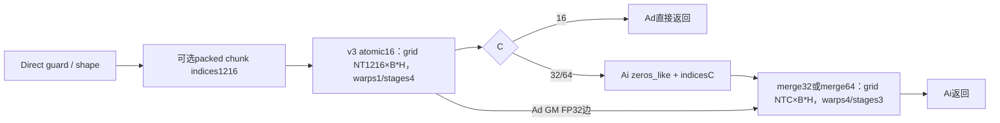
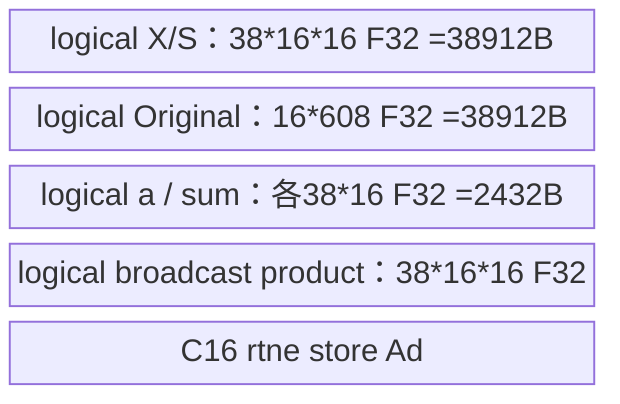
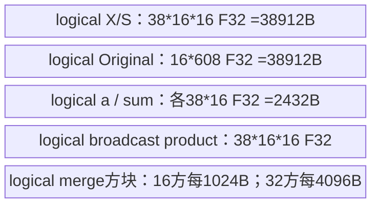

# 分块单位下三角求逆 950 Direct Invoke 算子知识

## 算子速览

| 项目 | 内容 |
|---|---|
| 实际入口 | `sgl_kernel_npu.implementation.triton.attention.gdn.solve_tril.solve_tril`；固定commit，Direct Invoke |
| 计算语义 | 各sequence/head/chunk求R=(I+A)^−1；A严格下三角，最后一维为chunk C，不是key维 |
| 输入输出 | 连续NPU A[B,T,H,C]、FP16/BF16/FP32，C16/32/64；可选同设备连续cu_seqlens int32/int64；新输出同shape，output_dtype三浮点型 |
| 执行类型 | 16×16原子节点AIV_VECTOR（乘/求和递推，没有tl.dot）；C32/64合并节点有可达AIC_CUBE语义的tl.dot和Vector布局/负号，故整体用CV；不推定生成kernel的MIX比例 |
| Kernel 路线 | R001/002 C16 fixed/varlen单JIT；R003/004 C32、R005/006 C64，均原子JIT→merge JIT |
| 核心资源 | Ad每有效row16元素，C>16时FP32；Ai新output且先清零；每原子task逻辑38×16×16 FP32域；物理L1/L0/UB/register由Triton编译器决定 |
| 来源闭包 | direct_implementation_closed：新/旧入口、注册/打包、索引helper、3种实际JIT、各参数/GM边/精度与tail已追溯；未实例化JIT显式排除 |
| 风险与边界 | C32 block_ptr loads只指定boundary_check、未显式padding_option；变长indices按Tensor identity缓存；1216行原子tile/608行子task的物理资源及编译接受性未运行验证 |
| 验证状态 | 本次知识提取未执行编译、真机、数值或性能测试；draft不表示已验证复用或病态矩阵误差界 |

## 接口与语义

### 计算语义

对每个sequence，按C个连续行分块，输入A的每row C列构成严格下三角矩阵。R=(I+A)^−1，输入A非负/负值均可，但对角/上三角必须0且全部有限，由调用方保证。不是求A本身的逆，也不是前一阶段KKT矩阵原样传入WY：WY要消费这里的逆R。packed模式在cu边界处重新分块，不能将跨sequence的行当同一C块。

原子16块以S=−tril(A,−1)开始，按i=1…15逐行递推：a=−A[i,:]，S[i,:]=a+Σ_k a[k]S[k,:]，最后对角+1。源码用FP32乘、tl.sum(轴0)而非tl.dot。C32把两个16逆D11/D22合并为下左−D22·A21·D11；C64先得两个32逆，再计算下左−R22_32·A21_32·R11_32，显式上右零。所有merge dot输入转换FP32并input_precision="ieee"，无FP16/BF16 dot输入近似声明。

原子Ad在C>16时始终FP32；C16直接按output_dtype以rtne存输出。merge只在最终store以rtne转output_dtype，不在每一层merge提前降精度。C64缺失行load显式other=0；C32的block_ptr load没有padding_option="zero"，所以公开尾块补零合同与源码的越界lane初始化需要区分，不能据boundary_check本身承诺zero。有效前缀正常理想逆的数学推导不替代编译器padding语义。

### 输入、输出与属性

| 参数 | shape/layout | dtype | 约束、默认值与语义 |
|---|---|---|---|
| A | [B,T,H,C] ND contiguous | FP16/BF16/FP32 | B/T/H全正，C16/32/64；NPU；严格下三角、有限值调用方负责，无逐元素检查 |
| cu_seqlens | [N+1] contiguous或None | int32/int64 | packed B=1、同A设备、至少2项；[0,…,T]严格递增且正长度调用方负责；Device会转int32 |
| output_dtype | dtype标量 | FP16/BF16/FP32 | 默认torch.float；决定最终GM类型 |
| R | 同A shape/device | output_dtype | 新建、输入不改；C16返回Ad，C32/64返回Ai |
| 公共impl | auto/triton/torch_native | str | 此Direct目标只分析Triton；auto固定Triton、无运行失败fallback；独立Torch参考的solve_triangular不进入本Direct图 |

### 入口与版本

本卡只覆盖指定Triton Direct函数。公开operators wrapper懒导入其函数；register_impl未指定支持列表即注册两代，generation.py确认2201/3510，文档支持arch22/arch35。平台标签按本卡Frontmatter冻结；CANN9.1.0依据README固定配置和CI声明，不宣称具体Triton编译器build。

旧 `sgl_kernel_npu.fla.solve_tril.solve_tril_npu` 与新实现5个JIT函数和其heuristics/jit decorator逐字相同，所有实际launch参数/分配相同；旧Host只assert C，新Host多_validate_inputs和NPU guard。旧import的exp/safe_exp/prepare_chunk_offsets未被本算子的JIT读取；唯一helper prepare_chunk_indices在旧fla/utils和新gdn_utils中算法及tensor_cache装饰相同，各自有独立cache实例。数学/Device实现复用不等于Host验证完全等价，不重复建旧Operator。

已阅读全文的[块内线性系统API](../../../../apis/sgl_kernel_npu/sgl_gdn_chunk_linear_system.md)可复用公开输入合同；[既有求逆Guide](../../../../../../ops/triton/guides/operator_design/solve_tril.md)属于不同来源的架构概述，未覆盖此固定版本完整Host/JIT。其性能数字不作为本次源码或性能证据。

## Host/Launcher 执行流程

### 参数校验与前处理

_validate_inputs依序assert rank4、各维正、C集合、contiguous、输入/输出dtype；有cu时assert B1、rank1/numel≥2、dtype int32/int64、same device、contiguous；之后assert A.device.type=="npu"。没有自动Contiguous或值验证。Python assert可能在优化模式被移除，调用方合同仍然存在，不能把失约输入认作有效fallback。

B/T/H/BT来自A.shape。Ad=empty([B,T,H,16])，BT16时output_dtype，否则FP32。LARGE_BLOCK_T=608*2=1216；原子v3 grid=(ceil(T/1216),B*H)，varlen用prepare_chunk_indices(cu,1216)长度代替首轴grid。num_warps1,num_stages4。BT16立即return Ad。否则Ai=zeros_like(A,output_dtype)，选择BT32 merge32或BT64 merge64，再按BT重新prepare indices并launch grid=(ceil(T/BT)或NTvar,B*H)，warps4/stages3。if BT!=32与else两分支参数相同，不是第三种调优Route。

prepare_lens将cu转int64后相邻相减；prepare_chunk_indices把ceil(length/chunksize)读tolist，CPU torch.arange各序列chunk号拼接，利用indices.eq(0).cumsum−1产生sequence号，stack两列再.to(cu)。这是索引元数据前处理，不是外部三角求逆数学核心；Torch长度转换/减法、CPU arange/stack/cumsum、H2D与Tensor分配是标注框架primitive。tolist对NPU长度同步，packed路径不是纯异步、不能承诺graph捕获无Host读取。

### 参数、Workspace 与生命周期

无ACLNN executor、无自有TCubeTiling/C POD、无AscendC显式system workspace。A/cu由调用方保持；Ad局部Tensor是第一节点输出，C>16为第二节点输入，持有到merge提交；Ai为新返回Tensor。Ad bytes=16BTH*(BT16?sizeof(out):4)，Ai bytes=BT16时0否则CBTH*sizeof(out)。zeros_like的零初始化是输出初始化框架边界，C32上右16×16未被merge写而依赖初始零。每节点在当前Triton/Torch NPU stream先后提交，没有源码自有event；跨kernel GM Ad可见性与allocator的异步存活由该runtime协议保证，不能把Python返回当作Device同步。

索引表形状[NT,2]，dtype沿cu，GM bytes=2NT*sizeof(cu)；两次chunksize1216/BT可各建一表。同一cu Tensor原地更改不会改变cache key。tensor_cache维护至多4个entries并以Tensor对象is判断（非Tensor精确type/value），命中移动到末尾；prepare_lens和prepare_chunk_indices各有cache，保留args/results强引用，无版本counter失效。变长分块表可能陈旧；需要新Tensor或显式外部缓存管理，源码无清cache入口。旧/新模块cache不同，不共享状态。

### 启动图与失败传播



assert或元数据构造/JIT编译异常在Python传播并中止后继，函数不捕获并fallback；异步Device错误依赖runtime后续同步，没有源码额外状态检查或重试。公共registry unknown impl/unsupported generation会显式异常，导入硬件检测失败也不绕过。原子C16纯Vector Route保留在同一CV卡；C32/64存在可达dot，不能因首节点无dot而改成VV整卡。
## Route 与参数设计

### 分核与资源计算

第0维program拆时间tile，第1维pid_bh拆batch/head：b=pid_bh//H，h=pid_bh%H。equal时bos=b*T；packed时通过chunk_indices[pid0,0/1]恢复sequence和局部tile，bos/eos从cu读取且to(int32)，局部T=eos−bos。Host不按AIC/AIV数固定grid，不从num_warps推定物理AIV核数或CUDA线程数。

原子每program覆盖1216行，分taskid0/1：base先为pid0*1216，task0不加偏移，task1加608；各task N_BLOCKS=38个16×16块，colStart=rowStart%BT，只加载C块对角上的原子子块。BT>16 merge每program1个C块，C32两个16dot，C64六个dot（四个16方块dot和两个32方块dot），每个dot都是FP32 ieee。num_stages4/3为编译参数，不等价自有4/3份UB或L1双缓冲。

输入A bytes=B*T*H*C*sA；Ad=16BTH*(C16?sO:4)；C>16输出Ai=BTHC*sO且零初始化；varlen表按各chunksize分别2NT*sCu。所有shape乘法是Python整数，但Device cu/index转int32，不能把int64输入当无限长索引。未显式核数上限、UB容量guard或资源fallback；编译资源失败由Triton报告。

### Route 选择

P=rank4且所有维正、contiguous NPU、A/output属于FP16/BF16/FP32、C∈{16,32,64}；varlen再要求B1、cu一维/至少2项/int32或int64/连续/同设备。严格下三角、finite、cu从0至T严格递增为未逐值验证的调用方合同。下列六条为控制Route；每行把输入/输出dtype的9个JIT类型实例及byte参数化完整保留，不把byte或舍入范围说成相同。

| 顺序 | Route | Key/模板 | 精确选择条件与优先级 | 不适用去向 |
|---:|---|---|---|---|
| 1 | R-001 C16等长递推 | BT=16,IS_VARLEN=0 | P；C=16；cu=None；dtype见下9实例 | 其它合法tuple对应其它行；非法P assert失败，无fallback |
| 2 | R-002 C16变长递推 | BT=16,IS_VARLEN=1 | P；C=16；cu非空且满足varlen附加guard；dtype见下9实例 | 其它合法tuple对应其它行；非法P assert失败，无fallback |
| 3 | R-003 C32等长分层合并 | BT=32,IS_VARLEN=0 | P；C=32；cu=None；dtype见下9实例 | 其它合法tuple对应其它行；非法P assert失败，无fallback |
| 4 | R-004 C32变长分层合并 | BT=32,IS_VARLEN=1 | P；C=32；cu非空且满足varlen附加guard；dtype见下9实例 | 其它合法tuple对应其它行；非法P assert失败，无fallback |
| 5 | R-005 C64等长分层合并 | BT=64,IS_VARLEN=0 | P；C=64；cu=None；dtype见下9实例 | 其它合法tuple对应其它行；非法P assert失败，无fallback |
| 6 | R-006 C64变长分层合并 | BT=64,IS_VARLEN=1 | P；C=64；cu非空且满足varlen附加guard；dtype见下9实例 | 其它合法tuple对应其它行；非法P assert失败，无fallback |

```text
_validate_inputs + NPU assert
IS_VARLEN=(cu!=None)
Ad=empty(B,T,H,16, dtype=BT16?output_dtype:FP32)
atomic_v3[NT1216,B*H](LARGE1216, warps1, stages4)
if C==16: return Ad
Ai=zeros_like(A,dtype=output_dtype)
merge_fn=merge32 if C==32 else merge64
merge_fn[NTC,B*H](BT=C,warps4,stages3)
return Ai
```

### 模板/实现执行矩阵

| Route | key/selector | dtype/shape/platform 完整命中条件 | 执行族与 kernel 节点 | 实际模板/body | 内存与同步特征 | tail/fallback |
|---|---|---|---|---|---|---|
| R-001 C16等长递推 | BT16/var0 | P及上表条件；9dtype实例；本卡Frontmatter平台 | AIV_VECTOR单v3 | v3 LARGE1216/NTASKS2/N_BLOCKS38；无merge | Ad即O，无跨kernel临时；无metadata | v3 mask other0；直接rtne |
| R-002 C16变长递推 | BT16/var1 | P及上表条件；9dtype实例；本卡Frontmatter平台 | AIV_VECTOR单v3 | v3 LARGE1216/NTASKS2/N_BLOCKS38；无merge | Ad即O，无跨kernel临时；metadata缓存/tolist | v3 mask other0；直接rtne |
| R-003 C32等长分层合并 | BT32/var0 | P及上表条件；9dtype实例；本卡Frontmatter平台 | AIV_VECTOR v3→含AIC_CUBE tl.dot的merge | v3 LARGE1216/NTASKS2/N_BLOCKS38；merge_16x16_to_32x32_inverse_kernel | Ad FP32 GM同流边，Ai先零；无metadata | v3 mask other0；merge boundary_check未显式zero |
| R-004 C32变长分层合并 | BT32/var1 | P及上表条件；9dtype实例；本卡Frontmatter平台 | AIV_VECTOR v3→含AIC_CUBE tl.dot的merge | v3 LARGE1216/NTASKS2/N_BLOCKS38；merge_16x16_to_32x32_inverse_kernel | Ad FP32 GM同流边，Ai先零；metadata缓存/tolist | v3 mask other0；merge boundary_check未显式zero |
| R-005 C64等长分层合并 | BT64/var0 | P及上表条件；9dtype实例；本卡Frontmatter平台 | AIV_VECTOR v3→含AIC_CUBE tl.dot的merge | v3 LARGE1216/NTASKS2/N_BLOCKS38；merge_16x16_to_64x64_inverse_kernel | Ad FP32 GM同流边，Ai先零；无metadata | v3 mask other0；merge mask/other0/上右显式zero |
| R-006 C64变长分层合并 | BT64/var1 | P及上表条件；9dtype实例；本卡Frontmatter平台 | AIV_VECTOR v3→含AIC_CUBE tl.dot的merge | v3 LARGE1216/NTASKS2/N_BLOCKS38；merge_16x16_to_64x64_inverse_kernel | Ad FP32 GM同流边，Ai先零；metadata缓存/tolist | v3 mask other0；merge mask/other0/上右显式zero |

| 类型实例 | A元素类型/字节sA | output类型/字节sO | 原子store | merge计算/store |
|---|---|---|---|---|
| D1，每条Route均实例化 | FP16/2B | FP16/2B | loadFP16→FP32；C16 rtne→FP16，C>16→FP32 Ad | C>16 FP32 ieee dot→rtne FP16；C16 N/A |
| D2，每条Route均实例化 | FP16/2B | BF16/2B | loadFP16→FP32；C16 rtne→BF16，C>16→FP32 Ad | C>16 FP32 ieee dot→rtne BF16；C16 N/A |
| D3，每条Route均实例化 | FP16/2B | FP32/4B | loadFP16→FP32；C16 rtne→FP32，C>16→FP32 Ad | C>16 FP32 ieee dot→rtne FP32；C16 N/A |
| D4，每条Route均实例化 | BF16/2B | FP16/2B | loadBF16→FP32；C16 rtne→FP16，C>16→FP32 Ad | C>16 FP32 ieee dot→rtne FP16；C16 N/A |
| D5，每条Route均实例化 | BF16/2B | BF16/2B | loadBF16→FP32；C16 rtne→BF16，C>16→FP32 Ad | C>16 FP32 ieee dot→rtne BF16；C16 N/A |
| D6，每条Route均实例化 | BF16/2B | FP32/4B | loadBF16→FP32；C16 rtne→FP32，C>16→FP32 Ad | C>16 FP32 ieee dot→rtne FP32；C16 N/A |
| D7，每条Route均实例化 | FP32/4B | FP16/2B | loadFP32→FP32；C16 rtne→FP16，C>16→FP32 Ad | C>16 FP32 ieee dot→rtne FP16；C16 N/A |
| D8，每条Route均实例化 | FP32/4B | BF16/2B | loadFP32→FP32；C16 rtne→BF16，C>16→FP32 Ad | C>16 FP32 ieee dot→rtne BF16；C16 N/A |
| D9，每条Route均实例化 | FP32/4B | FP32/4B | loadFP32→FP32；C16 rtne→FP32，C>16→FP32 Ad | C>16 FP32 ieee dot→rtne FP32；C16 N/A |

### 隐藏性能 Guard

| Guard | Host/Tiling 条件 | Device/资源原因 | 影响 Route | 不满足时去向 | 源码符号 |
|---|---|---|---|---|---|
| C集合 | C16/32/64 | 16原子对角子块、32/64固定merge公式/strides | 全部 | assert | _validate_inputs |
| 连续/设备 | A.is_contiguous且NPU，cu同设备连续 | JIT硬编码H*C和H*16 stride，无参数stride | 全部 | assert，不补copy | solve_tril |
| packed batch | B1且cu.numel≥2 | grid_bh没有第二批packedoffset，indices映射全局sequence | var Routes | assert | _validate_inputs |
| 输入值合同 | lower/finite；cu=[0,…,T]正长度 | recurrence只按lower结构，negative/invalid长度可生成非法metadata | 全部/var | 主Host不检查，无安全fallback | prepare_chunk_indices/原子body |
| int32范围 | cu/int64 load后to(int32)，chunk id同样 | 地址bos和局部T受32位值影响 | var | 没有显式范围guard；失约不可靠 | 三JIT头部 |
| 1216/608 shape | 固定LARGE_BLOCK_T=1216，N_BLOCKS38，tl.arange(0,608) | 当前编译局部tensor非2幂extent及live range | 全部 | compiler接受性/资源由实际Triton build决定，本次未编译 | v3 |
| 缓存不可变 | 同一cu Tensor不能原地改后期待失效 | identity缓存，不含version/data内容 | var | 返回旧长度/索引，无自动重算 | tensor_cache |
| output初始化 | C>16 zeros_like | C32只写三个16块，上右依赖零初始化 | C32 | 不能改empty_like而不补上右写零 | solve_tril/merge32 |
| tail补零差异 | C32 block_ptr仅boundary_check | padding_option未显式设置，不能继承C64的other0 | C32 | 需确认实际primitive语义，不宣称zero保证 | merge32 |

### POD/ABI

本入口没有C POD/TCubeTiling/固定序列化wire布局。下表逐参数列实际JIT调用槽；sizeof/alignof/offsetof及标量最终位宽由Triton编译生成，固定Python没有证明，不能伪造。constexpr由编译器specialize，不位于GM结构；T显式do_not_specialize，T的Host总长度与packed分支内重写局部长度需区分。B只用于Host grid，不传Device。

| 结构 | 字段 | 类型/位宽 | ABI 布局 | 单位 | Host/launcher producer | Device consumer | 边界 |
|---|---|---|---|---|---|---|---|
| atomic_v3 | A | typed GM pointer | slot0；物理包offset不可见 | 元素 | A Tensor | (bos*H+h)*BT + row*H*BT+col | dtype D1..D9 |
| atomic_v3 | Ad | typed GM pointer | slot1；物理包offset不可见 | 元素 | empty Tensor | (bos*H+h)*16 + row*H*16+col store | C16out；其余F32 |
| atomic_v3 | cu_seqlens | int32/int64 GM pointer或None | slot2；物理包offset不可见 | token | caller | IS_VARLEN时load bos/eos toI32 | 非var inactive |
| atomic_v3 | chunk_indices | cu同dtype GM pointer或None | slot3；物理包offset不可见 | 2列pair | prepare_chunk_indices(cu,1216) | load sequence/tile toI32 | 非var inactive |
| atomic_v3 | T | Python int/runtime scalar | slot4，位宽未固定；物理包offset不可见 | token | A.shape1 | equal总T；var后局部T | do_not_specialize |
| atomic_v3 | H | constexpr int | 编译参数；物理包offset不可见 | head | A.shape2 | bh拆分、GMstride | 正 |
| atomic_v3 | BT | constexpr int | 编译参数；物理包offset不可见 | 列 | A.shape3 | rowStart%BT/Astride | 16/32/64 |
| atomic_v3 | IS_VARLEN | constexpr bool | heuristics生成；物理包offset不可见 | bool | cu!=None | 变长指针分支 | 全Host路由 |
| atomic_v3 | LARGE_BLOCK_T | constexpr int | 编译参数；物理包offset不可见 | row | 608*2 | base,38个原子块/task | 1216 |
| merge32 | A | typed GM pointer | slot0；物理包offset不可见 | 元素 | A | merge读下左原矩阵 | inputcastF32 |
| merge32 | Ad | float32 GM pointer | slot1；物理包offset不可见 | 元素 | atomic_v3 | merge读16逆对角块 | 依赖前节点完成 |
| merge32 | Ai | output typed GM pointer | slot2；物理包offset不可见 | 元素 | zeros_like A | merge store rtne | 新返回owner |
| merge32 | cu_seqlens | I32/I64 GM pointer或None | slot3；物理包offset不可见 | token | caller | var bos/eos toI32 | 非var inactive |
| merge32 | chunk_indices | I32/I64 GM pointer或None | slot4；物理包offset不可见 | 2列pair | prepare_chunk_indices(cu,32) | var sequence/tile toI32 | 非var inactive |
| merge32 | T | runtime Python int | slot5，位宽未固定；物理包offset不可见 | token | A.shape1 | equal T/var局部T | do_not_specialize |
| merge32 | H | constexpr int | 编译参数；物理包offset不可见 | head | A.shape2 | stride H*C/H*16 | 正 |
| merge32 | BT | constexpr int | 编译参数；物理包offset不可见 | 列 | C32 | 寻址/upperzero mask | 固定 |
| merge32 | IS_VARLEN | constexpr bool | heuristics生成；物理包offset不可见 | bool | cu!=None | 地址分支 | 一致 |
| merge64 | A | typed GM pointer | slot0；物理包offset不可见 | 元素 | A | merge读下左原矩阵 | inputcastF32 |
| merge64 | Ad | float32 GM pointer | slot1；物理包offset不可见 | 元素 | atomic_v3 | merge读16逆对角块 | 依赖前节点完成 |
| merge64 | Ai | output typed GM pointer | slot2；物理包offset不可见 | 元素 | zeros_like A | merge store rtne | 新返回owner |
| merge64 | cu_seqlens | I32/I64 GM pointer或None | slot3；物理包offset不可见 | token | caller | var bos/eos toI32 | 非var inactive |
| merge64 | chunk_indices | I32/I64 GM pointer或None | slot4；物理包offset不可见 | 2列pair | prepare_chunk_indices(cu,64) | var sequence/tile toI32 | 非var inactive |
| merge64 | T | runtime Python int | slot5，位宽未固定；物理包offset不可见 | token | A.shape1 | equal T/var局部T | do_not_specialize |
| merge64 | H | constexpr int | 编译参数；物理包offset不可见 | head | A.shape2 | stride H*C/H*16 | 正 |
| merge64 | BT | constexpr int | 编译参数；物理包offset不可见 | 列 | C64 | 寻址/upperzero mask | 固定 |
| merge64 | IS_VARLEN | constexpr bool | heuristics生成；物理包offset不可见 | bool | cu!=None | 地址分支 | 一致 |

metadata是普通[NT,2] tensor：每row字段0=sequence编号、字段1=sequence内tile编号，元素宽度沿cu；stride(0)=2/stride(1)=1，字节偏移分别(2i)*sCu与(2i+1)*sCu。prepare_lens/indices结果由cache保留owner；原始cu不是拷贝快照。TL转int32不是Host guard。num_warps1/4、num_stages4/3、grid分别来自Host常量，不是GM POD字段；没有手工kernel arg pack/header生成源。

### Route 源码闭包

| Route | Key/selector | Host/Tiling producer | POD/参数 | Kernel entry/router | Kernel body/直接依赖 | 构建接线 |
|---|---|---|---|---|---|---|
| R-001 C16等长递推 | BT16,var0,D1..D9 | solve_tril shape/validate/allocate | 上表typed参数，无GM临时 | solve_tril_16x16_kernel_paral_v3 | v3循环/insert/extract/reduce；无Cube；Triton primitives边界 | root setup→torch_wheel.stage_runtime复制共同Python；jit懒编译，无本算子CMake entry |
| R-002 C16变长递推 | BT16,var1,D1..D9 | solve_tril shape/validate/allocate+gdn_utils prepare indices | 上表typed参数，无GM临时 | solve_tril_16x16_kernel_paral_v3 | v3循环/insert/extract/reduce；无Cube；Triton primitives边界 | root setup→torch_wheel.stage_runtime复制共同Python；jit懒编译，无本算子CMake entry |
| R-003 C32等长分层合并 | BT32,var0,D1..D9 | solve_tril shape/validate/allocate | 上表typed参数，Ad FP32 GM | solve_tril_16x16_kernel_paral_v3→merge_16x16_to_32x32_inverse_kernel | v3循环/insert/extract/reduce；对应merge完整dot+store；Triton primitives边界 | root setup→torch_wheel.stage_runtime复制共同Python；jit懒编译，无本算子CMake entry |
| R-004 C32变长分层合并 | BT32,var1,D1..D9 | solve_tril shape/validate/allocate+gdn_utils prepare indices | 上表typed参数，Ad FP32 GM | solve_tril_16x16_kernel_paral_v3→merge_16x16_to_32x32_inverse_kernel | v3循环/insert/extract/reduce；对应merge完整dot+store；Triton primitives边界 | root setup→torch_wheel.stage_runtime复制共同Python；jit懒编译，无本算子CMake entry |
| R-005 C64等长分层合并 | BT64,var0,D1..D9 | solve_tril shape/validate/allocate | 上表typed参数，Ad FP32 GM | solve_tril_16x16_kernel_paral_v3→merge_16x16_to_64x64_inverse_kernel | v3循环/insert/extract/reduce；对应merge完整dot+store；Triton primitives边界 | root setup→torch_wheel.stage_runtime复制共同Python；jit懒编译，无本算子CMake entry |
| R-006 C64变长分层合并 | BT64,var1,D1..D9 | solve_tril shape/validate/allocate+gdn_utils prepare indices | 上表typed参数，Ad FP32 GM | solve_tril_16x16_kernel_paral_v3→merge_16x16_to_64x64_inverse_kernel | v3循环/insert/extract/reduce；对应merge完整dot+store；Triton primitives边界 | root setup→torch_wheel.stage_runtime复制共同Python；jit懒编译，无本算子CMake entry |

## Kernel 实现

### 公共执行流程

所有Route实际只调用v3原子JIT；solve_tril_16x16_kernel_paral旧原子函数含device_print但未由Host调用，merge64_reorder_all_masked有CHUNKS_PER_PROGRAM/NT参数也未命中，均不列正式Route。它们与旧文件相同不构成额外公开版本。

原子两task按608行连续分割，38块16矩阵先tl.load(mask,other0)→insert_slice汇聚，trans/reshape为local_ori_A[16,608]作为原矩阵行预加载；b_A[38,16,16]置−严格lower。i1…15取原行→广播乘当前b_A→转置→tl.sum轴0→加原负行→insert_slice更新；最后diagonal+1，reshape[608,16]，store rows<T、rtne。相同program无atomic、跨program无共享写，合法metadata时各输出row/head唯一owner。

C32/64第二JIT从完整Ad GM读对角逆，merge中间矩阵保持FP32；compiler生成内部L1/L0/Vector数据传递和同步。本固定Python没有自有L1/L0A/B/C offset、buffer depth、bankpadding、硬件flag或最终UB/register报告；以下只给实际tensor值域/GM allocation字节，不把编译器边界假装成owned源码缺失，也不造硬件安全余量。当前specialization的全部dot形状/输入精度/layout/地址及producer仍逐Route列明。
### Route R-001：C16等长递推

#### 适用条件

##### 选择证据

| 层级 | 文件 | 符号 | 源码谓词/参数 | 结果/下一跳 |
|---|---|---|---|---|
| Direct Host | implementation/triton/attention/gdn/solve_tril.py | solve_tril/_validate_inputs | 公共P；BT=16；cu=None；dtype D1..D9 | Ad分配；var=0 |
| 元数据 | implementation/triton/attention/gdn/gdn_utils.py | prepare_chunk_indices | 分支不执行 | chunk_indices=None |
| JIT | solve_tril.py | atomic_v3 / 无merge | atomic LARGE1216,warps1,stages4；C16直接return | 纯AIV单节点 |

#### Device 数据流

##### 函数级调用链

```text
solve_tril(A,cu,output_dtype)
 -> _validate_inputs / NPU assert / Ad=empty
 -> NT=ceil(T/1216)
 -> solve_tril_16x16_kernel_paral_v3[NT,B*H]
    -> b=pid_bh//H，bos=b*T
    -> 2task * 38 diagonal16 load(mask,other0)
    -> insert/trans/reshape preload
    -> 15次行recurrence：extract_slice / mul / tl.sum / insert_slice
    -> diagonal+1 / rtne store Ad
 -> return Ad
```

##### 源码等价伪码

```text
源码等价伪码；指针偏移单位元素，sA/sO字节见dtype实例表
h=pid1%H
b=pid1//H；tile=pid0；bos=b*T；Tlocal=T
Aseq=A+(bos*H+h)*16; Adseq=Ad+(bos*H+h)*16
base=tile*1216
for taskid in 0..1:
    base += taskid*608
    X=zeros[38,16,16] FP32
    for j in0..37:
        row=base+j*16; col=row%16
        X[j]=load(Aseq+(row+arange16)*H*16+col+arange16,
                  row+arange16<Tlocal && col+arange16<16,other0).toFP32
    Original=reshape(trans(X,[1,0,2]),[16,608])
    S=-X*(row16>col16)
    for i=1..15:
        a=-reshape(extract_slice(Original,[i,0],[1,608]),[38,16])
        a += sum(trans(a[:,:,None]*S,[1,0,2]),axis0)
        S=insert_slice(S,a[:,None,:],offset[0,i,0],size[38,1,16])
    S=where(row16==col16,S+1,S)
    store(Adseq+(base+arange608)*H*16+arange16,reshape(S,[608,16]).rtne,
          mask=base+arange608<Tlocal)
return Ad
```

本Route只有乘/reduce的AIV递推，L1/L0 Cube路径N/A；不能给它补一个dot来满足CV标签。 equal grid0=ceil(T/1216)，C>16另有ceil(T/C)；没有sequence表。

#### 内存与数据搬运

##### 资源与搬运表

| 层级/缓冲区 | offset/地址公式 | extent/容量公式 | dtype/layout | producer | consumer | owner/lifetime | 对齐/复用 |
|---|---|---|---|---|---|---|---|
| GM A | (bos*H+h)*C + row*H*C+col | BTH*C*sA B | contiguous ND，D1..D9 input | caller | v3  | 整次异步任务 | 不传stride，必须连续 |
| GM Ad | (bos*H+h)*16 + row*H*16+col | 16BTH*sO B | [B,T,H,16]，out dtype | v3 | 调用方输出 | 返回Tensor | 每有效row16元素，无GM padding分配 |
| GM Ai/O | Ad别名返回 | 无新增 B | output dtype ND | v3 | caller | 返回Tensor/stream | C64上右显式0；C16无额外矩阵 |
| GM chunk table | N/A | 0 B | cu int32/int64，row2 | prepare_chunk_indices | v3/merge | tensor_cache持有 | int64加载后转int32，非无限范围 |
| L1/L0A/B/C | N/A，无Cube节点 | 0 ownedCube申请 | N/A | N/A | N/A | compiler perprogram | 无自有InitBuffer、手工transpose或硬件flag |
| UB/register 原子X/S | 无手工地址 | 38*16*16*4=38912B/逻辑张量域 | FP32 [38,16,16] | tl.load/row recurrence | 15次迭代/最终store | 每program的608行task | 不把reshape/trans当确定物理copy/alias |
| UB/register Original | 无手工地址 | 16*608*4=38912B逻辑域 | FP32 [16,608] | trans/reshape原始X | 每i extract | 每task始终原始值 | 与更新后S同时逻辑存活，物理复用编译器定 |
| UB/register 临时 | a/dot_product各38*16*4=2432B；广播mul38*16*16*4 | 表示式张量字节，不是UBpeak | FP32 | extract/mul/tl.sum | recurrence | 单行更新 | reduction轴0，38块独立 |
| merge operands/acc | N/A | 0 | FP32 | GMload/insert/dot | dot/store | 每merge program | 无merge |
| system/user workspace | N/A | 无自有workspace字节 | N/A | N/A | N/A | ATen tensor内存分别所有 | 不套AscendC16MiB公式 |

##### 分层内存布局




以上block图仅编译局部tensor值域，不是物理UB地址布局；compiler决定padding/复用/spill/寄存器分配。源码num_stages与warps不证明物理缓冲份数。

##### 字节账、交接边与复用顺序

```text
A_bytes=B*T*H*16*sA
Ad_bytes=B*T*H*16*sO
Ai_new_bytes=0
index_bytes=0
owned_workspace_bytes=0；Ad是独立Tensor临时，不是隐藏CANN workspace
atomic_task_logical_shape=38*16*16 F32；每program两608行task
physical_L1/L0/UB_peak/registers = 未在固定Python显式分配，未编译取值
```

| 边/复用子区 | producer | offset/extent | dtype/layout | consumer | ordering/sync | owner/lifetime | 安全条件 |
|---|---|---|---|---|---|---|---|
| cu→chunk table | prepare_lens→CPU arange/cumsum/stack→.to(cu) | 每表2NT*sCu | int32/int64连续pair | v3  | tolist同步+框架拷贝/current stream | cache强引用 | caller不原地改同对象；cu正长度合法 |
| 原子preload→row loop | 38个GM16tile load | 38912B逻辑原始域 | FP32 | extract每行 | TL数据依赖 | 单608行task | mask other0、lower/finite合同 |
| Ad跨kernel | atomic_v3 stores | 每row16*sAd，完整BTH域 | 输出dtype ND | 最终caller，无后继JIT | runtime异步返回 | Ad Tensor | 合法metadata，无不同stream并发覆写 |
| Ai初始零→merge | zeros_like | N/A | output dtype | N/A | Tensor初始化与后继同流 | Ai返回owner | Ad返回无此边 |
| dot内部 | N/A | N/A | N/A | N/A | compiler pipeline | perprogram | 不补造自有flag、L1容量/片数 |

#### 同步、精度与尾块

##### 同步与数值边界表

| 阶段 | primitive/机制 | producer | consumer/等待点 | 保护对象 | 精度/尾块 |
|---|---|---|---|---|---|
| packed metadata | .tolist/.to +cache | Host helper | 当前JIT | cu/table | 本Route不执行 |
| 原子load | tl.load mask other0 | A GM | X | 对角16tile | row<Tlocal/col<C；FP16/BF16/F32→F32 |
| 递推 | extract/insert/mul/tl.sum axis0 | 原始行/当前S | 下一行S | 38个独立16逆 | F32，15次loop，diagonal+1；finite/lower前提 |
| 原子store | TL依赖+tl.store rowmask | S | Ad | 608行task | rtne，C16output type，其余FP32 |
| 跨kernel | N/A | 无 | 无 | 无临时交接 | 无owned event/flag，不能推不同stream自然有序 |
| merge load/tail | N/A | A/Ad | dot | N/A | 无merge |
| merge MM | N/A | FP32 tile | FP32acc | N/A | 不使用Tensor输入低精dot；降output仅最终store |
| 输出store | 原子 rtne/mask | FP32 result | GM O | 有效row/head | 无补造paddingrow输出 |

#### 关键实现

##### 符号证据表

| 阶段 | 文件 | 符号/模板实例 | 实现事实 |
|---|---|---|---|
| Host/Tiling producer | implementation/triton/attention/gdn/solve_tril.py | solve_tril | BT16/var0；Ad类型/2类grid；无Tiling C结构 |
| Kernel entry/router | 同文件 | solve_tril_16x16_kernel_paral_v3 | LARGE1216,NTASKS2,N_BLOCKS38；IS_VARLEN0；warps1/stages4 |
| Device body/helper | 同文件 | v3 row loop | 38×16预加载、15次乘/轴0reduce、insert、rtne |
| Device body/helper | 同文件 | 无merge | 未调用merge，纯Vector |
| Device body/helper | implementation/triton/attention/gdn/gdn_utils.py | prepare_chunk_indices/tensor_cache | 当前None分支不调用 |
| 旧路径映射 | fla/solve_tril.py / fla/utils.py | solve_tril_npu / 同名JIT/helper | 相同Device与launch，新Host验证更严格，cache实例独立 |


### Route R-002：C16变长递推

#### 适用条件

##### 选择证据

| 层级 | 文件 | 符号 | 源码谓词/参数 | 结果/下一跳 |
|---|---|---|---|---|
| Direct Host | implementation/triton/attention/gdn/solve_tril.py | solve_tril/_validate_inputs | 公共P；BT=16；cu!=None且B1/同设备连续；dtype D1..D9 | Ad分配；var=1 |
| 元数据 | implementation/triton/attention/gdn/gdn_utils.py | prepare_chunk_indices | LARGE1216以及C16的两类分块（C16只1216） | [NT,2]缓存表、tolist同步 |
| JIT | solve_tril.py | atomic_v3 / 无merge | atomic LARGE1216,warps1,stages4；C16直接return | 纯AIV单节点 |

#### Device 数据流

##### 函数级调用链

```text
solve_tril(A,cu,output_dtype)
 -> _validate_inputs / NPU assert / Ad=empty
 -> prepare_chunk_indices(cu,1216) / prepare_lens / tensor_cache
 -> solve_tril_16x16_kernel_paral_v3[NT,B*H]
    -> load indices/seq bos,eos，castI32
    -> 2task * 38 diagonal16 load(mask,other0)
    -> insert/trans/reshape preload
    -> 15次行recurrence：extract_slice / mul / tl.sum / insert_slice
    -> diagonal+1 / rtne store Ad
 -> return Ad
```

##### 源码等价伪码

```text
源码等价伪码；指针偏移单位元素，sA/sO字节见dtype实例表
h=pid1%H
seq, tile=load(chunk_indices[pid0,0/1]).toI32；bos,eos=load(cu[seq/seq+1]).toI32；Tlocal=eos-bos
Aseq=A+(bos*H+h)*16; Adseq=Ad+(bos*H+h)*16
base=tile*1216
for taskid in 0..1:
    base += taskid*608
    X=zeros[38,16,16] FP32
    for j in0..37:
        row=base+j*16; col=row%16
        X[j]=load(Aseq+(row+arange16)*H*16+col+arange16,
                  row+arange16<Tlocal && col+arange16<16,other0).toFP32
    Original=reshape(trans(X,[1,0,2]),[16,608])
    S=-X*(row16>col16)
    for i=1..15:
        a=-reshape(extract_slice(Original,[i,0],[1,608]),[38,16])
        a += sum(trans(a[:,:,None]*S,[1,0,2]),axis0)
        S=insert_slice(S,a[:,None,:],offset[0,i,0],size[38,1,16])
    S=where(row16==col16,S+1,S)
    store(Adseq+(base+arange608)*H*16+arange16,reshape(S,[608,16]).rtne,
          mask=base+arange608<Tlocal)
return Ad
```

本Route只有乘/reduce的AIV递推，L1/L0 Cube路径N/A；不能给它补一个dot来满足CV标签。 packed两类indices按Tensor identity缓存，原地改cu可使Host grid/table与Device当前bos/eos不一致，读写范围不保证。

#### 内存与数据搬运

##### 资源与搬运表

| 层级/缓冲区 | offset/地址公式 | extent/容量公式 | dtype/layout | producer | consumer | owner/lifetime | 对齐/复用 |
|---|---|---|---|---|---|---|---|
| GM A | (bos*H+h)*C + row*H*C+col | BTH*C*sA B | contiguous ND，D1..D9 input | caller | v3  | 整次异步任务 | 不传stride，必须连续 |
| GM Ad | (bos*H+h)*16 + row*H*16+col | 16BTH*sO B | [B,T,H,16]，out dtype | v3 | 调用方输出 | 返回Tensor | 每有效row16元素，无GM padding分配 |
| GM Ai/O | Ad别名返回 | 无新增 B | output dtype ND | v3 | caller | 返回Tensor/stream | C64上右显式0；C16无额外矩阵 |
| GM chunk table | 2*pid0/2*pid0+1 | 2NT1216*sCu B | cu int32/int64，row2 | prepare_chunk_indices | v3/merge | tensor_cache持有 | int64加载后转int32，非无限范围 |
| L1/L0A/B/C | N/A，无Cube节点 | 0 ownedCube申请 | N/A | N/A | N/A | compiler perprogram | 无自有InitBuffer、手工transpose或硬件flag |
| UB/register 原子X/S | 无手工地址 | 38*16*16*4=38912B/逻辑张量域 | FP32 [38,16,16] | tl.load/row recurrence | 15次迭代/最终store | 每program的608行task | 不把reshape/trans当确定物理copy/alias |
| UB/register Original | 无手工地址 | 16*608*4=38912B逻辑域 | FP32 [16,608] | trans/reshape原始X | 每i extract | 每task始终原始值 | 与更新后S同时逻辑存活，物理复用编译器定 |
| UB/register 临时 | a/dot_product各38*16*4=2432B；广播mul38*16*16*4 | 表示式张量字节，不是UBpeak | FP32 | extract/mul/tl.sum | recurrence | 单行更新 | reduction轴0，38块独立 |
| merge operands/acc | N/A | 0 | FP32 | GMload/insert/dot | dot/store | 每merge program | 无merge |
| system/user workspace | N/A | 无自有workspace字节 | N/A | N/A | N/A | ATen tensor内存分别所有 | 不套AscendC16MiB公式 |

##### 分层内存布局


以上block图仅编译局部tensor值域，不是物理UB地址布局；compiler决定padding/复用/spill/寄存器分配。源码num_stages与warps不证明物理缓冲份数。

##### 字节账、交接边与复用顺序

```text
A_bytes=B*T*H*16*sA
Ad_bytes=B*T*H*16*sO
Ai_new_bytes=0
index_bytes=2*NT1216*sCu
owned_workspace_bytes=0；Ad是独立Tensor临时，不是隐藏CANN workspace
atomic_task_logical_shape=38*16*16 F32；每program两608行task
physical_L1/L0/UB_peak/registers = 未在固定Python显式分配，未编译取值
```

| 边/复用子区 | producer | offset/extent | dtype/layout | consumer | ordering/sync | owner/lifetime | 安全条件 |
|---|---|---|---|---|---|---|---|
| cu→chunk table | prepare_lens→CPU arange/cumsum/stack→.to(cu) | 每表2NT*sCu | int32/int64连续pair | v3  | tolist同步+框架拷贝/current stream | cache强引用 | caller不原地改同对象；cu正长度合法 |
| 原子preload→row loop | 38个GM16tile load | 38912B逻辑原始域 | FP32 | extract每行 | TL数据依赖 | 单608行task | mask other0、lower/finite合同 |
| Ad跨kernel | atomic_v3 stores | 每row16*sAd，完整BTH域 | 输出dtype ND | 最终caller，无后继JIT | runtime异步返回 | Ad Tensor | 合法metadata，无不同stream并发覆写 |
| Ai初始零→merge | zeros_like | N/A | output dtype | N/A | Tensor初始化与后继同流 | Ai返回owner | Ad返回无此边 |
| dot内部 | N/A | N/A | N/A | N/A | compiler pipeline | perprogram | 不补造自有flag、L1容量/片数 |

#### 同步、精度与尾块

##### 同步与数值边界表

| 阶段 | primitive/机制 | producer | consumer/等待点 | 保护对象 | 精度/尾块 |
|---|---|---|---|---|---|
| packed metadata | .tolist/.to +cache | Host helper | 当前JIT | cu/table | 有同步，identity不校验内容 |
| 原子load | tl.load mask other0 | A GM | X | 对角16tile | row<Tlocal/col<C；FP16/BF16/F32→F32 |
| 递推 | extract/insert/mul/tl.sum axis0 | 原始行/当前S | 下一行S | 38个独立16逆 | F32，15次loop，diagonal+1；finite/lower前提 |
| 原子store | TL依赖+tl.store rowmask | S | Ad | 608行task | rtne，C16output type，其余FP32 |
| 跨kernel | N/A | 无 | 无 | 无临时交接 | 无owned event/flag，不能推不同stream自然有序 |
| merge load/tail | N/A | A/Ad | dot | N/A | 无merge |
| merge MM | N/A | FP32 tile | FP32acc | N/A | 不使用Tensor输入低精dot；降output仅最终store |
| 输出store | 原子 rtne/mask | FP32 result | GM O | 有效row/head | 无补造paddingrow输出 |

#### 关键实现

##### 符号证据表

| 阶段 | 文件 | 符号/模板实例 | 实现事实 |
|---|---|---|---|
| Host/Tiling producer | implementation/triton/attention/gdn/solve_tril.py | solve_tril | BT16/var1；Ad类型/2类grid；无Tiling C结构 |
| Kernel entry/router | 同文件 | solve_tril_16x16_kernel_paral_v3 | LARGE1216,NTASKS2,N_BLOCKS38；IS_VARLEN1；warps1/stages4 |
| Device body/helper | 同文件 | v3 row loop | 38×16预加载、15次乘/轴0reduce、insert、rtne |
| Device body/helper | 同文件 | 无merge | 未调用merge，纯Vector |
| Device body/helper | implementation/triton/attention/gdn/gdn_utils.py | prepare_chunk_indices/tensor_cache | 当前metadataproducer，4entry identitycache |
| 旧路径映射 | fla/solve_tril.py / fla/utils.py | solve_tril_npu / 同名JIT/helper | 相同Device与launch，新Host验证更严格，cache实例独立 |


### Route R-003：C32等长分层合并

#### 适用条件

##### 选择证据

| 层级 | 文件 | 符号 | 源码谓词/参数 | 结果/下一跳 |
|---|---|---|---|---|
| Direct Host | implementation/triton/attention/gdn/solve_tril.py | solve_tril/_validate_inputs | 公共P；BT=32；cu=None；dtype D1..D9 | Ad分配；var=0 |
| 元数据 | implementation/triton/attention/gdn/gdn_utils.py | prepare_chunk_indices | 分支不执行 | chunk_indices=None |
| JIT | solve_tril.py | atomic_v3 / merge_16x16_to_32x32_inverse_kernel | atomic LARGE1216,warps1,stages4；merge warps4/stages3 | 两个节点，merge有tl.dot |

#### Device 数据流

##### 函数级调用链

```text
solve_tril(A,cu,output_dtype)
 -> _validate_inputs / NPU assert / Ad=empty
 -> NT=ceil(T/1216)
 -> solve_tril_16x16_kernel_paral_v3[NT,B*H]
    -> b=pid_bh//H，bos=b*T
    -> 2task * 38 diagonal16 load(mask,other0)
    -> insert/trans/reshape preload
    -> 15次行recurrence：extract_slice / mul / tl.sum / insert_slice
    -> diagonal+1 / rtne store Ad
 -> Ai=zeros_like / NT=ceil(T/32)
 -> merge_16x16_to_32x32_inverse_kernel[NT,B*H]
    -> load A21,D11,D22 block_ptr；2次FP32 ieee dot
    -> store三个16块；上右保持Host zero
 -> return Ai
```

##### 源码等价伪码

```text
源码等价伪码；指针偏移单位元素，sA/sO字节见dtype实例表
h=pid1%H
b=pid1//H；tile=pid0；bos=b*T；Tlocal=T
Aseq=A+(bos*H+h)*32; Adseq=Ad+(bos*H+h)*16
base=tile*1216
for taskid in 0..1:
    base += taskid*608
    X=zeros[38,16,16] FP32
    for j in0..37:
        row=base+j*16; col=row%32
        X[j]=load(Aseq+(row+arange16)*H*32+col+arange16,
                  row+arange16<Tlocal && col+arange16<32,other0).toFP32
    Original=reshape(trans(X,[1,0,2]),[16,608])
    S=-X*(row16>col16)
    for i=1..15:
        a=-reshape(extract_slice(Original,[i,0],[1,608]),[38,16])
        a += sum(trans(a[:,:,None]*S,[1,0,2]),axis0)
        S=insert_slice(S,a[:,None,:],offset[0,i,0],size[38,1,16])
    S=where(row16==col16,S+1,S)
    store(Adseq+(base+arange608)*H*16+arange16,reshape(S,[608,16]).rtne,
          mask=base+arange608<Tlocal)
# 第二JIT独立重新按C大小恢复tile；不得复用1216表索引当C表
tile=pid0；bos=b*T
Aseq=A+(bos*H+h)*32; Adseq=Ad+(bos*H+h)*16; Oseq=Ai+(bos*H+h)*32
D11=load Ad[tile*32+0:16,0:16]，D22=load Ad[tile*32+16:32,0:16]
A21=load A[tile*32+16:32,0:16]
# block_ptr boundary_check(0,1)，没有显式padding_option="zero"
R21=-dot(dot(D22,A21,ieee),D11,ieee)
store O 的(0:16,0:16)=D11、(16:32,16:32)=D22、(16:32,0:16)=R21
# O上右未写，保留zeros_like的零；各store boundary_check(0,1),rtne
```

C32输出upper-right16靠Host zeros_like，不是merge写出；三次load的padding_option留空，不能从boundary_check推导缺失行必为0。 equal grid0=ceil(T/1216)，C>16另有ceil(T/C)；没有sequence表。

#### 内存与数据搬运

##### 资源与搬运表

| 层级/缓冲区 | offset/地址公式 | extent/容量公式 | dtype/layout | producer | consumer | owner/lifetime | 对齐/复用 |
|---|---|---|---|---|---|---|---|
| GM A | (bos*H+h)*C + row*H*C+col | BTH*C*sA B | contiguous ND，D1..D9 input | caller | v3 及merge | 整次异步任务 | 不传stride，必须连续 |
| GM Ad | (bos*H+h)*16 + row*H*16+col | 64BTH B | [B,T,H,16]，FP32 | v3 | merge读 | 局部Tensor持有到merge提交，runtime异步owner | 每有效row16元素，无GM padding分配 |
| GM Ai/O | (bos*H+h)*C+row*H*C+col | BTH*C*sO B | output dtype ND | Host zeros_like + merge | caller | 返回Tensor/stream | 上右依赖初值0 |
| GM chunk table | N/A | 0 B | cu int32/int64，row2 | prepare_chunk_indices | v3/merge | tensor_cache持有 | int64加载后转int32，非无限范围 |
| L1/L0A/B/C | compiler lowering：16/32方块FP32 ieee dot | 当前实例见dot形状；物理容量/offset/db不可见 | F32 operands/F32acc，布局由compiler | tl.load/insert_slice | tl.dot/store | compiler perprogram | 无自有InitBuffer、手工transpose或硬件flag |
| UB/register 原子X/S | 无手工地址 | 38*16*16*4=38912B/逻辑张量域 | FP32 [38,16,16] | tl.load/row recurrence | 15次迭代/最终store | 每program的608行task | 不把reshape/trans当确定物理copy/alias |
| UB/register Original | 无手工地址 | 16*608*4=38912B逻辑域 | FP32 [16,608] | trans/reshape原始X | 每i extract | 每task始终原始值 | 与更新后S同时逻辑存活，物理复用编译器定 |
| UB/register 临时 | a/dot_product各38*16*4=2432B；广播mul38*16*16*4 | 表示式张量字节，不是UBpeak | FP32 | extract/mul/tl.sum | recurrence | 单行更新 | reduction轴0，38块独立 |
| merge operands/acc | 16方块每个1024B：D11,D22,A21,tmp,R21 | 逻辑域，不可相加冒充峰值 | FP32 | GMload/insert/dot | dot/store | 每merge program | 2次16×16×16 dot |
| system/user workspace | N/A | 无自有workspace字节 | N/A | N/A | N/A | ATen tensor内存分别所有 | 不套AscendC16MiB公式 |

##### 分层内存布局




以上block图仅编译局部tensor值域，不是物理UB地址布局；compiler决定padding/复用/spill/寄存器分配。源码num_stages与warps不证明物理缓冲份数。

##### 字节账、交接边与复用顺序

```text
A_bytes=B*T*H*32*sA
Ad_bytes=B*T*H*16*4
Ai_new_bytes=B*T*H*32*sO
index_bytes=0
owned_workspace_bytes=0；Ad是独立Tensor临时，不是隐藏CANN workspace
atomic_task_logical_shape=38*16*16 F32；每program两608行task
physical_L1/L0/UB_peak/registers = 未在固定Python显式分配，未编译取值
```

| 边/复用子区 | producer | offset/extent | dtype/layout | consumer | ordering/sync | owner/lifetime | 安全条件 |
|---|---|---|---|---|---|---|---|
| cu→chunk table | prepare_lens→CPU arange/cumsum/stack→.to(cu) | 每表2NT*sCu | int32/int64连续pair | v3 及merge | tolist同步+框架拷贝/current stream | cache强引用 | caller不原地改同对象；cu正长度合法 |
| 原子preload→row loop | 38个GM16tile load | 38912B逻辑原始域 | FP32 | extract每行 | TL数据依赖 | 单608行task | mask other0、lower/finite合同 |
| Ad跨kernel | atomic_v3 stores | 每row16*sAd，完整BTH域 | FP32 ND | merge读对角逆 | 同current stream提交顺序/GM依赖 | Ad Tensor | 合法metadata，无不同stream并发覆写 |
| Ai初始零→merge | zeros_like | BTH*C*sO | output dtype | 上右未写域/最终output | Tensor初始化与后继同流 | Ai返回owner | 不能改empty省清零 |
| dot内部 | typedFP32 operands | 16/32 tile逻辑域，物理offset编译器决定 | FP32 ieee | 后dot或store | compiler pipeline | perprogram | 不补造自有flag、L1容量/片数 |

#### 同步、精度与尾块

##### 同步与数值边界表

| 阶段 | primitive/机制 | producer | consumer/等待点 | 保护对象 | 精度/尾块 |
|---|---|---|---|---|---|
| packed metadata | .tolist/.to +cache | Host helper | 当前JIT | cu/table | 本Route不执行 |
| 原子load | tl.load mask other0 | A GM | X | 对角16tile | row<Tlocal/col<C；FP16/BF16/F32→F32 |
| 递推 | extract/insert/mul/tl.sum axis0 | 原始行/当前S | 下一行S | 38个独立16逆 | F32，15次loop，diagonal+1；finite/lower前提 |
| 原子store | TL依赖+tl.store rowmask | S | Ad | 608行task | rtne，C16output type，其余FP32 |
| 跨kernel | 同current stream，Triton runtime调度 | 原子Ad | merge | Ad GM | 无owned event/flag，不能推不同stream自然有序 |
| merge load/tail | block_ptr boundary_check(0,1) | A/Ad | dot | 16/32方块 | padding_option未显式zero |
| merge MM | tl.dot(input_precision=ieee) | FP32 tile | FP32acc | 2dot | 不使用Tensor输入低精dot；降output仅最终store |
| 输出store | merge rtne/mask | FP32 result | GM O | 有效row/head | upperright保留Host0 |

#### 关键实现

##### 符号证据表

| 阶段 | 文件 | 符号/模板实例 | 实现事实 |
|---|---|---|---|
| Host/Tiling producer | implementation/triton/attention/gdn/solve_tril.py | solve_tril | BT32/var0；Ad类型/2类grid；无Tiling C结构 |
| Kernel entry/router | 同文件 | solve_tril_16x16_kernel_paral_v3 | LARGE1216,NTASKS2,N_BLOCKS38；IS_VARLEN0；warps1/stages4 |
| Device body/helper | 同文件 | v3 row loop | 38×16预加载、15次乘/轴0reduce、insert、rtne |
| Device body/helper | 同文件 | merge_16x16_to_32x32_inverse_kernel | 3load、2dot、3store，upperzero依赖Host |
| Device body/helper | implementation/triton/attention/gdn/gdn_utils.py | prepare_chunk_indices/tensor_cache | 当前None分支不调用 |
| 旧路径映射 | fla/solve_tril.py / fla/utils.py | solve_tril_npu / 同名JIT/helper | 相同Device与launch，新Host验证更严格，cache实例独立 |


### Route R-004：C32变长分层合并

#### 适用条件

##### 选择证据

| 层级 | 文件 | 符号 | 源码谓词/参数 | 结果/下一跳 |
|---|---|---|---|---|
| Direct Host | implementation/triton/attention/gdn/solve_tril.py | solve_tril/_validate_inputs | 公共P；BT=32；cu!=None且B1/同设备连续；dtype D1..D9 | Ad分配；var=1 |
| 元数据 | implementation/triton/attention/gdn/gdn_utils.py | prepare_chunk_indices | LARGE1216以及C32的两类分块（C16只1216） | [NT,2]缓存表、tolist同步 |
| JIT | solve_tril.py | atomic_v3 / merge_16x16_to_32x32_inverse_kernel | atomic LARGE1216,warps1,stages4；merge warps4/stages3 | 两个节点，merge有tl.dot |

#### Device 数据流

##### 函数级调用链

```text
solve_tril(A,cu,output_dtype)
 -> _validate_inputs / NPU assert / Ad=empty
 -> prepare_chunk_indices(cu,1216) / prepare_lens / tensor_cache
 -> solve_tril_16x16_kernel_paral_v3[NT,B*H]
    -> load indices/seq bos,eos，castI32
    -> 2task * 38 diagonal16 load(mask,other0)
    -> insert/trans/reshape preload
    -> 15次行recurrence：extract_slice / mul / tl.sum / insert_slice
    -> diagonal+1 / rtne store Ad
 -> Ai=zeros_like / prepare_chunk_indices(cu,32)
 -> merge_16x16_to_32x32_inverse_kernel[NT,B*H]
    -> load A21,D11,D22 block_ptr；2次FP32 ieee dot
    -> store三个16块；上右保持Host zero
 -> return Ai
```

##### 源码等价伪码

```text
源码等价伪码；指针偏移单位元素，sA/sO字节见dtype实例表
h=pid1%H
seq, tile=load(chunk_indices[pid0,0/1]).toI32；bos,eos=load(cu[seq/seq+1]).toI32；Tlocal=eos-bos
Aseq=A+(bos*H+h)*32; Adseq=Ad+(bos*H+h)*16
base=tile*1216
for taskid in 0..1:
    base += taskid*608
    X=zeros[38,16,16] FP32
    for j in0..37:
        row=base+j*16; col=row%32
        X[j]=load(Aseq+(row+arange16)*H*32+col+arange16,
                  row+arange16<Tlocal && col+arange16<32,other0).toFP32
    Original=reshape(trans(X,[1,0,2]),[16,608])
    S=-X*(row16>col16)
    for i=1..15:
        a=-reshape(extract_slice(Original,[i,0],[1,608]),[38,16])
        a += sum(trans(a[:,:,None]*S,[1,0,2]),axis0)
        S=insert_slice(S,a[:,None,:],offset[0,i,0],size[38,1,16])
    S=where(row16==col16,S+1,S)
    store(Adseq+(base+arange608)*H*16+arange16,reshape(S,[608,16]).rtne,
          mask=base+arange608<Tlocal)
# 第二JIT独立重新按C大小恢复tile；不得复用1216表索引当C表
seq,tile=chunk_indicesC[pid0]；bos/eos=cu[seq/seq+1]；Tlocal=eos-bos
Aseq=A+(bos*H+h)*32; Adseq=Ad+(bos*H+h)*16; Oseq=Ai+(bos*H+h)*32
D11=load Ad[tile*32+0:16,0:16]，D22=load Ad[tile*32+16:32,0:16]
A21=load A[tile*32+16:32,0:16]
# block_ptr boundary_check(0,1)，没有显式padding_option="zero"
R21=-dot(dot(D22,A21,ieee),D11,ieee)
store O 的(0:16,0:16)=D11、(16:32,16:32)=D22、(16:32,0:16)=R21
# O上右未写，保留zeros_like的零；各store boundary_check(0,1),rtne
```

C32输出upper-right16靠Host zeros_like，不是merge写出；三次load的padding_option留空，不能从boundary_check推导缺失行必为0。 packed两类indices按Tensor identity缓存，原地改cu可使Host grid/table与Device当前bos/eos不一致，读写范围不保证。

#### 内存与数据搬运

##### 资源与搬运表

| 层级/缓冲区 | offset/地址公式 | extent/容量公式 | dtype/layout | producer | consumer | owner/lifetime | 对齐/复用 |
|---|---|---|---|---|---|---|---|
| GM A | (bos*H+h)*C + row*H*C+col | BTH*C*sA B | contiguous ND，D1..D9 input | caller | v3 及merge | 整次异步任务 | 不传stride，必须连续 |
| GM Ad | (bos*H+h)*16 + row*H*16+col | 64BTH B | [B,T,H,16]，FP32 | v3 | merge读 | 局部Tensor持有到merge提交，runtime异步owner | 每有效row16元素，无GM padding分配 |
| GM Ai/O | (bos*H+h)*C+row*H*C+col | BTH*C*sO B | output dtype ND | Host zeros_like + merge | caller | 返回Tensor/stream | 上右依赖初值0 |
| GM chunk table | 2*pid0/2*pid0+1 | 2NT1216*sCu+2NTC*sCu B | cu int32/int64，row2 | prepare_chunk_indices | v3/merge | tensor_cache持有 | int64加载后转int32，非无限范围 |
| L1/L0A/B/C | compiler lowering：16/32方块FP32 ieee dot | 当前实例见dot形状；物理容量/offset/db不可见 | F32 operands/F32acc，布局由compiler | tl.load/insert_slice | tl.dot/store | compiler perprogram | 无自有InitBuffer、手工transpose或硬件flag |
| UB/register 原子X/S | 无手工地址 | 38*16*16*4=38912B/逻辑张量域 | FP32 [38,16,16] | tl.load/row recurrence | 15次迭代/最终store | 每program的608行task | 不把reshape/trans当确定物理copy/alias |
| UB/register Original | 无手工地址 | 16*608*4=38912B逻辑域 | FP32 [16,608] | trans/reshape原始X | 每i extract | 每task始终原始值 | 与更新后S同时逻辑存活，物理复用编译器定 |
| UB/register 临时 | a/dot_product各38*16*4=2432B；广播mul38*16*16*4 | 表示式张量字节，不是UBpeak | FP32 | extract/mul/tl.sum | recurrence | 单行更新 | reduction轴0，38块独立 |
| merge operands/acc | 16方块每个1024B：D11,D22,A21,tmp,R21 | 逻辑域，不可相加冒充峰值 | FP32 | GMload/insert/dot | dot/store | 每merge program | 2次16×16×16 dot |
| system/user workspace | N/A | 无自有workspace字节 | N/A | N/A | N/A | ATen tensor内存分别所有 | 不套AscendC16MiB公式 |

##### 分层内存布局


以上block图仅编译局部tensor值域，不是物理UB地址布局；compiler决定padding/复用/spill/寄存器分配。源码num_stages与warps不证明物理缓冲份数。

##### 字节账、交接边与复用顺序

```text
A_bytes=B*T*H*32*sA
Ad_bytes=B*T*H*16*4
Ai_new_bytes=B*T*H*32*sO
index_bytes=2*NT1216*sCu+2*NT32*sCu
owned_workspace_bytes=0；Ad是独立Tensor临时，不是隐藏CANN workspace
atomic_task_logical_shape=38*16*16 F32；每program两608行task
physical_L1/L0/UB_peak/registers = 未在固定Python显式分配，未编译取值
```

| 边/复用子区 | producer | offset/extent | dtype/layout | consumer | ordering/sync | owner/lifetime | 安全条件 |
|---|---|---|---|---|---|---|---|
| cu→chunk table | prepare_lens→CPU arange/cumsum/stack→.to(cu) | 每表2NT*sCu | int32/int64连续pair | v3 及merge | tolist同步+框架拷贝/current stream | cache强引用 | caller不原地改同对象；cu正长度合法 |
| 原子preload→row loop | 38个GM16tile load | 38912B逻辑原始域 | FP32 | extract每行 | TL数据依赖 | 单608行task | mask other0、lower/finite合同 |
| Ad跨kernel | atomic_v3 stores | 每row16*sAd，完整BTH域 | FP32 ND | merge读对角逆 | 同current stream提交顺序/GM依赖 | Ad Tensor | 合法metadata，无不同stream并发覆写 |
| Ai初始零→merge | zeros_like | BTH*C*sO | output dtype | 上右未写域/最终output | Tensor初始化与后继同流 | Ai返回owner | 不能改empty省清零 |
| dot内部 | typedFP32 operands | 16/32 tile逻辑域，物理offset编译器决定 | FP32 ieee | 后dot或store | compiler pipeline | perprogram | 不补造自有flag、L1容量/片数 |

#### 同步、精度与尾块

##### 同步与数值边界表

| 阶段 | primitive/机制 | producer | consumer/等待点 | 保护对象 | 精度/尾块 |
|---|---|---|---|---|---|
| packed metadata | .tolist/.to +cache | Host helper | 当前JIT | cu/table | 有同步，identity不校验内容 |
| 原子load | tl.load mask other0 | A GM | X | 对角16tile | row<Tlocal/col<C；FP16/BF16/F32→F32 |
| 递推 | extract/insert/mul/tl.sum axis0 | 原始行/当前S | 下一行S | 38个独立16逆 | F32，15次loop，diagonal+1；finite/lower前提 |
| 原子store | TL依赖+tl.store rowmask | S | Ad | 608行task | rtne，C16output type，其余FP32 |
| 跨kernel | 同current stream，Triton runtime调度 | 原子Ad | merge | Ad GM | 无owned event/flag，不能推不同stream自然有序 |
| merge load/tail | block_ptr boundary_check(0,1) | A/Ad | dot | 16/32方块 | padding_option未显式zero |
| merge MM | tl.dot(input_precision=ieee) | FP32 tile | FP32acc | 2dot | 不使用Tensor输入低精dot；降output仅最终store |
| 输出store | merge rtne/mask | FP32 result | GM O | 有效row/head | upperright保留Host0 |

#### 关键实现

##### 符号证据表

| 阶段 | 文件 | 符号/模板实例 | 实现事实 |
|---|---|---|---|
| Host/Tiling producer | implementation/triton/attention/gdn/solve_tril.py | solve_tril | BT32/var1；Ad类型/2类grid；无Tiling C结构 |
| Kernel entry/router | 同文件 | solve_tril_16x16_kernel_paral_v3 | LARGE1216,NTASKS2,N_BLOCKS38；IS_VARLEN1；warps1/stages4 |
| Device body/helper | 同文件 | v3 row loop | 38×16预加载、15次乘/轴0reduce、insert、rtne |
| Device body/helper | 同文件 | merge_16x16_to_32x32_inverse_kernel | 3load、2dot、3store，upperzero依赖Host |
| Device body/helper | implementation/triton/attention/gdn/gdn_utils.py | prepare_chunk_indices/tensor_cache | 当前metadataproducer，4entry identitycache |
| 旧路径映射 | fla/solve_tril.py / fla/utils.py | solve_tril_npu / 同名JIT/helper | 相同Device与launch，新Host验证更严格，cache实例独立 |


### Route R-005：C64等长分层合并

#### 适用条件

##### 选择证据

| 层级 | 文件 | 符号 | 源码谓词/参数 | 结果/下一跳 |
|---|---|---|---|---|
| Direct Host | implementation/triton/attention/gdn/solve_tril.py | solve_tril/_validate_inputs | 公共P；BT=64；cu=None；dtype D1..D9 | Ad分配；var=0 |
| 元数据 | implementation/triton/attention/gdn/gdn_utils.py | prepare_chunk_indices | 分支不执行 | chunk_indices=None |
| JIT | solve_tril.py | atomic_v3 / merge_16x16_to_64x64_inverse_kernel | atomic LARGE1216,warps1,stages4；merge warps4/stages3 | 两个节点，merge有tl.dot |

#### Device 数据流

##### 函数级调用链

```text
solve_tril(A,cu,output_dtype)
 -> _validate_inputs / NPU assert / Ad=empty
 -> NT=ceil(T/1216)
 -> solve_tril_16x16_kernel_paral_v3[NT,B*H]
    -> b=pid_bh//H，bos=b*T
    -> 2task * 38 diagonal16 load(mask,other0)
    -> insert/trans/reshape preload
    -> 15次行recurrence：extract_slice / mul / tl.sum / insert_slice
    -> diagonal+1 / rtne store Ad
 -> Ai=zeros_like / NT=ceil(T/64)
 -> merge_16x16_to_64x64_inverse_kernel[NT,B*H]
    -> masked other0 load D11,D22,D33,D44,A21,A43；4次16dot；build两个32逆；2次32dot
    -> store三个32块；显式zero上右32
 -> return Ai
```

##### 源码等价伪码

```text
源码等价伪码；指针偏移单位元素，sA/sO字节见dtype实例表
h=pid1%H
b=pid1//H；tile=pid0；bos=b*T；Tlocal=T
Aseq=A+(bos*H+h)*64; Adseq=Ad+(bos*H+h)*16
base=tile*1216
for taskid in 0..1:
    base += taskid*608
    X=zeros[38,16,16] FP32
    for j in0..37:
        row=base+j*16; col=row%64
        X[j]=load(Aseq+(row+arange16)*H*64+col+arange16,
                  row+arange16<Tlocal && col+arange16<64,other0).toFP32
    Original=reshape(trans(X,[1,0,2]),[16,608])
    S=-X*(row16>col16)
    for i=1..15:
        a=-reshape(extract_slice(Original,[i,0],[1,608]),[38,16])
        a += sum(trans(a[:,:,None]*S,[1,0,2]),axis0)
        S=insert_slice(S,a[:,None,:],offset[0,i,0],size[38,1,16])
    S=where(row16==col16,S+1,S)
    store(Adseq+(base+arange608)*H*16+arange16,reshape(S,[608,16]).rtne,
          mask=base+arange608<Tlocal)
# 第二JIT独立重新按C大小恢复tile；不得复用1216表索引当C表
tile=pid0；bos=b*T
Aseq=A+(bos*H+h)*64; Adseq=Ad+(bos*H+h)*16; Oseq=Ai+(bos*H+h)*64
D11,D22,D33,D44=load四个Ad16对角逆，mask row<Tlocal,other0
A21=load A[16:32,0:16]；A43=load A[48:64,32:48]，mask/other0
R21=-dot(dot(D22,A21,ieee),D11,ieee)
R43=-dot(dot(D44,A43,ieee),D33,ieee)
R11_32=zeros32，用insert_slice写D11/D22/R21
R22_32=zeros32，用insert_slice写D33/D44/R43
A21_32=load A[32:64,0:32]，mask/other0
R21_32=-dot(dot(R22_32,A21_32,ieee),R11_32,ieee)
store三个32块到O；store上右32*32=0，row<Tlocal/col<64，最终rtne
```

C64按16对角构造两个32逆，整体下左32乘法保持FP32，所有缺失行load显式other0，上右32显式zero写出。 equal grid0=ceil(T/1216)，C>16另有ceil(T/C)；没有sequence表。

#### 内存与数据搬运

##### 资源与搬运表

| 层级/缓冲区 | offset/地址公式 | extent/容量公式 | dtype/layout | producer | consumer | owner/lifetime | 对齐/复用 |
|---|---|---|---|---|---|---|---|
| GM A | (bos*H+h)*C + row*H*C+col | BTH*C*sA B | contiguous ND，D1..D9 input | caller | v3 及merge | 整次异步任务 | 不传stride，必须连续 |
| GM Ad | (bos*H+h)*16 + row*H*16+col | 64BTH B | [B,T,H,16]，FP32 | v3 | merge读 | 局部Tensor持有到merge提交，runtime异步owner | 每有效row16元素，无GM padding分配 |
| GM Ai/O | (bos*H+h)*C+row*H*C+col | BTH*C*sO B | output dtype ND | Host zeros_like + merge | caller | 返回Tensor/stream | C64上右显式0；C16无额外矩阵 |
| GM chunk table | N/A | 0 B | cu int32/int64，row2 | prepare_chunk_indices | v3/merge | tensor_cache持有 | int64加载后转int32，非无限范围 |
| L1/L0A/B/C | compiler lowering：16/32方块FP32 ieee dot | 当前实例见dot形状；物理容量/offset/db不可见 | F32 operands/F32acc，布局由compiler | tl.load/insert_slice | tl.dot/store | compiler perprogram | 无自有InitBuffer、手工transpose或硬件flag |
| UB/register 原子X/S | 无手工地址 | 38*16*16*4=38912B/逻辑张量域 | FP32 [38,16,16] | tl.load/row recurrence | 15次迭代/最终store | 每program的608行task | 不把reshape/trans当确定物理copy/alias |
| UB/register Original | 无手工地址 | 16*608*4=38912B逻辑域 | FP32 [16,608] | trans/reshape原始X | 每i extract | 每task始终原始值 | 与更新后S同时逻辑存活，物理复用编译器定 |
| UB/register 临时 | a/dot_product各38*16*4=2432B；广播mul38*16*16*4 | 表示式张量字节，不是UBpeak | FP32 | extract/mul/tl.sum | recurrence | 单行更新 | reduction轴0，38块独立 |
| merge operands/acc | 16方块各1024B；32方块各4096B：R11_32,R22_32,A21_32,tmp,R21_32 | 逻辑域，不可相加冒充峰值 | FP32 | GMload/insert/dot | dot/store | 每merge program | 4次16×16×16及2次32×32×32 dot |
| system/user workspace | N/A | 无自有workspace字节 | N/A | N/A | N/A | ATen tensor内存分别所有 | 不套AscendC16MiB公式 |

##### 分层内存布局


以上block图仅编译局部tensor值域，不是物理UB地址布局；compiler决定padding/复用/spill/寄存器分配。源码num_stages与warps不证明物理缓冲份数。

##### 字节账、交接边与复用顺序

```text
A_bytes=B*T*H*64*sA
Ad_bytes=B*T*H*16*4
Ai_new_bytes=B*T*H*64*sO
index_bytes=0
owned_workspace_bytes=0；Ad是独立Tensor临时，不是隐藏CANN workspace
atomic_task_logical_shape=38*16*16 F32；每program两608行task
physical_L1/L0/UB_peak/registers = 未在固定Python显式分配，未编译取值
```

| 边/复用子区 | producer | offset/extent | dtype/layout | consumer | ordering/sync | owner/lifetime | 安全条件 |
|---|---|---|---|---|---|---|---|
| cu→chunk table | prepare_lens→CPU arange/cumsum/stack→.to(cu) | 每表2NT*sCu | int32/int64连续pair | v3 及merge | tolist同步+框架拷贝/current stream | cache强引用 | caller不原地改同对象；cu正长度合法 |
| 原子preload→row loop | 38个GM16tile load | 38912B逻辑原始域 | FP32 | extract每行 | TL数据依赖 | 单608行task | mask other0、lower/finite合同 |
| Ad跨kernel | atomic_v3 stores | 每row16*sAd，完整BTH域 | FP32 ND | merge读对角逆 | 同current stream提交顺序/GM依赖 | Ad Tensor | 合法metadata，无不同stream并发覆写 |
| Ai初始零→merge | zeros_like | BTH*C*sO | output dtype | 上右未写域/最终output | Tensor初始化与后继同流 | Ai返回owner | 显式上右zero仍保留当前Host行为 |
| dot内部 | typedFP32 operands | 16/32 tile逻辑域，物理offset编译器决定 | FP32 ieee | 后dot或store | compiler pipeline | perprogram | 不补造自有flag、L1容量/片数 |

#### 同步、精度与尾块

##### 同步与数值边界表

| 阶段 | primitive/机制 | producer | consumer/等待点 | 保护对象 | 精度/尾块 |
|---|---|---|---|---|---|
| packed metadata | .tolist/.to +cache | Host helper | 当前JIT | cu/table | 本Route不执行 |
| 原子load | tl.load mask other0 | A GM | X | 对角16tile | row<Tlocal/col<C；FP16/BF16/F32→F32 |
| 递推 | extract/insert/mul/tl.sum axis0 | 原始行/当前S | 下一行S | 38个独立16逆 | F32，15次loop，diagonal+1；finite/lower前提 |
| 原子store | TL依赖+tl.store rowmask | S | Ad | 608行task | rtne，C16output type，其余FP32 |
| 跨kernel | 同current stream，Triton runtime调度 | 原子Ad | merge | Ad GM | 无owned event/flag，不能推不同stream自然有序 |
| merge load/tail | pointer mask/other0 | A/Ad | dot | 16/32方块 | 缺失行显式0 |
| merge MM | tl.dot(input_precision=ieee) | FP32 tile | FP32acc | 6dot | 不使用Tensor输入低精dot；降output仅最终store |
| 输出store | merge rtne/mask | FP32 result | GM O | 有效row/head | upperright显式0 |

#### 关键实现

##### 符号证据表

| 阶段 | 文件 | 符号/模板实例 | 实现事实 |
|---|---|---|---|
| Host/Tiling producer | implementation/triton/attention/gdn/solve_tril.py | solve_tril | BT64/var0；Ad类型/2类grid；无Tiling C结构 |
| Kernel entry/router | 同文件 | solve_tril_16x16_kernel_paral_v3 | LARGE1216,NTASKS2,N_BLOCKS38；IS_VARLEN0；warps1/stages4 |
| Device body/helper | 同文件 | v3 row loop | 38×16预加载、15次乘/轴0reduce、insert、rtne |
| Device body/helper | 同文件 | merge_16x16_to_64x64_inverse_kernel | 4个16dot、2个32dot，所有尾load other0，upper显式zero |
| Device body/helper | implementation/triton/attention/gdn/gdn_utils.py | prepare_chunk_indices/tensor_cache | 当前None分支不调用 |
| 旧路径映射 | fla/solve_tril.py / fla/utils.py | solve_tril_npu / 同名JIT/helper | 相同Device与launch，新Host验证更严格，cache实例独立 |


### Route R-006：C64变长分层合并

#### 适用条件

##### 选择证据

| 层级 | 文件 | 符号 | 源码谓词/参数 | 结果/下一跳 |
|---|---|---|---|---|
| Direct Host | implementation/triton/attention/gdn/solve_tril.py | solve_tril/_validate_inputs | 公共P；BT=64；cu!=None且B1/同设备连续；dtype D1..D9 | Ad分配；var=1 |
| 元数据 | implementation/triton/attention/gdn/gdn_utils.py | prepare_chunk_indices | LARGE1216以及C64的两类分块（C16只1216） | [NT,2]缓存表、tolist同步 |
| JIT | solve_tril.py | atomic_v3 / merge_16x16_to_64x64_inverse_kernel | atomic LARGE1216,warps1,stages4；merge warps4/stages3 | 两个节点，merge有tl.dot |

#### Device 数据流

##### 函数级调用链

```text
solve_tril(A,cu,output_dtype)
 -> _validate_inputs / NPU assert / Ad=empty
 -> prepare_chunk_indices(cu,1216) / prepare_lens / tensor_cache
 -> solve_tril_16x16_kernel_paral_v3[NT,B*H]
    -> load indices/seq bos,eos，castI32
    -> 2task * 38 diagonal16 load(mask,other0)
    -> insert/trans/reshape preload
    -> 15次行recurrence：extract_slice / mul / tl.sum / insert_slice
    -> diagonal+1 / rtne store Ad
 -> Ai=zeros_like / prepare_chunk_indices(cu,64)
 -> merge_16x16_to_64x64_inverse_kernel[NT,B*H]
    -> masked other0 load D11,D22,D33,D44,A21,A43；4次16dot；build两个32逆；2次32dot
    -> store三个32块；显式zero上右32
 -> return Ai
```

##### 源码等价伪码

```text
源码等价伪码；指针偏移单位元素，sA/sO字节见dtype实例表
h=pid1%H
seq, tile=load(chunk_indices[pid0,0/1]).toI32；bos,eos=load(cu[seq/seq+1]).toI32；Tlocal=eos-bos
Aseq=A+(bos*H+h)*64; Adseq=Ad+(bos*H+h)*16
base=tile*1216
for taskid in 0..1:
    base += taskid*608
    X=zeros[38,16,16] FP32
    for j in0..37:
        row=base+j*16; col=row%64
        X[j]=load(Aseq+(row+arange16)*H*64+col+arange16,
                  row+arange16<Tlocal && col+arange16<64,other0).toFP32
    Original=reshape(trans(X,[1,0,2]),[16,608])
    S=-X*(row16>col16)
    for i=1..15:
        a=-reshape(extract_slice(Original,[i,0],[1,608]),[38,16])
        a += sum(trans(a[:,:,None]*S,[1,0,2]),axis0)
        S=insert_slice(S,a[:,None,:],offset[0,i,0],size[38,1,16])
    S=where(row16==col16,S+1,S)
    store(Adseq+(base+arange608)*H*16+arange16,reshape(S,[608,16]).rtne,
          mask=base+arange608<Tlocal)
# 第二JIT独立重新按C大小恢复tile；不得复用1216表索引当C表
seq,tile=chunk_indicesC[pid0]；bos/eos=cu[seq/seq+1]；Tlocal=eos-bos
Aseq=A+(bos*H+h)*64; Adseq=Ad+(bos*H+h)*16; Oseq=Ai+(bos*H+h)*64
D11,D22,D33,D44=load四个Ad16对角逆，mask row<Tlocal,other0
A21=load A[16:32,0:16]；A43=load A[48:64,32:48]，mask/other0
R21=-dot(dot(D22,A21,ieee),D11,ieee)
R43=-dot(dot(D44,A43,ieee),D33,ieee)
R11_32=zeros32，用insert_slice写D11/D22/R21
R22_32=zeros32，用insert_slice写D33/D44/R43
A21_32=load A[32:64,0:32]，mask/other0
R21_32=-dot(dot(R22_32,A21_32,ieee),R11_32,ieee)
store三个32块到O；store上右32*32=0，row<Tlocal/col<64，最终rtne
```

C64按16对角构造两个32逆，整体下左32乘法保持FP32，所有缺失行load显式other0，上右32显式zero写出。 packed两类indices按Tensor identity缓存，原地改cu可使Host grid/table与Device当前bos/eos不一致，读写范围不保证。

#### 内存与数据搬运

##### 资源与搬运表

| 层级/缓冲区 | offset/地址公式 | extent/容量公式 | dtype/layout | producer | consumer | owner/lifetime | 对齐/复用 |
|---|---|---|---|---|---|---|---|
| GM A | (bos*H+h)*C + row*H*C+col | BTH*C*sA B | contiguous ND，D1..D9 input | caller | v3 及merge | 整次异步任务 | 不传stride，必须连续 |
| GM Ad | (bos*H+h)*16 + row*H*16+col | 64BTH B | [B,T,H,16]，FP32 | v3 | merge读 | 局部Tensor持有到merge提交，runtime异步owner | 每有效row16元素，无GM padding分配 |
| GM Ai/O | (bos*H+h)*C+row*H*C+col | BTH*C*sO B | output dtype ND | Host zeros_like + merge | caller | 返回Tensor/stream | C64上右显式0；C16无额外矩阵 |
| GM chunk table | 2*pid0/2*pid0+1 | 2NT1216*sCu+2NTC*sCu B | cu int32/int64，row2 | prepare_chunk_indices | v3/merge | tensor_cache持有 | int64加载后转int32，非无限范围 |
| L1/L0A/B/C | compiler lowering：16/32方块FP32 ieee dot | 当前实例见dot形状；物理容量/offset/db不可见 | F32 operands/F32acc，布局由compiler | tl.load/insert_slice | tl.dot/store | compiler perprogram | 无自有InitBuffer、手工transpose或硬件flag |
| UB/register 原子X/S | 无手工地址 | 38*16*16*4=38912B/逻辑张量域 | FP32 [38,16,16] | tl.load/row recurrence | 15次迭代/最终store | 每program的608行task | 不把reshape/trans当确定物理copy/alias |
| UB/register Original | 无手工地址 | 16*608*4=38912B逻辑域 | FP32 [16,608] | trans/reshape原始X | 每i extract | 每task始终原始值 | 与更新后S同时逻辑存活，物理复用编译器定 |
| UB/register 临时 | a/dot_product各38*16*4=2432B；广播mul38*16*16*4 | 表示式张量字节，不是UBpeak | FP32 | extract/mul/tl.sum | recurrence | 单行更新 | reduction轴0，38块独立 |
| merge operands/acc | 16方块各1024B；32方块各4096B：R11_32,R22_32,A21_32,tmp,R21_32 | 逻辑域，不可相加冒充峰值 | FP32 | GMload/insert/dot | dot/store | 每merge program | 4次16×16×16及2次32×32×32 dot |
| system/user workspace | N/A | 无自有workspace字节 | N/A | N/A | N/A | ATen tensor内存分别所有 | 不套AscendC16MiB公式 |

##### 分层内存布局


以上block图仅编译局部tensor值域，不是物理UB地址布局；compiler决定padding/复用/spill/寄存器分配。源码num_stages与warps不证明物理缓冲份数。

##### 字节账、交接边与复用顺序

```text
A_bytes=B*T*H*64*sA
Ad_bytes=B*T*H*16*4
Ai_new_bytes=B*T*H*64*sO
index_bytes=2*NT1216*sCu+2*NT64*sCu
owned_workspace_bytes=0；Ad是独立Tensor临时，不是隐藏CANN workspace
atomic_task_logical_shape=38*16*16 F32；每program两608行task
physical_L1/L0/UB_peak/registers = 未在固定Python显式分配，未编译取值
```

| 边/复用子区 | producer | offset/extent | dtype/layout | consumer | ordering/sync | owner/lifetime | 安全条件 |
|---|---|---|---|---|---|---|---|
| cu→chunk table | prepare_lens→CPU arange/cumsum/stack→.to(cu) | 每表2NT*sCu | int32/int64连续pair | v3 及merge | tolist同步+框架拷贝/current stream | cache强引用 | caller不原地改同对象；cu正长度合法 |
| 原子preload→row loop | 38个GM16tile load | 38912B逻辑原始域 | FP32 | extract每行 | TL数据依赖 | 单608行task | mask other0、lower/finite合同 |
| Ad跨kernel | atomic_v3 stores | 每row16*sAd，完整BTH域 | FP32 ND | merge读对角逆 | 同current stream提交顺序/GM依赖 | Ad Tensor | 合法metadata，无不同stream并发覆写 |
| Ai初始零→merge | zeros_like | BTH*C*sO | output dtype | 上右未写域/最终output | Tensor初始化与后继同流 | Ai返回owner | 显式上右zero仍保留当前Host行为 |
| dot内部 | typedFP32 operands | 16/32 tile逻辑域，物理offset编译器决定 | FP32 ieee | 后dot或store | compiler pipeline | perprogram | 不补造自有flag、L1容量/片数 |

#### 同步、精度与尾块

##### 同步与数值边界表

| 阶段 | primitive/机制 | producer | consumer/等待点 | 保护对象 | 精度/尾块 |
|---|---|---|---|---|---|
| packed metadata | .tolist/.to +cache | Host helper | 当前JIT | cu/table | 有同步，identity不校验内容 |
| 原子load | tl.load mask other0 | A GM | X | 对角16tile | row<Tlocal/col<C；FP16/BF16/F32→F32 |
| 递推 | extract/insert/mul/tl.sum axis0 | 原始行/当前S | 下一行S | 38个独立16逆 | F32，15次loop，diagonal+1；finite/lower前提 |
| 原子store | TL依赖+tl.store rowmask | S | Ad | 608行task | rtne，C16output type，其余FP32 |
| 跨kernel | 同current stream，Triton runtime调度 | 原子Ad | merge | Ad GM | 无owned event/flag，不能推不同stream自然有序 |
| merge load/tail | pointer mask/other0 | A/Ad | dot | 16/32方块 | 缺失行显式0 |
| merge MM | tl.dot(input_precision=ieee) | FP32 tile | FP32acc | 6dot | 不使用Tensor输入低精dot；降output仅最终store |
| 输出store | merge rtne/mask | FP32 result | GM O | 有效row/head | upperright显式0 |

#### 关键实现

##### 符号证据表

| 阶段 | 文件 | 符号/模板实例 | 实现事实 |
|---|---|---|---|
| Host/Tiling producer | implementation/triton/attention/gdn/solve_tril.py | solve_tril | BT64/var1；Ad类型/2类grid；无Tiling C结构 |
| Kernel entry/router | 同文件 | solve_tril_16x16_kernel_paral_v3 | LARGE1216,NTASKS2,N_BLOCKS38；IS_VARLEN1；warps1/stages4 |
| Device body/helper | 同文件 | v3 row loop | 38×16预加载、15次乘/轴0reduce、insert、rtne |
| Device body/helper | 同文件 | merge_16x16_to_64x64_inverse_kernel | 4个16dot、2个32dot，所有尾load other0，upper显式zero |
| Device body/helper | implementation/triton/attention/gdn/gdn_utils.py | prepare_chunk_indices/tensor_cache | 当前metadataproducer，4entry identitycache |
| 旧路径映射 | fla/solve_tril.py / fla/utils.py | solve_tril_npu / 同名JIT/helper | 相同Device与launch，新Host验证更严格，cache实例独立 |

## 算子特定优化

### Trick T-001：原子16逆预加载与向量递推

#### 触发与源码依据

- 适用 Route：全部Route，LARGE1216/NTASKS2/38个16矩阵、FP32。
- 触发条件：对应Route的完整P及dtype D1..D9；不扩大输入合同。
- Golden 来源：[python/sgl_kernel_npu/sgl_kernel_npu/implementation/triton/attention/gdn/solve_tril.py:198–226](https://github.com/sgl-project/sgl-kernel-npu/blob/dda6d36b0cdb4081e102d14c0a2fb276fc416e69/python/sgl_kernel_npu/sgl_kernel_npu/implementation/triton/attention/gdn/solve_tril.py#L198-L226)。

**官方源码（固定 Commit 连续逐字摘录）**：

```python
        local_ori_A = tl.reshape(local_ori_A, (16, 16 * N_BLOCKS))  # (16, N_BLOCKS*16)

        # change mask into matrix elementwise action
        tmp = tl.arange(0, 16).to(tl.float32)
        rows = tmp[:, None]
        cols = tmp[None, :]
        is_lower = (rows > cols).to(b_A.dtype)
        b_A = -b_A * is_lower

        for i in range(1, 16):

            nblks_vec16 = -al.extract_slice(
                local_ori_A, (i, 0), (1, 16 * N_BLOCKS), (1, 1)
            )
            b_a = tl.reshape(nblks_vec16, (N_BLOCKS, 16))

            dot_tmp = tl.trans(b_a[:, :, None] * b_A, (1, 0, 2))
            dot_product = tl.sum(dot_tmp, 0)
            b_a = b_a + dot_product  # (N_BLOCKS, 16)

            b_a_new_expanded = b_a[:, None, :]  # (N_BLOCKS, 1, 16)
            b_A = al.insert_slice(
                ful=b_A,
                sub=b_a_new_expanded,
                offsets=[0, i, 0],
                sizes=[N_BLOCKS, 1, 16],
                strides=[1, 1, 1],
            )

```

#### 机制与设计原因

原始16行预加载后extract_slice，15轮只访问编译局部原矩阵及当前逆，无重复GM读同一原行。广播乘与tl.sum轴0保持38个矩阵独立；不是Cube dot，不声称已测性能收益。

#### 迁移边界

- 适用：相同严格lower/finite和source维度；非连续A不能复用硬编码stride。
- 前提：本卡平台/CANN任务版本、当前JIT参数与memory/stream约束。
- 失效：修改tile/loop或删lower mask需要重新证明递推和lane范围。
- 未验证：本次知识提取未执行编译、真机、数值或性能测试。

#### 错误做法

固定仓未提供可验证反例。

### Trick T-002：1216行程序分成两个608行task

#### 触发与源码依据

- 适用 Route：全部Route，LARGE_BLOCK_T=608*2、NTASKS2。
- 触发条件：对应Route的完整P及dtype D1..D9；不扩大输入合同。
- Golden 来源：[python/sgl_kernel_npu/sgl_kernel_npu/implementation/triton/attention/gdn/solve_tril.py:158–169](https://github.com/sgl-project/sgl-kernel-npu/blob/dda6d36b0cdb4081e102d14c0a2fb276fc416e69/python/sgl_kernel_npu/sgl_kernel_npu/implementation/triton/attention/gdn/solve_tril.py#L158-L169)。

**官方源码（固定 Commit 连续逐字摘录）**：

```python

    base_t = i_t * LARGE_BLOCK_T

    NTASKS: tl.constexpr = 2
    N_BLOCKS: tl.constexpr = LARGE_BLOCK_T // 16 // NTASKS

    for taskid in range(0, NTASKS):
        base_t += taskid * (LARGE_BLOCK_T // NTASKS)

        b_A = tl.zeros((N_BLOCKS, 16, 16), dtype=tl.float32)  # (N_BLOCKS, 16, 16)
        for blkid in range(0, N_BLOCKS):
            row_start_o = base_t + blkid * 16
```

#### 机制与设计原因

每program两次38个原子矩阵，base在task0/1分别0/608偏移。两次循环顺序和38块编译局部tensor明确；num_stages4不是4份自行分配UB。source含非2幂608张量extent，实际编译接受性/物理资源未验证。

#### 迁移边界

- 适用：相同1216行grid、row%BT对角子块定位。
- 前提：本卡平台/CANN任务版本、当前JIT参数与memory/stream约束。
- 失效：增加NTASKS时base+=taskid*step是累积式，不能直接当base0+taskid*step；本实例只有2次不存在该多次累积推断。
- 未验证：本次知识提取未执行编译、真机、数值或性能测试。

#### 错误做法

固定仓未提供可验证反例。

### Trick T-003：32阶块逆使用FP32 IEEE双dot

#### 触发与源码依据

- 适用 Route：R003/R004，BT32。
- 触发条件：对应Route的完整P及dtype D1..D9；不扩大输入合同。
- Golden 来源：[python/sgl_kernel_npu/sgl_kernel_npu/implementation/triton/attention/gdn/solve_tril.py:303–308](https://github.com/sgl-project/sgl-kernel-npu/blob/dda6d36b0cdb4081e102d14c0a2fb276fc416e69/python/sgl_kernel_npu/sgl_kernel_npu/implementation/triton/attention/gdn/solve_tril.py#L303-L308)。

**官方源码（固定 Commit 连续逐字摘录）**：

```python
    A_21 = tl.load(p_A_21, boundary_check=(0, 1)).to(tl.float32)
    Ai_11 = tl.load(p_Ad_11, boundary_check=(0, 1)).to(tl.float32)
    Ai_22 = tl.load(p_Ad_22, boundary_check=(0, 1)).to(tl.float32)
    Ai_21 = -tl.dot(
        tl.dot(Ai_22, A_21, input_precision="ieee"), Ai_11, input_precision="ieee"
    )
```

#### 机制与设计原因

先D22·A21后右乘D11并取负，两个16×16×16 dot保持FP32 ieee，最终才rtne降输出。上右16不由merge写、依赖Ai zero初始化；load boundary_check不是显式zero padding合同。

#### 迁移边界

- 适用：严格lower块矩阵及Ad FP32、正确流顺序。
- 前提：本卡平台/CANN任务版本、当前JIT参数与memory/stream约束。
- 失效：换BF16 Ad或提前cast会改变当前误差路径；改empty输出会丢上右零。
- 未验证：本次知识提取未执行编译、真机、数值或性能测试。

#### 错误做法

固定source的zeros_like与三块store说明改empty需另补上右写零。

### Trick T-004：64阶以两个32逆重建下左块

#### 触发与源码依据

- 适用 Route：R005/R006，BT64。
- 触发条件：对应Route的完整P及dtype D1..D9；不扩大输入合同。
- Golden 来源：[python/sgl_kernel_npu/sgl_kernel_npu/implementation/triton/attention/gdn/solve_tril.py:570–590](https://github.com/sgl-project/sgl-kernel-npu/blob/dda6d36b0cdb4081e102d14c0a2fb276fc416e69/python/sgl_kernel_npu/sgl_kernel_npu/implementation/triton/attention/gdn/solve_tril.py#L570-L590)。

**官方源码（固定 Commit 连续逐字摘录）**：

```python
    # build Ai_22_32 (32 * 32)
    Ai_22_32 = tl.zeros((32, 32), tl.float32)
    Ai_22_32 = al.insert_slice(Ai_22_32, Ai_33, (0, 0), (16, 16), (1, 1))
    Ai_22_32 = al.insert_slice(Ai_22_32, Ai_44, (16, 16), (16, 16), (1, 1))
    Ai_22_32 = al.insert_slice(Ai_22_32, Ai_43, (16, 0), (16, 16), (1, 1))

    # load A_21_32 (A block at row i_t * 64 + 32, col 0, 32 * 32)
    offs_m = i_t * 64 + 32 + tl.arange(0, 32)
    offs_n = tl.arange(0, 32)
    mask_A = (offs_m[:, None] < T) & (offs_n[None, :] < 64)
    ptr_A = A + offs_m[:, None] * (H * 64) + offs_n[None, :]
    A_21_32 = tl.load(ptr_A, mask=mask_A, other=0.0).to(tl.float32)
    tmp = tl.dot(Ai_22_32, A_21_32, input_precision="ieee")

    # build Ai_11_32 (32 * 32)
    Ai_11_32 = tl.zeros((32, 32), tl.float32)
    Ai_11_32 = al.insert_slice(Ai_11_32, Ai_11, (0, 0), (16, 16), (1, 1))
    Ai_11_32 = al.insert_slice(Ai_11_32, Ai_22, (16, 16), (16, 16), (1, 1))
    Ai_11_32 = al.insert_slice(Ai_11_32, Ai_21, (16, 0), (16, 16), (1, 1))

    Ai_21_32 = -tl.dot(tmp, Ai_11_32, input_precision="ieee")
```

#### 机制与设计原因

先四次16dot构成两32阶下三角逆，再用FP32 32×32×32双dot合并。insert_slice位置保留结构零，避免把整个64×64当通用求逆；当前实例不选择reorder_all_masked kernel。

#### 迁移边界

- 适用：同Ad布局/块公式/FP32，所有tail load mask other0。
- 前提：本卡平台/CANN任务版本、当前JIT参数与memory/stream约束。
- 失效：换CHUNKS_PER_PROGRAM需要Host/router新证据；不能拿dormant函数存在充当已命中。
- 未验证：本次知识提取未执行编译、真机、数值或性能测试。

#### 错误做法

固定仓未提供可验证反例。

### Trick T-005：变长两列chunk索引缓存与CPU构造

#### 触发与源码依据

- 适用 Route：R002/R004/R006，cu非空且合法长度。
- 触发条件：对应Route的完整P及dtype D1..D9；不扩大输入合同。
- Golden 来源：[python/sgl_kernel_npu/sgl_kernel_npu/implementation/triton/attention/gdn/gdn_utils.py:71–82](https://github.com/sgl-project/sgl-kernel-npu/blob/dda6d36b0cdb4081e102d14c0a2fb276fc416e69/python/sgl_kernel_npu/sgl_kernel_npu/implementation/triton/attention/gdn/gdn_utils.py#L71-L82)。

**官方源码（固定 Commit 连续逐字摘录）**：

```python

@tensor_cache
def prepare_chunk_indices(
    cu_seqlens: torch.LongTensor, chunk_size: int
) -> torch.LongTensor:
    indices = torch.cat(
        [
            torch.arange(n)
            for n in triton.cdiv(prepare_lens(cu_seqlens), chunk_size).tolist()
        ]
    )
    return torch.stack([indices.eq(0).cumsum(0) - 1, indices], 1).to(cu_seqlens)
```

#### 机制与设计原因

每sequence生成0..ceil(L/chunk)−1，等于0的起点cumsum产生sequence号，stack后拷到cu设备；tensor_cache最多4项、按对象identity，因此节省重复构造的机制伴随原地变更陈旧风险。tolist产生Host同步，不是可忽略的异步预处理。

#### 迁移边界

- 适用：不可变cu Tensor和正长度；1216与C两类chunksize分别索引。
- 前提：本卡平台/CANN任务版本、当前JIT参数与memory/stream约束。
- 失效：原地改cu或空sequence破坏metadata映射；不能把低层cache当值内容缓存。
- 未验证：本次知识提取未执行编译、真机、数值或性能测试。

#### 错误做法

固定源码identity比较未读Tensor version，原地内容修改不保证失效。

## 模板与实现对比

| 对比维度 | R001/002 C16 | R003/004 C32 | R005/006 C64 | 设计选择依据 |
|---|---|---|---|---|
| 命中条件/优先级 | C16 | C32 | C64 | Host固定if/merge_fn selector，无autotune |
| 执行族/节点图 | AIV原子单JIT | AIV原子→Cube dot merge | 同但6dot | tl.dot只在合并实际可达 |
| M/N/K、tile 与 scheduler | 38个16逆/task，两608行task | merge16×16×16双dot | 4个16dot+2个32dot | strict lower块逆公式 |
| workspace/L1/L0/UB | Ad为O | Ad64BTH+Ai32BTH*sO | Ad64BTH+Ai64BTH*sO | 物理L1/L0/UB不在Python声明，不能据逻辑矩阵域造峰值 |
| AIC/AIV 或 kernel 交接 | 无跨kernel | FP32 Ad GM同流边 | 同 | allocator/runtime lifetime边界 |
| 同步、精度与 tail | load other0，rtne→out | FP32 ieee，blockptr padding未显式0 | FP32 ieee，mask other0/上右显式0 | 实际typed/cast/store不同 |
| fallback/失败边界 | guard/caller值合同 | 同及上右需Host零 | 同，dormant reorder不进入fallback | auto固定Triton，无Torch失败fallback |

| 对比维度 | 等长 R001/003/005 | 变长 R002/004/006 | 设计选择依据 |
|---|---|---|---|
| 命中条件/优先级 | cu=None，B可>1 | cu非空，B1 | IS_VARLEN heuristics |
| 执行族/节点图 | 无metadata前处理 | metadata Tensor构造+相同JIT图 | 索引不是独立逆数学核心 |
| M/N/K、tile 与 scheduler | bos=b*T，grid ceilT/tile | indices恢复sequence/localtile，局部T | sequence边界重启分块 |
| workspace/L1/L0/UB | 无索引表 | 每表2NT*sCu | 两类chunksize可各缓存 |
| AIC/AIV 或 kernel 交接 | 同current stream | 额外tolist同步/.to(cu) | 不承诺packed纯异步/graph capture |
| 同步、精度与 tail | 总T rowmask | 局部T rowmask | int64 cu被castI32 |
| fallback/失败边界 | 维度/设备guard | 还依赖cu正长度/不可变cache | 无内容级Host检查 |

## 平台差异

| 项目 | A2 | A3 | Ascend 950 |
|---|---|---|---|
| 支持状态 | 公开arch22 triton支持 | 公开arch22 triton支持 | 公开arch35 triton支持；分别落平台卡 |
| Host/Launcher | 相同Python/JIT及参数 | 相同 | 相同 |
| Kernel/资源 | source没有按平台改tile | 同 | 同；不能继承A2/A3硬件UB/L0容量数 |

本卡只声明Frontmatter平台；平台支持来自逐算子公开产品表、PythonREADME与generation/architectures映射，不能仅从路径triton或dot存在推导。root setup.py→torch_wheel.stage_runtime复制整个共同Python目录，find_namespace_packages/wheel包括本JIT；provider仅做target-specific额外模块，不替换共同GDN。包导入需已有libsgl_kernel_npu.so与Torch/torch_npu，属于打包/框架环境边界；不是本Triton逻辑新增ACLNN调用。无每算子CMake/ACLNN Device entry；实际Device编译在triton.jit按参数懒生成。

## 限制与失败边界

- 无逐元素严格lower/finite检查；输入不满足时不能指望mask自动修复：local_ori_A保留原值，recurrence读取原行。病态三角系统可能放大误差，未给出固定误差上界。
- packed cu必须[0,…,T]严格递增、正长度；主Triton Host仅验证shape/type/设备，不读取内容做验证。同Tensor原地修改可能命中旧prepare_lens/indices；int64值在JIT转int32，过大边界/索引无可靠guard。
- C32三次block_ptr tl.load只给boundary_check，不显式padding_option；本次未读取该Triton确切build的lowering或运行验证，不能把公开partial padding描述强化为所有越界lane零值保证。v3和当前C64显式mask/other0单独成立，不泛化为所有Route tail完全相同。
- LARGE_BLOCK_T1216、NTASKS2、N_BLOCKS38及arange608是源码实际值。具体编译器是否接受这些非2幂extent、是否产生spill/局部UB超额，不在本次无编译提取中虚构结论；也不能以通用Triton记忆宣布必编译失败。源码未给容量guard/fallback。
- C32 output upper-right16没有merge store，依赖Host zeros_like。C64额外显式上右zero。Ad和Ai是不同Tensor owner；用inplace/alias或更改初始化需要重新证明所有GM写域和跨kernel可见性。
- 当前实例FP32 load/compute、rtne最终cast；输入FP16/BF16只决定源数据量化值及GM字节，不能把dot说成低精Cube。Compiler物理L1/L0/UB布局、microtile/transpose搬运、db、flag及寄存器数无自有源码声明，只标primitive边界，不凭逻辑值域填硬件budget。
- 老路径与新Host验证不同；Device/JIT等价只在共同有效输入域。dormant旧原子与merge64_reorder_all_masked没有当前Host producer，不能列为fallback。独立torch_native具有不同输入域和外部solve_triangular，不包含在此Direct入口闭包。
- assertions、import/backend/JIT编译错误直接传播，无catch/retry；async错误由runtime后续同步处理。CANN9.1.0为固定任务版本配置，非真机、编译、数值或性能复核事件；无verified。

## 源码索引

### 链路索引

| 链路阶段 | 文件 | 关键符号 | 支撑内容 |
|---|---|---|---|
| primary | docs/api/en/operators/attention/gdn/solve_tril.md | solve_tril.md | 公开数学合同、arch22/arch35支持 |
| implementation | python/sgl_kernel_npu/sgl_kernel_npu/implementation/triton/attention/gdn/solve_tril.py | solve_tril.py | 新Direct Host、全部实际JIT和dormant kernels |
| implementation | python/sgl_kernel_npu/sgl_kernel_npu/implementation/triton/attention/gdn/gdn_utils.py | gdn_utils.py | 索引/长度与identity cache producer |
| implementation | python/sgl_kernel_npu/sgl_kernel_npu/operators/attention/gdn/solve_tril.py | solve_tril.py | auto/triton懒导入，无失败fallback |
| implementation | python/sgl_kernel_npu/sgl_kernel_npu/operators/attention/gdn/__init__.py | __init__.py | 公开export |
| implementation | python/sgl_kernel_npu/sgl_kernel_npu/operators/utils/registry.py | registry.py | 注册及显式后端选择 |
| implementation | python/sgl_kernel_npu/sgl_kernel_npu/operators/utils/generation.py | generation.py | 2201/3510硬件映射 |
| implementation | python/sgl_kernel_npu/sgl_kernel_npu/fla/solve_tril.py | solve_tril.py | 旧solve_tril_npu：相同JIT、不同Host验证 |
| implementation | python/sgl_kernel_npu/sgl_kernel_npu/fla/utils.py | utils.py | 旧prepare_chunk_indices/cache等价定义、独立状态 |
| supporting | python/sgl_kernel_npu/README.md | README.md | arch22 A2/A3、arch35 950与Python打包 |
| supporting | README.md | README.md | CANN9.1任务固定配置 |
| supporting | .github/workflows/pr-test-kernels.yml | pr-test-kernels.yml | 固定CI配置，非运行证明 |
| implementation | setup.py | setup.py | refactor wheel coordinator |
| implementation | python/sgl_kernel_npu/build_tools/torch_wheel.py | torch_wheel.py | stage_runtime复制全部Python和JIT |
| implementation | python/sgl_kernel_npu/build_tools/target_provider.py | target_provider.py | 构建目标provider接线；本GDN为共同模块 |
| supporting | csrc/cmake/architectures.json | architectures.json | 2201/3510对应计算目标 |
| implementation | python/sgl_kernel_npu/sgl_kernel_npu/__init__.py | __init__.py | 包导入加载已构建Torch扩展，框架边界 |
| supporting | config.ini | config.ini | 包版本2026.9.0 |

### 实现复用检查

| 检查项 | 可复用事实 | 不得改变的约束 | 源码符号 |
|---|---|---|---|
| ABI/POD | typed pointers、T runtime、H/BT/IS_VARLEN/LARGE constexpr | 无手工POD offset/位宽证明；指针stride硬编码 | 三实际JIT签名 |
| 调用顺序 | v3→C16 return，或Ad→merge | stream/owner/zero初始化不可删；不能把reorder当实际路由 | solve_tril |
| workspace/内存 | Ad16列，C>16F32；Ai同A；var表两列 | 逻辑tensor byte不冒充物理UB/L0报告，dtype字节按D1..D9 | allocate/tl.load/store |
| 同步 | JIT数据依赖、同stream GM边，tolist同步 | 无自有硬件flag，变长不纯异步 | prepare_chunk_indices/launch顺序 |
| 精度与尾块 | FP32递推、ieee dot、最终rtne | C32 padding未显式zero，C64 other0及upper0分别记录 | v3/merge32/merge64 |
| 失败边界 | cache identity、caller lower/finite/cu合同、compile resources未验证 | 不以source_closed推安全/性能，不扩大旧Host guard | tensor_cache/_validate_inputs |
