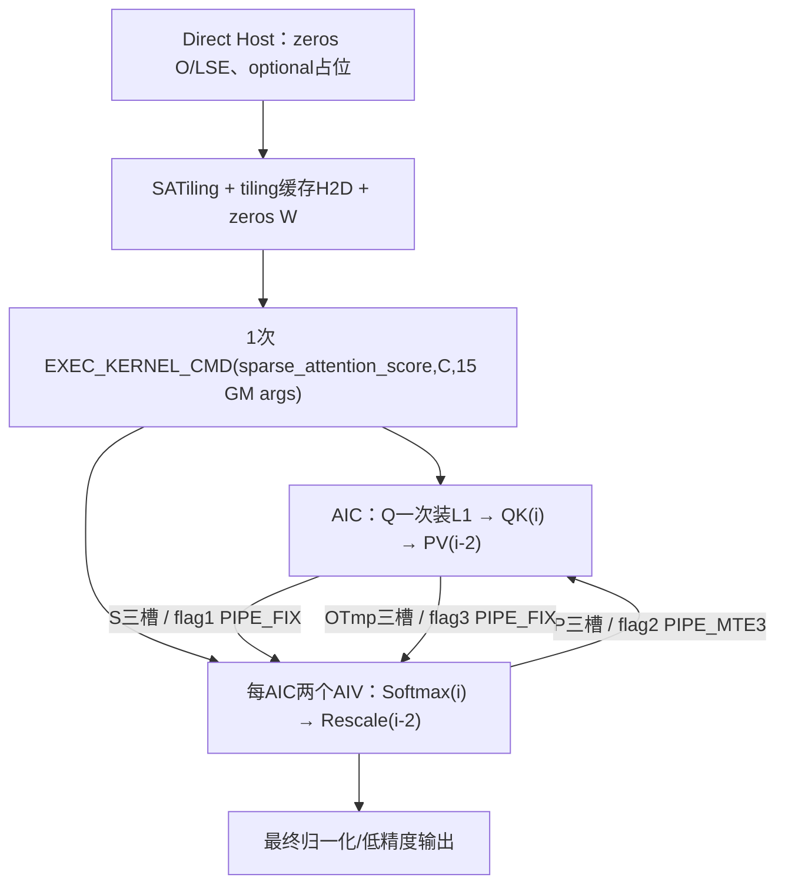
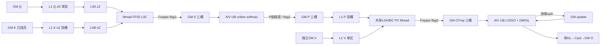
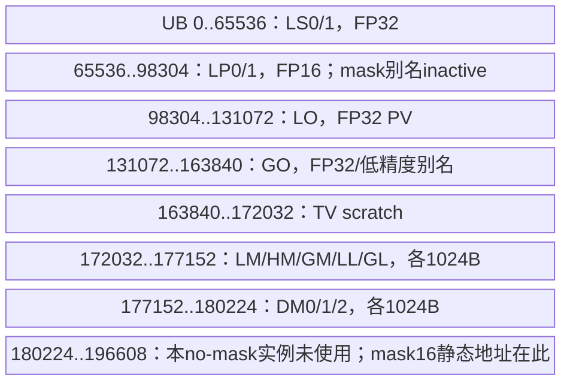

# 原生稀疏注意力分数 A2/A3 Direct Invoke 算子知识

## 算子速览

| 项目 | 内容 |
|---|---|
| 实际入口 | `torch.ops.npu.npu_sparse_attention_score` → `sglang::npu_kernel::sparse_attention_score`；独立 Direct Invoke，没有 ACLNN pair |
| 计算语义 | 调用方选定逻辑 KV 块，按 GQA 共享选块，QK→online softmax→PV→累积归一化；无 sink、无 TopK |
| 输入输出 | Q/O=TND [T,N,D]；K/V=[NB,128,H,D]；公开 native 域 FP16/BF16、D=128、BS=128；索引和实际长度均需 int32 连续存储 |
| 执行类型 | 单 launch `KERNEL_TYPE_MIX_AIC_1_2`：AIC_CUBE QK/PV + AIV_VECTOR softmax/rescale；四个逻辑阶段不是四个 kernel |
| Kernel 路线 | R-001：20001 的 half body，含无保护 fallback；R-002：20002 的 BF16 body；空任务/空选块为各路线内终点 |
| 核心资源 | system 16MiB；user=4topK+5,505,024C 字节；L1 固定分区高水位294,912B；共享 L0A/B各64KiB、L0C128KiB；每AIV UB192KiB backing、活跃区间高水位180,224B |
| 来源闭包 | direct_implementation_closed：Direct Host→SATiling→双 key→实际四阶段/helper→构建及 SDK9.1 当前实例可追溯；此标签不保证实现正确或内存安全 |
| 风险 | 缺省 optional 的 empty({1}) 被实际读取；无 shape/dtype 错误回退；32项局部数组无上界检查；inner_precise 不控制 arch22 body；静态缓存有并发/跨设备/哈希风险。保留 draft，不推荐未经修复的安全复用 |
| 验证状态 | 已完成源码闭包检查；本次知识提取未执行编译、真机、数值或性能测试。 |

## 接口与语义

### 计算语义

令 H=select_idx.size(0)、G=N/H（Host 整数除法）、T=Q.size(0)。task=(全局query token t, KV头h)，负责 query 头 [hG,(h+1)G)。用 actual_seq_lengths 各请求长度的累积和定位请求 b 及请求内 token r。history=actualKV[b]−actualQ[b]，当前因果最后逻辑块 L=floor((history+r)/128)，其有效列数 v=(history+r)%128+1。

只扫描选块列表**前 min(uint32(count[h,t]),topK) 项**，跳过其中负 logical id；将逻辑块经 block_table[b,logical] 映射物理页。logical==L 时取 v 列，其余非负 logical 一律取128列；Device 不拒绝 logical>L，因此调用方必须预先排除未来块。重复块重复计权。raw Direct 支持负槽跳过，但 count 限定的是扫描前缀，不能把有效总数误当自动压紧后的前缀。

在上述有效域，逐块 j 计算 s_j=scale·QK_j^T（FP32 Cube 累加/Fixpipe），m_j=max(m_old,rowmax(s_j))，d_j=exp(m_old−m_j)，p_j=exp(s_j−m_j)，l_j=d_j·l_old+sum(p_j)。p_j **转回输入低精度**后乘独立 V_j，PV 的 Cube 累加为 FP32。rescale 以 FP32 更新 o_j=d_j·o_old+PV_j；最终 o/l 后转回输入类型。BF16 的 P/O Cast 为 CAST_RINT，FP16 为 CAST_NONE。低精度权重舍入与 FP32 分母不同，不能称全 FP32 attention。首块不读取旧 m/l/o；无任何保留块时没有 rescale 写入，返回 Host 预置0。没有 sink、bias、dropout、反向或 KV 量化。

### 输入、输出与属性

| 参数 | shape/layout | dtype | 约束、默认值与语义 |
|---|---|---|---|
| query | [T,N,128]，连续TND | FP16/BF16 | Direct Host 无 rank/连续性/同设备校验；地址按连续公式重建，不传 tensor stride |
| key | [NB,128,H,128] | 同Q | 实际 K 读取本参数，不与 V 别名绑定 |
| value | 同K | 同Q | PV 读取本参数；与其它注意力实现复用K作为V的路线不同 |
| select_idx | [H,maxQSeqlen,topK] | int32 | maxQSeqlen覆盖**全局T**，不是请求内最大Q长度；非负项合法；32项本地数组要求保留项<=32 |
| block_table | [batch,maxBlocksPerBatch] | int32 | 连续，合法逻辑和物理页；Host 只读 shape |
| select_num_idx | [H,maxQSeqlen] | int32 | schema默认None；实现用非空未初始化1元素代替，随后实际读取；正常调用必须给完整已初始化计数 |
| actual_seq_lengths | [batch] | int32 | 每请求Q长度，非累计前缀；总和=T；schema默认None的实现在非空任务存在未初始化/越界读风险 |
| actual_seq_lengths_kv | [batch] | int32 | 每请求KV长度，需>=Q长度；非负、容量内。None未安全处理 |
| q_dequant_scale | 占位 | FP32 | schema默认None；本卡arch22 body不接收、不读取，None替代empty1不影响本路线数学 |
| k_dequant_scale | 占位 | FP32 | 同上 |
| v_dequant_scale | 占位 | FP32 | 同上 |
| num_key_value_heads | scalar | int64→u32 | schema默认1；先写info、0时读key.size(2)，随后无条件被select_idx.size(0)覆盖 |
| scale_value | scalar | double→FP32 | schema默认1.0；若 −1e−9<FP32(scale)<1e−9 且D>0，替换1/sqrt(D)；不是任何缺省均自动用该值，不能用0表示恒零logit |
| block_size | scalar | int64→u32 | schema默认128；源只作转换，没有对缓存dim1核对 |
| top_k | scalar | int64→u32 | schema默认16；被select_idx.size(2)覆盖 |
| inner_precise | scalar | int64→u32 | schema默认0；POD及缓存key保存，但当前arch22消费者不读；设置4不会选另一body |
| 返回 attentionOut | 同query | 同query | at::zeros创建新tensor；异常路径不保证返回；未写任务保持0 |
| 内部 softmaxLse | [T,N,1] | FP32 | Host置0；实际模板LseMode::NONE不写，且不返回。README“kernel写LSE”不适用于此实例 |

### 入口与版本

固定 kernel commit dda6d36b0cdb4081e102d14c0a2fb276fc416e69。此页只闭合上述 native Direct 实现，源目录README明确已移除旧PTA/L0 OpAPI；注释中的“aclnn”不是存在的可调用入口。注册的 m.def 与 PrivateUse1 m.impl 均位于 SGL_KERNEL_ENABLE_A3_ONLY_OPS guard，legacy构建对A2/A3开启。公开flash_decode接口的ascendc支持表只有arch22；arch35虽有源码和generic README描述，公开明确Unsupported，故不纳入950。

CANN范围固定为9.1.0，依据固定README和CI版本配置；不是声称在本机安装、运行或验证。SDK源固定v9.1.0 e5451c7feba11f9e259f4fbc19c4bf82f8c0496c。SDK convertMap将Ascend910B和Ascend910_93都映射ASCEND910B=1；ASCEND950=4。tiling.h“910_93也对应4”的注释和README的arch35命名与此映射冲突，采用实现证据，不据注释排除A3。

[既有GQA双入口API](../../../../apis/sgl_kernel_npu/sgl_gqa_shared_sparse_decode.md)描述公开适配层与Triton对照。该适配层的Torch映射收集、Triton清洗及负槽→0是另一入口的前处理合同；本卡不把这类前处理附加成 raw Direct 必经kernel。其“inner_precise=4高精度”也不能替代这里的实际模板证据。

## Host/Launcher 执行流程

### 参数校验与前处理

源码顺序为：创建0输出和0LSE → 为6个None可选tensor分配empty1 → 读query/select/block_table shape和属性 → scale归一化 → 获取platform/aicNum/libapiSize/socVer → DoTiling → hash tiling、稳定host backing和device tiling cache → H2D → 创建**全workspace zeros** → EXEC_KERNEL_CMD → 返回输出。

没有算子自有 TORCH_CHECK/参数shape guard，没有Contiguous/ViewCopy/TransData，不复制Q/K/V或索引。ATen allocation、Tensor.size、dtype转换等通用框架可抛异常；不能伪造统一ACL错误码或fallback。平台指针无显式空检查；platform信息获取失败时SDK可返回保留值或u32(-1)，本Host不拦截。

### 参数、Workspace 与生命周期

记 C=max(1,min(u32(T·H),AIC数))，E=131072个元素，J=topK。SDK2201的libapi和reserved均为16,777,216B。Host分配字节数：

```text
S = C*E*4*3        # mm1OutSize，FP32 score三槽
P = C*E*2*3        # smOnlineOutSize，输入低精度P三槽
O = C*E*4*3        # mm2OutSize，FP32 PV三槽
U = C*E*4*3        # updateSize，Host也分配三倍
W = 16,777,216 + 4*J + S + P + O + U
  = 16,777,216 + 4*J + 5,505,024*C 字节
```

HAVE_WORKSPACE/HAVE_TILING的SDK wrapper将倒数第2参数作为系统workspace，SetSysWorkspaceForce，再取user地址并重写该实参；entry再次GetUserWorkspace依SDK全局系统基址+reserved返回同一user起点，**不是再加一次reserved**。所有下面offset相对user。identity[0..J)先占4J；S/P/OTmp/U逐一紧接，无额外对齐。4J不保证32B对齐，源没有RoundUp，不能写成已满足DMA地址对齐。实际update只使用core*E个FP32元素的单槽，剩余2CE元素预留不读；不能擅自缩Host分配。

输出返回tensor持有其storage；workspace/LSE和optional占位是Host栈上ATen Tensor owner；宏捕获的是converted裸指针tuple，不持有这些Tensor。调用使用当前NPU stream，经OpCommand::RunOpApi和ATen NPU allocator的异步/捕获生命周期为框架边界；算子自身没有completion event、recordStream、显式延迟free。不能从函数返回推断设备完成，亦不能把依赖框架allocator的生命周期说成原生算子已提供强保证。

tiling缓存有1024个168B槽，共172,032B，first-query设备上static allocation。hostTilingStore[1024]保存H2D稳定源；cache key只Hash(batch,N,H,D,BS,J,maxBlocks,T,maxQ,key,scale,innerPrecise)，不比较完整tuple，也未纳入设备/core数/libapi；captureMap/计数无锁、无设备分桶。超过1024用单一static overflowStore+168Bdevice buffer重复覆盖。aclrtMemcpy返回值未检查，from_blob包device裸地址却只传at::kByte未显式device option。稳定地址只是源码设计意图；跨设备、并发、hash碰撞、多配置溢出/图重放等不能宣称安全。

### 启动图与失败传播



宏使用getCurrentNPUStream().stream(false)；ConvertTypes把Tensor转data_ptr；lambda调用ACLRT_LAUNCH_KERNEL，忽略其返回并return0。SDK launch stub有自己的打印/返回逻辑，但宏没有传播其状态；无第二算子重试、无状态rollback。不能声称设备错误会作为本算子明确返回码同步传播。T=0或u32(T·H)=0时仍强制C=1、仍分配/启动、清identity和SyncAll，任务循环为空。输入invalid导致Host异常、Device非法访问或无输出是边界；不是额外实现fallback。

## Route 与参数设计

### 分核与资源计算

Host顺序严格为：query shape→select shape覆盖H/J/maxQ→batch/maxBlocks→float scale→SDK AIC/libapi/soc→u32乘法task数→blockDim→四段三槽workspace→POD字段→group=N/H→key→Host tile字段。u32(T·H)、int64→u32与N/H无范围/整除检查。G=0会在loadQGM中rowNum/singleGroupHeads除0；H=0虽group默认1且task0，也仍存在后续资源/identity等行为，不能当作正常空选择。

调度core c负责 task=c,c+C,...，AIC coreIdx=GetBlockIdx；AIV coreIdx=GetBlockIdx/GetSubBlockNum，subblock0/1共享同一task，分头行floor(G/2)与余数。SDK GetBlockIdxImpl对AIV为get_block_idx()*ratio+subblock，ratio=2；GetBlockNum保持launch逻辑block数，故双方task步长一致。

实际QK tile=L1/L0(128,128,128)，PV=L1(128,128,256)/L0(128,128,128)，两policy STAGES=2、PAGED_CACHE_FLAG=false、ENABLE_UNIT_FLAG=false；Host写qBase等字段不是决定编译tile的consumer。Q每任务全G行一次装入固定32KiB Q区：要求round16(G)*D*2<=32768，否则会侵入后续K区；Host没有检查。名义D=128下G<=128为此分区的保守容量边界，不宣称库会自动把Q加载拆成安全多tile。

### Route 选择

| 顺序 | Route | Key/模板 | 精确选择条件与优先级 | 不适用去向 |
|---:|---|---|---|---|
| 1 | R-002 BF16 | 20002 / SasaInferIntfRegularArch22<bfloat16_t,float> | SDK socVer!=4 && dataType==DT_BF16 && D==128 && BS==128 | 下一dtype分支 |
| 2 | R-001 half含无保护回退 | 20001 / SasaInferIntfRegularArch22<half,float> | SDK socVer!=4 && 非上行条件；其中DT_FLOAT16&&D=BS=128是名义half域，所有其它组合也硬回退20001 | **没有错误返回**，继续half body；不同dtype/shape可能重解释/超容量 |
| 3 | 本卡外 | 10001/2/3 | socVer==4，平台950，不是本卡公开支持 | 不扩写950卡 |

```text
if socVer != 4:
    if BF16 and D==128 and BS==128: key=20002
    elif FP16 and D==128 and BS==128: key=20001
    else: key=20001  # fallback没有capability/error guard
else: 10001/10002/10003  # 950排除
entry compiled220:
    if key>=10000: GetUserWorkspace; MIX_AIC_1_2
    if key==20001: half,float body
    elif key==20002: bfloat16_t,float body
    else: 不写输出
```

### 模板/实现执行矩阵

| Route | key/selector | dtype/shape/platform 完整命中条件 | 执行族与 kernel 节点 | 实际模板/body | 内存与同步特征 | tail/fallback |
|---|---|---|---|---|---|---|
| R-001 half含回退 | 20001 | A2/A3实际soc!=4、非BF16/D128/BS128组合；正常域FP16/D128/BS128 | 一个MIX，AIC QK/PV与AIV softmax/rescale | SasaRegularKernelArch22<BlockMmad<MmadAtlasA2SFAIQK<false,false>,128/128/128,128/128/128,Qrowhalf,Kcolhalf,Srowfloat>,EpilogueAtlasA2OnlineSoftmax<NONE,float>,BlockMmad<MmadAtlasA2SFAIPV<false,false>,128/128/256,128/128/128,Prowhalf,Vrowhalf,OTmprowfloat>,EpilogueAtlasA2RescaleO<NONE,float>> | S/P/O三槽、prelaunch2、flags1/2/3；L0共享双槽、UB固定地址 | tail只缩最后逻辑块列；未来块不拒绝；不支持组合仍强制half |
| R-002 BF16 | 20002 | A2/A3实际soc!=4、BF16/D=BS=128 | 同一MIX四阶段 | 上行所有输入/P/O元素改bfloat16_t，其余模板实参完全相同 | 字节/同步相同；P/O CAST_RINT | 负索引只在有效前缀内跳过；空块不写out；无Triton重试 |

### 隐藏性能 Guard

| Guard | Host/Tiling 条件 | Device/资源原因 | 影响 Route | 不满足时去向 | 源码符号 |
|---|---|---|---|---|---|
| dtype/D/BS | 仅BF16/D128/BS128被精确识别；half及其余全20001 | 固定16bit、128 tile；不检查K/V dtype一致 | 两条 | 无保护half fallback，不能承诺有效 | SATiling::GenerateTilingKey |
| G整除/非零 | 无检查，group=N/H截断 | Q头覆盖和loadQGM除法 | 两条 | 头遗漏/除0等静态风险 | DoTiling/loadQGM |
| Q L1容量 | 未检查round16(G)*D*2<=32768 | Q固定L1区后紧接K | 两条 | 覆盖K区，后续结果无保证 | BlockMmadQK::loadQGM |
| 32项局部表 | 无count<=32 guard | validPhysicalIds[32]/validTileSize[32] | 两条 | 保留第33非负项即越界写 | SasaRegularKernelArch22 |
| 可选长度/计数 | None变empty1，而非null | actSeqAval_=true；count指针恒非null | 两条 | 未初始化读，batch/索引数大时还可越界 | Host optional/FetchTilingData |
| 因果和页合法性 | Host不检查数值；Device仅skip logical<0 | 非尾块整BS读，logical>L不屏蔽，physical<0也不屏蔽 | 两条 | 未来token参与或非法GM读 | validPhysicalIds构造 |
| workspace起点 | identity4J不做32B对齐 | S/P/OTmp随后地址仍只有4B保证 | 两条 | 对齐能力依DMA primitive；不能称已检查 | Host DoTiling/Device workspace slices |
| 整数宽度 | size/属性截u32；task先u32相乘 | token/页/stride循环可能溢出 | 两条 | 无溢出错误路径 | sparse_attention_score/DoTiling |
| KV< Q | 无检查，history=u32减法 | 最后块计算依赖history | 两条 | 下溢后错误可见域 | Device historyLen |
| vector行数/分区 | softmax每次<=64行，rescale每次floor8(8192/D)行；state每subblock最多256行、DM3槽 | LM/HM/GM/LL/GL各1024B；固定UB192KiB | 两条 | 无Host容量判定；不借rowloop宣称任意G安全 | onlineSoftmax/RescaleO |
| graph/cache | hash、无锁、首次设备static、overflow单槽 | tiling backing和配置复用 | 两条 | 无安全fallback，可能旧POD/竞态 | captureMap/hostTilingStore |

### POD/ABI

下表ABI数值是固定宽度类型和自然对齐8的**静态候选布局**，未编译实测。Host源有sizeof(SATilingData)==168静态断言；Device镜像字段顺序相同但无单独布局测试。不得将source static_assert描述成此次执行验证。所有字段不额外做范围检查。

| 结构 | 字段 | 类型/位宽 | ABI 布局 | 单位 | Host/launcher producer | Device consumer | 边界 |
|---|---|---|---|---|---|---|---|
| SATilingData / SparseAttentionScoreTilingData | batch | uint32_t/32 | sizeof168/align8候选，offsetof=0 | 请求数 | DoTiling: info.batch | FetchTilingData→请求长度扫描 | u32范围、转换无保护 |
| SATilingData / SparseAttentionScoreTilingData | numHeads | uint32_t/32 | sizeof168/align8候选，offsetof=4 | Q头数 | DoTiling: info.numHeads | qHeads_→Q/O stride、LSE地址 | u32范围、转换无保护 |
| SATilingData / SparseAttentionScoreTilingData | kvHeads | uint32_t/32 | sizeof168/align8候选，offsetof=8 | KV头数 | DoTiling: info.kvHeads | kvHeads_→task解码、KV stride | u32范围、转换无保护 |
| SATilingData / SparseAttentionScoreTilingData | embeddingSize | uint32_t/32 | sizeof168/align8候选，offsetof=12 | 元素 | DoTiling: info.embeddingSize | embed_→QK/PV形状与stride | u32范围、转换无保护 |
| SATilingData / SparseAttentionScoreTilingData | blockSize | uint32_t/32 | sizeof168/align8候选，offsetof=16 | token | DoTiling: info.blockSize | blockSize_→最后块、物理页stride | u32范围、转换无保护 |
| SATilingData / SparseAttentionScoreTilingData | topK | uint32_t/32 | sizeof168/align8候选，offsetof=20 | 块槽数 | DoTiling: info.topK | topK_→identity4J、select循环 | u32范围、转换无保护 |
| SATilingData / SparseAttentionScoreTilingData | maxBlocksPerBatch | uint32_t/32 | sizeof168/align8候选，offsetof=24 | 页槽 | DoTiling: info.maxBlocksPerBatch | block_table请求行stride | u32范围、转换无保护 |
| SATilingData / SparseAttentionScoreTilingData | totalQTokens | uint32_t/32 | sizeof168/align8候选，offsetof=28 | token | DoTiling: info.totalQTokens | Device本实例不读；Host哈希及task producer | u32范围、转换无保护 |
| SATilingData / SparseAttentionScoreTilingData | totalTaskNum | uint32_t/32 | sizeof168/align8候选，offsetof=32 | task | DoTiling: u32(info.totalQTokens*info.kvHeads) | task循环上界 | u32范围、转换无保护 |
| SATilingData / SparseAttentionScoreTilingData | firstBatchTaskNum | uint32_t/32 | sizeof168/align8候选，offsetof=36 | task，inactive | DoTiling: info.kvHeads | Fetch读入成员，其后不使用 | u32范围、转换无保护 |
| SATilingData / SparseAttentionScoreTilingData | scaleValue | float/32 | sizeof168/align8候选，offsetof=40 | FP32标量 | DoTiling: info.scaleValue | EpilogueOnlineSoftmax→ScaleS | 无动态检查 |
| SATilingData / SparseAttentionScoreTilingData | innerPrecise | uint32_t/32 | sizeof168/align8候选，offsetof=44 | 属性，inactive | DoTiling: info.innerPrecise | Device arch22不读；Host缓存Hash读 | u32范围、转换无保护 |
| SATilingData / SparseAttentionScoreTilingData | maxQSeqlen | uint32_t/32 | sizeof168/align8候选，offsetof=48 | token槽 | DoTiling: info.maxQSeqlen | selectIdx/count头stride，须覆盖全局T | u32范围、转换无保护 |
| SATilingData / SparseAttentionScoreTilingData | mm1OutSize | uint64_t/64 | sizeof168/align8候选，offsetof=56 | 字节 | DoTiling: C*E*4*3 | gP基址=identity+此值 | 无动态检查 |
| SATilingData / SparseAttentionScoreTilingData | smOnlineOutSize | uint64_t/64 | sizeof168/align8候选，offsetof=64 | 字节 | DoTiling: C*E*2*3 | gOTmp基址=identity+S+此值 | 无动态检查 |
| SATilingData / SparseAttentionScoreTilingData | mm2OutSize | uint64_t/64 | sizeof168/align8候选，offsetof=72 | 字节 | DoTiling: C*E*4*3 | gOUpdate基址=identity+S+P+此值 | 无动态检查 |
| SATilingData / SparseAttentionScoreTilingData | updateSize | uint64_t/64 | sizeof168/align8候选，offsetof=80 | 字节，Device inactive | DoTiling: C*E*4*3 | Fetch读成员但本body不消费extent；Host纳入W | 无动态检查 |
| SATilingData / SparseAttentionScoreTilingData | workSpaceSize | uint64_t/64 | sizeof168/align8候选，offsetof=88 | 字节 | DoTiling: libapi+4J+S+P+O+U | Host分配；Device arch22不读 | 无动态检查 |
| SATilingData / SparseAttentionScoreTilingData | tilingKey | uint64_t/64 | sizeof168/align8候选，offsetof=96 | selector | DoTiling: GenerateTilingKey(info) | entry的reinterpret结构→双key分发 | 无动态检查 |
| SATilingData / SparseAttentionScoreTilingData | groupSize | uint32_t/32 | sizeof168/align8候选，offsetof=104 | Q头 | DoTiling: H>0?N/H:1 | groupSize_→每task行数、AIV切分 | u32范围、转换无保护 |
| SATilingData / SparseAttentionScoreTilingData | qBaseTile | uint32_t/32 | sizeof168/align8候选，offsetof=108 | 行，inactive | DoTiling: D<=128?128:64 | Fetch读成员但不决定编译tile | u32范围、转换无保护 |
| SATilingData / SparseAttentionScoreTilingData | kvBaseTile | uint32_t/32 | sizeof168/align8候选，offsetof=112 | token，inactive | DoTiling: BS | Fetch读成员但不决定编译tile | u32范围、转换无保护 |
| SATilingData / SparseAttentionScoreTilingData | mm1L1TileM | uint32_t/32 | sizeof168/align8候选，offsetof=116 | 行，inactive | DoTiling: qBaseTile | arch22不读，实际QK M128 | u32范围、转换无保护 |
| SATilingData / SparseAttentionScoreTilingData | mm1L1TileN | uint32_t/32 | sizeof168/align8候选，offsetof=120 | 列，inactive | DoTiling: kvBaseTile | arch22不读，实际QK N128 | u32范围、转换无保护 |
| SATilingData / SparseAttentionScoreTilingData | mm1L1TileKLeft | uint32_t/32 | sizeof168/align8候选，offsetof=124 | 元素，inactive | DoTiling: D | arch22不读，实际QK K128 | u32范围、转换无保护 |
| SATilingData / SparseAttentionScoreTilingData | mm1L1TileKRight | uint32_t/32 | sizeof168/align8候选，offsetof=128 | 元素，inactive | DoTiling: D | arch22不读，实际QK K128 | u32范围、转换无保护 |
| SATilingData / SparseAttentionScoreTilingData | mm2L1TileM | uint32_t/32 | sizeof168/align8候选，offsetof=132 | 行，inactive | DoTiling: qBaseTile | arch22不读，实际PV M128 | u32范围、转换无保护 |
| SATilingData / SparseAttentionScoreTilingData | mm2L1TileN | uint32_t/32 | sizeof168/align8候选，offsetof=136 | 列，inactive | DoTiling: D | arch22不读，实际PV N128 | u32范围、转换无保护 |
| SATilingData / SparseAttentionScoreTilingData | mm2L1TileKLeft | uint32_t/32 | sizeof168/align8候选，offsetof=140 | 元素，inactive | DoTiling: kvBaseTile | arch22不读，实际PV L1 K256 | u32范围、转换无保护 |
| SATilingData / SparseAttentionScoreTilingData | mm2L1TileKRight | uint32_t/32 | sizeof168/align8候选，offsetof=144 | 元素，inactive | DoTiling: kvBaseTile | arch22不读，实际PV L1 K256 | u32范围、转换无保护 |
| SATilingData / SparseAttentionScoreTilingData | qL1BufNum | uint32_t/32 | sizeof168/align8候选，offsetof=148 | 缓冲份数，inactive | DoTiling: 1 | arch22不读，Q单份由模板构造 | u32范围、转换无保护 |
| SATilingData / SparseAttentionScoreTilingData | kL1BufNum | uint32_t/32 | sizeof168/align8候选，offsetof=152 | 缓冲份数，inactive | DoTiling: 1 | arch22不读，实际K双缓冲 | u32范围、转换无保护 |
| SATilingData / SparseAttentionScoreTilingData | vL1BufNum | uint32_t/32 | sizeof168/align8候选，offsetof=156 | 缓冲份数，inactive | DoTiling: 1 | arch22不读，实际V单缓冲 | u32范围、转换无保护 |
| SATilingData / SparseAttentionScoreTilingData | pL1BufNum | uint32_t/32 | sizeof168/align8候选，offsetof=160 | 缓冲份数，inactive | DoTiling: 3 | arch22不读，GM三槽、本地P双份由模板构造 | u32范围、转换无保护 |

SAInfo是Host局部输入对象，不作为GM POD发给Device；下面也逐字段保留producer/consumer，避免把默认值当为有效输入检查。

| 结构 | 字段 | 类型/位宽 | ABI 布局 | 单位 | Host/launcher producer | Device consumer | 边界 |
|---|---|---|---|---|---|---|---|
| SAInfo | batch | uint32_t/32 | sizeof64/align8、off0仅按GE enum4B的候选；不跨ABI承诺 | 请求数 | Host block_table.size(0) | Device不直接读；Host DoTiling.batch | 默认0；随后覆盖，不等于guard |
| SAInfo | numHeads | uint32_t/32 | sizeof64/align8、off4仅按GE enum4B的候选；不跨ABI承诺 | 头 | Host query.size(1) | Device不直接读；Host DoTiling.numHeads/group | 默认0；随后覆盖，不等于guard |
| SAInfo | kvHeads | uint32_t/32 | sizeof64/align8、off8仅按GE enum4B的候选；不跨ABI承诺 | 头 | Host 属性→key回退→select_idx.size(0)覆盖 | Device不直接读；Host DoTiling.kvHeads/task/group | 默认0；随后覆盖，不等于guard |
| SAInfo | embeddingSize | uint32_t/32 | sizeof64/align8、off12仅按GE enum4B的候选；不跨ABI承诺 | 元素 | Host query.size(2) | Device不直接读；Host DoTiling/selector | 默认0；随后覆盖，不等于guard |
| SAInfo | blockSize | uint32_t/32 | sizeof64/align8、off16仅按GE enum4B的候选；不跨ABI承诺 | token | Host block_size属性 | Device不直接读；Host DoTiling/selector | 默认128；随后覆盖，不等于guard |
| SAInfo | topK | uint32_t/32 | sizeof64/align8、off20仅按GE enum4B的候选；不跨ABI承诺 | 槽 | Host top_k属性→select_idx.size(2)覆盖 | Device不直接读；Host DoTiling/workspace | 默认16；随后覆盖，不等于guard |
| SAInfo | maxBlocksPerBatch | uint32_t/32 | sizeof64/align8、off24仅按GE enum4B的候选；不跨ABI承诺 | 槽 | Host block_table.size(1) | Device不直接读；Host DoTiling | 默认0；随后覆盖，不等于guard |
| SAInfo | totalQTokens | uint32_t/32 | sizeof64/align8、off28仅按GE enum4B的候选；不跨ABI承诺 | token | Host query.size(0) | Device不直接读；Host DoTiling task producer | 默认0；随后覆盖，不等于guard |
| SAInfo | maxQSeqlen | uint32_t/32 | sizeof64/align8、off32仅按GE enum4B的候选；不跨ABI承诺 | 槽 | Host select_idx.size(1) | Device不直接读；Host DoTiling | 默认0；随后覆盖，不等于guard |
| SAInfo | scaleValue | float/32 | sizeof64/align8、off36仅按GE enum4B的候选；不跨ABI承诺 | 标量 | Host double scale→FP32→近零归一化 | Device不直接读；Host DoTiling | 默认0.0；随后覆盖，不等于guard |
| SAInfo | innerPrecise | uint32_t/32 | sizeof64/align8、off40仅按GE enum4B的候选；不跨ABI承诺 | 属性 | Host inner_precise属性 | Device不直接读；Host DoTiling，仅保存/Hash | 默认0；随后覆盖，不等于guard |
| SAInfo | aicNum | uint32_t/32 | sizeof64/align8、off44仅按GE enum4B的候选；不跨ABI承诺 | AIC | Host SDK GetCoreNumAic() | Device不直接读；Host DoTiling.blockDim | 默认0；随后覆盖，不等于guard |
| SAInfo | libapiSize | uint64_t/64 | sizeof64/align8、off48仅按GE enum4B的候选；不跨ABI承诺 | 字节 | Host SDK GetLibApiWorkSpaceSize() | Device不直接读；Host DoTiling.W | 默认0；随后覆盖，不等于guard |
| SAInfo | socVer | uint32_t/32 | sizeof64/align8、off56仅按GE enum4B的候选；不跨ABI承诺 | enum code | Host SDK GetSocVersion() | Device不直接读；Host DoTiling workspace/selector | 默认0；随后覆盖，不等于guard |
| SAInfo | dataType | ge::DataType，sizeof由GE/编译ABI决定 | sizeof64/align8、off60仅按GE enum4B的候选；不跨ABI承诺 | GE enum | Host SCALAR_TYPE_TO_GE_DATATYPE(Q.dtype) | Device不直接读；Host GenerateTilingKey | 默认DT_FLOAT16；随后覆盖，不等于guard |

Device局部参数对象仅保存裸指针，构造时逐项赋值。按GM_ADDR为8B指针的静态候选为sizeof96/align8；Host不序列化此对象，entry逐指针调用device函数。具体launch参数包布局由SDK生成器/编译器处理，不伪造固定wire offset。

| 结构 | 字段 | 类型/位宽 | ABI 布局 | 单位 | Host/launcher producer | Device consumer | 边界 |
|---|---|---|---|---|---|---|---|
| SasaKernelParamsArch22 | q | GM_ADDR，目标指针宽度 | 候选off0，非wire布局 | 地址 | entry→SasaInferIntfRegularArch22→ctor(query) | Q load | backing须存活到stream消费 |
| SasaKernelParamsArch22 | k | GM_ADDR，目标指针宽度 | 候选off8，非wire布局 | 地址 | entry→SasaInferIntfRegularArch22→ctor(key) | QK K读取 | backing须存活到stream消费 |
| SasaKernelParamsArch22 | v | GM_ADDR，目标指针宽度 | 候选off16，非wire布局 | 地址 | entry→SasaInferIntfRegularArch22→ctor(value) | PV V读取 | backing须存活到stream消费 |
| SasaKernelParamsArch22 | selectIdx | GM_ADDR，目标指针宽度 | 候选off24，非wire布局 | 地址 | entry→SasaInferIntfRegularArch22→ctor(select_idx) | i32有效前缀索引 | backing须存活到stream消费 |
| SasaKernelParamsArch22 | blockTable | GM_ADDR，目标指针宽度 | 候选off32，非wire布局 | 地址 | entry→SasaInferIntfRegularArch22→ctor(block_table) | i32页表 | backing须存活到stream消费 |
| SasaKernelParamsArch22 | selectNumIdx | GM_ADDR，目标指针宽度 | 候选off40，非wire布局 | 地址 | entry→SasaInferIntfRegularArch22→ctor(selectNumIdx) | i32 count，恒非null | backing须存活到stream消费 |
| SasaKernelParamsArch22 | actualQseqlen | GM_ADDR，目标指针宽度 | 候选off48，非wire布局 | 地址 | entry→SasaInferIntfRegularArch22→ctor(actualSeqLengths) | i32请求Q长度 | backing须存活到stream消费 |
| SasaKernelParamsArch22 | actualKvseqlen | GM_ADDR，目标指针宽度 | 候选off56，非wire布局 | 地址 | entry→SasaInferIntfRegularArch22→ctor(actualSeqLengthsKv) | i32请求KV长度 | backing须存活到stream消费 |
| SasaKernelParamsArch22 | o | GM_ADDR，目标指针宽度 | 候选off64，非wire布局 | 地址 | entry→SasaInferIntfRegularArch22→ctor(attentionOut) | 低精度最终写 | backing须存活到stream消费 |
| SasaKernelParamsArch22 | softmaxLse | GM_ADDR，目标指针宽度 | 候选off72，非wire布局 | 地址 | entry→SasaInferIntfRegularArch22→ctor(softmaxLse) | LseMode NONE inactive | backing须存活到stream消费 |
| SasaKernelParamsArch22 | workSpace | GM_ADDR，目标指针宽度 | 候选off80，非wire布局 | 地址 | entry→SasaInferIntfRegularArch22→ctor(GetUserWorkspace(workspace)) | 四段workspace基址 | backing须存活到stream消费 |
| SasaKernelParamsArch22 | tiling | GM_ADDR，目标指针宽度 | 候选off88，非wire布局 | 地址 | entry→SasaInferIntfRegularArch22→ctor(tilingTensor) | GM POD reinterpret | backing须存活到stream消费 |

entry 的15个GM实参按顺序全部保留，Triton/ATen对象不会自动携带stride进入此 ABI。

| 结构 | 字段 | 类型/位宽 | ABI 布局 | 单位 | Host/launcher producer | Device consumer | 边界 |
|---|---|---|---|---|---|---|---|
| sparse_attention_score launch | query | GM_ADDR | 第1参数；包offset由SDK生成，不假定 | 地址 | EXEC_KERNEL_CMD的第1 tensor.data_ptr | Q | 框架storage owner/stream边界 |
| sparse_attention_score launch | key | GM_ADDR | 第2参数；包offset由SDK生成，不假定 | 地址 | EXEC_KERNEL_CMD的第2 tensor.data_ptr | K | 框架storage owner/stream边界 |
| sparse_attention_score launch | value | GM_ADDR | 第3参数；包offset由SDK生成，不假定 | 地址 | EXEC_KERNEL_CMD的第3 tensor.data_ptr | V | 框架storage owner/stream边界 |
| sparse_attention_score launch | selectIdx | GM_ADDR | 第4参数；包offset由SDK生成，不假定 | 地址 | EXEC_KERNEL_CMD的第4 tensor.data_ptr | 索引 | 框架storage owner/stream边界 |
| sparse_attention_score launch | blockTable | GM_ADDR | 第5参数；包offset由SDK生成，不假定 | 地址 | EXEC_KERNEL_CMD的第5 tensor.data_ptr | 页表 | 框架storage owner/stream边界 |
| sparse_attention_score launch | selectNumIdx | GM_ADDR | 第6参数；包offset由SDK生成，不假定 | 地址 | EXEC_KERNEL_CMD的第6 tensor.data_ptr | count | 框架storage owner/stream边界 |
| sparse_attention_score launch | actualSeqLengths | GM_ADDR | 第7参数；包offset由SDK生成，不假定 | 地址 | EXEC_KERNEL_CMD的第7 tensor.data_ptr | Q长度 | 框架storage owner/stream边界 |
| sparse_attention_score launch | actualSeqLengthsKv | GM_ADDR | 第8参数；包offset由SDK生成，不假定 | 地址 | EXEC_KERNEL_CMD的第8 tensor.data_ptr | KV长度 | 框架storage owner/stream边界 |
| sparse_attention_score launch | qDequantScale | GM_ADDR | 第9参数；包offset由SDK生成，不假定 | 地址 | EXEC_KERNEL_CMD的第9 tensor.data_ptr | arch22不传入body | arch22 inactive |
| sparse_attention_score launch | kDequantScale | GM_ADDR | 第10参数；包offset由SDK生成，不假定 | 地址 | EXEC_KERNEL_CMD的第10 tensor.data_ptr | arch22不传入body | arch22 inactive |
| sparse_attention_score launch | vDequantScale | GM_ADDR | 第11参数；包offset由SDK生成，不假定 | 地址 | EXEC_KERNEL_CMD的第11 tensor.data_ptr | arch22不传入body | arch22 inactive |
| sparse_attention_score launch | attentionOut | GM_ADDR | 第12参数；包offset由SDK生成，不假定 | 地址 | EXEC_KERNEL_CMD的第12 tensor.data_ptr | O写 | 框架storage owner/stream边界 |
| sparse_attention_score launch | softmaxLse | GM_ADDR | 第13参数；包offset由SDK生成，不假定 | 地址 | EXEC_KERNEL_CMD的第13 tensor.data_ptr | NONE不写 | 框架storage owner/stream边界 |
| sparse_attention_score launch | workspace | GM_ADDR | 第14参数；包offset由SDK生成，不假定 | 地址 | EXEC_KERNEL_CMD的第14 tensor.data_ptr | 系统→user workspace | 框架storage owner/stream边界 |
| sparse_attention_score launch | tiling | GM_ADDR | 第15参数；包offset由SDK生成，不假定 | 地址 | EXEC_KERNEL_CMD的第15 tensor.data_ptr | 168B POD | 框架storage owner/stream边界 |

### Route 源码闭包

| Route | Key/selector | Host/Tiling producer | POD/参数 | Kernel entry/router | Kernel body/直接依赖 | 构建接线 |
|---|---|---|---|---|---|---|
| R-001 | 20001 | op_host/sparse_attention_score.cpp::sparse_attention_score → op_host/tiling/sparse_attention_score_tiling.cpp::DoTiling/GenerateTilingKey | SATilingData，15 GM指针→SasaKernelParamsArch22 | op_kernel/sparse_attention_score.cpp::sparse_attention_score → SasaInferIntfRegularArch22<half,float> | arch22/sparse_attention_score_kernel_arch22.h；attn_infra/gemm/block/block_mmad_qk.hpp、block_mmad_pv.hpp；在线softmax和rescale float specialization | 根CMake→csrc/CMake→cmake/legacy_kernels.cmake：Host2TU+workspace_kernel Device TU、HAVE_WORKSPACE/TILING、共享so/PrivateUse1 |
| R-002 | 20002 | 同一Host，BF16&&D128&&BS128准确谓词 | 相同字段/指针和字节范围 | SasaInferIntfRegularArch22<bfloat16_t,float> | 相同实际body/helper，P/O Cast分支BF16 | 相同arch22构建；新CANN-only入口不替代本legacy Direct构建 |

`attn_infra`在本目录vendored，不是未知外部Matmul。选中的RowMajor/ColumnMajor→zN/nZ→L0 zZ/nZ、float NoQuant Fixpipe、STAGES=2、softmax/RescaleO<NONE,float>均已下钻。未实例化的arch35、低精度SM和TLA专用重载为skip；其头在编译聚合include中出现，不意味着本路线存在相应执行节点。ATen分配、torch_npu OpCommand、aclrtMemcpy、AscendC Mmad/LoadData/DataCopy/Flag等通用框架或硬件primitive是明确库边界；不把缺少allocator/driver内部源码误作本算子核心数学节点缺失，也不据边界编造同步保证。

## Kernel 实现

### 公共执行流程

entry直接reinterpret168B GM POD读key，key>=10000时获得user workspace并声明MIX_AIC_1_2；__CCE_AICORE__220下只有20001/20002两分支。合法Host A2/A3总能生成二者之一，未知key仅为原始kernel/损坏缓存边界，不是本Direct Host新Route。未知key不写out，无报错回退。q/k/v解量化指针在arch22不传给body。

Resource<AtlasA2>成员先构造TPipe和各物理整块TBuf/LocalTensor backing，再在Resource构造体调用pipe.Destroy()。SDK Destroy排空/释放其管理事件并标记isDestroy，随后本body手工种入M_MTE1、FIX_M、MTE1_MTE2及Vector事件；直接复用保留的LocalTensor地址，不使用TQue enqueue/dequeue。不能删此Destroy又假定手工event编号无冲突。尾部逐一WaitFlag排空同一组事件，再PIPE_ALL；InitSyncFlags/ReleaseSyncFlags两个私有方法没有调用，不把其S_MTE3/MTE3_S事件加入当前协议。

AIC每核将identity[0..J)全部写0后SyncAll<false>，不是arange：K/V已经选到单物理页，内部helper selectNum=kvYBlockNum=1、logical0即可访问该页内数据。所有AIC写同值共享区域；此设计没有每核identity分区。J=0仍执行SetValue(0,0)，会越过identity的零长度切片，故不能将任意零topK说成已安全处理。

### Route R-001：half 分块稀疏注意力与无保护回退

#### 适用条件

A2/A3、socVer!=4且不满足BF16/D128/BS128联合条件，key20001、InDtype=half、SMDtype=float。名义有效子域为Q/K/V同FP16、D=BS=128；其它组合是源码真实可达的未校验fallback，只能条件化描述其地址/资源行为，不能承诺得到正确注意力。
此外，正常数学域需：G=N/H为正整数、Q/K/V和索引同NPU且连续，长度/页/选块合法，count扫描前缀保留项<=32，Q L1容量及所有偏移运算不溢出。raw Direct没有执行这些检查。

##### 选择证据

| 层级 | 文件 | 符号 | 源码谓词/参数 | 结果/下一跳 |
|---|---|---|---|---|
| Direct注册 | csrc/pytorch_extensions.cpp | m.def / PrivateUse1 m.impl | SGL_KERNEL_ENABLE_A3_ONLY_OPS；无ACLNN | native Host |
| Host | csrc/sparse_attention_score/op_host/sparse_attention_score.cpp | sparse_attention_score | select shape覆盖H/J/maxQ，SDK actual soc | SAInfo |
| Tiling | csrc/sparse_attention_score/op_host/tiling/sparse_attention_score_tiling.cpp | GenerateTilingKey | soc!=4 && !(BF16 && D128 && BS128)；FP16分支或最终return20001 | 20001 |
| Router | csrc/sparse_attention_score/op_kernel/sparse_attention_score.cpp | sparse_attention_score | compiled220 && key==20001 | SasaInferIntfRegularArch22<half,float> |
| 实例 | csrc/sparse_attention_score/op_kernel/sparse_attention_score_kernel_interface.cpp | SasaInferIntfRegularArch22 | QK128/128/128，PV L1 128/128/256、L0 128/128/128；NONE,float epilogues | SasaRegularKernelArch22 |

#### Device 数据流

##### 函数级调用链

```text
sparse_attention_score(15GM)
 -> GetUserWorkspace -> SasaInferIntfRegularArch22<half,float>
 -> construct SasaKernelParamsArch22 -> SasaRegularKernelArch22::operator()
   -> FetchTilingData -> Resource<AtlasA2> + 手工种入events -> identity全0 -> SyncAll<false>
   -> 每task：请求长度扫描、count前缀选块、物理页表和tail表
      AIC: BlockMmadQK::loadQGM
      for i=0..actualLoopNum+2:
        i<K:
          AIC BlockMmadQK::operator()
            -> GM K→L1(nZ) → LoadData K→L0B(nZ), Q(zN)→L0A(zZ)
            -> TileMmad::operator(M=round16(Gtile),N=tail,K=Dtile,initC)
            -> float L0C(zN) → CopyL0CToGm/NoQuant/Fixpipe → gS
            -> Set flag1 PIPE_FIX
          AIV Wait flag1 -> OnlineSoftmax::operator(no-mask overload)
            -> preload1 CopySGmToUb → ScaleS → SubCoreCompute<false>
            -> rowmax/update m/exp → DownCastP → CopyPUbToGm → flag2 PIPE_MTE3
            -> FP32 rowsum/update global l
        i>=2:
          AIC BlockMmadPV::operator(j=i-2)
            -> load V→L1(zN) -> Wait flag2 -> load P→L1(zN)
            -> LoadData P→L0A(zZ), V→L0B(nZ，transpose load)
            -> Mmad FP32 → NoQuant Fixpipe → gOTmp → Set flag3 PIPE_FIX
          AIV Wait flag3 -> RescaleO::operator -> SubCoreCompute
            -> 首块拷PV；后块d*历史O+PV；最后块除l/Cast/CopyOToGm
   -> 双侧排空events -> PIPE_ALL
```

##### 源码等价伪码

```text
# 源码等价伪码，所有地址为元素偏移，user slices另见字节表
FetchPOD; q/k/v按 InDtype reinterpret; indices/lengths按i32
core=AIC.blockIdx or AIV.blockIdx/AIV.subBlockNum
seed local pipeline events; AIC writes identity[0]=0 and identity[1:J]=0
SyncAll<false>()
for task=core; task<u32(T*H); task+=C:
  t=task/H; h=task%H; qh=h*G
  b=0; r=t; accum=0
  for bb in range(batch):           # actSeqAval_恒true
    len=u32(actualQ[bb])
    if t<accum+len: b=bb; r=t-accum; break
    accum+=len
  count=u32(selectCount[h*maxQ+t])   # Host恒非null
  if count==0: continue             # 输出保持Host zeros
  hist=u32(actualKV[b])-u32(actualQ[b])
  last=(hist+r)//BS; tail=(hist+r)%BS+1
  K=0
  for s<min(count,J):
    lb=selectIdx[h*maxQ*J+t*J+s]
    if lb<0: continue
    phys[K]=blockTable[b*maxBlocks+lb]
    n[K]=(lb==last?tail:BS); K++     # phys/n数组各32；无未来块或容量检查
  qBase=t*N*D+qh*D
  AIC.loadQGM(q+qBase, RowMajor(G,D), G, G, D)
  for i in range(K+2):
    if i<K:
      slot=i%3; eoff=(core*3+slot)*E
      AIC.QK(Q,K+phys[i]*BS*H*D+h*D,S+eoff,M=G,N=n[i],K=D)
      AIC.SetFlag(mode2,PIPE_FIX,1)
      AIV.WaitFlag(1)
      AIV.OnlineSoftmax(P+eoff,S+eoff,scale,first=(i==0),rowsplit=floorG/2,slot)
    if i>=2:
      j=i-2; slot=j%3; eoff=(core*3+slot)*E
      AIC.PV_loadV(V+phys[j]*BS*H*D+h*D)
      AIC.WaitFlag(2); AIC.PV(P+eoff,V,OTmp+eoff,M=G,N=D,K=n[j])
      AIC.SetFlag(mode2,PIPE_FIX,3); AIV.WaitFlag(3)
      AIV.Rescale(O+qBase,OTmp+eoff,U+core*E,first=(j==0),last=(j==K-1),slot)
drain seeded local events; PipeBarrier(PIPE_ALL)
# K=0但count>0仍loadQ，i=0,1不做QK/PV，不提交输出；T=0无task。
```

QK block自己以nL1=ceil(tail/128)、mL0=ceil(G/128)、kL0=ceil(D/128)循环；在本名义域tail<=128、D128，K/N各一tile。K搬运helper收到已选物理页base，identity0/y=BS/selectNum=1/kvYBlockNum=1/kvSeqlen=tail，按页内行stride=H*D读取；block_table形参不再二次映射。Q以zN全G行驻L1；mL0只是L0计算切分，不能修复前置全Q超过固定L1区。

PV先以nL1=ceil(tail/128)加载V单区，再等softmax flag；mL1=ceil(G/128)、kL1=ceil(tail/256)、kL0=ceil(kL1Actual/128)，首kL1/kL0 initC、其余累加。QK/PV共用同一组L0地址/事件，prelaunch差2及实例内部等候保证源码编排的串行Cube资源复用；没有独立两套L0占用。Mmad unitFlag=0、无bias/quant/ReLU，float,float CopyL0CToDstQuantMode=NoQuant、CFG_ROW_MAJOR Fixpipe nSize=实际列/mSize=实际行、srcStride=L0C布局、dstStride=workspace行stride。

GM→L1的RowMajor/ColumnMajor当前specialization把ND转zN/nZ，ndNum=1，dValue=D或tail，srcDValue为连续重建的行/列stride；当stride<65536用多行ND2NZ，否则退化逐行copy，并保留nValue=1、srcDValue=0。Q load多矩阵重载实际ndNum=1、srcNdMatrixStride=D、dstNzNStride=1、dstNzMatrixStride=16、dstNzC0Stride=round16(G)。LoadData2D均startIndex0/sid0/addrMode0，A zN→zZ不转置，QK K nZ→nZ不转置（源/目标shape3相同可整块load），PV V zN→nZ用ifTranspose=true。这是内存格式转换，不增加数学转置或计算节点。

#### 内存与数据搬运

##### 资源与搬运表

| 层级/缓冲区 | offset/地址公式 | extent/容量公式 | dtype/layout | producer | consumer | owner/lifetime | 对齐/复用 |
|---|---|---|---|---|---|---|---|
| GM Q/O | t*N*D+h*G*D | task G*D，tensor T*N*D | FP16 TND | 调用方/Host0O | QK load / rescale写O | 输入/返回tensor；各task独占O头组 | 连续地址，N%H须0 |
| GM K | phys*BS*H*D+h*D | tail*D，行strideH*D | FP16，逻辑ColumnMajor K^T | 调用方 | QK load | 输入owner | logical最后块tail；其它块BS |
| GM V | 同物理页式 | tail*D，行strideH*D | FP16 RowMajor | 调用方 | PV load | 输入owner | 独立V参数 |
| GM identity | user+0 | 4J字节；源无J0保护 | i32，全0 | 所有AIC同值写 | QK/PV内部选块helper | workspace，SyncAll后读 | 无32B padding；无每核分区 |
| GM S | user+4J+4(core*3+slot)E | 每槽4E，实际round16(G)*round16(tail)*4 | F32 RowMajor | QK Fixpipe | AIV softmax | workspace三槽，flag1交接 | slot=i%3 |
| GM P | user+4J+S+2(core*3+slot)E | 每槽2E，实际round16(G)*round16(tail)*2 | FP16 RowMajor | AIV DownCastP/MTE3 | AIC PV | workspace三槽，flag2交接 | P元素offset等S，但**字节offset不同** |
| GM OTmp | user+4J+S+P+4(core*3+slot)E | 每槽4E，实际round16(G)*round16(D)*4 | F32 RowMajor | PV Fixpipe | AIV rescale | workspace三槽，flag3交接 | j=i-2，slot=j%3 |
| GM update | user+4J+S+P+O+4coreE | Host分配12CE；实际每core最多4E，按需rowloop读写 | F32 RowMajor | 非末rescale且needRowLoop | 后续rescale rowloop | workspace内状态；rowLoop1时历史O留UB | 不能当三槽索引；不用部分不可扣Host bytes |
| L1 Q | 0 | 128*128*2=32768B | zN，输入低精度 | GM→L1 Q一次 | QK L0A | Resource整512KiB backing | task内常驻，guard round16G*D容量 |
| L1 K0/K1 | 32768+i*32768 | 2*128*128*2=65536B | nZ | GM→L1 | QK L0B | QK/STAGES2 | MTE1_MTE2 i / MTE2_MTE1 i |
| L1 P0/P1 | 98304+i*65536 | 2*128*256*2=131072B | zN | GM P→L1 | PV L0A | PV/STAGES2 | 与QK区不重叠；flags0/1 |
| L1 V | 98304+2*65536=229376 | 128*256*2=65536B预留；名义有效最多128*128*2 | zN | GM V→L1 | PV L0B | PV固定V区 | MTE1_MTE2 event4保护 |
| L0A | i*32768 | 64KiB backing、2槽各32KiB | zZ低精度 | LoadData A | Mmad | Resource，共享QK/PV | M_MTE1 i；MTE1_M0 |
| L0B | i*32768 | 64KiB backing、2槽各32KiB | nZ低精度 | LoadData B | Mmad | Resource，共享QK/PV | M_MTE1 i+2；MTE1_M0 |
| L0C | i*65536 | 128KiB backing、2槽各64KiB | F32 zN | Mmad | Fixpipe | Resource，共享QK/PV | FIX_M i / M_FIX0 |
| UB LS0/1 | 0 /32768 | 2*8192*4=65536B | FP32 score/exp | MTE2、Scale/Exp | max/sum/Cast | 每AIV Resource，rowloop乒乓 | V_MTE2 i / MTE2_V i |
| UB LP0/1 | 65536 /81920 | 2*8192*2=32768B | FP16 P | DownCastP | MTE3→gP | 每AIV，供PV | MTE3_V i / V_MTE3 i |
| UB LO | 98304 | 8192*4=32768B | FP32 PV | MTE2 | rescale加 | 每AIV，后续块读取 | V_MTE2 event3 |
| UB GO | 131072 | 8192*4=32768B，16bit/32bit重解释同区 | FP32历史O→低精度O | rescale | 后续rescale或最终MTE3 | 每AIV，跨块保留；rowloop可spill U | 最后Cast原地低地址别名 |
| UB TV | 163840 | [163840,172032)8KiB窗口 | FP32 scratch/broadcast | reduce/Brcb | max/sum/归一化 | softmax/rescale按调用顺序复用 | PIPE_V；last LSE代码inactive |
| UB LM/HM/GM/LL/GL | 172032/173056/174080/175104/176128 | 各1024B、最多256行 | FP32 state | softmax逐块更新 | softmax/rescale | 单task，双AIV各独立 | GL与LSE视图同地址；NONE不写LSE |
| UB DM三槽 | 177152+slot*1024 | 3*256*4=3072B，末端180224 | FP32 d_j | softmax非首块 | 延后2步rescale | 与GMslot同轮次，在UB保存 | 每subblock行offset从0开始 |
| UB inactive mask | 65536别名LP、mask16@180224 | no-mask overload未读取 | int8/half/FP32 | N/A | N/A | 不计活跃容量，保留静态地址事实 | 不把另一个带mask overload加入Route |
| 标量/寄存器 | task/页/循环状态 | 32*i32+32*u32=256B逻辑局部数组；寄存器/stack实际分配不可见 | 标量、指针、局部数组 | Device读POD/索引 | 调度 | kernel对象与task | 编译器可能spill，不编造物理寄存器数 |

##### 分层内存布局





##### 字节账、交接边与复用顺序

```text
workspace = 16MiB + 4J + 3CE*(4+2+4+4) 字节，C由SDK AIC数与task数决定
L1 backing=512KiB
L1 当前保留区 = 32768(Q)+65536(K双)+131072(P双)+65536(V)=294912B <512KiB
L0 backing = 65536(A)+65536(B)+131072(C)=262144B
# 每组QK/PV在同一物理L0地址按生命周期复用，不能相加成两套backing
UB backing =192KiB=196608B/每AIV
UB 活跃分区高水位 =65536+32768+32768+32768+8192+5*1024+3*1024=180224B
UB headroom=16384B；源未向Host报告/比较可用UB，非真机容量测量
softmax rowTile=min(64,floor8(8192/round16(tail)))
rescale rowTile=floor8(8192/D)
# nominal D=128、tail<=128时二者<=64；每AIV分floor(G/2)或ceil(G/2)
# 原始fallback可破坏固定L1/L0/UB前提，不能把常量余量推广为任意shape安全
```

| 边/复用子区 | producer | offset/extent | dtype/layout | consumer | ordering/sync | owner/lifetime | 安全条件 |
|---|---|---|---|---|---|---|---|
| Q常驻 | loadQGM | L1[0,32768) | zN | 所有QK块 | MTE2_MTE1 event3 | task直到最后QK | 全G行加载不得侵入K |
| S三槽 | QK Fixpipe(i) | Sbase+4(core*3+i%3)E，实际round16G*round16tail | F32 row | softmax(i) | mode2 PIPE_FIX flag1，AIV wait1 | workspace owner/slot轮次 | QK不能覆盖未消费同槽；固定lag2和后续PV等待构成顺序，不另造reverse flag |
| P三槽 | CopyPUbToGm(i) | Pbase+2(core*3+i%3)E | 低精度row | PV(i) | mode2 PIPE_MTE3 flag2；两AIV含零行分支也set | workspace/3轮 | PV在迭代i+2；复用i+3前Cube已消费P(i) |
| OTmp三槽 | PV Fixpipe(i) | Obase+4(core*3+i%3)E | F32 row | rescale(i) | mode2 PIPE_FIX flag3，AIV wait3 | workspace/3轮 | AIV执行顺序保持，所需面积<=E |
| DM | UpdateGlobalRowMax(i) | UB177152+(i%3)*1024+4rowOffset | F32行向量 | 延后2步rescale(i) | 单AIV程序序/PIPE_V；同三槽轮次 | task内UB state | i+3覆盖前rescale(i)已在本AIV程序序消费 |
| 历史GO | 首PV→go，后续go*d+lo | UB131072，rowloop>1时spill U | F32 row | 下一rescale | MTE3_MTE2 event6；V_MTE2 event3 | 每AIV独占，task首块重置 | softmax LP/LS不与GO重叠 |
| L0A/B/C | QK/PV Mmad及Fixpipe | 32/32/64KiB双槽 | zZ/nZ/zN | 下个QK/PV | M_MTE1 i/i+2、FIX_M i，toggle=1−old | 整launch Resource | 共享地址不可按两个对象推断并行无冲突 |
| LP/S乒乓 | 预载rowloop n+1 / compute n | LS32KiB槽、LP16KiB槽 | F32/低精度 | MTE2/V/MTE3 | V_MTE2、MTE2_V、MTE3_V、V_MTE3 | 每AIV Resource | 不能删set/wait后扩大重叠 |

#### 同步、精度与尾块

##### 同步与数值边界表

| 阶段 | primitive/机制 | producer | consumer/等待点 | 保护对象 | 精度/尾块 |
|---|---|---|---|---|---|
| 初始identity | SyncAll<false>，SDK2201 AIV mode2 set12→AIC wait12/全AIC11→AIV wait13 | 所有AIC的identity写及AIV handshake | 双侧后续task | 全局identity可见性 | J0额外写风险；同值多写不伪造原子 |
| L1 Q/K | MTE2_MTE1 3/Q、0/1K；MTE1_MTE2 K0/1 | ND2NZ copy | LoadData | Q驻留与K双槽 | D128、tail<=128；源stride>=65536逐行fallback |
| L0与Cube | MTE1_M0；M_MTE1 i/i+2；M_FIX0/FIX_M i | LoadData/Mmad/Fixpipe | 相应pipe等待 | L0双缓冲 | FP32 initC于首K段；小MN tile按(m/16)*(n/16)<10插PIPE_M |
| QK→softmax | flag1 mode2 PIPE_FIX | 完整QK Fixpipe | 两AIV WaitFlag1 | S槽 | 最后一块仅缩nActual，补齐列不参与有效sum/PV |
| softmax→PV | flag2 mode2 PIPE_MTE3 | 最后rowloop P写提交 | AIC PV在V载入后WaitFlag2 | P槽 | CAST_NONE→FP16；FP32分母由Cast前exp计算 |
| softmax本地 | V_MTE2/MTE2_V 0/1，MTE3_V/V_MTE3 0/1，PIPE_V | S预载/Scale/rowmax/Exp | rowsum/DownCast/P写 | LS/LP两个rowloop槽 | 本Route调用无mask overload；1024/512/256归约特化存在但本BS128只到TAILTILE |
| Online state | hm=max(lm,gm)，dm=exp(gm−hm)；gl=dm*gl+ll | FP32 softmax | 下一块及rescale | GM/GL/DM UB state | 首块直接赋lm/ll，不读取旧task状态 |
| PV→rescale | flag3 mode2 PIPE_FIX | PV Fixpipe | 两AIV WaitFlag3 | OTmp槽 | 独立V、FP32累加；不是lowprec部分输出 |
| rescale | MTE2_V0/1，V_MTE23，MTE3_MTE26，PIPE_V | PV和历史GO/update | 归一化/最终copy | LO/GO/update | 最后除gl，无额外epsilon/zero-den保护；空选择通过无写保留Host0 |
| 最终输出 | V_MTE3 0→DataCopyPad | 最后rescale Cast | GM O | 输出头组 | BF16 RINT/half NONE；per-head 1个token、stride=N*D，尾行按AIV真实行数 |
| LSE | if constexpr LSE_MODE==OUT_ONLY为false | N/A | N/A | 内部LSE不写 | Host0，不返回；不能提供真实LSE |
| 结束 | Wait所有手工种入events + PIPE_ALL | 各pipe | kernel返回 | 本地缓冲/未完成搬运 | Runtime stream完成仍是异步框架边界 |

core间没有原子累加；各task写独立(t,head)输出。softmax在set flag2之后继续更新FP32 gl，允许AIC在向量分母计算时读取已写P；rescale在同一AIV的后续程序序读取gl/DM，而不是凭flag2推断gl已经给另一核可见。三槽只解决显式地址轮转，源码没有独立reverseflag；迁移时保持lag2和上述消费顺序，不能简单增加prelaunch数量。

#### 关键实现

##### 符号证据表

| 阶段 | 文件 | 符号/模板实例 | 实现事实 |
|---|---|---|---|
| Host/Tiling producer | csrc/sparse_attention_score/op_host/tiling/sparse_attention_score_tiling.cpp | SATiling::DoTiling/GenerateTilingKey | 20001正常half和无保护回退，C任务分核与4段3槽 |
| Kernel entry/router | csrc/sparse_attention_score/op_kernel/sparse_attention_score.cpp | SasaInferIntfRegularArch22<half,float> | GM POD runtime key、MIX_AIC_1_2 |
| Device调度 | csrc/sparse_attention_score/op_kernel/arch22/sparse_attention_score_kernel_arch22.h | SasaRegularKernelArch22::operator()/FetchTilingData | 前缀选块/32表/lag2、flag1/2/3、innerPrecise inactive |
| Cube QK | csrc/sparse_attention_score/op_kernel/attn_infra/gemm/block/block_mmad_qk.hpp | BlockMmad<MmadAtlasA2SFAIQK<false,false>,...> | Q常驻、K双缓冲、m/k/n循环、FP32 Fixpipe |
| Cube PV | csrc/sparse_attention_score/op_kernel/attn_infra/gemm/block/block_mmad_pv.hpp | BlockMmad<MmadAtlasA2SFAIPV<false,false>,...> | V先载、wait2、P双缓冲与K累加 |
| Softmax | csrc/sparse_attention_score/op_kernel/attn_infra/epilogue/block/block_epilogue_online_softmax.hpp | BlockEpilogue<OnlineSoftmax<NONE,float>,...>::operator/SubCoreCompute<false> | 两AIV rowloop、FP32state/P低精度、MTE3 flag2 |
| Rescale | csrc/sparse_attention_score/op_kernel/attn_infra/epilogue/block/block_epilogue_rescale_o.hpp | BlockEpilogue<RescaleO<NONE,float>,...>::SubCoreCompute/CopyOToGm | FP32历史、按需spill、最终除法Cast、NONE不写LSE |

### Route R-002：BF16 分块稀疏注意力

#### 适用条件

A2/A3、socVer!=4、dataType=DT_BF16、D=BS=128，key20002，InDtype=bfloat16_t、SMDtype=float。
此外，正常数学域需：G=N/H为正整数、Q/K/V和索引同NPU且连续，长度/页/选块合法，count扫描前缀保留项<=32，Q L1容量及所有偏移运算不溢出。raw Direct没有执行这些检查。

##### 选择证据

| 层级 | 文件 | 符号 | 源码谓词/参数 | 结果/下一跳 |
|---|---|---|---|---|
| Direct注册 | csrc/pytorch_extensions.cpp | m.def / PrivateUse1 m.impl | SGL_KERNEL_ENABLE_A3_ONLY_OPS；无ACLNN | native Host |
| Host | csrc/sparse_attention_score/op_host/sparse_attention_score.cpp | sparse_attention_score | select shape覆盖H/J/maxQ，SDK actual soc | SAInfo |
| Tiling | csrc/sparse_attention_score/op_host/tiling/sparse_attention_score_tiling.cpp | GenerateTilingKey | soc!=4 && BF16 && D128 && BS128 | 20002 |
| Router | csrc/sparse_attention_score/op_kernel/sparse_attention_score.cpp | sparse_attention_score | compiled220 && key==20002 | SasaInferIntfRegularArch22<bfloat16_t,float> |
| 实例 | csrc/sparse_attention_score/op_kernel/sparse_attention_score_kernel_interface.cpp | SasaInferIntfRegularArch22 | QK128/128/128，PV L1 128/128/256、L0 128/128/128；NONE,float epilogues | SasaRegularKernelArch22 |

#### Device 数据流

##### 函数级调用链

```text
sparse_attention_score(15GM)
 -> GetUserWorkspace -> SasaInferIntfRegularArch22<bfloat16_t,float>
 -> construct SasaKernelParamsArch22 -> SasaRegularKernelArch22::operator()
   -> FetchTilingData -> Resource<AtlasA2> + 手工种入events -> identity全0 -> SyncAll<false>
   -> 每task：请求长度扫描、count前缀选块、物理页表和tail表
      AIC: BlockMmadQK::loadQGM
      for i=0..actualLoopNum+2:
        i<K:
          AIC BlockMmadQK::operator()
            -> GM K→L1(nZ) → LoadData K→L0B(nZ), Q(zN)→L0A(zZ)
            -> TileMmad::operator(M=round16(Gtile),N=tail,K=Dtile,initC)
            -> float L0C(zN) → CopyL0CToGm/NoQuant/Fixpipe → gS
            -> Set flag1 PIPE_FIX
          AIV Wait flag1 -> OnlineSoftmax::operator(no-mask overload)
            -> preload1 CopySGmToUb → ScaleS → SubCoreCompute<false>
            -> rowmax/update m/exp → DownCastP → CopyPUbToGm → flag2 PIPE_MTE3
            -> FP32 rowsum/update global l
        i>=2:
          AIC BlockMmadPV::operator(j=i-2)
            -> load V→L1(zN) -> Wait flag2 -> load P→L1(zN)
            -> LoadData P→L0A(zZ), V→L0B(nZ，transpose load)
            -> Mmad FP32 → NoQuant Fixpipe → gOTmp → Set flag3 PIPE_FIX
          AIV Wait flag3 -> RescaleO::operator -> SubCoreCompute
            -> 首块拷PV；后块d*历史O+PV；最后块除l/Cast/CopyOToGm
   -> 双侧排空events -> PIPE_ALL
```

##### 源码等价伪码

```text
# 源码等价伪码，所有地址为元素偏移，user slices另见字节表
FetchPOD; q/k/v按 InDtype reinterpret; indices/lengths按i32
core=AIC.blockIdx or AIV.blockIdx/AIV.subBlockNum
seed local pipeline events; AIC writes identity[0]=0 and identity[1:J]=0
SyncAll<false>()
for task=core; task<u32(T*H); task+=C:
  t=task/H; h=task%H; qh=h*G
  b=0; r=t; accum=0
  for bb in range(batch):           # actSeqAval_恒true
    len=u32(actualQ[bb])
    if t<accum+len: b=bb; r=t-accum; break
    accum+=len
  count=u32(selectCount[h*maxQ+t])   # Host恒非null
  if count==0: continue             # 输出保持Host zeros
  hist=u32(actualKV[b])-u32(actualQ[b])
  last=(hist+r)//BS; tail=(hist+r)%BS+1
  K=0
  for s<min(count,J):
    lb=selectIdx[h*maxQ*J+t*J+s]
    if lb<0: continue
    phys[K]=blockTable[b*maxBlocks+lb]
    n[K]=(lb==last?tail:BS); K++     # phys/n数组各32；无未来块或容量检查
  qBase=t*N*D+qh*D
  AIC.loadQGM(q+qBase, RowMajor(G,D), G, G, D)
  for i in range(K+2):
    if i<K:
      slot=i%3; eoff=(core*3+slot)*E
      AIC.QK(Q,K+phys[i]*BS*H*D+h*D,S+eoff,M=G,N=n[i],K=D)
      AIC.SetFlag(mode2,PIPE_FIX,1)
      AIV.WaitFlag(1)
      AIV.OnlineSoftmax(P+eoff,S+eoff,scale,first=(i==0),rowsplit=floorG/2,slot)
    if i>=2:
      j=i-2; slot=j%3; eoff=(core*3+slot)*E
      AIC.PV_loadV(V+phys[j]*BS*H*D+h*D)
      AIC.WaitFlag(2); AIC.PV(P+eoff,V,OTmp+eoff,M=G,N=D,K=n[j])
      AIC.SetFlag(mode2,PIPE_FIX,3); AIV.WaitFlag(3)
      AIV.Rescale(O+qBase,OTmp+eoff,U+core*E,first=(j==0),last=(j==K-1),slot)
drain seeded local events; PipeBarrier(PIPE_ALL)
# K=0但count>0仍loadQ，i=0,1不做QK/PV，不提交输出；T=0无task。
```

QK block自己以nL1=ceil(tail/128)、mL0=ceil(G/128)、kL0=ceil(D/128)循环；在本名义域tail<=128、D128，K/N各一tile。K搬运helper收到已选物理页base，identity0/y=BS/selectNum=1/kvYBlockNum=1/kvSeqlen=tail，按页内行stride=H*D读取；block_table形参不再二次映射。Q以zN全G行驻L1；mL0只是L0计算切分，不能修复前置全Q超过固定L1区。

PV先以nL1=ceil(tail/128)加载V单区，再等softmax flag；mL1=ceil(G/128)、kL1=ceil(tail/256)、kL0=ceil(kL1Actual/128)，首kL1/kL0 initC、其余累加。QK/PV共用同一组L0地址/事件，prelaunch差2及实例内部等候保证源码编排的串行Cube资源复用；没有独立两套L0占用。Mmad unitFlag=0、无bias/quant/ReLU，float,float CopyL0CToDstQuantMode=NoQuant、CFG_ROW_MAJOR Fixpipe nSize=实际列/mSize=实际行、srcStride=L0C布局、dstStride=workspace行stride。

GM→L1的RowMajor/ColumnMajor当前specialization把ND转zN/nZ，ndNum=1，dValue=D或tail，srcDValue为连续重建的行/列stride；当stride<65536用多行ND2NZ，否则退化逐行copy，并保留nValue=1、srcDValue=0。Q load多矩阵重载实际ndNum=1、srcNdMatrixStride=D、dstNzNStride=1、dstNzMatrixStride=16、dstNzC0Stride=round16(G)。LoadData2D均startIndex0/sid0/addrMode0，A zN→zZ不转置，QK K nZ→nZ不转置（源/目标shape3相同可整块load），PV V zN→nZ用ifTranspose=true。这是内存格式转换，不增加数学转置或计算节点。

#### 内存与数据搬运

##### 资源与搬运表

| 层级/缓冲区 | offset/地址公式 | extent/容量公式 | dtype/layout | producer | consumer | owner/lifetime | 对齐/复用 |
|---|---|---|---|---|---|---|---|
| GM Q/O | t*N*D+h*G*D | task G*D，tensor T*N*D | BF16 TND | 调用方/Host0O | QK load / rescale写O | 输入/返回tensor；各task独占O头组 | 连续地址，N%H须0 |
| GM K | phys*BS*H*D+h*D | tail*D，行strideH*D | BF16，逻辑ColumnMajor K^T | 调用方 | QK load | 输入owner | logical最后块tail；其它块BS |
| GM V | 同物理页式 | tail*D，行strideH*D | BF16 RowMajor | 调用方 | PV load | 输入owner | 独立V参数 |
| GM identity | user+0 | 4J字节；源无J0保护 | i32，全0 | 所有AIC同值写 | QK/PV内部选块helper | workspace，SyncAll后读 | 无32B padding；无每核分区 |
| GM S | user+4J+4(core*3+slot)E | 每槽4E，实际round16(G)*round16(tail)*4 | F32 RowMajor | QK Fixpipe | AIV softmax | workspace三槽，flag1交接 | slot=i%3 |
| GM P | user+4J+S+2(core*3+slot)E | 每槽2E，实际round16(G)*round16(tail)*2 | BF16 RowMajor | AIV DownCastP/MTE3 | AIC PV | workspace三槽，flag2交接 | P元素offset等S，但**字节offset不同** |
| GM OTmp | user+4J+S+P+4(core*3+slot)E | 每槽4E，实际round16(G)*round16(D)*4 | F32 RowMajor | PV Fixpipe | AIV rescale | workspace三槽，flag3交接 | j=i-2，slot=j%3 |
| GM update | user+4J+S+P+O+4coreE | Host分配12CE；实际每core最多4E，按需rowloop读写 | F32 RowMajor | 非末rescale且needRowLoop | 后续rescale rowloop | workspace内状态；rowLoop1时历史O留UB | 不能当三槽索引；不用部分不可扣Host bytes |
| L1 Q | 0 | 128*128*2=32768B | zN，输入低精度 | GM→L1 Q一次 | QK L0A | Resource整512KiB backing | task内常驻，guard round16G*D容量 |
| L1 K0/K1 | 32768+i*32768 | 2*128*128*2=65536B | nZ | GM→L1 | QK L0B | QK/STAGES2 | MTE1_MTE2 i / MTE2_MTE1 i |
| L1 P0/P1 | 98304+i*65536 | 2*128*256*2=131072B | zN | GM P→L1 | PV L0A | PV/STAGES2 | 与QK区不重叠；flags0/1 |
| L1 V | 98304+2*65536=229376 | 128*256*2=65536B预留；名义有效最多128*128*2 | zN | GM V→L1 | PV L0B | PV固定V区 | MTE1_MTE2 event4保护 |
| L0A | i*32768 | 64KiB backing、2槽各32KiB | zZ低精度 | LoadData A | Mmad | Resource，共享QK/PV | M_MTE1 i；MTE1_M0 |
| L0B | i*32768 | 64KiB backing、2槽各32KiB | nZ低精度 | LoadData B | Mmad | Resource，共享QK/PV | M_MTE1 i+2；MTE1_M0 |
| L0C | i*65536 | 128KiB backing、2槽各64KiB | F32 zN | Mmad | Fixpipe | Resource，共享QK/PV | FIX_M i / M_FIX0 |
| UB LS0/1 | 0 /32768 | 2*8192*4=65536B | FP32 score/exp | MTE2、Scale/Exp | max/sum/Cast | 每AIV Resource，rowloop乒乓 | V_MTE2 i / MTE2_V i |
| UB LP0/1 | 65536 /81920 | 2*8192*2=32768B | BF16 P | DownCastP | MTE3→gP | 每AIV，供PV | MTE3_V i / V_MTE3 i |
| UB LO | 98304 | 8192*4=32768B | FP32 PV | MTE2 | rescale加 | 每AIV，后续块读取 | V_MTE2 event3 |
| UB GO | 131072 | 8192*4=32768B，16bit/32bit重解释同区 | FP32历史O→低精度O | rescale | 后续rescale或最终MTE3 | 每AIV，跨块保留；rowloop可spill U | 最后Cast原地低地址别名 |
| UB TV | 163840 | [163840,172032)8KiB窗口 | FP32 scratch/broadcast | reduce/Brcb | max/sum/归一化 | softmax/rescale按调用顺序复用 | PIPE_V；last LSE代码inactive |
| UB LM/HM/GM/LL/GL | 172032/173056/174080/175104/176128 | 各1024B、最多256行 | FP32 state | softmax逐块更新 | softmax/rescale | 单task，双AIV各独立 | GL与LSE视图同地址；NONE不写LSE |
| UB DM三槽 | 177152+slot*1024 | 3*256*4=3072B，末端180224 | FP32 d_j | softmax非首块 | 延后2步rescale | 与GMslot同轮次，在UB保存 | 每subblock行offset从0开始 |
| UB inactive mask | 65536别名LP、mask16@180224 | no-mask overload未读取 | int8/half/FP32 | N/A | N/A | 不计活跃容量，保留静态地址事实 | 不把另一个带mask overload加入Route |
| 标量/寄存器 | task/页/循环状态 | 32*i32+32*u32=256B逻辑局部数组；寄存器/stack实际分配不可见 | 标量、指针、局部数组 | Device读POD/索引 | 调度 | kernel对象与task | 编译器可能spill，不编造物理寄存器数 |

##### 分层内存布局


##### 字节账、交接边与复用顺序

```text
workspace = 16MiB + 4J + 3CE*(4+2+4+4) 字节，C由SDK AIC数与task数决定
L1 backing=512KiB
L1 当前保留区 = 32768(Q)+65536(K双)+131072(P双)+65536(V)=294912B <512KiB
L0 backing = 65536(A)+65536(B)+131072(C)=262144B
# 每组QK/PV在同一物理L0地址按生命周期复用，不能相加成两套backing
UB backing =192KiB=196608B/每AIV
UB 活跃分区高水位 =65536+32768+32768+32768+8192+5*1024+3*1024=180224B
UB headroom=16384B；源未向Host报告/比较可用UB，非真机容量测量
softmax rowTile=min(64,floor8(8192/round16(tail)))
rescale rowTile=floor8(8192/D)
# nominal D=128、tail<=128时二者<=64；每AIV分floor(G/2)或ceil(G/2)
# 原始fallback可破坏固定L1/L0/UB前提，不能把常量余量推广为任意shape安全
```

| 边/复用子区 | producer | offset/extent | dtype/layout | consumer | ordering/sync | owner/lifetime | 安全条件 |
|---|---|---|---|---|---|---|---|
| Q常驻 | loadQGM | L1[0,32768) | zN | 所有QK块 | MTE2_MTE1 event3 | task直到最后QK | 全G行加载不得侵入K |
| S三槽 | QK Fixpipe(i) | Sbase+4(core*3+i%3)E，实际round16G*round16tail | F32 row | softmax(i) | mode2 PIPE_FIX flag1，AIV wait1 | workspace owner/slot轮次 | QK不能覆盖未消费同槽；固定lag2和后续PV等待构成顺序，不另造reverse flag |
| P三槽 | CopyPUbToGm(i) | Pbase+2(core*3+i%3)E | 低精度row | PV(i) | mode2 PIPE_MTE3 flag2；两AIV含零行分支也set | workspace/3轮 | PV在迭代i+2；复用i+3前Cube已消费P(i) |
| OTmp三槽 | PV Fixpipe(i) | Obase+4(core*3+i%3)E | F32 row | rescale(i) | mode2 PIPE_FIX flag3，AIV wait3 | workspace/3轮 | AIV执行顺序保持，所需面积<=E |
| DM | UpdateGlobalRowMax(i) | UB177152+(i%3)*1024+4rowOffset | F32行向量 | 延后2步rescale(i) | 单AIV程序序/PIPE_V；同三槽轮次 | task内UB state | i+3覆盖前rescale(i)已在本AIV程序序消费 |
| 历史GO | 首PV→go，后续go*d+lo | UB131072，rowloop>1时spill U | F32 row | 下一rescale | MTE3_MTE2 event6；V_MTE2 event3 | 每AIV独占，task首块重置 | softmax LP/LS不与GO重叠 |
| L0A/B/C | QK/PV Mmad及Fixpipe | 32/32/64KiB双槽 | zZ/nZ/zN | 下个QK/PV | M_MTE1 i/i+2、FIX_M i，toggle=1−old | 整launch Resource | 共享地址不可按两个对象推断并行无冲突 |
| LP/S乒乓 | 预载rowloop n+1 / compute n | LS32KiB槽、LP16KiB槽 | F32/低精度 | MTE2/V/MTE3 | V_MTE2、MTE2_V、MTE3_V、V_MTE3 | 每AIV Resource | 不能删set/wait后扩大重叠 |

#### 同步、精度与尾块

##### 同步与数值边界表

| 阶段 | primitive/机制 | producer | consumer/等待点 | 保护对象 | 精度/尾块 |
|---|---|---|---|---|---|
| 初始identity | SyncAll<false>，SDK2201 AIV mode2 set12→AIC wait12/全AIC11→AIV wait13 | 所有AIC的identity写及AIV handshake | 双侧后续task | 全局identity可见性 | J0额外写风险；同值多写不伪造原子 |
| L1 Q/K | MTE2_MTE1 3/Q、0/1K；MTE1_MTE2 K0/1 | ND2NZ copy | LoadData | Q驻留与K双槽 | D128、tail<=128；源stride>=65536逐行fallback |
| L0与Cube | MTE1_M0；M_MTE1 i/i+2；M_FIX0/FIX_M i | LoadData/Mmad/Fixpipe | 相应pipe等待 | L0双缓冲 | FP32 initC于首K段；小MN tile按(m/16)*(n/16)<10插PIPE_M |
| QK→softmax | flag1 mode2 PIPE_FIX | 完整QK Fixpipe | 两AIV WaitFlag1 | S槽 | 最后一块仅缩nActual，补齐列不参与有效sum/PV |
| softmax→PV | flag2 mode2 PIPE_MTE3 | 最后rowloop P写提交 | AIC PV在V载入后WaitFlag2 | P槽 | CAST_RINT→BF16；FP32分母由Cast前exp计算 |
| softmax本地 | V_MTE2/MTE2_V 0/1，MTE3_V/V_MTE3 0/1，PIPE_V | S预载/Scale/rowmax/Exp | rowsum/DownCast/P写 | LS/LP两个rowloop槽 | 本Route调用无mask overload；1024/512/256归约特化存在但本BS128只到TAILTILE |
| Online state | hm=max(lm,gm)，dm=exp(gm−hm)；gl=dm*gl+ll | FP32 softmax | 下一块及rescale | GM/GL/DM UB state | 首块直接赋lm/ll，不读取旧task状态 |
| PV→rescale | flag3 mode2 PIPE_FIX | PV Fixpipe | 两AIV WaitFlag3 | OTmp槽 | 独立V、FP32累加；不是lowprec部分输出 |
| rescale | MTE2_V0/1，V_MTE23，MTE3_MTE26，PIPE_V | PV和历史GO/update | 归一化/最终copy | LO/GO/update | 最后除gl，无额外epsilon/zero-den保护；空选择通过无写保留Host0 |
| 最终输出 | V_MTE3 0→DataCopyPad | 最后rescale Cast | GM O | 输出头组 | BF16 RINT/half NONE；per-head 1个token、stride=N*D，尾行按AIV真实行数 |
| LSE | if constexpr LSE_MODE==OUT_ONLY为false | N/A | N/A | 内部LSE不写 | Host0，不返回；不能提供真实LSE |
| 结束 | Wait所有手工种入events + PIPE_ALL | 各pipe | kernel返回 | 本地缓冲/未完成搬运 | Runtime stream完成仍是异步框架边界 |

core间没有原子累加；各task写独立(t,head)输出。softmax在set flag2之后继续更新FP32 gl，允许AIC在向量分母计算时读取已写P；rescale在同一AIV的后续程序序读取gl/DM，而不是凭flag2推断gl已经给另一核可见。三槽只解决显式地址轮转，源码没有独立reverseflag；迁移时保持lag2和上述消费顺序，不能简单增加prelaunch数量。

#### 关键实现

##### 符号证据表

| 阶段 | 文件 | 符号/模板实例 | 实现事实 |
|---|---|---|---|
| Host/Tiling producer | csrc/sparse_attention_score/op_host/tiling/sparse_attention_score_tiling.cpp | SATiling::DoTiling/GenerateTilingKey | 20002精确BF16域，C任务分核与4段3槽 |
| Kernel entry/router | csrc/sparse_attention_score/op_kernel/sparse_attention_score.cpp | SasaInferIntfRegularArch22<bfloat16_t,float> | GM POD runtime key、MIX_AIC_1_2 |
| Device调度 | csrc/sparse_attention_score/op_kernel/arch22/sparse_attention_score_kernel_arch22.h | SasaRegularKernelArch22::operator()/FetchTilingData | 前缀选块/32表/lag2、flag1/2/3、innerPrecise inactive |
| Cube QK | csrc/sparse_attention_score/op_kernel/attn_infra/gemm/block/block_mmad_qk.hpp | BlockMmad<MmadAtlasA2SFAIQK<false,false>,...> | Q常驻、K双缓冲、m/k/n循环、FP32 Fixpipe |
| Cube PV | csrc/sparse_attention_score/op_kernel/attn_infra/gemm/block/block_mmad_pv.hpp | BlockMmad<MmadAtlasA2SFAIPV<false,false>,...> | V先载、wait2、P双缓冲与K累加 |
| Softmax | csrc/sparse_attention_score/op_kernel/attn_infra/epilogue/block/block_epilogue_online_softmax.hpp | BlockEpilogue<OnlineSoftmax<NONE,float>,...>::operator/SubCoreCompute<false> | 两AIV rowloop、FP32state/P低精度、MTE3 flag2 |
| Rescale | csrc/sparse_attention_score/op_kernel/attn_infra/epilogue/block/block_epilogue_rescale_o.hpp | BlockEpilogue<RescaleO<NONE,float>,...>::SubCoreCompute/CopyOToGm | FP32历史、按需spill、最终除法Cast、NONE不写LSE |

## 算子特定优化

### Trick T-001：固定QK tile与类型策略

#### 触发与源码依据

- 适用 Route：R-001、R-002；R-001不支持shape的fallback仅作风险推导，不能保证该优化有效。
- 触发条件：公开名义域D=BS128、InDtype为half/BF16，SMDtype=float。
- Golden 来源：[csrc/sparse_attention_score/op_kernel/sparse_attention_score_kernel_interface.cpp:L55–L61](https://github.com/sgl-project/sgl-kernel-npu/blob/dda6d36b0cdb4081e102d14c0a2fb276fc416e69/csrc/sparse_attention_score/op_kernel/sparse_attention_score_kernel_interface.cpp#L55-L61)

**官方源码（固定 Commit 连续逐字摘录）**：

```cpp
    // QK matmul
    using L1TileShapeQK = GemmShape<128, 128, 128>;
    using L0TileShapeQK = GemmShape<128, 128, 128>;
    using DispatchPolicyQK = Gemm::MmadAtlasA2SFAIQK<false, false>;
    using QType = Gemm::GemmType<ElementQ, LayoutQ>;
    using KType = Gemm::GemmType<ElementK, LayoutK>;
    using SType = Gemm::GemmType<ElementS, LayoutS>;
```

#### 机制与设计原因

固定QK L1/L0 128^3和STAGES2，Q/K原始低精度、S float，匹配后续softmax的FP32输入；tile来自编译实例，不来自Host inactive L1字段。固定Q驻留使一次task多个选块不用重载Q。

#### 迁移边界

- 适用：上述Direct A2/A3名义有效域和当前模板实例。
- 前提：保持zN/nZ转换、128tile、Q32KiB驻留容量及G正整除；不能只改Host qBase字段扩展D。
- 失效：任何dtype/shape/布局、整数域、页合法性、资源容量不满足时，源没有通用安全重试；须先修复/另选实现。
- 未验证：本次知识提取未执行编译、真机、数值或性能测试。

#### 错误做法

Host最终return20001是源码反例：不支持shape并不会自动产生合适tile，越界/类型重解释不能叫安全fallback。

### Trick T-002：GM三槽与AIC/AIV score交接

#### 触发与源码依据

- 适用 Route：R-001、R-002；R-001不支持shape的fallback仅作风险推导，不能保证该优化有效。
- 触发条件：所有实际执行QK的块i，i%3槽、PRE_LAUNCH2。
- Golden 来源：[csrc/sparse_attention_score/op_kernel/arch22/sparse_attention_score_kernel_arch22.h:L243–L259](https://github.com/sgl-project/sgl-kernel-npu/blob/dda6d36b0cdb4081e102d14c0a2fb276fc416e69/csrc/sparse_attention_score/op_kernel/arch22/sparse_attention_score_kernel_arch22.h#L243-L259)

**官方源码（固定 Commit 连续逐字摘录）**：

```cpp

                    uint32_t stageId = kvBlockIdx % MAX_CROSS_CORE_BUF_STAGES;
                    uint64_t gmOffsetS =
                        static_cast<uint64_t>(coreIdx) * WORKSPACE_BLOCK_SIZE_DB * MAX_CROSS_CORE_BUF_STAGES +
                        static_cast<uint64_t>(stageId) * WORKSPACE_BLOCK_SIZE_DB;

#ifdef __DAV_C220_CUBE__
                    // Stage 1: QK Matmul
                    LayoutK gmKLayout(strideKVRow, blockSize_);
                    LayoutS ubSLayout(rowNumRound, RoundUp(kvSTileSizeAct, 16));
                    GemmCoord actualBlockShapeQK{rowNum, kvSTileSizeAct, embed_};

                    blockMmadQK(gQ[gmOffsetQ], gK[gmOffsetK], gS[gmOffsetS], gBlockTable[blockTOffset], gIdentityIdx,
                                gmQLayout, gmKLayout, ubSLayout, actualBlockShapeQK, 0, 0, blockSize_, strideKVRow,
                                blockSize_, 1, 1, kvSTileSizeAct);

                    NpuArch::Arch::CrossCoreSetFlag<0x2, PIPE_FIX>(qkReady_);
```

#### 机制与设计原因

score槽按(core*3+slot)*E个FP32元素定位，Fixpipe完成后mode2 flag1交给两个AIV；相同元素offset用于P，但P是16bit，必须按各段dtype换算字节。三槽容纳两步滞后的PV阶段并保留一次先行生产。

#### 迁移边界

- 适用：上述Direct A2/A3名义有效域和当前模板实例。
- 前提：保留四段GM基址、dtype与flag1；i+3重用依赖PV等待与AIV程序序，不能独立扩大流水深度。
- 失效：任何dtype/shape/布局、整数域、页合法性、资源容量不满足时，源没有通用安全重试；须先修复/另选实现。
- 未验证：本次知识提取未执行编译、真机、数值或性能测试。

#### 错误做法

把gmOffsetS当字节或直接复用S字节offset给P会错位；固定源分别以GlobalTensor<ElementS/ElementP>元素寻址，不能消掉类型差异。

### Trick T-003：PV延后两步及V先行搬运

#### 触发与源码依据

- 适用 Route：R-001、R-002；R-001不支持shape的fallback仅作风险推导，不能保证该优化有效。
- 触发条件：i>=PRE_LAUNCH=2，j=i−2，slot=j%3；当前选块实际保留。
- Golden 来源：[csrc/sparse_attention_score/op_kernel/arch22/sparse_attention_score_kernel_arch22.h:L276–L302](https://github.com/sgl-project/sgl-kernel-npu/blob/dda6d36b0cdb4081e102d14c0a2fb276fc416e69/csrc/sparse_attention_score/op_kernel/arch22/sparse_attention_score_kernel_arch22.h#L276-L302)

**官方源码（固定 Commit 连续逐字摘录）**：

```cpp
                // === Stage 3+4: PV Matmul & RescaleO ===
                if (kvBlockIdx >= PRE_LAUNCH) {
                    uint32_t kvBlockIdxDe = kvBlockIdx - PRE_LAUNCH;
                    uint32_t kvSTileSizeAct = validTileSize[kvBlockIdxDe];
                    int32_t physicalBlockIdV = validPhysicalIds[kvBlockIdxDe];
                    int64_t gmOffsetV = static_cast<int64_t>(physicalBlockIdV) * strideKVBlock +
                                        static_cast<int64_t>(kvHeadIdx) * embed_;

                    uint32_t stageId = kvBlockIdxDe % MAX_CROSS_CORE_BUF_STAGES;
                    uint64_t gmOffsetP =
                        static_cast<uint64_t>(coreIdx) * WORKSPACE_BLOCK_SIZE_DB * MAX_CROSS_CORE_BUF_STAGES +
                        static_cast<uint64_t>(stageId) * WORKSPACE_BLOCK_SIZE_DB;
                    uint64_t gmOffsetOTmp =
                        static_cast<uint64_t>(coreIdx) * WORKSPACE_BLOCK_SIZE_DB * MAX_CROSS_CORE_BUF_STAGES +
                        static_cast<uint64_t>(stageId) * WORKSPACE_BLOCK_SIZE_DB;

#ifdef __DAV_C220_CUBE__
                    // Stage 3: PV Matmul
                    LayoutP ubPLayout(rowNumRound, RoundUp(kvSTileSizeAct, 16));
                    LayoutV gmVLayout(blockSize_, strideKVRow);
                    LayoutOTmp ubOTmpLayout(rowNumRound, embedRound);
                    GemmCoord actualBlockShapePV{rowNum, embed_, kvSTileSizeAct};

                    blockMmadPV(gP[gmOffsetP], gV[gmOffsetV], gOTmp[gmOffsetOTmp], gBlockTable[blockTOffset],
                                gIdentityIdx, ubPLayout, gmVLayout, ubOTmpLayout, actualBlockShapePV, 0, 0, blockSize_,
                                kvSTileSizeAct, strideKVRow, 1, softmaxReady_, blockSize_, 1, 1);
                    NpuArch::Arch::CrossCoreSetFlag<0x2, PIPE_FIX>(pvReady_);
```

#### 机制与设计原因

PV使用j对应的物理页V、P和OTmp槽。BlockMmadPV内部先把V搬到L1，再Wait softmax flag2，允许V搬运与AIV P生产在原有依赖约束下交叠。不是另起一个PV kernel，也不是V=K的别名捷径。

#### 迁移边界

- 适用：上述Direct A2/A3名义有效域和当前模板实例。
- 前提：lag2、槽数3、P/V独立指针、PV L1 128/128/256与L0 128^3，L1 V区和P双区分开。
- 失效：任何dtype/shape/布局、整数域、页合法性、资源容量不满足时，源没有通用安全重试；须先修复/另选实现。
- 未验证：本次知识提取未执行编译、真机、数值或性能测试。

#### 错误做法

省略j=i−2或按i读V会把不同选块的P与V组合；源码地址表明确绑定j物理页。

### Trick T-004：softmax分母FP32而P先降精度

#### 触发与源码依据

- 适用 Route：R-001、R-002；R-001不支持shape的fallback仅作风险推导，不能保证该优化有效。
- 触发条件：R-001名义FP16或R-002 BF16，每rowloop DownCastP；BF16使用类型分支。
- Golden 来源：[csrc/sparse_attention_score/op_kernel/attn_infra/epilogue/block/block_epilogue_online_softmax.hpp:L567–L580](https://github.com/sgl-project/sgl-kernel-npu/blob/dda6d36b0cdb4081e102d14c0a2fb276fc416e69/csrc/sparse_attention_score/op_kernel/attn_infra/epilogue/block/block_epilogue_online_softmax.hpp#L567-L580)

**官方源码（固定 Commit 连续逐字摘录）**：

```cpp
    __aicore__ inline void DownCastP(uint32_t sUbOffset, uint32_t rowNumCurLoop, uint32_t columnNumRound)
    {
        // *** lp = castfp32to16(ls)
        if (std::is_same<ElementOutput, bfloat16_t>::value) {
            AscendC::Cast<ElementOutput, float, false>(
                lpUbTensor[sUbOffset], lsUbTensor[sUbOffset], AscendC::RoundMode::CAST_RINT, (uint64_t)0,
                CeilDiv(rowNumCurLoop * columnNumRound, FLOAT_VECTOR_SIZE), AscendC::UnaryRepeatParams(1, 1, 4, 8));
        } else {
            AscendC::Cast<ElementOutput, float, false>(
                lpUbTensor[sUbOffset], lsUbTensor[sUbOffset], AscendC::RoundMode::CAST_NONE, (uint64_t)0,
                CeilDiv(rowNumCurLoop * columnNumRound, FLOAT_VECTOR_SIZE), AscendC::UnaryRepeatParams(1, 1, 4, 8));
        }
    }

```

#### 机制与设计原因

rowmax/exp/rowsum/global state保留FP32，但供Cube PV的P在写GM前转换为输入低精度；BF16 RINT、half NONE。这样低精度Cube输入与FP32归一化状态共存，不能声称与FP32 reference逐位等价。

#### 迁移边界

- 适用：上述Direct A2/A3名义有效域和当前模板实例。
- 前提：Cast顺序、RoundMode、FP32 l与low-P的区别、最后O Cast必须保留；innerPrecise并不能选择替代精度实现。
- 失效：任何dtype/shape/布局、整数域、页合法性、资源容量不满足时，源没有通用安全重试；须先修复/另选实现。
- 未验证：本次知识提取未执行编译、真机、数值或性能测试。

#### 错误做法

目录README把inner_precise=4描述为高精度必需，但本arch22没有读取该POD字段；改变属性不改变这里的固定Cast/body。不能把README观测归因为此selector。

### Trick T-005：P可见后先放行Cube再更新分母

#### 触发与源码依据

- 适用 Route：R-001、R-002；R-001不支持shape的fallback仅作风险推导，不能保证该优化有效。
- 触发条件：最后rowloop，no-mask实例；两个AIV零行分支同样set flag2。
- Golden 来源：[csrc/sparse_attention_score/op_kernel/attn_infra/epilogue/block/block_epilogue_online_softmax.hpp:L637–L642](https://github.com/sgl-project/sgl-kernel-npu/blob/dda6d36b0cdb4081e102d14c0a2fb276fc416e69/csrc/sparse_attention_score/op_kernel/attn_infra/epilogue/block/block_epilogue_online_softmax.hpp#L637-L642)

**官方源码（固定 Commit 连续逐字摘录）**：

```cpp
        if (isLastRowLoop) {
            NpuArch::Arch::CrossCoreSetFlag<0x2, PIPE_MTE3>(softmaxFlag);
        }
        UpdateGlobalRowSum(sUbOffset, rowNumCurLoop, rowNumCurLoopRound, dmUbOffsetCurCycle, rowOffset,
                           isFirstStackTile);
    }
```

#### 机制与设计原因

flag2的producer pipe为MTE3，因此P写入是交接保护对象；UpdateGlobalRowSum在set之后继续向量工作。AIC只消费P，gl留同AIV供以后rescale，故同步不必把FP32分母广播给AIC。

#### 迁移边界

- 适用：上述Direct A2/A3名义有效域和当前模板实例。
- 前提：必须保留后续gl更新的同AIV程序序、rescale lag2和DM三槽；flag2不保护gl跨核读。
- 失效：任何dtype/shape/布局、整数域、页合法性、资源容量不满足时，源没有通用安全重试；须先修复/另选实现。
- 未验证：本次知识提取未执行编译、真机、数值或性能测试。

#### 错误做法

固定仓未提供可验证反例。不能把flag2当全UB状态完成屏障或删除gl后更新。

### Trick T-006：大GM stride转逐行ND2NZ

#### 触发与源码依据

- 适用 Route：R-001、R-002；R-001不支持shape的fallback仅作风险推导，不能保证该优化有效。
- 触发条件：当前RowMajor GM→L1 specialization，layoutSrc.stride(0)>=65536；<阈值使用批量ND2NZ。
- Golden 来源：[csrc/sparse_attention_score/op_kernel/attn_infra/gemm/tile_common/copy_gm_to_l1_a2.hpp:L679–L694](https://github.com/sgl-project/sgl-kernel-npu/blob/dda6d36b0cdb4081e102d14c0a2fb276fc416e69/csrc/sparse_attention_score/op_kernel/attn_infra/gemm/tile_common/copy_gm_to_l1_a2.hpp#L679-L694)

**官方源码（固定 Commit 连续逐字摘录）**：

```cpp

        if (layoutSrc.stride(0) < STRIDE_LIMIT) {
            intriParams.nValue = layoutSrc.shape(0);
            intriParams.srcDValue = layoutSrc.stride(0);
            intriParams.dstNzNStride = layoutDst.stride(0) / ELE_NUM_PER_C0;
            AscendC::DataCopy(dstTensor, srcTensor, intriParams);
        } else {
            intriParams.nValue = 1;
            intriParams.srcDValue = 0;
            intriParams.dstNzNStride = 0;
            for (uint32_t i = 0; i < layoutSrc.shape(0); i++) {
                AscendC::DataCopy(dstTensor[i * ELE_NUM_PER_C0], srcTensor[i * layoutSrc.stride(0)], intriParams);
            }
        }
    }

```

#### 机制与设计原因

ND2NZ字段有stride表示域；阈值内一次搬运多行，阈值外nValue=1且srcDValue=0，逐行按原stride加源地址。Q多矩阵重载也有对应矩阵stride fallback；ColumnMajor K按stride(1)判断。

#### 迁移边界

- 适用：上述Direct A2/A3名义有效域和当前模板实例。
- 前提：保留单位为元素、ELE_NUM_PER_C0=16、目标zN/nZ strides；该分支只解决搬运参数域，不修复tensor不连续或L1容量。
- 失效：任何dtype/shape/布局、整数域、页合法性、资源容量不满足时，源没有通用安全重试；须先修复/另选实现。
- 未验证：本次知识提取未执行编译、真机、数值或性能测试。

#### 错误做法

源码提供真实if/else fallback；把大stride直接窄化到ND2NZ字段会失去逐行分支语义。

## 模板与实现对比

| 对比维度 | R-001 half及无保护回退 | R-002 BF16 | 设计选择依据 |
|---|---|---|---|
| 命中条件/优先级 | 非BF16/D128/BS128联合条件全部20001；正常half域须额外满足合同 | BF16/D128/BS128精确命中20002 | GenerateTilingKey先判BF16，再half，最终硬回退half |
| 执行族/节点图 | 一个MIX四逻辑阶段，空选无写 | 相同 | 编译220双InDtype实例 |
| M/N/K、tile 与 scheduler | QK(G,tail,D)、PV(G,D,tail)；L1 QK128^3/PV128/128/256，L0均128^3；task轮转 | 相同 | Host qBase/L1字段本body inactive |
| workspace/L1/L0/UB | 相同字节分区；half P/O | BF16 P/O，均16bit故同字节 | float S/OTmp、STAGES2与GM3槽固定 |
| AIC/AIV 或 kernel 交接 | flag1 S、flag2 P、flag3 OTmp，PV lag2 | 相同 | PIPE_FIX/MTE3及两AIV row分工 |
| 同步、精度与 tail | P/O CAST_NONE；FP32状态；只缩最后逻辑块 | P/O CAST_RINT；其余相同 | std::is_same<ElementOutput,bfloat16_t> |
| fallback/失败边界 | 其它dtype/shape强行half，非数学支持承诺 | dtype合规仍不验证页/长度/容量 | 没有IsCapable/资源回退/innerPrecise精度路由 |

## 平台差异

| 项目 | A2 | A3 | Ascend 950 |
|---|---|---|---|
| 支持状态 | 公开native arch22支持 | 公开native arch22支持 | 公开API明确Unsupported，排除本卡 |
| Host/Launcher | legacy root构建SGL_KERNEL_ENABLE_A3_ONLY_OPS为ON，SDK Ascend910B→ASCEND910B=1 | legacy非950同ON，SDK Ascend910_93→ASCEND910B=1 | 即使generic源码有soc4与arch35分支，也不能反推公开可用 |
| Kernel/资源 | __CCE_AICORE__220，AtlasA2常量资源，实际AIC数SDK获取 | 相同实例/资源常量，AIC数SDK获取 | 未在此卡闭合/不建立正式Route |
| CANN版本 | 固定9.1.0源码/配置依据，无运行验证 | 同 | 本项不作支持判断 |

## 限制与失败边界

- **draft理由是可见实现风险，非丢失源码**：optional count/Q长度/KV长度默认None却分配empty1，Device实际读取；是否读到哪个值、是否越界和输出结果取决于输入/allocator，不编造确定运行值。q/k/v dequant占位在本arch22确实inactive，不能混为相同风险。
- 原生Direct不执行公开Python适配层的断言/类型转换/清洗。int64索引直接传会按i32解释；非连续tensor按连续地址解释；K/V dtype/维度与Q不匹配无检查。nominalFP16/BF16、D=BS=128的公开支持不能扩为Host fallback数学支持。
- **count不是压紧**：只看前min(count,J)槽；raw Direct对该前缀内负槽跳过。public adapter计数/清洗后把负项改0且不压紧，因此例如[-1,1]会得到count1、索引[0,1]而只消费块0。此为不同入口组合边界，不能说raw Direct永远把所有负槽改0。
- **32项表**：validPhysicalIds/validTileSize只各32。只在保留非负项数>32的task证明越界写，不能把J>32但前缀有足够负槽的所有调用统称必越界；公开适配层不提供容量guard。
- **因果/长度**：Device跳过负逻辑块，不过滤logical>L；只有==L才截tail。请求Q长度总和必须覆盖全局T，KV>=Q；否则默认batch0或u32 history下溢。maxQSeqlen按全局t寻址。非法physical/请求/逻辑索引无检查。
- **资源**：Q全G行一次装L1，round16(G)*D*2须不超过32KiB固定Q区；G正整除、E槽面积、u32计算、vector state256行等都没有Hostguard。常量tile和内存足迹不等于已验证容量安全。4J未按32B向上对齐；仅据源码不能保证所有topK对应的DMA地址符合实际SDK执行约束。
- **精度和LSE冲突**：innerPrecise只写/Hash、arch22不读；目录README关于0/4的精度归因/观测不是本次验证证据，也不足以替代实例事实。实际P/O低精度Cast、FP32state；LseMode::NONE，不写内部LSE。已有公开API传4只能描述实参，不能附带“因此改变本arch22累加路线”的保证。
- **缓存和失败传播**：static Hash表无完整key比较/设备分桶/锁，1024后单槽重用；Memcpy/launch返回未在Host检查；lambda持裸指针，不捕获Tensor owner。完整异步allocator、OpCommand、图捕获及driver内部是框架边界，当前源码不提供并发、跨设备、溢出缓存重放的完整保证。
- 原目录README仍说workspace at::empty、CANN9.0示例、arch35=910_93，以及kernel写LSE；当前实现为zeros、任务固定SDK9.1映射、NONE epilogue。保留冲突说明，不把文档旧说明升级为实际body事实或本次真机观测。
- 未执行编译、设备仿真、真机、数值或性能测试；无性能收益数字、数值容差结果或verified事件。复用前应先补齐上述guard/optional/缓存合同并以独立参考覆盖尾块、空选、多请求、GQA与32容量边界；此处不提供已执行结果。

## 源码索引

### 链路索引

| 链路阶段 | 文件 | 关键符号 | 支撑内容 |
|---|---|---|---|
| 公开入口约束 | [docs/api/en/operators/attention/flash_decode_bnsd_with_gqa_share_sparse.md](https://github.com/sgl-project/sgl-kernel-npu/blob/dda6d36b0cdb4081e102d14c0a2fb276fc416e69/docs/api/en/operators/attention/flash_decode_bnsd_with_gqa_share_sparse.md) | 当前入口/实例相关符号 | 公开 native arch22 支持与数据合同 |
| 平台/版本/文档 | [python/sgl_kernel_npu/README.md](https://github.com/sgl-project/sgl-kernel-npu/blob/dda6d36b0cdb4081e102d14c0a2fb276fc416e69/python/sgl_kernel_npu/README.md) | 当前入口/实例相关符号 | arch22/arch35 平台映射 |
| 平台/版本/文档 | [README.md](https://github.com/sgl-project/sgl-kernel-npu/blob/dda6d36b0cdb4081e102d14c0a2fb276fc416e69/README.md) | 当前入口/实例相关符号 | CANN 9.1.0 任务版本证据 |
| 平台/版本/文档 | [.github/workflows/pr-test-kernels.yml](https://github.com/sgl-project/sgl-kernel-npu/blob/dda6d36b0cdb4081e102d14c0a2fb276fc416e69/.github/workflows/pr-test-kernels.yml) | 当前入口/实例相关符号 | 固定 CI 版本配置，不代表本次运行 |
| Host/Device/构建依赖 | [CMakeLists.txt](https://github.com/sgl-project/sgl-kernel-npu/blob/dda6d36b0cdb4081e102d14c0a2fb276fc416e69/CMakeLists.txt) | 当前入口/实例相关符号 | 原根构建 add_subdirectory(csrc) |
| Host/Device/构建依赖 | [csrc/CMakeLists.txt](https://github.com/sgl-project/sgl-kernel-npu/blob/dda6d36b0cdb4081e102d14c0a2fb276fc416e69/csrc/CMakeLists.txt) | 当前入口/实例相关符号 | 嵌套根构建转 legacy_kernels |
| Host/Device/构建依赖 | [cmake/legacy_kernels.cmake](https://github.com/sgl-project/sgl-kernel-npu/blob/dda6d36b0cdb4081e102d14c0a2fb276fc416e69/cmake/legacy_kernels.cmake) | 当前入口/实例相关符号 | Host、workspace_kernel、A3 注册宏、链接 |
| Host/Device/构建依赖 | [cmake/config_ascend.cmake](https://github.com/sgl-project/sgl-kernel-npu/blob/dda6d36b0cdb4081e102d14c0a2fb276fc416e69/cmake/config_ascend.cmake) | 当前入口/实例相关符号 | 选定 SDK 的 direct launch 工具链 |
| Host/Device/构建依赖 | [csrc/pytorch_extensions.cpp](https://github.com/sgl-project/sgl-kernel-npu/blob/dda6d36b0cdb4081e102d14c0a2fb276fc416e69/csrc/pytorch_extensions.cpp) | 当前入口/实例相关符号 | npu schema、PrivateUse1 注册与 A3-only guard |
| Host/Device/构建依赖 | [include/sgl_kenel_npu_ops.h](https://github.com/sgl-project/sgl-kernel-npu/blob/dda6d36b0cdb4081e102d14c0a2fb276fc416e69/include/sgl_kenel_npu_ops.h) | 当前入口/实例相关符号 | Direct C++ 声明 |
| Host/Device/构建依赖 | [csrc/utils/defines.h](https://github.com/sgl-project/sgl-kernel-npu/blob/dda6d36b0cdb4081e102d14c0a2fb276fc416e69/csrc/utils/defines.h) | 当前入口/实例相关符号 | HOST_API 导出属性 |
| Host/Device/构建依赖 | [csrc/utils/torch_helper.h](https://github.com/sgl-project/sgl-kernel-npu/blob/dda6d36b0cdb4081e102d14c0a2fb276fc416e69/csrc/utils/torch_helper.h) | 当前入口/实例相关符号 | 当前 stream、tensor→指针、EXEC_KERNEL_CMD |
| Host/Device/构建依赖 | [csrc/utils/ge_helper.h](https://github.com/sgl-project/sgl-kernel-npu/blob/dda6d36b0cdb4081e102d14c0a2fb276fc416e69/csrc/utils/ge_helper.h) | 当前入口/实例相关符号 | SCALAR_TYPE_TO_GE_DATATYPE |
| Host/Device/构建依赖 | [csrc/utils/common.h](https://github.com/sgl-project/sgl-kernel-npu/blob/dda6d36b0cdb4081e102d14c0a2fb276fc416e69/csrc/utils/common.h) | 当前入口/实例相关符号 | TupleHasher 的哈希合并 |
| 平台/版本/文档 | [csrc/sparse_attention_score/README.md](https://github.com/sgl-project/sgl-kernel-npu/blob/dda6d36b0cdb4081e102d14c0a2fb276fc416e69/csrc/sparse_attention_score/README.md) | 当前入口/实例相关符号 | 原生双层架构；过时精度/分配/arch 注释须与 body 区分 |
| Host/Device/构建依赖 | [csrc/sparse_attention_score/op_host/sparse_attention_score.h](https://github.com/sgl-project/sgl-kernel-npu/blob/dda6d36b0cdb4081e102d14c0a2fb276fc416e69/csrc/sparse_attention_score/op_host/sparse_attention_score.h) | 当前入口/实例相关符号 | Direct 完整签名 |
| Host/Device/构建依赖 | [csrc/sparse_attention_score/op_host/sparse_attention_score.cpp](https://github.com/sgl-project/sgl-kernel-npu/blob/dda6d36b0cdb4081e102d14c0a2fb276fc416e69/csrc/sparse_attention_score/op_host/sparse_attention_score.cpp) | 当前入口/实例相关符号 | 输出/optional/tiling/cache/workspace/启动 |
| Host/Device/构建依赖 | [csrc/sparse_attention_score/op_host/tiling/sparse_attention_score_tiling.h](https://github.com/sgl-project/sgl-kernel-npu/blob/dda6d36b0cdb4081e102d14c0a2fb276fc416e69/csrc/sparse_attention_score/op_host/tiling/sparse_attention_score_tiling.h) | 当前入口/实例相关符号 | SAInfo 和 key 常量 |
| Host/Device/构建依赖 | [csrc/sparse_attention_score/op_host/tiling/sparse_attention_score_tiling.cpp](https://github.com/sgl-project/sgl-kernel-npu/blob/dda6d36b0cdb4081e102d14c0a2fb276fc416e69/csrc/sparse_attention_score/op_host/tiling/sparse_attention_score_tiling.cpp) | 当前入口/实例相关符号 | SATiling::DoTiling/GenerateTilingKey |
| Host/Device/构建依赖 | [csrc/sparse_attention_score/op_host/tiling/sparse_attention_score_tiling_data.h](https://github.com/sgl-project/sgl-kernel-npu/blob/dda6d36b0cdb4081e102d14c0a2fb276fc416e69/csrc/sparse_attention_score/op_host/tiling/sparse_attention_score_tiling_data.h) | SATilingData | SATilingData 和 sizeof 静态断言 |
| Host/Device/构建依赖 | [csrc/sparse_attention_score/op_kernel/kernel_common.hpp](https://github.com/sgl-project/sgl-kernel-npu/blob/dda6d36b0cdb4081e102d14c0a2fb276fc416e69/csrc/sparse_attention_score/op_kernel/kernel_common.hpp) | 当前入口/实例相关符号 | Device POD 镜像 |
| Host/Device/构建依赖 | [csrc/sparse_attention_score/op_kernel/sparse_attention_score_tilingkey.h](https://github.com/sgl-project/sgl-kernel-npu/blob/dda6d36b0cdb4081e102d14c0a2fb276fc416e69/csrc/sparse_attention_score/op_kernel/sparse_attention_score_tilingkey.h) | 当前入口/实例相关符号 | Device key 常量 |
| Host/Device/构建依赖 | [csrc/sparse_attention_score/op_kernel/sparse_attention_score.cpp](https://github.com/sgl-project/sgl-kernel-npu/blob/dda6d36b0cdb4081e102d14c0a2fb276fc416e69/csrc/sparse_attention_score/op_kernel/sparse_attention_score.cpp) | 当前入口/实例相关符号 | 15 参数 MIX entry/router |
| Host/Device/构建依赖 | [csrc/sparse_attention_score/op_kernel/sparse_attention_score_kernel_interface.cpp](https://github.com/sgl-project/sgl-kernel-npu/blob/dda6d36b0cdb4081e102d14c0a2fb276fc416e69/csrc/sparse_attention_score/op_kernel/sparse_attention_score_kernel_interface.cpp) | 当前入口/实例相关符号 | 完整 arch22 模板实例 |
| Host/Device/构建依赖 | [csrc/sparse_attention_score/op_kernel/arch22/kernel_utils.hpp](https://github.com/sgl-project/sgl-kernel-npu/blob/dda6d36b0cdb4081e102d14c0a2fb276fc416e69/csrc/sparse_attention_score/op_kernel/arch22/kernel_utils.hpp) | 当前入口/实例相关符号 | SasaKernelParamsArch22 参数对象 |
| Host/Device/构建依赖 | [csrc/sparse_attention_score/op_kernel/arch22/sparse_attention_score_kernel_arch22.h](https://github.com/sgl-project/sgl-kernel-npu/blob/dda6d36b0cdb4081e102d14c0a2fb276fc416e69/csrc/sparse_attention_score/op_kernel/arch22/sparse_attention_score_kernel_arch22.h) | SasaRegularKernelArch22 | 四阶段任务调度、GM 交接和 tail |
| Host/Device/构建依赖 | [csrc/sparse_attention_score/op_kernel/attn_infra/base_defs.hpp](https://github.com/sgl-project/sgl-kernel-npu/blob/dda6d36b0cdb4081e102d14c0a2fb276fc416e69/csrc/sparse_attention_score/op_kernel/attn_infra/base_defs.hpp) | 当前入口/实例相关符号 | 当前 AtlasA2 实例的类型、布局、资源、计算或同步依赖 |
| Host/Device/构建依赖 | [csrc/sparse_attention_score/op_kernel/attn_infra/detail/alignment.hpp](https://github.com/sgl-project/sgl-kernel-npu/blob/dda6d36b0cdb4081e102d14c0a2fb276fc416e69/csrc/sparse_attention_score/op_kernel/attn_infra/detail/alignment.hpp) | 当前入口/实例相关符号 | 当前 AtlasA2 实例的类型、布局、资源、计算或同步依赖 |
| Host/Device/构建依赖 | [csrc/sparse_attention_score/op_kernel/attn_infra/detail/macros.hpp](https://github.com/sgl-project/sgl-kernel-npu/blob/dda6d36b0cdb4081e102d14c0a2fb276fc416e69/csrc/sparse_attention_score/op_kernel/attn_infra/detail/macros.hpp) | 当前入口/实例相关符号 | 当前 AtlasA2 实例的类型、布局、资源、计算或同步依赖 |
| Host/Device/构建依赖 | [csrc/sparse_attention_score/op_kernel/attn_infra/detail/dependent_false.hpp](https://github.com/sgl-project/sgl-kernel-npu/blob/dda6d36b0cdb4081e102d14c0a2fb276fc416e69/csrc/sparse_attention_score/op_kernel/attn_infra/detail/dependent_false.hpp) | 当前入口/实例相关符号 | 当前 AtlasA2 实例的类型、布局、资源、计算或同步依赖 |
| Host/Device/构建依赖 | [csrc/sparse_attention_score/op_kernel/attn_infra/coord.hpp](https://github.com/sgl-project/sgl-kernel-npu/blob/dda6d36b0cdb4081e102d14c0a2fb276fc416e69/csrc/sparse_attention_score/op_kernel/attn_infra/coord.hpp) | 当前入口/实例相关符号 | 当前 AtlasA2 实例的类型、布局、资源、计算或同步依赖 |
| Host/Device/构建依赖 | [csrc/sparse_attention_score/op_kernel/attn_infra/matrix_coord.hpp](https://github.com/sgl-project/sgl-kernel-npu/blob/dda6d36b0cdb4081e102d14c0a2fb276fc416e69/csrc/sparse_attention_score/op_kernel/attn_infra/matrix_coord.hpp) | 当前入口/实例相关符号 | 当前 AtlasA2 实例的类型、布局、资源、计算或同步依赖 |
| Host/Device/构建依赖 | [csrc/sparse_attention_score/op_kernel/attn_infra/gemm_coord.hpp](https://github.com/sgl-project/sgl-kernel-npu/blob/dda6d36b0cdb4081e102d14c0a2fb276fc416e69/csrc/sparse_attention_score/op_kernel/attn_infra/gemm_coord.hpp) | 当前入口/实例相关符号 | 当前 AtlasA2 实例的类型、布局、资源、计算或同步依赖 |
| Host/Device/构建依赖 | [csrc/sparse_attention_score/op_kernel/attn_infra/layout/layout.hpp](https://github.com/sgl-project/sgl-kernel-npu/blob/dda6d36b0cdb4081e102d14c0a2fb276fc416e69/csrc/sparse_attention_score/op_kernel/attn_infra/layout/layout.hpp) | 当前入口/实例相关符号 | 当前 AtlasA2 实例的类型、布局、资源、计算或同步依赖 |
| Host/Device/构建依赖 | [csrc/sparse_attention_score/op_kernel/attn_infra/layout/matrix.hpp](https://github.com/sgl-project/sgl-kernel-npu/blob/dda6d36b0cdb4081e102d14c0a2fb276fc416e69/csrc/sparse_attention_score/op_kernel/attn_infra/layout/matrix.hpp) | 当前入口/实例相关符号 | 当前 AtlasA2 实例的类型、布局、资源、计算或同步依赖 |
| Host/Device/构建依赖 | [csrc/sparse_attention_score/op_kernel/attn_infra/arch/arch.hpp](https://github.com/sgl-project/sgl-kernel-npu/blob/dda6d36b0cdb4081e102d14c0a2fb276fc416e69/csrc/sparse_attention_score/op_kernel/attn_infra/arch/arch.hpp) | 当前入口/实例相关符号 | 当前 AtlasA2 实例的类型、布局、资源、计算或同步依赖 |
| Host/Device/构建依赖 | [csrc/sparse_attention_score/op_kernel/attn_infra/arch/resource.hpp](https://github.com/sgl-project/sgl-kernel-npu/blob/dda6d36b0cdb4081e102d14c0a2fb276fc416e69/csrc/sparse_attention_score/op_kernel/attn_infra/arch/resource.hpp) | 当前入口/实例相关符号 | 当前 AtlasA2 实例的类型、布局、资源、计算或同步依赖 |
| Host/Device/构建依赖 | [csrc/sparse_attention_score/op_kernel/attn_infra/arch/local_tensor_buffer.hpp](https://github.com/sgl-project/sgl-kernel-npu/blob/dda6d36b0cdb4081e102d14c0a2fb276fc416e69/csrc/sparse_attention_score/op_kernel/attn_infra/arch/local_tensor_buffer.hpp) | 当前入口/实例相关符号 | 当前 AtlasA2 实例的类型、布局、资源、计算或同步依赖 |
| Host/Device/构建依赖 | [csrc/sparse_attention_score/op_kernel/attn_infra/arch/cross_core_sync.hpp](https://github.com/sgl-project/sgl-kernel-npu/blob/dda6d36b0cdb4081e102d14c0a2fb276fc416e69/csrc/sparse_attention_score/op_kernel/attn_infra/arch/cross_core_sync.hpp) | 当前入口/实例相关符号 | 当前 AtlasA2 实例的类型、布局、资源、计算或同步依赖 |
| Host/Device/构建依赖 | [csrc/sparse_attention_score/op_kernel/attn_infra/gemm/dispatch_policy.hpp](https://github.com/sgl-project/sgl-kernel-npu/blob/dda6d36b0cdb4081e102d14c0a2fb276fc416e69/csrc/sparse_attention_score/op_kernel/attn_infra/gemm/dispatch_policy.hpp) | 当前入口/实例相关符号 | 当前 AtlasA2 实例的类型、布局、资源、计算或同步依赖 |
| Host/Device/构建依赖 | [csrc/sparse_attention_score/op_kernel/attn_infra/gemm/gemm_type.hpp](https://github.com/sgl-project/sgl-kernel-npu/blob/dda6d36b0cdb4081e102d14c0a2fb276fc416e69/csrc/sparse_attention_score/op_kernel/attn_infra/gemm/gemm_type.hpp) | 当前入口/实例相关符号 | 当前 AtlasA2 实例的类型、布局、资源、计算或同步依赖 |
| Host/Device/构建依赖 | [csrc/sparse_attention_score/op_kernel/attn_infra/gemm/helper.hpp](https://github.com/sgl-project/sgl-kernel-npu/blob/dda6d36b0cdb4081e102d14c0a2fb276fc416e69/csrc/sparse_attention_score/op_kernel/attn_infra/gemm/helper.hpp) | 当前入口/实例相关符号 | 当前 AtlasA2 实例的类型、布局、资源、计算或同步依赖 |
| Host/Device/构建依赖 | [csrc/sparse_attention_score/op_kernel/attn_infra/gemm/block/block_mmad.hpp](https://github.com/sgl-project/sgl-kernel-npu/blob/dda6d36b0cdb4081e102d14c0a2fb276fc416e69/csrc/sparse_attention_score/op_kernel/attn_infra/gemm/block/block_mmad.hpp) | 当前入口/实例相关符号 | 当前 AtlasA2 实例的类型、布局、资源、计算或同步依赖 |
| Host/Device/构建依赖 | [csrc/sparse_attention_score/op_kernel/attn_infra/gemm/block/block_mmad_qk.hpp](https://github.com/sgl-project/sgl-kernel-npu/blob/dda6d36b0cdb4081e102d14c0a2fb276fc416e69/csrc/sparse_attention_score/op_kernel/attn_infra/gemm/block/block_mmad_qk.hpp) | BlockMmadQK | 当前 AtlasA2 实例的类型、布局、资源、计算或同步依赖 |
| Host/Device/构建依赖 | [csrc/sparse_attention_score/op_kernel/attn_infra/gemm/block/block_mmad_pv.hpp](https://github.com/sgl-project/sgl-kernel-npu/blob/dda6d36b0cdb4081e102d14c0a2fb276fc416e69/csrc/sparse_attention_score/op_kernel/attn_infra/gemm/block/block_mmad_pv.hpp) | BlockMmadPV | 当前 AtlasA2 实例的类型、布局、资源、计算或同步依赖 |
| Host/Device/构建依赖 | [csrc/sparse_attention_score/op_kernel/attn_infra/gemm/tile_common/tile_copy.hpp](https://github.com/sgl-project/sgl-kernel-npu/blob/dda6d36b0cdb4081e102d14c0a2fb276fc416e69/csrc/sparse_attention_score/op_kernel/attn_infra/gemm/tile_common/tile_copy.hpp) | 当前入口/实例相关符号 | 当前 AtlasA2 实例的类型、布局、资源、计算或同步依赖 |
| Host/Device/构建依赖 | [csrc/sparse_attention_score/op_kernel/attn_infra/gemm/tile_common/copy_gm_to_l1_a2.hpp](https://github.com/sgl-project/sgl-kernel-npu/blob/dda6d36b0cdb4081e102d14c0a2fb276fc416e69/csrc/sparse_attention_score/op_kernel/attn_infra/gemm/tile_common/copy_gm_to_l1_a2.hpp) | 当前入口/实例相关符号 | 当前 AtlasA2 实例的类型、布局、资源、计算或同步依赖 |
| Host/Device/构建依赖 | [csrc/sparse_attention_score/op_kernel/attn_infra/gemm/tile_common/copy_l1_to_l0a_a2.hpp](https://github.com/sgl-project/sgl-kernel-npu/blob/dda6d36b0cdb4081e102d14c0a2fb276fc416e69/csrc/sparse_attention_score/op_kernel/attn_infra/gemm/tile_common/copy_l1_to_l0a_a2.hpp) | 当前入口/实例相关符号 | 当前 AtlasA2 实例的类型、布局、资源、计算或同步依赖 |
| Host/Device/构建依赖 | [csrc/sparse_attention_score/op_kernel/attn_infra/gemm/tile_common/copy_l1_to_l0b_a2.hpp](https://github.com/sgl-project/sgl-kernel-npu/blob/dda6d36b0cdb4081e102d14c0a2fb276fc416e69/csrc/sparse_attention_score/op_kernel/attn_infra/gemm/tile_common/copy_l1_to_l0b_a2.hpp) | 当前入口/实例相关符号 | 当前 AtlasA2 实例的类型、布局、资源、计算或同步依赖 |
| Host/Device/构建依赖 | [csrc/sparse_attention_score/op_kernel/attn_infra/gemm/tile_common/copy_l0c_to_dst.hpp](https://github.com/sgl-project/sgl-kernel-npu/blob/dda6d36b0cdb4081e102d14c0a2fb276fc416e69/csrc/sparse_attention_score/op_kernel/attn_infra/gemm/tile_common/copy_l0c_to_dst.hpp) | 当前入口/实例相关符号 | 当前 AtlasA2 实例的类型、布局、资源、计算或同步依赖 |
| Host/Device/构建依赖 | [csrc/sparse_attention_score/op_kernel/attn_infra/gemm/tile_common/copy_l0c_to_gm_a2.hpp](https://github.com/sgl-project/sgl-kernel-npu/blob/dda6d36b0cdb4081e102d14c0a2fb276fc416e69/csrc/sparse_attention_score/op_kernel/attn_infra/gemm/tile_common/copy_l0c_to_gm_a2.hpp) | 当前入口/实例相关符号 | 当前 AtlasA2 实例的类型、布局、资源、计算或同步依赖 |
| Host/Device/构建依赖 | [csrc/sparse_attention_score/op_kernel/attn_infra/gemm/tile_common/tile_mmad.hpp](https://github.com/sgl-project/sgl-kernel-npu/blob/dda6d36b0cdb4081e102d14c0a2fb276fc416e69/csrc/sparse_attention_score/op_kernel/attn_infra/gemm/tile_common/tile_mmad.hpp) | 当前入口/实例相关符号 | 当前 AtlasA2 实例的类型、布局、资源、计算或同步依赖 |
| Host/Device/构建依赖 | [csrc/sparse_attention_score/op_kernel/attn_infra/epilogue/dispatch_policy.hpp](https://github.com/sgl-project/sgl-kernel-npu/blob/dda6d36b0cdb4081e102d14c0a2fb276fc416e69/csrc/sparse_attention_score/op_kernel/attn_infra/epilogue/dispatch_policy.hpp) | 当前入口/实例相关符号 | 当前 AtlasA2 实例的类型、布局、资源、计算或同步依赖 |
| Host/Device/构建依赖 | [csrc/sparse_attention_score/op_kernel/attn_infra/epilogue/block/block_epilogue.hpp](https://github.com/sgl-project/sgl-kernel-npu/blob/dda6d36b0cdb4081e102d14c0a2fb276fc416e69/csrc/sparse_attention_score/op_kernel/attn_infra/epilogue/block/block_epilogue.hpp) | 当前入口/实例相关符号 | 当前 AtlasA2 实例的类型、布局、资源、计算或同步依赖 |
| Host/Device/构建依赖 | [csrc/sparse_attention_score/op_kernel/attn_infra/epilogue/block/block_epilogue_online_softmax.hpp](https://github.com/sgl-project/sgl-kernel-npu/blob/dda6d36b0cdb4081e102d14c0a2fb276fc416e69/csrc/sparse_attention_score/op_kernel/attn_infra/epilogue/block/block_epilogue_online_softmax.hpp) | OnlineSoftmax | 当前 AtlasA2 实例的类型、布局、资源、计算或同步依赖 |
| Host/Device/构建依赖 | [csrc/sparse_attention_score/op_kernel/attn_infra/epilogue/block/block_epilogue_rescale_o.hpp](https://github.com/sgl-project/sgl-kernel-npu/blob/dda6d36b0cdb4081e102d14c0a2fb276fc416e69/csrc/sparse_attention_score/op_kernel/attn_infra/epilogue/block/block_epilogue_rescale_o.hpp) | RescaleO | 当前 AtlasA2 实例的类型、布局、资源、计算或同步依赖 |
| SDK9.1库边界 | [asc-devkit/include/utils/tiling/platform/platform_ascendc.h](https://gitcode.com/cann/asc-devkit/blob/e5451c7feba11f9e259f4fbc19c4bf82f8c0496c/include/utils/tiling/platform/platform_ascendc.h) | PlatformAscendC/SocVersion | SocVersion/PlatformAscendC 接口 |
| SDK9.1库边界 | [asc-devkit/impl/utils/tiling/platform/platform_ascendc.cpp](https://gitcode.com/cann/asc-devkit/blob/e5451c7feba11f9e259f4fbc19c4bf82f8c0496c/impl/utils/tiling/platform/platform_ascendc.cpp) | PlatformAscendC/SocVersion | 910B/910_93→ASCEND910B、16MiB system workspace |
| SDK9.1库边界 | [asc-devkit/impl/basic_api/dav_c220/kernel_operator_common_impl.h](https://gitcode.com/cann/asc-devkit/blob/e5451c7feba11f9e259f4fbc19c4bf82f8c0496c/impl/basic_api/dav_c220/kernel_operator_common_impl.h) | GetUserWorkspace/RESERVED_WORKSPACE | SetSysWorkspaceForce/GetUserWorkspace 的 reserved 基址 |
| SDK9.1库边界 | [asc-devkit/impl/basic_api/utils/kernel_utils_constants.h](https://gitcode.com/cann/asc-devkit/blob/e5451c7feba11f9e259f4fbc19c4bf82f8c0496c/impl/basic_api/utils/kernel_utils_constants.h) | GetUserWorkspace/RESERVED_WORKSPACE | 2201 RESERVED_WORKSPACE=16MiB |
| SDK9.1库边界 | [asc-devkit/impl/basic_api/kernel_operator_sys_var_intf_impl.h](https://gitcode.com/cann/asc-devkit/blob/e5451c7feba11f9e259f4fbc19c4bf82f8c0496c/impl/basic_api/kernel_operator_sys_var_intf_impl.h) | GetBlockIdx/GetSubBlockNum | GetBlockNum/GetSubBlockNum |
| SDK9.1库边界 | [asc-devkit/impl/basic_api/dav_c220/kernel_operator_sys_var_impl.h](https://gitcode.com/cann/asc-devkit/blob/e5451c7feba11f9e259f4fbc19c4bf82f8c0496c/impl/basic_api/dav_c220/kernel_operator_sys_var_impl.h) | GetBlockIdx/GetSubBlockNum | AIC/AIV block/subblock 映射 |
| SDK9.1库边界 | [asc-devkit/impl/basic_api/dav_c220/kernel_operator_sync_impl.h](https://gitcode.com/cann/asc-devkit/blob/e5451c7feba11f9e259f4fbc19c4bf82f8c0496c/impl/basic_api/dav_c220/kernel_operator_sync_impl.h) | SyncAllImpl | SyncAll<false> 的 AIV12→AIC11→13 握手 |
| SDK9.1库边界 | [asc-devkit/impl/basic_api/kernel_tpipe_impl.h](https://gitcode.com/cann/asc-devkit/blob/e5451c7feba11f9e259f4fbc19c4bf82f8c0496c/impl/basic_api/kernel_tpipe_impl.h) | TPipe::Destroy | TPipe::Destroy 和既有 LocalTensor backing |
| SDK9.1库边界 | [asc-devkit/cmake/asc/legacy_modules/util/extract_host_stub.py](https://gitcode.com/cann/asc-devkit/blob/e5451c7feba11f9e259f4fbc19c4bf82f8c0496c/cmake/asc/legacy_modules/util/extract_host_stub.py) | HAVE_WORKSPACE wrapper | HAVE_WORKSPACE/HAVE_TILING wrapper、GM 参数转发和 launch 结果 |

### 实现复用检查

| 检查项 | 可复用事实 | 不得改变的约束 | 源码符号 |
|---|---|---|---|
| ABI/POD | Host/Device同顺序34字段，源sizeof168断言；15GM指针 | 字段位宽/单位/顺序；inactive Host tile/精度字段不变成假consumer | SATilingData / SparseAttentionScoreTilingData |
| 调用顺序 | Q驻留、QK(i)/SM(i)、PV(i−2)/Rescale(i−2) | 单MIX与四逻辑阶段区分，零行AIV仍发flag2 | SasaRegularKernelArch22 |
| workspace/内存 | system16MiB+identity+S/P/OTmp/U，各dtype字节正确 | user起点来自SDK系统base，不重复偏移；U实际单槽但Host分配三倍；无隐藏padding | DoTiling / GetUserWorkspace |
| 同步 | flag1/2/3跨族、L0两槽事件、SyncAll<false>初始化 | 保留pipe及set/wait次序；不把未调用InitSyncFlags当实际协议 | CrossCoreFlag / BlockMmad / epilogue |
| 精度与尾块 | FP32state、P/O按类型Cast、真实tail、独立V | 不把innerPrecise=4当另一body，不把NONE LSE当计算输出，不允许未来块自动mask的假设 | DownCastP / RescaleO / validTileSize |
| 失败边界 | 对None/32表/无guardfallback/缓存风险保留准确触发域 | 不把source closure当安全复用证书，不创建ACLNN或950公开支持承诺 | Host / GenerateTilingKey / static cache |
