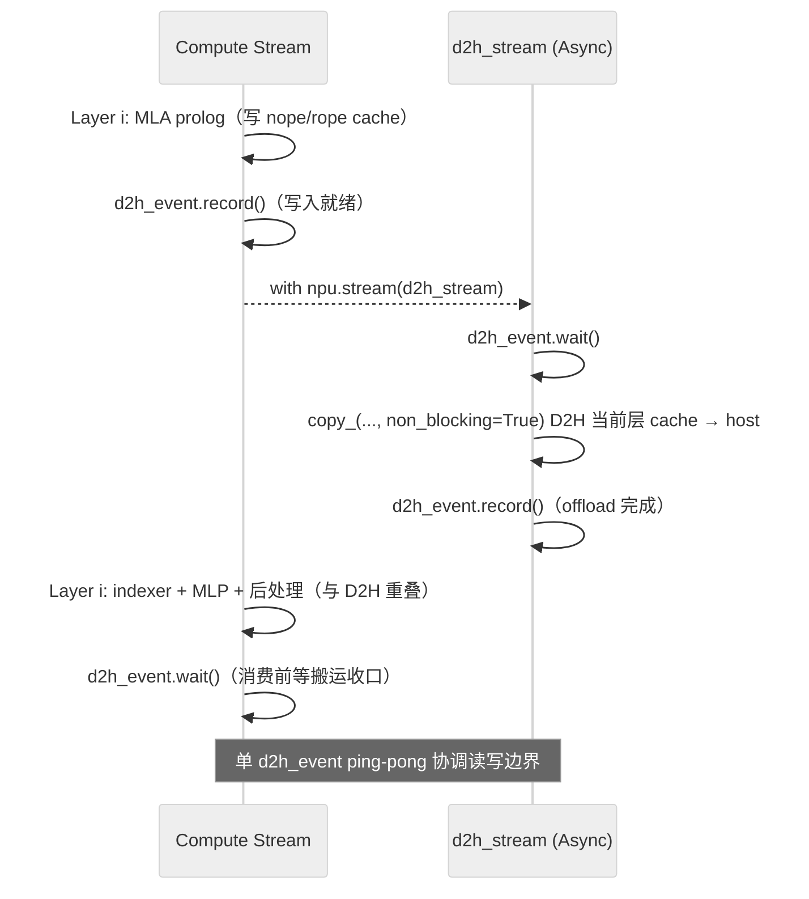

# V3.2-Exp KV Offload 搬运流与事件配对案例

## 条件与职责

固定 V3.2-Exp/A3 的历史实现；GLM 同名片段只作差异参考，不据此确认其他组合。 机制见[原机制卡](../../concepts/techniques/kvcache_offload.md)。

## 规范入口

[相关规则](../rules/kvcache_offload_host_swap.md)；[相关规则](../rules/kvcache_offload_sparse_selection_cross_step_reuse.md)；规则的适用范围不由本案例扩大。

## 固定实现与差异

> 方法论总纲见 [multi-stream](../../concepts/techniques/multi_stream.md)（多流编排的通用范式、event 协同原语、收益与陷阱）；本节只记 **KVCache Offload 异步搬运流** 这一具体模式在 cann-recipes-infer 中的落地细节。

**模式名**：KVCache Offload 异步搬运流（D2H/H2D 当 memory pipeline 与主计算流重叠）。

**动机**：MLA Full KVCache 超出实际设备容量预算时，可评估容量型 Host Offload（见机制卡）。D2H/H2D 的调度、带宽与等待可能增加前向时延，因此该实现使用独立搬运流，为与计算重叠提供条件；长序列或大 batch 本身不足以证明必须启用 Offload。

**编排**：`OffloadCache` 初始化时单独创建一条搬运流 + 一个配对事件（cann-recipes-infer @2c45117，[`models/deepseek-v3.2-exp/models/offload_cache.py`](https://gitcode.com/cann/cann-recipes-infer/blob/2c45117d781ab9ab88dcb89a28ae30f5d2450399/models/deepseek-v3.2-exp/models/offload_cache.py):46-47；[glm-5](../../concepts/models/glm_5.md) 同款写法在 [`models/glm-5/models/offload_cache.py`](https://gitcode.com/cann/cann-recipes-infer/blob/2c45117d781ab9ab88dcb89a28ae30f5d2450399/models/glm-5/models/offload_cache.py):52-53）：

```python
# offload_cache.py:46-47（DeepSeek-V3.2-Exp；GLM-5 见 :52-53，逐行一致）
self.d2h_stream = torch.npu.Stream(device="npu")
self.d2h_event  = torch.npu.Event(blocking=True, enable_timing=False)
```

实际的读写边界由 **单事件 ping-pong** 协调，而非案例叙述里抽象的"主流等搬运"。以 Prefill 为例（[`models/deepseek-v3.2-exp/models/modeling_deepseek.py`](https://gitcode.com/cann/cann-recipes-infer/blob/2c45117d781ab9ab88dcb89a28ae30f5d2450399/models/deepseek-v3.2-exp/models/modeling_deepseek.py):1279-1292、:1492-1493）：

```python
# modeling_deepseek.py:1279-1292（Prefill：MLA prolog 算完后，把当前层 cache D2H 到 host swapped memory）
if self.enable_offload:
    offload_cache.d2h_event.record()                 # 主流：标记 prolog 写入已就绪
    with torch.npu.stream(offload_cache.d2h_stream):  # 切到搬运流
        offload_cache.d2h_event.wait()               # 搬运流：等写入边界
        # Prefill 阶段数据连续，用 copy_ 把当前层 cache 整层搬到 host
        nope_cache_dst.copy_(nope_cache_src, non_blocking=True)
        ...  # rope_cache 同理（非 int8 量化路径）
        offload_cache.d2h_event.record()             # 搬运流：标记本层 offload 完成
...
# modeling_deepseek.py:1492-1493（本层 MLP 算完后，主流等 offload 收口）
if is_prefill and self.enable_offload:
    offload_cache.d2h_event.wait()                   # 主流：消费/复用前等搬运边界
```

主流 `record` → 搬运流 `wait`/`copy_(non_blocking=True)`/`record` → 主流 `wait`，给出该 Prefill D2H 路径的生产、搬运与复用边界；是否与后续计算有效重叠须查看实际时间线。搬运缓冲使用 `torch_npu.empty_with_swapped_memory(...)`（`offload_cache.py`:116）；图示不代替整条 H2D/selection 路径的依赖检查。



**适用与风险**：

- **适用**：本卡确认的是固定 V3.2-Exp 的 Prefill D2H 片段；[GLM-5](../../concepts/models/glm_5.md) 的同名流和事件仅作为源码差异参考，不由此确认完整依赖、平台或收益一致。
- **风险（带宽掩盖）**：Host/PCIe/UB 带宽不够时，异步流也掩盖不住搬运耗时——这是该模式的硬约束，须与该实现的 H2D 等待共同分析。
- **风险（状态一致性）**：必须核对 `d2h_event` 配对及设备端 selection/cache 状态的生命周期；该事件不能代替其他读写和复用路径的依赖管理。
- **风险（收益强相关）**：Offload 收益与 batch / topk / block_size 强相关，不能机械复制参数。

## 验证、停止与回退

保存模型、硬件、后端、shape 与事件时间线；逐项对齐关闭该开关的输出，覆盖首次使用、跨层复用和边界输入。依赖不完整、输出异常或端到端无净收益时关闭相应 offload/多流开关并恢复原配置；本仓未执行该模型或验证回退。

## Evidence

- [固定来源 1](https://gitcode.com/cann/cann-recipes-infer/blob/2c45117d781ab9ab88dcb89a28ae30f5d2450399/models/deepseek-v3.2-exp/models/offload_cache.py)
- [固定来源 2](https://gitcode.com/cann/cann-recipes-infer/blob/2c45117d781ab9ab88dcb89a28ae30f5d2450399/models/deepseek-v3.2-exp/models/modeling_deepseek.py)
- [固定来源 3](https://gitcode.com/cann/cann-recipes-infer/blob/2f82d10467e6fe8dae81c97a2cdac78d733a6703/docs/models/deepseek-v3.2-exp/deepseek_v3.2_exp_inference_guide.md)
