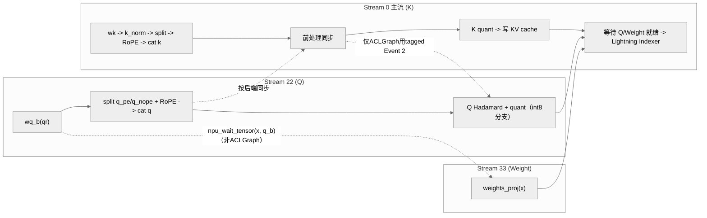

# A3 Indexer Prolog Decode 多流并行：前处理子链切流

## 条件与职责

原入口名为“A3 DeepSeek/GLM Indexer Prolog 前处理分流实现”。本页集中记录该实现的子链切流与同步条件。

同一固定提交的两份模型 README 明确面向 Atlas A3，Decode 配置开启 `enable_multi_streams`；模型注意力实现会实例化并调用本卡的 Indexer。主结论限定 A3 的静态实现和配置，不宣称已取得具体收益或完成硬件复测。 机制见[原机制卡](../../concepts/kernels/indexer_prolog.md)。

## 规范入口

[相关规则](../rules/decode_multi_stream_overlap_core_balance.md)；规则的适用范围不由本案例扩大。

## 固定实现与差异

> 方法论总纲见 [multi-stream](../../concepts/techniques/multi_stream.md)（`npu_stream_switch` tagged-stream / `npu_wait_tensor` / aclgraph tagged-event 的机制）。这里聚焦 Indexer Prolog **前处理子链切流**：以下是 **GLM-5 / DeepSeek-V3.2-Exp `indexer.py` forward** 中的副流编排；与[机制卡](../../concepts/kernels/indexer_prolog.md)中的融合算子 `npu_lightning_indexer_prolog_pto` 是不同实现路径，不能合并为同一条已验证执行链。

### 动机

Indexer Prolog 的前处理由三条独立链组成（见 [三条独立流](../../concepts/kernels/indexer_prolog.md#三条独立流)）：Q 路径（`wq_b` Matmul → split q_pe/q_nope → RoPE → 拼回）、K 路径（`wk` → `k_norm` → RoPE）、Weight 路径（`weights_proj`）。在 `indexer.py` 这条**非单算子融合**的实现里，三链若全堆主流则串行成一段很长的前处理；而 Q Matmul（MTE/Cube bound）与 K-norm/Weight-proj（Vector/小 Matmul）硬件性质互补，可能存在重叠窗口，但是否有效重叠需看真实时间线。该分流开关仅在 **decode 阶段**启用（`enable_multi_streams = self.enable_multi_streams and not is_prefill`，dsv3.2 `indexer.py:249` / glm-5 `:169`），且只组织前处理子链的并行，**不是完整模块级双网络并行**（区别于 [moe-multi-stream](../../concepts/techniques/moe_multi_stream.md) 的 MoE 双流）。

### 编排

- 副流 `"22"`：Q 路径。`wq_b(qr)` → `view` → `split` 出 `q_pe/q_nope` → 对 `q_pe` 做 RoPE → `cat` 回 `q`。dsv3.2 用 `torch_npu.npu_rotary_mul`，GLM-5 用 `torch_npu.npu_interleave_rope`（两库 RoPE 算子不同，详见关键代码）。
- 副流 `"33"`：Weight 路径，仅 `weights = self.weights_proj(x.view(-1, self.dim))`。
- 主流 `"0"`：K 路径 `wk → k_norm → split → RoPE → cat`，随后按后端同步，主流做 K 量化与写 KV cache，待 Q/Weight 就绪后喂 Lightning Indexer。
- 依赖保证：进 `"22"` 前 `npu_wait_tensor(qr, query_states[0])`（Q 等 q_lora 投影就绪）；进 `"33"` 前 `npu_wait_tensor(x, q_b)`（Weight 流让出，使 `"33"` 排在 `"22"` 的 `q_b` 之后）。**注意**：`npu_wait_tensor` 是 **非 aclgraph** 路径（包含该样例的 GE 路径）；aclgraph 路径改用 `npu_record_tagged_stream` + `npu_tagged_event_record/wait`（`indexer_npu_events[0..3]`）成对同步——二者按 `self.enable_aclgraph` 二选一。
- INT8 分支的 Q 量化（`apply_hadamard` + `npu_dynamic_quant`）**再次进入 `"22"`** 与主流 K 量化重叠：GLM-5 受 `li_cache_quant_mode == "int8"`、DeepSeek 受 `kv_cache_quant_mode == "int8"` 门控；仅 ACLGraph+多流时使用 `tagged_event_wait(events[2])`，非 ACLGraph 按张量依赖同步（glm-5 `:225` / dsv3.2 `:306` 区段）。



### 关键代码

副流 `"22"` 跑 Q 路径（GLM-5 `models/glm-5/models/indexer.py:177`，RoPE 用 `npu_interleave_rope`）：

```python
enable_multi_streams = self.enable_multi_streams and not is_prefill
# ...
with npu_stream_switch(enable_multi_streams, "22"):
    if enable_multi_streams:
        if self.enable_aclgraph:
            tng.ops.npu_tagged_event_wait(indexer_npu_events[0])
        else:
            tng.scope.npu_wait_tensor(qr, query_states[0])
    q_b = self.wq_b(qr, c8_input_dict.get("pertoken_scale", None))  # [b,s,1536]@[1536,64*128]
    q = q_b.view(bsz, seqlen, self.n_heads, self.head_dim)
    q_pe, q_nope = torch.split(q, [self.rope_head_dim, self.head_dim - self.rope_head_dim], dim=-1)
    q_pe = q_pe.view(-1, self.n_heads, 1, self.rope_head_dim)
    q_pe = torch_npu.npu_interleave_rope(q_pe, cos, sin).view(bsz, -1, self.n_heads, self.rope_head_dim)
    q = torch.cat([q_pe, q_nope], dim=-1)
```

副流 `"33"` 提前跑 `weights_proj`（GLM-5 `:202`，定义在 `:90`）：

```python
with npu_stream_switch(enable_multi_streams, "33"):
    if enable_multi_streams:
        if self.enable_aclgraph:
            tng.ops.npu_tagged_event_wait(indexer_npu_events[1])
        else:
            tng.scope.npu_wait_tensor(x, q_b)
    weights = self.weights_proj(x.view(-1, self.dim))
```

DeepSeek-V3.2-Exp 同构（`models/deepseek-v3.2-exp/models/indexer.py:256` 进 `"22"`、`:283` 进 `"33"`、`wq_b`/`weights_proj` 定义于 `:85`/`:95`），其中已核对的一项差异：Q/K 路径 RoPE 用 `torch_npu.npu_rotary_mul`（非 `npu_interleave_rope`）。

> ⚠️ 与案例叙述的差异（@2c45117）：案例 md 把 Q 路径 RoPE 一律写作 `npu_rotary_mul`，并把 `npu_wait_tensor` 段落描述为「图模式开启」配合 tagged event。实际：(1) GLM-5 用 `npu_interleave_rope`、仅 DeepSeek-V3.2-Exp 用 `npu_rotary_mul`；(2) `npu_wait_tensor` 恰是**非 aclgraph** 分支，不能将其等同于 eager，aclgraph 分支才走 `tagged_event_wait`，二者按 `self.enable_aclgraph` 互斥，并非「叠加」。

### 适用与风险

- 适用：decode 小 batch 前处理时延敏感、Q-Matmul 与 Weight/K 链硬件性质互补的 Prolog 类算子链；prefill 不启用（`not is_prefill`）。
- 风险：同步点（`npu_wait_tensor` 的 src/dst tensor、tagged-event 编号 `indexer_npu_events[0..3]` 与生命周期）设计不当会读到未就绪输入；非 aclgraph 与 aclgraph 两条同步路径必须按 `enable_aclgraph` 严格二选一，混用会导致图编译失败或精度问题；Q 量化再入 `"22"` 的 tagged Event 2 等待仅适用于 INT8 且多流+ACLGraph 的分支，GE 不插入该 tagged-event 等待。

代表实现 DeepSeek-V3.2-Exp（见 [deepseek-v3.2-exp](../../concepts/models/deepseek_v3_2_exp.md)），相似实现 GLM-5（见 [glm-5](../../concepts/models/glm_5.md)）；下游消费见 [lightning-indexer](../../concepts/modules/lightning_indexer.md)。

## 验证、停止与回退

保存模型、硬件、后端、shape 与事件时间线；逐项对齐关闭多流开关的输出，覆盖首次使用、跨层复用和边界输入。依赖不完整、输出异常或端到端无净收益时关闭相应多流开关并恢复原配置；本仓未执行该模型或验证回退。

## Evidence

- [固定来源 1](https://gitcode.com/cann/cann-recipes-infer/blob/2c45117d781ab9ab88dcb89a28ae30f5d2450399/models/deepseek-v3.2-exp/models/indexer.py)
- [固定来源 2](https://gitcode.com/cann/cann-recipes-infer/blob/2c45117d781ab9ab88dcb89a28ae30f5d2450399/models/glm-5/models/indexer.py)
- [固定来源 3](https://gitcode.com/cann/cann-recipes-infer/blob/2f82d10467e6fe8dae81c97a2cdac78d733a6703/docs/models/deepseek-v3.2-exp/deepseek_v3.2_exp_pypto_operator_guide.md)

## 本轮来源核对与剩余缺口

平台依据是模型级 README、具体 Decode 配置与同版本的调用链三者一致，不是从 PyPTO 编程框架的平台支持反推。GLM-5 与 DeepSeek 的 GE 配置均开启多流；DeepSeek 另有 `acl_graph` 配置。`enable_aclgraph=False` 也可能表示 `exe_mode=ge_graph`，不能标成“eager 已验证”。

Scope 只补 `phase: [decode]`，来源是模块内 `enable_multi_streams and not is_prefill`，不把样例名 `acl_graph` 映射成 Registry 的 `npugraph_ex`。具体 shape、后端收益与运行正确性仍需目标环境验证，不新增 verified。
