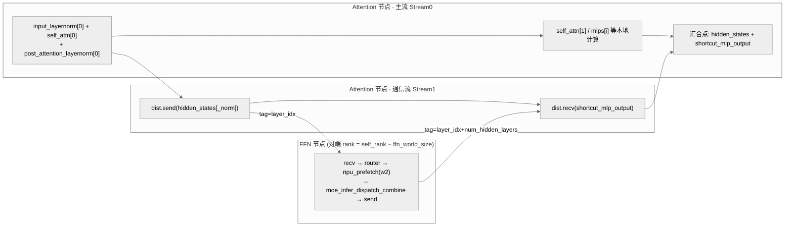

# LongCat A3 AFD 的收发配对与流汇合案例

## 条件与规范入口

固定 LongCat/A3 的历史实现；先按[AFD 规则](../rules/afd_attn_ffn_disaggregation.md)判断是否采用解耦。下文是静态实现与示意，未执行模型或证明所有调度路径均发生 overlap。

## 实施差异

> AFD 在 LongCat-Flash 上的「通信／计算 overlap」是多流编排的一个具体模式；多流编排的通用方法论（流划分、SDMA vs 计算核、汇合点、控核取舍）见 [multi-stream](../../concepts/techniques/multi_stream.md)。

### 动机

[moe-multi-stream](../../concepts/techniques/moe_multi_stream.md) 解决的是「同卡内 Attention 流 vs MoE 流」的并行（靠 `limit_core_num` 控核切核流水，详见该页）。AFD 把 MoE（FFN）剥离到对端 [expert-parallel](../../concepts/parallelism/expert_parallel.md) 节点后，卡内已无第二条计算流可拼，**新瓶颈变成跨节点的 `dist.send`/`dist.recv`**。若通信串行暴露在关键路径上，Attention 侧会在等待对端 FFN 返回时出现空洞。

固定优化指南将此场景描述为「**通信单独成流，与 Attention 节点本地计算 overlap，主流在汇合点等对端 FFN 结果**」，并说明该实现的 Send/Recv 走 SDMA、不占 Vector 核。下图表达的是指南中的设备侧目标编排；Python 源码中的调用先后不能独立证明实际流分配或重叠，须在相同图后端上查看时间线。

### 编排



汇合点：Attention 节点把 `shortcut_mlp_output`（对端 MoE 结果）与本地 `hidden_states` 相加（`forward` 路径 `i==1` 时；`multi_stream_forward` 在返回前相加）。send/recv 用一对错开的 tag（`send_tag=layer_idx`、`recv_tag=layer_idx+num_hidden_layers`），且 Attn 侧的 send_tag 必须等于 FFN 侧的 recv_tag。

### 关键代码

`enable_afd` 时本地 shortcut MoE 被替换为「先 send 本层归一化结果、再 recv 对端 FFN 结果」。串行（`forward`，发送 `hidden_states`）路径：

```python
# modeling_longcat_flash.py:1190-1197
if i == 0:
    if self.enable_afd:
        dist.send(hidden_states, dst=(self.global_rank - self.ffn_world_size), tag=self.send_tag)
        shortcut_mlp_output = torch.empty_like(hidden_states)
        dist.recv(shortcut_mlp_output, src=(self.global_rank - self.ffn_world_size), tag=self.recv_tag)
    else:
        # shortcut output (MoE output)
        shortcut_mlp_output = self.mlp(hidden_states, is_prefill, cur_topk_list=cur_topk_list)
```

`multi_stream_forward` 路径发送的是 `hidden_states_norm`；AFD 分支按顺序调用 send/recv，并以 `not self.enable_afd` 关闭后续本地计算的控核。只有非 AFD 分支在此处显式进入 `npu_stream_switch(True, "1")`，不能据此断言 AFD 通信已经被 Python 代码切到副流：

```python
# modeling_longcat_flash.py:1245-1258
if not self.enable_afd:
    npu_prefetch(self.enable_prefetch, self.mlp.router.classifier.weight.data, o_proj, 18 * 1024 * 1024, 0)
    with npu_stream_switch(True, "1"):
        with limit_core_num(True, self.aic_num1, self.aiv_num1):
            with superkernel_scope(self.enable_superkernel, f"scope_{self.layer_idx}_part2_moe", ""):
                shortcut_mlp_output = self.mlp(hidden_states_norm, is_prefill, cur_topk_list=cur_topk_list)
else:
    dist.send(hidden_states_norm, dst=(self.global_rank - self.ffn_world_size), tag=self.send_tag)
    shortcut_mlp_output = torch.empty_like(hidden_states)
    dist.recv(shortcut_mlp_output, src=(self.global_rank - self.ffn_world_size), tag=self.recv_tag)

with limit_core_num(not self.enable_afd, self.aic_num2, self.aiv_num2):  # AFD: 主流不控核
    ...  # self.mlps[0]、self_attn[1]、下一层权重预取；实际 overlap 需核对图与时间线
```

对端 FFN 节点是 Recv 起手的服务循环：`recv → router → npu_prefetch(w2) → moe_infer_dispatch_combine → send 回 Attn`：

```python
# ffn.py:70-89 (LongcatFlashFFN.forward, decode 分支)
recv_tensor = torch.empty_like(hidden_states)
dist.recv(recv_tensor, src=self.global_rank + self.ffn_world_size, tag=self.recv_tag)
topk_indices, topk_weights, router_logits = self.router(recv_tensor)
if not is_prefill:
    npu_prefetch(self.enable_prefetch, self.experts.w2_weight.data, router_logits, self.gmm2_prefetch_size, 0)
...
result, gmm2_out = self.moe_infer_dispatch_combine(recv_tensor, topk_indices, topk_weights)
dist.send(result, dst=self.global_rank + self.ffn_world_size, tag=self.send_tag)
```

> 这段实现把本地 shortcut MoE 替换为远端 FFN 服务；`dst/src = self_rank ∓ ffn_world_size` 表示该版本的 rank 配对方式，不代表所有 AFD 实现都必须采用相同部署拓扑。

### 适用与风险

- **适用边界**：本卡只记录该固定 LongCat/A3 AFD 实现。能否隐藏通信取决于依赖、后端调度、网络与本地计算窗口，不能仅凭耗时比较保证隐藏，也不由本卡确认其他 PD 分离方案。
- **风险**：若 FFN 侧成为瓶颈，Recv 等待可能在主流上形成 EVENT_WAIT 拖尾；下文「FFN 侧瓶颈与预取补充」保留固定指南的排查方向，是否启用预取仍需按对应规则验证。
- **风险**：不要把函数名或非 AFD 分支的流开关视为 AFD 通信已重叠的证据；配置组合和部署约束见[机制边界](../../concepts/techniques/afd.md#constraints)与规范规则。

## 验证与回退

保存 rank 映射、tag、实际图后端、网络与模型配置；逐层核对收发配对、汇合前依赖和输出，对比关闭 AFD 的同负载基线。RecV 等待或精度异常时关闭对应 AFD 配置，按规则恢复原路径。未在本仓验证回退效果。

## 观测入口

[核数与整网来源观测](../benchmark_observations/longcat_a3_afd_source_benchmark.md)统一维护数据；不把组合结果归因给单条收发语句。

## Evidence

- [固定来源 1](https://gitcode.com/cann/cann-recipes-infer/blob/2c45117d781ab9ab88dcb89a28ae30f5d2450399/models/longcat-flash/models/modeling_longcat_flash.py)
- [固定来源 2](https://gitcode.com/cann/cann-recipes-infer/blob/2c45117d781ab9ab88dcb89a28ae30f5d2450399/models/longcat-flash/models/ffn.py)
- [固定来源 3](https://gitcode.com/cann/cann-recipes-infer/blob/2f82d10467e6fe8dae81c97a2cdac78d733a6703/docs/models/longcat-flash/longcat_flash_optimization.md)

## FFN 侧瓶颈与预取补充

非分离场景中，对 QuantBatchMatmul (QBMM)、MLAProlog、Matmul 进行权重预取后，一方面由于 Stage2 里 Stream0 上算子的计算耗时与 Stream1 上 Router/Dispatch/MoE-GMM/Combine 算子耗时相当，另一方面也没有较好的时间窗口对 MoE GMM 进行权重预取，故对 MoE GMM 算子没有采取权重预取。

**但使能 AFD 之后，Attention 侧再不控核后，MLAProlog/FA/MM/TBMM/QBMM 算子耗时降低，可能出现 FFN 侧计算瓶颈**，导致 Attention 侧的 Recv 算子长时间没能收到 FFN 侧发来的数据，在计算流上出现 EVENT_WAIT 间隙的拖尾现象：


*来源：[`docs/models/longcat-flash/figures/attn_event_wait.png`](https://gitcode.com/cann/cann-recipes-infer/blob/2f82d10467e6fe8dae81c97a2cdac78d733a6703/docs/models/longcat-flash/figures/attn_event_wait.png)（cann-recipes-infer @ 2f82d10）*

针对 FFN 侧计算瓶颈问题，可**对 GMM/Matmul 访存 Bound 类算子在通信间隙时提前预取对应的权重**，从而降低 FFN 侧的整体耗时：


*来源：[`docs/models/longcat-flash/figures/afd_ffn_cmo.png`](https://gitcode.com/cann/cann-recipes-infer/blob/2f82d10467e6fe8dae81c97a2cdac78d733a6703/docs/models/longcat-flash/figures/afd_ffn_cmo.png)（cann-recipes-infer @ 2f82d10）*

> AFD 场景下，Attention 侧的权重预取保持和非分离场景时一样，见 [weight-prefetch](../../concepts/techniques/weight_prefetch.md)。
