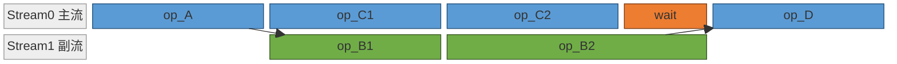

# 跨流同步规则：GE 控制边、显式 Event 与历史 tagged API

## 适用场景

在图模式 decode 下用多流（[multi-stream](../../concepts/techniques/multi_stream.md) / [moe-multi-stream](../../concepts/techniques/moe_multi_stream.md)）让互不依赖的计算 overlap 掉时延（典型：MoE 共享专家计算掩盖路由专家 TP 通信、indexer prolog 的 q/kv 侧流）。**该 overlap 哪些计算、怎么控核平衡**是另一层（见 [decode-multi-stream-overlap-core-balance](decode_multi_stream_overlap_core_balance.md)）；本页只解决"跨流数据依赖在不同图后端下怎么正确表达、别把 API 混写"。

## 何时不适用 / 先别开

- 多流主要面向 **Cube 资源未吃满**的场景；Cube 已吃满则不要默认开多流。
- 先证明正确再追性能：先验证依赖/功能/精度，再看 overlap 与时延收益。"overlap ≠ 收益"——出现拖尾、资源争抢、host bound、shape 劣化要继续评估。
- 本卡共享专家参考路径只在 **decode** 生效：`enable_multi_streams = enable_multi_streams and not is_prefill`。给带共享专家的 MoE overlap 时按 phase 门控、**prefill 不开**（prefill 走无重叠直路，否则会引入 GE 图性能劣化）。

## 按图后端选一套 API（不混写，这是硬约束）

同一条跨流"生产者→消费者"依赖，在两种图后端下表达方式不同、**不等价、不可互相兜底**：

| 图后端 | 跨流同步原语 | 语义 |
|--------|------------|------|
| **ge_graph（GE 图）** | `tng.scope.npu_wait_tensor(out, wait_tensor)` | 给 `out` 挂一条到 `wait_tensor` 的**控制边（data-dependency edge）**，GE 图按被消费张量自动插同步 |
| **历史 aclgraph tagged-stream 实现** | `tng.ops.npu_tagged_event_record / npu_tagged_event_wait`（配 `npu_create_tagged_event`） | 命名 tagged event 的 record/wait 配对显式同步；跨流输入张量还需 `npu_record_tagged_stream` 登记 |
| **eager / 显式 Stream 的 npugraph_ex 实现** | `torch.npu.Stream()` / `record_event()` / `wait_event()` / `record_stream()` | 显式流对象 |

代码里两后端在同一位置分支表达：
```python
with npu_stream_switch(enable_multi_streams, "33"):
    if enable_multi_streams:
        if self.enable_aclgraph:
            tng.ops.npu_tagged_event_wait(events[1])       # aclgraph
        else:
            tng.scope.npu_wait_tensor(x, q_b)              # ge_graph
    weights = self.weights_proj(x)
```

**硬约束**：不要把 Ascend IR 图内 API（`npu_wait_tensor`）与 aclgraph 显式 event API 混写到同一实现；不要在 eager 路径照搬 tagged event 风格。`npu_tagged_event_record` 这类原语优先跟随仓库现有案例，不要脱离上下文自己猜语义。

## aclgraph 多流的两条额外要求

1. **在历史 tagged-event 实现中检查每条跨流依赖**：aclgraph 下每条"生产者→消费者"边都要一对 record/wait，record 紧跟生产语句、wait 紧接消费语句前，为尚未被其他依赖覆盖的跨流边补齐同步；record 与 wait 可跨函数配对（如 MoE 里 record 在 shared-expert 段、wait 在下游专家计算函数里）。按层预创建（或提模块级全局，见 [graph-mode-multi-stream-sync-failures](../../runbooks/runtime/graph_mode_multi_stream_sync_failures.md)）。
2. **跨流输入张量进侧流 scope 前须登记**：凡在主流产生、又要在标签侧流 `npu_stream_switch(..., "<tag>")` scope 内被消费的输入张量，进 scope 前逐个 `tng.ops.npu_record_tagged_stream(tensor, "<tag>")`（tag 与随后 stream_switch 一致）——只做 `npu_tagged_event_record` 不足以让 aclgraph 捕获到"侧流消费的输入来自主流"的跨流依赖/张量-流归属：
   ```python
   if enable_multi_streams and self.enable_aclgraph:
       tng.ops.npu_record_tagged_stream(t, "<tag>")   # 每个跨流输入张量各登记一次
       tng.ops.npu_tagged_event_record(events[0])
   with npu_stream_switch(enable_multi_streams, "<tag>"):
       ...  # 侧流内消费 t
   ```
   所有这些以 `enable_multi_streams and enable_aclgraph` 守卫，ge_graph / eager 不加。

## 控核与生命周期（引入顺序）

先把依赖/overlap 做对，再看拖尾/资源争抢，**最后**才引入 `limit_core_num` / `torch_npu.set_stream_limit` / `torch_npu.npu_prefetch`——控核只解决资源分配、不解决依赖错误。控核分层：ge_graph 用 `torchair.scope.limit_core_num`（算子级，优先级高于全局 `config.ge_config.aicore_num`）；npugraph_ex 用 Stream 级 `torch.npu.npugraph_ex.scope.limit_core_num`（**仅 Ascend C 算子支持控核**，micro-batch 多流若夹不支持控核的算子收益下降甚至卡死）。显式 stream / aclgraph 路径下短生命周期张量被其它流继续消费时必须补 `record_stream()`；只切流不管内存会出错。

## 跨"步"串行化的 replay 前同步：收窄到当前流，别用设备级同步

上面几节是**同一图步内**跨流数据依赖怎么正确表达。另有一类同步是**跨图步（step 与 step 之间）串行化**：图模式 + 异步调度（async scheduling）/多线程下，第 i 步的 CPU 侧 record event（如 attn param 更新）可能在第 i-1 步的 graph replay 还没跑完时就触发，导致 replay 用到 stale / 部分更新的图参数，表现为步间 hang。修法是在 replay 之前插一次阻塞同步，强制"上一次 replay 完全结束后"才做本步的 param 更新。

**这次同步的范围要收窄到当前流，别用设备级同步**——这是通用的多流同步卫生：

- **设备级 `torch.npu.synchronize()` 过宽**：它等**整个 device 上所有流**完成。若该实例上有与推理无关的背景流在并发跑（典型：KV transfer / [online-pd-inference](../../concepts/frameworks/online_pd_inference.md) 的 send/recv 传输流），设备级同步会把它们一并卡住，白白损害推理吞吐。
- **当前流同步 `torch.npu.current_stream().synchronize()` 恰好够用**：目的只是"等上一次 replay 完成"，而 replay 就跑在当前流上；只阻塞到当前流已提交的工作完成，就已满足"跨步串行、解 hang"，同时放行其它流继续并发。
- 一般原则：**同步范围应匹配你真正要等待的那条流，而不是图省事全设备刷一遍**。为解某条流上的顺序问题而做设备级同步，是把一条边的约束升级成全设备栅栏，常见的过度同步反模式。

**边界(务必先确认再收窄)**：把同步从设备级收窄到当前流后，就不再顺带等待"其它流上"的工作。若被 replay 消费的图参数是在**独立的 param 更新流**上写的（例如 `with torch.npu.stream(update_stream): ...; event.record(update_stream)`），那么"param 更新 → replay"是一条**跨流**依赖，仅同步当前流并不覆盖它。收窄前必须确认该跨流顺序已由其它机制保证（对 `update_stream` 上 record 的 event 做 `wait_event`，或 `current_stream().wait_stream(update_stream)`）；否则理论上 replay 可能读到 stale / 部分更新的参数（一次 code review 对此提过 critical 级 race 提醒）。**收窄同步范围 ≠ 免费**：先补齐真正需要的那条跨流序，再删掉设备级大锁。

## 参考实现及其约束

参考实现：DeepSeek-V3.2-Exp 的 `Indexer`（q→流"22"、weights_proj→流"33"）与 `DeepseekV3MoE`（shared-expert overlap）、`model-infer-multi-stream` skill 的 API 选型规则、GE 图 `executor.utils.npu_wait_tensor` 开关式 helper。流标签（"11"/"22"/"33"）、`enable_gegraph_and_multistream` 等开关名是该 recipe 落点；"按图后端选一套跨流同步 API 不混写""aclgraph 每边配 event + 输入登记"是跨模型可迁移的多流写法。

"replay 前同步收窄到当前流"的参考实现：vllm-ascend 的 `vllm_ascend/compilation/acl_graph.py` aclgraph `__call__`，在 `entry.aclgraph.replay()` 前把 `torch.npu.synchronize()` 改为 `torch.npu.current_stream().synchronize()`（1 增 1 删，所在条件分支 `if runtime_mode != FULL or not is_draft_model or not use_eagle:` 不变）。其 param 更新走独立 `update_stream`（`update_graph_params` 里 `with torch.npu.stream(update_stream): ...; event.record(update_stream)`），是 send/recv 背景流被设备级同步误卡的现实场景。该改动仅在 vllm-ascend aclgraph 异步调度路径经维护者合入确认，无量化 before→after 数字（PR 仅给 hang 前后截图）；"同步范围匹配要等的流、别设备级过度同步"是可迁移原则，具体开关/分支/流名是该仓落点。

## 相关经验
- [多流注意力主流张量被通信流消费致 NPU 内存不释放：跨流消费前 clone 副本解耦生命周](../../runbooks/runtime/multistream_cross_stream_tensor_lifetime_clone.md)

## Evidence

- diff 事实 + 维护者确认（@7d1f25d29aff）：aclgraph 用 tagged-event、ge_graph 用 `npu_wait_tensor`，机制不等价；"GE 没有复现此问题"为维护者答复。溯源下探 [cann-recipes-infer-pr-269-fix-bugfix-ds3-2-aclgraph-multistream](https://gitcode.com/cann/cann-recipes-infer/merge_requests/269)
- diff 事实（@2c7e797f60e3）：ge_graph 用 `tng.scope.npu_wait_tensor` 控制边（封装 `npu_wait_tensor` helper）替代 aclgraph tagged-event。溯源下探 [cann-recipes-infer-pr-121-feat-ge-graph-multistreams](https://gitcode.com/cann/cann-recipes-infer/merge_requests/121)
- diff 事实（@f8bb1545）：aclgraph 多流按层预创建 2 个 tagged event、record/wait 配对（可跨函数）。溯源下探 [cann-recipes-infer-pr-204-feat-dsv3-2-support-acl-graph](https://gitcode.com/cann/cann-recipes-infer/merge_requests/204)
- diff 事实（@fd80e58b25ed）：跨流输入张量进标签侧流前逐个 `npu_record_tagged_stream`，门控 `enable_multi_streams and enable_aclgraph`。溯源下探 [cann-recipes-infer-pr-291-feat-refactor-ds32-support-multi-batch-per-die-when-minibatch-equal-to-0](https://gitcode.com/cann/cann-recipes-infer/merge_requests/291)
- diff 事实（@d739fecb4232）：`model-infer-multi-stream` skill 的执行路径定界 / API 选型 / 控核分层 / 引入顺序规则。溯源下探 [cann-recipes-infer-pr-351-feat-update-agent-skills-with-full-optimization-pipeline-and-role-based](https://gitcode.com/cann/cann-recipes-infer/merge_requests/351)
- diff 事实（@c138154bdc57）：`moe_infer_tp` 新增 `is_prefill`，多流重叠开关与 `not is_prefill` 相与、限定 decode。溯源下探 [cann-recipes-infer-pr-430-refactor-unify-infer-sh-and-fix-dsr1-qwen3-moe-gate-on-gegraph](https://gitcode.com/cann/cann-recipes-infer/merge_requests/430)
- diff 事实 + 维护者合入（@e7a13be）：vllm-ascend `acl_graph.py:199` 把 replay 前的 `torch.npu.synchronize()` 收窄为 `torch.npu.current_stream().synchronize()`，放行 send/recv 背景流仍解跨步 hang；param 更新走独立 `update_stream`（`attention_v1.py:376-437`），据此坐实"设备级同步误卡背景流"的前提。race-condition 属 code review 未证边界，已隔离进「边界」小节、不并入事实面。溯源下探 [vllm-ascend-pr-6432-bugfix-synchronize-only-the-current-stream-to-avoid-device-sync](https://github.com/vllm-project/vllm-ascend/pull/6432)

## 显式 Event 路径与来源边界

固定设计文档 `a12e98a866f5f9ef51053e47f5e8151ac703caf3` 的 npugraph_ex 示例采用 `torch.npu.Stream`、预创建 `torch.npu.Event`、`record/wait` 和 `record_stream`，并不要求全部改成 tagged event。上文 tagged API 属所列历史模型实现；先确认执行后端与包装层，再选同步方式。Event 保证执行顺序，`record_stream` 处理内存生命周期，不能互相代替。

验证时覆盖多流开/关、主模型/MTP 和重复 replay，确认输出、事件生命周期及跨流消费；失败时回到单流并按关联 Runbook 定位，不靠增加无依据的全设备同步掩盖问题。

## 三种执行模式的固定来源示例

下列示意来自 `a12e98a866f5f9ef51053e47f5e8151ac703caf3` 设计文档，函数 `op_*` 是占位符；核数仅为示例，应按平台确认。

## 三种执行模式的多流实现

下文以前面 A → (B 分支, C 分支) → D 的 DAG 为统一例子：主流执行 A → C1 → C2，副流并行 B1 → B2；`op_D` 启动前需等两条流汇合。三种模式代码不同，但执行时序语义一致：



`wait` 块在 eager / npugraph_ex 下表现为代码中的 `wait_event` 调用（主流等副流结束），在 ge_graph 下由编译器从 `out_B2` 的数据依赖自动插入。

### eager

eager 模式下 Stream 由模型脚本主动创建和切换。

```python
import torch

# 副流创建（主流为默认 current_stream）
side_stream = torch.npu.Stream()
main_stream = torch.npu.current_stream()

# 主流：前置算子 A
out_A = op_A(x)

# 副流：等主流的 A 完成后执行 B 分支
side_stream.wait_stream(main_stream)
with torch.npu.stream(side_stream):
    out_B1 = op_B1(out_A)
    out_B2 = op_B2(out_B1)
out_B2.record_stream(main_stream)  # out_B2 将被主流消费，告知 allocator 延长其生命周期
event_B = side_stream.record_event()

# 主流并行执行 C 分支
out_C1 = op_C1(out_A)
out_C2 = op_C2(out_C1)

# 主流等副流的 B 完成后汇合
main_stream.wait_event(event_B)
out_D = op_D(out_B2, out_C2)
```

- `torch.npu.Stream()` 创建副流；`torch.npu.current_stream()` 获取主流。
- `with torch.npu.stream(side_stream):` 上下文内 launch 的 kernel 绑定该 Stream。
- `side_stream.wait_stream(main_stream)`：副流入口等待主流当前已下发的全部任务完成（粗粒度汇合，适合"等到这一点之前全部完成"）。
- `record_event` / `wait_event`：跨流时间点同步——副流在 B 完成处标记 `event_B`，主流在 D 启动前等待。
- `tensor.record_stream(stream)`：caching allocator 默认按 tensor 创建 Stream 追踪释放；跨流消费的短生命周期 tensor 需 `record_stream` 把内存生命周期延长到目标 Stream，allocator 才会等目标 Stream 消费完再复用。

### ge_graph

ge_graph 模式下多流表达进入图内，由 GE 编译器在编译期分配到逻辑 Stream、运行期按图调度。

```python
import torch
import torchair as tng
from torchair import CompilerConfig, get_npu_backend

class Model(torch.nn.Module):
    def forward(self, x):
        out_A = op_A(x)

        # B 分支放到 tag "1" 副流，并限制其使用的核数
        with tng.scope.npu_stream_switch("1"):
            with tng.scope.limit_core_num(12, 24):
                out_B1 = op_B1(out_A)
                out_B2 = op_B2(out_B1)

        # C 分支留在主流，同样限制核数（与副流形成分核配对）
        with tng.scope.limit_core_num(12, 24):
            out_C1 = op_C1(out_A)
            tng.scope.npu_wait_tensor(out_C1, out_B2)
            out_C2 = op_C2(out_C1)

        # out_B2 来自副流，op_D 的跨流数据依赖由编译器自动插入同步
        out_D = op_D(out_B2, out_C2)
        return out_D

# 编译入图
config = CompilerConfig()
model = Model()
model = torch.compile(model, backend=get_npu_backend(compiler_config=config))
```

- `tng.scope.npu_stream_switch("tag")`：图内 scope，scope 内算子在编译期分配到 tag 对应逻辑 Stream；tag 全局唯一，跨模块复用同 tag 用相同 Stream。
- `tng.scope.npu_wait_tensor(anchor, wait_tensor)`：插入跨流等待，用于两条流需精确控制排序的场景。
- `tng.scope.limit_core_num(aic, aiv)`：限制 scope 内算子使用的 AIC / AIV 核数，控核精确到单个并行段。两条并行 Stream 通常都要限核（如上例各 12+24），**一般并行分支核数加起来等于总核数，超过会导致无法并行甚至资源互锁卡死**。
- 生命周期：图编译期依据数据依赖已分析完整，跨流依赖以图边显式表达。

### npugraph_ex

npugraph_ex 模式下用创建 Stream 和 Event 的方式切流，跨流有数据依赖时需显式用 Event 同步等待。

```python
import torch

class Model(torch.nn.Module):
    def __init__(self):
        super().__init__()
        # Stream 与 Event 在 __init__ 创建，capture / replay 阶段保持对象引用稳定
        self.side_stream = torch.npu.Stream()
        self.events = [torch.npu.Event(), torch.npu.Event()]

    def forward(self, x):
        out_A = op_A(x)

        # 主流标记 out_A 将被副流消费，告知 allocator 延长其生命周期
        out_A.record_stream(self.side_stream)
        self.events[0].record()  # 主流标记事件 0

        # B 分支放到副流
        with torch.npu.stream(self.side_stream):
            self.events[0].wait()  # 副流等主流的事件 0
            out_B1 = op_B1(out_A)
            out_B2 = op_B2(out_B1)
            self.events[1].record()  # 副流标记事件 1

        # C 分支并行执行
        out_C1 = op_C1(out_A)
        out_C2 = op_C2(out_C1)

        # 主流标记 out_B2 将被自身消费，并等副流的事件 1
        out_B2.record_stream(torch.npu.current_stream())
        self.events[1].wait()
        out_D = op_D(out_B2, out_C2)
        return out_D

# 包装入图
model = Model()
model = torch.compile(model, backend="npugraph_ex")
```

- 流切换沿用 eager 的 `with torch.npu.stream(s):` 上下文。
- Event 同步通过 `event.record()` / `event.wait()` 显式调用。
- `tensor.record_stream(stream)`：跨流消费的 tensor 进入消费流前调用，告知 allocator 延长其生命周期至 `stream` 也用完。本例 `out_A`（主流产出、副流消费）与 `out_B2`（副流产出、主流消费）都需调用。
