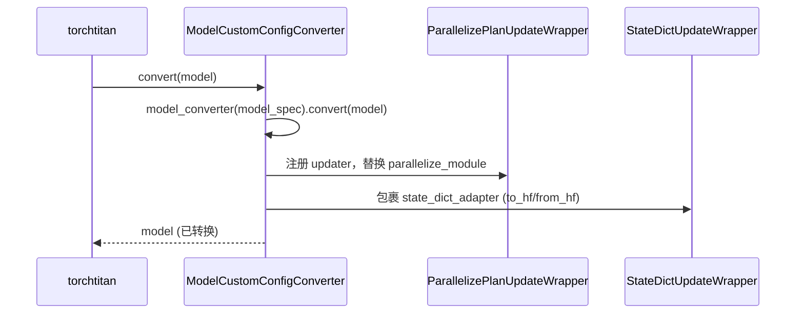

# torchtitan-npu ModelCustom 声明式转换框架

ModelCustom 是 [torchtitan](torchtitan.md)-NPU 基于上游 torchtitan
`ModelConverter` 协议实现的**声明式、可组合**模型自定义框架。开发者声明一份配置 +
最多三个 hook，框架在 `convert` 时按需替换 Module、改写并行计划、转换权重格式。它**取代了
旧的 monkey-patch 方式**（`register_npu_converter` / `BaseConverter` 风格，见
[torchtitan](torchtitan.md)）：新代码统一走 `get_model_converter_config`。

## 入口配置 ModelCustomConfig

定制化以一个 dataclass 声明（`converters/model_custom_interface.py`）：

```python
@dataclass
class ModelCustomConfig:
    name: str = "default"
    model_converter: type["ModelCustomConverter"] | None = None
    parallelize_plan_updater: type["ParallelizePlanUpdater"] | None = None
    state_dict_updater: type["StateDictUpdater"] | None = None
```

三个槽位对应三个 ABC（同文件），均**可选**——只声明你需要的那一个：

| Hook ABC | 触发点 | 方法 |
|----------|--------|------|
| `ModelCustomConverter` | 模型构建后 | `convert(self, model) -> None`（实例方法，`__init__(self, model_spec)`） |
| `ParallelizePlanUpdater` | `parallelize_module` 前 | `update(cls, parallelize_plan)`（**classmethod**） |
| `StateDictUpdater` | checkpoint 加载/保存 | `to_hf(cls, sd)` / `from_hf(cls, sd)`（**classmethod**） |

## GMM 工作示例

GroupedMatmul（GMM）是核心范例：将 MoE 专家的 `w1`/`w3` 融合为 `w13` 以适配 NPU
`grouped_matmul` 算子（融合算子细节见 [npu-fused-op-converters](npu_fused_op_converters.md)）。

### Module 替换 Converter

子类继承上游 `GroupedExperts`，构造函数接收原实例并**浅拷贝** `__dict__`（共享权重模块/buffer，
避免依赖父类 `__init__` 的 `dim/hidden_dim/num_experts`），随后建 `w13` Parameter 并置空 `w1/w3`
（`converters/kernels/gmm.py`）：

```python
class NpuGroupedExperts(GroupedExperts):
    def __init__(self, parent: GroupedExperts):
        self.__dict__.update(parent.__dict__)   # 浅拷贝，权重共享
        self.use_grouped_mm = True
        if self.w1 is not None and self.w3 is not None:
            w13_data = torch.empty(
                self.num_experts, self.w2.shape[2] * 2, self.w2.shape[1],
                dtype=self.w1.dtype, device=self.w1.device,
            )
            self.w13 = nn.Parameter(w13_data)
            self.w1 = None
            self.w3 = None
```

替换动作由 `ModelCustomConverter` 子类执行，遍历命名 module 并调用
`replace_module_with_name`（`converters/convert_utils.py`）：

```python
class NpuGroupedExpertConverter(ModelCustomConverter):
    def convert(self, model: nn.Module):
        for name, module in model.named_modules():
            if not isinstance(module, GroupedExperts):
                continue
            replace_module_with_name(model, name, NpuGroupedExperts(module))
```

### ParallelizePlanUpdater（可选）

`GMMModelConfig`（`npu_gmm`）**本身不声明** `parallelize_plan_updater`——它只装 `model_converter`
+ `state_dict_updater`。真正在 `parallelize_module` 前改写 EP 计划的，是另一个注册 converter
`npu_permute`（`converters/kernels/permute.py`）：它把上游 `ExpertParallel` 改写为
NPU 实现 `NpuExpertParallel`，与 [torchtitan-5d-parallel](../parallelism/torchtitan_5d_parallel.md) 的
EP 计划协同：

```python
# converters/kernels/permute.py（npu_permute 实际注册的 updater）
class NpuParallelizePlanUpdater(ParallelizePlanUpdater):
    @classmethod
    def update(cls, parallelize_plan):
        if isinstance(parallelize_plan, ExpertParallel):
            return NpuExpertParallel()
        return parallelize_plan
```

> ⚠️ 特性文档用一段 `GMMParallelizePlanUpdater` →
> `GMMExpertParallel()` 作**讲解示例**演示这个 hook，但这两个符号**仅存在于该文档**，代码中并无
> 对应实现，且并未挂到 `npu_gmm` 的注册配置上——勿当作真实的 GMM 配置：
>
> ```python
> # 特性文档中的示意代码（非注册配置）
> class GMMParallelizePlanUpdater(ParallelizePlanUpdater):
>     @classmethod
>     def update(cls, parallelize_plan):
>         if type(parallelize_plan) is ExpertParallel:
>             return GMMExpertParallel()
>         return parallelize_plan
> ```

### StateDictUpdater（可选）

适配 checkpoint 的 `w1+w3` ↔ `w13` 布局差异——保存走 `to_hf` 拆分，加载走 `from_hf` 融合：

```python
class GMMStateDictUpdater(StateDictUpdater):
    @classmethod
    def to_hf(cls, state_dict):
        if any(".moe.experts.w13" in k for k in state_dict.keys()):
            state_dict = _split_w13_for_mapping(state_dict)
        return state_dict

    @classmethod
    def from_hf(cls, state_dict):
        filtered = {k: v for k, v in state_dict.items()
                    if not k.endswith(".weight_scale_inv")}
        return fuse_experts(filtered)
```

### 声明 + 注册 + 激活

`@register_model_converter("npu_gmm")` 一行完成声明配置 + 注册；激活时在模型模块
`config_registry.py` 的 `model_converters` 列表追加 `get_model_converter_config("npu_gmm")`：

```python
@register_model_converter("npu_gmm")
class GMMModelConfig(ModelCustomConfig):
    model_converter = NpuGroupedExpertConverter
    state_dict_updater = GMMStateDictUpdater   # 可选；npu_gmm 不声明 parallelize_plan_updater

# 激活（config_registry.py）
model_converters = ModelConvertersContainer.Config(
    converters=[get_model_converter_config("npu_gmm")],
)
```

> EP 计划改写不在 `npu_gmm`，而由 `npu_permute` 的 `parallelize_plan_updater =
> NpuParallelizePlanUpdater` 负责（见「ParallelizePlanUpdater（可选）」）；需要 EP 改写时把 `get_model_converter_config("npu_permute")`
> 一并加入 `converters` 列表。

## 核心组件

| 组件 | 文件 | 职责 |
|------|------|------|
| `register_model_converter()` / `get_model_converter_config()` | `converters/registry.py` | 注册装饰器 + 取回 `converter_cls.Config()` 实例供激活 |
| `ModelCustomConfig` 及 3 个 ABC | `converters/model_custom_interface.py` | 声明配置 + 三类 hook 抽象基类 |
| `ModelCustomConfigConverter` | `converters/framework/model_custom_config_converter.py` | 继承 `Configurable + ModelConverter`，读配置并应用到模型 |
| `ParallelizePlanUpdateWrapper` | `converters/framework/parallelize_plan_update_wrapper.py` | 替换 `parallel.parallelize_module`，运行时改并行计划 |
| `StateDictUpdateWrapper` | `converters/framework/state_dict_update_wrapper.py` | 动态包装 `state_dict_adapter`，注入 updater 链 |
| `_ConverterRegistry` | `converters/framework/model_custom_config_registry.py` | 全局注册单例，管理 config + 动态生成的 converter 类 |
| `init_distributed_wrapper` | `patches/torchtitan/trainer_init_distributed.py` | 拦截 `Trainer.init_distributed` 捕获 `Trainer.Config`/`ModelSpec` |

## 运行时机制

**注册阶段（导入时）**：`@register_model_converter` → 单例 `_ConverterRegistry.register`
设 `config.name`、存入 `_model_configs`，再用 `type()` **合成** converter 类
`f"{name}ModelCustomConfigConverter"`（基类 `ModelCustomConfigConverter`，类属性
`_model_config=config`）及一份唯一 `Config` 子类（`_owner` 回指 converter 类）。torchtitan 通过
`Configurable.Config` 发现该 converter。

```mermaid
sequenceDiagram
    participant dec as @register_model_converter
    participant reg as _ConverterRegistry (单例)
    participant dyn as type() 动态合成
    dec->>reg: register(name)(config)
    reg->>reg: config.name = name; _model_configs[name] = config
    reg->>dyn: type(f"{name}ModelCustomConfigConverter", (ModelCustomConfigConverter,), {_model_config: config})
    dyn-->>reg: converter_cls (+ 唯一 Config, _owner 回指)
    reg->>reg: _converter_classes[name] = converter_cls
```

**模型入口阶段**：`patches/torchtitan/trainer_init_distributed.py` 由 `_apply_patches()`
最早安装，`init_distributed_wrapper` 捕获 `Trainer.Config`（含 `model_spec`）存入全局，供
`get_using_model_spec()` 读取。

**转换执行阶段**：torchtitan 调 `ModelCustomConfigConverter.convert(model)` 时，按配置依次：
`model_converter(model_spec).convert(model)` 替换 Module → `ParallelizePlanUpdateWrapper`
注册 updater 并替换 `parallelize_module` → `StateDictUpdateWrapper` 包裹 `state_dict_adapter`。



随后并行化时 `parallelize_module_wrapper` 对每个 `updater_cls.update(plan)` 改写计划，再调原生
`parallelize_module`；权重加载/保存时 wrapper 在父 `from_hf`/`to_hf` 两侧串接 updater 链，**两条路径顺序相反**：
`to_hf` 先过 updater 链（拆 `w13`）再调上游 adapter（updater-先/`super`-后），`from_hf` 先调上游 adapter
再过 updater 链（融 `w13`）（`super`-先/updater-后）——决定 split/fuse 与上游 adapter 映射谁先生效。

## Evidence

- 来源仓：[torchtitan-npu](https://gitcode.com/cann/torchtitan-npu)
- 特性文档（@8f128cd）：[`docs/feature_guides/model_custom.md`](https://gitcode.com/cann/torchtitan-npu/blob/8f128cd177e9c9a14d9b70f4491bde28bc342481/docs/feature_guides/model_custom.md)
- 实现源（@8f128cd）：
  - `model_custom_interface.py`：https://gitcode.com/cann/torchtitan-npu/blob/8f128cd177e9c9a14d9b70f4491bde28bc342481/torchtitan_npu/converters/model_custom_interface.py
  - `registry.py`（`register_model_converter`/`get_model_converter_config`）：https://gitcode.com/cann/torchtitan-npu/blob/8f128cd177e9c9a14d9b70f4491bde28bc342481/torchtitan_npu/converters/registry.py
  - `model_custom_config_registry.py`（`_ConverterRegistry`/`type()`）：https://gitcode.com/cann/torchtitan-npu/blob/8f128cd177e9c9a14d9b70f4491bde28bc342481/torchtitan_npu/converters/framework/model_custom_config_registry.py
  - `kernels/gmm.py`（`NpuGroupedExperts`，`npu_gmm` 仅 model_converter + state_dict_updater）：https://gitcode.com/cann/torchtitan-npu/blob/8f128cd177e9c9a14d9b70f4491bde28bc342481/torchtitan_npu/converters/kernels/gmm.py
  - `kernels/permute.py`（`NpuParallelizePlanUpdater`/`NpuExpertParallel`，`npu_permute` 的 EP 计划改写）：https://gitcode.com/cann/torchtitan-npu/blob/8f128cd177e9c9a14d9b70f4491bde28bc342481/torchtitan_npu/converters/kernels/permute.py
  - `patches/torchtitan/trainer_init_distributed.py`：https://gitcode.com/cann/torchtitan-npu/blob/8f128cd177e9c9a14d9b70f4491bde28bc342481/torchtitan_npu/patches/torchtitan/trainer_init_distributed.py

## Links

- [torchtitan](torchtitan.md)（旧 `register_npu_converter`/`BaseConverter` 已被声明式 API 取代）
- [npu-fused-op-converters](npu_fused_op_converters.md)（GMM/grouped_matmul）
- [torchtitan-5d-parallel](../parallelism/torchtitan_5d_parallel.md)（EP → NpuExpertParallel，由 npu_permute 的 NpuParallelizePlanUpdater 改写）
- [vlm-multimodal-training](../modules/vlm_multimodal_training.md)（npu_vlm 经声明式 converter 注册）
- [megatron-bridge](megatron_bridge.md)（MindSpeed-Bridge HF↔Megatron 权重桥接的邻近概念）
- [mindspeed-mm](mindspeed_mm.md)（MindSpeed-MM Canonical Model 权重转换的邻近概念）
