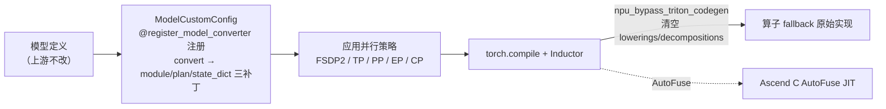

# TorchTitan / torchtitan-npu（训练框架）

## Summary

**TorchTitan** 是 PyTorch 社区原生的大模型训练框架，以 **DTensor** 为一等公民，把张量并行抽象为 Placement（Shard / Replicate / Partial），通过子模块的 `ParallelStyle` 声明切分方式、无需手写通信逻辑，以极低侵入成本实现 **5D 并行（FSDP2 + TP + PP + EP + CP）** 的乐高式组合。**torchtitan-npu** 是昇腾官方维护的插件（`gitcode.com/cann/torchtitan-npu`，DeepSeek-V3.2 样例对应 `v0.2.2`），核心是一套自建的 **ModelConverter 注册框架**：在不改上游模型代码的前提下，把昇腾融合算子与图优化能力以「注册即生效」的开关接入 TorchTitan。`cann-recipes-train` 的 DeepSeek-V3.2 32K 预训练（A3 64 卡 148 TPS/卡）、DeepSeek-V4-Flash/Pro 续训均基于该方案。

## 为什么选择 TorchTitan

- **原生分布式编程模型**：DTensor 携带完整设备网格，参数切分与模型定义解耦，5D 并行组合保持代码库紧凑、模块化。
- **无缝接入 PyTorch 生态**：原生 `torch.compile` + Inductor 编译（FX 图变换、算子融合）；DCP 分布式 checkpoint（异步保存、自动定位最新 checkpoint）；TorchFT 容错（副本级 checkpoint、FlightRecorder 维测）；TorchAO 低精度训练（FP8 / MXFP8）。
- 接入 TorchTitan 有助于加速昇腾生态与 PyTorch 社区融合、复用开源方案、提升 NPU 训练易用性。

## ModelConverter / Model Custom 注册机制（torchtitan-npu 核心）

TorchTitan 暴露 **ModelConverter** 扩展点：作用在**模型定义后、并行策略（TP / FSDP2 / EP）应用前**，以非侵入式注册机制替换/重写模型模块。torchtitan-npu 在此之上自建了一套声明式 **Model Custom 框架**，取代旧的 monkey-patch：一个 NPU 优化项 =「一个 `ModelCustomConfig` 子类 + `@register_model_converter("npu_xxx")` 一行装饰器」，可同时声明三类补丁——`model_converter`（替换 module）、`parallelize_plan_updater`（改 TP/EP 策略，可选）、`state_dict_updater`（HF↔NPU 权重格式互转，可选）。装饰器把配置注册进全局单例 `_ConverterRegistry`，运行期 `type(...)` 动态合成 `ModelCustomConfigConverter` 子类交给 torchtitan 发现并调度。

```python
@register_model_converter("npu_gmm")                  # 一行声明 + 注册
class GMMModelConfig(ModelCustomConfig):
    model_converter = NpuGroupedExpertConverter        # 替换 GroupedExperts → NpuGroupedExperts（w1+w3 合 w13）
    state_dict_updater = GMMStateDictUpdater           # 可选：to_hf/from_hf 拆/合 w13（gmm 仅此两补丁，无 parallelize_plan_updater）
# torchtitan_npu/converters/kernels/gmm.py
```

激活时不再写 toml，而是在模型族的 `config_registry.py` 配置函数里把 `get_model_converter_config("npu_gmm")` 追加进 `ModelConvertersContainer.Config(converters=[...])`。注册/拦截/转换/并行化/权重转换五阶段时序、`ModelCustomConfig` / `ModelCustomConverter` / `ParallelizePlanUpdater` / `StateDictUpdater` 接口契约与类关系图，详见 **[model-custom-converter](model_custom_converter.md)**；具体 NPU 融合算子 converter 家族（`npu_rms_norm` / `npu_rope` / `npu_gmm` / `npu_permute` / `npu_dsa` 及收益数据）详见 **[npu-fused-op-converters](npu_fused_op_converters.md)**。

> **标杆收益**（DeepSeek-V3.2 预训练）：基础融合算子使完整模型单 step 计算时间 **−5.16%**，其中 RMSNorm −71.2%（138.7→39.9μs）、Permute −84.2%（803.9→127.3μs）、GMM −22.6%（3.1→2.4ms）。DSA converter `npu_dsa` 既 `replace_methods` 替换前向（串 `npu_lightning_indexer` + `npu_sparse_flash_attention` MLA-absorb 模式），又逐层注入 `SparseLightningIndexerKLLoss` 承载 DSA 训练反向；算子细节见 [slig](../kernels/slig.md) / [sfag](../kernels/sfag.md)，CP 适配见 [custom-cp-dsa](../parallelism/custom_cp_dsa.md)，MTP/indexer-loss 接入见 [deepseek-v32-mtp-train](../modules/deepseek_v32_mtp_train.md)。



> NPU 亲和优化器侧（在 `converters` 之外）：torchtitan-npu 还 patch `build_optimizers` 注入 Swap/Virtual Optimizer，并支持 Muon 优化器——见 [muon-optimizer](../techniques/muon_optimizer.md) / [virtual-optimizer](../techniques/virtual_optimizer.md)；DCP↔HF checkpoint 互转见 [checkpoint-dcp-hf](../techniques/checkpoint_dcp_hf.md)。

## TorchTitan 原生低精度转换路径（MXFP8）

除 torchtitan-npu 自建的 NPU converter 外，TorchTitan **上游自带**一条低精度量化转换路径，与上述 ModelConverter 同样作用在「构建 `model_parts` 前」、由 `model_converters.convert` 触发：启用 MXFP8 配置时把普通 `Linear` 替换为低精度线性层。针对 MXFP8 有两类转换器——**`MXLinearConverter`**（线性层）与 **`MXGroupedMMConverter`**（MoE 层），二者流程一致、各分两阶段：

- **init**：校验环境（是否已装 TorchAO、当前硬件是否支持 MXFP8），通过后把 `enable` 标志位置 1；
- **convert**：`enable` 有效后导入 TorchAO、读 config，调 `quantize_(model, config, filter_fn)` 完成转换——三参分别是待转换模型、量化配置、筛选待量化层的 `filter_fn`。

TorchTitan 借此把 **Float8 训练 + 对称内存（Symmetric Memory）** 接入低精度训练（上游 TorchAO 的 `MXLinearConverter` / `MXGroupedMMConverter` 面向 Blackwell GPU 的 dense/MoE）。**torchtitan-npu 另有一条 NPU 专属的 MXLinear + `torch_npu` 路径**（README 特性表标注 MxFP8/HiF8 量化 ✅ Ascend 950），其转换机理与 HiF8 一并文档化在 [hif8](../quantization/hif8.md)。注：DeepSeek-V3 的 HiF8/MXFP8 混合精度验证基于 [mindspeed](mindspeed.md) + TE 而非上游 TorchAO 路径，上游文档对此仅作简介。

## 训练入图：torch.compile + Inductor + Bypass Triton

- **缓解 host-bound**：Inductor 即便不依赖算子融合与 CUDA Graphs，仍通过 Codegen Wrapper + 静态化分析（编译期完成算子选型、shape 推导、内存规划），把原本 Python 解释器逐行驱动的动态调度转为预编译计算图执行流，绕过 PyTorch 运行时昂贵的 Dispatcher 分发与 Python 交互开销，运行时只剩精简 Kernel Launch。实测 linear 层（含 `aten::t` + `aten::matmul`）host 下发 409.5μs → 118.8μs；MLAProlog 段 host 下发 11.0ms → 5.7ms（device 计算 10.7ms → 4.5ms）。

<p align="center"></p>
<p align="center"><sub>图：开启 compile 前，linear 层经 PythonDispatchMode 逐算子下发，host 侧下发耗时 409.5μs（<a href="https://gitcode.com/cann/cann-recipes-train/blob/d17909ef35e0eee1f5bc81189a12d2abebb0b4c2/docs/llm_pretrain/deepseek-v32_pre_train_optimization.md">DeepSeek-V3.2 预训练优化文档</a>·Inductor 图优化加速）</sub></p>
<p align="center"></p>
<p align="center"><sub>图：开启 inductor compile 后，同样四个操作经可执行 python 文件直接下发，host 侧仅需 118.8μs（<a href="https://gitcode.com/cann/cann-recipes-train/blob/d17909ef35e0eee1f5bc81189a12d2abebb0b4c2/docs/llm_pretrain/deepseek-v32_pre_train_optimization.md">DeepSeek-V3.2 预训练优化文档</a>·Inductor 图优化加速）</sub></p>

  DeepSeek-V3.2 参考原始 TorchTitan `apply_compile` 对逐个 transformer block 整图编译的做法，把完整 Attention 拆为 `MLAProlog / inner_attention / MLAEpilog` 三段，只编译 `MLAProlog/MLAEpilog` 与 MoE router/gate（`inner_attention` 已是 DSA 融合算子，host 侧无需过多小算子下发，是否 compile 影响不大）；整网单层耗时 −5.1%。

<p align="center"></p>
<p align="center"><sub>图：apply_compile 把 Attention 拆为 MLAProlog/inner_attention/MLAEpilog，仅编译 host-bound 的 MLAProlog/MLAEpilog 与 MoE router/gate（<a href="https://gitcode.com/cann/cann-recipes-train/blob/d17909ef35e0eee1f5bc81189a12d2abebb0b4c2/docs/llm_pretrain/deepseek-v32_pre_train_optimization.md">DeepSeek-V3.2 预训练优化文档</a>·torch.compile）</sub></p>
- **Bypass Triton**：当前 NPU 上 Inductor 自动融合生成的 Triton 算子编译/执行均差，故 `npu_bypass_triton_codegen` converter 在 `torch.compile` 前**清空 lowerings/decompositions**，使 Aten 算子既不被分解也不下沉 Inductor IR，直接 fallback 原始实现：

```python
def compile_bypass_fusion(func):
    @wraps(func)
    def wrapper(*args, **kwargs):
        lowerings.clear()          # 清空 FX 节点 → IR 节点映射
        decompositions.clear()     # 不再把复杂算子拆成基础算子
        return func(*args, **kwargs)
    return wrapper
# torchtitan_npu/converters/features/bypass_triton_codegen.py（patch apply_compile）
```

  该 converter 还 patch `GraphLowering.call_function` 去除反向算子的 `require_contiguous` 布局约束，避免为不连续张量插入 copy/clone 而退化成单独 Triton 算子，从而彻底屏蔽 Triton。`entry.py` 据 `_INDUCTOR_NPU_EXT_MODELS = {deepseek_v3, deepseek_v4, deepseek_v32, vlm}` 强制：这四个 inductor_npu_ext 模型开 `compile.enable=True` 须装 `inductor_npu_ext` 且**不得**带 `npu_bypass_triton_codegen`（带了报错）；其余模型开 compile 才**必须**带 `npu_bypass_triton_codegen`，否则报错。Inductor 完整编译流程为 `decompositions（拆基础算子）→ lowerings（FX 节点映射 IR 节点）→ Scheduler（按融合收益拓扑排序调度）→ Codegen（生成可执行 Triton 代码）`，bypass 即在 compile 前清空前两个字典，使 Aten 算子直接 fallback 原始实现、不下沉 Inductor IR。

<p align="center"></p>
<p align="center"><sub>图：清空 lowerings/decompositions 绕过 Inductor 的 Triton Codegen，使 Aten 算子 fallback 原始实现（<a href="https://gitcode.com/cann/cann-recipes-train/blob/d17909ef35e0eee1f5bc81189a12d2abebb0b4c2/docs/llm_pretrain/deepseek-v32_pre_train_optimization.md">DeepSeek-V3.2 预训练优化文档</a>·bypass自动融合）</sub></p>

- **Future**：
  - 接入 [autofuse](../../../inference/concepts/frameworks/autofuse.md)——由于 NPU 与 GPU 在内存架构、计算单元、并行机制上存在本质差异，直接沿用面向 GPU 的 Triton 优化策略难以发挥 NPU 潜力，故先以 Bypass Triton 规避；CANN 继承的 AutoFuse 组件在保留 Inductor 整体流程与接口的基础上，以架构感知融合策略 + 访存优化 + 指令调度做面向 NPU 的 JIT 算子生成（Ascend C Codegen 替代 Triton 后端），完成计算图到高效 NPU 算子代码的自动映射。

<p align="center"></p>
<p align="center"><sub>图：Ascend C AutoFuse 继承 Inductor 流程、以 NPU 原生 JIT 算子生成替代 Triton 后端（<a href="https://gitcode.com/cann/cann-recipes-train/blob/d17909ef35e0eee1f5bc81189a12d2abebb0b4c2/docs/llm_pretrain/deepseek-v32_pre_train_optimization.md">DeepSeek-V3.2 预训练优化文档</a>·Ascend C Autofuse对接）</sub></p>

  - **DualPipeV** 流水并行——专为大规模 MoE 设计的 PP 调度（脱胎自 DeepSeek DualPipe、借鉴 Interleaved 1F1B），一个设备同时承载一个前向 batch 与一个反向 batch，二者通信/计算互相并行，用另一 batch 的计算掩盖 MoE EP 通信开销；TorchTitan 社区已初步支持，但 torch 原生 dW 计算约束权重 W 不能在 DP 域保持切分，故暂无法与 ZeRO3 DP 切分共存，待适配。

<p align="center"></p>
<p align="center"><sub>图：DualPipeV 在同一设备并发前/反向 batch，以计算掩盖 MoE EP 通信（<a href="https://gitcode.com/cann/cann-recipes-train/blob/d17909ef35e0eee1f5bc81189a12d2abebb0b4c2/docs/llm_pretrain/deepseek-v32_pre_train_optimization.md">DeepSeek-V3.2 预训练优化文档</a>·DualPipeV支持）</sub></p>

  - **Async TP**——TP 通过 AllGather/ReduceScatter 在层内跨卡同步，通信延迟直接暴露在关键路径上；Async TP 把通信与计算同时分解（AllGather 拆成多个 Send/Recv、Matmul 拆成对应子 Matmul），使一个子 Matmul 的计算与下一 chunk 的传输并发以隐藏通信。TorchTitan-npu 中 Inductor 在 FX 图阶段即可识别 `all_gather + matmul` / `matmul + reduce_scatter` pattern 自动完成分解重排，无需改模型代码。

<p align="center"></p>
<p align="center"><sub>图：Async TP 把 AllGather/Matmul 同步分解，子 Matmul 计算与下一 chunk 传输并发以隐藏 TP 通信（<a href="https://gitcode.com/cann/cann-recipes-train/blob/d17909ef35e0eee1f5bc81189a12d2abebb0b4c2/docs/llm_pretrain/deepseek-v32_pre_train_optimization.md">DeepSeek-V3.2 预训练优化文档</a>·TP_async支持）</sub></p>

## 拉起命令（2026-06 配置系统重构后）

> ⚠️ **配置入口已重构**（master 对齐 torchtitan main）：旧的 `CONFIG_FILE=*.toml` + `[model] converters=[...]` toml 块**已废弃**，改为 **`MODULE=<py 模块>` + `CONFIG=<config_registry.py 函数名>`**（torchtitan `ConfigManager` 机制）。converter 不再写在 toml，而是在 `config_registry.py` 配置函数里用 `get_model_converter_config("npu_xxx")` 声明（见 [model-custom-converter](model_custom_converter.md)）。

`scripts/run_train.sh` 经 torchrun 以 `python -m torchtitan_npu.entry --module <M> --config <C>` 拉起，默认 `MODULE=torchtitan_npu.models.deepseek_v32`、`CONFIG=deepseek_v32_671b_4layers_debug`、`NGPU=16`、`LOG_RANK=0`：

```bash
# 默认：16 NPU 起 DeepSeek-V3.2 4 层 debug
bash scripts/run_train.sh
# 动态覆盖 registry 字段（不改配置函数）
bash scripts/run_train.sh --training.steps 100 --training.global_batch_size 32
# 切换模型：改 MODULE + 对应 CONFIG 函数（须同一模型）
MODULE=torchtitan_npu.models.deepseek_v4 \
CONFIG=deepseek_v4_flash_single_server_16_experts_43_layers_bf16 \
bash scripts/run_train.sh
# scripts/run_train.sh：MODULE / CONFIG / NGPU / TRAIN_FILE / LOG_RANK 全部可被环境变量覆盖
```

- **CANN 环境外置**：`run_train.sh` / `run_train_multinodes.sh` **不再内置 `source`**，启动前需自行在当前 shell 加载 `source .../cann/set_env.sh`（基础，必需）+ `source .../nnal/atb/set_env.sh`（ATB 融合算子）+ `source .../opp/vendors/custom_transformer/bin/set_env.bash`（custom operators）。
- **调试看更多 rank 日志**：默认控制台只打印 `LOG_RANK=0`；报错可能在其它 rank，临时用 `LOG_RANK=0,1,2,3,4,5,6,7 bash scripts/run_train.sh` 打印本机全部 rank（多机各节点写本节点 `logs/`）。更多维测见 [training-debug-observability](../techniques/training_debug_observability.md)。
- **直接跑上游 torchtitan**：把上游源码中的 `torchtitan/torchtitan` 目录拷入 `torchtitan-npu` 仓库根目录后，在该仓库执行 `TRAIN_FILE=torchtitan_npu.entry MODULE=llama3 CONFIG=llama3_debugmodel NGPU=8 bash scripts/run_train.sh`，即用原生配置启动（llama4 为上游透传 debug，无 NPU 优化）。

**多机**：`scripts/run_train_multinodes.sh` 按集群实际编辑顶部 `Network_Interface=enp23s0f3`（`ifconfig` 驱动名）、`IPs=('192.168.x.x' ...)`（全部节点 IP）、`LOCAL_HOST`（本机 IP，脚本据此 `for` 匹配 `IPs` 推导 `NODE_RANK`，匹配失败报错退出）。关键端口/超时（须放开防火墙、按集群规模调）：

```bash
export HCCL_CONNECT_TIMEOUT=7200
export HCCL_EXEC_TIMEOUT=7200
export ACL_DEVICE_SYNC_TIMEOUT=7200
export HCCL_IF_BASE_PORT=30000   # HCCL 通信基础端口
MASTER_PORT=6300                 # torchrun rendezvous 端口
# scripts/run_train_multinodes.sh：所有节点同时执行 bash scripts/run_train_multinodes.sh
```

`entry.py` 启动时按 `config.model_spec.name` 打补丁：`deepseek_v32` / `deepseek_v4` 均走 `_patch_train_step_for_dsa_indexer_loss()` / `_patch_init_for_dsa_set_loss_scale()`（把 indexer KL loss 接入 train step 与 loss scale，详见 [deepseek-v32-mtp-train](../modules/deepseek_v32_mtp_train.md)）。

## 支持的模型族与 flavor 目录

每个模型族在 `torchtitan_npu/models/<family>/config_registry.py` 暴露若干**配置函数**（即 `CONFIG=` 的取值），与 `MODULE=torchtitan_npu.models.<family>` 配对：

| 模型族（MODULE 后缀） | 代表 CONFIG 函数 | 说明 |
|---|---|---|
| `deepseek_v32` | `deepseek_v32_671b_4layers_debug` / `..._61layers_4k_128die` / `..._61layers_32k_128die` | DSA 稀疏注意力，DSA converter `npu_dsa` |
| `deepseek_v3` | `deepseek_v3_671b_debug` / `..._61layers_4k_128die` / `deepseek_v3_smoketest` | MLA 稠密 671B；compile(AutoFuse) 路径标杆 |
| `deepseek_v4` | flash：`..._16_experts_43_layers_bf16` / `..._mxfp8` / `deepseek_v4_flash_43layers_4k_128die`（底层 model_spec 为 256-experts）；pro：`deepseek_v4_pro_debug_16_layers` / `..._61_layers_4k_384die` | 纯 FSDP + 大 EP 极简切分，使能 AutoFuse 入图，0day 续训 |
| `qwen3` | `sft_qwen3_30ba3b_math` / `qwen3_06b_test` | Qwen3 SFT/小模型 |
| `vlm` | `vlm_debugmodel_npu` / `vlm_debugmodel_npu_compile` | 多模态 VLM debug，见 [vlm-multimodal-training](../modules/vlm_multimodal_training.md) |
| `llama4` | 上游原生 | upstream pass-through debug（无 NPU 优化） |

## Evidence

- [torchtitan-npu](https://gitcode.com/cann/torchtitan-npu) — 上游代码仓 @8f128cd（[`scripts/run_train.sh`](https://gitcode.com/cann/torchtitan-npu/blob/8f128cd177e9c9a14d9b70f4491bde28bc342481/scripts/run_train.sh) · [`scripts/run_train_multinodes.sh`](https://gitcode.com/cann/torchtitan-npu/blob/8f128cd177e9c9a14d9b70f4491bde28bc342481/scripts/run_train_multinodes.sh) · [`docs/user-guides/quickstart.md`](https://gitcode.com/cann/torchtitan-npu/blob/8f128cd177e9c9a14d9b70f4491bde28bc342481/docs/user-guides/quickstart.md) · [`docs/feature_guides/model_custom.md`](https://gitcode.com/cann/torchtitan-npu/blob/8f128cd177e9c9a14d9b70f4491bde28bc342481/docs/feature_guides/model_custom.md)）
- [cann-recipes-train](https://gitcode.com/cann/cann-recipes-train/tree/d17909ef35e0eee1f5bc81189a12d2abebb0b4c2) — [`docs/llm_pretrain/deepseek-v32_pre_train_optimization.md`](https://gitcode.com/cann/cann-recipes-train/blob/d17909ef35e0eee1f5bc81189a12d2abebb0b4c2/docs/llm_pretrain/deepseek-v32_pre_train_optimization.md)（TorchTitan 选型 / ModelConverter / Inductor / Bypass Triton / Benchmark）
- [cann-recipes-train](https://gitcode.com/cann/cann-recipes-train/tree/d17909ef35e0eee1f5bc81189a12d2abebb0b4c2) — [`llm_pretrain/deepseekv32/README.md`](https://gitcode.com/cann/cann-recipes-train/blob/d17909ef35e0eee1f5bc81189a12d2abebb0b4c2/llm_pretrain/deepseekv32/README.md)（torchtitan-npu v0.2.2 源码准备与 run_train 拉起命令）
- [cann-recipes-train](https://gitcode.com/cann/cann-recipes-train/tree/d17909ef35e0eee1f5bc81189a12d2abebb0b4c2) — [`docs/llm_pretrain/deepseek-v3_pre_train_hifp8_mxfp8.md`](https://gitcode.com/cann/cann-recipes-train/blob/d17909ef35e0eee1f5bc81189a12d2abebb0b4c2/docs/llm_pretrain/deepseek-v3_pre_train_hifp8_mxfp8.md)（上游 MXFP8 MXLinearConverter/MXGroupedMMConverter 两阶段转换 + Symmetric Memory/Blackwell）

## Links

- [model-custom-converter](model_custom_converter.md)（Model Custom 框架：`@register_model_converter` + `ModelCustomConfig` 三补丁 module/plan/state_dict 的注册/拦截/转换时序与接口契约）
- [npu-fused-op-converters](npu_fused_op_converters.md)（NPU 融合算子 converter 家族 `npu_rms_norm` / `npu_rope` / `npu_gmm` / `npu_permute` / `npu_dsa` 与逐项收益）
- [muon-optimizer](../techniques/muon_optimizer.md)（torchtitan-npu Muon 优化器适配）
- [virtual-optimizer](../techniques/virtual_optimizer.md)（Virtual/Swap Optimizer 显存换出，patch build_optimizers）
- [checkpoint-dcp-hf](../techniques/checkpoint_dcp_hf.md)（分布式 checkpoint：DCP ↔ HF 权重格式互转）
- [training-debug-observability](../techniques/training_debug_observability.md)（LOG_RANK 多 rank 日志 + 调试维测工具）
- [deepseek-v32-mtp-train](../modules/deepseek_v32_mtp_train.md)（DeepSeek-V3.2 indexer KL loss / MTP 训练接入）
- [vlm-multimodal-training](../modules/vlm_multimodal_training.md)（VLM 多模态 debug 模型训练，`vlm_debugmodel_npu`）
- [hif8](../quantization/hif8.md)（NPU 专属 MXLinear+torch_npu 与 HiF8 低精度训练路径）
- [torchtitan-5d-parallel](../parallelism/torchtitan_5d_parallel.md)（5D 并行原理枢纽：DTensor Placement + ParallelStyle 组合 FSDP2/TP/PP/EP/CP，MoE TP 优化与 Sharding 策略）
- [fsdp](../parallelism/fsdp.md)（FSDP2 内存与通信优化，TorchTitan 默认 DP 维度，权重预取被计算掩盖）
- [custom-cp-dsa](../parallelism/custom_cp_dsa.md)（在 TorchTitan CP 框架上为 DSA 定制的 CP；对 KV 做 AllGather 而非 RingAttention）
- [slig](../kernels/slig.md)（npu_dsa 注入的 `SparseLightningIndexerGradKLLoss` 反向 + KL Loss 融合算子）
- [sfag](../kernels/sfag.md)（DSA `SparseFlashAttentionScoreGrad` 反向融合算子）
- [deepseek-v32-pretrain](../../guides/recipes/deepseek_v32_pretrain.md)（基于本框架的 DeepSeek-V3.2 32K 预训练实践，148 TPS/卡）
- [autofuse](../../../inference/concepts/frameworks/autofuse.md)（跨域：未来训练入图对接的 Ascend C 自动融合，推理侧已落地）
- [swap-optimizer](../techniques/swap_optimizer.md)（torchtitan-npu patch build_optimizers 注入 SwapOptimizersContainer）
- [mindspeed](mindspeed.md)（另一训练框架 MindSpeed(Megatron 栈)对照）
- [deepseek-v4-continue-pretrain](../../guides/recipes/deepseek_v4_continue_pretrain.md)（基于本框架 v0.2.2-dev 的 V4 续训）
- [autofuse-train](../techniques/autofuse_train.md)（本框架 torch.compile 训练入图的 AutoFuse 落地）
- [smla](../kernels/smla.md)（V4 SMLA converter（npu_smla））
- [qwen3-sft-torchtitan](../../guides/recipes/qwen3_sft_torchtitan.md)（Qwen3-30B-A3B SFT 开箱配置）

<!-- cannbot:related:start -->
## 相关

- [DeepSeek-V3.2 TorchTitan 32K 长序列预训练](../../guides/recipes/deepseek_v32_pretrain.md)（`related`）：基于 ［torchtitan］(../../concepts/frameworks/torchtitan.md) + `torchtitan-npu` 插件（样例版本 `v0.2.2`），在 **64 卡 Atlas A3** 集群上完成 **DeepSeek-V3.2**（671B / 61 层，DSA 稀疏注意力）**32K 长序列预训练 / CPT** 的全链路优化适配，A3 64 卡极致显存场景达成 **148 TPS/卡**。；**TorchTitan** 是 PyTorch 社区原生的大模型训练框架，以 **DTensor** 为一等公民，把张量并行抽象为 Placement（Shard / Replicate / Partial），通过子模块的 `ParallelStyle` 声明切分方式、无需手写通信逻辑，以极低侵入成本实现 **5D 并行（FSDP2 + TP + PP + EP + CP）** 的乐高式组合。。recipe 明确以 TorchTitan/torchtitan-npu 实现 64 卡预训练，框架页解释其 DTensor 与 5D 并行抽象，是复现该 recipe 的框架机制入口。
- [Qwen3-30B-A3B torchtitan-npu SFT（GSM8K + Ulysses CP 开箱配置）](../../guides/recipes/qwen3_sft_torchtitan.md)（`related`）：“｜ `qwen3` ｜ `sft_qwen3_30ba3b_math` / `qwen3_06b_test` ｜ Qwen3 SFT/小模型 ｜”与“MODULE=torchtitan_npu.models.qwen3 CONFIG=sft_qwen3_30ba3b_math bash scripts/run_train.sh”是双方正文中的具体合同。框架卡登记 Qwen3 SFT 配置名，recipe 给出同一配置的可执行启动入口，互读可从能力清单直接进入训练任务。
- [VLM 多模态训练适配（DenseMaskSDPA）](../modules/vlm_multimodal_training.md)（`related`）：`torchtitan_npu.models.vlm` 把上游 `torchtitan.experiments.vlm` 的 `Llama3Siglip2Transformer`（SigLIP2 视觉编码器 + Llama3 解码器的 VLM **debug model**）适配到 NPU。这是一个**调试模型**（无真实权重，2 步 `fake_backend` 跑通），目的不是落地某个具体 VLM，而是固化一套 **VLM/多模态训练的 NPU 适配模式**：用 `DenseMaskSDPA` 替换上游 `FlexAttention`、用 dense-mask / scatter helper 处理图文混排、并约束为 FSDP/HSDP 纯数据并行。核心机制在 `torchtitan_npu/models/vlm/` 与 `models/multimodal/` 中。；**TorchTitan** 是 PyTorch 社区原生的大模型训练框架，以 **DTensor** 为一等公民，把张量并行抽象为 Placement（Shard / Replicate / Partial），通过子模块的 `ParallelStyle` 声明切分方式、无需手写通信逻辑，以极低侵入成本实现 **5D 并行（FSDP2 + TP + PP + EP + CP）** 的乐高式组合。**torchtitan-npu** 是昇腾官方维护的插件（`gitcode.com/cann/torchtitan-npu`，DeepSeek-V3.2 样例对应 `v0.2.2`），核心是一套自建的 **ModelConverter 注册框架**：在不改上游模型代码的前提下，把昇腾融合算子与图优化能力以「注册即生效」的开关接入 TorchTitan。。VLM 卡描述 torchtitan-npu 的模型适配实例，框架卡给出其 DTensor 与 ModelConverter 承载机制。
<!-- cannbot:related:end -->
