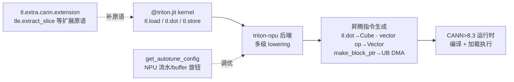

# Triton-on-Ascend（昇腾 Triton 算子后端）

## Summary

Triton-on-Ascend 让用 **Triton DSL**（`@triton.jit` + `tl.load/store` + `tl.dot` 的 SPMD 内核语法）写的融合算子直接跑在昇腾 NPU 上：`triton_npu` 后端把 Triton kernel 多级降级到昇腾 Cube/Vector 指令，配合 `CANN>8.3` 运行时编译加载。它在 MindSpeed 里是与手写 [ascendc](../../../inference/concepts/frameworks/ascendc.md)、Tile 级 [tilelang](../../../inference/concepts/frameworks/tilelang.md) 并列的第三条算子开发通道——优势是几乎**零改写复用开源 Triton 算子**（GDN 线性注意力 chunk 核大量沿用 flash-linear-attention 上游实现，版权头保留 `Songlin Yang, Yu Zhang` + Huawei），代价是要靠后端把 GPU 取向的 grid/访存语义重映射到 NPU 的少核持久化执行模型。

MindSpeed 内有两套独立的 `ops/triton` 目录，分别承载不同算子族：核心 `mindspeed/ops/triton/`（GDN delta-rule chunk 内核族）与轻量 `mindspeed/lite/ops/triton/`（MHC 超连接 bmm + Sinkhorn 路由 + MoE permute sort）；另有实验态的 Triton FlashAttention / indexer 在 `mindspeed/core/transformer/flash_attention/.../triton/`。这些算子是训练侧 GDN / MHC 结构（混合线性注意力、超连接）能在 NPU 上跑反向的底座。

## 两套 ops/triton 目录的定位

| 目录 | 算子族 | 角色 |
|---|---|---|
| `mindspeed/ops/triton/` | GDN/DeltaNet chunk 内核：`solve_tril`、`chunk_o`、`chunk_delta_h`、`chunk_scaled_dot_kkt`、`wy_fast`、`cumsum`、`l2norm`、`sort_chunks_by_idx` | 块状线性注意力（chunked recurrence）的前/反向 GEMM 积木，FLA 上游移植，算法详见 [gdn-chunk-kernels](../kernels/gdn_chunk_kernels.md) |
| `mindspeed/lite/ops/triton/` | MHC 超连接：`mhc/mhc_triton`（`MHCPreOnlyTriton`/`MHCPostTriton`）、`mhc/sinkhorn_triton`、`mhc/{pre_bmm,post_bmm1,post_bmm2,add}`、顶层 `sinkhorn`、`fused_norm_gate`、`sort_chunks_by_idx` | 超连接前/后混合 bmm + Sinkhorn 归一化路由 + 门控 RMSNorm，详见 [mhc-train](../kernels/mhc_train.md) |
| `mindspeed/core/.../flash_attention/triton/` | `triton_attention_bnsd`、`triton_indexer_bf16` | 实验态 Triton FlashAttention（BNSD 布局）与 bf16 indexer，文件头均注 `CANN>8.3` + `triton_npu`（bnsd 标 `test with 3.2.0.dev20250929`、indexer 标 `coming stable version`），验证 triton-npu 后端可承接 attention 类核 |

两套目录各自带一份 `utils.py`（FLA 同源 + 昇腾增补），互不依赖；`__init__.py` 为空，kernel 以函数粒度被上层模块按需 import。

## 承载的算子族

### GDN delta-rule chunk 内核（core ops/triton）

块状门控 DeltaNet 把序列切成长 `BT`（默认 64）的 chunk，chunk 内并行、chunk 间串行扫描隐状态 $h\in\mathbb{R}^{K\times V}$。这一族 Triton 核是该扫描的拆解：

- **`solve_tril`**：对严格下三角 $A$ 求 $(I+A)^{-1}$（`BT∈{16,32,64}`）。按行前代求逆，并用 16×16→32×32 的块合并（Schur 补 $A^{-1}_{21}=-A^{-1}_{22}A_{21}A^{-1}_{11}$，`merge_16x16_to_32x32_inverse_kernel`）。这是 WY/UT 表示里把 delta-rule 的「I 减严格下三角」批量求逆的核心步。
- **`chunk_scaled_dot_kkt` / `wy_fast`**：前者算 chunk 内 $KK^\top$ 形成上式的 $A$；后者 `recompute_w_u_fwd` / `prepare_wy_repr_bwd` 算 WY 表示的 $w,u$ 向量及其反向。
- **`chunk_delta_h`**：`chunk_gated_delta_rule_fwd_h` 是隐状态扫描本体——逐 chunk 算残差 $v_{\text{res}}=v-w@h$、按输出门 $g$（`b_h *= exp(g_{\text{last}})`）与键门 $g_k$ 衰减、再 $h \mathrel{+}= k@v$；`K` 沿 64 维拆成至多 4 个子块（支持 `K≤256`）。反向 `chunk_gated_delta_rule_bwd_dhu` 出 `dh/dh0/dv2`。
- **`chunk_o`**：`chunk_fwd_o` 算输出 $O=\mathrm{tril}(QK^\top)$ 经 $g$ 门控（$e^{g_i-g_j}$）后 $@V$，再叠同样经 $g$ 门控（$e^{g}$）的跨 chunk 隐状态项 $Q@h$；反向 `chunk_bwd_dqkwg` 出 `dq/dk/dw/dg`、`chunk_bwd_dv_local` 出 `dv`。
- **`cumsum` / `l2norm`**：`chunk_local_cumsum` 对 log 门控 $g$ 做 chunk 内前缀和；`l2norm` 对 q/k 做 L2 归一化（前/反向）。
- **`sort_chunks_by_idx`**：`moe_sort_chunks_by_index` 给 MoE 专家分发做 chunk 级置换排序（与 GDN 无关，被 `fused_moe_permute` 特性复用）。

GDN delta-rule 的算法分解、符号与门控 DeltaNet 结构语义见 [gdn-chunk-kernels](../kernels/gdn_chunk_kernels.md)，Triton-on-Ascend 提供其落昇腾的执行后端。

### MHC 超连接 + Sinkhorn（lite ops/triton）

MHC（流形约束超连接）把残差流扩成 `num_stream=4`（`hc_mult`）条并在层间做可学习混合。`mhc_triton.py` 用 `torch.autograd.Function` 串起整链：

- **`MHCPreOnlyTriton`**：`torch_npu.npu_rms_norm` 归一化 → `matmul` 投影出 `mixes[B,S,4]` → `hc_pre_only_fwd` 算前混合权重 `pre = sigmoid(mixes*scale + base) + eps` → `hc_pre_bmm_forward` 用该权重混合 4 条流。反向沿用 `npu_rms_norm_backward`，是 Triton 核与 `torch_npu` 融合算子混编的典型。
- **`MHCPostTriton`**：后混合 = `hc_post_bmm1`（`x @ h_post`）+ `hc_post_bmm2`（`h_res @ residual`）再 `add_fwd` 相加，承载 $N\times N$ 超连接矩阵对各流的重组。
- **`sinkhorn_triton`**：`hc_pre_only_fwd/bwd` 的核。反向刻意走**两阶段确定性归约**——主 kernel 把每个 program 的标量/向量梯度写进临时 buffer（不用 `atomic_add`），再由单 program 的 `reduce_preonly_tmp_grads_kernel` 串行累加，规避 NPU 上原子加的非确定性。

MHC 训练算子族（含 hcpre/hcpost 语义与跨域概念链）的完整说明见 [mhc-train](../kernels/mhc_train.md)。

## Triton 内核如何映射到昇腾

Triton 的执行模型是 GPU 式 SPMD（一个 program 处理一个 tile，靠海量 program 填满 SM）。昇腾是少量 Cube/Vector 核 + 显式片上 buffer，映射要点：

- **后端识别**：`utils.get_available_device()` 读 `triton.runtime.driver.active.get_current_target().backend`，NPU 上返回 `'npu'`；`get_multiprocessor_count` 据此返回 `num_vectorcore`（核数），`get_npu_properties` 经 `torch.npu.current_device()` 取设备属性。NV 专属的 `make_tensor_descriptor`（TMA）在 NPU 关闭——`solve_tril` 等一律以 `USE_TMA=False` 走 `tl.make_block_ptr`。
- **少核持久化的 grid**：`chunk_fwd_o` 不按「每 chunk 一个 program」发射，而是固定 `grid=(CV_kernel_num,)=(24,)`，kernel 内用 `core_id=tl.program_id(0)`、`total_cores=tl.num_programs(0)` 把 `NT` 个 chunk **手动均分到各核**（`base_chunks_per_pid = NT // total_cores`，余数前补 1），每个 program 循环跑自己那批 chunk。这正是 NPU 持久化内核风格——program 数对齐物理核数、单核内串行，而非 GPU 的一 tile 一 program。其余 GDN 核（如 `chunk_gated_delta_rule_bwd_dhu`）仍用规则 `grid=(cdiv(V,BV), N*H)` 配自动调优。
- **NPU 专属 autotune 旋钮**：`get_autotune_config` 生成的 `triton.Config` 带的不是 GPU 的 `num_warps/num_stages`，而是昇腾后端键——`multibuffer`（多缓冲）、`set_workspace_multibuffer`(2/4)、`enable_hivm_auto_cv_balance`（Cube/Vector 自动负载均衡）、`tile_mix_vector_loop`/`tile_mix_cube_loop`(2/4)、`limit_auto_multi_buffer_of_local_buffer="no-l0c"`（不对 L0C 累加器多缓冲）。`chunk_delta_h` 前向取 `multibuffer_list=(False,)`、反向 dhu 取 `(True,)`，把流水深度交给 NPU 后端的 autotuner 选。
- **访存与计算落点**：`tl.make_block_ptr` + `tl.load/store(boundary_check)` 映射为搬运到片上 UB 的 DMA；`tl.dot(..., input_precision=DOT_PRECISION)` 落 Cube（`FLA_TRIL_PRECISION='ieee'`），FP16/BF16 输入统一 `.to(tl.float32)` 累加再 cast 回；逐元素 `exp/where/sum` 落 Vector。`input_guard` 装饰器在入口把所有张量 `.contiguous()` 并按张量设备设上下文。
- **扩展原语**：`import triton.language.extra.cann.extension as tle` 提供昇腾特有原语，如 `tle.extract_slice(h, [0,j],[GROUP,1],[1,1])`——MHC `post_bmm2` 用它把 $N\times N$ 超连接 bmm 显式拆成逐列标量加权组合，避开 NPU 上低效的小粒度动态 gather。
- **dtype 取向**：indexer 走 `triton_indexer_bf16`，q/k 为 `float16`、缩放 `q_s/k_s` 为 `float32`，输出 `float32`；`BLOCK_S=min(s,8)`、`BLOCK_M=min(m,8)` 要整除 s/m，体现 NPU 对块整除的约束。

## 与 TileLang / AscendC 的定位对照

| 维度 | Triton-on-Ascend | [tilelang](../../../inference/concepts/frameworks/tilelang.md) | [ascendc](../../../inference/concepts/frameworks/ascendc.md) |
|---|---|---|---|
| 抽象层 | SPMD kernel（program/tile） | Tile 级、调度与数据流解耦 | C++ 直接操作 Cube/Vector/Scalar |
| 复用面 | 直接搬开源 Triton 算子（FLA 等） | 自写 Tile 原语，多级降级生成 AscendC | 全手写，性能上限最高 |
| 调优 | NPU autotune 旋钮（cv-balance/multibuffer） | 原语注解 + 编译器调度 | 手工 Tiling / 双 Buffer / 多核 |
| 在本栈定位 | GDN/MHC 训练正反向的 Triton 后端 | DSA indexer / sparse-attn 算子通道 | 性能关键融合算子（SAS/Compressor 等） |

三者非互斥：MHC 链里 Triton 核与 `torch_npu` 算子混编，indexer 同时有 Triton 与 AscendC 两路实现，按算子成熟度与性能需求取舍。需要注意的是，[torchtitan](torchtitan.md) 训练入图时反而**屏蔽** Inductor 自动生成的 Triton（NPU 上质量差，走 `npu_bypass_triton_codegen`）；Triton-on-Ascend 指的是**人工编写、经 triton-npu 后端落地**的 Triton 融合算子，与「Inductor 自动 Triton」是两回事。

## Evidence

- [mindspeed](https://gitcode.com/ascend/MindSpeed) — MindSpeed core @1432cb0
  - [`mindspeed/ops/triton/solve_tril.py`](https://gitcode.com/Ascend/MindSpeed/blob/1432cb092818b870c31b61db0eb6d3378b7fbdad/mindspeed/ops/triton/solve_tril.py)（`solve_tril`/`merge_16x16_to_32x32_inverse_kernel`：$(I+A)^{-1}$、Schur 补块合并、`USE_TMA=False` 走 block_ptr）
  - [`mindspeed/ops/triton/chunk_delta_h.py`](https://gitcode.com/Ascend/MindSpeed/blob/1432cb092818b870c31b61db0eb6d3378b7fbdad/mindspeed/ops/triton/chunk_delta_h.py)（`chunk_gated_delta_rule_fwd_h`/`bwd_dhu`：隐状态 chunk 扫描、`g`/`gk` 门控、K 沿 64 拆块、`get_autotune_config` 多缓冲键）
  - [`mindspeed/ops/triton/chunk_o.py`](https://gitcode.com/Ascend/MindSpeed/blob/1432cb092818b870c31b61db0eb6d3378b7fbdad/mindspeed/ops/triton/chunk_o.py)（`chunk_fwd_o` 固定 24 核 `core_id`/`num_programs` 手动均分 chunk；`chunk_bwd_dqkwg`/`chunk_bwd_dv_local`）
  - [`mindspeed/ops/triton/utils.py`](https://gitcode.com/Ascend/MindSpeed/blob/1432cb092818b870c31b61db0eb6d3378b7fbdad/mindspeed/ops/triton/utils.py)（`get_available_device`→`'npu'`、`get_multiprocessor_count`→`num_vectorcore`、`get_npu_properties`、`get_autotune_config` 的 `enable_hivm_auto_cv_balance`/`tile_mix_*`/`no-l0c` 旋钮、`input_guard`）
  - [`mindspeed/lite/ops/triton/mhc/mhc_triton.py`](https://gitcode.com/Ascend/MindSpeed/blob/1432cb092818b870c31b61db0eb6d3378b7fbdad/mindspeed/lite/ops/triton/mhc/mhc_triton.py)（`MHCPreOnlyTriton`/`MHCPostTriton`：rms_norm→投影→`hc_pre_only_fwd`→pre/post bmm，Triton 与 `torch_npu` 混编）
  - [`mindspeed/lite/ops/triton/mhc/sinkhorn_triton.py`](https://gitcode.com/Ascend/MindSpeed/blob/1432cb092818b870c31b61db0eb6d3378b7fbdad/mindspeed/lite/ops/triton/mhc/sinkhorn_triton.py)（`hc_pre_only_fwd/bwd`：`pre=sigmoid(mixes*scale+base)+eps`、反向两阶段确定性归约避 atomic）
  - [`mindspeed/lite/ops/triton/mhc/post_bmm2.py`](https://gitcode.com/Ascend/MindSpeed/blob/1432cb092818b870c31b61db0eb6d3378b7fbdad/mindspeed/lite/ops/triton/mhc/post_bmm2.py)（`triton.language.extra.cann.extension as tle`、`tle.extract_slice` 逐列拆 $N\times N$ bmm）
  - [`mindspeed/core/transformer/flash_attention/flash_attention/triton/triton_indexer_bf16.py`](https://gitcode.com/Ascend/MindSpeed/blob/1432cb092818b870c31b61db0eb6d3378b7fbdad/mindspeed/core/transformer/flash_attention/flash_attention/triton/triton_indexer_bf16.py) · [`triton_attention_bnsd.py`](https://gitcode.com/Ascend/MindSpeed/blob/1432cb092818b870c31b61db0eb6d3378b7fbdad/mindspeed/core/transformer/flash_attention/flash_attention/triton/triton_attention_bnsd.py)（`triton_npu` 实验态 FlashAttention/indexer，`CANN>8.3` 头注、BNSD 布局、`BLOCK_S/BLOCK_M` 整除约束）

## Links

- [tilelang](../../../inference/concepts/frameworks/tilelang.md)（跨域：另一条昇腾 kernel DSL，Tile 级降级生成 AscendC）
- [ascendc](../../../inference/concepts/frameworks/ascendc.md)（跨域：手写昇腾算子框架，性能上限最高的对照路径）
- [gdn-chunk-kernels](../kernels/gdn_chunk_kernels.md)（本后端承载的 GDN delta-rule chunk 算子族算法）
- [mhc-train](../kernels/mhc_train.md)（本后端承载的 MHC 超连接训练算子族）
- [mindspeed](https://gitcode.com/ascend/MindSpeed) — MindSpeed core @1432cb0（`ops/triton` 与 `lite/ops/triton` 算子源）

<!-- cannbot:related:start -->
## 相关

- [Ascend 310P 不支持 Triton kernel：走 Triton 的算子须补纯 host/eager 等价路径](../../../inference/runbooks/runtime/ascend_310p_no_triton_kernel_eager_fallback.md)（`related`）：“Triton-on-Ascend 让用 **Triton DSL**（`@triton.jit` + `tl.load/store` + `tl.dot` 的 SPMD 内核语法）写的融合算子直接跑在昇腾 NPU 上”；“在 **Ascend 310P（Atlas 300I 推理卡系列 / 300I Duo）** 上做 bringup / 跑推理时，凡是通用（跨平台）执行路径经由 **Triton kernel** 实现的算子，在 310P 上都不可用——310P 硬件不支持 Triton。”。后端能力卡与 310P 失败边界共同决定 Triton 算子的硬件可达性和 fallback 要求。
- [GDN Chunk 算子（solve_tril / chunk_delta_h / chunk_o / wy_fast Triton 核）](../kernels/gdn_chunk_kernels.md)（`related`）：“核心 `mindspeed/ops/triton/`（GDN delta-rule chunk 内核族）”；“这套分解由 MindSpeed core `mindspeed/ops/triton/` 下一族 Triton 核承载，经 ［triton-on-ascend］(../frameworks/triton_on_ascend.md) 后端降级到昇腾 Cube/Vector”。框架卡定位承载目录，kernel 卡确认同一目录的 GDN 算子族经该后端降级执行。
- [MHC 训练算子（DeepSeek-V4 Manifold-Constrained Hyper-Connections：Triton BMM + Sinkhorn）](../kernels/mhc_train.md)（`related`）：“轻量 `mindspeed/lite/ops/triton/`（MHC 超连接 bmm + Sinkhorn 路由 + MoE permute sort）”；“MindSpeed-LLM 的 `deepseek4` 模型把 DeepSeek-V4 的 **MHC（Manifold-Constrained Hyper-Connections / 流形约束超连接）** 残差结构落到一组 ［triton-on-ascend］(../frameworks/triton_on_ascend.md) 融合算子上”。框架卡定位 lite Triton 目录的 MHC 算子族，kernel 卡确认 DeepSeek-V4 MHC 训练链由该后端融合算子实现。
- [昇腾 Triton kernel grid 首维溢出 CoreDim UINT16 上界（大批量/长序列）](../../../inference/runbooks/runtime/triton_grid_coredim_uint16_overflow.md)（`related`）：“- **少核持久化的 grid**：`chunk_fwd_o` 不按「每 chunk 一个 program」发射，而是固定 `grid=(CV_kernel_num,)=(24,)`，kernel 内用 `core_id=tl.program_id(0)`、`total_cores=tl.num_programs(0)` 把 `NT` 个 chunk **手动均分到各核**（`base_chunks_per_pid = NT // total_cores`，余数前补 1），每个 program 循环跑自己那批 chunk。”；“Triton kernel 的 **grid 第一维在昇腾上被映射为 NPU 的 CoreDim，其取值上界是 `UINT16_MAX = 65535`**。”。框架卡给出的 24 核持久化 grid 正是 runbook 所要求控制 CoreDim 并在 kernel 内循环分摊工作的安全形态。
- [昇腾多模态 M-RoPE 优先走 triton-ascend triton_mrope，decode 吞吐优于原生 npu_mrope](../../../inference/optimizations/experience/rules/mrope_triton_ascend_vs_npu_mrope_decode.md)（`related`）：“- 若 `HAS_TRITON`（triton-ascend 构建可用）**且** `positions.ndim == 2`（二维 M-RoPE position）→ **优先走 `triton_mrope` kernel**（`forward_triton` 路径）。”；“Triton-on-Ascend 让用 **Triton DSL**（`@triton.jit` + `tl.load/store` + `tl.dot` 的 SPMD 内核语法）写的融合算子直接跑在昇腾 NPU 上”。经验卡的 triton_mrope 选型依赖后者定义的 Triton-on-Ascend 执行后端。
<!-- cannbot:related:end -->
