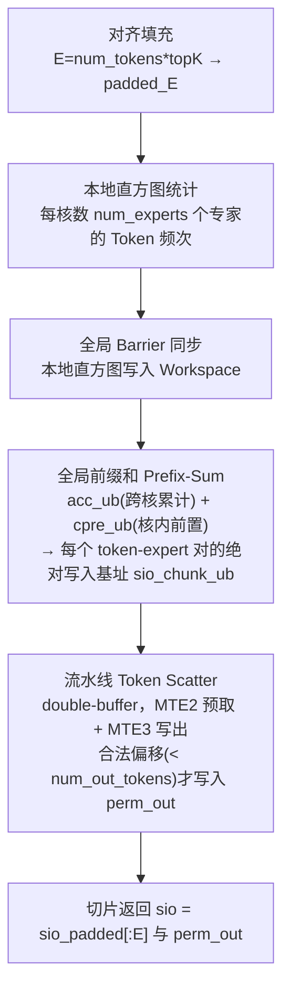
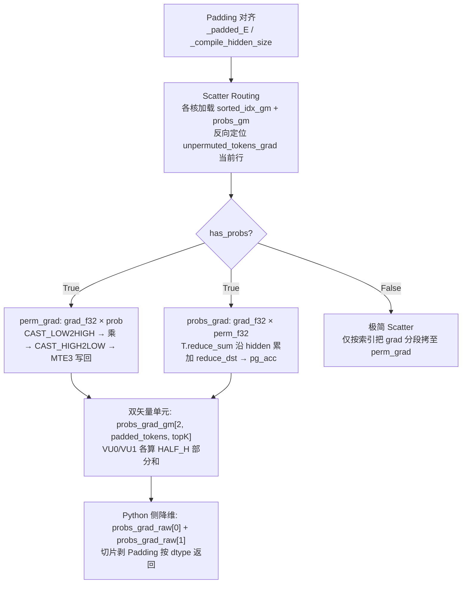

# TileLang MoE Token Permute 算子族

## Summary

DeepSeek-V3.2-Exp 在昇腾 NPU 上用 [tilelang](../../../inference/concepts/frameworks/tilelang.md) 实现的一组 **MoE Token 路由训练算子**，覆盖前向 Scatter 分发与反向 Gather-Reduce 聚合，共 **4 个互为前/反向的算子**：

| 算子 | 方向 | 计算范式 | 主要输出 |
|------|------|----------|----------|
| `moe_token_permute` | fwd | Histogram → Prefix-Sum → Scatter | `perm_out`、scatter 偏移 `sio` |
| `moe_token_permute_grad` | bwd | Gather → FP32-Reduce | `input_grad` |
| `moe_token_unpermute` | fwd | Gather → Scale → FP32-Accumulate | `out`（加权聚合） |
| `moe_token_unpermute_grad` | bwd | Scatter + 点积 Reduce（双矢量单元） | `(perm_grad, probs_grad)` |

这 4 个算子属 cann-recipes-infer guide 明确标注的 **8 个 TileLang 训练算子中的 4 个**（其余 4 个为 RoPE、RMSNorm、SwiGLU/SwiGLU_grad，见 [tilelang-rope](tilelang_rope.md) / [tilelang-rmsnorm-swiglu](tilelang_rmsnorm_swiglu.md)）；训练上下文见 [deepseek-v32-pretrain](../../guides/recipes/deepseek_v32_pretrain.md)，PyTorch 侧的算子替换由 torchtitan-npu `tilelang_ops` 完成（绑定关系见 [npu-fused-op-converters](../frameworks/npu_fused_op_converters.md)：`npu_permute` 绑定 `npu_moe_token_permute` / `npu_moe_token_unpermute`）。TileLang 的编程模型 / CodeGen / JIT 基础不在本页重复，见 framework 页。

MoE 中各专家接收的 Token 数动态变化，Token 分发（Permute / Scatter）因密集**非连续显存访问**易成瓶颈；本算子族把"直方图统计 + 全局前缀和 + 数据重排"深度融合，并在所有累加路径强制 **Cast-to-FP32** 以保证半精度训练数值稳定。

## 前向：`moe_token_permute`（Scatter 路由）

把原始 Token 按其 Top-K 专家归属重排成"按专家连续排列"的张量。

**关键参数 / shape：**

- 初始化：`num_tokens`、`topK`、`hidden_size`、`num_experts`（默认 64）、`num_out_tokens`（=0 时按 `num_tokens * topK` 分配）、`NUM_CORES`（默认 24）、`TILE_H`、`dtype`（默认 `float16`）。
- 调用：`tokens: Tensor[num_tokens, hidden_size]`、`indices: Tensor[num_tokens * topK]`（路由网络输出的一维展平专家索引）。
- 输出：`perm_out: Tensor[out_len, hidden_size]`、`sio: Tensor[num_tokens * topK]`（scatter 写入位置/偏移，剥离 padding 后的有效部分）。

**Cube-vs-Vector / 多核切分：**

- **核间**：实际核数取 `min(NUM_CORES, num_tokens)`，Token 序列均匀切给各核，每核处理 `tokens_per_core` 个 Token 及其索引块（`chunk_size`）。
- **核内**：`hidden_size` 按 `TILE_H` 切成多个 HTiles，并在单核两个**矢量计算单元**间对半划分（`HALF_H`），实现指令级并行。

**算法流程：**

1. **对齐填充**：算逻辑总索引 `E = num_tokens * topK`，再补齐成 `NUM_CORES` 与 `chunk_size` 的公倍数 `padded_E`，多出部分补零。
2. **直方图统计**：各核异步加载自身索引块，流水循环统计分给 `num_experts` 个专家的频次，写回全局 Workspace 后触发 Barrier。
3. **全局前缀和**：各核读全量直方图，两次累加（跨核累计 `acc_ub` + 当前核前置 `cpre_ub`）算出每个 token-专家对在 `perm_out` 中的绝对写入基址，存入 `sio_chunk_ub`。
4. **流水线 Scatter**：大小为 2 的软流水（double buffering），MTE2 预取下一块 Token、MTE3 把当前块按偏移写入 `perm_out`（越界 `num_out_tokens` 则丢弃）。

## 反向：`moe_token_permute_grad`（Gather-Reduce）

一个 Token 前向被路由给 Top-K 个专家，故其反向梯度是这 **K 个专家梯度向量之和**（Gather-Reduce）。

**关键参数 / shape：**

- 调用：`permuted_output_grad: Tensor[out_len, hidden_size]`（专家层反传出的连续梯度）、`sorted_indices: Tensor[num_tokens * topK]`（即前向的 `sio` 输出）。
- 输出：`input_grad: Tensor[num_tokens, hidden_size]`（回传给原始输入 Token 的聚合梯度）。

**多核 / 批 / 核内三级切分：**`actual_cores = min(NUM_CORES, num_tokens)` 按原始 Token 维切分；每核再分多个 `BATCH_T` 批次防 UB 超载；`hidden_size` 切 `n_htiles`，核内对半（`HALF_H = TILE_H // 2`）交两个计算单元并行累加。

**FP32-Accumulate 精度技巧**（核心模块，按 `dtype` 路由两种核函数）：

- **高精度累加模式（float16 输入）**：对每个 `hidden_size` 块先在 UB 初始化全零 **float32 累加器 `acc_buf`** → 循环 `topK` 次，MTE2 从 `perm_grad_gm` 精准抓取对应 Top-K 梯度块到 `row_buf` → 矢量指令 `CAST_LOW2HIGH` 把 fp16 升 fp32 → 在 **fp32 精度下累加进 `acc_buf`**（避免半精度加法吞掉小梯度 / 溢出）→ `CAST_HIGH2LOW` 转回 fp16。
- **普通累加模式（float32 输入）**：省去 Cast，直接循环展开连续加载与加法。

写回前用 `pipe_barrier` 同步，再 MTE3 写入 `input_grad_gm` 对应原始 Token 位置。

## 前向：`moe_token_unpermute`（加权聚合 Gather）

把分散在各专家输出里的 Token 特征按原始序列位置收集回来；Top-K 路由时还需乘对应路由概率做加权求和（Reduce）。

**关键参数 / shape：**

- 初始化新增 **`has_probs: bool`（默认 True）**：True 则 Gather + Scale + Accumulate，False 仅纯 Gather；`padded_mode` 预留（设 True 抛 `NotImplementedError`）；`dtype` 支持 `float16/bfloat16/float32/float`。
- 调用：`permuted_tokens: Tensor[E, hidden_size]`（`E = num_tokens * topK`）、`sorted_indices: Tensor[E]`、`probs: Tensor[num_tokens, topK]`（`has_probs=True` 时必填）。
- 输出 `out`：`has_probs=True` → `[num_tokens, hidden_size]`（加权聚合）；`has_probs=False` → `[E, hidden_size]`（仅 Gather，不降维）。

**Auto-Tiling**：`float16` 下 `hidden_size` 至少 64，`pad_last_dim` / `pad_first_dim` 把长度与隐藏维对齐到 `padded_E` / `padded_tokens`；`auto_launch_cores` 动态算 `actual_cores`，核内 `TILE_H` / `TILE_T` 自动推导，分 `BATCH_T` 批、双缓冲交矢量单元。

**高精度概率加权累加（`has_probs=True`）：**

- **Cast-Up**：UB 预分配高精度缓存 `acc_dtype`（通常 FP32），`CAST_LOW2HIGH` 把特征与 `probs` 升精度，防多次累加精度截断。
- **AXPY 乘加**：展开 Top-K 内层循环，因 Top-K 未必是寄存器最佳倍数，用 `n_quads`（4/8 次展开）+ `remainder` 拆分；用 `T.tile.axpy`（$Y = aX + Y$）或 `T.tile.mul` 把专家特征行乘以 `prob` 累加进 `acc_buf`。
- **Cast-Down**：同一 Token 的 Top-K 累加完后 `CAST_HIGH2LOW` 转回原 dtype。
- `has_probs=False` 时跳过 Cast 与累加，直接逐行写回 `out_gm`。

## 反向：`moe_token_unpermute_grad`（双梯度 + 双矢量单元）

Unpermute 反向需同时算两路梯度（链式法则）：

1. **对专家输出的梯度 `perm_grad`** = 上层回传梯度 × 对应路由概率。
2. **对路由概率的梯度 `probs_grad`** = 上层回传梯度与对应专家特征 `permuted_tokens` 在隐藏维上的**点乘之和**。

**关键参数 / shape：**

- 调用：`permuted_tokens: Tensor[E, hidden_size]`、`unpermuted_tokens_grad: Tensor[num_tokens, hidden_size]`（$\frac{\partial L}{\partial X_{out}}$）、`sorted_indices: Tensor[E]`、`probs: Tensor[num_tokens, topK]`。
- 输出：`has_probs=True` → `(perm_grad: Tensor[E, hidden_size], probs_grad: Tensor[num_tokens, topK])`；`has_probs=False` → 仅 `perm_grad`。

**双矢量单元（Dual-Vector Unit）优化**：单 Core 内含两个独立矢量单元（VU0/VU1）。为突破点积 Reduce 的硬件瓶颈，底层把 `probs_grad_gm` 加一个 `vid` 维（shape 变 `[2, padded_tokens, topK]`），两单元各处理 `HALF_H`（半个隐藏维）点积累加、各存 Partial Sum，避免核内两执行单元频繁锁同步；最终在 Python 侧 `probs_grad_raw[0] + probs_grad_raw[1]` 完成 Reduce Sum。精度上两条梯度路径走法不同：`probs_grad` 是点乘后 ReduceSum，全程 **FP32 累加**；`perm_grad` 是 `grad_f32 × prob` 一次 FP32 乘法后 `CAST_HIGH2LOW` 降精度写回（非累加器），二者均在 fp32 域计算以保精度。

## Evidence

- [README.md](../../../../../cann-recipes-raw/cann-recipes-infer/944d2d3ece86f7df33dbb0cb155c72ca619a9c66/README.md)（primary）
- [deepseek_v3.2_exp_tilelang_operator_guide.md](../../../../../cann-recipes-raw/cann-recipes-infer/944d2d3ece86f7df33dbb0cb155c72ca619a9c66/docs/models/deepseek_v3_2_exp/deepseek_v3.2_exp_tilelang_operator_guide.md)（supporting）

## Links

- [tilelang](../../../inference/concepts/frameworks/tilelang.md) — TileLang 编程模型 / CodeGen / JIT 基础（本族算子的实现语言）
- [npu-fused-op-converters](../frameworks/npu_fused_op_converters.md) — `npu_permute` 绑定 `npu_moe_token_permute` / `npu_moe_token_unpermute`
- [deepseek-v32-pretrain](../../guides/recipes/deepseek_v32_pretrain.md) — 本族算子的训练落地枢纽
- [tilelang-rope](tilelang_rope.md) — 同 guide 的 TileLang 训练算子族（RoPE fwd/bwd）
- [tilelang-rmsnorm-swiglu](tilelang_rmsnorm_swiglu.md) — 同 guide 的 TileLang 训练算子族（RMSNorm / SwiGLU）
- [double-routing](../../../inference/concepts/techniques/double_routing.md) — MoE 路由在推理侧的对应实践
