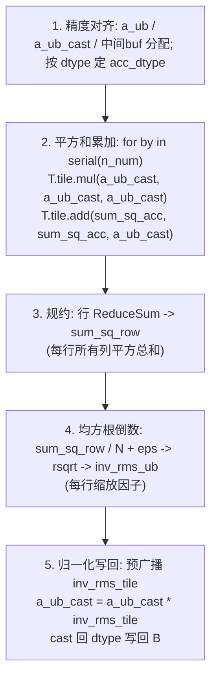
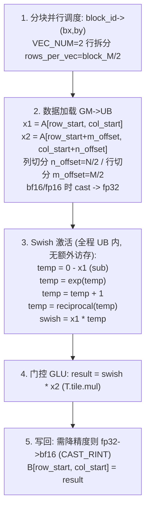
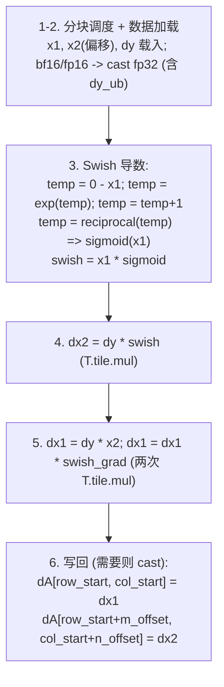

# TileLang RMSNorm / SwiGLU / SwiGLU-Grad（DeepSeek-V3.2 训练算子）

## Summary

[tilelang](../../../inference/concepts/frameworks/tilelang.md)（TileLang-Ascend）实现的三个**逐元素 / 归一化类训练算子**：`rms_norm`、`swiglu`（前向）、`swiglu_grad`（反向），是 DeepSeek-V3.2-Exp TileLang 算子开发的 8 个训练算子之一批，训练上下文挂在 [deepseek-v32-pretrain](../../guides/recipes/deepseek_v32_pretrain.md)，由 `torchtitan-npu` 的 `tilelang_ops` 特性做算子替换。三者都是 Transformer FFN/归一化的核心承重算子：RMSNorm 替代 LayerNorm 仅用方差归一，SwiGLU 是 MoE/FFN 门控激活，SwiGLU-Grad 是其反向。

`torchtitan-npu` 的**基础融合算子家族**走 `torch_npu.npu_rms_norm` device 算子绑定（见 [npu-fused-op-converters](../frameworks/npu_fused_op_converters.md)）；这里是用 **TileLang DSL 重写**归一化计算语义的 Tile 级算子实现（前者是现成 op 绑定，后者是可读可改的 TileLang kernel 源码），本页 TileLang 核为无权重 A/RMS(A)，converter 则传入可学习 self.weight。仅单位权重、eps和dtype等条件一致时语义等价；替换有权重 converter 必须补上逐元素权重乘法并验证输出/反向。

编程模型 / 原语体系 / CodeGen / JIT 基础见 [tilelang](../../../inference/concepts/frameworks/tilelang.md)。

## 公共约定：分块、双矢量拆分、FP32 精度对齐

三算子均为纯 Vector 类算子（无 Cube/GEMM），共享一套调度与精度处理：

- **分块与并行调度**：输入张量按 `(block_M, block_N)` 划分为多个 tile，`block_id → (bx, by)`；行起始 `row_start = bx * block_M`，列起始 `col_start = by * block_N`。每个 Core 以 stride 方式处理多个 tile：`block_id = cid + i * NUM_CORES`。
- **核内双矢量单元拆分**：tile 内部再按 `VEC_NUM=2` 做行方向拆分，`rows_per_vec = block_M / 2`。该 `VEC_NUM=2` 与 [tilelang-moe-token-permute](tilelang_moe_token_permute.md) unpermute_grad 的 `vid` 双矢量单元同用一套底层机制——单 Core 内两个独立 Vector Unit（A2 cv 核 1:2、`vid` 0/1）各处理一半数据、规避核内锁同步；但**拆分轴不同**：此处沿行方向切（`rows_per_vec = block_M / 2`），unpermute_grad 沿隐藏维切（`HALF_H = TILE_H // 2`）做点积 Reduce 的部分和累加。
- **FP32 累加精度技巧**：根据 `dtype` 确定 `acc_dtype`。若输入为 `bf16`/`float16`，先 `cast → float32` 进 UB 计算（`x1_ub = cast(x1 → float32)`），所有平方累加 / Swish / 门控乘法在 fp32 域完成，写回前再降精度 `float32 → bf16`（`T.tile.cast (CAST_RINT)`，round-to-nearest 浮点舍入）。低精度训练靠这套 fp32 计算保数值稳定。

```
超参 / 张量形状（三算子共用）
- A      : [M, N]            输入特征矩阵
- block_M / block_N          分块行 / 列大小（超参）
- dtype                      输入输出数据类型
- split_dim (swiglu*)        切分维度，默认列切分；0 或 -2 为行切分
```

## rms_norm（前向）

RMSNorm 舍弃 LayerNorm 的均值中心化，仅用方差归一：$\bar{a}_i = \dfrac{a_i}{\mathrm{RMS}(a)}$，其中 $\mathrm{RMS}(a) = \sqrt{\dfrac{1}{N}\sum_{j=1}^{N} a_j^2 + \epsilon}$。输入 `A:[M,N]`、输出 `B:[M,N]`。

算法流（平方累加 → 行 ReduceSum → 除以N → rsqrt(+eps) → 归一化写回）：



要点：
- **平方和累加**按 `block_N` 遍历列维度，靠 `T.tile.mul` 自乘 + `T.tile.add` 累加到 `sum_sq_acc`（在 fp32 `a_ub_cast` 上做，保精度）。
- **行规约 ReduceSum** 算每行所有列元素的平方总和存 `sum_sq_row`；先除以列数 N 得均值，再累加 `eps` 防止后续开方 / 除法出现零值。
- **`rsqrt`** 指令一步得到每行的均方根倒数 `inv_rms_ub`（即缩放因子），免去显式开方再取倒数。
- **归一化** 预广播后再次遍历列维度读原始输入，向量化逐元素乘 `a_ub_cast = a_ub_cast * inv_rms_tile`，最后 cast 回原 `dtype` 写回。

## swiglu（前向）

SwiGLU（Swish-Gated Linear Unit）：把输入沿 `split_dim` 拆成两半 `x1`/`x2`，`x1` 过 Swish 激活，`x2` 作门控，逐元素相乘。输出 `B:[M/m_div, N/n_div]`（拆分后单分支尺寸）。

$$y = \mathrm{Swish}(x1)\cdot x2,\qquad \mathrm{Swish}(x1)=\frac{x1}{1+e^{-x1}}=x1\cdot\sigma(x1)$$



要点：
- **split 靠偏移实现**——不真正切张量，`x2` 通过 `row_start + m_offset` / `col_start + n_offset` 偏移加载（列切分 `n_offset = N/2`，行切分 `m_offset = M/2`）。
- **Swish 五步**全部在 UB 内逐元素完成、**无额外访存**：取负 → `exp` → `+1`（构造分母 $1+e^{-x1}$）→ `reciprocal`（得 $\sigma(x1)$）→ `* x1`。对应原语链 `T.tile.sub / exp / add / reciprocal / mul`。
- **门控**一次逐元素乘 `result = swish * x2`（`T.tile.mul`）。

## swiglu_grad（反向）

SwiGLU Backward 对 Swish 求导，结合门控分支算 `x1`/`x2` 两分量梯度。输入 `A:[M,N]`、上游梯度 `dY:[M/m_div, N/n_div]`、输出 `dA:[M,N]`。

记 $\sigma(x1)=\dfrac{1}{1+e^{-x1}}$，则 Swish 导数：

$$\mathrm{Swish}'(x1)=\sigma(x1)+x1\cdot\sigma(x1)\,(1-\sigma(x1))$$
$$dx2 = dy\cdot \mathrm{Swish}(x1),\qquad dx1 = dy\cdot x2\cdot \mathrm{Swish}'(x1)$$



要点：
- **Swish 导数计算**复用前向 Swish 的 `exp/add/reciprocal/mul` 指令链：`reciprocal` 后的 `temp` 即 `sigmoid(x1)`，再 `swish = x1 * sigmoid`。
- **dx2** 一次逐元素乘 `dx2 = dy * swish`（`T.tile.mul`）。
- **dx1** 两次连续逐元素乘 `dx1 = dy * x2`，再 `dx1 = dx1 * swish_grad`（两条 `T.tile.mul`）。
- **写回带 offset 复位**：`dx1` 写回 `x1` 原位置，`dx2` 写回带偏移的 `x2` 位置（`row_start + m_offset, col_start + n_offset`），与前向 split 偏移对称。

## Evidence

- [README.md](../../../../../cann-recipes-raw/cann-recipes-infer/944d2d3ece86f7df33dbb0cb155c72ca619a9c66/README.md)（primary）
- [deepseek_v3.2_exp_tilelang_operator_guide.md](../../../../../cann-recipes-raw/cann-recipes-infer/944d2d3ece86f7df33dbb0cb155c72ca619a9c66/docs/models/deepseek_v3_2_exp/deepseek_v3.2_exp_tilelang_operator_guide.md)（supporting）

## Links

- [tilelang](../../../inference/concepts/frameworks/tilelang.md)（TileLang-Ascend 框架：原语体系 / CodeGen / JIT / 双矢量与 cv 核映射）
- [npu-fused-op-converters](../frameworks/npu_fused_op_converters.md)（`npu_rms_norm` converter——同语义 device 算子绑定，TileLang 无权重核仅在单位权重及eps等条件一致时等价，其他权重需补齐乘法）
- [deepseek-v32-pretrain](../../guides/recipes/deepseek_v32_pretrain.md)（所属训练实践枢纽，DeepSeek-V3.2 预训练上下文）
- [tilelang-rope](tilelang_rope.md)（同批 TileLang 训练算子，RoPE 旋转位置编码）
- [tilelang-moe-token-permute](tilelang_moe_token_permute.md)（同批 TileLang 训练算子，MoE token permute；双矢量 `vid` 拆分同源）
