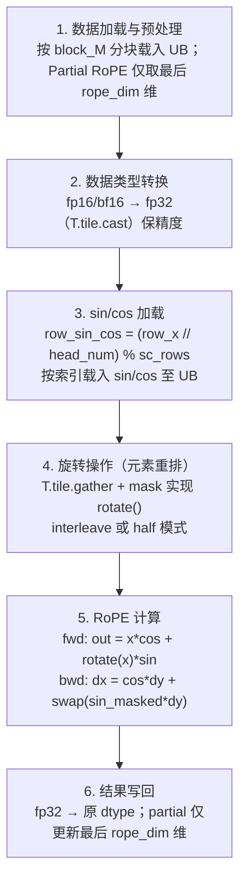

# TileLang RoPE（旋转位置编码，TileLang-Ascend 训练算子）

## Summary

RoPE（Rotary Position Embedding，旋转位置编码）是大模型中的位置编码算子：与绝对位置编码不同，它通过**旋转向量**把位置信息融入注意力，更好地捕捉**相对位置**关系。DeepSeek-V3.2 中的 RoPE 算子由 [tilelang](../../../inference/concepts/frameworks/tilelang.md) 实现，是 TileLang-Ascend「8 个训练算子」之一。该算子同时实现**前向与反向**传播，「支持前向和反向传播计算，适用于模型训练和推理场景」，因此**训练与推理通用**。TileLang 编程模型 / CodeGen / JIT 基础见 [tilelang](../../../inference/concepts/frameworks/tilelang.md)。

算子有两个核心特性：**Partial RoPE**（仅对张量最后 `rope_dim` 维做旋转，前 `dim_start` 维保持不变，匹配 MLA 的「nope + rope」分量切分）与**双旋转模式**（interleave / half，决定元素重排映射）。FP16/BF16 输入统一提升到 FP32 计算以保数值稳定，算完再 cast 回原 dtype。

当前 TorchTitan-NPU 使用显式 RoPE override，而非旧 npu_rope converter。TileLang 实现与当前 AscendC 实现是分别验证的路径，数学意图相近不代表已接入或可直接替换。

## 算法流程详解

### 输入输出张量（典型维度）

| 张量 | 形状 | 含义 |
|------|------|------|
| `x` | `[M, hidden_size]` 或 `[B, S, N, D]` | 输入张量 |
| `sin` | `[sc_rows, rope_dim]` | 旋转正弦角度向量 |
| `cos` | `[sc_rows, rope_dim]` | 旋转余弦角度向量 |
| `mask` | `[row_per_vec, rope_dim]` | 旋转索引掩码向量（编码元素重排映射） |
| `output` | 与输入同形状 | 旋转位置编码输出 |

### 计算流程（6 步）



**① 数据加载与预处理**
- **分块加载**：按 `block_M` 大小将输入分块载入 UB buffer，`block_M` 默认为 **64**（float16/bfloat16）或 **32**（float32）。
- **Partial RoPE 支持**：当 `rope_dim < hidden_size` 时，仅对输入最后 `rope_dim` 维应用旋转，前 `dim_start` 维保持不变。

**② 数据类型转换**
- **精度提升**：对 float16/bfloat16 输入，用 `T.tile.cast` 转换为 **float32** 计算，确保数值精度与稳定性。

**③ sin/cos 加载**
- **位置索引计算**：按 `head_num` 与行位置算 sin/cos 索引，公式 `row_sin_cos = (row_x // head_num) % sc_rows`。
- **旋转角度加载**：按算得的索引把对应 sin/cos 载入 UB buffer。

**④ 旋转操作（元素重排）**
- 用 `T.tile.gather` 配合 `mask` 实现旋转中的元素重排——`mask` 向量编码了旋转所需的索引映射关系。
- 两种旋转模式的重排映射（以 4 元素为例）：

  | 模式 | `rotate([x0, x1, x2, x3])` | 重排语义 |
  |------|----------------------------|----------|
  | **interleave** | `[-x1, x0, -x3, x2]` | 相邻元素对交换旋转 |
  | **half** | `[-x2, -x3, x0, x1]` | 前后半部分交换旋转 |

**⑤ RoPE 计算（前向 / 反向）**
- **前向传播**：
  ```
  out = x * cos + rotate(x) * sin
  ```
- **反向传播**：
  ```
  dx = cos * dy + swap(sin_masked * dy)
  ```
  其中 `dy` 是上游梯度，`sin_masked` 为按 mask 作用后的 sin（据 RoPE 旋转的正交性，`swap(·)` 即对应前向 `rotate` 的逆重排，反向把梯度沿旋转方向回传；此为数学推断，源仅给出反向公式本身）。

**⑥ 结果写回**
- **类型转换**：结果由 float32 cast 回原始 dtype（float16/bfloat16）。
- **结果保存**：按块写回全局内存；若为 partial RoPE，则仅更新最后 `rope_dim` 维。

### Cube/Vector 核划分与精度

RoPE 全程为逐元素的乘加与重排（gather / cast / mul / add），无矩阵乘，据此应为 **Vector-only** 算子（源文档 RoPE 章节未显式标注 Cube/Vector 核划分，此为据计算特征的推断）；`T.tile.cast` / `T.tile.gather` 等原语映射到 AscendC 的 Vector 指令。关键精度处理是 **fp32 计算**：fp16/bf16 进 UB 后统一升 fp32 做 `x*cos + rotate(x)*sin`，避免低精度乘加的舍入误差，算完再降回原 dtype 写出。RoPE 前向是逐元素乘加 而非归约累加，「FP32 累加」术语另指 MoE Gather-Reduce 与 RMSNorm 平方和。TileLang 的核间/核内同步、UB 内存分配由原语/编译器处理（见 framework 页）。

## 当前训练绑定与替换边界

当前 override.common.rope 中 asc_complex/asc_cossin 分别为 ComplexRoPE/CosSinRoPE 提供 npu_rotary_mul 的 interleave/half 模式；输入提升 fp32，输出恢复原 dtype。融合位置表取 positions 第一行，要求各 batch 行的位置布局相同；不能将其用于各行位置不同的场景并假定等价。CosSin 变体不支持 inverse。

asc_partial 使用 inplace_partial_rotary_mul，将完整输入复制后只旋转尾部 partial_slice，要求输入宽度恰为 split+dim，split 非负、dim 正偶数，避免 slice/cat。它与 TileLang 训练核是独立后端；替换需核对模式、位置表、dtype、形状、AC/compile 和完整梯度。

另有 HalfRotation override 将半宽 cos/sin 扩为全宽；不同样本位置表通过将 batch 折入序列来保留。不能把其契约与第一行位置表变体混用。

## Evidence

- [deepseek_v3.2_exp_tilelang_operator_guide.md](../../../../../cann-recipes-raw/cann-recipes-infer/944d2d3ece86f7df33dbb0cb155c72ca619a9c66/docs/models/deepseek_v3_2_exp/deepseek_v3.2_exp_tilelang_operator_guide.md)（primary）
- [rope.py](../../../../../cann-recipes-raw/torchtitan-npu/8a71d8940e877cc9f2e5f4b977b4f18d48539592/torchtitan_npu/override/common/rope.py)（implementation）

## Links

- [tilelang](../../../inference/concepts/frameworks/tilelang.md)（TileLang-Ascend 编程模型 / CodeGen / JIT；本算子的实现框架与 8 训练算子归属）
- [npu-fused-op-converters](../frameworks/npu_fused_op_converters.md)（当前 RoPE override 的旋转变换与后端接入边界）
- [deepseek-v32-pretrain](../../guides/recipes/deepseek_v32_pretrain.md)（所属预训练实践，RoPE 用于其 MLA/注意力路径）
- [tilelang-moe-token-permute](tilelang_moe_token_permute.md)（同批 TileLang-Ascend 训练算子）
- [tilelang-rmsnorm-swiglu](tilelang_rmsnorm_swiglu.md)（同批 TileLang-Ascend 训练算子）
- [mla-prolog](../../../inference/concepts/kernels/mla_prolog.md)（跨域：MLA 推理路径中 RoPE 应用于 q_pe/k_pe 分量，与本算子 partial RoPE 切分对应）
