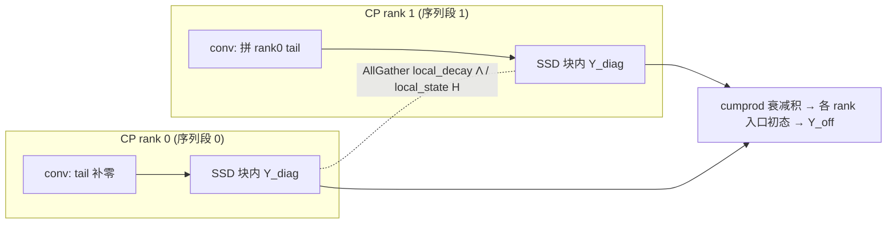

# Mamba2 SSM 训练（Mamba Mixer / 状态空间对偶 SSD / SSM 上下文并行）

## Summary

MindSpeed-LLM 把 Mamba2 选择性状态空间模型搬到昇腾 NPU 训练侧：纯 Mamba2（2.7B/8B）与混合 Mamba-Attention（hybrid 8B）模型从头预训练时，SSM 层既要算完整前反向，又要在长序列下沿 chunk 切块并行、在多卡下做上下文并行。实现以 monkey-patch 形式覆盖 Megatron-Core 的 `MambaMixer`/`MambaStack`：把 `in_proj → 因果短卷积 → 选择性 SSM 扫描 → 门控 RMSNorm → out_proj` 的前向换成显式 NPU 实现，并强制 `use_mem_eff_path = False`——不走上游 Triton 融合路径，而用一套可读的 **状态空间对偶（SSD, state-space duality）** 把 SSM 递推写成 chunk 矩阵形式做训练并行。SSM 的「状态沿序列严格依赖」与 [gated-deltanet-train](gated_deltanet_train.md) 同属线性序列模型族；二者 chunk 化思想同源，但 SSD 是对角 SSM 的分块求和、GDN 是 delta rule 的 WY 变换，且上下文并行的切分方式相反（见末节）。门控 RMSNorm 段的算子级融合见推理侧 [mambav2-rmsnormgated](../../../inference/concepts/kernels/mambav2_rmsnormgated.md)（算子级），训练模块语义不重复其 AscendC 算子定义。

Patch 由 `MambaModel` feature 装配（`features_manager/models/mamba.py`）：`mamba_mixer_init_wrapper` 注入 `mamba_chunk_size`/`mamba_d_conv`/`mamba_expand`/`mamba_d_ssm` 并置 `use_mem_eff_path=False`，`mamba_mixer_forward`/`mamba_block_forward` 替换前向，`Mamba2RMSNorm` 顶替上游 `mamba_ssm` 的门控 RMSNorm；上游 Triton 的 `mamba_chunk_scan_combined` 等以 `create_dummy=True` 占位（NPU 不走 Triton）。层结构与并行类型由 `mamba_spec.layer_spec` 注册。

## Mamba Mixer 结构（训练前向）

`mamba_mixer_forward` 处理 `(L, B, D)` 形状的 hidden state，一次前向走完：

- `A = -exp(A_log.float())`：`A_log` 是每 head 一个标量的可训练参数，`A` 是 SSM 的（负）连续时间转移率，恒为负保证状态衰减；
- `in_proj`（`ColumnParallelLinear`）产出 `xz`，按 `[d_mlp, d_mlp, d_inner_local, d_inner_local + 2·ngroups_local·d_state, nheads_local]` 切成 `z0, x0, z, xBC, dt`。`d_mlp` 由 `(xz_dim − 2·d_ssm_local − 2·ngroups_local·d_state − nheads_local) // 2` 推出：当 `--mamba-d-ssm` 设得比 `d_inner` 小时，多出的维度走一条 **门控 MLP 旁路**（`z0, x0`），SSM 只作用在 `d_ssm` 维上；缺省 `mamba_d_ssm=None` 时 `d_ssm_local = d_inner_local`、`d_mlp=0`，无旁路；
- 因果短卷积：`xBC` 转成 `(B, D, L)` 过 `conv1d`（深度可分离、`groups = 通道数`、`kernel = mamba_d_conv`，脚本取 4），截断到原长后接 `SiLU`，再切回 `x, B, C`（`x` 是 SSM 输入，`B/C` 是输入/输出投影矩阵，按 `ngroups_local` 分组，GQA 式被多个 head 共享）；
- 选择性 SSM 扫描：`StateSpaceProcessor.process` 吃 `x, dt, A, B, C, D` 出 `y`（SSD，下一节）；
- 门控归一化：`Mamba2RMSNorm(y, z=z)`——`norm_before_gate=True` 即 `RMSNorm(y) · SiLU(z)`，全程 FP32（`use_fused_rmsnorm` 时调 `torch_npu.npu_rms_norm`，否则手写 `rstd = 1/√(mean(x²)+eps)`），支持 `group_size` 分组归一；
- 门控 MLP 旁路（`d_mlp>0`）：`y = cat([SiLU(z0)·x0, y])`，把不过 SSM 的维度以门控 MLP 形式拼回；
- `out_proj`（`RowParallelLinear`）投回 hidden。

推理 `inference_params` 存在时走 `step` 逐步递归（带 `conv_state`/`ssm_state` 缓存原地更新），与训练共享同一份 `A_log`/`conv1d`/`out_proj` 权重；训练态走上述完整 chunk 扫描、不经 `step` 分支。

## 状态空间对偶 SSD：把递推写成 chunk 矩阵

SSM 的朴素形式是沿序列的线性递推 `state_t = exp(A·dt_t)·state_{t−1} + B_t·x_t`、`y_t = C_t·state_t`，逐 token 串行、无法训练并行。SSD 的做法是沿序列切成 `chunk_size`（`--mamba-chunk-size`，脚本取 128/256）的块：**块内**用矩阵乘并行求解、**块间**沿状态递推，把 `O(L)` 串行压成 `O(L/chunk)` 个可并行块。`StateSpaceProcessor.process`（`cp_size==1` 分支）的算子链：

- 时间步处理：`dt ← softplus(dt + dt_bias)`，再 `clamp` 到 `[dt_min, dt_max]`（`dt_min=0.001`/`dt_max=0.1`）；
- 离散化：`x ← x·dt`、`A ← A·dt`，把连续时间参数离散到当前步长；
- chunk + pad：补齐到 `chunk_size` 整数倍后 `rearrange("b (c l) ... -> b c l ...")`；B/C 先 `repeat` 把 `ngroups` 展成 `nheads`（`h_ratio = nheads_local // ngroups_local`）；
- **对角块（块内）** `_compute_diagonal_blocks`：`A_cum = cumsum(A)`，`L = exp(segsum(A))` 是块内逐对位置的累积衰减下三角矩阵，`Y_diag = bmm((C·Bᵀ) ∘ L, x)`——块内每个输出只「看」本块内的历史，写成一次批量矩阵乘；同时算每块结束态 `states = Σ B·decay·x`；
- **块间块（递推）** `_compute_inter_chunk_blocks`：把 `initial_states` 拼到块序列前，`decay_chunk = exp(segsum(pad(A_cum[...,-1])))` 是块到块的衰减，`new_states = einsum("bhzc,bchpn->bzhpn", decay_chunk, states)` 沿 chunk 维做状态递推，末块得 `final_state`；`Y_off = (C·states) · exp(A_cum)` 把每块的入口状态贡献加回；
- 合成：`y = Y_diag + Y_off + D·x`，去 pad 回原长。

`_segmented_sum` 是数值稳定的分段和：把向量 `repeat` 成 `(T,T)`、`tril(diag=-1)` 掩 0、沿倒数第二维 `cumsum`、再 `tril(diag=0)` 把上三角填 `-inf`，使 `exp` 后严格下三角、对角为 1。这套块内矩阵 + 块间递推与 [gated-deltanet-train](gated_deltanet_train.md) 的 chunk gated delta rule 是同一类「线性递推 → chunk 化训练并行」思想，区别在 Mamba 是标量衰减的对角 SSM（`A` 每 head 一标量）、GDN 是带 WY/UT 变换的 delta rule。前反向由 PyTorch autograd 在这些 `bmm`/`einsum`/`cumsum` 上自动求导（CP 路径下的状态传递另用自定义 `Function`，见下）。

## SSM 上下文并行（沿序列切 + 状态并行传递）

长序列预训练时激活显存压力随序列线性增长，需沿序列切到 `context_parallel_size` 个 rank。但 SSM 的状态传递有时间依赖：传统 CP 必须等上一 rank 算完、把状态传给下一 rank 才能继续，引入串行空闲等待。MindSpeed 的并行 Mamba-CP 让所有 rank **并发**执行状态传递——对各 rank 的 `local_decay`（本 rank 整段序列的总衰减 `Λ_r`，形状 `[B,H]`）与 `local_hidden_state`（本 rank 在零初态下累积的末态 `H_r`，形状 `[B,H,P,N]`）做 AllGather，每个 rank 拿到所有 rank 的段末态后，用前缀衰减积自行拼出自己的入口初态，无需逐跳等待。前向 AllGather、反向 ReduceScatter，并与计算掩盖。

实现分两个自定义 `torch.autograd.Function`：

- **因果卷积跨 rank**`SequenceParallelConvFunction`：深度卷积是因果的，每 rank 算自己序列段时需要上一 rank 末尾的 `kernel−1` 个 token（卷积「尾巴」）。前向异步 AllGather 各 rank 的 tail，并用这段通信掩盖 `dt` 的 `softplus(dt + dt_bias)` 计算；`cp_rank>0` 取前一 rank 的 tail 拼到本段头部做卷积，`cp_rank==0` 补零。反向对 tail 梯度走 `reduce_scatter_tensor` 散回各 rank，并与 `dt` 反向掩盖。注意 CP 路径下 `softplus+dt_bias` 在此处完成，SSD 内只剩 `clamp`。
- **状态并行传递**`SSDAllgatherOverlapFn`：前向异步 AllGather `local_decay`/`local_hidden_state`，在通信在途时算块内独立的 `Y_diag`（`bmm` 链）与 `state_decay_out = exp(A_cumsum)`，把 gather 回的两个 buffer 连同 `Y_diag`/`state_decay_out` 一并返还 SSD 主体（`process`）；主体再对 `cp_rank>0` 用 `cumprod` 从后往前求各前序 rank 段末态到本 rank 入口的衰减积，累加成 `initial_states`，与块间递推合成 `Y_off`。Fn 反向对两个 gather 量走 `reduce_scatter_tensor`，并与 `Y_diag` 各输入的 `bmm` 反向、`segsum` 反向（手写 tril/cumsum 反传）掩盖。

启用与切分：`--context-parallel-algo mamba_cp_algo`（`MambaContextParallelFeature` 注册）。`validate_args` 要求 `seq_length % cp == 0`、`num_attention_heads % (cp·tp) == 0`（head 须够分），并强制 `use_flash_attn=True`（混合模型里的 attention 层走 FA）。批次切分走 ulysses 式的 `_get_batch_on_this_cp_rank_in_ulysses_cp`——**顺序连续切**，每 rank 持一段有序子序列；而非注意力 CP 的 `2·cp` 对称负载均衡切分，因为 SSM 必须看到顺序时间序。Mamba-CP 与 TP/SP 正交：TP 受 `n_groups` 整除限制，CP 无此限；显存受限场景，开 CP 比开重计算更优——文档实测 32K 序列 `TP4CP2` 相对 `TP4CP1` 省 42% 显存、仅 −2.69% 性能，相对 `TP4CP1+全重计算` 同等显存下提速 +22.43%；省显存时建议先开 CP 再叠重计算。

> 与 [gated-deltanet-train](gated_deltanet_train.md) 的 CP 对照：两者都因「状态沿序列依赖」无法直接把序列切给各 rank。GDN 的解法是把序列分片**换成 head 分片**（cp2hp 全互换），每 rank 算全序列的 head 子集；Mamba 的解法是**保持序列分片**、靠 AllGather 段末态把状态传递并行化，每 rank 算自己序列段的全 head。切分维度恰好相反。Mamba-CP 与通用注意力 CP 家族 [context-parallel-train](../parallelism/context_parallel_train.md) 也不同——后者是 Ulysses/Ring/Hybrid 等注意力专用算法，`mamba_cp_algo` 是 SSM 专用、与之并列的一个 `--context-parallel-algo` 取值。

## 层组织与 spec 注册

`mamba_block_forward` 替换 `MambaStack.forward`：按 `self.layers` 逐层前向，混合栈里 Mamba 层与（简化）attention 层串联，attention 层输出 `(hidden, context)` 元组时取 `hidden`；末层 `final_norm`，并 `make_viewless_tensor` 保证 PP 段间张量无 view 依赖。`recompute_granularity=='full'` 且训练态时走 `_mamba_block_method_checkpointed_forward_func`——`uniform`（均匀分组、每组 checkpoint 入口激活）或 `block`（只对前 `recompute_num_layers` 层 checkpoint）两种重计算策略，用 `tensor_parallel.checkpoint` 重算激活省显存。

`mamba_spec.layer_spec` 是 `MambaStackSubmodules` 的 `ModuleSpec`，定义三类层：`mamba_layer`（`MambaLayer` → `MambaMixer`，`in_proj=ColumnParallelLinear`/`out_proj=RowParallelLinear`，`norm=PTNorm`）、`attention_layer`（`TransformerLayer` → 因果 `SelfAttention`，混合模型用）、`mlp_layer`（`TransformerLayer` → `MLP`）。混合比由 `--hybrid-attention-ratio`（如 0.08）与 `--hybrid-mlp-ratio`（如 0.5）控制，Megatron 据此在栈里穿插 Mamba / attention / MLP 层。

## 训练入口与配置

`examples/mcore/mamba2` 三个脚本均以 `--spec mindspeed_llm.tasks.models.spec.mamba_spec layer_spec`、`--transformer-impl local` 启动，共用 Mamba flag：`--mamba-chunk-size`、`--mamba-state-dim`（`d_state`/N，取 128）、`--mamba-d-conv 4`、`--mamba-expand 2`、`--mamba-head-dim 64`、`--mamba-num-groups`（B/C 分组数）。

- **2.7B**（`pretrain_mamba2_2.7b_4k_ptd.sh`）：`TP=1`、64 层、`hidden=2560`、`mamba-num-groups 1`、`mamba-chunk-size 256`，开 `--recompute-granularity full --recompute-method block --recompute-num-layers 48` 省显存，附 `--enable-hf2mg-convert --model-type-hf mamba2` 做 HF→MG 权重转换。
- **8B**（`pretrain_mamba2_8b_4k_ptd.sh`）：`TP=8`、56 层、`hidden=4096`、`mamba-num-groups 8`、`mamba-chunk-size 128`，配 `--group-query-attention --num-query-groups 8`、`--sequence-parallel`。
- **hybrid 8B**（`pretrain_mamba2_hybrid_8b_4k_ptd.sh`）：在 8B 基础上加 `--hybrid-attention-ratio 0.08 --hybrid-mlp-ratio 0.5`，即栈里穿插少量 full-attention 与 MLP 层的 Mamba-Attention 混合架构。

长序列再叠 `--context-parallel-size N --context-parallel-algo mamba_cp_algo` 开 SSM 上下文并行。

## Evidence

- [mindspeed-llm](https://gitcode.com/Ascend/MindSpeed-LLM) — [`mindspeed_llm/core/ssm/mamba_mixer.py`](https://gitcode.com/Ascend/MindSpeed-LLM/blob/183e02c21011c2e423a599633cf2d55929ba9ea3/mindspeed_llm/core/ssm/mamba_mixer.py)（`mamba_mixer_forward`：`A=-exp(A_log)`、`in_proj` 切 `z0/x0/z/xBC/dt`、`d_mlp` 门控 MLP 旁路、`conv1d`+SiLU、`StateSpaceProcessor` 调用、门控 MLP 拼回；`mamba_mixer_init_wrapper` 注入 chunk/d_conv/expand/d_ssm + `use_mem_eff_path=False`；`Mamba2RMSNorm` 的 `norm_before_gate` FP32 实现与 `npu_rms_norm` 融合分支）
- [mindspeed-llm](https://gitcode.com/Ascend/MindSpeed-LLM) — [`mindspeed_llm/tasks/models/ssm/state_space_duality.py`](https://gitcode.com/Ascend/MindSpeed-LLM/blob/183e02c21011c2e423a599633cf2d55929ba9ea3/mindspeed_llm/tasks/models/ssm/state_space_duality.py)（`StateSpaceProcessor.process` 的 `cp_size==1` SSD 链：`_process_time_step` softplus+clamp、`_chunk_and_pad` 离散化、`_compute_diagonal_blocks` 块内 `Y_diag`、`_compute_inter_chunk_blocks` 块间状态递推、`_segmented_sum` 数值稳定分段和；`cp_size>1` 的 einsum 状态拼接路径）
- [mindspeed-llm](https://gitcode.com/Ascend/MindSpeed-LLM) — [`mindspeed_llm/tasks/models/ssm/state_space_context_parallel.py`](https://gitcode.com/Ascend/MindSpeed-LLM/blob/183e02c21011c2e423a599633cf2d55929ba9ea3/mindspeed_llm/tasks/models/ssm/state_space_context_parallel.py)（`SequenceParallelConvFunction` 因果卷积尾巴 AllGather + 反向 ReduceScatter；`SSDAllgatherOverlapFn` 段末态 `local_decay`/`local_hidden_state` AllGather 与 `Y_diag` 计算掩盖、`cumprod` 跨 rank 入口初态、`segsum` 反向）
- [mindspeed-llm](https://gitcode.com/Ascend/MindSpeed-LLM) — [`mindspeed_llm/core/ssm/mamba_block.py`](https://gitcode.com/Ascend/MindSpeed-LLM/blob/183e02c21011c2e423a599633cf2d55929ba9ea3/mindspeed_llm/core/ssm/mamba_block.py)（`mamba_block_forward` 逐层前向 + `make_viewless_tensor`；`recompute_granularity=full` 的 `uniform`/`block` 重计算）、[`mindspeed_llm/tasks/models/spec/mamba_spec.py`](https://gitcode.com/Ascend/MindSpeed-LLM/blob/183e02c21011c2e423a599633cf2d55929ba9ea3/mindspeed_llm/tasks/models/spec/mamba_spec.py)（`layer_spec`：`MambaMixer` in/out_proj 列/行并行、混合栈 mamba/attention/mlp 三类层）
- [mindspeed-llm](https://gitcode.com/Ascend/MindSpeed-LLM) — [`mindspeed_llm/features_manager/models/mamba.py`](https://gitcode.com/Ascend/MindSpeed-LLM/blob/183e02c21011c2e423a599633cf2d55929ba9ea3/mindspeed_llm/features_manager/models/mamba.py)（`MambaModel`：`--mamba-d-ssm/-chunk-size/-d-conv/-expand` 注册、patch `MambaMixer`/`MambaStack`/`RMSNorm`、Triton 算子 `create_dummy`）、[`mindspeed_llm/features_manager/context_parallel/mamba_context_parallel.py`](https://gitcode.com/Ascend/MindSpeed-LLM/blob/183e02c21011c2e423a599633cf2d55929ba9ea3/mindspeed_llm/features_manager/context_parallel/mamba_context_parallel.py)（`mamba_cp_algo` 选项与 `validate_args`：seq/head 整除校验、强制 FA）、[`mindspeed_llm/core/context_parallel/get_batch_utils.py`](https://gitcode.com/Ascend/MindSpeed-LLM/blob/183e02c21011c2e423a599633cf2d55929ba9ea3/mindspeed_llm/core/context_parallel/get_batch_utils.py)（`mamba_cp_algo` 走 ulysses 式顺序切分）
- [mindspeed-llm](https://gitcode.com/Ascend/MindSpeed-LLM) — [`docs/zh/pytorch/features/mcore/mamba_context_parallel.md`](https://gitcode.com/Ascend/MindSpeed-LLM/blob/183e02c21011c2e423a599633cf2d55929ba9ea3/docs/zh/pytorch/features/mcore/mamba_context_parallel.md)（Mamba-CP 背景/问题/方案：状态时间依赖、AllGather local_decay/local_state 并发状态传递、与 TP/SP 正交、CP vs 重计算显存与性能对比）、[`examples/mcore/mamba2/pretrain_mamba2_2.7b_4k_ptd.sh`](https://gitcode.com/Ascend/MindSpeed-LLM/blob/183e02c21011c2e423a599633cf2d55929ba9ea3/examples/mcore/mamba2/pretrain_mamba2_2.7b_4k_ptd.sh) / [`pretrain_mamba2_8b_4k_ptd.sh`](https://gitcode.com/Ascend/MindSpeed-LLM/blob/183e02c21011c2e423a599633cf2d55929ba9ea3/examples/mcore/mamba2/pretrain_mamba2_8b_4k_ptd.sh) / [`pretrain_mamba2_hybrid_8b_4k_ptd.sh`](https://gitcode.com/Ascend/MindSpeed-LLM/blob/183e02c21011c2e423a599633cf2d55929ba9ea3/examples/mcore/mamba2/pretrain_mamba2_hybrid_8b_4k_ptd.sh)（2.7B/8B/hybrid 规格、`--mamba-*` flag、混合比、重计算配置）

## Links

- [mambav2-rmsnormgated](../../../inference/concepts/kernels/mambav2_rmsnormgated.md)（跨域·推理：Mamba v2 门控 RMSNorm 的 AscendC 融合算子，本页训练侧 `Mamba2RMSNorm` 是其 FP32 参考形态，不重复算子定义）
- [gated-deltanet-train](gated_deltanet_train.md)（同域·训练：同属线性序列模型，chunk 化思想同源，CP 切分维度相反——GDN 切 head、Mamba 切序列）
- [context-parallel-train](../parallelism/context_parallel_train.md)（同域·训练：通用注意力 CP 家族 Ulysses/Ring/Hybrid，`mamba_cp_algo` 是与之并列的 SSM 专用 `--context-parallel-algo` 取值）
