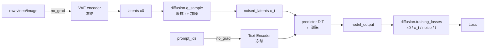

# 多模态生成训练（MindSpeed-MM 扩散 DiT + VAE）

## Summary

MindSpeed-MM 的视频/图像生成训练把一张 DiT 主干放进扩散去噪框架里训练：原始像素先经 VAE 编码进低分辨率隐空间，再在隐空间上加噪、由 DiT 预测去噪目标、与解析目标算 MSE。装配模型是 `SoRAModel`——它把 `text_encoder`、`ae`（VAE）、`diffusion`（噪声调度器）、`predictor`（DiT 骨干）四件拼到一起，但**只有 DiT predictor 参与反向**，VAE 与文本编码器在训练全程冻结（`eval()` + `requires_grad_(False)`）只做前向特征提取。

DiT / VAE 的**结构与推理侧语义**在 [dit](../../../inference/concepts/modules/dit.md)、[vae](../../../inference/concepts/modules/vae.md) 已有定义（block 形态、AdaLN、3D 卷积感受野、推理多步采样），此处只落训练侧专属的四件事：① `SoRAModel` 的「冻结编码 → 加噪 → 去噪预测 → loss」前向契约；② 一组噪声调度器（DDPM/IDDPM 的 ε 预测 vs flow-match/rectified-flow 的 velocity 预测）的 `q_sample` 加噪与 `training_losses` 去噪损失；③ VAE 家族对长视频隐空间做**时间轴因果上下文并行**编解码；④ DiT 长序列训练并行（Ulysses USP / Ring Attention）。框架层装配与双后端见 [mindspeed-mm](../frameworks/mindspeed_mm.md)，多模态分组并行见 [hetero-parallel](../parallelism/hetero_parallel.md)。

## 训练前向：冻结编码 → 加噪 → DiT 去噪 → 扩散损失

`SoRAModel.forward` 一步训练把四个组件串成一条单向链，预测器是唯一可训练体：

要点：

- **视觉编码**：`task=t2v` 走 `ae.encode(video)`、`task=i2v` 走 `ae.encode(video, **kwargs)` 同时拿回 `i2v_results`（首帧条件 latent）；`load_video_features=True` 时直接吃预编码好的 latent，跳过 VAE。整段编码在 `torch.no_grad()` 下。
- **加噪**：`noised_latents, noise, timesteps = diffusion.q_sample(latents, model_kwargs=kwargs, mask=video_mask)`——调度器内部采样时间步 `t`、产噪声 `noise`、按各自前向路径合成 `x_t`。
- **去噪预测**：DiT predictor 吃 `(noised_latents, timestep, prompt, video_mask, prompt_mask)` 输出 `model_output`（依调度器语义是 ε / velocity / v-pred）。
- **损失**：`compute_loss` 透传 `diffusion.training_losses(model_output, x_start=latents, x_t=noised_latents, noise=noise, t=timesteps, mask=video_mask)`。`x_start`/`x_t`/`noise`/`t` 全部由 `q_sample` 阶段定下，损失函数只做「目标 − 预测」。
- **PP 切分**：`pre_process`（首 stage）做编码 + `q_sample`，`post_process`（末 stage）做 `compute_loss`，中间 stage 靠 `predictor.pipeline_set_prev/next_stage_tensor` 把 `latents/noised_latents/timesteps/noise/video_mask` 透传过 PP 边界。
- **编码省算**：`enable_encoder_dp` / `encoder_offload_interval>1` 时，VAE+文本编码结果进 `cache`，按递增 step_idx/rank_idx 逐步消费不同缓存条目，让 DiT 训练与提前编码错峰；init_cache 使用 get_tensor_and_context_parallel_group() 在主干 TP×CP 组内分摊编码工作，并非反复训练同一份编码结果。

## 噪声调度器家族（DiffusionModel 工厂）

`DiffusionModel` 按 `model_id` 从 `DIFFUSION_MODEL_MAPPINGS` 选调度器（未命中则回退 `diffusers` 原生调度器）。所有调度器对外暴露同一组训练接口 `q_sample(...) -> (x_t, noise, t)` 与 `training_losses(model_output, x_start, x_t, noise, t, mask)`，使 `SoRAModel` 的损失计算与具体扩散范式解耦。两大范式：

**DDPM / IDDPM（离散高斯扩散，ε 或 x0 预测）**

`q_sample` 按 `x_t = √ᾱ_t·x0 + √(1−ᾱ_t)·noise` 加噪，`t` 在 `[0, num_train_steps)` 内 `randint` 均匀采样。`training_losses` 的目标按 `model_mean_type` 取（`EPSILON→noise` / `START_X→x0` / `PREVIOUS_X→后验均值`），损失是 `mean_flat((target − model_output)²)`。`learn_sigma=True` 时模型多输出一半通道作方差，`model_var_type=LEARNED_RANGE`，损失额外叠一项变分下界 `vb`（`_vb_terms_bpd` 的 KL / decoder-NLL），并对均值分支 `detach` 避免方差项污染均值梯度；`RESCALED_MSE` 把 vb 乘 `num_timesteps/1000` 配平量级。`IDDPM` 继承 `DDPM`、训练侧损失逻辑不变，新增 DDIM 采样路径（`ddim_sample`）；`timestep_respacing`（`space_timesteps` 推理重排步）在 `DDPM` 基类即已具备。这是图像/早期视频 DiT（Latte/MMDiT 谱系）的训练范式。

**Flow-match / Rectified-Flow（连续插值路径，velocity 预测）**

`FlowMatchDiscreteScheduler` / `WanFlowMatchScheduler` / `RFlow` / `Opensora2FlowMatchScheduler` / `OpenSoraPlanScheduler` 同属此类：`q_sample` 按 `x_t = (1−σ)·x0 + σ·noise` 做 x0↔noise 的线性插值（σ 即归一化时间），`training_losses` 的目标是路径速度场 `target = noise − x0`（`RFlow` 取等价符号 `x0 − noise`），损失 `mean((model_output − target)²)`。时间步多采**偏置分布**而非全程均匀，但具体路径各调度器不一：`FlowMatchDiscreteScheduler` 用 logit-normal 密度（`compute_density_for_timestep_sampling(weighting_scheme="logit_normal", logit_mean, logit_std)`）、`RFlow` 用 `LogisticNormal` 直接采样把分布偏向中段噪声，而 `WanFlowMatchScheduler` 仍在 `[min_timestep_boundary, max_timestep_boundary]` 边界内 `randint` 均匀取。`sd3_time_shift`（`shift·t / (1+(shift−1)·t)`）按 `shift` 对 σ 做整体平移（`RFlow.timestep_transform` 再按分辨率/帧数缩放出 `shift` 因子）。`precondition_outputs=True` 时把网络输出经 `model_output·(−σ)+x_t` 预条件回 x0 域再算损失。这是 Wan / HunyuanVideo / OpenSora 系视频 DiT 的主流训练范式。

**两个特化调度器**

- `CogVideoDiffusion`：v-prediction。用 `ZeroSNRDDPMDiscretization` 把 DDPM 的 `√ᾱ` 做零信噪比端点重标定，`DiscreteDenoiser` 产 `c_skip/c_out/c_in/c_noise` 四系数做输入/输出预条件，`training_losses` 把网络输出还原成 `model_output·c_out + noised_start`、按 `w = 1/(1−ᾱ²)`（可截 `min_snr_value`）加权 L2/L1。`DiscreteSampling` 支持 `uniform_sampling`：把时间步区间按 DP 划成 `group_num` 段（`group_index = rank // group_width`），**不同 DP 组各覆盖一段互补的噪声区间、同组内各 rank 共采同一段**，使全局梯度跨整条噪声链均衡、降低方差。
- `HunyuanVideoI2VDiffusion`：图生视频 flow-match。SNR 采样 `lognorm`（`t = sigmoid(N(0,1))`）或 `uniform`，按 `video_shift` 做时间平移；`q_sample` 把首帧条件 latent `cond_latents` 拼到加噪序列的帧维前端（`concat([cond_latents, xt[:,:,1:]], dim=2)`），`training_losses` 只对**非条件帧**（`[:,:,1:]`）算 `(model_output − noise)²`，保证条件帧不被去噪损失约束。

## VAE 家族：长视频隐空间编解码 + 时间轴因果 CP

VAE（`ae`）在训练里只跑 encoder 把像素压成 latent（推理才跑 decoder），但视频长序列下编码本身就吃满单卡显存，需要沿时间轴切分。仓内多套时序 VAE：`VAE_Temporal`、`CausalVAE`（`casualvae.py`）、`WFVAE`（小波）、`WanVideoVAE`、`HunyuanVideo VAE`（`autoencoder_kl_hunyuanvideo.py` / `hunyuanvideo_15_vae.py`）、`StepVideo VAE`。它们的共性是**时间因果 3D 卷积**——`CausalConv3d` 的 padding 只补时间轴左侧（`time_causal_padding = (W,W,H,H,time_pad,0)`），保证 t 帧只看历史帧，使隐空间在时间维可逐段递推。

`ContextParallelCasualVAE` 是把 causal VAE 搬到多卡的上下文并行版本，专为长视频训练：

- **时间轴切分**：CP 组内先 `broadcast` 同一份输入到 `global_src_rank`，再用 `_conv_split(x, dim=2, kernel_size=1)` 沿**帧维（dim=2）**把视频切给各 CP rank，每 rank 持有一段连续帧；编码后 `_conv_gather` 沿帧维拼回完整 latent。`_conv_split` 按 `dim_size=(T−kernel_size)//cp_world_size` 切，且 `cp_rank>0` 的起点偏移 `kernel_size`。这些输入切片互不重叠，rank0多保留开头帧，后续rank没有通过切片取得前一段历史帧；跨段历史由 common/conv.py 的 ContextParallelCausalConv3d.forward 调用 fake_cp_pass_from_previous_rank 补入，不能把输入分段等同于卷积边界通信。
- **CP 与 DP 组关系自适应**：`encode` 按 `cp_size` 与 megatron `dp_group_nums` 的整除关系走三条路径——`cp_size>dp` 时 all-gather 后循环编码（loop cp）、`cp_size<dp` 时按 batch 切分补齐再 all-gather 重组（split）、`cp_size==dp` 时各 rank 直接编码自己那段；保证 VAE 的 CP 与主干 DP 拓扑对齐。
- **Tiling 互斥**：超大分辨率可走 `tiled_encode/tiled_decode` 的空间瓦片切分，但**瓦片切分与 VAE-CP 不可同时开**（`raise NotImplementedError`）；decode 侧另有时间维 `tile_latent_min_size_t` 分块解码处理超长帧。

VAE 的隐空间维度/压缩比与下游 DiT 的 latent 形状强绑定（如时间下采样因子 `2^sum(temporal_downsample)`），训练时 VAE 冻结只保证这层映射稳定。

## DiT 训练序列并行：Ulysses USP + Ring Attention

视频分辨率/帧数拉大后，DiT 的注意力序列可达十万级 token，单卡放不下，需把序列切到 CP 组。数据、张量、流水线并行都无法切序列维，注意力显存随序列长度 `O(S²)` 膨胀，故对长序列单独做上下文并行。predictor（如 `wan_dit`）在进 transformer block 前对 token 序列 `split_forward_gather_backward`（前向 split、反向 gather）沿序列维切给各 CP rank，block 算完再 `gather_forward_split_backward` 拼回。两套算法由 `--context-parallel-algo` 选：

- **DiT-USP（Unified Sequence Parallelism，`hybrid_cp_algo`）**：Ulysses + Ring 混合。Ulysses 把序列切给各卡后，在注意力前用 all-to-all 把 Q/K/V 重排成「每卡持全序列、但只负责注意力头的不相交子集」，并行算不同头、算完再 all-to-all 收回按序列重分区；`--ulysses-degree-in-cp` 设 Ulysses 维度（须整除 `--context-parallel-size`、且能整除注意力头数），剩余 CP 维走 Ring。
- **DiT-Ring-Attention（`megatron_cp_algo`）**：纯 Ring。各卡持序列块，KV 沿环逐跳传递做 blockwise attention；`--cp-window-size>1` 时启用 Double Ring（LoongTrain head-context 并行），内层窗口提升通信/计算并发，但窗口过大可能因片上带宽抢占反降效率。

公共配置：`--use-cp-send-recv-overlap`（send/recv 与计算重叠）、`--megatron-cp-in-bnsd`（默认 `sbh` 切到 `[B,N,S,D]` 提速）、`--attention-mask-type {general|causal}`。**开 CP 必须同时开 Flash Attention**，否则不支持；序列较短（每卡 <8k）时 CP 的通信反超计算导致掉速，建议 `seq_length / cp_size > 8k`。`wan_dit` 已实现 `ulysses_cp_algo` / `hybrid_cp_algo` / `megatron_cp_algo` 三种 `context_parallel_algo`，未列入的会报未实现。相关技术见[异构并行](../parallelism/hetero_parallel.md)，但不能据此认定本节 DiT 支持全部组合：固定动态 DP-CP 仅列 OpenSoraPlan1.3、仅Ulysses，且不支持 encoder DP/interleaved offload；非对齐 Ulysses 当前仅支持 qwen2vl/qwen2.5vl，不直接推广到 DiT。

## Evidence

- [README.md](../../../../../cann-recipes-raw/mindspeed-mm/0d2270c8ee178d7bfece88f356a5072bf8e2b3ed/README.md)（primary）
- [dit_usp.md](../../../../../cann-recipes-raw/mindspeed-mm/0d2270c8ee178d7bfece88f356a5072bf8e2b3ed/docs/zh/features/parallel/dit_usp.md)（supporting）
- [conv.py](../../../../../cann-recipes-raw/mindspeed-mm/0d2270c8ee178d7bfece88f356a5072bf8e2b3ed/mindspeed_mm/models/common/conv.py)（implementation）
- [sora_model.py](../../../../../cann-recipes-raw/mindspeed-mm/0d2270c8ee178d7bfece88f356a5072bf8e2b3ed/mindspeed_mm/models/sora_model.py)（implementation）
- [dynamic_dpcp.md](../../../../../cann-recipes-raw/mindspeed-mm/0d2270c8ee178d7bfece88f356a5072bf8e2b3ed/docs/zh/features/parallel/dynamic_dpcp.md)（implementation）
- [unaligned_ulysses_cp.md](../../../../../cann-recipes-raw/mindspeed-mm/0d2270c8ee178d7bfece88f356a5072bf8e2b3ed/docs/zh/features/parallel/unaligned_ulysses_cp.md)（implementation）

## Links

- [dit](../../../inference/concepts/modules/dit.md)（跨域·推理：DiT 概念定义与推理多步采样 / block 形态 / AdaLN；训练侧补加噪去噪与序列并行、不重复结构）
- [vae](../../../inference/concepts/modules/vae.md)（跨域·推理：VAE 解码 3D 卷积感受野与 patch 并行，本页补训练侧 encoder 冻结编码与时间轴因果 CP）
- [mindspeed-mm](../frameworks/mindspeed_mm.md)（同域·框架：套件双后端装配、`ae`/`predictor`/`diffusion` 子包组织、DCP 检查点）
- [hetero-parallel](../parallelism/hetero_parallel.md)（同域·并行：多模态分组并行 + 动态 DP-CP + 非对齐 Ulysses，DiT 序列并行之上的拓扑层）
- [vlm-multimodal-training](vlm_multimodal_training.md)（同套 MindSpeed-MM 的 VLM 理解训练，互为生成/理解两支）
