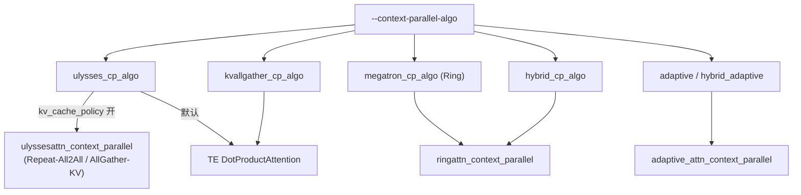
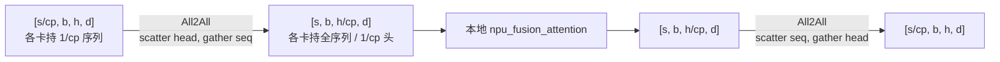
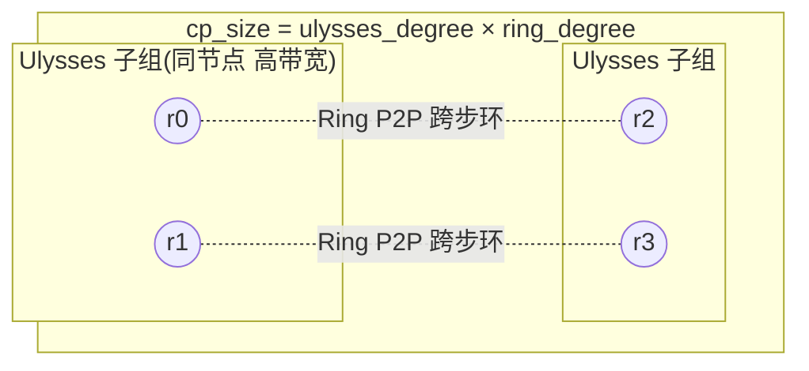

# MindSpeed 上下文并行家族（Ulysses / Ring / Hybrid / Unaligned CP）

## Summary

MindSpeed 训练侧用 **Context Parallel（CP，长序列并行）** 沿 Sequence 维把输入切到 `context_parallel_size` 个 rank，把 Attention 的 `O(S²)` 激活/计算压到单卡可承受。围绕「Attention 计算需要全量 KV」这一约束，MindSpeed 提供一族可选算法，由 `--context-parallel-algo` 在 `CPDotProductAttentionImpl`（经 `MindSpeedCPDotProductAttention` patch 进 Megatron 的 `DotProductAttention`）内分派：**Ulysses CP**（`ulysses_cp_algo`，在 head 维做 All2All，把序列切换成头切分）、**Ring CP**（`megatron_cp_algo`，KV 沿序列维 P2P 环形逐跳传递、分块 Softmax 累积，支持 Double Ring）、**Hybrid CP**（`hybrid_cp_algo`，Ulysses × Ring 二维 mesh，`cp = ulysses_degree × ring_degree`）、**KV-AllGather CP**（`kvallgather_cp_algo`，AllGather 全量 KV、本地 Q 算注意力，GQA/MQA（KV 头数远少于 Q 头）下 KV 体量小、最友好）、以及各算法的 **Unaligned（非对齐）变体**（各 rank 变长序列）。CP 还可叠加 **KV 缓存优化**（前向缓存 KV 带到反向，省一半 P2P 通信或省 repeat 内存）。训练侧 CP 需处理前反向两段通信与负载均衡切分，区别于推理侧 CP 与 torchtitan DSA 专用 CP（见末节）。

## 家族总览与算法分派

`--context-parallel-algo` 的合法取值与分派目标（`CPDotProductAttentionImpl.forward`）：

| 算法 (`--context-parallel-algo`) | 通信原语 | 切分对象 | head 约束 | 入口函数 |
|---|---|---|---|---|
| `ulysses_cp_algo` | All2All（head ↔ seq） | Q/K/V 全部 | `num_heads % (cp·tp) == 0` | `UlyssesContextAttention` / `ulyssesattn_context_parallel` |
| `megatron_cp_algo`（缺省） | P2P send/recv 环形 | KV 逐跳传递 | 无（理论可无限扩序列） | `ringattn_context_parallel` |
| `hybrid_cp_algo` | All2All × P2P 二维 | Ulysses 维 + Ring 维 | `num_heads % (ulysses_degree·tp) == 0` | `ringattn_context_parallel`（hybrid ring 子组） |
| `kvallgather_cp_algo` | AllGather KV | 仅 KV | 无 | TE `MindSpeedTEDotProductAttention` → `KVAllGatherCPStrategy` |
| `adaptive_cp_algo` / `hybrid_adaptive_cp_algo` | 自适应调度 | 动态 mask | — | `adaptive_attn_context_parallel` |

分派逻辑（`dot_product_attention.py` · `CPDotProductAttentionImpl.forward`）：`ulysses_cp_algo` 且开启 `context_parallel_kv_cache_policy` 时走带 KV 缓存的 `ulyssesattn_context_parallel`；`megatron_cp_algo` / `hybrid_cp_algo` 走 `ringattn_context_parallel`（hybrid 取 hybrid-ring 子通信组）；自适应族走 `adaptive_attn_context_parallel`。在 `transformer_impl=transformer_engine`（缺省）下，`kvallgather_cp_algo` 与不带缓存的 Ulysses 改由 `MindSpeedTEDotProductAttention` 接管（注册见 `register_patches`，kvallgather 经 `CPStrategyFactory` 映射到 `KVAllGatherCPStrategy`）；非 TE 时不带缓存的 Ulysses 由 `UlyssesContextAttention` 包住本地 `CPDotProductAttentionImpl`。Ring / Hybrid / Ulysses / Adaptive 各族的 `validate_args` 都把 `use_flash_attn` 置 True，kvallgather 经 TE 也默认启用 FlashAttention——CP 全族都依赖 `npu_fusion_attention` 融合算子。

## Ulysses CP：head 维 All2All

Ulysses 先把序列切到各 rank（每卡持 `S/cp`），在进入 Attention 前对 Q、K、V 各做一次 **All2All**，把切分维度从序列维换到注意力头维：每张卡换得**完整序列**但只负责 `heads/cp` 个头的子集，从而各 rank 并行算不同的头；Attention 后再用一次 All2All 把结果从头维换回序列维。

核心原语 `single_all_to_all(input_, scatter_idx, gather_idx, group)`：默认 `scatter_idx=2`（head 维，被切散到各 rank）、`gather_idx=0`（seq 维，被收齐成全量）。前向 `[s/cp, b, h, d] --All2All--> [s, b, h/cp, d]`，本地 FA 计算后输出 `[s, b, h/cp, d] --All2All--> [s/cp, b, h, d]`。`UlyssesContextAttention.forward` 顺序对 Q/K/V 调 `all_to_all(scatter_idx=2, gather_idx=0)`，调本地 `local_attn`，再 `all_to_all(gather_idx, scatter_idx)` 换回。

约束（`UlyssesContextParallelFeature.validate_args`）：`seq_length % cp == 0` 且 `num_attention_heads % (cp · tp) == 0`——头数必须够分给 `cp·tp` 份，这使 GQA/MQA 下 CP 规模受限。文档建议非 GQA、32K 以下序列优先用 Ulysses。

**GQA 头不足的处理**：当 `seq_world_size > key.shape[scatter_idx]`（KV 头数 < cp，无法均分到每 rank 一头）时，对 KV 在头维 `repeat_interleave(query_heads // kv_heads)` 复制后再 All2All；反向对复制出的副本梯度按 `repeat_num` 折叠求和（`.view(...).sum(...)`）。

## Ring CP：KV 序列维 P2P 环形传递

Ring Attention（`megatron_cp_algo`）借分块 Softmax 原理，在不拼接全序列的前提下分块算注意力：每 rank 持自己 `S/cp` 的本地 Q/K/V，在 `cp` 个 rank 间构成环，向后发自己的 KV 块、从前一跳收 KV 块，逐块累积 `forward_update`（在线 Softmax 的 max/sum 修正），重复 `cp-1` 次后每个本地 Q 都「关注」到全局 KV。计算与 KV 通信理想下相互掩盖，因此通信开销可被吃掉，序列长度理论上可无限扩展，且**不要求** head 数被 cp 整除——这是相对 Ulysses 的关键优势。

入口 `ringattn_context_parallel(q, k, v, head_num, cp_para, softmax_scale, attn_mask, dropout_p, packed_seq_params/shapes)`。`cp_para` 携带 `cp_group` / `cp_size` / `rank` / `cp_global_ranks` / `causal` / send-recv-overlap 子组 / double-ring 内外窗口 ranks / `cache_policy`。因果掩码下 `causal_forward_fetch` 按 `q_block_id` 与 `kv_block_id` 的先后只取需要计算的 Q/KV 半块（省一半冗余计算），变长场景由 `tnd_forward_fetch` 走 TND 布局。

**Double Ring（LoongTrain）**：`--cp-window-size` > 1 时启用，把 `cp` 个 rank 的单层环拆成「内层窗口 + 外层环」二级环——内层窗口大小即 `cp_window_size`，外层环 `n_window = cp_size / cp_window_size`，提高通信与计算并发度。约束（`ContextParallelFeature.validate_args`）：`1 ≤ cp_window_size < cp_size` 且 `cp_size % cp_window_size == 0`；`seq_length % (2·cp) == 0`（配合负载均衡切分）。`cp_window_size` 增大时片上内存带宽抢占可能反而降效，需按场景调（如 Llama2 裁剪 32K、cp=16 实测内层窗口 2 最优）。

相关开关：`--use-cp-send-recv-overlap`（send/recv 与计算重叠）、`--attention-mask-type causal|general`（因果倒三角 / 全量）、`--megatron-cp-in-bnsd`（FA 走 BNSD 布局）、`--use-fused-ring-attention-update`（融合的 ring 更新算子）。掩盖条件：每个计算块分到的序列 `S/cp` 需足够大（约 `S/(T·α) ≥ 1/(W·β)`，`T` 算力、`W` 带宽、`α/β` 利用率），8K 量级下通信反超计算会掉性能，建议 `seq_length / cp > 8K`。

## Hybrid CP：Ulysses × Ring 二维 mesh

Ulysses 受头数整除约束、Ring 在小块时带宽利用不足——Hybrid（`hybrid_cp_algo`，源自 USP，Unified Sequence Parallelism 统一序列并行）把 CP 域拆成 **Ulysses 维 × Ring 维** 的二维网格：`cp_size = ulysses_degree × ring_degree`，由 `--ulysses-degree-in-cp` 指定 Ulysses 维，`ring_degree = cp_size // ulysses_degree`。

通信组构造（`model_parallel_utils.py` · hybrid 组初始化）：Ulysses 子组取 CP ranks 内**连续**的 `ulysses_degree` 个 rank（注释明确「Ulysses 需要比 Ring 更高带宽，尽量放进同一节点」），Ring 子组取**跨步**的 `ring_degree` 个 rank。Attention 时先在 Ulysses 子组做 head-维 All2All，再在 Ring 子组做 KV 环形传递。

约束（`ContextParallelFeature.validate_args`）：`ulysses_degree_in_cp` 须整除 `cp_size` 且 `ring_degree > 1`；`num_attention_heads % (ulysses_degree_in_cp · tp) == 0`（只有 Ulysses 维约束头数，Ring 维不约束，故比纯 Ulysses 能扩到更大 CP）；`seq_length % (2·cp) == 0`；double ring 的 `cp_window_size` 落在 `[1, ring_degree)` 且整除 `ring_degree`。Hybrid 继承 Ring 的 send-recv-overlap 与 mask 类型配置。

## 非对齐（Unaligned）变体

对齐 CP 要求 `seq_length` 能被 `cp_size` 整除；多模态/流式/变长输入难以满足。MindSpeed 为 Ulysses 与 Ring 各提供非对齐变体，让各 rank 持**不等长**子序列。

**非对齐 Ulysses**：引入抽象基类 `GatherSizeCalculator`（接口方法 `calculate() -> Optional[int]`，返回 All2All 后 `gather_idx` 维的实际大小）。`DefaultGatherSizeCalculator` 恒返回 `None`（退化为对齐 Ulysses，按 `原size × world_size` 推断）；`DynamicGatherSizeCalculator` 按当前 batch 的 attention mask 序列长度 `args[0].shape[-1]` 动态算 gather size（general mask 为 list 时不支持，返回 None）。`UlyssesContextAttention(local_attention, sequence_process_group, gather_size_calculator=...)` 注入计算器；底层 `unaligned_cp/mapping.py` 的 `all_to_all` 用按 rank 不等的 `input_split_sizes` / `output_split_sizes` 完成非均匀 All2All，`cal_split_sizes` 计算每 rank 切块大小（余数前几 rank +1）。限制：不支持 legacy 模型分支；与 Ulysses KV 缓存（`--context-parallel-kv-cache-policy full/half`）冲突时自动回退对齐 Ulysses。

**非对齐 Ring**：建立「形状协商协议」，通信前先交换各 rank 有效长度，调 `ringattn_context_parallel(..., shapes=shapes)` 传入子序列长度。`get_unaligned_cp_shapes(shapes, block_id, next_block_id)` 返回 `[shapes[block_id], shapes[next_block_id]]`（`shapes` 可为 list/tuple/dict 等支持 `[]` 索引的结构），在分块计算与 P2P 传递时携带非均匀长度。限制：当前仅支持 `--attention-mask-type general`。

## KV-AllGather CP

`kvallgather_cp_algo`（源自 Llama 3 §3.3.2）：各 rank 在序列维持不同片段，Attention 前对**已切分的 K、V 做 AllGather** 取全量 KV，再用本地 1/cp 的 Q 与全量 KV 算注意力。相比 Ring 的 `cp-1` 轮 P2P，AllGather 一次到位，通用性强、对各类 mask 约束少；在 GQA/MQA 下 KV 体量小、AllGather 远快于整体计算，收益最显著。

约束：必须 `--transformer-impl transformer_engine`（否则特性不支持，见特性文档；TE 下经 `CPStrategyFactory` 把 `kvallgather_cp_algo` 映射到 `KVAllGatherCPStrategy`）；`--attention-mask-type` 仅 `causal`；定长 padding 场景采负载均衡切分要求 `seq_length % (2·cp) == 0`，EOD Reset 场景采常规切分要求 `seq_length % cp == 0`（后三项由 `ContextParallelFeature.validate_args` 校验）。

## CP 中的 KV 缓存优化

Attention 反向同样要全量 KV。默认前向算完即丢弃 KV，反向需重新通信取回；KV 缓存把前向已通信的 KV 留到反向，以内存换通信。三处入口分别针对 Ring、Ulysses-Repeat-All2All、Ulysses-AllGather：

- **Ring CP 的 KV 缓存**：前向把环形传递得到的 K、V 缓存，反向不再重发——反向本需发 K/V/dK/dV 四块共 `cp-1` 次，缓存 K、V 后反向通信量减半。
- **Ulysses Repeat-All2All 缓存**：`RepeatAll2AllComm` 在 GQA 做了 repeat 的前提下，把通信前 KV 缓存到反向，反向重新 repeat-all2all 算梯度，省下 repeat 后膨胀 `cp` 倍的 KV 内存（否则易 OOM）。
- **Ulysses AllGather-KV + All2All-Q**：`--use-ulysses-allgather-kv` 启用 `AllGatherComm`——GQA 单头（每 rank KV head == 1）下，用 AllGather 取全量 KV、仍对 Q 用 All2All，避开 `repeat → all2all` 在 `h` 维 repeat 导致的地址不连续 / transpose 开销（AllGather 直接操作连续的 `s` 维）。

缓存粒度由两个开关组合（`get_cache_policy(layer_number, policy, cache_interval)`）：

| 开关 | 取值 | 语义 |
|---|---|---|
| `--context-parallel-kv-cache-policy` | `full` / `half` | `full` 缓存 K 和 V；`half` 只缓存 K（K/V 同 size） |
| `--context-parallel-cache-interval` | `int` | 每 `interval+1` 层缓存一次（`layer_number % (interval+1) == 1` 时启用；0 即每层缓存），须小于层数 |

两者叠加生效。在 Ring 中需「计算时间 < 通信时间」（`S/cp` 偏短）才有正收益；缓存换来通信减少但内存上升，按显存预算权衡。

## 负载均衡序列切分

因果掩码下简单顺序切分会让序列尾部的 rank 计算量远大于头部。`get_batch_on_this_cp_rank` 采用 **2·cp 分块对称切分**：把序列切成 `2·cp` 块，每 rank 取首尾对称的两块（cp=2 时 4 块，GPU0 取 chunk0+chunk3、GPU1 取 chunk1+chunk2），使各 rank 历史 KV 计算量近似均衡——这也是 `megatron_cp_algo` / `kvallgather_cp_algo` 要求 `seq_length % (2·cp) == 0` 的原因。`ulysses_cp_algo` / `kvallgather_cp_algo` 在 EOD reset 场景走 `_get_batch_on_this_cp_rank_in_ulysses_cp` 的常规切分。该 2·cp 对称切分与推理侧 [zigzag-cp](../../../inference/concepts/parallelism/zigzag_cp.md) 同源。

## 与推理侧 CP / DSA 专用 CP 的区别

- 推理侧 [context-parallel](../../../inference/concepts/parallelism/context_parallel.md)（及 [ulysses](../../../inference/concepts/parallelism/ulysses.md) / [ring-attention](../../../inference/concepts/parallelism/ring_attention.md)）面向 Prefill 长序列、`unified_sp` 框架、一次 AllGather KV + LSE 合并，无反向、无 KV 缓存换通信问题；MindSpeed 训练侧 CP 则要处理前反向两段通信、负载均衡切分与 KV 缓存。
- [custom-cp-dsa](custom_cp_dsa.md) 是 torchtitan-npu 为 DeepSeek-V3.2 **DSA 稀疏注意力**定制的 CP（patch SDPA→DSA、对 KV 序列维 AllGather 后因果裁剪），走 PyTorch DTensor 栈；MindSpeed CP（Megatron 风格栈）是通用 Attention CP 算法族，二者框架与算子均不同。

## Evidence

- [mindspeed](https://gitcode.com/ascend/MindSpeed) — 上游训练加速栈 MindSpeed Core（CP 家族实现所在库）
- 文档（@1432cb0）：[`docs/zh/features/ulysses-context-parallel.md`](https://gitcode.com/Ascend/MindSpeed/blob/1432cb092818b870c31b61db0eb6d3378b7fbdad/docs/zh/features/ulysses-context-parallel.md) · [`ring-attention-context-parallel.md`](https://gitcode.com/Ascend/MindSpeed/blob/1432cb092818b870c31b61db0eb6d3378b7fbdad/docs/zh/features/ring-attention-context-parallel.md) · [`hybrid-context-parallel.md`](https://gitcode.com/Ascend/MindSpeed/blob/1432cb092818b870c31b61db0eb6d3378b7fbdad/docs/zh/features/hybrid-context-parallel.md) · [`unaligned-ulysses-context-parallel.md`](https://gitcode.com/Ascend/MindSpeed/blob/1432cb092818b870c31b61db0eb6d3378b7fbdad/docs/zh/features/unaligned-ulysses-context-parallel.md) · [`unaligned-ring-context-parallel.md`](https://gitcode.com/Ascend/MindSpeed/blob/1432cb092818b870c31b61db0eb6d3378b7fbdad/docs/zh/features/unaligned-ring-context-parallel.md) · [`kvallgather-context-parallel.md`](https://gitcode.com/Ascend/MindSpeed/blob/1432cb092818b870c31b61db0eb6d3378b7fbdad/docs/zh/features/kvallgather-context-parallel.md) · [`context_parallelism_kv_cache.md`](https://gitcode.com/Ascend/MindSpeed/blob/1432cb092818b870c31b61db0eb6d3378b7fbdad/docs/zh/features/context_parallelism_kv_cache.md)
- 分派（@1432cb0）：[`mindspeed/core/context_parallel/dot_product_attention.py`](https://gitcode.com/Ascend/MindSpeed/blob/1432cb092818b870c31b61db0eb6d3378b7fbdad/mindspeed/core/context_parallel/dot_product_attention.py)（`CPDotProductAttentionImpl.forward` 按 `context_parallel_algo` 分派 ulysses / ring / adaptive）；[`adaptor.py`](https://gitcode.com/Ascend/MindSpeed/blob/1432cb092818b870c31b61db0eb6d3378b7fbdad/mindspeed/core/context_parallel/adaptor.py)（`MindSpeedCPDotProductAttention`、`attention_init_wrapper` 把 `UlyssesContextAttention` 包到非 TE 的 ulysses/hybrid core_attention）；TE 路径 [`features_manager/.../context_parallel_feature.py · register_patches`](https://gitcode.com/Ascend/MindSpeed/blob/1432cb092818b870c31b61db0eb6d3378b7fbdad/mindspeed/features_manager/context_parallel/context_parallel_feature.py)（ulysses/kvallgather 改派 `MindSpeedTEDotProductAttention`，kvallgather 经 `CPStrategyFactory._STRATEGY_MAP` → `KVAllGatherCPStrategy`）
- Ulysses（@1432cb0）：[`ulysses_context_parallel.py`](https://gitcode.com/Ascend/MindSpeed/blob/1432cb092818b870c31b61db0eb6d3378b7fbdad/mindspeed/core/context_parallel/ulysses_context_parallel/ulysses_context_parallel.py)（`single_all_to_all`、`UlyssesContextAttention`、`GatherSizeCalculator`/`DynamicGatherSizeCalculator`、`RepeatAll2AllComm`/`AllGatherComm`、`UlyssesAttnWithKVCache`）；非对齐 [`unaligned_cp/mapping.py`](https://gitcode.com/Ascend/MindSpeed/blob/1432cb092818b870c31b61db0eb6d3378b7fbdad/mindspeed/core/context_parallel/ulysses_context_parallel/unaligned_cp/mapping.py)（`all_to_all`/`cal_split_sizes`）
- Ring（@1432cb0）：[`ring_context_parallel.py`](https://gitcode.com/Ascend/MindSpeed/blob/1432cb092818b870c31b61db0eb6d3378b7fbdad/mindspeed/core/context_parallel/ring_context_parallel/ring_context_parallel.py)（`ringattn_context_parallel`、`causal_forward_fetch`/`tnd_forward_fetch`、`get_unaligned_cp_shapes`）；KV 缓存 [`context_parallel_kv_cache.py`](https://gitcode.com/Ascend/MindSpeed/blob/1432cb092818b870c31b61db0eb6d3378b7fbdad/mindspeed/core/context_parallel/ring_context_parallel/context_parallel_kv_cache.py)（`get_cache_policy`、`ContextParallelKVCache`）
- Hybrid 组与负载均衡切分（@1432cb0）：[`model_parallel_utils.py`](https://gitcode.com/Ascend/MindSpeed/blob/1432cb092818b870c31b61db0eb6d3378b7fbdad/mindspeed/core/context_parallel/model_parallel_utils.py)（hybrid ulysses/ring 子组：连续 rank 给 Ulysses、跨步 rank 给 Ring）；[`get_batch_utils.py`](https://gitcode.com/Ascend/MindSpeed/blob/1432cb092818b870c31b61db0eb6d3378b7fbdad/mindspeed/core/context_parallel/get_batch_utils.py)（`get_batch_on_this_cp_rank` 的 2·cp 对称切分）
- 开关与校验（@1432cb0）：[`features_manager/context_parallel/context_parallel_feature.py`](https://gitcode.com/Ascend/MindSpeed/blob/1432cb092818b870c31b61db0eb6d3378b7fbdad/mindspeed/features_manager/context_parallel/context_parallel_feature.py)（`--context-parallel-algo` choices、ring/hybrid/kvallgather 的 `validate_args`、`--cp-window-size`/`--attention-mask-type`/`--use-cp-send-recv-overlap`）；[`ulysses_context_parallel.py`](https://gitcode.com/Ascend/MindSpeed/blob/1432cb092818b870c31b61db0eb6d3378b7fbdad/mindspeed/features_manager/context_parallel/ulysses_context_parallel.py)（`--ulysses-degree-in-cp`、Ulysses 头数校验）

## Links

- [mindspeed](../frameworks/mindspeed.md)（CP 家族所在的昇腾训练加速框架）
- [custom-cp-dsa](custom_cp_dsa.md)（对照：torchtitan-npu 为 DSA 稀疏注意力定制的 CP，PyTorch DTensor 栈）
- [context-parallel](../../../inference/concepts/parallelism/context_parallel.md)（跨域：推理侧 CP 基础原理与 Prefill 长序列）
- [ulysses](../../../inference/concepts/parallelism/ulysses.md)（跨域：推理侧 Ulysses head-维 All2All；训练侧 Ulysses 含反向与 KV 缓存）
- [ring-attention](../../../inference/concepts/parallelism/ring_attention.md)（跨域：推理侧 Ring Attention；训练侧 Ring 含 Double Ring 与反向缓存）
- [zigzag-cp](../../../inference/concepts/parallelism/zigzag_cp.md)（跨域：因果负载均衡切分，与本页 2·cp 对称切分同源）
- [hetero-parallel](hetero_parallel.md)（多模态异构并行复用 MindSpeed CP 家族，含 MM 侧非对齐 Ulysses CP）
- [mamba-ssm-train](../modules/mamba_ssm_train.md)（SSM 上下文并行：状态有序列依赖，AllGather 状态传递与计算重叠）
