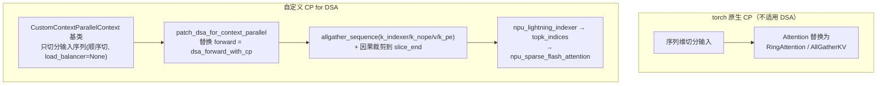

# 自定义 CP for DSA（DeepSeek-V3.2 长序列上下文并行）

## Summary

长序列训练用 **Context Parallel（CP）** 沿 Sequence 维切分输入，可大幅降低激活内存。但 DeepSeek-V3.2 的 **DSA**（[dsa](../../../inference/concepts/modules/dsa.md)：Lightning Indexer + Sparse Flash Attention 稀疏注意力）结构复杂、Attention 算子不再是 SDPA，**torch 原生 CP 不适用**。[torchtitan](../frameworks/torchtitan.md) 实践（torchtitan-npu 插件）中为 DSA 设计了自定义 CP：复用 torch 原生 CP 的「上下文环境 + 序列切分」骨架，但把 Attention forward patch 成 CP-aware 版本——**对 KV 做序列维 AllGather**，再因果裁剪到本 rank，从而让稀疏注意力计算正确。本页 FOCUS 在 `CustomContextParallelContext` 基类与 `dsa_forward_with_cp` 的真实实现。

## torch 原生 CP 与其局限

torch 原生 CP（`torch.distributed.tensor.experimental.context_parallel`）用一个上下文环境包裹模型训练 step，内部对模型输入做 sequence 轴切分，同时把 Attention 算子替换为 **RingAttention** 或 **AllGatherKV** 实现以确保计算正确。

<p align="center"></p>

<p align="center"><sub>图：torch 原生 CP 原理——上下文环境包裹训练 step、对模型输入做 sequence 轴切分，并将 Attention 算子替换为 RingAttention 或 AllGatherKV 以保证计算正确（<a href="https://gitcode.com/cann/cann-recipes-train/blob/d17909ef35e0eee1f5bc81189a12d2abebb0b4c2/docs/llm_pretrain/deepseek-v32_pre_train_optimization.md">DeepSeek-V3.2 预训练优化文档</a>·torch原生CP介绍）</sub></p>

DeepSeek-V3.2 与传统稠密注意力不同：其 **Lightning Indexer** 与 **DSA 稀疏注意力**在 CP 场景下都需对 Key/Value 处理，且 Attention 不再是 SDPA，因此 torch 原生 CP 的 SDPA-替换路径无法直接套用。torchtitan-npu 据此自定义了 patch 入口：当 `attention_type == "dsa"` 时改走 DSA 专用 CP。

针对 DSA 的自定义 CP **遵循 torch 原生 CP 的设计逻辑**：复用「上下文环境 + 序列切分」骨架，但把 Attention forward 替换为 CP-aware 版本——在 CP 场景下确保 `q_indexer`/`query` 与完整序列的 `k_indexer`、`key/value` 做过注意力，从而让 Lightning Indexer 与稀疏注意力的计算正确。

<p align="center"></p>

<p align="center"><sub>图：针对 DSA 的自定义 CP 原理——在遵循 torch 原生 CP 设计逻辑的基础上，为复杂稀疏注意力结构（Lightning Indexer + DSA 稀疏注意力、Attention 非 SDPA）重写 CP-aware 前向（<a href="https://gitcode.com/cann/cann-recipes-train/blob/d17909ef35e0eee1f5bc81189a12d2abebb0b4c2/docs/llm_pretrain/deepseek-v32_pre_train_optimization.md">DeepSeek-V3.2 预训练优化文档</a>·针对DSA的自定义CP）</sub></p>

```python
def apply_cp_to_attention_module(attention_modules, cp_mesh, attention_type, *,
                                 job_config=None, model_args=None, tp_mesh=None):
    if attention_type == "dsa":
        validate_dsa_converters(job_config=job_config)  # 要求 "npu_dsa" 在 converters 中
        from torchtitan_npu.distributed.context_parallel.dsa_cp import (
            patch_dsa_for_context_parallel)
        patch_dsa_for_context_parallel(cp_mesh=cp_mesh, model_args=model_args, tp_mesh=tp_mesh)
    elif attention_type == "ulysses":
        ...  # 走 ulysses_cp
    else:
        _orig_apply_cp_to_attention_module(...)  # 回落 torchtitan 原生
# torchtitan_npu/patches/distributed/custom_context_parallel.py
```

该函数 monkey-patch 了 `titan_cp.apply_cp_to_attention_module`，所以对上游零侵入。

## CustomContextParallelContext 基类：只切分输入序列

基类**只负责模型输入的序列切分**，前向计算的 CP 逻辑留给子类/patch。它薄封装 torch 原生 `context_parallel`，把 buffers / seq_dims 透传进去，并在 `@torch.no_grad()` 下进出：

```python
class CustomContextParallelContext:
    def __init__(self, mesh, *, buffers=None, buffer_seq_dims=None,
                 no_restore_buffers=None, load_balance=False):
        self._mesh = mesh
        self._buffers = buffers or []
        self._buffer_seq_dims = buffer_seq_dims or []
        ...

    @torch.no_grad()
    def __enter__(self):
        from torch.distributed.tensor.experimental import context_parallel
        self._ctx = context_parallel(self._mesh, buffers=self._buffers,
            buffer_seq_dims=self._buffer_seq_dims,
            no_restore_buffers=self._no_restore_buffers)
        self._ctx.__enter__()
        return self
# torchtitan_npu/patches/distributed/custom_context_parallel.py
```

> 设计意图：基类做**通用序列切分**，子类（这里是 DSA 的 `dsa_forward_with_cp`）只补「前向计算如何拿全序列 KV」的差异，可扩展到其它非 SDPA attention。

### 强制顺序切分（关闭 HeadTail load balancer）

输入切分还有一个关键约束：DSA CP 必须**顺序切分**序列，不能用 ring-attention 专用的 HeadTail 负载均衡（zigzag）切法，否则因果裁剪 `slice_end` 假设会被打破。torchtitan-npu 在 `post_dataloading_process` 上挂 hook，仅对 `deepseek_v32` 且开了 `enable_indexer_loss` 的目标，临时把 `context_parallel_load_balancer` 置 `None`：

```python
parallelism_cfg.context_parallel_load_balancer = None  # HeadTail 仅适用 ring-attention
# torchtitan_npu/patches/distributed/cp_input_sharding.py
```

## CP 版 DSA forward：对 KV 做序列维 AllGather

CP 场景需确保 `q_indexer`/`query` 分别与**完整序列**的 `k_indexer`、`key/value` 做过注意力。两种达成方式权衡如下：

| 方式 | 评价 |
|------|------|
| RingAttention 形式 | 需对 Indexer 与稀疏注意力都实现环式传递，开发复杂、不够灵活 |
| **对 KV 做序列维 AllGather** | 实现简单灵活；weight-absorb 模式下 KV 内存占用小、Indexer 中 key 内存也很小，AllGather 的内存代价完全可接受 |

最终实现的 `dsa_forward_with_cp` 仅在原版 forward 上增加 KV 的 AllGather 通信。先决条件是 **absorb 模式**（`num_head_kv == 1`），否则报错：

```python
if k.shape[1] != 1 or v.shape[1] != 1:
    raise NotImplementedError(
        "Only support num_head_kv == 1 in dsa forward under absorb mode.")
# torchtitan_npu/distributed/context_parallel/dsa_cp.py
```

CP 版 DSA forward **仅在原版 forward 上增加对 KV 的 AllGather 通信**：以使用 NPU 融合算子的 DSA 实现为例，先对序列切分后的本地 `k_indexer`/`k_nope`/`v`/`k_pe` 做序列维 AllGather 还原全序列、再按 cp_rank 因果裁剪，喂给 `npu_lightning_indexer` 选 TopK 与 `npu_sparse_flash_attention` 计算，整体计算逻辑如下图所示。

<p align="center"></p>

<p align="center"><sub>图：使用 NPU 融合算子的 DSA 在 CP 下的计算逻辑——对 KV（k_indexer/k_nope/v/k_pe）做序列维 AllGather 并因果裁剪，再走 Lightning Indexer → Sparse Flash Attention（<a href="https://gitcode.com/cann/cann-recipes-train/blob/d17909ef35e0eee1f5bc81189a12d2abebb0b4c2/docs/llm_pretrain/deepseek-v32_pre_train_optimization.md">DeepSeek-V3.2 预训练优化文档</a>·针对DSA的自定义CP）</sub></p>

### 步骤 1：AllGather k_indexer + 因果裁剪

先把序列切分后的本地 `k_indexer` 在 CP mesh 上 all_gather 成全序列，再按 cp_rank 因果裁剪到 `slice_end = s_local * (cp_rank+1)`——本 rank 只看得到自己及之前 rank 的 KV（rightDownCausal）。然后调 Lightning Indexer 选 TopK：

```python
k_indexer_global = allgather_sequence(k_indexer, self.cp_mesh)
cp_rank = dist.get_rank(group=self.cp_mesh.get_group())
s_local = k_indexer.shape[1]
slice_end = s_local * (cp_rank + 1)
k_indexer_causal = k_indexer_global[:, :slice_end, :, :]

ret = torch_npu.npu_lightning_indexer(
    q_indexer, k_indexer_causal, weights,
    actual_seq_lengths_query=None, actual_seq_lengths_key=None,
    layout_query="BSND", layout_key="BSND",
    sparse_count=index_topk, sparse_mode=3, return_value=False)
topk_indices = ret[0] if isinstance(ret, tuple) else ret
# torchtitan_npu/distributed/context_parallel/dsa_cp.py
```

> `return_value=False` 是为绕开 torch.compile / DTensor meta 路径的失败（源码 NOTE）。`sparse_mode=3` 即 rightDownCausal。

### 步骤 2：AllGather KV + Sparse Flash Attention

KV 同样 all_gather 后因果裁剪，喂给 `npu_sparse_flash_attention`，并带上 `topk_indices`。注意 `attention_mode=2`（MLA-absorb）、`return_softmax_lse=True`（训练态必须，供反向/KL Loss 用）：

```python
k_nope_global = allgather_sequence(k_nope, self.cp_mesh)
v_global      = allgather_sequence(v,      self.cp_mesh)
k_pe_global   = allgather_sequence(k_pe,   self.cp_mesh)

output, softmax_max, softmax_sum, *_ = torch_npu.npu_sparse_flash_attention(
    q_nope, k_nope_global[:, :slice_end, :, :], v_global[:, :slice_end, :, :],
    sparse_indices=topk_indices.to(torch.int32),
    actual_seq_lengths_query=actual_seq_len,        # 本 rank 的 q 长度
    actual_seq_lengths_kv=actual_seq_len_kv,        # = slice_end
    query_rope=q_pe, key_rope=k_pe_global[:, :slice_end, :, :],
    sparse_block_size=1, layout_query="BSND", layout_kv="BSND",
    sparse_mode=3, attention_mode=2,                # 2: MLA-absorb
    return_softmax_lse=True)                         # 训练态必须 True
# torchtitan_npu/distributed/context_parallel/dsa_cp.py
```

`q/k/v` 入口是 BNSD，函数内先 `transpose(1, 2)` 转 BSND，再按 `kv_lora_rank` / `qk_rope_head_dim` split 出 nope 与 pe 两路（pe 即 RoPE 分量），分别 all_gather。

### AllGather 的可微实现

`allgather_sequence` 默认走 **DTensor 模式**（`USE_DTENSOR_MODE=True`）：把本地张量声明为 `Shard(1)` 的 DTensor，`redistribute` 到 `Replicate()` 完成 all_gather，反向经 `Partial()` placement 自动变 reduce-scatter。非 DTensor 路径 `AllgatherOnSequence` 是等价的手写 autograd.Function——forward 用 `all_gather_into_tensor`、backward 用 `reduce_scatter_tensor`，并做 BSND↔SBND permute：

```python
def dtensor_allgather_sequence(tensor, mesh):
    dtensor = DTensor.from_local(tensor, mesh, placements=[Shard(1)])
    dtensor_global = dtensor.redistribute(mesh, placements=[Replicate()])
    return ToLocalWithPartialGrad.apply(dtensor_global, mesh)  # 反向 = reduce-scatter
# torchtitan_npu/distributed/context_parallel/dsa_cp.py
```



## patch 装配与 TP 协同

`patch_dsa_for_context_parallel` 把 `cp_mesh` / `model_args` / `tp_mesh` 绑到 DSA 类上，挂上 KL Loss 计算件，并把类的 `forward` 替换为 `dsa_forward_with_cp`：

```python
for cls in (DSASparseAttention, DSV32_SDPA):
    cls.cp_mesh = cp_mesh
    cls.tp_mesh = tp_mesh
    cls.compute_dsa_indexer_loss = SparseLightningIndexerKLLoss()
    cls.forward = dsa_forward_with_cp
# torchtitan_npu/distributed/context_parallel/dsa_cp.py
```

当同时开 TP 时，调 SLIG（KL Loss）前需把 TP-切分的头维 all_gather 回完整头数——SLIG 算子要求 `N ∈ {64, 128}`。`_allgather_on_dim(q_nope/q_pe, tp_mesh, dim=2)` 与 `softmax_max/sum`（dim=3）在 TP 域恢复全头；此路无需梯度，因 `LILossTrain.backward` 对 query 与 softmax_max/sum 返回 None。

## 与 DSA 训练反向算子配合

CP 前向产出的 `softmax_max/softmax_sum`（`return_softmax_lse=True`）与 `topk_indices` 喂给 `compute_dsa_indexer_loss`（`SparseLightningIndexerKLLoss`），由此衔接 DeepSeek-V3.2 训练侧的 DSA 反向融合算子（业界率先攻克）：

- **SLIG**（`SparseLightningIndexerGradKLLoss`）：Lightning Indexer 反向梯度 + 与 SFA softmax 对齐的 KL Loss 融合，含部分重计算与离散访存优化（A3 Cube:Vector=1:2，Vector 发访存指令 + srcGap 成对聚合）。
- **SFAG**（`SparseFlashAttentionGrad`）：Sparse Flash Attention 反向，沿用 FlashAttentionGrad 流程并针对离散访存做指令缩减与搬运聚合。

这些反向算子的正向对应件（LI / SFA）与推理侧共享，详见跨域链接。CP 因果裁剪保证传给 SLIG 的 `k_indexer_causal` / `k_nope_global[:, :slice_end]` 与本 rank 的 q 在因果范围内一致。

## CP 策略注册表 + Ulysses CP（torchtitan-npu @8f128cd 插件视角）

上面两节是 cann-recipes-train 文档对 DSA-CP 机制的深描。在 **torchtitan-npu** 插件（[torchtitan](../frameworks/torchtitan.md)）里，自定义 CP 被收敛成一个**策略注册表 + 自动匹配**框架，已注册两个自定义 CP——**SDPA Ulysses CP** 与 **DSA CP**——开 CP 时按 attention 模块类型**自动选择**，无需手动切换。

### 注册表：apply_cp_to_attention_module 自动匹配

`torchtitan_npu/distributed/context_parallel/registry.py` 维护一个 `(detector, applier)` 列表，CP 策略通过 `register_cp_strategy(detector, applier)` 注册。`context_parallel/__init__.py` 在导入时即 `from . import ... ulysses_cp, sparse_attention_cp`，触发各策略模块尾部的 `register_cp_strategy(...)` 完成自注册——**无需配置开关**。CP 开启时 `apply_cp_to_attention_module` 遍历 attention 模块，第一个命中的 detector 决定用哪种 CP，全不命中则报错：

```python
def apply_cp_to_attention_module(attention_modules, cp_mesh):
    for module in attention_modules:
        for detector, applier in _cp_strategies:
            if detector(module):
                applier(module, cp_mesh); break          # 第一个命中即应用
        else:
            raise NotImplementedError(
                f"No custom CP strategy found for module {type(module).__name__}.")
# torchtitan_npu/distributed/context_parallel/registry.py
```

调用方在 `models/deepseek_v32/parallelize.py`：`cp_enabled` 时先校验 converters 含 `npu_dsa`（否则 `NotImplementedError("...please add 'npu_dsa' to converters.")`），再对每层的 `block.attention.inner_attention` 应用 CP，传入 `parallel_dims.get_mesh("cp")`。

### SDPA Ulysses CP（ulysses_cp.py）

`UlyssesCP(ParallelStyle)` 为常用 SDPA 路径实现 Ulysses 风格 CP：注册一对 hook，在 `torch_npu` 融合 Attention 计算**前后插入 All-to-All**，把数据从「序列并行分布」换成「多头维度分布」，使每个计算节点拿到**完整上下文**。detector 命中 `ScaledDotProductAttention` 即装配，无需替换 forward（模块内部 BSND↔BNSD transpose 在 all-to-all 后形状自然正确）：

```python
def _pre_hook(module, args, kwargs, mesh):                 # scatter heads(2) → gather seq(1)
    q = all_to_all(args[0], mesh, scatter_dim=2, gather_dim=1)
    k = all_to_all(args[1], mesh, scatter_dim=2, gather_dim=1)
    v = all_to_all(args[2], mesh, scatter_dim=2, gather_dim=1)
    return (q, k, v, *args[3:]), kwargs
def _post_hook(module, args, output, mesh):                # 反向 all-to-all 还原输出
    return all_to_all(output, mesh, scatter_dim=1, gather_dim=2)
register_cp_strategy(_detect_ulysses, _apply_ulysses)      # _detect: isinstance(m, ScaledDotProductAttention)
# torchtitan_npu/distributed/context_parallel/ulysses_cp.py
```

`AllToAll` 是可微 `autograd.Function`：forward `chunk(scatter_dim) → dist.all_to_all → cat(gather_dim)`，backward 反向。

> 在 torchtitan-npu @8f128cd，DSA CP 落地为 `sparse_attention_cp.py` 的 `SparseAttentionCP(ParallelStyle)`（仅 pre-hook，detector 命中 `DSV32_SDPA`），用 `ft_c.all_gather_tensor_autograd` 对 `k`/`v`/`k_indexer` 沿序列维 AllGather 并按 `slice_end=(rank+1)*s_local` 因果裁剪——与上文 cann-recipes-train 描述的「AllGather KV + 因果裁剪」同构，只是改用注册表 + ParallelStyle 装配（前提同样是 `npu_dsa` converter 已把 forward 换成融合算子）。

### 配置面与自动选择

| 配置项 | 来源 | 默认 | 说明 |
|--------|------|------|------|
| `context_parallel_degree` | `ParallelismConfig`（基类字段） | 1 | >1 时启用 CP mesh |
| `context_parallel_load_balancer` | `ParallelismConfig`（NPU override） | `None` | NPU 覆写上游默认 `"headtail"`；`None` = 连续切分，对 Ulysses 最优（每 rank 已做等量全序列注意力），且避免 headtail 重排破坏因果 |

约束（`models/deepseek_v32/parallelize.py`）：

- **CP 仅支持 `attn_type="sdpa"` 入口**——`context_parallel_degree > 1` 且 `attn_type != "sdpa"`（FlexAttention / varlen 不支持）直接抛 `NotImplementedError("Context Parallel only supports SDPA attention")`；V3.2 借此 sdpa 入口再按 `npu_dsa` converter 在 CP 路径内自动改道 DSA CP。缺 sdpa 入口与缺 `npu_dsa` converter 是**两道独立闸门**（前者在 `parallelize.py` 直接拦，后者表现为 attention 模块命不中任何 detector）。
- `training.seq_len % parallel_dims.seq_len_divisor == 0`，断言信息明确 `seq_len` 须能被 **TP degree × 2 × CP degree** 整除。

CP 类型由框架按模型 + converter **自动选择**：

- **DeepSeek-V3** + `context_parallel_degree > 1` → **Ulysses CP**（SDPA 走 All-to-All 变换）。
- **DeepSeek-V3.2** + converters 含 `npu_dsa` + CP 开启 → **DSA CP**；若 V3.2 开 CP 但缺 `npu_dsa`，attention 模块命不中任何已注册 detector，并行化阶段抛 `NotImplementedError: No custom CP strategy found for module ...`。

```python
# torchtitan_npu/models/deepseek_v32/config_registry.py · deepseek_v32_671b_61layers_32k_128die（默认开 32k CP）
model_converters = ModelConvertersContainer.Config(
    converters=[get_model_converter_config("npu_dsa"), ...])
parallelism = ParallelismConfig(context_parallel_degree=8)
```

## Evidence

- [torchtitan-npu](https://gitcode.com/cann/torchtitan-npu) — [`docs/feature_guides/parallelism/custom_cp.md`](https://gitcode.com/cann/torchtitan-npu/blob/8f128cd177e9c9a14d9b70f4491bde28bc342481/docs/feature_guides/parallelism/custom_cp.md)（CP 策略注册表 + 自动匹配；SDPA Ulysses CP 与 DSA CP 两个自定义 CP；`context_parallel_degree` / `seq_len_divisor=TP*2*CP` 约束；自动选择规则）
- 代码核对（torchtitan-npu @8f128cd）：[`registry.py`](https://gitcode.com/cann/torchtitan-npu/blob/8f128cd177e9c9a14d9b70f4491bde28bc342481/torchtitan_npu/distributed/context_parallel/registry.py)（`register_cp_strategy` / `apply_cp_to_attention_module` 自动匹配、未命中 `NotImplementedError`）、[`ulysses_cp.py`](https://gitcode.com/cann/torchtitan-npu/blob/8f128cd177e9c9a14d9b70f4491bde28bc342481/torchtitan_npu/distributed/context_parallel/ulysses_cp.py)（`UlyssesCP` pre/post All-to-All、`AllToAll` 可微）、[`sparse_attention_cp.py`](https://gitcode.com/cann/torchtitan-npu/blob/8f128cd177e9c9a14d9b70f4491bde28bc342481/torchtitan_npu/distributed/context_parallel/sparse_attention_cp.py)（`SparseAttentionCP` AllGather K/V/k_indexer + 因果裁剪 `slice_end`）、[`config/configs.py`](https://gitcode.com/cann/torchtitan-npu/blob/8f128cd177e9c9a14d9b70f4491bde28bc342481/torchtitan_npu/config/configs.py)（`ParallelismConfig.context_parallel_load_balancer=None` NPU override）、[`models/deepseek_v32/parallelize.py`](https://gitcode.com/cann/torchtitan-npu/blob/8f128cd177e9c9a14d9b70f4491bde28bc342481/torchtitan_npu/models/deepseek_v32/parallelize.py)（`apply_cp_to_attention_module(block.attention.inner_attention...)`、`seq_len_divisor` 断言、`attn_type!="sdpa"` 时 `NotImplementedError("Context Parallel only supports SDPA attention")`、缺 `npu_dsa` 报错）
- 相关实践：[qwen3-sft-torchtitan](../../guides/recipes/qwen3_sft_torchtitan.md)（同 torchtitan-npu 框架的 SFT 实践，复用 CP/注册表装配）

## Evidence（cann-recipes-train 一手）

- [cann-recipes-train](https://gitcode.com/cann/cann-recipes-train/tree/d17909ef35e0eee1f5bc81189a12d2abebb0b4c2) — [`docs/llm_pretrain/deepseek-v32_pre_train_optimization.md`](https://gitcode.com/cann/cann-recipes-train/blob/d17909ef35e0eee1f5bc81189a12d2abebb0b4c2/docs/llm_pretrain/deepseek-v32_pre_train_optimization.md)（『自定义 CP 策略』节：torch 原生 CP 原理、RingAttention vs AllGather KV 取舍、CustomContextParallelContext 基类、weight-absorb 下 KV/Indexer key 内存可接受；DSA 融合算子 SLIG/SFAG）
- 代码核对（torchtitan-npu 插件）：[`torchtitan_npu/distributed/context_parallel/dsa_cp.py`](https://gitcode.com/cann/torchtitan-npu/blob/87221a1beaa55314a1cdb73460346ba3cec0b475/torchtitan_npu/distributed/context_parallel/dsa_cp.py)（`dsa_forward_with_cp`、`allgather_sequence`、`AllgatherOnSequence`、`_allgather_on_dim`、`patch_dsa_for_context_parallel`；op 实名 `torch_npu.npu_lightning_indexer` / `torch_npu.npu_sparse_flash_attention`，`attention_mode=2` absorb、`sparse_mode=3` 因果、`return_softmax_lse=True`）
- 代码核对：[`torchtitan_npu/patches/distributed/custom_context_parallel.py`](https://gitcode.com/cann/torchtitan-npu/blob/87221a1beaa55314a1cdb73460346ba3cec0b475/torchtitan_npu/patches/distributed/custom_context_parallel.py)（`CustomContextParallelContext` 基类、`apply_cp_to_attention_module` patch 分派、`validate_dsa_converters`/`validate_ulysses_configs`）、[`torchtitan_npu/patches/distributed/cp_input_sharding.py`](https://gitcode.com/cann/torchtitan-npu/blob/87221a1beaa55314a1cdb73460346ba3cec0b475/torchtitan_npu/patches/distributed/cp_input_sharding.py)（DSA CP 顺序切分，`context_parallel_load_balancer=None`）

## Links

- [deepseek-v32-pretrain](../../guides/recipes/deepseek_v32_pretrain.md)（自定义 CP 所属的预训练实践）
- [torchtitan](../frameworks/torchtitan.md)（CP 框架与 ModelConverter / `converters=["npu_dsa", ...]`）
- [torchtitan-5d-parallel](torchtitan_5d_parallel.md)（5D 并行原理枢纽：FSDP2+TP+PP+EP+CP，CP 为其中一维）
- [dsa](../../../inference/concepts/modules/dsa.md)（跨域：DSA 架构模式）
- [sparse-flash-attention](../../../inference/concepts/kernels/sparse_flash_attention.md)（跨域：SFA 正向算子，训练侧补 SFAG 反向；CP forward 调 `npu_sparse_flash_attention`）
- [lightning-indexer](../../../inference/concepts/kernels/lightning_indexer.md)（跨域：Lightning Indexer 正向算子，训练侧补 SLIG 反向；CP forward 调 `npu_lightning_indexer`）
- [context-parallel](../../../inference/concepts/parallelism/context_parallel.md)（跨域：推理侧 CP 基础定义）
- [slig](../kernels/slig.md)（CP 后与 Indexer 反向 SLIG 配合）
- [sfag](../kernels/sfag.md)（CP 后与 SFA 反向 SFAG 配合）
- [context-parallel-train](context_parallel_train.md)（MindSpeed 训练侧通用 CP 家族：DSA 专用 CP 之外的通用 Ulysses / Ring / Hybrid 实现，走 Megatron 栈）