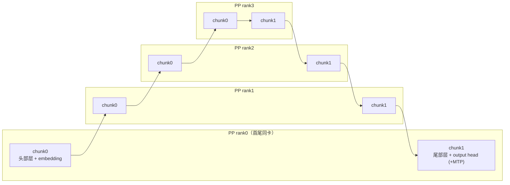

# DualPipeV（V 形双向流水 + Zero-Bubble dw 分离）

## Summary

DualPipeV 是 MindSpeed 面向 MoE 大模型训练的流水并行（PP）调度，脱胎自 DeepSeek **DualPipe**：从 PP 维只截取 DualPipe 的一半，再把每个 PP rank 的模型层二次切分成两个 chunk、令前向沿 rank 下行、回程沿 rank 上行，整体呈 **V 字排布**。这样既保留 DualPipe「一卡同时承载一前向 + 一反向 microbatch 互相掩盖 All2All/P2P 通信」的能力，又把 DualPipe 的**参数翻倍、启动规模翻倍**问题各砍掉一半。配合 `--moe-fb-overlap`（MoE 跨 microbatch 前反向通信掩盖）可在稳定阶段全掩盖专家 All2All。warmup/cooldown 阶段引入 **Zero-Bubble 的 dw（权重梯度）分离**进一步压缩气泡；MindSpeed 实现默认**取消 cooldown 阶段的 dw 分离**以压低重计算场景内存峰值，`--dualpipev-dw-detach` 可重新开启。V 字使首尾 stage 落同卡（PP rank0），天然亲和 MTP 且便于调 PP 负载均衡。开关为 `--schedules-method dualpipev`，约束模型层数为 `2·PP` 倍数、microbatch 数 ≥ `2·PP−1`，与 VPP/长序列 CP/异步 DDP/swap-attention/tp_2d/custom-fsdp 互斥。profiling 场景：DeepSeek-V3 671B、PP8 TP2 EP32。

## 从 DualPipe 到 DualPipeV

MoE 类模型长期受 All2All 通信耗时占比高、激活显存开销大两个问题困扰。DeepSeek 的 **DualPipe** 用「双向流水 + MoE 跨 microbatch 前反向通信掩盖」回应：让没有依赖关系的前向计算去掩盖反向产生的 All2All / P2P 通信，在稳定阶段实现 All2All 全掩盖，同时在空泡比率和 warmup 阶段激活显存上优于传统 1F1B。代价是**每张卡上的参数量翻倍**（双向各持一份），且算法启动规模也翻倍。

**DualPipeV** 的改法（[知乎讨论原文](https://zhuanlan.zhihu.com/p/26915547331)）：

- **PP 维截半**：只取 DualPipe 流水的一半，启动规模降为 DualPipe 的一半。
- **模型二次切分成 V 字**：在原 PP 切分基础上把每个 PP rank 再切成两个 model chunk，前向沿 rank 0→1→…→PP-1 下行进入 chunk0，到底后折返沿 PP-1→…→0 上行走 chunk1，流水时间线呈 V 形。由此单卡只需持有自己那两段 chunk 的参数，**消除 DualPipe 的冗余参数翻倍**。

V 字的关键结构后果：**首尾 stage 落在同一张卡（PP rank0）**——chunk0 持模型最前若干层 + embedding，chunk1 持模型最后若干层 + output head。这带来三个直接收益：embedding 与 lm head 同卡免去 embedding 梯度的跨 PP AllReduce；天然亲和 MTP（Multi-Token-Prediction，额外预测层挂在尾 stage）；首尾同卡便于灵活调整 PP 间负载均衡策略。

### V 字层映射

`get_transformer_layer_offset` 给出每张卡两个 chunk 的层偏移：每 rank 总层数先 `// PP` 再 `// 2`（`get_num_layers_to_build` 同样 `// 2`），chunk0（`dualpipev_first_chunk=True`）从头部正序取 `offset = rank · L_half`，chunk1（`dualpipev_first_chunk=False`）从尾部反序取 `offset = num_layers − (rank+1)·L_half`：

```python
num_layers_per_pipeline_rank = config.num_layers // config.pipeline_model_parallel_size // 2
if getattr(args, 'dualpipev_first_chunk', True):
    offset = pipeline_rank * num_layers_per_pipeline_rank            # chunk0：头部正序
else:
    offset = config.num_layers - (pipeline_rank + 1) * num_layers_per_pipeline_rank  # chunk1：尾部反序
# mindspeed/core/pipeline_parallel/dualpipev/dualpipev_chunks.py · get_transformer_layer_offset
```



embedding 与 output 同卡后，`_allreduce_embedding_grads` 被包成空操作（要求 `untie_embeddings_and_output_weights`，否则报错）；`dualpipev_fp16forward` 也据此把 `fp32→fp16` 只放在 chunk0（流水真正入口）、`fp16→fp32` 只放在 chunk1（真正出口）。

## 调度阶段分解

`generate_dualpipev_schedule(pp_size, num_microbatches)` 先把 microbatch 数 `×2`、把 `pp_size ×2`（V 字下每 rank 两个 chunk、每 microbatch 两个 stage），再为每个 rank 生成七个阶段的 stage 计数：

| 阶段 | 含义 |
|---|---|
| `warmup` | 纯前向预热，靠 P2P `send_forward_recv_forward` 串起流水；rank0 预热 stage 最多 |
| `interleaved_forward` | 交错前向：每单位一组 1f1f（两个 model chunk 各做一次前向） |
| `1b1w1f` | 1 反向 + 1 dw + 1 前向交替 |
| `overlap` | 稳定阶段：前反向并行，开 `--moe-fb-overlap` 后 All2All/P2P 被无依赖计算掩盖 |
| `1b1overlap` | 1 反向 + 1 overlap |
| `interleaved_backward` | 交错反向 |
| `cooldown` | 收尾反向；计数是三元组 `[i+1, pp_size−2i−2, i+1]` |

稳定（overlap）阶段是收益主体：相邻 microbatch 的前向计算与另一 microbatch 反向引发的专家 All2All、stage 间 P2P 在时间上重叠，从而被「没有依赖关系的计算」掩盖。跨 microbatch 前反向通信掩盖的机制本体见 [MoE 跨 microbatch 前反向通信掩盖文档](https://gitcode.com/Ascend/MindSpeed/blob/1432cb092818b870c31b61db0eb6d3378b7fbdad/docs/zh/features/megatron_moe/megatron-moe-fb-overlap.md)，由 `--moe-fb-overlap` 单独开启。

**warmup 尽量多 P2P 掩盖**：warmup 段除最后一步外都用 `send_forward_recv_forward` 把前向激活向下游发送、同时收上游激活（末步改用 `recv_forward` + 异步 `send_forward`），让 P2P 通信尽量与前向计算并行，压低预热段的串行气泡。

## Zero-Bubble 的 dw 分离

标准反向把激活梯度 dx 和权重梯度 dw 一次算完。**Zero-Bubble 思想**把 dw 从反向关键路径里拆出来延后计算（dx 决定下一 stage 能否继续，dw 不在依赖链上），从而用 dw 填补 warmup/cooldown 段的气泡。DualPipeV 的 warmup/cooldown 都可采用这种 dw 分离。

MindSpeed 用 `WeightGradStore` 承载分离：`start_decouple()` 置位 `is_decoupleBlock` 后，反向只算 dx、把 dw 计算入参缓存进队列；`flush_chunk_grad()` 把当前 chunk 的 dw 缓存推入 `weight_grad_queue`；`pop_single()` 在合适时机弹出并真正执行 dw 计算：

```python
if args.dualpipev_dw_detach:
    WeightGradStore.start_decouple()
# ... backward_step（仅算 dx，dw 入队）...
if args.dualpipev_dw_detach:
    WeightGradStore.end_decouple()
WeightGradStore.flush_chunk_grad()
if i >= schedule['cooldown'][rank][0] - 1:
    WeightGradStore.pop_single()           # 延后执行 dw
# mindspeed/core/pipeline_parallel/dualpipev/dualpipev_schedules.py · forward_backward_pipelining_with_cutinhalf（cooldown）
```

### cooldown 默认取消 dw 分离

cooldown 阶段，PP 尾卡会**连续计算 `PP_size` 个反向 stage**；在对应 dw 计算完成前，这些 stage 的激活值无法完全释放。重计算（recompute）等内存敏感场景下，这会把 cooldown 段的**峰值内存大幅拉高**。因此 MindSpeed 实现**默认取消 cooldown 阶段的 dw 分离**——以较小的性能代价（让 dw 回到反向关键路径、气泡略增）换取重计算场景下显著更低的内存峰值。

`--dualpipev-dw-detach`（`action='store_true'`，help: *detach dw in cooldown to reduce bubble*）按需重新开启 cooldown 的 dw 分离；开启后 cooldown 用 `WeightGradStore.start_decouple/end_decouple` 包住反向、把 dw 延后，气泡更小但内存峰值更高。两种取舍按场景择一。warmup 段的 dw 分离不受此开关影响。

## 流水气泡对比

不同流水排布的气泡（F=前向、B=反向、W=权重梯度 dw、`F&B`=前反向并行段、v=VPP 虚拟阶段数、PP=流水级数）：

| 流水策略 | 气泡 |
|---|---|
| 1F1B | `(PP−1)·(F+B)` |
| VPP | `(PP−1)·(F+B)/v` |
| DualPipeV | `(PP−1)·(F&B+B−W)−F` |

DualPipeV 把前反向并入 `F&B`、并把 dw（`W`）从关键气泡里减去，再扣掉一段前向 `F`，气泡相对 1F1B / VPP 进一步收窄。

## 配置与约束

启动脚本开关：

- `--schedules-method dualpipev`：开启 DualPipeV 流水排布（`choices=['dualpipev']`）。
- `--moe-fb-overlap`：额外开启 MoE 跨 microbatch 前反向通信掩盖（稳定阶段掩盖 All2All 的关键，需与 DualPipeV 组合才发挥）。
- `--dualpipev-dw-detach`：额外开启 cooldown 阶段 dw 分离（默认关）。

`validate_args` 强约束：

- 模型层数 `num_layers ≥ 2·PP`（即应设为 `2·PP` 的倍数以均分两个 chunk）。
- 每 PP 组 microbatch 数 `≥ 2·PP − 1`（官方文档建议设为 `≥ 2·PP`）。
- `pipeline_model_parallel_size > 1`。
- 必须 `untie_embeddings_and_output_weights`（首尾同卡，embedding 与 lm head 不再共享、无需 embedding 梯度 AllReduce）。
- 与以下特性**互斥**：VPP（`num_layers_per_virtual_pipeline_stage`）、长序列并行 / CP（`context_parallel_size > 1`）、异步 DDP（`overlap_grad_reduce`）、`swap_attention`、`tp_2d`、`use_custom_fsdp`、`use_multiparameter_pipeline_model_parallel`、`--pipeline-model-parallel-layout`。

## 性能与内存的场景依赖

- **性能**：MoE 场景 All2All 过长拖累性能时，DualPipeV + `--moe-fb-overlap` 可掩盖 All2All 取得提速；但 MoE 严重负载不均时，DualPipeV 可能加剧 PP 负载不均反而劣化——需按场景实测。
- **内存**：output head 被分配到 PP rank0，会同时抬高静态与动态内存，峰值可能上升；但若模型后 N 层为空层，由于尾 stage 落在 rank0，开启后峰值内存反而下降。内存变化需具体分析。

profiling 取证场景：DeepSeek-V3 671B 模型、`PP8 TP2 EP32` 下采集的 PP 通信组 profiling（图见官方文档）。

## Evidence

- [mindspeed](https://gitcode.com/ascend/MindSpeed) — [`docs/zh/features/dualpipev.md`](https://gitcode.com/Ascend/MindSpeed/blob/1432cb092818b870c31b61db0eb6d3378b7fbdad/docs/zh/features/dualpipev.md)（背景与挑战 / DualPipe→DualPipeV 解决方案 / warmup-cooldown dw 分离 / 气泡对比表 / 使用方法与约束 / 使用效果与内存场景分析；含 `dualpipev.png`（PP4×10 microbatch 流水时间线）、`dualpipev_dw_detach.png`（开 dw 分离后的流水时间线）、`dualpipev_profiling.png`（DeepSeek-V3 671B PP 通信组 profiling）三张图）
- [`docs/zh/features/megatron_moe/megatron-moe-fb-overlap.md`](https://gitcode.com/Ascend/MindSpeed/blob/1432cb092818b870c31b61db0eb6d3378b7fbdad/docs/zh/features/megatron_moe/megatron-moe-fb-overlap.md)（`--moe-fb-overlap` 跨 microbatch 前反向通信掩盖机制本体）
- [`mindspeed/core/pipeline_parallel/dualpipev/dualpipev_schedules.py`](https://gitcode.com/Ascend/MindSpeed/blob/1432cb092818b870c31b61db0eb6d3378b7fbdad/mindspeed/core/pipeline_parallel/dualpipev/dualpipev_schedules.py) — `generate_dualpipev_schedule`（七阶段计数、microbatch×2 / pp_size×2、cooldown 三元组）、`forward_backward_pipelining_with_cutinhalf`（warmup P2P 掩盖、overlap 稳定段、cooldown `dualpipev_dw_detach` 分支、`WeightGradStore` 流转）
- [`mindspeed/core/pipeline_parallel/dualpipev/dualpipev_chunks.py`](https://gitcode.com/Ascend/MindSpeed/blob/1432cb092818b870c31b61db0eb6d3378b7fbdad/mindspeed/core/pipeline_parallel/dualpipev/dualpipev_chunks.py) — `get_transformer_layer_offset`（V 字 chunk0 正序 / chunk1 反序）、`get_num_layers_to_build`（每 rank `//2`）、`dualpipev_fp16forward`、`_allreduce_embedding_grads_wrapper`（首尾同卡免 embedding AllReduce）
- [`mindspeed/features_manager/pipeline_parallel/dualpipev_feature.py`](https://gitcode.com/Ascend/MindSpeed/blob/1432cb092818b870c31b61db0eb6d3378b7fbdad/mindspeed/features_manager/pipeline_parallel/dualpipev_feature.py) — `--schedules-method` / `--dualpipev-dw-detach` 参数注册、`validate_args` 全部互斥与层数 / microbatch 约束、patch 注入点
- [`mindspeed/core/transformer/moe/moe_feature/fb_overlap/modules/weight_grad_store.py`](https://gitcode.com/Ascend/MindSpeed/blob/1432cb092818b870c31b61db0eb6d3378b7fbdad/mindspeed/core/transformer/moe/moe_feature/fb_overlap/modules/weight_grad_store.py) — `WeightGradStore`（`is_decoupleBlock` / `start_decouple` / `end_decouple` / `flush_chunk_grad` / `pop_single`）dw 分离队列

## Links

- [pipeline-parallel-advanced](pipeline_parallel_advanced.md)（PP 进阶调度全景：1F1B / VPP / Zero-Bubble，DualPipeV 是其 MoE 双向流水分支）
- [mindspeed](../frameworks/mindspeed.md)（DualPipeV 所在框架；以 features_manager patch 注入 Megatron 调度）
- [torchtitan-5d-parallel](torchtitan_5d_parallel.md)（跨框架对照：TorchTitan 侧未来计划接入 DualPipeV，但 torch 原生 dW 约束使其当前无法与 FSDP/ZeRO3 同用）
- [fsdp](fsdp.md)（互斥关系：DualPipeV 与 `use_custom_fsdp` 不兼容，PP 重叠掩盖与 FSDP 零冗余权重是两条不同显存路线）
- [moe-comm-overlap](../techniques/moe_comm_overlap.md)（DualPipeV 全掩盖依赖的 MoE 跨 microbatch 前反向通信掩盖 `--moe-fb-overlap`）

<!-- cannbot:related:start -->
## 相关

- [FSDP2（Fully Sharded Data Parallel 2）](fsdp.md)（`related`）：“- 与以下特性**互斥**：VPP（`num_layers_per_virtual_pipeline_stage`）、长序列并行 / CP（`context_parallel_size > 1`）、异步 DDP（`overlap_grad_reduce`）、`swap_attention`、`tp_2d`、`use_custom_fsdp`、`use_multiparameter_pipeline_model_parallel`、`--pipeline-model-parallel-layout`。”明确给出左端事实；“- **DualPipeV**（MoE 大模型高效 PP 调度，脱胎自 DeepSeek DualPipe）当前**无法**与 ZeRO3 DP 切分同时使能——torch 原生 dW 计算约束权重 W 不能在 DP 域保持切分；后续需适配以同时拿内存与性能收益。”明确给出右端事实。两端共同约束 DualPipeV 与全分片数据并行的组合：一端给出 custom-fsdp 互斥开关，另一端解释 torch dW 对 ZeRO3/FSDP 并用的限制及包装层差异。
- [MoE 通信掩盖（Dispatch 调度 + AllToAll/AllGather Overlap + 前反向跨 MicroBatch 掩盖）](../techniques/moe_comm_overlap.md)（`related`）：“配合 `--moe-fb-overlap`（MoE 跨 microbatch 前反向通信掩盖）可在稳定阶段全掩盖专家 All2All。”明确给出左端事实；“- **跨 microbatch 前反向掩盖**（`--moe-fb-overlap`）：用「无依赖的前向计算掩盖反向产生的 All2All、用反向计算掩盖前向 All2All」，配合 dw/dx 分离，在 1F1B 稳定阶段做到 All2All **100% 掩盖**。这是 ［dualpipev］(../parallelism/dualpipev.md) 稳定阶段全掩盖专家 All2All 的机制本体。”明确给出右端事实。DualPipeV 提供双向流水载体，MoE 通信页解释该开关如何以跨 microbatch 前反向计算和 WeightGradStore 掩盖 All2All。
- [Swap Attention（激活换出 Host + SmartSwap + 自适应内存）](../techniques/swap_attention.md)（`related`）：三者都是「显存 ↔ 算力/带宽」取舍的不同自动化程度，解决同一问题、通常择一启用（其中 swap-attention 与自适应内存有显式互斥校验，详见各节），且都与重计算特性配合或二选一。；开关为 `--schedules-method dualpipev`，约束模型层数为 `2·PP` 倍数、microbatch 数 ≥ `2·PP−1`，与 VPP/长序列 CP/异步 DDP/swap-attention/tp_2d/custom-fsdp 互斥。profiling 场景：DeepSeek-V3 671B、PP8 TP2 EP32。；目标给出 DualPipeV 与 swap-attention 的显式互斥，直接约束同一训练配置的合法组合。
<!-- cannbot:related:end -->
