# FSDP2（Fully Sharded Data Parallel 2）

## Summary

FSDP2 是 PyTorch 分布式训练的核心数据并行演进方案（ZeRO-3 同源思想）：在每个前向/反向计算步骤中**按需全量收集（AllGather）**被切分到各设备的参数，计算完成后立即**重新切分（reshard）**释放非本设备参数，从而压低参数 / 梯度 / 优化器状态的驻留显存。FSDP2 基于 **DTensor** 构建，比 FSDP1 提供更细粒度的通信控制，统一分片管理参数、梯度与优化器状态，并原生适配混合精度与 [torchtitan](../frameworks/torchtitan.md) 的自动化切分配置。相较 FSDP1，FSDP2 在分片粒度、通信重叠与内存复用上深度优化：采用逐层（layer-wise）收集与释放机制，让每层的 AllGather 通信与上一层计算相互掩盖，形成高效流水。

<p align="center"></p>
<p align="center"><sub>图：FSDP2 按需 AllGather / 计算后立即 reshard 的逐层流程（<a href="https://gitcode.com/cann/cann-recipes-train/blob/d17909ef35e0eee1f5bc81189a12d2abebb0b4c2/docs/llm_pretrain/deepseek-v32_pre_train_optimization.md">DeepSeek-V3.2 预训练优化文档</a>·内存优化 / FSDP2 流程与特点）</sub></p>

在 DeepSeek-V3.2 的 **64 卡 Atlas A3** 极致显存部署里，FSDP2 是关键支撑：TorchTitan 当前以 FP32 存权重，671B 模型权重+梯度即占 **5368GB**，超过 32 卡 A3 的总内存 4096GB，故 64 卡是部署的最小规模——FSDP2 把 Attention/共享专家这类卡间冗余权重以 DP 域为单位二次分片，是把单卡显存压进 A3 容量的核心手段。`parallelize_deepseekv32` 对此显式约束：FSDP 未开则混合精度训练直接报错。

```python
assert (
    parallel_dims.fsdp_enabled
), "Mixed precision training for deepseek_v32 is only supported when fsdp is enabled. "
# torchtitan_npu/models/deepseek_v32/infra/parallelize.py
```

## 在 parallelize.py 中如何 apply FSDP2

FSDP2 在 5D 并行（FSDP2+TP+PP+EP+CP）流水线**最后一步**应用——TP / CP / MoE-EP-TP / 激活重计算 / torch.compile 都先行，FSDP 作为最外层对剩余复制维度做分片。关键在于它构造**两套 DP mesh**：非 MoE 参数沿 `fsdp` 维分片，MoE 专家参数沿独立的 `efsdp`（EP 内剩余 DP）维分片。

```python
dp_mesh: DeviceMesh | None = None
if parallel_dims.fsdp_enabled or parallel_dims.ep_enabled:
    # apply FSDP or HSDP, potentially with Context Parallel
    dp_mesh_names = (
        ["dp_replicate", "fsdp"] if parallel_dims.dp_replicate_enabled else ["fsdp"]
    )
    dp_mesh = parallel_dims.get_mesh(dp_mesh_names)

    # the mesh dim names of which the MoE params are sharded on via FSDP/HSDP
    edp_mesh_names = (
        ["dp_replicate", "efsdp"] if parallel_dims.dp_replicate_enabled else ["efsdp"]
    )
    edp_mesh = parallel_dims.get_optional_mesh(edp_mesh_names)

    apply_fsdp(
        model,
        dp_mesh,
        param_dtype=TORCH_DTYPE_MAP[job_config.training.mixed_precision_param],
        reduce_dtype=TORCH_DTYPE_MAP[job_config.training.mixed_precision_reduce],
        pp_enabled=parallel_dims.pp_enabled,
        cpu_offload=job_config.training.enable_cpu_offload,
        reshard_after_forward_policy=job_config.parallelism.fsdp_reshard_after_forward,
        ep_degree=parallel_dims.ep,
        edp_mesh=edp_mesh,
        gradient_divide_factor=parallel_dims.fsdp_gradient_divide_factor,
    )
# torchtitan_npu/models/deepseek_v32/infra/parallelize.py
```

要点：

- **`apply_fsdp` 复用 llama4 实现**（`from torchtitan.models.llama4.infra.parallelize import apply_fsdp`，实现体在上游 torchtitan 包内）：按 TorchTitan 标准做法逐层对每个 TransformerBlock 调用 PyTorch 的 `fully_shard`，并对 MoE 专家用 `edp_mesh` 单独分片；`parallelize_deepseekv32` 侧只负责把正确的 mesh / dtype / policy 喂进去。
- **`dp_replicate_enabled` 决定 FSDP 还是 HSDP**：纯分片时 mesh 名只有 `["fsdp"]`；叠加副本维 `dp_replicate` 后变成 2D mesh `["dp_replicate", "fsdp"]`，即 HSDP（分片域内分片、副本域间复制）。
- **`param_dtype` / `reduce_dtype`** 来自 `training.mixed_precision_param/reduce`——AllGather 用低精度参数，梯度 ReduceScatter 可用更高精度，这是 FSDP2 原生混合精度通路。
- **`ep_degree` + `edp_mesh`**：MoE 专家已被 `apply_moe_ep_tp` 沿 EP 维切分，FSDP 只在 EP 之外的剩余 DP 维（`efsdp`）对专家做二次分片，避免与 EP 分片冲突。
- 若 `fsdp` 与 `ep` 都未开但有 `dp_replicate`，则回落到 `apply_ddp`（纯数据并行复制，不分片）。

## 并行度配置（671B / 61 层 / 32K / 128 die）

`deepseek_v32_671b_61layers_32k_128die.toml` 的 `[parallelism]` 段定义实际切分度。`data_parallel_shard_degree = -1` 表示 FSDP 分片度由「总卡数 ÷ 其它并行维乘积」自动推导填满；`fsdp_reshard_after_forward = "always"` 强制前向后立即 reshard 以最省显存（`default` / `never` / `always` 三档语义见下文）。

```toml
[parallelism]
data_parallel_replicate_degree = 1
data_parallel_shard_degree = -1
fsdp_reshard_after_forward = "always" # default / never / always
tensor_parallel_degree = 4
enable_async_tensor_parallel = false
pipeline_parallel_degree = 1
pipeline_parallel_schedule = "Interleaved1F1B"
expert_parallel_degree = 64
expert_tensor_parallel_degree = 1
context_parallel_degree = 8
enable_custom_context_parallel = true
# torchtitan_npu/models/deepseek_v32/train_configs/deepseek_v32_671b_61layers_32k_128die.toml
```

配套 `[training]` 用 `local_batch_size = 1`、`seq_len = 32768`，`[activation_checkpoint] mode = "full"`，并在 `[optimizer]` 开 `swap_optimizer = true` / `swap_optimizer_times = 16`（见下文）。`fsdp_reshard_after_forward` 三档语义：`always`（每层前向后都 reshard，最省显存）/ `never`（保留 unshard 参数，省一次反向 AllGather）/ `default`（最后一层不 reshard）。

> 该 32K 配置 TP4 × EP64 × CP8、PP1，DP 分片度自动填满；源文档「最小化切分策略」节在权衡 MoE 极端负载不均后，整体选择以 **PP2TP4EP64** 为基础的切分（与单份 toml 取值可不同，并列保留）。

## 零冗余权重（二次分片机制）

MoE「大 EP 小 TP」部署下，占主参数量的 MoE 部分已被 EP+PP 完全切分、各专家权重无冗余散布；但 **Attention / 共享专家** 权重在 TP 域外、跨 DP 卡间冗余复制。FSDP2 把这些冗余权重以 **DP 域为单位二次分片**，计算逻辑不变（unshard 后等价），却消去跨 DP 域的副本——这正是上文 `dp_mesh`（非 MoE）与 `edp_mesh`（MoE）两套 mesh 的目的。在此类混合并行导致局部参数冗余的场景下，FSDP2 的二次分片优势尤为突出：保持计算逻辑不变的前提下显著削减跨 DP 域的参数副本数，为更大批量 / 更长序列训练释放显存。

<p align="center"></p>
<p align="center"><sub>图：TP / EP / FSDP 下 Attention 与共享专家权重按 DP 域二次分片，消除跨 DP 卡间冗余副本（<a href="https://gitcode.com/cann/cann-recipes-train/blob/d17909ef35e0eee1f5bc81189a12d2abebb0b4c2/docs/llm_pretrain/deepseek-v32_pre_train_optimization.md">DeepSeek-V3.2 预训练优化文档</a>·内存优化 / 零冗余权重）</sub></p>

> 以 PP2TP4DP16 为例：单卡非 MoE 权重 + 梯度约 `(671B − 654B)/PP2/TP4 × 8Byte ≈ 18GB`（部分权重如 `qkv_a` / `indexer` 不参与 TP 切分，实际更高）；DP16 开启 FSDP 后权重与梯度在 DP 域间完全均分，几乎消除该占用。


## Layer-wise 预取掩盖（A3 超节点）

FSDP2 的**权重预取（Weight Prefetching）**配合 Atlas A3 超节点的高带宽互联实现计算-通信全掩盖。基于 DTensor，NPU 上实现了**确定性的层间流水**：计算流执行第 N 层 Transformer Block 时，通信流已异步发起第 N+1 层的 AllGather 预聚合全量参数；同时第 N 层算完即 reshard 回各卡释放显存。

```mermaid
gantt
  dateFormat X
  axisFormat %L
  section 计算流
  计算第 N 层    :0, 2
  计算第 N+1 层  :2, 2
  section 通信流
  预取 AllGather 第 N+1 层 :0, 2
  预取 AllGather 第 N+2 层 :2, 2
```

<p align="center"></p>
<p align="center"><sub>图：FSDP2 权重预取的 AllGather 几乎被 Device 计算完全覆盖（Profiling）（<a href="https://gitcode.com/cann/cann-recipes-train/blob/d17909ef35e0eee1f5bc81189a12d2abebb0b4c2/docs/llm_pretrain/deepseek-v32_pre_train_optimization.md">DeepSeek-V3.2 预训练优化文档</a>·FSDP2+Torch.compile+inductor / A3 超节点预取掩盖）</sub></p>



掩盖前提是**通信耗时短于计算耗时**——纯软件预取不充分，若通信延迟远大于计算时间流水仍阻塞。A3 高吞吐、低延迟的卡间互联把 AllGather 耗时压进计算窗口：实测权重预取的 `All_gather` 通信几乎被 Device 侧计算完全覆盖，流水线呈现极高紧凑度。源文档将之归为软硬协同——软件侧 FSDP2 异步预取把通信精确调度到计算间隙，硬件侧 A3 大带宽确保通信在计算窗口内完成。

## Swap Optimizer（与 FSDP2 协同省显存）

AdamW 需存两个 FP32 动量，前反向计算期间优化器闲置却长驻 device 内存。本实践参考 MindSpeed 的 SwapOptimizer 特性，在 TorchTitan 下实现：前反向期间把优化器卸载至 host 内存，并以 param 为粒度把「加载—更新—卸载」做成切片流水并行以压更新峰值。配置即 `[optimizer] swap_optimizer = true / swap_optimizer_times = 16`。与 MindSpeed 不同处：TorchTitan 只管理两个 FP32 动量，且需处理权重为 **DTensor** 的场景（与 FSDP2 分片状态耦合）。A3 高速 H2D 带宽是该 swap 能掩盖的硬件前提。

## DeepSeek-V4：纯 FSDP+EP 极简切分（去 TP/PP）

与 V3.2 的 5D 乐高（TP4×EP64×CP8×FSDP，见 [torchtitan-5d-parallel](torchtitan_5d_parallel.md)）不同，DeepSeek-V4-Flash（[deepseek-v4-continue-pretrain](../../guides/recipes/deepseek_v4_continue_pretrain.md)）在 64 卡 A3 续训练中**彻底去掉 TP 与 PP**，只保留 **纯 FSDP128 + 大 EP128** 两维——这是 FSDP 在混合精度 + A3 超节点高带宽下的激进应用。切分配置（源文档，64 卡）：

| TP | PP | VPP | EP | FSDP | MBS | GBS | 集群 |
|----|----|-----|----|------|-----|-----|------|
| 1 | 1 | 1 | 128 | 128 | 1 | 1024 | 64 卡 |

### 内存收益：EP 切分后非专家参数成为新瓶颈

MoE 路由专家权重占绝对主导，但**经 EP 切分后，非专家权重（Attention / 共享专家 / 词嵌入 / 词表投影）单卡占比反而飙升**。以 V4-Flash（总参 285B、非专家 8B、专家 277B，混合精度 4 字节）：

| FSDP | DP | EP | 非专家权重+梯度 | 专家权重+梯度 | 非专家内存占比 |
|------|----|----|----------------|--------------|---------------|
| 1 | 128 | 1 | 59.5GB | 2060GB | 2.8% |
| 1 | 128 | 128 | **59.5GB** | 16GB | **80%** |
| 128 | 1 | 128 | **0.465GB** | 16GB | 2.8% |

仅开 EP128 时专家权重压到 16GB，但 59.5GB 非专家权重原封不动、占到 80%（超 A3 单卡 64GB）。对非专家也做 FSDP128 分片后，单卡权重内存仅约 8~9GB（几乎只剩 EP 切分后的路由专家权重）。

<p align="center"></p>
<p align="center"><sub>图：FSDP vs TP/PP——FSDP 通信在独立流上异步并发、被计算掩盖；TP/PP 通信耦合在关键路径上无法掩盖（<a href="https://gitcode.com/cann/cann-recipes-train/blob/d17909ef35e0eee1f5bc81189a12d2abebb0b4c2/docs/llm_pretrain/deepseek-v4_torchtitan_npu_autofuse.md">DeepSeek-V4 优化文档</a>·极简分布式并行优化）</sub></p>

### 性能：FSDP 通信被计算完全掩盖，TP/PP 不能

> FSDP 通信数据不依赖当前层中间计算结果，可下发至独立通信流与前向/反向异步并发；借助 A3 超节点高带宽，**实测 FSDP 通信开销可被计算完全掩盖**。

反观 TP/PP：通信与计算关键路径耦合无法掩盖（即便 TP2 极小通信域仍有可观开销），PP 流水气泡随通信域增大而增加。所以 FSDP 既能像 TP 把非专家权重压到接近零，又不付暴露在关键路径的通信代价——这是 V4 敢用激进 FSDP128 的根因（对比 V3.2 在 FP32 + 较小通信域下仍保留 TP4 的取舍）。

<p align="center"></p>
<p align="center"><sub>图：FSDP 原理——前向 AllGather 按需收集参数、后向 ReduceScatter 同步梯度，通信与计算重叠（<a href="https://gitcode.com/cann/cann-recipes-train/blob/d17909ef35e0eee1f5bc81189a12d2abebb0b4c2/docs/llm_pretrain/deepseek-v4_torchtitan_npu_autofuse.md">DeepSeek-V4 优化文档</a>·FSDP 简介）</sub></p>

### 易用性：DSA Indexer head 维 ReduceSum 不可直接 TP 切

V4 注意力继承 V3.2 DSA，其 **Indexer 前向与 Loss 都涉及 head 维 ReduceSum**，语义上无法沿 head 维直接 TP 切（强切需额外引入 AllGather 保证正确性）。FSDP 则**模型结构无感**：前反向总能拿到完整单层权重，各 DP rank 计算无差异，适配仅需一行 `fully_shard`。

<p align="center"></p>
<p align="center"><sub>图：DSA Indexer 沿 head 维 ReduceSum，强行 TP 切须额外 AllGather（<a href="https://gitcode.com/cann/cann-recipes-train/blob/d17909ef35e0eee1f5bc81189a12d2abebb0b4c2/docs/llm_pretrain/deepseek-v4_torchtitan_npu_autofuse.md">DeepSeek-V4 优化文档</a>·易用性优势）</sub></p>

V4 的 `parallelize_deepseek_v4` 装配直接体现：`tp=1` 时 `apply_non_moe_tp` 整段跳过，MoE 分支因 `tp_mesh is None` 走纯 `ExpertParallel()`：

```python
# torchtitan_npu/models/deepseek_v4/infra/parallelize.py — apply_moe_ep_tp
experts_mesh, experts_plan = None, None
if ep_mesh is None:
    experts_mesh = tp_mesh; experts_plan = TensorParallel()
elif tp_mesh is None or etp_mesh is None:          # V4 走这条：tp_mesh is None
    experts_mesh = ep_mesh
    experts_plan = ExpertParallel()                # 纯 EP，沿 ep_mesh 切，无 TP 冗余
parallelize_module(transformer_block.moe.experts, device_mesh=experts_mesh,
                   parallelize_plan=experts_plan)
```

`apply_fsdp` 用两个分片域：`dp_mesh(fsdp)` 切非专家、`edp_mesh(efsdp)` 切已过 EP 的专家——这就是 FSDP128 与 EP128 在同一组 128 DIE 上叠加切分的网格分解（与上文 V3.2 的 `dp_mesh`/`edp_mesh` 同构，区别仅在 V4 无 TP）。

### 双通信域 overlap（FSDP/EP 共享 ProcessGroup bug）

FSDP128 与 EP128 的设备集合都与全局默认通信域相同，PyTorch 为两者分配**同一个 ProcessGroup**，导致 FSDP 的 AllGather/ReduceScatter 与 EP 的 AllToAll 被迫串行——原本被计算掩盖的 FSDP 通信被推回 EP 关键路径。

<p align="center"></p>
<p align="center"><sub>图：bug——FSDP 与 EP 共享 ProcessGroup 串行等待，FSDP 通信暴露到 EP 关键路径（<a href="https://gitcode.com/cann/cann-recipes-train/blob/d17909ef35e0eee1f5bc81189a12d2abebb0b4c2/docs/llm_pretrain/deepseek-v4_torchtitan_npu_autofuse.md">DeepSeek-V4 优化文档</a>·双通信域 overlap 优化）</sub></p>

修复：初始化阶段对 EP 通信域**独立标注**，FSDP 与 EP 各持 ProcessGroup、在不同 HCCL 流并发。MoE 层通信等待由最长 10ms 降至 ~3ms，带来 **1.1%** 性能提升（已反馈 PyTorch/TorchTitan 上游）。

<p align="center"></p>
<p align="center"><sub>图：bugfix——独立标注 EP 通信域后两域各持 ProcessGroup 并发，恢复 FSDP 通信被计算掩盖（<a href="https://gitcode.com/cann/cann-recipes-train/blob/d17909ef35e0eee1f5bc81189a12d2abebb0b4c2/docs/llm_pretrain/deepseek-v4_torchtitan_npu_autofuse.md">DeepSeek-V4 优化文档</a>·双通信域 overlap 优化）</sub></p>

### V3.2 5D vs V4 极简切分对照

| 维度 | V3.2 预训练 | V4-Flash 续训练 |
|------|-------------|-----------------|
| 切分形态 | 5D 乐高 TP4×EP64×CP8×FSDP（PP1） | 极简 FSDP128 + EP128（TP/PP=1） |
| TP | 非 MoE TP4 + 共享专家 TP | 全去 TP（DSA head-sum 不可切 + 通信耦合） |
| 权重精度 | FP32（671B/5368GB，64 卡最小规模） | 混合精度 4 字节，FSDP128 把非专家压到 ~0.465GB |
| 关注点 | DTensor sharding / MoE TP 通信重排 | 双通信域 overlap / SwapOptimizer 卸载 |
| 吞吐 | 148 TPS/卡 | 1100 tokens/p/s（融合算子 + AutoFuse 协同后） |

> V4 续训内存进一步用 Swap Optimizer 把常驻从 **16 字节/参数**（权重 4 + 梯度 4 + 优化器 8）压到 **8 字节/参数**（仅权重 + 梯度，近乎减半），机制详见 [swap-optimizer](../techniques/swap_optimizer.md)。

## 与 ZeRO / DualPipeV / DDP 的关系

- FSDP2 与 **ZeRO-3** 同属「参数 + 梯度 + 优化器状态全分片」思路；DeepSeek-V3.2 实践中以 FSDP2 承担 DP 维度的二次分片。
- **DualPipeV**（MoE 大模型高效 PP 调度，脱胎自 DeepSeek DualPipe）当前**无法**与 ZeRO3 DP 切分同时使能——torch 原生 dW 计算约束权重 W 不能在 DP 域保持切分；后续需适配以同时拿内存与性能收益。
- 当 `fsdp`/`ep` 均未启用、仅 `dp_replicate` 时，`parallelize_deepseekv32` 回落到 **DDP**（`apply_ddp`，纯复制不分片，且不支持 >1D 并行）。

## MindSpeed 的三条 FSDP 落地路径

[mindspeed](../frameworks/mindspeed.md) 在 Megatron 训练栈上提供三条与 ZeRO-3 同源、实现各异的全分片数据并行：参数 / 梯度 / 优化器状态在 DP 域内切分，前向逐层 AllGather 收集完整权重、用毕即释放分片，反向 AllGather 后做 ReduceScatter 同步并只留本 rank 梯度分片。与上文 torchtitan-npu 把 FSDP2 绑定到 TorchTitan 自带 DTensor 模型 + toml `[parallelism]` 的做法不同，MindSpeed 的三条路径分别走 **Megatron FlatParameter 桶**、**包装 PyTorch FSDP2 的 yaml 适配层**、**声明式 ND 并行引擎**三种装配形态。

### Custom FSDP（FlatParameter 桶 + 分布式优化器）

`--use-custom-fsdp` 路径派生自 `megatron.core.distributed.custom_fsdp`，把一组参数展平拼接进 `ParamAndGradBuffer` 的桶（FlatParameter 风格，与下文 FSDP2 的逐参数 DTensor 相对）。梯度归约由 `mark_bucket_ready` 驱动：一个 bucket_group 内所有 bucket 就绪后，在独立的 `reduce_scatter_stream` 上用 `_coalescing_manager` 合并集合通信——`data_parallel_sharding_strategy == 'no_shard'` 时对整桶做 `all_reduce`，否则 `reduce_scatter_tensor` 得到本地 shard 再累加到 `local_buffer`，随后按 `BucketStatus` 状态机 `free_bucket_storage` 释放桶显存。归约 op 由 `gradient_reduce_preprocessing` 选定：`average_in_collective` 走 `ReduceOp.AVG`，否则 `ReduceOp.SUM` 配 `scaling_factor` 缩放（`gradient_reduce_div_fusion` 且非 bf16 时免乘）。

开启配置（关闭 `CUDA_MAX_CONNECTIONS`，且必须叠加分布式优化器）：

```bash
--use-custom-fsdp
--data-parallel-sharding-strategy optim_grads_params   # 权重+梯度+优化器状态全切
--no-gradient-accumulation-fusion
--use-distributed-optimizer
unset CUDA_MAX_CONNECTIONS
```

这一路是「基本功能」实现，不建议与仓上其他特性组合；权重与梯度被进一步切分换显存下降，但每次前反向新增 AllGather 通信，性能相应下降。

### torch-FSDP2 适配（包装 PyTorch fully_shard + DTensor）

PyTorch 的 FSDP1 把桶内参数展平为单个 `FlatParameter`，难以对单参数做冻结 / 精度转换等差异化操作，且 state-dict 逻辑复杂、需额外通信；FSDP2 移除 FlatParameter，改用**沿 0 维分片的 DTensor** 表示分片参数，支持单参数便捷操作与免通信的分片 state-dict。MindSpeed 经 `--use-torch-fsdp2 --fsdp2-config-path <yaml>` 包装 PyTorch `torch.distributed.fsdp.fully_shard`，注意 `CUDA_DEVICE_MAX_CONNECTIONS` 须设为 2（不能为 1），权重保存 `--ckpt-format` 仅支持 `torch_dist` / `torch_dcp`，并需关闭分布式优化器与 `--recompute-*` 系列重计算开关。

`Fsdp2Config`（yaml 反序列化）字段：

| 字段 | 含义 |
|------|------|
| `sharding_size` | 每个分片组的 NPU 数；`_create_device_mesh` 据副本维（`world_size // sharding_size`）分情形建网格：副本维=1 时建 1D `["Shard"]`（纯 FSDP），否则建 2D `["Replicate","Shard"]`（HSDP，分片域内分片、副本域间复制） |
| `sub_modules_to_wrap` | 要 `fully_shard` 包装的模块类（绝对路径引入，如 `mindspeed_mm...VideoDiTBlock`）；默认 `{TransformerLayer, LanguageModelEmbedding, RotaryEmbedding}` |
| `reshard_after_forward` | 前向后立即重分片（`bool`/`int`，与 torchtitan 的 `fsdp_reshard_after_forward` 同义） |
| `param_dtype` / `reduce_dtype` / `output_dtype` / `cast_forward_inputs` | 组装为 `MixedPrecisionPolicy`：AllGather 用低精度参数、梯度 ReduceScatter 用更高精度 |
| `offload_to_cpu` / `pin_memory` | `offload_to_cpu=True` 时用 `CPUOffloadPolicy(pin_memory=...)` 把权重/梯度/优化器状态卸载到 CPU，否则 `OffloadPolicy()` 不卸载 |
| `num_to_forward_prefetch` | 前向预取层数（默认 0） |
| `ignored_modules` / `recompute_modules` | 排除 FSDP 管理 / 走 `apply_activation_checkpointing` 重计算的模块类 |

装配在 `torch_fully_sharded_data_parallel_init`（Megatron `TorchFullyShardedDataParallel`）内：对模型做**后序遍历**，命中 `sub_modules_to_wrap` 的子模块自底向上逐个 `fully_shard`，最后包装 root 模块；再按 `num_to_forward_prefetch` / `recompute_modules` 显式设置 `set_modules_to_forward_prefetch` / `set_modules_to_backward_prefetch` 预取计划，避免重计算打乱默认调度。fp8 权重在包装前关闭 transpose cache、meta-device 初始化时 rank0 实例化后 `_broadcast_coalesced` 同步。`torch_dist` 续训要求模型实现 `sharded_state_dict()` 且所有权重 0 维 size ≥ `sharding_size`。针对 Llama-7B，FSDP2 相比 FSDP1 取得更高 MFU、峰值内存降低约 **7%**、损失曲线一致。[mindspeed-mm](../frameworks/mindspeed_mm.md) 的插件式 FSDP2 后端即走这条路径（yaml 中以 `mindspeed_mm.models...` 绝对路径指定包装 / 忽略 / 重计算模块）。

### MindSpeedParallelEngine（声明式 ND 引擎，fsdp/efsdp 双网格）

`mindspeed/fsdp/` 的 `MindSpeedParallelEngine` 是 MindSpeed 自有的声明式 ND 并行引擎，构造时按固定序对模型装配：`apply_quantization_modules → apply_tp_modules → apply_ep_modules → apply_recompute_modules → apply_fsdp_modules`（FSDP 为最外层，与 torchtitan 装配顺序同构）。其切分由 `ParallelEngineConfig`（`FSDPPlanConfig` / `TPPlanConfig` / `EPPlanConfig` / `QuantizeConfig`）以**模式字符串声明**驱动，而非 torchtitan 的 toml：`fsdp_plan.apply_modules` 形如 `{'model.layers.*': {reshard_after_forward, shard_placement_fn}}`，`fully_shard_parallel_modules` 据此 pattern-match 逐模块 `fully_shard` 并按 `num_to_forward_prefetch` / `num_to_backward_prefetch` 排预取。

`init_parallel_state` 通过 `init_device_mesh` 一次性建**两套设备网格**，与 torchtitan 的 `fsdp` / `efsdp` / `edp` mesh 命名直接对应：

| 网格 | mesh_dim_names | 用途 |
|------|----------------|------|
| 主网格 | `('dp', 'fsdp', 'cp', 'ulysses', 'tp')` | 非专家参数沿 `fsdp` 维全分片 |
| 专家网格 | `('edp', 'efsdp', 'ep')` | 专家经 EP 切分后，沿 `efsdp` 维对剩余 DP 做二次分片 |

`validate_fsdp_config` 把 EP 的 `apply_modules` 与 TP 的 colwise/rowwise 模块自动并入 FSDP 的 `ignored_modules`——即 FSDP 不再去切 TP/EP 已经切过的参数，只对剩余复制维全分片，正是上文 torchtitan「FSDP 作为最外层对剩余复制维做分片」的等价实现。专家二次分片由 `expert_fully_shard_modules` 落地：对每个专家 `fully_shard` 时传 `shard_placement_fn = lambda x: Shard(1)`（沿专家 dim 1 切），并 `set_gradient_divide_factor`，因子取 `expert_parallel_size × expert_fully_shard_parallel_size × expert_data_parallel_size`。`QuantizeConfig` 提供 FSDP **低精度 AllGather**（`fsdp_low_precision_all_gather_mode` ∈ `on-demand`/`all`，开重计算时强制 `all`），在收集权重时即以量化精度通信省带宽。MindSpeed-LLM 侧 `mindspeed_llm/fsdp2/`（见 Evidence）镜像同一引擎，额外提供 `ring` / `ulysses` 两类 CP（`CPPlanConfig.context_parallel_type`）。


### 三条路径与 torchtitan FSDP2 对照

| 维度 | Custom FSDP | torch-FSDP2 适配 | MindSpeedParallelEngine | torchtitan-npu FSDP2 |
|------|-------------|------------------|--------------------------|-----------------------|
| 分片表示 | FlatParameter 桶（Megatron buffer） | DTensor（0 维分片，PyTorch FSDP2） | DTensor（PyTorch FSDP2） | DTensor（PyTorch FSDP2） |
| 入口 | `--use-custom-fsdp` + 分布式优化器 | `--use-torch-fsdp2 --fsdp2-config-path` | `MindSpeedParallelEngine(config, model)` | toml `[parallelism]` + `apply_fsdp` |
| 切分声明 | DDP 策略 `optim_grads_params` | yaml `Fsdp2Config` + `sub_modules_to_wrap` | 模式字符串 `apply_modules` plan | TorchTitan ParallelStyle plan |
| 专家二次分片 | — | — | `efsdp` 网格 + `Shard(1)` | `edp_mesh` 网格 |
| 配套约束 | 必须开分布式优化器 | 关分布式优化器/重计算，`torch_dist` ckpt | 与 TP/EP 互斥切分（ignored_modules 自动合并） | FSDP 未开时混合精度报错 |

`--use-torch-fsdp2` 与 `--use-custom-fsdp` 也是 [dualpipev](dualpipev.md) 流水调度的可选 DP 包装层：DualPipeV 分块包装处按 `args.use_torch_fsdp2` / `args.use_custom_fsdp` 把 chunk 模型分别包成 `TorchFullyShardedDataParallel` / `custom FullyShardedDataParallel`，否则回落 `DDP`——与 torchtitan 侧「DualPipeV 当前无法与 ZeRO3 DP 切分同时使能」的取舍形成对照。

## Evidence

- [cann-recipes-train](https://gitcode.com/cann/cann-recipes-train/tree/d17909ef35e0eee1f5bc81189a12d2abebb0b4c2) — [`docs/llm_pretrain/deepseek-v32_pre_train_optimization.md`](https://gitcode.com/cann/cann-recipes-train/blob/d17909ef35e0eee1f5bc81189a12d2abebb0b4c2/docs/llm_pretrain/deepseek-v32_pre_train_optimization.md)（「内存优化」FSDP2 流程与特点 / 零冗余权重 / 最小化切分策略 / Swap Optimizer；「FSDP2+Torch.compile+inductor」A3 超节点预取掩盖）
- [`torchtitan_npu/models/deepseek_v32/infra/parallelize.py`](https://gitcode.com/cann/torchtitan-npu/blob/87221a1beaa55314a1cdb73460346ba3cec0b475/torchtitan_npu/models/deepseek_v32/infra/parallelize.py) — `parallelize_deepseekv32` 中 `apply_fsdp(...)` 调用、`dp_mesh`/`edp_mesh`（`fsdp`/`efsdp`/`dp_replicate` mesh 名）构造、`fsdp_enabled` 断言、DDP 回落
- [`torchtitan_npu/models/deepseek_v32/train_configs/deepseek_v32_671b_61layers_32k_128die.toml`](https://gitcode.com/cann/torchtitan-npu/blob/87221a1beaa55314a1cdb73460346ba3cec0b475/torchtitan_npu/models/deepseek_v32/train_configs/deepseek_v32_671b_61layers_32k_128die.toml) — `[parallelism]` 并行度（TP4/EP64/CP8/PP1，`data_parallel_shard_degree=-1`，`fsdp_reshard_after_forward="always"`）、`[optimizer]` swap_optimizer
- [cann-recipes-train](https://gitcode.com/cann/cann-recipes-train/tree/d17909ef35e0eee1f5bc81189a12d2abebb0b4c2) — [`docs/llm_pretrain/deepseek-v4_torchtitan_npu_autofuse.md`](https://gitcode.com/cann/cann-recipes-train/blob/d17909ef35e0eee1f5bc81189a12d2abebb0b4c2/docs/llm_pretrain/deepseek-v4_torchtitan_npu_autofuse.md)（『极简分布式并行优化』：FSDP+EP 极简切分优势 / 双通信域 overlap（共享 ProcessGroup bug + 独立标注修复 10ms→3ms +1.1%）/ 内存卸载 16→8 字节/参数）
- [`torchtitan_npu/models/deepseek_v4/infra/parallelize.py`](https://gitcode.com/cann/torchtitan-npu/blob/3ad842122427e8ea8404ed3227caa91e138fb7b7/torchtitan_npu/models/deepseek_v4/infra/parallelize.py)（v0.2.2-dev）— `parallelize_deepseek_v4`（`tp_enabled` 假时跳过 `apply_non_moe_tp`）、`apply_moe_ep_tp` 专家分支 `tp_mesh is None → ExpertParallel()` 纯 EP、`apply_fsdp` 的 `dp_mesh(fsdp)`/`edp_mesh(efsdp)` 双分片域
- [mindspeed](https://gitcode.com/ascend/MindSpeed) — [`docs/zh/features/custom_fsdp.md`](https://gitcode.com/Ascend/MindSpeed/blob/1432cb092818b870c31b61db0eb6d3378b7fbdad/docs/zh/features/custom_fsdp.md)（Megatron 全分片 FSDP：`--use-custom-fsdp` + `optim_grads_params` + 分布式优化器）/ [`docs/zh/features/fsdp2.md`](https://gitcode.com/Ascend/MindSpeed/blob/1432cb092818b870c31b61db0eb6d3378b7fbdad/docs/zh/features/fsdp2.md)（FSDP2 移除 FlatParameter 改 DTensor、`--use-torch-fsdp2` + `fsdp2_config.yaml` 配置项、Llama-7B 峰值内存 -7%）
- [`mindspeed/core/distributed/custom_fsdp/param_and_grad_buffer.py`](https://gitcode.com/Ascend/MindSpeed/blob/1432cb092818b870c31b61db0eb6d3378b7fbdad/mindspeed/core/distributed/custom_fsdp/param_and_grad_buffer.py) — `mark_bucket_ready`（bucket_group 就绪后独立 `reduce_scatter_stream` + `_coalescing_manager`：`no_shard→all_reduce` 否则 `reduce_scatter_tensor`→local shard 累加、`BucketStatus` 释放桶）、`gradient_reduce_preprocessing`（`average_in_collective→AVG` 否则 `SUM`+`scaling_factor`）
- [`mindspeed/core/distributed/torch_fully_sharded_data_parallel/torch_fully_sharded_data_parallel_adaptor.py`](https://gitcode.com/Ascend/MindSpeed/blob/1432cb092818b870c31b61db0eb6d3378b7fbdad/mindspeed/core/distributed/torch_fully_sharded_data_parallel/torch_fully_sharded_data_parallel_adaptor.py) — `Fsdp2Config`（`sharding_size`/`sub_modules_to_wrap`/`reshard_after_forward`/`mp_policy`/`offload_to_cpu`/`num_to_forward_prefetch`/`ignored_modules`/`recompute_modules`）、`_create_device_mesh`（副本维=1 建 1D `["Shard"]` 纯 FSDP，否则 2D `["Replicate","Shard"]` HSDP）、`torch_fully_sharded_data_parallel_init`（后序遍历自底向上 `fully_shard`、默认 `sub_modules_to_wrap={TransformerLayer, LanguageModelEmbedding, RotaryEmbedding}`、forward/backward prefetch、`apply_activation_checkpointing`、fp8 transpose 处理）
- [`mindspeed/fsdp/mindspeed_parallel_engine.py`](https://gitcode.com/Ascend/MindSpeed/blob/1432cb092818b870c31b61db0eb6d3378b7fbdad/mindspeed/fsdp/mindspeed_parallel_engine.py) — `MindSpeedParallelEngine` 装配序（quant→TP→EP→recompute→FSDP）；[`mindspeed/fsdp/parallel_engine_config.py`](https://gitcode.com/Ascend/MindSpeed/blob/1432cb092818b870c31b61db0eb6d3378b7fbdad/mindspeed/fsdp/parallel_engine_config.py) — `ParallelEngineConfig`/`FSDPPlanConfig`/`EPPlanConfig`/`QuantizeConfig`（`fsdp_low_precision_all_gather_mode`、`validate_fsdp_config` 把 EP/TP 模块并入 FSDP `ignored_modules`）
- [`mindspeed/fsdp/distributed/parallel_state.py`](https://gitcode.com/Ascend/MindSpeed/blob/1432cb092818b870c31b61db0eb6d3378b7fbdad/mindspeed/fsdp/distributed/parallel_state.py) — `ParallelState` 双 mesh `('dp','fsdp','cp','ulysses','tp')` + `('edp','efsdp','ep')`；[`mindspeed/fsdp/distributed/fully_shard_parallel/fully_shard_parallel.py`](https://gitcode.com/Ascend/MindSpeed/blob/1432cb092818b870c31b61db0eb6d3378b7fbdad/mindspeed/fsdp/distributed/fully_shard_parallel/fully_shard_parallel.py)（`fully_shard_parallel_modules` pattern-match + `set_modules_to_forward/backward_prefetch`）；[`mindspeed/fsdp/distributed/expert_parallel/expert_fully_shard_parallel.py`](https://gitcode.com/Ascend/MindSpeed/blob/1432cb092818b870c31b61db0eb6d3378b7fbdad/mindspeed/fsdp/distributed/expert_parallel/expert_fully_shard_parallel.py)（`expert_fully_shard_modules` `shard_placement_fn=Shard(1)` + `set_gradient_divide_factor=ep×efsdp×edp`）
- [`mindspeed/core/pipeline_parallel/dualpipev/dualpipev_chunks.py`](https://gitcode.com/Ascend/MindSpeed/blob/1432cb092818b870c31b61db0eb6d3378b7fbdad/mindspeed/core/pipeline_parallel/dualpipev/dualpipev_chunks.py) — DualPipeV 分块包装按 `use_torch_fsdp2`/`use_custom_fsdp` 选 `torch_FSDP`/`custom_FSDP` 作 DP 包装类，否则 `DDP`
- [`mindspeed_llm/fsdp2/distributed/parallel_engine_config.py`](https://gitcode.com/Ascend/MindSpeed-LLM/blob/183e02c21011c2e423a599633cf2d55929ba9ea3/mindspeed_llm/fsdp2/distributed/parallel_engine_config.py) — MindSpeed-LLM 侧镜像引擎（`CPPlanConfig.context_parallel_type` 支持 `ulysses`/`ring`）

## Links

- [torchtitan](../frameworks/torchtitan.md)（FSDP2 的承载框架，DTensor / ModelConverter / torch.compile）
- [torchtitan-5d-parallel](torchtitan_5d_parallel.md)（5D 并行原理枢纽：FSDP2+TP+PP+EP+CP，FSDP 作为最外层对剩余复制维做分片）
- [deepseek-v32-pretrain](../../guides/recipes/deepseek_v32_pretrain.md)（FSDP2 在 671B 极致显存部署中的应用，148 TPS/卡）
- [deepseek-v4-continue-pretrain](../../guides/recipes/deepseek_v4_continue_pretrain.md)（FSDP 在 V4 纯 FSDP+EP 极简切分中的应用，64 卡 1100 tokens/p/s）
- [data-parallel](../../../inference/concepts/parallelism/data_parallel.md)（跨域：推理侧 DP 通信域，与训练 DP 分片对照）
- [expert-parallel](../../../inference/concepts/parallelism/expert_parallel.md)（跨域：MoE 专家并行；FSDP2 的 `edp_mesh` 在 EP 之外对专家二次分片）
- [cann-recipes-train](https://gitcode.com/cann/cann-recipes-train/tree/d17909ef35e0eee1f5bc81189a12d2abebb0b4c2) — DeepSeek-V3.2 32K 长序列预训练昇腾优化实践
- [swap-optimizer](../techniques/swap_optimizer.md)（与 FSDP2 协同压显存的优化器状态 Host 卸载）
- [vlm-multimodal-training](../modules/vlm_multimodal_training.md)（VLM debug 模型仅用 FSDP/HSDP 数据并行）
- [mindspeed-mm](../frameworks/mindspeed_mm.md)（MindSpeed-MM 插件式 FSDP2 后端走 `--use-torch-fsdp2` 适配路径）
- [mindspeed](../frameworks/mindspeed.md)（MindSpeed 三条 FSDP 落地路径：custom-fsdp 桶 / torch-fsdp2 适配 / ND 引擎）
- [dualpipev](dualpipev.md)（DualPipeV 分块按 `use_torch_fsdp2`/`use_custom_fsdp` 选 FSDP 作 DP 包装层）