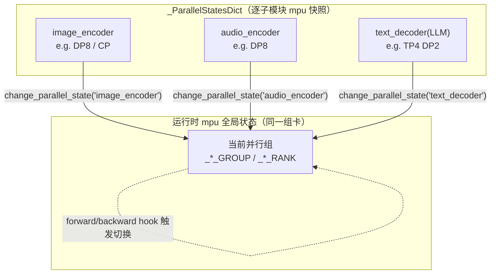

# 异构并行（MindSpeed-MM 多模态分组并行 + 动态 DP-CP）

## Summary

多模态大模型（VLM / Omni）由视觉编码器、音频编码器、语言主干（LLM）等结构差异巨大的子模块拼成，把它们当成一个同构模型套用统一的 TP/PP/CP/DP 会同时引入**模型异构**（编码器与主干算力/显存悬殊，产生 `encoder bound` / `LLM bound` 计算空泡）和**数据异构**（不同模态 token 数动态变化，带来 microbatch 内/间负载不均衡）两类不均衡。MindSpeed-MM 的异构并行（hetero-parallel）通过**解耦各子模块的并行配置**——每个子模块独立设 tp/pp/cp/mbs——并在运行时按当前执行的子模块动态切换 Megatron 的全局 `parallel_state`，配合 encoder→LLM 数据分发 hook 与异构 PP 调度，让小编码器开大 DP、大主干开 TP/PP，从而消化算存失衡；编码器与主干**混合部署**于同一组卡，避免独立部署（dist-train）的资源浪费。配套的**动态 DP-CP** 按每轮序列长度在 DP×CP 之间动态分组，**非对齐 Ulysses CP** 用 All2All 的非均匀切分适配变长序列。三者均为 MindSpeed-MM 的 Megatron-mcore 路线特性：异构并行限 `pretrain_vlm` 训练、FSDP2 后端不支持；动态 DP-CP 落在 Sora 系文生视频训练（OpenSoraPlan 1.3），非对齐 Ulysses CP 当前支持 qwen2vl/qwen2.5vl。

## 模型异构与数据异构

主流 Megatron 范式（DP/PP/TP 为主，SP/CP/EP 为辅）面向 LLM 这类同构模型——结构规则、每若干层是一个可重复基本单元。多模态模型则由多个模态编码器 + 骨干 + 解码器组成，结构差异大。若把整个 MLLM 视为一体、Encoder/LLM/Generator 共用同一套分布式策略（Encoder/Generator 作为额外 PP stage 并入主干），会暴露两类问题：

- **模型异构**：不同编码器（vision/audio）与骨干（LLM）的计算量、参数规模不同，存算不均衡导致计算空泡，表现为 `LLM bound` 与 `encoder bound`。
- **数据异构**：训练样本中文本/语音/视觉的 token 数差异大且随动态分辨率动态变化，使各编码器、骨干算力需求波动，产生 `intra-microbatch` 与 `inter-microbatch` 不均衡。

针对模型异构，MindSpeed-MM 设计 hetero-parallel；针对数据异构，另有在线数据重排（[`docs/zh/features/online_data_rearrange.md`](https://gitcode.com/Ascend/MindSpeed-MM/blob/8e740b46cb8290be0addf060e3e063d0b0380aa6/docs/zh/features/online_data_rearrange.md)）。两者正交、可叠加。

## 解耦各子模块的并行配置

异构并行的可配置单元固定为三类子模块 `['image_encoder', 'audio_encoder', 'text_decoder']`。每类子模块都拥有一份独立的 Megatron `parallel_state` 快照，训练时随当前执行的子模块在这些快照间切换，从而实现「同一组卡上、不同子模块跑不同并行度」。

### 各子模块独立初始化 parallel_state

使能异构并行时，patch 把 `mindspeed_mm.training.initialize_megatron` 包成 `initial_megatron_hetero_parallel_wrapper`：在常规 Megatron 初始化之后调 `initial_modules_mpu`，它内部遍历三类子模块逐个重建并行组。对每个子模块，先 `mpu.destroy_model_parallel()` 拆掉现有并行组，再用该子模块自己的并行度调 `initialize_model_parallel(...)`，最后把 `mpu` 模块里所有以单下划线开头的全局变量（各类 `_*_GROUP` / `_*_RANK` / world size 等）整体快照进 `_ParallelStatesDict[module]`：

```python
# mindspeed_mm/utils/hetero_parallel.py — initial_modules_mpu
initialize_model_parallel(
    tensor_model_parallel_size=pass_hetero_initial_arguments('tensor_model_parallel_size', module),
    pipeline_model_parallel_size=pass_hetero_initial_arguments('pipeline_model_parallel_size', module),
    context_parallel_size=pass_hetero_initial_arguments('context_parallel_size', module),
    expert_model_parallel_size=pass_hetero_initial_arguments('expert_model_parallel_size', module),
    order='tp-cp-ep-dp-pp' if not ...use_tp_pp_dp_mapping else 'tp-cp-ep-pp-dp',
    ...)
state_snapshot = {k: v for k, v in vars(mpu).items()
                  if k.startswith('_') and not k.startswith('__') and not inspect.isfunction(v)}
_ParallelStatesDict[module].update(state_snapshot)
```

每个子模块并行度的取值优先级由 `pass_hetero_initial_arguments` 定义，从高到低：① 该子模块在 `model.json` 中显式声明的字段 → ② 对骨干网络（`text_decoder`，即 `main_module`）或标注 `use_args` 的字段取 shell 启动参数 → ③ `ModelParallelConfig` / `DistributedDataParallelConfig` 的类默认值 → ④ 手动 default。这正是「骨干网络不再用 shell 脚本初始化并行策略、shell 里 TP/PP/CP 都设为 1」的原因：真正的逐模块并行组在 `initial_modules_mpu` 里按 `model.json` 重新建出。

### 运行时切换 parallel_state

运行期靠 `change_parallel_state(module)` 把目标子模块的快照写回 `vars(mpu)`，即把全局 mpu 状态「指向」该子模块的并行组——这是一次纯 Python 全局变量赋值，无通信开销。前后向之间通过挂在编码器上的 hook 触发切换。

```python
def change_parallel_state(module):
    target_globals = vars(mpu)
    for k, v in _ParallelStatesDict[module].items():
        if k in target_globals:
            target_globals[k] = v
```



### encoder→LLM 数据分发

子模块切换并行域后，激活张量的切分方式也随之改变，需要在编码器边界做数据重分发。`apply_hetero_parallel_hooks` 在 `image_encoder` / `audio_encoder` 上注册 forward pre/post hook：

- **进入编码器前**（`image_encoder_forward_pre_hook`）：先 `change_parallel_state('text_decoder')` 在 LLM 的 DP 域上 `all_gather_dp_group` 把各 DP rank 的 `pixel_values` / `image_grid_thw` 聚齐，再切回 `image_encoder` 域，按每个 DP rank 的图像工作量（`image_grid_thw.prod`）`split_tensor_dp_group` 非均匀重切到编码器 DP 域。
- **编码器算完后**（`image_encoder_forward_hook`）：在编码器 DP 域 `all_gather_dp_group` 聚合视觉 embedding，切回 `text_decoder` 域后按 LLM DP 世界大小重新均分。

`all_gather_dp_group` / `split_tensor_dp_group` 支持按 `chunk_seq_lens` 做变长切分并对短样本 `F.pad` 对齐再 `remove_padding`，使编码器侧的大 DP 与 LLM 侧的 TP/DP 之间的张量布局正确衔接。

### 异构 PP 调度

当骨干需要开 PP（小 mbs 大 gas、LLM 参数量大）时走异构 PP：编码器用大 DP、LLM 开 PP，且二者可用不同 mbs。`get_forward_backward_func_wrapper` 包住 Megatron 的 `get_forward_backward_func`——遍历子模块列表，对每个在配置中的子模块（**`audio_encoder` 被并入 pp stage0、跳过**）`change_parallel_state` 后生成一个独立的 `forward_backward_func`，组成 `forward_backward_func_list`，并标记首/尾子模块的 `_IS_FIRST_PIPELINE` / `_IS_LAST_PIPELINE` 与全局 `_HETERO_PIPELINE`，最终返回 `partial(hetero_pipeline, ...)`。

`hetero_pipeline` 按子模块顺序串行驱动：

- **编码器段**（首子模块）：`_IS_HETERO_PP_MOUDLE=False`，把全局 microbatch 数除以 `hetero_encoder_mbs_scale`（编码器用大 mbs），以 `forward_only` 跑前向，产出视觉/音频 embedding 与对应 batch 缓存。`forward_only_for_global = (not _IS_LAST_PIPELINE) or forward_only`——非末段子模块只前向。
- **解码器段**（末子模块 `text_decoder`）：`_IS_HETERO_PP_MOUDLE=True`，用 `DecoderRerunDataIterator(current_batchs, output_tensors, mbs_scale)` 把上一段编码器输出按 `hetero_encoder_mbs_scale` 重新切成解码器粒度的多个 microbatch（视觉 token 数按 `image_grid_thw.prod // VIT_SCALE_FACTOR(=4)` 累计定位、音频按 `AUDIO_TOKEN_ID(=151646)` 计数定位），再以 `get_num_microbatches()` 跑完整前反向。

底层 Megatron 调度被替换为两个 patch：`forward_backward_no_pipelining_patch`（PP=1，编码器这类无流水子模块走此路径）与 `forward_backward_pipelining_without_interleaving_patch`（1F1B，开了 PP 的 LLM 段走此路径）。前者在 `_HETERO_PIPELINE and not _IS_LAST_PIPELINE`（编码器等非末段子模块）时把编码器 `output_tensor` 与 `data_iterator.current_batch` 收集进返回值的 `output_tensors`/`current_batch` 供下一段使用；后者在 1F1B cooldown 于 rank0 收集 `input_tensor_grads`，其 `current_batch` 恒为空。`is_pipeline_last_stage` 被包成 `原判定 and _IS_LAST_PIPELINE`，保证只有「真正的末段子模块的末 stage」才计算 loss。各 PP stage 前向时（`recv_forward` 取到上游激活后、`forward_step` 之前），`set_decoder_input_tensor` 把上游 PP 传来的张量灌进 `text_decoder.set_input_tensor`。PP 流水的逐时刻 warmup/1F1B/cooldown 时间线见上游调度文件 [`hetero_pipeline_patches.py`](https://gitcode.com/Ascend/MindSpeed-MM/blob/8e740b46cb8290be0addf060e3e063d0b0380aa6/mindspeed_mm/patchs/hetero_pipeline_patches.py)。

## 配置面与推荐场景

使能：启动脚本加 `--hetero-parallel`；编码器与解码器 mbs 比值用 `--hetero-encoder-mbs-scale {num}`（把 ViT/音频编码器 mbs 调成文本解码器的 num 倍，提升编码器计算效率，推荐编码器 mbs ≈ LLM mbs 的 4~8 倍）。**shell 脚本里的 `TP`/`PP`/`CP` 必须设为 1**，各子模块的真实并行度写在对应 `model.json` 的子模块段：

| 参数 | 位置 | 含义 |
|---|---|---|
| `--hetero-parallel` | shell `GPT_ARGS` | 开关：对不同子模型应用不同并行策略（默认关） |
| `--hetero-encoder-mbs-scale` | shell `GPT_ARGS` | 编码器 mbs = 解码器 mbs × 此值（默认 1） |
| `tp` / `pp` / `cp` / `mbs` | `model.json` 的 `image_encoder.vision_encoder` / `audio_encoder` / `text_decoder` 段 | 各子模块独立并行度与 microbatch |

两种推荐用法：

- **异构 DP/TP/CP**：编码器规模小、静态显存小 → 开 DP/CP；LLM 大、静态开销大 → 开 DP/TP/CP。如 Qwen2.5-Omni 7B 短序列：ViT、Audio 用 `DP8`，LLM 用 `TP4 DP2` 性能最佳。
- **异构 PP**：需开 PP（小 mbs 大 gas、LLM 参数量大）时，ViT/Audio 编码器用大 DP、LLM 开 PP，并令编码器 mbs ≈ LLM mbs 的 4~8 倍。

适用范围：当前仅 Megatron 后端、`pretrain_vlm` 训练的模型；插件式 FSDP2 后端不支持。

## 动态 DP-CP

动态数据集每轮输入序列有长有短。静态并行策略须按数据集最长序列把 CP 设大以保证长序列可训，但这会让短序列也被迫做 CP 并行、计算效率下降；在「长序列少、短序列多、长短差距大」时性能损失尤甚。动态 DP-CP 在每轮迭代按当轮实际数据动态选 `DPx·CPy` 并同步切换并行组与分发数据，兼顾长序列可训与短序列高效：

- **并行组预生成**：Megatron 初始化后，用配置的最大 CP 并行度自动枚举并行组列表，如 `max_cp_size=4` → `{dp4cp1, dp2cp2, dp1cp4}`。
- **每轮选策略**：dataloader 默认以 `DPn·CP1` 取数；每轮 gather 所有 DP 域的数据尺寸，遍历并行组，取满足序列长度要求且 **DP 优先**的最佳策略。
- **切组与数据分发**：把并行组全局变量改指向新组；DP→CP 切换需广播数据，被广播的卡缓存本卡已取样本，后续优先从缓存区取数。

适配模型 OpenSoraPlan 1.3。配置在 `pretrain_t2v_model.json`：

| 参数 | 含义 |
|---|---|
| `use_dynamic_dpcp` | 动态 DP-CP 开关；当前仅支持 Ulysses 序列并行，暂不支持 encoder DP / interleaved offload |
| `max_cp_size` | 集群支持的最大 CP 并行度（决定可枚举的并行组集合） |
| `max_seq_size` | 单卡可计算的最大序列长度（如最长视频 23×1080×720(fps,h,w)） |

## 非对齐 Ulysses CP

多模态存在大量序列长度非均匀场景，标准 Ulysses CP 需适配。非对齐 Ulysses CP 基于 All2All 算子，对 All2All 的 Input List 与 Output List **按各段实际序列长度做非均匀切分**，从而在变长序列上使能 Ulysses。当前支持 `qwen2vl` / `qwen2.5vl`：在 finetune 脚本设 `CP` 大小，并在 `GPT_ARGS` 加 `--context-parallel-algo ulysses_cp_algo`。Ulysses 与 Ring/混合 CP 的基础机制见 [context-parallel-train](context_parallel_train.md)。

## 跨域复用

异构并行同样覆盖 MindSpeed-MM 的 DiT 视频/图像生成路线（Sora 系骨干）——其 DiT 主干 + VAE 编解码与 cann-infer/cann-spatial 的 [dit](../../../inference/concepts/modules/dit.md)、[vae](../../../inference/concepts/modules/vae.md) 同源，动态 DP-CP 即落在 OpenSoraPlan（DiT 文生视频）这类变分辨率/变长序列生成训练上。DiT/VAE 的结构语义归属上述跨域页，异构并行与动态 DP-CP 则是它们在 MM 生成路线上的分布式分组策略。

## Evidence

源页：[mindspeed-mm](https://gitcode.com/Ascend/MindSpeed-MM)（钉定 ref `8e740b46cb82…`）。blob base `https://gitcode.com/Ascend/MindSpeed-MM/blob/8e740b46cb8290be0addf060e3e063d0b0380aa6/`：

- 方案与配置：[`docs/zh/features/hetero_parallel.md`](https://gitcode.com/Ascend/MindSpeed-MM/blob/8e740b46cb8290be0addf060e3e063d0b0380aa6/docs/zh/features/hetero_parallel.md)（模型/数据异构、异构 DP/TP/CP 与异构 PP 两场景、Qwen2.5-Omni 7B `ViT/Audio DP8 + LLM TP4DP2`、使能方式、适用范围）、[`docs/zh/features/dynamic_dpcp.md`](https://gitcode.com/Ascend/MindSpeed-MM/blob/8e740b46cb8290be0addf060e3e063d0b0380aa6/docs/zh/features/dynamic_dpcp.md)（并行组枚举 / 每轮 DP 优先选策略 / 切组广播缓存；`use_dynamic_dpcp`/`max_cp_size`/`max_seq_size`；OpenSoraPlan1.3）、[`docs/zh/features/unaligned_ulysses_cp.md`](https://gitcode.com/Ascend/MindSpeed-MM/blob/8e740b46cb8290be0addf060e3e063d0b0380aa6/docs/zh/features/unaligned_ulysses_cp.md)（All2All Input/Output List 非均匀切分；`--context-parallel-algo ulysses_cp_algo`）。
- parallel_state 解耦与切换：[`mindspeed_mm/utils/hetero_parallel.py`](https://gitcode.com/Ascend/MindSpeed-MM/blob/8e740b46cb8290be0addf060e3e063d0b0380aa6/mindspeed_mm/utils/hetero_parallel.py)（`_HeteroParallelModules`、`_ParallelStatesDict`、`initial_modules_mpu` + `pass_hetero_initial_arguments` 优先级、`change_parallel_state`、`initial_megatron_hetero_parallel_wrapper` patch `initialize_megatron`、`apply_hetero_parallel_hooks` + `image_encoder_forward_pre_hook`/`image_encoder_forward_hook`、`all_gather_dp_group`/`split_tensor_dp_group`）。
- 异构 PP 调度：[`mindspeed_mm/patchs/hetero_pipeline_patches.py`](https://gitcode.com/Ascend/MindSpeed-MM/blob/8e740b46cb8290be0addf060e3e063d0b0380aa6/mindspeed_mm/patchs/hetero_pipeline_patches.py)（`get_forward_backward_func_wrapper`、`hetero_pipeline`、`PipelineMeta`、`DecoderRerunDataIterator`(`AUDIO_TOKEN_ID=151646`/`VIT_SCALE_FACTOR=4`)、mpu 标记 `_HETERO_PIPELINE`/`_IS_FIRST_PIPELINE`/`_IS_LAST_PIPELINE`/`_IS_HETERO_PP_MOUDLE`、`forward_backward_pipelining_without_interleaving_patch`/`forward_backward_no_pipelining_patch`、`is_pipeline_last_stage` 包装）。
- 参数定义：[`mindspeed_mm/arguments.py`](https://gitcode.com/Ascend/MindSpeed-MM/blob/8e740b46cb8290be0addf060e3e063d0b0380aa6/mindspeed_mm/arguments.py)（`--hetero-parallel`、`--hetero-encoder-mbs-scale`）。

## Links

- [context-parallel-train](context_parallel_train.md)（CP 基础：Ulysses / Ring / 混合 CP 机制，本页非对齐 Ulysses CP 与动态 DP-CP 的 CP 维即其变长适配）
- [pipeline-parallel-advanced](pipeline_parallel_advanced.md)（PP 进阶调度，本页异构 PP 在其 1F1B/无流水调度上替换 encoder/LLM 分段 forward_backward）
- [mindspeed-mm](../frameworks/mindspeed_mm.md)（承载框架：双训练后端、模态子包组织；异构并行属 Megatron-mcore 路线特性）
- [multimodal-data](../techniques/multimodal_data.md)（MM 数据流水：在线数据重排的「编码器布局 ↔ LLM 布局」双向搬运正服务本页编码器 DP 与 LLM DP 取值不同的分组并行）
- [mindspeed](../frameworks/mindspeed.md)（训练加速底座；mpu/parallel_state 与 patch 机制来源）
- [dit](../../../inference/concepts/modules/dit.md)（跨域：DiT 骨干，动态 DP-CP 落在 DiT 文生视频训练）
- [vae](../../../inference/concepts/modules/vae.md)（跨域：VAE 编解码，与 DiT 同属 MM 生成路线）
- [ldt-disaggregated-training](../techniques/ldt_disaggregated_training.md)（U 形 PP 变体的边云协同部署，与同卡异并行互补）
- [multimodal-dit-vae-train](../modules/multimodal_dit_vae_train.md)（多模态生成训练：DiT/VAE 长序列 CP 与异构组件并行）

<!-- cannbot:related:start -->
## 相关

- [MindSpeed 高级流水并行（VPP / Ripipe / 多参数 / Unaligned PP / 变长序列 / PP Layout）](pipeline_parallel_advanced.md)（`related`）：当骨干需要开 PP（小 mbs 大 gas、LLM 参数量大）时走异构 PP：编码器用大 DP、LLM 开 PP，且二者可用不同 mbs。；- ［hetero-parallel］(hetero_parallel.md)（MindSpeed-MM 异构 PP 调度复用高级 PP 能力集）。异构并行卡给出编码器与 LLM 分段采用不同并行度和 micro-batch 的异构 PP 场景，高级 PP 卡明确把 hetero-parallel 标为复用其调度能力集，形成配置目标到承载调度的直接链路。
- [分层解耦训练 LDT（Layerwise Disaggregated Training / U 形拆分学习）](../techniques/ldt_disaggregated_training.md)（`related`）：异构并行解决「同一组卡上不同子模块（编码器/主干）算存悬殊」，做法是逐子模块独立并行度 + 运行时切换 `parallel_state`；LDT 解决「边云两组物理隔离的卡之间数据不能流动」，做法是 U 形层切分 + 跨域激活/梯度接力 + 非对称 TP/DP。；MindSpeed-MM 的异构并行（hetero-parallel）通过**解耦各子模块的并行配置**——每个子模块独立设 tp/pp/cp/mbs——并在运行时按当前执行的子模块动态切换 Megatron 的全局 `parallel_state`。两端构成跨域安全切分与同卡算存均衡的明确选型对照。
<!-- cannbot:related:end -->
