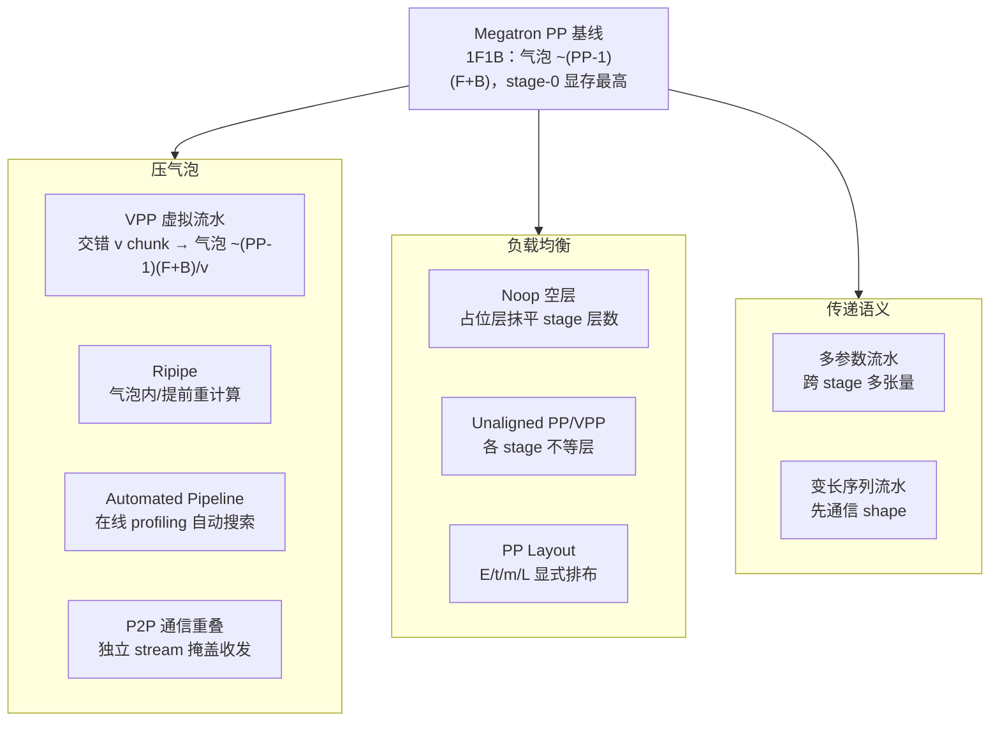

# MindSpeed 高级流水并行（VPP / Ripipe / 多参数 / Unaligned PP / 变长序列 / PP Layout）

## Summary

MindSpeed 在 Megatron 流水并行（PP）之上叠了一组以 `MindSpeedFeature` + monkey-patch 形式注入 megatron 的高级 PP 能力，按优化目标分三类：**压气泡**（VPP 虚拟流水、Ripipe 重计算调度、Automated Pipeline 自动搜索、P2P 通信重叠）、**做负载均衡**（Noop 空层、Unaligned PP/VPP、自定义 PP Layout）、**扩传递语义**（多参数流水、变长序列流水）。它们的开关由各自 `*Feature` 类的 `register_args` 注册、`register_patches` 落到 [mindspeed](../frameworks/mindspeed.md) 的 `MindSpeedPatchesManager`，多数互相可叠加但有明确互斥关系（见末表）。基础 1F1B / VPP 调度是 MoE 大模型 PP 的承载，更激进的一卡双向掩盖式 MoE PP 调度见 [dualpipev](dualpipev.md)。

## 流水并行基线与气泡

PP 把模型按 decoder 层切成 `--pipeline-model-parallel-size` 个 stage 接力计算。1F1B（one-forward-one-backward）调度下，预热（warmup）与冷却（cooldown）阶段各 stage 有等待空泡，稳态空泡正比于 `(PP-1)`：每个 micro-batch 前反向耗时记 `F+B`，则一个完整调度的气泡量约 `(PP-1)·(F+B)`，micro-batch 数越多稳态占比越大、气泡摊薄越充分。此外 1F1B 下靠前 stage 需缓存更多在途前向激活，**stage-0 内存占用可达末 stage 的 2~3 倍**，可训练规模受 stage-0 显存制约——这正是下列各机制要解决的两类问题。

## 虚拟流水并行（VPP / interleaved 1F1B）

VPP（Virtual Pipeline Parallelism）在不增加设备数的前提下，把每个 device 持有的连续层块再拆成 `v` 个**虚拟 stage（model chunk）**交错排布，使各 device 在一个 micro-batch 周期内被更细粒度地填满，气泡从 `(PP-1)(F+B)` 降到约 `(PP-1)(F+B)/v`——代价是 chunk 边界增多、stage 间 P2P 通信量上升。

开关为 `--num-layers-per-virtual-pipeline-stage N`（每个虚拟 stage 的层数），要求模型总层数 `L % N == 0` 且 `--pipeline-model-parallel-size ≥ 2`。例：16 层、TP1、PP4、VPP2 → `4×2=8` 个虚拟 stage、每 stage 2 层，device 持有交错的两块：

| device | chunk 0 | chunk 1 |
| --- | --- | --- |
| 0 | 层 1,2 | 层 9,10 |
| 1 | 层 3,4 | 层 11,12 |
| 2 | 层 5,6 | 层 13,14 |
| 3 | 层 7,8 | 层 15,16 |

前向沿 `D0→D1→D2→D3→D0→D1→D2→D3` 走完两轮 chunk。注意 VPP 改变权重的切分映射，**保存/加载权重必须保持 VPP 配置一致**；verl 框架下 mbridge 与 VPP 暂不兼容。VPP 是下列 Ripipe、多数 layout 特性的调度底座（megatron 的 `forward_backward_pipelining_with_interleaving`）。

## Ripipe：流水内重计算调度

Ripipe（`ripipe_schedules.py` 的 `forward_backward_ripipe_pipelining`，由 megatron interleaved 1F1B 调度改写而来）把**激活重计算嵌进 VPP 流水调度**，借 `PipelineCheckpointManager` 在 chunk 粒度上 `disable_recompute` / `enable_recompute` / `recompute_next`，提供两种互补模式（均需 PP>1 且开启 VPP interleaving，且 `align_grad_reduce=True`）：

- **`--recompute-in-bubble`**（省内存）：用流水**气泡时间**做重计算换显存，性能基本不劣化。使能时框架强制 `recompute_granularity="full"`、`recompute_method="block"`，并令 `recompute_num_layers = --num-layers-per-virtual-pipeline-stage`（即每 chunk 全重计算）；要求 `overlap_p2p_comm=True`，且与 `swap_attention`、`optimize_send_recv_comm`、`ampipe`、`adaptive_memory_optimization`（自适应内存优化）互斥。
- **`--recompute-in-advance`**（压气泡）：把重计算**提前**到 1F1B 稳态前段执行以缩短气泡、提升吞吐。要求 `--num-layers-per-virtual-pipeline-stage == 1`（否则自动关闭），`recompute_method` 不能为 `uniform`，且 `recompute_num_layers` 必须非 0；使能时置 `reduce_recompute_for_last_chunk=True`。

两者本质都是「重计算 ⇄ 内存/气泡」的取舍：bubble 模式把重计算塞进空泡里几乎白嫖显存收益，advance 模式则用提前重计算抹平气泡换性能。与自适应选择重计算（adaptive recompute）互斥。

## Noop 空层做 stage 负载均衡

`--noop-layers 5,11,...` 指定一组**全局层号**，这些位置不构建真实 decoder 层，而是 `NoopTransformerLayer`——其 `forward` 直接 `return hidden_states.clone(), context`，无参数、无计算、无通信，仅占一个层位。它把「逻辑层数」与「真实计算层数」解耦：当 PP 均匀切层会让某些 stage 因 embedding / loss / MTP 等额外计算而偏重时，在轻 stage 插 noop 层即可凑齐每 stage 层数、抹平 1F1B 的 stage 间负载差。校验要求每个 noop 索引落在 `[0, --num-layers)`；开启 Automated Pipeline 时 noop 层被自动清空（二者目标重叠）。Noop 与 Unaligned PP、自定义 PP Layout 互斥（都在解同一负载均衡问题，只能选一种表达）。

## 多参数流水（跨 stage 传多张量）

传统 PP 各 stage 间只传单一隐藏态张量；多模态 / 部分 MoE 场景需要在 stage 间同时传多个变量（不同 shape / dtype）。`--use-multiparameter-pipeline-model-parallel` 把 megatron schedules 的 `get_tensor_shapes` / `forward_step` / `backward_step` 及 `recv_forward` / `send_forward` / `recv_backward` / `send_backward` 等收发原语整体替换为多张量版本：前向按 `args.pipeline_tensor_shapes`（缺省 `[{shape:(seq_length/CP, micro_batch_size, hidden_size), dtype}]`，dtype 随 bf16/fp16/fp32）描述的每张量 shape/dtype 精确收发；反向不再只对首个输出求梯度，而是 `torch.autograd.backward` 对所有 `requires_grad` 的输出张量一并回传梯度。

使用时需把 `validate_args` 里的 `args.pipeline_tensor_shapes` 改成与模型各 stage 实际传输张量（维度 + dtype）一致。支持纯 PP 与 VPP（VPP 下配 `--num-layers-per-virtual-pipeline-stage 1`）。与 `--moe-fb-overlap`、`dualpipev` 互斥。

## 变长序列流水

定长训练会把所有序列 pad 到统一长度，浪费内存与算力。`--variable-seq-lengths` 允许每个 micro-batch 保留原始序列长度：stage 间在真正发送隐藏态张量**之前先 P2P 通信一个 int64 shape 张量**（`communicate_shapes_impl`），让接收方按即将到来的真实 shape 分配 buffer，再做正式张量收发（patch `p2p_communication._communicate` / `_communicate_shapes`）。代价是每次收发多一轮 shape 通信，**仅在序列长度确实变化时才应开启**；实现上 `pre_validate_args` 在无 `num_moe_experts`（非 MoE）时会先把 `variable_seq_lengths` 置 False、`post_validate_args` 再把用户原值恢复回去（即校验窗口内临时关闭、运行期仍按用户设置生效），常与多参数流水叠加用于多模态变长输入。MoE 场景下暂不支持 `--moe-token-dispatcher-type` 为 `alltoall_seq` / `allgather`（需用 `alltoall`）。

## 自定义流水布局（PP model-parallel layout）

`--pipeline-model-parallel-layout` 用一个字符串显式声明**每个流水 stage 持有的层类型与层数**，突破「按 decoder 层均匀切」的限制。层类型：`E`=embedding、`t`=decoder、`m`=MTP、`L`=loss；`|` 分隔 stage、`,` 仅为可读（解析忽略）、`x*N` 重复单字符（`t*3`=`ttt`）、`(pattern)*N` 重复段、`||` 表空 stage。字符串按前向顺序展开——先排 VPP rank 0 的所有 PP stage，再排 VPP rank 1，依此类推；**stage 总数 / PP 即自动推导出的 VPP size**。

例 `--pipeline-model-parallel-size 2 --pipeline-model-parallel-layout Ett|tt|ttt|tmL --num-layers 8 --mtp-num-layers 1`：4 个 stage / PP2 → VPP2，分布为

| PP rank | VPP rank 0 | VPP rank 1 |
| --- | --- | --- |
| 0 | `Ett` | `ttt` |
| 1 | `tt` | `tmL` |

decoder 总数 `2+2+3+1=8`、MTP 1、E/L 各一次。约束：stage 数须被 PP 整除；E 与 L 各且仅一次；decoder 数等于 `--num-layers`、`m` 数等于 `--mtp-num-layers` 且 decoder 必须在 MTP 之前。它与 `--num-layers-per-virtual-pipeline-stage` / `--num-virtual-stages-per-pipeline-rank`、`--pipeline-num-transformer-layers`、`--noop-layers`、`--schedules-method dualpipev` 均互斥，也暂不与 `--recompute-in-bubble` / `--recompute-in-advance` 同用。可与 `--moe-fb-overlap` 配合（layout-aware VPP 调度，按前/反向 chunk 实际层数做跨 microbatch 前反向掩盖，两侧层数不一致时先配对可重叠层再处理剩余层）。

## 非对齐 PP / VPP 切分

`--pipeline-num-transformer-layers` 用一个二维数组 `[[...vpp...], ...pp...]` 直接给出**每个 (pp_rank, vpp_rank) 持有的 transformer 层数**，是 layout 的「纯 decoder 数量」轻量版。如 `[[0,1],[1,1]*4,[1,0]]`：横轴 pp rank、纵轴 vpp rank，`[pp_rank][vpp_rank]` 取对应层数；`get_num_layers_to_build_unaligned` / `get_layer_offset_unaligned`（按列优先前缀和算偏移）patch 进 megatron 的 `get_num_layers_to_build` / `_get_layer_offset`。约束：数组长度等于 PP；每行长度等于 VPP（无 VPP 时为 1）；层数之和需与 `--num-layers` 一致；默认 VPP 等切，故单 PP 段层数应能被 `--num-layers-per-virtual-pipeline-stage` 整除（实际以数组为准）。与 `--noop-layers`、`--num-layer-list` 互斥。典型用于把 embedding / logits / MTP 集中的首尾 stage 减层、把中间 stage 加层，抹平负载。

## 自动流水布局搜索（Automated Pipeline）

`--automated-pipeline`（内存优化模块）与 `--automated-pipeline-perf`（性能优化模块）基于**在线 profiling + PP 建模搜索**自动定布局，二者不可同时使用，均要求 PP≥2：

- **内存优化**：在「非均匀层切分 + 细粒度重计算」联合搜索空间里自动找最优排布——不均匀分层均衡各卡显存以优化 stage-0 瓶颈，并利用气泡时间做细粒度重计算进一步降峰值。文档报告 LLaMA2-7B / LLaMA-13B / LLaMA2-70B 等平均峰值内存 **-11.5%**、性能劣化 **<1%**。
- **性能优化**：在峰值内存不超设备容量约束下，自动搜索动态 mbs 序列（小 mbs 加速预热/冷却、稳态用高效 mbs）与前反向调度序列，结合多流异步通信压缩稳态气泡，报告平均性能 **+7.6%**。

开启 Automated Pipeline 时会自动关闭 `--noop-layers`（其层分布由搜索接管）。

## P2P 通信重叠基础设施

上述压气泡机制依赖把 stage 间 P2P 收发与计算重叠。两个底层开关：`optimize_p2p_comm` 把 `config.batch_p2p_comm` 置 False，改用非批量 P2P 算子以便与计算 overlap（即 `overlap_p2p_comm` 生效前提，PP≥2 时启用）；`--optimize-send-recv-comm` 则单独建一条 PP 通信流（`pp_new_stream` / `get_pipeline_parallel_group_for_new_stream`），用 `flexible_schedules` 的 `forward_comm_stream` / `backward_comm_stream` `wait_stream` 主流后异步收发，把 send/recv 掩盖到计算之下。`optimize-send-recv-comm` 与 Ripipe、以及「layout 推导出 VPP」的场景暂不兼容。

## 能力组合与互斥

| 机制 | 开关 | 主要解决 | 关键互斥 |
| --- | --- | --- | --- |
| VPP | `--num-layers-per-virtual-pipeline-stage` | 气泡 → `/v` | 是多数特性的底座 |
| Ripipe-bubble | `--recompute-in-bubble` | 省显存 | swap-attention / optimize-send-recv / ampipe / 自适应重计算 / 自适应内存优化 |
| Ripipe-advance | `--recompute-in-advance` | 压气泡 | optimize-send-recv / ampipe / 自适应重计算（不含 swap-attention）；要求 VPP 层数=1 |
| Noop 层 | `--noop-layers` | stage 负载均衡 | unaligned PP / PP layout；automated-pipeline 自动关 |
| 多参数流水 | `--use-multiparameter-pipeline-model-parallel` | 跨 stage 多张量 | moe-fb-overlap / dualpipev |
| 变长序列 | `--variable-seq-lengths` | 免 padding | 无 PP 特性硬互斥；MoE 限 alltoall dispatcher；非 MoE 时校验期临时置 False；常叠多参数 |
| PP Layout | `--pipeline-model-parallel-layout` | E/t/m/L 排布 | VPP 层数参数 / unaligned / noop / dualpipev / ripipe |
| Unaligned PP | `--pipeline-num-transformer-layers` | 各 stage 不等层 | noop-layers / num-layer-list |
| Automated | `--automated-pipeline[-perf]` | 自动布局 | 内存/性能两模块互斥；自动关 noop |

## Evidence

- [mindspeed](https://gitcode.com/ascend/MindSpeed) — 官方特性文档（pin `1432cb09`）：
  - [`docs/zh/features/virtual-pipeline-parallel.md`](https://gitcode.com/Ascend/MindSpeed/blob/1432cb092818b870c31b61db0eb6d3378b7fbdad/docs/zh/features/virtual-pipeline-parallel.md) — VPP 原理、`--num-layers-per-virtual-pipeline-stage`、16 层 PP4 VPP2 示例、权重一致性 / verl mbridge 限制
  - [`docs/zh/features/multi_parameter_pipeline.md`](https://gitcode.com/Ascend/MindSpeed/blob/1432cb092818b870c31b61db0eb6d3378b7fbdad/docs/zh/features/multi_parameter_pipeline.md) 与 [`multi_parameter_pipeline_and_variable_seq_lengths.md`](https://gitcode.com/Ascend/MindSpeed/blob/1432cb092818b870c31b61db0eb6d3378b7fbdad/docs/zh/features/multi_parameter_pipeline_and_variable_seq_lengths.md) — 多参数传递 + 变长序列、`pipeline_tensor_shapes` 修改注意、与 moe-fb-overlap/dualpipev 互斥
  - [`docs/zh/features/unaligned-pipeline.md`](https://gitcode.com/Ascend/MindSpeed/blob/1432cb092818b870c31b61db0eb6d3378b7fbdad/docs/zh/features/unaligned-pipeline.md) — `--pipeline-num-transformer-layers` 二维数组、embedding/logits/MTP 负载场景
  - [`docs/zh/features/pipeline-model-parallel-layout.md`](https://gitcode.com/Ascend/MindSpeed/blob/1432cb092818b870c31b61db0eb6d3378b7fbdad/docs/zh/features/pipeline-model-parallel-layout.md) — layout 字符串格式（E/t/m/L、`|`、`x*N`、`(pattern)*N`）、`Ett|tt|ttt|tmL` 示例、约束与 moe-fb-overlap 配合
  - [`docs/zh/features/automated-pipeline.md`](https://gitcode.com/Ascend/MindSpeed/blob/1432cb092818b870c31b61db0eb6d3378b7fbdad/docs/zh/features/automated-pipeline.md) — `--automated-pipeline` 内存模块 -11.5% / `--automated-pipeline-perf` 性能模块 +7.6%
  - [`docs/zh/features/pipeline-parallel.md`](https://gitcode.com/Ascend/MindSpeed/blob/1432cb092818b870c31b61db0eb6d3378b7fbdad/docs/zh/features/pipeline-parallel.md) — PP 基线、1F1B 预热/冷却
- MindSpeed 源码（pin `1432cb09`）：
  - [`mindspeed/core/pipeline_parallel/ripipe_schedules.py`](https://gitcode.com/Ascend/MindSpeed/blob/1432cb092818b870c31b61db0eb6d3378b7fbdad/mindspeed/core/pipeline_parallel/ripipe_schedules.py)（`forward_backward_ripipe_pipelining` 由 interleaved 1F1B 改写、`PipelineCheckpointManager` 的 `recompute_next` / `disable_recompute`）；[`features_manager/pipeline_parallel/ripipe_schedules_feature.py`](https://gitcode.com/Ascend/MindSpeed/blob/1432cb092818b870c31b61db0eb6d3378b7fbdad/mindspeed/features_manager/pipeline_parallel/ripipe_schedules_feature.py)（bubble/advance 两子特性的强制参数与互斥校验）
  - [`mindspeed/core/pipeline_parallel/noop_layers/transformer.py`](https://gitcode.com/Ascend/MindSpeed/blob/1432cb092818b870c31b61db0eb6d3378b7fbdad/mindspeed/core/pipeline_parallel/noop_layers/transformer.py) 与 [`mindspeed/core/transformer/transformer_block.py`](https://gitcode.com/Ascend/MindSpeed/blob/1432cb092818b870c31b61db0eb6d3378b7fbdad/mindspeed/core/transformer/transformer_block.py)（`NoopTransformerLayer.forward` 返回 `hidden_states.clone(), context`）；[`features_manager/pipeline_parallel/noop_layers.py`](https://gitcode.com/Ascend/MindSpeed/blob/1432cb092818b870c31b61db0eb6d3378b7fbdad/mindspeed/features_manager/pipeline_parallel/noop_layers.py)（`--noop-layers` 索引校验、automated 时清空）
  - [`mindspeed/core/pipeline_parallel/multi_parameter/communication.py`](https://gitcode.com/Ascend/MindSpeed/blob/1432cb092818b870c31b61db0eb6d3378b7fbdad/mindspeed/core/pipeline_parallel/multi_parameter/communication.py)（`backward_step_impl` 对全部 requires_grad 输出回传梯度）；[`features_manager/pipeline_parallel/multi_parameter.py`](https://gitcode.com/Ascend/MindSpeed/blob/1432cb092818b870c31b61db0eb6d3378b7fbdad/mindspeed/features_manager/pipeline_parallel/multi_parameter.py)（`pipeline_tensor_shapes` 缺省 `(seq/CP, mbs, hidden)`、收发原语 patch 列表、dualpipev 互斥）
  - [`mindspeed/core/pipeline_parallel/variable_seq_length/communicate.py`](https://gitcode.com/Ascend/MindSpeed/blob/1432cb092818b870c31b61db0eb6d3378b7fbdad/mindspeed/core/pipeline_parallel/variable_seq_length/communicate.py)（`communicate_shapes_impl` 先发 int64 shape，再按 `recv_*_shape` 建 buffer）；[`features_manager/pipeline_parallel/variable_seq_length.py`](https://gitcode.com/Ascend/MindSpeed/blob/1432cb092818b870c31b61db0eb6d3378b7fbdad/mindspeed/features_manager/pipeline_parallel/variable_seq_length.py)（无 MoE 时关闭、patch `_communicate`/`_communicate_shapes`）
  - [`mindspeed/core/pipeline_parallel/pipeline_model_parallel_layout/layout.py`](https://gitcode.com/Ascend/MindSpeed/blob/1432cb092818b870c31b61db0eb6d3378b7fbdad/mindspeed/core/pipeline_parallel/pipeline_model_parallel_layout/layout.py)（`PipelineParallelLayerLayout`：`LayerType`、`parse_str_to_list`、VPP=stage/PP、`validate_layer_layout` 约束）
  - [`mindspeed/core/pipeline_parallel/unaligned/unaligned_pipeline.py`](https://gitcode.com/Ascend/MindSpeed/blob/1432cb092818b870c31b61db0eb6d3378b7fbdad/mindspeed/core/pipeline_parallel/unaligned/unaligned_pipeline.py)（`get_num_layers_to_build_unaligned` / `get_layer_offset_unaligned` 列优先前缀和）；[`features_manager/pipeline_parallel/unaligned_pineline_feature.py`](https://gitcode.com/Ascend/MindSpeed/blob/1432cb092818b870c31b61db0eb6d3378b7fbdad/mindspeed/features_manager/pipeline_parallel/unaligned_pineline_feature.py)（数组长度=PP、行长=VPP、与 noop/num-layer-list 互斥）
  - [`mindspeed/core/pipeline_parallel/optimize_send_recv_comm/`](https://gitcode.com/Ascend/MindSpeed/blob/1432cb092818b870c31b61db0eb6d3378b7fbdad/mindspeed/core/pipeline_parallel/optimize_send_recv_comm/adaptor.py) 与 [`optimize_p2p_comm/adaptor.py`](https://gitcode.com/Ascend/MindSpeed/blob/1432cb092818b870c31b61db0eb6d3378b7fbdad/mindspeed/core/pipeline_parallel/optimize_p2p_comm/adaptor.py)（独立 PP 通信流 / `batch_p2p_comm=False`）

## Links

- [dualpipev](dualpipev.md)（更激进的 MoE PP 调度：一卡同载前反向 batch 互相掩盖 EP 通信，与本页多参数/PP layout/ripipe-bubble 多处互斥）
- [mindspeed](../frameworks/mindspeed.md)（这些 PP 特性的承载框架：`MindSpeedFeature` + `MindSpeedPatchesManager` monkey-patch megatron 的统一接入机制、`--optimization-level` 档位）
- [torchtitan-5d-parallel](torchtitan_5d_parallel.md)（跨栈对照：TorchTitan 5D 并行中 PP 取 `Interleaved1F1B`(VPP)，对应 Megatron 栈这套 VPP 及其之上的进阶 PP 能力集）
- [hetero-parallel](hetero_parallel.md)（MindSpeed-MM 异构 PP 调度复用高级 PP 能力集）
- [recomputation](../techniques/recomputation.md)（被 ripipe 调度的对象：重计算定「哪些层、哪类粒度」，本页 Ripipe 定「何时触发」——气泡内/提前重算）
- [auto-settings](../techniques/auto_settings.md)（自动搜索 PP/VPP 布局等并行配置）
- [ldt-disaggregated-training](../techniques/ldt_disaggregated_training.md)（U 形 PP 变体：VPP 在 stage0 摆首尾虚拟 stage 做边云拆分）