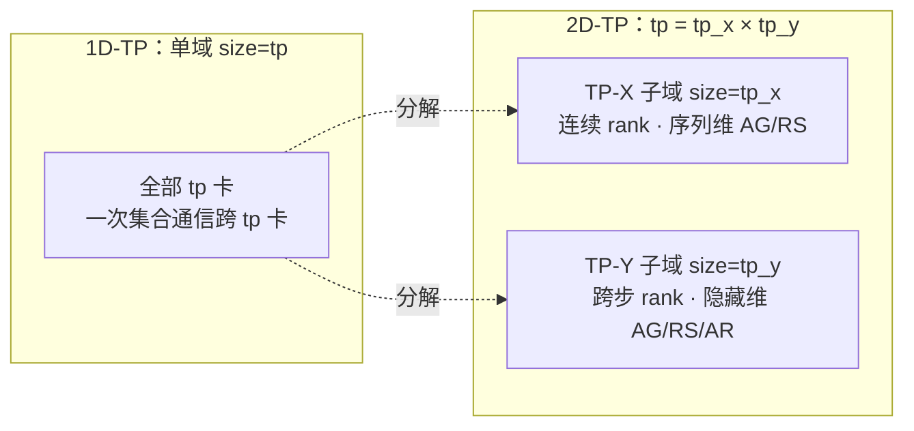
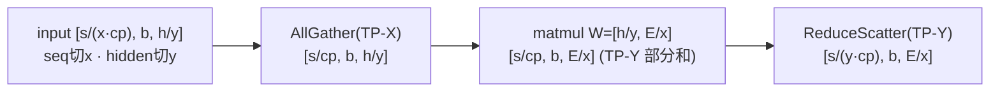

# 高维张量并行 TP-2D（MindSpeed 2D Tensor Parallel）

## Summary

TP-2D 把一维张量并行的单个 TP 通信域 `tp` 分解成两个正交子域 `tp_x × tp_y`（`tp = tp_x × tp_y`，二者均 > 1），让激活值与权重**同时在 first-dim（序列/输出维）与 last-dim（隐藏/收缩维）切分**。每个 Linear 的前向因此退化为「在一个子域 AllGather 序列 → 本地 matmul → 在另一个子域 ReduceScatter」的两段小域通信（如 fc1 取 AG=`tp_x`/RS=`tp_y`，fc2 两子域对调），而不是在整个大小为 `tp` 的域上做 AllGather/AllReduce。大 TP 域（如 `tp=16`）下，单次集合通信的参与卡数从 `tp` 降到 `tp_x` 或 `tp_y`，通信量与延迟随之下降。配套的**分布式 normalization** 只在 `tp_y` 子域做小 AllReduce（LayerNorm 两次：求和、平方和；RMSNorm 一次：平方均值）即可在不 AllGather 隐藏维的前提下完成逐 token 归一化。核心实现 `ParallelLinear2D` / `Linear2DSplitAlongFirstDim` / `LayerNorm2D` / `RMSNorm2D` 位于 [mindspeed](../frameworks/mindspeed.md) 的 `mindspeed/core/tensor_parallel/tp_2d/`，由 `--tp-2d --tp-x --tp-y` 启用。

本页后端依赖torch_npu与ATB，不能视为硬件无关；固定来源未给这条TP-2D路径明确的SoC矩阵，暂以draft/空平台保留。通用二维并行原理不作为实现支持证据。

## 通信域分解：tp = tp_x × tp_y

一维 Megatron TP 把 ColumnParallelLinear/RowParallelLinear 的权重沿单一维度切到 `tp` 张卡，每个 Linear 前向/反向都要在这个大小为 `tp` 的域上做一次 AllReduce（或 SP 下的 AllGather+ReduceScatter）。`tp` 越大，集合通信跨越的卡越多、带宽竞争越重，是大 TP 域训练效率下降的主因。

TP-2D 在原 Megatron 切分之上再加一维，把单一 `tp` 域拆为两个子通信域：

- **TP-X 子域**（`nd1_dim1`，`TPXCollectiveComm`）：大小 `tp_x`，由 `tp` 个连续 rank 中每 `tp_x` 个相邻 rank 成组（`[i·tp + j·tp_x : i·tp + (j+1)·tp_x]`），负责沿 first-dim（序列维）的 AllGather / ReduceScatter。
- **TP-Y 子域**（`nd1_dim2`，`TPYCollectiveComm`）：大小 `tp_y`，由步长为 `tp_x` 的 rank 跨步成组（`range(i·tp + j, (i+1)·tp, tp_x)`），是TP-Y分组；Linear的AG/RS仍沿first-dim（序列维）通信，不由组名决定张量轴；归一化AllReduce则聚合隐藏维统计量。

fc1输入/Transformer子层边界的激活为二维切分：序列维按 `tp_x`（叠加 CP 后为 `x·cp`）切、隐藏维按 `tp_y` 切，形状记作 `[s/(x·cp), b, h/y]`。权重 `[E/x, h/y]` 同样二维切——输出维按 `tp_x` 切、收缩维按 `tp_y` 切。

## ParallelLinear2D 的二维化

`ParallelLinear2D` 取代 Megatron 的 Column/RowParallelLinear。它不再用单一 `partition_dim`，而是接收一对通信接口 `ag_comm_intf` / `rs_comm_intf` 决定前向在哪个子域 AllGather、在哪个子域 ReduceScatter。权重按两个子域世界大小双向切：

- `output_size_per_partition = output_size / ag_comm_world_sz`（输出维按 AG 子域切）
- `input_size_per_partition = input_size / rs_comm_world_sz`（收缩维按 RS 子域切）
- 切分前校验整除：`output_size % ag_comm_world_sz == 0`、`input_size % rs_comm_world_sz == 0`；fc1对应output/tp_x、input/tp_y，fc2交换为output/tp_y、input/tp_x，否则报 "output size should be divisible by tp-x" / "input size should be divisible by tp-y"。

MLP 的两个 Linear 刻意把 AG/RS 子域**对调**，从而让二维切分在层间自洽地翻转、无需额外 reshape 通信（`MLP2D` / `mlp_init_2d`）：

| Linear | ag_comm_intf | rs_comm_intf | partition_dim |
|--------|--------------|--------------|---------------|
| `linear_fc1`（hidden→ffn） | TP-X | TP-Y | 0 |
| `linear_fc2`（ffn→hidden） | TP-Y | TP-X | 1 |

`ParallelLinear2D` 在 `config.sequence_parallel` 为真时直接 `raise RuntimeError("Nd_matmul cannot be used with sequence_parallel")`——TP-2D 与序列并行互斥，长序列改用 Ulysses 或 context-parallel。

### 前向数据流

单个 Linear 的前向由 `Linear2DSplitAlongFirstDim.apply` 实现，三步（以 fc1：AG=TP-X、RS=TP-Y 为例）：

1. **AllGather over TP-X**：沿 first-dim 把按 `tp_x` 切的序列补齐，`[s/(x·cp), b, h/y] → [s/cp, b, h/y]`。
2. **本地 matmul**：`[s/cp, b, h/y] @ [h/y, E/x] → [s/cp, b, E/x]`。因收缩维 `h` 只持有 `1/tp_y`，结果是关于 TP-Y 的部分和。
3. **ReduceScatter over TP-Y**：沿 first-dim 归约并重切，`[s/cp, b, E/x] → [s/(y·cp), b, E/x]`，得到完整和、序列改按 `tp_y` 切。

每段集合通信只跨 `tp_x` 或 `tp_y` 张卡，而非 `tp`。下一层（fc2）AG/RS 子域对调，输入恰好以 `[s/(y·cp), b, E/x]` 进入，序列维由 `tp_y` 切回 `tp_x` 切，二维切分在层间循环翻转。

### 反向数据流

`Linear2DSplitAlongFirstDim.backward` 与前向镜像，把 AG/RS 子域互换（仍以 fc1 的 ctx 为例）：

- `grad_output [s/(y·cp), b, E/x]` 先在 **TP-Y** 子域 AllGather 补齐序列 → `[s/cp, b, E/x]`；同时异步在 **TP-X** 子域 AllGather `activation_input` 备齐求权重梯度的输入。
- `grad_input = total_grad_output @ weight`：`[s/cp, b, E/x] @ [E/x, h/y] → [s/cp, b, h/y]`（部分和），再在 **TP-X** 子域 ReduceScatter → `[s/(x·cp), b, h/y]`。
- `grad_weight = total_grad_output.t() @ total_activation_input`：`[E/x, sb/cp] @ [sb/cp, h/y] → [E/x, h/y]`；`gradient_accumulation_fusion` 开启时改走 `fused_weight_gradient_mlp_cuda` 累加到 `weight.main_grad`。

## 分布式 normalization

激活同时被序列维（`tp_x`）与隐藏维（`tp_y`）切开。若沿用原始 LayerNorm/RMSNorm，需先沿 first-dim AllGather(x)、沿 last-dim AllGather(y) 还原每个 token 的完整隐藏向量才能算统计量，代价高。`get_norm_tp_2d` 改派 `LayerNorm2D` / `RMSNorm2D`，利用「逐 token 归一化只跨隐藏维」这一性质——每个 token 的隐藏仅按 `tp_y` 切（序列维的 `tp_x` 切只是 token 之间无关划分），因此**只需在 TP-Y 子域做 AllReduce**，无需 AllGather 隐藏维。

`LayerNorm2D`（`_ParallelLayerNorm2D`）按九步流水完成，AllReduce 全部限定在 `last_dim_split_comm_intf = TPYCollectiveComm`：

1. 局部和 `e_x = Σ_i x_i`（沿最后一维），其中 `H` 为完整隐藏维。
2. **AllReduce(TP-Y)** 得全局和 `e_x^{global} = Σ_p Σ_i x_i^{(p)}`（`P=tp_y`）。
3. 局部平方和 `s_x = Σ_i x_i^2`。
4. **AllReduce(TP-Y)** 得全局平方和 `s_x^{global}`。
5. 均值 `μ = e_x^{global}/H`，中心化 `x'_i = x_i − μ`。
6. 均值的平方 `μ² = (e_x^{global}/H)²`（代码先把 `e_x^{global}` 原地除以 `H` 得 `μ`，再自乘得 `μ²`）。
7. 归一化因子 `γ = 1 / sqrt( s_x^{global}/H − μ² + ε )`，即 `1/sqrt(Var(x)+ε)`，其中 `Var(x) = E[x²] − μ² = s_x^{global}/H − μ²`。
8. 标准化 `x̂_i = x'_i · γ`。
9. 施加权重/偏置：有偏置 `output_i = b_i + W_i·x̂_i`，无偏置 `output_i = W_i·x̂_i`。

代码层用两个 `async_op=True` 的 AllReduce 把 `e_x`（求和）与 `var_x`（平方和）的通信与中间计算重叠（先发 `e_x` 的 AllReduce，再算 `var_x` 局部平方和，再 wait）。权重/偏置只持有 `H/y` 的切片（`partitioned_dim = hidden_size / tp_y`，与激活隐藏维 `h/y` 对齐——序列维的 `tp_x` 切不影响逐 token 的隐藏切分），并打 `2d_tp=True` 标记供梯度归约识别。

`RMSNorm2D`（`_ParallelRMSNorm2D`）更简：局部 `pow_mean = mean(x^2, dim=-1)` → **AllReduce(TP-Y)** → 除以 `tp_y` 世界大小得全局均方 → `var_x = rsqrt(pow_mean + ε)` → `norm_x = x · var_x · weight`。`apply_layernorm_1p` 与 RMSNorm 组合时报 NotImplementedError。

> ⚠️ TP-2D 与 `--use-fused-rmsnorm` 互斥：分布式 RMSNorm 走的是上述跨域归约路径，不能复用单卡融合 RMSNorm 算子。

## RoPE 与序列维 / CP 的协同

`embeddings_2d.RotaryEmbedding` 仅在not packed_seq时切位置编码；megatron_cp_algo且general mask走仅CP的_get_pos_emb_on_this_cp_rank_in_ulysses_cp。其他联合域分支按tp_y×cp切片，使用TP-Y∪CP域内rank，而非独立CP rank（`_get_pos_emb_on_this_tp_y_cp_rank_in_ulysses_cp` / `..._in_megatron_cp`）。建组阶段 `TensorParallelYUnionCP` 把 `tp_y` 与 CP 联合成一个域，使 TP-2D 可与 [torchtitan-5d-parallel](torchtitan_5d_parallel.md) 中讨论的 context-parallel 长序列切分共存（仅支持 `megatron_cp_algo` / `ulysses_cp_algo`；非 flash-attn 的 `megatron_cp_algo` 会被回退为 `ulysses_cp_algo`）。

## 通算掩盖与融合算子

TP-2D 的小域通信仍可与 matmul 重叠，三个前向掩盖开关**互斥、至多开一个**：

- `--enable-overlap-ag-with-matmul`：`_do_allgather_left_tensor_and_matmul_overlap`，在 AG 子域内用 `isend/irecv` 做环形传递，每收到一片就 matmul 一片，把 AllGather 拆成 `tp_x`（或 `tp_y`）步与计算交替掩盖。
- `--enable-overlap-matmul-with-rs`：`_do_mm_overlap_reducescatter`，把 matmul 沿序列分块，每块算完即异步 ReduceScatter，计算与 RS 流水。
- `--coc-fused-kernel`：调 `coc_ops.all_gather_matmul_reduce_scatter`（`TP2DConfig`）把 AG+matmul+RS 做算子级融合，依赖 ATB 加速库，与前两个开关不兼容。

反向另有 `--enable-backward-overlap-ag-with-matmul`：还须同时启用--coc-fused-kernel（依赖ATB）才走coc_ops.all_gather_matmul_v2；单独反向开关仍是普通AllGather+matmul，并按 `get_comm_domain_rank` 划分融合算子的通信子域。建组时只有前向或反向的 AG-掩盖开关（`--enable-overlap-ag-with-matmul` 或 `--enable-backward-overlap-ag-with-matmul`）打开，才会额外创建 `tp_x` / `tp_y` 的 send-recv 环形重叠组（`ag_x_sd_rcv_overlap` / `ag_y_sd_rcv_overlap`）；只开 `--enable-overlap-matmul-with-rs` 或 `--coc-fused-kernel` 不建这些重叠组。

## 启用、约束与建组

特性由 `TP2dFeature`（`--tp-2d`）注册，关键参数：`--tp-x N1`、`--tp-y N2`（默认均 1），须满足 `tensor_model_parallel_size // tp_x == tp_y`，即 `tp = N1 × N2`（N1>1, N2>1）。`register_patches` 把 `get_norm`、`MLP.__init__`、`LanguageModelEmbedding.forward`、`RotaryEmbedding`、`TransformerConfig.__post_init__`、`initialize_model_parallel`、PP 调度 `get_tensor_shapes` / `forward_backward_pipelining_with_interleaving`、`_allreduce_layernorm_grads` 等一并替换为 TP-2D 版本。

`initialize_ndmm_parallel_group` 在初始化时同时建出 `nd1_dim1`（连续 `tp_x`）与 `nd1_dim2`（跨步 `tp_y`）两套进程组，再由 `TensorParallelYUnionCP` 建 `tp-y-cp` 联合域。

互斥约束（`validate_args`）：

- 不兼容 `--sequence-parallel`、`--use-fused-rmsnorm`、`--use-nanopipe`、`--use-ascend-coc`。
- 不支持 MoE：`expert_model_parallel_size > 1` 报 "2d tp does not support moe"。

## 收益

官方在 llama3-405B、`tp=16` 下实测：开启 TP-2D 取 `tp_x=8, tp_y=2`，相比原 Megatron 1D 张量并行性能提升 5%+；再叠加 `--coc-fused-kernel` 与 `--enable-backward-overlap-ag-with-matmul` 通算融合后进一步提升 5%+。`tp_x`/`tp_y` 的最优划分依模型形状、计算效率与通信组划分而变，需按场景调优，并非所有配置都保证收益。

## Evidence

- [README.md](../../../../../cann-recipes-raw/mindspeed/c5a72765f99fd8470362c7afdc2cdffe0ab5aea6/README.md)（primary）
- [tensor-parallel-2d.md](../../../../../cann-recipes-raw/mindspeed/c5a72765f99fd8470362c7afdc2cdffe0ab5aea6/docs/zh/features/tensor-parallel-2d.md)（supporting）
- [linear_2d_split_along_first_dim.py](../../../../../cann-recipes-raw/mindspeed/c5a72765f99fd8470362c7afdc2cdffe0ab5aea6/mindspeed/core/tensor_parallel/tp_2d/linear_2d_split_along_first_dim.py)（implementation）
- [parallel_linear_2d.py](../../../../../cann-recipes-raw/mindspeed/c5a72765f99fd8470362c7afdc2cdffe0ab5aea6/mindspeed/core/tensor_parallel/tp_2d/parallel_linear_2d.py)（implementation）
- [embeddings_2d.py](../../../../../cann-recipes-raw/mindspeed/c5a72765f99fd8470362c7afdc2cdffe0ab5aea6/mindspeed/core/tensor_parallel/tp_2d/embeddings_2d.py)（implementation）

## Links

- [tensor-parallel](../../../inference/concepts/parallelism/tensor_parallel.md)（跨域：1D 张量并行的列切/行切与 AllReduce 基础原理，TP-2D 在其上再分解通信域）
- [torchtitan-5d-parallel](torchtitan_5d_parallel.md)（同域：另一条 TP/CP 并行主线，TP-2D 的 tp-y∪cp 联合域与其 context-parallel 长序列切分对照）
- [mindspeed](../frameworks/mindspeed.md)（承载框架：TP-2D 实现于 `mindspeed/core/tensor_parallel/tp_2d/`，经 features_manager 注册启用）
- [mc2](../techniques/mc2.md)（同域 TP 通算优化另一路线：MC2 是昇腾融合算子、须 TP+SP，与 1D-TP 的 `--use-ascend-coc` 互斥；其 MoE 支路 `--moe-alltoall-mc2` 与 tp-extend-ep 互斥，TP-2D 则自走 LCAL `coc_ops` 做 AG-matmul-RS 融合）
- [coc](../techniques/coc.md)（1D-TP 线性层的计算通信重叠；TP-2D 复用其 `coc_ops` LCAL 融合算子做 AG-matmul-RS）
